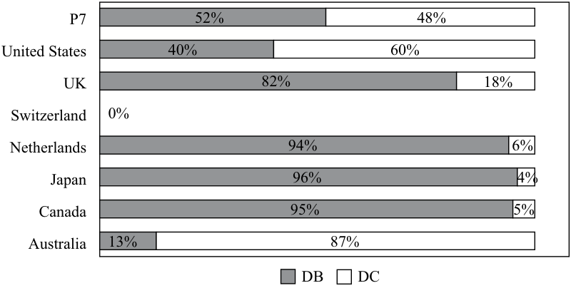

# Volume 9: Portfolio Management
## Learning Module 3 Portfolio Management: An Overview
### Part 2/3: Types of Investors (PDF Pages 145–159)

---

<!-- PDF Page 145 -->

## **TYPES OF INVESTORS** 

# **<mark>5</mark>** 

describe types of investors and distinctive characteristics and needs of each 

describe defined contribution and defined benefit pension plans 

The portfolio management process described in the previous section may apply to different types of investment clients. Such clients are broadly divided among individual (or retail) and institutional investors. Each of these segments has distinctive characteristics and needs, as discussed in the following sub-sections. 

### **Individual Investors** 

Individual investors have a variety of motives for investing and constructing portfolios. Short-term goals can include providing for children’s education, saving for a major purchase (such as a vehicle or a house), or starting a business. The retirement goal— investing to provide for an income in retirement—is a major part of the investment planning of most individuals. Many employees of public and private companies invest for retirement through **defined contribution pension plans** (DC plans). DC plans are retirement plans in the employee’s name usually funded by both the employee and the employer. Examples include 401(k) plans in the United States, group personal pension schemes in the United Kingdom, and superannuation plans in Australia. With DC plans, individuals will invest part of their wages while working, expecting to draw on the accumulated funds to provide income during retirement or to transfer some of their wealth to their heirs. The key to a DC plan is that the employee accepts the investment and inflation risk and is responsible for ensuring that there are enough assets in the plan to meet their needs upon retirement. 

Some individuals will be investing for growth and will therefore seek assets that have the potential for capital gains. Others, such as retirees, may need to draw an income from their assets and may therefore choose to invest more in fixed-income and dividend-paying shares. The investment needs of individuals will depend in part on their broader financial circumstances, such as their employment prospects and whether or not they own their own residence. They may also need to consider such issues as building up a cash reserve and the purchase of appropriate insurance policies before undertaking longer-term investments. 

Asset managers serving individual investors typically distribute their products directly to investors or through intermediaries such as financial advisers and/or retirement plan providers. The distribution network for individual investors varies globally. In the United States, financial advisers are independent or employed by national or regional broker–dealers, banks, and trust companies. Additionally, many asset managers distribute investment strategies to investors through major online brokerage and custodial firms. 

In Europe, retail investment product distribution is fragmented and, in turn, varies by country/region. In continental Europe, for example, distribution is primarily driven through financial advisers affiliated with retail and private banks. In the United Kingdom, products are sold through independent advisers as well as through advisers representing a bank or insurance group. Retail distribution in Switzerland and in the Nordic countries is driven mainly through large regional and private banks. In contrast to the United States and Europe, in many Asian markets retail distribution is dominated by large regional retail banks and global banks with private banking divisions. 

<!-- PDF Page 146 -->

Globally, many wealth management firms and asset managers target high-net-worth investors. These clients often require more customized investment solutions alongside tax and estate planning services. 

### **Institutional Investors** 

Institutional investors primarily include defined benefit pension plans, endowments and foundations, banks, insurance companies, investment companies, and sovereign wealth funds. Each of these has unique goals, asset allocation preferences, and investment strategy needs. 

##### **_Defined Benefit Pension Plans_** 

Pension plans are typically categorized as either defined contribution (DC) or defined benefit (DB). We previously described DC plans, which relate to individual investors. **Defined benefit pension plans** (DB plans) are company-sponsored plans that offer employees a predefined benefit on retirement. The future benefit is defined because the DB plan requires the plan sponsor to specify the obligation stated in terms of the retirement income benefits owed to participants. Generally, employers are responsible for the contributions made to a DB plan and bear the risk associated with adequately funding the benefits offered to employees. Plans are committed to paying pensions to members, and the assets of these plans are there to fund those payments. Plan managers need to ensure that sufficient assets will be available to pay pension benefits as they come due. The plan may have an indefinitely long time horizon if new plan members are being admitted or a finite time horizon if the plan has been closed to new members. In some cases, the plan managers attempt to match the fund’s assets to its liabilities by, for example, investing in bonds that will produce cash flows corresponding to expected future pension payments. There may be many different investment philosophies for pension plans, depending on funded status and other variables. 

An ongoing trend is that plan sponsors increasingly favor DC plans over DB plans because DC plans typically have lower costs/risk to the company. As a result, DB plans have been losing market share of pension assets to DC plans. Nevertheless, DB plans, both public and private, remain sizable sources of investment funds for asset managers. As Exhibit 12 shows, global pension assets totaled more than US$41 trillion by the end of 2017. The United States, United Kingdom, and Japan represent the three largest pension markets in the world, comprising more than 76% of global pension assets. 

**Exhibit 12: Global Pension Assets (as of year-end 2017)** 

|**Country/Region**|**Total Assets (US$ billions)**|
|---|---|
|United States|25,411|
|United Kingdom|3,111|
|Japan|3,054|
|Australia|1,924|
|Canada|1,769|
|Netherlands|1,598|
|Switzerland|906|
|South Korea|725|
|Germany|472|
|Brazil|269|
|South Africa|258|

<!-- PDF Page 147 -->

|**Country/Region**|**Total Assets (US$ billions)**|
|---|---|
|Finland|233|
|Malaysia|227|
|Chile|205|
|Mexico|177|
|Italy|184|
|France|167|
|Chinese mainland|177|
|Hong Kong SAR|164|
|Ireland|157|
|India|120|
|Spain|44|
|Total|**41,355**|

_Note:_ Column does not sum precisely because of rounding. _Source:_ Willis Towers Watson. 

By geography, the United States and Australia have a higher proportion of pension assets in DC plans, whereas Canada, Japan, the Netherlands, and the United Kingdom remain weighted toward DB plans (see Exhibit 13). 

**Exhibit 13: Pension Plan Type by Geography** 

<!-- Start of picture text -->
P7 52% 48% United States 40% 60% UK 82% 18% Switzerland 0% Netherlands 94% 6% Japan 96% 4 % Canada 95% 5% Australia 13% 87% DB DC <!-- End of picture text -->

_Notes_ : “P7” represents the combination of the seven countries listed. No data were available for Switzerland for this study. 

_Sources_ : Willis Towers Watson and secondary sources. 

##### **_Endowments and Foundations_** 

Endowments are funds of non-profit institutions that help the institutions provide designated services. In contrast, foundations are grant-making entities. Endowments and foundations collectively represent an estimated US$1.6 trillion in assets in the United States, which is the primary market for endowments and foundations. 

Endowments and foundations typically allocate a sizable portion of their assets in alternative investments (Exhibit 14). This large allocation to alternative investments primarily reflects the typically long time horizon of endowments and foundations, as well as the popularity of endowment-specific asset allocation models developed by Yale University’s endowment managers David Swensen and Dean Takahashi. 

<!-- PDF Page 148 -->

**Exhibit 14: Asset Allocations for US College and University Endowments and Affiliated Foundations (as of 30 June 2017, dollar weighted)** 

|**Asset Class**|**Percentage Allocation**|
|---|---|
|Domestic equity|15|
|Fixed income|7|
|Foreign equity|20|
|Alternatives|54|
|Cash|4|

_Source:_ National Association of College and University Budget Officers and Commonfund Institute. 

A typical investment objective of an endowment or a foundation is to maintain the real (inflation-adjusted) capital value of the fund while generating income to fund the objectives of the institution. Most foundations and endowments are established with the intent of having perpetual lives. Exhibit 15 describes the Yale University endowment’s approach to balancing short-term spending needs with ensuring that future generations also benefit from the endowment, and it also shows the Wellcome Trust’s approach. The investment approach undertaken considers the objectives and constraints of the institution (for example, no tobacco investments for a medical endowment). 

##### **Exhibit 15: Spending Rules** 

The following examples of spending rules are excerpts from the Yale University endowment (in the United States) and from the Wellcome Trust (in the United Kingdom). 

#### **_Yale University Endowment_** 

The spending rule is at the heart of fiscal discipline for an endowed institution. Spending policies define an institution’s compromise between the conflicting goals of providing substantial support for current operations and preserving purchasing power of Endowment assets. The spending rule must be clearly defined and consistently applied for the concept of budget balance to have meaning. 

The Endowment spending policy, which allocates Endowment earnings to operations, balances the competing objectives of providing a stable flow of income to the operating budget and protecting the real value of the Endowment over time. The spending policy manages the trade-of between these two objectives by combining a long-term spending rate target with a smoothing rule, which adjusts spending in any given year gradually in response to changes in Endowment market value. 

The target spending rate approved by the Yale Corporation currently stands at 5.25%. According to the smoothing rule, Endowment spending in a given year sums to 80% of the previous year’s spending and 20% of the targeted long-term spending rate applied to the fiscal year-end market value two years prior. 

_Source_ : 2017 Yale Endowment Annual Report (p.18) [http:// investments .yale .edu/ endowment -update/ ] 

<!-- PDF Page 149 -->

#### **_Wellcome Trust_** 

Our overall investment objective is to generate 4.5% percent real return over the long term. 

This is to provide for real increases in annual expenditure while reserving the Trust’s capital base to balance the needs of current and future beneficiaries. 

We use this absolute return strategy because it aligns asset allocation with funding requirements and provides a competitive framework in which to judge individual investments. 

_Source_ : Wellcome Trust website (https:// wellcome .ac .uk/ about -us/ investments) 

##### **_Banks_** 

Banks are financial intermediaries that accept deposits and lend money. Banks often have excess reserves that are invested in relatively conservative and very short-duration fixed-income investments, with a goal of earning an excess return above interest obligations due to depositors. Liquidity is a paramount concern for banks that stand ready to meet depositor requests for withdrawals. Many large banks have asset management divisions that offer retail and institutional products to their clients. 

##### **_Insurance Companies_** 

Insurance companies receive premiums for the policies they write, and they need to invest these premiums in a manner that will allow them to pay claims. 

Insurance companies can be segmented into two broad types: life insurers and property and casualty (P&C) insurers. Insurance premiums from policyholders comprise an insurance company’s general account. To pay claims to policyholders, regulatory guidelines maintain that an insurance company’s general account is typically invested conservatively in a diverse allocation of fixed-income securities. General account portfolio allocations differ among life, P&C, and other specialty insurers (e.g., reinsurance) because of both the varying duration of liabilities and the unique liquidity considerations across insurance type.10 In contrast to the general account, an insurer’s surplus account is the difference between its assets and liabilities. An insurer’s surplus account typically targets a higher return than the general account and thus often invests in less-conservative asset classes, such as public and private equities, real estate, infrastructure, and hedge funds. 

Many insurance companies have in-house portfolio management teams responsible for managing general account assets. Some insurance companies offer portfolio management services and products in addition to their insurance offerings. An increasing trend among insurers (particularly in the United States) is outsourcing some of the portfolio management responsibilities—primarily sophisticated alternative asset classes—to unaffiliated asset managers. Several insurers manage investments for third-party clients, often through separately branded subsidiaries. 

##### **_Sovereign Wealth Funds_** 

Sovereign wealth funds (SWFs) are state-owned investment funds or entities that invest in financial or real assets. SWFs do not typically manage specific liability obligations, such as pensions, and have varying investment horizons and objectives based on funding the government’s goals (for example, budget stabilization or future 

<!-- PDF Page 150 -->

development projects). SWF assets more than doubled from 2007 to March 2018, totaling more than US$7.6 trillion.11 Exhibit 16 lists the 10 largest SWFs in the world. The largest SWFs tend to be concentrated in Asia and in natural resource-rich places. 

**Exhibit 16: Largest Sovereign Wealth Funds (as of August 2018, in US$ billions)** 

|**Place**|**Sovereign Wealth Fund (Inception Year)**|**Assets**|
|---|---|---|
|Norway|Government Pension Fund—Global (1990)|1,058|
|Chinese Mainland|China Investment Corporation (2007)|941|
|UAE – Abu Dhabi|Abu Dhabi Investment Authority (1976)|683|
|Kuwait|Kuwait Investment Authority (1953)|592|
|Hong Kong SAR|Hong Kong Monetary Authority Investment Portfolio (1993)|523|
|Saudi Arabia|SAMA Foreign Holdings (1952)|516|
|Chinese Mainland|SAFE Investment Company (1997)|441|
|Singapore|Government of Singapore Investment Authority (1981)|390|
|Singapore|Temasek Holdings (1974)|375|
|Saudi Arabia|Public Investment Fund (2008)|360|
|**Total SWF Assets under** **Management**||**8,109**|

_Source:_ SWF Institute (www .swfinstitute .org). 

Investment needs vary across client groups. With some groups of clients, generalizations are possible. In other groups, needs vary by client. Exhibit 17 summarizes needs within each group. 

##### **Exhibit 17: Summary of Investment Needs by Client Type** 

|**Client**|**Time Horizon**|**Risk Tolerance**|**Income Needs**|**Liquidity Needs**|
|---|---|---|---|---|
|Individual investors|Varies by individual|Varies by individual|Varies by individual|Varies by individual|
|Defined benefit pen- sion plans|Typically long term|Typically quite high|High for mature funds; low for growing funds|Varies by maturity of the plan|
|Endowments and foundations|Very long term|Typically high|To meet spending commitments|Typically quite low|
|Banks|Short term|Quite low|To pay interest on deposits and opera- tional expenses|High to meet repay- ment of deposits|
|Insurance companies|Short term for property and casualty; long term for life insurance companies|Typically quite low|Typically low|High to meet claims|

<!-- PDF Page 151 -->

|**Client**|**Time Horizon**|**Risk Tolerance**|**Income Needs**|**Liquidity Needs**|
|---|---|---|---|---|
|Investment companies|Varies by fund|Varies by fund|Varies by fund|High to meet|
|||||redemptions|
|Sovereign wealth funds|Varies by fund|Varies by fund|Varies by fund|Varies by fund|

## **THE ASSET MANAGEMENT INDUSTRY** 

# **<mark>6</mark>** 

describe aspects of the asset management industry 

The portfolio management process and investor types are broad components of the asset management industry, which is an integral component of the global financial services sector. At the end of 2017, the industry managed more than US$79 trillion of assets owned by a broad range of institutional and individual investors (Exhibit 18).12 Although nearly 80% of the world’s professionally managed assets are in North America and Europe, the fastest-growing markets are in Asia and Latin America. 

**Exhibit 18: Global Assets under Management (AUM) by Region (year-end 2017)** 

||**Market Size** **(US$ trillions)**|**Market Share (%)**|
|---|---|---|
|North America|37.4|47%|
|Europe|22.2|28|
|Japan and Australia|6.2|8|
|Chinese mainland|4.2|5|
|Asia (excluding Japan, Australia, and Chinese mainland)|3.5|4|
|Latin America|1.8|2|
|Middle East and Africa|1.4|2|
|**Total Global AUM**|79.2|100%|

_Notes:_ Total Global AUM in this exhibit represents assets professionally managed in exchange for a fee. The total of US$79.2 trillion includes certain offshore assets that are not represented in the specific regional categories above. 

_Source:_ Boston Consulting Group. 

The asset management industry is highly competitive. The universe of firms in the industry is broad, ranging from “pure-play” independent asset managers to diversified commercial banks, insurance companies, and brokerages that offer asset management services in addition to their core business activities. Given the increasingly global nature of the industry, many asset managers have investment research and distribution offices around the world. An asset manager is commonly referred to as a 

<!-- PDF Page 152 -->

**buy-side firm** given that it uses (buys) the services of sell-side firms. A **sell-side firm** is a broker/dealer that sells securities and provides independent investment research and recommendations to their clients (i.e., buy-side firms). 

Asset managers offer a broad range of strategies. Specialist asset managers may focus on a specific asset class (e.g., emerging market equities) or style (e.g., quantitative investing), while “full service” managers typically offer a wide variety of asset classes and styles. Another type of asset manager firm is a “multi-boutique,” in which a holding company owns several asset management firms that typically have specialized investment strategies. The multi-boutique structure allows individual asset management firms to retain their own unique investment cultures—and often equity ownership stakes—while also benefiting from the centralized, shared services of the holding company (e.g., technology, sales and marketing, operations, and legal services). 

### **Active versus Passive Management** 

Asset managers may offer either active or passive management. As of year-end 2017, active management considerably exceeded passive management in terms of global assets under management and industry revenue (Exhibit 19), although passive management has demonstrated significant growth. 

**Exhibit 19: Global Asset Management Industry Assets and Revenue (as of year-end 2017)** 

|**Category**|**Assets** **(US$** **trillions)**|**Revenue** **(US$ billions)**|**Market Share** **by Assets** **(%)**|**Market Share** **by Revenue** **(%)**|
|---|---|---|---|---|
|**Actively Managed**|**64**|**258**|**80%**|**94%**|
|Alternatives|12|117|15|43|
|Active Specialties|15|55|19|20|
|Multi Asset Class|11|27|14|10|
|Core|26|59|33|21|
|**Passively Managed**|**16**|**17**|**20%**|**6%**|
|**Total**|**80**|**275**|**100%**|**100%**|

_Note:_ Some columns may not sum precisely because of rounding. _Source:_ Boston Consulting Group. 

Through fundamental research, quantitative research, or a combination of both, active asset managers generally attempt to outperform either predetermined performance benchmarks, such as the S&P 500, or, for multi-asset class portfolios, a combination of benchmarks. In contrast to active managers, passive managers attempt to replicate the returns of a market index. Despite the rise of passive management in asset share, its share of industry revenue remains small given the low management fees relative to active management. As Exhibit 19 illustrates, passive management represents a fifth of global assets under management but only 6% of industry revenue. 

Asset managers are increasingly offering other strategies beyond traditional market-cap-weighted exposures. Some of these other strategies, commonly known as **smart beta** , are based on such factors as size, value, momentum, or dividend characteristics. Smart beta involves the use of simple, transparent, rules-based strategies as a basis for investment decisions. Typically, smart beta strategies feature somewhat higher management fees and higher portfolio turnover relative to passive market-cap weighted strategies. 

<!-- PDF Page 153 -->

### **Traditional versus Alternative Asset Managers** 

Asset managers are typically categorized as either “traditional” or “alternative.” Traditional managers generally focus on long-only equity, fixed-income, and multi-asset investment strategies, generating most of their revenues from asset-based management fees. Alternative asset managers, however, focus on hedge fund, private equity, and venture capital strategies, among others, while generating revenue from both management and performance fees (or “carried interest”). As Exhibit 19 demonstrates, alternative asset managers have a relatively low proportion of total global assets under management but generate a disproportionately high total of industry revenue. 

Increasingly, the line between traditional and alternative managers has blurred. Many traditional managers have introduced higher-margin alternative products to clients. Concurrently, alternative managers seeking to reduce the revenue volatility associated with performance fees have increasingly offered retail versions of their institutional alternative strategies (typically referred to as “liquid alternatives”) as well as long-only investment strategies. These liquid alternatives are often offered through highly regulated pooled investment products (e.g., mutual funds) and typically feature less leverage, no performance fees, and more liquid holdings than typical alternative products. 

### **Ownership Structure** 

The ownership structure of an asset manager can play an important role in retaining and incentivizing key personnel. Portfolio managers who have personal capital invested in their firms or investment strategies are often viewed favorably by potential investors because of perceived alignment of management and client interests. 

The majority of asset management firms are privately owned, typically by individuals who either established their firms or play key roles in their firms’ management. Privately owned firms are typically structured as limited liability companies or limited partnerships. 

While less common than privately owned managers, publicly traded asset managers have substantial assets under management. A prevalent ownership form in the industry is represented by asset management divisions of large, diversified financial services companies that offer asset management alongside insurance and banking services. 

### **Asset Management Industry Trends** 

The asset management industry is evolving and continues to be shaped by socio-economic trends, shifting investor demands, advances in technology, and the expansion of global capital markets. Three key trends that we discuss in this section include the growth of passive investing, “big data” in the investment process, and the emergence of robo-advisers in the wealth management industry. 

##### **_Growth of Passive Investing_** 

As we saw in Exhibit 19, passively managed assets comprised nearly a fifth of global assets under management at the end of 2017. Management of passive assets is concentrated among a reasonably small group of asset managers and tends to be concentrated in equity strategies. As shown in Exhibit 20, the top three managers account for 70% of industry’s assets. One key catalyst supporting the growth of passive investing is low cost for investors—management fees for index (or other passive) funds are often a fraction of those for active strategies. Another catalyst is the challenge that many active asset managers face in generating ex ante alpha, especially in somewhat more-efficiently priced markets, such as large-cap US equities. 

<!-- PDF Page 154 -->

**Exhibit 20: Top Five ETP Managers Globally (as of 30 July 2017)** 

|**ETP Provider**|**Assets (US$ billions)**|**Market Share (%)**|
|---|---|---|
|iShares|1,583|37|
|Vanguard|803|19|
|State Street Global Advisors|596|14|
|PowerShares|132|3|
|Nomura|100|2|

_Source:_ ETFGI. 

##### **_Use of “Big Data” in the Investment Process_** 

The prevalence of new data is extraordinary: In 2013, IBM estimated that 90% of the world’s entire universe of data was created in the previous two years. The digitization of data and an exponential increase in computing power and data storage capacity have expanded additional information sources for asset managers. Massive amounts of data containing information of potential value to investors are created and captured daily. These data include both structured data—such as order book data and security returns—and data lacking recognizable structure, which is generated by a vast number of activities on the internet and elsewhere (e.g., compiled search information). The term “big data” is used to refer to these massively large datasets and their analysis. 

Asset managers are using advanced statistical and machine-learning techniques to help process and analyze these new sources of data. Such techniques are used in both fundamentally driven and quantitatively driven investment processes. For example, computers are used to “read” earnings and economic data releases much faster than humans can and react with short-term trading strategies. 

Third-party research vendors are supplying a vast range of relevant new data for asset managers, such as data used for time-series and predictive models. Among the most popular new sources of data are social media data and imagery and sensor data. 

- **Social media data** . Real-time media and content outlets, such as Twitter and Facebook, provide meaningful market and company-specific announcements for investors and asset managers. In addition, the aggregation and analysis of social media users can aid key market sentiment indicators (e.g., short-term directional market movements) and indicate potential specific user trends related to products and services. 

- **Imagery and sensor data** . Satellite imagery and geolocation devices provide vast real-time data to investment professionals. As the cost of launching and maintaining satellites has decreased, more satellites have been launched to track sensors and imagery that are relevant to economic considerations (e.g., weather conditions, cargo ship traffic patterns) and company-specific considerations (e.g., retailer parking capacity/usage, tracking of retail customers). 

The challenge for asset managers is to discover data with predictive potential and to do so faster than fellow market participants. Many market participants are participating in an “information arms race” that has required substantial investments in specialized human capital (e.g., programmers, data scientists), technology, and information technology infrastructure to effectively convert various forms of structured and unstructured data into alpha-generating portfolio and security-level decisions. 

<!-- PDF Page 155 -->

##### **_Robo-Advisers: An Expanding Wealth Management Channel_** 

Robo-advisers represent technology solutions that use automation and investment algorithms to provide several wealth management services—notably, investment planning, asset allocation, tax loss harvesting, and investment strategy selection. Investment and advice services provided by robo-advisers typically reflect an investor’s general investment goals and risk tolerance preferences (often obtained from an investor questionnaire). Robo-adviser platforms range from exclusively digital investment advice platforms to hybrid offerings that offer both digital investment advice and the services of a human financial adviser. 

At the end of 2017, robo-advisers managed an estimated US$180 billion in assets,13 and market participants expect that number to grow considerably over time. This expected rapid growth in robo-advisory assets is based on several industry trends: 

- **Growing demand from “mass affluent” and younger investors** : Traditional investment advice has often underserved younger and “mass affluent” investors with lower relative levels of investable assets. Given the efficiencies of robo-advisers and the scalability of technology, customized but standardized investment advice now can be offered to a wide range and size of investors. 

- **Lower fees** : The cost of digital investment advice provided by robo-advisers is often a fraction of traditional investment advice channels because of scalability. For example, in the United States, a typical financial adviser may charge a 1% annual advisory fee14 based on a client’s assets, while robo-adviser fees typically average 0.20% annually.15 Additionally, robo-advisers often rely on lower fee underlying portfolio investment options, such as index funds or ETFs, when constructing portfolios for clients. 

- **New entrants** : Reflecting low barriers to entry, large wealth management firms have introduced robo-adviser solutions to service certain customer segments and appeal to a new generation of investors. In addition to these large wealth managers, other less-traditional entrants, such as insurance companies and asset managers, are developing solutions to cross-sell into their existing clients. Many market observers expect that non-financial firms (large technology leaders) will also become key players in the robo-adviser industry as they look to monetize their access to user data. 

## **POOLED INTEREST - MUTUAL FUNDS** 

<!-- Start of picture text -->
7 <!-- End of picture text -->

- describe mutual funds and compare them with other pooled investment products 

In the asset management industry, a challenge faced by all investors is to find the right set of investment products to meet their needs. There is a diverse set of investment products available to investors, ranging from a simple brokerage account in which 

> 13 S&P Global Market Intelligence. 

> 14 http:// www .riainabox .com/ blog/ 2016 -ria -industry -study -average -investment -advisory -fee -is -0 -99 -percent. 

> 15 Deloitte, “Robo-Advisors Capitalizing on a Growing Opportunity” (https:// www2 .deloitte .com/ content/ dam/ Deloitte/ us/ Documents/ strategy/ us -cons -robo -advisors .pdf). 

<!-- PDF Page 156 -->

the individual creates her own portfolio by assembling individual securities, to large institutions that employ individual portfolio managers to meet clients’ investment management needs. Among the major investment products offered by asset managers are mutual funds and other pooled investment products, such as separately managed accounts, exchange-traded funds, hedge funds, and private equity/venture capital funds. 

### **Mutual Funds** 

Rather than assemble a portfolio on their own, individual investors and institutions can turn over the selection and management of their investment portfolio to a third party. One way of doing this is through a **mutual fund** . This type of fund is a comingled investment pool in which investors in the fund each have a pro-rata claim on the income and value of the fund. The value of a mutual fund is referred to as the “net asset value.” It is computed daily based on the closing price of the securities in the portfolio. 

Mutual funds represent a primary investment product of individual investors globally. According to the International Investment Funds Association, worldwide regulated open-end fund assets totaled US$50 trillion as of the first quarter of 2018. Exhibit 21 shows the growth of global open-end funds over the past five years by region. Mutual funds provide several advantages, including low investment minimums, diversified portfolios, daily liquidity, and standardized performance and tax reporting. 

**Exhibit 21: Worldwide Regulated Open-End Funds: Total Net Assets (as of year-end, in US$ trillions)** 

||**2011**|**2012**|**2013**|**2014**|**2015**|**2016**|**Q1 2018**|
|---|---|---|---|---|---|---|---|
|**World**|**27.9**|**31.9**|**36.3**|**38.0**|**38.2**|**40.4**|**50.0**|
|Americas|14.6|16.5|18.9|20.0|19.6|21.1|24.9|
|Europe|10.3|11.9|13.6|13.8|13.7|14.1|18.1|
|Asia and Pacific|2.9|3.3|3.7|4.1|4.7|5.0|6.8|
|i Africa|0.1|0.1|0.1|0.1|0.1|0.1|0.2|

_Notes:_ Components may not add to the total because of rounding. Regulated open-end funds include mutual funds, exchange-traded funds (ETFs), and institutional funds. _Source:_ International Investment Funds Association (IIFA). 

Mutual funds are one of the most important investment vehicles for individuals and institutions. The best way to understand how a mutual fund works is to consider a simple example. Suppose that an investment firm wishes to start a mutual fund with a target amount of US$10 million. It is able to reach this goal through investments from five individuals and two institutions. The investment of each is as follows: 

|**Investor**|**Amount** **Invested (US$)**|**Percent of Total**|**Number of Shares**|
|---|---|---|---|
|_Individuals_||||
|A|$1.0 million|10%|10,000|
|B|1.0|10|10,000|
|C|0.5|5|5,000|
|D|2.0|20|20,000|
|E|0.5|5|5,000|
|_Institutions_||||
|X|2.0|20|20,000|

<!-- PDF Page 157 -->

|**Investor**|**Amount** **Invested (US$)**|**Percent of Total**|**Number of Shares**|
|---|---|---|---|
|Y|3.0|30|30,000|
|**Totals**|**$10.0 million**|**100%**|**100,000**|

Based on the US$10 million value (net asset value), the investment firm sets a total of 100,000 shares at an initial value of US$100 per share (US$10 million/100,000 = US$100). The investment firm will appoint a portfolio manager to be responsible for the investment of the US$10 million. Going forward, the total value of the fund or net asset value will depend on the value of the assets in the portfolio. 

The fund can be set up as an open-end fund or a closed-end fund. If it is an **open-end fund** , it will accept new investment money and issue additional shares at a value equal to the net asset value of the fund at the time of investment. For example, assume that at a later date the net asset value of the fund increases to US$12 million and the new net asset value per share is US$120. A new investor, F, wishes to invest US$0.96 million in the fund. If the total value of the assets in the fund is now US$12 million or US$120 per share, in order to accommodate the new investment the fund would create 8,000 (US$0.96 million/US$120) new shares. After this investment, the net asset value of the fund would be US$12.96 million and there would be a total of 108,000 shares. 

Funds can also be withdrawn at the net asset value per share. Suppose on the same day Investor E wishes to withdraw all her shares in the mutual fund. To accommodate this withdrawal, the fund will have to liquidate US$0.6 million in assets to retire 5,000 shares at a net asset value of US$120 per share (US$0.6 million/US$120). The combination of the inflow and outflow on the same day would be as follows: 

|**Type**|**Investment (US$)**|**Shares**|
|---|---|---|
|Inflow (Investor F buys)|$960,000|8,000|
|l Outflow (Investor E sells)|–$600,000|–5,000|
|Net|$360,000|3,000|

The net of the inflows and outflows on that day would be US$360,000 of new funds to be invested and 3,000 new shares created. However, the number of shares held and the value of the shares of all remaining investors, except Investor E, would remain the same. 

An alternative to setting the fund up as an open-end fund would be to create a **closed-end fund** in which no new investment money is accepted into the fund. New investors invest by buying existing shares, and investors in the fund liquidate by selling their shares to other investors. Hence, the number of outstanding shares does not change. One consequence of this fixed share base is that, unlike open-end funds in which new shares are created and sold at the current net asset value per share, closed-end funds can sell for a premium or discount to net asset value depending on the demand for the shares. 

There are advantages and disadvantages to each type of fund. The open-end fund structure makes it easy to grow in size but creates pressure on the portfolio manager to manage the cash inflows and outflows. One consequence of this structure is the need to liquidate assets that the portfolio manager might not want to sell at the time to meet redemptions. Conversely, the inflows require finding new assets in which to invest. As such, open-end funds tend not to be fully invested but rather keep some cash for redemptions not covered by new investments. Closed-end funds do not have these problems, but they do have a limited ability to grow. Of the total net asset value of all US mutual funds at the end of 2017 (US$19 trillion), only approximately 1 percent were in the form of closed-end funds. 

<!-- PDF Page 158 -->

In addition to open-end or closed-end funds, mutual funds can be classified as load or no-load funds. The primary difference between the two is whether the investor pays a sales charge (a “load”) to purchase, hold, or redeem shares in the fund. In the case of the **no-load fund** , there is no fee for investing in the fund or for redemption but there is an annual fee based on a percentage of the fund’s net asset value. **Load funds** are funds in which, in addition to the annual fee, a percentage fee is charged to invest in the fund and/or for redemptions from the fund. In addition, load funds are usually sold through retail brokers who receive part of the upfront fee. Overall, the number and importance of load funds has declined over time. 

# **<mark>8</mark>** 

## **POOLED INTEREST - TYPE OF MUTUAL FUNDS** 

describe mutual funds and compare them with other pooled investment products 

The following section introduces the major types of mutual funds differentiated by the asset type that they invest in: money market funds, bond mutual funds, stock mutual funds, and hybrid or balanced funds. 

### **Money Market Funds** 

Money market funds are mutual funds that invest in short-term money market instruments such as treasury bills, certificates of deposit, and commercial paper. They aim to provide security of principal, high levels of liquidity, and returns in line with money market rates. Many funds operate on a constant net asset value (CNAV) basis where the share price is maintained at $1 (or local currency equivalent). Others operate on a variable net asset value (VNAV) basis where the unit price can vary. In the United States, there are two basic types of money market funds: taxable and tax-free. Taxable money market funds invest in high-quality, short-term corporate debt and federal government debt. Tax-free money market funds invest in short-term state and local government debt. Although money market funds have been a substitute for bank savings accounts since the early 1980s, they are not insured in the same way as bank deposits. 

### **Bond Mutual Funds** 

A bond mutual fund is an investment fund consisting of a portfolio of individual bonds and, occasionally, preferred shares. The net asset value of the fund is the sum of the value of each bond in the portfolio divided by the number of shares. Investors in the mutual fund hold shares, which account for their pro-rata share or interest in the portfolio. The major difference between a bond mutual fund and a money market fund is the maturity of the underlying assets. In a money market fund the maturity is as short as overnight and rarely longer than 90 days. A bond mutual fund, however, holds bonds with maturities as short as one year and as long as 30 years (or more). Exhibit 22 illustrates the general categories of bond mutual funds.16 

> 16 In the United States, judicial rulings on federal powers of taxation have created a distinction between (federally) taxable and (federally) tax-exempt bonds and a parallel distinction for US bond mutual funds. 

<!-- PDF Page 159 -->

##### **Exhibit 22: Bond Mutual Funds** 

|**Type of Bond Mutual Fund**|**Securities Held**|
|---|---|
|Global|Domestic and non-domestic government, corporate, and securitized debt|
|Government|Government bonds and other government-affiliated bonds|
|Corporate|Corporate debt|
|High yield|Below investment-grade corporate debt|
|Inflation protected|Inflation-protected government debt|
|National tax-free bonds|National tax-free bonds (e.g., US municipal bonds)|

### **Stock Mutual Funds** 

Historically, the largest types of mutual funds based on market value of assets under management are stock (equity) funds. 

There are two types of stock mutual funds. The first is an actively managed fund in which the portfolio manager seeks outstanding performance through the selection of the appropriate stocks to be included in the portfolio. Passive management is followed by index funds that are very different from actively managed funds. Their goal is to match or track the performance of different indexes. The first index fund was introduced in 1976 by the Vanguard Group. 

There are several major differences between actively managed funds and index funds. First, management fees for actively managed funds are higher than for index funds. The higher fees for actively managed funds reflect its goal to outperform an index, whereas the index fund simply aims to match the return on the index. Higher fees are required to pay for the research conducted to actively select securities. A second difference is that the level of trading in an actively managed fund is much higher than in an index fund, which depending on the jurisdiction, has tax implications. Mutual funds are often required to distribute all income and capital gains realized in the portfolio, so the actively managed fund tends to have more opportunity to realize capital gains. This results in higher taxes relative to an index fund, which uses a buy-and-hold strategy. Consequently, there is less buying and selling in an index fund and less likelihood of realizing capital gains distributions. 

### **Hybrid/Balanced Funds** 

Hybrid or balanced funds are mutual funds that invest in both bonds and stocks. These types of funds represent a small fraction of the total investment in US mutual funds but are more common in Europe. These types of funds, however, have gained popularity with the growth of lifecycle funds. Lifecycle or Target Date funds manage the asset mix based on a desired retirement date. For example, if an investor is 40 years old in 2019 and planned to retire at the age of 67, he could invest in a mutual fund with a target date of 2046 and the fund would manage the appropriate asset mix over the next 27 years. In 2019 it might be 90 percent invested in shares and 10 percent in bonds. As time passes, however, the fund would gradually change the mix of shares and bonds to reflect the appropriate mix given the time to retirement. 

