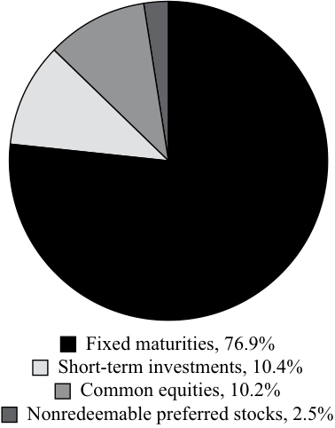

# Volume 9: Portfolio Management
## Learning Module 4 Basics of Portfolio Planning and Construction
### Part 1/3: Introduction (PDF Pages 169–184)

---

<!-- PDF Page 169 -->

# L E A R N I N G M O D U L E **<mark>4</mark>** 

### **Basics of Portfolio Planning and Construction** 

**by Alistair Byrne, PhD, CFA, and Frank E. Smudde, MSc, CFA.** 

_Alistair Byrne, PhD, CFA, is at State Street Global Advisors (United Kingdom). Frank E. Smudde, MSc, CFA, is at APG Asset Management (Netherlands)._ 

##### **<mark>LEARNING OUTCOMES</mark>** 

**_Mastery The candidate should be able to:_** describe the reasons for a written investment policy statement (IPS) describe the major components of an IPS describe risk and return objectives and how they may be developed for a client explain the difference between the willingness and the ability (capacity) to take risk in analyzing an investor’s financial risk tolerance describe the investment constraints of liquidity, time horizon, tax concerns, legal and regulatory factors, and unique circumstances and their implications for the choice of portfolio assets explain the specification of asset classes in relation to asset allocation describe the principles of portfolio construction and the role of asset allocation in relation to the IPS describe how environmental, social, and governance (ESG) considerations may be integrated into portfolio planning and construction 

CFA Institute would like to thank Hardik Sanjay Shah, CFA, for his contributions to the 2022 update of this reading. 

<!-- PDF Page 170 -->

## **<mark>1</mark>** 

#### **INTRODUCTION** 

To build a suitable portfolio for a client, investment advisers should first seek to understand the client’s investment goals, resources, circumstances, and constraints. Investors can be categorized into broad groups based on shared characteristics with respect to these factors (e.g., various types of individual investors and institutional investors). Even investors within a given type, however, will invariably have a number of distinctive requirements. In this reading, we consider in detail the planning for investment success based on an individualized understanding of the client. 

This reading is organized as follows: Section 2 discusses the investment policy statement, a written document that captures the client’s investment objectives and the constraints. Section 3 discusses the portfolio construction process, including the first step of specifying a strategic asset allocation for the client. Section 4 concludes and summarizes the reading. 

## **<mark>2</mark>** 

#### **THE INVESTMENT POLICY STATEMENT** 

describe the reasons for a written investment policy statement (IPS) describe the major components of an IPS 

**Portfolio planning** can be defined as a program developed in advance of constructing a portfolio that is expected to define the client’s investment objectives. The written document governing this process is the investment policy statement (IPS). The IPS is sometimes complemented by a document outlining policy on responsible investing— the broadest (umbrella) term used to describe principles that typically address one or more environmental, social, and governance themes that an investor requires to be considered when evaluating whether to invest in a particular company, as well as during the period of ownership. Sustainable investing, a term used in a similar context to responsible investing, focuses on factoring in sustainability issues during the investment process. Policies on responsible investing may also be integrated within the IPS itself. In the remainder of this reading, the integration of responsible investing within the IPS will be our working assumption. 

##### **The Investment Policy Statement** 

The IPS is the starting point of the portfolio management process. Without a full understanding of the client’s situation and requirements, it is unlikely that successful results will be achieved. “Success” can be defined as a client achieving his important investment goals using means that he is comfortable with (in terms of risks taken and other concerns). The IPS essentially communicates a plan for achieving investment success. 

The IPS is typically developed following a fact-finding discussion with the client. This discussion can include the use of a questionnaire designed to articulate the client’s risk tolerance as well as address expectations in connection with specific circumstances. In the case of institutional clients, the fact finding may involve asset–liability management reviews, identification of liquidity needs, and a wide range of tax, legal, and other considerations. 

<!-- PDF Page 171 -->

The IPS can take a variety of forms.1 A typical format will include the client’s investment objectives and the constraints that apply to the client’s portfolio. 

The client’s objectives are specified in terms of risk tolerance and return requirements. These elements must be consistent with each other: a client is unlikely to be able to find a portfolio that offers a relatively high expected return without taking on a relatively high level of expected risk. As part of their financial planning, clients may specify specific spending goals, which need to be considered when setting risk tolerance and return requirements. 

The constraints section covers factors that need to be taken into account when constructing a portfolio for the client that meets the objectives. The typical categories are liquidity requirements, time horizon, regulatory requirements, tax status, and unique needs. The constraints may be either internal (i.e., set by the client) or external (i.e., set by law or regulation), as we discuss in detail later. 

Having a well-constructed IPS for all clients should be standard procedure for an investment manager. The investment manager should build the portfolio with reference to the IPS and be able to refer to it to assess a particular investment’s suitability for the client. In some cases, the need for the IPS goes beyond simply being a matter of standard procedure. In certain countries, the IPS (or an equivalent document) is a legal or regulatory requirement. For example, UK pension schemes must have a statement of investment principles under the Pensions Act 1995 (Section 35), and this statement is in essence an IPS. The UK Financial Services Authority also has requirements for investment firms to “know their customers.” The European Union’s Markets in Financial Instruments Directive (“MiFID”) requires firms to assign clients to categories (eligible counterparties, institutional clients, or retail clients), with the category type determining the types of protections and limitations relevant for the client by law. 

In the case of an institution, such as a pension plan or university endowment, the IPS may set out the governance arrangements that apply to the investment portfolio. For example, this information could cover the investment committee’s approach to appointing and reviewing investment managers for the portfolio, and the discretion that those managers have. 

The IPS should be reviewed on a regular basis to ensure that it remains consistent with the client’s circumstances and requirements. For example, the UK Pensions Regulator suggests that a pension scheme’s statements of investment principles—a form of IPS—should be reviewed at least every three years. The IPS should also be reviewed if the manager becomes aware of a material change in the client’s circumstances, as well as on the initiative of the client when her objectives, time horizon, or liquidity needs change. 

##### **Major Components of an IPS** 

There is no single standard format for an IPS. Many IPS and investment governance documents with a similar purpose (as noted previously), however, include the following sections: 

- _Introduction_ . This section describes the client. 

- _Statement of Purpose_ . This section states the purpose of the IPS. 

> 1 In this reading, an IPS is assumed to be a document governing investment management activities covering all or most of a client’s financial wealth. In many practical contexts, investment professionals work with investment mandates that cover only parts of a client’s wealth or financial risk. Governance documents such as “Limited Partnership Agreements” and “Investment Management Agreements” will govern such mandates. Their contents are to a large degree comparable to the contents of the IPS as described in this reading. 

<!-- PDF Page 172 -->

- _Statement of Duties and Responsibilities_ . This section details the duties and responsibilities of the client, the custodian of the client’s assets, and the investment managers. 

- _Procedures_ . This section explains the steps to take to keep the IPS current and the procedures to follow to respond to various contingencies. 

- _Investment Objectives_ . This section explains the client’s objectives in investing. 

- _Investment Constraints_ . This section presents the factors that constrain the client in seeking to achieve the investment objectives. 

- _Investment Guidelines_ . This section provides information about how policy should be executed (e.g., on the permissible use of leverage and derivatives) and on specific types of assets excluded from investment, if any. 

- _Evaluation and Review_ . This section provides guidance on obtaining feedback on investment results. 

- _Appendices_ : (A) Strategic Asset Allocation and (B) Rebalancing Policy. Many investors specify a strategic asset allocation (SAA), also known as the policy portfolio, which is the baseline allocation of portfolio assets to asset classes in view of the investor’s investment objectives and the investor’s policy with respect to rebalancing asset class weights. This SAA may include a statement of policy concerning hedging risks such as currency risk and interest rate risk. 

The sections that are most closely linked to the client’s distinctive needs, and probably the most important from a planning perspective, are those dealing with investment objectives and constraints. An IPS focusing on these two elements has been called an IPS in an “objectives and constraints” format. 

In the following sections, we discuss the investment objectives and constraints format of an IPS beginning with risk and return objectives. The process of developing the IPS is the basic mechanism for evaluating and trying to improve an investor’s overall expected return–risk stance. In a portfolio context, return objectives and expectations must be tailored to be consistent with risk objectives. The risk and return objectives must also be consistent with the constraints that apply to the portfolio. A growing proportion of investors explicitly include non-financial considerations when formulating their investment policies. This approach is often referred to as responsible investing (discussed earlier alongside related terms), which reflects environmental, social, and governance (ESG) considerations. Responsible investing recognizes that ESG considerations may eventually affect the portfolio’s financial risk–return profile and may express the investor’s societal convictions. In this reading, we discuss responsible investing aspects of investment policy, where relevant. 

## **<mark>3</mark>** 

#### **IPS RISK AND RETURN OBJECTIVES** 

- describe the major components of an IPS 

- describe risk and return objectives and how they may be developed for a client 

- explain the difference between the willingness and the ability (capacity) to take risk in analyzing an investor’s financial risk tolerance 

<!-- PDF Page 173 -->

When constructing a portfolio for a client, it is important to ensure that the risk of the portfolio is suitable for the client. The IPS should state clearly the risk tolerance of the client. Risk objectives are specifications for portfolio risk that reflect the client’s risk tolerance. Quantitative risk objectives can be absolute, relative, or a combination of the two. 

Examples of an absolute risk objective would be a desire not to suffer any loss of capital or not to lose more than a given percentage of capital in any 12-month period. Note that these objectives are unrelated to investment market performance, good or bad, and are absolute in the sense of being self-standing. The fulfillment of such objectives could be achieved by not taking any risk—for example, by investing in an insured bank certificate of deposit at a creditworthy bank. If investments in risky assets are undertaken, however, such statements could be restated as a probability statement to be more operational (i.e., practically useful). For example, the desire not to lose more than 4% of capital in any 12-month period might be restated as an objective that with 95% probability the portfolio not lose more than 4% in any 12-month period. Measures of absolute risk include the variance or standard deviation of returns and **value at risk** .2 

Some clients may choose to express relative risk objectives, which relate risk relative to one or more benchmarks perceived to represent appropriate risk standards. For example, investments in large-cap UK equities could be benchmarked to an equity market index, such as the FTSE 100 Index. The S&P 500 Index could be used as a benchmark for large-cap US equities; for investments with cash-like characteristics, the benchmark could be an interest rate such as Treasury bill rate. For risk relative to a benchmark, the measure could be **tracking risk** , or **tracking error** .3 In practice, such risk objectives are used in situations where the total wealth management activities on behalf of a client are divided into partial mandates. 

Other clients take both the investor’s assets and liabilities into consideration when establishing an IPS risk objective. In some cases where the size, timing and/ or relative certainty of future investor financial obligations are known, an IPS may be tailored to meet these objectives in what is called a **liability-driven investment (LDI)** approach. Examples of LDI include life insurance companies, defined benefit pension plans or an individual’s budget after retirement. For example, a pension plan must meet the pension payments as they come due, and the risk objective will be to minimize the probability that it will fail to do so. A related return objective might be to outperform the discount rate used in finding the present value of liabilities over a multi-year time horizon. 

When a policy portfolio (that is, a specified set of long-term asset class weightings and hedge ratios) is used, the risk objective may be expressed as a desire for the portfolio return to be within a band of plus or minus X% of the benchmark return calculated by assigning an index or benchmark to represent each asset class present in the policy portfolio. Again, this objective may be more usefully interpreted as a statement of probability—for example, a 95% probability that the portfolio return will be within X% of the benchmark return over a stated period. Example 1 reviews this material. 

> 2 **Value at risk** is a money measure of the minimum value of losses expected during a specified period at a given level of probability. 

> 3 **Tracking risk** (sometimes called **tracking error** ) is the standard deviation of the differences between a portfolio’s returns and its benchmark’s returns. 

<!-- PDF Page 174 -->

###### **EXAMPLE 1** 

##### **Types of Risk Objectives** 

A Japanese institutional investor has a portfolio valued at ¥10 billion. The investor expresses her first risk objective as a desire not to lose more than ¥1 billion in the coming 12-month period. She specifies a second risk objective of achieving returns within 4% of the return to the TOPIX stock market index, which is her benchmark. Based on this information, address the following: 

###### 1. 

   - **a.** Characterize the first risk objective as absolute or relative. 

   - **b.** Give an example of how the risk objective could be restated in a practical manner. 

   - **Solution** 

   - **a.** This is an absolute risk objective. 

   - **b.** This risk objective could be restated in a practical manner by specifying that the 12-month 95% value at risk of the portfolio must be no more than ¥1 billion. 

2. 

- **a.** Characterize the second risk objective as absolute or relative. 

- **b.** Identify a measure for quantifying the risk objective. 

- **Solution** 

- **a.** This is a relative risk objective. 

- **b.** This risk objective could be quantified using the tracking risk as a measure. For example, assuming returns follow a normal distribution, an expected tracking risk of 2% would imply a return within 4% of the index return approximately 95% of the time. Remember that tracking risk is stated as a one standard deviation measure. 

A client’s overall risk tolerance is a function of the client’s ability to bear (accept) risk and her “risk attitude,” which might be considered as the client’s willingness to take risk. For ease of expression, from this point on we will refer to ability to bear risk and willingness to take risk as the two components of risk tolerance. Above-average ability to bear risk and above-average willingness to take risk imply above-average risk tolerance. Below-average ability to bear risk and below-average willingness to take risk imply below-average risk tolerance. These interactions are shown in Exhibit 1. 

**Exhibit 1: Risk Tolerance** 

||**Ability to Bear Risk**|
|---|---|
|**Willingness to Take Risk**|**Below Average** **Above Average**|
|Below Average|Below-average risk tolerance Resolution needed|
|Above Average|Resolution needed Above-average risk tolerance|

The _ability_ to bear risk is measured mainly in terms of objective factors, such as time horizon, expected income, and level of wealth relative to liabilities. For example, an investor with a 20-year time horizon can be considered to have a greater ability 

<!-- PDF Page 175 -->

to bear risk, other things being equal, than an investor with a 2-year horizon. This difference is because over 20 years, there is more scope for losses to be recovered or other adjustments made to circumstances than there is over 2 years. 

Similarly, an investor whose assets are comfortably in excess of their liabilities has more ability to bear risk than an investor whose wealth and expected future expenditure are more closely balanced. For example, a wealthy individual who can sustain a comfortable lifestyle after a very substantial investment loss has a relatively high ability to bear risk. A pension plan that has a large surplus of assets over liabilities has a relatively high ability to bear risk. 

The _willingness_ to take risk, or risk attitude, is a more subjective factor based on the client’s psychology and perhaps also his current circumstances. Although the list of factors related to an individual’s risk attitude remains open to debate, it is believed that some psychological factors, such as personality type, self-esteem, and inclination to independent thinking, are correlated with risk attitude. Some individuals are comfortable taking financial and investment risk, whereas others find it distressing. Although there is no single agreed-upon method for measuring risk tolerance, a willingness to take risk may be gauged by discussing risk with the client or by asking the client to complete a psychometric questionnaire. For example, financial planning academic John Grable and collaborators have developed 13-item and 5-item risk attitude questionnaires that have undergone some level of technical validation. The five-item questionnaire is shown in Exhibit 2. 

###### **Exhibit 2: A Five-Item Risk Assessment Instrument** 

**1.** Investing is too difficult to understand. 

   - **a.** Strongly agree 

   - **b.** Tend to agree 

   - **c.** Tend to disagree 

   - **d.** Strongly disagree 

**2.** I am more comfortable putting my money in a bank account than in the stock market. 

   - **a.** Strongly agree 

   - **b.** Tend to agree 

   - **c.** Tend to disagree 

   - **d.** Strongly disagree 

**3.** When I think of the word “risk,” the term “loss” comes to mind immediately. 

   - **a.** Strongly agree 

   - **b.** Tend to agree 

   - **c.** Tend to disagree 

   - **d.** Strongly disagree 

**4.** Making money in stocks and bonds is based on luck. 

   - **a.** Strongly agree 

   - **b.** Tend to agree 

   - **c.** Tend to disagree 

   - **d.** Strongly disagree 

**5.** In terms of investing, safety is more important than returns. 

   - **a.** Strongly agree 

<!-- PDF Page 176 -->

- **b.** Tend to agree 

- **c.** Tend to disagree 

- **d.** Strongly disagree 

_Source:_ Grable and Joo (2004). 

The responses, a), b), c), and d), are coded 1, 2, 3, and 4, respectively, and summed. The lowest score is 5 and the highest score is 20, with higher scores indicating greater risk tolerance. For two random samples drawn from the faculty and staff of large US universities ( _n_ = 406), the mean score was 12.86 with a standard deviation of 3.01 and a median score (i.e., the middle score) of 13. 

Note that a question, such as the first one in Exhibit 2, indicates that risk attitude may be associated with non-psychological factors (such as level of financial knowledge and understanding and decision-making style) as well as psychological factors. 

The adviser needs to examine whether a client’s ability to accept risk is consistent with the client’s willingness to take risk. For example, a wealthy investor with a 20-year time horizon, who is thus able to take risk, may also be comfortable taking risk; in this case the factors are consistent. If the wealthy investor has a low willingness to take risk, there would be a conflict. 

The conflict between ability and willingness to take risk can also arise in the institutional context. In addition, different stakeholders within the institution may take different views. For example, the trustees of a well-funded pension plan may desire a low-risk approach to safeguard the funding of the scheme and beneficiaries of the scheme may take a similar view. The sponsor, however, may wish a higher-risk/ higher-return approach in an attempt to reduce future funding costs. When a trustee bears a fiduciary responsibility to pension beneficiaries and the interests of the pension sponsor and the pension beneficiaries conflict, the trustee should act in the best interests of the beneficiaries. 

When both the ability and willingness to take risk are consistent, the investment adviser’s task is the simplest. When ability to take risk is below average and willingness to take risk is above average, the investor’s risk tolerance should be assessed as below average overall. When ability to take risk is above average but willingness is below average, the portfolio manager or adviser may seek to counsel the client and explain the conflict and its implications. For example, the adviser could outline the reasons why the client is considered to have a high ability to take risk and explain the likely consequences, in terms of reduced expected return, of not taking risk. The investment adviser, however, should not aim to change a client’s willingness to take risk that is not a result of a miscalculation or misperception. Modification of elements of personality is not within the purview of the investment adviser’s role. The prudent approach is to reach a conclusion about risk tolerance consistent with the lower of the two factors (ability and willingness) and to document the decisions made. 

Example 2 is the first of a set that follows the analysis of an investment client through the preparation of the major elements of an IPS. 

###### **EXAMPLE 2** 

##### **The Case of Henri Gascon: Risk Tolerance** 

1. Henri Gascon is an energy trader who works for a major French oil company based in Paris. He is 30 years old and married with one son, aged 5. Gascon has decided that it is time to review his financial situation and consults a financial adviser, who notes the following aspects of Gascon’s situation: 

   - Gascon’s annual salary of €250,000 is more than sufficient to cover the family’s outgoings. 

<!-- PDF Page 177 -->

- Gascon owns his apartment outright and has €1,000,000 of savings. 

- Gascon perceives that his job is reasonably secure. 

- Gascon has a good knowledge of financial matters and is confident that equity markets will deliver positive returns over the long term. 

- In the risk tolerance questionnaire, Gascon strongly disagrees with the statements that “making money in stocks and bonds is based on luck” and “in terms of investing, safety is more important than returns.” 

- Gascon expects that most of his savings will be used to fund his retirement, which he hopes to start at age 50. 

Based only on the information given, which of the following statements is _most_ accurate? 

- **A.** Gascon has a low ability to take risk but a high willingness to take risk. **B.** Gascon has a high ability to take risk but a low willingness to take risk. 

- **C.** Gascon has a high ability to take risk and a high willingness to take risk. 

##### **Solution:** 

C is correct. Gascon has a high income relative to outgoings, a high level of assets, a secure job, and a time horizon of 20 years. This information suggests a high _ability_ to take risk. At the same time, Gascon is knowledgeable and confident about financial markets and responds to the questionnaire with answers that suggest risk tolerance. This result suggests he also has a high _willingness_ to take risk. 

###### **EXAMPLE 3** 

##### **The Case of Jacques Gascon: Risk Tolerance** 

1. Marie Gascon is so pleased with the services provided by her financial adviser that she suggests to her brother Jacques that he should also consult the adviser. Jacques thinks it is a good idea. Jacques, a self-employed computer consultant also based in Paris, is 40 years old and divorced with four children, aged between 12 and 16. The financial adviser notes the following aspects of Jacques’ situation: 

   - Jacques’ consultancy earnings average €40,000 per annum but are quite volatile. 

   - Jacques is required to pay €10,000 per year to his ex-wife and children. 

   - Jacques has a mortgage on his apartment of €100,000 and €10,000 of savings. 

   - Jacques has a good knowledge of financial matters and expects that equity markets will deliver very high returns over the long term. 

   - In the risk tolerance questionnaire, Jacques strongly disagrees with the statements “I am more comfortable putting my money in a bank account than in the stock market” and “When I think of the word ‘risk’, the term ‘loss’ comes to mind immediately.” 

<!-- PDF Page 178 -->

- Jacques expects that most of his savings will be required to support his children at university. 

Based only on the information given, which statement is correct? 

- **A.** Jacques has a low ability to take risk but a high willingness to take risk. 

- **B.** Jacques has a high ability to take risk but a low willingness to take risk. 

- **C.** Jacques has a high ability to take risk and a high willingness to take risk. 

##### **Solution:** 

A is correct. Jacques does not have a particularly high income, his income is unstable, and he has reasonably high outgoings for his mortgage and maintenance payments. His investment time horizon is approximately two to six years given the ages of his children and his desire to support them at university. This finely balanced financial situation and short time horizon suggests a low ability to take risk. In contrast, his expectations for financial market returns and risk tolerance questionnaire answers suggest a high willingness to take risk. The financial adviser may wish to explain to Jacques how finely balanced his financial situation is and suggest that, despite his desire to take more risk, a relatively cautious portfolio might be the most appropriate approach to take. 

##### **Return Objectives** 

A client’s return objectives can be stated in a number of ways. Similar to risk objectives, return objectives may be stated on an absolute or a relative basis. 

As an example of an absolute objective, the client may want to achieve a particular percentage rate of return. This objective could be a nominal rate of return or could be expressed in real (inflation-adjusted) terms. 

Alternatively, the return objective can be stated on a relative basis—for example, relative to a benchmark return. The benchmark could be an equity market index, such as the S&P 500 or the FTSE 100, or a cash rate of interest such as the market reference rate (MRR). A relative return objective might be stated as, for example, a desire to outperform the benchmark index by one percentage point per year. 

Some institutions also set their return objectives relative to a peer group or universe of managers—for example, an endowment aiming for a return that is in the top 50% of returns of similar institutions, or a private equity mandate aiming for returns in the top quartile among the private equity universe. This objective can be problematic when limited information is known about the investment strategies or the return calculation methodology being used by peers, and we must bear in mind the impossibility of _all_ institutions being “above average.” Furthermore, a good benchmark should be investable—that is, able to be replicated by the investor—and a peer benchmark typically does not meet that criterion. 

In each case, the return requirement can be stated before or after fees. Care should be taken that the fee basis used is clear and understood by both the manager and client. The return can also be stated on either a pre- or post-tax basis when the investor is required to pay tax. For a taxable investor, the baseline is to state and analyze returns on an after-tax basis. 

The return objective could be a required return—that is, the amount the investor needs to earn to meet a particular future goal—such as a certain level of retirement income. 

<!-- PDF Page 179 -->

The manager or adviser must ensure that the return objective is realistic. Care should be taken that client and manager are in agreement on whether the return objective is nominal (which is more convenient for measurement purposes) or real (i.e., inflation-adjusted, which usually relates better to the objective). It must be consistent with the client’s risk objective (high expected returns are unlikely to be possible without high levels of risk) and also with the current economic and market environment. For example, 15% nominal returns might be possible when inflation is 10% but will be unlikely when inflation is 3%. 

When a client has unrealistic return expectations, the manager or adviser will need to counsel her about what is achievable in the current market environment and within the client’s tolerance for risk. 

###### **EXAMPLE 4** 

##### **The Case of Marie Gascon: Return Objectives** 

Having assessed her risk tolerance, Marie Gascon now begins to discuss her retirement income needs with the financial adviser. She wishes to retire at age 50, which is 20 years from now. Her salary meets current and expected future expenditure requirements, but she does not expect to be able to make any additional pension contributions to her fund. Gascon sets aside €100,000 of her savings as an emergency fund to be held in cash. The remaining €900,000 is invested for her retirement. 

Gascon estimates that a before-tax amount of €2,000,000 in today’s money will be sufficient to fund her retirement income needs. The financial adviser expects inflation to average 2% per year over the next 20 years. Pension fund contributions and pension fund returns in France are exempt from tax, but pension fund distributions are taxable upon retirement. 

1. Which of the following is closest to the amount of money Gascon will have to accumulate in nominal terms by her retirement date to meet her retirement income objective (i.e., expressed in money of the day in 20 years)? 

   - **A.** €900,000 

   - **B.** €2,000,000 

   - **C.** €3,000,000 

###### **Solution:** 

C is correct. At 2% annual inflation, €2,000,000 in today’s money equates to €2,971,895 in 20 years measured in money of the day [€2,000,000 × (1 + 2%)20 ]. 

2. Which of the following is closest to the annual rate of return that Gascon must earn on her pension portfolio to meet her retirement income objective? 

   - **A.** 2.0% 

   - **B.** 6.2% 

   - **C.** 8.1% 

###### **Solution:** 

B is correct. €900,000 growing at 6.2% per year for 20 years will accumulate to €2,997,318, which is just above the required amount. (The solution of 

<!-- PDF Page 180 -->

6.2% comes from €2,997,318/€900,000 = (1 + X)20 , where X is the required rate of return.) 

## **<mark>4</mark>** 

#### **IPS CONSTRAINTS** 

describe the major components of an IPS describe the investment constraints of liquidity, time horizon, tax concerns, legal and regulatory factors, and unique circumstances and their implications for the choice of portfolio assets 

In the following sections, we analyze five major types of constraints on portfolio selection: liquidity, time horizon, tax concerns, legal and regulatory factors, and unique circumstances. 

##### **Liquidity Requirements** 

The IPS should state what the likely requirements are to withdraw funds from the portfolio. Examples for an individual investor would be outlays for covering healthcare payments or tuition fees. For institutions, it could be spending rules and requirements for endowment funds, the existence of claims coming due in the case of property and casualty insurance, or benefit payments for pension funds and life insurance companies. 

When the client does have such a requirement, the manager should allocate part of the portfolio to cover the liability. This part of the portfolio will be invested in assets that are liquid—that is, easily converted to cash—and have low risk when the liquidity need is actually present (e.g., a bond maturing at the time when private education expenses will be incurred), so that their value is known with reasonable certainty. For example, the asset allocation in the insurance portfolios of US insurer Progressive Corporation (see Exhibit 3) shows a large allocation to fixed-income investments (called “Fixed maturities” by the company), some of which are either highly liquid or have a short maturity. These investments enable the company, in the case of automobile insurance, to pay claims for which the timing is unpredictable. 

<!-- PDF Page 181 -->

###### **Exhibit 3: Asset Allocation of Progressive Corporation** 

<!-- Start of picture text -->
Fixed maturities, 76.9% Short-term investments, 10.4% Common equities, 10.2% Nonredeemable preferred stocks, 2.5% <!-- End of picture text -->

_Source_ : Progressive Corporation, 2018 Second Quarter Report. 

##### **Time Horizon** 

The IPS should state the time horizon over which the investor is investing. It may be the period over which the portfolio is accumulating before any assets need to be withdrawn; it could also be the period until the client’s circumstances are likely to change. For example, a 55-year-old pension plan investor hoping to retire at age 65 has a 10-year horizon. The portfolio may not be liquidated at age 65, but its structure may need to change, for example, as the investor begins to draw an income from the fund. 

The time horizon of the investor will affect the nature of investments used in the portfolio. Illiquid or risky investments may be unsuitable for an investor with a short time horizon because the investor may not have enough time to recover from investment losses, for example. Such investments, however, may be suitable for an investor with a longer horizon, especially if the risky investments are expected to have higher returns. 

###### **EXAMPLE 5** 

##### **Investment Time Horizon** 

1. Frank Johnson is investing for retirement and has a 20-year horizon. He has an average risk tolerance. Which investment is likely to be the _least_ suitable for a major allocation in Johnson’s portfolio? 

   - **A.** Listed equities 

   - **B.** Private equity 

   - **C.** US Treasury bills 

###### **Solution:** 

C is correct. With a 20-year horizon and average risk tolerance, Johnson can accept the additional risk of listed equities and private equity compared with US Treasury bills. 

<!-- PDF Page 182 -->

2. Al Smith has to pay a large tax bill in six months and wants to invest the money in the meantime. Which investment is likely to be the _least_ suitable for a major allocation in Smith’s portfolio? 

   - **A.** Listed equities 

   - **B.** Private equity 

   - **C.** US Treasury bills 

###### **Solution:** 

B is correct. Private equity is risky, has no public market, and is the least liquid among the assets mentioned. 

##### **Tax Concerns** 

Tax status varies among investors. Some investors will be subject to taxation on investment returns and some will not. For example, in many countries, returns to pension funds are exempt from tax. Some investors will face a different tax rate on income (dividends and interest payments) than they do on capital gains (associated with increases in asset prices). Typically, when there is a differential, income is taxed more highly than gains. Gains may be subject to a lower tax rate, or part or all of the gain may be exempt from taxation. Furthermore, income may be taxed as it is earned, whereas gains may be taxed when they are realized. Hence, in such cases there is a time value of money benefit in the deferment of taxation of gains relative to income. 

In many cases, the portfolio should reflect the tax status of the client. For example, a taxable investor may wish to hold a portfolio that emphasizes capital gains and receives little income. A taxable investor based in the United States is also likely to consider including US municipal bonds (“munis”) in his portfolio because interest income from munis, unlike from Treasuries and corporate bonds, is exempt from taxes. A tax-exempt investor, such as a pension fund, will be relatively indifferent to the form of returns. 

##### **Legal and Regulatory Factors** 

The IPS should state any legal and regulatory restrictions that constrain how the portfolio is invested. 

In some countries, such institutional investors as pension funds are subject to restrictions on portfolio composition. For example, there may be a limit on the proportion of equities or other risky assets in the portfolio or on the proportion of the portfolio that may be invested overseas. The United States has no limits on pension fund asset allocation, but some countries do, examples of which are shown in Exhibit 4. Pension funds also often face restrictions on the percentage of assets that can be invested in securities issued by the plan sponsor, so called **self-investment limits** . 

<!-- PDF Page 183 -->

**Exhibit 4: Examples of Pension Fund Investment Restrictions** 

|**Country**|**Listed** **Equity**|**Real Estate**|**Government** **Bonds**|**Corporate** **Bonds**|**Foreign** **Currency** **Exposure**|
|---|---|---|---|---|---|
|Switzerland|50%|30%|100%|100%|Unhedged 30%|
|Japan|100%|Not permitted|100%|100%|No limits|
|South Africa|75%|25%|100%|75%|25%|

_Source:_ OECD “Survey of Investment Regulations of Pension Funds,” July 2018. 

When an individual has access to material nonpublic information about a particular security, this situation may also form a constraint. For example, the directors of a public company may need to refrain from trading the company’s stock at certain points of the year before financial results are published. The IPS should note this constraint so that the portfolio manager does not inadvertently trade the stock on the client’s behalf. 

##### **Unique Circumstances and ESG Considerations** 

This section of the IPS should cover any other aspect of the client’s circumstances, including beliefs and values, that is likely to have a material impact on portfolio composition. A client may have considerations derived from her faith or moral values that could constrain investment choices. For instance, an investor seeking compliance with Shari’a (the Islamic law) will avoid investing in businesses and financial instruments inconsistent with Shari’a, such as casinos and bonds, because Shari’a prohibits gambling and lending money on interest. Similarly, an investor may wish to avoid investments that he believes are inconsistent with his faith. Charitable and pension fund investors may have constituencies that want to express their values in an investment portfolio. 

Whether rooted in religious beliefs or not, a client may have personal objections to certain products (e.g., weapons, tobacco, gambling) or practices (e.g., environmental impact of business activities, human impact of government policies, labor standards), which could lead to the exclusion of certain companies, countries, or types of securities (e.g., interest-bearing debt) from the investable universe as well as the client’s benchmark. Investing in accordance with such considerations is referred to as socially responsible investing (SRI). 

Specific ESG investment approaches can be classified in a variety of ways, and the investment community lacks clear consensus on terminology. We define six generic ESG investment approaches: 

- _Negative screening_ : Excluding companies or sectors based on business activities or environmental or social concerns; 

- _Positive screening_ : Including sectors or companies based on specific ESG criteria, typically ESG performance relative to industry peers; 

- _ESG integration_ : Systematic consideration of material ESG factors in asset allocation, security selection, and portfolio construction decisions; 

- _Thematic investing_ : Investing in themes or assets related to ESG factors; 

- _Engagement/active ownership_ : Using shareholder power to influence corporate behavior to achieve targeted ESG objectives along with financial returns; and 

- _Impact investing_ : Investments made with the intention to generate positive, measurable social and environmental impact alongside a financial return. 

<!-- PDF Page 184 -->

These ESG investment approaches may impact a portfolio manager’s investment universe and may also require the investment management firm to put in place a process to systematically incorporate ESG factors into the investment process. 

###### **EXAMPLE 6** 

##### **Ethical Preferences** 

The BMO Responsible UK Equity Fund is designed for investors who wish to have ethical and ESG principles applied to the selection of their investments. The fund’s managers apply both positive (features to be emphasized in the portfolio) and negative (features to be avoided in the portfolio) screening criteria: 

###### **_Product-Based Screening Criteria_** 

- Alcohol 

- Arctic and oil sands 

- Coal mining 

- Gambling 

- Nuclear power generation 

- Pornography 

- Tobacco 

- Weapons 

###### **_Conduct-Based Screening Criteria_** 

###### _Environmental_ 

- Environmental management 

_Social_ 

- Animal welfare 

- Health and safety 

- Human rights and oppressive regimes 

- Labor standards 

###### _Governance_ 

> ■ Business ethics [Excerpted from BMO Responsible UK Equity Fund documents; https:// www .bmogam .com/ gb -en/ intermediary/ bmo -responsible -uk -equity -2 -inc/ .] 

When the portfolio represents only part of the client’s total wealth, there may be aspects or portions of wealth not under the control of the manager that have implications for the portfolio. For example, an employee of a public company whose labor income and retirement income provision are reliant on that company, and who may have substantial investment exposure to the company through employee share options and stock holdings, may decide that his portfolio should not invest additional amounts in that stock. An entrepreneur may be reluctant to see her portfolio invested in the shares of competing businesses or in any business that has risk exposures aligned with her entrepreneurial venture. 

A client’s income may rely on a particular industry or asset class. Appropriate diversification requires that industry or asset class to be de-emphasized in the client’s investments. For example, a stockbroker should consider having a relatively low weighting in equities, as his skills and thus his income-generating ability are worth 

