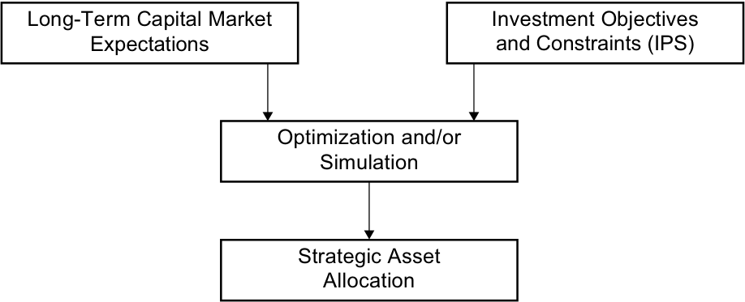
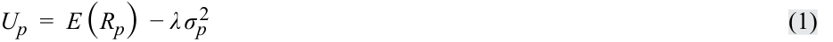
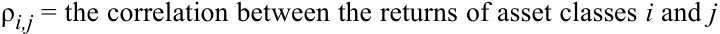
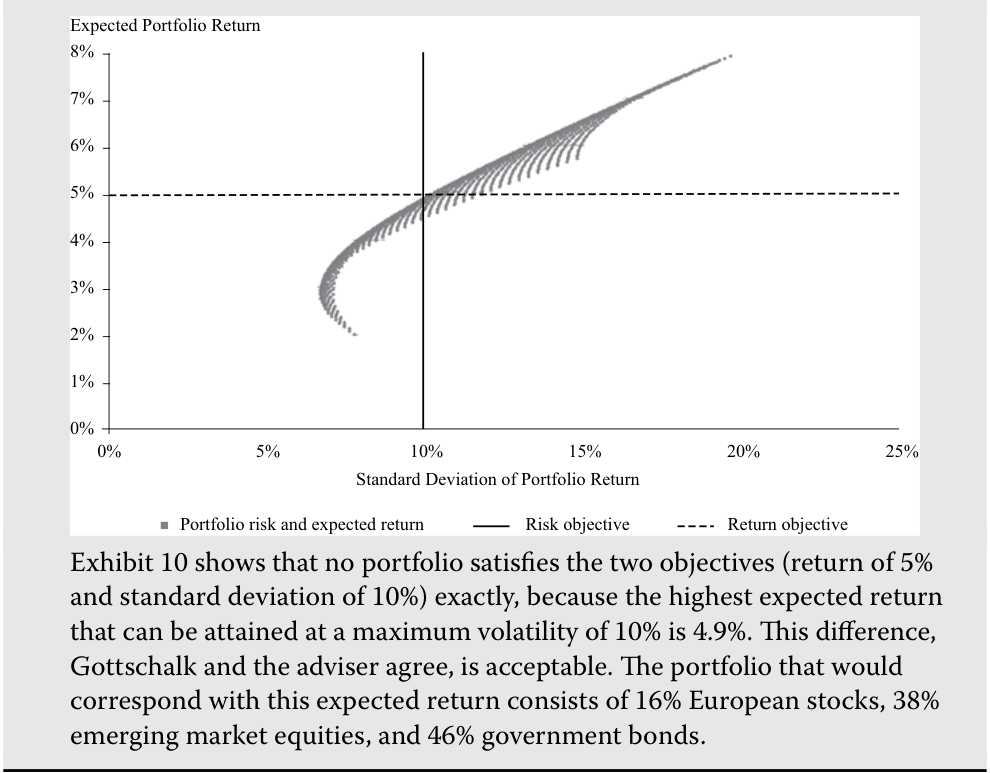

# Volume 9: Portfolio Management
## Learning Module 4 Basics of Portfolio Planning and Construction
### Part 2/3: Gathering Client Information (PDF Pages 185–200)

---

<!-- PDF Page 185 -->

less when equities do not perform well. Employees should similarly be wary of having concentrated share positions in the equity of the company where they work. If the employer encounters difficulties, not only may its employees lose their jobs but their investment portfolios could also suffer a significant loss of value. 

## **GATHERING CLIENT INFORMATION** 

# **<mark>5</mark>** 

describe risk and return objectives and how they may be developed for a client 

describe the investment constraints of liquidity, time horizon, tax concerns, legal and regulatory factors, and unique circumstances and their implications for the choice of portfolio assets 

As noted earlier, it is important for portfolio managers and investment advisers to know their clients. For example, in the EU, MiFID II requires financial intermediaries to undertake substantial fact finding. This is required not only in the case of full-service wealth management or in the context of an IPS but also in “lighter” forms of financial intermediation, such as advisory relationships (in which clients make investment decisions after consultation with their investment adviser or broker) or execution-only relationships (in which the client makes investment decisions independently). 

An exercise in fact finding about the customer should take place at the beginning of the client relationship. This process will involve gathering information about the client’s circumstances as well as discussing the client’s objectives and requirements. 

Important data to gather from a client should cover family and employment situation as well as financial information. If the client is an individual, it may also be necessary to know about the situation and requirements of the client’s spouse or other family members. The health of the client and her dependents is also relevant information. In an institutional relationship, it will be important to know about key stakeholders in the organization and what their perspective and requirements are. Information gathering may be done in an informal way or may involve structured interviews, questionnaires, or analysis of data. Many advisers will capture data electronically and use special systems that record data and produce customized reports. 

Good recordkeeping is very important and may be crucial in a case in which any aspect of the client relationship comes into dispute at a later stage. 

##### **EXAMPLE 7** 

### **Marie Gascon: Description of Constraints** 

Marie Gascon continues to discuss her investment requirements with her financial adviser. The adviser begins to draft the constraints section of the IPS. 

Gascon expects that she will continue to work for the oil company and that her relatively high income will continue for the foreseeable future. Gascon and her husband plan to have no additional children but expect that their son will go to a university at age 18. They expect that their son’s education costs can be met out of their salary income. 

Gascon’s emergency reserve of €100,000 is considered to be sufficient as a reserve for unforeseen expenditures and emergencies. Her retirement savings of €900,000 has been contributed to her defined-contribution pension plan account to fund her retirement. Under French regulation, pension fund contributions 

<!-- PDF Page 186 -->

are paid from gross income (i.e., income prior to deduction of tax), and pension fund returns are exempt from tax, but pension payments from a fund to retirees are taxed as income to the retiree. 

With respect to Gascon’s retirement savings portfolio, refer back to Example 2 as needed and address the following: 

1. As concerns liquidity, 

   - **A.** a maximum of 50% of the portfolio should be invested in liquid assets. 

   - **B.** the portfolio should be invested entirely in liquid assets because of high spending needs. 

   - **C.** the portfolio has no need for liquidity because there are no short-term spending requirements. 

#### **Solution:** 

C is correct. The assets are for retirement use, which is 20 years away. Any short-term spending needs will be met from other assets or income. 

2. The investment time horizon is closest to 

   - **A.** 5 years. 

   - **B.** 20 years. 

   - **C.** 40 years. 

#### **Solution:** 

B is correct. The relevant time horizon is to the retirement date, which is 20 years away. The assets may not be liquidated at that point, but a restructuring of the portfolio is to be expected as Gascon starts to draw an income from it. 

3. As concerns taxation, the portfolio 

   - **A.** should emphasize capital gains because income is taxable. 

   - **B.** should emphasize income because capital gains are taxable. 

   - **C.** is tax exempt and thus indifferent between income and capital gains. 

#### **Solution:** 

C is correct. Because no tax is paid in the pension fund, it does not matter whether returns come in the form of income or capital gains. 

4. The principle legal and regulatory factors applying to the portfolio are 

   - **A.** US securities laws. 

   - **B.** European banking laws. 

   - **C.** French pension fund regulations. 

#### **Solution:** 

C is correct. Management of the portfolio will have to comply with any rules relating to French pension funds. 

5. As concerns unique needs, the portfolio should 

   - **A.** have a high weighting in oil and other commodity stocks. 

   - **B.** be invested only in responsible and sustainable investments. 

<!-- PDF Page 187 -->

**C.** not have significant exposure to oil and other commodity stocks. 

#### **Solution:** 

C is correct. Gascon’s human capital (i.e., future labor income) is affected by the prospects of the oil industry. If her portfolio has significant exposure to oil stocks, she would be increasing a risk exposure she already has. 

Example 8, the final one based on Marie Gascon, shows how the information obtained from the fact-finding exercises might be incorporated into the objectives and constraints section of an IPS. 

##### **EXAMPLE 8** 

### **Marie Gascon: Outline of an IPS** 

Following is a simplified excerpt from the IPS the adviser prepares for Marie Gascon, covering objectives and constraints. 

##### **_Risk Objectives:_** 

- The portfolio may take on relatively high amounts of risk in seeking to meet the return requirements. With a 20-year time horizon and significant assets and income, the client has an above-average ability to take risk. The client is a knowledgeable investor, with an above-average willingness to take risk. Hence, the client’s risk tolerance is above average, explaining the aforementioned portfolio risk objective. 

- The portfolio should be well diversified with respect to asset classes and concentration of positions within an asset class. Although the client has above-average risk tolerance, his investment assets should be diversified to control the risk of catastrophic loss. 

##### **_Return Objectives:_** 

- The portfolio’s long-term return requirement is 6.2% per year, in nominal terms and net of fees, to meet the client’s retirement income goal. 

##### **_Constraints:_** 

- _Liquidity_ : The portfolio consists of pension fund assets, and there is no need for liquidity in the short to medium term. 

- _Time Horizon_ : The portfolio will be invested with a 20-year time horizon. The client intends to retire in 20 years, at which time an income will be drawn from the portfolio. 

- _Tax Status_ : Under French law, contributions to the fund are made gross of tax and returns in the fund are tax-free. Hence, the client is indifferent between income and capital gains in the fund. 

- _Legal and Regulatory Factors_ : Management of the portfolio must comply with French pension fund regulations. 

- _Unique Needs_ : The client is an executive in the oil industry. The portfolio should strive to minimize additional exposures to oil and related stocks. 

<!-- PDF Page 188 -->

# **<mark>6</mark>** 

## **PORTFOLIO CONSTRUCTION AND CAPITAL MARKET EXPECTATIONS** 

explain the specification of asset classes in relation to asset allocation describe the principles of portfolio construction and the role of asset allocation in relation to the IPS 

Once the IPS has been compiled, the investment manager can construct a suitable portfolio. Strategic asset allocation is a traditional focus of the first steps in portfolio construction. The strategic asset allocation is stated in terms of percentage allocations to asset classes. An **asset class** is a category of assets that have similar characteristics, attributes, and risk–return relationships. The **strategic asset allocation** (SAA) is the set of exposures to IPS-permissible asset classes that is expected to achieve the client’s long-term objectives given the client’s risk profile and investment constraints. An SAA could include a policy of hedging portfolio risks not explicitly covered by asset class weights. The obvious examples are hedge ratios for foreign currency exposure, or the management of interest rate risk resulting from asset-liability mismatch, and the hedging of inflation risk. So-called “overlay” portfolios of derivatives are often used for this purpose. 

The focus on the SAA is the result of a number of important investment principles. One principle is that a portfolio’s systematic risk accounts for most of its change in value over the long term. **Systematic risk** is risk related to the economic system (e.g., risk related to business cycle) that cannot be eliminated by holding a diversified portfolio. This risk is different from **nonsystematic risk** , defined as the unique risks of particular assets, which may be avoided by holding other assets with offsetting risks. A second principle is that the returns to groups of similar assets (e.g., long-term debt claims) predictably reflect exposures to certain sets of systematic factors (e.g., for the debt claims, unexpected changes in the interest rate). Thus, the SAA is a means of providing the investor with exposure to the systematic risks of asset classes in proportions that meet the risk and return objectives. 

The process of formulating a strategic asset allocation is based on the IPS, already discussed, and capital market expectations. 

### **Capital Market Expectations** 

**Capital market expectations** are the investor’s expectations concerning the risk and return prospects of asset classes, however broadly or narrowly the investor defines those asset classes. When associated with the client’s investment objectives, the result is the strategic asset allocation that is expected to allow the client to achieve his investment objectives (at least under normal capital market conditions). 

Traditionally, capital market expectations are quantified in terms of asset class expected returns, standard deviation of returns, and correlations among pairs of asset classes. Formally, the expected return of an asset class consists of the risk-free rate and one or more risk premium(s) associated with the asset class. Expected returns are in practice developed in a variety of ways, including the use of historical estimates, economic analysis, and various kinds of valuation models. Standard deviations and correlation estimates are frequently based on historical data and risk models. 

<!-- PDF Page 189 -->

## **STRATEGIC ASSET ALLOCATION** 

# **<mark>7</mark>** 

explain the specification of asset classes in relation to asset allocation describe the principles of portfolio construction and the role of asset allocation in relation to the IPS 

Traditionally, investors have distinguished cash, equities, bonds (government and corporate), and real estate as the major asset classes. In recent years, this list has been expanded with private equity, hedge funds, high-yield and emerging market bonds, and commodities. In addition, such assets as art and intellectual property rights may be considered asset classes for those investors prepared to take a more innovative approach and to accept some illiquidity. Combining such new asset classes as well as hedge funds and private equity under the header “alternative investments” has become accepted practice. 

As the strategic asset allocation is built up by asset classes, the decision about how to define those asset classes is an important one. Defining the asset classes also determines the extent to which the investor controls the risk and return characteristics of the eventual investment portfolio. For example, separating bonds into government bonds and corporate bonds, and then further separating corporate bonds into investment grade and non-investment grade (high yield) and government bonds into domestic and foreign government bonds, creates four bond categories. For these categories, risk–return expectations can be expressed and correlations with other asset classes (and, in an asset–liability management context, with the liabilities) can be estimated. An investment manager who wants to explicitly consider the risk–return characteristics of those bond categories in the strategic asset allocation may choose to treat them as distinct asset classes. Similarly, in equities, some investors distinguish between emerging market and developed market equities, between domestic and international equities, or between large-cap and small-cap equities. In some regulatory environments for institutional investors, asset class definitions are mandatory, thereby forcing investment managers to articulate risk–return expectations (and apply risk management) on the asset classes specified. Conversely, a broader categorization of asset classes leaves the allocation between different categories of bonds and equities, for example, to managers responsible for these asset classes. 

When defining asset classes, a number of criteria apply. Intuitively, an asset class should contain relatively homogeneous assets while providing diversification relative to other asset classes. In statistical terms, risk and return expectations should be similar, and paired correlations of assets should be relatively high within an asset class but should be lower versus assets in other asset classes. Also, the asset classes, while being mutually exclusive, should add up to a sufficient approximation of the relevant investable universe. Applying these criteria ensures that the strategic asset allocation process has considered all available investment alternatives. 

##### **EXAMPLE 9** 

### **Specifying Asset Classes** 

The strategic asset allocations of many institutional investors make a distinction between domestic equities and international equities or between developed market equities and emerging market equities. Often, equities are separated into different market capitalization brackets, resulting, for example, in an asset class such as domestic small-cap equity. 

<!-- PDF Page 190 -->

The correlation matrix in Exhibit 5 shows the paired correlations of monthly returns between different equity asset classes and other asset classes. Specifically, these correlations are measured over the period from December 2000 through August 2018. In addition, the exhibit shows the annualized volatility of monthly returns. 

##### **Exhibit 5: Asset Class Correlation Matrix** 

||||||**US Small-**||**European**|||**US High-**|
|---|---|---|---|---|---|---|---|---|---|---|
|**Correlations**|**US** **Equities**|**Emerging** **Markets**| **European** **Equities**|**Japanese** **Equities**|**Cap** **Equities**|**Commod-** **ities**|**Gov’t.** **Bonds**|**US** **Treasuries**|**US** **Credits**|**Yield** **Credit**|
|US Equities|1.00|0.78|0.88|0.59|0.89|0.32|0.08|–0.37|0.19|0.66|
|Emerging Markets Equities|0.78|1.00|0.84|0.64|0.75|0.46|0.21|–0.24|0.34|0.70|
|European Equities|0.88|0.84|1.00|0.64|0.79|0.43|0.16|–0.28|0.29|0.68|
|Japanese Equities|0.59|0.64|0.64|1.00|0.57|0.32|0.24|–0.18|0.29|0.52|
|US Small-Cap Equities|0.89|0.75|0.79|0.57|1.00|0.32|0.09|–0.36|0.19|0.69|
|Commodities|0.32|0.46|0.43|0.32|0.32|1.00|0.13|–0.18|0.12|0.36|
|European Gov’t. Bonds|0.08|0.21|0.16|0.24|0.09|0.13|1.00|0.45|0.60|0.30|
|US|–0.37|–0.24|–0.28|–0.18|–0.36|–0.18|0.45|1.00|0.58|–0.19|
|Treasuries|||||||||||
|US Credits|0.19|0.34|0.29|0.29|0.19|0.12|0.60|0.58|1.00|0.54|
|US High-Yield Credit|0.66|0.70|0.68|0.52|0.69|0.36|0.30|–0.19|0.54|1.00|
|Volatility|14.3%|21.6%|18.4%|15.6%|18.4%|22.3%|4.9%|4.4%|5.5%|9.3%|

_Correlations and volatilities have been calculated using monthly returns from December 2000 through August 2018, unhedged, in USD._ 

_Source:_ MSCI Bloomberg, S&P 

Based only on the information given, address the following: 

1. Contrast the correlations between equity asset classes with the correlations between equity asset classes and US Treasuries. 

#### **Solution:** 

The matrix reveals very strong correlation between the equity asset classes. For example, the correlation between European equities and US equities is 0.88. The correlation of equities with bonds, however, is much lower. For example, US equities, emerging markets equities, European equities, and Japanese equities all have negative correlation with US government bonds (–0.37, –0.24 and –0.28, and –0.18, respectively). It is worth noting, however, that correlations can vary through time and the values shown may be specific to the sample period used. 

<!-- PDF Page 191 -->

2. The monthly returns of which equity asset class differ the most from US equities? 

#### **Solution:** 

Among equity asset classes as listed in the table, the correlation between US and Japanese equities is the lowest, at 0.59. By contrast, correlations between US equities and emerging markets, European, and US small cap equities are 0.78 or higher. 

Using correlation as a metric, Example 9 tends to indicate that only emerging markets were well differentiated from European equities. So, why do investors still often subdivide equities? Apart from any regulatory reasons, one explanation might be that this decomposition into smaller asset classes corresponds to the way the asset allocation is structured in portfolios. Many investment managers have expertise exclusively in specific areas of the market, such as emerging market equities, US small-cap equity, or international investment-grade credit. Bringing the asset class definitions of the asset allocation in line with investment products actually available in the market may simplify matters from an organizational perspective. 

The risk–return profile of the strategic asset allocation depends on the expected returns and risks of the individual asset classes, as well as the correlation between those asset classes. In general, adding assets classes with low correlation improves the risk–return trade-off (more return for similar risk). Typically, the strategic asset allocation for risk-averse investors will have a large weight in government bonds and cash, whereas those with more willingness and ability to take risk will have more of their assets in risky asset classes, such as equities and many types of alternative investments. 

It is customary to represent asset classes using benchmarks and universes calculated by providers such as FTSE, MSCI, or Bloomberg. A negative screening or a **best-in-class** policy (discussed previously) limits the number of securities to choose from, potentially impacting the risk and expected return estimates for these asset classes. Some examples of exclusions may be controversial weaponry or tobacco companies, or investments in certain countries. When such exclusions apply, risk and return estimates based on non-traditional (“off-the-shelf”) asset class benchmarks may not be applicable. Separate benchmark indices reflecting the exclusions may be available from the providers to mitigate this issue. 

ABP is the pension fund for the Dutch government sector employees. The fund offers teachers, police officers, members of the military, and other civil servants a defined benefit pension plan, aiming for a pension of 70% of the average career real income for employees. As of the first quarter of 2018, ABP had €405 billion under management. The strategic asset allocation as of this period is shown in Exhibit 6. 

**Exhibit 6: Strategic Asset Allocation for ABP** 

|**Equity**||
|---|---|
|Equities, developed countries|27%|
|Equities, emerging markets|9%|
|**_Total equity_**|**_36%_**|

<!-- PDF Page 192 -->

|**Equity**||
|---|---|
|**Alternatives**||
|Real estate|10%|
|Private equity|5%|
|Hedge funds|4%|
|Commodities|5%|
|Infrastructure|3%|
|**_Total alternatives_**|**_27%_**|
|**Fixed-income securities**||
|Government bonds|13%|
|Corporate bonds|13%|
|Inflation-linked bonds|8%|
|l Emerging market bonds|3%|
|**_Total fixed income_**|**_37%_**|
|**_i_** Total|100%|

_Source:_ ABP Quarterly Report Q1 2018 

A strategic asset allocation results from combining the constraints and objectives articulated in the IPS and long-term capital market expectations regarding the asset classes. The strategic asset allocation or policy portfolio will subsequently be implemented into real portfolios. Exhibit 7 illustrates conceptually how investment objectives and constraints and long-term capital market expectations combine into a policy portfolio. 

**Exhibit 7: Strategic Asset Allocation Process** 

<!-- Start of picture text -->
Long-Term Capital Market Investment Objectives Expectations and Constraints (IPS) Optimization and/or Simulation Strategic Asset Allocation <!-- End of picture text -->

In some frameworks used in practice, the asset allocation is an integral part of the investment policy statement. This presentation, however, keeps the asset allocation separate from the investment policy statement because clients’ investment objectives and constraints qualitatively differ in nature from capital market expectations, thus requiring different types of analysis, different sources of information, and different review cycles. 

The combination of investment objectives/constraints and capital market expectations theoretically occurs using optimization techniques. In this section, we apply mean–variance optimization to a sample set of investment objectives and constraints, 

<!-- PDF Page 193 -->

using an investment universe with associated market expectations. We assume that investors choosing from a range of asset allocations with similar returns would prefer those with lower risk. Choosing from allocations with similar levels of risk, investors would prefer those with the highest return. Formally, investors’ risk and return objectives can be described as a utility function, in which utility increases with higher expected returns and lower risk. This assumption could yield an expected utility equation such as that shown in Equation 1.4 

<!-- Formula Text: U p  =  E (R p)  − λ σ p 2 (1) -->

where 

<!-- Formula Text: Up = the investor’s expected utility from the portfolio -->

_E_ ( _Rp_ ) = the expected return of the portfolio 

<!-- Formula Text: σp = the standard deviation of returns of the portfolio -->

λ = a measure of the investor’s risk aversion 

This utility function expresses a positive relationship between utility and expected portfolio return (i.e., higher expected return increases utility, all else equal) and a negative relationship between utility and volatility of portfolio return as measured by the variance of portfolio returns. The stronger the negative relationship, the greater the investor’s risk aversion. The portfolio is understood to represent a particular asset allocation. The asset allocation providing the highest expected utility is the one that is optimal for the investor given his or her risk aversion. 

For different values of _Up_ , a line can be plotted that links those combinations of risk and expected return that produces that level of utility: an indifference curve. An investor would attain equal utility from all risk–return combinations on that curve. 

Capital market expectations, specified in asset classes’ expected returns, standard deviations of return, and correlations, translate into an efficient frontier of portfolios. A multi-asset class portfolio’s expected return is given by 

<!-- Formula Text: E (R p)   =  ∑ i=1 n w i E (R i) (2) -->

where _wi_ equals the weight of asset class _i_ in the portfolio, and its risk is given by 

<!-- Formula Text: σ p  =  √ _______________________ ∑ i=1 n ∑ j=1 n w p,i w p,jCov (R i, R j) (3) -->

The covariance between the returns on asset classes _i_ and _j_ is given by the product of the correlation between the two asset classes and their standard deviations of return: Cov( _Ri_ , _Rj_ ) = ρ _i_ , _j_ σ _i_ σ _j_ ~~(4)~~ 

where 

Cov( _Ri_ , _Rj_ ) = the covariance between the return of asset classes _i_ and _j_ 

<!-- Formula Text: ρi,j = the correlation between the returns of asset classes i and j -->

The resulting portfolios can be represented as a scatter of dots in a chart depicting their risk and expected return. Because a portfolio’s risk is a positive function of the risk of its assets and the correlations among them, a portfolio consisting of risky assets with low correlation has lower risk than one with similarly risky assets with high correlation. It is therefore possible to construct different portfolios with equal expected returns but with different levels of risk. The line that connects those 

<!-- PDF Page 194 -->

portfolios with the minimal risk for each level of expected return (above that of the **minimum-variance portfolio** —the portfolio with the minimum variance for each given level of expected return) is the efficient frontier. Clearly, the efficient frontier will move “upward” as more low-correlation assets with sufficient expected return are added to the mix because it lowers the risk in the portfolios for equal expected returns. Similarly, when return expectations increase for asset classes while volatility and correlation assumptions remain unchanged, the efficient frontier will move upward because each portfolio is able to generate higher returns for the same level of risk. 

Both the efficient frontier and a range of indifference curves can be plotted in the risk–return space. In Exhibit 8, the dark-colored curves that are concave from below represent efficient frontiers associated with different assumed expected returns. The lighter-colored curves are indifference curves. The point where the efficient frontier intersects with the indifference curve with the highest utility attainable (i.e., the point of tangency) represents the optimal asset allocation for the client/investor. In Exhibit 8, efficient frontier 1 has a point of tangency with indifference curve 1. Higher levels of utility, such as those associated with indifference curve 0, can apparently not be reached with the assets underlying the efficient frontier. It is clear that when capital market expectations change, this change moves the efficient frontier away from its original location. In the chart, this movement is illustrated by efficient frontier 2, which incorporates different capital market expectations. This new efficient frontier has a point of tangency with indifference curve 2, which is associated with a lower level of expected utility. Because the point of tangency represents the strategic asset allocation, it implies the asset allocation should be adjusted. Similarly, should investment objectives or constraints change, the indifference curves will change their shape and location. This change will again move the point of tangency, and hence change the asset allocation. 

**Exhibit 8: Strategic Asset Allocation Efficient Frontier** 

<!-- Start of picture text -->
20% 18% 16% 14% 12% 10% 8% 6% 4% 2% 0% Standard Deviation of Portfolio Returns indifference curve 2 indifference curve 0 indifference curve 1 efficient frontier 1 efficient frontier 2 Expected Portfolio Returns 0% 1% 2% 3% 4% 5% 6% 7% 8% 9% 10% 11% 12% 13% 14% 15% 16% 17% 18% 19% 20% <!-- End of picture text -->

<!-- PDF Page 195 -->

This framework describes how investor objectives and capital market expectations should theoretically be reconciled. It will, however, not be the exact procedure that in practice will be followed. First, an IPS does not necessarily translate the client’s investment objectives and constraint into a utility function. Rather, an IPS gives threshold levels for risk and expected return, combined with a number of additional constraints that cannot be captured in this model. Second, the model illustrated is a single-period model, whereas in practice, the constraints from the IPS will make it more appropriate to use multi-period models. Multi-period problems can be more effectively addressed using simulation. 

##### **EXAMPLE 10** 

### **Approaching a SAA for a Private Investor** 

1. Rainer Gottschalk recently sold his local home construction company in the south of Germany to a large homebuilder with a nationwide reach. Upon selling his company, he accepted a job as regional manager for that nationwide homebuilder. Gottschalk is now considering his and his family’s financial future. He looks forward to his new job—he likes his new role, and the position provides him with income to fulfill his family’s short-term and medium-term liquidity needs. Gottschalk feels strongly that he should not invest the proceeds of the sale of his company in real estate because his income already depends on the state of the real estate market. Also, reflecting family values, he feels strongly that his savings should not support the tobacco industry. He therefore wants his equity allocation to exclude any stocks of tobacco product manufacturers or retailers. Gottschalk consults a financial adviser from his bank about how to invest his money to retire in good wealth in 20 years. 

The IPS developed by his adviser suggests a return objective of 5%, with a standard deviation of 10%. The bank’s asset management division provides Gottschalk and his adviser with the following data (Exhibit 9, Panel 1) on market expectations. The adviser estimates that excluding the tobacco industry from the investment universe affects expected equity returns of European equities by –0.2% and annual standard deviation by +0.1%. The impact on emerging market equities, and on the correlation structure, was considered negligible. Gottschalk accepts the results of these calculations as shown in Exhibit 9, Panel 2. 

**Exhibit 9: Risk, Return, and Correlation Estimates** 

||**Expected** **Return**|**Standard** **Deviation**|**Cor** **European** **Equities**|**relation Ma** **Emerg-** **ing Mkt** **Equities**|**trix** **European** **Govt** **Bonds**|
|---|---|---|---|---|---|
|**Panel 1**||||||
|European equities|6.0%|15.0%|1.00|0.78|_–_0.08|
|Emerging market equities|8.0%|20.1%|0.78|1.00|_–_0.07|
|European govern- ment bonds **Panel 2**|2.0%|7.8%|_–_0.08|_–_0.07|1.00|

<!-- PDF Page 196 -->

||**Expected** **Return**|**Standard** **Deviation**|**Cor** **European** **Equities**|**relation Ma** **Emerg-** **ing Mkt** **Equities**|**trix** **European** **Govt** **Bonds**|
|---|---|---|---|---|---|
|European equities|5.8%|15.1%|1.00|0.78|_–_0.08|
|Emerging market equities|8.0%|20.1%|0.78|1.00|_–_0.07|
|European govern- ment bonds|2.00%|7.8%|_–_0.08|_–_0.07|1.00|

_Standard deviation and correlation calculated over the period March 1999–August 2018. All data in unhedged euros._ 

_Sources:_ MSCI, Bloomberg 

To illustrate the possibilities, the adviser presents Gottschalk with the following plot (Exhibit 10), in which the points forming the shaded curve outline the risk–return characteristics of the portfolios that can be constructed out of the three asset classes. An imaginary line linking the points with the lowest standard deviation for each attainable level of return would be the efficient frontier. The two straight lines show the risk and return objectives. Gottschalk should aim for portfolios that offer an expected return of at least 6% (the straight horizontal line or above) and a standard deviation of return of 12% or lower (the straight vertical line to the left). 

##### **Exhibit 10: Efficient Frontier** 

<!-- Start of picture text -->
Expected Portfolio Return 8% 7% 6% 5% 4% 3% 2% 1% 0% 0% 5% 10% 15% 20% 25% Standard Deviation of Portfolio Return Portfolio risk and expected return Risk objective Return objective Exhibit 10 shows that no portfolio satisfies the two objectives (return of 5% and standard deviation of 10%) exactly, because the highest expected return that can be attained at a maximum volatility of 10% is 4.9%. This difference, Gottschalk and the adviser agree, is acceptable. The portfolio that would correspond with this expected return consists of 16% European stocks, 38% emerging market equities, and 46% government bonds. <!-- End of picture text -->

<!-- PDF Page 197 -->

## **PORTFOLIO CONSTRUCTION PRINCIPLES** 

# **<mark>8</mark>** 

describe the principles of portfolio construction and the role of asset allocation in relation to the IPS 

The strategic asset allocation in itself does not yet represent an actual investment portfolio. It is the first step in implementing an investment strategy. For quantitatively oriented portfolio managers, the next step is often risk budgeting. 

As used in this reading, **risk budgeting** is the process of deciding on the amount of risk to assume in a portfolio (the overall risk budget) and subdividing that risk over the sources of investment return (e.g., strategic asset allocation, tactical asset allocation, and security selection). Because the decision about the total amount of risk to be taken is made in constructing the IPS, at this stage we are concerned about the subdivision of that risk. 

Apart from the exposures to systematic risk factors specified in the strategic asset allocation, the returns of an investment strategy depend on two other sources: tactical asset allocation and security selection. **Tactical asset allocation** is the decision to deliberately deviate from the policy exposures to systematic risk factors (i.e., the policy weights of asset classes) with the intent to add value based on forecasts of the near-term returns of those asset classes. For instance, an investor may decide to temporarily invest more of the portfolio in equities than the SAA prescribes if the investor anticipates that equities will deliver a higher return over the short term than other asset classes. **Security selection** is an attempt to generate higher returns than the asset class benchmark by selecting securities with a higher expected return. For example, an investment manager may decide to add more IBM stock in her portfolio than the weight in her equity benchmark if she expects this stock to do better than the benchmark. To fund this purchase, she may sell another stock expected to do worse than either the benchmark or IBM. Obviously, deciding to deviate from policy weights or to select securities aiming to beat the benchmark creates additional uncertainty about returns. This risk is over and above the risk inherent in the policy portfolio. Hence, an investment policy should set risk limits and desired payoffs for each of these three activities. 

Risk budgeting implies that the portfolio manager has to choose, for every asset class, whether to deploy security selection as a return generator. This choice is generally referred to as the choice between active or passive management. Contrary to strategic asset allocation, where exposures to sources of systematic risk are selected and sized, security selection is not rewarded with a long-run payoff to risk. Security selection is a zero-sum game: All investors in an asset class are competing with each other to identify a typically limited number of assets that are misvalued. In total, the gross returns of all market participants average out to the market return (the reward for taking systematic risk). This implies that the average active investor will match the market return and that one investor’s gain versus the market return is the other investor’s loss versus the market return. Because active managers tend to trade more and have to pay people (including themselves) to generate investment ideas or information leading to such ideas, however, the average active manager will underperform the market, net of costs. This fact does not imply that there are no skillful investment managers who, with some consistency, beat their benchmarks. Neither does it imply that all passive managers will be able to match the benchmark. The higher the turnover of an index, the more trading costs a passive manager will incur, making the task of matching the return of an index more difficult. 

<!-- PDF Page 198 -->

The likelihood of adding a significant amount of value from security selection depends on the skills of the manager and the informational efficiency of the market for the asset class his skill relates to. The more efficient an asset class or a subset of that asset class (such as a regional stock, bond, or real estate market or a size category within the stock market), the more skillful an asset manager has to be to add value. Broadly speaking, an efficient market is a market in which prices, on average, very quickly reflect newly available information. That requires a sizeable participation of investors trading risk against expected return, acting on rational expectations, using the same or similar pricing models, and having equal opportunities to access relevant information. Clearly, the market for US large-capitalization equities would be quite efficient. By contrast, some regional bond and equity markets do not have the technical and regulatory systems for information dissemination that are sufficient to serve all investors on a timely basis. Skilled managers should be able to exploit the resulting inefficiencies. 

Sometimes the choice between active and passive management is actually made implicitly when the asset class is included in the asset allocation. The markets for some assets—such as those for non-listed real estate and infrastructure assets—are so illiquid that it is very difficult to buy a diversified exposure. As a result, participating in that market is not possible without engaging in security selection. 

As the portfolio is constructed and its value changes with the returns of the asset classes and securities in which it is invested, the weights of the asset classes will gradually deviate from the policy weights in the strategic asset allocation. This process is referred to as drift. Periodically, or when a certain threshold deviation from the policy weight (the bandwidth) has been breached, the portfolio should be rebalanced back to the policy weights. The set of rules that guide the process of restoring the portfolio’s original exposures to systematic risk factors is known as the **rebalancing policy** . Even absent a formal risk budget, formulating a rebalancing policy is an important element of risk management, as the following example illustrates. 

##### **EXAMPLE 11** 

### **Strategic and Tactical Asset Allocation for a European Charity** 

A European charity has an asset allocation at the beginning of the year consisting of the asset classes and weights shown in Exhibit 11. 

**Exhibit 11: Asset Allocation of a European Charity (beginning of** 

**year)** 

|**Asset Class**|**Policy** **Weight**|**Corridor** **(+/–)**|**Upper** **Limit**|**Lower** **Limit**|
|---|---|---|---|---|
|European equities|30.0%|2.0%|32.0%|28.0%|
|International equities|15.0%|2.0%|17.0%|13.0%|
|European government bonds|20.0%|2.0%|22.0%|18.0%|
|Corporate bonds|20.0%|2.0%|22.0%|18.0%|
|Cash and money market|15.0%|2.0%|17.0%|13.0%|
|instruments|||||
|Total|100.0%||||

As Exhibit 11 reveals, the charity has a policy that the asset class weights cannot deviate from the policy weights by more than 2% (the corridor). The resulting upper and lower limits for the asset class weights are shown in the 

<!-- PDF Page 199 -->

rightmost columns of the table. There are two reasons for asset class actual weights to deviate from policy weights: by deliberate choice (tactical asset allocation or market timing) and as a result of divergence of the returns of the different asset classes (drift). In this example, the asset class weights start the year exactly in line with policy weights. 

After half a year, the investment portfolio is as shown in Exhibit 12. 

**Exhibit 12: Asset Allocation for a European Charity (six months later)** 

|**Asset Class**|**Policy** **Weight**|**Cor-** **ridor** **(+/–)**|**Upper** **Limit**|**Lower** **Limit**|**Period** **Return**|**Ending** **Weight**|
|---|---|---|---|---|---|---|
|European equities|30.0%|2.0%|32.0%|28.0%|15.0%|32.4%|
|International equities|15.0%|2.0%|17.0%|13.0%|10.0%|15.5%|
|European government bonds|20.0%|2.0%|22.0%|18.0%|0.5%|18.9%|
|Corporate bonds|20.0%|2.0%|22.0%|18.0%|1.5%|19.1%|
|Cash and money mar-|15.0%|2.0%|17.0%|13.0%|1.0%|14.2%|
|ket instruments|||||||
|Total|100.0%||||6.6%|100.0%|

1. Discuss the returns of the portfolio and comment on the main asset weight changes. 

#### **Solution:** 

The investment portfolio generated a return calculated on beginning (policy) weights of 6.55%, rounded to 6.6% (= 0.30 × 15% + 0.15 × 10% + 0.20 × 0.5% + 0.20 × 1.5% + 0.15 × 1.0%), mainly driven by a strong equity market. Bond returns were more subdued, leading to considerable drift in asset class weights. In particular, the European equity weight breached the upper limit of its allowed actual weight. 

2. The investment committee decides against reducing European equities back to policy weight and adding to the fixed income and cash investments toward policy weights. Although this rebalancing would be prudent, the committee decides to engage in tactical asset allocation based on the view that this market will continue to be strong over the course of the year. It decides to just bring European equities back to within its bandwidth (a 32% portfolio weight) and add the proceeds to cash. Exhibit 13 shows the outcome after another half year. 

**Exhibit 13: Asset Allocation for a European Charity (an additional six months later)** 

|**Asset Class**|**Policy** **Weight**|**Starting** **Weight**|**Corridor** **(+/–)**|**Upper** **Limit**|**Lower** **Limit**|**Period** **Return**|**Ending** **Weight**|
|---|---|---|---|---|---|---|---|
|European equities|30.0%|32.0%|2.0%|32.0%|28.0%|–9.0%|29.7%|
|International equities|15.0%|15.5%|2.0%|17.0%|13.0%|–6.0%|14.9%|
|European government bonds|20.0%|18.9%|2.0%|22.0%|18.0%|4.0%|20.0%|
|Corporate bonds|20.0%|19.1%|2.0%|22.0%|18.0%|4.0%|20.2%|

<!-- PDF Page 200 -->

|**Asset Class**|**Policy** **Weight**|**Starting** **Weight**|**Corridor** **(+/–)**|**Upper** **Limit**|**Lower** **Limit**|**Period** **Return**|**Ending** **Weight**|
|---|---|---|---|---|---|---|---|
|Cash and money market|15.0%|14.6%|2.0%|17.0%|13.0%|2.0%|15.2%|
|instruments||||||||
|Total|100.0%|||||–2.0%|100.0%|

The prior decision not to rebalance to policy weights did not have a positive result. Contrary to the investment committee’s expectations, both European and international equities performed poorly while bonds recovered. The return of the portfolio was −2.0%. 

How much of this return can be attributed to tactical asset allocation? 

#### **Solution:** 

Because tactical asset allocation is the deliberate decision to deviate from policy weights, the return contribution from tactical asset allocation equals the difference between the actual return and the return that would have been made if the asset class weights were equal to the policy weights. Exhibit 14 shows this difference to be −0.30%. 

**Exhibit 14: Returns to Tactical Asset Allocation** 

||**Policy** **Weight**|**Starting** **Weight**|**Weights** **Difference**|**Period** **Return**|**TAA Contribu-** **tion**|
|---|---|---|---|---|---|
|**Asset Class**|**I**|**II**|**III (= II – I)**|**IV**|**V(= III × IV)**|
|European equities|30.0%|32.0%|2.0%|–9.0%|–0.18%|
|International equities|15.0%|15.5%|0.5%|–6.0%|–0.03%|
|European govern- ment bonds|20.0%|18.9%|–1.1%|4.0%|–0.05%|
|Corporate bonds|20.0%|19.1%|–0.9%|4.0%|–0.04%|
|Cash and money market instruments|15.0%|14.6%|–0.4%|2.0%|–0.01%|
|Total|100.0%|||–2.0%|–0.30%|

The process of executing an investment strategy continues with selecting the appropriate manager(s) for each asset class and allocating funds to them. The investment portfolio management process is then well into the execution stage. 

The investment managers’ performance will be monitored, as well as the results of the tactical and strategic asset allocation. When asset class weights move outside their corridors, money is transferred from the asset classes that have become too large compared with the SAA to those that fall short. Managers as well as the strategic asset allocation will be reviewed on the basis of the outcome of the monitoring process. In addition, capital market expectations may change, as may the circumstances and objectives of the client. These changes could result in an adjustment of the strategic asset allocation. 

