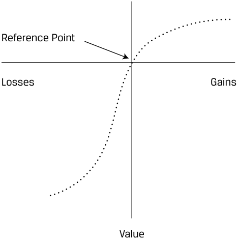

# Volume 9: Portfolio Management
## Learning Module 5 The Behavioral Biases of Individuals
### Part 2/3: Emotional Biases (PDF Pages 227–242)

---

<!-- PDF Page 227 -->

- **C.** Mental accounting 

- **Solution:** 

B is correct. Confirmation bias refers to the tendency to seek confirming information and ignore contradictory information. Gerber did not adequately interpret the scientific results or the broader message of the article, choosing instead to focus on the reassuring concluding message that confirmed his existing beliefs. 

5. Gerber’s conclusion, upon re-examining ABC’s history, is most likely an example of which behavioral bias? 

   - **A.** Confirmation 

   - **B.** Hindsight 

**C.** Conservatism 

##### **Solution:** 

B is correct. Hindsight bias is the result of selectively interpreting the past using knowledge of the present. Although Gerber should have implemented various mitigation strategies over the life of the investment, it is also true that investing, especially investing in a small-cap biotechnology company, is a probabilistic activity. Had Project M succeeded, Gerber may have been tempted to see the investment as evidence of his investment acumen, which would also be biased. The most useful examination of the past for Gerber would be investigating whether any mitigating actions or strategies would have been useful and putting them in place for subsequent investments. 

### **EMOTIONAL BIASES** 

**<mark>4</mark>** 

discuss commonly recognized behavioral biases and their implications for financial decision making 

We will now review six emotional biases, their implications for investment decision making, and suggestions for managing the effects of these biases. Emotional biases are harder to correct than cognitive errors because they originate from impulse or intuition rather than conscious calculations. It is often possible only to recognize the bias and adapt to it. The six emotional biases discussed are loss aversion, overconfidence, self-control, status quo, endowment, and regret aversion. 

#### **Loss-Aversion Bias** 

**Loss-aversion bias** refers to the tendency to strongly prefer avoiding losses to achieving gains. Rational FMPs should accept more risk to increase gains, not to mitigate losses. Paradoxically, in real life, FMPs instead tend to accept more risk to avoid losses than to achieve gains. Loss aversion leads FMPs to hold their losers to avoid recognizing losses and sell their winners to lock in profits. 

Kahneman and Tversky (1979) describe loss-averse investor behavior as the evaluation of gains and losses based on a reference point. A utility function that passes through this reference point appears in Exhibit 1. It is S-shaped and asymmetric, implying a greater impact of losses than of gains on utility for the same variation in absolute value. This utility function implies risk-seeking behavior in the domain of 

<!-- PDF Page 228 -->

losses (below the horizontal axis) and risk avoidance in the domain of gains (above the horizontal axis). An important concept embedded in this utility representation is what has been termed the **disposition effect** : the holding of investments that have experienced losses too long, and the selling of investments that have experienced gains too quickly (i.e., holding on to losers and selling winners). The resulting portfolio may be riskier than the optimal portfolio based on the investor’s risk–return objectives. 

##### **Exhibit 1: Value Function of Loss Aversion** 

<!-- Start of picture text -->
Reference Point Losses Gains Value <!-- End of picture text -->

##### **EXAMPLE 10** 

#### **Effects of Loss-Aversion Bias** 

Loss-aversion bias, executed in practice as the disposition effect, is observed often by wealth management practitioners. The classic case of this bias is when an investor opens her monthly account statement and scans the individual investments for winners and losers. Seeing that some investments have lost money and others have gained, the investor is likely to respond by continuing to hold the losing investments. The idea of actually losing money is so painful that the first reaction is to hold the investment until it breaks even. 

The investor is acting based on emotions, not cognitive reasoning. In this case, if she did some research, the investor might learn that the company in question is experiencing difficulty and that holding the investment actually adds to the risk in the portfolio (hence the term risk-seeking in the domain of losses). 

Conversely, the winners are making money. Loss-averse FMPs tend to sell these investments and realize their gains to avoid seeing gains evaporate. In this case, if the investor did some research, she might learn that the company in question actually improves the portfolio’s risk–return profile. By selling the investment, not only is the potential for future losses eliminated but the potential for future gains is also eliminated. Combining the added risk of holding the losers with the elimination of potential gains from selling the winners may make investors’ portfolios less efficient than portfolios based on fundamental analysis. 

<!-- PDF Page 229 -->

##### **Consequences of Loss Aversion** 

As a result of loss-aversion bias, FMPs may do the following: 

- Hold investments in a loss position longer than justified by fundamental analysis, in the hope that they will return to breakeven. 

- Sell investments in a gain position earlier than justified by fundamental analysis, out of fear that the gains will erode. 

##### **Detection of and Guidelines for Overcoming Loss Aversion** 

A disciplined approach to investment is a good way to alleviate the impact of the loss-aversion bias. It is impossible to make experiencing losses any less painful emotionally, but analyzing investments and realistically considering the probabilities of future losses and gains may help guide the FMP to a rational decision. 

#### **Overconfidence Bias** 

**Overconfidence bias** is a bias in which people demonstrate unwarranted faith in their own abilities. Overconfidence may be intensified when combined with **self-attribution bias** , in which people take too much credit for successes ( _self-enhancing_ ) and assign responsibility to others for failures ( _self-protecting_ ). Overconfidence has aspects of both cognitive and emotional errors but is classified as emotional because the bias primarily results from emotion. 

Overconfidence bias has two forms: _prediction overconfidence_ and _certainty overconfidence_ . Both types demonstrate faulty reasoning combined with “gut feel” and hope. Prediction overconfidence occurs when the confidence intervals that FMPs assign to their investment predictions are too narrow. For example, when estimating the future value of a stock, overconfident FMPs will incorporate far too little variation—using a narrower range of expected payoffs and a lower standard deviation of returns—than justified by historical results and fundamental analysis. 

Certainty overconfidence occurs when the probabilities that FMPs assign to outcomes are too high. This certainty is often an emotional response rather than a cognitive evaluation. 

##### **EXAMPLE 11** 

#### **Overconfidence Bias** 

An analyst estimates that the price of oil will increase by 40% over the next 12 months because prevailing prices are lower than many oil producers’ cost of production. Unprofitable producers reducing production will eventually put upward pressure on prices so long as oil demand remains stable or increases. Based on this forecast, the analyst recommends several high-yield bonds of oil producers to a portfolio manager. 

The portfolio manager asks the analyst for an estimate of downside risk: “How much could we lose if, say, the oil price falls another 10%?” The analyst replies, “That is unrealistic. The current oil price is as low as it can go, and yields on these bonds are as attractive as they will ever be. We must make the investment now. There is no credible downside case.” 

The analyst is exhibiting overconfidence bias by placing excessive certainty in his prediction and not considering the likelihood or impact of variance from that prediction. 

<!-- PDF Page 230 -->

##### **Consequences of Overconfidence Bias** 

As a result of overconfidence bias, FMPs may do the following: 

- Underestimate risks and overestimate expected returns. 

- Hold poorly diversified portfolios, which may result in significant downside risk. 

##### **Detection of and Guidelines for Overcoming Overconfidence Bias** 

FMPs should review their trading records, identify _both_ the winners and losers, and calculate portfolio performance over at least two years. Investors with an unfounded belief in their own ability to identify good investments may recall winners and their results but underestimate the number and results of their losers. This review will also identify the amount of trading. Overconfidence is also a cognitive error, and so more-complete information can often help FMPs understand the error of their ways. 

It is critical that investors be objective when making and evaluating investment decisions. As an old Wall Street adage states, “Don’t confuse brains with a bull market.” It is advisable to view the reasoning behind and the results of investments, both winners and losers, as objectively as possible. When did you make money? When did you lose money? Mentally separate your good money-making decisions from your bad ones. Then, review the beneficial decisions and try to discern what, exactly, you did correctly. Did you purchase an investment at a particularly advantageous time based on fundamentals, or did you luck out by timing a market upswing? Similarly, review the decisions that you categorized as poor. Did you invest aptly based on fundamentals and then make an error when it came time to sell, or was the market going through a correction? 

When reviewing unprofitable decisions, look for patterns or common mistakes that perhaps you were unaware you were making. Note any such tendencies that you discover, and try to remain mindful of them by brainstorming a rule or reminder such as: “I will do X in the future” or “I will not do Y in the future.” 

#### **Self-Control Bias** 

**Self-control bias** is a bias in which people fail to act in pursuit of their long-term, overarching goals in favor of short-term satisfaction. For example, individuals pursuing the CFA charter may fail to study sufficiently because of short-term competing demands on their time. Rational behavior suggests that people would do whatever is necessary to achieve their long-term goals, but it often does not happen. 

When it comes to money, many people are willing and able to save for the future, but they often have difficulty sacrificing present consumption because of a lack of self-control. This apparent lack of self-control may also be a function of hyperbolic discounting, the human tendency to prefer small payoffs now compared with larger payoffs in the future. Sacrifices in the present require much greater payoffs in the future; otherwise, people will be unwilling to make current sacrifices. 

##### **Consequences of Self-Control Bias** 

As a result of self-control bias, FMPs may do the following: 

- Save insufficiently for the future, which may, in turn, result in accepting too much risk in portfolios in an attempt to generate higher returns. 

- Borrow excessively to finance present consumption. 

<!-- PDF Page 231 -->

##### **Detection of and Guidelines for Overcoming Self-Control Bias** 

FMPs should ensure that a proper investment plan is in place and should have a personal budget. Plans need to be in writing, so that they can be reviewed regularly. Similarly, FMPs should look to maintain a strategic asset allocation based on a thorough evaluation. 

#### **Status Quo Bias** 

**Status quo bias** is an emotional bias in which people choose to do nothing (i.e., maintain the “status quo”) instead of making a change, even when change is warranted. Status quo bias is often discussed in tandem with endowment and regret-aversion biases because an outcome of the biases, maintaining existing positions, is similar. The reasons for maintaining the existing positions differ, however. In the status quo bias, positions are maintained largely because of inertia rather than conscious choice. In endowment and regret-aversion biases, positions are maintained because of conscious, but possibly incorrect, choices. 

##### **EXAMPLE 12** 

#### **The Path of Least Resistance** 

Using data from three firms, Choi et al. (2001) studied the impact of automatically enrolling employees in a defined contribution pension plan and how default contribution rates and investment options affect participants’ behavior. 

Automatic enrollment increased employee participation in the defined contribution plan from 26%–43% after six months’ tenure and 57%–69% after three years’ tenure to >85% for both tenures at all three firms. 

Although automatic enrollment increased participation, more than 65% of employees tended to contribute the employer-specified default amount—2% or 3%—and remained in the default investment option. Although this percentage declined slowly over time, even after two years of tenure, more than 40% of participants continued to use the default. 

##### **Consequences of Status Quo Bias** 

As a result of status quo bias, FMPs may do the following: 

- Unknowingly maintain portfolios with risk characteristics that are inappropriate for their circumstances. 

- Fail to explore other opportunities. 

##### **Detection of and Guidelines for Overcoming Status Quo Bias** 

Status quo bias may be exceptionally strong and difficult to overcome. Education is essential. FMPs should quantify the risk-reducing and return-enhancing advantages of diversification and proper asset allocation. For example, with a concentrated stock position, showing what can happen to overall wealth levels if the stock collapses may persuade an FMP to diversify. 

<!-- PDF Page 232 -->

#### **Endowment Bias** 

**Endowment bias** is an emotional bias in which people value an asset more when they own it than when they do not. Endowment bias is inconsistent with standard economic theory, which asserts that the price a person is _willing to pay_ for a good should equal the price at which that person would be _willing to sell_ the same good. Psychologists have found, however, that people tend to state minimum selling prices for a good that exceed maximum purchase prices that they are willing to pay for the same good. Effectively, ownership “endows” the asset with added value. 

Endowment bias may be the result of several other behavioral biases, such as loss aversion, anchoring and adjustment, and overconfidence. Despite the name, purchased as well as inherited securities can be subject to endowment bias. 

##### **EXAMPLE 13** 

#### **Endowment Bias** 

Several of an investment analyst’s recommended stocks have done well for the past five years, prompting the portfolio manager to ask for a brief update on each, including valuations. For each stock, the analyst estimates that fair value is at least another 40% above the current price. The portfolio manager challenges the analyst by pointing out that the fair value estimates imply valuation multiples that are at least two standard deviations above the five-year average and are well above even the most bullish sell-side analyst’s target price. The analyst responds by saying that the market is overlooking these companies’ fundamentals. The portfolio manager then asks, “Would you buy these shares today?” The analyst answers, “Probably not.” 

The analyst is likely exhibiting endowment bias by overestimating the value of shares already owned in the portfolio. This bias is likely the result of having successfully invested in the shares. 

##### **Consequences of Endowment Bias** 

Endowment bias may lead FMPs to do the following: 

- Fail to sell certain assets and replace them with other assets. 

- Continue to hold classes of assets with which they are familiar. FMPs may believe they understand the characteristics of the investments they already own and may be reluctant to purchase assets with which they have less experience. Familiarity adds to owners’ perceived value of a security. 

- As a result, the FMP may maintain an inappropriate asset allocation. The portfolio may be inappropriate for investors’ levels of risk tolerance and financial goals. 

##### **Detection of and Guidelines for Overcoming Endowment Bias** 

Many wealth management practitioners have encountered clients who are reluctant to sell securities bequeathed by previous generations. Often in these situations, investors cite feelings of disloyalty associated with the prospect of selling inherited securities, general uncertainty in determining the right choice, and concerns about tax issues. An FMP should ask, “If an equivalent sum to the value of the investments inherited had been received in cash, how would you invest the cash?” Often, the answer is into a very different investment portfolio than the one inherited. It may also be useful to explore the deceased’s intent in owning the investment and bequeathing it. “Was the 

<!-- PDF Page 233 -->

primary intent to leave the specific investment portfolio because it was perceived to be a suitable investment based on fundamental analysis, or was it to leave financial resources to benefit the heirs?” Heirs who affirm the latter conclusion are receptive to considering alternative asset allocations. 

An effective way to address endowment bias for purchased securities, when an estimated “sell price” is far higher than any reasonable FMP’s estimate of a “buy price” is to ask, “Would you buy this security today at the current price?” A similar question is, “Why are you not buying more of this security today?” Answering these questions can turn the focus away from the past to the present, toward considering the upside from the current price. 

#### **Regret-Aversion Bias** 

**Regret-aversion bias** is an emotional bias in which people tend to avoid making decisions out of fear that the decision will turn out poorly. Regret-aversion bias has two dimensions: actions that people take and actions that people _could have_ taken. Regret is more intense when the unfavorable outcomes are the result of an action taken versus the result of an action not taken. Thus, no action becomes the default decision. 

##### **Consequences of Regret-Aversion Bias** 

As a result of regret-aversion bias, FMPs may do the following: 

- Be too conservative in their investment choices as a result of poor outcomes on risky investments in the past. FMPs may wish to avoid the regret of making another bad investment and decide that low-risk instruments are better. This behavior can lead to long-term underperformance and failure to reach investment goals. 

- Engage in herding behavior. FMPs may feel safer in popular investments in order to limit potential future regret. It seems safe to be with the crowd, and a reduction in potential emotional pain is perceived. Regret aversion may lead to preference for stocks of well-known companies even in the face of equal risk and return expectations. Choosing the stocks of less-familiar companies is perceived as riskier and involves more personal responsibility and greater potential for regret. As John Maynard Keynes (1936) wrote, “Worldly wisdom teaches that it is better for reputation to fail conventionally than to succeed unconventionally.” 

##### **Detection of and Guidelines for Overcoming Regret-Aversion Bias** 

FMPs should quantify the risk-reducing and return-enhancing advantages of diversification and proper asset allocation. Regret aversion can cause some FMPs to invest too conservatively or too riskily depending on the current trends. With proper diversification, FMPs will accept the appropriate level of risk in their portfolios depending, of course, on return objectives. To prevent investments from being too conservative, FMPs must recognize that losses happen to everyone and keep in mind the long-term benefits of including risky assets in portfolios. Recognizing that bubbles happen and keeping in mind long-term objectives will prevent a client from making investments that are too risky. 

<!-- PDF Page 234 -->

##### **EXAMPLE 14** 

Tiffany Jordan is a hedge fund manager with a history of outstanding performance. For the past 10 years, Jordan’s fund has used an equity market–neutral strategy (a long–short strategy that strives to eliminate market risk—i.e., beta should be zero), which has proved effective as a result of Jordan’s hard work. An equity market–neutral strategy normally generates large daily trading volume and shifts in individual security positions. Jordan’s reputation has grown over the years as her fund has consistently beaten its benchmark. Employee turnover on her team has been high; Jordan tends to be quick to blame and rarely gives credit to team members for success. During the past 12 months, her fund has been significantly underperforming its benchmark. 

One of Jordan’s junior analysts, Jeremy Tang, is concerned about the underperformance and notes the following: 

Observation 1: Certain positions are significantly underwater, have very high risk profiles, and have been held for much longer than normal. 

Observation 2: The fund’s trading volume has decreased by more than 40% during the past year. 

Observation 3: The portfolio is more concentrated in a few sectors than in the past. 

Worried that the portfolio may be in violation of the fund’s investment policy statement (IPS), Tang brings this concern to Jordan’s attention during a regular weekly team meeting. Jordan dismisses Tang’s analysis and tells the team not to worry because she knows what she is doing. Jordan indicates that because she believes the pricing misalignment will correct itself, the portfolio would be unable to take advantage of the reversion to the mean if she were to sell certain losing positions. She reassures the team that this strategy has performed well in the past and that the markets will revert, bringing the fund’s returns back to normal levels. 

Tang tactfully suggests that the team review the fund’s IPS together, and Jordan interrupts him and reminds the team that she has memorized the IPS by heart. Tang contemplates his next step. He is concerned that Jordan is displaying behavioral biases that are affecting the fund’s performance. 

1. By taking credit for successes but assigning blame for failures, Jordan is _most likely_ demonstrating: 

   - **A.** loss-aversion bias. 

   - **B.** self-attribution bias. 

   - **C.** illusion of control bias. 

   - **Solution:** 

B is correct. In self-attribution bias, people take credit for successes and assign responsibilities for failure. Jordan claims successful decisions for herself while attributing poor decisions to the team. Her self-esteem affects how she looks at success and failure. Self-attribution and illusion of knowledge biases contribute to overconfidence bias, which Jordan clearly demonstrates later when she tells the team that she knows what she is doing. 

2. Which of Tang’s observations is _least likely_ to be the consequence of Jordan demonstrating loss-aversion bias? 

   - **A.** Observation 1 

**B.** Observation 2 

<!-- PDF Page 235 -->

##### **C.** Observation 3 

##### **Solution:** 

C is correct. Loss aversion by itself may cause a sector concentration; however, a market-neutral strategy tends to focus on individual stocks without regard to sector. The sector exposure would be mitigated with the balancing of the individual long and short positions. 

3. Which of Jordan’s actions _least_ supports that she may be affected by the illusion of control bias? 

   - **A.** Her dismissal of Tang’s analysis 

   - **B.** Her routine of holding weekly team meetings 

   - **C.** Her comment on market turnaround and current holdings 

   - **Solution:** 

B is correct. Holding weekly team meetings, which indicates a willingness to listen to feedback from others, is not representative of the illusion of control bias. In the illusion of control bias, people believe they can control outcomes to a greater extent than is possible. Individuals exhibiting this bias display great certainty in their predictions of outcomes of chance events and ignore others’ viewpoints. Jordan is sure that the market will turn around even though it is out of her control. She chooses not to listen to Tang, who is questioning her viewpoint. 

4. How does Jordan _most likely_ demonstrate loss-aversion bias? 

   - **A.** Telling the team not to worry 

   - **B.** Reducing the portfolio turnover this year 

   - **C.** Deciding to hold the losing positions until they turn around 

   - **Solution:** 

C is correct. Jordan’s behavior is a classic example of loss aversion: When a loss occurs, she holds on to these positions longer than warranted. By doing so, Jordan has accepted more risk in the portfolio. In loss-aversion bias, people exhibit a strong preference to avoid losses versus achieving gains. One of the consequences of loss aversion bias is that the financial management professional (in this case, Jordan) may hold losing investments in the hope that they will return to breakeven or better. 

5. Which of the following emotional biases has Jordan _most likely_ exhibited? 

   - **A.** Endowment 

   - **B.** Regret aversion 

   - **C.** Overconfidence 

##### **Solution:** 

C is correct. Jordan exhibits overconfidence in several ways. She ignores the analysis done by Tang. This may be because Jordan believes she is smarter and more informed than her team members, which is typical of an individual with an illusion of knowledge bias. The certainty she demonstrates that the market will revert is evidence of overconfidence. Her overconfidence is intensified by her self-attribution bias, which is demonstrated through her dealings with her team when she blames them for losses while taking credit for gains. Finally, her portfolio’s underperformance against the benchmark is a consequence of overconfidence bias. 

<!-- PDF Page 236 -->

6. Which of the following biases did Jordan _not_ demonstrate? 

   - **A.** Self-attribution 

   - **B.** Representativeness 

   - **C.** Illusion of knowledge 

##### **Solution:** 

B is correct. Nowhere in the scenario did it mention that Jordan classified certain information into a personalized category. Representativeness bias is a cognitive bias in which people tend to classify new information based on past experiences and classifications. Jordan is not relating her certainty about the future or her decision to hold losing positions back to anything she has done or experienced in the past. 

7. Which of Tang’s findings is _not_ a typical consequence of self-control bias? 

   - **A.** Failure to explore other portfolio opportunities 

   - **B.** Asset allocation imbalance problems in the portfolio 

   - **C.** A higher risk profile in the portfolio resulting from pursuit of higher returns 

##### **Solution:** 

A is correct. Failing to explore other opportunities is a demonstration of status quo bias, not self-control. Self-control bias occurs when individuals deviate from their long-term goals—in this case, the IPS—because of a lack of self-discipline. Jordan is not adhering to the strategy that has succeeded in the past. The consequences of self-control bias include accepting too much risk in the portfolio (C) and asset allocation imbalance problems (B) as Jordan attempts to generate higher returns. 

# **<mark>5</mark>** 

### **BEHAVIORAL FINANCE AND MARKET BEHAVIOR** 

describe how behavioral biases of investors can lead to market characteristics that may not be explained by traditional finance 

Some persistent market patterns run counter to market efficiency. This section focuses on the contributions of behavioral finance to understanding these exceptions to market efficiency, such as momentum, value, bubbles, and crashes, by explaining them as functions of behavioral biases. 

#### **Defining Market Anomalies** 

**Anomalies** are apparent deviations from the efficient market hypothesis, identified by persistent abnormal returns that differ from zero and are predictable in direction. Not every deviation is anomalous. Misclassifications tend to stem from three sources: choice of asset pricing model, statistical issues, and temporary disequilibria. 

Classifying returns as “abnormal” presupposes a definition of “normal returns,” which generally depends on the asset pricing model used. If a reasonable change in the method of estimating normal returns causes an anomaly to disappear, then it is reasonable to suggest that the anomaly is an illusion. Fama (1998) includes in this category apparently low returns following initial public offerings (called the “IPO 

<!-- PDF Page 237 -->

puzzle”) and the positive abnormal returns apparent in the 12 months after a stock split. Similarly, when high returns persist on a particular class of securities, or relative to a specific factor in valuation, it might simply be compensation for excess risk rather than an anomaly. 

Other apparent anomalies may be explained by the small samples involved, a statistical bias in selection or survivorship, or data mining that overanalyzes data for patterns and treats spurious correlations as relevant. The magnitude of any over- or underperformance also depends critically on the choice of benchmark, which can make it hard to interpret results. 

Finally, from time to time, markets can present _temporary disequilibrium behavior_ , unusual features that may survive for a period of years but ultimately disappear. Publication of the anomaly, which draws attention to the pattern, usually starts the arbitrage that removes the behavior. For example, the small company January effect, part of the turn-of-the-year effect, does not appear persistent once appropriate adjustment for risk is made. The weekend effect, involving lower stock market returns on Mondays, appears to have diminished in the United States and United Kingdom. 

The anomalies discussed in this section reflect behavior that has been identified and analyzed in a number of markets around the world and during different periods. The patterns have been documented in many academic studies, with broadly similar conclusions. Behavioral finance can help provide good explanations by identifying underlying behavioral biases. 

#### **Momentum** 

Studies have documented, in a range of markets globally, _momentum_ or _trending effects_ in which future price behavior correlates with that of the recent past (Jegadeesh and Titman 1993; Dimson, Marsh, and Staunton 2008). The positive correlation typically lasts for up to two years before showing a reversal or reversion to the mean, evident in two- to five-year return periods. 

##### **EXAMPLE 15** 

#### **The Momentum Effect: London Business School Study** 

The study involves buying the top 20% of a performance-ranked list of stocks and selling short the bottom 20%. In the 52 years to 2007 in the UK market, the stocks that had outperformed the market most in the previous 12 months went on to generate an annualized return of 18.3%, whereas the market’s worst underperformers rose by 6.8% on average. During that period, the market as a whole rose by 13.5% a year. In a subsequent study using data from 2000 to 2007, the momentum effect was also evident in each of the 16 other international markets researched. 

The authors noted, “The momentum effect, both in the United Kingdom and globally, has been pervasive and persistent. Though costly to implement on a standalone basis, all investors need to be acutely aware of momentum. Even if they do not set out to exploit it, momentum is likely to be an important determinant of their investment performance.” 

_Source:_ Dimson, Marsh, and Staunton (2008). 

Momentum can be partly explained by availability, hindsight, and loss aversion biases. 

Studies have identified faulty learning models within traders, in which reasoning is based on their recent experience. Behaviorally, this is _availability bias_ . In this context, availability bias is also called the _recency effect_ , which is the tendency to recall 

<!-- PDF Page 238 -->

recent events more vividly and give them undue weight. In such models, if the price of an asset rises for a period of time, investors may simply extrapolate this rise to the future. Research points to a tendency for individual private investors to extrapolate trends and to suffer more from recency bias, whereas many investment professionals expect reversion to the mean. 

**Regret** is the feeling that an opportunity has been missed and is typically an expression of _hindsight bias_ , which reflects the human tendency to see past events as having been predictable. Regret can be particularly acute when the market is volatile and investors feel they could have predicted the significant market moves, thereby increasing profit or reducing loss. Faced with regret from not owning a mutual fund or stock when it performed well in the previous year, investors may be driven emotionally to remedy this regret. These behavioral factors can explain short-term year-on-year trending and contribute to overtrading. 

#### **Bubbles and Crashes** 

Although bubbles and crashes have been documented for a long time (Mackay’s _Extraordinary Popular Delusions and the Madness of Crowds_ was published in 1841), their existence presents a challenge to the concept of market efficiency. Historical examples include the technology bubble of 1999–2000 and the residential property boom of 2005–2007, evident in a range of economies globally including the United States, the United Kingdom, and Australia. Exhibit 2 illustrates the residential property boom in the United Kingdom. 

**Exhibit 2: UK House Price Average Multiple of Average Family Income** 

<!-- Start of picture text -->
6.5 6.0 5.5 5.0 4.5 2 std dev 1 std dev 4.0 3.5 3.0 2.5 63 66 69 72 75 78 81 84 87 90 93 96 99 02 05 08 11 <!-- End of picture text -->

_Source_ : Datastream. 

First, note that some bubbles may have rational explanations. Rational investors may expect a future crash but not know its exact timing. For periods of time, there may not be effective arbitrage because of the cost of selling short, unwillingness of investors to bear extended losses, or simply unavailability of suitable instruments. These factors were considerations in past technology and real estate bubbles. Investment managers incentivized on, or accountable for, short-term performance may even rationalize their participation in the bubble in terms of commercial or career risk. 

<!-- PDF Page 239 -->

Investors’ behaviors and incentives during bubbles are illustrated in Exhibit 16. The manager of Fund A believed he could exit a bubble profitably by selling near the top. The manager of Fund B correctly avoided the bubble, but clients held the manager accountable for short-run performance, which resulted in the fund’s closure. 

##### **EXAMPLE 16** 

#### **Investor Behavior in Bubbles** 

Consider the differing behavior of two managers of major hedge funds during the technology stock bubble of 1998–2000: 

The manager of Hedge Fund A was asked why he did not get out of internet stocks earlier even though he knew by December 1999 that technology stocks were overvalued. He replied, “We thought it was the eighth inning, and it was the ninth. I did not think the NASDAQ composite would go down 33% in 15 days.” Faced with losses, and despite his previous strong 12-year record, he resigned as Hedge Fund A’s manager in April 2000. 

The manager of Hedge Fund B refused to invest in technology stocks in 1998 and 1999 because he thought they were overvalued. After strong performance over 17 years, Hedge Fund B was dissolved in 2000 because its returns could not keep up with the returns generated by technology stocks. 

Behavioral finance does not yet provide a full explanation for bubbles and crashes, but a number of specific cognitive biases and emotional biases prevalent during such periods can be identified. 

In bubbles, investors often exhibit symptoms of _overconfidence_ ; overtrading, underestimation of risks, failure to diversify, and rejection of contradictory information. With overconfidence, investors are more active and trading volume increases, thus lowering their expected profits. For overconfident investors (active traders), studies have shown that returns are less than returns to either less active traders or the market while risk is higher. At the market level, volatility also often increases in a market with overconfident traders. 

The overconfidence and excessive trading that contribute to a bubble are linked to _confirmation bias_ and _self-attribution bias_ . In a rising market, sales of stocks from a portfolio will typically be profitable, even if winners are being sold too soon. Investors can have faulty learning models that bias their understanding of this profit to take personal credit for success, a form of _hindsight bias_ . Selling for a gain appears to validate a good decision in an original purchase and may confer a sense of pride in locking in the profit. This dynamic fuels overconfidence that can lead to poor decisions. Regret aversion can also encourage investors to participate in a bubble, believing they are “missing out” on profit opportunities as stocks appreciate. 

As a bubble unwinds, markets may underreact because of anchoring when investors do not sufficiently update their beliefs. The early stages of unwinding a bubble can involve investors in cognitive dissonance, who ignore losses and attempt to rationalize flawed decisions. Eventually, investors capitulate, which accelerates price declines. 

#### **Value** 

Value stocks are typically characterized by low price-to-earnings ratios, high book-to-market equity, and low price-to-dividend ratios. Growth stock characteristics are generally the opposite of value stock characteristics. For example, growth stocks are characterized by low book-to-market equity, high price-to-earnings ratios, and high price-to-dividend ratios. A number of studies have identified outperformance 

<!-- PDF Page 240 -->

of value stocks relative to growth stocks over long periods. Fama and French (1998) found that value stocks (high book-to-market equity) outperformed growth stocks (low book-to-market equity) in 12 of 13 major markets during the 1975–1995 period. 

Fama and French have also found, however, that the value stock anomaly disappears in a three-factor asset pricing model. This result suggests that size and book-to-market factors are not mispricing but instead represent compensation for risk exposures, such as the greater potential of companies with these characteristics to suffer distress during economic downturns. 

A number of other studies have offered behavioral explanations for value anomalies, presenting the anomalies as mispricing rather than compensation for increased risk. These studies recognize the emotional factors involved in appraising stocks. The **halo effect** , for example, extends a favorable evaluation of some characteristics to other characteristics. A company with a good growth record and good previous share price performance might be seen as a good investment, with higher expected returns than its risk characteristics merit. This view is a form of representativeness that can lead investors to extrapolate recent past performance into expected returns. Overconfidence can also be involved in predicting growth rates, potentially leading growth stocks to be overvalued. 

Studies have also identified that emotions play a role in estimating risk and expected return of stocks. The impact of emotional biases may be greater with less sophisticated or retail investors, but it has also been identified as a bias in analysts and professional investors. The emotional attraction of a stock can be enhanced by personal experience of products, the value of the brand, marketing expenditures, and the proximity of the headquarters to the analyst or investor. This last issue reflects the **home bias** anomaly, by which portfolios exhibit a strong bias in favor of domestic securities in the context of global portfolios. The effect has also been noted within geographical boundaries, favoring companies headquartered nearer the investor. Home bias may reflect a perceived relative informational advantage, a greater feeling of comfort with the access to company executives that proximity brings (either personal or local brokerage), or a psychological desire to invest in a local community. 

To the extent to which less sophisticated investors are influenced by emotions, they may value growth companies more highly. Stock returns of funds that are rated as popular in a _Fortune_ magazine survey are found to be subsequently low. A more positive emotional rating in a company leads investors to perceive the company’s stock as less risky. Although the capital asset pricing model assumes risk and expected return are positively correlated, many investors behave as if the correlation is negative, expecting higher returns with lower risk. 

## **~~SUMMARY~~** 

Behavioral biases potentially affect the behaviors and decisions of financial market participants. By understanding these biases, financial market participants may be able to moderate or adapt to them and, as a result, improve upon economic outcomes. Behavioral biases may be categorized as either cognitive errors or emotional biases. The type of bias influences whether its impact may be moderated or adapted to. Among the points made in this reading are the following: 

- Individuals do not necessarily act rationally and consider all available information in the decision-making process because they may be influenced by behavioral biases. 

- Biases may lead to suboptimal decisions. 

<!-- PDF Page 241 -->

- Behavioral biases may be categorized as either cognitive errors or emotional biases. A single bias may have aspects of both, however, with one type of bias dominating. 

- Cognitive errors stem from basic statistical, information-processing, or memory errors; cognitive errors typically result from faulty reasoning. 

- Emotional biases stem from impulse or intuition and tend to result from reasoning influenced by feelings. 

- Cognitive errors are more easily corrected for because they stem from faulty reasoning rather than an emotional predisposition. 

- Emotional biases are harder to correct for because they are based on feelings, which can be difficult to change. 

- To adapt to a bias is to recognize and accept the bias and to adjust for the bias rather than to attempt to moderate the bias. 

- To moderate a bias is to recognize the bias and to attempt to reduce or even eliminate the bias within the individual. 

- Cognitive errors can be further classified into two categories: belief perseverance biases and information-processing biases. 

- Belief perseverance errors reflect an inclination to maintain beliefs. The belief is maintained by committing statistical, information-processing, or memory errors. Belief perseverance biases are closely related to the psychological concept of cognitive dissonance. 

- Belief perseverance biases include conservatism, confirmation, representativeness, illusion of control, and hindsight. 

- Information-processing biases result in information being processed and used illogically or irrationally. 

- Information-processing biases include anchoring and adjustment, mental accounting, framing, and availability. 

- Emotional biases include loss aversion, overconfidence, self-control, status quo, endowment, and regret aversion. 

- Understanding and detecting biases is the first step in overcoming the effect of biases on financial decisions. By understanding behavioral biases, financial market participants may be able to moderate or adapt to the biases and, as a result, improve upon economic outcomes. 

- Behavioral finance has the potential to explain some apparent deviations from market efficiency (market anomalies). 

<!-- PDF Page 242 -->

## **~~REFERENCES~~** 

Fama, Eugene. 1998. “Market Efficiency, Long-Term Returns, and Behavioral Finance.” _Journal of Financial Economics_ 49 vol.  (3):283–306. doi:10.1016/S0304-405X(98)00026-9 Keynes, John Maynard. 1936. _The General Theory of Employment, Interest, and Money_ . New York: Harcourt, Brace. 

- Statman, Meir. 1999. “Behavioral Finance: Past Battles and Future Engagements.” _Financial Analysts Journal_ 55 vol.  (6):18–27. doi:10.2469/faj.v55.n6.2311 

- Statman, Meir. 2008. “What Is Behavioral Finance?” In _Handbook of Finance_ , ed. Fabozzi, Frank. Hoboken, NJ: John Wiley & Sons. 

- Thaler, Richard H. 1980. “Toward a Positive Theory of Economic Choice.” _Journal of Economic Behavior & Organization_ 1 vol.  (1):39–60. doi:10.1016/0167-2681(80)90051-7 

