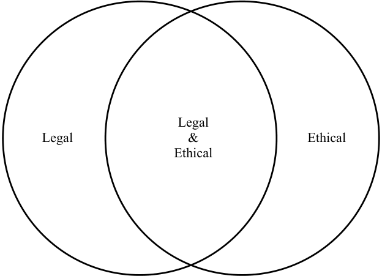

# Volume 10: Ethical and Professional Standards
## Learning Module 1 Ethics and Trust in the Investment Profession
### Part 1/2: Introduction (PDF Pages 17–31)

---

<!-- PDF Page 17 -->

# L E A R N I N G M O D U L E **<mark>1</mark>** 

### **Ethics and Trust in the Investment Profession** 

**by Bidhan L. Parmar, PhD, Dorothy C. Kelly, CFA, Colin McLean, MBA, FIA, FSIP, Nitin Mehta, CFA, FSIP, and David B. Stevens, CIMC, CFA.** 

_Bidhan L. Parmar, PhD, is at the University of Virginia (USA). Dorothy C. Kelly, CFA, is at McIntire School of Commerce, University of Virginia (USA). Colin McLean, MBA, FIA, FSIP, is at SVM Asset Management (United Kingdom). Nitin Mehta, CFA, FSIP (United Kingdom). David B. Stevens, CIMC, CFA, is at Wells Fargo Wealth Management (USA)._ 

##### **<mark>LEARNING OUTCOMES</mark>** 

|**_Mastery_**|**_The candidate should be able to:_**|
|---|---|
||explain ethics|
||describe the role of a code of ethics in defining a profession|
||describe professions and how they establish trust|
||describe the need for high ethical standards in investment management|
||explain professionalism in investment management|
||identify challenges to ethical behavior|
||compare and contrast ethical standards with legal standards|
||describe a framework for ethical decision making|

<!-- Start of picture text -->
1 <!-- End of picture text -->

#### **INTRODUCTION** 

As a candidate in the CFA Program, you are both expected and required to meet high ethical standards. This reading introduces ideas and concepts that will help you understand the importance of ethical behavior in the investment industry. You will be introduced to various types of ethical issues within the investment profession and learn about the CFA Institute Code of Ethics. 

The readings covering ethics and professional standards demonstrate that ethical behavior is central to creating trust. Professional behavior is equally important. Professions help maintain trust in an industry by establishing codes and setting 

<!-- PDF Page 18 -->

standards that put a framework around ethical behavior and technical competence. Professions also set the wider goal of gaining and maintaining the trust of society as a whole. In this regard, professions have a sense of purpose that society values. 

Imagine that you are employed in the research department of a large financial services firm. You and your colleagues spend your days researching, analyzing, and valuing the shares of publicly traded companies and sharing your investment recommendations with clients. You love your work and take great satisfaction in knowing that your recommendations can help the firm’s investing clients make informed investment decisions that will help them meet their financial goals and improve their lives. 

Several months after starting at the firm, you learn that an analyst at the firm has been terminated for writing and publishing research reports that misrepresented the fundamental risks of some companies to investors. You learn that the analyst wrote the reports with the goal of pleasing the management of the companies that were the subjects of the research reports. He hoped that these companies would hire your firm’s investment banking division for its services and he would be rewarded with large bonuses for helping the firm increase its investment banking fees. Some clients bought shares based on the analyst’s reports and suffered losses. They posted stories on the internet about their losses and the misleading nature of the reports. When the media investigated and published the story, the firm’s reputation for investment research suffered. Investors began to question the firm’s motives and the objectivity of its research recommendations. The firm’s investment clients started to look elsewhere for investment advice, and company clients begin to transfer their business to firms with untarnished reputations. With business declining, management is forced to trim staff. Along with many other hard-working colleagues, you lose your job—through no fault of your own. 

Imagine how you would feel in this situation. Most people would feel upset and resentful that their hard and honest work was derailed by someone else’s unethical behavior. Yet, this type of scenario is not uncommon. Around the world, unsuspecting employees at such companies as SAC Capital, Stanford Financial Group, Everbright Securities, Enron, Satyam Computer Services, Arthur Andersen, and other large companies have experienced such career setbacks when someone else’s actions destroyed trust in their companies and industries. 

Businesses and financial markets thrive on trust—defined as a strong belief in the reliability of a person or institution. In a 2016 study on trust, investors indicated that to earn their trust, the top two attributes of an investment manager should be that it (1) has transparent and open business practices, and (2) has ethical business practices.1 Although these attributes are valued by customers and clients in any industry, this reading will explore why they are of particular importance to the investment industry. 

People may think that ethical behavior is simply about following laws, regulations, and other rules, but throughout our lives and careers we will encounter situations in which there is no definitive rule that specifies how to act, or the rules that exist may be unclear or even in conflict with each other. Responsible people, including investment professionals, must be willing and able to identify potential ethical issues and create solutions to them even in the absence of clearly stated rules. 

> 1 CFA Institute From Trust to Loyalty: A Global Survey of What Investors Want (2013): http:// www .cfapubs .org/ doi/ pdf/ 10 .2469/ ccb .v2013 .n14 .1 .(2016): https:// www .cfainstitute .org/ research/ survey -reports/ from -trust -to -loyalty 

<!-- PDF Page 19 -->

#### **ETHICS** 

## **<mark>2</mark>** 

###### explain ethics 

Through our individual actions, each of us can affect the lives of others. Our decisions and behavior can harm or benefit a variety of **stakeholders** —individuals or groups of individuals who could be affected either directly or indirectly by a decision and thus have an interest, or stake, in the decision. Examples of stakeholders in decisions made by investment industry professionals include our colleagues, our clients, our employers, the communities in which we live and work, the investment profession, trade associations, regulators, and other financial market participants. In some cases, our actions may benefit all of these stakeholder groups; in other cases, our actions may benefit only some stakeholder groups; and in still other cases, our actions may benefit some stakeholder groups and harm others. For example, recall the research analyst in the introduction who wrote misleading research reports with the aim of increasing the financial benefit to himself and his employer. In the very short term, his conduct seemed to directly benefit some stakeholders (certain clients, himself, and his employer) and to harm other stakeholders (clients who invested based on his reports). Over a longer time period, his conduct resulted in harm to himself and many other stakeholders—his employer, his employer’s clients, his colleagues, investors, and through loss of trust when the story was published, the larger financial market. 

**Ethics** encompasses a set of moral principles and rules of conduct that provide guidance for our behavior. The word “ethics” comes from the Greek word “ethos,” meaning character, used to describe the guiding beliefs or ideals characterizing a society or societal group. Beliefs are assumptions or thoughts we hold to be true. A principle is defined as a belief or fundamental truth that serves as the foundation for a system of belief or behavior or a chain of reasoning. Our beliefs form our values— those things we deem to have worth or merit. 

**Moral principles** or **ethical principles** are beliefs regarding what is good, acceptable, or obligatory behavior and what is bad, unacceptable, or forbidden behavior. Ethical principles may refer to beliefs regarding behavior that an individual expects of himself or herself, as well as shared beliefs regarding standards of behavior expected or required by a community or societal group. 

The study of ethics examines the role of consequences and personal character in defining what is considered good, or ethical, conduct. 

Ethical conduct is behavior that follows moral principles and balances self-interest with both the direct and the indirect consequences of the behavior on others. Ethical actions are those actions that are perceived as beneficial and conforming to the ethical expectations of society. An action may be considered beneficial if it improves the outcomes or consequences for stakeholders affected by the action. Telling the truth about the risks or costs associated with a recommended investment, for example, is an ethical action—that is, one that conforms to the ethical expectations of society in general and clients in particular. Telling the truth is also beneficial; telling the truth builds trust with customers and clients and enables them to make more informed decisions, which should lead to better outcomes for them and higher levels of client/ customer satisfaction for you and your employer. 

Widely acknowledged ethical principles include honesty, transparency, fairness or justice, diligence, and respect for the rights of others. Most societal groups share these fundamental ethical principles and build on them, establishing a shared set of rules regarding how members should behave in certain situations. The principles or rules may take different forms depending on the community establishing them. 

<!-- PDF Page 20 -->

###### **Ethics and Trust in the Investment Profession** 

Governments and related entities, for example, may establish laws and/or regulations to reflect widely shared beliefs about obligatory and forbidden conduct. Laws and regulations are rules of conduct specified by a governing body, such as a legislature or a regulator, identifying how individuals and entities under its jurisdiction should behave in certain situations. Most countries have laws and regulations governing the investment industry and the conduct of its participants. Differences in laws may reflect differences in beliefs and values. 

In some countries, for example, the law requires that an investment adviser act in the best interests of his or her clients. Other countries require that investment professionals recommend investments that are suitable for their clients. These differing requirements can also hold true within one country where some advisers are held to a suitability standard and others to the fiduciary standard of the client’s best interests. Investment advisers and portfolio managers who are required by law to act in their clients’ best interests must always put their clients’ interests ahead of their own or their employers’ interests. An investment adviser who is required by law to act in a client’s best interest must understand the client’s financial objectives and risk tolerance, research and investigate multiple investment opportunities, and recommend the investment or investment portfolio that is _most_ suitable for the client in terms of meeting his or her long-term financial objectives. In addition, the investment adviser would be expected to monitor the client’s financial situation and investments to ensure that the investments recommended remain the _best_ overall option for meeting the client’s long-term financial objectives. In countries with only a suitability requirement, it is legal for investment professionals to recommend a suitable investment to a client even if other, similar suitable investments with lower fees are available. These differences in laws reflect differences in beliefs and values. 

Specific communities or societal groups in which we live and work sometimes codify their beliefs about obligatory and forbidden conduct in a written set of principles, often called a **code of ethics** . Universities, employers, and professional associations often adopt a code of ethics to communicate the organization’s values and overall expectations regarding member behavior. The code of ethics serves as a general guide for how community members should act. Some communities will also expand on their codes of ethics and adopt explicit rules or standards that identify specific behaviors required of community members. These **standards of conduct** serve as benchmarks for the minimally acceptable behavior of community members and can help clarify the code of ethics. Members can choose behaviors that demonstrate even higher standards. By joining the community, members are agreeing to adhere to the community’s code of ethics and standards of conduct. To promote their code of ethics and reduce the incidence of violations, communities frequently display their codes in prominent locations and in written materials. In addition, most communities require that members commit to their codes in writing on an annual or more frequent basis. 

Violations of a community’s established code of ethics and/or standards of conduct can harm the community in a variety of ways. Violations have the potential to damage the community’s reputation among external stakeholders and the general public. Violations can also damage the community’s reputation internally and lead to reduced trust among community members and can cause the organization to fracture or splinter from within. To protect the reputation of its membership and limit potential harm to innocent members, the community may take corrective actions to investigate possible violations, repair any damages, and attempt to discipline the violator or, in severe cases, revoke the violator’s membership in the community. 

<!-- PDF Page 21 -->

|**EXAMPLE 1**|
|---|
|**Ethics**|
|1. Which of the following statements is_most_accurate? Ethics can be described as:|
|**A.**a commitment to upholding the law.|
|**B.**an individual’s personal opinion about right and wrong. **C.**a set of moral principles that provide guidance for our behavior.|
|**Solution:**|
|C is correct. Ethics can be described as a set of moral principles that provide guidance for our behavior; these may be moral principles shared by a com- munity or societal group.|
|2. Which of the following statements is_most_accurate? Standards of conduct: **A.**are a necessary component of any code of ethics. **B.**serve as a general guide regarding proper conduct by members of a group.|
|**C.**serve as benchmarks for the minimally acceptable behavior required of members of a group.|
|**Solution:**|
|C is correct. Standards of conduct serve as benchmarks for the minimally acceptable behavior required of members of a group. Some organizations will adopt only a code of ethics, which communicates the organization’s values and overall expectations regarding member behavior. Others may adopt both a code of ethics and standards of conduct. Standards of conduct identify specific behavior required of community members and serve as benchmarks for the minimally acceptable behavior of community members.|

## **ETHICS AND PROFESSIONALISM** **<mark>3</mark>** 

describe the role of a code of ethics in defining a profession describe professions and how they establish trust describe the need for high ethical standards in investment management explain professionalism in investment management 

A **profession** is an occupational community that has specific education, expert knowledge, and a framework of practice and behavior that underpins community trust, respect, and recognition. Most professions emphasize an ethical approach, the importance of good service, and empathy with the client. 

Professions have grown in size and number over the last century: the rise of new specialist areas of expertise has created new professions. Driving forces of a new profession include governments and regulators, which encourage the formation of an 

<!-- PDF Page 22 -->

ethical relationship between professionals and society at large. There is also demand for professions from individuals who see an advantage in working as a professional and from clients who desire to work with professionals. 

Professions have not developed in every country. But in most countries, those who work in specialized areas—such as doctors, lawyers, actuaries, accountants, architects, and engineers—are subject to some combination of licensed status and technical standards. These standards distinguish professions from the craft guilds and trade bodies that were established in many countries. In particular, the requirement for members of professions to uphold high ethical standards is one clear difference. Another difference is that trade bodies do not normally have a mission to serve society or to set and enforce professional conduct rules for practitioners. 

##### **How Professions Establish Trust** 

For a profession to be credible, a primary goal is to establish trust among clients and among society in general. In doing so, professions have a number of common characteristics that, when combined, greatly increase confidence and credibility in professionals and their organizations. 

###### **_Professions normalize practitioner behavior._** 

Professionalism is underpinned by codes and standards developed by professional bodies. Regulators typically support professional ethics and recognize the framework for ethics that professions can provide. Many regulators around the world have engaged closely with professional bodies to understand their codes and standards, as well as how they are enforced. Codes and standards developed by practitioners can be complementary to regulations, codifying many more individual practices than the high-level principles set by regulation. 

Many governments have recognized that a profession can develop a more sophisticated system of standards than a regulator can, via continuous practitioner input and a strong mutual interest within the profession to maintain good standards and adopt best practices. Government support of professions is attributable to the role of professions in helping the public and ensuring expert and principled performance of complex services. 

###### **_Professions provide a service to society._** 

There is an obligation for professionals to go beyond codes and standards. Professionals should advocate for higher educational and ethical standards in the industry, individually and through their companies. Professions can widen access to services and support economic activity by encouraging trust in the industries they serve. Professions have realized that earning community trust not only creates professional pride and acceptance but also delivers commercial benefits. A profession that earns trust may ultimately have greater flexibility and independence from government regulators to manage its own affairs, which allows members of the profession to develop service models that are both useful to clients and beneficial to members. 

###### **_Professions are client focused._** 

An integral part of a profession’s mission is to develop and administer codes, best practice guidelines, and standards that guide an industry. These codes, standards, and guidelines help ensure that all professionals place the integrity of their profession and the interests of clients above their own personal interests. At a minimum, professionals must act in the best interest of the client, exercising a reasonable level of care, skill, and diligence. The obligation to deliver a high standard of care when acting for the benefit of another party is called _fiduciary duty_ . Other entities, including employers, 

<!-- PDF Page 23 -->

regulators, trade associations, and not-for-profit organizations, may also support an industry but are not the same as professional bodies. Unlike professions, these other entities generally do not exist to set and maintain professional standards. Most employers encourage employees to be members of relevant professions, and many give financial support for this membership to ideally improve the quality of client service and reinforce ethical awareness. 

###### **_Professions have high entry standards._** 

Membership in a profession is a signal to the market that the professional will deliver high-quality service of a promised standard, going beyond simply academic credentials. Professions develop curricula that equip future professionals with competence, including technical skills, knowledge, and ethics. 

###### **_Professions possess a body of expert knowledge._** 

A repository of knowledge, developed by experienced and skilled practitioners, is made available to all members of a profession. This knowledge helps members work effectively and ethically and is based on best practice. 

###### **_Professions encourage and facilitate continuing education._** 

Entry into a profession does not, on its own, guarantee that an individual will maintain competency and continue to uphold professional standards. After qualification and throughout the working life of a professional, there will be changes in knowledge and technical skills to perform certain jobs, in technology and standards of ethical behavior, in services that can be offered, and in the legal and business environment in which professional services are delivered. These all require the development of competence and ethical awareness. Most professional bodies make it a condition of membership that a specific amount of new learning is undertaken each year. Typically, such conditions specify a time commitment, which may be separated into different competencies and types of learning activity. This is often referred to as _continuing professional development_ and is seen as an important part of maintaining professional standards. The training and education that professionals undertake increase the value of human capital, which can contribute to economic growth and social mobility. 

###### **_Professions monitor professional conduct._** 

Members of a profession must be held accountable for their conduct to maintain the integrity and reputation of an industry. Doing so often involves self-regulation by professional bodies through monitoring and imposition of sanctions on members. 

###### **_Professions are collegial._** 

Professionals should be respectful to each other, even when they are competing. At the very least, they must respect the rights, dignity, and autonomy of others. 

###### **_Professions are recognized oversight bodies._** 

Many professional bodies are not-for-profit organizations with a mission emphasizing excellence, integrity, and public service. Although it is the responsibility of individual professionals to remain competent, an oversight body typically monitors this responsibility. Such bodies provide individuals with ongoing educational resources and access to information about changes in standards and imposes a framework of discipline. Continuing membership indicates sustained competence in (and updating of) practical skills while maintaining ongoing compliance with an ethical code of conduct. 

<!-- PDF Page 24 -->

###### **_Professions encourage the engagement of members._** 

Participation by members as volunteers is part of the essence of a profession. Professionals are more likely to refer to, use, and adhere to values that they have helped develop, and they typically have the power as members to revise these values. A good professional will want to mentor and inspire others who recently entered or wish to enter the profession. Professionals should be willing to volunteer to advance the profession and engage with peers to develop expertise and ethics. Professionals should volunteer to help educate new generations in ethical knowledge and ethical decision making and to foster a productive debate about new areas of ethics. Most professionals find that the experience of volunteering within the profession enhances their skills and widens their contacts within the industry. Membership in a professional body allows the necessary engagement with other professionals. 

##### **Professions Are Evolving** 

No profession stands still. Such trends as greater transparency and public accountability force professions to adapt to change. Meanwhile, technology opens up possibilities for new services and different ways of working. In addition, key processes of a profession’s responsibilities may need to be reviewed by a government agency or independent public body. In general, professions often engage with non-member individuals. This can help a profession evaluate the viewpoints of the public, clients, or other stakeholders when determining policy and practice and can encourage public trust for a profession’s conduct and disciplinary process. 

Effective professions continue to develop their role to account for changing best practices. Some medical professional bodies, for instance, have been established for more than 500 years but may now have the same need to adapt as the much younger investment management profession. This means that at any point in time, society may recognize an area of work as a profession even if it has not fully or universally implemented all the expectations. As the requirements for a profession evolve, gaps open up that may take time to remedy. Effective professions also actively learn from other professions, particularly in the area of ethics. New standards of conduct in the accounting profession might be an influence on standards considered in investment management, for example. 

##### **Professionalism in Investment Management** 

Successful investing professionals are disciplined and consistent and they think a great deal about what they do and how they do it. 

—Benjamin Graham, _The Intelligent Investor_ (1949) 

Investment management is a relatively young profession, which means that public understanding of its practice and codes is still developing. Recognition by regulators and employers also lags established professions. Not everyone engaged in investment management is a professional; some practitioners have not undertaken specific investment training or are not members of a professional body. That creates a challenge for the investment management profession to gain trust, because not all practitioners need to be committed to high ethical standards. However, key elements of the profession have been steadily established over several decades. For example, the publication of Graham and Dodd’s _Security Analysis_ in 1934 was an important step in establishing a body of knowledge for investment. 

The investment management profession meets most, but currently not all, of the expectations of a profession. In most countries, some form of certification or licensing is needed to practice, but there may not be a requirement to join a professional body. 

<!-- PDF Page 25 -->

Globally, the trend is to require examined entry to practice investment management and to maintain competence. But few professions have perfect implementation of all the expected attributes. The investment management profession, similar to other professions, is on a journey to improve implementation and keep up with changing demands. 

The investment management profession has become increasingly global as capital markets have opened up around the world. Investment management professionals may seek cross-border opportunities or may need to relocate between offices within multinational asset management firms. Regulatory coordination across borders and the emergence of technology are contributing factors to this globalization of investment management. Various investment management professional bodies have developed in individual countries, and several of these bodies have expanded internationally. In addition, several other professional bodies, including those focused on actuarial and accountancy services, have investment management professionals as members. 

##### **Trust in Investment Management** 

The investment management professional today has similarities with professionals in longer-established professions, such as medicine and law. Like doctors and lawyers, investment management professionals are trusted to draw on a body of formal knowledge and apply that knowledge with care and judgement. In comparison to clients, investment professionals are also expected to have superior financial expertise, technical knowledge, and knowledge of the applicable laws and regulations. There is a risk that clients may not be fully aware of the conflicts, risks, and fees involved, so investment management professionals must always handle and fully disclose these issues in a way that serves the best interests of clients. Compliance with codes of ethics and professional standards is essential, and practice must be guided by care, transparency, and integrity. 

The investment management profession and investment firms must be interdependent to maintain trust. Employers and regulators have their own standards and practices that may differ from regulations and standards set by professional bodies. The investment management professional bodies typically direct professionals in how to resolve these differences. 

In many developed economies, the investment management profession affects many key aspects of the economy, including savings, retirement planning, and the pricing and allocation of capital. In most countries, skilled evaluation of securities leads to more efficient capital allocation and, combined with ethical corporate governance, can assist in attracting investment from international investors. The investment management profession can deliver more value to society when higher levels of trust and better capital allocation reduce transaction costs and help meet client objectives. These reasons explain why practitioners, clients, regulators, and governments have supported the development of an investment management profession. 

##### **CFA Institute as an Investment Management Professional Body** 

CFA Institute is the largest body for investment management professionals.2 Reflecting the globalization of investment management, CFA Institute moved beyond North America in the 1980s. CFA Institute initiated a number of other changes in line with the growth of investment management. One significant change occurred in 2015, when CFA Institute decided to implement the highest standards of governance in the 

<!-- PDF Page 26 -->

US not-for-profit sector. The Board of Governors resolved “to implement US Public Company Standards and US not-for-profit leading practices, unless the Board determines that it is not in the best interest of the membership or organization to do so.” 

The mission of CFA Institute is “to lead the investment profession globally, by promoting the highest standards of ethics, education, and professional excellence for the ultimate benefit of society.” The CFA Institute Code of Ethics and Standards of Professional Conduct (Code and Standards) promote the integrity of charterholders and establish a model for ethical behavior. CFA Institute candidates and charterholders must meet the highest standards among those established by CFA Institute, regulators, or the employer. If candidates and charterholders do not meet these standards, there are negative consequences. Where client interests and market interests conflict, the Code and Standards set an investment management professional’s duty to market integrity as the overriding obligation. The advocacy efforts of CFA Institute aim to build market integrity by calling for regulations that align the interests of firms and clients. 

As a professional body, CFA Institute gathers knowledge from practicing investment professionals, conducts rigorous examinations, and ensures practitioner involvement in developing its codes and values. The CFA Institute Global Body of Investment Knowledge (GBIK) and Candidate Body of Knowledge (CBOK) are updated on an ongoing basis through a process known as _practice analysis_ . Through interactions with practicing investment management professionals, practice analysis helps ensure that the body of knowledge for the investment management profession remains current and globally relevant. The CFA Program ensures that candidates have sufficiently mastered the core knowledge, skills, and abilities (competencies) necessary that are generally accepted and applied by investment professionals. CFA Institute also contributes to the dissemination of new research and ideas in finance with the publication of the _Financial Analysts Journal_ ; CFA Institute Research Foundation books, research briefs, and reviews; and _CFA Institute Magazine_ . 

CFA Institute encourages charterholders to engage in their professional communities and involves charterholders in its initiatives. CFA Institute local societies keep charterholders connected and engaged in their communities. CFA Institute assists local societies with providing continuing education programs and events that facilitate charterholders engagement. For CFA charterholders, a local CFA society is an important route to maintaining professionalism, particularly for continuing professional development. 

CFA charterholders and CFA Program candidates are required to adhere to the Code and Standards and to sign annually a statement attesting to that continued adherence. Charterholders and candidates must maintain and improve their professional competence and strive to maintain and improve the competence of other investment professionals. 

###### **EXAMPLE 2** 

##### **Ethics and Professionalism** 

1. Which of the following statements is _most_ accurate? Investment professionals have a special responsibility to act ethically because: 

   - **A.** the industry is heavily regulated. 

   - **B.** they are entrusted to protect clients’ assets. 

   - **C.** the profession requires compliance with its code of ethics. 

###### **Solution:** 

B is correct. Investment professionals have a special responsibility because clients entrust them to protect the clients’ assets. 

<!-- PDF Page 27 -->

2. Which of the following statements _best_ completes the following sentence? Professionals use their specialized knowledge and skills: 

   - **A.** in service to others. 

   - **B.** to advance their career. 

   - **C.** for the exclusive benefit of their employers. 

###### **Solution:** 

A is correct. Professionals use specialized knowledge and skills in service to others. Their career and employer may benefit, but those results are not the primary focus of a professional’s use of his or her specialized knowledge and skills. 

3. Which of the following statements is _most_ accurate? A profession’s code of ethics: 

   - **A.** includes standards of conduct or specific benchmarks for behavior. 

   - **B.** ensures that all members of a profession will act ethically at all times. 

   - **C.** publicly communicates the shared principles and expected behaviors of a profession’s members. 

###### **Solution:** 

C is correct. A profession’s code of ethics publicly communicates the shared principles and expected behaviors of a profession’s members. The existence of a code of ethics does not ensure that all members will behave in a manner consistent with the code and act ethically at all times. A profession will often establish a disciplinary process to address alleged violations of the code of ethics. A profession may adopt standards of conduct to enhance and clarify the code of ethics. 

#### **CHALLENGES TO ETHICAL CONDUCT** 

## **<mark>4</mark>** 

identify challenges to ethical behavior 

Professionals generally aim to be responsible and to adhere to high moral standards, so what is the benefit of studying ethics? Throughout our careers, we may find ourselves in difficult or at least unfamiliar situations in which an appropriate course of action is not immediately clear and/or there may be more than one seemingly acceptable choice; studying ethics helps us prepare for such situations. This section addresses challenges to engaging in ethical conduct. Failure to acknowledge, understand, or consider these challenges can lead to poor decision making, resulting in unintentional consequences, such as unethical conduct and potential violations of the Code and Standards. 

Several challenges can make adherence to ethical conduct difficult. First, people tend to believe that they are ethical people and that their ethical standards are higher than average. Of course, everyone cannot be above average. However, surveys show this belief in above averageness remains. 

These survey results illustrate overconfidence, a common behavioral bias that can lead to faulty decision making. Studies have shown that our beliefs and emotions frequently interfere with our cognitive reasoning and result in behavioral bias, a tendency 

<!-- PDF Page 28 -->

to behave in a way that is not strictly rational. As a result of the overconfidence bias, we are more likely to overestimate the morality of our own behavior, particularly in situations that we have not faced before. The overconfidence bias can result in a failure to consider, explicitly or implicitly, important inputs and variables needed to form the best decision from an ethical perspective. In general, the overconfidence bias leads us to place too much importance on internal traits and intrinsic motivations, such as “I’m honest and would not lie,” even though studies have shown that internal traits are generally not the main determinant of whether or not someone will behave ethically in a given situation. 

A second challenge is that decision makers often fail to recognize and/or significantly underestimate the effect of situational influences, such as what other people around them are doing. **Situational influences** are external factors, such as environmental or cultural elements, that shape our thinking, decision making, and behavior. Social psychologists have studied how much situational influences affect our behavior and have found that even good people with honorable motives can and often will be influenced to do unethical things when put into difficult situations. Experiments have shown that even people who consider themselves strong, independent, free thinkers will conform to social pressures in many situations. The bystander effect, for example, demonstrates that people are less likely to intervene in an emergency when others are present. Fortunately, experiments have also shown that situational influences can induce people to act more ethically. For example, people tend to behave more ethically when they think someone else is watching or when there is a mirror placed close to them. The important concept to understand is that situational influences have a very powerful and often unrecognized effect on our thinking and behavior. Thus, learning to recognize situational influences is critical to making good decisions. 

Common situational influences in the investment industry that can shape thinking and behavior include money and prestige. One experiment found that simply mentioning money can reduce ethical behavior. In the experiment, participants were less likely to cooperate when playing a game if the game was called the Wall Street Game, rather than the Community Game. In the investment industry, large financial rewards—including individual salaries, bonuses, and/or investment gains—can induce honest and well-intentioned individuals to act in ways that others might not consider ethical. Large financial rewards and/or prestige can motivate individuals to act in their own short-term self-interests, ignoring possible short-term risks or consequences to themselves and others as well as long-term risks or consequences for both themselves and others. Another extremely powerful situational influence is loyalty. Loyalty to supervisors or organizations, fellow employees, and other colleagues can tempt individuals to make compromises and take actions that they would reject under different situational influences or judge harshly when taken by others. 

Situational influences often blind people to other important considerations. Bonuses, promotions, prestige, and loyalty to employer and colleagues are examples of situational influences that frequently have a disproportionate weight in our decision making. Our brains more easily and quickly identify, recognize, and consider these short-term situational influences than longer-term considerations, such as a commitment to maintaining our integrity and contributing to the integrity of the financial markets. Although absolutely important, these long-term considerations often have less immediate consequences than situational influences, making them less obvious as factors to consider in a decision and, therefore, less likely to influence our overall decision making. Situational influences shift our brain’s focus from the long term to the short or immediate term. When our decision making is too narrowly focused on short-term factors and/or self-interest, we tend to ignore and/or minimize the longer-term risks and/or costs and consequences to ourselves and others, and the likelihood of suffering ethical lapses and making poor decisions increases. 

<!-- PDF Page 29 -->

Loyalty to employer and/or colleagues is an extremely powerful situational influence. Our colleagues can influence our thinking and behavior in both positive and negative ways. For example, colleagues may have encouraged you to signal your commitment to your career and high ethical standards by enrolling in the CFA Program. If you work for or with people who are not bound by the Code and Standards, they might encourage you to take actions that are consistent with local law, unaware that the recommended conduct falls short of the Code and Standards. 

Well-intentioned firms may adopt or develop strong compliance programs to encourage adherence to rules, regulations, and policies. A strong compliance policy is a good start to developing an ethical culture, but a focus on adherence to rules may not be sufficient. A compliance approach may not encourage decision makers to consider the larger picture and can oversimplify decision making. Taken to the extreme, a strong compliance culture can become another situational influence that blinds employees to other important considerations. In a firm focused primarily on compliance, employees may adopt a “check the box” mentality rather than an ethical decision-making approach. Employees may ask the question “What _can_ I do?” rather than “What _should_ I do?” 

###### **EXAMPLE 3** 

##### **Challenges to Ethical Conduct** 

1. Which of the following will _most likely_ determine whether an individual will behave unethically? 

   - **A.** The person’s character 

   - **B.** The person’s internal traits and intrinsic motivation 

   - **C.** External factors, such as environmental or cultural elements 

###### **Solution:** 

C is correct. Social psychologists have shown that even good people may behave unethically in difficult situations. Situational influences, which are external factors (e.g., environmental or cultural elements), can shape our thinking, decision making, and behavior and are more likely to lead to unethical behavior than internal traits or character. 

2. Which of the following statements is _most_ accurate? 

   - **A.** Large financial rewards, such as bonuses, are the most powerful situational influences. 

   - **B.** When decision making focuses on short-term factors, the likelihood of ethical conduct increases. 

   - **C.** Situational influences can motivate individuals to act in their shortterm self-interests without recognizing the long-term risks or consequences for themselves and others. 

###### **Solution:** 

C is correct. Situational influences can motivate individuals to act in their short-term self-interests without recognizing the long-term risks or consequences for themselves and others. Large financial rewards are powerful situational influences, but in some situations, other situational influences, such as loyalty to colleagues, may be even more powerful. 

<!-- PDF Page 30 -->

## **<mark>5</mark>** 

#### **ETHICAL VS. LEGAL STANDARDS** 

compare and contrast ethical standards with legal standards 

Many times, stakeholders have common ethical expectations. Other times, different stakeholders will have different perceptions and perspectives and use different criteria to decide whether something is beneficial and/or ethical. 

Laws and regulations often codify ethical actions that lead to better outcomes for society or specific groups of stakeholders. For example, some laws and regulations require businesses and their representatives to tell the truth. They require specific written disclosures in marketing and other materials. Complying with such rules is considered an ethical action; it creates a more satisfactory outcome that conforms to stakeholders’ ethical expectations. As an example, consider disclosure requirements mandated by securities regulators regarding the risks of investing. Complying with such rules creates better outcomes for you, your clients, and your employer. First, compliance with the rule reduces the risk that clients will invest in securities without understanding the risks involved, which, in turn, reduces the risk that clients will file complaints and/or take legal action if their investments decline in value. Complying with the rules also reduces the risk that regulators will initiate an investigation, file charges, or/and discipline or sanction you and/or your employer. Any of these actions could jeopardize the reputation and future prospects of you and your employer. Conduct that reduces these risks (e.g., following disclosure rules) would be considered ethical; it leads to better outcomes for you, your clients, and your employer and conforms to the ethical expectations of various stakeholders. 

Although laws frequently codify ethical actions, legal and ethical conduct are not always the same. Think about the diagram in Exhibit 1. Many types of conduct are both legal and ethical, but some conduct may be one and not the other. Some legal behaviors or activities may be considered unethical, and some behaviors or activities considered ethical may be deemed illegal in certain jurisdictions. Acts of civil disobedience, such as peaceful protests, may be in response to laws that individuals consider unethical. The act of civil disobedience may itself be considered ethical, and yet it violates existing local laws. 

The investment industry has examples of conduct that may be legal but considered by some to be unethical. Some countries, for example, do not have laws prohibiting trading while in possession of material nonpublic information, but many investment professionals and CFA Institute consider such trading unethical. 

Another area in which ethics and laws may conflict is the area of “whistleblowing.” Whistleblowing refers to the disclosure by an individual of dishonest, corrupt, or illegal activity by an organization or government. Depending on the circumstances, a whistleblower may violate organizational policies and even local laws with the disclosure; thus, a whistleblower’s actions may be deemed illegal and yet considered by some to be ethical. 

<!-- PDF Page 31 -->

**Exhibit 1: Types of Conduct** 

<!-- Start of picture text -->
Legal Legal & Ethical Ethical <!-- End of picture text -->

Some people advocate that increased regulation and monitoring of the behavior of participants in the investment industry will increase trust in the financial markets. Although this approach may work in some circumstances, the law is not always the best mechanism to reduce unethical behavior for several reasons. First, laws typically follow market practices; regulators may proactively design laws and regulations to address existing or anticipated practices that may adversely affect the fairness and efficiency of markets or reactively design laws and regulations in response to a crisis or an event that resulted in significant monetary losses and loss of confidence/trust in the financial system. Regulators’ responses typically take significant time, during which the problematic practice may continue or even grow. Once enacted, a new law may be vague, conflicting, and/or too narrow in scope. A new law may reduce or even eliminate the existing activity while simultaneously creating an opportunity for a different, but similarly problematic, activity. Additionally, laws vary across countries or jurisdictions, allowing questionable practices to move to places that lack laws relevant to the questionable practice. Laws are also subject to interpretation and compliance by market participants, who may choose to interpret the law in the most advantageous way possible or delay compliance until a later date. For these reasons, laws and regulations are insufficient to ensure the ethical behavior of investment professionals and market participants. 

Ethical conduct goes beyond what is legally required and encompasses what different societal groups or communities, including professional associations, consider to be ethically correct behavior. To act ethically, individuals need to be able to think through the facts of the situation and make good choices even in the absence of clear laws or rules. In many cases, there is no simple algorithm or formula that will always lead to an ethical course of action. Ethics requires judgment—the ability to make considered decisions and reach sensible conclusions. Good ethical judgment requires actively considering the interests of stakeholders and trying to benefit multiple stakeholders—clients, family, colleagues, employers, market participants, and so forth—and minimize risks, including reputational risk. 

