# Tập 1: Phương pháp Định lượng (Quantitative Methods)
## Learning Module 1 Rates and Returns (Trang PDF 11–52)

---

# Tập 1: Phương pháp Định lượng (Volume 1: Quantitative Methods)
## Học phần 1: Lãi suất và Tỷ suất sinh lợi (Learning Module 1: Rates and Returns)
### Phần 1/3: Giới thiệu (Introduction) (Trang PDF 11–26)

---

<!-- PDF Page 11 -->

#### H Ọ C P H Ầ N (L E A R N I N G M O D U L E)

# **<mark>1</mark>** 

### **Lãi suất và Tỷ suất sinh lợi (Rates and Returns)** 

**Biên soạn bởi: Richard A. DeFusco, PhD, CFA, Dennis W. McLeavey, DBA, CFA, Jerald E. Pinto, PhD, CFA, David E. Runkle, PhD, CFA, và Vijay Singal, PhD, CFA.** 

_Richard A. DeFusco, PhD, CFA, công tác tại Đại học Nebraska-Lincoln (Hoa Kỳ). Dennis W. McLeavey, DBA, CFA, công tác tại Đại học Rhode Island (Hoa Kỳ). Jerald E. Pinto, PhD, CFA, công tác tại Viện CFA (Hoa Kỳ). David E. Runkle, PhD, CFA, công tác tại Jacobs Levy Equity Management (Hoa Kỳ). Vijay Singal, PhD, CFA, công tác tại Virginia Tech (Hoa Kỳ)._ 

###### **<mark>MỤC TIÊU HỌC TẬP (LEARNING OUTCOMES)</mark>** 

- **_Mức độ thành thạo (Mastery) – Ứng viên cần có khả năng:_**
  - diễn giải lãi suất (*interest rates*) dưới góc độ tỷ suất sinh lợi yêu cầu (*required rates of return*), lãi suất chiết khấu (*discount rates*), hoặc chi phí cơ hội (*opportunity costs*) và giải thích lãi suất như là tổng của lãi suất phi rủi ro thực (*real risk-free rate*) và các phần bù (*premiums*) nhằm đền bù cho nhà đầu tư khi gánh chịu các loại rủi ro riêng biệt;
  - tính toán và diễn giải các phương pháp đo lường tỷ suất sinh lợi khác nhau theo thời gian và mô tả các trường hợp sử dụng phù hợp của chúng;
  - so sánh tỷ suất sinh lợi có trọng số tiền tệ (*money-weighted rate of return*) và tỷ suất sinh lợi có trọng số thời gian (*time-weighted rate of return*), đồng thời đánh giá hiệu quả hoạt động của các danh mục đầu tư dựa trên các thước đo này;
  - tính toán và diễn giải các thước đo tỷ suất sinh lợi quy đổi theo năm (*annualized return measures*) và tỷ suất sinh lợi ghép lãi liên tục (*continuously compounded returns*), cũng như mô tả các trường hợp sử dụng phù hợp của chúng;
  - tính toán và diễn giải các thước đo tỷ suất sinh lợi chính yếu khác và mô tả các trường hợp sử dụng phù hợp của chúng.

<!-- Picture Text: 1  -->

##### **GIỚI THIỆU (INTRODUCTION)** 

Lãi suất (*interest rates*) là một khái niệm cốt lõi trong tài chính. Trong một số trường hợp, chúng ta giả định một mức lãi suất cụ thể và trong những trường hợp khác, lãi suất lại là ẩn số cần phải xác định. Mặc dù tài liệu đọc trước (*pre-reads*) đã đề cập đến cơ chế giải quyết các bài toán giá trị thời gian của tiền (*time value of money*), tại đây trước hết chúng tôi sẽ minh họa các khái niệm kinh tế nền tảng bằng cách giải thích ý nghĩa và cách diễn giải của lãi suất, sau đó tiến hành tính toán, diễn giải và so sánh các thước đo tỷ suất sinh lợi khác nhau.

<!-- PDF Page 12 -->

###### **TỔNG QUAN HỌC PHẦN (LEARNING MODULE OVERVIEW)** 

- Lãi suất (*interest rate*), ký hiệu là $r$, có thể mang ba cách diễn giải: (1) tỷ suất sinh lợi yêu cầu (*required rate of return*), (2) lãi suất chiết khấu (*discount rate*), hoặc (3) chi phí cơ hội (*opportunity cost*). Lãi suất phản ánh mối quan hệ giữa các dòng tiền phát sinh ở các thời điểm khác nhau.

- Lãi suất có thể được xem là tổng của lãi suất phi rủi ro thực (*real risk-free interest rate*) và một tập hợp các phần bù (*premiums*) đền bù cho người cho vay vì đã gánh chịu các loại rủi ro riêng biệt: phần bù lạm phát (*inflation premium*), phần bù rủi ro vỡ nợ (*default risk premium*), phần bù thanh khoản (*liquidity premium*), và phần bù kỳ hạn (*maturity premium*).

- Lãi suất phi rủi ro danh nghĩa (*nominal risk-free interest rate*) được tính xấp xỉ bằng tổng của lãi suất phi rủi ro thực và phần bù lạm phát.

- Tổng tỷ suất sinh lợi (*total return*) của một tài sản tài chính bao gồm hai thành phần: lợi suất thu nhập (*income yield*) bao gồm cổ tức tiền mặt hoặc các khoản thanh toán tiền lãi, và tỷ suất sinh lợi phản ánh lãi vốn hoặc lỗ vốn (*capital gain or loss*) phát sinh từ những thay đổi trong giá của tài sản tài chính đó.

- Tỷ suất sinh lợi thời kỳ nắm giữ (*holding period return*), ký hiệu là $R$, là mức sinh lợi mà nhà đầu tư kiếm được trong một khoảng thời gian xác định duy nhất (ví dụ: một ngày, một tháng, năm năm).

- Tỷ suất sinh lợi nhiều kỳ (*multiperiod returns*) có thể được tính toán qua nhiều thời kỳ nắm giữ bằng cách sử dụng các thước đo tỷ suất sinh lợi khác nhau (ví dụ: trung bình cộng – *arithmetic mean*, trung bình nhân – *geometric mean*, trung bình điều hòa – *harmonic mean*, trung bình cắt bỏ ngoại lai – *trimmed mean*, trung bình làm mượt ngoại lai – *winsorized mean*). Mỗi phép tính tỷ suất sinh lợi có những ứng dụng đặc thù để đánh giá các khoản đầu tư.

- Việc lựa chọn sử dụng thước đo giá trị trung bình nào trong số các phương án thay thế cho một tập dữ liệu nhất định phụ thuộc vào các yếu tố cân nhắc như sự hiện diện của các giá trị ngoại lai cực đoan (*extreme outliers*), các giá trị ngoại lai mà chúng ta muốn đưa vào tính toán, liệu phân phối có đối xứng hay không, và hiệu ứng ghép lãi (*compounding*).

- Tỷ suất sinh lợi có trọng số tiền tệ (*money-weighted return*) phản ánh mức sinh lợi thực tế kiếm được từ một khoản đầu tư sau khi đã tính đến giá trị và thời điểm của các dòng tiền liên quan đến khoản đầu tư đó.

- Tỷ suất sinh lợi có trọng số thời gian (*time-weighted return*) đo lường tốc độ tăng trưởng kép (*compound rate of growth*) của một đơn vị tiền tệ được đầu tư vào danh mục trong một giai đoạn đo lường xác định. Khác với tỷ suất sinh lợi có trọng số tiền tệ, tỷ suất sinh lợi có trọng số thời gian không nhạy cảm với thời điểm và quy mô của các dòng tiền, do đó đây là thước đo hiệu quả hoạt động được ưu tiên để đánh giá các nhà quản lý danh mục đầu tư vì việc rút tiền hoặc nộp thêm tiền vào danh mục nhìn chung nằm ngoài tầm kiểm soát của nhà quản lý danh mục.

- Tiền lãi có thể được thanh toán hoặc nhận về thường xuyên hơn mức hàng năm. Lãi suất định kỳ (*periodic interest rate*) và số kỳ ghép lãi tương ứng (ví dụ: hàng quý, hàng tháng, hàng ngày) cần được điều chỉnh để tính toán giá trị hiện tại (*present value*) và giá trị tương lai (*future value*).

- Việc quy đổi tỷ suất sinh lợi định kỳ theo năm (*annualizing periodic returns*) cho phép các nhà đầu tư so sánh các khoản đầu tư khác nhau qua các thời kỳ nắm giữ khác nhau nhằm đánh giá và so sánh hiệu quả tương đối của chúng tốt hơn. Khi số kỳ ghép lãi mỗi năm tiến tới vô cùng, tiền lãi được gọi là ghép lãi liên tục (*compounded continuously*).

- Tỷ suất sinh lợi gộp (*gross return*), tức tỷ suất sinh lợi trước khi khấu trừ các chi phí quản lý và hành chính (những chi phí không liên quan trực tiếp đến việc tạo ra lợi nhuận), là thước đo phù hợp để đánh giá và so sánh năng lực của một nhà quản lý tài sản.

<!-- PDF Page 13 -->

- Tỷ suất sinh lợi ròng (*net return*), bằng tỷ suất sinh lợi gộp trừ đi các chi phí quản lý và hành chính, là thước đo phản ánh tốt hơn những gì nhà đầu tư thực sự kiếm được.

- Tỷ suất sinh lợi danh nghĩa sau thuế (*after-tax nominal return*) được tính bằng tổng tỷ suất sinh lợi trừ đi bất kỳ khoản dự phòng thuế nào đánh trên cổ tức, tiền lãi và lãi vốn đã thực hiện (*realized gains*).

- Tỷ suất sinh lợi thực (*real returns*) đặc biệt hữu ích khi so sánh tỷ suất sinh lợi qua các giai đoạn thời gian khác nhau vì tỷ lệ lạm phát có thể biến động theo thời gian, đồng thời cũng đặc biệt hữu ích để so sánh các khoản đầu tư qua nhiều thời kỳ và hiệu quả hoạt động giữa các loại tài sản (*asset classes*) khác nhau có cơ chế chịu thuế khác nhau.

- Việc sử dụng đòn bẩy (*leveraging*) cho danh mục đầu tư, thông qua vay nợ hoặc hợp đồng tương lai (*futures*), có thể khuếch đại các khoản lãi hoặc lỗ của danh mục đó.

##### **LÃI SUẤT VÀ GIÁ TRỊ THỜI GIAN CỦA TIỀN (INTEREST RATES AND TIME VALUE OF MONEY)** 

## **<mark>2</mark>** 

diễn giải lãi suất dưới góc độ tỷ suất sinh lợi yêu cầu, lãi suất chiết khấu, hoặc chi phí cơ hội và giải thích lãi suất như là tổng của lãi suất phi rủi ro thực và các phần bù nhằm đền bù cho nhà đầu tư khi gánh chịu các loại rủi ro riêng biệt

Giá trị thời gian của tiền (*time value of money*) thiết lập sự tương đương giữa các dòng tiền phát sinh vào những ngày khác nhau. Vì tiền mặt nhận được ngày hôm nay được ưa thích hơn tiền mặt hứa hẹn trong tương lai, chúng ta phải thiết lập một cơ sở nhất quán cho sự đánh đổi này để so sánh các công cụ tài chính trong những trường hợp mà tiền mặt được chi trả hoặc nhận về ở các thời điểm khác nhau. **Lãi suất (*interest rate*)** (hay lợi suất – *yield*), ký hiệu là $r$, là một tỷ suất sinh lợi phản ánh mối quan hệ giữa các dòng tiền ở các thời điểm (ngày tháng) khác nhau. Nếu 9.500 USD ngày hôm nay và 10.000 USD sau một năm có giá trị tương đương nhau, thì $\text{10.000 USD} - \text{9.500 USD} = \text{500 USD}$ là khoản đền bù yêu cầu cho việc nhận 10.000 USD sau một năm thay vì nhận ngay bây giờ. Lãi suất (tức là khoản đền bù yêu cầu được biểu thị dưới dạng tỷ suất sinh lợi) là $\text{500 USD} / \text{9.500 USD} = 0,0526$ hay $5,26\%$.

Lãi suất có thể được hiểu theo ba cách:

- Thứ nhất, chúng có thể được xem là _tỷ suất sinh lợi yêu cầu (required rates of return)_ — tức là mức tỷ suất sinh lợi tối thiểu mà một nhà đầu tư phải nhận được để chấp nhận một khoản đầu tư.

- Thứ hai, lãi suất có thể được xem là _lãi suất chiết khấu (discount rates)_. Trong ví dụ trước, $5,26\%$ là lãi suất chiết khấu mà tại đó 10.000 USD sau một năm tương đương với 9.500 USD ngày hôm nay. Do đó, chúng ta sử dụng thuật ngữ “lãi suất” và “lãi suất chiết khấu” gần như thay thế cho nhau.

- Thứ ba, lãi suất có thể được xem là _chi phí cơ hội (opportunity costs)_. **Chi phí cơ hội (*opportunity cost*)** là giá trị mà các nhà đầu tư từ bỏ khi lựa chọn một phương án hành động. Trong ví dụ trên, nếu bên cung cấp 9.500 USD quyết định chi tiêu số tiền đó ngay hôm nay, họ sẽ từ bỏ việc kiếm được mức sinh lợi $5,26\%$ do chọn tiêu dùng thay vì tiết kiệm. Vì vậy, chúng ta có thể xem $5,26\%$ là chi phí cơ hội của việc tiêu dùng hiện tại.

<!-- PDF Page 14 -->

###### **Các yếu tố quyết định lãi suất (Determinants of Interest Rates)** 

Kinh tế học cho chúng ta biết rằng lãi suất được thiết lập bởi các lực lượng cung và cầu, nơi các nhà đầu tư cung cấp vốn và người đi vay có nhu cầu sử dụng vốn đó. Đứng trên góc độ của các nhà đầu tư khi phân tích lãi suất do thị trường quyết định, chúng ta có thể xem lãi suất $r$ được cấu thành từ lãi suất phi rủi ro thực cộng với một tập hợp các phần bù đóng vai trò là tỷ suất sinh lợi yêu cầu hoặc khoản đền bù cho việc gánh chịu các loại rủi ro riêng biệt:

$$r = \text{Lãi suất phi rủi ro thực} + \text{Phần bù lạm phát} + \text{Phần bù rủi ro vỡ nợ} + \text{Phần bù thanh khoản} + \text{Phần bù kỳ hạn} \tag{1}$$

*(Tiếng Anh: $r = \text{Real risk-free interest rate} + \text{Inflation premium} + \text{Default risk premium} + \text{Liquidity premium} + \text{Maturity premium}$)*

- **Lãi suất phi rủi ro thực (*real risk-free interest rate*)** là lãi suất một kỳ của một chứng khoán hoàn toàn phi rủi ro nếu không có lạm phát dự kiến. Trong lý thuyết kinh tế, lãi suất phi rủi ro thực phản ánh sự ưa thích theo thời gian của các cá nhân đối với việc tiêu dùng thực ở hiện tại so với tương lai.

- **Phần bù lạm phát (*inflation premium*)** đền bù cho các nhà đầu tư đối với lạm phát dự kiến và phản ánh tỷ lệ lạm phát trung bình được kỳ vọng trong suốt kỳ hạn của khoản nợ. Lạm phát làm giảm sức mua của một đơn vị tiền tệ — tức số lượng hàng hóa và dịch vụ mà một người có thể mua được bằng đơn vị tiền tệ đó.

- **Phần bù rủi ro vỡ nợ (*default risk premium*)** đền bù cho các nhà đầu tư đối với khả năng người đi vay không thực hiện được khoản thanh toán đã cam kết vào đúng thời điểm và đủ số tiền theo hợp đồng.

- **Phần bù thanh khoản (*liquidity premium*)** đền bù cho các nhà đầu tư đối với rủi ro thua lỗ so với giá trị hợp lý (*fair value*) của khoản đầu tư nếu khoản đầu tư đó cần được chuyển đổi thành tiền mặt một cách nhanh chóng. Ví dụ, tín phiếu Kho bạc Hoa Kỳ (*US Treasury bills – T-bills*) không chịu phần bù thanh khoản vì một lượng lớn tín phiếu này có thể được mua và bán mà không làm ảnh hưởng đến giá thị trường của chúng. Ngược lại, nhiều trái phiếu của các tổ chức phát hành nhỏ lại giao dịch không thường xuyên sau khi phát hành; lãi suất của những trái phiếu như vậy bao gồm một phần bù thanh khoản phản ánh chi phí tương đối cao (bao gồm cả tác động lên giá) của việc bán đi một vị thế.

- **Phần bù kỳ hạn (*maturity premium*)** đền bù cho các nhà đầu tư đối với sự gia tăng độ nhạy cảm của giá trị thị trường của khoản nợ trước sự thay đổi của lãi suất thị trường khi kỳ hạn được kéo dài, nhìn chung là vậy (giữ các yếu tố khác không đổi – *holding all else equal*). Chênh lệch giữa lãi suất của trái phiếu Kho bạc có tính thanh khoản cao, kỳ hạn dài hơn và lãi suất của trái phiếu Kho bạc ngắn hạn thường phản ánh một phần bù kỳ hạn dương cho khoản nợ dài hạn hơn (và có thể bao gồm cả các phần bù lạm phát khác nhau).

Tổng của lãi suất phi rủi ro thực và phần bù lạm phát là lãi suất phi rủi ro danh nghĩa (*nominal risk-free interest rate*):

Lãi suất phi rủi ro danh nghĩa phản ánh sự kết hợp của lãi suất phi rủi ro thực cộng với phần bù lạm phát:

$$(1 + \text{Lãi suất phi rủi ro danh nghĩa}) = (1 + \text{Lãi suất phi rủi ro thực})(1 + \text{Phần bù lạm phát})$$

Tuy nhiên, trên thực tế, lãi suất danh nghĩa thường được tính xấp xỉ bằng tổng của lãi suất phi rủi ro thực cộng với phần bù lạm phát:

$$\text{Lãi suất phi rủi ro danh nghĩa} = \text{Lãi suất phi rủi ro thực} + \text{Phần bù lạm phát}$$

Nhiều quốc gia có các khoản nợ chính phủ ngắn hạn mà lãi suất của chúng có thể được xem là đại diện cho lãi suất phi rủi ro danh nghĩa trong khung thời gian đó tại quốc gia tương ứng. Chính phủ Pháp phát hành BTF, hay tín phiếu Kho bạc chiết khấu lãi suất cố định có thể chuyển nhượng (*Bons du Trésor à taux fixe et à intérêts précomptés*), với kỳ hạn lên đến một năm. Chính phủ Nhật Bản phát hành tín phiếu Kho bạc ngắn hạn với kỳ hạn 6 và 12 tháng. Chẳng hạn, lãi suất của tín phiếu Kho bạc Hoa Kỳ (T-bill) kỳ hạn 90 ngày đại diện cho lãi suất phi rủi ro danh nghĩa của Hoa Kỳ trong ba

<!-- PDF Page 15 -->

tháng tới. Thông thường, lãi suất được yết theo năm (*quoted in annual terms*), vì vậy lãi suất của một chứng khoán nợ chính phủ kỳ hạn 90 ngày được yết ở mức $3\%$ là lãi suất đã quy đổi theo năm (*annualized rate*) chứ không phải lãi suất thực tế kiếm được trong giai đoạn 90 ngày đó.

Cho dù lãi suất chúng ta sử dụng là tỷ suất sinh lợi yêu cầu, lãi suất chiết khấu hay chi phí cơ hội, mức lãi suất đó đều bao hàm lãi suất phi rủi ro thực và một tập hợp các phần bù rủi ro (*risk premia*) phụ thuộc vào đặc điểm của các dòng tiền. Tập hợp các phần bù nền tảng bao gồm lạm phát, rủi ro vỡ nợ, rủi ro thanh khoản và rủi ro kỳ hạn. Tất cả các phần bù này đều thay đổi theo thời gian và biến động liên tục, cũng giống như lãi suất phi rủi ro thực. Do đó, mọi mức lãi suất đều biến động, nhưng mức độ thay đổi nhiều hay ít phụ thuộc vào các yếu tố kinh tế cơ bản khác nhau — và vào kỳ vọng về việc các yếu tố kinh tế cơ bản này có thể thay đổi như thế nào trong tương lai.

###### **VÍ DỤ 1 (EXAMPLE 1)** 

###### **Xác định lãi suất (Determining Interest Rates)** 

Bảng 1 (*Exhibit 1*) trình bày thông tin chọn lọc của năm chứng khoán nợ. Cả năm khoản đầu tư đều chỉ hứa hẹn một khoản thanh toán duy nhất khi đáo hạn. Giả định rằng các phần bù liên quan đến lạm phát, thanh khoản và rủi ro vỡ nợ là không đổi qua mọi khung thời gian.

**Bảng 1: Các phương án đầu tư và đặc điểm của chúng (Exhibit 1: Investments Alternatives and Their Characteristics)** 

|**Khoản đầu tư (Investment)**|**Kỳ hạn (Maturity - năm)**|**Tính thanh khoản (Liquidity)**|**Rủi ro vỡ nợ (Default Risk)**|**Lãi suất (Interest Rate) (%)**|
|---|---|---|---|---|
|1|2|Cao (High)|Thấp (Low)|2,0|
|2|2|Thấp (Low)|Thấp (Low)|2,5|
|3|7|Thấp (Low)|Thấp (Low)|$r_3$|
|4|8|Cao (High)|Thấp (Low)|4,0|
|5|8|Thấp (Low)|Cao (High)|6,5|

Dựa trên thông tin trong Bảng 1, hãy giải quyết các yêu cầu sau:

1. Giải thích sự khác biệt giữa lãi suất của Khoản đầu tư 1 và Khoản đầu tư 2.

###### **Lời giải (Solution):** 

Khoản đầu tư 2 giống hệt Khoản đầu tư 1 ngoại trừ việc Khoản đầu tư 2 có tính thanh khoản thấp. Chênh lệch giữa lãi suất của Khoản đầu tư 2 và Khoản đầu tư 1 là $0,5\%$. Khoản chênh lệch giữa hai mức lãi suất này đại diện cho phần bù thanh khoản (*liquidity premium*), tức khoản đền bù cho tính thanh khoản thấp hơn của Khoản đầu tư 2 (rủi ro thua lỗ so với giá trị hợp lý của khoản đầu tư nếu khoản đầu tư cần được chuyển đổi thành tiền mặt một cách nhanh chóng).

2. Ước tính phần bù rủi ro vỡ nợ (*default risk premium*) ảnh hưởng đến tất cả các chứng khoán.

###### **Lời giải (Solution):** 

Để ước tính phần bù rủi ro vỡ nợ, hãy xác định hai khoản đầu tư có cùng kỳ hạn nhưng có mức độ rủi ro vỡ nợ khác nhau. Khoản đầu tư 4 và 5 đều có kỳ hạn là tám năm nhưng có mức độ rủi ro vỡ nợ khác nhau. Tuy nhiên, Khoản đầu tư 5 có tính thanh khoản thấp và do đó chịu thêm phần bù thanh khoản so với Khoản đầu tư 4. Từ Phần 1, chúng ta biết phần bù thanh khoản là $0,5\%$. Chênh lệch giữa lãi suất của Khoản đầu tư 5 và 4 là $2,5\%$ ($6,5\% - 4,0\%$), trong đó $0,5\%$ là phần bù thanh khoản. Điều này

<!-- PDF Page 16 -->

hàm ý rằng $2,0\%$ ($2,5\% - 0,5\%$) phải đại diện cho phần bù rủi ro vỡ nợ phản ánh mức rủi ro vỡ nợ cao hơn tương đối của Khoản đầu tư 5.

3. Tính giới hạn trên và giới hạn dưới cho mức lãi suất chưa biết của Khoản đầu tư 3, $r_3$.

###### **Lời giải (Solution):** 

Khoản đầu tư 3 có rủi ro thanh khoản và rủi ro vỡ nợ tương đương với Khoản đầu tư 2, nhưng với thời gian đáo hạn dài hơn, Khoản đầu tư 3 sẽ có phần bù kỳ hạn cao hơn và mang lại mức lãi suất cao hơn Khoản đầu tư 2. Do đó, lãi suất của Khoản đầu tư 3, $r_3$, phải cao hơn $2,5\%$ (lãi suất của Khoản đầu tư 2).

Nếu tính thanh khoản của Khoản đầu tư 3 là cao, Khoản đầu tư 3 sẽ giống với Khoản đầu tư 4 ngoại trừ việc Khoản đầu tư 3 có kỳ hạn ngắn hơn. Khi đó chúng ta sẽ kết luận rằng lãi suất của Khoản đầu tư 3 phải thấp hơn lãi suất của Khoản đầu tư 4, tức là $4\%$. Tuy nhiên, trái ngược với Khoản đầu tư 4, Khoản đầu tư 3 có tính thanh khoản thấp. Có khả năng lãi suất của Khoản đầu tư 3 vượt quá lãi suất của Khoản đầu tư 4 mặc dù Khoản đầu tư 3 có kỳ hạn ngắn hơn, tùy thuộc vào quy mô tương đối của phần bù thanh khoản và phần bù kỳ hạn. Tuy nhiên, chúng ta kỳ vọng $r_3$ sẽ thấp hơn $4,5\%$, là mức lãi suất dự kiến của Khoản đầu tư 4 nếu nó có tính thanh khoản thấp ($4\% + 0,5\%$, phần bù thanh khoản). Do đó, chúng ta kỳ vọng lãi suất của Khoản đầu tư 3 sẽ nằm trong khoảng từ $2,5\%$ đến $4,5\%$.

## **<mark>3</mark>** 

##### **TỶ SUẤT SINH LỢI (RATES OF RETURN)** 

tính toán và diễn giải các phương pháp đo lường tỷ suất sinh lợi khác nhau theo thời gian và mô tả các trường hợp sử dụng phù hợp của chúng

Các tài sản tài chính thường được xác định dựa trên các đặc điểm về tỷ suất sinh lợi (*return*) và rủi ro (*risk*) của chúng. Việc so sánh theo hai chiều hướng này giúp đơn giản hóa quá trình xây dựng một danh mục đầu tư từ tất cả các tài sản hiện có. Trong bài học này, chúng ta sẽ tính toán, đánh giá và so sánh các thước đo tỷ suất sinh lợi khác nhau.

Các tài sản tài chính thông thường tạo ra hai loại tỷ suất sinh lợi cho nhà đầu tư. Thứ nhất, chúng có thể mang lại thu nhập định kỳ (*periodic income*) thông qua cổ tức tiền mặt hoặc các khoản thanh toán tiền lãi. Thứ hai, giá của một tài sản tài chính có thể tăng hoặc giảm, dẫn đến lãi vốn (*capital gain*) hoặc lỗ vốn (*capital loss*).

Một số tài sản tài chính chỉ mang lại tỷ suất sinh lợi thông qua một trong hai cơ chế này. Ví dụ, các nhà đầu tư vào cổ phiếu không trả cổ tức chỉ thu được tỷ suất sinh lợi từ biến động giá. Các tài sản khác lại chỉ tạo ra thu nhập định kỳ. Ví dụ, các quỹ hưu trí phúc lợi xác định (*defined benefit pension plans*) và niên kim hưu trí (*retirement annuities*) thực hiện các khoản thanh toán thu nhập trong suốt cuộc đời của người thụ hưởng.

###### **Tỷ suất sinh lợi thời kỳ nắm giữ (Holding Period Return)** 

Tỷ suất sinh lợi có thể được đo lường trong một kỳ duy nhất (*single period*) hoặc qua nhiều kỳ (*multiple periods*). Tỷ suất sinh lợi một kỳ rất đơn giản vì chỉ có một cách duy nhất để tính toán chúng. Tuy nhiên, tỷ suất sinh lợi nhiều kỳ có thể được tính theo nhiều cách khác nhau và điều quan trọng là phải nhận thức được những sự khác biệt này để tránh nhầm lẫn.

<!-- PDF Page 17 -->

**Tỷ suất sinh lợi thời kỳ nắm giữ (*holding period return*)**, ký hiệu là $R$, là tỷ suất sinh lợi kiếm được từ việc nắm giữ một tài sản trong một khoảng thời gian xác định duy nhất. Khoảng thời gian này có thể là một ngày, một tuần, một tháng, năm năm, hoặc bất kỳ thời kỳ xác định nào. Nếu tài sản (ví dụ: trái phiếu, cổ phiếu) được mua ngày hôm nay, tại thời điểm ($t = 0$), với giá 100 và được bán sau đó, giả sử tại thời điểm ($t = 1$), với giá 105 mà không có cổ tức hay thu nhập nào khác, thì tỷ suất sinh lợi thời kỳ nắm giữ là $5\%$ $[(105 - 100)/100]$. Nếu tài sản đó đồng thời trả một khoản thu nhập là 2 đơn vị tại thời điểm ($t = 1$), thì tổng tỷ suất sinh lợi là $7\%$. Tỷ suất sinh lợi này có thể được tổng quát hóa và biểu diễn dưới dạng biểu thức toán học trong đó $P$ là giá và $I$ là thu nhập, như sau:

$$R = \frac{(P_1 - P_0) + I_1}{P_0} \tag{1}$$

<!-- Formula Text: R  = (P 1 − P 0) + I 1 _ P 0 , (1) -->

trong đó chỉ số dưới (*subscript*) cho biết thời điểm của giá hoặc thu nhập; ($t = 0$) là thời điểm đầu kỳ; và ($t = 1$) là thời điểm cuối kỳ. Hai nhận xét sau đây là rất quan trọng:

- Chúng ta đã tính được mức lãi vốn là $5\%$ và lợi suất thu nhập (*income yield*) là $2\%$ trong ví dụ này. Để dễ minh họa, chúng ta đã giả định rằng thu nhập được thanh toán tại thời điểm $t = 1$. Nếu thu nhập được nhận trước thời điểm $t = 1$, tỷ suất sinh lợi thời kỳ nắm giữ của chúng ta có thể đã cao hơn nếu chúng ta tái đầu tư khoản thu nhập đó trong khoảng thời gian còn lại của kỳ.

- Tỷ suất sinh lợi có thể được biểu thị dưới dạng số thập phân ($0,07$), phân số ($7/100$), hoặc phần trăm ($7\%$). Tất cả đều tương đương nhau.

Tỷ suất sinh lợi thời kỳ nắm giữ có thể được tính cho một giai đoạn dài hơn một năm. Ví dụ, một nhà phân tích có thể cần tính tỷ suất sinh lợi thời kỳ nắm giữ ba năm từ ba mức tỷ suất sinh lợi hàng năm. Trong trường hợp đó, tỷ suất sinh lợi thời kỳ nắm giữ ba năm được tính bằng cách ghép lãi ba mức tỷ suất sinh lợi hàng năm đó:

$$R = [(1 + R_1) \times (1 + R_2) \times (1 + R_3)] - 1$$

trong đó $R_1$, $R_2$, và $R_3$ là ba mức tỷ suất sinh lợi hàng năm.

###### **Tỷ suất sinh lợi trung bình cộng (Arithmetic or Mean Return)** 

Hầu hết các tỷ suất sinh lợi thời kỳ nắm giữ được báo cáo dưới dạng tỷ suất sinh lợi hàng ngày, hàng tháng hoặc hàng năm. Khi các tài sản có tỷ suất sinh lợi qua nhiều thời kỳ nắm giữ, cần phải chuẩn hóa (*normalize*) các tỷ suất sinh lợi về một thời kỳ chung để dễ dàng so sánh và thấu hiểu. Có nhiều phương pháp khác nhau để tổng hợp tỷ suất sinh lợi qua nhiều thời kỳ nắm giữ. Phần còn lại của mục này trình bày các cách tính tỷ suất sinh lợi trung bình khác nhau và thảo luận về khả năng áp dụng của chúng.

Cách đơn giản nhất để tính một thước đo tóm tắt cho tỷ suất sinh lợi qua nhiều kỳ là lấy trung bình cộng đơn giản (*simple arithmetic average*) của các tỷ suất sinh lợi thời kỳ nắm giữ. Do đó, ba mức tỷ suất sinh lợi hàng năm là $-50\%$, $35\%$, và $27\%$ sẽ cho chúng ta mức trung bình là $4\%$ mỗi năm $= \left(\frac{-50\% + 35\% + 27\%}{3}\right)$. Tỷ suất sinh lợi trung bình cộng rất dễ tính toán và có các tính chất thống kê đã biết rõ.

Tổng quát, tỷ suất sinh lợi trung bình cộng (*arithmetic or mean return*) được ký hiệu là $\bar{R}_i$ và được cho bởi phương trình sau đây đối với tài sản $i$, trong đó $R_{it}$ là tỷ suất sinh lợi trong kỳ $t$ và $T$ là tổng số kỳ:

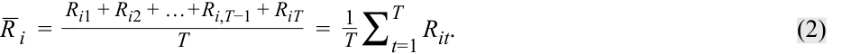

$$\bar{R}_i = \frac{R_{i1} + R_{i2} + \dots + R_{i,T-1} + R_{iT}}{T} = \frac{1}{T} \sum_{t=1}^{T} R_{it} \tag{2}$$

<!-- Formula Text: _ R  i  = R i1 + R i2 + … + R i,T−1 + R iT ____________________ T =   1 _ T  ∑ t=1 T   R it. (2) -->

<!-- PDF Page 18 -->

###### **Tỷ suất sinh lợi trung bình nhân (Geometric Mean Return)** 

Tỷ suất sinh lợi trung bình cộng giả định rằng số tiền đầu tư vào đầu mỗi kỳ là như nhau. Tuy nhiên, trong một danh mục đầu tư, ngay cả khi không có dòng tiền đi vào hoặc đi ra khỏi danh mục thì số vốn gốc cũng thay đổi qua mỗi năm. Khoản thu nhập của năm trước phải được cộng vào giá trị đầu kỳ của khoản đầu tư trong năm tiếp theo — những khoản thu nhập này sẽ được “ghép lãi” (*compounded*) theo mức tỷ suất sinh lợi kiếm được trong năm tiếp theo đó. Chúng ta có thể sử dụng tỷ suất sinh lợi trung bình nhân (*geometric mean return*) để tính đến hiệu ứng ghép lãi của tỷ suất sinh lợi.

Tỷ suất sinh lợi trung bình nhân cung cấp một sự biểu diễn chính xác hơn về mức tăng trưởng giá trị danh mục đầu tư trong một khoảng thời gian nhất định so với tỷ suất sinh lợi trung bình cộng. Tổng quát, tỷ suất sinh lợi trung bình nhân được ký hiệu là $\bar{R}_{Gi}$ và được cho bởi phương trình sau đây đối với tài sản $i$:

$$\bar{R}_{Gi} = \sqrt[T]{(1 + R_{i1}) \times (1 + R_{i2}) \times \dots \times (1 + R_{i,T-1}) \times (1 + R_{iT})} - 1 \tag{3}$$

<!-- Formula Text: _ R  Gi  = T √ _________________________________________ (1 + R i1) × (1 + R i2) × … × (1 + R i,T−1) × (1 + R iT)  − 1 (3) -->

$$= \sqrt[T]{\prod_{t=1}^{T} (1 + R_{it})} - 1$$

<!-- Formula Text: = T √ ____________ ∏ t=1 T   (1 + R t)  − 1 , -->

trong đó $R_{it}$ là tỷ suất sinh lợi trong kỳ $t$ và $T$ là tổng số kỳ.

Trong ví dụ ở mục trước, chúng ta đã tính được trung bình cộng là $4,00\%$. Sử dụng Phương trình 3, chúng ta có thể tính tỷ suất sinh lợi trung bình nhân từ cùng ba mức tỷ suất sinh lợi hàng năm đó:

$$\bar{R}_{Gi} = \sqrt[3]{(1 - 0,50) \times (1 + 0,35) \times (1 + 0,27)} - 1 = -0,0500$$

Bảng 2 (*Exhibit 2*) cho thấy tỷ suất sinh lợi thực tế của mỗi năm và số dư vào cuối mỗi năm khi sử dụng tỷ suất sinh lợi thực tế.

**Bảng 2: Giá trị và Hiệu quả hoạt động của Danh mục đầu tư (Exhibit 2: Portfolio Value and Performance)** 

||**Tỷ suất sinh lợi thực tế trong năm (Actual Return for the Year) (%)**|**Số tiền cuối năm (Year-End Amount)**|**Số tiền cuối năm sử dụng TSSL trung bình cộng 4% (Year-End Amount Using Arithmetic Return of 4%)**|**Số tiền cuối năm sử dụng TSSL trung bình nhân −5% (Year-End Amount Using Geometric Return of −5%)**|
|---|---|---|---|---|
|Năm 0 (Year 0)||EUR 1,0000|EUR 1,0000|EUR 1,0000|
|Năm 1 (Year 1)|−50|0,5000|1,0400|0,9500|
|Năm 2 (Year 2)|35|0,6750|1,0816|0,9025|
|Năm 3 (Year 3)|27|0,8573|1,1249|0,8574|

Bắt đầu với khoản đầu tư ban đầu là $1,0000\text{ EUR}$, chúng ta sẽ có số dư là $0,8574\text{ EUR}$ vào cuối giai đoạn ba năm như được thể hiện ở cột thứ năm của Bảng 2. Lưu ý rằng chúng ta đã ghép lãi các tỷ suất sinh lợi bởi vì, trừ khi có quy định khác, chúng ta kiếm được tỷ suất sinh lợi dựa trên số dư tính đến cuối năm trước đó. Nghĩa là, chúng ta sẽ nhận được mức sinh lợi $35\%$ trong năm thứ hai dựa trên số dư vào cuối năm thứ nhất, vốn chỉ còn $0,5000\text{ EUR}$, chứ không phải số dư ban đầu là $1,0000\text{ EUR}$. Hãy so sánh số dư vào cuối giai đoạn ba năm được tính bằng tỷ suất sinh lợi trung bình nhân với số dư mà chúng ta sẽ tính được nếu sử dụng tỷ suất sinh lợi trung bình cộng hàng năm $4\%$ từ ví dụ trước đó. Giá trị cuối kỳ khi sử dụng tỷ suất sinh lợi trung bình cộng là $1,1249\text{ EUR}$ ($= 1,0000 \times 1,04^3$). Con số này lớn hơn nhiều so với số dư thực tế vào cuối Năm 3 là $0,8573\text{ EUR}$.

Nhìn chung, tỷ suất sinh lợi trung bình cộng bị chệch lên trên (*biased upward*) trừ khi từng mức tỷ suất sinh lợi thời kỳ nắm giữ cơ sở đều bằng nhau. Độ chệch trong tỷ suất sinh lợi trung bình cộng đặc biệt nghiêm trọng nếu các tỷ suất sinh lợi thời kỳ nắm giữ là sự pha trộn của cả mức sinh lợi dương và âm, như trong ví dụ này.

Bây giờ chúng ta sẽ xem xét ba ví dụ tính toán tỷ suất sinh lợi thời kỳ nắm giữ qua các khung thời gian khác nhau.

<!-- PDF Page 19 -->

###### **VÍ DỤ 2 (EXAMPLE 2)** 

###### **Tỷ suất sinh lợi thời kỳ nắm giữ (Holding Period Return)** 

1. Một nhà đầu tư đã mua 100 cổ phiếu của một công ty với giá $34,50\text{ USD}$ mỗi cổ phiếu vào đầu quý. Nếu nhà đầu tư bán toàn bộ số cổ phiếu đó với giá $30,50\text{ USD}$ mỗi cổ phiếu sau khi nhận được khoản thanh toán cổ tức trị giá $51,55\text{ USD}$ vào cuối quý, tỷ suất sinh lợi thời kỳ nắm giữ của nhà đầu tư _gần nhất_ với mức nào sau đây:

   - **A.** $-13,0\%$.

   - **B.** $-11,6\%$.

   - **C.** $-10,1\%$.

###### **Lời giải (Solution):** 

C là đáp án đúng. Áp dụng Phương trình 1 (trong văn bản gốc ghi Equation 2), tỷ suất sinh lợi thời kỳ nắm giữ là $-10,1\%$, được tính như sau:

$$R = \frac{3.050 - 3.450 + 51,55}{3.450} = -10,1\%$$

Tỷ suất sinh lợi thời kỳ nắm giữ bao gồm lợi suất cổ tức (*dividend yield*) là $1,49\%$ ($= 51,55 / 3.450$) và khoản lỗ vốn (*capital loss*) là $-11,59\%$ ($= -400 / 3.450$).

###### **VÍ DỤ 3 (EXAMPLE 3)** 

###### **Tỷ suất sinh lợi thời kỳ nắm giữ (Holding Period Return)** 

1. Một nhà phân tích thu thập được các mức tỷ suất sinh lợi hàng năm sau đây của một quỹ tương hỗ (*mutual fund*), được trình bày trong Bảng 3 (*Exhibit 3*).

###### **Bảng 3: Hiệu quả hoạt động của Quỹ tương hỗ, 20X8–20X0 (Exhibit 3: Mutual Fund Performance, 20X8–20X0)** 

|**Năm (Year)**|**Tỷ suất sinh lợi (Return) (%)**|
|---|---|
|20X8|14|
|20X9|−10|
|20X0|−2|

Tỷ suất sinh lợi thời kỳ nắm giữ của quỹ trong giai đoạn ba năm _gần nhất_ với mức nào sau đây:

- **A.** $0,18\%$.

- **B.** $0,55\%$.

- **C.** $0,67\%$.

###### **Lời giải (Solution):** 

B là đáp án đúng. Tỷ suất sinh lợi thời kỳ nắm giữ ba năm của quỹ là $0,55\%$, được tính như sau:

$$R = [(1 + R_1) \times (1 + R_2) \times (1 + R_3)] - 1$$

$$R = [(1 + 0,14)(1 - 0,10)(1 - 0,02)] - 1 = 0,0055 = 0,55\%$$

<!-- PDF Page 20 -->

###### **VÍ DỤ 4 (EXAMPLE 4)** 

###### **Tỷ suất sinh lợi trung bình nhân (Geometric Mean Return)** 

1. Một nhà phân tích quan sát thấy các mức tỷ suất sinh lợi hàng năm sau đây của một quỹ phòng hộ (*hedge fund*), được trình bày trong Bảng 4 (*Exhibit 4*).

**Bảng 4: Hiệu quả hoạt động của Quỹ phòng hộ, 20X8–20X0 (Exhibit 4: Hedge Fund Performance, 20X8–20X0)** 

|**Năm (Year)**|**Tỷ suất sinh lợi (Return) (%)**|
|---|---|
|20X8|22|
|20X9|−25|
|20X0|11|

Tỷ suất sinh lợi trung bình nhân của quỹ trong giai đoạn ba năm _gần nhất_ với mức nào sau đây:

- **A.** $0,52\%$.

- **B.** $1,02\%$.

- **C.** $2,67\%$.

**Lời giải (Solution):** 

A là đáp án đúng. Áp dụng công thức tỷ suất sinh lợi trung bình nhân, tỷ suất sinh lợi trung bình nhân của quỹ trong giai đoạn ba năm là $0,52\%$, được tính như sau:

$$\bar{R}_G = [(1 + 0,22)(1 - 0,25)(1 + 0,11)]^{(1/3)} - 1 = 1,0157^{(1/3)} - 1 = 0,0052 = 0,52\%$$

###### **VÍ DỤ 5 (EXAMPLE 5)** 

###### **Tỷ suất sinh lợi trung bình nhân và trung bình cộng (Geometric and Arithmetic Mean Returns)** 

1. Xét dữ liệu tỷ suất sinh lợi hàng năm của nhóm các quốc gia trong Bảng 5 (*Exhibit 5*).

**Bảng 5: Tỷ suất sinh lợi hàng năm từ Năm 1 đến Năm 3 của các Chỉ số Chứng khoán tại một số Quốc gia được chọn (Exhibit 5: Annual Returns for Years 1 to 3 for Selected Countries’ Stock Indexes)** 

||**Tỷ suất sinh lợi 52 tuần (52-Week Return) (%)**|||**Tỷ suất sinh lợi trung bình 3 năm (Average 3-Year Return) (%)**||
|---|---|---|---|---|---|
|**Chỉ số (Index)**|**Năm 1 (Year 1)**|**Năm 2 (Year 2)**|**Năm 3 (Year 3)**|**Trung bình cộng (Arithmetic)**|**Trung bình nhân (Geometric)**|
|Quốc gia A (Country A)|−15,6|−5,4|6,1|−4,97|−5,38|
|Quốc gia B (Country B)|7,8|6,3|−1,5|4,20|4,12|
|Quốc gia C (Country C)|5,3|1,2|3,5|3,33|3,32|
|Quốc gia D (Country D)|−2,4|−3,1|6,2|0,23|0,15|
|Quốc gia E (Country E)|−4,0|−3,0|3,0|−1,33|−1,38|
|Quốc gia F (Country F)|5,4|5,2|−1,0|3,20|3,16|
|Quốc gia G (Country G)|12,7|6,7|−1,2|6,07|5,91|
|Quốc gia H (Country H)|3,5|4,3|3,4|3,73|3,73|
|Quốc gia I (Country I)|6,2|7,8|3,2|5,73|5,72|

<!-- PDF Page 21 -->

||**Tỷ suất sinh lợi 52 tuần (52-Week Return) (%)**|||**Tỷ suất sinh lợi trung bình 3 năm (Average 3-Year Return) (%)**||
|---|---|---|---|---|---|
|**Chỉ số (Index)**|**Năm 1 (Year 1)**|**Năm 2 (Year 2)**|**Năm 3 (Year 3)**|**Trung bình cộng (Arithmetic)**|**Trung bình nhân (Geometric)**|
|Quốc gia J (Country J)|8,1|4,1|−0,9|3,77|3,70|
|Quốc gia K (Country K)|11,5|3,4|1,2|5,37|5,28|

Hãy tính tỷ suất sinh lợi trung bình cộng và trung bình nhân trong ba năm cho ba chỉ số chứng khoán sau đây: Quốc gia D, Quốc gia E, và Quốc gia F.

**Lời giải (Solution):** 

Tỷ suất sinh lợi trung bình cộng như sau:

||**Tỷ suất sinh lợi hàng năm (Annual Return) (%)**|||**Tổng (Sum)**|**Tỷ suất sinh lợi trung bình cộng (Arithmetic Mean Return) (%)**|
|---|---|---|---|---|---|
||**Năm 1 (Year 1)**|**Năm 2 (Year 2)**|**Năm 3 (Year 3)**|$\sum_{i=1}^{3} R_i$||
|Quốc gia D (Country D)|−2,4|−3,1|6,2|0,7|0,233|
|Quốc gia E (Country E)|−4,0|−3,0|3,0|−4,0|−1,333|
|Quốc gia F (Country F)|5,4|5,2|−1,0|9,6|3,200|

Tỷ suất sinh lợi trung bình nhân như sau:

||**1 + TSSL dưới dạng thập phân $(1 + R_t)$**|||**Tích (Product)**|**Căn bậc 3 (3rd Root)**|**Tỷ suất sinh lợi trung bình nhân (Geometric mean return) (%)**|
|---|---|---|---|---|---|---|
||**Năm 1 (Year 1)**|**Năm 2 (Year 2)**|**Năm 3 (Year 3)**|$\prod_{t=1}^{T} (1 + R_t)$|$\left[\prod_{t=1}^{T} (1 + R_t)\right]^{1/3}$||
|Quốc gia D (Country D)|0,976|0,969|1,062|1,00438|1,00146|0,146|
|Quốc gia E (Country E)|0,960|0,970|1,030|0,95914|0,98619|−1,381|
|Quốc gia F (Country F)|1,054|1,052|0,990|1,09772|1,03157|3,157|

Trong Ví dụ 5, tỷ suất sinh lợi trung bình nhân nhỏ hơn tỷ suất sinh lợi trung bình cộng đối với tỷ suất sinh lợi chỉ số của từng quốc gia. Trên thực tế, trung bình nhân luôn nhỏ hơn hoặc bằng trung bình cộng với một ngoại lệ duy nhất: hai số trung bình này sẽ bằng nhau khi không có sự biến thiên (*variability*) giữa các quan sát — nghĩa là khi tất cả các quan sát trong chuỗi đều có giá trị như nhau.

Nhìn chung, sự chênh lệch giữa trung bình cộng và trung bình nhân tăng lên cùng với mức độ biến thiên trong mẫu; các quan sát càng phân tán thì chênh lệch giữa trung bình cộng và trung bình nhân càng lớn. Quan sát sơ bộ các tỷ suất sinh lợi trong Bảng 5 và biểu đồ các giá trị trung bình tương ứng trong Bảng 6 (*Exhibit 6*) cho thấy mức độ biến thiên lớn hơn ở chỉ số của Quốc gia A so với các chỉ số khác, và điều này được xác nhận qua độ lệch lớn hơn của tỷ suất sinh lợi trung bình nhân ($-5,38\%$) so với tỷ suất sinh lợi trung bình cộng ($-4,97\%$). Nhà phân tích nên diễn giải những kết quả này như thế nào?

<!-- PDF Page 22 -->

**Bảng 6: Tỷ suất sinh lợi trung bình cộng và trung bình nhân của Chỉ số Chứng khoán các Quốc gia, Năm 1 đến Năm 3 (Exhibit 6: Arithmetic and Geometric Mean Returns for Country Stock Indexes, Years 1 to 3)** 

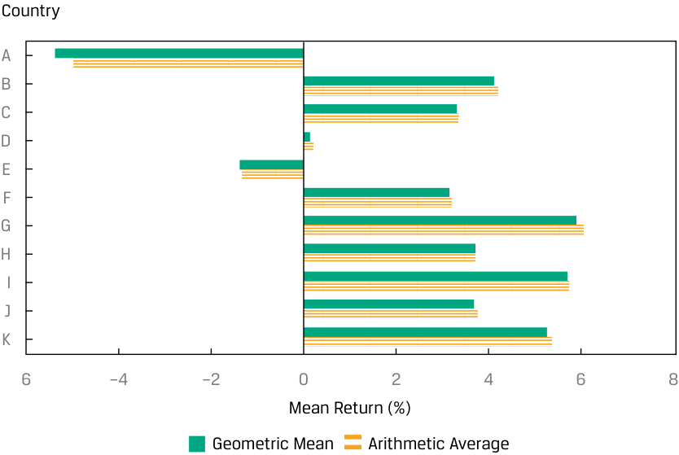

<!-- Picture Text: Country A B C D E F G H I J K 6 –4 –2 0 2 4 6 8 Mean Return (%) Geometric Mean Arithmetic Average  -->
> **Chú thích hình ảnh:** Trục tung hiển thị các Quốc gia (*Country*) từ A đến K; trục hoành hiển thị Tỷ suất sinh lợi trung bình (*Mean Return (%)*) từ $-6\%$ đến $8\%$; các thanh biểu diễn Trung bình nhân (*Geometric Mean*) và Trung bình cộng (*Arithmetic Average*).

Tỷ suất sinh lợi trung bình nhân đại diện cho tốc độ tăng trưởng (*growth rate*) hay tỷ suất sinh lợi kép (*compound rate of return*) của một khoản đầu tư. Một đơn vị tiền tệ được đầu tư vào một quỹ mô phỏng chỉ số của Quốc gia B vào đầu Năm 1 sẽ tăng trưởng thành $(1,078)(1,063)(0,985) = 1,128725$ đơn vị tiền tệ, bằng với 1 cộng với tỷ suất sinh lợi trung bình nhân của Quốc gia B là $4,1189\%$ được ghép lãi qua ba kỳ: $[1 + 0,041189]^3 = 1,128725$. Phép toán này xác nhận rằng trung bình nhân chính là tỷ suất sinh lợi kép. Với trọng tâm là tỷ suất sinh lợi thực tế của một khoản đầu tư qua khung thời gian nhiều kỳ, trung bình nhân là mối quan tâm hàng đầu của các nhà đầu tư. Tỷ suất sinh lợi trung bình cộng, tập trung vào hiệu quả hoạt động trung bình của một kỳ đơn lẻ, cũng được quan tâm. Cả trung bình cộng và trung bình nhân đều đóng vai trò nhất định trong quản lý đầu tư, và cả hai thường được báo cáo cho các chuỗi tỷ suất sinh lợi.

Để báo cáo tỷ suất sinh lợi lịch sử, trung bình nhân có sức hấp dẫn đáng kể bởi vì nó là tốc độ tăng trưởng hay tỷ suất sinh lợi mà chúng ta phải kiếm được mỗi năm để khớp với hiệu quả đầu tư tích lũy thực tế. Giả sử chúng ta mua một cổ phiếu với giá $100\text{ EUR}$ và hai năm sau nó có giá trị là $100\text{ EUR}$, với năm ở giữa đạt mức giá $200\text{ EUR}$. Trung bình nhân bằng $0\%$ rõ ràng là tốc độ tăng trưởng kép trong suốt hai năm đó, điều mà chúng ta có thể xác nhận bằng cách ghép lãi các tỷ suất sinh lợi: $[(1 + 1,00)(1 - 0,50)]^{1/2} - 1 = 0\%$. Cụ thể, số tiền cuối kỳ bằng số tiền đầu kỳ nhân với $(1 + \bar{R}_G)^2$.

Tuy nhiên, trung bình cộng, bằng $[100\% + (-50\%)]/2 = 25\%$ trong ví dụ trước, có thể làm sai lệch đánh giá của chúng ta về hiệu quả hoạt động lịch sử. Như chúng ta đã lưu ý, trung bình cộng luôn lớn hơn hoặc bằng trung bình nhân. Nếu chúng ta muốn ước tính tỷ suất sinh lợi trung bình cho khung thời gian một kỳ (*one-period horizon*), chúng ta nên sử dụng trung bình cộng bởi vì trung bình cộng là mức trung bình của các tỷ suất sinh lợi một kỳ. Tuy nhiên, nếu chúng ta muốn ước tính tỷ suất sinh lợi trung bình qua nhiều hơn một kỳ, chúng ta nên sử dụng trung bình nhân của các tỷ suất sinh lợi bởi vì trung bình nhân nắm bắt được cách thức mà tổng tỷ suất sinh lợi được liên kết với nhau theo thời gian.

###### **Trung bình điều hòa (The Harmonic Mean)** 

**Trung bình điều hòa (*harmonic mean*)**, ký hiệu là $\bar{X}_H$, là một thước đo xu hướng trung tâm (*measure of central tendency*) khác. Trung bình điều hòa phù hợp trong những trường hợp mà biến số là một tốc độ (*rate*) hoặc một tỷ số (*ratio*). Thuật ngữ “điều hòa” (*harmonic*) xuất phát từ việc sử dụng một dạng chuỗi bao gồm các số nghịch đảo được gọi là chuỗi điều hòa (*harmonic series*).

<!-- PDF Page 23 -->

**Công thức Trung bình điều hòa (Harmonic Mean Formula).** Trung bình điều hòa của một tập hợp các quan sát $X_1, X_2, \dots, X_n$ là:

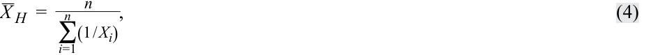

$$\bar{X}_H = \frac{n}{\sum_{i=1}^{n} (1 / X_i)} \tag{4}$$

<!-- Formula Text: _ X  H  = n _ ∑ i=1 n (1 / X i) , (4) -->

với $X_i > 0$ cho $i = 1, 2, \dots, n$.

Trung bình điều hòa là giá trị thu được bằng cách tính tổng các số nghịch đảo của các quan sát,

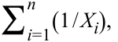

$$\sum_{i=1}^{n} (1 / X_i)$$

<!-- Formula Text: ∑ i=1 n (1 / X i), -->

tức các số hạng có dạng $1/X_i$, sau đó lấy trung bình của tổng đó bằng cách chia cho số lượng quan sát, $n$, và cuối cùng là lấy số nghịch đảo của mức trung bình đó,

<!-- Formula Text: n -->

$$\frac{n}{\sum_{i=1}^{n} (1 / X_i)}$$

<!-- Formula Text: _ ∑ i=1 n (1 / X i) . -->

Trung bình điều hòa có thể được xem là một dạng đặc biệt của trung bình có trọng số (*weighted mean*), trong đó trọng số của một quan sát tỷ lệ nghịch với độ lớn của nó. Ví dụ, nếu có một mẫu gồm các quan sát 1, 2, 3, 4, 5, 6, và 1.000, trung bình điều hòa sẽ là $2,8560$. So với trung bình cộng là $145,8571$, chúng ta thấy ảnh hưởng của giá trị ngoại lai (*outlier* — con số 1.000) nhỏ hơn rất nhiều so với trường hợp của trung bình cộng. Vì vậy, trung bình điều hòa khá hữu ích khi làm thước đo xu hướng trung tâm trong trường hợp có sự hiện diện của các giá trị ngoại lai.

Trung bình điều hòa được sử dụng thường xuyên nhất khi dữ liệu bao gồm các tốc độ và tỷ số, chẳng hạn như hệ số P/E (*Price-to-Earnings ratio*). Giả sử ba công ty cùng ngành (*peer companies*) có P/E lần lượt là 45, 15, và 15. Trung bình cộng là 25, nhưng trung bình điều hòa, vốn đặt ít trọng số hơn vào mức P/E bằng 45, là $19,3$.

Trung bình điều hòa là một khái niệm tương đối chuyên biệt về giá trị trung bình, phù hợp để tính trung bình các tỷ số (“số lượng trên mỗi đơn vị”) khi các tỷ số này được áp dụng lặp đi lặp lại cho một lượng cố định để tạo ra một số lượng đơn vị biến thiên. Khái niệm này được giải thích rõ nhất thông qua một ví dụ minh họa. Một ứng dụng nổi tiếng phát sinh trong chiến lược đầu tư được gọi là **trung bình giá vốn (*cost averaging*)**, bao gồm việc đầu tư định kỳ một số tiền cố định. Trong ứng dụng này, các tỷ số mà chúng ta đang tính trung bình là giá mỗi cổ phiếu tại các ngày mua khác nhau, và chúng ta đang áp dụng các mức giá đó cho một số tiền không đổi để thu về một số lượng cổ phiếu biến thiên. Minh họa về việc áp dụng trung bình điều hòa vào chiến lược trung bình giá vốn được cung cấp trong Ví dụ 6.

###### **VÍ DỤ 6 (EXAMPLE 6)** 

###### **Trung bình giá vốn và Trung bình điều hòa (Cost Averaging and the Harmonic Mean)** 

1. Giả sử một nhà đầu tư đầu tư $1.000\text{ EUR}$ mỗi tháng vào một cổ phiếu cụ thể trong $n = 2$ tháng. Giá cổ phiếu lần lượt là $10\text{ EUR}$ và $15\text{ EUR}$ tại hai ngày mua. Mức giá trung bình đã trả cho chứng khoán này là bao nhiêu?

###### **Lời giải (Solution):** 

Giao dịch mua trong tháng thứ nhất $= \text{1.000 EUR} / \text{10 EUR} = 100\text{ cổ phiếu}$.

Giao dịch mua trong tháng thứ hai $= \text{1.000 EUR} / \text{15 EUR} = 66,67\text{ cổ phiếu}$.

Nhà đầu tư đã mua tổng cộng $166,67\text{ cổ phiếu}$ với số tiền $2.000\text{ EUR}$, vì vậy mức giá trung bình đã trả cho mỗi cổ phiếu là $\text{2.000 EUR} / 166,67 = \text{12 EUR}$. Mức giá trung bình đã trả trên thực tế chính là trung bình điều hòa của giá tài sản tại các ngày mua. Sử dụng Phương trình 4 (trong bản gốc ghi Equation 5), mức giá trung bình điều hòa là $2 / [(1/10) + (1/15)] = \text{12 EUR}$. Giá trị $12\text{ EUR}$ này thấp hơn mức giá mua trung bình cộng $(\text{10 EUR} + \text{15 EUR})/2 = \text{12,5 EUR}$.

<!-- PDF Page 24 -->

Bởi vì cùng sử dụng một dữ liệu nhưng liên quan đến các cấp số khác nhau trong phép tính tương ứng, nên trung bình cộng, trung bình nhân và trung bình điều hòa có mối liên hệ toán học với nhau. Chúng ta sẽ không đi sâu vào phần chứng minh mối quan hệ này, nhưng kết quả cơ bản như sau:

$$\text{Trung bình cộng} \times \text{Trung bình điều hòa} = (\text{Trung bình nhân})^2$$

*(Tiếng Anh: $\text{Arithmetic mean} \times \text{Harmonic mean} = (\text{Geometric mean})^2$)*

Trừ khi tất cả các quan sát trong tập dữ liệu đều có cùng một giá trị, trung bình điều hòa luôn nhỏ hơn trung bình nhân, và đến lượt mình, trung bình nhân luôn nhỏ hơn trung bình cộng.

Trung bình điều hòa chỉ áp dụng được cho các số không âm, vì vậy khi làm việc với các tỷ suất sinh lợi được biểu thị dưới dạng phần trăm dương hoặc âm, trước tiên chúng ta chuyển đổi các tỷ suất sinh lợi sang định dạng ghép lãi, giả định có tái đầu tư, dưới dạng $(1 + R)$, giống như đã làm trong phép tính tỷ suất sinh lợi trung bình nhân, sau đó tính $(1 + \text{trung bình điều hòa})$, rồi trừ đi 1 để thu được tỷ suất sinh lợi trung bình điều hòa.

###### **VÍ DỤ 7 (EXAMPLE 7)** 

###### **Tính Trung bình cộng, Trung bình nhân và Trung bình điều hòa cho hệ số P/E (Calculating the Arithmetic, Geometric, and Harmonic Means for P/Es)** 

Mỗi năm vào tháng 12, một nhà phân tích chứng khoán lựa chọn 10 cổ phiếu ưa thích nhất của mình cho năm tiếp theo. Bảng 7 (*Exhibit 7*) trình bày hệ số P/E, tỷ số giữa giá cổ phiếu trên thu nhập dự phóng mỗi cổ phiếu (*projected earnings per share – EPS*), cho 10 lựa chọn cổ phiếu hàng đầu của cô ấy cho năm tới.

**Bảng 7: 10 Cổ phiếu ưa thích nhất của Nhà phân tích cho Năm tới (Exhibit 7: Analyst’s 10 Favorite Stocks for Next Year)** 

|**Cổ phiếu (Stock)**|**P/E**|
|---|---|
|Cổ phiếu 1 (Stock 1)|22,29|
|Cổ phiếu 2 (Stock 2)|15,54|
|Cổ phiếu 3 (Stock 3)|9,38|
|Cổ phiếu 4 (Stock 4)|15,12|
|Cổ phiếu 5 (Stock 5)|10,72|
|Cổ phiếu 6 (Stock 6)|14,57|
|Cổ phiếu 7 (Stock 7)|7,20|
|Cổ phiếu 8 (Stock 8)|7,97|
|Cổ phiếu 9 (Stock 9)|10,34|
|Cổ phiếu 10 (Stock 10)|8,35|

1. Tính P/E trung bình cộng cho 10 cổ phiếu này.

###### **Lời giải (Solution):** 

Trung bình cộng được tính như sau:

$$121,48 / 10 = 12,1480$$

2. Tính P/E trung bình điều hòa cho 10 cổ phiếu này.

###### **Lời giải (Solution):** 

Trung bình điều hòa được tính như sau:

$$\bar{X}_H = \frac{n}{\sum_{i=1}^{n} (1 / X_i)}$$

$$\bar{X}_H = \frac{10}{\left(\frac{1}{22,29}\right) + \left(\frac{1}{15,54}\right) + \dots + \left(\frac{1}{10,34}\right) + \left(\frac{1}{8,35}\right)}$$

<!-- Picture Text: X  _ H  =   _ n n  , ∑ i =1(1 /  Xi ) _ _______________________________10 X H  =   _ _ _ _ (22.29 1 ) +  ( 15.54 1 ) + … + ( 10.34 1 ) +  ( 8.35 1 ) ,  -->

<!-- PDF Page 25 -->

$$\bar{X}_H = 10 / 0,9247 = 10,8142$$

Trong tài chính, trung bình điều hòa có trọng số (*weighted harmonic mean*) được sử dụng khi tính trung bình các tốc độ và các bội số định giá (*multiples*) khác, chẳng hạn như hệ số P/E, bởi vì trung bình điều hòa gán trọng số bằng nhau cho mỗi điểm dữ liệu và làm giảm ảnh hưởng của các giá trị ngoại lai. Các phép tính này có thể được thực hiện bằng Excel:

- Để tính trung bình cộng hay tỷ suất sinh lợi trung bình, có thể sử dụng hàm `=AVERAGE(return1, return2, …)`.

- Để tính tỷ suất sinh lợi trung bình nhân, có thể sử dụng hàm `=GEOMEAN(return1, return2, …)`.

- Để tính tỷ suất sinh lợi trung bình điều hòa, có thể sử dụng hàm `=HARMEAN(return1, return2, …)`.

Ngoài trung bình cộng, trung bình nhân và trung bình điều hòa, hai loại số trung bình khác cũng có thể được sử dụng. Cả trung bình cắt bỏ ngoại lai (*trimmed mean*) và trung bình làm mượt ngoại lai (*winsorized mean*) đều tìm cách giảm thiểu tác động của các giá trị ngoại lai trong một tập dữ liệu. Cụ thể, **trung bình cắt bỏ ngoại lai (*trimmed mean*)** loại bỏ một tỷ lệ phần trăm nhỏ đã xác định của các giá trị lớn nhất và nhỏ nhất khỏi tập dữ liệu chứa các quan sát của chúng ta trước khi tính giá trị trung bình bằng cách lấy trung bình cộng của các quan sát còn lại.

Trung bình làm mượt ngoại lai thay thế các quan sát cực đoan trong tập dữ liệu nhằm hạn chế tác động của các giá trị ngoại lai lên phép tính. **Trung bình làm mượt ngoại lai (*winsorized mean*)** được tính sau khi thay thế các giá trị cực đoan ở cả hai đầu bằng giá trị của các quan sát gần chúng nhất, rồi sau đó tính giá trị trung bình bằng cách lấy trung bình cộng của các quan sát còn lại.

Tuy nhiên, câu hỏi cốt lõi là: Nên sử dụng loại số trung bình nào trong hoàn cảnh nào? Việc lựa chọn sử dụng số trung bình nào phụ thuộc vào nhiều yếu tố, như chúng tôi mô tả trong Bảng 8 (*Exhibit 8*):

- Có các giá trị ngoại lai mà chúng ta muốn đưa vào tính toán hay không?

- Phân phối có đối xứng hay không?

- Có hiệu ứng ghép lãi hay không?

- Có các giá trị ngoại lai cực đoan hay không?

<!-- PDF Page 26 -->

###### **Bảng 8: Quyết định sử dụng thước đo nào (Exhibit 8: Deciding Which Measure to Use)** 

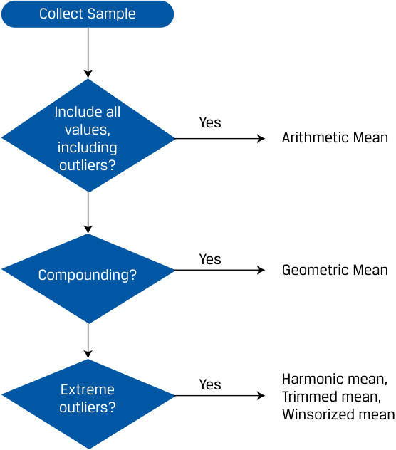

<!-- Picture Text: Collect Sample Include all Yes values, Arithmetic Mean including outliers? Yes Compounding? Geometric Mean Extreme Yes Harmonic mean, Trimmed mean, outliers? Winsorized mean  -->
> **Chú thích hình ảnh (Sơ đồ quyết định):**
> - **Thu thập mẫu (*Collect Sample*)**:
>   - Có tính đến hiệu ứng ghép lãi không (*Compounding*)? $\rightarrow$ Nếu **Có (*Yes*)**: Sử dụng **Trung bình nhân (*Geometric Mean*)**.
>   - Đưa vào tất cả các giá trị, bao gồm cả giá trị ngoại lai (*Include all values, including outliers*)? $\rightarrow$ Nếu **Có (*Yes*)**: Sử dụng **Trung bình cộng (*Arithmetic Mean*)**.
>   - Có các giá trị ngoại lai cực đoan không (*Extreme outliers*)? $\rightarrow$ Nếu **Có (*Yes*)**: Sử dụng **Trung bình điều hòa (*Harmonic mean*)**, **Trung bình cắt bỏ ngoại lai (*Trimmed mean*)**, hoặc **Trung bình làm mượt ngoại lai (*Winsorized mean*)**.

###### **BỘ CÂU HỎI (QUESTION SET)** 

Một quỹ có các mức tỷ suất sinh lợi trong 10 năm qua như sau:

**Bảng 9: Tỷ suất sinh lợi trong 10 năm (Exhibit 9: 10-Year Returns)** 

|**Năm (Year)**|**Tỷ suất sinh lợi (Return)**|
|---|---|
|1|4,5%|
|2|6,0%|
|3|1,5%|
|4|−2,0%|
|5|0,0%|
|6|4,5%|
|7|3,5%|
|8|2,5%|
|9|5,5%|
|10|4,0%|

1. Tỷ suất sinh lợi trung bình cộng trong 10 năm _gần nhất_ với mức nào sau đây:

   - **A.** $2,97\%$.
   - **B.** $3,00\%$.
   - **C.** $3,33\%$.

   - **Lời giải (Solution):** 

B là đáp án đúng. Tỷ suất sinh lợi trung bình cộng được tính như sau:
*(Xem tiếp phần lời giải ở đầu Phần 2/3)*

---

# Tập 1: Phương pháp Định lượng (Volume 1: Quantitative Methods)
## Học phần 1: Lãi suất và Tỷ suất sinh lợi (Learning Module 1: Rates and Returns)
### Phần 2/3: Tỷ suất sinh lợi có trọng số tiền tệ và Tỷ suất sinh lợi có trọng số thời gian (Money-Weighted and Time-Weighted Return) (Trang PDF 27–40)

---

<!-- PDF Page 27 -->

$$\bar{R} = 30,0\% / 10 = 3,0\%$$

2. Tỷ suất sinh lợi trung bình nhân (*geometric mean return*) trong 10 năm _gần nhất_ với mức nào sau đây:
   - **A.** $2,94\%$.
   - **B.** $2,97\%$.
   - **C.** $3,00\%$.

   - **Lời giải (Solution):** 

B là đáp án đúng. Tỷ suất sinh lợi trung bình nhân được tính như sau:

$$\bar{R}_G = \sqrt[10]{(1 + 0,045) \times (1 + 0,06) \times \dots \times (1 + 0,055) \times (1 + 0,04)} - 1$$

$$\bar{R}_G = \sqrt[10]{1,3402338} - 1 = 2,9717\%$$

## **TỶ SUẤT SINH LỢI CÓ TRỌNG SỐ TIỀN TỆ VÀ TỶ SUẤT SINH LỢI CÓ TRỌNG SỐ THỜI GIAN (MONEY-WEIGHTED AND TIME-WEIGHTED RETURN)** 

# **<mark>4</mark>** 

so sánh tỷ suất sinh lợi có trọng số tiền tệ (*money-weighted rate of return*) và tỷ suất sinh lợi có trọng số thời gian (*time-weighted rate of return*), đồng thời đánh giá hiệu quả hoạt động của các danh mục đầu tư dựa trên các thước đo này

Các phép tính tỷ suất sinh lợi trung bình cộng và trung bình nhân không tính đến thời điểm của các dòng tiền đi vào và đi ra khỏi một danh mục đầu tư. Ví dụ, giả sử một nhà đầu tư trải qua các mức tỷ suất sinh lợi được thể hiện trong Bảng 2 (*Exhibit 2*). Thay vì chỉ đầu tư $1,0\text{ EUR}$ lúc bắt đầu (Năm 0) như trong trường hợp ở Bảng 2, giả sử nhà đầu tư đã đầu tư $10.000\text{ EUR}$ lúc bắt đầu, $1.000\text{ EUR}$ vào Năm 1, và $1.000\text{ EUR}$ vào Năm 2. Trong trường hợp đó, mức tỷ suất sinh lợi $-50\%$ vào Năm 1 gây thiệt hại đáng kể cho cô ấy do khoản đầu tư tương đối lớn ngay từ lúc bắt đầu. Ngược lại, nếu cô ấy chỉ đầu tư $100\text{ EUR}$ lúc bắt đầu, tác động tuyệt đối của mức tỷ suất sinh lợi $-50\%$ lên tổng tỷ suất sinh lợi sẽ giảm đi rất nhiều.

### **Tính Tỷ suất sinh lợi có trọng số tiền tệ (Calculating the Money Weighted Return)** 

**Tỷ suất sinh lợi có trọng số tiền tệ (*money-weighted return*)** tính đến số tiền được đầu tư và cung cấp cho nhà đầu tư thông tin về mức tỷ suất sinh lợi thực tế mà họ kiếm được trên khoản đầu tư của mình. Tỷ suất sinh lợi có trọng số tiền tệ và cách tính của nó tương tự như tỷ suất hoàn vốn nội bộ (*internal rate of return – IRR*) và lợi suất đáo hạn (*yield to maturity – YTM*) của trái phiếu. Các khoản tiền đem đi đầu tư là dòng tiền ra (*cash outflows*) dưới góc độ của nhà đầu tư, còn các khoản tiền được hoàn trả hoặc rút ra bởi nhà đầu tư, hay số tiền còn lại vào cuối một chu kỳ đầu tư, là dòng tiền vào (*cash inflow*) đối với nhà đầu tư.

Ví dụ, giả sử một nhà đầu tư đầu tư $100\text{ EUR}$ vào một quỹ tương hỗ vào đầu năm thứ nhất, nộp thêm $950\text{ EUR}$ vào đầu năm thứ hai, và rút ra $350\text{ EUR}$ vào cuối năm thứ hai. Các dòng tiền được trình bày trong Bảng 10 (*Exhibit 10*).

<!-- PDF Page 28 -->

**Bảng 10: Số dư Danh mục đầu tư qua Ba năm (Exhibit 10: Portfolio Balances across Three Years)** 

|**Năm (Year)**|**1**|**2**|**3**|
|---|---|---|---|
|Số dư từ năm trước (*Balance from previous year*)|EUR 0|EUR 50|EUR 1.000|
|Khoản đầu tư mới của nhà đầu tư (dòng tiền vào đối với quỹ tương hỗ) vào đầu năm (*New investment by the investor at the start of the year*)|100|950|0|
|Số dư ròng vào đầu năm (*Net balance at the beginning of year*)|100|1.000|1.000|
|Tỷ suất sinh lợi đầu tư trong năm (*Investment return for the year*)|−50%|35%|27%|
|Lãi (lỗ) đầu tư (*Investment gain (loss)*)|−50|350|270|
|Khoản rút tiền của nhà đầu tư (dòng tiền ra đối với quỹ tương hỗ) vào cuối năm (*Withdrawal by the investor at the end of the year*)|0|−350|0|
|Số dư vào cuối năm (*Balance at the end of year*)|EUR 50|EUR 1.000|EUR 1.270|

Tỷ suất hoàn vốn nội bộ (*internal rate of return – IRR*) là lãi suất chiết khấu mà tại đó tổng giá trị hiện tại của các dòng tiền bằng không. Tổng quát, phương trình này có thể được biểu diễn như sau:

$$\sum_{t=0}^{T} \frac{CF_t}{(1 + \text{IRR})^t} = 0 \tag{5}$$

<!-- Formula Text: The internal rate of return is the discount rate at which the sum of present values of cash flows will equal zero. In general, the equation may be expressed as follows: ∑ t=0 T C F t _ (1 + IRR) t   =  0, (5) -->

trong đó $T$ là số kỳ, $CF_t$ là dòng tiền tại thời điểm $t$, và $\text{IRR}$ là tỷ suất hoàn vốn nội bộ hay tỷ suất sinh lợi có trọng số tiền tệ (*money-weighted rate of return*).

Một dòng tiền có thể mang giá trị dương hoặc âm; dòng tiền dương là dòng tiền vào (*inflow*) khi tiền chảy về phía nhà đầu tư, trong khi dòng tiền âm là dòng tiền ra (*outflow*) khi tiền chảy ra khỏi túi nhà đầu tư. Các dòng tiền được biểu diễn như sau, trong đó mỗi dòng tiền vào hoặc dòng tiền ra phát sinh vào cuối mỗi năm. Như vậy, $CF_0$ chỉ dòng tiền vào cuối Năm 0 hay đầu Năm 1, và $CF_3$ chỉ dòng tiền vào cuối Năm 3 hay đầu Năm 4. Bởi vì các dòng tiền đang được chiết khấu về hiện tại — tức cuối Năm 0 hay đầu Năm 1 — nên số kỳ chiết khấu của $CF_0$ bằng không.

$$CF_0 = -100$$

<!-- Formula Text: CF 0  =  − 100 -->

$$\begin{aligned}
CF_1 &= -950 \\
CF_2 &= +350 \\
CF_3 &= +1.270 \\
\frac{CF_0}{(1 + \text{IRR})^0} + \frac{CF_1}{(1 + \text{IRR})^1} + \frac{CF_2}{(1 + \text{IRR})^2} + \frac{CF_3}{(1 + \text{IRR})^3} &= \frac{-100}{1} + \frac{-950}{(1 + \text{IRR})^1} + \frac{+350}{(1 + \text{IRR})^2} + \frac{+1.270}{(1 + \text{IRR})^3} = 0
\end{aligned}$$

<!-- Formula Text: CF 1  =  − 950 CF 2  =  + 350 CF 3  =  + 1, 270 CF 0 _ (1 + IRR) 0  + CF 1 _ (1 + IRR) 1  + CF 2 _ (1 + IRR) 2  + CF 3 _ (1 + IRR) 3 =  − 100 _ 1   + − 950 _ (1 + IRR) 1  + + 350 _ (1 + IRR) 2  +   + 1270 _ (1 + IRR) 3   =  0 . -->

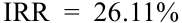

$$\text{IRR} = 26,11\%$$

<!-- Formula Text: IRR  =  26.11% -->

Tỷ suất hoàn vốn nội bộ của nhà đầu tư, hay tỷ suất sinh lợi có trọng số tiền tệ, là $26,11\%$, cho nhà đầu tư biết mức sinh lợi mà cô ấy kiếm được trên số đồng euro thực tế đã đầu tư trong toàn bộ giai đoạn tính trên cơ sở hàng năm. Mức tỷ suất sinh lợi này lớn hơn nhiều so với tỷ suất sinh lợi trung bình cộng và trung bình nhân bởi vì chỉ có một số tiền nhỏ được đầu tư vào lúc tỷ suất sinh lợi của quỹ tương hỗ là $-50\%$.

Tất cả các phép tính trên có thể được thực hiện bằng Excel thông qua hàm `=IRR(values)`, cho kết quả IRR là $26,11\%$.

#### **_Tỷ suất sinh lợi có trọng số tiền tệ đối với cổ phiếu trả cổ tức (Money-Weighted Return for a Dividend-Paying Stock)_** 

Tiếp theo, chúng ta sẽ minh họa cách tính tỷ suất sinh lợi có trọng số tiền tệ cho một cổ phiếu trả cổ tức. Xét một khoản đầu tư trải dài trong khung thời gian hai năm. Tại thời điểm $t = 0$, một nhà đầu tư mua một cổ phiếu với giá $200\text{ USD}$. Tại thời điểm $t = 1$, ông mua thêm một cổ phiếu nữa với giá $225\text{ USD}$. Vào cuối Năm 2, $t = 2$, ông bán cả hai cổ phiếu với giá $235\text{ USD}$ mỗi cổ phiếu. Trong cả hai năm, cổ phiếu đều trả cổ tức $5\text{ USD}$ mỗi cổ phiếu. Khoản cổ tức tại $t = 1$ không được tái đầu tư. Bảng 11 (*Exhibit 11*) phác thảo tổng các dòng tiền vào và dòng tiền ra của khoản đầu tư này.

<!-- PDF Page 29 -->

**Bảng 11: Dòng tiền của Cổ phiếu trả cổ tức (Exhibit 11: Cash Flows for a Dividend-Paying Stock)** 

|**Thời điểm (Time)**|**Dòng tiền ra (Outflows)**|
|---|---|
|0|$200\text{ USD}$ để mua cổ phiếu thứ nhất|
|1|$225\text{ USD}$ để mua cổ phiếu thứ hai|
|**Thời điểm (Time)**|**Dòng tiền vào (Inflows)**|
|1|$5\text{ USD}$ cổ tức nhận được từ cổ phiếu thứ nhất (và không tái đầu tư)|
|2|$10\text{ USD}$ cổ tức ($5\text{ USD}$ mỗi cổ phiếu $\times$ 2 cổ phiếu) nhận được|
|2|$470\text{ USD}$ nhận được từ việc bán hai cổ phiếu ở mức giá $235\text{ USD}$ mỗi cổ phiếu|

Để giải tìm tỷ suất sinh lợi có trọng số tiền tệ, bước đầu tiên là nhóm các dòng tiền ròng (*net cash flows*) theo thời điểm. Đối với ví dụ này, chúng ta có $-200\text{ USD}$ cho dòng tiền ròng tại $t = 0$, $-220\text{ USD} = -225\text{ USD} + 5\text{ USD}$ cho dòng tiền ròng tại $t = 1$, và $480\text{ USD}$ cho dòng tiền ròng tại $t = 2$. Sau khi nhập các dòng tiền này, chúng ta sử dụng hàm IRR của bảng tính (chẳng hạn như Excel) hoặc của máy tính tài chính để tìm ra tỷ suất sinh lợi có trọng số tiền tệ là $9,39\%$.

$$\begin{aligned}
CF_0 &= -200 \\
CF_1 &= -220 \\
CF_2 &= +480 \\
\frac{CF_0}{(1 + \text{IRR})^0} + \frac{CF_1}{(1 + \text{IRR})^1} + \frac{CF_2}{(1 + \text{IRR})^2} &= \frac{-200}{1} + \frac{-220}{(1 + \text{IRR})^1} + \frac{480}{(1 + \text{IRR})^2} = 0 \\
\text{IRR} &= 9,39\%
\end{aligned}$$

Tất cả các phép tính này có thể được thực hiện bằng Excel thông qua hàm `=IRR(values)`, cho kết quả IRR là $9,39\%$.

Bây giờ chúng ta hãy xem xét kỹ hơn những gì đã xảy ra với danh mục đầu tư trong từng năm của giai đoạn hai năm đó.

Trong năm thứ nhất, danh mục đầu tư đã tạo ra tỷ suất sinh lợi thời kỳ nắm giữ một kỳ là $(\text{5 USD} + \text{225 USD} - \text{200 USD}) / \text{200 USD} = 15\%$. Vào đầu năm thứ hai, số tiền được đầu tư là $450\text{ USD}$, được tính bằng $225\text{ USD}$ (giá mỗi cổ phiếu) $\times$ 2 cổ phiếu, bởi vì khoản cổ tức $5\text{ USD}$ đã được đem đi chi tiêu thay vì tái đầu tư.

Vào cuối năm thứ hai, số tiền thu được từ việc thanh lý danh mục đầu tư là $470\text{ USD}$ cộng với $10\text{ USD}$ tiền cổ tức (như đã nêu trong Bảng 11). Vì vậy, trong năm thứ hai danh mục đầu tư đã tạo ra tỷ suất sinh lợi thời kỳ nắm giữ là $(\text{10 USD} + \text{470 USD} - \text{450 USD}) / \text{450 USD} = 6,67\%$. Tỷ suất sinh lợi thời kỳ nắm giữ trung bình cộng là $(15\% + 6,67\%) / 2 = 10,84\%$.

Tỷ suất sinh lợi có trọng số tiền tệ mà chúng ta đã tính được là $9,39\%$ đặt trọng số lớn hơn vào hiệu quả hoạt động tương đối kém của năm thứ hai ($6,67\%$) so với hiệu quả hoạt động tương đối tốt của năm thứ nhất ($15\%$), bởi vì có nhiều tiền hơn được đầu tư vào năm thứ hai so với năm thứ nhất. Đó chính là ý nghĩa mà theo đó tỷ suất sinh lợi trong phương pháp tính toán hiệu quả hoạt động này được gọi là “có trọng số tiền tệ” (*money weighted*).

Mặc dù tỷ suất sinh lợi có trọng số tiền tệ là một thước đo chính xác về những gì nhà đầu tư đã kiếm được trên số tiền bỏ ra đầu tư, nhưng nó lại bị hạn chế về khả năng áp dụng cho các tình huống khác. Ví dụ, nó không cho phép so sánh tỷ suất sinh lợi giữa các cá nhân khác nhau hoặc giữa các cơ hội đầu tư khác nhau. Quan trọng hơn, hai nhà đầu tư cùng đầu tư vào _một_ quỹ tương hỗ hoặc có cùng một danh mục các khoản đầu tư cơ sở có thể có tỷ suất sinh lợi có trọng số tiền tệ khác nhau bởi vì họ đã đầu tư những số tiền khác nhau vào những năm khác nhau.

<!-- PDF Page 30 -->

#### **VÍ DỤ 8 (EXAMPLE 8)** 

### **Tính toán các Tỷ suất sinh lợi (Computation of Returns)** 

Ulli Lohrmann và vợ ông, Suzanne Lohrmann, đang lập kế hoạch nghỉ hưu và muốn so sánh hiệu quả hoạt động trong quá khứ của một vài quỹ tương hỗ mà họ đang cân nhắc đầu tư. Họ tin rằng việc so sánh trong giai đoạn năm năm sẽ là phù hợp. Họ thu thập thông tin về một quỹ mà họ đang xem xét, Quỹ Rhein Valley Superior (*Rhein Valley Superior Fund*), được trình bày trong Bảng 12 (*Exhibit 12*).

#### **Bảng 12: Hiệu quả hoạt động của Quỹ Rhein Valley Superior (Exhibit 12: Rhein Valley Superior Fund Performance)** 

|**Năm (Year)**|**Tài sản thuộc quyền quản lý vào đầu năm (Assets under Management at the Beginning of Year - euro)**|**Tỷ suất sinh lợi hàng năm (Annual Return) (%)**|
|---|---|---|
|1|30 triệu|15|
|2|45 triệu|−5|
|3|20 triệu|10|
|4|25 triệu|15|
|5|35 triệu|3|

Gia đình Lohrmann quan tâm đến việc tổng hợp thông tin này để dễ dàng so sánh với các quỹ khác.

**Bảng 13: Tỷ suất sinh lợi hàng năm và các Khoản đầu tư của Quỹ Rhein Valley Superior (triệu euro) (Exhibit 13: Rhein Valley Superior Fund Annual Returns and Investments (euro millions))** 

|**Năm (Year)**|**1**|**2**|**3**|**4**|**5**|
|---|---|---|---|---|---|
|Số dư từ năm trước (*Balance from previous year*)|0|34,50|42,75|22,00|28,75|
|Khoản đầu tư mới của nhà đầu tư (dòng tiền vào đối với quỹ Rhein) (*New investment by the investor*)|30,00|10,50|0|3,00|6,25|
|Khoản rút tiền của nhà đầu tư (dòng tiền ra đối với quỹ Rhein) (*Withdrawal by the investor*)|0|0|−22,75|0|0|
|Số dư ròng vào đầu năm (*Net balance at the beginning of year*)|30,00|45,00|20,00|25,00|35,00|
|Tỷ suất sinh lợi đầu tư trong năm (*Investment return for the year*)|15%|–5%|10%|15%|3%|
|Lãi (lỗ) đầu tư (*Investment gain (loss)*)|4,50|–2,25|2,00|3,75|1,05|
|Số dư vào cuối năm (*Balance at the end of year*)|34,50|42,75|22,00|28,75|36,05|

1. Tính tỷ suất sinh lợi thời kỳ nắm giữ của quỹ cho giai đoạn năm năm.

#### **Lời giải (Solution):** 

Tỷ suất sinh lợi thời kỳ nắm giữ năm năm được tính như sau:

$$\begin{aligned}
R &= (1 + R_1)(1 + R_2)(1 + R_3)(1 + R_4)(1 + R_5) - 1 \\
R &= (1,15)(0,95)(1,10)(1,15)(1,03) - 1 \\
R &= 0,4235 = 42,35\%
\end{aligned}$$

2. Tính tỷ suất sinh lợi hàng năm trung bình cộng của quỹ.

#### **Lời giải (Solution):** 

Tỷ suất sinh lợi hàng năm trung bình cộng được tính như sau:

<!-- PDF Page 31 -->

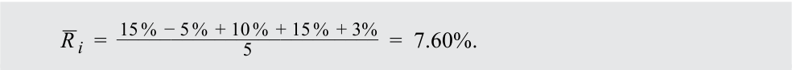

$$\bar{R}_i = \frac{15\% - 5\% + 10\% + 15\% + 3\%}{5} = 7,60\%$$

<!-- Formula Text: _ R  i  =   15 %  − 5 %  + 10 %  + 15 %  + 3% ________________________ 5 =  7.60%. -->

3. Tính tỷ suất sinh lợi hàng năm trung bình nhân của quỹ. Nó so sánh như thế nào với tỷ suất sinh lợi hàng năm trung bình cộng?

#### **Lời giải (Solution):** 

Tỷ suất sinh lợi hàng năm trung bình nhân có thể được tính như sau:

$$\begin{aligned}
\bar{R}_{Gi} &= \sqrt[5]{1,15 \times 0,95 \times 1,10 \times 1,15 \times 1,03} - 1 \\
\bar{R}_{Gi} &= \sqrt[5]{1,4235} - 1 = 0,0732 = 7,32\%
\end{aligned}$$

Do đó, tỷ suất sinh lợi hàng năm trung bình nhân là $7,32\%$, thấp hơn một chút so với tỷ suất sinh lợi trung bình cộng là $7,60\%$.

4. Gia đình Lohrmann muốn kiếm được mức tỷ suất sinh lợi hàng năm tối thiểu là $5\%$. Tỷ suất sinh lợi hàng năm và số tiền đầu tư được trình bày trong Bảng 13. Tỷ suất sinh lợi hàng năm có trọng số tiền tệ có lớn hơn $5\%$ hay không?

#### **Lời giải (Solution):** 

Để tính tỷ suất sinh lợi có trọng số tiền tệ, hãy lập bảng kê tỷ suất sinh lợi hàng năm và số tiền đầu tư nhằm xác định các dòng tiền, như được thể hiện trong Bảng 13:

$$CF_0 = -30,00, \quad CF_1 = -10,50, \quad CF_2 = +22,75, \quad CF_3 = -3,00, \quad CF_4 = -6,25, \quad CF_5 = +36,05$$

Chúng ta có thể sử dụng mức tỷ suất sinh lợi $5\%$ đã cho để xem liệu giá trị hiện tại của các dòng tiền ròng có dương hay không. Nếu nó dương, thì tỷ suất sinh lợi có trọng số tiền tệ lớn hơn $5\%$, bởi vì lãi suất chiết khấu $5\%$ chưa thể làm giảm giá trị hiện tại về bằng không.

$$\frac{-30,00}{(1,05)^0} + \frac{-10,50}{(1,05)^1} + \frac{22,75}{(1,05)^2} + \frac{-3,00}{(1,05)^3} + \frac{-6,25}{(1,05)^4} + \frac{36,05}{(1,05)^5} = 1,1476$$

<!-- Formula Text: − 30.00 _ (1.05) 0  +  − 10.50 _ (1.05) 1  +  22.75 _ (1.05) 2  +  − 3.00 _ (1.05) 3  +  − 6.25 _ (1.05) 4  +  36.05 _ (1.05) 5   =  1.1476. -->

Bởi vì giá trị này là số dương, nên tỷ suất sinh lợi có trọng số tiền tệ lớn hơn $5\%$. Tỷ suất sinh lợi có trọng số tiền tệ chính xác (được tìm bằng cách cho phương trình trên bằng không) là $5,86\%$. Các phép tính này có thể được thực hiện bằng Excel thông qua hàm `=IRR(cash flows)`, cho kết quả IRR là $5,86\%$.

#### **_Tỷ suất sinh lợi có trọng số thời gian (Time-Weighted Returns)_** 

Một thước đo đầu tư không nhạy cảm với việc nộp thêm và rút bớt vốn là tỷ suất sinh lợi có trọng số thời gian. **Tỷ suất sinh lợi có trọng số thời gian (*time-weighted rate of return*)** đo lường tốc độ tăng trưởng kép của $1\text{ USD}$ được đầu tư ban đầu vào danh mục trong một giai đoạn đo lường xác định. Để đánh giá các danh mục đầu tư gồm các chứng khoán được giao dịch công khai, tỷ suất sinh lợi có trọng số thời gian là thước đo hiệu quả hoạt động được ưu tiên vì nó trung hòa (*neutralizes*) tác động của các khoản rút tiền hoặc nộp thêm tiền vào danh mục, những hoạt động vốn nhìn chung nằm ngoài tầm kiểm soát của nhà quản lý danh mục đầu tư.

<!-- PDF Page 32 -->

#### **Tính Tỷ suất sinh lợi có trọng số thời gian (Computing Time-Weighted Returns)** 

Để tính tỷ suất sinh lợi có trọng số thời gian chính xác cho một danh mục đầu tư, hãy thực hiện ba bước sau đây:

**1.** Định giá danh mục đầu tư ngay trước bất kỳ khoản nộp thêm hoặc rút bớt vốn đáng kể nào. Chia tổng giai đoạn đánh giá thành các kỳ con (*subperiods*) dựa trên ngày phát sinh các dòng tiền vào và dòng tiền ra.

**2.** Tính tỷ suất sinh lợi thời kỳ nắm giữ của danh mục đầu tư cho từng kỳ con.

**3.** Liên kết (*link*) hoặc ghép lãi (*compound*) các tỷ suất sinh lợi thời kỳ nắm giữ để thu được tỷ suất sinh lợi hàng năm cho năm đó (tỷ suất sinh lợi có trọng số thời gian của năm). Nếu khoản đầu tư kéo dài hơn một năm, hãy lấy trung bình nhân của các tỷ suất sinh lợi hàng năm để thu được tỷ suất sinh lợi có trọng số thời gian trong giai đoạn đo lường đó.

Hãy quay lại ví dụ tính tỷ suất sinh lợi có trọng số tiền tệ cho cổ phiếu trả cổ tức trong mục “Tỷ suất sinh lợi có trọng số tiền tệ đối với cổ phiếu trả cổ tức” và tính tỷ suất sinh lợi có trọng số thời gian cho danh mục của nhà đầu tư đó dựa trên thông tin trong Bảng 11. Trong ví dụ đó, chúng ta đã tính được các tỷ suất sinh lợi thời kỳ nắm giữ của danh mục đầu tư, tức Bước 2 trong quy trình tìm tỷ suất sinh lợi có trọng số thời gian. Biết rằng danh mục đầu tư kiếm được mức sinh lợi $15\%$ trong năm thứ nhất và $6,67\%$ trong năm thứ hai, tỷ suất sinh lợi có trọng số thời gian của danh mục đầu tư trong giai đoạn đánh giá hai năm là bao nhiêu?

Chúng ta tìm tỷ suất sinh lợi có trọng số thời gian này bằng cách lấy trung bình nhân của hai tỷ suất sinh lợi thời kỳ nắm giữ, tức Bước 3 trong quy trình nêu trên. Phép tính trung bình nhân phản ánh chính xác phép tính tốc độ tăng trưởng kép. Tại đây, chúng ta lấy tích của 1 cộng với tỷ suất sinh lợi thời kỳ nắm giữ của mỗi kỳ để tìm giá trị cuối kỳ (*terminal value*) tại $t = 2$ của $1\text{ USD}$ được đầu tư tại $t = 0$. Sau đó chúng ta lấy căn bậc hai của tích này và trừ đi 1 để có được tỷ suất sinh lợi trung bình nhân. Chúng ta diễn giải kết quả này là tốc độ tăng trưởng kép hàng năm của $1\text{ USD}$ được đầu tư vào danh mục tại thời điểm $t = 0$. Như vậy, chúng ta có:

$$(1 + \text{Tỷ suất sinh lợi có trọng số thời gian})^2 = (1,15)(1,0667)$$

<!-- Formula Text: (1 + Time-weighted return) 2  =  (1.15)(1.0667) -->

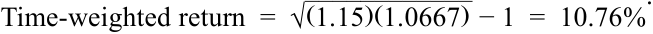

$$\text{Tỷ suất sinh lợi có trọng số thời gian} = \sqrt{(1,15)(1,0667)} - 1 = 10,76\%$$

<!-- Formula Text: Time-weighted return  =  √ ____________ (1.15)(1.0667)  − 1  =  10.76%. -->

Tỷ suất sinh lợi có trọng số thời gian của danh mục đầu tư là $10,76\%$, so với tỷ suất sinh lợi có trọng số tiền tệ là $9,39\%$ vốn đặt trọng số lớn hơn vào tỷ suất sinh lợi của năm thứ hai. Chúng ta có thể thấy lý do tại sao các nhà quản lý đầu tư nhận thấy tỷ suất sinh lợi có trọng số thời gian có ý nghĩa hơn. Nếu một khách hàng giao thêm vốn cho nhà quản lý đầu tư để đầu tư vào một thời điểm bất lợi, tỷ suất sinh lợi có trọng số tiền tệ của nhà quản lý sẽ có xu hướng bị kéo giảm xuống. Nếu một khách hàng bổ sung thêm vốn vào một thời điểm thuận lợi, tỷ suất sinh lợi có trọng số tiền tệ sẽ có xu hướng được đẩy cao lên. Tỷ suất sinh lợi có trọng số thời gian loại bỏ những hiệu ứng này.

Khi xác định các bước để tính tỷ suất sinh lợi có trọng số thời gian chính xác, chúng ta đã nói rằng danh mục đầu tư cần được định giá ngay trước bất kỳ khoản nộp thêm hoặc rút bớt vốn đáng kể nào. Với khối lượng hoạt động dòng tiền lớn trong nhiều danh mục đầu tư, công việc này có thể rất tốn kém. Chúng ta thường có thể thu được một ước tính xấp xỉ hợp lý cho tỷ suất sinh lợi có trọng số thời gian bằng cách định giá danh mục đầu tư theo các khoảng thời gian đều đặn, thường xuyên, đặc biệt nếu các khoản nộp thêm và rút bớt vốn không liên quan đến biến động thị trường.

Việc định giá càng thường xuyên thì phép tính xấp xỉ càng chính xác. Định giá hàng ngày (*daily valuation*) là điều phổ biến. Giả sử một danh mục đầu tư được định giá hàng ngày trong suốt một năm. Để tính tỷ suất sinh lợi có trọng số thời gian cho năm đó, trước tiên chúng ta tính tỷ suất sinh lợi thời kỳ nắm giữ của mỗi ngày. Chúng ta tính 365 mức tỷ suất sinh lợi hàng ngày như vậy, ký hiệu là $R_1, R_2, \dots, R_{365}$. Chúng ta thu được tỷ suất sinh lợi hàng năm cho năm đó bằng cách liên kết các tỷ suất sinh lợi thời kỳ nắm giữ hàng ngày theo cách sau: $(1 + R_1) \times (1 + R_2) \times \dots \times (1 + R_{365}) - 1$. Nếu các khoản rút bớt và nộp thêm vào danh mục đầu tư chỉ diễn ra vào cuối ngày, thì tỷ suất sinh lợi hàng năm này là tỷ suất sinh lợi có trọng số thời gian chính xác cho năm đó. Ngược lại, đó là tỷ suất sinh lợi có trọng số thời gian xấp xỉ cho năm đó.

<!-- PDF Page 33 -->

Nếu có dữ liệu của nhiều năm, chúng ta có thể tính tỷ suất sinh lợi có trọng số thời gian cho từng năm riêng lẻ như trên. Nếu $R_i$ là tỷ suất sinh lợi có trọng số thời gian của năm $i$, chúng ta tính tỷ suất sinh lợi có trọng số thời gian quy đổi theo năm (*annualized time-weighted return*) bằng trung bình nhân của $N$ mức tỷ suất sinh lợi hàng năm, như sau:

$$R_{TW} = [(1 + R_1) \times (1 + R_2) \times \dots \times (1 + R_N)]^{1/N} - 1 \tag{6}$$

<!-- Formula Text: R TW  =  [(1 + R 1) × (1 + R 2) × … × (1 + R N)] 1/N − 1. (6) -->

Ví dụ 9 minh họa phép tính tỷ suất sinh lợi có trọng số thời gian.

#### **VÍ DỤ 9 (EXAMPLE 9)** 

### **Tỷ suất sinh lợi có trọng số thời gian (Time-Weighted Rate of Return)** 

Tập đoàn Strubeck (*Strubeck Corporation*) tài trợ một quỹ hưu trí cho nhân viên của mình. Công ty tự quản lý nội bộ (*in-house*) một phần danh mục cổ phiếu và ủy thác việc quản lý phần còn lại cho Công ty Tín thác Super (*Super Trust Company*). Với tư cách là giám đốc đầu tư (*chief investment officer – CIO*) của Strubeck, bạn muốn rà soát hiệu quả hoạt động của danh mục nội bộ và danh mục Super Trust trong bốn quý vừa qua. Bạn đã sắp xếp để các dòng tiền ra và dòng tiền vào của các danh mục được thực hiện ngay vào thời điểm bắt đầu của mỗi quý. Bảng 14 (*Exhibit 14*) tóm tắt các dòng tiền vào và dòng tiền ra cũng như mức định giá của hai danh mục đầu tư. Trong Bảng 14 (bản gốc ghi nhầm là Exhibit 11), giá trị cuối kỳ là giá trị của danh mục đầu tư ngay trước khi có dòng tiền vào hoặc dòng tiền ra vào đầu quý tiếp theo. Số tiền đầu tư là số tiền mà mỗi nhà quản lý danh mục chịu trách nhiệm đầu tư.

**Bảng 14: Dòng tiền của Tài khoản Nội bộ Strubeck và Tài khoản Super Trust (đô la Mỹ) (Exhibit 14: Cash Flows for the In-House Strubeck Account and the Super Trust Account (US dollars))** 

||**Quý 1 (Quarter 1)**|**Quý 2 (Quarter 2)**|**Quý 3 (Quarter 3)**|**Quý 4 (Quarter 4)**|
|---|---|---|---|---|
|**Bảng A: Tài khoản Nội bộ (Panel A: In-House Account)**|||||
|Giá trị đầu kỳ (*Beginning value*)|4.000.000|6.000.000|5.775.000|6.720.000|
|Dòng tiền vào (dòng tiền ra) đầu kỳ (*Beginning of period inflow (outflow)*)|1.000.000|(500.000)|225.000|(600.000)|
|Số tiền đầu tư (*Amount invested*)|5.000.000|5.500.000|6.000.000|6.120.000|
|Giá trị cuối kỳ (*Ending value*)|6.000.000|5.775.000|6.720.000|5.508.000|
|**Bảng B: Tài khoản Super Trust (Panel B: Super Trust Account)**|||||
|Giá trị đầu kỳ (*Beginning value*)|10.000.000|13.200.000|12.240.000|5.659.200|
|Dòng tiền vào (dòng tiền ra) đầu kỳ (*Beginning of period inflow (outflow)*)|2.000.000|(1.200.000)|(7.000.000)|(400.000)|
|Số tiền đầu tư (*Amount invested*)|12.000.000|12.000.000|5.240.000|5.259.200|
|Giá trị cuối kỳ (*Ending value*)|13.200.000|12.240.000|5.659.200|5.469.568|

1. Tính tỷ suất sinh lợi có trọng số thời gian cho tài khoản nội bộ.

#### **Lời giải (Solution):** 

Để tính tỷ suất sinh lợi có trọng số thời gian cho tài khoản nội bộ, chúng ta tính tỷ suất sinh lợi thời kỳ nắm giữ hàng quý cho tài khoản đó và liên kết chúng lại thành tỷ suất sinh lợi hàng năm. Tỷ suất sinh lợi có trọng số thời gian của tài khoản nội bộ là $27,01\%$, được tính như sau:

<!-- PDF Page 34 -->

$$\begin{aligned}
\text{HPR Quý 1: } r_1 &= (\text{6.000.000 USD} - \text{5.000.000 USD}) / \text{5.000.000 USD} = 0,20 \\
\text{HPR Quý 2: } r_2 &= (\text{5.775.000 USD} - \text{5.500.000 USD}) / \text{5.500.000 USD} = 0,05 \\
\text{HPR Quý 3: } r_3 &= (\text{6.720.000 USD} - \text{6.000.000 USD}) / \text{6.000.000 USD} = 0,12 \\
\text{HPR Quý 4: } r_4 &= (\text{5.508.000 USD} - \text{6.120.000 USD}) / \text{6.120.000 USD} = -0,10
\end{aligned}$$

$$R_{TW} = (1 + r_1)(1 + r_2)(1 + r_3)(1 + r_4) - 1$$

$$R_{TW} = (1,20)(1,05)(1,12)(0,90) - 1 = 0,2701 \text{ hay } 27,01\%$$

2. Tính tỷ suất sinh lợi có trọng số thời gian cho tài khoản Super Trust.

#### **Lời giải (Solution):** 

Tài khoản do Super Trust quản lý có tỷ suất sinh lợi có trọng số thời gian là $26,02\%$, được tính như sau:

$$\begin{aligned}
\text{HPR Quý 1: } r_1 &= (\text{13.200.000 USD} - \text{12.000.000 USD}) / \text{12.000.000 USD} = 0,10 \\
\text{HPR Quý 2: } r_2 &= (\text{12.240.000 USD} - \text{12.000.000 USD}) / \text{12.000.000 USD} = 0,02 \\
\text{HPR Quý 3: } r_3 &= (\text{5.659.200 USD} - \text{5.240.000 USD}) / \text{5.240.000 USD} = 0,08 \\
\text{HPR Quý 4: } r_4 &= (\text{5.469.568 USD} - \text{5.259.200 USD}) / \text{5.259.200 USD} = 0,04
\end{aligned}$$

$$R_{TW} = (1 + r_1)(1 + r_2)(1 + r_3)(1 + r_4) - 1$$

$$R_{TW} = (1,10)(1,02)(1,08)(1,04) - 1 = 0,2602 \text{ hay } 26,02\%$$

Tỷ suất sinh lợi có trọng số thời gian của danh mục nội bộ cao hơn danh mục Super Trust là 99 điểm cơ bản (*basis points – bps*). Lưu ý rằng $27,01\%$ và $26,02\%$ có thể được làm tròn thành $27\%$ và $26\%$ tương ứng. Tác động của việc làm tròn chênh lệch hiệu quả hoạt động (100 bps so với 99 bps) có vẻ không đáng kể, nhưng tác động của nó trên một danh mục đầu tư quy mô lớn có thể rất đáng kể.

Sau khi hoàn thành bài tập này, chúng ta đã sẵn sàng xem xét một tình huống chi tiết hơn.

#### **VÍ DỤ 10 (EXAMPLE 10)** 

### **So sánh song song Tỷ suất sinh lợi có trọng số thời gian và Tỷ suất sinh lợi có trọng số tiền tệ (Time-Weighted and Money-Weighted Rates of Return Side by Side)** 

Nhiệm vụ của bạn là tính toán hiệu quả đầu tư của Quỹ Walbright (*Walbright Fund*) cho năm gần nhất. Các dữ kiện thực tế như sau:

- Vào ngày 1 tháng 1, Quỹ Walbright có giá trị thị trường là $100\text{ triệu USD}$.

- Trong giai đoạn từ ngày 1 tháng 1 đến ngày 30 tháng 4, các cổ phiếu trong quỹ đã tạo ra khoản lãi vốn (*capital gain*) là $10\text{ triệu USD}$.

- Vào ngày 1 tháng 5, các cổ phiếu trong quỹ đã trả tổng cộng $2\text{ triệu USD}$ tiền cổ tức. Toàn bộ cổ tức đã được tái đầu tư vào việc mua thêm cổ phiếu.

- Bởi vì hiệu quả hoạt động của quỹ rất xuất sắc, các tổ chức đã đầu tư thêm $20\text{ triệu USD}$ vào Walbright vào ngày 1 tháng 5, nâng tổng tài sản thuộc quyền quản lý (*assets under management – AUM*) lên mức $132\text{ triệu USD}$ ($\text{100 USD} + \text{10 USD} + \text{2 USD} + \text{20 USD}$).

- Vào ngày 31 tháng 12, Walbright nhận được tổng cổ tức là $2,64\text{ triệu USD}$. Giá trị thị trường của quỹ vào ngày 31 tháng 12, chưa tính $2,64\text{ triệu USD}$ tiền cổ tức, là $140\text{ triệu USD}$.

- Quỹ không thực hiện bất kỳ khoản thanh toán tiền mặt giữa kỳ (*interim cash payments*) nào khác trong năm.

<!-- PDF Page 35 -->

1. Tính tỷ suất sinh lợi có trọng số thời gian của Quỹ Walbright.

#### **Lời giải (Solution):** 

Bởi vì có các dòng tiền giữa kỳ phát sinh vào ngày 1 tháng 5, chúng ta phải tính hai mức tổng tỷ suất sinh lợi giữa kỳ và sau đó liên kết chúng lại để thu được tỷ suất sinh lợi hàng năm. Bảng 15 (*Exhibit 15*) liệt kê các giá trị thị trường có liên quan vào ngày 1 tháng 1, ngày 1 tháng 5 và ngày 31 tháng 12, cũng như tỷ suất sinh lợi thời kỳ nắm giữ giữa kỳ tương ứng của giai đoạn bốn tháng (1 tháng 1 đến 1 tháng 5) và giai đoạn tám tháng (1 tháng 5 đến 31 tháng 12).

#### **Bảng 15: Dòng tiền của Quỹ Walbright (Exhibit 15: Cash Flows for the Walbright Fund)** 

- **Ngày 1 tháng 1:**
  - Giá trị danh mục đầu kỳ $= 100\text{ triệu USD}$
- **Ngày 1 tháng 5:**
  - Cổ tức nhận được trước khi có khoản đầu tư bổ sung $= 2\text{ triệu USD}$
  - Giá trị danh mục cuối kỳ $= 110\text{ triệu USD}$
  - Tỷ suất sinh lợi thời kỳ nắm giữ bốn tháng:
    $$R = \frac{\text{2 USD} + \text{10 USD}}{\text{100 USD}} = 12\%$$
  - Khoản đầu tư mới $= 20\text{ triệu USD}$
  - Giá trị thị trường đầu kỳ cho hai phần ba năm cuối $= 132\text{ triệu USD}$
- **Ngày 31 tháng 12:**
  - Cổ tức nhận được $= 2,64\text{ triệu USD}$
  - Giá trị danh mục cuối kỳ $= 140\text{ triệu USD}$
  - Tỷ suất sinh lợi thời kỳ nắm giữ tám tháng:
    $$R = \frac{\text{2,64 USD} + \text{140 USD} - \text{132 USD}}{\text{132 USD}} = 8,06\%$$

Bây giờ chúng ta phải liên kết theo cấp số nhân (*geometrically link*) các tỷ suất sinh lợi thời kỳ nắm giữ bốn tháng và tám tháng để tính tỷ suất sinh lợi hàng năm. Chúng ta tính tỷ suất sinh lợi có trọng số thời gian như sau:

$$R_{TW} = 1,12 \times 1,0806 - 1 = 0,2103$$

Trong trường hợp này, chúng ta tính được tỷ suất sinh lợi có trọng số thời gian là $21,03\%$ cho một năm. Khoảng thời gian bốn tháng và tám tháng cộng lại đúng bằng một năm. (Lưu ý: Việc lấy căn bậc hai của tích $1,12 \times 1,0806$ sẽ chỉ phù hợp nếu mỗi con số $1,12$ và $1,0806$ áp dụng cho một năm trọn vẹn.)

2. Tính tỷ suất sinh lợi có trọng số tiền tệ của Quỹ Walbright.

   - **Lời giải (Solution):** 

Để tính tỷ suất sinh lợi có trọng số tiền tệ, chúng ta cần tìm lãi suất chiết khấu làm cho tổng giá trị hiện tại của các dòng tiền vào và dòng tiền ra bằng không. Giá trị thị trường ban đầu của quỹ và tất cả các khoản bổ sung thêm vào quỹ được xem là dòng tiền ra. (Hãy nghĩ về chúng như những khoản chi tiêu.) Các khoản rút vốn, khoản thu nhận về, và giá trị thị trường cuối kỳ của quỹ được tính là dòng tiền vào. (Giá trị thị trường cuối kỳ là số tiền mà các nhà đầu tư nhận được khi thanh lý quỹ.) Bởi vì các dòng tiền giữa kỳ đã phát sinh theo các khoảng thời gian bốn tháng, chúng ta phải giải tìm tỷ suất hoàn vốn nội bộ bốn tháng (*four-month internal rate of return*). Bảng 15 nêu chi tiết các dòng tiền và thời điểm phát sinh của chúng.

$$\begin{aligned}
CF_0 &= -100 \\
CF_1 &= -20 \\
CF_2 &= 0
\end{aligned}$$

<!-- PDF Page 36 -->

$$CF_3 = 142,64$$

$CF_0$ chỉ khoản đầu tư ban đầu trị giá $100\text{ triệu USD}$ được thực hiện vào đầu khoảng thời gian bốn tháng thứ nhất vào ngày 1 tháng 1. $CF_1$ chỉ các dòng tiền phát sinh vào cuối khoảng thời gian bốn tháng thứ nhất hay đầu khoảng thời gian bốn tháng thứ hai vào ngày 1 tháng 5. Các dòng tiền đó bao gồm một dòng tiền vào trị giá $2\text{ triệu USD}$ cho khoản cổ tức nhận được và các dòng tiền ra trị giá $22\text{ triệu USD}$ cho khoản cổ tức tái đầu tư và khoản đầu tư bổ sung tương ứng (tức dòng tiền ròng là $+2 - 22 = -20\text{ triệu USD}$). Khoảng thời gian bốn tháng thứ hai không có dòng tiền nào nên $CF_2$ bằng không. $CF_3$ chỉ các dòng tiền vào tại thời điểm cuối của khoảng thời gian bốn tháng thứ ba. Các dòng tiền vào đó bao gồm khoản cổ tức nhận được là $2,64\text{ triệu USD}$ và giá trị thị trường cuối kỳ của quỹ là $140\text{ triệu USD}$.

Sử dụng bảng tính hoặc máy tính tài chính có chức năng IRR, chúng ta nhập $-100$, $-20$, $0$, và $142,64\text{ USD}$ cho các dòng tiền ròng tại $t = 0$, $t = 1$, $t = 2$, và $t = 3$ tương ứng. Sử dụng một trong hai công cụ, chúng ta thu được IRR bốn tháng là $6,28\%$.

$$\begin{aligned}
\frac{CF_0}{(1 + \text{IRR})^0} + \frac{CF_1}{(1 + \text{IRR})^1} + \frac{CF_2}{(1 + \text{IRR})^2} + \frac{CF_3}{(1 + \text{IRR})^3} &= 0 \\
\frac{-100}{1} + \frac{-20}{(1 + \text{IRR})^1} + \frac{0}{(1 + \text{IRR})^2} + \frac{142,64}{(1 + \text{IRR})^3} &= 0 \\
\text{IRR} &= 6,28\%
\end{aligned}$$

<!-- Formula Text: CF 0 _ (1 + IRR) 0  + CF 1 _ (1 + IRR) 1  + CF 2 _ (1 + IRR) 2  + CF 3 _ (1 + IRR) 3   =  0 − 100 _ 1   + − 20 _ (1 + IRR) 1  + 0 _ (1 + IRR) 2  +   142.64 _ (1 + IRR) 3   =  0 IRR  =  6.28% . -->

Cách nhanh chóng để quy đổi tỷ suất sinh lợi bốn tháng này theo năm (*annualize*) là nhân nó với 3. Một cách chính xác hơn là tính nó trên cơ sở ghép lãi như sau: $(1,0628)^3 - 1 = 0,2005$ hay $20,05\%$.

Các phép tính này cũng có thể được thực hiện bằng Excel thông qua hàm `=IRR(cash flows)`, cho kết quả IRR bốn tháng là $6,28\%$.

3. Diễn giải sự khác biệt giữa tỷ suất sinh lợi có trọng số thời gian và tỷ suất sinh lợi có trọng số tiền tệ của Quỹ.

#### **Lời giải (Solution):** 

Trong ví dụ này, tỷ suất sinh lợi có trọng số thời gian ($21,03\%$) lớn hơn tỷ suất sinh lợi có trọng số tiền tệ ($20,05\%$). Hiệu quả hoạt động của Quỹ Walbright tương đối kém hơn trong giai đoạn tám tháng, thời điểm mà quỹ có nhiều tiền được đầu tư hơn, so với hiệu quả hoạt động tổng thể. Thực tế này được phản ánh qua mức tỷ suất sinh lợi có trọng số tiền tệ thấp hơn so với tỷ suất sinh lợi có trọng số thời gian, bởi vì tỷ suất sinh lợi có trọng số tiền tệ nhạy cảm với thời điểm và quy mô của các khoản rút bớt và nộp thêm vốn vào danh mục đầu tư.

Việc đo lường chính xác tỷ suất sinh lợi danh mục đầu tư có ý nghĩa quan trọng đối với quá trình đánh giá các nhà quản lý danh mục đầu tư. Tuy nhiên, bên cạnh việc xem xét tỷ suất sinh lợi, các nhà phân tích cũng phải cân nhắc đến rủi ro. Khi giải quyết Ví dụ 9, chúng ta đã dừng lại trước khi đưa ra kết luận rằng bộ phận quản lý nội bộ vượt trội hơn Super Trust chỉ vì họ kiếm được tỷ suất sinh lợi có trọng số thời gian cao hơn. Một nhận định đánh giá xem hiệu quả hoạt động là “tốt hơn” hay “kém hơn” phải bao gồm cả chiều hướng rủi ro, nội dung sẽ được đề cập ở phần sau trong tài liệu học tập của bạn.

# **<mark>5</mark>** 

## **TỶ SUẤT SINH LỢI QUY ĐỔI THEO NĂM (ANNUALIZED RETURN)** 

tính toán và diễn giải các thước đo tỷ suất sinh lợi quy đổi theo năm (*annualized return measures*) và tỷ suất sinh lợi ghép lãi liên tục (*continuously compounded returns*), cũng như mô tả các trường hợp sử dụng phù hợp của chúng

<!-- PDF Page 37 -->

Khoảng thời gian mà một tỷ suất sinh lợi được tạo ra hoặc được tính toán có thể khác nhau, và thường thì chúng ta phải quy đổi theo năm (*annualize*) một mức tỷ suất sinh lợi vốn được tính cho một khoảng thời gian ngắn hơn (hoặc dài hơn) một năm. Bạn có thể mua một tín phiếu Kho bạc ngắn hạn có kỳ hạn ba tháng, hoặc bạn có thể nắm giữ một vị thế trong hợp đồng tương lai sẽ đáo hạn vào cuối quý tới. Làm thế nào chúng ta có thể so sánh các mức tỷ suất sinh lợi này?

Trong nhiều trường hợp, thuận tiện nhất là quy đổi tất cả các tỷ suất sinh lợi hiện có sang cơ sở hàng năm để tạo điều kiện so sánh. Do đó, các tỷ suất sinh lợi hàng ngày, hàng tuần, hàng tháng và hàng quý được chuyển đổi thành tỷ suất sinh lợi quy đổi theo năm (*annualized returns*). Nhiều công thức được sử dụng để tính toán một số giá trị hoặc mức giá nhất định cũng đòi hỏi tất cả các tỷ suất sinh lợi và kỳ hạn phải được biểu thị dưới dạng tỷ suất sinh lợi quy đổi theo năm. Ví dụ, phiên bản phổ biến nhất của mô hình định giá quyền chọn Black–Scholes (*Black–Scholes option-pricing model*) đòi hỏi tỷ suất sinh lợi phải được quy đổi theo năm và thời gian phải được tính bằng đơn vị năm.

### **Ghép lãi không theo năm (Non-annual Compounding)** 

Hãy nhớ lại rằng tiền lãi có thể được thanh toán nửa năm một lần (*semiannually*), hàng quý (*quarterly*), hàng tháng (*monthly*), hoặc thậm chí hàng ngày (*daily*). Để xử lý các khoản thanh toán tiền lãi được thực hiện nhiều hơn một lần trong năm, chúng ta có thể điều chỉnh công thức giá trị hiện tại như sau. Tại đây, $R_s$ là lãi suất niêm yết (*quoted interest rate*) và bằng lãi suất định kỳ (*periodic interest rate*) nhân với số kỳ ghép lãi trong mỗi năm. Tổng quát, khi có nhiều hơn một kỳ ghép lãi trong một năm, chúng ta có thể biểu diễn công thức tính giá trị hiện tại như sau:

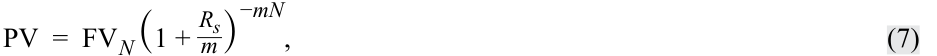

$$\text{PV} = \text{FV}_N \left(1 + \frac{R_s}{m}\right)^{-mN} \tag{7}$$

<!-- Formula Text: PV  =  FV N (1 + R s _ m ) −mN , (7) -->

trong đó:

- $m =$ số kỳ ghép lãi mỗi năm (*number of compounding periods per year*),

- $R_s =$ lãi suất niêm yết hàng năm (*quoted annual interest rate*), và

- $N =$ số năm (*number of years*).

Công thức trong Phương trình 7 khá giống với công thức giá trị hiện tại đơn giản. Như chúng ta đã lưu ý, thừa số giá trị hiện tại (*present value factor*) và thừa số giá trị tương lai (*future value factor*) là hai số nghịch đảo của nhau. Việc thay đổi tần suất ghép lãi không làm thay đổi kết quả này. Sự khác biệt duy nhất là việc sử dụng lãi suất định kỳ và số kỳ ghép lãi tương ứng. Ví dụ sau đây trình bày một ứng dụng của ghép lãi hàng tháng.

#### **VÍ DỤ 11 (EXAMPLE 11)** 

### **Giá trị hiện tại của một Khoản tiền trả một lần với Ghép lãi hàng tháng (The Present Value of a Lump Sum with Monthly Compounding)** 

Nhà quản lý của một quỹ hưu trí Canada biết rằng quỹ phải thực hiện một khoản thanh toán trả một lần (*lump-sum payment*) trị giá $5\text{ triệu CAD}$ vào thời điểm 10 năm kể từ ngày hôm nay. Cô ấy muốn đầu tư một số tiền ngay hôm nay vào một hợp đồng đầu tư đảm bảo (*guaranteed investment contract – GIC*) để số tiền đó tăng trưởng thành số tiền yêu cầu. Lãi suất hiện hành của các hợp đồng GIC là $6\%$ một năm, ghép lãi hàng tháng (*compounded monthly*).

1. Hôm nay cô ấy nên đầu tư bao nhiêu vào hợp đồng GIC?

**Lời giải (Solution):** 

Bằng cách áp dụng Phương trình 7, giá trị hiện tại yêu cầu được tính như sau:

<!-- PDF Page 38 -->

$$\begin{aligned}
\text{FV}_N &= \text{5.000.000 CAD} \\
R_s &= 6\% = 0,06 \\
m &= 12 \\
R_s / m &= 0,06 / 12 = 0,005 \\
N &= 10 \\
mN &= 12(10) = 120 \\
\text{PV} &= \text{FV}_N \left(1 + \frac{R_s}{m}\right)^{-mN} \\
&= \text{5.000.000 CAD}(1,005)^{-120} \\
&= \text{5.000.000 CAD}(0,549633) = \text{2.748.163,67 CAD}
\end{aligned}$$

Khi áp dụng Phương trình 7, chúng ta sử dụng lãi suất định kỳ (trong trường hợp này là lãi suất hàng tháng) và số kỳ phù hợp với việc ghép lãi hàng tháng (trong trường hợp này là 10 năm ghép lãi hàng tháng, hay 120 tháng).

### **Quy đổi Tỷ suất sinh lợi theo năm (Annualizing Returns)** 

Để quy đổi bất kỳ tỷ suất sinh lợi nào của một giai đoạn ngắn hơn một năm sang cơ sở hàng năm, tỷ suất sinh lợi của giai đoạn đó phải được ghép lãi theo số kỳ trong một năm. Tỷ suất sinh lợi hàng tháng được ghép lãi 12 lần, tỷ suất sinh lợi hàng tuần được ghép lãi 52 lần, và tỷ suất sinh lợi hàng quý được ghép lãi 4 lần. Tỷ suất sinh lợi hàng ngày thông thường được ghép lãi 365 lần. Đối với một số lượng ngày không phổ biến, chúng ta ghép lãi theo tỷ số giữa 365 chia cho số ngày đó.

Nếu tỷ suất sinh lợi hàng tuần là $0,2\%$, thì tỷ suất sinh lợi kép hàng năm là $10,95\%$ (có 52 tuần trong một năm):

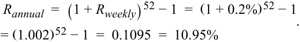

$$R_{\text{annual}} = (1 + R_{\text{weekly}})^{52} - 1 = (1 + 0,2\%)^{52} - 1 = (1,002)^{52} - 1 = 0,1095 = 10,95\%$$

<!-- Formula Text: R annual  =  (1 + R weekly) 52 − 1  =  (1 + 0.2%) 52 − 1 = (1.002) 52 − 1  =  0.1095  =  10.95% . -->

Nếu tỷ suất sinh lợi trong 15 ngày là $0,4\%$, thì tỷ suất sinh lợi quy đổi theo năm là $10,20\%$, giả định có 365 ngày trong một năm:

$$R_{\text{annual}} = (1 + R_{15})^{365/15} - 1 = (1 + 0,4\%)^{365/15} - 1 = (1,004)^{365/15} - 1 = 0,1020 = 10,20\%$$

<!-- Formula Text: R annual  =  (1 + R 15) 365/15 − 1  =  (1 + 0.4%) 365/15 − 1 = (1.004) 365/15 − 1  =  0.1020  =  10.20% . -->

Phương trình tổng quát để quy đổi tỷ suất sinh lợi theo năm được cho dưới đây, trong đó $c$ là số kỳ trong một năm. Đối với một quý, $c = 4$ và đối với một tháng, $c = 12$:

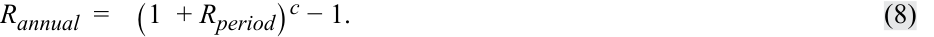

$$R_{\text{annual}} = (1 + R_{\text{period}})^c - 1 \tag{8}$$

<!-- Formula Text: R annual  =    (1  + R period) c − 1. (8) -->

Làm thế nào chúng ta có thể quy đổi một tỷ suất sinh lợi theo năm khi tỷ suất sinh lợi thời kỳ nắm giữ dài hơn một năm? Ví dụ, làm thế nào chúng ta quy đổi tỷ suất sinh lợi thời kỳ nắm giữ 18 tháng sang cơ sở hàng năm? Bởi vì một năm chứa hai phần ba của giai đoạn 18 tháng, nên $c = 2/3$ trong phương trình trên. Ví dụ, mức tỷ suất sinh lợi 18 tháng là $20\%$ có thể được quy đổi theo năm như sau:

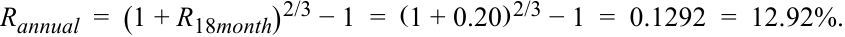

$$R_{\text{annual}} = (1 + R_{\text{18month}})^{2/3} - 1 = (1 + 0,20)^{2/3} - 1 = 0,1292 = 12,92\%$$

<!-- Formula Text: R annual  =  (1 + R 18month) 2/3 − 1  =  (1 + 0.20) 2/3 − 1  =  0.1292  =  12.92%. -->

Các biểu thức tương tự có thể được xây dựng khi cần sử dụng tỷ suất sinh lợi hàng quý hoặc hàng tuần để so sánh thay vì tỷ suất sinh lợi hàng năm. Trong những trường hợp như vậy, $c$ bằng số thời kỳ nắm giữ trong một quý hoặc trong một tuần. Ví dụ, giả sử bạn muốn chuyển đổi tỷ suất sinh lợi hàng ngày sang tỷ suất sinh lợi hàng tuần hoặc từ tỷ suất sinh lợi hàng năm sang tỷ suất sinh lợi hàng tuần để so sánh giữa các tỷ suất sinh lợi hàng tuần với nhau. Để chuyển đổi tỷ suất sinh lợi hàng ngày sang tỷ suất sinh lợi hàng tuần, $c = 5$, giả định rằng có năm ngày giao dịch (*trading days*) trong một tuần. Tuy nhiên, các phép tính tỷ suất sinh lợi hàng ngày có thể được quy đổi theo năm theo cách khác nhau. Ví dụ, có thể dùng 5 ngày mỗi tuần cho các phép tính dựa trên ngày giao dịch, tương ứng khoảng 250 ngày giao dịch một năm; hoặc có thể dùng 7 ngày mỗi tuần cho các phép tính dựa trên ngày lịch (*calendar-day-based calculations*). Các phương pháp cụ thể được sử dụng sẽ tuân theo các thông lệ kinh doanh, quy ước thị trường

<!-- PDF Page 39 -->

và các chuẩn mực cụ thể. Để chuyển đổi tỷ suất sinh lợi hàng năm sang tỷ suất sinh lợi hàng tuần, $c = 1/52$. Các biểu thức cho tỷ suất sinh lợi hàng năm khi đó có thể được viết lại thành các biểu thức cho tỷ suất sinh lợi hàng tuần như sau:

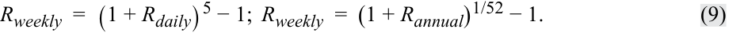

$$R_{\text{weekly}} = (1 + R_{\text{daily}})^5 - 1; \quad R_{\text{weekly}} = (1 + R_{\text{annual}})^{1/52} - 1 \tag{9}$$

<!-- Formula Text: R weekly  =  (1 + R daily) 5 − 1;  R weekly  =  (1 + R annual) 1/52 − 1. (9) -->

Một hạn chế lớn của việc quy đổi tỷ suất sinh lợi theo năm là giả định ngầm định (*implicit assumption*) rằng các tỷ suất sinh lợi có thể được lặp lại một cách chính xác, nghĩa là tiền có thể được tái đầu tư lặp đi lặp lại trong khi vẫn kiếm được một mức tỷ suất sinh lợi tương tự. Loại tỷ suất sinh lợi này không phải lúc nào cũng khả thi. Một nhà đầu tư có thể kiếm được mức tỷ suất sinh lợi $5\%$ trong một tuần bởi vì thị trường tăng mạnh vào tuần đó, nhưng rất khó có khả năng ông ấy sẽ kiếm được mức tỷ suất sinh lợi $5\%$ mỗi tuần trong suốt 51 tuần tiếp theo để tạo ra mức tỷ suất sinh lợi quy đổi theo năm lên tới $1.164,3\%$ ($= 1,05^{52} - 1$). Do đó, điều quan trọng là khi quy đổi các tỷ suất sinh lợi ngắn hạn theo năm, cần phải luôn ghi nhớ hạn chế này.

#### **VÍ DỤ 12 (EXAMPLE 12)** 

### **Tỷ suất sinh lợi quy đổi theo năm (Annualized Returns)** 

Một nhà phân tích muốn đánh giá ba chứng khoán mà cô đã nắm giữ trong danh mục đầu tư của mình trong các khoảng thời gian khác nhau.

   - Trong 100 ngày qua, Chứng khoán A đã kiếm được mức tỷ suất sinh lợi là $6,2\%$.

   - Chứng khoán B đã kiếm được $2\%$ trong bốn tuần qua.

   - Chứng khoán C đã kiếm được mức tỷ suất sinh lợi là $5\%$ trong ba tháng qua.

1. So sánh hiệu quả hoạt động tương đối của ba chứng khoán này.

#### **Lời giải (Solution):** 

Để thuận tiện cho việc so sánh, tỷ suất sinh lợi của ba chứng khoán cần được quy đổi theo năm:

- Tỷ suất sinh lợi quy đổi theo năm của Chứng khoán A: $R_{SA} = (1 + 0,062)^{365/100} - 1 = 0,2455 = 24,55\%$

- Tỷ suất sinh lợi quy đổi theo năm của Chứng khoán B: $R_{SB} = (1 + 0,02)^{52/4} - 1 = 0,2936 = 29,36\%$

- Tỷ suất sinh lợi quy đổi theo năm của Chứng khoán C: $R_{SC} = (1 + 0,05)^4 - 1 = 0,2155 = 21,55\%$

Chứng khoán B đã tạo ra mức tỷ suất sinh lợi quy đổi theo năm cao nhất.

#### **VÍ DỤ 13 (EXAMPLE 13)** 

### **Hiệu quả hoạt động của Quỹ hoán đổi danh mục (Exchange-Traded Fund Performance)** 

Một nhà đầu tư đang đánh giá tỷ suất sinh lợi của ba quỹ hoán đổi danh mục (*exchange-traded funds – ETFs*) mới được thành lập gần đây. Thông tin chọn lọc về tỷ suất sinh lợi của các quỹ ETF được trình bày trong Bảng 16 (*Exhibit 16*).

<!-- PDF Page 40 -->

#### **Bảng 16: Thông tin Hiệu quả hoạt động của các Quỹ ETF (Exhibit 16: ETF Performance Information)** 

|**ETF**|**Thời gian kể từ khi thành lập (Time Since Inception)**|**Tỷ suất sinh lợi kể từ khi thành lập (Return Since Inception) (%)**|
|---|---|---|
|1|146 ngày|4,61|
|2|5 tuần|1,10|
|3|15 tháng|14,35|

1. Quỹ ETF nào có tỷ suất sinh lợi quy đổi theo năm cao nhất?

   - **A.** ETF 1
   - **B.** ETF 2
   - **C.** ETF 3

   - **Lời giải (Solution):** 

- B là đáp án đúng. Tỷ suất sinh lợi quy đổi theo năm của ba quỹ ETF như sau:
  - Tỷ suất sinh lợi quy đổi theo năm của ETF 1 $= (1,0461^{365/146}) - 1 = 11,93\%$
  - Tỷ suất sinh lợi quy đổi theo năm của ETF 2 $= (1,0110^{52/5}) - 1 = 12,05\%$
  - Tỷ suất sinh lợi quy đổi theo năm của ETF 3 $= (1,1435^{12/15}) - 1 = 11,32\%$

Mặc dù có giá trị tỷ suất sinh lợi định kỳ thấp nhất, ETF 2 lại có tỷ suất sinh lợi quy đổi theo năm cao nhất do giả định lãi suất tái đầu tư và việc ghép lãi của mức sinh lợi định kỳ.

### **Tỷ suất sinh lợi ghép lãi liên tục (Continuously Compounded Returns)** 

Một khái niệm quan trọng là tỷ suất sinh lợi ghép lãi liên tục gắn với một tỷ suất sinh lợi thời kỳ nắm giữ, chẳng hạn như $R_1$. **Tỷ suất sinh lợi ghép lãi liên tục (*continuously compounded return*)** gắn với một tỷ suất sinh lợi thời kỳ nắm giữ là logarit tự nhiên (*natural logarithm*) của 1 cộng với tỷ suất sinh lợi thời kỳ nắm giữ đó, hoặc tương đương, là logarit tự nhiên của giá cuối kỳ chia cho giá đầu kỳ (tỷ số giá tương đối – *price relative*). Lưu ý rằng tại đây chúng ta đang sử dụng ký hiệu $r$ để chỉ riêng các tỷ suất sinh lợi ghép lãi liên tục, nhưng các giáo trình và nguồn tài liệu khác có thể sử dụng một ký hiệu khác.

Nếu chúng ta quan sát thấy tỷ suất sinh lợi thời kỳ nắm giữ một tuần là $0,04$, thì tỷ suất sinh lợi ghép lãi liên tục tương đương, được gọi là tỷ suất sinh lợi ghép lãi liên tục một tuần, là $\ln(1,04) = 0,039221$; $1,00\text{ EUR}$ được đầu tư trong một tuần ở mức lãi suất $0,039221$ ghép lãi liên tục sẽ mang lại $1,04\text{ EUR}$, tương đương với mức tỷ suất sinh lợi thời kỳ nắm giữ một tuần là $4\%$.

Tỷ suất sinh lợi ghép lãi liên tục từ thời điểm $t$ đến $t + 1$ là:

$$r_{t,t+1} = \ln(P_{t+1} / P_t) = \ln(1 + R_{t,t+1}) \tag{10}$$

<!-- Formula Text: rt,t+1 = ln(Pt+1/Pt) = ln(1 + Rt,t+1). (10) -->

Đối với ví dụ của chúng ta, một tài sản được mua tại thời điểm $t$ với mức giá $P_0$ là $30\text{ USD}$ và cùng tài sản đó một kỳ sau, tại $t + 1$, có giá trị $P_1$ là $34,50\text{ USD}$ sẽ có tỷ suất sinh lợi ghép lãi liên tục được cho bởi $r_{0,1} = \ln(P_1 / P_0) = \ln(1 + R_{0,1}) = \ln(\text{34,50 USD} / \text{30 USD}) = \ln(1,15) = 0,139762$.

Như vậy, $13,98\%$ là tỷ suất sinh lợi ghép lãi liên tục từ $t = 0$ đến $t = 1$. Tỷ suất sinh lợi ghép lãi liên tục nhỏ hơn tỷ suất sinh lợi thời kỳ nắm giữ tương ứng. Nếu khung thời gian đầu tư của chúng ta kéo dài từ $t = 0$ đến $t = T$, thì tỷ suất sinh lợi ghép lãi liên tục đến thời điểm $T$ là:

$$r_{0,T} = \ln(P_T / P_0) \tag{11}$$

<!-- Formula Text: r0,T = ln(PT/P0). (11) -->

Áp dụng hàm mũ (*exponential function*) cho cả hai vế của phương trình, chúng ta có $\exp(r_{0,T}) = \exp[\ln(P_T / P_0)] = P_T / P_0$, vì vậy:

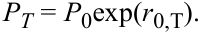

$$P_T = P_0 \exp(r_{0,T})$$

<!-- Formula Text: PT = P0exp(r0,T). -->

---

# Tập 1: Phương pháp Định lượng (Volume 1: Quantitative Methods)
## Học phần 1: Lãi suất và Tỷ suất sinh lợi (Learning Module 1: Rates and Returns)
### Phần 3/3: Các thước đo Tỷ suất sinh lợi chính yếu khác và Ứng dụng của chúng (Other Major Return Measures and Their Applications) (Trang PDF 41–52)

---

<!-- PDF Page 41 -->

Chúng ta cũng có thể biểu diễn $P_T / P_0$ dưới dạng tích của các tỷ số giá tương đối (*price relatives*):

$$P_T / P_0 = (P_T / P_{T-1})(P_{T-1} / P_{T-2}) \dots (P_1 / P_0) \tag{12}$$

Lấy logarit ở cả hai vế của phương trình này, chúng ta thấy rằng tỷ suất sinh lợi ghép lãi liên tục đến thời điểm $T$ bằng tổng của các tỷ suất sinh lợi ghép lãi liên tục một kỳ:

$$r_{0,T} = r_{T-1,T} + r_{T-2,T-1} + \dots + r_{0,1} \tag{13}$$

Việc sử dụng tỷ suất sinh lợi thời kỳ nắm giữ để tìm giá trị cuối kỳ của khoản đầu tư $1\text{ USD}$ đòi hỏi phép nhân các đại lượng $(1 + \text{tỷ suất sinh lợi thời kỳ nắm giữ})$. Ngược lại, việc sử dụng tỷ suất sinh lợi ghép lãi liên tục chỉ đòi hỏi phép cộng (như được thể hiện trong Phương trình 13), đây là một tính chất rất đáng mong đợi của tỷ suất sinh lợi ghép lãi liên tục và chúng ta sẽ sử dụng tính chất này xuyên suốt chương trình học.

### **CÁC THƯỚC ĐO TỶ SUẤT SINH LỢI CHÍNH YẾU KHÁC VÀ ỨNG DỤNG CỦA CHÚNG (OTHER MAJOR RETURN MEASURES AND THEIR APPLICATIONS)** 

# **<mark>6</mark>** 

tính toán và diễn giải các thước đo tỷ suất sinh lợi chính yếu khác và mô tả các trường hợp sử dụng phù hợp của chúng

Các thước đo thống kê về tỷ suất sinh lợi được thảo luận ở phần trước nhìn chung có thể áp dụng trên một phạm vi rộng lớn các tài sản và các khung thời gian. Tuy nhiên, những tài sản đặc thù như quỹ tương hỗ (*mutual funds*), và các yếu tố cân nhắc khác như thuế hoặc lạm phát, có thể đòi hỏi các thước đo tỷ suất sinh lợi cụ thể hơn.

Mặc dù không thể xem xét tất cả các loại thước đo đặc thù, chúng ta sẽ thảo luận về tác động của các khoản phí (tỷ suất sinh lợi gộp so với tỷ suất sinh lợi ròng – *gross versus net returns*), thuế (tỷ suất sinh lợi trước thuế và sau thuế – *pre-tax and after-tax returns*), lạm phát (tỷ suất sinh lợi danh nghĩa và thực – *nominal and real returns*), và tác động của **đòn bẩy (*leverage*)**. Nhiều nhà đầu tư sử dụng quỹ tương hỗ hoặc các pháp nhân bên ngoài khác (tức các phương tiện đầu tư – *investment vehicles*) để đầu tư. Trong những trường hợp đó, các quỹ sẽ thu phí quản lý và các chi phí hoạt động đối với nhà đầu tư. Do đó, tỷ suất sinh lợi gộp (*gross return*) và tỷ suất sinh lợi ròng sau khi trừ chi phí quỹ (*net-of-fund-expense return*) cũng cần được xem xét. Tất nhiên, một nhà đầu tư có thể quan tâm đến tỷ suất sinh lợi thực sau thuế và sau chi phí (*net-of-expenses after-tax real return*), vốn trên thực tế chính là những gì nhà đầu tư thực sự nhận được. Chúng ta sẽ xem xét các thước đo tỷ suất sinh lợi bổ sung này trong các mục tiếp theo.

#### **Tỷ suất sinh lợi gộp và Tỷ suất sinh lợi ròng (Gross and Net Return)** 

**Tỷ suất sinh lợi gộp (*gross return*)** là tỷ suất sinh lợi trên tài sản thuộc quyền quản lý trừ đi mọi chi phí giao dịch (*trading expenses*) và hoa hồng (*commissions*). Tỷ suất sinh lợi gộp nhằm mục đích phản ánh kỹ năng đầu tư của nhà quản lý. Các chi phí bao gồm phí quản lý (*management fees*), phí lưu ký (*custody fees*) và thuế không được tính vào tỷ suất sinh lợi gộp bởi vì chúng có thể khác nhau đối với từng nhà đầu tư khác nhau. Ví dụ, hầu hết các nhà quản lý tài sản áp dụng mức phí quản lý thấp hơn cho các tài khoản có quy mô lớn hơn. Việc loại trừ các chi phí này trong tỷ suất sinh lợi gộp cung cấp một cơ sở chung để đánh giá và so sánh kỹ năng quản lý đầu tư.

**Tỷ suất sinh lợi ròng (*net return*)** là thước đo những gì mà phương tiện đầu tư (ví dụ: quỹ tương hỗ) đã kiếm được cho nhà đầu tư. Tỷ suất sinh lợi ròng tính đến (tức là khấu trừ đi) tất cả các chi phí quản lý và hành chính (*managerial and administrative expenses*) làm giảm tỷ suất sinh lợi của nhà đầu tư. Bởi vì các nhà đầu tư cá nhân quan tâm nhất đến tỷ suất sinh lợi ròng (tức là những gì họ thực sự nhận về), nên các quỹ tương hỗ nhỏ với quy mô tài sản thuộc quyền quản lý hạn chế sẽ ở thế bất lợi so với các quỹ lớn hơn vốn có thể phân bổ các chi phí hành chính phần lớn là cố định của họ trên một cơ sở tài sản lớn hơn. Do đó, nhiều quỹ tương hỗ nhỏ miễn giảm một phần chi phí để giữ cho quỹ có tính cạnh tranh.

<!-- PDF Page 42 -->

#### **Tỷ suất sinh lợi danh nghĩa trước thuế và sau thuế (Pre-Tax and After-Tax Nominal Return)** 

Tất cả các thước đo tỷ suất sinh lợi được thảo luận cho đến thời điểm này đều là **tỷ suất sinh lợi danh nghĩa trước thuế (*pre-tax nominal returns*)** — nghĩa là chưa có sự điều chỉnh nào được thực hiện đối với thuế hoặc lạm phát. Nhìn chung, mọi tỷ suất sinh lợi đều là tỷ suất sinh lợi danh nghĩa trước thuế trừ khi chúng được chỉ định khác đi.

Nhiều nhà đầu tư lo ngại về nghĩa vụ thuế có thể phát sinh gắn với tỷ suất sinh lợi của họ bởi vì thuế làm giảm tỷ suất sinh lợi ròng mà họ nhận được. Lãi vốn (*capital gains*) và thu nhập (*income*) có thể bị đánh thuế khác nhau, tùy thuộc vào khu vực tài phán. Lãi vốn có hai dạng: lãi vốn ngắn hạn (*short-term capital gains*) và lãi vốn dài hạn (*long-term capital gains*). Lãi vốn dài hạn nhận được chế độ ưu đãi thuế tại một số quốc gia. Thu nhập tiền lãi (*interest income*) bị đánh thuế như thu nhập thông thường (*ordinary income*) ở hầu hết các quốc gia. Thu nhập cổ tức (*dividend income*) có thể bị đánh thuế như thu nhập thông thường, có thể chịu mức thuế suất thấp hơn, hoặc có thể được miễn thuế tùy thuộc vào quốc gia và loại hình nhà đầu tư. **Tỷ suất sinh lợi danh nghĩa sau thuế (*after-tax nominal return*)** được tính bằng tổng tỷ suất sinh lợi trừ đi bất kỳ khoản dự phòng thuế nào đánh trên cổ tức, tiền lãi và lãi vốn đã thực hiện (*realized gains*). Trái phiếu được phát hành với giá chiết khấu so với mệnh giá (*discount to the par value*) có thể bị đánh thuế dựa trên lãi vốn dồn tích (*accrued gains*) thay vì lãi vốn đã thực hiện.

Bởi vì thuế được nộp trên lãi vốn đã thực hiện và thu nhập, nên nhà quản lý đầu tư có thể giảm thiểu nghĩa vụ thuế bằng cách lựa chọn các chứng khoán phù hợp (ví dụ: những chứng khoán được hưởng cơ chế thuế thuận lợi hơn, khi tất cả các yếu tố cân nhắc đầu tư khác đều như nhau) và giảm vòng quay giao dịch (*trading turnover*). Do đó, các nhà đầu tư chịu thuế đánh giá các nhà quản lý đầu tư dựa trên tỷ suất sinh lợi danh nghĩa sau thuế.

#### **Tỷ suất sinh lợi thực (Real Returns)** 

Trước đó, học phần này đã tính xấp xỉ mối quan hệ giữa lãi suất danh nghĩa và lãi suất thực bằng mối quan hệ sau:

$$(1 + \text{Lãi suất phi rủi ro danh nghĩa}) = (1 + \text{Lãi suất phi rủi ro thực})(1 + \text{Phần bù lạm phát})$$

Mối quan hệ này có thể được mở rộng để liên kết mối quan hệ giữa tỷ suất sinh lợi danh nghĩa (*nominal return*) và tỷ suất sinh lợi thực (*real return*). Cụ thể, tỷ suất sinh lợi danh nghĩa bao gồm lãi suất phi rủi ro thực để đền bù cho việc trì hoãn tiêu dùng; lạm phát phản ánh sự sụt giảm sức mua; và phần bù rủi ro (*risk premium*) cho việc gánh chịu rủi ro. Thường thì tỷ suất sinh lợi phi rủi ro thực và phần bù rủi ro được kết hợp lại để tạo thành lãi suất “có rủi ro” thực (*real “risky” rate*) và được gọi đơn giản là **tỷ suất sinh lợi thực (*real return*)**, hay:

$$(1 + \text{Tỷ suất sinh lợi thực}) = (1 + \text{Lãi suất phi rủi ro thực})(1 + \text{Phần bù rủi ro}) \tag{14}$$

<!-- Formula Text: (1 + real return)  =  (1 + real risk–free rate)(1 + risk premium). (14) -->

*(Lưu ý: Do $(1 + \text{TSSL danh nghĩa}) = (1 + \text{Lãi suất phi rủi ro thực})(1 + \text{Phần bù rủi ro})(1 + \text{Tỷ lệ lạm phát})$, nên $(1 + \text{TSSL thực}) = \frac{1 + \text{TSSL danh nghĩa}}{1 + \text{Tỷ lệ lạm phát}}$).*

Tỷ suất sinh lợi thực đặc biệt hữu ích khi so sánh tỷ suất sinh lợi qua các giai đoạn thời gian khác nhau bởi vì tỷ lệ lạm phát có thể biến động theo thời gian. Tỷ suất sinh lợi thực cũng hữu ích khi so sánh tỷ suất sinh lợi giữa các quốc gia khi tỷ suất sinh lợi được biểu thị bằng đồng nội tệ thay vì một đồng tiền cố định của nhà đầu tư và khi tỷ lệ lạm phát khác nhau giữa các quốc gia (điều thường xuyên xảy ra trên thực tế).

Cuối cùng, **tỷ suất sinh lợi thực sau thuế (*after-tax real return*)** là những gì nhà đầu tư nhận được như khoản đền bù cho việc trì hoãn tiêu dùng và gánh chịu rủi ro sau khi đã nộp thuế trên lợi nhuận đầu tư. Do đó, tỷ suất sinh lợi thực sau thuế trở thành một tiêu chuẩn tham chiếu (*benchmark*) đáng tin cậy để đưa ra các quyết định đầu tư. Mặc dù đây là thước đo tỷ suất sinh lợi chuẩn của một nhà đầu tư, nhưng nó không thường được các nhà quản lý tài sản tính toán bởi vì rất khó để ước tính một thành phần thuế chung áp dụng được cho tất cả các nhà đầu tư. Ví dụ, thành phần thuế phụ thuộc vào mức thuế suất cụ thể của từng nhà đầu tư (thuế suất biên – *marginal tax rate*), thời gian nhà đầu tư nắm giữ khoản đầu tư (dài hạn so với ngắn hạn), và loại tài khoản mà tài sản được nắm giữ trong đó (miễn thuế – *tax-exempt*, hoãn thuế – *tax-deferred*, hay tài khoản thông thường – *normal*).

<!-- PDF Page 43 -->

##### **VÍ DỤ 14 (EXAMPLE 14)** 

#### **Tính toán các Tỷ suất sinh lợi đặc thù (Computation of Special Returns)** 

Hãy quay lại Ví dụ 8. Sau khi đọc mục này, ông Lohrmann quyết định rằng ông đã không công bằng với nhà quản lý quỹ khi tính gộp cả phí quản lý tài sản và các chi phí khác bởi vì quy mô nhỏ của quỹ sẽ đặt nó vào thế bất lợi cạnh tranh. Ông biết được rằng quỹ chi một khoản tiền cố định là $500.000\text{ EUR}$ mỗi năm cho các chi phí không liên quan đến hiệu quả hoạt động của nhà quản lý.

Ông Lohrmann bắt đầu lo ngại rằng cả thuế và lạm phát có thể làm giảm tỷ suất sinh lợi của mình. Dựa trên luật thuế hiện hành, ông dự kiến phải nộp thuế $20\%$ trên mức sinh lợi kiếm được từ khoản đầu tư của mình. Trong lịch sử, lạm phát ở mức khoảng $2\%$ và ông kỳ vọng mức tỷ lệ lạm phát tương tự sẽ tiếp tục được duy trì.

1. Ước tính tỷ suất sinh lợi gộp (*gross return*) hàng năm cho năm thứ nhất bằng cách cộng ngược lại các chi phí cố định.

##### **Lời giải (Solution):** 

Tỷ suất sinh lợi gộp cho năm thứ nhất cao hơn $1,67\%$ ($= \text{500.000 EUR} / \text{30.000.000 EUR}$) so với mức tỷ suất sinh lợi của nhà đầu tư là $15\%$ do quỹ báo cáo. Do đó, tỷ suất sinh lợi gộp cho năm thứ nhất là $16,67\%$ ($= 15\% + 1,67\%$).

2. Tỷ suất sinh lợi ròng (*net return*) mà các nhà đầu tư vào Quỹ Rhein Valley Superior kiếm được trong giai đoạn năm năm là bao nhiêu?

##### **Lời giải (Solution):** 

Tỷ suất sinh lợi của nhà đầu tư do quỹ tương hỗ báo cáo chính là tỷ suất sinh lợi ròng của quỹ sau khi đã tính đến tất cả các chi phí trực tiếp và gián tiếp. Tỷ suất sinh lợi ròng này cũng là tỷ suất sinh lợi danh nghĩa trước thuế (*pre-tax nominal return*) bởi vì nó chưa được điều chỉnh theo thuế hoặc lạm phát. Từ Ví dụ 8, tỷ suất sinh lợi ròng cho thời kỳ nắm giữ năm năm đã được tính là $42,35\%$.

3. Tỷ suất sinh lợi ròng sau thuế (*after-tax net return*) cho năm thứ nhất mà các nhà đầu tư kiếm được từ Quỹ Rhein Valley Superior là bao nhiêu? Giả sử rằng tất cả các khoản lãi đều được hiện thực hóa vào cuối năm và thuế được nộp ngay lập tức tại thời điểm đó.

##### **Lời giải (Solution):** 

Tỷ suất sinh lợi ròng mà các nhà đầu tư kiếm được trong năm thứ nhất là $15\%$. Áp dụng mức thuế suất $20\%$, tỷ suất sinh lợi sau thuế thuộc về các nhà đầu tư là $12\%$ $[= 15\% - (0,20 \times 15\%)]$.

4. Tỷ suất sinh lợi thực sau thuế (*after-tax real return*) mà các nhà đầu tư kiếm được trong năm thứ năm là bao nhiêu?

##### **Lời giải (Solution):** 

Tỷ suất sinh lợi sau thuế mà các nhà đầu tư kiếm được trong năm thứ năm là $2,4\%$ $[= 3\% - (0,20 \times 3\%)]$. Lạm phát làm giảm tỷ suất sinh lợi đi $2\%$ nên tỷ suất sinh lợi thực sau thuế mà các nhà đầu tư kiếm được trong năm thứ năm là $0,39\%$, như được thể hiện dưới đây:

$$\frac{1 + 2,40\%}{1 + 2,00\%} - 1 = \frac{1 + 0,0240}{1 + 0,0200} - 1 = 1,0039 - 1 = 0,0039 = 0,39\%$$

Lưu ý rằng thuế được nộp trước khi điều chỉnh theo lạm phát.

<!-- PDF Page 44 -->

#### **Tỷ suất sinh lợi có đòn bẩy (Leveraged Return)** 

Trong các phép tính trước, chúng ta đã giả định rằng vị thế của nhà đầu tư trong một tài sản đúng bằng tổng số tiền đầu tư được thực hiện bởi nhà đầu tư bằng chính tiền tự có của họ. Mục này có sự khác biệt ở chỗ nhà đầu tư tạo ra một vị thế có đòn bẩy (*leveraged position*).

Có hai cách để tạo ra quyền thụ hưởng đối với tỷ suất sinh lợi của tài sản lớn hơn số tiền đầu tư bằng vốn tự có của một người. Thứ nhất, nhà đầu tư có thể giao dịch các hợp đồng tương lai (*futures contracts*), trong đó số tiền yêu cầu để mở một vị thế có thể chỉ bằng $10\%$ giá trị danh nghĩa (*notional value*) của tài sản. Trong trường hợp này, tỷ suất sinh lợi có đòn bẩy, tức tỷ suất sinh lợi tính trên vốn tự có của nhà đầu tư, gấp 10 lần tỷ suất sinh lợi thực tế của chứng khoán cơ sở. Cả lãi và lỗ đều bị khuếch đại lên theo hệ số 10 lần.

Các nhà đầu tư cũng có thể đầu tư nhiều hơn số tiền tự có của mình bằng cách vay tiền để mua tài sản. Cách tiếp cận này được thực hiện dễ dàng đối với cổ phiếu và trái phiếu, và rất phổ biến khi đầu tư vào bất động sản. Nếu một nửa ($50\%$) số tiền đầu tư là vốn vay, thì tỷ suất sinh lợi gộp đối với nhà đầu tư sẽ tăng gấp đôi, nhưng tiền lãi phải trả cho khoản tiền vay phải được khấu trừ đi để tính tỷ suất sinh lợi ròng.

Khi sử dụng vốn vay (*borrowed capital / debt*), quy mô của vị thế có đòn bẩy tăng lên thêm một lượng bằng số vốn vay bổ sung. Nếu tổng tỷ suất sinh lợi đầu tư kiếm được trên danh mục có đòn bẩy, $R_P$, vượt quá chi phí vay nợ, $r_D$, việc sử dụng đòn bẩy sẽ làm tăng tỷ suất sinh lợi trên vốn chủ sở hữu của danh mục. Ký hiệu tỷ suất sinh lợi của danh mục có đòn bẩy là $R_L$, khi đó tỷ suất sinh lợi này có thể được tính như sau:

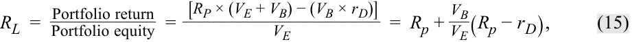

$$R_L = \frac{\text{Lợi nhuận danh mục (Portfolio return)}}{\text{Vốn chủ sở hữu danh mục (Portfolio equity)}} = \frac{[R_P \times (V_E + V_B) - (V_B \times r_D)]}{V_E} = R_P + \frac{V_B}{V_E}(R_P - r_D) \tag{15}$$

<!-- Formula Text: R L  =   Portfolio return ___________ Portfolio equity   = [R P × (V E + V B) − (V B × r D)] _____________________ V E =  R p + V B _ V E (R p − r D), (15) -->

trong đó $V_E$ là vốn chủ sở hữu (*equity*) của danh mục đầu tư và $V_B$ là khoản nợ hay vốn vay (*debt or borrowed funds*). Nếu $R_P < r_D$ thì đòn bẩy sẽ làm giảm $R_L$.

Ví dụ, đối với một danh mục đầu tư cổ phiếu trị giá $10\text{ triệu EUR}$ tạo ra tổng tỷ suất sinh lợi đầu tư $R_P$ là $8\%$ trong một năm và được tài trợ $30\%$ bằng nợ vay với lãi suất $5\%$, thì tỷ suất sinh lợi có đòn bẩy, $R_L$, là:

$$R_L = R_P + \frac{V_B}{V_E}(R_P - r_D) = 8\% + \frac{\text{3 triệu EUR}}{\text{7 triệu EUR}}(8\% - 5\%) = 8\% + 0,43 \times 3\%$$

$$= 9,29\%$$

<!-- Formula Text: =  9.29%. -->

##### **VÍ DỤ 15 (EXAMPLE 15)** 

#### **Tính toán Tỷ suất sinh lợi (Return Calculations)** 

Một nhà phân tích quan sát thấy tỷ suất sinh lợi trung bình nhân lịch sử của các loại tài sản (*asset classes*) như sau:

**Bảng 17: Tỷ suất sinh lợi trung bình nhân của các Loại tài sản (Exhibit 17: Asset Class Geometric Return)** 

|**Loại tài sản (Asset Class)**|**Tỷ suất sinh lợi trung bình nhân (Geometric Return) (%)**|
|---|---|
|Cổ phiếu (*Equities*)|8,0|
|Trái phiếu doanh nghiệp (*Corporate Bonds*)|6,5|
|Tín phiếu Kho bạc (*Treasury bills*)|2,5|
|Lạm phát (*Inflation*)|2,1|

1. Tỷ suất sinh lợi thực (*real rate of return*) của cổ phiếu _gần nhất_ với mức nào sau đây:

   - **A.** $5,4\%$.

   - **B.** $5,8\%$.

<!-- PDF Page 45 -->

   - **C.** $5,9\%$.

   - **Lời giải (Solution):** 

B là đáp án đúng. Tỷ suất sinh lợi thực của cổ phiếu được tính như sau:

$$(1 + 0,080) / (1 + 0,0210) - 1 = 5,8\%$$

2. Tỷ suất sinh lợi thực của trái phiếu doanh nghiệp _gần nhất_ với mức nào sau đây:
   - **A.** $4,3\%$.
   - **B.** $4,4\%$.
   - **C.** $4,5\%$.

   - **Lời giải (Solution):** 

A là đáp án đúng. Tỷ suất sinh lợi thực của trái phiếu doanh nghiệp được tính như sau:

$$(1 + 0,065) / (1 + 0,0210) - 1 = 4,3\%$$

3. Phần bù rủi ro (*risk premium*) của cổ phiếu _gần nhất_ với mức nào sau đây:

   - **A.** $5,4\%$.
   - **B.** $5,5\%$.
   - **C.** $5,6\%$.

   - **Lời giải (Solution):** 

A là đáp án đúng. Phần bù rủi ro của cổ phiếu được tính như sau:

$$(1 + 0,080) / (1 + 0,0250) - 1 = 5,4\%$$

4. Phần bù rủi ro của trái phiếu doanh nghiệp _gần nhất_ với mức nào sau đây:

   - **A.** $3,5\%$.
   - **B.** $3,9\%$.
   - **C.** $4,0\%$.

   - **Lời giải (Solution):** 

B là đáp án đúng. Phần bù rủi ro của trái phiếu doanh nghiệp được tính như sau:

$$(1 + 0,0650) / (1 + 0,0250) - 1 = 3,9\%$$

<!-- PDF Page 46 -->

## **BÀI TẬP THỰC HÀNH (PRACTICE PROBLEMS)** 

**1.** Lãi suất phi rủi ro danh nghĩa (*nominal risk-free rate*) được mô tả _đúng nhất_ là tổng của lãi suất phi rủi ro thực và một phần bù cho:

   - **A.** kỳ hạn (*maturity*).

   - **B.** thanh khoản (*liquidity*).

   - **C.** lạm phát dự kiến (*expected inflation*).

**2.** Phần bù rủi ro nào sau đây có liên quan nhiều nhất trong việc giải thích sự chênh lệch lợi suất (*yields*) giữa trái phiếu kỳ hạn 30 năm do Kho bạc Hoa Kỳ phát hành và trái phiếu kỳ hạn 30 năm do một tổ chức phát hành doanh nghiệp tư nhân quy mô nhỏ của Hoa Kỳ phát hành?

   - **A.** Lạm phát (*Inflation*)

   - **B.** Kỳ hạn (*Maturity*)

   - **C.** Thanh khoản (*Liquidity*)

**3.** Xét tỷ suất sinh lợi hàng năm sau đây của Quỹ Y trong năm năm qua:

**Bảng 1: Tỷ suất sinh lợi hàng năm trong năm năm (Exhibit 1: Five-Year Annual Returns)** 

|**Năm (Year)**|**Tỷ suất sinh lợi (Return) (%)**|
|---|---|
|Năm 1 (Year 1)|19,5|
|Năm 2 (Year 2)|−1,9|
|Năm 3 (Year 3)|19,7|
|Năm 4 (Year 4)|35,0|
|Năm 5 (Year 5)|5,7|

Tỷ suất sinh lợi trung bình nhân (*geometric mean return*) của Quỹ Y _gần nhất_ với mức nào sau đây:

   - **A.** $14,9\%$.

   - **B.** $15,6\%$.

   - **C.** $19,5\%$.

**4.** Một nhà quản lý danh mục đầu tư định kỳ hàng năm $5.000\text{ EUR}$ vào một chứng khoán trong bốn năm ở các mức giá sau:

**Bảng 1: Giá mua trong bốn năm (Exhibit 1: Five-Year Purchase Prices)** 

|**Năm (Year)**|**Giá mua (Purchase Price - euro mỗi đơn vị)**|
|---|---|
|Năm 1 (Year 1)|62,00|
|Năm 2 (Year 2)|76,00|

<!-- PDF Page 47 -->

|**Năm (Year)**|**Giá mua (Purchase Price - euro mỗi đơn vị)**|
|---|---|
|Năm 3 (Year 3)|84,00|
|Năm 4 (Year 4)|90,00|

Mức giá trung bình được đại diện _đúng nhất_ bởi:

   - **A.** trung bình điều hòa (*harmonic mean*) là $76,48\text{ EUR}$.

   - **B.** trung bình nhân (*geometric mean*) là $77,26\text{ EUR}$.

   - **C.** trung bình cộng (*arithmetic average*) là $78,00\text{ EUR}$.

**5.** Phát biểu nào sau đây liên quan đến trung bình cộng và trung bình nhân là đúng?

   - **A.** Trung bình nhân sẽ lớn hơn trung bình cộng đối với một chuỗi dữ liệu có phương sai khác không.

   - **B.** Trung bình nhân đo lường tốc độ tăng trưởng kép của một khoản đầu tư qua nhiều kỳ.

   - **C.** Trung bình cộng đo lường giá trị cuối kỳ (*terminal value*) của một khoản đầu tư qua nhiều kỳ.

**6.** Một quỹ nhận các khoản đầu tư vào đầu mỗi năm và tạo ra tỷ suất sinh lợi trong ba năm như sau:

**Bảng 1: Các khoản đầu tư và Tỷ suất sinh lợi trong Ba năm (Exhibit 1: Investments and Returns for Three Years)** 

|**Năm đầu tư (Year of Investment)**|**Tài sản thuộc quyền quản lý vào đầu mỗi năm (Assets under Management at the Beginning of each year)**|**Tỷ suất sinh lợi trong năm đầu tư (Return during Year of Investment)**|
|---|---|---|
|1|USD 1.000|15%|
|2|USD 4.000|14%|
|3|USD 45.000|−4%|

Thước đo tỷ suất sinh lợi nào trong giai đoạn ba năm nhận giá trị âm?

   - **A.** Tỷ suất sinh lợi trung bình nhân (*Geometric mean return*)

   - **B.** Tỷ suất sinh lợi có trọng số thời gian (*Time-weighted rate of return*)

   - **C.** Tỷ suất sinh lợi có trọng số tiền tệ (*Money-weighted rate of return*)

**7.** Vào đầu Năm 1, một quỹ có $10\text{ triệu USD}$ tài sản thuộc quyền quản lý; quỹ kiếm được mức tỷ suất sinh lợi là $14\%$ trong năm đó. Quỹ thu hút thêm một lượng vốn ròng là $100\text{ triệu USD}$ vào đầu Năm 2 và kiếm được mức tỷ suất sinh lợi là $8\%$ cho năm đó. Tỷ suất sinh lợi có trọng số tiền tệ của quỹ _có khả năng cao nhất_ là:

   - **A.** nhỏ hơn tỷ suất sinh lợi có trọng số thời gian.

   - **B.** bằng với tỷ suất sinh lợi có trọng số thời gian.

   - **C.** lớn hơn tỷ suất sinh lợi có trọng số thời gian.

**8.** Một nhà đầu tư đang đánh giá tỷ suất sinh lợi của ba quỹ ETF mới được thành lập gần đây. Thông tin

<!-- PDF Page 48 -->

chọn lọc về tỷ suất sinh lợi của các quỹ ETF được trình bày trong Bảng 1:

**Bảng 1: Tỷ suất sinh lợi của các Quỹ ETF (Exhibit 1: Returns on ETFs)** 

|**ETF**|**Thời gian kể từ khi thành lập (Time Since Inception)**|**Tỷ suất sinh lợi kể từ khi thành lập (Return Since Inception) (%)**|
|---|---|---|
|1|125 ngày|4,25|
|2|8 tuần|1,95|
|3|16 tháng|17,18|

Quỹ ETF nào có tỷ suất sinh lợi quy đổi theo năm (*annualized rate of return*) cao nhất?

   - **A.** ETF 1

   - **B.** ETF 2

   - **C.** ETF 3

**9.** Giá của một cổ phiếu tại thời điểm $t = 0$ là $208,25\text{ USD}$ và tại thời điểm $t = 1$ là $186,75\text{ USD}$. Tỷ suất sinh lợi ghép lãi liên tục (*continuously compounded rate of return*), $r_{0,1}$, của cổ phiếu từ $t = 0$ đến $t = 1$ _gần nhất_ với mức nào sau đây:

   - **A.** $-10,90\%$.

   - **B.** $-10,32\%$.

   - **C.** $11,51\%$.

**10.** Một danh mục đầu tư cổ phiếu trị giá $25\text{ triệu USD}$ được tài trợ $20\%$ bằng nợ vay với chi phí hàng năm là $6\%$. Nếu danh mục cổ phiếu đó tạo ra tổng tỷ suất sinh lợi đầu tư hàng năm là $10\%$, thì tỷ suất sinh lợi có đòn bẩy (*leveraged return*) là:

   - **A.** $11,0\%$.

   - **B.** $11,2\%$.

   - **C.** $13,2\%$.

**11.** Tỷ suất sinh lợi gộp (*gross return*) của một nhà quản lý đầu tư là:

   - **A.** tỷ suất sinh lợi danh nghĩa sau thuế đã điều chỉnh theo rủi ro.

   - **B.** tỷ suất sinh lợi do nhà quản lý kiếm được trước khi khấu trừ chi phí giao dịch (*trading expenses*).

   - **C.** một thước đo thường được sử dụng để đánh giá kỹ năng của nhà quản lý đầu tư bởi vì nó không bao gồm các chi phí liên quan đến quản lý hoặc hành chính.

**12.** Chiến lược sử dụng đòn bẩy (*leverage*) để gia tăng tỷ suất sinh lợi đầu tư:

   - **A.** khuếch đại các khoản lãi nhưng không khuếch đại các khoản lỗ.

   - **B.** làm tăng gấp đôi tỷ suất sinh lợi ròng nếu một nửa số vốn đầu tư là vốn vay.

   - **C.** chỉ làm tăng tổng tỷ suất sinh lợi đầu tư nếu tỷ suất sinh lợi kiếm được vượt quá chi phí vay vốn.

**13.** Vào đầu năm, một nhà đầu tư nắm giữ $10.000\text{ EUR}$ trong một quỹ phòng hộ (*hedge fund*). Nhà đầu tư đã vay $25\%$ giá mua, tức $2.500\text{ EUR}$, với lãi suất hàng năm là $6\%$ và dự kiến sẽ phải nộp mức thuế $30\%$ trên tỷ suất sinh lợi mà mình

<!-- PDF Page 49 -->

kiếm được từ khoản đầu tư đó. Vào cuối năm, quỹ phòng hộ báo cáo thông tin trong Bảng 1:

|**Bảng 1: Khoản đầu tư vào Quỹ phòng hộ (Exhibit 1: Hedge Fund Investment)**||
|---|---|
|Tỷ suất sinh lợi gộp (*Gross return*)|8,46%|
|Chi phí giao dịch (*Trading expenses*)|1,10%|
|Chi phí quản lý và hành chính (*Managerial and administrative expenses*)|1,60%|

Tỷ suất sinh lợi sau thuế của nhà đầu tư đối với khoản đầu tư vào quỹ phòng hộ _gần nhất_ với mức nào sau đây:

- **A.** $3,60\%$.

- **B.** $3,98\%$.

- **C.** $5,00\%$.

<!-- PDF Page 50 -->

## **LỜI GIẢI (SOLUTIONS)** 

1. C là đáp án đúng. Lãi suất phi rủi ro danh nghĩa được tính xấp xỉ bằng tổng của lãi suất phi rủi ro thực và phần bù lạm phát.

2. C là đáp án đúng. Trái phiếu Kho bạc Hoa Kỳ có tính thanh khoản rất cao, trong khi trái phiếu của các tổ chức phát hành nhỏ giao dịch không thường xuyên và lãi suất của chúng bao gồm một phần bù thanh khoản (*liquidity premium*). Phần bù thanh khoản này phản ánh chi phí tương đối cao (bao gồm cả tác động lên giá) của việc bán đi một vị thế. Do hai đợt phát hành trái phiếu có cùng kỳ hạn 30 năm, nên sự chênh lệch quan sát được trong lợi suất sẽ không được giải thích bởi yếu tố kỳ hạn. Hơn nữa, phần bù lạm phát hàm chứa trong lợi suất của cả hai trái phiếu nhiều khả năng là tương tự nhau vì cả hai đều là trái phiếu đặt tại Hoa Kỳ với cùng kỳ hạn.

3. A là đáp án đúng. Tỷ suất sinh lợi trung bình nhân của Quỹ Y được tính như sau:

   $$\bar{R}_G = [(1 + 0,195) \times (1 - 0,019) \times (1 + 0,197) \times (1 + 0,350) \times (1 + 0,057)]^{(1/5)} - 1 = 14,9\%$$

4. A là đáp án đúng. Trung bình điều hòa phù hợp để xác định mức giá trung bình trên mỗi đơn vị vì nó gán trọng số bằng nhau cho mỗi khoản đầu tư định kỳ và làm giảm ảnh hưởng tiềm tàng của các giá trị ngoại lai. Nó được tính như sau:

   $$\bar{X}_H = 4 / [(1 / 62,00) + (1 / 76,00) + (1 / 84,00) + (1 / 90,00)] = \text{76,48 EUR}$$

5. B là đáp án đúng. Trung bình nhân ghép lãi các tỷ suất sinh lợi định kỳ của mọi kỳ, mang lại cho nhà đầu tư một thước đo chính xác hơn về giá trị cuối kỳ của một khoản đầu tư.

6. C là đáp án đúng. Tỷ suất sinh lợi có trọng số tiền tệ xem xét cả thời điểm và quy mô của các khoản đầu tư vào quỹ. Để tính tỷ suất sinh lợi có trọng số tiền tệ, hãy lập bảng kê tỷ suất sinh lợi hàng năm và số tiền đầu tư để xác định các dòng tiền.

|**Năm (Year)**|**1**|**2**|**3**|
|---|---|---|---|
|Số dư từ năm trước (*Balance from previous year*)|0|USD 1.150|USD 4.560|
|Khoản đầu tư mới (*New investment*)|USD 1.000|USD 2.850|USD 40.440|
|Số dư ròng vào đầu năm (*Net balance at the beginning of year*)|USD 1.000|USD 4.000|USD 45.000|
|Tỷ suất sinh lợi đầu tư trong năm (*Investment return for the year*)|15%|14%|−4%|
|Lãi (lỗ) đầu tư (*Investment gain (loss)*)|USD 150|USD 560|−USD 1.800|
|Số dư vào cuối năm (*Balance at the end of year*)|USD 1.150|USD 4.560|USD 43.200|

$$CF_0 = -\text{1.000 USD}, \quad CF_1 = -\text{2.850 USD}, \quad CF_2 = -\text{40.440 USD}, \quad CF_3 = +\text{43.200 USD}$$

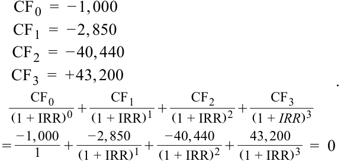

$$\begin{aligned}
CF_0 &= -1.000 \\
CF_1 &= -2.850 \\
CF_2 &= -40.440 \\
CF_3 &= +43.200 \\
\frac{CF_0}{(1 + \text{IRR})^0} + \frac{CF_1}{(1 + \text{IRR})^1} + \frac{CF_2}{(1 + \text{IRR})^2} + \frac{CF_3}{(1 + \text{IRR})^3} &= \frac{-1.000}{1} + \frac{-2.850}{(1 + \text{IRR})^1} + \frac{-40.440}{(1 + \text{IRR})^2} + \frac{43.200}{(1 + \text{IRR})^3} = 0
\end{aligned}$$

<!-- Formula Text: CF 0  =  − 1, 000 CF 1  =  − 2, 850 CF 2  =  − 40, 440 CF 3  =  + 43, 200 CF 0 _ (1 + IRR) 0  + CF 1 _ (1 + IRR) 1  + CF 2 _ (1 + IRR) 2  + CF 3 _ (1 + IRR) 3 =  − 1, 000 _ 1 +   − 2, 850 _ (1 + IRR) 1  +   − 40, 440 _ (1 + IRR) 2  +   43, 200 _ (1 + IRR) 3   =  0 . -->

Giải tìm $\text{IRR}$ cho kết quả là $\text{IRR} = -2,22\%$.

<!-- PDF Page 51 -->

Lưu ý rằng A và B không đúng bởi vì tỷ suất sinh lợi có trọng số thời gian (TWR) của quỹ bằng với tỷ suất sinh lợi trung bình nhân của quỹ và mang giá trị dương:

$$R_{TW} = \sqrt[3]{(1,15)(1,14)(0,96)} - 1 = 7,97\%$$

7. A là đáp án đúng. Việc tính toán tỷ suất sinh lợi có trọng số tiền tệ, $r$, đòi hỏi phải tìm lãi suất chiết khấu làm cho tổng giá trị hiện tại của các dòng tiền bằng không. Bởi vì phần lớn khoản đầu tư được đưa vào trong Năm 2, nên tỷ suất sinh lợi có trọng số tiền tệ sẽ bị lệch về phía hiệu quả hoạt động của Năm 2 khi tỷ suất sinh lợi thấp hơn. Các dòng tiền như sau:

$$\begin{aligned}
CF_0 &= -10 \\
CF_1 &= -100 \\
CF_2 &= +120,31
\end{aligned}$$

Giá trị cuối kỳ được xác định bằng cách cộng tổng kết quả sinh lợi đầu tư của từng giai đoạn $[(10 \times 1,14 \times 1,08) + (100 \times 1,08)]$.

$$\frac{CF_0}{(1 + \text{IRR})^0} + \frac{CF_1}{(1 + \text{IRR})^1} + \frac{CF_2}{(1 + \text{IRR})^2} = \frac{-10}{1} + \frac{-100}{(1 + \text{IRR})^1} + \frac{120,31}{(1 + \text{IRR})^2} = 0$$

Phương trình này cho kết quả $\text{IRR} = 8,53\%$. Tỷ suất sinh lợi có trọng số thời gian của quỹ được tính như sau:

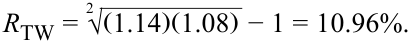

$$R_{TW} = \sqrt[2]{(1,14)(1,08)} - 1 = 10,96\%$$

<!-- Formula Text: R TW = 2 √ _ (1.14)(1.08)  − 1 = 10.96%. -->

8. B là đáp án đúng. Tỷ suất sinh lợi quy đổi theo năm của các quỹ ETF là:
   - Tỷ suất sinh lợi quy đổi theo năm của ETF 1 $= (1,0425^{365/125}) - 1 = 12,92\%$
   - Tỷ suất sinh lợi quy đổi theo năm của ETF 2 $= (1,0195^{52/8}) - 1 = 13,37\%$
   - Tỷ suất sinh lợi quy đổi theo năm của ETF 3 $= (1,1718^{12/16}) - 1 = 12,63\%$

Mặc dù có giá trị tỷ suất sinh lợi định kỳ thấp nhất, ETF 2 lại có tỷ suất sinh lợi quy đổi theo năm cao nhất do giả định lãi suất tái đầu tư và việc ghép lãi của mức sinh lợi định kỳ.

9. A là đáp án đúng. Tỷ suất sinh lợi ghép lãi liên tục từ $t = 0$ đến $t = 1$ là $r_{0,1} = \ln(S_1 / S_0) = \ln(186,75 / 208,25) = -0,10897 = -10,90\%$.

10. A là đáp án đúng.

$$R_L = R_P + \frac{V_B}{V_E}(R_P - r_D)$$

<!-- Formula Text: R L  =  R p + V B _ V E (R p − r D) -->

$$= 10\% + \frac{\text{5 triệu USD}}{\text{20 triệu USD}}(10\% - 6\%)$$

$$= 10\% + 0,25 \times 4\% = 11,0\%$$

11. C là đáp án đúng. Tỷ suất sinh lợi gộp được tính trên cơ sở trước thuế; các chi phí giao dịch _đã_ được tính đến (khấu trừ) trong phép tính tỷ suất sinh lợi gộp vì chúng đóng góp trực tiếp vào mức tỷ suất sinh lợi do nhà quản lý kiếm được. A không đúng vì tỷ suất sinh lợi gộp của các nhà quản lý đầu tư là trước thuế và chưa được điều chỉnh theo rủi ro. B không đúng vì tỷ suất sinh lợi gộp của nhà quản lý đã phản ánh việc khấu trừ các chi phí giao dịch do chúng đóng góp trực tiếp vào tỷ suất sinh lợi mà nhà quản lý kiếm được.

<!-- PDF Page 52 -->

12. C là đáp án đúng. Việc sử dụng đòn bẩy có thể làm tăng tỷ suất sinh lợi của nhà đầu tư nếu tổng tỷ suất sinh lợi đầu tư kiếm được trên khoản đầu tư có đòn bẩy vượt quá chi phí vay nợ. A không đúng vì đòn bẩy khuếch đại cả lãi và lỗ. B không đúng vì nếu một nửa số vốn đầu tư là vốn vay, thì tỷ suất sinh lợi gộp (chứ không phải tỷ suất sinh lợi ròng) của nhà đầu tư mới tăng gấp đôi.

13. C là đáp án đúng. Bước đầu tiên là tính tỷ suất sinh lợi ròng của nhà đầu tư từ khoản đầu tư vào quỹ phòng hộ. Tỷ suất sinh lợi ròng bằng tỷ suất sinh lợi gộp của quỹ trừ đi chi phí quản lý và hành chính là $1,60\%$, hay $8,46\% - 1,60\% = 6,86\%$. Lưu ý rằng chi phí giao dịch đã được phản ánh trong tỷ suất sinh lợi gộp nên không bị trừ đi nữa. Bước thứ hai là tính tỷ suất sinh lợi có đòn bẩy của nhà đầu tư (nhà đầu tư đã vay $2.500\text{ EUR}$ ($25\%$) giá mua), được tính như sau:

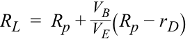

$$R_L = R_P + \frac{V_B}{V_E}(R_P - r_D)$$

<!-- Formula Text: R L  =  R p + V B _ V E (R p − r D) -->

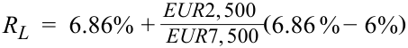

$$R_L = 6,86\% + \frac{\text{2.500 EUR}}{\text{7.500 EUR}}(6,86\% - 6\%)$$

<!-- Formula Text: R L  =  6.86% +  EUR2, 500 _ EUR7, 500 (6.86 % − 6%) -->

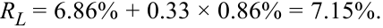

$$R_L = 6,86\% + 0,33 \times 0,86\% = 7,15\%$$

<!-- Formula Text: R L = 6.86% + 0.33 × 0.86% = 7.15%. -->

Bước cuối cùng là tính tỷ suất sinh lợi sau thuế: Tỷ suất sinh lợi sau thuế $= 7,15\% (1 - 0,30) = 5,00\%$.
