# Tập 1: Phương pháp Định lượng (Volume 1: Quantitative Methods)
## Học phần 2: Giá trị Thời gian của Tiền trong Tài chính (Learning Module 2: Time Value of Money in Finance)
### Phần 1/4: Giới thiệu (Introduction) (Trang PDF 53–67)

---

<!-- PDF Page 53 -->

#### H Ọ C P H Ầ N (L E A R N I N G M O D U L E)

# **<mark>2</mark>** 

### **Giá trị Thời gian của Tiền trong Tài chính (Time Value of Money in Finance)** 

###### **<mark>MỤC TIÊU HỌC TẬP (LEARNING OUTCOMES)</mark>** 

- **_Mức độ thành thạo (Mastery) – Ứng viên cần có khả năng:_**
  - tính toán và diễn giải giá trị hiện tại (*present value – PV*) của các công cụ thu nhập cố định (*fixed-income instruments*) và công cụ vốn chủ sở hữu (*equity instruments*) dựa trên các dòng tiền dự kiến trong tương lai;
  - tính toán và diễn giải tỷ suất sinh lợi ngầm định (*implied return*) của các công cụ thu nhập cố định cùng với tỷ suất sinh lợi yêu cầu (*required return*) và tốc độ tăng trưởng ngầm định (*implied growth*) của các công cụ vốn chủ sở hữu khi biết trước giá trị hiện tại (PV) và các dòng tiền;
  - giải thích nguyên lý cộng dòng tiền (*cash flow additivity principle*), tầm quan trọng của nó đối với điều kiện không có kinh doanh chênh lệch giá (*no-arbitrage condition*), và ứng dụng của nó trong việc tính toán lãi suất kỳ hạn ngầm định (*implied forward interest rates*), tỷ giá hối đoái kỳ hạn (*forward exchange rates*) và giá trị quyền chọn (*option values*).

<!-- Picture Text: 1  -->

##### **GIỚI THIỆU (INTRODUCTION)** 

Học phần này áp dụng các nguyên lý giá trị thời gian của tiền (*time value of money*) vào việc định giá các tài sản tài chính. Bài học đầu tiên tập trung vào việc giải tìm giá trị hiện tại của các dòng tiền dự kiến trong tương lai gắn liền với trái phiếu và cổ phiếu. Trong bài học thứ hai, trọng tâm chuyển sang việc giải tìm tỷ suất sinh lợi ngầm định của trái phiếu và cổ phiếu khi biết trước mức giá hiện hành. Nội dung này bao gồm việc giải tìm và diễn giải các tốc độ tăng trưởng ngầm định gắn liền với mức giá cổ phiếu đã cho. Bài học cuối cùng giới thiệu tính cộng dòng tiền (*cash flow additivity*), một nguyên lý quan trọng đảm bảo rằng giá của các tài sản tài chính không cho phép các nhà đầu tư kiếm được lợi nhuận phi rủi ro (*risk-free profits*), được minh họa bằng một số ví dụ cụ thể. Nội dung được đề cập trong học phần này cung cấp một nền tảng quan trọng giúp các ứng viên hiểu được cách thức định giá các tài sản tài chính trên thị trường.

###### **TỔNG QUAN HỌC PHẦN (LEARNING MODULE OVERVIEW)** 

- Giá của một trái phiếu bằng tổng giá trị hiện tại của các khoản thanh toán tiền lãi định kỳ (*coupon payments*) đã cam kết và mệnh giá (*par value*) của trái phiếu đó. Đối với trái phiếu chiết khấu (*discount bonds*), mức giá chỉ phản ánh giá trị hiện tại của mệnh giá trái phiếu.

- Giá trị của một cổ phiếu phải phản ánh tổng giá trị hiện tại của các khoản cổ tức dự kiến trong tương lai của cổ phiếu đó kéo dài đến vĩnh viễn (*in perpetuity*).

<!-- PDF Page 54 -->

- Các mô hình định giá cổ phiếu được phân loại theo mô hình tăng trưởng dự kiến được giả định cho cổ tức trong tương lai: (1) không tăng trưởng (*no growth*), (2) tăng trưởng không đổi (*constant growth*), hoặc (3) tăng trưởng cổ tức thay đổi (*changing dividend growth*).

- Nếu biết trước giá của một trái phiếu, tỷ suất sinh lợi ngầm định (*implied return*) của trái phiếu đó có thể được tính bằng cách sử dụng giá trái phiếu và các dòng tiền cam kết trong tương lai của nó.

- Tỷ suất sinh lợi yêu cầu (*required return*) của một cổ phiếu có thể được ước tính khi biết giá hiện hành của cổ phiếu cùng các giả định về cổ tức dự kiến và tốc độ tăng trưởng trong tương lai của nó.

- Tốc độ tăng trưởng cổ tức ngầm định (*implied dividend growth rate*) của một cổ phiếu có thể được ước tính khi biết giá hiện hành của cổ phiếu cùng các giả định về cổ tức dự kiến trong tương lai và tỷ suất sinh lợi yêu cầu của nó.

- Khi định giá hai (hoặc nhiều) chuỗi dòng tiền, nguyên lý cộng dòng tiền (*cash flow additivity principle*) cho phép so sánh các chuỗi dòng tiền với nhau (miễn là các dòng tiền phát sinh tại cùng một thời điểm).

- Việc áp dụng nguyên lý cộng dòng tiền cho phép xác nhận rằng giá tài sản là như nhau đối với các tài sản tương đương về mặt kinh tế (*economically equivalent assets*) (ngay cả khi các tài sản đó có các chuỗi dòng tiền khác nhau).

- Một số ứng dụng thực tế của nguyên lý cộng dòng tiền được sử dụng để minh họa cho việc định giá không có kinh doanh chênh lệch giá (*no-arbitrage pricing*).

## **<mark>2</mark>** 

##### **GIÁ TRỊ THỜI GIAN CỦA TIỀN TRONG CÔNG CỤ THU NHẬP CỐ ĐỊNH VÀ VỐN CHỦ SỞ HỮU (TIME VALUE OF MONEY IN FIXED INCOME AND EQUITY)** 

tính toán và diễn giải giá trị hiện tại (*present value – PV*) của các công cụ thu nhập cố định và công cụ vốn chủ sở hữu dựa trên các dòng tiền dự kiến trong tương lai

Thời điểm phát sinh của các dòng tiền gắn liền với các công cụ tài chính ảnh hưởng đến giá trị của chúng, trong đó các dòng tiền vào (*cash inflows*) được định giá càng cao khi chúng được nhận về càng sớm. Giá trị thời gian của tiền thể hiện sự đánh đổi giữa các dòng tiền nhận được ngày hôm nay so với những dòng tiền nhận được vào một ngày trong tương lai, cho phép so sánh giá trị hiện hành hay giá trị hiện tại của một hoặc nhiều dòng tiền với những dòng tiền nhận được tại các thời điểm khác nhau trong tương lai. Sự khác biệt này dựa trên một mức lãi suất chiết khấu (*discount rate*) phù hợp $r$ như đã trình bày trong học phần trước, vốn thay đổi tùy theo loại công cụ cũng như thời điểm và mức độ rủi ro của các dòng tiền dự kiến.

Tổng quát, mối quan hệ giữa giá trị hiện hành hay giá trị hiện tại ($\text{PV}$) và giá trị tương lai ($\text{FV}$) của một dòng tiền, trong đó $r$ là lãi suất chiết khấu công bố mỗi kỳ và $t$ là số kỳ ghép lãi, được biểu diễn như sau:

$$\text{FV}_t = \text{PV}(1 + r)^t \tag{1}$$

<!-- Formula Text: FVt = PV(1 + r)t. (1) -->

Nếu số kỳ ghép lãi $t$ rất lớn, nghĩa là $t \to \infty$, chúng ta ghép lãi dòng tiền ban đầu trên cơ sở liên tục (*continuous basis*) như sau:

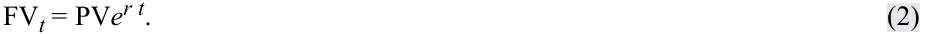

$$\text{FV}_t = \text{PV}e^{rt} \tag{2}$$

<!-- Formula Text: FVt = PVer t. (2) -->

Ngược lại, giá trị hiện tại có thể được biểu diễn theo giá trị tương lai, đòi hỏi phải biến đổi lại Phương trình 1 như sau:

<!-- PDF Page 55 -->

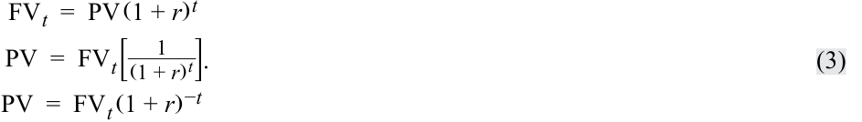

$$\begin{aligned}
\text{FV}_t &= \text{PV}(1 + r)^t \\
\text{PV} &= \text{FV}_t \left[\frac{1}{(1 + r)^t}\right] \\
\text{PV} &= \text{FV}_t (1 + r)^{-t} \tag{3}
\end{aligned}$$

<!-- Formula Text: FV t  =  PV (1 + r) t PV  =  FV t[ 1 _ (1 + r) t ] PV  =  FV t (1 + r) −t . (3) -->

Biểu thức tương đương theo thời gian liên tục (*continuous time equivalent expression*) của Phương trình 3 như sau:

$$\text{PV}_t = \text{FV}e^{-rt} \tag{4}$$

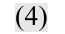

<!-- Formula Text: (4) -->

###### **Các Công cụ Thu nhập Cố định và Giá trị Thời gian của Tiền (Fixed-Income Instruments and the Time Value of Money)** 

Các công cụ thu nhập cố định (*fixed-income instruments*) là các công cụ nợ, chẳng hạn như trái phiếu (*bond*) hoặc khoản vay (*loan*), đại diện cho các hợp đồng theo đó tổ chức phát hành vay tiền từ nhà đầu tư để đổi lấy lời hứa hoàn trả trong tương lai. Lãi suất chiết khấu đối với các công cụ thu nhập cố định là một mức lãi suất, và tỷ suất sinh lợi của một trái phiếu hoặc khoản vay thường được gọi là lợi suất đáo hạn (*yield-to-maturity – YTM*) của nó.

Các dòng tiền gắn liền với các công cụ thu nhập cố định thường tuân theo một trong ba mô hình tổng quát sau:

- **Chiết khấu (*Discount*):** Nhà đầu tư trả một mức giá ban đầu ($\text{PV}$) cho một trái phiếu hoặc khoản vay và nhận lại một dòng tiền nợ gốc duy nhất ($\text{FV}$) khi đáo hạn. Phần chênh lệch ($\text{FV} - \text{PV}$) đại diện cho tiền lãi kiếm được trong suốt vòng đời của công cụ.

- **Tiền lãi định kỳ (*Periodic Interest*):** Nhà đầu tư trả một mức giá ban đầu ($\text{PV}$) cho một trái phiếu hoặc khoản vay và nhận được các dòng tiền lãi ($\text{PMT}$) theo các khoảng thời gian đã định trước trong suốt vòng đời của công cụ, với khoản thanh toán tiền lãi cuối cùng và nợ gốc ($\text{FV}$) được chi trả khi đáo hạn.

- **Thanh toán đều (*Level Payments*):** Nhà đầu tư trả một mức giá ban đầu ($\text{PV}$) và nhận được các dòng tiền đồng nhất theo các khoảng thời gian đã định trước ($A$) cho đến khi đáo hạn, bao gồm cả tiền lãi và tiền trả nợ gốc.

###### **_Công cụ chiết khấu (Discount Instruments)_** 

Mô hình dòng tiền chiết khấu được thể hiện trong Bảng 1 (*Exhibit 1*):

###### **Bảng 1: Dòng tiền của Trái phiếu Chiết khấu (Exhibit 1: Discount Bond Cash Flows)** 

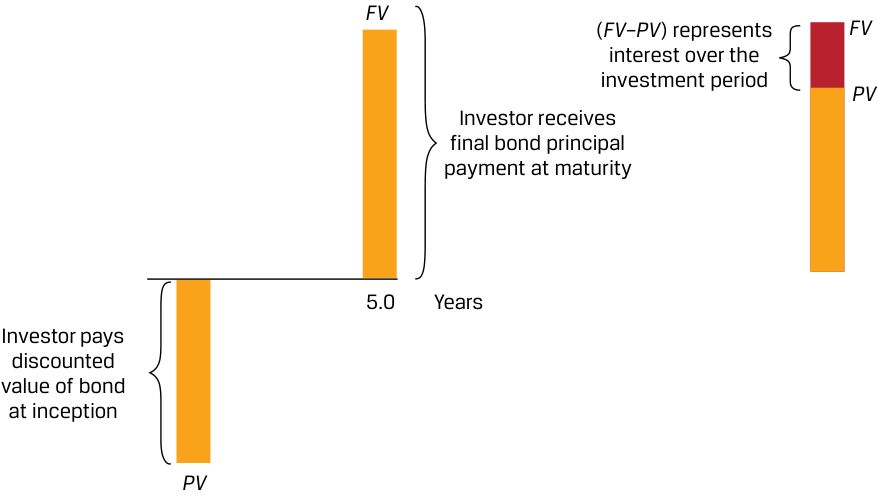

<!-- Picture Text: FV ( FV–PV ) represents FV interest over the investment period PV Investor receives final bond principal payment at maturity 5.0 Years Investor pays discounted value of bond at inception PV  -->
> **Chú thích hình ảnh:** Tại thời điểm khởi đầu, nhà đầu tư trả giá trị chiết khấu của trái phiếu ($\text{PV}$). Sau $5,0$ năm (khi đáo hạn), nhà đầu tư nhận được khoản thanh toán nợ gốc trái phiếu cuối cùng ($\text{FV}$). Chênh lệch ($\text{FV} - \text{PV}$) đại diện cho tiền lãi trong suốt giai đoạn đầu tư.

<!-- PDF Page 56 -->

Phép tính giá trị hiện tại ($\text{PV}$) cho một trái phiếu chiết khấu với nợ gốc ($\text{FV}$) được thanh toán tại thời điểm $t$ và lãi suất chiết khấu thị trường là $r$ mỗi kỳ như sau:

$$\text{PV}(\text{Trái phiếu chiết khấu}) = \text{FV}_t / (1 + r)^t \tag{5}$$

*(Tiếng Anh: $\text{PV}(\text{Discount Bond}) = \text{FV}_t / (1 + r)^t$)*

Nguồn sinh lợi duy nhất của nhà đầu tư là phần chênh lệch giữa mức giá đã trả ($\text{PV}$) và toàn bộ số nợ gốc ($\text{FV}$) nhận được khi đáo hạn. Loại trái phiếu này thường được gọi là **trái phiếu không trả lãi định kỳ (*zero-coupon bond*)** do không có các dòng tiền lãi trung gian — vốn thường được gọi là tiền lãi coupon (*coupons*) đối với trái phiếu.

###### **VÍ DỤ 1 (EXAMPLE 1)** 

###### **Trái phiếu chiết khấu dưới Môi trường Lãi suất Dương và Âm (Discount Bonds under Positive and Negative Interest Rates)** 

Mặc dù hầu hết các chính phủ phát hành trái phiếu có lãi suất coupon cố định với nợ gốc được thanh toán khi đáo hạn, nhưng đối với nhiều tổ chức phát hành chính phủ như Hoa Kỳ, Vương quốc Anh hoặc Ấn Độ, các nhà đầu tư mua và bán các dòng tiền lãi hoặc dòng tiền gốc riêng lẻ đã được tách rời (*separated* hay *stripped*) từ các công cụ này dưới dạng trái phiếu chiết khấu. Xét một dòng tiền nợ gốc duy nhất phải trả sau 20 năm của một trái phiếu chính phủ Cộng hòa Ấn Độ được phát hành khi lợi suất đáo hạn (YTM) là $6,70\%$. Vì mục đích của ví dụ đơn giản hóa này, chúng ta sử dụng ghép lãi hàng năm, nghĩa là $t$ trong Phương trình 5 bằng số năm cho đến khi dòng tiền phát sinh.

1. Nhà đầu tư kỳ vọng phải trả bao nhiêu cho trái phiếu chiết khấu này trên mỗi $100\text{ INR}$ nợ gốc?

###### **Lời giải (Solution):** 

$27,33\text{ INR}$

Chúng ta giải tìm $\text{PV}$ khi biết $r = 6,70\%$, $t = 20$, và $\text{FV}_{20} = 100\text{ INR}$ bằng cách sử dụng Phương trình 5:

$$\text{PV} = \text{100 INR} / (1 + 0,067)^{20} = \text{27,33 INR}$$

Chúng ta cũng có thể sử dụng hàm PV trong Microsoft Excel hoặc Google Sheets:

`=PV(rate, nper, pmt, FV, type)`

trong đó:

- _rate_ = lãi suất chiết khấu thị trường mỗi kỳ,

- _nper_ = số kỳ,

- _pmt_ = khoản thanh toán coupon định kỳ (bằng 0 đối với trái phiếu chiết khấu),

- _FV_ = giá trị tương lai hoặc mệnh giá (*face value*), và

- _type_ = các khoản thanh toán được thực hiện vào cuối kỳ (0 như trong trường hợp này) hoặc đầu kỳ (1) của mỗi kỳ.

Vì là một dòng tiền ra (hoặc mức giá phải trả), kết quả hàm PV của Excel mang dấu âm, vì vậy:

$$\text{PV} = (27,33) = \text{PV}(0.067, 20, 0, 100, 0)$$

Trong khi nợ gốc ($\text{FV}$) là một hằng số bằng $100\text{ INR}$, thì mức giá ($\text{PV}$) sẽ thay đổi khi thời gian trôi qua và khi lãi suất biến động.

<!-- PDF Page 57 -->

2. Nếu chúng ta giả định rằng lãi suất giữ nguyên không đổi, thì giá ($\text{PV}$) của trái phiếu sau ba năm nữa là bao nhiêu?

###### **Lời giải (Solution):** 

$33,21\text{ INR}$

Giải tìm $\text{PV}$ bằng cách thay $t = 17$ vào phép tính trước đó theo Phương trình 5:

$$\text{PV} = \text{100 INR} / (1 + 0,067)^{17} = \text{33,21 INR}$$

Mức tăng giá $5,88\text{ INR}$ khi $r$ không đổi đại diện cho tiền lãi ngầm định (*implied interest*) kiếm được trong ba năm đó. Nếu lãi suất là số dương, $\text{PV}$ nhìn chung sẽ tăng dần (hay tích lũy tăng – *accretes*) theo thời gian để tiến tới $\text{FV}$ khi thời gian trôi qua và $t$ tiến dần về 0.

3. Giá cũng thay đổi khi lãi suất thay đổi. Giả sử sau khi mua tại thời điểm $t = 0$, chúng ta quan sát thấy giá trái phiếu sụt giảm ngay lập tức xuống mức $22,68224\text{ INR}$ trên mỗi $100\text{ INR}$ nợ gốc. Lãi suất ngầm định (*implied interest rate*) của trái phiếu chiết khấu này là bao nhiêu?

**Lời giải (Solution):** 

$7,70\%$

Tại đây chúng ta có thể giải tìm $r$ trong Phương trình 5 như sau:

$$\text{22,68224 INR} = \text{100 INR} / (1 + r)^{20}$$

Sắp xếp lại Phương trình 5, chúng ta thu được:

$$r = 7,70\% = (100 / 22,68224)^{1/20} - 1$$

Ngoài ra, chúng ta có thể sử dụng hàm RATE trong Microsoft Excel hoặc Google Sheets:

`=RATE(nper, pmt, PV, FV, type, guess)` sử dụng các đối số giống như trên, với _guess_ là một đối số ước tính tùy chọn (phải nằm trong khoảng từ 0 đến 1 và mặc định là $0,1$), như sau:

$$7,70\% = \text{RATE}(20, 0, -22.68224, 100, 0, 0.1)$$

Điều này cho thấy mức tăng 100 điểm cơ bản ($1,00\%$) của $r$ dẫn đến mức giảm giá $4,65\text{ INR}$, nhấn mạnh mối quan hệ nghịch biến (*inverse relationship*) giữa giá trái phiếu và lợi suất đáo hạn (YTM).

4. Bây giờ hãy xét một trái phiếu được phát hành ở mức lãi suất âm. Vào tháng 7 năm 2016, Đức trở thành quốc gia đầu tiên thuộc khu vực đồng euro phát hành trái phiếu chính phủ kỳ hạn 10 năm với lợi suất âm. Nếu lợi suất đáo hạn (YTM) hàng năm của trái phiếu chính phủ Đức là $-0,05\%$ khi phát hành, hãy tính giá trị hiện tại ($\text{PV}$) của trái phiếu trên mỗi $100\text{ EUR}$ nợ gốc ($\text{FV}$) tại thời điểm phát hành.

**Lời giải (Solution):** 

$100,50\text{ EUR}$

Giải tìm $\text{PV}$ khi biết $r = -0,05\%$, $t = 10$, và $\text{FV}_{10} = 100\text{ EUR}$ bằng cách sử dụng Phương trình 5 (trong bản gốc ghi Equation 1):

$$\text{PV} = \text{100,50 EUR} = \text{100 EUR} / (1 - 0,0005)^{10}$$

hoặc:

$$\text{PV} = (100,50) = \text{PV}(-0.0005, 10, 0, 100, 0)$$

Khi phát hành, trái phiếu này được định giá ở mức **thặng dư (*premium*)** (giá cao hơn mệnh giá), nghĩa là một nhà đầu tư mua trái phiếu khi phát hành đã trả cao hơn $0,50\text{ EUR}$ so với giá trị tương lai dự kiến nhận được khi đáo hạn, tức nợ gốc.

<!-- PDF Page 58 -->

5. Sáu năm sau, khi lạm phát tại Đức đạt mức cao kỷ lục trong nhiều thập kỷ và các nhà đầu tư tăng tỷ suất sinh lợi danh nghĩa yêu cầu của họ, giả sử chúng ta quan sát thấy trái phiếu chính phủ Đức ở câu hỏi 4 hiện đang giao dịch ở mức giá ($\text{PV}$) là $95,72\text{ EUR}$ trên mỗi $100\text{ EUR}$ nợ gốc. Lợi suất đáo hạn (YTM) của trái phiếu này là bao nhiêu?

**Lời giải (Solution):** 

   - $1,10\%$

   - Sử dụng Phương trình 5 để giải tìm $r$ khi biết $\text{PV} = 95,72$, $\text{FV} = 100$, và $t = 4$, chúng ta thu được:

$$\text{95,72 EUR} = \text{100 EUR} / (1 + r)^4; \quad r = 1,10\%, \quad \text{hoặc } 1,10\% = \text{RATE}(4, 0, -95.72, 100, 0, 0.1)$$

Giống như trong trường hợp trái phiếu chiết khấu của Cộng hòa Ấn Độ, lãi suất cao hơn sẽ làm giảm giá trái phiếu. Tuy nhiên, trái ngược với mức giá tích lũy tăng dần (*accreting price*) của trái phiếu chiết khấu, giá của trái phiếu thặng dư (*premium bond*) sẽ giảm dần (hay phân bổ giảm – *amortize*) theo thời gian để tiến về giá trị tương lai $100\text{ EUR}$ khi đáo hạn.

###### **_Công cụ trả lãi định kỳ (Coupon Instrument)_** 

Mô hình dòng tiền định kỳ cho các khoản thanh toán tiền lãi thu nhập cố định với nợ gốc được hoàn trả khi đáo hạn được thể hiện trong Bảng 2 (*Exhibit 2*). Trong trường hợp này, tất cả các khoản thanh toán dòng tiền định kỳ đều giống hệt nhau và diễn ra trên cơ sở nửa năm một lần (*semiannual basis*).

###### **Bảng 2: Dòng tiền của Trái phiếu trả lãi định kỳ (Exhibit 2: Coupon Bond Cash Flows)** 

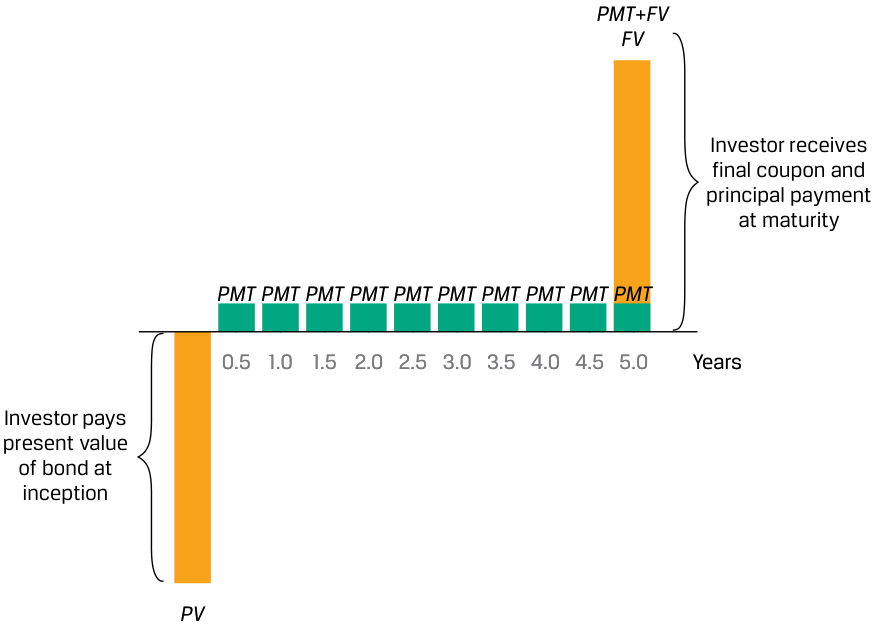

<!-- Picture Text: PMT + FV FV Investor receives final coupon and principal payment at maturity PMT PMT PMT PMT PMT PMT PMT PMT PMT PMT 0.5 1.0 1.5 2.0 2.5 3.0 3.5 4.0 4.5 5.0 Years Investor pays present value of bond at inception PV  -->
> **Chú thích hình ảnh:** Tại thời điểm khởi đầu, nhà đầu tư trả giá trị hiện tại của trái phiếu ($\text{PV}$). Sau mỗi $0,5$ năm (từ $0,5$ đến $4,5$ năm), nhà đầu tư nhận được khoản tiền lãi coupon định kỳ ($\text{PMT}$). Tại năm $5,0$ (khi đáo hạn), nhà đầu tư nhận được khoản thanh toán coupon cuối cùng và nợ gốc ($\text{PMT} + \text{FV}$).

Việc định giá một trái phiếu trả lãi định kỳ (*coupon bond*) mở rộng phép tính dòng tiền đơn lẻ của trái phiếu chiết khấu thành một công thức tổng quát để tính giá trái phiếu ($\text{PV}$) khi biết lãi suất chiết khấu thị trường vào một ngày trả lãi coupon, như sau:

$$\text{PV}(\text{Trái phiếu coupon}) = \frac{\text{PMT}_1}{(1 + r)^1} + \frac{\text{PMT}_2}{(1 + r)^2} + \dots + \frac{\text{PMT}_N + \text{FV}_N}{(1 + r)^N} \tag{6}$$

<!-- PDF Page 59 -->

###### **VÍ DỤ 2 (EXAMPLE 2)** 

###### **Trái phiếu trả lãi hàng năm của Cộng hòa Hy Lạp (Hellenic Republic of Greece Annual Coupon Bond)** 

Vào thời điểm đỉnh dịch COVID, chính phủ Hy Lạp đã phát hành một trái phiếu trả lãi coupon hàng năm $2\%$ có kỳ hạn bảy năm.

1. Nếu lợi suất đáo hạn (YTM) quan sát được khi phát hành là $2,00\%$, thì giá phát hành ($\text{PV}$) trên mỗi $100\text{ EUR}$ nợ gốc là bao nhiêu?

###### **Lời giải (Solution):** 

$100\text{ EUR}$

Giải tìm $\text{PV}$ bằng cách sử dụng Phương trình 6 với $\text{PMT}_i = 2\text{ EUR}$, $r = 2,00\%$, và $\text{FV} = 100\text{ EUR}$:

$$\text{PV} = \text{100 EUR}$$

$$= \frac{2}{1,02} + \frac{2}{1,02^2} + \frac{2}{1,02^3} + \frac{2}{1,02^4} + \frac{2}{1,02^5} + \frac{2}{1,02^6} + \frac{102}{1,02^7}$$

<!-- Formula Text: =   2 _ 1.02  +   2 _ 1.02 2  +   2 _ 1.02 3  +   2 _ 1.02 4  +   2 _ 1.02 5  +   2 _ 1.02 6  +  102 _ 1.02 7 . -->

Chúng ta có thể giải bài toán này bằng cách sử dụng hàm PV trong Microsoft Excel hoặc Google Sheets đã giới thiệu trước đó (`=PV(0.02, 7, 2, 100, 0)`). Giá phát hành bằng với nợ gốc ($\text{PV} = \text{FV}$). Mối quan hệ này luôn đúng vào ngày trả lãi coupon đối với bất kỳ trái phiếu nào có lãi suất coupon cố định định kỳ bằng với lãi suất chiết khấu.

Giá trị hiện tại của từng dòng tiền có thể được giải bằng Phương trình 5. Ví dụ, dòng tiền lãi và gốc cuối cùng trị giá $102\text{ EUR}$ sau bảy năm là:

$$\text{PV} = \text{88,80 EUR} = \text{102 EUR} / (1,02)^7$$

Bảng sau đây cho thấy giá trị hiện tại của tất cả các dòng tiền của trái phiếu:

|**Năm/Kỳ (Years/Periods)**|**0**|**1**|**2**|**3**|**4**|**5**|**6**|**7**|
|---|---|---|---|---|---|---|---|---|
|FV||2|2|2|2|2|2|102|
|PV|100,00|1,96|1,92|1,88|1,85|1,81|1,78|88,80|

2. Tiếp theo, giả sử rằng đúng hai năm sau, sự gia tăng mạnh mẽ của lạm phát tại khu vực đồng Euro đã đẩy giá trái phiếu Hy Lạp xuống mức thấp hơn là $93,091\text{ EUR}$ (trên mỗi $100\text{ EUR}$ nợ gốc). Lợi suất đáo hạn (YTM) ngầm định mà các nhà đầu tư kỳ vọng trong những điều kiện thị trường mới này sẽ là bao nhiêu?

###### **Lời giải (Solution):** 

$3,532\%$

Trong trường hợp này, chúng ta phải giải tìm $r$ bằng cách sử dụng Phương trình 6, với $\text{PV}$ bằng $93,091$, như sau:

$$\text{PV} = 93,091 = \frac{2}{(1 + r)} + \frac{2}{(1 + r)^2} + \frac{2}{(1 + r)^3} + \frac{2}{(1 + r)^4} + \frac{102}{(1 + r)^5}$$

<!-- Formula Text: PV = 93.091 = 2/(1+r) + 2/(1+r)2 + 2/(1+r)3 + 2/(1+r)4 + 102/(1+r)5. -->

Tại đây chúng ta có thể sử dụng hàm RATE trong Microsoft Excel hoặc Google Sheets (`=RATE(5, 2, -93.091, 100, 0, 0.1)`) để giải tìm $r$ bằng $3,532\%$. Các nhà đầu tư nắm giữ trái phiếu có lãi suất coupon cố định sẽ phải đối mặt với khoản lỗ vốn (*capital loss*) khi thị trường kỳ vọng một mức YTM cao hơn.

Lãi suất $r$ được sử dụng để chiết khấu tất cả các dòng tiền trong Phương trình 6 là lợi suất đáo hạn (YTM) của trái phiếu, vốn thường được niêm yết trên cơ sở hàng năm. Tuy nhiên, nhiều trái phiếu do các tổ chức vay công hoặc tư phát hành lại trả lãi trên cơ sở nửa năm một lần (*semiannual basis*). Trong Ví dụ 3, chúng ta xem xét lại trái phiếu Cộng hòa Ấn Độ mà từ đó một dòng tiền đơn lẻ đã được tách ra trong ví dụ đơn giản hóa trước đó.

<!-- PDF Page 60 -->

**VÍ DỤ 3 (EXAMPLE 3)** 

###### **Trái phiếu trả lãi nửa năm một lần của Cộng hòa Ấn Độ (Republic of India Semiannual Coupon Bond)** 

Xét trái phiếu chính phủ Cộng hòa Ấn Độ kỳ hạn 20 năm mà từ đó trái phiếu chiết khấu trong Ví dụ 1 đã được tách ra (*stripped*). Trái phiếu này được phát hành với lãi suất coupon quy đổi theo năm là $6,70\%$ và YTM là $6,70\%$, đồng thời các khoản thanh toán coupon được thực hiện nửa năm một lần.

1. Giải tìm giá của trái phiếu khi phát hành.

**Lời giải (Solution):** 

$100\text{ INR}$

Vì các kỳ coupon là nửa năm một lần, đối với nợ gốc $100\text{ INR}$, $\text{PMT} = 3,35\text{ INR}$ ($= 6,70 / 2$) và lãi suất chiết khấu định kỳ là $3,35\%$ ($= 6,70\% / 2$), như sau:

$$\text{PV} = \frac{3,35}{(1,0335)} + \frac{3,35}{(1,0335)^2} + \dots + \frac{3,35}{(1,0335)^{39}} + \frac{103,35}{(1,0335)^{40}}$$

Như đã trình bày trong Ví dụ 2, bởi vì _lãi suất coupon bằng với YTM_, chúng ta kỳ vọng trái phiếu này có $\text{PV}$ bằng $100\text{ INR}$ khi phát hành.

2. Giá của trái phiếu là bao nhiêu nếu YTM tăng ngay lập tức lên mức $7,70\%$?

###### **Lời giải (Solution):** 

$89,88\text{ INR}$

Chúng ta có thể giải tìm $\text{PV}$ bằng $89,88\text{ INR}$ bằng cách sử dụng Phương trình 6 với $r = 3,85\%$ ($= 7,70 / 2$) hoặc sử dụng hàm PV trong Microsoft Excel hoặc Google Sheets (`=PV(0.0385, 40, 3.35, 100, 0)`). Ba dòng tiền đầu tiên và ba dòng tiền cuối cùng được thể hiện dưới đây:

||**Năm (Years)**|**0**|**0,5**|**1**|**1,5**|**19**|**19,5**|**20**|
|---|---|---|---|---|---|---|---|---|
|**$r$**|**Kỳ (Periods)**|**0**|**1**|**2**|**3**|**38**|**39**|**40**|
||FV||3,35|3,35|3,35|3,35|3,35|103,35|
|6,70%|PV|100,00|3,24|3,14|3,03|0,96|0,93|27,66|
|7,70%|PV|89,88|3,23|3,11|2,99|0,80|0,77|22,81|

3. Tính lại giá trái phiếu chiết khấu cho khoản thanh toán nợ gốc duy nhất sau 20 năm từ Ví dụ 1, trong đó $\text{YTM} = 6,70\%$, và việc chiết khấu được thực hiện nửa năm một lần.

**Lời giải (Solution):** 

$26,77\text{ INR}$

Sử dụng Phương trình 5:

$$\text{PV}(\text{FV}_{40}) = \text{26,77 INR} = 100 / (1,0335)^{40}$$

Khi chiết khấu trên cơ sở nửa năm một lần cho 40 kỳ, $\text{PV}(\text{FV}_{40})$ bằng $26,77$ nhỏ hơn mức $\text{PV}$ ban đầu là $27,33$ khi sử dụng 20 kỳ hàng năm từ Ví dụ 1 (vì $1/(1 + r)^t > 1/(1 + r/2)^{2t}$ khi $r > 0$).

<!-- PDF Page 61 -->

**Trái phiếu vĩnh cửu (*perpetual bond*)** là một loại trái phiếu trả lãi định kỳ ít phổ biến hơn và không có ngày đáo hạn xác định. Hầu hết các trái phiếu vĩnh cửu được các công ty phát hành để huy động nguồn vốn tương tự vốn chủ sở hữu (*equity-like financing*) và thường bao gồm các đặc tính mua lại (*redemption features*). Khi $N \to \infty$ trong Phương trình 6, chúng ta có thể rút gọn công thức này để giải tìm giá trị hiện tại của một **niên kim vĩnh cửu (*perpetuity*)** (hay dòng tiền định kỳ cố định vĩnh viễn không có quyền mua lại trước hạn), với $r > 0$, như sau:

$$\text{PV}(\text{Trái phiếu vĩnh cửu}) = \text{PMT} / r \tag{7}$$

*(Tiếng Anh: $\text{PV}(\text{Perpetual Bond}) = \text{PMT} / r$)*

###### **VÍ DỤ 4 (EXAMPLE 4)** 

###### **Trái phiếu vĩnh cửu của KB Financial (KB Financial Perpetual Bond)** 

Vào năm 2020, KB Financial (công ty mẹ của Ngân hàng Kookmin) đã phát hành 325 tỷ KRW trái phiếu vĩnh cửu với lãi suất coupon trả hàng quý là $3,30\%$.

1. Tính lợi suất đáo hạn (YTM) của trái phiếu nếu giá thị trường là $97,03\text{ KRW}$ (trên mỗi $100\text{ KRW}$ mệnh giá).

###### **Lời giải (Solution):** 

$3,40\%$

Giải tìm $r$ trong Phương trình 7 khi biết $\text{PV}$ là $97,03\text{ KRW}$ và tiền lãi coupon định kỳ hàng quý ($\text{PMT}$) là $0,825\text{ KRW}$ ($= (3,30\% \times \text{100 KRW}) / 4$):

$$\text{97,03 KRW} = \text{0,825 KRW} / r$$

$$r = 0,85\% \text{ mỗi kỳ (quý), hay } 3,40\% (= 0,85\% \times 4) \text{ trên cơ sở quy đổi theo năm.}$$

###### **_Công cụ niên kim (Annuity Instruments)_** 

Các ví dụ về công cụ thu nhập cố định có các khoản thanh toán đều (*level payments*), kết hợp cả dòng tiền lãi và gốc cho đến khi đáo hạn, bao gồm các khoản vay trả góp khấu hao hoàn toàn (*fully amortizing loans*) như khoản vay thế chấp mua nhà (*mortgages*) và một chuỗi thu nhập cố định gồm các dòng tiền vào định kỳ trong một khoảng thời gian hữu hạn được gọi là **niên kim (*annuity*)**. Bảng 3 (*Exhibit 3*) minh họa một ví dụ về các dòng tiền đều hàng tháng dựa trên một khoản vay thế chấp.

###### **Bảng 3: Dòng tiền của Khoản vay thế chấp (Exhibit 3: Mortgage Cash Flows)** 

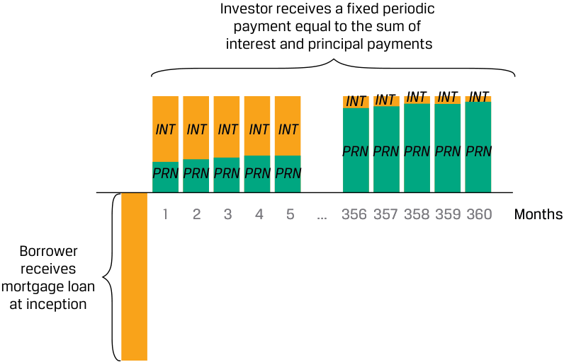

<!-- Picture Text: Investor receives a fixed periodic payment equal to the sum of interest and principal payments INT INT INT INT INT INT INT INT INT INT PRN PRN PRN PRN PRN PRN PRN PRN PRN PRN 1 2 3 4 5 ... 356 357 358 359 360 Months Borrower receives mortgage loan at inception  -->

<!-- Picture Text: PV  -->
> **Chú thích hình ảnh:** Tại thời điểm khởi đầu, người đi vay nhận khoản vay thế chấp ($\text{PV}$). Qua các tháng từ 1 đến 360, nhà đầu tư (người cho vay) nhận được một khoản thanh toán định kỳ cố định bằng tổng của tiền lãi ($\text{INT}$) và tiền trả nợ gốc ($\text{PRN}$), trong đó tỷ trọng $\text{INT}$ giảm dần và $\text{PRN}$ tăng dần theo thời gian.

<!-- PDF Page 62 -->

Chúng ta có thể tính toán dòng tiền niên kim định kỳ ($A$), phát sinh vào cuối mỗi kỳ tương ứng, như sau:

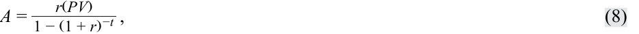

$$A = \frac{r(\text{PV})}{1 - (1 + r)^{-t}} \tag{8}$$

<!-- Formula Text: A = r(PV) _ 1 − (1 + r) −t  , (8) -->

trong đó:

- $A =$ dòng tiền định kỳ (*periodic cash flow*),

- $r =$ lãi suất thị trường mỗi kỳ (*market interest rate per period*),

- $\text{PV} =$ giá trị hiện tại hoặc số tiền nợ gốc của khoản vay hoặc trái phiếu, và

- $t =$ số kỳ thanh toán (*number of payment periods*).

###### **VÍ DỤ 5 (EXAMPLE 5)** 

###### **Dòng tiền của Khoản vay thế chấp (Mortgage Cash Flows)** 

Một nhà đầu tư tìm kiếm một khoản vay thế chấp kỳ hạn 30 năm với lãi suất cố định để tài trợ $80\%$ giá mua $1.000.000\text{ USD}$ của một tòa nhà dân cư.

1. Tính khoản thanh toán hàng tháng của nhà đầu tư nếu lãi suất thế chấp hàng năm là $5,25\%$.

###### **Lời giải (Solution):** 

Giải tìm $A$ bằng cách sử dụng Phương trình 8 với $r = 0,4375\%$ ($= 5,25\% / 12$), $t = 360$, và $\text{PV} = 800.000\text{ USD}$ ($= 80\% \times \text{1.000.000 USD}$):

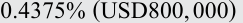

<!-- Formula Text: 0.4375% (USD800, 000) -->

<!-- Formula Text: A = USD4, 417.63  = 0_ -->

$$A = \text{4.417,63 USD} = \frac{0,4375\% (\text{800.000 USD})}{1 - (1 + 0,4375\%)^{-360}}$$

360 khoản thanh toán đều hàng tháng này bao gồm cả nợ gốc và tiền lãi.

2. Chi tiết phần trả nợ gốc (*principal amortization*) và tiền lãi của hai dòng tiền hàng tháng đầu tiên là bao nhiêu?

###### **Lời giải (Solution):** 

- Tháng 1: tiền lãi là $3.500\text{ USD}$ và tiền trả nợ gốc là $917,63\text{ USD}$
- Tháng 2: tiền lãi là $3.495,99\text{ USD}$ và tiền trả nợ gốc là $921,64\text{ USD}$

**Tháng 1:**

- Tiền lãi: $\text{3.500 USD} = \text{800.000 USD} \times 0,4375\%$ ($= \text{PV}_0 \times r$)
- Phần trả nợ gốc: $\text{4.417,63 USD} - \text{3.500 USD} = \text{917,63 USD}$
- Nợ gốc còn lại ($\text{PV}_1$): $\text{799.082,37 USD} = \text{800.000 USD} - \text{917,63 USD}$

**Tháng 2:**

- Tiền lãi: $\text{3.495,99 USD} = \text{799.082,37 USD} \times 0,4375\%$ ($= \text{PV}_1 \times r$)
- Phần trả nợ gốc: $\text{4.417,63 USD} - \text{3.495,99 USD} = \text{921,64 USD}$
- Nợ gốc còn lại ($\text{PV}_2$): $\text{798.160,73 USD} = \text{799.082,37 USD} - \text{921,64 USD}$

Mặc dù khoản thanh toán thế chấp định kỳ là không đổi, tỷ trọng tiền lãi trong mỗi lần thanh toán giảm dần trong khi phần trả nợ gốc tăng dần theo

<!-- PDF Page 63 -->

thời gian. Bảng tính sau đây cho thấy ba dòng tiền hàng tháng đầu tiên và ba dòng tiền hàng tháng cuối cùng.

|**Tháng (Month)**|**Tổng khoản thanh toán hàng tháng (Total Monthly Payment)**|**Thanh toán tiền lãi hàng tháng (Monthly Interest Payment)**|**Hoàn trả nợ gốc hàng tháng (Monthly Principal Repayment)**|**Nợ gốc còn lại (Remaining Principal)**|
|---|---|---|---|---|
|1|$ 4.417,63|$ 3.500,00|$ 917,63|$ 799.082,37|
|2|$ 4.417,63|$ 3.495,99|$ 921,64|$ 798.160,73|
|3|$ 4.417,63|$ 3.491,95|$ 925,68|$ 797.235,05|
|…|||||
|358|$ 4.417,63|$ 57,48|$ 4.360,15|$ 8.777,61|
|359|$ 4.417,63|$ 38,40|$ 4.379,23|$ 4.398,39|
|360|$ 4.417,63|$ 19,24|$ 4.398,39|$ 0,00|

###### **Các Công cụ Vốn chủ sở hữu và Giá trị Thời gian của Tiền (Equity Instruments and the Time Value of Money)** 

Các khoản đầu tư vốn chủ sở hữu (*equity investments*), chẳng hạn như cổ phiếu ưu đãi (*preferred stock*) hoặc cổ phiếu phổ thông (*common stock*), đại diện cho các cổ phần sở hữu trong một công ty, trao quyền cho các nhà đầu tư được nhận bất kỳ dòng tiền tùy ý nào dưới hình thức cổ tức (*dividends*). Khác với các công cụ thu nhập cố định, các khoản đầu tư vốn chủ sở hữu không có ngày đáo hạn và được giả định là sẽ lưu hành vô thời hạn, hoặc cho đến khi công ty được bán, tái cơ cấu hoặc thanh lý. Một cách để định giá cổ phiếu của một công ty là chiết khấu các dòng tiền dự kiến trong tương lai bằng một mức tỷ suất sinh lợi kỳ vọng ($r$). Các dòng tiền này bao gồm bất kỳ khoản cổ tức định kỳ nào nhận được cộng với mức giá dự kiến nhận được vào cuối khung thời gian đầu tư.

Các giả định phổ biến gắn liền với việc định giá các công cụ vốn chủ sở hữu dựa trên dòng tiền cổ tức thường tuân theo một trong ba phương pháp tiếp cận tổng quát sau:

- **Cổ tức không đổi (*Constant Dividends*):** Nhà đầu tư trả một mức giá ban đầu ($\text{PV}$) cho một cổ phiếu ưu đãi hoặc cổ phiếu phổ thông và nhận được một khoản cổ tức định kỳ cố định ($D$).

- **Tốc độ tăng trưởng cổ tức không đổi (*Constant Dividend Growth Rate*):** Nhà đầu tư trả một mức giá ban đầu ($\text{PV}$) cho một cổ phiếu và nhận được khoản cổ tức ban đầu sau một kỳ ($D_{t+1}$), khoản cổ tức này được kỳ vọng sẽ tăng trưởng theo thời gian với tốc độ không đổi là $g$.

- **Tốc độ tăng trưởng cổ tức thay đổi (*Changing Dividend Growth Rate*):** Nhà đầu tư trả một mức giá ban đầu ($\text{PV}$) cho một cổ phiếu và nhận được khoản cổ tức ban đầu sau một kỳ ($D_{t+1}$). Cổ tức được kỳ vọng sẽ tăng trưởng với tốc độ thay đổi theo thời gian khi công ty chuyển từ giai đoạn tăng trưởng cao ban đầu sang tăng trưởng chậm hơn khi đạt đến độ trưởng thành (*maturity*).

Trường hợp đơn giản nhất của một cổ phiếu được giả định trả cổ tức không đổi đến vĩnh viễn được thể hiện trong Bảng 4 (*Exhibit 4*).

<!-- PDF Page 64 -->

###### **Bảng 4: Dòng tiền Vốn chủ sở hữu với Cổ tức không đổi (Exhibit 4: Equity Cash Flows with Constant Dividends)** 

<!-- Picture Text: Constant dividend D D D D D paid immediately 1 2 3 4 5 Years Investor pays share price today PV  -->
> **Chú thích hình ảnh:** Nhà đầu tư trả giá cổ phiếu ngày hôm nay ($\text{PV}$) và nhận được khoản cổ tức không đổi ($D$) định kỳ qua các năm $1, 2, 3, 4, 5, \dots$ kéo dài vô thời hạn (*indefinitely*).

Giá của một cổ phiếu ưu đãi hoặc cổ phiếu phổ thông dự kiến trả một khoản cổ tức định kỳ không đổi là một chuỗi vô hạn được rút gọn về công thức tính giá trị hiện tại của một niên kim vĩnh cửu như dưới đây và tương tự như việc định giá một trái phiếu vĩnh cửu mà chúng ta đã gặp trước đó. Cụ thể, cách định giá tương tự Phương trình 7:

$$\text{PV}_t = \sum_{i=1}^{\infty} \frac{D_t}{(1 + r)^i} \tag{9}$$

và

$$\text{PV}_t = \frac{D_t}{r} \tag{10}$$

<!-- Formula Text: P V t = ∑ i=1 ∞ D t _ (1 + r) i , and (9) P V t  = D t _ r . (10) -->

###### **VÍ DỤ 6 (EXAMPLE 6)** 

###### **Dòng tiền Cổ tức không đổi (Constant Dividend Cash Flows)** 

Shipline PLC là một công ty trả cổ tức đều đặn ở mức $1,50\text{ GBP}$ mỗi năm, được kỳ vọng sẽ tiếp tục duy trì vô thời hạn.

1. Giá cổ phiếu dự kiến của Shipline là bao nhiêu nếu tỷ suất sinh lợi yêu cầu của các cổ đông là $15\%$?

###### **Lời giải (Solution):** 

- $10\text{ GBP}$

Giải tìm $\text{PV}$ bằng cách sử dụng Phương trình 10, trong đó $D$ là $1,50\text{ GBP}$ và tỷ suất sinh lợi mỗi kỳ $r$ là $15\%$:

$$\text{PV} = \text{10,00 GBP} = \text{1,50 GBP} / 0,15$$

Ngoài ra, một phương pháp dự báo vốn chủ sở hữu phổ biến là giả định tốc độ tăng trưởng cổ tức không đổi ($g$) đến vĩnh viễn, như được minh họa trong Bảng 5 (*Exhibit 5*).

<!-- PDF Page 65 -->

**Bảng 5: Dòng tiền Vốn chủ sở hữu với Tăng trưởng Cổ tức không đổi (Exhibit 5: Equity Cash Flows with Constant Dividend Growth)** 

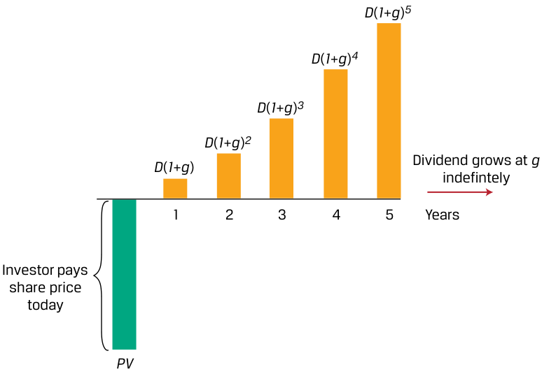

<!-- Picture Text: D ( 1 + g ) 5 D ( 1 + g ) 4 D ( 1 + g ) 3 D ( 1 + g ) 2 Dividend grows at  g D ( 1 + g ) indefintely 1 2 3 4 5 Years Investor pays share price today PV  -->
> **Chú thích hình ảnh:** Nhà đầu tư trả giá cổ phiếu ngày hôm nay ($\text{PV}$) và nhận cổ tức tăng trưởng với tốc độ $g$ vô thời hạn: Năm 1 là $D(1+g)$, Năm 2 là $D(1+g)^2$, Năm 3 là $D(1+g)^3$, Năm 4 là $D(1+g)^4$, Năm 5 là $D(1+g)^5, \dots$

Nếu cổ tức tăng trưởng với tốc độ $g$ mỗi kỳ và được thanh toán vào cuối mỗi kỳ, thì khoản cổ tức tiếp theo (tại thời điểm $t + 1$) có thể được biểu diễn như sau:

$$D_{t+1} = D_t(1 + g) \tag{11}$$

hoặc tổng quát sau $i$ kỳ là:

$$D_{t+i} = D_t(1 + g)^i \tag{12}$$

<!-- Formula Text: Dt +1 = Dt (1 + g), (11) or generally in i periods as: Dt +i= Dt (1 + g)i. (12) -->

Nếu các dòng tiền cổ tức tiếp tục tăng trưởng ở mức $g$ vô thời hạn, thì chúng ta có thể viết lại Phương trình 10 như sau:

$$\text{PV}_t = \sum_{i=1}^{\infty} \frac{D_t(1 + g)^i}{(1 + r)^i} \tag{13}$$

được rút gọn thành:

$$\text{PV}_t = \frac{D_t(1 + g)}{r - g} = \frac{D_{t+1}}{r - g} \tag{14}$$

<!-- Formula Text: P V t = ∑ i=1 ∞ D t (1 + g) i _ (1 + r) i   , (13) ich simplifies to: P V t = D t(1 + g) _ r − g    = D t+1 _ r − g  , (14) -->

trong đó $r - g > 0$.

Một phương án thay thế cho tăng trưởng cổ tức không đổi là giả định tốc độ tăng trưởng thay đổi (*changing growth*). Giả định này rất phổ biến khi đánh giá giá cổ phiếu của các doanh nghiệp dự kiến sẽ trải qua sự gia tăng dòng tiền nhanh chóng ban đầu, theo sau là mức tăng trưởng chậm hơn khi công ty trưởng thành. Dạng đơn giản nhất của tăng trưởng cổ tức thay đổi là mô hình hai giai đoạn (*two-stage model*) được thể hiện trong Bảng 6 (*Exhibit 6*).

<!-- PDF Page 66 -->

**Bảng 6: Dòng tiền Vốn chủ sở hữu với Tăng trưởng Cổ tức Hai giai đoạn (Exhibit 6: Equity Cash Flows with Two-Stage Dividend Growth)** 

<!-- Picture Text: D ( 1 + gs ) 3 ( 1 + g1 ) 2 D ( 1 + gs ) 3 ( 1 + g1 ) D ( 1 + gs ) 3 D ( 1 + gs ) 2 Dividend grows at D ( 1 + gs ) g1  indefintely 1 2 3 4 5 Years Investor pays share price today PV g gs g1 Years  -->
> **Chú thích hình ảnh:** Nhà đầu tư trả giá cổ phiếu ngày hôm nay ($\text{PV}$). Trong 3 năm đầu, cổ tức tăng trưởng ở mức cao ngắn hạn $g_s$: $D(1+g_s)$, $D(1+g_s)^2$, $D(1+g_s)^3$. Từ năm thứ 4 trở đi, cổ tức tăng trưởng ở mức dài hạn $g_l$ vô thời hạn: $D(1+g_s)^3(1+g_l)$, $D(1+g_s)^3(1+g_l)^2, \dots$

Ví dụ trong Bảng 6 cho thấy một công ty có mức tăng trưởng cổ tức ngắn hạn ban đầu cao hơn là $g_s$ trong ba năm đầu tiên, theo sau là mức tăng trưởng dài hạn thấp hơn ($g_l$, với $g_s > g_l$) vô thời hạn kể từ đó trở đi. Nếu chúng ta tổng quát hóa giai đoạn tăng trưởng ban đầu thành $n$ kỳ, theo sau là giai đoạn tăng trưởng chậm hơn vô thời hạn ở mức $g_l$, chúng ta thu được một phiên bản điều chỉnh của Phương trình 14 như sau:

$$\text{PV}_t = \sum_{i=1}^{n} \frac{D_t(1 + g_s)^i}{(1 + r)^i} + \sum_{j=n+1}^{\infty} \frac{D_{t+n}(1 + g_l)^{j-n}}{(1 + r)^j} \tag{15}$$

<!-- Formula Text: P V t = ∑ i=1 n D t (1 + g s) i _ (1 + r) i  + ∑ j=n+1 ∞ D t+n (1 + g l) j _ (1 + r) j  . (15) -->

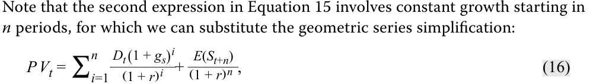

Lưu ý rằng biểu thức thứ hai trong Phương trình 15 liên quan đến sự tăng trưởng không đổi bắt đầu sau $n$ kỳ, do đó chúng ta có thể thay thế bằng công thức rút gọn cấp số nhân như sau:

$$\text{PV}_t = \sum_{i=1}^{n} \frac{D_t(1 + g_s)^i}{(1 + r)^i} + \frac{E(S_{t+n})}{(1 + r)^n} \tag{16}$$

<!-- Formula Text: Note that the second expression in Equation 15 involves constant growth starting in n periods, for which we can substitute the geometric series simplification: P V t = ∑ i=1 n D t (1 + g s) i _ (1 + r) i  + E(S t+n) _ (1 + r) n  , (16) -->

trong đó giá trị của cổ phiếu sau $n$ kỳ ($E(S_{t+n})$ được gọi là **giá trị cuối kỳ (*terminal value*)**) và bằng với công thức sau:

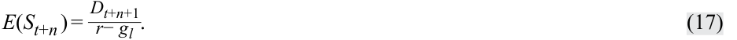

$$E(S_{t+n}) = \frac{D_{t+n+1}}{r - g_l} \tag{17}$$

<!-- Formula Text: E(S t+n ) = D t+n+1 _ r− g l . (17) -->

Chúng ta xem xét lại ví dụ về giá cổ phiếu của Shipline PLC để đánh giá tác động của các giả định cổ tức không đổi, tăng trưởng cổ tức không đổi và tăng trưởng cổ tức thay đổi đối với giá cổ phiếu dự kiến của một công ty.

###### **VÍ DỤ 7 (EXAMPLE 7)** 

###### **Tăng trưởng Cổ tức không đổi và Tăng trưởng Cổ tức thay đổi (Constant and Changing Dividend Growth)** 

Hãy nhớ lại rằng dựa trên mức cổ tức hàng năm không đổi là $1,50\text{ GBP}$ và tỷ suất sinh lợi yêu cầu là $15\%$, chúng ta đã chỉ ra rằng giá cổ phiếu dự kiến của Shipline PLC là $10,00\text{ GBP}$. Thay vào đó, giả sử một nhà phân tích đầu tư giả định rằng Shipline sẽ tăng cổ tức hàng năm ở mức $6\%$ mỗi năm vô thời hạn.

<!-- PDF Page 67 -->

1. Giá cổ phiếu dự kiến của Shipline thay đổi như thế nào dưới giả định tăng trưởng không đổi của nhà phân tích?

###### **Lời giải (Solution):** 

$17,67\text{ GBP}$

Sử dụng Phương trình 14, giải tìm $\text{PV}$ với $D_{t+1} = 1,59\text{ GBP}$ ($= \text{1,50 GBP} \times (1 + 0,06)$), $r = 15\%$, và $g = 6\%$:

$$\text{PV} = \text{1,59 GBP} / (15\% - 6\%) = \text{17,67 GBP}$$

Lưu ý rằng tốc độ tăng trưởng $g$ cao hơn sẽ làm tăng $\text{PV}$ bằng cách làm giảm mẫu số ($r - g$).

2. Giá cổ phiếu dự kiến của Shipline thay đổi như thế nào nếu thay vào đó chúng ta giả định mức tăng trưởng cổ tức ban đầu là $6\%$ trong giai đoạn ba năm, theo sau là mức tăng trưởng cổ tức không đổi $2\%$ kể từ đó trở đi?

**Lời giải (Solution):** 

$13,05\text{ GBP}$

Chúng ta có thể giải tìm giá cổ phiếu dự kiến ($\text{PV}$) của Shipline bằng cách sử dụng các Phương trình 15–17 với $D_t = 1,50$, $g_s = 6\%$, $n = 3$, $r = 15\%$, và $g_l = 2\%$, như sau:

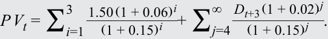

$$\text{PV}_t = \sum_{i=1}^{3} \frac{1,50(1 + 0,06)^i}{(1 + 0,15)^i} + \sum_{j=4}^{\infty} \frac{D_{t+3}(1 + 0,02)^{j-3}}{(1 + 0,15)^j}$$

<!-- Formula Text: P V t = ∑ i=1 3    1.50 (1 + 0.06) i ___________ (1 + 0.15) i  + ∑ j=4 ∞ D t+3 (1 + 0.02) j ___________ (1 + 0.15) j  . -->

Ở bước đầu tiên, chúng ta tính giá trị hiện tại của các khoản cổ tức gắn với tốc độ tăng trưởng cao hơn ($6\%$) trong ba năm đầu tiên như được thể hiện ở biểu thức thứ nhất. Ở bước thứ hai, chúng ta tính giá trị hiện tại của các khoản cổ tức tương lai ở tốc độ tăng trưởng thấp hơn ($2\%$) cho một giai đoạn vô thời hạn. Tổng của hai bước này chính là giá cổ phiếu dự kiến.

- **Bước 1:** Giải bước đầu tiên thu được $3,832\text{ GBP}$ với các dòng tiền cổ tức cho giai đoạn tăng trưởng ban đầu như được thể hiện trong bảng tính sau:

|**$t$**|**$D$**|**$\text{PV}(D)$ tại mức $r\%$**|
|---|---|---|
|0|1,500||
|1|1,590|1,383|
|2|1,685|1,274|
|3|1,787|1,175|
|$\text{PV}(\text{tăng trưởng ngắn hạn})$||3,832|

- **Bước 2:** Như đã trình bày trong Phương trình 16 và 17, biểu thức thứ hai được rút gọn như sau:

$$\frac{E(S_3)}{(1 + r)^3}; \quad \text{với } E(S_3) = \frac{D_4}{r - g_l}$$

*(Lưu ý: Bản gốc ký hiệu giá trị cuối kỳ tại $t=3$ là $E(S_4)$ nhưng chiết khấu 3 kỳ $(1+r)^3$ dựa trên cổ tức $D_4$).*

Chúng ta có thể giải tìm $D_4$ bằng $1,823\text{ GBP}$ ($= 1,787 \times 1,02 = D_3(1 + g_l)$) và giá trị của biểu thức thứ hai là $9,22\text{ GBP}$ như sau:

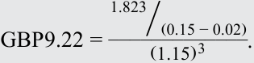

$$\text{9,22 GBP} = \frac{1,823 / (0,15 - 0,02)}{(1,15)^3}$$

<!-- Formula Text: GBP9.22 = 1.823 ⧸(0.15 − 0.02) _____________ (1.15) 3 . -->

- **Bước 3:** Tổng của hai bước này mang lại cho chúng ta mức giá cổ phiếu dự kiến của Shipline là $13,05\text{ GBP}$ ($= 3,83 + 9,22$).

Trong bảng tiếp theo (ở đầu Phần 2/4), chúng tôi trình bày độ nhạy của giá cổ phiếu dự kiến ($\text{PV}$) của Shipline trước những thay đổi trong tốc độ tăng trưởng dài hạn ($g_l$) sau ba năm tăng trưởng cổ tức ở mức $6\%$:
