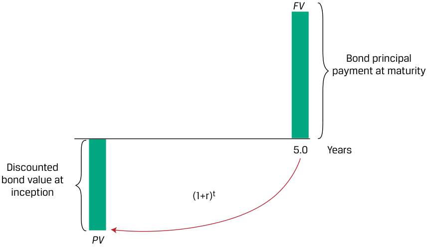
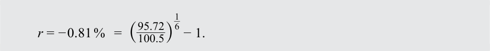
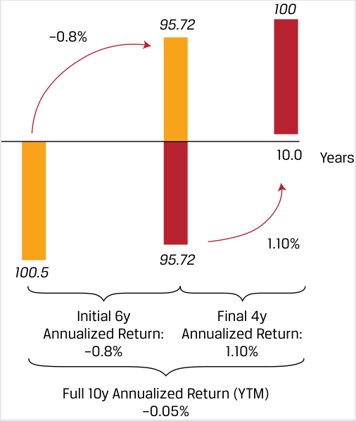
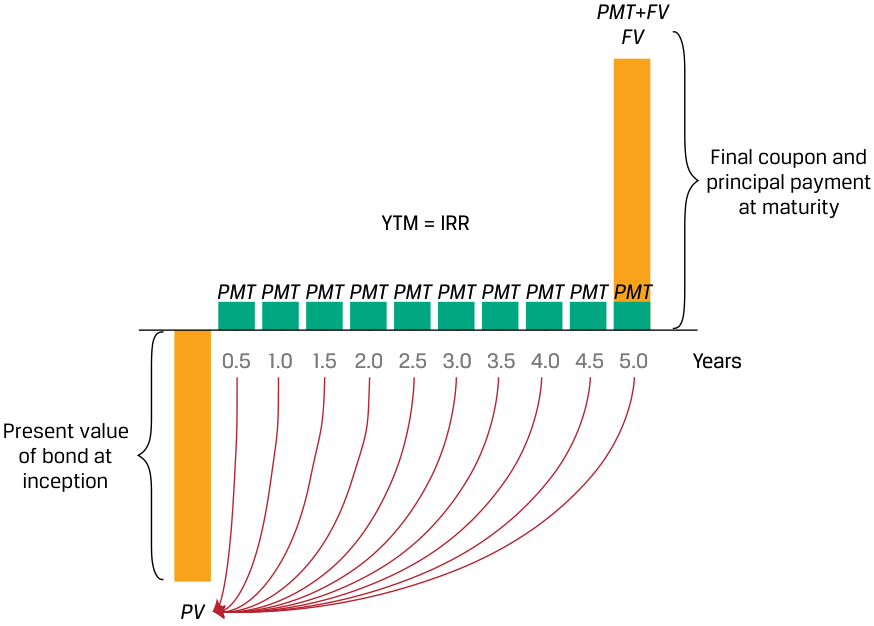
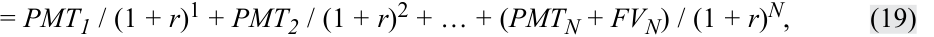
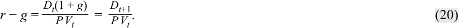
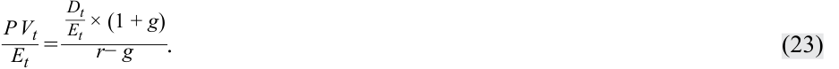
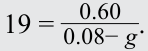

# Tập 1: Phương pháp Định lượng (Volume 1: Quantitative Methods)
## Học phần 2: Giá trị Thời gian của Tiền trong Tài chính (Learning Module 2: Time Value of Money in Finance)
### Phần 2/4: Tỷ suất sinh lợi ngầm định và Tốc độ tăng trưởng ngầm định (Implied Return and Growth) (Trang PDF 68–76)

---

<!-- PDF Page 68 -->

|**Giá cổ phiếu (Share Price)**|**Tốc độ tăng trưởng dài hạn (LT Growth Rate)**|
|---|---|
|11,66|0%|
|13,05|2%|
|14,94|4%|
|17,67|6%|

# **<mark>3</mark>** 

## **TỶ SUẤT SINH LỢI NGẦM ĐỊNH VÀ TỐC ĐỘ TĂNG TRƯỞNG NGẦM ĐỊNH (IMPLIED RETURN AND GROWTH)** 

tính toán và diễn giải tỷ suất sinh lợi ngầm định (*implied return*) của các công cụ thu nhập cố định cùng với tỷ suất sinh lợi yêu cầu (*required return*) và tốc độ tăng trưởng ngầm định (*implied growth*) của các công cụ vốn chủ sở hữu khi biết trước giá trị hiện tại (PV) và các dòng tiền

Bài học 1 đã giải quyết sự đánh đổi về giá trị thời gian của tiền giữa các dòng tiền phát sinh ngày hôm nay so với những dòng tiền trong tương lai đối với một số công cụ thu nhập cố định và công cụ vốn chủ sở hữu nhất định. Những người tham gia thị trường thường đối mặt với một tình huống trong đó cả giá trị hiện tại và giá trị tương lai của các công cụ hoặc các dòng tiền đều đã được biết trước. Trong trường hợp này, hoàn toàn có thể giải tìm tỷ suất sinh lợi ngầm định hoặc tốc độ tăng trưởng ngầm định hàm chứa trong mức giá hiện hành và các đặc điểm của các dòng tiền tương lai. Theo nghĩa này, việc giải tìm tốc độ tăng trưởng hoặc tỷ suất sinh lợi ngầm định cung cấp một góc nhìn về những kỳ vọng của thị trường đang được phản ánh vào trong giá thị trường của tài sản đó.

### **Tỷ suất sinh lợi ngầm định đối với các Công cụ Thu nhập Cố định (Implied Return for Fixed-Income Instruments)** 

Các công cụ thu nhập cố định được đặc trưng bởi các dòng tiền lãi và gốc theo hợp đồng. Nếu chúng ta quan sát được giá trị hiện tại (hay mức giá) và giả định rằng tất cả các dòng tiền tương lai đều diễn ra đúng như đã cam kết, thì lãi suất chiết khấu ($r$) hay lợi suất đáo hạn ($\text{YTM}$) là một thước đo tỷ suất sinh lợi ngầm định dưới những giả định này đối với mô hình dòng tiền đó.

Trong trường hợp của một trái phiếu chiết khấu hoặc công cụ chiết khấu, hãy nhớ lại rằng một nhà đầu tư nhận được một dòng tiền nợ gốc duy nhất ($\text{FV}$) khi đáo hạn, với ($\text{FV} - \text{PV}$) đại diện cho phần sinh lợi ngầm định, như được thể hiện trong Bảng 7 (*Exhibit 7*).

<!-- PDF Page 69 -->

#### **Bảng 7: Tỷ suất sinh lợi ngầm định của Trái phiếu Chiết khấu (Exhibit 7: Discount Bond Implied Return)** 

<!-- Picture Text: FV Bond principal payment at maturity 5.0 Years Discounted bond value at inception (1+r) t PV  -->
> **Chú thích hình ảnh:** Giá trị trái phiếu chiết khấu tại thời điểm khởi đầu ($\text{PV}$) tăng trưởng theo hệ số $(1+r)^t$ qua $5,0$ năm để đạt tới khoản thanh toán nợ gốc trái phiếu khi đáo hạn ($\text{FV}$).

Chúng ta có thể sắp xếp lại Phương trình 5 ở phần trước để giải tìm tỷ suất sinh lợi định kỳ ngầm định kiếm được trong suốt vòng đời của công cụ ($t$ kỳ):

$$r = \sqrt[t]{\frac{\text{FV}_t}{\text{PV}}} - 1 = \left(\frac{\text{FV}_t}{\text{PV}}\right)^{\frac{1}{t}} - 1 \tag{18}$$

<!-- Formula Text: r  = t √ _ F V t _ PV   − 1   =  ( F V t _ PV ) 1 _ t − 1. (18) -->

#### **VÍ DỤ 8 (EXAMPLE 8)** 

### **Tỷ suất sinh lợi ngầm định của Trái phiếu Chiết khấu (Discount Bond Implied Return)** 

Hãy nhớ lại từ Ví dụ 1 rằng vào năm 2016, các nhà đầu tư trái phiếu chính phủ Đức kỳ hạn 10 năm đã đối mặt với mức giá là $100,50\text{ EUR}$ trên mỗi $100\text{ EUR}$ nợ gốc và lợi suất đáo hạn (YTM) hàng năm là $-0,05\%$ khi phát hành. Nghĩa là, trái phiếu chính phủ Đức kỳ hạn 10 năm ban đầu được thị trường định giá để mang lại tỷ suất sinh lợi âm cho nhà đầu tư. Sáu năm sau, những trái phiếu này được giao dịch ở mức giá ($\text{PV}$) là $95,72\text{ EUR}$ trên mỗi $100\text{ EUR}$ nợ gốc.

1. Tỷ suất sinh lợi ngầm định của nhà đầu tư ban đầu đối với trái phiếu này trong thời kỳ nắm giữ sáu năm là bao nhiêu?

#### **Lời giải (Solution):** 

$-0,81\%$

Chúng ta có thể giải tìm tỷ suất sinh lợi quy đổi theo năm ($r$) của nhà đầu tư bằng cách sử dụng Phương trình 18 với $\text{PV} = 100,5$, $\text{FV} = 95,72$, và $t = 6$ như sau:

$$r = -0,81\% = \left(\frac{95,72}{100,5}\right)^{\frac{1}{6}} - 1$$

<!-- Formula Text: r = − 0.81 %   =  ( 95.72 _ 100.5 ) 1 _ 6 − 1. -->

Lưu ý rằng một nhà đầu tư mua trái phiếu chiết khấu khi phát hành và nhận được $100\text{ EUR}$ sau 10 năm sẽ kỳ vọng mức tỷ suất sinh lợi ngầm định bằng với YTM lúc phát hành là $-0,05\%$. Tuy nhiên, mức giảm giá $4,78\text{ EUR}$ trong sáu năm đầu tiên đã chuyển thành mức tỷ suất sinh lợi quy đổi theo năm là $-0,81\%$, thấp hơn mức YTM ban đầu là $-0,05\%$. Tỷ suất sinh lợi âm này hoàn toàn nhất quán với sự sụt giảm dự kiến trong giá ($\text{PV}$) của một trái phiếu chiết khấu trong bối cảnh lạm phát tăng cao hơn.

<!-- PDF Page 70 -->

2. Tỷ suất sinh lợi kỳ vọng của một nhà đầu tư mua trái phiếu chiết khấu ở mức giá $95,72\text{ EUR}$ và nắm giữ nó trong bốn năm còn lại là bao nhiêu?

#### **Lời giải (Solution):** 

$1,10\%$

Tại đây, mức giá hiện hành $95,72$ trong Phương trình 18 bây giờ đóng vai trò là $\text{PV}$, và nợ gốc $100$ là $\text{FV}$, với $t = 4$:

$$r = 1,10\% = \left(\frac{100}{95,72}\right)^{\frac{1}{4}} - 1$$

<!-- Formula Text: r = 1.10 %   =  ( 100 _ 95.72 ) 1 _ 4 − 1. -->

Lưu ý rằng $r = 1,10\%$ bằng với mức YTM cho bốn năm còn lại mà chúng ta đã suy ra trong Ví dụ 1. Tỷ suất sinh lợi tích lũy qua hai nhà đầu tư đúng bằng mức YTM ban đầu là $-0,05\%$, giả định không có chi phí giao dịch, như sau:

$$-0,05\% = \left[(1 - 0,0081)^6 \times (1 + 0,011)^4\right]^{\frac{1}{10}} - 1$$

<!-- Formula Text: − 0.05 %   =  [(1 − 0.0081) 6 × (1 + 0.011) 4]  1 _ 10 − 1. -->

Các mối quan hệ này được tóm tắt trong sơ đồ sau:

<!-- Picture Text: 100 95.72 –0.8% 10.0 Years 1.10% 95.72 100.5 Initial 6y Final 4y Annualized Return: Annualized Return: –0.8% 1.10% Full 10y Annualized Return (YTM) –0.05%  -->
> **Chú thích hình ảnh:** Trong 6 năm đầu (*Initial 6y*), giá giảm từ $100,5$ xuống $95,72$, tương ứng Tỷ suất sinh lợi quy đổi theo năm (*Annualized Return*) là $-0,81\%$ (trong hình ghi $-0,8\%$). Trong 4 năm cuối (*Final 4y*), giá tăng từ $95,72$ lên $100$, tương ứng Tỷ suất sinh lợi quy đổi theo năm là $1,10\%$. Tỷ suất sinh lợi quy đổi theo năm cho toàn bộ 10 năm (*Full 10y Annualized Return – YTM*) là $-0,05\%$.

Khác với trái phiếu chiết khấu, các công cụ thu nhập cố định trả lãi định kỳ có các dòng tiền phát sinh trong suốt vòng đời của chúng cho đến khi đáo hạn. Lãi suất chiết khấu đồng nhất (hay tỷ suất hoàn vốn nội bộ) cho tất cả các dòng tiền đã cam kết chính là lợi suất đáo hạn (YTM), một mức lãi suất chiết khấu thị trường ngầm định duy nhất áp dụng cho mọi dòng tiền bất kể thời điểm phát sinh như được thể hiện đối với trái phiếu trả lãi định kỳ trong Bảng 8 (*Exhibit 8*).

<!-- PDF Page 71 -->

#### **Bảng 8: Tỷ suất sinh lợi ngầm định của Trái phiếu trả lãi định kỳ (Exhibit 8: Coupon Bond Implied Return)** 

<!-- Picture Text: PMT + FV FV Final coupon and principal payment at maturity YTM = IRR PMT PMT PMT PMT PMT PMT PMT PMT PMT PMT 0.5 1.0 1.5 2.0 2.5 3.0 3.5 4.0 4.5 5.0 Years Present value of bond at inception PV  -->
> **Chú thích hình ảnh:** Giá trị hiện tại của trái phiếu tại thời điểm khởi đầu ($\text{PV}$), các dòng tiền coupon định kỳ ($\text{PMT}$) từ năm $0,5$ đến $4,5$, và khoản thanh toán coupon cuối cùng cộng nợ gốc khi đáo hạn ($\text{PMT} + \text{FV}$) tại năm $5,0$ được liên kết với nhau qua mức lợi suất đáo hạn $\text{YTM} = \text{IRR}$.

Lợi suất đáo hạn (YTM) giả định rằng nhà đầu tư kỳ vọng sẽ nhận được tất cả các dòng tiền đã cam kết cho đến khi đáo hạn và tái đầu tư bất kỳ khoản tiền mặt nào nhận được ở cùng mức YTM đó. Đối với trái phiếu trả lãi định kỳ, điều này chỉ liên quan đến các khoản thanh toán tiền lãi định kỳ, trong khi đối với các công cụ thanh toán đều như khoản vay thế chấp, phép tính giả định cả tiền lãi và nợ gốc được hoàn trả đều có thể được tái đầu tư ở cùng một mức lãi suất. Giống như các tỷ suất hoàn vốn nội bộ khác, YTM không thể giải trực tiếp bằng một phương trình đại số đơn giản, nhưng có thể được tính bằng phương pháp lặp (*iteration*) với bảng tính hoặc máy tính tài chính — một quá trình giải tìm $r$ trong Phương trình 19 như sau:

$$\text{PV}(\text{Trái phiếu coupon}) = \frac{\text{PMT}_1}{(1 + r)^1} + \frac{\text{PMT}_2}{(1 + r)^2} + \dots + \frac{(\text{PMT}_N + \text{FV}_N)}{(1 + r)^N} \tag{19}$$

<!-- Formula Text: = PMT1 / (1 + r)1 + PMT2 / (1 + r)2 + … + (PMTN + FVN) / (1 + r)N, (19) -->

trong đó $\text{FV}$ bằng nợ gốc của trái phiếu và $N$ là số kỳ cho đến khi đáo hạn.

Hàm YIELD trong Microsoft Excel hoặc Google Sheets có thể được sử dụng để tính YTM cho các công cụ thu nhập cố định có trả lãi định kỳ và thanh toán toàn bộ nợ gốc khi đáo hạn:

`=YIELD(settlement, maturity, rate, pr, redemption, frequency, [basis])`

trong đó:

- _settlement_ = ngày thanh toán giao dịch (*settlement date*) được nhập bằng hàm DATE;

- _maturity_ = ngày đáo hạn (*maturity date*) được nhập bằng hàm DATE;

- _rate_ = lãi suất coupon hàng năm (trả định kỳ hoặc nửa năm một lần);

- _pr_ = mức giá trên mỗi 100 đơn vị mệnh giá;

- _redemption_ = giá trị tương lai (giá trị hoàn trả) khi đáo hạn;

- _frequency_ = số lần trả coupon mỗi năm; và

- _[basis]_ = quy ước đếm ngày (*day count convention*), thông thường là 0 đối với trái phiếu Hoa Kỳ (quy ước đếm ngày 30/360).

Ví dụ 9 minh họa tỷ suất sinh lợi ngầm định đối với các công cụ thu nhập cố định có trả lãi định kỳ.

<!-- PDF Page 72 -->

#### **VÍ DỤ 9 (EXAMPLE 9)** 

### **Tỷ suất sinh lợi ngầm định của Trái phiếu trả lãi định kỳ Hy Lạp (Greek Coupon Bond Implied Return)** 

Hãy nhớ lại từ Ví dụ 2 rằng trái phiếu chính phủ Hy Lạp kỳ hạn bảy năm được phát hành vào năm 2020 với lãi suất coupon hàng năm $2,00\%$ có mức giá là $93,091\text{ EUR}$ trên mỗi $100\text{ EUR}$ nợ gốc vào hai năm sau đó.

1. Tỷ suất sinh lợi ngầm định trong hai năm đối với một nhà đầu tư có khả năng tái đầu tư tiền lãi định kỳ ở mức YTM ban đầu là $2,00\%$ là bao nhiêu?

**Lời giải (Solution):** 

$-1,445\%$

Sử dụng Phương trình 18 giống như đối với trái phiếu chiết khấu, trước tiên chúng ta phải tính giá trị tương lai ($\text{FV}$) sau hai năm bao gồm mức giá tương lai là $93,091$ và tất cả các dòng tiền được tái đầu tư tính đến ngày đó:

$$\begin{aligned}
\text{FV}_2 &= \text{PMT}_1(1 + r) + \text{PMT}_2 + \text{PV}_2 \\
\text{FV}_2 &= 97,13 = 2 \times (1,02) + 2 + 93,091
\end{aligned}$$

$$r = -1,445\% = \left(\frac{97,13}{100}\right)^{\frac{1}{2}} - 1$$

<!-- Formula Text: r = − 1.445 %   =  ( 97.13 _ 100 ) 1 _ 2 − 1. -->

Tỷ suất sinh lợi quy đổi theo năm mang giá trị âm này là do khoản lỗ vốn $6,91\text{ EUR}$ ($= 100 - 93,091$) đã vượt quá tổng tiền lãi định kỳ cộng với tiền thu được từ tái đầu tư là $4,04\text{ EUR}$ ($= 2 \times (1,02) + 2$). Sự sụt giảm giá trái phiếu xuống mức $93,091\text{ EUR}$ vào năm 2022 là kết quả của sự gia tăng lạm phát tại khu vực đồng Euro trong giai đoạn đó.

Đối với một nhà đầu tư mua trái phiếu coupon $2\%$ vào năm 2022 ở mức giá $93,091\text{ EUR}$, hãy nhớ lại rằng chúng ta đã giải tìm được $r$ (hay YTM) là $3,532\%$. Lưu ý rằng phép tính YTM này cho năm năm còn lại giả định tất cả các dòng tiền có thể được tái đầu tư ở mức $3,532\%$ cho đến khi đáo hạn. Mức lãi suất mà tại đó tiền lãi định kỳ có thể được tái đầu tư đóng vai trò then chốt đối với phép tính tỷ suất sinh lợi ngầm định cho các trái phiếu trả lãi định kỳ như được thể hiện dưới đây. YTM được tính toán với giả định rằng trái phiếu được nắm giữ cho đến khi đáo hạn.

<!-- PDF Page 73 -->

<!-- Picture Text: 100 93.091 –1.445% 2 2 2 2 2 2 2 Years 1.0 2.0 3.0 4.0 5.0 6.0 7.0 3.532% 93.091 100  -->
> **Chú thích hình ảnh:** Trái phiếu trả coupon $2$ mỗi năm từ Năm $1,0$ đến Năm $7,0$. Trong 2 năm đầu (từ Năm 0 đến Năm $2,0$), giá giảm từ $100$ xuống $93,091$, tương ứng tỷ suất sinh lợi quy đổi theo năm là $-1,445\%$. Trong 5 năm cuối (từ Năm $2,0$ đến Năm $7,0$), giá tăng từ $93,091$ lên $100$ khi đáo hạn, tương ứng lợi suất đáo hạn YTM là $3,532\%$.

### **Công cụ Vốn chủ sở hữu, Tỷ suất sinh lợi ngầm định và Tốc độ tăng trưởng ngầm định (Equity Instruments, Implied Return, and Implied Growth)** 

Như đã lưu ý trong phần thảo luận về cách tính giá trị hiện tại của một khoản đầu tư vốn chủ sở hữu, giá của một cổ phiếu phản ánh không chỉ tỷ suất sinh lợi yêu cầu mà còn cả tốc độ tăng trưởng của các dòng tiền. Nếu chúng ta bắt đầu với giả định cổ tức tăng trưởng không đổi từ Phương trình 14, chúng ta có thể sắp xếp lại công thức như sau:

$$r - g = \frac{D_t(1 + g)}{\text{PV}_t} = \frac{D_{t+1}}{\text{PV}_t} \tag{20}$$

<!-- Formula Text: r − g = D t(1 + g) _ P V t    = D t+1 _ P V t . (20) -->

Vế trái của Phương trình 20 đơn giản phản ánh sự chênh lệch giữa tỷ suất sinh lợi yêu cầu và tốc độ tăng trưởng không đổi, còn vế phải là lợi suất cổ tức (*dividend yield*) của cổ phiếu dựa trên cổ tức dự kiến trong kỳ tiếp theo. Như vậy, tỷ suất sinh lợi ngầm định của một cổ phiếu khi biết lợi suất cổ tức dự kiến và tốc độ tăng trưởng của nó được cho bởi Phương trình 21 như sau:

$$r = \frac{D_t(1 + g)}{\text{PV}_t} + g = \frac{D_{t+1}}{\text{PV}_t} + g \tag{21}$$

<!-- Formula Text: r = D t(1 + g) _ P V t   + g  = D t+1 _ P V t  + g. (21) -->

Nói một cách đơn giản, nếu chúng ta giả định rằng cổ tức của một cổ phiếu tăng trưởng với tốc độ không đổi đến vĩnh viễn, thì tỷ suất sinh lợi ngầm định của cổ phiếu đó bằng lợi suất cổ tức dự kiến cộng với tốc độ tăng trưởng không đổi.

Ngoài ra, chúng ta có thể quan tâm đến việc giải tìm tốc độ tăng trưởng ngầm định (*implied growth rate*) của một cổ phiếu, và mối quan hệ này được cho bởi Phương trình 22:

$$g = \frac{r \times \text{PV}_t - D_t}{\text{PV}_t + D_t} = r - \frac{D_{t+1}}{\text{PV}_t} \tag{22}$$

<!-- Formula Text: g = r * P V t − D t _ P V t+ D t    =  r− D t+1 _ P V t . (22) -->

Nếu biết trước khoản cổ tức dự kiến tiếp theo của một cổ phiếu, thì chúng ta có thể tính tốc độ tăng trưởng ngầm định bằng cách lấy tỷ suất sinh lợi yêu cầu trừ đi lợi suất cổ tức dự kiến của nó.

<!-- PDF Page 74 -->

#### **VÍ DỤ 10 (EXAMPLE 10)** 

### **Tỷ suất sinh lợi ngầm định và Tốc độ tăng trưởng ngầm định của một Cổ phiếu (Implied Return and Growth for a Stock)** 

Cổ phiếu của Công ty Coca-Cola (*Coca-Cola Company*) đang giao dịch ở mức giá $63,00\text{ USD}$ một cổ phiếu và cổ tức dự kiến quy đổi theo năm trên mỗi cổ phiếu trong năm tới là $1,76\text{ USD}$.

1. Nếu một nhà phân tích kỳ vọng cổ tức trên mỗi cổ phiếu của Coca-Cola sẽ tăng với tốc độ không đổi $4\%$ mỗi năm vô thời hạn, hãy tính tỷ suất sinh lợi yêu cầu mà các nhà đầu tư kỳ vọng.

#### **Lời giải (Solution):** 

$6,79\%$

Sử dụng Phương trình 21:

$$r = \frac{1,76}{63} + 0,04 = 0,0679$$

<!-- Formula Text: r  =   1.76 _ 63  + 0.04  =  0.0679. -->

Tỷ suất sinh lợi yêu cầu được kỳ vọng đối với cổ phiếu Coca-Cola là $6,79\%$ khi biết giá hiện hành, cổ tức dự kiến và tốc độ tăng trưởng cổ tức dự kiến của nó. Kỳ vọng của nhà đầu tư về tỷ suất sinh lợi cổ phiếu trong tương lai được suy ra từ sự kết hợp giữa mức giá hiện hành, các dòng tiền dự kiến trong tương lai và tốc độ tăng trưởng dòng tiền. Giả sử rằng, thay vì cố gắng ước tính tỷ suất sinh lợi yêu cầu, một nhà đầu tư lại muốn xác định tốc độ tăng trưởng cổ tức ngầm định. Trong trường hợp này, nhà đầu tư phải giả định một mức tỷ suất sinh lợi cổ phiếu trong tương lai, như trong câu hỏi 2.

2. Nếu nhà phân tích tin rằng các nhà đầu tư cổ phiếu Coca-Cola nên kỳ vọng một mức tỷ suất sinh lợi là $7\%$, hãy tính tốc độ tăng trưởng cổ tức ngầm định cho Coca-Cola.

#### **Lời giải (Solution):** 

$4,21\%$

Sử dụng Phương trình 22:

$$g = 0,07 - \frac{1,76}{63} = 0,0421$$

<!-- Formula Text: g  =  0.07−  1.76 _ 63  = 0.0421. -->

Tốc độ tăng trưởng cổ tức ngầm định của cổ phiếu Coca-Cola là $4,21\%$ khi biết tỷ suất sinh lợi kỳ vọng, mức giá và cổ tức dự kiến của nó. Do một mức tỷ suất sinh lợi kỳ vọng cao hơn được giả định trong câu hỏi này so với trường hợp ở câu hỏi 1, nên kết quả dẫn đến một tốc độ tăng trưởng cổ tức ngầm định cao hơn để biện minh cho mức giá cổ phiếu $63,00\text{ USD}$ của Coca-Cola.

Thay vì so sánh trực tiếp giá cổ phiếu tính theo đơn vị tiền tệ, một thông lệ phổ biến là so sánh tỷ số giữa giá cổ phiếu trên thu nhập mỗi cổ phiếu, hay **hệ số giá trên thu nhập (*price-to-earnings ratio – P/E*)**.

#### **HỆ SỐ GIÁ TRÊN THU NHẬP (PRICE-TO-EARNINGS RATIO)** 

Hệ số giá trên thu nhập (*price-to-earnings ratio*) là một thước đo định giá tương đối (*relative valuation metric*) giúp cải thiện khả năng so sánh bằng cách kiểm soát một yếu tố dẫn dắt giá trị đã biết (thu nhập trên mỗi cổ phiếu – *earnings per share*) cũng như đơn vị tiền tệ. Nó tương tự như việc biểu thị giá bất động sản bằng đơn giá trên mỗi mét vuông.

Một cổ phiếu đang giao dịch ở hệ số giá trên thu nhập (P/E) bằng 20 hàm ý rằng giá cổ phiếu của nó gấp 20 lần thu nhập trên mỗi cổ phiếu và các nhà đầu tư sẵn sàng trả gấp 20 lần thu nhập trên mỗi cổ phiếu cho mỗi cổ phiếu được giao dịch, tức là đắt hơn so với một cổ phiếu đang giao dịch ở hệ số giá trên thu nhập bằng 10.

<!-- PDF Page 75 -->

Hệ số giá trên thu nhập không chỉ được sử dụng cho các cổ phiếu riêng lẻ mà còn là một thước đo định giá cho các chỉ số chứng khoán, chẳng hạn như S&P 500, FTSE 100, hoặc Nikkei 225. Tại đây, giá trị chỉ số chứng khoán được chia cho tổng có trọng số của thu nhập trên mỗi cổ phiếu của các công ty thành phần trong chỉ số. Nội dung này sẽ được khám phá sâu hơn ở phần sau của chương trình học, nhưng chúng ta có thể liên hệ hệ số giá trên thu nhập với phần thảo luận trước đó về việc gắn kết giá cổ phiếu ($\text{PV}$) với các dòng tiền dự kiến trong tương lai để rút ra một số nhận xét hữu ích. Trước hết, hãy nhớ lại Phương trình 14:

$$\text{PV}_t = \frac{D_t(1 + g)}{r - g}$$

<!-- Formula Text: P V t = D t(1 + g) _ r − g  . -->

Chúng ta có thể chia cả hai vế cho $E_t$, thu nhập trên mỗi cổ phiếu (*earnings per share*) của kỳ $t$, để thu được:

$$\frac{\text{PV}_t}{E_t} = \frac{D_t}{E_t} \times \frac{(1 + g)}{r - g} \tag{23}$$

<!-- Formula Text: P V t _ E t  = D t _ E t  × (1 + g) _ r− g . (23) -->

Vế trái của Phương trình 23 là hệ số giá trên thu nhập (P/E hiện tại – *trailing P/E*), trong khi thừa số đầu tiên ở tử số bên vế phải là tỷ trọng thu nhập được phân phối cho các cổ đông dưới dạng cổ tức, được gọi là **tỷ lệ chi trả cổ tức (*dividend payout ratio*)**.

Khi biết hệ số giá trên thu nhập và tỷ lệ chi trả cổ tức, chúng ta có thể giải tìm tỷ suất sinh lợi yêu cầu hoặc tốc độ tăng trưởng cổ tức ngầm định (khi có giả định về đại lượng còn lại). Tỷ suất sinh lợi yêu cầu rất hữu ích trong việc tìm hiểu kỳ vọng sinh lợi của nhà đầu tư trên cơ sở hướng tới tương lai (*forward-looking basis*). Tốc độ tăng trưởng không đổi ngầm định lại hữu ích để so sánh với tốc độ tăng trưởng dự kiến và tốc độ tăng trưởng lịch sử của công ty. Ví dụ, nếu tốc độ tăng trưởng không đổi ngầm định là $10\%$ nhưng nhà phân tích ước tính rằng công ty chỉ có thể tăng trưởng ở mức $5\%$, nhà phân tích có thể đánh giá rằng cổ phiếu đó đang bị định giá quá cao (*overvalued*).

Trên thực tế, **hệ số giá trên thu nhập dự phóng (*forward price-to-earnings ratio – forward P/E*)**, hay tỷ số giữa giá cổ phiếu trên mức ước tính thu nhập mỗi cổ phiếu của kỳ tiếp theo ($t + 1$), thường được sử dụng phổ biến. Với hệ số này, chúng ta có thể rút gọn phương trình trước đó như sau:

$$\frac{\text{PV}_t}{E_{t+1}} = \frac{D_{t+1} / E_{t+1}}{r - g} \tag{24}$$

<!-- Formula Text: P V t _ E t+1  = D t+1 _ E t+1 _ r− g . (24) -->

Từ Phương trình 24, chúng ta có thể thấy rằng hệ số giá trên thu nhập dự phóng có mối quan hệ đồng biến (*positively related*) với tỷ lệ chi trả cổ tức dự kiến cao hơn và tốc độ tăng trưởng dự kiến cao hơn, nhưng có mối quan hệ nghịch biến (*negatively related*) với tỷ suất sinh lợi yêu cầu.

#### **VÍ DỤ 11 (EXAMPLE 11)** 

### **Tỷ suất sinh lợi ngầm định và Tốc độ tăng trưởng ngầm định từ Hệ số Giá trên Thu nhập (Implied Return and Growth from Price to Earnings Ratio)** 

1. Giả sử cổ phiếu Coca-Cola giao dịch ở hệ số giá trên thu nhập dự phóng (*forward P/E*) là 28, tỷ lệ chi trả cổ tức dự kiến của nó là $70\%$, và các nhà phân tích tin rằng cổ tức của công ty sẽ tăng trưởng với tốc độ không đổi là $4\%$ mỗi năm. Hãy tính tỷ suất sinh lợi yêu cầu của Coca-Cola.

**Lời giải (Solution):** 

$6,50\%$

Sử dụng Phương trình 24:

$$28 = \frac{0,7}{r - 0,04}$$

<!-- Formula Text: 28 =   0.7 _ r − 0.04 . -->

Giải phương trình này để tìm $r$, tỷ suất sinh lợi yêu cầu của Coca-Cola là $6,50\%$. Từ kết quả trên cho tỷ suất sinh lợi yêu cầu của Coca-Cola, không có gì đáng ngạc nhiên khi nếu thay vào đó chúng ta giả định rằng tỷ suất sinh lợi yêu cầu đối với cổ phiếu Coca-Cola là $6,50\%$, thì chúng ta sẽ tìm ra tốc độ tăng trưởng ngầm định của Coca-Cola là $4\%$, và kết quả này được xác nhận trong câu hỏi 2.

<!-- PDF Page 76 -->

2. Giả sử cổ phiếu Coca-Cola giao dịch ở hệ số giá trên thu nhập dự phóng là 28, tỷ lệ chi trả cổ tức dự kiến của nó là $70\%$, và các nhà phân tích tin rằng tỷ suất sinh lợi yêu cầu của nó là $6,50\%$. Hãy tính tốc độ tăng trưởng ngầm định của Coca-Cola.

#### **Lời giải (Solution):** 

$4,00\%$

Sử dụng Phương trình 24:

$$28 = \frac{0,70}{0,065 - g}$$

Giải phương trình này để tìm $g$, tốc độ tăng trưởng ngầm định của Coca-Cola là $4,00\%$. Cụ thể, tỷ suất sinh lợi của Coca-Cola được kỳ vọng sẽ cao hơn $2,5\%$ so với tốc độ tăng trưởng cổ tức của nó (tức là $6,50\% - 4,00\%$).

Như đã thảo luận trước đó, các nguyên lý tương tự cũng được áp dụng để tìm hiểu tỷ suất sinh lợi yêu cầu và tốc độ tăng trưởng của các chỉ số chứng khoán.

3. Một chỉ số chứng khoán đang giao dịch ở hệ số giá trên thu nhập dự phóng là 19. Nếu tỷ lệ chi trả cổ tức dự kiến của chỉ số là $60\%$, và các nhà đầu tư cổ phiếu kỳ vọng mức tỷ suất sinh lợi của chỉ số là $8\%$, hãy tính tốc độ tăng trưởng không đổi ngầm định cho chỉ số này.

**Lời giải (Solution):** 

$4,84\%$

Sử dụng Phương trình 24:

$$19 = \frac{0,60}{0,08 - g}$$

<!-- Formula Text: 19 =   0.60 _ 0.08− g . -->

Giải tìm $g$, chúng ta thấy rằng các nhà đầu tư kỳ vọng tốc độ tăng trưởng cổ tức của chỉ số sẽ là $4,84\%$ trong tương lai. Ngược lại, chúng ta có thể giả định rằng các nhà đầu tư kỳ vọng tốc độ tăng trưởng là $4,84\%$ và giải tìm $r$ để tính ra mức tỷ suất sinh lợi yêu cầu là $8\%$. Do đó, hệ số giá trên thu nhập dự phóng của chỉ số là 19 và tỷ lệ chi trả cổ tức dự kiến là $60\%$ kết hợp lại để phản ánh kỳ vọng về mức tỷ suất sinh lợi $8\%$ và tốc độ tăng trưởng $4,84\%$. Cụ thể, tỷ suất sinh lợi yêu cầu vượt quá tốc độ tăng trưởng cổ tức ngầm định một mức là $3,16\%$ (tức là $8\% - 4,84\%$).

Một điểm quan trọng rút ra từ các kết quả trước là giá cổ phiếu, cho dù được biểu thị đơn giản dưới dạng mức giá hay dưới dạng hệ số giá trên thu nhập, đều phản ánh những kỳ vọng kết hợp về tỷ suất sinh lợi và tốc độ tăng trưởng trong tương lai. Kỳ vọng về tỷ suất sinh lợi và tốc độ tăng trưởng được liên kết chặt chẽ với nhau thông qua mức chênh lệch giữa $r$ và $g$. Ví dụ, trường hợp của Coca-Cola sử dụng hệ số giá trên thu nhập bằng 28 mô tả một tình huống trong đó các nhà đầu tư phải tin rằng tỷ suất sinh lợi yêu cầu đối với cổ phiếu Coca-Cola cao hơn $2,5\%$ so với tốc độ tăng trưởng của nó.

4. Giả sử cổ phiếu Coca-Cola giao dịch ở hệ số giá trên thu nhập dự phóng là 28 và tỷ lệ chi trả cổ tức dự kiến của nó là $70\%$. Các nhà phân tích tin rằng cổ phiếu Coca-Cola cần phải mang lại mức tỷ suất sinh lợi $9\%$ và cổ tức của nó sẽ tăng trưởng $4,50\%$ mỗi năm vô thời hạn. Hãy khuyến nghị một phương án hành động cho một nhà đầu tư đang quan tâm đến việc mở vị thế đối với cổ phiếu Coca-Cola.

#### **Lời giải (Solution):** 

Mở vị thế bán khống (*short position*) đối với cổ phiếu Coca-Cola. Nếu chúng ta đánh giá các tham số trên bằng cách sử dụng Phương trình 24, chúng ta có thể thấy rằng điều này dẫn đến một bất đẳng thức:
*(Xem tiếp phần lời giải ở đầu Phần 3/4)*
