# Tập 1: Phương pháp Định lượng (Volume 1: Quantitative Methods)
## Học phần 2: Giá trị Thời gian của Tiền trong Tài chính (Learning Module 2: Time Value of Money in Finance)
### Phần 3/4: Tính cộng Dòng tiền (Cash Flow Additivity) (Trang PDF 77–91)

---

<!-- PDF Page 77 -->

$$28 > \frac{0,70}{0,09 - 0,045} = 15,56$$

Hệ số giá trên thu nhập dự phóng (*forward price-to-earnings ratio*) của Coca-Cola ở mức 28 lớn hơn nhiều so với con số $15,56$ được tính ra từ phương trình. Kỳ vọng của nhà đầu tư về tốc độ tăng trưởng dòng tiền và tỷ suất sinh lợi không nhất quán với hệ số giá trên thu nhập dự phóng của Coca-Cola. Cụ thể, nhà đầu tư nên cân nhắc mở một vị thế bán khống (*short position*) đối với cổ phiếu Coca-Cola với niềm tin rằng giá của nó sẽ giảm xuống bởi vì hệ số giá trên thu nhập hiện hành của nó cao hơn nhiều so với những gì các yếu tố cơ bản (*fundamentals*) hàm ý. Như đã trình bày trong kết quả của câu hỏi 1 và 2 ở ví dụ này, kỳ vọng về tỷ suất sinh lợi yêu cầu và tốc độ tăng trưởng phải sao cho $r - g = 2,50\%$ thì mới biện minh được cho hệ số giá trên thu nhập dự phóng bằng 28 khi tỷ lệ chi trả cổ tức dự kiến là $70\%$.

## **TÍNH CỘNG DÒNG TIỀN (CASH FLOW ADDITIVITY)** 

**<mark>4</mark>** 

giải thích nguyên lý cộng dòng tiền (*cash flow additivity principle*), tầm quan trọng của nó đối với điều kiện không có kinh doanh chênh lệch giá (*no-arbitrage condition*), và ứng dụng của nó trong việc tính toán lãi suất kỳ hạn ngầm định (*implied forward interest rates*), tỷ giá hối đoái kỳ hạn (*forward exchange rates*) và giá trị quyền chọn (*option values*)

Sự đánh đổi về giá trị thời gian của tiền giữa các dòng tiền phát sinh ngày hôm nay so với những dòng tiền trong tương lai có thể được mở rộng vượt ra ngoài việc định giá các dòng tiền tương lai ở thời điểm hiện tại hoặc tính toán tỷ suất sinh lợi ngầm định trên một công cụ đơn lẻ bằng cách sử dụng **nguyên lý cộng dòng tiền (*cash flow additivity principle*)**. Theo nguyên lý cộng dòng tiền, giá trị hiện tại của bất kỳ chuỗi dòng tiền tương lai nào được đánh chỉ số tại cùng một thời điểm đều bằng tổng giá trị hiện tại của từng dòng tiền thành phần. Nguyên lý này rất quan trọng trong việc đảm bảo rằng giá thị trường phản ánh điều kiện không có kinh doanh chênh lệch giá (*no arbitrage*), hay nói cách khác là không tồn tại khả năng kiếm được lợi nhuận phi rủi ro (*riskless profit*) khi không có chi phí giao dịch. Hãy bắt đầu với một ví dụ cơ bản để minh họa nguyên lý cộng dòng tiền.

#### **VÍ DỤ 12 (EXAMPLE 12)** 

### **Tính cộng Dòng tiền Cơ bản (Basic Cash Flow Additivity)** 

Giả sử bạn có $100\text{ GBP}$ để đầu tư và có hai chiến lược để lựa chọn với các chuỗi dòng tiền tương ứng như được thể hiện trong Bảng 9 (*Exhibit 9*).

<!-- PDF Page 78 -->

#### **Bảng 9: Hai Chiến lược Đầu tư (Exhibit 9: Two Investment Strategies)** 

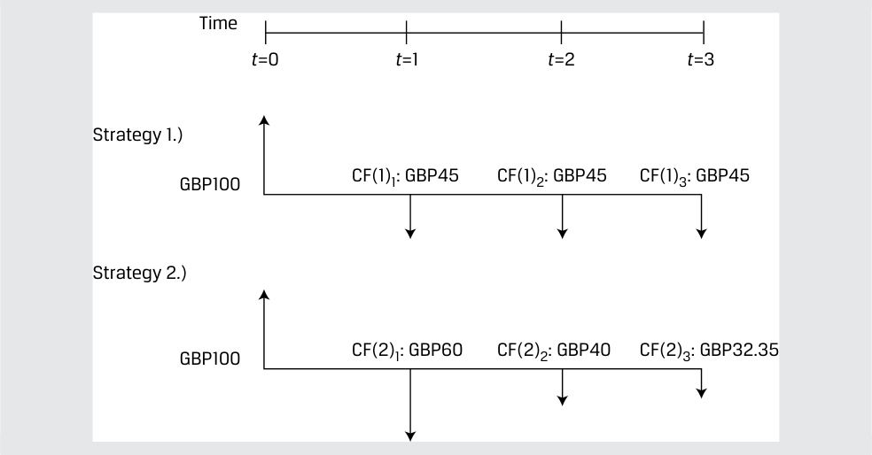

<!-- Picture Text: Time t =0 t =1 t =2 t =3 Strategy 1.) GBP100 CF(1)1: GBP45 CF(1)2: GBP45 CF(1)3: GBP45 Strategy 2.) GBP100 CF(2)1: GBP60 CF(2)2: GBP40 CF(2)3: GBP32.35  -->
> **Chú thích hình ảnh:**
> - **Chiến lược 1 (*Strategy 1*):** Đầu tư $100\text{ GBP}$ tại $t=0$; nhận các dòng tiền $CF(1)_1 = 45\text{ GBP}$ tại $t=1$, $CF(1)_2 = 45\text{ GBP}$ tại $t=2$, $CF(1)_3 = 45\text{ GBP}$ tại $t=3$.
> - **Chiến lược 2 (*Strategy 2*):** Đầu tư $100\text{ GBP}$ tại $t=0$; nhận các dòng tiền $CF(2)_1 = 60\text{ GBP}$ tại $t=1$, $CF(2)_2 = 40\text{ GBP}$ tại $t=2$, $CF(2)_3 = 32,35\text{ GBP}$ tại $t=3$.

Tỷ suất sinh lợi yêu cầu của bạn đối với cả hai chiến lược đầu tư là $10\%$ mỗi kỳ.

1. Khuyến nghị nên lựa chọn chiến lược đầu tư nào.

#### **Lời giải (Solution):** 

Để đưa ra khuyến nghị giữa hai chiến lược này, chúng ta cần xác định xem chiến lược nào có giá trị hiện tại cao hơn cũng như liệu có chiến lược nào mang lại giá trị hiện tại ròng dương hay không. Để đạt được các mục tiêu này, trước tiên chúng ta có thể tính giá trị hiện tại của cả hai chiến lược và đảm bảo rằng ít nhất một chiến lược có giá trị hiện tại dương bên cạnh việc so sánh giá trị hiện tại của hai chiến lược với nhau. Ngoài ra, chúng ta có thể tính mức chênh lệch giữa các dòng tiền tại mỗi kỳ để tạo ra một tập hợp các dòng tiền mới. Cả hai quy trình giải đều phải cho ra một kết quả số học tương đương khi so sánh hai chiến lược, và sự tương đương về mặt số học này thể hiện nguyên lý cộng dòng tiền. Trước hết, hãy tạo tập hợp các dòng tiền từ hiệu số của hai chiến lược như được thể hiện trong sơ đồ sau:

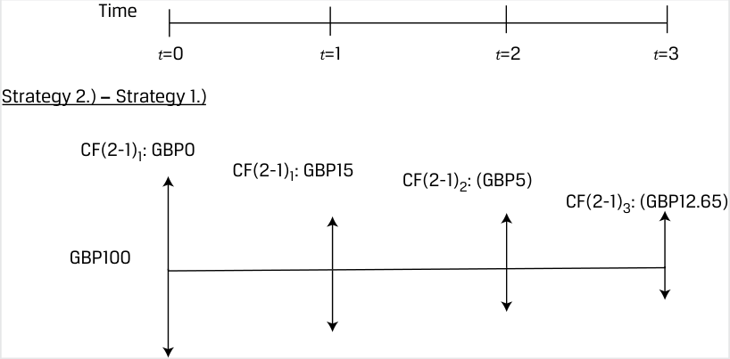

<!-- Picture Text: Time t =0 t =1 t =2 t =3 Strategy 2.)  –  Strategy 1.) CF(2-1)1: GBP0 CF(2-1)1: GBP15 CF(2-1)2: (GBP5) CF(2-1)3: (GBP12.65) GBP100  -->
> **Chú thích hình ảnh (Chiến lược 2 – Chiến lược 1):** Dòng tiền chênh lệch tại $t=0$ là $0\text{ GBP}$; tại $t=1$ là $+15\text{ GBP}$; tại $t=2$ là $-5\text{ GBP}$; tại $t=3$ là $-12,65\text{ GBP}$.

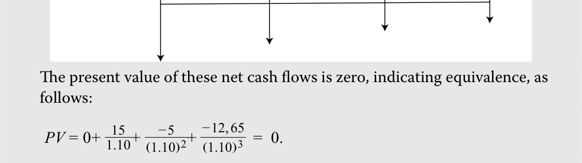

Giá trị hiện tại của các dòng tiền ròng chênh lệch này bằng không, cho thấy sự tương đương nhau, như sau:

$$\text{PV} = 0 + \frac{15}{1,10} + \frac{-5}{(1,10)^2} + \frac{-12,65}{(1,10)^3} = 0$$

<!-- Formula Text: The present value of these net cash flows is zero, indicating equivalence, as follows: PV = 0+  15 _ 1.10 +   − 5 _ (1.10) 2 +  − 12, 65 _ (1.10) 3   =  0. -->

Kết luận rút ra từ phân tích này là hai chiến lược tương đương nhau về mặt kinh tế (*economically equivalent*); do đó bạn không nên có sự ưu tiên nào cho chiến lược này hơn chiến lược kia. Chúng ta cũng phải xác định xem liệu các chiến lược này có mang lại giá trị kinh tế hay không. Để làm điều đó, hãy tính giá trị hiện tại ròng của từng chiến lược riêng lẻ.

<!-- PDF Page 79 -->

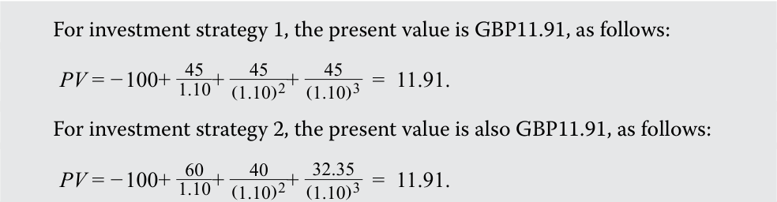

Đối với chiến lược đầu tư 1, giá trị hiện tại ròng là $11,91\text{ GBP}$, như sau:

$$\text{PV} = -100 + \frac{45}{1,10} + \frac{45}{(1,10)^2} + \frac{45}{(1,10)^3} = 11,91$$

Đối với chiến lược đầu tư 2, giá trị hiện tại ròng cũng là $11,91\text{ GBP}$, như sau:

$$\text{PV} = -100 + \frac{60}{1,10} + \frac{40}{(1,10)^2} + \frac{32,35}{(1,10)^3} = 11,91$$

<!-- Formula Text: For investment strategy 1, the present value is GBP11.91, as follows: PV = − 100+  45 _ 1.10 +   45 _ (1.10) 2 +   45 _ (1.10) 3   =  11.91. For investment strategy 2, the present value is also GBP11.91, as follows: PV = − 100+  60 _ 1.10 +   40 _ (1.10) 2 +  32.35 _ (1.10) 3   =  11.91. -->

Cả hai chiến lược đầu tư đều có giá trị ở chỗ giá trị hiện tại của tổng các dòng tiền của chúng đều mang dấu dương. Vì các giá trị hiện tại giống hệt nhau, nên việc lấy giá trị hiện tại của chiến lược 2 trừ đi giá trị hiện tại của chiến lược 1 sẽ bằng không (tức là $11,91 - 11,91$). Khuyến nghị có thể chọn bất kỳ chiến lược nào vì cả hai đều mang lại giá trị kinh tế và có giá trị hiện tại bằng nhau.

Trong các mục tiếp theo, chúng ta áp dụng nguyên lý cộng dòng tiền vào ba tình huống kinh tế khác nhau và minh họa sâu hơn về nguyên lý không có kinh doanh chênh lệch giá (*no arbitrage*) bằng cách so sánh hai chiến lược tương đương nhau về mặt kinh tế trong từng tình huống.

### **Lãi suất kỳ hạn ngầm định sử dụng Tính cộng Dòng tiền (Implied Forward Rates Using Cash Flow Additivity)** 

Xét hai trái phiếu chiết khấu phi rủi ro có kỳ hạn khác nhau như sau:

- Trái phiếu kỳ hạn một năm: $r_1 = 2,50\%$

- Trái phiếu kỳ hạn hai năm: $r_2 = 3,50\%$

Một nhà đầu tư trung lập với rủi ro (*risk-neutral investor*) đang tìm cách kiếm tỷ suất sinh lợi trên $100\text{ GBP}$ trong khung thời gian đầu tư hai năm có hai chiến lược khả thi:

- _Chiến lược đầu tư 1:_ Đầu tư ngay hôm nay trong hai năm ở mức lợi suất quy đổi theo năm đã biết là $3,50\%$. Sử dụng Phương trình 5, chúng ta có thể giải tìm giá trị tương lai sau hai năm ($\text{FV}_2$) như sau:

$$\begin{aligned}
\text{100 GBP} &= \text{FV}_2 / (1 + r_2)^2 \\
\text{FV}_2 &= \text{107,12 GBP}
\end{aligned}$$

- _Chiến lược đầu tư 2:_ Đầu tư ngay hôm nay trong một năm ở mức lợi suất đã biết là $2,50\%$ và tái đầu tư vào thời điểm một năm sau cho kỳ hạn một năm tiếp theo ở mức lãi suất $F_{1,1}$ (lãi suất kỳ hạn một năm bắt đầu sau một năm – *one-year forward rate starting in one year*).

Hai chiến lược này được tóm tắt trong Bảng 10 (*Exhibit 10*):

<!-- PDF Page 80 -->

#### **Bảng 10: Ví dụ về Lãi suất kỳ hạn ngầm định (Exhibit 10: Implied Forward Rate Example)** 

<!-- Picture Text: Time t =0 t =1 t =2 Strategy 1.) 1-year rate Implied forward rate F1,1 GBP100 GBP102.5 GBP102.5(1+ F 1,1) GBP100(1+r1) Strategy 2.) 2-year rate GBP100 GBP107.12 GBP100(1+r2) 2  -->
> **Chú thích hình ảnh:**
> - Nhánh trên: Đầu tư $100\text{ GBP}$ tại $t=0$ theo lãi suất 1 năm ($r_1$) để có $100(1+r_1) = 102,5\text{ GBP}$ tại $t=1$, sau đó tái đầu tư theo lãi suất kỳ hạn ngầm định $F_{1,1}$ để nhận $102,5(1+F_{1,1})$ tại $t=2$.
> - Nhánh dưới: Đầu tư $100\text{ GBP}$ tại $t=0$ theo lãi suất 2 năm ($r_2$) để nhận $100(1+r_2)^2 = 107,12\text{ GBP}$ tại $t=2$.

Theo nguyên lý cộng dòng tiền, một nhà đầu tư trung lập với rủi ro sẽ bàng quan (*indifferent*) giữa chiến lược 1 và chiến lược 2 dưới điều kiện sau đây:

$$\text{FV}_2 = \text{PV}_0 \times (1 + r_2)^2 = \text{PV}_0 \times (1 + r_1)(1 + F_{1,1}) \tag{25}$$

$$\text{107,12 GBP} = \text{100 GBP}(1,025)(1 + F_{1,1})$$

và

$$F_{1,1} = 4,51\%$$

Chúng ta có thể sắp xếp lại Phương trình 25 để giải tìm $F_{1,1}$ một cách tổng quát như sau:

$$F_{1,1} = \frac{(1 + r_2)^2}{(1 + r_1)} - 1$$

Để minh họa lý do tại sao lãi suất kỳ hạn một năm phải bằng $4,51\%$, hãy giả sử một nhà đầu tư có thể khóa chặt (*lock in*) mức lãi suất một năm là $5\%$ bắt đầu sau một năm. Chiến lược kinh doanh chênh lệch giá (*arbitrage strategy*) sau đây sẽ tạo ra một khoản lợi nhuận phi rủi ro:

**1.** Vay $100\text{ GBP}$ trong hai năm với lãi suất $3,50\%$ và đồng ý trả $107,12\text{ GBP}$ sau hai năm.

**2.** Đầu tư $100\text{ GBP}$ trong năm thứ nhất với lãi suất $2,50\%$ và trong năm thứ hai với lãi suất $5\%$, nhờ đó nhận được $107,63\text{ GBP}$ sau hai năm.

**3.** Sự kết hợp của hai chiến lược trên mang lại khoản lợi nhuận phi rủi ro là $0,51\text{ GBP}$ sau hai năm với số vốn đầu tư ban đầu bằng không.

Tập hợp các chiến lược này minh họa rằng lãi suất kỳ hạn phải được thiết lập sao cho các nhà đầu tư không thể kiếm được lợi nhuận kinh doanh chênh lệch giá phi rủi ro trên các thị trường tài chính. Điều này được chứng minh bằng cách so sánh hai chiến lược tương đương nhau về mặt kinh tế (tức là vay trong hai năm ở mức lãi suất hai năm so với vay qua hai kỳ hạn một năm liên tiếp ở hai mức lãi suất khác nhau). Lãi suất kỳ hạn $F_{1,1}$ có thể được diễn giải là lãi suất tái đầu tư hòa vốn kỳ hạn một năm (*breakeven one-year reinvestment rate*) vào thời điểm một năm sau.

<!-- PDF Page 81 -->

#### **VÍ DỤ 13 (EXAMPLE 13)** 

### **Những thay đổi trong Lãi suất kỳ hạn (Forward Interest Rate Changes)** 

Tại cuộc họp tháng 6 năm 2022, Cục Dự trữ Liên bang Hoa Kỳ (Fed) đã gây bất ngờ cho thị trường khi nâng lãi suất mục tiêu thêm 75 điểm cơ bản (bps) — cao hơn mức dự kiến — và gợi ý về các đợt tăng lãi suất tiếp theo trong tương lai nhằm ứng phó với mức lạm phát tăng vọt. Bảng 11 (*Exhibit 11*) cho thấy giá trái phiếu Kho bạc Hoa Kỳ tách lãi (*US Treasury strip*) kỳ hạn một năm và hai năm trên mỗi $100\text{ USD}$ mệnh giá vào cuối tháng 5 năm 2022 và sau quyết định của Fed vào tháng 6:

**Bảng 11: Giá Trái phiếu Kho bạc Hoa Kỳ Tách lãi Kỳ hạn Một năm và Hai năm (Exhibit 11: One- and Two-Year US Treasury Strip Prices)** 

|**Ngày (Date)**|**$\text{PV}(1y)$**|**$\text{PV}(2y)$**|
|---|---|---|
|31 tháng 5 năm 2022|98,028|95,109|
|15 tháng 6 năm 2022|97,402|93,937|

1. Sử dụng thông tin trong Bảng 11, hãy tính mức thay đổi trong lãi suất tái đầu tư hòa vốn kỳ hạn một năm bắt đầu sau một năm ($F_{1,1}$).

#### **Lời giải (Solution):** 

62 bps hay $0,62\%$

Trước hết, chúng ta sử dụng Phương trình 18 để giải tìm từng mức lãi suất chiết khấu thị trường $r$. Ví dụ, trong trường hợp trái phiếu chiết khấu kỳ hạn hai năm vào ngày 15 tháng 6:

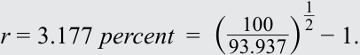

$$r = 3,177\% = \left(\frac{100}{93,937}\right)^{\frac{1}{2}} - 1$$

<!-- Formula Text: r = 3.177 percent  =  (  100 _ 93.937 ) 1 _ 2 − 1. -->

Bảng sau đây tóm tắt các mức lãi suất trái phiếu chiết khấu tương ứng:

|**Ngày (Date)**|**$r_1$**|**$r_2$**|
|---|---|---|
|31 tháng 5 năm 2022|2,012%|2,539%|
|15 tháng 6 năm 2022|2,667%|3,177%|

Giải tìm các mức lãi suất kỳ hạn tương ứng ($F_{1,1}$) bằng cách sắp xếp lại Phương trình 25: $F_{1,1} = (1 + r_2)^2 / (1 + r_1) - 1$.

- **$\underline{F_{1,1}\text{ (31 tháng 5):}}$** $F_{1,1} = 3,069\% = (1 + 2,539\%)^2 / (1 + 2,012\%) - 1$.
- **$\underline{F_{1,1}\text{ (15 tháng 6):}}$** $F_{1,1} = 3,689\% = (1 + 3,177\%)^2 / (1 + 2,667\%) - 1$.

Trong khi mức $r_1$ và $r_2$ cao hơn vào giữa tháng 6 cho thấy các nhà đầu tư đã phản ánh đợt tăng 75 bps tức thời vào lãi suất chiết khấu danh nghĩa của họ, thì mức tăng 62 bps ($0,62\% = 3,689\% - 3,069\%$) của $F_{1,1}$ là thước đo phản ánh các đợt tăng lãi suất dự kiến trong tương lai do lãi suất danh nghĩa kỳ hạn một năm này bắt đầu sau một năm nữa. Cũng cần lưu ý rằng trong môi trường lãi suất đang tăng lên, $F_{1,1} > r_2$, như được thể hiện trong sơ đồ sau đây so sánh $r_1$, $r_2$ và $F_{1,1}$ vào ngày 31 tháng 5 (lãi suất thấp hơn) với ngày 15 tháng 6 (lãi suất cao hơn).

<!-- PDF Page 82 -->

<!-- Picture Text: Yield (%) 4.00% F1,1 r2 3.00% r1 F1,1 r2 2.00% r1 1.00% Term 1 2 3  -->
> **Chú thích hình ảnh:** Trục tung biểu diễn Lợi suất (*Yield (%)*) từ $1,00\%$ đến $4,00\%$; trục hoành biểu diễn Kỳ hạn (*Term*). Đường thấp hơn (ngày 31/5) và đường cao hơn (ngày 15/6) đều dốc lên với $r_1 < r_2 < F_{1,1}$.

### **Tỷ giá hối đoái kỳ hạn sử dụng Nguyên lý Không có Kinh doanh Chênh lệch giá (Forward Exchange Rates Using No Arbitrage)** 

Bây giờ chúng ta mở rộng nguyên lý cộng dòng tiền sang một kịch bản kinh tế liên quan đến các đồng tiền khác nhau.

Giả sử bạn có $1.000\text{ USD}$ để đầu tư trong sáu tháng. Bạn đang cân nhắc một khoản đầu tư phi rủi ro vào nợ chính phủ kỳ hạn sáu tháng của Hoa Kỳ hoặc của Nhật Bản. Giả sử tỷ giá hối đoái hiện hành (tỷ giá giao ngay – *spot exchange rate*) giữa đồng yên Nhật (JPY) và đồng đô la Mỹ (USD) là $134,40$ (tức là $134,40\text{ JPY} = 1\text{ USD}$). Lãi suất phi rủi ro kỳ hạn sáu tháng của đồng yên Nhật được giả định là $0,05\%$ (quy đổi theo năm), và lãi suất phi rủi ro kỳ hạn sáu tháng của đồng đô la Mỹ là $2,00\%$ (quy đổi theo năm). Ví dụ này giả định ghép lãi liên tục (*continuous compounding*).

- _Chiến lược đầu tư 1:_ Đầu tư $1.000\text{ USD}$ vào tín phiếu Kho bạc Hoa Kỳ kỳ hạn sáu tháng.
  - Tại thời điểm $t = 0$: Đầu tư $1.000\text{ USD}$ ở mức lãi suất phi rủi ro đồng đô la Mỹ là $2,00\%$ trong sáu tháng.
  - Tại thời điểm $t = T$ sau sáu tháng: Nhận về $1.010,05\text{ USD}$ ($= 1.000e^{(0,02 \times 0,5)}$).

- _Chiến lược đầu tư 2:_ Chuyển đổi $1.000\text{ USD}$ sang đồng yên Nhật theo tỷ giá hối đoái hiện hành là $134,40$, đầu tư vào tín phiếu Kho bạc Nhật Bản kỳ hạn sáu tháng, và chuyển đổi số tiền đã biết trước này trở lại sang đồng đô la Mỹ sau sáu tháng theo tỷ giá hối đoái kỳ hạn sáu tháng (*six-month forward exchange rate*) được thiết lập ngay hôm nay là $133,096$.
  - Tại thời điểm $t = 0$: Chuyển đổi $1.000\text{ USD}$ thành $134.400\text{ JPY}$. Cho vay $134.400\text{ JPY}$ ở mức lãi suất phi rủi ro đồng JPY là $0,05\%$ trong sáu tháng.
  - Tại thời điểm $t = T$ sau sáu tháng: Nhận về số tiền thu hồi khoản vay bằng đồng JPY là $134.433,60\text{ JPY}$ ($= 134.400e^{(0,0005 \times 0,5)}$). Đổi số tiền thu hồi khoản vay bằng đồng JPY sang đô la Mỹ theo tỷ giá kỳ hạn là $133,096$ để nhận về $1.010,05\text{ USD}$ ($= 134.433,60 / 133,096$).

Hai chiến lược này tương đương nhau về mặt kinh tế ở chỗ cả hai đều liên quan đến việc đầu tư $1.000\text{ USD}$ tại $t = 0$ và nhận về $1.010,05\text{ USD}$ sau sáu tháng. Yếu tố liên kết hai chiến lược này lại với nhau chính là tỷ giá hối đoái kỳ hạn sáu tháng ở mức $133,096\text{ JPY/USD}$. Nếu tỷ giá kỳ hạn này được thiết lập cao hơn hoặc thấp hơn mức $133,096$, một cơ hội kinh doanh chênh lệch giá sẽ xuất hiện cho các nhà đầu tư thực hiện chuyển đổi qua lại giữa đồng yên Nhật và đồng đô la Mỹ. Bảng 12 (*Exhibit 12*) cung cấp sơ đồ trực quan của hai chiến lược này.

<!-- PDF Page 83 -->

#### **Bảng 12: Điều kiện Không có Kinh doanh Chênh lệch giá trên Thị trường Ngoại hối (Exhibit 12: No-Arbitrage Condition in the Foreign Exchange Market)** 

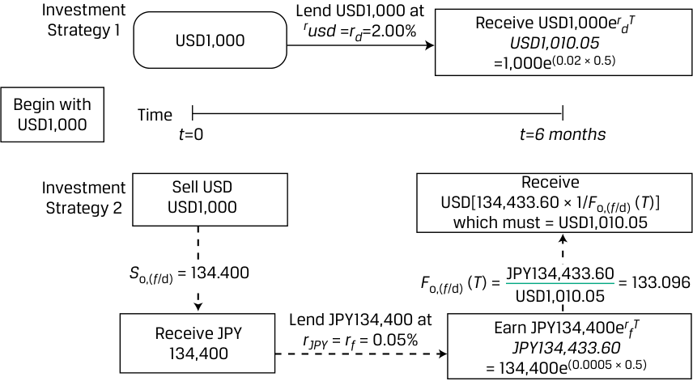

<!-- Picture Text: Investment Lend USD1,000 at Strategy 1 USD1,000 rusd  = rd =2.00% Receive USD1,000e USD1,010.05 r d T =1,000e (0.02 × 0.5) Begin with Time USD1,000 t =0 t = 6 months Investment Sell USD Receive Strategy 2 USD1,000 USD[134,433.60 × 1/ F o,( f /d) ( T )] which must = USD1,010.05 S o,( f /d) = 134.400 F o,( f /d) ( T ) = JPY134,433.60 = 133.096 USD1,010.05 Lend JPY134,400 at Receive JPY134,400 rJPY  =  rf  = 0.05% Earn JPY134,400e JPY134,433.60 r f T = 134,400e (0.0005 × 0.5)  -->
> **Chú thích hình ảnh:**
> - **Chiến lược đầu tư 1 (*Investment Strategy 1*):** Bắt đầu với $1.000\text{ USD}$ tại $t=0$, cho vay ở mức $r_{\text{USD}} = r_d = 2,00\%$, nhận về $1.000e^{r_d T} = 1.000e^{(0,02 \times 0,5)} = 1.010,05\text{ USD}$ tại $t = 6\text{ tháng}$.
> - **Chiến lược đầu tư 2 (*Investment Strategy 2*):** Bán $1.000\text{ USD}$ theo tỷ giá giao ngay $S_{0,(f/d)} = 134,400$ để nhận $134.400\text{ JPY}$; cho vay $134.400\text{ JPY}$ ở mức $r_{\text{JPY}} = r_f = 0,05\%$ để thu được $134.400e^{r_f T} = 134.433,60\text{ JPY}$ sau 6 tháng; chuyển đổi lại sang USD theo tỷ giá kỳ hạn $F_{0,(f/d)}(T) = \frac{134.433,60\text{ JPY}}{1.010,05\text{ USD}} = 133,096$.

#### **VÍ DỤ 14 (EXAMPLE 14)** 

### **Tỷ giá hối đoái kỳ hạn trong Môi trường Lãi suất Thay đổi (Foreign Exchange Forward Rates in a Changing Interest Rate Environment)** 

Các ngân hàng trung ương đã phản ứng khác nhau trước sự gia tăng đột biến của lạm phát trong năm 2022. Ví dụ, trong khi Fed nâng lãi suất thêm 75 bps lên mức $1,75\%$ vào giữa tháng 6, Ngân hàng Trung ương Anh (*Bank of England*) lại chọn cách tiếp cận từ từ hơn, chỉ nâng lãi suất chuẩn thêm 25 bps lên mức $1,25\%$. Bảng 13 (*Exhibit 13*) so sánh lãi suất trái phiếu Kho bạc Hoa Kỳ tách lãi kỳ hạn một năm ($r_{\text{USD}}$) từ ví dụ trước với lãi suất trái phiếu chính phủ Anh tách lãi (*UK gilt strip rates* – $r_{\text{GBP}}$) trong cùng khung thời gian:

#### **Bảng 13: So sánh Lãi suất Trái phiếu Chính phủ Tách lãi của Hoa Kỳ và Anh (Exhibit 13: Comparison of US Treasury Strip Rates)** 

|**Ngày (Date)**|**$r_{\text{USD}}$**|**$r_{\text{GBP}}$**|
|---|---|---|
|31 tháng 5 năm 2022|2,012%|1,291%|
|15 tháng 6 năm 2022|2,667%|1,562%|

1. Nếu chúng ta giả định tỷ giá giao ngay USD/GBP ở mức $1,2602$ (hay $1,2602\text{ USD}$ trên mỗi $1,00\text{ GBP}$) từ ngày 31 tháng 5 giữ nguyên không đổi, sự thay đổi trong lãi suất phi rủi ro của đồng đô la Mỹ so với đồng bảng Anh ảnh hưởng như thế nào đến tỷ giá kỳ hạn một năm USD/GBP?

#### **Lời giải (Solution):** 

Tỷ giá kỳ hạn không có kinh doanh chênh lệch giá USD/GBP tăng từ $1,2693$ lên $1,2742$. Giả sử một nhà đầu tư có $1.000\text{ GBP}$ để đầu tư trong một năm vào trái phiếu chiết khấu phi rủi ro bằng đồng bảng Anh hoặc bằng đồng đô la Mỹ. Số đô la Mỹ cần thiết để mua $1\text{ GBP}$ sau một năm phải có mức giá giao ngay bằng với giá trị tương lai đã chiết khấu.

**Tính đến ngày 31 tháng 5:**

<!-- PDF Page 84 -->

- _Chiến lược nội địa (Domestic Strategy):_ Đầu tư $1.000\text{ GBP}$ ở mức lãi suất phi rủi ro một năm của đồng bảng Anh là $1,291\%$ để nhận về $1.012,99\text{ GBP}$ ($= 1.000e^{(0,01291)}$) sau một năm.

- _Chiến lược nước ngoài (Foreign Strategy):_ Chuyển đổi $1.000\text{ GBP}$ theo tỷ giá $\text{USD/GBP} = 1,2602$ để nhận được $1.260,20\text{ USD}$, số tiền này được đầu tư ở mức lãi suất phi rủi ro một năm của đồng đô la Mỹ là $2,012\%$ sẽ tạo ra số tiền thu về là $1.285,81\text{ USD}$ ($= 1.260,20e^{(0,02012)}$) sau một năm.

Do đó, tỷ giá kỳ hạn không có kinh doanh chênh lệch giá USD/GBP tính đến ngày 31 tháng 5 bằng $1,2693$ ($= \text{1.285,81 USD} / \text{1.012,99 GBP}$).

**Tính đến ngày 15 tháng 6:**

- _Chiến lược nội địa (Domestic Strategy):_ Đầu tư $1.000\text{ GBP}$ ở mức lãi suất phi rủi ro một năm của đồng bảng Anh là $1,562\%$ để nhận về $1.015,74\text{ GBP}$ ($= 1.000e^{(0,01562)}$) sau một năm.

- _Chiến lược nước ngoài (Foreign Strategy):_ Chuyển đổi $1.000\text{ GBP}$ theo tỷ giá $1,2602$ để nhận được $1.260,20\text{ USD}$, số tiền này được đầu tư ở mức lãi suất phi rủi ro một năm của đồng đô la Mỹ là $2,667\%$ sẽ mang lại $1.294,26\text{ USD}$ ($= 1.260,20e^{(0,02667)}$) sau một năm.

Tỷ giá kỳ hạn không có kinh doanh chênh lệch giá USD/GBP tính đến ngày 15 tháng 6 bằng $1,2742$ ($= \text{1.294,26 USD} / \text{1.015,74 GBP}$).

Tính đến giữa tháng 6, một nhà đầu tư đồng ý đổi đô la Mỹ lấy bảng Anh sau một năm phải giao nhiều đô la Mỹ hơn ($1,2742$ so với $1,2693$) để đổi lấy $1\text{ GBP}$ so với trường hợp cùng hợp đồng đó được ký kết vào cuối tháng 5. Mức tăng lớn hơn của $r_{\text{USD}}$ làm nới rộng mức chênh lệch lãi suất ($r_{\text{USD}} - r_{\text{GBP}}$), khiến đồng đô la Mỹ giảm giá trên cơ sở kỳ hạn (*depreciate on a forward basis*) so với đồng bảng Anh trong giai đoạn đó. Nói cách khác, kỳ vọng về sự giảm giá của đồng đô la Mỹ trên cơ sở kỳ hạn so với đồng bảng Anh sẽ đòi hỏi mức lãi suất đồng đô la Mỹ cao hơn để thu hút các nhà đầu tư nắm giữ đồng đô la Mỹ so với đồng bảng Anh.

### **Định giá Quyền chọn sử dụng Tính cộng Dòng tiền (Option Pricing Using Cash Flow Additivity)** 

Giả sử một tài sản có mức giá hiện hành là 40 nhân dân tệ Trung Quốc (tức $40\text{ CNY}$). Tài sản này có rủi ro ở chỗ giá của nó có thể tăng $40\%$ lên mức $56\text{ CNY}$ trong kỳ tiếp theo hoặc có thể giảm $20\%$ xuống mức $32\text{ CNY}$ trong kỳ tiếp theo.

Một nhà đầu tư muốn bán một hợp đồng dựa trên tài sản đó, trong đó người mua hợp đồng có quyền, nhưng không có nghĩa vụ (*the right, but not obligation*), được mua tài sản nêu trên với giá $50\text{ CNY}$ vào cuối kỳ tiếp theo. Chúng ta có thể áp dụng nguyên lý cộng dòng tiền để thiết lập mức giá không có kinh doanh chênh lệch giá (*no-arbitrage pricing*) cho hợp đồng này.

Cây nhị thức (*binomial tree*) trong Bảng 14 (*Exhibit 14*) tóm tắt hai kết quả có thể xảy ra trong tương lai của tài sản:

<!-- PDF Page 85 -->

#### **Bảng 14: Cây nhị thức Một kỳ cho Giá của Tài sản (Exhibit 14: One-Period Binomial Tree for the Asset’s Price)** 

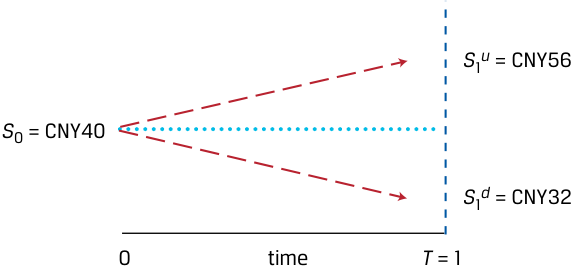

<!-- Picture Text: S 1 u  = CNY56 S 0 = CNY40 S 1 d  = CNY32 0 time T  = 1  -->
> **Chú thích hình ảnh:** Tại thời điểm $0$, giá tài sản là $S_0 = 40\text{ CNY}$. Tại thời điểm $T = 1$, giá tăng lên $S_1^u = 56\text{ CNY}$ hoặc giảm xuống $S_1^d = 32\text{ CNY}$.

Giá trị hợp đồng dưới hai kịch bản như sau (được thể hiện trực quan trong Bảng 15):

- **Giá tăng (*Price Increase*):** Mức tăng $40\%$ dẫn đến giá trị hợp đồng là $6\text{ CNY}$ ($= \text{56 CNY} - \text{50 CNY}$), bởi vì người sở hữu hợp đồng sẽ chọn mua tài sản ở mức giá $50\text{ CNY}$ và có thể bán nó ở mức giá thị trường là $56\text{ CNY}$.

- **Giá giảm (*Price Decrease*):** Mức giảm $20\%$ dẫn đến giá trị hợp đồng bằng không ($0\text{ CNY}$), bởi vì người sở hữu hợp đồng sẽ chọn không mua tài sản ở mức giá $50\text{ CNY}$ khi giá thị trường chỉ là $32\text{ CNY}$.

#### **Bảng 15: Cây nhị thức Một kỳ cho Giá của Hợp đồng (Exhibit 15: One-Period Binomial Tree for the Contract’s Price)** 

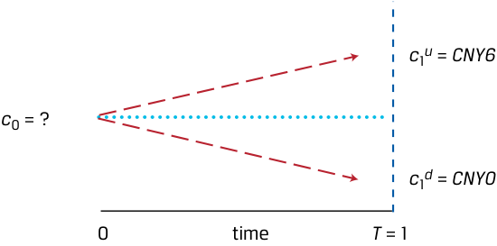

<!-- Picture Text: c 1 u  =  CNY6 c 0 = ? c 1 d  =  CNY0 0 time T  = 1  -->
> **Chú thích hình ảnh:** Tại thời điểm $0$, giá hợp đồng là $c_0 = ?$. Tại thời điểm $T = 1$, giá trị hợp đồng là $c_1^u = 6\text{ CNY}$ (nếu giá tài sản tăng) hoặc $c_1^d = 0\text{ CNY}$ (nếu giá tài sản giảm).

Hãy xét vị thế của người bán hợp đồng như sau:

- Tại $t = 0$, giá trị hợp đồng là $c_0$.

- Tại $t = 1$, giá trị hợp đồng là $6\text{ CNY}$ (nếu tài sản cơ sở tăng lên $56\text{ CNY}$) hoặc $0\text{ CNY}$ (nếu cổ phiếu cơ sở giảm xuống $32\text{ CNY}$).

Giá trị hợp đồng ban đầu $c_0$ là chưa biết và có thể được xác định bằng cách sử dụng nguyên lý cộng dòng tiền và định giá không có kinh doanh chênh lệch giá. Nghĩa là, giá trị của hợp đồng và tài sản cơ sở trong từng kịch bản tương lai có thể được sử dụng để xây dựng một danh mục đầu tư phi rủi ro (*risk-free portfolio*), hay một danh mục đầu tư mà giá trị của nó là như nhau trong cả hai kịch bản. Ví dụ, giả sử tại $t = 0$, một nhà đầu tư tạo ra một danh mục trong đó bán một hợp đồng ở mức giá $c_0$ và mua $0,25$ đơn vị tài sản cơ sở. Danh mục này được gọi là danh mục mô phỏng (*replicating portfolio*) ở chỗ nó được thiết kế đặc biệt để tạo ra một chuỗi dòng tiền tương lai khớp với chuỗi dòng tiền của một tài sản phi rủi ro. Ký hiệu giá trị của danh mục là $V$ tại $t = 0$ và tại $t = 1$ dưới cả hai kịch bản tăng giá và giảm giá, chúng ta có:

- $V_0 = 0,25 \times 40 - c_0$,

- $V_1^u = 0,25 \times 56 - 6 = 8$, và

- $V_1^d = 0,25 \times 32 - 0 = 8$.

<!-- PDF Page 86 -->

Như có thể thấy, giá trị của danh mục mô phỏng bằng $8\text{ CNY}$ bất kể giá của tài sản tăng hay giảm. Chính vì điều này, danh mục đầu tư là phi rủi ro và có thể được chiết khấu như một tài sản phi rủi ro. Giá trị nhận về (*payoffs*) cho hai kịch bản này được thể hiện trong Bảng 16 (*Exhibit 16*).

#### **Bảng 16: Mô phỏng Quyền chọn Mua (Exhibit 16: Call Option Replication)** 

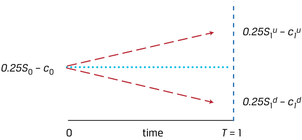

<!-- Picture Text: 0.25S 1 u  –  c1 u 0.25S 0 –  c 0 0.25S 1 d  –  c1 d 0 time T  = 1  -->
> **Chú thích hình ảnh:** Tại thời điểm $0$, giá trị danh mục là $0,25S_0 - c_0$. Tại thời điểm $T = 1$, giá trị danh mục là $0,25S_1^u - c_1^u$ (nhánh trên) hoặc $0,25S_1^d - c_1^d$ (nhánh dưới).

Để giải tìm $c_0$, chúng ta cho giá trị hiện tại của danh mục mô phỏng ($0,25 \times 40 - c_0$) bằng với giá trị tương lai đã chiết khấu của khoản thu nhập phi rủi ro $8\text{ CNY}$ dưới mỗi kết quả giống như trong Phương trình 5. Giả sử lãi suất phi rủi ro $r$ là $5\%$:

$$V_0 = 0,25S_0 - c_0$$

<!-- Formula Text: V0 = 0.25S0 − c0, -->

$$V_0 = \frac{V_1^u}{1 + r} = \frac{V_1^d}{1 + r}, \quad \text{và} \quad 0,25 \times 40 - c_0 = \frac{\text{8 CNY}}{1,05}$$

<!-- Formula Text: V 0 = V 1 u _ 1 + r  = V 1 d _ 1 + r , and 0.25 × 40 − c 0 =  CNY8 _ 1.05  . -->

Chúng ta giải tìm được $c_0$ bằng $2,38\text{ CNY}$. Như vậy, $2,38\text{ CNY}$ là mức giá hợp lý (*fair price*) để người bán hợp đồng nhận về từ người mua hợp đồng.

Là một phần của ví dụ trên, chúng ta đã giả định rằng nhà đầu tư mua $0,25$ đơn vị tài sản như một phần của danh mục. Tỷ trọng này của tài sản cơ sở được gọi là **tỷ số phòng vệ (*hedge ratio*)** trong định giá quyền chọn. Trên thực tế, ví dụ vừa hoàn thành là một quy trình đơn giản hóa để giải tìm giá trị của một quyền chọn mua (*call option*) (nội dung này sẽ được đề cập chi tiết hơn ở phần sau của chương trình học). Giống như trong các ví dụ trước của chúng ta, chúng ta so sánh các chiến lược khác nhau bằng cách sử dụng nguyên lý cộng dòng tiền để giúp giải tìm mức giá không có kinh doanh chênh lệch giá cho một công cụ tài chính.

#### **VÍ DỤ 15 (EXAMPLE 15)** 

### **Quyền chọn Bán (Put Option)** 

Một quyền chọn bán (*put option*) trao cho người sở hữu quyền, nhưng không phải nghĩa vụ, được bán một cổ phiếu ở mức giá thực hiện (*exercise price*) đã định trước $X$. Nếu chúng ta giả định $X = 50\text{ CNY}$, thì giá trị quyền chọn bán sau một kỳ ($p_1$) bằng $\text{Max}(0, \text{50 CNY} - S_1)$.

1. Sử dụng mô hình cây nhị thức một kỳ với cùng các mức giá sau một năm, giá cổ phiếu ban đầu ($S_0$) là $40\text{ CNY}$, và lãi suất chiết khấu là $5\%$, hãy tạo một danh mục phi rủi ro mô phỏng quyền chọn bán với $0,75$ đơn vị tài sản cơ sở và giải tìm giá quyền chọn bán ($p_0$).

#### **Lời giải (Solution):** 

Mô hình nhị thức một kỳ như sau:

<!-- PDF Page 87 -->

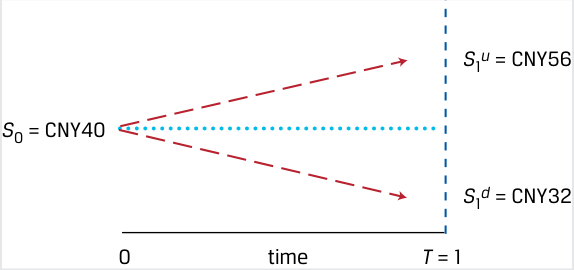

<!-- Picture Text: S 1 u  = CNY56 S 0 = CNY40 S 1 d  = CNY32 0 time T  = 1  -->
> **Chú thích hình ảnh:** Tại thời điểm $0$, $S_0 = 40\text{ CNY}$. Tại thời điểm $T = 1$, $S_1^u = 56\text{ CNY}$ hoặc $S_1^d = 32\text{ CNY}$.

Giá trị của quyền chọn bán dưới hai kịch bản như sau:

- **Giá tăng ($p_1^u$):** Mức tăng $40\%$ dẫn đến giá trị quyền chọn bán bằng $0\text{ CNY}$, bởi vì người sở hữu quyền chọn sẽ chọn không bán cổ phiếu ở mức giá thực hiện.

- **Giá giảm ($p_1^d$):** Mức giảm $20\%$ dẫn đến giá trị quyền chọn bán bằng $18\text{ CNY}$ ($\text{50 CNY} - \text{32 CNY}$), bởi vì người sở hữu quyền chọn bán sẽ chọn bán cổ phiếu đang có giá thị trường $32\text{ CNY}$ ở mức giá thực hiện là $50\text{ CNY}$.

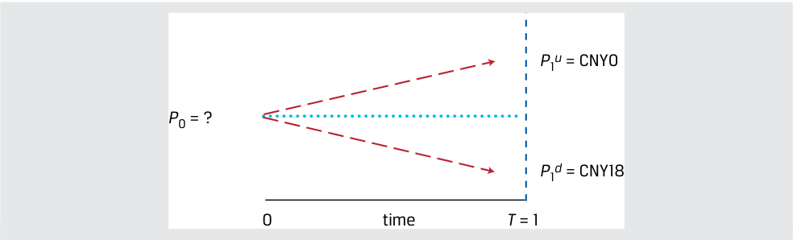

<!-- Picture Text: P 1 u  = CNY0 P 0 = ? P 1 d  = CNY18 0 time T  = 1  -->
> **Chú thích hình ảnh:** Tại thời điểm $0$, giá quyền chọn bán là $p_0 = ?$. Tại thời điểm $T = 1$, giá trị quyền chọn bán là $p_1^u = 0\text{ CNY}$ hoặc $p_1^d = 18\text{ CNY}$.

Khác với quyền chọn mua, quyền chọn bán tăng giá trị khi giá cổ phiếu giảm xuống, vì vậy một danh mục đầu tư phi rủi ro sẽ kết hợp việc mua cổ phiếu với một quyền chọn bán được mua vào (*purchased put option*). Cụ thể, giả sử tại $t = 0$, chúng ta nắm giữ (mua) một quyền chọn bán ở mức giá $p_0$ và mua $0,75$ đơn vị cổ phiếu cơ sở. *(Lưu ý: Trong bản gốc tiếng Anh ghi "sell a put option" ở câu văn nhưng trong phương trình dùng dấu cộng $+p_0$, tức là mua quyền chọn bán kết hợp mua $0,75$ cổ phiếu).* Giá trị danh mục đầu tư tại $t = 0$ và $t = 1$ như sau:

- $V_0 = 0,75S_0 + p_0$,
  - $V_1^u = 0,75S_1^u + p_1^u$, và
  - $V_1^d = 0,75S_1^d + p_1^d$,

trong đó $V_1^u = V_1^d$.

Giá trị của danh mục đầu tư phi rủi ro sau một kỳ ($V_1 = 0,75S_1 + p_1$) dưới hai kịch bản là:

- **Giá tăng ($V_1^u$):** Giá trị danh mục là $42\text{ CNY}$ ($= (0,75 \times \text{56 CNY}) + \text{0 CNY}$).

- **Giá giảm ($V_1^d$):** Giá trị danh mục là $42\text{ CNY}$ ($= (0,75 \times \text{32 CNY}) + \text{18 CNY}$).

Giải tìm $p_0$ bằng cách cho giá trị hiện tại của danh mục mô phỏng ($0,75S_0 + p_0$) bằng với giá trị tương lai đã chiết khấu của khoản thu nhập cuối kỳ, với $S_0$ là $40\text{ CNY}$ và $r$ là $5\%$:

$$V_0 = 0,75S_0 + p_0$$

$$V_0 = \frac{V_1^u}{1 + r} = \frac{V_1^d}{1 + r}, \quad \text{và}$$

<!-- Formula Text: V 0 = V 1 u _ 1 + r  = V 1 d _ 1 + r , and -->

<!-- PDF Page 88 -->

$$p_0 = \frac{\text{42 CNY}}{1,05} - 0,75(\text{40 CNY})$$

Giải tìm $p_0$ thu được kết quả bằng $10\text{ CNY}$. Mức giá quyền chọn bán cao hơn này là kết quả từ khoản thu nhập cuối kỳ (*payoff*) lớn hơn của quyền chọn bán so với quyền chọn mua dưới các tham số đã cho của mô hình nhị thức. Các yếu tố ảnh hưởng đến giá quyền chọn sẽ được trình bày chi tiết ở phần sau của chương trình học.

<!-- PDF Page 89 -->

# **BÀI TẬP THỰC HÀNH (PRACTICE PROBLEMS)** 

**1.** Grupo Ignacia đã phát hành trái phiếu doanh nghiệp kỳ hạn 10 năm cách đây hai năm. Trái phiếu trả lãi coupon quy đổi theo năm là $10,7\%$ trên cơ sở nửa năm một lần, và lợi suất đáo hạn (YTM) quy đổi theo năm hiện hành là $11,6\%$. Mức giá hiện tại của trái phiếu Grupo Ignacia (trên mỗi $100\text{ MXN}$ mệnh giá) _gần nhất_ với mức nào sau đây:

   - **A.** $95,47\text{ MXN}$.

   - **B.** $97,18\text{ MXN}$.

   - **C.** $95,39\text{ MXN}$.

**2.** Grey Pebble Real Estate tìm kiếm một khoản vay thế chấp kỳ hạn năm năm với lãi suất cố định, trả góp khấu hao hoàn toàn (*fully amortizing*) để tài trợ $75\%$ giá mua một tòa nhà dân cư có chi phí là $5\text{ triệu NZD}$. Lãi suất thế chấp hàng năm là $4,8\%$. Khoản thanh toán hàng tháng cho khoản vay thế chấp này sẽ _gần nhất_ với mức nào sau đây:

   - **A.** $70.424\text{ NZD}$.

   - **B.** $93.899\text{ NZD}$.

   - **C.** $71.781\text{ NZD}$.

**3.** Tập đoàn Mylandia (*Mylandia Corporation*) trả cổ tức hàng năm cho các cổ đông của mình, và khoản thanh toán gần đây nhất là $2,40\text{ CAD}$. Các nhà phân tích theo dõi Mylandia kỳ vọng cổ tức của công ty sẽ tăng trưởng với tốc độ không đổi là $3\%$ mỗi năm đến vĩnh viễn. Các cổ đông của Mylandia yêu cầu mức tỷ suất sinh lợi là $8\%$ mỗi năm. Giá cổ phiếu dự kiến của Mylandia _gần nhất_ với mức nào sau đây:

   - **A.** $48,00\text{ CAD}$.

   - **B.** $49,44\text{ CAD}$.

   - **C.** $51,84\text{ CAD}$.

**4.** Giả sử Mylandia thông báo rằng công ty kỳ vọng dòng tiền sẽ tăng trưởng mạnh trong ba năm tới, và hiện có kế hoạch tăng mức cổ tức $2,40\text{ CAD}$ gần đây thêm $10\%$ trong mỗi năm của ba năm tới. Sau giai đoạn tăng trưởng $10\%$, Mylandia dự kiến sẽ tăng cổ tức hàng năm ở mức không đổi $3\%$ vô thời hạn. Tỷ suất sinh lợi yêu cầu của Mylandia là $8\%$. Dựa trên những kỳ vọng đã điều chỉnh này, giá cổ phiếu dự kiến của cổ phiếu Mylandia là:

   - **A.** $49,98\text{ CAD}$.

   - **B.** $55,84\text{ CAD}$.

   - **C.** $59,71\text{ CAD}$.

**5.** Xét một trái phiếu không trả lãi định kỳ (*zero-coupon bond*) của Liên bang Thụy Sĩ có mệnh giá $100\text{ CHF}$, thời gian còn lại cho đến khi đáo hạn là 12 năm và mức giá hiện tại là $89\text{ CHF}$. Sau ba năm nữa, trái phiếu được kỳ vọng sẽ có mức giá là $95,25\text{ CHF}$. Nếu được mua ngay hôm nay (và bán sau ba năm), tỷ suất sinh lợi quy đổi theo năm kỳ vọng của trái phiếu _gần nhất_ với mức nào sau đây:

   - **A.** $0,58\%$.

   - **B.** $1,64\%$.

<!-- PDF Page 90 -->

   - **C.** $2,29\%$.

**6.** Grupo Ignacia đã phát hành trái phiếu doanh nghiệp kỳ hạn 10 năm cách đây bốn năm. Trái phiếu trả lãi coupon quy đổi theo năm là $10,7\%$ trên cơ sở nửa năm một lần, và mức giá hiện tại của trái phiếu là $97,50\text{ MXN}$ trên mỗi $100\text{ MXN}$ mệnh giá. Lợi suất đáo hạn (YTM) của trái phiếu _gần nhất_ với mức nào sau đây:

   - **A.** $11,28\%$.

   - **B.** $11,50\%$.

   - **C.** $11,71\%$.

**7.** Cổ phiếu của Tập đoàn Mylandia đang giao dịch ở mức giá $60,00\text{ CAD}$. Công ty trả cổ tức hàng năm cho các cổ đông của mình, và khoản thanh toán gần đây nhất trị giá $2,40\text{ CAD}$ vừa diễn ra vào ngày hôm qua. Các nhà phân tích theo dõi Mylandia kỳ vọng cổ tức của công ty sẽ tăng trưởng với tốc độ không đổi là $3\%$ mỗi năm. Tỷ suất sinh lợi yêu cầu của Mylandia là:

   - **A.** $8,00\%$.

   - **B.** $7,00\%$.

   - **C.** $7,12\%$.

**8.** Một nhà phân tích quan sát thấy chỉ số chứng khoán chuẩn NIFTY 50 của Ấn Độ đang giao dịch ở hệ số giá trên thu nhập dự phóng (*forward P/E*) là 15. Tỷ lệ chi trả cổ tức dự kiến của chỉ số trong năm tới là $50\%$, và tỷ suất sinh lợi yêu cầu của chỉ số là $7,50\%$. Nếu nhà phân tích tin rằng cổ tức của chỉ số NIFTY 50 sẽ tăng trưởng với tốc độ không đổi là $4,50\%$ trong tương lai, phát biểu nào sau đây là đúng?

   - **A.** Nhà phân tích nên xem NIFTY 50 là đang bị định giá quá cao (*overpriced*).

   - **B.** Nhà phân tích nên xem NIFTY 50 là đang bị định giá quá thấp (*underpriced*).

   - **C.** Nhà phân tích nên xem NIFTY 50 là đang được định giá hợp lý (*fairly priced*).

**9.** Nếu bạn yêu cầu mức tỷ suất sinh lợi là $8\%$ và phải đầu tư $500.000\text{ USD}$, bạn nên ưu tiên cơ hội đầu tư nào trong Bảng 1?

**Bảng 1: Các Cơ hội Đầu tư (Exhibit 1: Investment Opportunities)** 

|**Dòng tiền (tính bằng nghìn USD)**|**$t = 0$**|**$t = 1$**|**$t = 2$**|**$t = 3$**|
|---|---|---|---|---|
|Cơ hội 1 (*Opportunity 1*)|−500|195|195|195|
|Cơ hội 2 (*Opportunity 2*)|−500|225|195|160,008|

   - **A.** Cơ hội 1

   - **B.** Cơ hội 2

   - **C.** Bàng quan (*Indifferent*) giữa hai cơ hội đầu tư.

**10.** Nợ chính phủ Ý kỳ hạn một năm có lãi suất là $0,73\%$; nợ chính phủ Ý kỳ hạn hai năm có lãi suất là $1,29\%$. Lãi suất tái đầu tư hòa vốn kỳ hạn một năm, bắt đầu sau một năm kể từ bây giờ, _gần nhất_ với mức nào sau đây:

   - **A.** $1,01\%$.

<!-- PDF Page 91 -->

   - **B.** $1,11\%$.

   - **C.** $1,85\%$.

**11.** Tỷ giá hối đoái hiện hành giữa đồng euro và đồng đô la Mỹ là $1,025\text{ USD/EUR}$. Lãi suất phi rủi ro kỳ hạn một năm là $0,75\%$ đối với đồng euro và $3,25\%$ đối với đồng đô la Mỹ (ghép lãi liên tục). Tỷ giá kỳ hạn một năm USD/EUR giúp ngăn chặn _tốt nhất_ các cơ hội kinh doanh chênh lệch giá là:

   - **A.** $1,051\text{ USD/EUR}$.

   - **B.** $1,025\text{ USD/EUR}$.

   - **C.** $0,975\text{ USD/EUR}$.

**12.** Một cổ phiếu hiện đang giao dịch ở mức giá $25\text{ USD}$. Sau một năm, giá trị của nó sẽ tăng lên $35\text{ USD}$ hoặc giảm xuống $15\text{ USD}$. Một nhà đầu tư bán một quyền chọn mua (*call option*) trên cổ phiếu này, trao cho người mua quyền, nhưng không phải nghĩa vụ, được mua cổ phiếu ở mức giá $25\text{ USD}$ sau một năm. Cùng lúc đó, nhà đầu tư mua $0,5$ đơn vị cổ phiếu. Phát biểu nào sau đây về giá trị danh mục đầu tư của nhà đầu tư vào cuối năm thứ nhất là đúng?

   - **A.** Danh mục đầu tư có giá trị là $7,50\text{ USD}$ trong cả hai kịch bản.

   - **B.** Danh mục đầu tư có giá trị là $25\text{ USD}$ trong cả hai kịch bản.

   - **C.** Danh mục đầu tư có giá trị là $17,50\text{ USD}$ nếu cổ phiếu tăng giá và $7,50\text{ USD}$ nếu cổ phiếu giảm giá.
