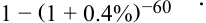
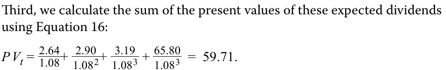

# Tập 1: Phương pháp Định lượng (Volume 1: Quantitative Methods)
## Học phần 2: Giá trị Thời gian của Tiền trong Tài chính (Learning Module 2: Time Value of Money in Finance)
### Phần 4/4: Lời giải Bài tập Thực hành (Solutions) (Trang PDF 92–94)

---

<!-- PDF Page 92 -->

# **LỜI GIẢI (SOLUTIONS)** 

1. C là đáp án đúng. Các khoản thanh toán coupon là $5,35$ ($= 10,7 / 2$), lãi suất chiết khấu là $5,8\%$ ($= 11,6\% / 2$) mỗi kỳ, và số kỳ là $16$ ($= 8 \times 2$). Sử dụng Phương trình 6, phép tính được thực hiện như sau:

$$95,39 = \frac{5,35}{1,058} + \frac{5,35}{1,058^2} + \frac{5,35}{1,058^3} + \frac{5,35}{1,058^4} + \dots + \frac{5,35}{1,058^{14}} + \frac{5,35}{1,058^{15}} + \frac{105,35}{1,058^{16}}$$

<!-- Formula Text: 95.39  =   5.35 _ 1.058  +   5.35 _ 1.058 2  +   5.35 _ 1.058 3  +   5.35 _ 1.058 4  + … +   5.35 _ 1.058 14  +   5.35 _ 1.058 15  +  105.35 _ 1.058 16 . -->

Ngoài ra, việc sử dụng hàm PV trong Microsoft Excel hoặc Google Sheets (`=PV(0.058, 16, 5.35, 100, 0)`) cũng cho kết quả là $95,39\text{ MXN}$.
A không đúng. $95,47\text{ MXN}$ là kết quả khi sử dụng sai các khoản thanh toán coupon là $10,7$, lãi suất chiết khấu là $11,6\%$, và số kỳ là 8.
B không đúng. $97,18\text{ MXN}$ là kết quả khi sử dụng đúng tiền lãi coupon nửa năm và lãi suất chiết khấu nửa năm, nhưng lại sử dụng sai số kỳ là 8.

2. A là đáp án đúng. Giá trị hiện tại của khoản vay thế chấp là $3,75\text{ triệu NZD}$ ($= 0,75 \times 5.000.000$), lãi suất chiết khấu định kỳ là $0,004$ ($= 0,048 / 12$), và số kỳ là $60$ ($= 5 \times 12$). Sử dụng Phương trình 8:

<!-- Formula Text: A = $70, 424  = 0_ -->

<!-- Formula Text: 1 − (1 + 0.4%) −60  . -->

$$A = \text{70.424 NZD} = \frac{0,4\% (\text{3.750.000 NZD})}{1 - (1 + 0,4\%)^{-60}}$$

Ngoài ra, hàm PMT trên bảng tính có thể được sử dụng với các thông số đầu vào đã nêu ở trên.

B không đúng. $93.899\text{ NZD}$ là kết quả nếu sử dụng sai $5\text{ triệu NZD}$ làm giá trị hiện tại.

C không đúng. $71.781\text{ NZD}$ là kết quả nếu phép tính được thực hiện bằng cách sử dụng $4,8\%$ làm lãi suất và 5 làm số kỳ, sau đó lấy đáp số chia cho 12.

3. B là đáp án đúng. Cổ tức dự kiến tiếp theo của Mylandia là $2,472\text{ CAD}$ ($= 2,40 \times 1,03$), và sử dụng Phương trình 14:

$$\text{PV}_t = \frac{2,40(1 + 0,03)}{0,08 - 0,03} = \frac{2,472}{0,05} = 49,44$$

<!-- Formula Text: P V t =  2.40(1 + 0.03) _ 0.08 − 0.03   =  2.472 _ 0.05   =  49.44. -->

4. C là đáp án đúng. Thực hiện theo bước đầu tiên, chúng ta quan sát thấy các khoản cổ tức dự kiến của Mylandia trong ba năm tới như sau:

- Sau 1 năm: $D_1 = \text{2,64 CAD}$ ($= 2,40 \times 1,10$)
- Sau 2 năm: $D_2 = \text{2,90 CAD}$ ($= 2,40 \times 1,10^2$)
- Sau 3 năm: $D_3 = \text{3,19 CAD}$ ($= 2,40 \times 1,10^3$)

Bước thứ hai liên quan đến tốc độ tăng trưởng thấp hơn ở mức $3\%$. Vào cuối năm thứ tư, cổ tức của Mylandia ($D_4$) dự kiến là $3,29\text{ CAD}$ ($= 2,40 \times 1,10^3 \times 1,03$). Tại thời điểm này, giá trị cuối kỳ dự kiến (*expected terminal value*) của Mylandia vào cuối năm thứ ba là $65,80\text{ CAD}$ khi sử dụng Phương trình 17, như sau:

$$E(S_{t+n}) = \frac{3,29}{0,08 - 0,03} = 65,80$$

<!-- Formula Text: E(S t+n ) = 3.29 _ 0.08− 0.03   =  65.80. -->

Thứ ba, chúng ta tính tổng giá trị hiện tại của các khoản cổ tức dự kiến này bằng cách sử dụng Phương trình 16:

$$\text{PV}_t = \frac{2,64}{1,08} + \frac{2,90}{1,08^2} + \frac{3,19}{1,08^3} + \frac{65,80}{1,08^3} = 59,71$$

<!-- Formula Text: Third, we calculate the sum of the present values of these expected dividends using Equation 16: P V t =  2.64 _ 1.08 +  2.90 _ 1.08 2 +  3.19 _ 1.08 3  +  65.80 _ 1.08 3   =  59.71. -->

5. C là đáp án đúng. $\text{FV}$ của trái phiếu là $95,25\text{ CHF}$, $\text{PV}$ là $89\text{ CHF}$, và số kỳ hàng năm ($t$) là 3. Sử dụng Phương trình 18:

<!-- PDF Page 93 -->

$$2,29\% = (95,25 / 89)^{(1/3)} - 1$$

*(Lưu ý: Trong bản gốc tiếng Anh ghi nhầm số hiển thị là `92.25/89` nhưng kết quả tính từ `95.25/89` đúng bằng $2,29\%$.).*

A không đúng vì kết quả này được suy ra khi sử dụng $t = 12$.
B không đúng vì kết quả này được suy ra khi sử dụng $\text{PV}$ là $95,25\text{ CHF}$ và $\text{FV}$ là 100 (cho 9 năm còn lại).

6. A là đáp án đúng. YTM được tính bằng cách giải hàm RATE trên bảng tính với các thông số đầu vào sau: số kỳ là $12$ ($= 6 \times 2$), khoản thanh toán coupon là $5,35$ ($= 10,7 / 2$), $\text{PV}$ là $-97,50$, và $\text{FV}$ là $100$. Kết quả giải hàm RATE là $5,64\%$ tính theo kỳ nửa năm, vì vậy nhân với 2 để tính ra YTM quy đổi theo năm là $11,28\%$.

B không đúng, vì $11,50\%$ là kết quả nếu số kỳ sử dụng là 8 thay vì 12.
C không đúng, vì $11,71\%$ là kết quả nếu số kỳ sử dụng là 6 thay vì 12.

7. C là đáp án đúng. Chúng ta có thể giải tìm tỷ suất sinh lợi yêu cầu dựa trên giả định cổ tức tăng trưởng không đổi bằng cách sử dụng Phương trình 21:

$$r = \frac{2,40(1,03)}{60} + 0,03 = 0,0712 \text{ hay } 7,12\%$$

B không đúng vì $7,00\%$ là kết quả nếu chúng ta sử dụng khoản cổ tức trước đó là $2,40\text{ CAD}$ thay vì khoản cổ tức dự kiến tiếp theo.
A không đúng vì $8,00\%$ đơn giản là tỷ suất sinh lợi yêu cầu được giả định từ một trong các ví dụ trước của Mylandia trong đó mức giá giải ra có giá trị thấp hơn.

8. B là đáp án đúng. Sử dụng Phương trình 24, các thông số đầu vào trên dẫn đến bất đẳng thức sau:

$$15 < \frac{0,50}{0,075 - 0,045} = 16,67$$

Bất đẳng thức trên hàm ý rằng nhà phân tích nên xem chỉ số NIFTY 50 là đang được định giá quá thấp (*underpriced*). Các thông số cơ bản đưa vào phương trình hàm ý một hệ số giá trên thu nhập dự phóng là $16,67$ thay vì $15$. Một cách tiếp cận khác để trả lời câu hỏi này là giải tìm tốc độ tăng trưởng ngầm định bằng cách sử dụng hệ số giá trên thu nhập dự phóng quan sát được là 15 và so sánh con số này với kỳ vọng tăng trưởng của nhà phân tích:

$$15 = \frac{0,50}{0,075 - g}$$

Giải tìm $g$ cho kết quả là $4,1667\%$. Vì nhà phân tích kỳ vọng tốc độ tăng trưởng cổ tức của NIFTY 50 cao hơn ở mức $4,50\%$, nên chỉ số này được xem là đang bị định giá thấp (*underpriced*).

9. C là đáp án đúng. Sử dụng nguyên lý cộng dòng tiền (*cash flow additivity*), hãy so sánh hai cơ hội đầu tư bằng cách lấy Cơ hội 1 trừ đi Cơ hội 2, thu được các dòng tiền sau:

|**Dòng tiền (nghìn USD)**|**$t = 0$**|**$t = 1$**|**$t = 2$**|**$t = 3$**|
|---|---|---|---|---|
|Cơ hội 1 – Cơ hội 2|0|−30|0|34,992|

Việc tìm giá trị hiện tại của các dòng tiền trên ở mức lãi suất chiết khấu $8\%$ cho thấy cả hai cơ hội đầu tư có cùng giá trị hiện tại (vì $-30/1,08 + 34,992/1,08^3 = 0$). Do đó, hai cơ hội này hoàn toàn giống hệt nhau về mặt kinh tế, và không có sự ưu tiên rõ ràng nào cho cơ hội này hơn cơ hội kia.

10. C là đáp án đúng. Lãi suất kỳ hạn một năm (*one-year forward rate*) phản ánh lãi suất tái đầu tư hòa vốn kỳ hạn một năm bắt đầu sau một năm kể từ bây giờ, được tính như sau:

$$\begin{aligned}
F_{1,1} &= (1 + r_2)^2 / (1 + r_1) - 1 \\
F_{1,1} &= (1,0129)^2 / (1,0073) - 1 = 0,0185 \text{ hay } 1,85\%
\end{aligned}$$

11. A là đáp án đúng. Để tránh các cơ hội kinh doanh chênh lệch giá khi chuyển đổi giữa đồng euro và đồng đô la Mỹ, các nhà đầu tư phải có khả năng khóa chặt một mức tỷ giá hối đoái kỳ hạn một năm là $1,051\text{ USD/EUR}$ ngay hôm nay. Phương pháp giải được trình bày dưới đây:

<!-- PDF Page 94 -->

- Sau một năm, một đơn vị đồng euro được đầu tư phi rủi ro có giá trị là $1,0075\text{ EUR}$ ($= e^{0,0075}$).
- Sau một năm, một đơn vị đồng euro được chuyển đổi sang đô la Mỹ và sau đó được đầu tư phi rủi ro có giá trị là $1,0589\text{ USD}$ ($= 1,025 \times e^{0,0325}$).

Để chuyển đổi $1,0589\text{ USD}$ thành $1,0075\text{ EUR}$ đòi hỏi một tỷ giá hối đoái kỳ hạn là $1,051\text{ USD/EUR}$ ($= 1,0589 / 1,0075$).

12. A là đáp án đúng. Bất kể giá cổ phiếu tăng hay giảm, danh mục đầu tư của nhà đầu tư đều có giá trị là $7,50\text{ USD}$ như sau:

- Nếu giá cổ phiếu tăng lên $35\text{ USD}$, giá trị danh mục $= 0,5 \times 35 - 10 = 7,50\text{ USD}$.
- Nếu giá cổ phiếu giảm xuống $15\text{ USD}$, giá trị danh mục $= 0,5 \times 15 - 0 = 7,50\text{ USD}$.

Nếu giá cổ phiếu tăng lên $35\text{ USD}$, quyền chọn mua đã bán ở mức giá thực hiện $25\text{ USD}$ sẽ có giá trị đối với người mua quyền chọn là $10\text{ USD}$ (do đó là khoản nghĩa vụ $-10\text{ USD}$ đối với người bán quyền chọn), bù trừ với mức tăng của giá cổ phiếu.
