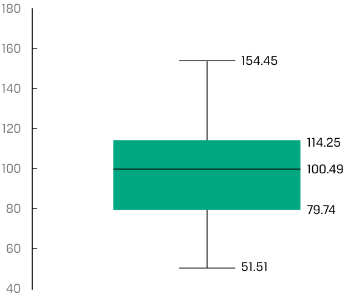
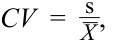
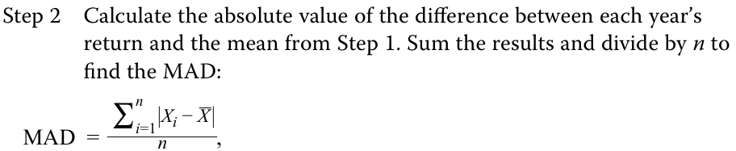

# Tập 1: Phương pháp Định lượng (Quantitative Methods)
## Learning Module 3 Statistical Measures of Asset Returns (Trang PDF 95–138)

---

# Tập 1: Phương pháp Định lượng (*Quantitative Methods*)
## Học phần 3: Các thước đo Thống kê về Tỷ suất sinh lợi Tài sản (*Statistical Measures of Asset Returns*)
### Phần 1/4: Giới thiệu (Trang PDF 95–107)

---

<!-- PDF Page 95 -->

# H Ọ C P H Ầ N **<mark>3</mark>** 

### **Các thước đo Thống kê về Tỷ suất sinh lợi Tài sản (*Statistical Measures of Asset Returns*)** 

**Tác giả: Pamela Peterson Drake, PhD, CFA, và Wu Jian, PhD.** 

_Pamela Peterson Drake, PhD, CFA, công tác tại Đại học James Madison (Hoa Kỳ). Jian Wu, PhD, công tác tại State Street (Hoa Kỳ)._ 

|**MỤC TIÊU HỌC TẬP (*LEARNING OUTCOMES*)**||
|---|---|
|**_Mức độ thành thạo_**|**_Ứng viên cần có khả năng:_**|
||tính toán, diễn giải và đánh giá các thước đo xu hướng trung tâm (*measures of central tendency*) và vị trí (*location*) để giải quyết một bài toán đầu tư|
||tính toán, diễn giải và đánh giá các thước đo độ phân tán (*measures of dispersion*) để giải quyết một bài toán đầu tư|
||diễn giải và đánh giá các thước đo độ lệch (*skewness*) và độ nhọn (*kurtosis*) để giải quyết một bài toán đầu tư|
||diễn giải hệ số tương quan (*correlation*) giữa hai biến số để giải quyết một bài toán đầu tư|

#### **GIỚI THIỆU (*INTRODUCTION*)** 

**<mark>1</mark>** 

Dữ liệu luôn là yếu tố đầu vào then chốt cho việc phân tích chứng khoán và quản lý đầu tư, cho phép các nhà đầu tư khám phá và khai thác nguồn thông tin dồi dào cho các chiến lược đầu tư của mình. Mặc dù môi trường giàu dữ liệu này mang lại những cơ hội tiềm năng to lớn cho các nhà đầu tư, nhưng việc biến dữ liệu thành thông tin hữu ích lại không hề đơn giản. 

Học phần này cung cấp nền tảng để hiểu các khái niệm quan trọng, vốn là một phần không thể thiếu trong bộ công cụ phân tích cần thiết cho những người hành nghề đầu tư, từ các chuyên viên phân tích cấp thấp đến các nhà quản lý danh mục đầu tư cấp cao. Những khái niệm cơ bản này mở đường cho các công cụ phức tạp hơn sẽ được phát triển xuyên suốt chủ đề phương pháp định lượng, đóng vai trò thiết yếu để đạt được năng lực trong các kỹ thuật quản lý đầu tư và các loại tài sản được trình bày ở phần sau của chương trình CFA. 

Học phần này tập trung vào cách tóm tắt và phân tích các khía cạnh quan trọng của tỷ suất sinh lợi tài chính, bao gồm các thước đo chính về xu hướng trung tâm (*central tendency*), độ phân tán (*dispersion*), và hình dạng của phân phối tỷ suất sinh lợi—cụ thể là độ lệch (*skewness*) và độ nhọn (*kurtosis*). Học phần kết thúc bằng phần giới thiệu trực quan bằng đồ thị về hiệp phương sai (*covariance*) và hệ số tương quan (*correlation*) giữa hai biến số, một khái niệm then chốt trong việc xây dựng danh mục đầu tư nhằm đạt được sự đa dạng hóa giữa các tài sản trong danh mục. 

<!-- PDF Page 96 -->

###### **TỔNG QUAN HỌC PHẦN (*LEARNING MODULE OVERVIEW*)** 

- Các thống kê mẫu (*sample statistics*)—chẳng hạn như các thước đo xu hướng trung tâm, độ phân tán, độ lệch và độ nhọn—hỗ trợ việc phân tích đầu tư, đặc biệt là trong việc đưa ra các nhận định xác suất về tỷ suất sinh lợi. 

- Các thước đo xu hướng trung tâm bao gồm giá trị trung bình (*mean*), trung vị (*median*) và yếu vị (*mode*), giúp chỉ ra vị trí trung tâm của dữ liệu. 

- Trung bình cộng (*arithmetic mean*) là tổng các quan sát chia cho số lượng quan sát. Đây là thước đo xu hướng trung tâm được sử dụng thường xuyên nhất. 

- Trung vị (*median*) là giá trị của phần tử nằm ở chính giữa tập hợp các quan sát, hoặc là trung bình cộng của hai phần tử nằm ở giữa, khi các phần tử trong tập hợp được sắp xếp theo thứ tự tăng dần hoặc giảm dần. Vì trung vị không bị ảnh hưởng bởi các giá trị cực đoan (*extreme values*), nên nó hữu ích nhất trong trường hợp các phân phối bị lệch (*skewed distributions*). 

- Yếu vị (*mode*) là giá trị được quan sát thường xuyên nhất và là thước đo xu hướng trung tâm duy nhất có thể sử dụng với dữ liệu định danh (*nominal data*) hoặc dữ liệu phân loại (*categorical data*). Một phân phối có thể có một đỉnh (*unimodal* – một yếu vị), hai đỉnh (*bimodal* – hai yếu vị), ba đỉnh (*trimodal* – ba yếu vị), hoặc thậm chí nhiều yếu vị hơn. 

- Các phân vị (*quantiles*), chẳng hạn như trung vị (*median*), tứ phân vị (*quartiles*), ngũ phân vị (*quintiles*), thập phân vị (*deciles*) và bách phân vị (*percentiles*), là các tham số vị trí chia một phân phối thành các phần bằng nhau tương ứng là hai phần, bốn phần, năm phần, mười phần và một trăm phần. 

- Biểu đồ hộp và râu (*box and whiskers plot*) minh họa sự phân phối của một tập hợp các quan sát. Phần “hộp” (*box*) biểu thị khoảng tứ phân vị (*interquartile range*), tức là chênh lệch giữa tứ phân vị thứ nhất và tứ phân vị thứ ba. Phần “râu” (*whiskers*) bên ngoài “hộp” cho biết các thước đo độ phân tán khác. 

- Các thước đo độ phân tán (*dispersion measures*), chẳng hạn như khoảng biến thiên (*range*), độ lệch tuyệt đối trung bình (*mean absolute deviation* – MAD), phương sai (*variance*), độ lệch chuẩn (*standard deviation*), độ lệch dưới mục tiêu (*target downside deviation*), và hệ số biến thiên (*coefficient of variation*), mô tả mức độ biến thiên của các kết quả xung quanh giá trị trung bình cộng. 

- Khoảng biến thiên (*range*) là chênh lệch giữa giá trị lớn nhất và giá trị nhỏ nhất của tập dữ liệu. Khoảng biến thiên chỉ có tính hữu ích hạn chế vì nó chỉ sử dụng thông tin từ hai quan sát. 

- Độ lệch tuyệt đối trung bình (MAD) của một mẫu là trung bình cộng của các độ lệch tuyệt đối của các quan sát so với giá trị trung bình. 

- Phương sai (*variance*) là trung bình của các bình phương độ lệch xung quanh giá trị trung bình, và độ lệch chuẩn (*standard deviation*) là căn bậc hai dương của phương sai. Khi tính phương sai mẫu, $s^2$, và độ lệch chuẩn mẫu, $s$, bình phương độ lệch trung bình được tính bằng cách sử dụng mẫu số bằng kích thước mẫu trừ đi 1 ($n - 1$). 

- Độ lệch dưới mục tiêu (*target downside deviation*), hay bán độ lệch mục tiêu (*target semideviation*), là thước đo rủi ro khi kết quả thấp hơn một mức mục tiêu nhất định. 

- Hệ số biến thiên (*coefficient of variation* – CV) là tỷ số giữa độ lệch chuẩn của một tập hợp các quan sát với giá trị trung bình của chúng. Bằng cách biểu thị độ lớn của sự biến thiên giữa các quan sát tương ứng với quy mô trung bình của chúng, CV cho phép so sánh trực tiếp độ phân tán giữa các tập dữ liệu khác nhau. Phản ánh việc điều chỉnh theo quy mô, CV là một thước đo không phụ thuộc vào quy mô (*scale-free measure*), nghĩa là nó không có đơn vị đo lường. 

<!-- PDF Page 97 -->

- Độ lệch (*skewness*) mô tả mức độ bất đối xứng của một phân phối xung quanh giá trị trung bình của nó. Một phân phối tỷ suất sinh lợi tài sản có độ lệch dương (*positive skewness*) có nhiều khoản lỗ nhỏ thường xuyên và một vài khoản lãi cực lớn so với phân phối chuẩn (*normal distribution*). Một phân phối tỷ suất sinh lợi tài sản có độ lệch âm (*negative skewness*) có nhiều khoản lãi nhỏ thường xuyên và một vài khoản lỗ cực lớn so với phân phối chuẩn. Độ lệch bằng không cho thấy một phân phối tỷ suất sinh lợi đối xứng. 

- Độ nhọn (*kurtosis*) đo lường trọng lượng kết hợp của hai phần đuôi của một phân phối so với phần còn lại của phân phối đó. Một phân phối có đuôi dày hơn phân phối chuẩn được gọi là phân phối đuôi dày hay nhọn (*fat-tailed / leptokurtic*); một phân phối có đuôi mỏng hơn phân phối chuẩn được gọi là phân phối đuôi mỏng hay bẹt (*thin-tailed / platykurtic*). Độ nhọn của phân phối chuẩn bằng 3. 

- Hệ số tương quan (*correlation coefficient*) đo lường mối liên hệ giữa hai biến số. Đó là tỷ số giữa hiệp phương sai (*covariance*) với tích độ lệch chuẩn của hai biến số đó. Hệ số tương quan dương cho biết hai biến số có xu hướng biến động cùng chiều, trong khi hệ số âm cho biết hai biến số có xu hướng biến động ngược chiều. Tương quan không hàm ý quan hệ nhân quả (*causation*), mà chỉ đơn thuần là sự liên kết (*association*). Các vấn đề phát sinh khi đánh giá tương quan bao gồm sự hiện diện của các giá trị ngoại lai (*outliers*) và tương quan giả mạo (*spurious correlation*). 

#### **CÁC THƯỚC ĐO XU HƯỚNG TRUNG TÂM VÀ VỊ TRÍ (*MEASURES OF CENTRAL TENDENCY AND LOCATION*)** 

## **<mark>2</mark>** 

tính toán, diễn giải và đánh giá các thước đo xu hướng trung tâm và vị trí để giải quyết một bài toán đầu tư 

Trong bài học này, trọng tâm của chúng ta là các thước đo xu hướng trung tâm và các thước đo vị trí khác. Một **thước đo xu hướng trung tâm (*measure of central tendency*)** chỉ ra nơi dữ liệu tập trung. Đối với một chuỗi tỷ suất sinh lợi, thước đo xu hướng trung tâm cho thấy nơi phân phối thực nghiệm của tỷ suất sinh lợi tập trung, về bản chất là một thước đo tỷ suất sinh lợi “kỳ vọng” dựa trên mẫu quan sát được. **Các thước đo vị trí (*measures of location*)**, bao gồm giá trị trung bình (*mean*), **trung vị (*median*)**, và **yếu vị (*mode*)**, không chỉ bao gồm các thước đo xu hướng trung tâm mà còn cả các thước đo khác minh họa những khía cạnh khác về vị trí hoặc sự phân phối của dữ liệu. 

Phân phối tần số (*frequency distributions*), biểu đồ tần số (*histograms*), và bảng ngẫu nhiên (*contingency tables*) cung cấp một cách thuận tiện để tóm tắt một chuỗi các quan sát về tỷ suất sinh lợi của một tài sản như một bước đầu tiên hướng tới việc mô tả dữ liệu. Ví dụ, biểu đồ tần số cho phân phối tần số của tỷ suất sinh lợi hàng ngày đối với Chỉ số Cổ phiếu EAA (EAA Equity Index) giả định trong năm năm qua được thể hiện trong Bảng minh họa 1 (Exhibit 1). 

<!-- PDF Page 98 -->

**Bảng minh họa 1: Biểu đồ tần số Tỷ suất sinh lợi Hàng ngày của Chỉ số Cổ phiếu EAA (*Histogram of Daily Returns on the EAA Equity Index*)** 

<!-- Picture Text: Number of Observations 600 500 470 493 400 300 200 122 94 100 37 27 5 7 1 1 1 0 –4.1 to –3.3 to –2.5 to –1.6 to –0.8 to 0 to 0.9 to 1.7 to 2.5 to 3.3 to 4.2 to –3.3 –2.5 –1.6 –0.8 0 0.9 1.7 2.5 3.3 4.2 5.0 Daily Return Range (%)  -->

> **Chú thích hình ảnh:**
> - **Trục tung:** Số lượng quan sát (*Number of Observations*) từ 0 đến 600.
> - **Trục hoành:** Khoảng tỷ suất sinh lợi hàng ngày (*Daily Return Range (%)*) từ –4.1 đến 5.0.

##### **Các thước đo Xu hướng Trung tâm (*Measures of Central Tendency*)** 

###### **_Trung bình cộng (*The Arithmetic Mean*)_** 

Các chuyên viên phân tích và nhà quản lý danh mục đầu tư thường muốn có một con số duy nhất mô tả kết quả đại diện có thể xảy ra của một quyết định đầu tư. Trung bình cộng là một trong những thước đo xu hướng trung tâm được sử dụng thường xuyên nhất. 

**Trung bình cộng (*Arithmetic Mean*).** **Trung bình cộng (*arithmetic mean*)** là tổng giá trị của các quan sát trong một tập dữ liệu chia cho số lượng các quan sát. 

###### **_Trung bình mẫu (*The Sample Mean*)_** 

Trung bình mẫu là trung bình cộng được tính cho một mẫu. 

<!-- Formula Text: Sample Mean Formula. The sample mean or average,  _ X  (read “X-bar”), is the arithmetic mean value of a sample: _ X   = ∑ i=1 n X i _ n , (1) -->

$$\bar{X} = \frac{\sum_{i=1}^{n} X_i}{n} \tag{1}$$

trong đó $\bar{X}$ (đọc là “X-ngang” / *“X-bar”*) là giá trị trung bình cộng của một mẫu, và $n$ là số lượng quan sát trong mẫu. 

Một đặc tính và cũng là nhược điểm tiềm ẩn của trung bình cộng là sự nhạy cảm của nó với các giá trị cực đoan, hay các giá trị ngoại lai (*outliers*). Bởi vì tất cả các quan sát đều được sử dụng để tính giá trị trung bình và được gán trọng số (tức mức độ quan trọng) bằng nhau, nên trung bình cộng có thể bị kéo tăng vọt lên hoặc giảm mạnh xuống bởi các quan sát cực lớn hoặc cực nhỏ tương ứng. Cách tiếp cận phổ biến nhất trong tình huống này là báo cáo giá trị trung vị (*median*), hay giá trị ở giữa, để thay thế hoặc bổ sung cho giá trị trung bình. 

###### **_Trung vị (*The Median*)_** 

Một thước đo quan trọng thứ hai của xu hướng trung tâm là trung vị. 

**Định nghĩa Trung vị (*Definition of Median*).** Trung vị là giá trị của phần tử nằm ở chính giữa của một tập dữ liệu đã được sắp xếp theo thứ tự tăng dần hoặc giảm dần. Trong một mẫu có số lượng quan sát $n$ là số lẻ, trung vị là giá trị của 

<!-- PDF Page 99 -->

quan sát chiếm vị trí thứ $(n + 1)/2$. Trong một mẫu có số lượng quan sát là số chẵn, chúng ta định nghĩa trung vị là trung bình cộng của giá trị các quan sát chiếm vị trí thứ $n/2$ và $(n + 2)/2$ (hai quan sát nằm ở chính giữa). 

Cho dù chúng ta sử dụng phép tính cho mẫu có số lượng chẵn hay lẻ, luôn có một số lượng quan sát bằng nhau nằm phía trên và phía dưới trung vị. Một phân phối chỉ có duy nhất một trung vị. Một ưu điểm tiềm năng của trung vị là, không giống như trung bình cộng, các giá trị ngoại lai không làm ảnh hưởng đến nó. 

Tuy nhiên, trung vị không sử dụng toàn bộ thông tin về độ lớn của các quan sát; nó chỉ tập trung vào vị trí tương đối của các quan sát đã được xếp hạng. Việc tính toán trung vị cũng có thể phức tạp hơn. Các nhà toán học diễn đạt nhược điểm này bằng cách nói rằng trung vị khó xử lý về mặt toán học (*less mathematically tractable*) hơn so với giá trị trung bình. 

###### **_Yếu vị (*The Mode*)_** 

Một thước đo quan trọng thứ ba của xu hướng trung tâm là yếu vị. 

**Định nghĩa Yếu vị (*Definition of Mode*).** Yếu vị là giá trị xuất hiện thường xuyên nhất trong một tập dữ liệu. Một tập dữ liệu có thể có nhiều hơn một yếu vị, hoặc thậm chí không có yếu vị nào. Khi một tập dữ liệu có một giá trị duy nhất được quan sát thường xuyên nhất, phân phối của nó được gọi là **phân phối một đỉnh (*unimodal*)**. Nếu một tập dữ liệu có hai giá trị xuất hiện thường xuyên nhất ngang nhau, thì nó có hai yếu vị và phân phối của nó được gọi là **phân phối hai đỉnh (*bimodal*)**. Khi tất cả các giá trị trong một tập dữ liệu đều khác nhau, phân phối đó không có yếu vị vì không có giá trị nào xuất hiện thường xuyên hơn bất kỳ giá trị nào khác. 

Dữ liệu tỷ suất sinh lợi cổ phiếu và các dữ liệu khác từ các phân phối liên tục (*continuous distributions*) có thể không có một kết quả yếu vị riêng lẻ. Bảng minh họa 2 trình bày phân phối tần số của tỷ suất sinh lợi hàng ngày đối với Chỉ số Cổ phiếu EAA trong năm năm qua. 

**Bảng minh họa 2: Phân phối Tần số cho Tỷ suất sinh lợi Hàng ngày của Chỉ số Cổ phiếu EAA (*Frequency Distribution for Daily Returns of EAA Equity Index*)** 

|**Khoảng tỷ suất sinh lợi (*Return Bin*) (%)**|**Tần số tuyệt đối (*Absolute Frequency*)**|**Tần số tương đối (*Relative Frequency*) (%)**|**Tần số tuyệt đối tích lũy (*Cumulative Absolute Frequency*)**|**Tần số tương đối tích lũy (*Cumulative Relative Frequency*) (%)**|
|---|---|---|---|---|
|−5.0 đến −4.0|1|0.08|1|0.08|
|−4.0 đến −3.0|7|0.56|8|0.64|
|−3.0 đến −2.0|23|1.83|31|2.46|
|−2.0 đến −1.0|77|6.12|108|8.59|
|−1.0 đến 0.0|470|37.36|578|45.95|
|0.0 đến 1.0|555|44.12|1,133|90.06|
|1.0 đến 2.0|110|8.74|1,243|98.81|
|2.0 đến 3.0|13|1.03|1,256|99.84|
|3.0 đến 4.0|1|0.08|1,257|99.92|
|4.0 đến 5.0|1|0.08|1,258|100.00|

Biểu đồ tần số cho phân phối tần số của các tỷ suất sinh lợi hàng ngày này đã được thể hiện trong Bảng minh họa 1. Khoảng yếu vị (*modal interval*) luôn có cột cao nhất trong biểu đồ tần số; trong trường hợp này, khoảng yếu vị là từ 0.0 đến 1.0 phần trăm, và khoảng này có 555 quan sát trên tổng số 1,258 quan sát. 

<!-- PDF Page 100 -->

##### **Xử lý các Giá trị Ngoại lai (*Dealing with Outliers*)** 

Trong thực tế, mặc dù một giá trị cực đoan hay giá trị ngoại lai (*outlier*) trong một tập dữ liệu tài chính có thể đại diện cho một giá trị hiếm gặp trong tổng thể, nhưng nó cũng có thể phản ánh một sai sót trong việc ghi chép giá trị của một quan sát hoặc một quan sát được tạo ra từ một tổng thể khác. Sau khi đã kiểm tra và loại bỏ các sai sót, chúng ta có thể giải quyết vấn đề cần làm gì với các giá trị cực đoan trong mẫu. 

Khi xử lý một mẫu có các giá trị cực đoan, có thể có khả năng biến đổi biến số (ví dụ: biến đổi logarit) hoặc chọn một biến số khác đạt được cùng mục đích. Tuy nhiên, nếu các dạng thức mô hình thay thế hoặc việc biến đổi biến số là không khả thi, thì có ba lựa chọn để xử lý các giá trị cực đoan: 

Lựa chọn 1 Không làm gì cả; sử dụng dữ liệu mà không có bất kỳ sự điều chỉnh nào. 

Lựa chọn 2 Xóa bỏ tất cả các giá trị ngoại lai. 

Lựa chọn 3 Thay thế các giá trị ngoại lai bằng một giá trị khác. 

Lựa chọn đầu tiên là phù hợp nếu các giá trị đó là những quan sát hợp lệ, chính xác, và việc phản ánh toàn bộ phân phối mẫu là rất quan trọng. Bởi vì các giá trị ngoại lai có thể chứa đựng thông tin có ý nghĩa, việc loại trừ hoặc thay đổi các giá trị này có thể làm giảm bớt thông tin có giá trị. Hơn nữa, vì việc xác định một điểm dữ liệu là cực đoan phụ thuộc vào phán đoán của chuyên viên phân tích, nên việc giữ lại tất cả các quan sát sẽ loại bỏ nhu cầu phải phán đoán xem một giá trị có phải là cực đoan hay không. 

Lựa chọn thứ hai loại trừ các quan sát cực đoan. Một thước đo xu hướng trung tâm trong trường hợp này là **trung bình cắt bỏ (*trimmed mean*)**, tức là tính trung bình cộng sau khi đã loại trừ một tỷ lệ phần trăm nhỏ nhất định các giá trị thấp nhất và cao nhất. Ví dụ, một trung bình cắt bỏ 5 phần trăm sẽ loại bỏ 2.5 phần trăm giá trị thấp nhất và 2.5 phần trăm giá trị cao nhất, rồi tính trung bình của 95 phần trăm giá trị còn lại. Trung bình cắt bỏ được sử dụng trong các cuộc thi đấu thể thao khi điểm số thấp nhất và cao nhất của các giám khảo bị loại bỏ khi tính điểm cho một thí sinh. 

Lựa chọn thứ ba liên quan đến việc thay thế các giá trị khác cho các giá trị cực đoan. Một thước đo xu hướng trung tâm trong trường hợp này là **trung bình Winsor (*winsorized mean*)**. Nó được tính sau khi gán một giá trị thấp xác định cho một tỷ lệ phần trăm nhất định các giá trị thấp nhất trong tập dữ liệu và một giá trị cao xác định cho một tỷ lệ phần trăm nhất định các giá trị cao nhất trong tập dữ liệu. Ví dụ, trung bình Winsor 95 phần trăm sẽ đặt 2.5 phần trăm giá trị thấp nhất trong tập dữ liệu bằng với giá trị mà tại đó hoặc thấp hơn đó có 2.5 phần trăm tổng số các giá trị nằm (như sẽ thấy ngay sau đây, giá trị này được gọi là giá trị “bách phân vị thứ 2.5” – *“2.5th percentile”*), và đặt 2.5 phần trăm giá trị cao nhất trong tập dữ liệu bằng với giá trị mà tại đó hoặc thấp hơn đó có 97.5 phần trăm tổng số các giá trị nằm (giá trị “bách phân vị thứ 97.5” – *“97.5th percentile”*). 

Thông thường, việc so sánh các thước đo thống kê của các tập dữ liệu khi bao gồm các giá trị ngoại lai và khi loại trừ các giá trị ngoại lai có thể hé lộ những hiểu biết quan trọng về tập dữ liệu đó. Sự so sánh như vậy có thể đặc biệt hữu ích khi các nhà đầu tư phân tích hành vi của tỷ suất sinh lợi tài sản cũng như những thay đổi về lãi suất, giá cả, chênh lệch (*spread*) và khối lượng giao dịch. 

Trong Ví dụ 1, chúng ta chỉ ra sự khác biệt giữa các lựa chọn xử lý giá trị ngoại lai này bằng cách sử dụng tỷ suất sinh lợi hàng ngày của Chỉ số Cổ phiếu Âu-Á-Phi (Euro-Asia-Africa – EAA) giả định trong Bảng minh họa 2. 

###### **VÍ DỤ 1** 

##### **Xử lý các Giá trị Ngoại lai: Tỷ suất sinh lợi Hàng ngày của một Chỉ số (*Handling Outliers: Daily Returns to an Index*)** 

Sử dụng tỷ suất sinh lợi hàng ngày của Chỉ số Cổ phiếu EAA trong năm năm qua, bao gồm 1,258 ngày giao dịch, chúng ta có thể thấy tác động của việc cắt bỏ (*trimming*) và chuẩn hóa Winsor (*winsorizing*) dữ liệu: 

<!-- PDF Page 101 -->

**Bảng minh họa 3: Tác động của việc Cắt bỏ và Chuẩn hóa Winsor (*Effect of Trimming and Winsorizing*)** 

||**Trung bình cộng (*Arithmetic Mean*)**|**Trung bình cắt bỏ (*Trimmed Mean*) (Cắt bỏ 5%)**|**Trung bình Winsor (*Winsorized Mean*) (95%)**|
|---|---|---|---|
|Giá trị trung bình (*Mean*)|0.035%|0.048%|0.038%|
|Số lượng quan sát (*Number of Observations*)|1,258|1,194|1,258|

Trung bình cắt bỏ loại bỏ 2.5 phần trăm tỷ suất sinh lợi thấp nhất, trong mẫu này là bất kỳ tỷ suất sinh lợi hàng ngày nào nhỏ hơn −1.934 phần trăm, và loại bỏ 2.5 phần trăm cao nhất, trong mẫu này là bất kỳ tỷ suất sinh lợi hàng ngày nào lớn hơn 1.671 phần trăm. Kết quả của việc cắt bỏ này là giá trị trung bình được tính bằng cách sử dụng 1,194 quan sát thay vì 1,258 quan sát của mẫu ban đầu. 

Trung bình Winsor thay thế mức tỷ suất sinh lợi −1.934 phần trăm (giá trị bách phân vị thứ 2.5) cho bất kỳ quan sát nào dưới −1.934 và thay thế mức tỷ suất sinh lợi 1.671 phần trăm (giá trị bách phân vị thứ 97.5) cho bất kỳ quan sát nào trên 1.671. Kết quả trong trường hợp này là trung bình cắt bỏ và trung bình Winsor đều cao hơn trung bình cộng, cho thấy bằng chứng tiềm năng về sự xuất hiện của các mức tỷ suất sinh lợi âm đáng kể trong phân phối tỷ suất sinh lợi hàng ngày quan sát được. 

##### **Các thước đo Vị trí (*Measures of Location*)** 

Sau khi đã thảo luận về các thước đo xu hướng trung tâm, bây giờ chúng ta xem xét một cách tiếp cận để mô tả vị trí của dữ liệu liên quan đến việc xác định các giá trị mà tại đó hoặc thấp hơn đó có những tỷ lệ xác định của dữ liệu nằm. Ví dụ, việc xác định các mức mà dưới đó có 25 phần trăm, 50 phần trăm, và 75 phần trăm tỷ suất sinh lợi hàng năm của một danh mục đầu tư sẽ cung cấp thông tin ngắn gọn, súc tích về sự phân phối tỷ suất sinh lợi của danh mục. Các nhà thống kê sử dụng từ **phân vị (*quantile*)** làm thuật ngữ chung nhất cho một giá trị mà tại đó hoặc thấp hơn đó có một tỷ lệ xác định của dữ liệu nằm. Trong phần tiếp theo, chúng ta mô tả các phân vị được sử dụng phổ biến nhất—tứ phân vị (*quartiles*), ngũ phân vị (*quintiles*), thập phân vị (*deciles*), và bách phân vị (*percentiles*)—cùng ứng dụng của chúng trong đầu tư. 

###### **_Tứ phân vị, Ngũ phân vị, Thập phân vị và Bách phân vị (*Quartiles, Quintiles, Deciles, and Percentiles*)_** 

Chúng ta biết rằng trung vị chia một phân phối dữ liệu thành hai nửa. Chúng ta có thể định nghĩa các đường phân chia khác để tách phân phối thành các kích thước nhỏ hơn. **Tứ phân vị (*Quartiles*)** chia phân phối thành bốn phần bằng nhau, **ngũ phân vị (*quintiles*)** thành năm phần, **thập phân vị (*deciles*)** thành mười phần, và **bách phân vị (*percentiles*)** thành một trăm phần. **Khoảng tứ phân vị (*interquartile range* – IQR)** là chênh lệch giữa tứ phân vị thứ ba và tứ phân vị thứ nhất, hay $\text{IQR} = Q_3 - Q_1$. 

Ví dụ 2 minh họa cách tính các phân vị khác nhau đối với tỷ suất sinh lợi hàng ngày của Chỉ số Cổ phiếu EAA. 

###### **VÍ DỤ 2** 

##### **Bách phân vị, Ngũ phân vị và Tứ phân vị cho Chỉ số Cổ phiếu EAA (*Percentiles, Quintiles, and Quartiles for the EAA Equity Index*)** 

Sử dụng tỷ suất sinh lợi hàng ngày của Chỉ số Cổ phiếu EAA trong năm năm qua và xếp hạng chúng từ tỷ suất sinh lợi hàng ngày thấp nhất đến cao nhất, chúng ta thể hiện các khoảng tỷ suất sinh lợi (*return bins*) từ 1 (5 phần trăm thấp nhất) đến 20 (5 phần trăm cao nhất) như sau: 

<!-- PDF Page 102 -->

**Bảng minh họa 4: Tỷ suất sinh lợi Hàng ngày của Chỉ số Cổ phiếu EAA được Nhóm theo Độ lớn của Tỷ suất sinh lợi (*EAA Equity Index Daily Returns Grouped by Size of Return*)** 

|**Khoảng (*Bin*)**|**Tỷ lệ phần trăm tích lũy của số ngày giao dịch mẫu (*Cumulative Percentage of Sample Trading Days*) (%)**|**Tỷ suất sinh lợi hàng ngày (%) Cận dưới (*Lower Bound*)**|**Tỷ suất sinh lợi hàng ngày (%) Cận trên (*Upper Bound*)**|**Số lượng quan sát (*Number of Observations*)**|
|---|---|---|---|---|
|1|5|−4.108|−1.416|63|
|2|10|−1.416|−0.876|63|
|3|15|−0.876|−0.629|63|
|4|20|−0.629|−0.432|63|
|5|25|−0.432|−0.293|63|
|6|30|−0.293|−0.193|63|
|7|35|−0.193|−0.124|62|
|8|40|−0.124|−0.070|63|
|9|45|−0.070|−0.007|63|
|10|50|−0.007|0.044|63|
|11|55|0.044|0.108|63|
|12|60|0.108|0.173|63|
|13|65|0.173|0.247|63|
|14|70|0.247|0.343|62|
|15|75|0.343|0.460|63|
|16|80|0.460|0.575|63|
|17|85|0.575|0.738|63|
|18|90|0.738|0.991|63|
|19|95|0.991|1.304|63|
|20|100|1.304|5.001|63|

Do bản chất liên tục của tỷ suất sinh lợi, rất ít khả năng một mức tỷ suất sinh lợi rơi đúng vào ranh giới của bất kỳ khoảng (*bin*) nào ngoài mức tối thiểu (Bin = 1) và mức tối đa (Bin = 20). 

Sử dụng dữ liệu trong Bảng minh họa 4, hãy hoàn thành các yêu cầu sau: 

1. Xác định bách phân vị thứ 10 và thứ 90 (*10th and 90th percentiles*). 

###### **Lời giải:** 

Bách phân vị thứ 10 và thứ 90 tương ứng với các khoảng hoặc các mức tỷ suất sinh lợi đã xếp hạng bao gồm lần lượt 10 phần trăm và 90 phần trăm tỷ suất sinh lợi hàng ngày. Bách phân vị thứ 10 tương ứng với mức tỷ suất sinh lợi −0.876 phần trăm (và bao gồm các mức tỷ suất sinh lợi bằng hoặc thấp hơn mức đó), và bách phân vị thứ 90 tương ứng với mức tỷ suất sinh lợi 0.991 phần trăm (và thấp hơn). 

2. Xác định ngũ phân vị thứ nhất, thứ hai và thứ ba (*first, second, and third quintiles*). 

###### **Lời giải:** 

Ngũ phân vị thứ nhất tương ứng với 20 phần trăm thấp nhất của dữ liệu đã xếp hạng, tức là −0.432 phần trăm (và thấp hơn). Ngũ phân vị thứ hai tương ứng với 40 phần trăm thấp nhất của dữ liệu đã xếp hạng, tức là −0.070 phần trăm (và thấp hơn). 

Ngũ phân vị thứ ba tương ứng với 60 phần trăm thấp nhất của dữ liệu đã xếp hạng, tức là 0.173 phần trăm (và thấp hơn). 

<!-- PDF Page 103 -->

3. Xác định tứ phân vị thứ nhất và thứ ba (*first and third quartiles*). 

###### **Lời giải:** 

Tứ phân vị thứ nhất tương ứng với 25 phần trăm thấp nhất của dữ liệu đã xếp hạng, tức là −0.293 phần trăm (và thấp hơn). Tứ phân vị thứ ba tương ứng với 75 phần trăm thấp nhất của dữ liệu đã xếp hạng, tức là 0.460 phần trăm (và thấp hơn). 

4. Xác định trung vị (*median*). 

###### **Lời giải:** 

Trung vị là mức tỷ suất sinh lợi mà có 50 phần trăm dữ liệu nằm ở mỗi phía, tức là 0.044 phần trăm, mức tỷ suất sinh lợi hàng ngày cao nhất trong khoảng thứ 10 trên tổng số 20 khoảng. 

5. Tính khoảng tứ phân vị (*interquartile range*). 

###### **Lời giải:** 

Khoảng tứ phân vị là chênh lệch giữa tứ phân vị thứ ba và tứ phân vị thứ nhất, tức 0.460 phần trăm và −0.293 phần trăm, bằng 0.753 phần trăm ($0.460\% - (-0.293\%) = 0.753\%$). 

Một cách để trực quan hóa độ phân tán của dữ liệu qua các tứ phân vị là sử dụng sơ đồ, chẳng hạn như biểu đồ hộp và râu. Một **biểu đồ hộp và râu (*box and whisker plot*)** được thể hiện trong Bảng minh họa 5. Phần “hộp” (*box*) đại diện cho cận dưới của tứ phân vị thứ hai và cận trên của tứ phân vị thứ ba, với trung vị hoặc trung bình cộng được đánh dấu như một thước đo xu hướng trung tâm của toàn bộ phân phối. Phần “râu” (*whiskers*) là các đường thẳng chạy ra từ hộp và được giới hạn bởi các “hàng rào” (*fences*), đại diện cho các giá trị thấp nhất và cao nhất của phân phối. 

**Bảng minh họa 5: Biểu đồ Hộp và Râu (*Box and Whisker Plot*)** 

<!-- Picture Text: Highest Value Upper Boundary for  Q 3 Interquartile Median Range × Arithmetic Average Lowest Boundary for  Q 2 Lowest Value  -->

> **Chú thích hình ảnh:**
> - **Highest Value:** Giá trị cao nhất
> - **Upper Boundary for $Q_3$:** Cận trên của $Q_3$
> - **Interquartile Range:** Khoảng tứ phân vị
> - **Median:** Trung vị
> - **$\times$ Arithmetic Average:** Trung bình cộng
> - **Lowest Boundary for $Q_2$:** Cận dưới của $Q_2$ (tức $Q_1$)
> - **Lowest Value:** Giá trị thấp nhất

Có một số biến thể đối với cách hiển thị biểu đồ hộp và râu. Ví dụ, để dễ dàng phát hiện các giá trị ngoại lai tiềm ẩn, các hàng rào (*fences*) của phần râu có thể là một hàm số của khoảng tứ phân vị thay vì các giá trị cao nhất và thấp nhất như trong Bảng minh họa 5. 

Trong Bảng minh họa 5, xét về mặt trực quan, khoảng tứ phân vị là chiều cao của hộp và các hàng rào được đặt ở các giá trị cực trị. Nhưng một dạng khác của biểu đồ hộp và râu thường sử dụng 1.5 lần khoảng tứ phân vị cho các hàng rào. Do đó, hàng rào trên (*upper fence*) bằng 1.5 lần khoảng tứ phân vị cộng vào cận trên của $Q_3$, và hàng rào dưới (*lower fence*) bằng 1.5 lần khoảng tứ phân vị trừ đi khỏi cận dưới của $Q_2$. Các quan sát nằm ngoài các hàng rào (tức là các giá trị ngoại lai) cũng có thể được hiển thị. 

Chúng ta có thể thấy vai trò của các giá trị ngoại lai trong một biểu đồ hộp và râu như vậy khi sử dụng tỷ suất sinh lợi hàng ngày của Chỉ số Cổ phiếu EAA, như được thể hiện trong Bảng minh họa 6. 

<!-- PDF Page 104 -->

###### **Bảng minh họa 6: Biểu đồ Hộp và Râu cho Tỷ suất sinh lợi Hàng ngày của Chỉ số Cổ phiếu EAA (*Box and Whisker Chart for EAA Equity Index Daily Returns*)** 

<!-- Picture Text: Daily Return (%) 6 5 Maximum of 5.001% 4 3 2 ( Q 3 Upper  1.589% (Upper Fence) 1 Bound) 0.460% Median of 0 ( Q 2 Lower 0.044% –1 Bound) –1.422% –2 –0.293% (Lower Fence) –3 –4 Minimum of –4.108% –5  -->

> **Chú thích hình ảnh:**
> - **Daily Return (%):** Tỷ suất sinh lợi hàng ngày (%)
> - **Maximum of 5.001%:** Giá trị tối đa 5.001%
> - **1.589% (Upper Fence):** 1.589% (Hàng rào trên)
> - **($Q_3$ Upper Bound) 0.460%:** (Cận trên $Q_3$) 0.460%
> - **Median of 0.044%:** Trung vị 0.044%
> - **($Q_2$ Lower Bound) –0.293%:** (Cận dưới $Q_2$) –0.293%
> - **–1.422% (Lower Fence):** –1.422% (Hàng rào dưới)
> - **Minimum of –4.108%:** Giá trị tối thiểu –4.108%

Bảng minh họa 6 cho thấy những điều sau: 

- Giá trị tối đa và tối thiểu của phân phối lần lượt là 5.001 và −4.108, trong khi giá trị trung vị (bách phân vị thứ 50) là 0.044. 

- Khoảng tứ phân vị là $0.753$ [$= 0.460 - (-0.293)$], và khi nhân với 1.5 rồi cộng vào cận trên $Q_3$ là 0.460 sẽ cho ra hàng rào trên là $1.589$ [$= (1.5 \times 0.753) + 0.460$]. 

- Hàng rào dưới được xác định theo cách tương tự, sử dụng cận dưới $Q_2$, là $-1.422$ [$= -(1.5 \times 0.753) + (-0.293)$]. 

Như đã lưu ý, bất kỳ quan sát nào nằm trên (dưới) hàng rào trên (hàng rào dưới) đều được coi là một giá trị ngoại lai (*outlier*). 

###### **_Các Phân vị trong Thực tiễn Đầu tư (*Quantiles in Investment Practice*)_** 

Các phân vị được sử dụng trong việc đánh giá hiệu quả hoạt động của danh mục đầu tư cũng như trong việc phát triển và nghiên cứu chiến lược đầu tư. 

Các chuyên viên phân tích đầu tư sử dụng các phân vị để xếp hạng hiệu quả hoạt động, chẳng hạn như hiệu quả của các tài sản, chỉ số và danh mục đầu tư. Hiệu quả hoạt động của các nhà quản lý đầu tư thường được mô tả theo bách phân vị mà hiệu quả của họ rơi vào so với hiệu quả của nhóm các nhà quản lý đồng cấp (*peer group*). Ví dụ, hệ thống xếp hạng sao quỹ đầu tư của Morningstar được sử dụng rộng rãi đã gắn số lượng sao với các bách phân vị của các chỉ số đo lường hiệu quả so với các quỹ đầu tư có cùng phong cách. 

Một ứng dụng quan trọng khác của các phân vị là trong nghiên cứu đầu tư. Việc chia dữ liệu thành các phân vị dựa trên một đặc tính cụ thể có thể định lượng khách quan—chẳng hạn như doanh thu, giá trị vốn hóa thị trường (*market capitalization*), hoặc quy mô tài sản—cho phép các chuyên viên phân tích đánh giá tác động của đặc tính cụ thể đó lên một đại lượng quan tâm, chẳng hạn như tỷ suất sinh lợi tài sản, doanh thu, tăng trưởng, hoặc các chỉ số định giá. Chẳng hạn, các nhà đầu tư định lượng thường xếp hạng các công ty dựa trên giá trị thị trường của vốn chủ sở hữu, hay giá trị vốn hóa thị trường của chúng, trước khi phân loại chúng thành các thập phân vị (*deciles*). Thập phân vị thứ nhất chứa danh mục các công ty có giá trị thị trường nhỏ nhất, thường được gọi là các công ty vốn hóa nhỏ (*small capitalization companies*). Thập phân vị thứ mười chứa các công ty có giá trị thị trường lớn nhất, thường được gọi là các công ty vốn hóa lớn (*large capitalization companies*). Việc xếp hạng các công ty theo thập phân vị cho phép các chuyên viên phân tích so sánh hiệu quả hoạt động tuyệt đối và tương đối của các công ty vốn hóa nhỏ so với các công ty vốn hóa lớn. 

<!-- PDF Page 105 -->

###### **BỘ CÂU HỎI (*QUESTION SET*)** 

Biểu đồ tần số trong Bảng minh họa 7 cho thấy phân phối tỷ suất sinh lợi hàng năm của Chỉ số S&P 500 trong giai đoạn 50 năm. 

###### **Bảng minh họa 7: Tỷ suất sinh lợi Hàng năm của Chỉ số S&P 500 (*Annual Returns for the S&P 500 Index*)** 

<!-- Picture Text: Frequency 8 7 6 5 4 3 2 1 0 –37 –32 –27 –22 –17 –12 –7 –2 3 8 13 18 23 28 33 to to to to to to to to to to to to to to to –32 –27 –22 –17 –12 –7 –2 3 8 13 18 23 28 33 38 Return Intervals (%)  -->

> **Chú thích hình ảnh:**
> - **Trục tung:** Tần số (*Frequency*) từ 0 đến 8.
> - **Trục hoành:** Các khoảng tỷ suất sinh lợi (*Return Intervals (%)*) từ –37 đến 38.

1. Khoảng (*bin*) chứa tỷ suất sinh lợi trung vị (*median return*) là: 

   - **A.** 3 phần trăm đến 8 phần trăm. 

   - **B.** 8 phần trăm đến 13 phần trăm. 

   - **C.** 13 phần trăm đến 18 phần trăm. 

   - **Lời giải:** 

C là đáp án đúng. Bởi vì có 50 điểm dữ liệu trong biểu đồ tần số, tỷ suất sinh lợi trung vị sẽ là trung bình cộng của vị trí thứ $50/2 = 25$ và vị trí thứ $(50 + 2)/2 = 26$. Tổng tần số của các khoảng tỷ suất sinh lợi nằm bên trái khoảng từ 13 phần trăm đến 18 phần trăm là 24. Do đó, mức tỷ suất sinh lợi thứ 25 và 26 sẽ rơi vào khoảng từ 13 phần trăm đến 18 phần trăm. 

2. Dựa vào Bảng minh họa 7, phân phối này được mô tả _đúng nhất_ là: 

   - **A.** một đỉnh (*unimodal*). 

   - **B.** hai đỉnh (*bimodal*). 

   - **C.** ba đỉnh (*trimodal*). 

###### **Lời giải:** 

C là đáp án đúng. Yếu vị (*mode*) của một phân phối có dữ liệu được nhóm theo các khoảng là khoảng có tần số cao nhất. Cả ba khoảng từ 3 phần trăm đến 8 

<!-- PDF Page 106 -->

phần trăm, 18 phần trăm đến 23 phần trăm, và 28 phần trăm đến 33 phần trăm đều có tần số cao nhất là 7. 

Hãy xem xét tỷ suất sinh lợi hàng năm trong Bảng minh họa 8 của ba danh mục đầu tư P, Q và R. Danh mục P và R được tạo ra vào Năm 1, Danh mục Q được tạo ra vào Năm 2. 

**Bảng minh họa 8: Tỷ suất sinh lợi Hàng năm của Danh mục đầu tư (*Annual Portfolio Returns*)** 

||**Năm 1 (%)**|**Năm 2 (%)**|**Năm 3 (%)**|**Năm 4 (%)**|**Năm 5 (%)**|
|---|---|---|---|---|---|
|Danh mục P|−3.0|4.0|5.0|3.0|7.0|
|Danh mục Q|NA|−3.0|6.0|4.0|8.0|
|Danh mục R|1.0|−1.0|4.0|4.0|3.0|

3. Tỷ suất sinh lợi hàng năm trung vị (*median annual return*) của: 

   - **A.** Danh mục P là 4.5 phần trăm. 

   - **B.** Danh mục Q là 4.0 phần trăm. 

   - **C.** Danh mục R cao hơn tỷ suất sinh lợi trung bình cộng hàng năm của nó. 

   - **Lời giải:** 

C là đáp án đúng. Trung vị của Danh mục R (3.0%) cao hơn 0.8 phần trăm so với trung bình cộng của Danh mục R (2.2%). A sai vì tỷ suất sinh lợi hàng năm trung vị của Danh mục P là 4.0 phần trăm. B sai vì tỷ suất sinh lợi hàng năm trung vị của Danh mục Q là 5.0 phần trăm (điểm giữa của 4 phần trăm và 6 phần trăm). 

4. Yếu vị (*mode*) của Danh mục R là: 

   - **A.** 1.0 phần trăm. 

   - **B.** 3.0 phần trăm. 

   - **C.** 4.0 phần trăm. 

   - **Lời giải:** 

C là đáp án đúng. Yếu vị là giá trị xuất hiện thường xuyên nhất trong một tập dữ liệu, đối với Danh mục R là 4.0 phần trăm. 

Một quỹ đầu tư có các mức tỷ suất sinh lợi sau đây trong 10 năm qua: 

**Bảng minh họa 9: Tỷ suất sinh lợi của Quỹ trong 10 năm (*Fund Returns for 10 Years*)** 

|**Năm (*Year*)**|**Tỷ suất sinh lợi (*Return*)**|
|---|---|
|1|4.5%|
|2|6.0%|
|3|1.5%|
|4|−2.0%|
|5|0.0%|
|6|4.5%|
|7|3.5%|
|8|2.5%|

<!-- PDF Page 107 -->

<!-- Picture Text: Year Return 9 5.5% 10 4.0% 5. The fund’s arithmetic mean return over the 10 years is  closest  to: A.  2.97 percent. B.  3.00 percent. C.  3.33 percent. Solution: B is correct. The sum of the returns is 30.0 percent, so the arithmetic mean is 30.0%/10 = 3.0%. 6. The fund’s geometric mean return over the 10 years is  closest  to: A.  2.94 percent. B.  2.97 percent. C.  3.00 percent. Solution: B is correct. The geometric mean return is calculated as follows: _ _____________________________________________ R G  =  10√(1 + 0.045) ×  (1 + 0.06) × … ×  (1 + 0.055) ×  (1 + 0.04) − 1 , R  _ G  =  10√ _ 1.3402338 − 1 = 2.9717%. 7. The harmonic mean return over the 10 years is  closest  to: A.  2.94 percent. B.  2.97 percent. C.  3.00 percent. Solution: A is correct. The harmonic mean is calculated as follows: X  _ H  =  ____________ n n  − 1 , ∑ i =1(1 / (1 +   ri ) _ ______________________________10 X H  =   _ _ _ _ (1.045 1 ) +  ( 1.06 1 ) + … + ( 1.055 1 ) +  ( 1.04 1 ) − 1 , _ _ X H  =  (9.714 10 ) −  1 = 2.9442 %. Consider the box and whisker plot in Exhibit 10:  -->

*(Tiếp theo Bảng minh họa 9)*

|**Năm (*Year*)**|**Tỷ suất sinh lợi (*Return*)**|
|---|---|
|9|5.5%|
|10|4.0%|

5. Tỷ suất sinh lợi trung bình cộng (*arithmetic mean return*) của quỹ trong 10 năm _gần nhất_ với:
   - **A.** 2.97 phần trăm.
   - **B.** 3.00 phần trăm.
   - **C.** 3.33 phần trăm.

   - **Lời giải:**

B là đáp án đúng. Tổng các mức tỷ suất sinh lợi là 30.0 phần trăm, do đó trung bình cộng là $30.0\% / 10 = 3.0\%$.

6. Tỷ suất sinh lợi trung bình nhân (*geometric mean return*) của quỹ trong 10 năm _gần nhất_ với:
   - **A.** 2.94 phần trăm.
   - **B.** 2.97 phần trăm.
   - **C.** 3.00 phần trăm.

   - **Lời giải:**

B là đáp án đúng. Tỷ suất sinh lợi trung bình nhân được tính như sau:

$$\bar{R}_G = \sqrt[10]{(1 + 0.045) \times (1 + 0.06) \times \dots \times (1 + 0.055) \times (1 + 0.04)} - 1$$

$$\bar{R}_G = \sqrt[10]{1.3402338} - 1 = 2.9717\%$$

7. Tỷ suất sinh lợi trung bình điều hòa (*harmonic mean return*) trong 10 năm _gần nhất_ với:
   - **A.** 2.94 phần trăm.
   - **B.** 2.97 phần trăm.
   - **C.** 3.00 phần trăm.

   - **Lời giải:**

A là đáp án đúng. Trung bình điều hòa được tính như sau:

$$\bar{X}_H = \frac{n}{\sum_{i=1}^{n} \left(\frac{1}{1 + r_i}\right)} - 1$$

$$\bar{X}_H = \frac{10}{\left(\frac{1}{1.045}\right) + \left(\frac{1}{1.06}\right) + \dots + \left(\frac{1}{1.055}\right) + \left(\frac{1}{1.04}\right)} - 1$$

$$\bar{X}_H = \left(\frac{10}{9.714}\right) - 1 = 2.9442\%$$

Hãy xem xét biểu đồ hộp và râu trong Bảng minh họa 10:

---

# Tập 1: Phương pháp Định lượng (*Quantitative Methods*)
## Học phần 3: Các thước đo Thống kê về Tỷ suất sinh lợi Tài sản (*Statistical Measures of Asset Returns*)
### Phần 2/4: Các thước đo Độ phân tán (*Measures of Dispersion*) (Trang PDF 108–117)

---

<!-- PDF Page 108 -->

**Bảng minh họa 10: Biểu đồ Hộp và Râu (*Box and Whisker Plot*)** 

<!-- Picture Text: 180 160 154.45 140 120 114.25 100 100.49 80 79.74 60 51.51 40  -->

> **Chú thích hình ảnh:**
> - **Giá trị cao nhất (râu trên):** 154.45
> - **Cận trên của hộp ($Q_3$):** 114.25
> - **Đường giữa hộp (Trung vị):** 100.49
> - **Cận dưới của hộp ($Q_1$):** 79.74
> - **Giá trị thấp nhất (râu dưới):** 51.51

8. Trung vị (*median*) _gần nhất_ với: 

   - **A.** 34.51. 

   - **B.** 100.49. 

   - **C.** 102.98. 

   - **Lời giải:** 

B là đáp án đúng. Trong biểu đồ hộp và râu, phần “hộp” đại diện cho cận dưới của tứ phân vị thứ hai và cận trên của tứ phân vị thứ ba, với trung vị hoặc trung bình cộng được đánh dấu như một thước đo xu hướng trung tâm của toàn bộ phân phối. Trung vị được biểu thị bên trong hộp, có giá trị là 100.49. 

9. Khoảng tứ phân vị (*interquartile range*) _gần nhất_ với: 

   - **A.** 13.76. 

   - **B.** 25.74. 

   - **C.** 34.51. 

   - **Lời giải:** 

C là đáp án đúng. Khoảng tứ phân vị là chiều cao của hộp, tức là chênh lệch giữa 114.25 và 79.74, bằng 34.51 ($114.25 - 79.74 = 34.51$). 

# **<mark>3</mark>** 

## **CÁC THƯỚC ĐO ĐỘ PHÂN TÁN (*MEASURES OF DISPERSION*)** 

tính toán, diễn giải và đánh giá các thước đo độ phân tán để giải quyết một bài toán đầu tư 

Ít ai có thể phủ nhận tầm quan trọng của tỷ suất sinh lợi kỳ vọng hay tỷ suất sinh lợi trung bình trong đầu tư: Tuy nhiên, để hiểu đầy đủ hơn về một khoản đầu tư, chúng ta cũng cần biết tỷ suất sinh lợi phân tán như thế nào xung quanh giá trị trung bình. **Độ phân tán (*Dispersion*)** là mức độ biến thiên xung quanh xu hướng trung tâm. Nếu tỷ suất sinh lợi trung bình đề cập đến phần thưởng (*reward*), thì độ phân tán đề cập đến rủi ro và sự không chắc chắn (*risk and uncertainty*). 

<!-- PDF Page 109 -->

Trong bài học này, chúng ta xem xét các thước đo độ phân tán phổ biến nhất: khoảng biến thiên (*range*), độ lệch tuyệt đối trung bình (*mean absolute deviation*), phương sai (*variance*), và độ lệch chuẩn (*standard deviation*). Đây đều là các thước đo **độ phân tán tuyệt đối (*absolute dispersion*)**. Độ phân tán tuyệt đối là mức độ biến thiên hiện có mà không so sánh với bất kỳ điểm tham chiếu hay chuẩn so sánh (*benchmark*) nào. 

### **Khoảng biến thiên (*The Range*)** 

Chúng ta đã bắt gặp khoảng biến thiên trước đó khi thảo luận về việc xây dựng các phân phối tần số. Đây là thước đo đơn giản nhất trong tất cả các thước đo độ phân tán. 

**Định nghĩa Khoảng biến thiên (*Definition of Range*).** **Khoảng biến thiên (*range*)** là chênh lệch giữa giá trị lớn nhất và giá trị nhỏ nhất trong một tập dữ liệu: 

$$\text{Range} = \text{Giá trị lớn nhất} - \text{Giá trị nhỏ nhất} \tag{2}$$

Một cách khác để báo cáo khoảng biến thiên là chỉ rõ cả giá trị lớn nhất và giá trị nhỏ nhất. Định nghĩa thay thế này cung cấp nhiều thông tin hơn khi khoảng biến thiên được báo cáo là “từ Giá trị Lớn nhất đến Giá trị Nhỏ nhất”. 

Một ưu điểm của khoảng biến thiên là dễ tính toán. Nhược điểm là khoảng biến thiên chỉ sử dụng hai mẩu thông tin từ phân phối. Nó không thể cho chúng ta biết dữ liệu được phân phối như thế nào (tức là hình dạng của phân phối). Bởi vì khoảng biến thiên là chênh lệch giữa giá trị lớn nhất và giá trị nhỏ nhất trong tập dữ liệu, nên nó cũng nhạy cảm với các quan sát cực lớn hoặc cực nhỏ (“các giá trị ngoại lai” – *“outliers”*) vốn có thể không đại diện cho phân phối đó. 

### **Độ lệch Tuyệt đối Trung bình (*Mean Absolute Deviations*)** 

Các thước đo độ phân tán có thể được tính bằng cách sử dụng tất cả các quan sát trong phân phối thay vì chỉ giá trị cao nhất và thấp nhất. Chúng ta có thể tính các thước đo độ phân tán bằng trung bình cộng của các độ lệch xung quanh giá trị trung bình, nhưng vấn đề là tổng các độ lệch xung quanh giá trị trung bình luôn bằng 0. Do đó, chúng ta cần tìm một cách để giải quyết vấn đề các độ lệch âm triệt tiêu các độ lệch dương. 

Một giải pháp là xem xét các độ lệch tuyệt đối xung quanh giá trị trung bình như trong **độ lệch tuyệt đối trung bình (*mean absolute deviation* – MAD)**. 

**Công thức MAD (*MAD Formula*).** MAD của một mẫu là: 

<!-- Formula Text: MAD  = ∑ i=1 n |X i − _ X | _ n , (3) -->

$$\text{MAD} = \frac{\sum_{i=1}^{n} |X_i - \bar{X}|}{n} \tag{3}$$

trong đó $\bar{X}$ là trung bình mẫu, $n$ là số lượng quan sát trong mẫu, và ký hiệu $| \ |$ biểu thị giá trị tuyệt đối của biểu thức nằm bên trong hai vạch thẳng này. 

MAD sử dụng tất cả các quan sát trong mẫu và do đó ưu việt hơn khoảng biến thiên khi làm thước đo độ phân tán. Một nhược điểm kỹ thuật của MAD là nó khó thao tác về mặt toán học so với thước đo tiếp theo mà chúng ta sẽ giới thiệu, đó là phương sai mẫu (*sample variance*). 

### **Phương sai Mẫu và Độ lệch chuẩn Mẫu (*Sample Variance and Sample Standard Deviation*)** 

Cách tiếp cận thứ hai cho vấn đề các độ lệch dương và âm triệt tiêu lẫn nhau là bình phương chúng lên. Phương sai và độ lệch chuẩn, vốn dựa trên các độ lệch bình phương, là hai thước đo độ phân tán được sử dụng rộng rãi nhất. **Phương sai (*Variance*)** được định nghĩa là trung bình của các bình phương độ lệch xung quanh giá trị trung bình. **Độ lệch chuẩn (*Standard deviation*)** là căn bậc hai dương của phương sai. 

<!-- PDF Page 110 -->

#### **_Phương sai Mẫu (*Sample Variance*)_** 

Trong đầu tư, chúng ta thường không biết giá trị trung bình của một tổng thể (*population*) đang quan tâm, vì vậy chúng ta ước lượng nó bằng cách sử dụng giá trị trung bình từ một mẫu được rút ra từ tổng thể đó. Thước đo độ phân tán tương ứng là phương sai mẫu hoặc độ lệch chuẩn mẫu. 

**Công thức Phương sai Mẫu (*Sample Variance Formula*).** **Phương sai mẫu (*sample variance*)**, $s^2$, là: 

<!-- Formula Text: s 2  = ∑ i=1 n (X i − _ X ) 2 ___________ n − 1 , (4) -->

$$s^2 = \frac{\sum_{i=1}^{n} (X_i - \bar{X})^2}{n - 1} \tag{4}$$

trong đó $\bar{X}$ là trung bình mẫu và $n$ là số lượng quan sát trong mẫu. 

Cách tính phương sai giải quyết được vấn đề các độ lệch âm so với giá trị trung bình triệt tiêu các độ lệch dương bằng cách bình phương các độ lệch đó. 

Đối với phương sai mẫu, bằng cách chia cho kích thước mẫu trừ đi 1 (tức $n - 1$) thay vì $n$, chúng ta cải thiện được các đặc tính thống kê của phương sai mẫu. Đại lượng $n - 1$ còn được gọi là số bậc tự do (*degrees of freedom*) trong việc ước lượng phương sai tổng thể. Để ước lượng phương sai tổng thể bằng $s^2$, trước tiên chúng ta phải tính trung bình mẫu, vốn bản thân nó đã là một tham số ước lượng. Do đó, một khi chúng ta đã tính được trung bình mẫu, chỉ còn lại $n - 1$ mẩu thông tin độc lập từ mẫu; nghĩa là, nếu bạn biết trung bình mẫu và $n - 1$ quan sát, bạn có thể tính được quan sát mẫu còn thiếu. 

#### **_Độ lệch chuẩn Mẫu (*Sample Standard Deviation*)_** 

Phương sai được đo bằng đơn vị bình phương gắn với giá trị trung bình, và chúng ta cần một cách để quay trở lại các đơn vị ban đầu đó. Độ lệch chuẩn, căn bậc hai của phương sai, giải quyết được vấn đề này và dễ diễn giải hơn so với phương sai. 

Một đặc tính hữu ích của độ lệch chuẩn mẫu là, không giống như phương sai mẫu, nó được biểu thị bằng cùng đơn vị với chính dữ liệu đó. Nếu tập dữ liệu là tỷ lệ phần trăm tỷ suất sinh lợi hàng ngày của một chỉ số, thì cả giá trị trung bình và độ lệch chuẩn của tập dữ liệu đều tính theo phần trăm, trong khi phương sai tính theo phần trăm bình phương của tỷ suất sinh lợi hàng ngày. 

**Công thức Độ lệch chuẩn Mẫu (*Sample Standard Deviation Formula*).** **Độ lệch chuẩn mẫu (*sample standard deviation*)**, $s$, là: 

<!-- Formula Text: s  =  √ ____________ ∑ i=1 n (X i − _ X ) 2 ___________ n − 1 , (5) -->

$$s = \sqrt{\frac{\sum_{i=1}^{n} (X_i - \bar{X})^2}{n - 1}} \tag{5}$$

trong đó $\bar{X}$ là trung bình mẫu và $n$ là số lượng quan sát trong mẫu. 

Bởi vì độ lệch chuẩn là thước đo độ phân tán xung quanh trung bình cộng, chúng ta thường trình bày trung bình cộng và độ lệch chuẩn cùng nhau khi tóm tắt dữ liệu. Khi chúng ta xử lý dữ liệu đại diện cho một chuỗi thời gian của các thay đổi phần trăm, việc trình bày thêm trung bình nhân (*geometric mean* – tức đại diện cho tốc độ tăng trưởng kép) cũng rất hữu ích. 

### **Độ lệch Dưới và Hệ số Biến thiên (*Downside Deviation and Coefficient of Variation*)** 

Phương sai hoặc độ lệch chuẩn của tỷ suất sinh lợi của một tài sản thường được diễn giải là thước đo rủi ro của tài sản đó. Phương sai và độ lệch chuẩn của tỷ suất sinh lợi tính đến cả các mức tỷ suất sinh lợi nằm trên và nằm dưới giá trị trung bình, tương ứng là rủi ro phía trên (*upside risk*) và rủi ro phía dưới (*downside risk*). Tuy nhiên, 

<!-- PDF Page 111 -->

các nhà đầu tư thường chỉ quan tâm đến **rủi ro phía dưới (*downside risk*)**—ví dụ, các mức tỷ suất sinh lợi thấp hơn giá trị trung bình hoặc thấp hơn một mức tỷ suất sinh lợi mục tiêu tối thiểu xác định nào đó. Do đó, các chuyên viên phân tích đã phát triển các thước đo rủi ro phía dưới. 

#### **_Độ lệch Dưới (*Downside Deviation*)_** 

Trong thực tế, chúng ta có thể quan tâm đến các giá trị tỷ suất sinh lợi (hoặc một biến số khác) thấp hơn một mức nào đó không phải là giá trị trung bình. Ví dụ, nếu mục tiêu tỷ suất sinh lợi của chúng ta là 6.0 phần trăm mỗi năm (mức tỷ suất sinh lợi tối thiểu có thể chấp nhận được của chúng ta), thì chúng ta có thể đặc biệt quan tâm đến các mức tỷ suất sinh lợi dưới 6.0 phần trăm một năm. Độ lệch dưới mục tiêu (*target downside deviation*), còn được gọi là **bán độ lệch mục tiêu (*target semideviation*)**, là thước đo độ phân tán của các quan sát (ở đây là tỷ suất sinh lợi) nằm dưới một mức mục tiêu—ví dụ 6.0 phần trăm. Để tính bán độ lệch mục tiêu mẫu, trước tiên chúng ta xác định mức mục tiêu. Sau khi xác định các quan sát nằm dưới mức mục tiêu, chúng ta tìm tổng các bình phương độ lệch âm đó so với mục tiêu, chia tổng đó cho tổng số quan sát trong mẫu trừ đi 1 ($n - 1$), và cuối cùng lấy căn bậc hai. 

**Công thức Bán độ lệch Mục tiêu Mẫu (*Sample Target Semideviation Formula*).** Bán độ lệch mục tiêu, $s_{\text{Target}}$, là: 

<!-- Formula Text: S Target    =  √ _________________ ∑ for allX i≤B n (X i − B) 2 _ n − 1   , (6) -->

$$s_{\text{Target}} = \sqrt{\frac{\sum_{\text{với mọi } X_i \le B}^{n} (X_i - B)^2}{n - 1}} \tag{6}$$

trong đó $B$ là mức mục tiêu (*target*) và $n$ là tổng số quan sát trong mẫu. Chúng ta minh họa điều này trong Ví dụ 3. 

#### **VÍ DỤ 3** 

### **Tính Độ lệch Dưới Mục tiêu (*Calculating Target Downside Deviation*)** 

Hãy xem xét tỷ suất sinh lợi hàng tháng của một danh mục đầu tư như được thể hiện trong Bảng minh họa 11: 

**Bảng minh họa 11: Tỷ suất sinh lợi Hàng tháng của Danh mục đầu tư (*Monthly Portfolio Returns*)** 

|**Tháng (*Month*)**|**Tỷ suất sinh lợi (*Return*) (%)**|
|---|---|
|Tháng Một|5|
|Tháng Hai|3|
|Tháng Ba|−1|
|Tháng Tư|−4|
|Tháng Năm|4|
|Tháng Sáu|2|
|Tháng Bảy|0|
|Tháng Tám|4|
|Tháng Chín|3|
|Tháng Mười|0|
|Tháng Mười Một|6|
|Tháng Mười Hai|5|

1. Tính độ lệch dưới mục tiêu khi tỷ suất sinh lợi mục tiêu là 3 phần trăm. 

#### **Lời giải:** 

<!-- PDF Page 112 -->

|**Tháng (*Month*)**|**Quan sát (*Observation*)**|**Độ lệch so với mục tiêu 3% (*Deviation from the 3% Target*)**|**Độ lệch dưới mục tiêu (*Deviations below the Target*)**|**Bình phương độ lệch dưới mục tiêu (*Squared Deviations below the Target*)**|
|---|---|---|---|---|
|Tháng Một|5|2|—|—|
|Tháng Hai|3|0|—|—|
|Tháng Ba|−1|−4|−4|16|
|Tháng Tư|−4|−7|−7|49|
|Tháng Năm|4|1|—|—|
|Tháng Sáu|2|−1|−1|1|
|Tháng Bảy|0|−3|−3|9|
|Tháng Tám|4|1|—|—|
|Tháng Chín|3|0|—|—|
|Tháng Mười|0|−3|−3|9|
|Tháng Mười Một|6|3|—|—|
|Tháng Mười Hai|5|2|—|—|
|**Tổng (*Sum*)**||||**84**|

$$\textbf{Bán độ lệch mục tiêu (Target semideviation)} = \sqrt{\frac{84}{12 - 1}} = 2.7634\%$$

2. Nếu tỷ suất sinh lợi mục tiêu là 4 phần trăm, câu trả lời của bạn có khác với câu trả lời cho câu hỏi 1 không? Không sử dụng phép tính, hãy giải thích nó sẽ khác như thế nào? 

#### **Lời giải:** 

Nếu tỷ suất sinh lợi mục tiêu cao hơn, thì các độ lệch hiện có sẽ lớn hơn và sẽ có thêm một số giá trị nằm trong cột độ lệch và bình phương độ lệch dưới mục tiêu; do đó, bán độ lệch mục tiêu sẽ lớn hơn. 

Độ lệch dưới mục tiêu liên hệ như thế nào với độ lệch chuẩn mẫu? Chúng ta minh họa sự khác biệt giữa độ lệch dưới mục tiêu và độ lệch chuẩn trong Ví dụ 4, sử dụng dữ liệu trong Ví dụ 3. 

#### **VÍ DỤ 4** 

### **So sánh Độ lệch Dưới Mục tiêu với Độ lệch chuẩn (*Comparing the Target Downside Deviation with the Standard Deviation*)** 

1. Cho dữ liệu trong Ví dụ 3, hãy tính độ lệch chuẩn mẫu. 

#### **Lời giải:** 

|**Tháng (*Month*)**|**Quan sát (*Observation*)**|**Độ lệch so với giá trị trung bình (*Deviation from the Mean*)**|**Bình phương độ lệch (*Squared Deviation*)**|
|---|---|---|---|
|Tháng Một|5|2.75|7.5625|
|Tháng Hai|3|0.75|0.5625|
|Tháng Ba|−1|−3.25|10.5625|
|Tháng Tư|−4|−6.25|39.0625|
|Tháng Năm|4|1.75|3.0625|
|Tháng Sáu|2|−0.25|0.0625|

<!-- PDF Page 113 -->

|**Tháng (*Month*)**|**Quan sát (*Observation*)**|**Độ lệch so với giá trị trung bình (*Deviation from the Mean*)**|**Bình phương độ lệch (*Squared Deviation*)**|
|---|---|---|---|
|Tháng Bảy|0|−2.25|5.0625|
|Tháng Tám|4|1.75|3.0625|
|Tháng Chín|3|0.75|0.5625|
|Tháng Mười|0|−2.25|5.0625|
|Tháng Mười Một|6|3.75|14.0625|
|Tháng Mười Hai|5|2.75|7.5625|
|**Tổng (*Sum*)**|27||**96.2500**|

Độ lệch chuẩn mẫu là $\sqrt{\frac{96.2500}{11}} = 2.958\%$. 

2. Cho dữ liệu trong Ví dụ 3, hãy tính độ lệch dưới mục tiêu nếu mức mục tiêu là 2 phần trăm. 

#### **Lời giải:** 

|**Tháng (*Month*)**|**Quan sát (*Observation*)**|**Độ lệch so với mục tiêu 2% (*Deviation from the 2% Target*)**|**Độ lệch dưới mục tiêu (*Deviations below the Target*)**|**Bình phương độ lệch dưới mục tiêu (*Squared Deviations below the Target*)**|
|---|---|---|---|---|
|Tháng Một|5|3|—|—|
|Tháng Hai|3|1|—|—|
|Tháng Ba|−1|−3|−3|9|
|Tháng Tư|−4|−6|−6|36|
|Tháng Năm|4|2|—|—|
|Tháng Sáu|2|0|—|—|
|Tháng Bảy|0|−2|−2|4|
|Tháng Tám|4|2|—|—|
|Tháng Chín|3|1|—|—|
|Tháng Mười|0|−2|−2|4|
|Tháng Mười Một|6|4|—|—|
|Tháng Mười Hai|5|3|—|—|
|**Tổng (*Sum*)**||||**53**|

Bán độ lệch mục tiêu với mức mục tiêu 2 phần trăm $= \sqrt{\frac{53}{11}} = 2.195\%$. 

3. So sánh độ lệch chuẩn, độ lệch dưới mục tiêu nếu mức mục tiêu là 2 phần trăm, và độ lệch dưới mục tiêu nếu mức mục tiêu là 3 phần trăm. 

#### **Lời giải:** 

Độ lệch chuẩn dựa trên độ lệch so với giá trị trung bình, tức là $27\% / 12 = 2.25\%$. Độ lệch chuẩn bao gồm tất cả các độ lệch so với giá trị trung bình, chứ không chỉ những độ lệch nằm dưới nó. Điều này dẫn đến độ lệch chuẩn mẫu là 2.958 phần trăm. 

Khi chỉ xét bốn quan sát nằm dưới mức mục tiêu 2 phần trăm, bán độ lệch mục tiêu là 2.195 phần trăm. Giá trị này nhỏ hơn độ lệch chuẩn mẫu vì bán độ lệch mục tiêu chỉ nắm bắt rủi ro phía dưới (tức là các độ lệch dưới mục tiêu). Khi xét bán độ lệch mục tiêu với mức mục tiêu 3 phần trăm, 

<!-- PDF Page 114 -->

hiện có năm quan sát nằm dưới mức 3 phần trăm, vì vậy bán độ lệch mục tiêu cao hơn, ở mức 2.763 phần trăm. 

#### **_Hệ số Biến thiên (*Coefficient of Variation*)_** 

Trước đó chúng ta đã lưu ý rằng độ lệch chuẩn dễ diễn giải hơn phương sai vì độ lệch chuẩn sử dụng cùng đơn vị đo lường với các quan sát. Tuy nhiên, đôi khi chúng ta có thể thấy khó diễn giải ý nghĩa của độ lệch chuẩn xét về mức độ biến thiên tương đối của các tập dữ liệu khác nhau, hoặc bởi vì các tập dữ liệu có giá trị trung bình khác biệt rõ rệt hoặc bởi vì các tập dữ liệu có đơn vị đo lường khác nhau. Trong phần này, chúng ta giải thích một thước đo độ phân tán tương đối, đó là hệ số biến thiên, vốn có thể hữu ích trong những tình huống như vậy. **Độ phân tán tương đối (*Relative dispersion*)** là mức độ phân tán so với một giá trị tham chiếu hoặc chuẩn so sánh (*benchmark*). 

Hệ số biến thiên rất hữu ích trong các tình huống như vừa mô tả (tức là các tập dữ liệu có giá trị trung bình khác biệt rõ rệt hoặc đơn vị đo lường khác nhau). 

**Công thức Hệ số Biến thiên (*Coefficient of Variation Formula*).** **Hệ số biến thiên (*coefficient of variation* – CV)** là tỷ số giữa độ lệch chuẩn của một tập hợp các quan sát với giá trị trung bình của chúng: 

<!-- Formula Text: CV  =   s _ _ X  , -->

<!-- Formula Text: (7) -->

$$\text{CV} = \frac{s}{\bar{X}} \tag{7}$$

trong đó $s$ là độ lệch chuẩn mẫu và $\bar{X}$ là trung bình mẫu. 

Ví dụ, khi các quan sát là tỷ suất sinh lợi, CV đo lường lượng rủi ro (độ lệch chuẩn) trên mỗi đơn vị phần thưởng (tỷ suất sinh lợi trung bình). Một vấn đề có thể phát sinh, đặc biệt khi xử lý tỷ suất sinh lợi, là nếu $\bar{X}$ âm thì con số thống kê này trở nên vô nghĩa. 

CV có thể được biểu thị dưới dạng bội số (ví dụ: hai lần) hoặc dưới dạng phần trăm (ví dụ: 200 phần trăm). Bằng cách biểu thị độ lớn của sự biến thiên giữa các quan sát tương ứng với quy mô trung bình của chúng, CV cho phép so sánh trực tiếp độ phân tán giữa các tập dữ liệu khác nhau. Phản ánh việc điều chỉnh theo quy mô, CV là một thước đo không phụ thuộc vào quy mô (*scale-free measure*, tức là nó không có đơn vị đo lường). 

Chúng ta minh họa tính hữu ích của CV trong việc so sánh các tập dữ liệu có độ lệch chuẩn khác biệt rõ rệt bằng cách sử dụng hai mẫu công ty giả định trong Ví dụ 5. 

#### **VÍ DỤ 5** 

### **Hệ số Biến thiên của Tỷ suất sinh lợi trên Tài sản (*Coefficient of Variation of Returns on Assets*)** 

Giả sử một chuyên viên phân tích thu thập tỷ suất sinh lợi trên tài sản (ROA), tính theo phần trăm, của 10 công ty cho mỗi ngành trong hai ngành: 

**Bảng minh họa 12: Tỷ suất sinh lợi trên Tài sản của Hai Ngành (*Returns on Assets for Two Industries*)** 

|**Công ty (*Company*)**|**Ngành A (*Industry A*)**|**Ngành B (*Industry B*)**|
|---|---|---|
|1|−5|−10|
|2|−3|−9|
|3|−1|−7|
|4|2|−3|
|5|4|1|
|6|6|3|
|7|7|5|
|8|9|18|

<!-- PDF Page 115 -->

|**Công ty (*Company*)**|**Ngành A (*Industry A*)**|**Ngành B (*Industry B*)**|
|---|---|---|
|9|10|20|
|10|11|22|

Dữ liệu này có thể được biểu diễn bằng đồ thị như trong Bảng minh họa 13: 

#### **Bảng minh họa 13: Tỷ suất sinh lợi trên Tài sản được Biểu diễn bằng Đồ thị (*Returns on Assets Depicted Graphically*)** 

<!-- Picture Text: Industry A –5 –3 –1 2 4 6 7 9 10 11 Industry B –10–9 –7 –3 1 3 5 18 20 22  -->

> **Chú thích hình ảnh:**
> - **Industry A (Ngành A):** Các quan sát phân bố từ –5 đến 11 (–5, –3, –1, 2, 4, 6, 7, 9, 10, 11).
> - **Industry B (Ngành B):** Các quan sát phân bố rộng hơn từ –10 đến 22 (–10, –9, –7, –3, 1, 3, 5, 18, 20, 22).

1. Tính ROA trung bình cho mỗi ngành. 

#### **Lời giải:** 

ROA trung bình cộng của cả hai ngành là tổng của 10 quan sát, trong cả hai trường hợp đều bằng 40, chia cho 10 quan sát, hay $40 / 10 = 4\%$. 

2. Tính độ lệch chuẩn của ROA cho mỗi ngành. 

#### **Lời giải:** 

Sử dụng Phương trình 5, độ lệch chuẩn đối với Ngành A là 5.60 và đối với Ngành B là 12.12. 

3. Tính hệ số biến thiên (CV) của ROA cho mỗi ngành. 

#### **Lời giải:** 

Sử dụng Phương trình 7, CV của Ngành A $= 5.60 / 4 = 1.40$ và CV của Ngành B $= 12.12 / 4 = 3.03$. 

Mặc dù hai ngành có cùng mức ROA trung bình cộng, nhưng độ phân tán lại rất khác nhau—với tỷ suất sinh lợi trên tài sản của Ngành B phân tán rộng hơn nhiều so với Ngành A. Hệ số CV của hai ngành này phản ánh điều đó, với Ngành B có CV lớn hơn. Cách diễn giải ở đây là rủi ro trên mỗi đơn vị tỷ suất sinh lợi trung bình của Ngành B lớn hơn gấp đôi ($2.16 = 3.03 / 1.40$) so với Ngành A. 

#### **BỘ CÂU HỎI (*QUESTION SET*)** 

Hãy xem xét tổng tỷ suất sinh lợi hàng năm của Chỉ số Thế giới MSCI (MSCI World Index) trong giai đoạn 10 năm, như được thể hiện trong Bảng minh họa 14: 

<!-- PDF Page 116 -->

#### **Bảng minh họa 14: Tổng Tỷ suất sinh lợi của Chỉ số Thế giới MSCI (*MSCI World Index Total Returns*)** 

|Năm 1|15.25%|Năm 6|30.79%|
|---|---|---|---|
|Năm 2|10.02%|Năm 7|12.34%|
|Năm 3|20.65%|Năm 8|−5.02%|
|Năm 4|9.57%|Năm 9|16.54%|
|Năm 5|−40.33%|Năm 10|27.37%|

1. Đối với giai đoạn từ Năm 6 đến Năm 10, độ lệch tuyệt đối trung bình (MAD) của tổng tỷ suất sinh lợi Chỉ số Thế giới MSCI _gần nhất_ với: 

   - **A.** 10.20 phần trăm. 

   - **B.** 12.74 phần trăm. 

   - **C.** 16.40 phần trăm. 

   - **Lời giải:** 

A là đáp án đúng. MAD được tính như sau: 

Bước 1 Cộng các mức tỷ suất sinh lợi hàng năm và chia cho $n$ để tìm trung bình cộng ($\bar{X}$) là 16.40 phần trăm. 

<!-- Formula Text: Step 2	 Calculate the absolute value of the difference between each year’s return and the mean from Step 1. Sum the results and divide by n to find the MAD: MAD  = ∑ i=1 n |X i − _ X | _ n , -->

Bước 2 Tính giá trị tuyệt đối của chênh lệch giữa tỷ suất sinh lợi mỗi năm và giá trị trung bình từ Bước 1. Cộng các kết quả lại và chia cho $n$ để tìm MAD:

$$\text{MAD} = \frac{\sum_{i=1}^{n} |X_i - \bar{X}|}{n}$$

$$\text{MAD} = \frac{50.98\%}{5} = 10.20\%$$

Các phép tính này được trình bày trong bảng sau: 

||**Bước 1 (*Step 1*)**|**Bước 2 (*Step 2*)**|
|---|---|---|
|**Năm (*Year*)**|**Tỷ suất sinh lợi (*Return*)**|**$|X_i - \bar{X}|$**|
|Năm 6|30.79%|14.39%|
|Năm 7|12.34%|4.06%|
|Năm 8|−5.02%|21.42%|
|Năm 9|16.54%|0.14%|
|Năm 10|27.37%|10.97%|
|Tổng (*Sum*):|82.02%|50.98%|
|$n$:|5|5|
|$\bar{X}$:|16.40%|10.20%|

Tỷ suất sinh lợi hàng năm và các thống kê tóm tắt cho ba quỹ đầu tư được liệt kê như sau: 

||**Tỷ suất sinh lợi hàng năm (*Annual Returns*) (%)**|||
|---|---|---|---|
|**Năm (*Year*)**|**Quỹ ABC**|**Quỹ XYZ**|**Quỹ PQR**|
|Năm 1|−20.0|−33.0|−14.0|
|Năm 2|23.0|−12.0|−18.0|
|Năm 3|−14.0|−12.0|6.0|

<!-- PDF Page 117 -->

||**Tỷ suất sinh lợi hàng năm (*Annual Returns*) (%)**|||
|---|---|---|---|
|**Năm (*Year*)**|**Quỹ ABC**|**Quỹ XYZ**|**Quỹ PQR**|
|Năm 4|5.0|−8.0|−2.0|
|Năm 5|−14.0|11.0|3.0|
|Giá trị trung bình (*Mean*)|−4.0|−10.8|−5.0|
|Độ lệch chuẩn (*Standard deviation*)|17.8|15.6|10.5|

2. Quỹ có độ lệch tuyệt đối trung bình (MAD) cao nhất là Quỹ: 

   - **A.** ABC. 

   - **B.** XYZ. 

   - **C.** PQR. 

   - **Lời giải:** 

A là đáp án đúng. MAD của tỷ suất sinh lợi Quỹ ABC là cao nhất trong số ba quỹ. Sử dụng Phương trình 3, MAD cho mỗi quỹ được tính như sau: 

MAD của Quỹ ABC = 

<!-- Formula Text: |  − 20 − (− 4) |+| 23 − (− 4) |+|  − 14 − (− 4) |+| 5 − (− 4) |+|  − 14 − (− 4) | ________________________________________________ 5 =  14.4%. -->

$$\text{MAD}_{\text{ABC}} = \frac{|-20 - (-4)| + |23 - (-4)| + |-14 - (-4)| + |5 - (-4)| + |-14 - (-4)|}{5} = 14.4\%$$

MAD của Quỹ XYZ = 

$$\text{MAD}_{\text{XYZ}} = \frac{|-33 - (-10.8)| + |-12 - (-10.8)| + |-12 - (-10.8)| + |-8 - (-10.8)| + |11 - (-10.8)|}{5} = 9.8\%$$

MAD của Quỹ PQR = 

$$\text{MAD}_{\text{PQR}} = \frac{|-14 - (-5)| + |-18 - (-5)| + |6 - (-5)| + |-2 - (-5)| + |3 - (-5)|}{5} = 8.8\%$$

3. Hãy xem xét các số liệu thống kê trong Bảng minh họa 15 cho Danh mục A và Danh mục B trong 12 tháng qua: 

#### **Bảng minh họa 15: Các Thống kê của Danh mục A và Danh mục B (*Portfolio A and Portfolio B Statistics*)** 

||**Danh mục A (*Portfolio A*)**|**Danh mục B (*Portfolio B*)**|
|---|---|---|
|Tỷ suất sinh lợi trung bình (*Average Return*)|3%|3%|
|Tỷ suất sinh lợi trung bình nhân (*Geometric Return*)|2.85%|?|
|Độ lệch chuẩn (*Standard Deviation*)|4%|6%|

4. Tỷ suất sinh lợi trung bình nhân (*geometric mean return*) của Danh mục B _có khả năng cao nhất_ sẽ: 

   - **A.** nhỏ hơn 2.85 phần trăm. 

   - **B.** bằng 2.85 phần trăm. 

---

# Tập 1: Phương pháp Định lượng (*Quantitative Methods*)
## Học phần 3: Các thước đo Thống kê về Tỷ suất sinh lợi Tài sản (*Statistical Measures of Asset Returns*)
### Phần 3/4: Các thước đo Hình dạng của một Phân phối (*Measures of Shape of a Distribution*) (Trang PDF 118–133)

---

<!-- PDF Page 118 -->

   - **C.** lớn hơn 2.85 phần trăm. 

   - **Lời giải:** 

A là đáp án đúng. Độ phân tán của một phân phối càng cao thì chênh lệch giữa trung bình cộng (*arithmetic mean*) và trung bình nhân (*geometric mean*) càng lớn (trung bình nhân càng thấp hơn so với trung bình cộng). 

# **<mark>4</mark>** 

## **CÁC THƯỚC ĐO HÌNH DẠNG CỦA MỘT PHÂN PHỐI (*MEASURES OF SHAPE OF A DISTRIBUTION*)** 

diễn giải và đánh giá các thước đo độ lệch (*skewness*) và độ nhọn (*kurtosis*) để giải quyết một bài toán đầu tư 

Giá trị trung bình và phương sai có thể không mô tả đầy đủ phân phối tỷ suất sinh lợi của một khoản đầu tư. Ví dụ, trong các phép tính phương sai, các độ lệch xung quanh giá trị trung bình được bình phương lên, do đó chúng ta không biết liệu các độ lệch lớn có khả năng mang dấu dương hay dấu âm. Chúng ta cần vượt ra ngoài các thước đo xu hướng trung tâm, vị trí và độ phân tán để làm rõ các đặc tính quan trọng khác của phân phối. Một đặc tính quan trọng được các chuyên viên phân tích quan tâm là mức độ đối xứng (*degree of symmetry*) trong các phân phối tỷ suất sinh lợi. 

Nếu một phân phối tỷ suất sinh lợi đối xứng qua giá trị trung bình của nó, thì mỗi phía của phân phối là một hình ảnh phản chiếu qua gương của phía bên kia. Do đó, các khoảng lỗ và lãi bằng nhau sẽ thể hiện cùng tần số như nhau. 

Một trong những phân phối quan trọng nhất là phân phối chuẩn (*normal distribution*), được mô tả trong Bảng minh họa 16. Phân phối đối xứng, có hình quả chuông này đóng vai trò trung tâm trong mô hình trung bình–phương sai (*mean–variance model*) của việc lựa chọn danh mục đầu tư; nó cũng được sử dụng rộng rãi trong quản trị rủi ro tài chính. Phân phối chuẩn có các đặc điểm sau: 

- Giá trị trung bình (*mean*), trung vị (*median*) và yếu vị (*mode*) của nó bằng nhau. 

- Nó được mô tả hoàn toàn bởi hai tham số—giá trị trung bình và phương sai (hoặc độ lệch chuẩn) của nó. 

#### **Bảng minh họa 16: Phân phối Chuẩn (*The Normal Distribution*)** 

<!-- Picture Text: Density of Probability –5 –4 –3 –2 –1 0 1 2 3 4 5 Standard Deviation  -->

> **Chú thích hình ảnh:**
> - **Trục tung:** Mật độ xác suất (*Density of Probability*)
> - **Trục hoành:** Độ lệch chuẩn (*Standard Deviation*) từ –5 đến 5.

Các phân phối khác có thể đòi hỏi nhiều thông tin hơn ngoài giá trị trung bình và phương sai để mô tả hình dạng của chúng. 

<!-- PDF Page 119 -->

#### **_Độ lệch (*Skewness*)_** 

Một phân phối không đối xứng được gọi là **bị lệch (*skewed*)**. Một phân phối tỷ suất sinh lợi có độ lệch dương (*positive skew*) có các khoản lỗ nhỏ thường xuyên và một vài khoản lãi cực lớn. Một phân phối tỷ suất sinh lợi có độ lệch âm (*negative skew*) có các khoản lãi nhỏ thường xuyên và một vài khoản lỗ cực lớn. Hình A của Bảng minh họa 17 minh họa một phân phối liên tục lệch dương, có phần đuôi dài ở phía bên phải; Hình B minh họa một phân phối liên tục lệch âm, có phần đuôi dài ở phía bên trái. 

**Bảng minh họa 17: Các Đặc tính của Phân phối Lệch (*Properties of Skewed Distributions*)** 

<!-- Picture Text: A. Positively Skewed Density of Probability Mode Median Mean  -->

> **Chú thích hình ảnh (Hình A):**
> - **A. Positively Skewed:** Lệch dương (Lệch phải)
> - **Density of Probability:** Mật độ xác suất
> - Thứ tự từ trái sang phải: **Mode** (Yếu vị) < **Median** (Trung vị) < **Mean** (Trung bình)

<!-- Picture Text: B. Negatively Skewed Density of Probability Mean Median Mode  -->

> **Chú thích hình ảnh (Hình B):**
> - **B. Negatively Skewed:** Lệch âm (Lệch trái)
> - **Density of Probability:** Mật độ xác suất
> - Thứ tự từ trái sang phải: **Mean** (Trung bình) < **Median** (Trung vị) < **Mode** (Yếu vị)

Đối với một phân phối liên tục một đỉnh lệch dương (*positively skewed unimodal distribution*), yếu vị nhỏ hơn trung vị, và trung vị nhỏ hơn giá trị trung bình ($\text{Mode} < \text{Median} < \text{Mean}$). Đối với một phân phối liên tục một đỉnh lệch âm (*negatively skewed unimodal distribution*), giá trị trung bình nhỏ hơn trung vị, và trung vị nhỏ hơn yếu vị ($\text{Mean} < \text{Median} < \text{Mode}$). Với một mức tỷ suất sinh lợi kỳ vọng và độ lệch chuẩn cho trước, các nhà đầu tư sẽ bị thu hút bởi độ lệch dương vì tỷ suất sinh lợi trung bình nằm cao hơn trung vị. So với tỷ suất sinh lợi trung bình, độ lệch dương đồng nghĩa với việc các mức tỷ suất sinh lợi giảm (*downside returns*) tuy thường xuyên nhưng bị giới hạn, so với các mức tỷ suất sinh lợi tăng (*upside returns*) ít thường xuyên hơn nhưng phần nào không bị giới hạn. 

Độ lệch (*Skewness*) là tên gọi được đặt cho thước đo thống kê về sự bất đối xứng (*skew*). (Từ “skewness” đôi khi cũng được sử dụng thay thế cho từ “skew”.) Giống như phương sai, độ lệch được tính bằng cách sử dụng độ lệch của mỗi quan sát so với giá trị trung bình của nó. **Độ lệch (*Skewness*)** (đôi khi 

<!-- PDF Page 120 -->

được gọi là độ lệch tương đối – *relative skewness*) được tính bằng trung bình của các độ lệch lập phương (mũ ba) so với giá trị trung bình, được chuẩn hóa bằng cách chia cho độ lệch chuẩn mũ ba để làm cho thước đo này không phụ thuộc vào quy mô (*scale-free*). 

Phép nâng lên lũy thừa bậc ba, không giống như bình phương, giữ nguyên dấu của các độ lệch so với giá trị trung bình. Nếu một phân phối bị lệch dương với giá trị trung bình lớn hơn trung vị của nó, thì hơn một nửa số độ lệch so với giá trị trung bình mang dấu âm và chưa đến một nửa mang dấu dương. Tuy nhiên, để tổng các độ lệch lập phương mang dấu dương, các khoản lỗ phải nhỏ và có khả năng xảy ra cao, còn các khoản lãi ít có khả năng xảy ra hơn nhưng cực đoan hơn. Do đó, nếu độ lệch là dương, độ lớn trung bình của các độ lệch dương sẽ lớn hơn độ lớn trung bình của các độ lệch âm. 

Công thức xấp xỉ để tính **độ lệch mẫu (*sample skewness*)** khi $n$ lớn (từ 100 trở lên) là: 

<!-- Formula Text: Skewness  ≈  ( 1 _ n ) ∑ i=1 n (X i − _ X ) 3 ___________ s 3 . (8) -->

$$\text{Skewness} \approx \left(\frac{1}{n}\right) \frac{\sum_{i=1}^{n} (X_i - \bar{X})^3}{s^3} \tag{8}$$

Như bạn sẽ học ở phần sau của chương trình, các chiến lược đầu tư khác nhau có thể tạo ra các loại và mức độ lệch khác nhau trong tỷ suất sinh lợi. 

#### **_Độ nhọn (*Kurtosis*)_** 

Một khía cạnh khác mà một phân phối tỷ suất sinh lợi có thể khác biệt so với phân phối chuẩn là xu hướng tương đối của nó trong việc tạo ra các độ lệch lớn so với giá trị trung bình. Hầu hết các nhà đầu tư sẽ coi khả năng xảy ra các độ lệch cực lớn so với giá trị trung bình cao hơn đồng nghĩa với rủi ro cao hơn. 

**Độ nhọn (*Kurtosis*)** là thước đo trọng lượng kết hợp của hai phần đuôi của một phân phối so với phần còn lại của phân phối đó—nghĩa là tỷ lệ của tổng xác suất nằm bên ngoài khoảng, giả sử, 2.5 độ lệch chuẩn tính từ giá trị trung bình. Một phân phối có đuôi dày hơn phân phối chuẩn được gọi là **phân phối nhọn (*leptokurtic*)** hay **phân phối đuôi dày (*fat-tailed*)**; một phân phối có đuôi mỏng hơn phân phối chuẩn được gọi là **phân phối bẹt (*platykurtic*)** hay **phân phối đuôi mỏng (*thin-tailed*)**; và một phân phối tương tự như phân phối chuẩn xét về trọng lượng tương đối ở hai phần đuôi được gọi là **phân phối chuẩn nhọn (*mesokurtic*)**. Một phân phối đuôi dày (đuôi mỏng) có xu hướng tạo ra các độ lệch cực lớn so với giá trị trung bình thường xuyên hơn (ít thường xuyên hơn) so với phân phối chuẩn. 

Bảng minh họa 18 minh họa một phân phối có đuôi dày hơn phân phối chuẩn. Theo cách xây dựng, phân phối đuôi dày và phân phối chuẩn trong Bảng minh họa 18 có cùng giá trị trung bình, độ lệch chuẩn và độ lệch (*skewness*). Lưu ý rằng phân phối đuôi dày này có nhiều khả năng hơn phân phối chuẩn trong việc tạo ra các quan sát ở vùng đuôi được xác định bởi giao điểm của các đường phân phối gần mức độ lệch chuẩn khoảng $\pm 2.5$. Phân phối đuôi dày này cũng có nhiều khả năng tạo ra các quan sát nằm gần giá trị trung bình hơn, được xác định ở đây là vùng $\pm 1$ độ lệch chuẩn xung quanh giá trị trung bình. Tuy nhiên, để đảm bảo tổng xác suất bằng 1, phân phối này tạo ra ít quan sát hơn ở các vùng nằm giữa vùng trung tâm và hai vùng đuôi. 

<!-- PDF Page 121 -->

#### **Bảng minh họa 18: Phân phối Đuôi dày So với Phân phối Chuẩn (*Fat-Tailed Distribution Compared to the Normal Distribution*)** 

<!-- Picture Text: Density of Probability 0.6 0.5 0.4 0.3 0.2 0.1 0 –5 –4 –3 –2 –1 0 1 2 3 4 5 Standard Deviation Normal Distribution Fat-Tailed Distribution  -->

> **Chú thích hình ảnh:**
> - **Trục tung:** Mật độ xác suất (*Density of Probability*) từ 0 đến 0.6.
> - **Trục hoành:** Độ lệch chuẩn (*Standard Deviation*) từ –5 đến 5.
> - **Normal Distribution:** Phân phối chuẩn (đường nét liền có đỉnh thấp hơn).
> - **Fat-Tailed Distribution:** Phân phối đuôi dày (đường có đỉnh nhọn cao hơn ở trung tâm và phần đuôi nằm cao hơn ở hai cực).

Phép tính độ nhọn liên quan đến việc tìm trung bình của các độ lệch so với giá trị trung bình được nâng lên lũy thừa bậc bốn và sau đó chuẩn hóa mức trung bình đó bằng cách chia cho độ lệch chuẩn mũ bốn. Một phân phối chuẩn có độ nhọn bằng 3.0, vì vậy một phân phối đuôi dày có độ nhọn lớn hơn 3.0 và một phân phối đuôi mỏng có độ nhọn nhỏ hơn 3.0. 

**Độ nhọn vượt trội (*Excess kurtosis*)** là độ nhọn so với phân phối chuẩn. Đối với kích thước mẫu lớn ($n = 100$ trở lên), **độ nhọn vượt trội mẫu (*sample excess kurtosis* – $K_E$)** xấp xỉ như sau: 

<!-- Formula Text: K E  ≈  [( 1 _ n ) ∑ i=1 n (X i − _ X ) 4 ___________ s 4 ] − 3. (9) -->

$$K_E \approx \left[ \left(\frac{1}{n}\right) \frac{\sum_{i=1}^{n} (X_i - \bar{X})^4}{s^4} \right] - 3 \tag{9}$$

Giống như độ lệch (*skewness*), thước đo này không phụ thuộc vào quy mô (*free of scale*). Nhiều phần mềm thống kê báo cáo các ước lượng về độ nhọn vượt trội mẫu nhưng chỉ gắn nhãn đơn giản là “độ nhọn” (*“kurtosis”*). 

Do đó, độ nhọn vượt trội mô tả đặc tính độ nhọn so với phân phối chuẩn. Một phân phối chuẩn có độ nhọn vượt trội bằng 0. Một phân phối đuôi dày có độ nhọn vượt trội lớn hơn 0, và một phân phối đuôi mỏng có độ nhọn vượt trội nhỏ hơn 0. Một phân phối tỷ suất sinh lợi có độ nhọn vượt trội dương—tức phân phối tỷ suất sinh lợi đuôi dày—có các độ lệch cực lớn so với giá trị trung bình xuất hiện thường xuyên hơn so với phân phối chuẩn. 

**Bảng minh họa 19: Tóm tắt về Độ nhọn (*Summary of Kurtosis*)** 

|**Nếu độ nhọn (*kurtosis*) là …**|**thì độ nhọn vượt trội (*excess kurtosis*) là …**|**Do đó, phân phối có …**|**Và chúng ta gọi phân phối đó là …**|
|---|---|---|---|
|trên 3.0|trên 0|đuôi dày hơn so với phân phối chuẩn.|đuôi dày / nhọn (*fat-tailed / leptokurtic*)|
|bằng 3.0|bằng 0|hai đuôi tương tự như phân phối chuẩn.|chuẩn nhọn (*mesokurtic*)|
|dưới 3.0|dưới 0|đuôi mỏng hơn so với phân phối chuẩn.|đuôi mỏng / bẹt (*thin-tailed / platykurtic*)|

Hầu hết các chuỗi tỷ suất sinh lợi cổ phiếu được phát hiện là có đuôi dày (*fat-tailed*). Nếu một phân phối tỷ suất sinh lợi có đuôi dày mà chúng ta lại sử dụng các mô hình thống kê không tính đến đặc điểm đó của phân phối, thì chúng ta sẽ đánh giá thấp khả năng xảy ra các kết quả rất xấu hoặc rất tốt. Ví dụ 6 quay trở lại với Chỉ số Cổ phiếu EAA từ Ví dụ 1 trước đó và định lượng hình dạng phân phối tỷ suất sinh lợi của nó. 

<!-- PDF Page 122 -->

#### **VÍ DỤ 6** 

### **Độ lệch và Độ nhọn của Tỷ suất sinh lợi Hàng ngày của Chỉ số Cổ phiếu EAA (*Skewness and Kurtosis of EAA Equity Index Daily Returns*)** 

Hãy xem xét các số liệu thống kê trong Bảng minh họa 20 đối với Chỉ số Cổ phiếu EAA: 

#### **Bảng minh họa 20: Các Đặc tính của Phân phối Lệch (*Properties of Skewed Distributions*)** 

||**Tỷ suất sinh lợi hàng ngày (*Daily Return*) (%)**|
|---|---|
|Trung bình cộng (*Arithmetic mean*)|0.0347|
|Độ lệch chuẩn (*Standard deviation*)|0.8341|
||**Thước đo tính đối xứng (*Measure of Symmetry*)**|
|Độ lệch (*Skewness*)|−0.4260|
|Độ nhọn vượt trội (*Excess kurtosis*)|3.7962|

Tỷ suất sinh lợi phản ánh độ lệch âm, được minh họa trong Bảng minh họa 21 bằng cách so sánh phân phối của tỷ suất sinh lợi hàng ngày với một phân phối chuẩn có cùng giá trị trung bình và độ lệch chuẩn. 

**Bảng minh họa 21: Độ lệch Âm (*Negative Skewness*)** 

<!-- Picture Text: Number of Observations –5 –4 –3 –2 –1 0 1 2 3 4 5 Standard Deviation EAA Daily Returns Normal Distribution  -->

> **Chú thích hình ảnh:**
> - **Trục tung:** Số lượng quan sát (*Number of Observations*)
> - **Trục hoành:** Độ lệch chuẩn (*Standard Deviation*) từ –5 đến 5.
> - **EAA Daily Returns:** Tỷ suất sinh lợi hàng ngày của EAA (biểu đồ cột).
> - **Normal Distribution:** Phân phối chuẩn (đường cong).

Sử dụng cả số liệu thống kê và đồ thị, chúng ta thấy những điều sau: 

- Phân phối bị lệch âm, như được chỉ ra bởi độ lệch tính toán mang giá trị âm là −0.4260 và sự ảnh hưởng của các quan sát nằm dưới giá trị trung bình 0.0347 phần trăm. 

- Tần số xuất hiện cao nhất của tỷ suất sinh lợi nằm trong khoảng từ 0.0 đến 0.5 độ lệch chuẩn tính từ giá trị trung bình (tức là yếu vị lớn hơn giá trị trung bình vì các mức tỷ suất sinh lợi dương bị bù trừ bởi các độ lệch âm cực đoan). 

- Phân phối có đuôi dày (*fat-tailed*), như được chỉ ra bởi độ nhọn vượt trội dương là 3.7962. Trong Bảng minh họa 21, chúng ta có thể thấy hai phần đuôi dày, sự tập trung cao của tỷ suất sinh lợi xung quanh giá trị trung bình, và ít quan sát hơn ở các vùng nằm giữa vùng trung tâm và hai vùng đuôi. 

Để hiểu về tính thanh khoản giao dịch của một cổ phiếu, các nhà đầu tư thường nhìn vào phân phối của khối lượng giao dịch hàng ngày đối với cổ phiếu đó. Việc phân tích khối lượng giao dịch hàng ngày có thể mang lại những hiểu biết sâu sắc về mức độ quan tâm đối với cổ phiếu, những yếu tố nào có thể thúc đẩy sự quan tâm đến cổ phiếu cũng như liệu thị trường có thể hấp thụ một giao dịch lớn đối với cổ phiếu đó hay không. Điều thứ hai có thể được các nhà đầu tư quan tâm khi họ muốn thiết lập hoặc thoái một vị thế lớn ở cổ phiếu cụ thể đó. 

<!-- PDF Page 123 -->

#### **DIỄN GIẢI ĐỘ LỆCH VÀ ĐỘ NHỌN (*INTERPRETING SKEWNESS AND KURTOSIS*)** 

Hãy xem xét khối lượng giao dịch hàng ngày của một cổ phiếu trong một năm, như được thể hiện trong Bảng minh họa 22. Ngoài số lượng các quan sát trong mỗi khoảng (*bin* hoặc *interval*), số lượng các quan sát dự kiến dựa trên phân phối chuẩn (với trung bình cộng và độ lệch chuẩn mẫu cho trước) cũng được cung cấp. Khối lượng giao dịch trung bình mỗi ngày của cổ phiếu trong năm là 8.6 triệu cổ phiếu, và độ lệch chuẩn là 4.9 triệu cổ phiếu. 

#### **Bảng minh họa 22: Biểu đồ tần số Khối lượng Giao dịch Hàng ngày của một Cổ phiếu trong Một Năm (*Histogram of Daily Trading Volume for a Stock for One Year*)** 

<!-- Picture Text: Number of Trading Days 70 60 50 40 30 20 10 0 3.1 4.6 6.1 7.7 9.2 10.7 12.3 13.8 15.3 16.8 18.4 19.9 21.4 23.0 24.5 26.0 27.5 29.1 30.6 32.1 to to to to to to to to to to to to to to to to to to to to 4.6 6.1 7.7 9.2 10.7 12.3 13.8 15.3 16.8 18.4 19.9 21.4 23.0 24.5 26.0 27.5 29.1 30.6 32.1 33.7 Trading Volume Range of Shares (millions) Based on the Sample Based on the Normal Distribution  -->

> **Chú thích hình ảnh:**
> - **Trục tung:** Số ngày giao dịch (*Number of Trading Days*) từ 0 đến 70.
> - **Trục hoành:** Khoảng khối lượng giao dịch cổ phiếu (triệu cổ phiếu) (*Trading Volume Range of Shares (millions)*) từ 3.1 đến 33.7.
> - **Based on the Sample:** Dựa trên mẫu quan sát.
> - **Based on the Normal Distribution:** Dựa trên phân phối chuẩn.

1. Phân phối này có được mô tả là bị lệch hay không? Nếu có, điều gì có thể giải thích cho tình huống này? 

#### **Lời giải:** 

Phân phối có vẻ bị lệch về bên phải, hay lệch dương (*positively skewed*). Điều này có khả năng là do: (1) không thể có khối lượng giao dịch âm vào một ngày giao dịch nhất định, vì vậy phân phối bị chặn ở mức 0; và (2) hoạt động giao dịch lớn hơn mức thông thường diễn ra tương đối không thường xuyên, chẳng hạn như khi có các thông báo riêng của công ty. 

Độ lệch thực tế của phân phối này là 2.1090, củng cố cho cách diễn giải này. 

2. Phân phối này có thể hiện độ nhọn (*kurtosis*) không? Hãy giải thích. 

#### **Lời giải:** 

Phân phối có vẻ có độ nhọn vượt trội (*excess kurtosis*), với phần đuôi dày ở phía bên phải và số lượng cổ phiếu giao dịch đạt mức tối đa trong khoảng từ 4.6 đến 6.1 triệu cổ phiếu, vượt quá mức kỳ vọng nếu phân phối tuân theo phân phối chuẩn. Cũng có ít quan sát hơn so với kỳ vọng ở vùng nằm giữa vùng trung tâm và phần đuôi. Độ nhọn vượt trội thực tế của phân phối này là 5.2151, củng cố cho cách diễn giải này. 

<!-- PDF Page 124 -->

#### **BỘ CÂU HỎI (*QUESTION SET*)** 

1. Một chuyên viên phân tích tính toán độ nhọn vượt trội (*excess kurtosis*) của tỷ suất sinh lợi một cổ phiếu là −0.75. Từ thông tin này, chuyên viên phân tích nên kết luận rằng phân phối tỷ suất sinh lợi là: 

   - **A.** có phân phối chuẩn (*normally distributed*). 

   - **B.** có đuôi dày (*fat-tailed*) so với phân phối chuẩn. 

   - **C.** có đuôi mỏng (*thin-tailed*) so với phân phối chuẩn. 

   - **Lời giải:** 

C là đáp án đúng. Phân phối có đuôi mỏng so với phân phối chuẩn vì độ nhọn vượt trội nhỏ hơn 0. 

Sử dụng Bảng minh họa 23 để trả lời các câu hỏi 2–4. 

Một chuyên viên phân tích đã kiểm tra dữ liệu chéo (*cross-section*) về tỷ suất sinh lợi hàng năm của 252 cổ phiếu và tính toán các số liệu thống kê sau: 

#### **Bảng minh họa 23: Dữ liệu Chéo về Tỷ suất sinh lợi Hàng năm (*Cross-Section of Annual Returns*)** 

|Trung bình cộng (*Arithmetic Average*)|9.986%|
|---|---|
|Trung bình nhân (*Geometric Mean*)|9.909%|
|Phương sai (*Variance*)|0.001723|
|Độ lệch (*Skewness*)|0.704|
|Độ nhọn vượt trội (*Excess Kurtosis*)|0.503|

2. Hệ số biến thiên (CV) gần nhất với: 

   - **A.** 0.02. 

   - **B.** 0.42. 

   - **C.** 2.41. 

   - **Lời giải:** 

B là đáp án đúng. CV là tỷ số giữa độ lệch chuẩn và trung bình cộng, hay $\sqrt{0.001723} / 0.09986 = 0.416$. 

3. Phân phối này được mô tả đúng nhất là: 

   - **A.** lệch âm (*negatively skewed*). 

   - **B.** không có độ lệch (*having no skewness*). 

   - **C.** lệch dương (*positively skewed*). 

   - **Lời giải:** 

C là đáp án đúng. Độ lệch mang dấu dương (0.704), vì vậy nó bị lệch phải (lệch dương). 

4. So với phân phối chuẩn, phân phối của mẫu này được mô tả đúng nhất là có hai phần đuôi của phân phối với: 

   - **A.** xác suất thấp hơn so với phân phối chuẩn. 

   - **B.** cùng mức xác suất như phân phối chuẩn. 

<!-- PDF Page 125 -->

   - **C.** xác suất cao hơn so với phân phối chuẩn. 

   - **Lời giải:** 

C là đáp án đúng. Độ nhọn vượt trội mang dấu dương (0.503), cho biết phân phối có “đuôi dày” (*“fat-tailed”*); do đó, có nhiều xác suất nằm ở hai phần đuôi của phân phối hơn so với phân phối chuẩn. 

## **TƯƠNG QUAN GIỮA HAI BIẾN SỐ (*CORRELATION BETWEEN TWO VARIABLES*)** 

# **<mark>5</mark>** 

diễn giải hệ số tương quan giữa hai biến số để giải quyết một bài toán đầu tư 

### **Biểu đồ Phân tán (*Scatter Plot*)** 

**Biểu đồ phân tán (*scatter plot*)** là một công cụ hữu ích để hiển thị và hiểu các mối quan hệ tiềm năng giữa hai biến số. Giả sử một chuyên viên phân tích quan tâm đến hiệu quả hoạt động tương đối của hai nhóm ngành, công nghệ thông tin (CNTT – IT) và tiện ích (*utilities*), so với chỉ số thị trường trong một giai đoạn năm năm cụ thể. Chuyên viên phân tích đã thu thập tỷ suất sinh lợi của chỉ số ngành và chỉ số thị trường cho mỗi tháng trong suốt năm năm nghiên cứu. Bảng minh họa 24 trình bày biểu đồ phân tán của tỷ suất sinh lợi chỉ số ngành CNTT so với S&P 500, và Bảng minh họa 25 trình bày biểu đồ phân tán của tỷ suất sinh lợi chỉ số ngành tiện ích so với S&P 500. 

Sự phân cụm chặt chẽ (lỏng lẻo) báo hiệu một mối quan hệ tiềm năng mạnh hơn (yếu hơn) giữa hai biến số. 

#### **Bảng minh họa 24: Biểu đồ Phân tán của Tỷ suất sinh lợi Chỉ số Ngành Công nghệ Thông tin so với Tỷ suất sinh lợi Chỉ số S&P 500 (*Scatter Plot of Information Technology Sector Index Return versus S&P 500 Index Return*)** 

<!-- Picture Text: Information Technology 10.0 7.5 5.0 2.5 0 –2.5 –5.0 –7.5 –7.5 –5.0 –2.5 0 2.5 5.0 7.5 S&P 500  -->

> **Chú thích hình ảnh:**
> - **Trục tung:** Công nghệ thông tin (*Information Technology*) từ –7.5 đến 10.0.
> - **Trục hoành:** S&P 500 từ –7.5 đến 7.5.

<!-- PDF Page 126 -->

#### **Bảng minh họa 25: Biểu đồ Phân tán của Tỷ suất sinh lợi Chỉ số Ngành Tiện ích so với Tỷ suất sinh lợi Chỉ số S&P 500 (*Scatter Plot of Utilities Sector Index Return versus S&P 500 Index Return*)** 

<!-- Picture Text: Utilities 8 6 4 2 0 –2 –4 –6 –7.5 –5.0 –2.5 0 2.5 5.0 7.5 S&P 500  -->

> **Chú thích hình ảnh:**
> - **Trục tung:** Tiện ích (*Utilities*) từ –6 đến 8.
> - **Trục hoành:** S&P 500 từ –7.5 đến 7.5.

Mặc dù có cách xây dựng tương đối đơn giản, các biểu đồ phân tán truyền tải những thông tin có giá trị. Thứ nhất, điều quan trọng là phải kiểm tra bất kỳ mối liên hệ tiềm năng nào giữa hai biến số. Hình mẫu của biểu đồ phân tán có thể cho thấy không có mối quan hệ rõ ràng nào, có một mối liên hệ tuyến tính (*linear association*), hoặc một mối quan hệ phi tuyến tính (*non-linear relationship*). Hơn nữa, độ mạnh của mối liên hệ có thể được xác định bởi mức độ tập trung sát nhau của các điểm dữ liệu xung quanh một đường thẳng được kẻ xuyên qua các quan sát. 

Xem xét Bảng minh họa 24, chúng ta có thể thấy tỷ suất sinh lợi của ngành CNTT có mối liên hệ cùng chiều (dương) rất cao với tỷ suất sinh lợi của Chỉ số S&P 500 vì các điểm dữ liệu tập trung chặt chẽ dọc theo một đường thẳng có độ dốc dương. Ngược lại, Bảng minh họa 25 lại kể một câu chuyện khác về hiệu quả hoạt động tương đối của ngành tiện ích và tỷ suất sinh lợi chỉ số S&P 500: Các điểm dữ liệu dường như được phân bố không theo một quy luật rõ ràng nào, cho thấy không có mối quan hệ rõ rệt giữa các biến số này. 

Thứ hai, việc quan sát các điểm dữ liệu nằm về phía hai đầu của mỗi trục, đại diện cho các giá trị lớn nhất hoặc nhỏ nhất, giúp nhanh chóng nắm bắt được khoảng biến thiên của dữ liệu (*data range*). Thứ ba, nếu có một mối quan hệ rõ ràng giữa các biến số, việc kiểm tra biểu đồ phân tán có thể giúp phát hiện các giá trị cực đoan (tức là các giá trị ngoại lai – *outliers*). Ví dụ, một điểm dữ liệu ngoại lai dễ dàng được phát hiện trong Bảng minh họa 24 như được chỉ ra bởi mũi tên. Việc tìm ra các giá trị cực đoan này và xử lý chúng bằng các biện pháp thích hợp là một phần quan trọng của quy trình xây dựng mô hình tài chính. 

Biểu đồ phân tán là một công cụ mạnh mẽ để tìm kiếm các quy luật giữa hai biến số, đánh giá khoảng biến thiên của dữ liệu và phát hiện các giá trị cực đoan. Tuy nhiên, trong một số tình huống, chúng ta cần kiểm tra các mối liên hệ theo từng cặp (*pairwise associations*) giữa nhiều biến số—ví dụ, khi thực hiện lựa chọn đặc trưng (*feature selection*) từ hàng chục biến số để xây dựng một mô hình dự báo. 

Bây giờ khi chúng ta đã có một số hiểu biết về phương sai mẫu và độ lệch chuẩn mẫu, chúng ta có thể xem xét một cách chính thức hơn khái niệm tương quan (*correlation*) giữa hai biến ngẫu nhiên mà trước đó chúng ta đã khám phá trực quan trong các biểu đồ phân tán. 

### **Hiệp phương sai và Tương quan (*Covariance and Correlation*)** 

**Tương quan (*Correlation*)** là thước đo mối quan hệ tuyến tính giữa hai biến ngẫu nhiên. Tuy nhiên, bước đầu tiên trong việc xem xét hai biến số cùng biến thiên với nhau như thế nào là xây dựng hiệp phương sai (*covariance*) của chúng. 

<!-- PDF Page 127 -->

**Định nghĩa Hiệp phương sai Mẫu (*Definition of Sample Covariance*).** **Hiệp phương sai mẫu (*sample covariance* – $s_{XY}$)** là thước đo mức độ hai biến số trong một mẫu biến động cùng nhau: 

<!-- Formula Text: s XY  = ∑ i=1 n (X i − _ X )(Y i − _ Y ) ________________ n − 1 . (10) -->

$$s_{XY} = \frac{\sum_{i=1}^{n} (X_i - \bar{X})(Y_i - \bar{Y})}{n - 1} \tag{10}$$

Phương trình 10 cho biết hiệp phương sai mẫu là giá trị trung bình của tích các độ lệch của các quan sát trên hai biến ngẫu nhiên ($X_i$ và $Y_i$) so với trung bình mẫu của chúng. Nếu các biến ngẫu nhiên là tỷ suất sinh lợi, đơn vị tính sẽ là tỷ suất sinh lợi bình phương. Ngoài ra, hãy lưu ý việc sử dụng $n - 1$ ở mẫu số, nhằm đảm bảo rằng hiệp phương sai mẫu là một ước lượng không chệch (*unbiased estimate*) của hiệp phương sai tổng thể. 

Nói một cách đơn giản, hiệp phương sai là thước đo sự biến thiên đồng thời (*joint variability*) của hai biến ngẫu nhiên. Nếu các biến ngẫu nhiên biến thiên cùng chiều—ví dụ, $X$ có xu hướng nằm trên giá trị trung bình của nó khi $Y$ nằm trên giá trị trung bình của nó, và $X$ có xu hướng nằm dưới giá trị trung bình của nó khi $Y$ nằm dưới giá trị trung bình của nó—thì hiệp phương sai của chúng mang dấu dương. Nếu các biến số biến thiên ngược chiều nhau so với giá trị trung bình tương ứng của chúng, thì hiệp phương sai của chúng mang dấu âm. 

Bản thân độ lớn của thước đo hiệp phương sai rất khó diễn giải vì nó liên quan đến các đơn vị đo lường bình phương và do đó phụ thuộc vào độ lớn của các biến số. Điều này đưa chúng ta đến phiên bản chuẩn hóa của hiệp phương sai, đó là hệ số tương quan (*correlation coefficient*). 

**Định nghĩa Hệ số Tương quan Mẫu (*Definition of Sample Correlation Coefficient*).** **Hệ số tương quan mẫu (*sample correlation coefficient*)** là một thước đo đã được chuẩn hóa về việc hai biến số trong một mẫu biến động cùng nhau như thế nào. Hệ số tương quan mẫu ($r_{XY}$) là tỷ số giữa hiệp phương sai mẫu với tích độ lệch chuẩn của hai biến số đó: 

<!-- Formula Text: r XY  = s XY _ s X s Y . (11) -->

$$r_{XY} = \frac{s_{XY}}{s_X s_Y} \tag{11}$$

Điều quan trọng là hệ số tương quan biểu thị độ mạnh của mối quan hệ tuyến tính giữa hai biến ngẫu nhiên. 

### **Các Đặc tính của Hệ số Tương quan (*Properties of Correlation*)** 

Bây giờ chúng ta thảo luận chi tiết hơn về hệ số tương quan, hay gọi đơn giản là tương quan, và các đặc tính của nó: 

**1.** Hệ số tương quan nằm trong khoảng từ −1 đến +1 đối với hai biến ngẫu nhiên $X$ và $Y$: 

- $-1 \le r_{XY} \le +1$. 

**2.** Hệ số tương quan bằng 0, được gọi là không tương quan (*uncorrelated*), cho biết sự vắng mặt của bất kỳ mối quan hệ tuyến tính nào giữa các biến số. 

**3.** Hệ số tương quan dương gần với +1 cho biết một mối quan hệ tuyến tính cùng chiều (dương) mạnh. Hệ số tương quan bằng 1 cho biết một mối quan hệ tuyến tính dương hoàn hảo. 

**4.** Hệ số tương quan âm gần với −1 cho biết một mối quan hệ tuyến tính ngược chiều (âm) mạnh. Hệ số tương quan bằng −1 cho biết một mối quan hệ tuyến tính nghịch đảo hoàn hảo. 

Chúng ta quay trở lại với các biểu đồ phân tán để minh họa trực quan về hệ số tương quan. Trái ngược với hệ số tương quan vốn biểu thị mối quan hệ giữa hai chuỗi dữ liệu bằng một con số duy nhất, biểu đồ phân tán mô tả mối quan hệ đó bằng đồ thị. Do đó, biểu đồ phân tán là một công cụ rất hữu ích để diễn giải hợp lý hệ số tương quan. 

Bảng minh họa 26 cho thấy các ví dụ về biểu đồ phân tán. Hình A hiển thị biểu đồ phân tán của hai biến số có hệ số tương quan là +1. Lưu ý rằng tất cả các điểm trên biểu đồ phân tán trong Hình A đều nằm trên một đường thẳng có độ dốc dương. Bất cứ khi nào biến $X$ tăng thêm một đơn vị, biến $Y$ sẽ tăng thêm hai đơn vị. Bởi vì tất cả các điểm trên đồ thị đều nằm trên một đường thẳng, nên sự gia tăng một đơn vị của $X$ luôn gắn liền với sự gia tăng chính xác hai đơn vị 

<!-- PDF Page 128 -->

của $Y$, bất kể mức giá trị của $X$ là bao nhiêu. Ngay cả khi độ dốc của đường thẳng khác đi (nhưng vẫn dương), hệ số tương quan giữa hai biến số vẫn sẽ là +1 miễn là tất cả các điểm đều nằm trên đường thẳng đó. Hình B hiển thị biểu đồ phân tán cho hai biến số có hệ số tương quan là −1. Một lần nữa, các quan sát được vẽ trên đồ thị đều nằm trên một đường thẳng. Tuy nhiên, trong đồ thị này, đường thẳng có độ dốc âm. Khi $X$ tăng thêm một đơn vị, $Y$ giảm đi hai đơn vị, bất kể giá trị ban đầu của $X$ là bao nhiêu. 

**Bảng minh họa 26: Các Biểu đồ Phân tán Thể hiện Các Mức độ Tương quan Khác nhau (*Scatter Plots Showing Various Degrees of Correlation*)** 

#### **_A. Các biến số có hệ số tương quan bằng +1 (*Variables With a Correlation of +1*)_** 

#### **_B. Các biến số có hệ số tương quan bằng –1 (*Variables With a Correlation of –1*)_** 

<!-- Picture Text: Variable Y Variable Y 35 20 30 15 25 10 20 5 15 0 10 –5 5 –10 0 –15 0 5 10 15 20 0 10 20 Variable X Variable X  -->

> **Chú thích hình ảnh (Hình A và Hình B):**
> - **Trục tung:** Biến Y (*Variable Y*)
> - **Trục hoành:** Biến X (*Variable X*)
> - **Hình A:** Đường thẳng dốc lên hoàn hảo ($r = +1$).
> - **Hình B:** Đường thẳng dốc xuống hoàn hảo ($r = -1$).

**_C. Các biến số có hệ số tương quan bằng 0 (*Variables With a Correlation of 0*)_** 

**_D. Các biến số có mối liên hệ phi tuyến tính mạnh (*Variables With a Strong Nonlinear Association*)_** 

<!-- Picture Text: Variable Y  -->

<!-- Picture Text: 12 Variable Y 60 10 50 8 40 6 30 4 20 2 5 0 0 10 20 0 Variable X 0 10 20 Variable X  -->

> **Chú thích hình ảnh (Hình C và Hình D):**
> - **Hình C:** Các điểm phân bố ngẫu nhiên không có quan hệ tuyến tính ($r = 0$).
> - **Hình D:** Các điểm nằm dọc theo đường cong parabol úp ngược (mối liên hệ phi tuyến tính mạnh nhưng tương quan tuyến tính gần bằng 0).

Hình C hiển thị biểu đồ phân tán của hai biến số có hệ số tương quan bằng 0; chúng không có mối quan hệ tuyến tính nào. Đồ thị này cho thấy giá trị của biến $X$ không cho chúng ta biết bất kỳ điều gì về giá trị của biến $Y$. Hình D hiển thị biểu đồ phân tán của hai biến số có mối quan hệ phi tuyến tính (*non-linear relationship*). Bởi vì hệ số tương quan là thước đo mối liên hệ tuyến tính giữa hai biến số, nên việc sử dụng hệ số tương quan trong trường hợp này là không phù hợp. 

<!-- PDF Page 129 -->

### **Những Hạn chế của Phân tích Tương quan (*Limitations of Correlation Analysis*)** 

Bảng minh họa 26 minh họa rằng tương quan đo lường mối liên hệ tuyến tính giữa hai biến số, nhưng không phải lúc nào nó cũng đáng tin cậy. Hai biến số có thể có một mối quan hệ _phi tuyến tính_ mạnh nhưng vẫn có hệ số tương quan rất thấp. Mối quan hệ phi tuyến tính giữa hai biến $X$ và $Y$ được thể hiện trong Hình D. Mặc dù hai biến số này có mối liên hệ hoàn hảo với nhau, nhưng không có mối liên hệ tuyến tính nào giữa chúng và do đó không có hệ số tương quan có ý nghĩa. 

Tương quan cũng có thể là một thước đo không đáng tin cậy khi có sự hiện diện của các giá trị ngoại lai (*outliers*) ở một hoặc cả hai biến số. Như chúng ta đã thấy, các giá trị ngoại lai là một số ít các quan sát nằm ở một trong hai thái cực (nhỏ hoặc lớn) của một mẫu. Hệ số tương quan có thể khá nhạy cảm với các giá trị ngoại lai. Trong tình huống như vậy, chúng ta nên cân nhắc xem liệu có hợp lý khi loại trừ các quan sát ngoại lai đó hay không và liệu chúng là nhiễu (*noise*) hay là thông tin thực sự. Chúng ta sử dụng sự phán đoán chuyên môn để xác định xem liệu các giá trị ngoại lai đó có chứa thông tin về mối quan hệ của hai biến số và nên được đưa vào phân tích tương quan, hay không chứa thông tin và nên bị loại trừ. Nếu chúng cần bị loại trừ khỏi phân tích tương quan, như chúng ta đã thấy trước đây, các quan sát ngoại lai có thể được xử lý bằng cách cắt bỏ (*trimming*) hoặc chuẩn hóa Winsor (*winsorizing*) tập dữ liệu. 

Điều quan trọng cần ghi nhớ là tương quan không hàm ý quan hệ nhân quả (*correlation does not imply causation*). Ngay cả khi hai biến số có tương quan cao với nhau, biến này không nhất thiết gây ra biến kia theo nghĩa là những giá trị nhất định của một biến số dẫn đến sự xuất hiện của những giá trị nhất định của biến số kia. 

Hơn nữa, ngay cả với các công cụ trực quan hóa dữ liệu, bao gồm cả biểu đồ phân tán, chúng ta cũng phải cảnh giác để không vô thức đưa ra những phán đoán về mối quan hệ nhân quả vốn có thể được hoặc không được dữ liệu chứng minh. 

Thuật ngữ **tương quan giả mạo (*spurious correlation*)** được sử dụng để chỉ: 

- tương quan giữa hai biến số phản ánh các mối quan hệ ngẫu nhiên tình cờ (*chance relationships*) trong một tập dữ liệu cụ thể; 

- tương quan được tạo ra bởi một phép tính trộn lẫn mỗi biến trong hai biến số với một biến số thứ ba; và 

- tương quan giữa hai biến số phát sinh không phải từ mối quan hệ trực tiếp giữa chúng mà từ mối quan hệ của chúng với một biến số thứ ba. 

Như một ví dụ về mối quan hệ ngẫu nhiên tình cờ, hãy xem xét doanh số bán lẻ bia, rượu vang và rượu mạnh hàng tháng tại Hoa Kỳ và nồng độ khí carbon dioxide trong khí quyển từ năm 2000 đến năm 2018. Hệ số tương quan là 0.824, cho thấy có một mối quan hệ cùng chiều giữa hai biến này. Tuy nhiên, không có lý do gì để nghi ngờ rằng nồng độ carbon dioxide trong khí quyển lại có liên quan đến doanh số bán lẻ bia, rượu vang và rượu mạnh. 

Như một ví dụ về loại tương quan giả mạo thứ hai, hai biến số không tương quan với nhau có thể trở nên có tương quan nếu cả hai cùng được chia cho một biến số thứ ba. Ví dụ, hãy xem xét một mẫu dữ liệu chéo về cổ tức và tổng tài sản của các công ty. Mặc dù có thể có tương quan thấp giữa hai biến số này, nhưng việc chia mỗi biến cho giá trị vốn hóa thị trường có thể làm tăng hệ số tương quan. 

Như một ví dụ về loại tương quan giả mạo thứ ba, chiều cao có thể có tương quan dương với vốn từ vựng của một người, nhưng các mối quan hệ cơ bản thực sự nằm ở mối quan hệ giữa tuổi tác và chiều cao cũng như giữa tuổi tác và vốn từ vựng. 

Các chuyên gia đầu tư phải thận trọng khi xây dựng các chiến lược đầu tư dựa trên các hệ số tương quan cao. Các tương quan giả mạo có thể gợi ý những chiến lược đầu tư có vẻ sinh lời nhưng thực tế sẽ không hiệu quả nếu được triển khai. 

Một vấn đề nữa là hệ số tương quan không kể hết toàn bộ câu chuyện về dữ liệu. Hãy xem xét Bộ tứ Anscombe (*Anscombe’s Quartet*), được thảo luận trong Ví dụ 7, trong đó các đồ thị hoàn toàn khác nhau có thể được tạo ra từ các biến số có cùng giá trị trung bình, cùng độ lệch chuẩn và cùng hệ số tương quan. 

<!-- PDF Page 130 -->

#### **VÍ DỤ 7** 

### **Bộ tứ Anscombe (*Anscombe’s Quartet*)** 

Francis Anscombe, một nhà thống kê học người Anh, đã phát triển các tập dữ liệu minh họa lý do tại sao việc chỉ nhìn vào các thống kê tóm tắt (tức là giá trị trung bình, độ lệch chuẩn và hệ số tương quan) lại không mô tả đầy đủ được dữ liệu. Ông đã tạo ra bốn tập dữ liệu (được ký hiệu là I, II, III và IV), mỗi tập dữ liệu gồm hai biến $X$ và $Y$, sao cho: 

- Các giá trị $X$ trong mỗi tập dữ liệu có cùng giá trị trung bình và độ lệch chuẩn, lần lượt là 9.00 và 3.32. 

- Các giá trị $Y$ trong mỗi tập dữ liệu có cùng giá trị trung bình và độ lệch chuẩn, lần lượt là 7.50 và 2.03. 

- Các giá trị $X$ và $Y$ trong mỗi tập dữ liệu có cùng hệ số tương quan là 0.82. 

**Bảng minh họa 27: Các Thống kê Tóm tắt (*Summary Statistics*)** 

||**I**||**II**||**III**||**IV**||
|---|---|---|---|---|---|---|---|---|
|**Quan sát (*Observation*)**|**$X$**|**$Y$**|**$X$**|**$Y$**|**$X$**|**$Y$**|**$X$**|**$Y$**|
|1|10|8.04|10|9.14|10|7.46|8|6.6|
|2|8|6.95|8|8.14|8|6.77|8|5.8|
|3|13|7.58|13|8.74|13|12.74|8|7.7|
|4|9|8.81|9|8.77|9|7.11|8|8.8|
|5|11|8.33|11|9.26|11|7.81|8|8.5|
|6|14|9.96|14|8.1|14|8.84|8|7|
|7|6|7.24|6|6.13|6|6.08|8|5.3|
|8|4|4.26|4|3.1|4|5.39|19|13|
|9|12|10.8|12|9.13|12|8.15|8|5.6|
|10|7|4.82|7|7.26|7|6.42|8|7.9|
|11|5|5.68|5|4.74|5|5.73|8|6.9|
|$N$|11|11|11|11|11|11|11|11|
|Trung bình (*Mean*)|9.00|7.50|9.00|7.50|9.00|7.50|9.00|7.50|
|Độ lệch chuẩn (*Standard deviation*)|3.32|2.03|3.32|2.03|3.32|2.03|3.32|2.03|
|Hệ số tương quan (*Correlation*)|0.82||0.82||0.82||0.82||

Mặc dù biến $X$ có cùng các giá trị cho các tập I, II và III trong bộ tứ tập dữ liệu, nhưng các biến $Y$ lại khá khác nhau, tạo ra những mối quan hệ khác nhau. Bốn tập dữ liệu đó là: 

I Một mối quan hệ xấp xỉ tuyến tính giữa $X$ và $Y$. 

II Một mối quan hệ cong (phi tuyến tính) giữa $X$ và $Y$. 

III Một mối quan hệ tuyến tính ngoại trừ một giá trị ngoại lai. 

IV Giá trị $X$ không đổi ngoại trừ một giá trị ngoại lai. 

Mô tả trực quan bộ tứ dữ liệu này: 

<!-- PDF Page 131 -->

#### **Bảng minh họa 28: Mô tả Trực quan (*Visual Depiction*)** 

<!-- Picture Text: I II Variable Y Variable Y 14 14 12 12 10 10 8 6 6 4 4 2 2 0 0 0 5 10 15 0 5 10 15 Variable X Variable X III IV Variable Y Variable Y 14 14 12 12 10 10 8 8 6 6 4 4 2 2 0 0 0 5 10 15 0 5 10 15 20 Variable X Variable X  -->

> **Chú thích hình ảnh:**
> - Bốn biểu đồ phân tán **I, II, III, IV** với trục tung là **Variable Y** (Biến Y) và trục hoành là **Variable X** (Biến X).

Điểm mấu chốt là gì? Việc biết được giá trị trung bình và độ lệch chuẩn của hai biến số, cũng như hệ số tương quan giữa chúng, vẫn chưa kể hết toàn bộ câu chuyện về dữ liệu. 

_Nguồn:_ Francis John Anscombe, “Graphs in Statistical Analysis,” _American Statistician_ 27 (Tháng 2/1973): 17–21. 

#### **BỘ CÂU HỎI (*QUESTION SET*)** 

1. Hệ số tương quan bằng 0.34 giữa hai biến số $X$ và $Y$ được mô tả _đúng nhất_ là: 

   - **A.** những thay đổi trong $X$ gây ra những thay đổi trong $Y$. 

   - **B.** một mối liên hệ cùng chiều (dương) giữa $X$ và $Y$. 

   - **C.** một mối quan hệ cong giữa $X$ và $Y$. 

   - **Lời giải:** 

B là đáp án đúng. Hệ số tương quan mang dấu dương, cho biết hai chuỗi dữ liệu biến động cùng chiều với nhau. 

2. Điều nào sau đây là một vấn đề tiềm ẩn khi diễn giải hệ số tương quan? 

   - **A.** Các giá trị ngoại lai (*Outliers*) 

   - **B.** Tương quan giả mạo (*Spurious correlation*) 

<!-- PDF Page 132 -->

   - **C.** Cả các giá trị ngoại lai và tương quan giả mạo 

   - **Lời giải:** 

C là đáp án đúng. Cả các giá trị ngoại lai và tương quan giả mạo đều là những vấn đề tiềm ẩn khi diễn giải các hệ số tương quan. 

Sử dụng thông tin trong Bảng minh họa 29 để trả lời câu hỏi 3 và 4. 

Một chuyên viên phân tích đang đánh giá xu hướng tỷ suất sinh lợi của danh mục cổ phiếu do cô quản lý biến động cùng với các chỉ số trái phiếu và bất động sản. Cô đã thu thập dữ liệu hàng tháng về tỷ suất sinh lợi và các chỉ số: 

**Bảng minh họa 29: Dữ liệu Hàng tháng về Tỷ suất sinh lợi và Chỉ số (*Monthly Data on Returns and Indexes*)** 

<!-- Picture Text: Returns (%) Bond Index  Real Estate Index Portfolio Returns Returns Returns Arithmetic  5.5 3.2 7.8 average Standard  8.2 3.4 10.3 deviation Portfolio Returns and Bond Index  Portfolio Returns and Real Estate Returns Index Returns Covariance 18.9 −55.9  -->

| **Tỷ suất sinh lợi (*Returns*) (%)** | **Tỷ suất sinh lợi Danh mục (*Portfolio Returns*)** | **Tỷ suất sinh lợi Chỉ số Trái phiếu (*Bond Index Returns*)** | **Tỷ suất sinh lợi Chỉ số Bất động sản (*Real Estate Index Returns*)** |
|---|---|---|---|
| Trung bình cộng (*Arithmetic average*) | 5.5 | 3.2 | 7.8 |
| Độ lệch chuẩn (*Standard deviation*) | 8.2 | 3.4 | 10.3 |

| | **Tỷ suất sinh lợi Danh mục và Tỷ suất sinh lợi Chỉ số Trái phiếu** | **Tỷ suất sinh lợi Danh mục và Tỷ suất sinh lợi Chỉ số Bất động sản** |
|---|---|---|
| Hiệp phương sai (*Covariance*) | 18.9 | −55.9 |

3. Không cần tính hệ số tương quan, tương quan giữa tỷ suất sinh lợi danh mục đầu tư và tỷ suất sinh lợi chỉ số trái phiếu _có khả năng cao nhất_ là: 

   - **A.** âm (*negative*). 

   - **B.** bằng không (*zero*). 

   - **C.** dương (*positive*). 

   - **Lời giải:** 

C là đáp án đúng. Hệ số tương quan mang dấu dương vì hiệp phương sai mang dấu dương (18.9). 

4. Không cần tính hệ số tương quan, tương quan giữa tỷ suất sinh lợi danh mục đầu tư và tỷ suất sinh lợi chỉ số bất động sản là: 

   - **A.** âm (*negative*). 

   - **B.** bằng không (*zero*). 

   - **C.** dương (*positive*). 

   - **Lời giải:** 

A là đáp án đúng. Hệ số tương quan mang dấu âm vì hiệp phương sai mang dấu âm (−55.9). 

5. Hãy xem xét hai biến số $A$ và $B$. Nếu biến $A$ có giá trị trung bình là −0.56, biến $B$ có giá trị trung bình là 0.23, và hiệp phương sai giữa hai biến số mang dấu dương, thì hệ số tương quan giữa hai biến số này là: 

   - **A.** âm (*negative*). 

   - **B.** bằng không (*zero*). 

<!-- PDF Page 133 -->

   - **C.** dương (*positive*). 

   - **Lời giải:** 

C là đáp án đúng. Hệ số tương quan bắt buộc phải mang dấu dương vì hiệp phương sai mang dấu dương. Việc một hoặc cả hai biến số có giá trị trung bình âm không làm ảnh hưởng đến dấu của hệ số tương quan. 

---

# Tập 1: Phương pháp Định lượng (*Quantitative Methods*)
## Học phần 3: Các thước đo Thống kê về Tỷ suất sinh lợi Tài sản (*Statistical Measures of Asset Returns*)
### Phần 4/4: Bài tập Thực hành (*Practice Problems*) (Trang PDF 134–138)

---

<!-- PDF Page 134 -->

# **BÀI TẬP THỰC HÀNH (*PRACTICE PROBLEMS*)** 

## **Thông tin sau đây liên quan đến các câu hỏi 1-5** 

Hãy xem xét kết quả của một phân tích tập trung vào giá trị vốn hóa thị trường (*market capitalizations*) của một mẫu gồm 100 công ty: 

### **Bảng minh họa 1: Giá trị Vốn hóa Thị trường của một Mẫu gồm 100 Công ty (*Market Capitalization of a Sample of 100 Firms*)** 

|**Khoảng (*Bin*)**|**Tỷ lệ phần trăm tích lũy của mẫu (*Cumulative Percentage of Sample*) (%)**|**Vốn hóa thị trường (tỷ euro) Cận dưới (*Lower Bound*)**|**Vốn hóa thị trường (tỷ euro) Cận trên (*Upper Bound*)**|**Số lượng quan sát (*Number of Observations*)**|
|---|---|---|---|---|
|1|5|0.28|15.45|5|
|2|10|15.45|21.22|5|
|3|15|21.22|29.37|5|
|4|20|29.37|32.57|5|
|5|25|32.57|34.72|5|
|6|30|34.72|37.58|5|
|7|35|37.58|39.90|5|
|8|40|39.90|41.57|5|
|9|45|41.57|44.86|5|
|10|50|44.86|46.88|5|
|11|55|46.88|49.40|5|
|12|60|49.40|51.27|5|
|13|65|51.27|53.58|5|
|14|70|53.58|56.66|5|
|15|75|56.66|58.34|5|
|16|80|58.34|63.10|5|
|17|85|63.10|67.06|5|
|18|90|67.06|73.00|5|
|19|95|73.00|81.62|5|
|20|100|81.62|96.85|5|

**1.** Bách phân vị thứ mười (*tenth percentile*) tương ứng với các quan sát trong (các) khoảng (*bin*): 

   - **A.** 2. 

   - **B.** 1 và 2. 

   - **C.** 19 và 20. 

**2.** Ngũ phân vị thứ hai (*second quintile*) tương ứng với các quan sát trong (các) khoảng: 

   - **A.** 8. 

<!-- PDF Page 135 -->

   - **B.** 5, 6, 7, và 8. 

   - **C.** 6, 7, 8, 9, và 10. 

**3.** Tứ phân vị thứ tư (*fourth quartile*) tương ứng với các quan sát trong (các) khoảng: 

   - **A.** 17. 

   - **B.** 17, 18, 19, và 20. 

   - **C.** 16, 17, 18, 19, và 20. 

**4.** Trung vị (*median*) _gần nhất_ với: 

   - **A.** 44.86. 

   - **B.** 46.88. 

   - **C.** 49.40. 

**5.** Khoảng tứ phân vị (*interquartile range*) _gần nhất_ với: 

   - **A.** 20.76. 

   - **B.** 23.62. 

   - **C.** 25.52. 

**6.** Bảng minh họa 1 cho thấy tổng tỷ suất sinh lợi hàng năm của Chỉ số Thế giới MSCI (MSCI World Index) trong giai đoạn 10 năm. 

**Bảng minh họa 1: Tỷ suất sinh lợi của Chỉ số Thế giới MSCI (*MSCI World Index Returns*)** 

|Năm 1|15.25%|Năm 6|30.79%|
|---|---|---|---|
|Năm 2|10.02%|Năm 7|12.34%|
|Năm 3|20.65%|Năm 8|−5.02%|
|Năm 4|9.57%|Năm 9|16.54%|
|Năm 5|−40.33%|Năm 10|27.37%|

Tỷ suất sinh lợi ở ngũ phân vị thứ tư (*fourth quintile return*) của Chỉ số Thế giới MSCI _gần nhất_ với: 

   - **A.** 20.65 phần trăm. 

   - **B.** 26.03 phần trăm. 

   - **C.** 27.37 phần trăm. 

## **Thông tin sau đây liên quan đến các câu hỏi 7-9** 

Một quỹ đầu tư có kết quả hoạt động sau đây trong 10 năm qua: 

<!-- PDF Page 136 -->

**Bảng minh họa 1: Hiệu quả hoạt động trong 10 năm (*Performance over 10 Years*)** 

|**Năm (*Year*)**|**Tỷ suất sinh lợi (*Return*)**|
|---|---|
|1|4.5%|
|2|6.0%|
|3|1.5%|
|4|−2.0%|
|5|0.0%|
|6|4.5%|
|7|3.5%|
|8|2.5%|
|9|5.5%|
|10|4.0%|

**7.** Độ lệch chuẩn của tỷ suất sinh lợi (*standard deviation of returns*) của quỹ trong 10 năm _gần nhất_ với: 

   - **A.** 2.40 phần trăm. 

   - **B.** 2.53 phần trăm. 

   - **C.** 7.58 phần trăm. 

**8.** Bán độ lệch mục tiêu (*target semideviation*) của tỷ suất sinh lợi trong 10 năm, nếu mức mục tiêu là 2 phần trăm, _gần nhất_ với: 

   - **A.** 1.42 phần trăm. 

   - **B.** 1.50 phần trăm. 

   - **C.** 2.01 phần trăm. 

**9.** Hãy xem xét tỷ suất sinh lợi hàng tháng trung bình và độ lệch chuẩn của ba nhóm ngành, như được thể hiện trong Bảng minh họa 2: 

**Bảng minh họa 2: Tỷ suất sinh lợi Hàng tháng Trung bình và Độ lệch chuẩn (*Mean Monthly Return and Standard Deviations*)** 

|**Ngành (*Sector*)**|**Tỷ suất sinh lợi hàng tháng trung bình (*Mean Monthly Return*) (%)**|**Độ lệch chuẩn của tỷ suất sinh lợi (*Standard Deviation of Return*) (%)**|
|---|---|---|
|Tiện ích (*Utilities* – UTIL)|2.10|1.23|
|Nguyên vật liệu (*Materials* – MATR)|1.25|1.35|
|Công nghiệp (*Industrials* – INDU)|3.01|1.52|

Dựa trên hệ số biến thiên (CV), ngành rủi ro nhất là: 

   - **A.** tiện ích (*utilities*). 

   - **B.** nguyên vật liệu (*materials*). 

   - **C.** công nghiệp (*industrials*). 

<!-- PDF Page 137 -->

# **LỜI GIẢI (*SOLUTIONS*)** 

1. B là đáp án đúng. Bách phân vị thứ mười tương ứng với 10 phần trăm quan sát thấp nhất trong mẫu, nằm ở khoảng 1 và 2. 

2. B là đáp án đúng. Ngũ phân vị thứ hai tương ứng với 20 phần trăm quan sát thứ hai. 20 phần trăm đầu tiên bao gồm các khoảng từ 1 đến 4. 20 phần trăm quan sát thứ hai bao gồm các khoảng từ 5 đến 8. 

3. C là đáp án đúng. Một tứ phân vị bao gồm 25 phần trăm dữ liệu, và 25 phần trăm cuối cùng của 20 khoảng là các khoảng từ 16 đến 20. 

4. B là đáp án đúng. Điểm chính giữa của 20 khoảng được đại diện bởi giá trị vốn hóa thị trường của giá trị cao nhất thuộc khoảng thứ 10 và giá trị thấp nhất thuộc khoảng thứ 11, tức là 46.88. 

5. B là đáp án đúng. Khoảng tứ phân vị là chênh lệch giữa giá trị thấp nhất trong tứ phân vị thứ hai và giá trị cao nhất trong tứ phân vị thứ ba. Giá trị thấp nhất của tứ phân vị thứ hai là 34.72, và giá trị cao nhất của tứ phân vị thứ ba là 58.34. Do đó, khoảng tứ phân vị là $58.34 - 34.72 = 23.62$. 

6. B là đáp án đúng. Ngũ phân vị chia một phân phối thành năm phần bằng nhau, với ngũ phân vị thứ tư xuất hiện tại điểm mà 80 phần trăm các quan sát nằm dưới nó. Ngũ phân vị thứ tư tương đương với bách phân vị thứ 80. Để tìm bách phân vị thứ $y$ ($P_y$), trước tiên chúng ta phải xác định vị trí của nó. Công thức xác định vị trí ($L_y$) của bách phân vị thứ $y$ trong một mảng có $n$ phần tử được sắp xếp theo thứ tự tăng dần là $L_y = (n + 1) \times (y / 100)$. Trong trường hợp này, $n = 10$ và $y = 80\%$, do đó: 

$$L_{80} = (10 + 1) \times (80 / 100) = 11 \times 0.8 = 8.8$$

Với dữ liệu được sắp xếp theo thứ tự tăng dần (−40.33 phần trăm, −5.02 phần trăm, 9.57 phần trăm, 10.02 phần trăm, 12.34 phần trăm, 15.25 phần trăm, 16.54 phần trăm, 20.65 phần trăm, 27.37 phần trăm, và 30.79 phần trăm), vị trí thứ 8.8 sẽ nằm giữa phần tử thứ tám và thứ chín, lần lượt là 20.65 phần trăm và 27.37 phần trăm. Sử dụng phép nội suy tuyến tính (*linear interpolation*), $P_{80} = X_8 + (L_y - 8) \times (X_9 - X_8)$: 

$$P_{80} = 20.65 + (8.8 - 8) \times (27.37 - 20.65)$$

$$= 20.65 + (0.8 \times 6.72) = 20.65 + 5.38 = 26.03\%$$

7. B là đáp án đúng. Độ lệch chuẩn của tỷ suất sinh lợi của quỹ được tính như sau: 

|**Năm (*Year*)**|**Tỷ suất sinh lợi (*Return*)**|**Độ lệch so với giá trị trung bình (*Deviation from Mean*)**|**Bình phương độ lệch (*Deviation Squared*)**|
|---|---|---|---|
|1|4.5%|0.0150|0.000225|
|2|6.0%|0.0300|0.000900|
|3|1.5%|−0.0150|0.000225|
|4|−2.0%|−0.0500|0.002500|
|5|0.0%|−0.0300|0.000900|
|6|4.5%|0.0150|0.000225|
|7|3.5%|0.0050|0.000025|
|8|2.5%|−0.0050|0.000025|
|9|5.5%|0.0250|0.000625|

<!-- PDF Page 138 -->

|**Năm (*Year*)**|**Tỷ suất sinh lợi (*Return*)**|**Độ lệch so với giá trị trung bình (*Deviation from Mean*)**|**Bình phương độ lệch (*Deviation Squared*)**|
|---|---|---|---|
|10|4.0%|0.0100|0.000100|
|Giá trị trung bình (*Mean*)|3.0%|||
|Tổng (*Sum*)|||**0.005750**|

Độ lệch chuẩn là căn bậc hai của tổng các bình phương độ lệch chia cho $n - 1$: 

$$s = \sqrt{\frac{0.005750}{10 - 1}} = 2.5276\%$$

8. B là đáp án đúng. Bán độ lệch mục tiêu của tỷ suất sinh lợi trong 10 năm với mức mục tiêu 2 phần trăm được tính như sau: 

|**Năm (*Year*)**|**Tỷ suất sinh lợi (*Return*)**|**Bình phương độ lệch dưới mức mục tiêu 2% (*Deviation Squared below Target of 2%*)**|
|---|---|---|
|1|4.5%||
|2|6.0%||
|3|1.5%|0.000025|
|4|−2.0%|0.001600|
|5|0.0%|0.000400|
|6|4.5%||
|7|3.5%||
|8|2.5%||
|9|5.5%||
|10|4.0%||
|Tổng (*Sum*)||0.002025|

Bán độ lệch mục tiêu là căn bậc hai của tổng các bình phương độ lệch dưới mức mục tiêu chia cho $n - 1$: 

$$s_{\text{Target}} = \sqrt{\frac{0.002025}{10 - 1}} = 1.5\%$$

9. B là đáp án đúng. CV là tỷ số giữa độ lệch chuẩn và giá trị trung bình, trong đó CV càng cao hàm ý rủi ro trên mỗi đơn vị tỷ suất sinh lợi càng lớn. 

<!-- Formula Text: CV UTIL  =   s _ _ X    =   1.23% _ 2.10%   =  0.59, CV MATR  =   s _ _ X    =   1.35% _ 1.25%   =  1.08, CV INDU  =   s _ _ X    =   1.52% _ 3.01%   =  0.51. -->

$$\text{CV}_{\text{UTIL}} = \frac{s}{\bar{X}} = \frac{1.23\%}{2.10\%} = 0.59$$

$$\text{CV}_{\text{MATR}} = \frac{s}{\bar{X}} = \frac{1.35\%}{1.25\%} = 1.08$$

$$\text{CV}_{\text{INDU}} = \frac{s}{\bar{X}} = \frac{1.52\%}{3.01\%} = 0.51$$
