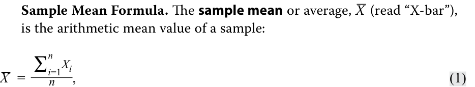
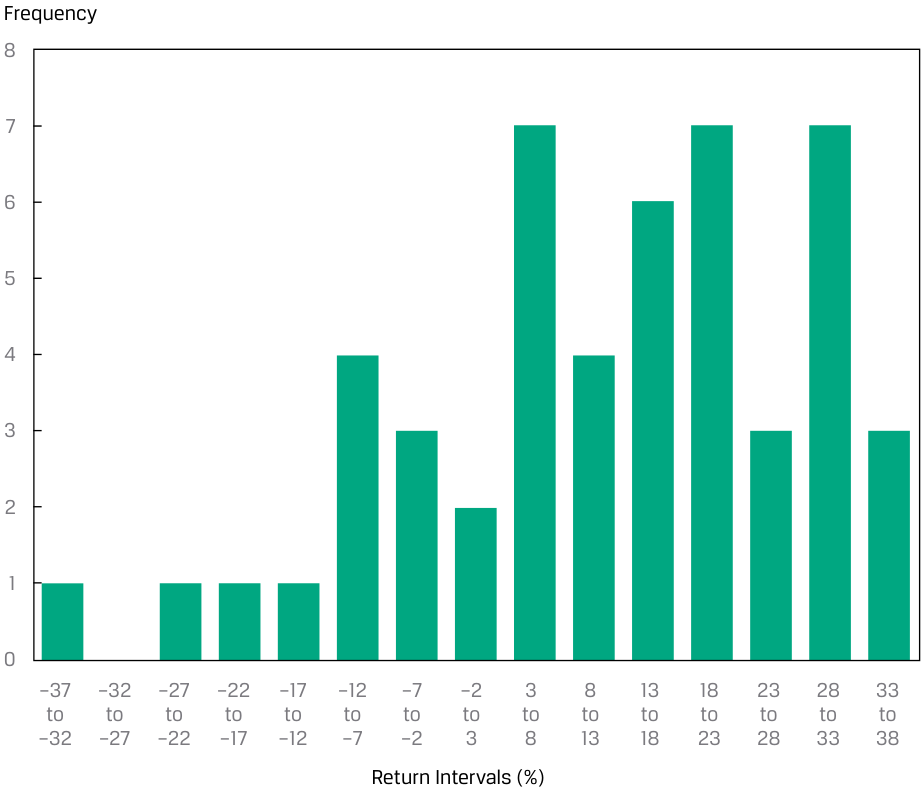
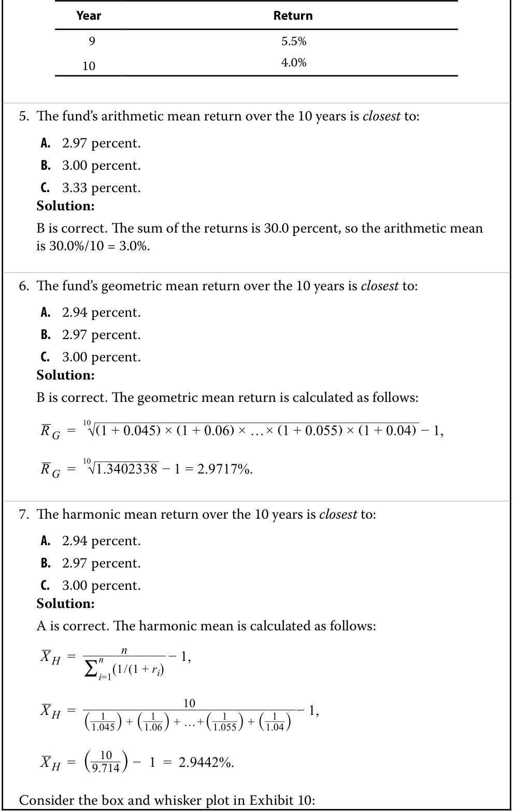

# Tập 1: Phương pháp Định lượng (*Quantitative Methods*)
## Học phần 3: Các thước đo Thống kê về Tỷ suất sinh lợi Tài sản (*Statistical Measures of Asset Returns*)
### Phần 1/4: Giới thiệu (Trang PDF 95–107)

---

<!-- PDF Page 95 -->

# H Ọ C P H Ầ N **<mark>3</mark>** 

### **Các thước đo Thống kê về Tỷ suất sinh lợi Tài sản (*Statistical Measures of Asset Returns*)** 

**Tác giả: Pamela Peterson Drake, PhD, CFA, và Wu Jian, PhD.** 

_Pamela Peterson Drake, PhD, CFA, công tác tại Đại học James Madison (Hoa Kỳ). Jian Wu, PhD, công tác tại State Street (Hoa Kỳ)._ 

|**MỤC TIÊU HỌC TẬP (*LEARNING OUTCOMES*)**||
|---|---|
|**_Mức độ thành thạo_**|**_Ứng viên cần có khả năng:_**|
||tính toán, diễn giải và đánh giá các thước đo xu hướng trung tâm (*measures of central tendency*) và vị trí (*location*) để giải quyết một bài toán đầu tư|
||tính toán, diễn giải và đánh giá các thước đo độ phân tán (*measures of dispersion*) để giải quyết một bài toán đầu tư|
||diễn giải và đánh giá các thước đo độ lệch (*skewness*) và độ nhọn (*kurtosis*) để giải quyết một bài toán đầu tư|
||diễn giải hệ số tương quan (*correlation*) giữa hai biến số để giải quyết một bài toán đầu tư|

#### **GIỚI THIỆU (*INTRODUCTION*)** 

**<mark>1</mark>** 

Dữ liệu luôn là yếu tố đầu vào then chốt cho việc phân tích chứng khoán và quản lý đầu tư, cho phép các nhà đầu tư khám phá và khai thác nguồn thông tin dồi dào cho các chiến lược đầu tư của mình. Mặc dù môi trường giàu dữ liệu này mang lại những cơ hội tiềm năng to lớn cho các nhà đầu tư, nhưng việc biến dữ liệu thành thông tin hữu ích lại không hề đơn giản. 

Học phần này cung cấp nền tảng để hiểu các khái niệm quan trọng, vốn là một phần không thể thiếu trong bộ công cụ phân tích cần thiết cho những người hành nghề đầu tư, từ các chuyên viên phân tích cấp thấp đến các nhà quản lý danh mục đầu tư cấp cao. Những khái niệm cơ bản này mở đường cho các công cụ phức tạp hơn sẽ được phát triển xuyên suốt chủ đề phương pháp định lượng, đóng vai trò thiết yếu để đạt được năng lực trong các kỹ thuật quản lý đầu tư và các loại tài sản được trình bày ở phần sau của chương trình CFA. 

Học phần này tập trung vào cách tóm tắt và phân tích các khía cạnh quan trọng của tỷ suất sinh lợi tài chính, bao gồm các thước đo chính về xu hướng trung tâm (*central tendency*), độ phân tán (*dispersion*), và hình dạng của phân phối tỷ suất sinh lợi—cụ thể là độ lệch (*skewness*) và độ nhọn (*kurtosis*). Học phần kết thúc bằng phần giới thiệu trực quan bằng đồ thị về hiệp phương sai (*covariance*) và hệ số tương quan (*correlation*) giữa hai biến số, một khái niệm then chốt trong việc xây dựng danh mục đầu tư nhằm đạt được sự đa dạng hóa giữa các tài sản trong danh mục. 

<!-- PDF Page 96 -->

###### **TỔNG QUAN HỌC PHẦN (*LEARNING MODULE OVERVIEW*)** 

- Các thống kê mẫu (*sample statistics*)—chẳng hạn như các thước đo xu hướng trung tâm, độ phân tán, độ lệch và độ nhọn—hỗ trợ việc phân tích đầu tư, đặc biệt là trong việc đưa ra các nhận định xác suất về tỷ suất sinh lợi. 

- Các thước đo xu hướng trung tâm bao gồm giá trị trung bình (*mean*), trung vị (*median*) và yếu vị (*mode*), giúp chỉ ra vị trí trung tâm của dữ liệu. 

- Trung bình cộng (*arithmetic mean*) là tổng các quan sát chia cho số lượng quan sát. Đây là thước đo xu hướng trung tâm được sử dụng thường xuyên nhất. 

- Trung vị (*median*) là giá trị của phần tử nằm ở chính giữa tập hợp các quan sát, hoặc là trung bình cộng của hai phần tử nằm ở giữa, khi các phần tử trong tập hợp được sắp xếp theo thứ tự tăng dần hoặc giảm dần. Vì trung vị không bị ảnh hưởng bởi các giá trị cực đoan (*extreme values*), nên nó hữu ích nhất trong trường hợp các phân phối bị lệch (*skewed distributions*). 

- Yếu vị (*mode*) là giá trị được quan sát thường xuyên nhất và là thước đo xu hướng trung tâm duy nhất có thể sử dụng với dữ liệu định danh (*nominal data*) hoặc dữ liệu phân loại (*categorical data*). Một phân phối có thể có một đỉnh (*unimodal* – một yếu vị), hai đỉnh (*bimodal* – hai yếu vị), ba đỉnh (*trimodal* – ba yếu vị), hoặc thậm chí nhiều yếu vị hơn. 

- Các phân vị (*quantiles*), chẳng hạn như trung vị (*median*), tứ phân vị (*quartiles*), ngũ phân vị (*quintiles*), thập phân vị (*deciles*) và bách phân vị (*percentiles*), là các tham số vị trí chia một phân phối thành các phần bằng nhau tương ứng là hai phần, bốn phần, năm phần, mười phần và một trăm phần. 

- Biểu đồ hộp và râu (*box and whiskers plot*) minh họa sự phân phối của một tập hợp các quan sát. Phần “hộp” (*box*) biểu thị khoảng tứ phân vị (*interquartile range*), tức là chênh lệch giữa tứ phân vị thứ nhất và tứ phân vị thứ ba. Phần “râu” (*whiskers*) bên ngoài “hộp” cho biết các thước đo độ phân tán khác. 

- Các thước đo độ phân tán (*dispersion measures*), chẳng hạn như khoảng biến thiên (*range*), độ lệch tuyệt đối trung bình (*mean absolute deviation* – MAD), phương sai (*variance*), độ lệch chuẩn (*standard deviation*), độ lệch dưới mục tiêu (*target downside deviation*), và hệ số biến thiên (*coefficient of variation*), mô tả mức độ biến thiên của các kết quả xung quanh giá trị trung bình cộng. 

- Khoảng biến thiên (*range*) là chênh lệch giữa giá trị lớn nhất và giá trị nhỏ nhất của tập dữ liệu. Khoảng biến thiên chỉ có tính hữu ích hạn chế vì nó chỉ sử dụng thông tin từ hai quan sát. 

- Độ lệch tuyệt đối trung bình (MAD) của một mẫu là trung bình cộng của các độ lệch tuyệt đối của các quan sát so với giá trị trung bình. 

- Phương sai (*variance*) là trung bình của các bình phương độ lệch xung quanh giá trị trung bình, và độ lệch chuẩn (*standard deviation*) là căn bậc hai dương của phương sai. Khi tính phương sai mẫu, $s^2$, và độ lệch chuẩn mẫu, $s$, bình phương độ lệch trung bình được tính bằng cách sử dụng mẫu số bằng kích thước mẫu trừ đi 1 ($n - 1$). 

- Độ lệch dưới mục tiêu (*target downside deviation*), hay bán độ lệch mục tiêu (*target semideviation*), là thước đo rủi ro khi kết quả thấp hơn một mức mục tiêu nhất định. 

- Hệ số biến thiên (*coefficient of variation* – CV) là tỷ số giữa độ lệch chuẩn của một tập hợp các quan sát với giá trị trung bình của chúng. Bằng cách biểu thị độ lớn của sự biến thiên giữa các quan sát tương ứng với quy mô trung bình của chúng, CV cho phép so sánh trực tiếp độ phân tán giữa các tập dữ liệu khác nhau. Phản ánh việc điều chỉnh theo quy mô, CV là một thước đo không phụ thuộc vào quy mô (*scale-free measure*), nghĩa là nó không có đơn vị đo lường. 

<!-- PDF Page 97 -->

- Độ lệch (*skewness*) mô tả mức độ bất đối xứng của một phân phối xung quanh giá trị trung bình của nó. Một phân phối tỷ suất sinh lợi tài sản có độ lệch dương (*positive skewness*) có nhiều khoản lỗ nhỏ thường xuyên và một vài khoản lãi cực lớn so với phân phối chuẩn (*normal distribution*). Một phân phối tỷ suất sinh lợi tài sản có độ lệch âm (*negative skewness*) có nhiều khoản lãi nhỏ thường xuyên và một vài khoản lỗ cực lớn so với phân phối chuẩn. Độ lệch bằng không cho thấy một phân phối tỷ suất sinh lợi đối xứng. 

- Độ nhọn (*kurtosis*) đo lường trọng lượng kết hợp của hai phần đuôi của một phân phối so với phần còn lại của phân phối đó. Một phân phối có đuôi dày hơn phân phối chuẩn được gọi là phân phối đuôi dày hay nhọn (*fat-tailed / leptokurtic*); một phân phối có đuôi mỏng hơn phân phối chuẩn được gọi là phân phối đuôi mỏng hay bẹt (*thin-tailed / platykurtic*). Độ nhọn của phân phối chuẩn bằng 3. 

- Hệ số tương quan (*correlation coefficient*) đo lường mối liên hệ giữa hai biến số. Đó là tỷ số giữa hiệp phương sai (*covariance*) với tích độ lệch chuẩn của hai biến số đó. Hệ số tương quan dương cho biết hai biến số có xu hướng biến động cùng chiều, trong khi hệ số âm cho biết hai biến số có xu hướng biến động ngược chiều. Tương quan không hàm ý quan hệ nhân quả (*causation*), mà chỉ đơn thuần là sự liên kết (*association*). Các vấn đề phát sinh khi đánh giá tương quan bao gồm sự hiện diện của các giá trị ngoại lai (*outliers*) và tương quan giả mạo (*spurious correlation*). 

#### **CÁC THƯỚC ĐO XU HƯỚNG TRUNG TÂM VÀ VỊ TRÍ (*MEASURES OF CENTRAL TENDENCY AND LOCATION*)** 

## **<mark>2</mark>** 

tính toán, diễn giải và đánh giá các thước đo xu hướng trung tâm và vị trí để giải quyết một bài toán đầu tư 

Trong bài học này, trọng tâm của chúng ta là các thước đo xu hướng trung tâm và các thước đo vị trí khác. Một **thước đo xu hướng trung tâm (*measure of central tendency*)** chỉ ra nơi dữ liệu tập trung. Đối với một chuỗi tỷ suất sinh lợi, thước đo xu hướng trung tâm cho thấy nơi phân phối thực nghiệm của tỷ suất sinh lợi tập trung, về bản chất là một thước đo tỷ suất sinh lợi “kỳ vọng” dựa trên mẫu quan sát được. **Các thước đo vị trí (*measures of location*)**, bao gồm giá trị trung bình (*mean*), **trung vị (*median*)**, và **yếu vị (*mode*)**, không chỉ bao gồm các thước đo xu hướng trung tâm mà còn cả các thước đo khác minh họa những khía cạnh khác về vị trí hoặc sự phân phối của dữ liệu. 

Phân phối tần số (*frequency distributions*), biểu đồ tần số (*histograms*), và bảng ngẫu nhiên (*contingency tables*) cung cấp một cách thuận tiện để tóm tắt một chuỗi các quan sát về tỷ suất sinh lợi của một tài sản như một bước đầu tiên hướng tới việc mô tả dữ liệu. Ví dụ, biểu đồ tần số cho phân phối tần số của tỷ suất sinh lợi hàng ngày đối với Chỉ số Cổ phiếu EAA (EAA Equity Index) giả định trong năm năm qua được thể hiện trong Bảng minh họa 1 (Exhibit 1). 

<!-- PDF Page 98 -->

**Bảng minh họa 1: Biểu đồ tần số Tỷ suất sinh lợi Hàng ngày của Chỉ số Cổ phiếu EAA (*Histogram of Daily Returns on the EAA Equity Index*)** 

<!-- Picture Text: Number of Observations 600 500 470 493 400 300 200 122 94 100 37 27 5 7 1 1 1 0 –4.1 to –3.3 to –2.5 to –1.6 to –0.8 to 0 to 0.9 to 1.7 to 2.5 to 3.3 to 4.2 to –3.3 –2.5 –1.6 –0.8 0 0.9 1.7 2.5 3.3 4.2 5.0 Daily Return Range (%)  -->

> **Chú thích hình ảnh:**
> - **Trục tung:** Số lượng quan sát (*Number of Observations*) từ 0 đến 600.
> - **Trục hoành:** Khoảng tỷ suất sinh lợi hàng ngày (*Daily Return Range (%)*) từ –4.1 đến 5.0.

##### **Các thước đo Xu hướng Trung tâm (*Measures of Central Tendency*)** 

###### **_Trung bình cộng (*The Arithmetic Mean*)_** 

Các chuyên viên phân tích và nhà quản lý danh mục đầu tư thường muốn có một con số duy nhất mô tả kết quả đại diện có thể xảy ra của một quyết định đầu tư. Trung bình cộng là một trong những thước đo xu hướng trung tâm được sử dụng thường xuyên nhất. 

**Trung bình cộng (*Arithmetic Mean*).** **Trung bình cộng (*arithmetic mean*)** là tổng giá trị của các quan sát trong một tập dữ liệu chia cho số lượng các quan sát. 

###### **_Trung bình mẫu (*The Sample Mean*)_** 

Trung bình mẫu là trung bình cộng được tính cho một mẫu. 

<!-- Formula Text: Sample Mean Formula. The sample mean or average,  _ X  (read “X-bar”), is the arithmetic mean value of a sample: _ X   = ∑ i=1 n X i _ n , (1) -->

$$\bar{X} = \frac{\sum_{i=1}^{n} X_i}{n} \tag{1}$$

trong đó $\bar{X}$ (đọc là “X-ngang” / *“X-bar”*) là giá trị trung bình cộng của một mẫu, và $n$ là số lượng quan sát trong mẫu. 

Một đặc tính và cũng là nhược điểm tiềm ẩn của trung bình cộng là sự nhạy cảm của nó với các giá trị cực đoan, hay các giá trị ngoại lai (*outliers*). Bởi vì tất cả các quan sát đều được sử dụng để tính giá trị trung bình và được gán trọng số (tức mức độ quan trọng) bằng nhau, nên trung bình cộng có thể bị kéo tăng vọt lên hoặc giảm mạnh xuống bởi các quan sát cực lớn hoặc cực nhỏ tương ứng. Cách tiếp cận phổ biến nhất trong tình huống này là báo cáo giá trị trung vị (*median*), hay giá trị ở giữa, để thay thế hoặc bổ sung cho giá trị trung bình. 

###### **_Trung vị (*The Median*)_** 

Một thước đo quan trọng thứ hai của xu hướng trung tâm là trung vị. 

**Định nghĩa Trung vị (*Definition of Median*).** Trung vị là giá trị của phần tử nằm ở chính giữa của một tập dữ liệu đã được sắp xếp theo thứ tự tăng dần hoặc giảm dần. Trong một mẫu có số lượng quan sát $n$ là số lẻ, trung vị là giá trị của 

<!-- PDF Page 99 -->

quan sát chiếm vị trí thứ $(n + 1)/2$. Trong một mẫu có số lượng quan sát là số chẵn, chúng ta định nghĩa trung vị là trung bình cộng của giá trị các quan sát chiếm vị trí thứ $n/2$ và $(n + 2)/2$ (hai quan sát nằm ở chính giữa). 

Cho dù chúng ta sử dụng phép tính cho mẫu có số lượng chẵn hay lẻ, luôn có một số lượng quan sát bằng nhau nằm phía trên và phía dưới trung vị. Một phân phối chỉ có duy nhất một trung vị. Một ưu điểm tiềm năng của trung vị là, không giống như trung bình cộng, các giá trị ngoại lai không làm ảnh hưởng đến nó. 

Tuy nhiên, trung vị không sử dụng toàn bộ thông tin về độ lớn của các quan sát; nó chỉ tập trung vào vị trí tương đối của các quan sát đã được xếp hạng. Việc tính toán trung vị cũng có thể phức tạp hơn. Các nhà toán học diễn đạt nhược điểm này bằng cách nói rằng trung vị khó xử lý về mặt toán học (*less mathematically tractable*) hơn so với giá trị trung bình. 

###### **_Yếu vị (*The Mode*)_** 

Một thước đo quan trọng thứ ba của xu hướng trung tâm là yếu vị. 

**Định nghĩa Yếu vị (*Definition of Mode*).** Yếu vị là giá trị xuất hiện thường xuyên nhất trong một tập dữ liệu. Một tập dữ liệu có thể có nhiều hơn một yếu vị, hoặc thậm chí không có yếu vị nào. Khi một tập dữ liệu có một giá trị duy nhất được quan sát thường xuyên nhất, phân phối của nó được gọi là **phân phối một đỉnh (*unimodal*)**. Nếu một tập dữ liệu có hai giá trị xuất hiện thường xuyên nhất ngang nhau, thì nó có hai yếu vị và phân phối của nó được gọi là **phân phối hai đỉnh (*bimodal*)**. Khi tất cả các giá trị trong một tập dữ liệu đều khác nhau, phân phối đó không có yếu vị vì không có giá trị nào xuất hiện thường xuyên hơn bất kỳ giá trị nào khác. 

Dữ liệu tỷ suất sinh lợi cổ phiếu và các dữ liệu khác từ các phân phối liên tục (*continuous distributions*) có thể không có một kết quả yếu vị riêng lẻ. Bảng minh họa 2 trình bày phân phối tần số của tỷ suất sinh lợi hàng ngày đối với Chỉ số Cổ phiếu EAA trong năm năm qua. 

**Bảng minh họa 2: Phân phối Tần số cho Tỷ suất sinh lợi Hàng ngày của Chỉ số Cổ phiếu EAA (*Frequency Distribution for Daily Returns of EAA Equity Index*)** 

|**Khoảng tỷ suất sinh lợi (*Return Bin*) (%)**|**Tần số tuyệt đối (*Absolute Frequency*)**|**Tần số tương đối (*Relative Frequency*) (%)**|**Tần số tuyệt đối tích lũy (*Cumulative Absolute Frequency*)**|**Tần số tương đối tích lũy (*Cumulative Relative Frequency*) (%)**|
|---|---|---|---|---|
|−5.0 đến −4.0|1|0.08|1|0.08|
|−4.0 đến −3.0|7|0.56|8|0.64|
|−3.0 đến −2.0|23|1.83|31|2.46|
|−2.0 đến −1.0|77|6.12|108|8.59|
|−1.0 đến 0.0|470|37.36|578|45.95|
|0.0 đến 1.0|555|44.12|1,133|90.06|
|1.0 đến 2.0|110|8.74|1,243|98.81|
|2.0 đến 3.0|13|1.03|1,256|99.84|
|3.0 đến 4.0|1|0.08|1,257|99.92|
|4.0 đến 5.0|1|0.08|1,258|100.00|

Biểu đồ tần số cho phân phối tần số của các tỷ suất sinh lợi hàng ngày này đã được thể hiện trong Bảng minh họa 1. Khoảng yếu vị (*modal interval*) luôn có cột cao nhất trong biểu đồ tần số; trong trường hợp này, khoảng yếu vị là từ 0.0 đến 1.0 phần trăm, và khoảng này có 555 quan sát trên tổng số 1,258 quan sát. 

<!-- PDF Page 100 -->

##### **Xử lý các Giá trị Ngoại lai (*Dealing with Outliers*)** 

Trong thực tế, mặc dù một giá trị cực đoan hay giá trị ngoại lai (*outlier*) trong một tập dữ liệu tài chính có thể đại diện cho một giá trị hiếm gặp trong tổng thể, nhưng nó cũng có thể phản ánh một sai sót trong việc ghi chép giá trị của một quan sát hoặc một quan sát được tạo ra từ một tổng thể khác. Sau khi đã kiểm tra và loại bỏ các sai sót, chúng ta có thể giải quyết vấn đề cần làm gì với các giá trị cực đoan trong mẫu. 

Khi xử lý một mẫu có các giá trị cực đoan, có thể có khả năng biến đổi biến số (ví dụ: biến đổi logarit) hoặc chọn một biến số khác đạt được cùng mục đích. Tuy nhiên, nếu các dạng thức mô hình thay thế hoặc việc biến đổi biến số là không khả thi, thì có ba lựa chọn để xử lý các giá trị cực đoan: 

Lựa chọn 1 Không làm gì cả; sử dụng dữ liệu mà không có bất kỳ sự điều chỉnh nào. 

Lựa chọn 2 Xóa bỏ tất cả các giá trị ngoại lai. 

Lựa chọn 3 Thay thế các giá trị ngoại lai bằng một giá trị khác. 

Lựa chọn đầu tiên là phù hợp nếu các giá trị đó là những quan sát hợp lệ, chính xác, và việc phản ánh toàn bộ phân phối mẫu là rất quan trọng. Bởi vì các giá trị ngoại lai có thể chứa đựng thông tin có ý nghĩa, việc loại trừ hoặc thay đổi các giá trị này có thể làm giảm bớt thông tin có giá trị. Hơn nữa, vì việc xác định một điểm dữ liệu là cực đoan phụ thuộc vào phán đoán của chuyên viên phân tích, nên việc giữ lại tất cả các quan sát sẽ loại bỏ nhu cầu phải phán đoán xem một giá trị có phải là cực đoan hay không. 

Lựa chọn thứ hai loại trừ các quan sát cực đoan. Một thước đo xu hướng trung tâm trong trường hợp này là **trung bình cắt bỏ (*trimmed mean*)**, tức là tính trung bình cộng sau khi đã loại trừ một tỷ lệ phần trăm nhỏ nhất định các giá trị thấp nhất và cao nhất. Ví dụ, một trung bình cắt bỏ 5 phần trăm sẽ loại bỏ 2.5 phần trăm giá trị thấp nhất và 2.5 phần trăm giá trị cao nhất, rồi tính trung bình của 95 phần trăm giá trị còn lại. Trung bình cắt bỏ được sử dụng trong các cuộc thi đấu thể thao khi điểm số thấp nhất và cao nhất của các giám khảo bị loại bỏ khi tính điểm cho một thí sinh. 

Lựa chọn thứ ba liên quan đến việc thay thế các giá trị khác cho các giá trị cực đoan. Một thước đo xu hướng trung tâm trong trường hợp này là **trung bình Winsor (*winsorized mean*)**. Nó được tính sau khi gán một giá trị thấp xác định cho một tỷ lệ phần trăm nhất định các giá trị thấp nhất trong tập dữ liệu và một giá trị cao xác định cho một tỷ lệ phần trăm nhất định các giá trị cao nhất trong tập dữ liệu. Ví dụ, trung bình Winsor 95 phần trăm sẽ đặt 2.5 phần trăm giá trị thấp nhất trong tập dữ liệu bằng với giá trị mà tại đó hoặc thấp hơn đó có 2.5 phần trăm tổng số các giá trị nằm (như sẽ thấy ngay sau đây, giá trị này được gọi là giá trị “bách phân vị thứ 2.5” – *“2.5th percentile”*), và đặt 2.5 phần trăm giá trị cao nhất trong tập dữ liệu bằng với giá trị mà tại đó hoặc thấp hơn đó có 97.5 phần trăm tổng số các giá trị nằm (giá trị “bách phân vị thứ 97.5” – *“97.5th percentile”*). 

Thông thường, việc so sánh các thước đo thống kê của các tập dữ liệu khi bao gồm các giá trị ngoại lai và khi loại trừ các giá trị ngoại lai có thể hé lộ những hiểu biết quan trọng về tập dữ liệu đó. Sự so sánh như vậy có thể đặc biệt hữu ích khi các nhà đầu tư phân tích hành vi của tỷ suất sinh lợi tài sản cũng như những thay đổi về lãi suất, giá cả, chênh lệch (*spread*) và khối lượng giao dịch. 

Trong Ví dụ 1, chúng ta chỉ ra sự khác biệt giữa các lựa chọn xử lý giá trị ngoại lai này bằng cách sử dụng tỷ suất sinh lợi hàng ngày của Chỉ số Cổ phiếu Âu-Á-Phi (Euro-Asia-Africa – EAA) giả định trong Bảng minh họa 2. 

###### **VÍ DỤ 1** 

##### **Xử lý các Giá trị Ngoại lai: Tỷ suất sinh lợi Hàng ngày của một Chỉ số (*Handling Outliers: Daily Returns to an Index*)** 

Sử dụng tỷ suất sinh lợi hàng ngày của Chỉ số Cổ phiếu EAA trong năm năm qua, bao gồm 1,258 ngày giao dịch, chúng ta có thể thấy tác động của việc cắt bỏ (*trimming*) và chuẩn hóa Winsor (*winsorizing*) dữ liệu: 

<!-- PDF Page 101 -->

**Bảng minh họa 3: Tác động của việc Cắt bỏ và Chuẩn hóa Winsor (*Effect of Trimming and Winsorizing*)** 

||**Trung bình cộng (*Arithmetic Mean*)**|**Trung bình cắt bỏ (*Trimmed Mean*) (Cắt bỏ 5%)**|**Trung bình Winsor (*Winsorized Mean*) (95%)**|
|---|---|---|---|
|Giá trị trung bình (*Mean*)|0.035%|0.048%|0.038%|
|Số lượng quan sát (*Number of Observations*)|1,258|1,194|1,258|

Trung bình cắt bỏ loại bỏ 2.5 phần trăm tỷ suất sinh lợi thấp nhất, trong mẫu này là bất kỳ tỷ suất sinh lợi hàng ngày nào nhỏ hơn −1.934 phần trăm, và loại bỏ 2.5 phần trăm cao nhất, trong mẫu này là bất kỳ tỷ suất sinh lợi hàng ngày nào lớn hơn 1.671 phần trăm. Kết quả của việc cắt bỏ này là giá trị trung bình được tính bằng cách sử dụng 1,194 quan sát thay vì 1,258 quan sát của mẫu ban đầu. 

Trung bình Winsor thay thế mức tỷ suất sinh lợi −1.934 phần trăm (giá trị bách phân vị thứ 2.5) cho bất kỳ quan sát nào dưới −1.934 và thay thế mức tỷ suất sinh lợi 1.671 phần trăm (giá trị bách phân vị thứ 97.5) cho bất kỳ quan sát nào trên 1.671. Kết quả trong trường hợp này là trung bình cắt bỏ và trung bình Winsor đều cao hơn trung bình cộng, cho thấy bằng chứng tiềm năng về sự xuất hiện của các mức tỷ suất sinh lợi âm đáng kể trong phân phối tỷ suất sinh lợi hàng ngày quan sát được. 

##### **Các thước đo Vị trí (*Measures of Location*)** 

Sau khi đã thảo luận về các thước đo xu hướng trung tâm, bây giờ chúng ta xem xét một cách tiếp cận để mô tả vị trí của dữ liệu liên quan đến việc xác định các giá trị mà tại đó hoặc thấp hơn đó có những tỷ lệ xác định của dữ liệu nằm. Ví dụ, việc xác định các mức mà dưới đó có 25 phần trăm, 50 phần trăm, và 75 phần trăm tỷ suất sinh lợi hàng năm của một danh mục đầu tư sẽ cung cấp thông tin ngắn gọn, súc tích về sự phân phối tỷ suất sinh lợi của danh mục. Các nhà thống kê sử dụng từ **phân vị (*quantile*)** làm thuật ngữ chung nhất cho một giá trị mà tại đó hoặc thấp hơn đó có một tỷ lệ xác định của dữ liệu nằm. Trong phần tiếp theo, chúng ta mô tả các phân vị được sử dụng phổ biến nhất—tứ phân vị (*quartiles*), ngũ phân vị (*quintiles*), thập phân vị (*deciles*), và bách phân vị (*percentiles*)—cùng ứng dụng của chúng trong đầu tư. 

###### **_Tứ phân vị, Ngũ phân vị, Thập phân vị và Bách phân vị (*Quartiles, Quintiles, Deciles, and Percentiles*)_** 

Chúng ta biết rằng trung vị chia một phân phối dữ liệu thành hai nửa. Chúng ta có thể định nghĩa các đường phân chia khác để tách phân phối thành các kích thước nhỏ hơn. **Tứ phân vị (*Quartiles*)** chia phân phối thành bốn phần bằng nhau, **ngũ phân vị (*quintiles*)** thành năm phần, **thập phân vị (*deciles*)** thành mười phần, và **bách phân vị (*percentiles*)** thành một trăm phần. **Khoảng tứ phân vị (*interquartile range* – IQR)** là chênh lệch giữa tứ phân vị thứ ba và tứ phân vị thứ nhất, hay $\text{IQR} = Q_3 - Q_1$. 

Ví dụ 2 minh họa cách tính các phân vị khác nhau đối với tỷ suất sinh lợi hàng ngày của Chỉ số Cổ phiếu EAA. 

###### **VÍ DỤ 2** 

##### **Bách phân vị, Ngũ phân vị và Tứ phân vị cho Chỉ số Cổ phiếu EAA (*Percentiles, Quintiles, and Quartiles for the EAA Equity Index*)** 

Sử dụng tỷ suất sinh lợi hàng ngày của Chỉ số Cổ phiếu EAA trong năm năm qua và xếp hạng chúng từ tỷ suất sinh lợi hàng ngày thấp nhất đến cao nhất, chúng ta thể hiện các khoảng tỷ suất sinh lợi (*return bins*) từ 1 (5 phần trăm thấp nhất) đến 20 (5 phần trăm cao nhất) như sau: 

<!-- PDF Page 102 -->

**Bảng minh họa 4: Tỷ suất sinh lợi Hàng ngày của Chỉ số Cổ phiếu EAA được Nhóm theo Độ lớn của Tỷ suất sinh lợi (*EAA Equity Index Daily Returns Grouped by Size of Return*)** 

|**Khoảng (*Bin*)**|**Tỷ lệ phần trăm tích lũy của số ngày giao dịch mẫu (*Cumulative Percentage of Sample Trading Days*) (%)**|**Tỷ suất sinh lợi hàng ngày (%) Cận dưới (*Lower Bound*)**|**Tỷ suất sinh lợi hàng ngày (%) Cận trên (*Upper Bound*)**|**Số lượng quan sát (*Number of Observations*)**|
|---|---|---|---|---|
|1|5|−4.108|−1.416|63|
|2|10|−1.416|−0.876|63|
|3|15|−0.876|−0.629|63|
|4|20|−0.629|−0.432|63|
|5|25|−0.432|−0.293|63|
|6|30|−0.293|−0.193|63|
|7|35|−0.193|−0.124|62|
|8|40|−0.124|−0.070|63|
|9|45|−0.070|−0.007|63|
|10|50|−0.007|0.044|63|
|11|55|0.044|0.108|63|
|12|60|0.108|0.173|63|
|13|65|0.173|0.247|63|
|14|70|0.247|0.343|62|
|15|75|0.343|0.460|63|
|16|80|0.460|0.575|63|
|17|85|0.575|0.738|63|
|18|90|0.738|0.991|63|
|19|95|0.991|1.304|63|
|20|100|1.304|5.001|63|

Do bản chất liên tục của tỷ suất sinh lợi, rất ít khả năng một mức tỷ suất sinh lợi rơi đúng vào ranh giới của bất kỳ khoảng (*bin*) nào ngoài mức tối thiểu (Bin = 1) và mức tối đa (Bin = 20). 

Sử dụng dữ liệu trong Bảng minh họa 4, hãy hoàn thành các yêu cầu sau: 

1. Xác định bách phân vị thứ 10 và thứ 90 (*10th and 90th percentiles*). 

###### **Lời giải:** 

Bách phân vị thứ 10 và thứ 90 tương ứng với các khoảng hoặc các mức tỷ suất sinh lợi đã xếp hạng bao gồm lần lượt 10 phần trăm và 90 phần trăm tỷ suất sinh lợi hàng ngày. Bách phân vị thứ 10 tương ứng với mức tỷ suất sinh lợi −0.876 phần trăm (và bao gồm các mức tỷ suất sinh lợi bằng hoặc thấp hơn mức đó), và bách phân vị thứ 90 tương ứng với mức tỷ suất sinh lợi 0.991 phần trăm (và thấp hơn). 

2. Xác định ngũ phân vị thứ nhất, thứ hai và thứ ba (*first, second, and third quintiles*). 

###### **Lời giải:** 

Ngũ phân vị thứ nhất tương ứng với 20 phần trăm thấp nhất của dữ liệu đã xếp hạng, tức là −0.432 phần trăm (và thấp hơn). Ngũ phân vị thứ hai tương ứng với 40 phần trăm thấp nhất của dữ liệu đã xếp hạng, tức là −0.070 phần trăm (và thấp hơn). 

Ngũ phân vị thứ ba tương ứng với 60 phần trăm thấp nhất của dữ liệu đã xếp hạng, tức là 0.173 phần trăm (và thấp hơn). 

<!-- PDF Page 103 -->

3. Xác định tứ phân vị thứ nhất và thứ ba (*first and third quartiles*). 

###### **Lời giải:** 

Tứ phân vị thứ nhất tương ứng với 25 phần trăm thấp nhất của dữ liệu đã xếp hạng, tức là −0.293 phần trăm (và thấp hơn). Tứ phân vị thứ ba tương ứng với 75 phần trăm thấp nhất của dữ liệu đã xếp hạng, tức là 0.460 phần trăm (và thấp hơn). 

4. Xác định trung vị (*median*). 

###### **Lời giải:** 

Trung vị là mức tỷ suất sinh lợi mà có 50 phần trăm dữ liệu nằm ở mỗi phía, tức là 0.044 phần trăm, mức tỷ suất sinh lợi hàng ngày cao nhất trong khoảng thứ 10 trên tổng số 20 khoảng. 

5. Tính khoảng tứ phân vị (*interquartile range*). 

###### **Lời giải:** 

Khoảng tứ phân vị là chênh lệch giữa tứ phân vị thứ ba và tứ phân vị thứ nhất, tức 0.460 phần trăm và −0.293 phần trăm, bằng 0.753 phần trăm ($0.460\% - (-0.293\%) = 0.753\%$). 

Một cách để trực quan hóa độ phân tán của dữ liệu qua các tứ phân vị là sử dụng sơ đồ, chẳng hạn như biểu đồ hộp và râu. Một **biểu đồ hộp và râu (*box and whisker plot*)** được thể hiện trong Bảng minh họa 5. Phần “hộp” (*box*) đại diện cho cận dưới của tứ phân vị thứ hai và cận trên của tứ phân vị thứ ba, với trung vị hoặc trung bình cộng được đánh dấu như một thước đo xu hướng trung tâm của toàn bộ phân phối. Phần “râu” (*whiskers*) là các đường thẳng chạy ra từ hộp và được giới hạn bởi các “hàng rào” (*fences*), đại diện cho các giá trị thấp nhất và cao nhất của phân phối. 

**Bảng minh họa 5: Biểu đồ Hộp và Râu (*Box and Whisker Plot*)** 

<!-- Picture Text: Highest Value Upper Boundary for  Q 3 Interquartile Median Range × Arithmetic Average Lowest Boundary for  Q 2 Lowest Value  -->

> **Chú thích hình ảnh:**
> - **Highest Value:** Giá trị cao nhất
> - **Upper Boundary for $Q_3$:** Cận trên của $Q_3$
> - **Interquartile Range:** Khoảng tứ phân vị
> - **Median:** Trung vị
> - **$\times$ Arithmetic Average:** Trung bình cộng
> - **Lowest Boundary for $Q_2$:** Cận dưới của $Q_2$ (tức $Q_1$)
> - **Lowest Value:** Giá trị thấp nhất

Có một số biến thể đối với cách hiển thị biểu đồ hộp và râu. Ví dụ, để dễ dàng phát hiện các giá trị ngoại lai tiềm ẩn, các hàng rào (*fences*) của phần râu có thể là một hàm số của khoảng tứ phân vị thay vì các giá trị cao nhất và thấp nhất như trong Bảng minh họa 5. 

Trong Bảng minh họa 5, xét về mặt trực quan, khoảng tứ phân vị là chiều cao của hộp và các hàng rào được đặt ở các giá trị cực trị. Nhưng một dạng khác của biểu đồ hộp và râu thường sử dụng 1.5 lần khoảng tứ phân vị cho các hàng rào. Do đó, hàng rào trên (*upper fence*) bằng 1.5 lần khoảng tứ phân vị cộng vào cận trên của $Q_3$, và hàng rào dưới (*lower fence*) bằng 1.5 lần khoảng tứ phân vị trừ đi khỏi cận dưới của $Q_2$. Các quan sát nằm ngoài các hàng rào (tức là các giá trị ngoại lai) cũng có thể được hiển thị. 

Chúng ta có thể thấy vai trò của các giá trị ngoại lai trong một biểu đồ hộp và râu như vậy khi sử dụng tỷ suất sinh lợi hàng ngày của Chỉ số Cổ phiếu EAA, như được thể hiện trong Bảng minh họa 6. 

<!-- PDF Page 104 -->

###### **Bảng minh họa 6: Biểu đồ Hộp và Râu cho Tỷ suất sinh lợi Hàng ngày của Chỉ số Cổ phiếu EAA (*Box and Whisker Chart for EAA Equity Index Daily Returns*)** 

<!-- Picture Text: Daily Return (%) 6 5 Maximum of 5.001% 4 3 2 ( Q 3 Upper  1.589% (Upper Fence) 1 Bound) 0.460% Median of 0 ( Q 2 Lower 0.044% –1 Bound) –1.422% –2 –0.293% (Lower Fence) –3 –4 Minimum of –4.108% –5  -->

> **Chú thích hình ảnh:**
> - **Daily Return (%):** Tỷ suất sinh lợi hàng ngày (%)
> - **Maximum of 5.001%:** Giá trị tối đa 5.001%
> - **1.589% (Upper Fence):** 1.589% (Hàng rào trên)
> - **($Q_3$ Upper Bound) 0.460%:** (Cận trên $Q_3$) 0.460%
> - **Median of 0.044%:** Trung vị 0.044%
> - **($Q_2$ Lower Bound) –0.293%:** (Cận dưới $Q_2$) –0.293%
> - **–1.422% (Lower Fence):** –1.422% (Hàng rào dưới)
> - **Minimum of –4.108%:** Giá trị tối thiểu –4.108%

Bảng minh họa 6 cho thấy những điều sau: 

- Giá trị tối đa và tối thiểu của phân phối lần lượt là 5.001 và −4.108, trong khi giá trị trung vị (bách phân vị thứ 50) là 0.044. 

- Khoảng tứ phân vị là $0.753$ [$= 0.460 - (-0.293)$], và khi nhân với 1.5 rồi cộng vào cận trên $Q_3$ là 0.460 sẽ cho ra hàng rào trên là $1.589$ [$= (1.5 \times 0.753) + 0.460$]. 

- Hàng rào dưới được xác định theo cách tương tự, sử dụng cận dưới $Q_2$, là $-1.422$ [$= -(1.5 \times 0.753) + (-0.293)$]. 

Như đã lưu ý, bất kỳ quan sát nào nằm trên (dưới) hàng rào trên (hàng rào dưới) đều được coi là một giá trị ngoại lai (*outlier*). 

###### **_Các Phân vị trong Thực tiễn Đầu tư (*Quantiles in Investment Practice*)_** 

Các phân vị được sử dụng trong việc đánh giá hiệu quả hoạt động của danh mục đầu tư cũng như trong việc phát triển và nghiên cứu chiến lược đầu tư. 

Các chuyên viên phân tích đầu tư sử dụng các phân vị để xếp hạng hiệu quả hoạt động, chẳng hạn như hiệu quả của các tài sản, chỉ số và danh mục đầu tư. Hiệu quả hoạt động của các nhà quản lý đầu tư thường được mô tả theo bách phân vị mà hiệu quả của họ rơi vào so với hiệu quả của nhóm các nhà quản lý đồng cấp (*peer group*). Ví dụ, hệ thống xếp hạng sao quỹ đầu tư của Morningstar được sử dụng rộng rãi đã gắn số lượng sao với các bách phân vị của các chỉ số đo lường hiệu quả so với các quỹ đầu tư có cùng phong cách. 

Một ứng dụng quan trọng khác của các phân vị là trong nghiên cứu đầu tư. Việc chia dữ liệu thành các phân vị dựa trên một đặc tính cụ thể có thể định lượng khách quan—chẳng hạn như doanh thu, giá trị vốn hóa thị trường (*market capitalization*), hoặc quy mô tài sản—cho phép các chuyên viên phân tích đánh giá tác động của đặc tính cụ thể đó lên một đại lượng quan tâm, chẳng hạn như tỷ suất sinh lợi tài sản, doanh thu, tăng trưởng, hoặc các chỉ số định giá. Chẳng hạn, các nhà đầu tư định lượng thường xếp hạng các công ty dựa trên giá trị thị trường của vốn chủ sở hữu, hay giá trị vốn hóa thị trường của chúng, trước khi phân loại chúng thành các thập phân vị (*deciles*). Thập phân vị thứ nhất chứa danh mục các công ty có giá trị thị trường nhỏ nhất, thường được gọi là các công ty vốn hóa nhỏ (*small capitalization companies*). Thập phân vị thứ mười chứa các công ty có giá trị thị trường lớn nhất, thường được gọi là các công ty vốn hóa lớn (*large capitalization companies*). Việc xếp hạng các công ty theo thập phân vị cho phép các chuyên viên phân tích so sánh hiệu quả hoạt động tuyệt đối và tương đối của các công ty vốn hóa nhỏ so với các công ty vốn hóa lớn. 

<!-- PDF Page 105 -->

###### **BỘ CÂU HỎI (*QUESTION SET*)** 

Biểu đồ tần số trong Bảng minh họa 7 cho thấy phân phối tỷ suất sinh lợi hàng năm của Chỉ số S&P 500 trong giai đoạn 50 năm. 

###### **Bảng minh họa 7: Tỷ suất sinh lợi Hàng năm của Chỉ số S&P 500 (*Annual Returns for the S&P 500 Index*)** 

<!-- Picture Text: Frequency 8 7 6 5 4 3 2 1 0 –37 –32 –27 –22 –17 –12 –7 –2 3 8 13 18 23 28 33 to to to to to to to to to to to to to to to –32 –27 –22 –17 –12 –7 –2 3 8 13 18 23 28 33 38 Return Intervals (%)  -->

> **Chú thích hình ảnh:**
> - **Trục tung:** Tần số (*Frequency*) từ 0 đến 8.
> - **Trục hoành:** Các khoảng tỷ suất sinh lợi (*Return Intervals (%)*) từ –37 đến 38.

1. Khoảng (*bin*) chứa tỷ suất sinh lợi trung vị (*median return*) là: 

   - **A.** 3 phần trăm đến 8 phần trăm. 

   - **B.** 8 phần trăm đến 13 phần trăm. 

   - **C.** 13 phần trăm đến 18 phần trăm. 

   - **Lời giải:** 

C là đáp án đúng. Bởi vì có 50 điểm dữ liệu trong biểu đồ tần số, tỷ suất sinh lợi trung vị sẽ là trung bình cộng của vị trí thứ $50/2 = 25$ và vị trí thứ $(50 + 2)/2 = 26$. Tổng tần số của các khoảng tỷ suất sinh lợi nằm bên trái khoảng từ 13 phần trăm đến 18 phần trăm là 24. Do đó, mức tỷ suất sinh lợi thứ 25 và 26 sẽ rơi vào khoảng từ 13 phần trăm đến 18 phần trăm. 

2. Dựa vào Bảng minh họa 7, phân phối này được mô tả _đúng nhất_ là: 

   - **A.** một đỉnh (*unimodal*). 

   - **B.** hai đỉnh (*bimodal*). 

   - **C.** ba đỉnh (*trimodal*). 

###### **Lời giải:** 

C là đáp án đúng. Yếu vị (*mode*) của một phân phối có dữ liệu được nhóm theo các khoảng là khoảng có tần số cao nhất. Cả ba khoảng từ 3 phần trăm đến 8 

<!-- PDF Page 106 -->

phần trăm, 18 phần trăm đến 23 phần trăm, và 28 phần trăm đến 33 phần trăm đều có tần số cao nhất là 7. 

Hãy xem xét tỷ suất sinh lợi hàng năm trong Bảng minh họa 8 của ba danh mục đầu tư P, Q và R. Danh mục P và R được tạo ra vào Năm 1, Danh mục Q được tạo ra vào Năm 2. 

**Bảng minh họa 8: Tỷ suất sinh lợi Hàng năm của Danh mục đầu tư (*Annual Portfolio Returns*)** 

||**Năm 1 (%)**|**Năm 2 (%)**|**Năm 3 (%)**|**Năm 4 (%)**|**Năm 5 (%)**|
|---|---|---|---|---|---|
|Danh mục P|−3.0|4.0|5.0|3.0|7.0|
|Danh mục Q|NA|−3.0|6.0|4.0|8.0|
|Danh mục R|1.0|−1.0|4.0|4.0|3.0|

3. Tỷ suất sinh lợi hàng năm trung vị (*median annual return*) của: 

   - **A.** Danh mục P là 4.5 phần trăm. 

   - **B.** Danh mục Q là 4.0 phần trăm. 

   - **C.** Danh mục R cao hơn tỷ suất sinh lợi trung bình cộng hàng năm của nó. 

   - **Lời giải:** 

C là đáp án đúng. Trung vị của Danh mục R (3.0%) cao hơn 0.8 phần trăm so với trung bình cộng của Danh mục R (2.2%). A sai vì tỷ suất sinh lợi hàng năm trung vị của Danh mục P là 4.0 phần trăm. B sai vì tỷ suất sinh lợi hàng năm trung vị của Danh mục Q là 5.0 phần trăm (điểm giữa của 4 phần trăm và 6 phần trăm). 

4. Yếu vị (*mode*) của Danh mục R là: 

   - **A.** 1.0 phần trăm. 

   - **B.** 3.0 phần trăm. 

   - **C.** 4.0 phần trăm. 

   - **Lời giải:** 

C là đáp án đúng. Yếu vị là giá trị xuất hiện thường xuyên nhất trong một tập dữ liệu, đối với Danh mục R là 4.0 phần trăm. 

Một quỹ đầu tư có các mức tỷ suất sinh lợi sau đây trong 10 năm qua: 

**Bảng minh họa 9: Tỷ suất sinh lợi của Quỹ trong 10 năm (*Fund Returns for 10 Years*)** 

|**Năm (*Year*)**|**Tỷ suất sinh lợi (*Return*)**|
|---|---|
|1|4.5%|
|2|6.0%|
|3|1.5%|
|4|−2.0%|
|5|0.0%|
|6|4.5%|
|7|3.5%|
|8|2.5%|

<!-- PDF Page 107 -->

<!-- Picture Text: Year Return 9 5.5% 10 4.0% 5. The fund’s arithmetic mean return over the 10 years is  closest  to: A.  2.97 percent. B.  3.00 percent. C.  3.33 percent. Solution: B is correct. The sum of the returns is 30.0 percent, so the arithmetic mean is 30.0%/10 = 3.0%. 6. The fund’s geometric mean return over the 10 years is  closest  to: A.  2.94 percent. B.  2.97 percent. C.  3.00 percent. Solution: B is correct. The geometric mean return is calculated as follows: _ _____________________________________________ R G  =  10√(1 + 0.045) ×  (1 + 0.06) × … ×  (1 + 0.055) ×  (1 + 0.04) − 1 , R  _ G  =  10√ _ 1.3402338 − 1 = 2.9717%. 7. The harmonic mean return over the 10 years is  closest  to: A.  2.94 percent. B.  2.97 percent. C.  3.00 percent. Solution: A is correct. The harmonic mean is calculated as follows: X  _ H  =  ____________ n n  − 1 , ∑ i =1(1 / (1 +   ri ) _ ______________________________10 X H  =   _ _ _ _ (1.045 1 ) +  ( 1.06 1 ) + … + ( 1.055 1 ) +  ( 1.04 1 ) − 1 , _ _ X H  =  (9.714 10 ) −  1 = 2.9442 %. Consider the box and whisker plot in Exhibit 10:  -->

*(Tiếp theo Bảng minh họa 9)*

|**Năm (*Year*)**|**Tỷ suất sinh lợi (*Return*)**|
|---|---|
|9|5.5%|
|10|4.0%|

5. Tỷ suất sinh lợi trung bình cộng (*arithmetic mean return*) của quỹ trong 10 năm _gần nhất_ với:
   - **A.** 2.97 phần trăm.
   - **B.** 3.00 phần trăm.
   - **C.** 3.33 phần trăm.

   - **Lời giải:**

B là đáp án đúng. Tổng các mức tỷ suất sinh lợi là 30.0 phần trăm, do đó trung bình cộng là $30.0\% / 10 = 3.0\%$.

6. Tỷ suất sinh lợi trung bình nhân (*geometric mean return*) của quỹ trong 10 năm _gần nhất_ với:
   - **A.** 2.94 phần trăm.
   - **B.** 2.97 phần trăm.
   - **C.** 3.00 phần trăm.

   - **Lời giải:**

B là đáp án đúng. Tỷ suất sinh lợi trung bình nhân được tính như sau:

$$\bar{R}_G = \sqrt[10]{(1 + 0.045) \times (1 + 0.06) \times \dots \times (1 + 0.055) \times (1 + 0.04)} - 1$$

$$\bar{R}_G = \sqrt[10]{1.3402338} - 1 = 2.9717\%$$

7. Tỷ suất sinh lợi trung bình điều hòa (*harmonic mean return*) trong 10 năm _gần nhất_ với:
   - **A.** 2.94 phần trăm.
   - **B.** 2.97 phần trăm.
   - **C.** 3.00 phần trăm.

   - **Lời giải:**

A là đáp án đúng. Trung bình điều hòa được tính như sau:

$$\bar{X}_H = \frac{n}{\sum_{i=1}^{n} \left(\frac{1}{1 + r_i}\right)} - 1$$

$$\bar{X}_H = \frac{10}{\left(\frac{1}{1.045}\right) + \left(\frac{1}{1.06}\right) + \dots + \left(\frac{1}{1.055}\right) + \left(\frac{1}{1.04}\right)} - 1$$

$$\bar{X}_H = \left(\frac{10}{9.714}\right) - 1 = 2.9442\%$$

Hãy xem xét biểu đồ hộp và râu trong Bảng minh họa 10:
