# Tập 1: Phương pháp Định lượng (*Quantitative Methods*)
## Học phần 3: Các thước đo Thống kê về Tỷ suất sinh lợi Tài sản (*Statistical Measures of Asset Returns*)
### Phần 3/4: Các thước đo Hình dạng của một Phân phối (*Measures of Shape of a Distribution*) (Trang PDF 118–133)

---

<!-- PDF Page 118 -->

   - **C.** lớn hơn 2.85 phần trăm. 

   - **Lời giải:** 

A là đáp án đúng. Độ phân tán của một phân phối càng cao thì chênh lệch giữa trung bình cộng (*arithmetic mean*) và trung bình nhân (*geometric mean*) càng lớn (trung bình nhân càng thấp hơn so với trung bình cộng). 

# **<mark>4</mark>** 

## **CÁC THƯỚC ĐO HÌNH DẠNG CỦA MỘT PHÂN PHỐI (*MEASURES OF SHAPE OF A DISTRIBUTION*)** 

diễn giải và đánh giá các thước đo độ lệch (*skewness*) và độ nhọn (*kurtosis*) để giải quyết một bài toán đầu tư 

Giá trị trung bình và phương sai có thể không mô tả đầy đủ phân phối tỷ suất sinh lợi của một khoản đầu tư. Ví dụ, trong các phép tính phương sai, các độ lệch xung quanh giá trị trung bình được bình phương lên, do đó chúng ta không biết liệu các độ lệch lớn có khả năng mang dấu dương hay dấu âm. Chúng ta cần vượt ra ngoài các thước đo xu hướng trung tâm, vị trí và độ phân tán để làm rõ các đặc tính quan trọng khác của phân phối. Một đặc tính quan trọng được các chuyên viên phân tích quan tâm là mức độ đối xứng (*degree of symmetry*) trong các phân phối tỷ suất sinh lợi. 

Nếu một phân phối tỷ suất sinh lợi đối xứng qua giá trị trung bình của nó, thì mỗi phía của phân phối là một hình ảnh phản chiếu qua gương của phía bên kia. Do đó, các khoảng lỗ và lãi bằng nhau sẽ thể hiện cùng tần số như nhau. 

Một trong những phân phối quan trọng nhất là phân phối chuẩn (*normal distribution*), được mô tả trong Bảng minh họa 16. Phân phối đối xứng, có hình quả chuông này đóng vai trò trung tâm trong mô hình trung bình–phương sai (*mean–variance model*) của việc lựa chọn danh mục đầu tư; nó cũng được sử dụng rộng rãi trong quản trị rủi ro tài chính. Phân phối chuẩn có các đặc điểm sau: 

- Giá trị trung bình (*mean*), trung vị (*median*) và yếu vị (*mode*) của nó bằng nhau. 

- Nó được mô tả hoàn toàn bởi hai tham số—giá trị trung bình và phương sai (hoặc độ lệch chuẩn) của nó. 

#### **Bảng minh họa 16: Phân phối Chuẩn (*The Normal Distribution*)** 

<!-- Picture Text: Density of Probability –5 –4 –3 –2 –1 0 1 2 3 4 5 Standard Deviation  -->

> **Chú thích hình ảnh:**
> - **Trục tung:** Mật độ xác suất (*Density of Probability*)
> - **Trục hoành:** Độ lệch chuẩn (*Standard Deviation*) từ –5 đến 5.

Các phân phối khác có thể đòi hỏi nhiều thông tin hơn ngoài giá trị trung bình và phương sai để mô tả hình dạng của chúng. 

<!-- PDF Page 119 -->

#### **_Độ lệch (*Skewness*)_** 

Một phân phối không đối xứng được gọi là **bị lệch (*skewed*)**. Một phân phối tỷ suất sinh lợi có độ lệch dương (*positive skew*) có các khoản lỗ nhỏ thường xuyên và một vài khoản lãi cực lớn. Một phân phối tỷ suất sinh lợi có độ lệch âm (*negative skew*) có các khoản lãi nhỏ thường xuyên và một vài khoản lỗ cực lớn. Hình A của Bảng minh họa 17 minh họa một phân phối liên tục lệch dương, có phần đuôi dài ở phía bên phải; Hình B minh họa một phân phối liên tục lệch âm, có phần đuôi dài ở phía bên trái. 

**Bảng minh họa 17: Các Đặc tính của Phân phối Lệch (*Properties of Skewed Distributions*)** 

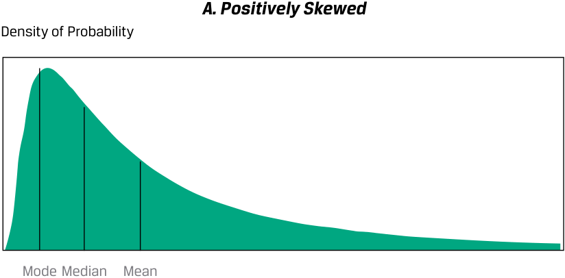

<!-- Picture Text: A. Positively Skewed Density of Probability Mode Median Mean  -->

> **Chú thích hình ảnh (Hình A):**
> - **A. Positively Skewed:** Lệch dương (Lệch phải)
> - **Density of Probability:** Mật độ xác suất
> - Thứ tự từ trái sang phải: **Mode** (Yếu vị) < **Median** (Trung vị) < **Mean** (Trung bình)

<!-- Picture Text: B. Negatively Skewed Density of Probability Mean Median Mode  -->

> **Chú thích hình ảnh (Hình B):**
> - **B. Negatively Skewed:** Lệch âm (Lệch trái)
> - **Density of Probability:** Mật độ xác suất
> - Thứ tự từ trái sang phải: **Mean** (Trung bình) < **Median** (Trung vị) < **Mode** (Yếu vị)

Đối với một phân phối liên tục một đỉnh lệch dương (*positively skewed unimodal distribution*), yếu vị nhỏ hơn trung vị, và trung vị nhỏ hơn giá trị trung bình ($\text{Mode} < \text{Median} < \text{Mean}$). Đối với một phân phối liên tục một đỉnh lệch âm (*negatively skewed unimodal distribution*), giá trị trung bình nhỏ hơn trung vị, và trung vị nhỏ hơn yếu vị ($\text{Mean} < \text{Median} < \text{Mode}$). Với một mức tỷ suất sinh lợi kỳ vọng và độ lệch chuẩn cho trước, các nhà đầu tư sẽ bị thu hút bởi độ lệch dương vì tỷ suất sinh lợi trung bình nằm cao hơn trung vị. So với tỷ suất sinh lợi trung bình, độ lệch dương đồng nghĩa với việc các mức tỷ suất sinh lợi giảm (*downside returns*) tuy thường xuyên nhưng bị giới hạn, so với các mức tỷ suất sinh lợi tăng (*upside returns*) ít thường xuyên hơn nhưng phần nào không bị giới hạn. 

Độ lệch (*Skewness*) là tên gọi được đặt cho thước đo thống kê về sự bất đối xứng (*skew*). (Từ “skewness” đôi khi cũng được sử dụng thay thế cho từ “skew”.) Giống như phương sai, độ lệch được tính bằng cách sử dụng độ lệch của mỗi quan sát so với giá trị trung bình của nó. **Độ lệch (*Skewness*)** (đôi khi 

<!-- PDF Page 120 -->

được gọi là độ lệch tương đối – *relative skewness*) được tính bằng trung bình của các độ lệch lập phương (mũ ba) so với giá trị trung bình, được chuẩn hóa bằng cách chia cho độ lệch chuẩn mũ ba để làm cho thước đo này không phụ thuộc vào quy mô (*scale-free*). 

Phép nâng lên lũy thừa bậc ba, không giống như bình phương, giữ nguyên dấu của các độ lệch so với giá trị trung bình. Nếu một phân phối bị lệch dương với giá trị trung bình lớn hơn trung vị của nó, thì hơn một nửa số độ lệch so với giá trị trung bình mang dấu âm và chưa đến một nửa mang dấu dương. Tuy nhiên, để tổng các độ lệch lập phương mang dấu dương, các khoản lỗ phải nhỏ và có khả năng xảy ra cao, còn các khoản lãi ít có khả năng xảy ra hơn nhưng cực đoan hơn. Do đó, nếu độ lệch là dương, độ lớn trung bình của các độ lệch dương sẽ lớn hơn độ lớn trung bình của các độ lệch âm. 

Công thức xấp xỉ để tính **độ lệch mẫu (*sample skewness*)** khi $n$ lớn (từ 100 trở lên) là: 

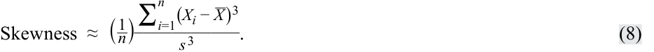

<!-- Formula Text: Skewness  ≈  ( 1 _ n ) ∑ i=1 n (X i − _ X ) 3 ___________ s 3 . (8) -->

$$\text{Skewness} \approx \left(\frac{1}{n}\right) \frac{\sum_{i=1}^{n} (X_i - \bar{X})^3}{s^3} \tag{8}$$

Như bạn sẽ học ở phần sau của chương trình, các chiến lược đầu tư khác nhau có thể tạo ra các loại và mức độ lệch khác nhau trong tỷ suất sinh lợi. 

#### **_Độ nhọn (*Kurtosis*)_** 

Một khía cạnh khác mà một phân phối tỷ suất sinh lợi có thể khác biệt so với phân phối chuẩn là xu hướng tương đối của nó trong việc tạo ra các độ lệch lớn so với giá trị trung bình. Hầu hết các nhà đầu tư sẽ coi khả năng xảy ra các độ lệch cực lớn so với giá trị trung bình cao hơn đồng nghĩa với rủi ro cao hơn. 

**Độ nhọn (*Kurtosis*)** là thước đo trọng lượng kết hợp của hai phần đuôi của một phân phối so với phần còn lại của phân phối đó—nghĩa là tỷ lệ của tổng xác suất nằm bên ngoài khoảng, giả sử, 2.5 độ lệch chuẩn tính từ giá trị trung bình. Một phân phối có đuôi dày hơn phân phối chuẩn được gọi là **phân phối nhọn (*leptokurtic*)** hay **phân phối đuôi dày (*fat-tailed*)**; một phân phối có đuôi mỏng hơn phân phối chuẩn được gọi là **phân phối bẹt (*platykurtic*)** hay **phân phối đuôi mỏng (*thin-tailed*)**; và một phân phối tương tự như phân phối chuẩn xét về trọng lượng tương đối ở hai phần đuôi được gọi là **phân phối chuẩn nhọn (*mesokurtic*)**. Một phân phối đuôi dày (đuôi mỏng) có xu hướng tạo ra các độ lệch cực lớn so với giá trị trung bình thường xuyên hơn (ít thường xuyên hơn) so với phân phối chuẩn. 

Bảng minh họa 18 minh họa một phân phối có đuôi dày hơn phân phối chuẩn. Theo cách xây dựng, phân phối đuôi dày và phân phối chuẩn trong Bảng minh họa 18 có cùng giá trị trung bình, độ lệch chuẩn và độ lệch (*skewness*). Lưu ý rằng phân phối đuôi dày này có nhiều khả năng hơn phân phối chuẩn trong việc tạo ra các quan sát ở vùng đuôi được xác định bởi giao điểm của các đường phân phối gần mức độ lệch chuẩn khoảng $\pm 2.5$. Phân phối đuôi dày này cũng có nhiều khả năng tạo ra các quan sát nằm gần giá trị trung bình hơn, được xác định ở đây là vùng $\pm 1$ độ lệch chuẩn xung quanh giá trị trung bình. Tuy nhiên, để đảm bảo tổng xác suất bằng 1, phân phối này tạo ra ít quan sát hơn ở các vùng nằm giữa vùng trung tâm và hai vùng đuôi. 

<!-- PDF Page 121 -->

#### **Bảng minh họa 18: Phân phối Đuôi dày So với Phân phối Chuẩn (*Fat-Tailed Distribution Compared to the Normal Distribution*)** 

<!-- Picture Text: Density of Probability 0.6 0.5 0.4 0.3 0.2 0.1 0 –5 –4 –3 –2 –1 0 1 2 3 4 5 Standard Deviation Normal Distribution Fat-Tailed Distribution  -->

> **Chú thích hình ảnh:**
> - **Trục tung:** Mật độ xác suất (*Density of Probability*) từ 0 đến 0.6.
> - **Trục hoành:** Độ lệch chuẩn (*Standard Deviation*) từ –5 đến 5.
> - **Normal Distribution:** Phân phối chuẩn (đường nét liền có đỉnh thấp hơn).
> - **Fat-Tailed Distribution:** Phân phối đuôi dày (đường có đỉnh nhọn cao hơn ở trung tâm và phần đuôi nằm cao hơn ở hai cực).

Phép tính độ nhọn liên quan đến việc tìm trung bình của các độ lệch so với giá trị trung bình được nâng lên lũy thừa bậc bốn và sau đó chuẩn hóa mức trung bình đó bằng cách chia cho độ lệch chuẩn mũ bốn. Một phân phối chuẩn có độ nhọn bằng 3.0, vì vậy một phân phối đuôi dày có độ nhọn lớn hơn 3.0 và một phân phối đuôi mỏng có độ nhọn nhỏ hơn 3.0. 

**Độ nhọn vượt trội (*Excess kurtosis*)** là độ nhọn so với phân phối chuẩn. Đối với kích thước mẫu lớn ($n = 100$ trở lên), **độ nhọn vượt trội mẫu (*sample excess kurtosis* – $K_E$)** xấp xỉ như sau: 

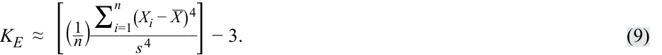

<!-- Formula Text: K E  ≈  [( 1 _ n ) ∑ i=1 n (X i − _ X ) 4 ___________ s 4 ] − 3. (9) -->

$$K_E \approx \left[ \left(\frac{1}{n}\right) \frac{\sum_{i=1}^{n} (X_i - \bar{X})^4}{s^4} \right] - 3 \tag{9}$$

Giống như độ lệch (*skewness*), thước đo này không phụ thuộc vào quy mô (*free of scale*). Nhiều phần mềm thống kê báo cáo các ước lượng về độ nhọn vượt trội mẫu nhưng chỉ gắn nhãn đơn giản là “độ nhọn” (*“kurtosis”*). 

Do đó, độ nhọn vượt trội mô tả đặc tính độ nhọn so với phân phối chuẩn. Một phân phối chuẩn có độ nhọn vượt trội bằng 0. Một phân phối đuôi dày có độ nhọn vượt trội lớn hơn 0, và một phân phối đuôi mỏng có độ nhọn vượt trội nhỏ hơn 0. Một phân phối tỷ suất sinh lợi có độ nhọn vượt trội dương—tức phân phối tỷ suất sinh lợi đuôi dày—có các độ lệch cực lớn so với giá trị trung bình xuất hiện thường xuyên hơn so với phân phối chuẩn. 

**Bảng minh họa 19: Tóm tắt về Độ nhọn (*Summary of Kurtosis*)** 

|**Nếu độ nhọn (*kurtosis*) là …**|**thì độ nhọn vượt trội (*excess kurtosis*) là …**|**Do đó, phân phối có …**|**Và chúng ta gọi phân phối đó là …**|
|---|---|---|---|
|trên 3.0|trên 0|đuôi dày hơn so với phân phối chuẩn.|đuôi dày / nhọn (*fat-tailed / leptokurtic*)|
|bằng 3.0|bằng 0|hai đuôi tương tự như phân phối chuẩn.|chuẩn nhọn (*mesokurtic*)|
|dưới 3.0|dưới 0|đuôi mỏng hơn so với phân phối chuẩn.|đuôi mỏng / bẹt (*thin-tailed / platykurtic*)|

Hầu hết các chuỗi tỷ suất sinh lợi cổ phiếu được phát hiện là có đuôi dày (*fat-tailed*). Nếu một phân phối tỷ suất sinh lợi có đuôi dày mà chúng ta lại sử dụng các mô hình thống kê không tính đến đặc điểm đó của phân phối, thì chúng ta sẽ đánh giá thấp khả năng xảy ra các kết quả rất xấu hoặc rất tốt. Ví dụ 6 quay trở lại với Chỉ số Cổ phiếu EAA từ Ví dụ 1 trước đó và định lượng hình dạng phân phối tỷ suất sinh lợi của nó. 

<!-- PDF Page 122 -->

#### **VÍ DỤ 6** 

### **Độ lệch và Độ nhọn của Tỷ suất sinh lợi Hàng ngày của Chỉ số Cổ phiếu EAA (*Skewness and Kurtosis of EAA Equity Index Daily Returns*)** 

Hãy xem xét các số liệu thống kê trong Bảng minh họa 20 đối với Chỉ số Cổ phiếu EAA: 

#### **Bảng minh họa 20: Các Đặc tính của Phân phối Lệch (*Properties of Skewed Distributions*)** 

||**Tỷ suất sinh lợi hàng ngày (*Daily Return*) (%)**|
|---|---|
|Trung bình cộng (*Arithmetic mean*)|0.0347|
|Độ lệch chuẩn (*Standard deviation*)|0.8341|
||**Thước đo tính đối xứng (*Measure of Symmetry*)**|
|Độ lệch (*Skewness*)|−0.4260|
|Độ nhọn vượt trội (*Excess kurtosis*)|3.7962|

Tỷ suất sinh lợi phản ánh độ lệch âm, được minh họa trong Bảng minh họa 21 bằng cách so sánh phân phối của tỷ suất sinh lợi hàng ngày với một phân phối chuẩn có cùng giá trị trung bình và độ lệch chuẩn. 

**Bảng minh họa 21: Độ lệch Âm (*Negative Skewness*)** 

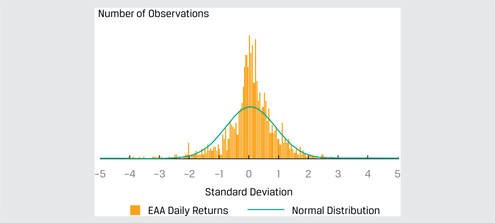

<!-- Picture Text: Number of Observations –5 –4 –3 –2 –1 0 1 2 3 4 5 Standard Deviation EAA Daily Returns Normal Distribution  -->

> **Chú thích hình ảnh:**
> - **Trục tung:** Số lượng quan sát (*Number of Observations*)
> - **Trục hoành:** Độ lệch chuẩn (*Standard Deviation*) từ –5 đến 5.
> - **EAA Daily Returns:** Tỷ suất sinh lợi hàng ngày của EAA (biểu đồ cột).
> - **Normal Distribution:** Phân phối chuẩn (đường cong).

Sử dụng cả số liệu thống kê và đồ thị, chúng ta thấy những điều sau: 

- Phân phối bị lệch âm, như được chỉ ra bởi độ lệch tính toán mang giá trị âm là −0.4260 và sự ảnh hưởng của các quan sát nằm dưới giá trị trung bình 0.0347 phần trăm. 

- Tần số xuất hiện cao nhất của tỷ suất sinh lợi nằm trong khoảng từ 0.0 đến 0.5 độ lệch chuẩn tính từ giá trị trung bình (tức là yếu vị lớn hơn giá trị trung bình vì các mức tỷ suất sinh lợi dương bị bù trừ bởi các độ lệch âm cực đoan). 

- Phân phối có đuôi dày (*fat-tailed*), như được chỉ ra bởi độ nhọn vượt trội dương là 3.7962. Trong Bảng minh họa 21, chúng ta có thể thấy hai phần đuôi dày, sự tập trung cao của tỷ suất sinh lợi xung quanh giá trị trung bình, và ít quan sát hơn ở các vùng nằm giữa vùng trung tâm và hai vùng đuôi. 

Để hiểu về tính thanh khoản giao dịch của một cổ phiếu, các nhà đầu tư thường nhìn vào phân phối của khối lượng giao dịch hàng ngày đối với cổ phiếu đó. Việc phân tích khối lượng giao dịch hàng ngày có thể mang lại những hiểu biết sâu sắc về mức độ quan tâm đối với cổ phiếu, những yếu tố nào có thể thúc đẩy sự quan tâm đến cổ phiếu cũng như liệu thị trường có thể hấp thụ một giao dịch lớn đối với cổ phiếu đó hay không. Điều thứ hai có thể được các nhà đầu tư quan tâm khi họ muốn thiết lập hoặc thoái một vị thế lớn ở cổ phiếu cụ thể đó. 

<!-- PDF Page 123 -->

#### **DIỄN GIẢI ĐỘ LỆCH VÀ ĐỘ NHỌN (*INTERPRETING SKEWNESS AND KURTOSIS*)** 

Hãy xem xét khối lượng giao dịch hàng ngày của một cổ phiếu trong một năm, như được thể hiện trong Bảng minh họa 22. Ngoài số lượng các quan sát trong mỗi khoảng (*bin* hoặc *interval*), số lượng các quan sát dự kiến dựa trên phân phối chuẩn (với trung bình cộng và độ lệch chuẩn mẫu cho trước) cũng được cung cấp. Khối lượng giao dịch trung bình mỗi ngày của cổ phiếu trong năm là 8.6 triệu cổ phiếu, và độ lệch chuẩn là 4.9 triệu cổ phiếu. 

#### **Bảng minh họa 22: Biểu đồ tần số Khối lượng Giao dịch Hàng ngày của một Cổ phiếu trong Một Năm (*Histogram of Daily Trading Volume for a Stock for One Year*)** 

<!-- Picture Text: Number of Trading Days 70 60 50 40 30 20 10 0 3.1 4.6 6.1 7.7 9.2 10.7 12.3 13.8 15.3 16.8 18.4 19.9 21.4 23.0 24.5 26.0 27.5 29.1 30.6 32.1 to to to to to to to to to to to to to to to to to to to to 4.6 6.1 7.7 9.2 10.7 12.3 13.8 15.3 16.8 18.4 19.9 21.4 23.0 24.5 26.0 27.5 29.1 30.6 32.1 33.7 Trading Volume Range of Shares (millions) Based on the Sample Based on the Normal Distribution  -->

> **Chú thích hình ảnh:**
> - **Trục tung:** Số ngày giao dịch (*Number of Trading Days*) từ 0 đến 70.
> - **Trục hoành:** Khoảng khối lượng giao dịch cổ phiếu (triệu cổ phiếu) (*Trading Volume Range of Shares (millions)*) từ 3.1 đến 33.7.
> - **Based on the Sample:** Dựa trên mẫu quan sát.
> - **Based on the Normal Distribution:** Dựa trên phân phối chuẩn.

1. Phân phối này có được mô tả là bị lệch hay không? Nếu có, điều gì có thể giải thích cho tình huống này? 

#### **Lời giải:** 

Phân phối có vẻ bị lệch về bên phải, hay lệch dương (*positively skewed*). Điều này có khả năng là do: (1) không thể có khối lượng giao dịch âm vào một ngày giao dịch nhất định, vì vậy phân phối bị chặn ở mức 0; và (2) hoạt động giao dịch lớn hơn mức thông thường diễn ra tương đối không thường xuyên, chẳng hạn như khi có các thông báo riêng của công ty. 

Độ lệch thực tế của phân phối này là 2.1090, củng cố cho cách diễn giải này. 

2. Phân phối này có thể hiện độ nhọn (*kurtosis*) không? Hãy giải thích. 

#### **Lời giải:** 

Phân phối có vẻ có độ nhọn vượt trội (*excess kurtosis*), với phần đuôi dày ở phía bên phải và số lượng cổ phiếu giao dịch đạt mức tối đa trong khoảng từ 4.6 đến 6.1 triệu cổ phiếu, vượt quá mức kỳ vọng nếu phân phối tuân theo phân phối chuẩn. Cũng có ít quan sát hơn so với kỳ vọng ở vùng nằm giữa vùng trung tâm và phần đuôi. Độ nhọn vượt trội thực tế của phân phối này là 5.2151, củng cố cho cách diễn giải này. 

<!-- PDF Page 124 -->

#### **BỘ CÂU HỎI (*QUESTION SET*)** 

1. Một chuyên viên phân tích tính toán độ nhọn vượt trội (*excess kurtosis*) của tỷ suất sinh lợi một cổ phiếu là −0.75. Từ thông tin này, chuyên viên phân tích nên kết luận rằng phân phối tỷ suất sinh lợi là: 

   - **A.** có phân phối chuẩn (*normally distributed*). 

   - **B.** có đuôi dày (*fat-tailed*) so với phân phối chuẩn. 

   - **C.** có đuôi mỏng (*thin-tailed*) so với phân phối chuẩn. 

   - **Lời giải:** 

C là đáp án đúng. Phân phối có đuôi mỏng so với phân phối chuẩn vì độ nhọn vượt trội nhỏ hơn 0. 

Sử dụng Bảng minh họa 23 để trả lời các câu hỏi 2–4. 

Một chuyên viên phân tích đã kiểm tra dữ liệu chéo (*cross-section*) về tỷ suất sinh lợi hàng năm của 252 cổ phiếu và tính toán các số liệu thống kê sau: 

#### **Bảng minh họa 23: Dữ liệu Chéo về Tỷ suất sinh lợi Hàng năm (*Cross-Section of Annual Returns*)** 

|Trung bình cộng (*Arithmetic Average*)|9.986%|
|---|---|
|Trung bình nhân (*Geometric Mean*)|9.909%|
|Phương sai (*Variance*)|0.001723|
|Độ lệch (*Skewness*)|0.704|
|Độ nhọn vượt trội (*Excess Kurtosis*)|0.503|

2. Hệ số biến thiên (CV) gần nhất với: 

   - **A.** 0.02. 

   - **B.** 0.42. 

   - **C.** 2.41. 

   - **Lời giải:** 

B là đáp án đúng. CV là tỷ số giữa độ lệch chuẩn và trung bình cộng, hay $\sqrt{0.001723} / 0.09986 = 0.416$. 

3. Phân phối này được mô tả đúng nhất là: 

   - **A.** lệch âm (*negatively skewed*). 

   - **B.** không có độ lệch (*having no skewness*). 

   - **C.** lệch dương (*positively skewed*). 

   - **Lời giải:** 

C là đáp án đúng. Độ lệch mang dấu dương (0.704), vì vậy nó bị lệch phải (lệch dương). 

4. So với phân phối chuẩn, phân phối của mẫu này được mô tả đúng nhất là có hai phần đuôi của phân phối với: 

   - **A.** xác suất thấp hơn so với phân phối chuẩn. 

   - **B.** cùng mức xác suất như phân phối chuẩn. 

<!-- PDF Page 125 -->

   - **C.** xác suất cao hơn so với phân phối chuẩn. 

   - **Lời giải:** 

C là đáp án đúng. Độ nhọn vượt trội mang dấu dương (0.503), cho biết phân phối có “đuôi dày” (*“fat-tailed”*); do đó, có nhiều xác suất nằm ở hai phần đuôi của phân phối hơn so với phân phối chuẩn. 

## **TƯƠNG QUAN GIỮA HAI BIẾN SỐ (*CORRELATION BETWEEN TWO VARIABLES*)** 

# **<mark>5</mark>** 

diễn giải hệ số tương quan giữa hai biến số để giải quyết một bài toán đầu tư 

### **Biểu đồ Phân tán (*Scatter Plot*)** 

**Biểu đồ phân tán (*scatter plot*)** là một công cụ hữu ích để hiển thị và hiểu các mối quan hệ tiềm năng giữa hai biến số. Giả sử một chuyên viên phân tích quan tâm đến hiệu quả hoạt động tương đối của hai nhóm ngành, công nghệ thông tin (CNTT – IT) và tiện ích (*utilities*), so với chỉ số thị trường trong một giai đoạn năm năm cụ thể. Chuyên viên phân tích đã thu thập tỷ suất sinh lợi của chỉ số ngành và chỉ số thị trường cho mỗi tháng trong suốt năm năm nghiên cứu. Bảng minh họa 24 trình bày biểu đồ phân tán của tỷ suất sinh lợi chỉ số ngành CNTT so với S&P 500, và Bảng minh họa 25 trình bày biểu đồ phân tán của tỷ suất sinh lợi chỉ số ngành tiện ích so với S&P 500. 

Sự phân cụm chặt chẽ (lỏng lẻo) báo hiệu một mối quan hệ tiềm năng mạnh hơn (yếu hơn) giữa hai biến số. 

#### **Bảng minh họa 24: Biểu đồ Phân tán của Tỷ suất sinh lợi Chỉ số Ngành Công nghệ Thông tin so với Tỷ suất sinh lợi Chỉ số S&P 500 (*Scatter Plot of Information Technology Sector Index Return versus S&P 500 Index Return*)** 

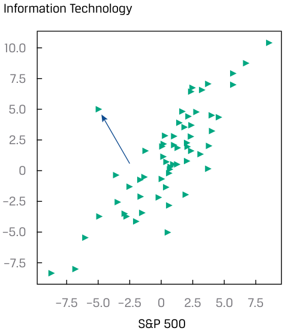

<!-- Picture Text: Information Technology 10.0 7.5 5.0 2.5 0 –2.5 –5.0 –7.5 –7.5 –5.0 –2.5 0 2.5 5.0 7.5 S&P 500  -->

> **Chú thích hình ảnh:**
> - **Trục tung:** Công nghệ thông tin (*Information Technology*) từ –7.5 đến 10.0.
> - **Trục hoành:** S&P 500 từ –7.5 đến 7.5.

<!-- PDF Page 126 -->

#### **Bảng minh họa 25: Biểu đồ Phân tán của Tỷ suất sinh lợi Chỉ số Ngành Tiện ích so với Tỷ suất sinh lợi Chỉ số S&P 500 (*Scatter Plot of Utilities Sector Index Return versus S&P 500 Index Return*)** 

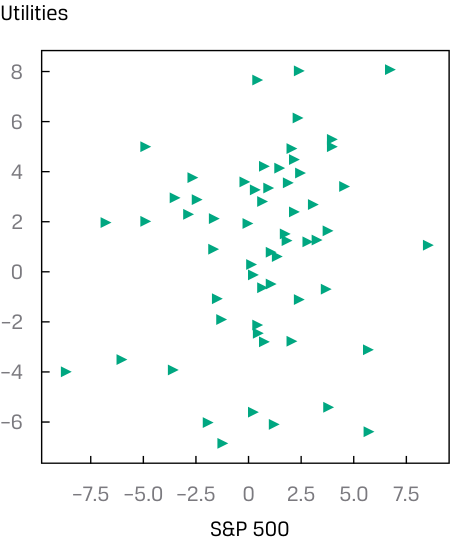

<!-- Picture Text: Utilities 8 6 4 2 0 –2 –4 –6 –7.5 –5.0 –2.5 0 2.5 5.0 7.5 S&P 500  -->

> **Chú thích hình ảnh:**
> - **Trục tung:** Tiện ích (*Utilities*) từ –6 đến 8.
> - **Trục hoành:** S&P 500 từ –7.5 đến 7.5.

Mặc dù có cách xây dựng tương đối đơn giản, các biểu đồ phân tán truyền tải những thông tin có giá trị. Thứ nhất, điều quan trọng là phải kiểm tra bất kỳ mối liên hệ tiềm năng nào giữa hai biến số. Hình mẫu của biểu đồ phân tán có thể cho thấy không có mối quan hệ rõ ràng nào, có một mối liên hệ tuyến tính (*linear association*), hoặc một mối quan hệ phi tuyến tính (*non-linear relationship*). Hơn nữa, độ mạnh của mối liên hệ có thể được xác định bởi mức độ tập trung sát nhau của các điểm dữ liệu xung quanh một đường thẳng được kẻ xuyên qua các quan sát. 

Xem xét Bảng minh họa 24, chúng ta có thể thấy tỷ suất sinh lợi của ngành CNTT có mối liên hệ cùng chiều (dương) rất cao với tỷ suất sinh lợi của Chỉ số S&P 500 vì các điểm dữ liệu tập trung chặt chẽ dọc theo một đường thẳng có độ dốc dương. Ngược lại, Bảng minh họa 25 lại kể một câu chuyện khác về hiệu quả hoạt động tương đối của ngành tiện ích và tỷ suất sinh lợi chỉ số S&P 500: Các điểm dữ liệu dường như được phân bố không theo một quy luật rõ ràng nào, cho thấy không có mối quan hệ rõ rệt giữa các biến số này. 

Thứ hai, việc quan sát các điểm dữ liệu nằm về phía hai đầu của mỗi trục, đại diện cho các giá trị lớn nhất hoặc nhỏ nhất, giúp nhanh chóng nắm bắt được khoảng biến thiên của dữ liệu (*data range*). Thứ ba, nếu có một mối quan hệ rõ ràng giữa các biến số, việc kiểm tra biểu đồ phân tán có thể giúp phát hiện các giá trị cực đoan (tức là các giá trị ngoại lai – *outliers*). Ví dụ, một điểm dữ liệu ngoại lai dễ dàng được phát hiện trong Bảng minh họa 24 như được chỉ ra bởi mũi tên. Việc tìm ra các giá trị cực đoan này và xử lý chúng bằng các biện pháp thích hợp là một phần quan trọng của quy trình xây dựng mô hình tài chính. 

Biểu đồ phân tán là một công cụ mạnh mẽ để tìm kiếm các quy luật giữa hai biến số, đánh giá khoảng biến thiên của dữ liệu và phát hiện các giá trị cực đoan. Tuy nhiên, trong một số tình huống, chúng ta cần kiểm tra các mối liên hệ theo từng cặp (*pairwise associations*) giữa nhiều biến số—ví dụ, khi thực hiện lựa chọn đặc trưng (*feature selection*) từ hàng chục biến số để xây dựng một mô hình dự báo. 

Bây giờ khi chúng ta đã có một số hiểu biết về phương sai mẫu và độ lệch chuẩn mẫu, chúng ta có thể xem xét một cách chính thức hơn khái niệm tương quan (*correlation*) giữa hai biến ngẫu nhiên mà trước đó chúng ta đã khám phá trực quan trong các biểu đồ phân tán. 

### **Hiệp phương sai và Tương quan (*Covariance and Correlation*)** 

**Tương quan (*Correlation*)** là thước đo mối quan hệ tuyến tính giữa hai biến ngẫu nhiên. Tuy nhiên, bước đầu tiên trong việc xem xét hai biến số cùng biến thiên với nhau như thế nào là xây dựng hiệp phương sai (*covariance*) của chúng. 

<!-- PDF Page 127 -->

**Định nghĩa Hiệp phương sai Mẫu (*Definition of Sample Covariance*).** **Hiệp phương sai mẫu (*sample covariance* – $s_{XY}$)** là thước đo mức độ hai biến số trong một mẫu biến động cùng nhau: 

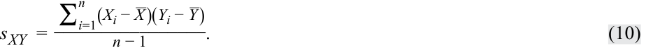

<!-- Formula Text: s XY  = ∑ i=1 n (X i − _ X )(Y i − _ Y ) ________________ n − 1 . (10) -->

$$s_{XY} = \frac{\sum_{i=1}^{n} (X_i - \bar{X})(Y_i - \bar{Y})}{n - 1} \tag{10}$$

Phương trình 10 cho biết hiệp phương sai mẫu là giá trị trung bình của tích các độ lệch của các quan sát trên hai biến ngẫu nhiên ($X_i$ và $Y_i$) so với trung bình mẫu của chúng. Nếu các biến ngẫu nhiên là tỷ suất sinh lợi, đơn vị tính sẽ là tỷ suất sinh lợi bình phương. Ngoài ra, hãy lưu ý việc sử dụng $n - 1$ ở mẫu số, nhằm đảm bảo rằng hiệp phương sai mẫu là một ước lượng không chệch (*unbiased estimate*) của hiệp phương sai tổng thể. 

Nói một cách đơn giản, hiệp phương sai là thước đo sự biến thiên đồng thời (*joint variability*) của hai biến ngẫu nhiên. Nếu các biến ngẫu nhiên biến thiên cùng chiều—ví dụ, $X$ có xu hướng nằm trên giá trị trung bình của nó khi $Y$ nằm trên giá trị trung bình của nó, và $X$ có xu hướng nằm dưới giá trị trung bình của nó khi $Y$ nằm dưới giá trị trung bình của nó—thì hiệp phương sai của chúng mang dấu dương. Nếu các biến số biến thiên ngược chiều nhau so với giá trị trung bình tương ứng của chúng, thì hiệp phương sai của chúng mang dấu âm. 

Bản thân độ lớn của thước đo hiệp phương sai rất khó diễn giải vì nó liên quan đến các đơn vị đo lường bình phương và do đó phụ thuộc vào độ lớn của các biến số. Điều này đưa chúng ta đến phiên bản chuẩn hóa của hiệp phương sai, đó là hệ số tương quan (*correlation coefficient*). 

**Định nghĩa Hệ số Tương quan Mẫu (*Definition of Sample Correlation Coefficient*).** **Hệ số tương quan mẫu (*sample correlation coefficient*)** là một thước đo đã được chuẩn hóa về việc hai biến số trong một mẫu biến động cùng nhau như thế nào. Hệ số tương quan mẫu ($r_{XY}$) là tỷ số giữa hiệp phương sai mẫu với tích độ lệch chuẩn của hai biến số đó: 

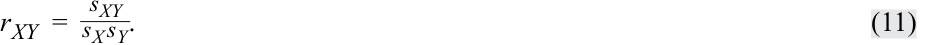

<!-- Formula Text: r XY  = s XY _ s X s Y . (11) -->

$$r_{XY} = \frac{s_{XY}}{s_X s_Y} \tag{11}$$

Điều quan trọng là hệ số tương quan biểu thị độ mạnh của mối quan hệ tuyến tính giữa hai biến ngẫu nhiên. 

### **Các Đặc tính của Hệ số Tương quan (*Properties of Correlation*)** 

Bây giờ chúng ta thảo luận chi tiết hơn về hệ số tương quan, hay gọi đơn giản là tương quan, và các đặc tính của nó: 

**1.** Hệ số tương quan nằm trong khoảng từ −1 đến +1 đối với hai biến ngẫu nhiên $X$ và $Y$: 

- $-1 \le r_{XY} \le +1$. 

**2.** Hệ số tương quan bằng 0, được gọi là không tương quan (*uncorrelated*), cho biết sự vắng mặt của bất kỳ mối quan hệ tuyến tính nào giữa các biến số. 

**3.** Hệ số tương quan dương gần với +1 cho biết một mối quan hệ tuyến tính cùng chiều (dương) mạnh. Hệ số tương quan bằng 1 cho biết một mối quan hệ tuyến tính dương hoàn hảo. 

**4.** Hệ số tương quan âm gần với −1 cho biết một mối quan hệ tuyến tính ngược chiều (âm) mạnh. Hệ số tương quan bằng −1 cho biết một mối quan hệ tuyến tính nghịch đảo hoàn hảo. 

Chúng ta quay trở lại với các biểu đồ phân tán để minh họa trực quan về hệ số tương quan. Trái ngược với hệ số tương quan vốn biểu thị mối quan hệ giữa hai chuỗi dữ liệu bằng một con số duy nhất, biểu đồ phân tán mô tả mối quan hệ đó bằng đồ thị. Do đó, biểu đồ phân tán là một công cụ rất hữu ích để diễn giải hợp lý hệ số tương quan. 

Bảng minh họa 26 cho thấy các ví dụ về biểu đồ phân tán. Hình A hiển thị biểu đồ phân tán của hai biến số có hệ số tương quan là +1. Lưu ý rằng tất cả các điểm trên biểu đồ phân tán trong Hình A đều nằm trên một đường thẳng có độ dốc dương. Bất cứ khi nào biến $X$ tăng thêm một đơn vị, biến $Y$ sẽ tăng thêm hai đơn vị. Bởi vì tất cả các điểm trên đồ thị đều nằm trên một đường thẳng, nên sự gia tăng một đơn vị của $X$ luôn gắn liền với sự gia tăng chính xác hai đơn vị 

<!-- PDF Page 128 -->

của $Y$, bất kể mức giá trị của $X$ là bao nhiêu. Ngay cả khi độ dốc của đường thẳng khác đi (nhưng vẫn dương), hệ số tương quan giữa hai biến số vẫn sẽ là +1 miễn là tất cả các điểm đều nằm trên đường thẳng đó. Hình B hiển thị biểu đồ phân tán cho hai biến số có hệ số tương quan là −1. Một lần nữa, các quan sát được vẽ trên đồ thị đều nằm trên một đường thẳng. Tuy nhiên, trong đồ thị này, đường thẳng có độ dốc âm. Khi $X$ tăng thêm một đơn vị, $Y$ giảm đi hai đơn vị, bất kể giá trị ban đầu của $X$ là bao nhiêu. 

**Bảng minh họa 26: Các Biểu đồ Phân tán Thể hiện Các Mức độ Tương quan Khác nhau (*Scatter Plots Showing Various Degrees of Correlation*)** 

#### **_A. Các biến số có hệ số tương quan bằng +1 (*Variables With a Correlation of +1*)_** 

#### **_B. Các biến số có hệ số tương quan bằng –1 (*Variables With a Correlation of –1*)_** 

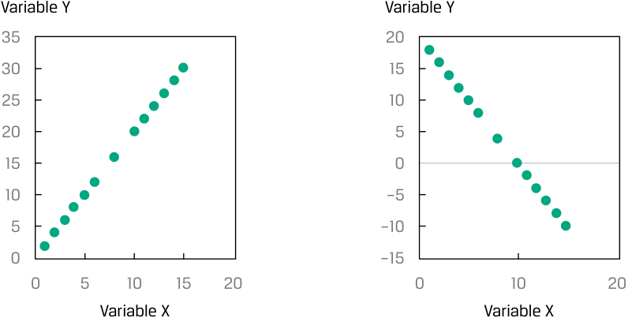

<!-- Picture Text: Variable Y Variable Y 35 20 30 15 25 10 20 5 15 0 10 –5 5 –10 0 –15 0 5 10 15 20 0 10 20 Variable X Variable X  -->

> **Chú thích hình ảnh (Hình A và Hình B):**
> - **Trục tung:** Biến Y (*Variable Y*)
> - **Trục hoành:** Biến X (*Variable X*)
> - **Hình A:** Đường thẳng dốc lên hoàn hảo ($r = +1$).
> - **Hình B:** Đường thẳng dốc xuống hoàn hảo ($r = -1$).

**_C. Các biến số có hệ số tương quan bằng 0 (*Variables With a Correlation of 0*)_** 

**_D. Các biến số có mối liên hệ phi tuyến tính mạnh (*Variables With a Strong Nonlinear Association*)_** 

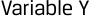

<!-- Picture Text: Variable Y  -->

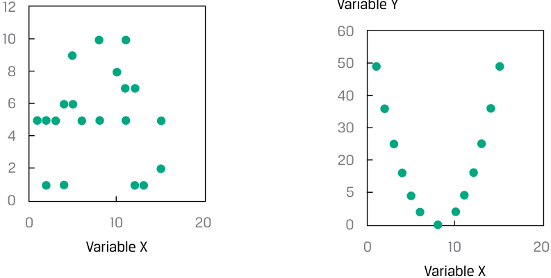

<!-- Picture Text: 12 Variable Y 60 10 50 8 40 6 30 4 20 2 5 0 0 10 20 0 Variable X 0 10 20 Variable X  -->

> **Chú thích hình ảnh (Hình C và Hình D):**
> - **Hình C:** Các điểm phân bố ngẫu nhiên không có quan hệ tuyến tính ($r = 0$).
> - **Hình D:** Các điểm nằm dọc theo đường cong parabol úp ngược (mối liên hệ phi tuyến tính mạnh nhưng tương quan tuyến tính gần bằng 0).

Hình C hiển thị biểu đồ phân tán của hai biến số có hệ số tương quan bằng 0; chúng không có mối quan hệ tuyến tính nào. Đồ thị này cho thấy giá trị của biến $X$ không cho chúng ta biết bất kỳ điều gì về giá trị của biến $Y$. Hình D hiển thị biểu đồ phân tán của hai biến số có mối quan hệ phi tuyến tính (*non-linear relationship*). Bởi vì hệ số tương quan là thước đo mối liên hệ tuyến tính giữa hai biến số, nên việc sử dụng hệ số tương quan trong trường hợp này là không phù hợp. 

<!-- PDF Page 129 -->

### **Những Hạn chế của Phân tích Tương quan (*Limitations of Correlation Analysis*)** 

Bảng minh họa 26 minh họa rằng tương quan đo lường mối liên hệ tuyến tính giữa hai biến số, nhưng không phải lúc nào nó cũng đáng tin cậy. Hai biến số có thể có một mối quan hệ _phi tuyến tính_ mạnh nhưng vẫn có hệ số tương quan rất thấp. Mối quan hệ phi tuyến tính giữa hai biến $X$ và $Y$ được thể hiện trong Hình D. Mặc dù hai biến số này có mối liên hệ hoàn hảo với nhau, nhưng không có mối liên hệ tuyến tính nào giữa chúng và do đó không có hệ số tương quan có ý nghĩa. 

Tương quan cũng có thể là một thước đo không đáng tin cậy khi có sự hiện diện của các giá trị ngoại lai (*outliers*) ở một hoặc cả hai biến số. Như chúng ta đã thấy, các giá trị ngoại lai là một số ít các quan sát nằm ở một trong hai thái cực (nhỏ hoặc lớn) của một mẫu. Hệ số tương quan có thể khá nhạy cảm với các giá trị ngoại lai. Trong tình huống như vậy, chúng ta nên cân nhắc xem liệu có hợp lý khi loại trừ các quan sát ngoại lai đó hay không và liệu chúng là nhiễu (*noise*) hay là thông tin thực sự. Chúng ta sử dụng sự phán đoán chuyên môn để xác định xem liệu các giá trị ngoại lai đó có chứa thông tin về mối quan hệ của hai biến số và nên được đưa vào phân tích tương quan, hay không chứa thông tin và nên bị loại trừ. Nếu chúng cần bị loại trừ khỏi phân tích tương quan, như chúng ta đã thấy trước đây, các quan sát ngoại lai có thể được xử lý bằng cách cắt bỏ (*trimming*) hoặc chuẩn hóa Winsor (*winsorizing*) tập dữ liệu. 

Điều quan trọng cần ghi nhớ là tương quan không hàm ý quan hệ nhân quả (*correlation does not imply causation*). Ngay cả khi hai biến số có tương quan cao với nhau, biến này không nhất thiết gây ra biến kia theo nghĩa là những giá trị nhất định của một biến số dẫn đến sự xuất hiện của những giá trị nhất định của biến số kia. 

Hơn nữa, ngay cả với các công cụ trực quan hóa dữ liệu, bao gồm cả biểu đồ phân tán, chúng ta cũng phải cảnh giác để không vô thức đưa ra những phán đoán về mối quan hệ nhân quả vốn có thể được hoặc không được dữ liệu chứng minh. 

Thuật ngữ **tương quan giả mạo (*spurious correlation*)** được sử dụng để chỉ: 

- tương quan giữa hai biến số phản ánh các mối quan hệ ngẫu nhiên tình cờ (*chance relationships*) trong một tập dữ liệu cụ thể; 

- tương quan được tạo ra bởi một phép tính trộn lẫn mỗi biến trong hai biến số với một biến số thứ ba; và 

- tương quan giữa hai biến số phát sinh không phải từ mối quan hệ trực tiếp giữa chúng mà từ mối quan hệ của chúng với một biến số thứ ba. 

Như một ví dụ về mối quan hệ ngẫu nhiên tình cờ, hãy xem xét doanh số bán lẻ bia, rượu vang và rượu mạnh hàng tháng tại Hoa Kỳ và nồng độ khí carbon dioxide trong khí quyển từ năm 2000 đến năm 2018. Hệ số tương quan là 0.824, cho thấy có một mối quan hệ cùng chiều giữa hai biến này. Tuy nhiên, không có lý do gì để nghi ngờ rằng nồng độ carbon dioxide trong khí quyển lại có liên quan đến doanh số bán lẻ bia, rượu vang và rượu mạnh. 

Như một ví dụ về loại tương quan giả mạo thứ hai, hai biến số không tương quan với nhau có thể trở nên có tương quan nếu cả hai cùng được chia cho một biến số thứ ba. Ví dụ, hãy xem xét một mẫu dữ liệu chéo về cổ tức và tổng tài sản của các công ty. Mặc dù có thể có tương quan thấp giữa hai biến số này, nhưng việc chia mỗi biến cho giá trị vốn hóa thị trường có thể làm tăng hệ số tương quan. 

Như một ví dụ về loại tương quan giả mạo thứ ba, chiều cao có thể có tương quan dương với vốn từ vựng của một người, nhưng các mối quan hệ cơ bản thực sự nằm ở mối quan hệ giữa tuổi tác và chiều cao cũng như giữa tuổi tác và vốn từ vựng. 

Các chuyên gia đầu tư phải thận trọng khi xây dựng các chiến lược đầu tư dựa trên các hệ số tương quan cao. Các tương quan giả mạo có thể gợi ý những chiến lược đầu tư có vẻ sinh lời nhưng thực tế sẽ không hiệu quả nếu được triển khai. 

Một vấn đề nữa là hệ số tương quan không kể hết toàn bộ câu chuyện về dữ liệu. Hãy xem xét Bộ tứ Anscombe (*Anscombe’s Quartet*), được thảo luận trong Ví dụ 7, trong đó các đồ thị hoàn toàn khác nhau có thể được tạo ra từ các biến số có cùng giá trị trung bình, cùng độ lệch chuẩn và cùng hệ số tương quan. 

<!-- PDF Page 130 -->

#### **VÍ DỤ 7** 

### **Bộ tứ Anscombe (*Anscombe’s Quartet*)** 

Francis Anscombe, một nhà thống kê học người Anh, đã phát triển các tập dữ liệu minh họa lý do tại sao việc chỉ nhìn vào các thống kê tóm tắt (tức là giá trị trung bình, độ lệch chuẩn và hệ số tương quan) lại không mô tả đầy đủ được dữ liệu. Ông đã tạo ra bốn tập dữ liệu (được ký hiệu là I, II, III và IV), mỗi tập dữ liệu gồm hai biến $X$ và $Y$, sao cho: 

- Các giá trị $X$ trong mỗi tập dữ liệu có cùng giá trị trung bình và độ lệch chuẩn, lần lượt là 9.00 và 3.32. 

- Các giá trị $Y$ trong mỗi tập dữ liệu có cùng giá trị trung bình và độ lệch chuẩn, lần lượt là 7.50 và 2.03. 

- Các giá trị $X$ và $Y$ trong mỗi tập dữ liệu có cùng hệ số tương quan là 0.82. 

**Bảng minh họa 27: Các Thống kê Tóm tắt (*Summary Statistics*)** 

||**I**||**II**||**III**||**IV**||
|---|---|---|---|---|---|---|---|---|
|**Quan sát (*Observation*)**|**$X$**|**$Y$**|**$X$**|**$Y$**|**$X$**|**$Y$**|**$X$**|**$Y$**|
|1|10|8.04|10|9.14|10|7.46|8|6.6|
|2|8|6.95|8|8.14|8|6.77|8|5.8|
|3|13|7.58|13|8.74|13|12.74|8|7.7|
|4|9|8.81|9|8.77|9|7.11|8|8.8|
|5|11|8.33|11|9.26|11|7.81|8|8.5|
|6|14|9.96|14|8.1|14|8.84|8|7|
|7|6|7.24|6|6.13|6|6.08|8|5.3|
|8|4|4.26|4|3.1|4|5.39|19|13|
|9|12|10.8|12|9.13|12|8.15|8|5.6|
|10|7|4.82|7|7.26|7|6.42|8|7.9|
|11|5|5.68|5|4.74|5|5.73|8|6.9|
|$N$|11|11|11|11|11|11|11|11|
|Trung bình (*Mean*)|9.00|7.50|9.00|7.50|9.00|7.50|9.00|7.50|
|Độ lệch chuẩn (*Standard deviation*)|3.32|2.03|3.32|2.03|3.32|2.03|3.32|2.03|
|Hệ số tương quan (*Correlation*)|0.82||0.82||0.82||0.82||

Mặc dù biến $X$ có cùng các giá trị cho các tập I, II và III trong bộ tứ tập dữ liệu, nhưng các biến $Y$ lại khá khác nhau, tạo ra những mối quan hệ khác nhau. Bốn tập dữ liệu đó là: 

I Một mối quan hệ xấp xỉ tuyến tính giữa $X$ và $Y$. 

II Một mối quan hệ cong (phi tuyến tính) giữa $X$ và $Y$. 

III Một mối quan hệ tuyến tính ngoại trừ một giá trị ngoại lai. 

IV Giá trị $X$ không đổi ngoại trừ một giá trị ngoại lai. 

Mô tả trực quan bộ tứ dữ liệu này: 

<!-- PDF Page 131 -->

#### **Bảng minh họa 28: Mô tả Trực quan (*Visual Depiction*)** 

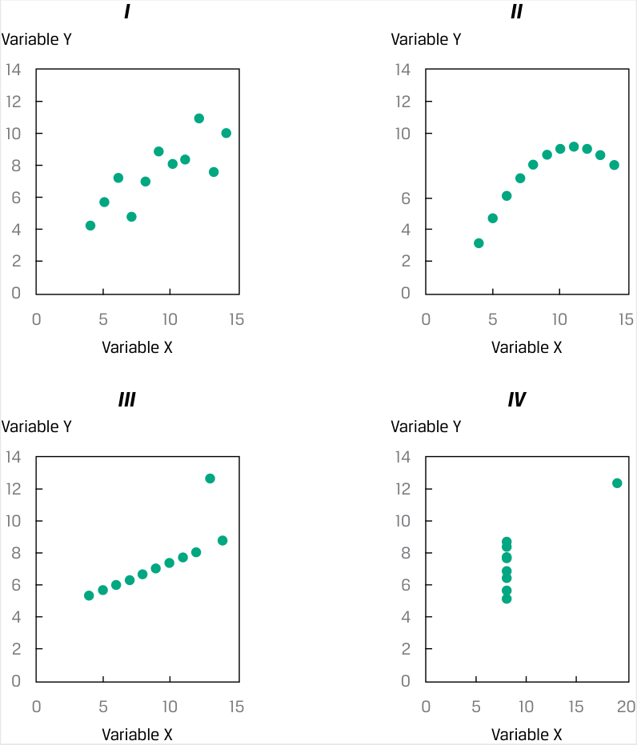

<!-- Picture Text: I II Variable Y Variable Y 14 14 12 12 10 10 8 6 6 4 4 2 2 0 0 0 5 10 15 0 5 10 15 Variable X Variable X III IV Variable Y Variable Y 14 14 12 12 10 10 8 8 6 6 4 4 2 2 0 0 0 5 10 15 0 5 10 15 20 Variable X Variable X  -->

> **Chú thích hình ảnh:**
> - Bốn biểu đồ phân tán **I, II, III, IV** với trục tung là **Variable Y** (Biến Y) và trục hoành là **Variable X** (Biến X).

Điểm mấu chốt là gì? Việc biết được giá trị trung bình và độ lệch chuẩn của hai biến số, cũng như hệ số tương quan giữa chúng, vẫn chưa kể hết toàn bộ câu chuyện về dữ liệu. 

_Nguồn:_ Francis John Anscombe, “Graphs in Statistical Analysis,” _American Statistician_ 27 (Tháng 2/1973): 17–21. 

#### **BỘ CÂU HỎI (*QUESTION SET*)** 

1. Hệ số tương quan bằng 0.34 giữa hai biến số $X$ và $Y$ được mô tả _đúng nhất_ là: 

   - **A.** những thay đổi trong $X$ gây ra những thay đổi trong $Y$. 

   - **B.** một mối liên hệ cùng chiều (dương) giữa $X$ và $Y$. 

   - **C.** một mối quan hệ cong giữa $X$ và $Y$. 

   - **Lời giải:** 

B là đáp án đúng. Hệ số tương quan mang dấu dương, cho biết hai chuỗi dữ liệu biến động cùng chiều với nhau. 

2. Điều nào sau đây là một vấn đề tiềm ẩn khi diễn giải hệ số tương quan? 

   - **A.** Các giá trị ngoại lai (*Outliers*) 

   - **B.** Tương quan giả mạo (*Spurious correlation*) 

<!-- PDF Page 132 -->

   - **C.** Cả các giá trị ngoại lai và tương quan giả mạo 

   - **Lời giải:** 

C là đáp án đúng. Cả các giá trị ngoại lai và tương quan giả mạo đều là những vấn đề tiềm ẩn khi diễn giải các hệ số tương quan. 

Sử dụng thông tin trong Bảng minh họa 29 để trả lời câu hỏi 3 và 4. 

Một chuyên viên phân tích đang đánh giá xu hướng tỷ suất sinh lợi của danh mục cổ phiếu do cô quản lý biến động cùng với các chỉ số trái phiếu và bất động sản. Cô đã thu thập dữ liệu hàng tháng về tỷ suất sinh lợi và các chỉ số: 

**Bảng minh họa 29: Dữ liệu Hàng tháng về Tỷ suất sinh lợi và Chỉ số (*Monthly Data on Returns and Indexes*)** 

<!-- Picture Text: Returns (%) Bond Index  Real Estate Index Portfolio Returns Returns Returns Arithmetic  5.5 3.2 7.8 average Standard  8.2 3.4 10.3 deviation Portfolio Returns and Bond Index  Portfolio Returns and Real Estate Returns Index Returns Covariance 18.9 −55.9  -->

| **Tỷ suất sinh lợi (*Returns*) (%)** | **Tỷ suất sinh lợi Danh mục (*Portfolio Returns*)** | **Tỷ suất sinh lợi Chỉ số Trái phiếu (*Bond Index Returns*)** | **Tỷ suất sinh lợi Chỉ số Bất động sản (*Real Estate Index Returns*)** |
|---|---|---|---|
| Trung bình cộng (*Arithmetic average*) | 5.5 | 3.2 | 7.8 |
| Độ lệch chuẩn (*Standard deviation*) | 8.2 | 3.4 | 10.3 |

| | **Tỷ suất sinh lợi Danh mục và Tỷ suất sinh lợi Chỉ số Trái phiếu** | **Tỷ suất sinh lợi Danh mục và Tỷ suất sinh lợi Chỉ số Bất động sản** |
|---|---|---|
| Hiệp phương sai (*Covariance*) | 18.9 | −55.9 |

3. Không cần tính hệ số tương quan, tương quan giữa tỷ suất sinh lợi danh mục đầu tư và tỷ suất sinh lợi chỉ số trái phiếu _có khả năng cao nhất_ là: 

   - **A.** âm (*negative*). 

   - **B.** bằng không (*zero*). 

   - **C.** dương (*positive*). 

   - **Lời giải:** 

C là đáp án đúng. Hệ số tương quan mang dấu dương vì hiệp phương sai mang dấu dương (18.9). 

4. Không cần tính hệ số tương quan, tương quan giữa tỷ suất sinh lợi danh mục đầu tư và tỷ suất sinh lợi chỉ số bất động sản là: 

   - **A.** âm (*negative*). 

   - **B.** bằng không (*zero*). 

   - **C.** dương (*positive*). 

   - **Lời giải:** 

A là đáp án đúng. Hệ số tương quan mang dấu âm vì hiệp phương sai mang dấu âm (−55.9). 

5. Hãy xem xét hai biến số $A$ và $B$. Nếu biến $A$ có giá trị trung bình là −0.56, biến $B$ có giá trị trung bình là 0.23, và hiệp phương sai giữa hai biến số mang dấu dương, thì hệ số tương quan giữa hai biến số này là: 

   - **A.** âm (*negative*). 

   - **B.** bằng không (*zero*). 

<!-- PDF Page 133 -->

   - **C.** dương (*positive*). 

   - **Lời giải:** 

C là đáp án đúng. Hệ số tương quan bắt buộc phải mang dấu dương vì hiệp phương sai mang dấu dương. Việc một hoặc cả hai biến số có giá trị trung bình âm không làm ảnh hưởng đến dấu của hệ số tương quan. 
