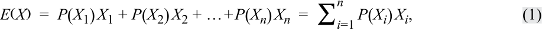
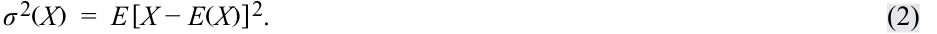
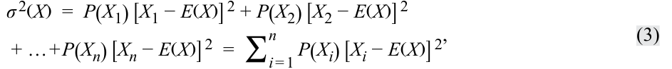
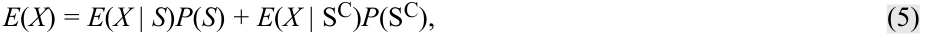
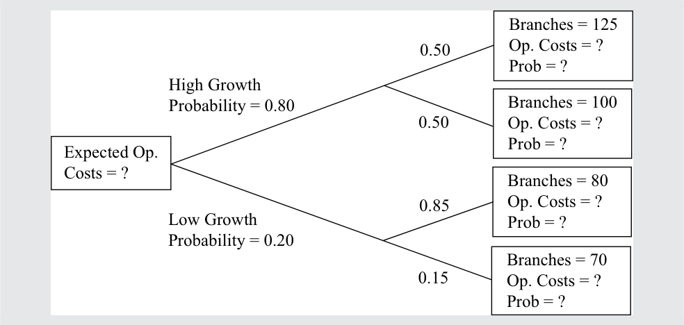

# Tập 1: Phương pháp Định lượng (*Quantitative Methods*)
## Học phần 4: Cây Xác suất và Kỳ vọng Có điều kiện (*Probability Trees and Conditional Expectations*)
### Phần 1/2: Giới thiệu (Trang PDF 139–146)

---

<!-- PDF Page 139 -->

#### H Ọ C P H Ầ N 

# **<mark>4</mark>** 

### **Cây Xác suất và Kỳ vọng Có điều kiện (*Probability Trees and Conditional Expectations*)** 

**Tác giả: Richard A. DeFusco, PhD, CFA, Dennis W. McLeavey, DBA, CFA, Jerald E. Pinto, PhD, CFA, và David E. Runkle, PhD, CFA.** 

_Richard A. DeFusco, PhD, CFA, công tác tại Đại học Nebraska-Lincoln (Hoa Kỳ). Dennis W. McLeavey, DBA, CFA, công tác tại Đại học Rhode Island (Hoa Kỳ). Jerald E. Pinto, PhD, CFA, công tác tại Viện CFA (Hoa Kỳ). David E. Runkle, PhD, CFA, công tác tại Jacobs Levy Equity Management (Hoa Kỳ)._ 

###### **<mark>MỤC TIÊU HỌC TẬP (*LEARNING OUTCOMES*)</mark>** 

###### **_Mức độ thành thạo — Ứng viên cần có khả năng:_** 

- tính toán giá trị kỳ vọng (*expected values*), phương sai (*variances*), và độ lệch chuẩn (*standard deviations*) cũng như trình bày ứng dụng của chúng vào các bài toán đầu tư
- thiết lập một bài toán đầu tư dưới dạng cây xác suất (*probability tree*) và giải thích việc sử dụng các kỳ vọng có điều kiện (*conditional expectations*) trong ứng dụng đầu tư
- tính toán và diễn giải xác suất cập nhật (*updated probability*) trong bối cảnh đầu tư bằng cách sử dụng công thức Bayes (*Bayes’ formula*) 

<!-- Picture Text: 1  -->

##### **GIỚI THIỆU (*INTRODUCTION*)** 

Các quyết định đầu tư được đưa ra trong điều kiện không chắc chắn về hướng đi tương lai của nền kinh tế, các tổ chức phát hành, các công ty và giá cả. Học phần này trình bày các công cụ xác suất giúp giải quyết nhiều bài toán thực tế liên quan đến sự không chắc chắn và được áp dụng cho nhiều ứng dụng quản lý đầu tư đa dạng. 

Bài học 1 giới thiệu cách tính giá trị kỳ vọng, phương sai và độ lệch chuẩn đối với một biến ngẫu nhiên. Đây là những khái niệm định lượng thiết yếu trong quản lý đầu tư. Bài học 2 giới thiệu cây xác suất giúp trực quan hóa các kỳ vọng có điều kiện và quy tắc xác suất toàn phần cho giá trị kỳ vọng. 

Khi đưa ra các quyết định đầu tư, các chuyên viên phân tích thường dựa vào các quan điểm nhìn nhận, vốn có thể chịu ảnh hưởng bởi các quan sát tiếp theo. Bài học 3 giới thiệu công thức Bayes, một phương pháp hợp lý để điều chỉnh các xác suất khi có thông tin mới xuất hiện. Phương pháp này có ứng dụng rộng rãi trong kinh doanh và đầu tư. 

<!-- PDF Page 140 -->

###### **TỔNG QUAN HỌC PHẦN (*LEARNING MODULE OVERVIEW*)** 

- Giá trị kỳ vọng của một biến ngẫu nhiên (*expected value of a random variable*) là trung bình có trọng số xác suất của các kết quả có thể xảy ra của biến ngẫu nhiên đó. Đối với một biến ngẫu nhiên $X$, giá trị kỳ vọng của $X$ được ký hiệu là $E(X)$. 

- Phương sai của một biến ngẫu nhiên (*variance of a random variable*) là giá trị kỳ vọng (trung bình có trọng số xác suất) của các bình phương độ lệch so với giá trị kỳ vọng $E(X)$ của biến ngẫu nhiên đó: $\sigma^2(X) = E\{[X - E(X)]^2\}$, trong đó $\sigma^2(X)$ biểu thị phương sai của $X$. 

- Độ lệch chuẩn (*standard deviation*) là căn bậc hai dương của phương sai. Độ lệch chuẩn đo lường độ phân tán (giống như phương sai), nhưng được đo bằng cùng đơn vị với biến số đó. 

- Cây xác suất (*probability tree*) là một phương tiện minh họa kết quả của hai hay nhiều biến cố độc lập hoặc nối tiếp nhau. 

- Xác suất của một biến cố khi biết (với điều kiện) một biến cố khác là xác suất có điều kiện (*conditional probability*). Xác suất của một biến cố $A$ khi biết biến cố $B$ được ký hiệu là $P(A | B)$, và $P(A | B) = P(AB) / P(B)$, với $P(B) \ne 0$. 

- Theo quy tắc xác suất toàn phần (*total probability rule*), nếu $S_1, S_2, \dots, S_n$ là các kịch bản hoặc biến cố xung khắc và đầy đủ (*mutually exclusive and exhaustive*), thì $P(A) = P(A | S_1)P(S_1) + P(A | S_2)P(S_2) + \dots + P(A | S_n)P(S_n)$. 

- Giá trị kỳ vọng có điều kiện (*conditional expected value*) là $E(X | S) = P(X_1 | S)X_1 + P(X_2 | S)X_2 + \dots + P(X_n | S)X_n$ và có phương sai có điều kiện cũng như độ lệch chuẩn có điều kiện đi kèm. 

- Công thức Bayes (*Bayes’ formula*) là một phương pháp được sử dụng để cập nhật các xác suất dựa trên thông tin mới. 

- Công thức Bayes được biểu diễn như sau: Xác suất cập nhật của biến cố khi biết thông tin mới = [(Xác suất của thông tin mới khi biết biến cố) / (Xác suất vô điều kiện của thông tin mới)] $\times$ Xác suất tiên nghiệm của biến cố. 

<!-- Picture Text: 2  -->

##### **GIÁ TRỊ KỲ VỌNG VÀ PHƯƠNG SAI (*EXPECTED VALUE AND VARIANCE*)** 

tính toán giá trị kỳ vọng, phương sai và độ lệch chuẩn cũng như trình bày ứng dụng của chúng vào các bài toán đầu tư 

Giá trị kỳ vọng của một biến ngẫu nhiên là một khái niệm định lượng thiết yếu trong đầu tư. Các nhà đầu tư liên tục sử dụng các giá trị kỳ vọng—trong việc ước tính phần thưởng của các khoản đầu tư thay thế, trong việc dự báo thu nhập trên mỗi cổ phần (EPS) cùng các biến số và tỷ số tài chính doanh nghiệp khác, cũng như trong việc đánh giá bất kỳ yếu tố nào khác có thể ảnh hưởng đến vị thế tài chính của họ. **Giá trị kỳ vọng của một biến ngẫu nhiên (*expected value of a random variable*)** là trung bình có trọng số xác suất của các kết quả có thể xảy ra của biến ngẫu nhiên đó. Đối với một biến ngẫu nhiên $X$, giá trị kỳ vọng của $X$ được ký hiệu là $E(X)$. 

Giá trị kỳ vọng (ví dụ: tỷ suất sinh lợi cổ phiếu kỳ vọng) hướng tới tương lai, như một dự báo, hoặc hướng tới giá trị “thực” của mức trung bình (trung bình tổng thể – *population mean*). Chúng ta cần phân biệt giá trị kỳ vọng với các khái niệm trung bình lịch sử hay trung bình mẫu (*sample mean*). Trung bình mẫu cũng 

<!-- PDF Page 141 -->

tóm tắt một giá trị trung tâm bằng một con số duy nhất. Tuy nhiên, trung bình mẫu trình bày một giá trị trung tâm cho một tập hợp các quan sát cụ thể dưới dạng trung bình có trọng số bằng nhau của các quan sát đó. Tóm lại, sự đối lập ở đây là giữa dự báo so với lịch sử, hay giữa tổng thể so với mẫu. 

Phương trình tóm tắt cách tính giá trị kỳ vọng cho một biến ngẫu nhiên rời rạc (*discrete random variable*) $X$ như sau: 

<!-- Formula Text: E(X)  =  P(X 1) X 1 + P(X 2) X 2 + … + P(X n) X n  =  ∑ i=1 n P(X i) X i, (1) -->

$$E(X) = P(X_1)X_1 + P(X_2)X_2 + \dots + P(X_n)X_n = \sum_{i=1}^{n} P(X_i)X_i \tag{1}$$

trong đó $X_i$ là một trong $n$ kết quả có thể xảy ra của biến ngẫu nhiên rời rạc $X$. 

Giá trị kỳ vọng chính là dự báo của chúng ta. Bởi vì chúng ta đang thảo luận về các đại lượng ngẫu nhiên, chúng ta không thể trông cậy vào việc một dự báo riêng lẻ sẽ trở thành hiện thực (mặc dù chúng ta hy vọng rằng, xét về trung bình, các dự báo sẽ chính xác). Do đó, điều quan trọng là phải đo lường rủi ro mà chúng ta phải đối mặt. Phương sai và độ lệch chuẩn đo lường độ phân tán của các kết quả xung quanh giá trị kỳ vọng hay dự báo. 

**Phương sai của một biến ngẫu nhiên (*variance of a random variable*)** là giá trị kỳ vọng (trung bình có trọng số xác suất) của các bình phương độ lệch so với giá trị kỳ vọng của biến ngẫu nhiên đó: 

<!-- Formula Text: σ 2(X)  =  E [X − E(X)] 2. (2) -->

$$\sigma^2(X) = E\left\{[X - E(X)]^2\right\} \tag{2}$$

Hai cách ký hiệu cho phương sai là $\sigma^2(X)$ và $\text{Var}(X)$. 

Phương sai là một số lớn hơn hoặc bằng 0 vì nó là tổng của các số hạng bình phương. Nếu phương sai bằng 0, không có sự phân tán hay rủi ro nào cả. Kết quả là chắc chắn, và đại lượng $X$ hoàn toàn không phải là ngẫu nhiên. Phương sai lớn hơn 0 cho thấy có sự phân tán của các kết quả. Phương sai càng tăng cho thấy độ phân tán càng lớn, khi các yếu tố khác không đổi. 

Phương trình sau đây tóm tắt cách tính phương sai: 

<!-- Formula Text: σ 2(X)  =  P(X 1) [X 1 − E(X)] 2 + P(X 2) [X 2 − E(X)] 2 + … + P(X n) [X n − E(X)] 2  =  ∑ i = 1 n P(X i) [X i − E(X)] 2, (3) -->

$$\sigma^2(X) = P(X_1)[X_1 - E(X)]^2 + P(X_2)[X_2 - E(X)]^2 + \dots + P(X_n)[X_n - E(X)]^2 = \sum_{i=1}^{n} P(X_i)[X_i - E(X)]^2 \tag{3}$$

trong đó $X_i$ là một trong $n$ kết quả có thể xảy ra của biến ngẫu nhiên rời rạc $X$. 

Phương sai của $X$ là một đại lượng tính bằng đơn vị bình phương của $X$. Ví dụ, nếu biến ngẫu nhiên là tỷ suất sinh lợi tính bằng phần trăm, thì phương sai của tỷ suất sinh lợi có đơn vị là phần trăm bình phương. Độ lệch chuẩn dễ diễn giải hơn phương sai vì nó có cùng đơn vị với biến ngẫu nhiên. **Độ lệch chuẩn (*Standard deviation*)** là căn bậc hai của phương sai. Nếu biến ngẫu nhiên là tỷ suất sinh lợi tính bằng phần trăm, thì độ lệch chuẩn của tỷ suất sinh lợi cũng có đơn vị là phần trăm. Trong các ví dụ tiếp theo, khi phương sai của tỷ suất sinh lợi được nêu dưới dạng phần trăm hoặc số tiền, để tiết kiệm không gian trình bày, chúng ta có thể lược bỏ việc hiển thị đơn vị bình phương. 

Cách tốt nhất để làm quen với các khái niệm này là thực hành qua các ví dụ. 

###### **VÍ DỤ 1** 

###### **Thu nhập trên mỗi Cổ phần (EPS) của BankCorp, Phần 1 (*BankCorp’s Earnings per Share, Part 1*)** 

Là một phần công việc của chuyên viên phân tích ngành ngân hàng, bạn xây dựng các mô hình dự báo thu nhập trên mỗi cổ phần (EPS) của các ngân hàng mà bạn phụ trách. Hôm nay bạn đang nghiên cứu BankCorp. Trong Bảng minh họa 1, bạn đã ghi lại một phân phối xác suất cho EPS của BankCorp trong năm tài chính hiện tại. 

**Bảng minh họa 1: Phân phối Xác suất cho EPS của BankCorp (*Probability Distribution for BankCorp’s EPS*)** 

|**Xác suất (*Probability*)**|**EPS (USD)**|
|---|---|
|0.15|2.60|
|0.45|2.45|
|0.24|2.20|

<!-- PDF Page 142 -->

|**Xác suất (*Probability*)**|**EPS (USD)**|
|---|---|
|0.16|2.00|
|1.00||

1. Giá trị kỳ vọng của EPS của BankCorp cho năm tài chính hiện tại là bao nhiêu? 

###### **Lời giải:** 

Theo định nghĩa về giá trị kỳ vọng, hãy liệt kê từng kết quả, nhân trọng số với xác suất của nó, và cộng các số hạng lại với nhau. 

$$E(\text{EPS}) = 0.15(\text{USD } 2.60) + 0.45(\text{USD } 2.45) + 0.24(\text{USD } 2.20) + 0.16(\text{USD } 2.00)$$

$$= \text{USD } 2.3405$$

Giá trị kỳ vọng của EPS là USD 2.34. 

2. Sử dụng phân phối xác suất của EPS từ Bảng minh họa 1, bạn muốn đo lường độ phân tán xung quanh dự báo của mình. Phương sai và độ lệch chuẩn của EPS của BankCorp cho năm tài chính hiện tại là bao nhiêu? 

###### **Lời giải:** 

Thứ tự tính toán luôn là giá trị kỳ vọng trước, sau đó đến phương sai, rồi đến độ lệch chuẩn. Giá trị kỳ vọng đã được tính ở trên. Theo định nghĩa về phương sai trước đó, hãy tính độ lệch của từng kết quả so với giá trị trung bình hay giá trị kỳ vọng, bình phương từng độ lệch, nhân trọng số từng bình phương độ lệch với xác suất xảy ra của nó, và sau đó cộng các số hạng này lại. 

$$\sigma^2(\text{EPS}) = P(2.60)[2.60 - E(\text{EPS})]^2 + P(2.45)[2.45 - E(\text{EPS})]^2 + P(2.20)[2.20 - E(\text{EPS})]^2 + P(2.00)[2.00 - E(\text{EPS})]^2$$

$$= 0.15(2.60 - 2.34)^2 + 0.45(2.45 - 2.34)^2 + 0.24(2.20 - 2.34)^2 + 0.16(2.00 - 2.34)^2$$

$$= 0.01014 + 0.005445 + 0.004704 + 0.018496 = 0.038785$$

Độ lệch chuẩn là căn bậc hai dương của 0.038785: 

$$\sigma(\text{EPS}) = 0.038785^{1/2} = 0.196939, \text{ hay xấp xỉ } 0.20.$$

## **<mark>3</mark>** 

##### **CÂY XÁC SUẤT VÀ KỲ VỌNG CÓ ĐIỀU KIỆN (*PROBABILITY TREES AND CONDITIONAL EXPECTATIONS*)** 

thiết lập một bài toán đầu tư dưới dạng cây xác suất và giải thích việc sử dụng các kỳ vọng có điều kiện trong ứng dụng đầu tư 

Trong đầu tư, chúng ta tận dụng mọi thông tin có liên quan hiện có khi đưa ra dự báo. Khi tinh chỉnh các kỳ vọng hoặc dự báo của mình, chúng ta thường cập nhật chúng dựa trên thông tin hoặc biến cố mới; trong những trường hợp này, chúng ta đang sử dụng **các giá trị kỳ vọng có điều kiện (*conditional expected values*)**. Giá trị kỳ vọng của một biến ngẫu nhiên $X$ khi biết một biến cố hoặc kịch bản $S$ được ký hiệu là $E(X | S)$. Giả sử biến ngẫu nhiên $X$ có thể nhận bất kỳ giá trị nào trong số $n$ kết quả riêng biệt 

<!-- PDF Page 143 -->

$X_1, X_2, \dots, X_n$ (các kết quả này tạo thành một tập hợp các biến cố xung khắc và đầy đủ). Giá trị kỳ vọng của $X$ với điều kiện $S$ bằng kết quả thứ nhất, $X_1$, nhân với xác suất của kết quả thứ nhất khi biết $S$, $P(X_1 | S)$, cộng với kết quả thứ hai, $X_2$, nhân với xác suất của kết quả thứ hai khi biết $S$, $P(X_2 | S)$, và cứ tiếp tục như vậy như sau: 

$$E(X | S) = P(X_1 | S)X_1 + P(X_2 | S)X_2 + \dots + P(X_n | S)X_n \tag{4}$$

Chúng ta sẽ minh họa phương trình này ngay sau đây. 

Song song với quy tắc xác suất toàn phần dùng để biểu diễn các xác suất vô điều kiện theo các xác suất có điều kiện, có một nguyên lý dùng để biểu diễn các giá trị kỳ vọng (vô điều kiện) theo các giá trị kỳ vọng có điều kiện. Nguyên lý này là **quy tắc xác suất toàn phần cho giá trị kỳ vọng (*total probability rule for expected value*)**. 

###### **Quy tắc Xác suất Toàn phần cho Giá trị Kỳ vọng (*Total Probability Rule for Expected Value*)** 

Công thức như sau: 

<!-- Formula Text: E(X) = E(X | S)P(S) + E(X | SC)P(SC), (5) -->

$$E(X) = E(X | S)P(S) + E(X | S^C)P(S^C) \tag{5}$$

trong đó $S^C$ là “phần bù của $S$” (*complement of $S$*), có nghĩa là biến cố hoặc kịch bản “$S$” không xảy ra. 

$$E(X) = E(X | S_1)P(S_1) + E(X | S_2)P(S_2) + \dots + E(X | S_n)P(S_n) \tag{6}$$

trong đó $S_1, S_2, \dots, S_n$ là các kịch bản hoặc biến cố xung khắc và đầy đủ (*mutually exclusive and exhaustive*). 

Trường hợp tổng quát, Phương trình 6, phát biểu rằng giá trị kỳ vọng của $X$ bằng giá trị kỳ vọng của $X$ khi biết Kịch bản 1, $E(X | S_1)$, nhân với xác suất của Kịch bản 1, $P(S_1)$, cộng với giá trị kỳ vọng của $X$ khi biết Kịch bản 2, $E(X | S_2)$, nhân với xác suất của Kịch bản 2, $P(S_2)$, và cứ tiếp tục như vậy. 

Để sử dụng nguyên lý này, chúng ta xây dựng các kịch bản xung khắc và đầy đủ hữu ích cho việc tìm hiểu các kết quả của biến ngẫu nhiên. Cách tiếp cận này đã được áp dụng khi xây dựng phân phối xác suất cho EPS của BankCorp trong Ví dụ 1, như chúng ta sẽ thảo luận ngay bây giờ. 

###### **VÍ DỤ 2** 

###### **Thu nhập trên mỗi Cổ phần (EPS) của BankCorp, Phần 2 (*BankCorp’s Earnings per Share, Part 2*)** 

Thu nhập của BankCorp nhạy cảm với lãi suất, được hưởng lợi từ môi trường lãi suất giảm. Giả sử có xác suất 0.60 là BankCorp sẽ hoạt động trong _môi trường lãi suất giảm_ (*declining interest rate environment*) trong năm tài chính hiện tại và xác suất 0.40 là ngân hàng sẽ hoạt động trong _môi trường lãi suất ổn định_ (*stable interest rate environment*) (đánh giá khả năng xảy ra môi trường lãi suất tăng là không đáng kể). Nếu _môi trường lãi suất giảm_ xảy ra, xác suất để EPS đạt USD 2.60 được ước tính là 0.25, và xác suất để EPS đạt USD 2.45 được ước tính là 0.75. Lưu ý rằng 0.60, xác suất của _môi trường lãi suất giảm_, nhân với 0.25, xác suất EPS đạt USD 2.60 khi biết _môi trường lãi suất giảm_, bằng 0.15, chính là xác suất (vô điều kiện) của mức USD 2.60 được cho trong bảng ở Bảng minh họa 1. Các xác suất này hoàn toàn nhất quán với nhau. Tương tự, $0.60(0.75) = 0.45$, chính là xác suất của mức EPS USD 2.45 được cho trong Bảng minh họa 1. **Sơ đồ cây xác suất (*probability tree diagram*)** trong Bảng minh họa 2 cho thấy phần còn lại của phân tích này. 

<!-- PDF Page 144 -->

###### **Bảng minh họa 2: EPS Dự báo của BankCorp (*BankCorp’s Forecasted EPS*)** 

<!-- Picture Text: EPS = $2.60 with 0.25 Prob = 0.15 Prob. of declining interest rates = 0.60 EPS = $2.45 with 0.75 Prob = 0.45 E (EPS) = $2.34 EPS = $2.20 with 0.60 Prob = 0.24 Prob. of stable interest rates = 0.40 EPS = $2.00 with 0.40 Prob = 0.16  -->

> **Chú thích hình ảnh:**
> - **Gốc cây:** $E(\text{EPS}) = \$2.34$
> - **Nhánh trên:** Xác suất lãi suất giảm (*Prob. of declining interest rates*) = 0.60:
>   - Nhánh con 1 (0.25): $\text{EPS} = \$2.60$ với Xác suất (*Prob*) = 0.15
>   - Nhánh con 2 (0.75): $\text{EPS} = \$2.45$ với Xác suất (*Prob*) = 0.45
> - **Nhánh dưới:** Xác suất lãi suất ổn định (*Prob. of stable interest rates*) = 0.40:
>   - Nhánh con 1 (0.60): $\text{EPS} = \$2.20$ với Xác suất (*Prob*) = 0.24
>   - Nhánh con 2 (0.40): $\text{EPS} = \$2.00$ với Xác suất (*Prob*) = 0.16

Môi trường lãi suất giảm dẫn chúng ta đến **nút (*node*)** của cây rẽ nhánh thành các kết quả USD 2.60 và USD 2.45. Chúng ta có thể tìm EPS kỳ vọng khi biết môi trường lãi suất giảm như sau, sử dụng Phương trình 4: 

$$E(\text{EPS} | \text{môi trường lãi suất giảm}) = 0.25(\text{USD } 2.60) + 0.75(\text{USD } 2.45) = \text{USD } 2.4875$$

Nếu lãi suất ổn định, 

$$E(\text{EPS} | \text{môi trường lãi suất ổn định}) = 0.60(\text{USD } 2.20) + 0.40(\text{USD } 2.00) = \text{USD } 2.12$$

Ví dụ, một khi chúng ta có thông tin mới rằng lãi suất ổn định, chúng ta sẽ điều chỉnh giảm kỳ vọng ban đầu về EPS từ USD 2.34 xuống còn USD 2.12. Bây giờ, sử dụng quy tắc xác suất toàn phần cho giá trị kỳ vọng: 

$$E(\text{EPS}) = E(\text{EPS} | \text{môi trường lãi suất giảm})P(\text{môi trường lãi suất giảm}) + E(\text{EPS} | \text{môi trường lãi suất ổn định})P(\text{môi trường lãi suất ổn định})$$

Do đó, $E(\text{EPS}) = \text{USD } 2.4875(0.60) + \text{USD } 2.12(0.40) = \text{USD } 2.3405$ hay khoảng USD 2.34. 

Con số này hoàn toàn trùng khớp với ước lượng giá trị kỳ vọng của EPS được tính trực tiếp từ phân phối xác suất trong Ví dụ 1. Cũng giống như các xác suất của chúng ta phải nhất quán, các giá trị kỳ vọng vô điều kiện và có điều kiện của chúng ta cũng phải nhất quán; nếu không, các hành động đầu tư của chúng ta có thể tạo ra cơ hội kiếm lời cho các nhà đầu tư khác mà phần thiệt thuộc về chúng ta. 

Để ôn lại, trước tiên chúng ta đã xây dựng các yếu tố hoặc kịch bản ảnh hưởng đến kết quả của biến cố đang quan tâm. Sau khi gán xác suất cho các kịch bản này, chúng ta hình thành các kỳ vọng có điều kiện dựa trên các kịch bản khác nhau đó. Sau đó, chúng ta tính ngược lại để thiết lập một giá trị kỳ vọng tại thời điểm ngày hôm nay. Trong bài toán vừa giải quyết, EPS là biến cố được quan tâm, và môi trường lãi suất là yếu tố ảnh hưởng đến EPS. 

Chúng ta cũng có thể tính phương sai của EPS khi biết từng kịch bản: 

$$\sigma^2(\text{EPS} | \text{môi trường lãi suất giảm}) = P(\text{USD } 2.60 | \text{môi trường lãi suất giảm}) \times [\text{USD } 2.60 - E(\text{EPS} | \text{môi trường lãi suất giảm})]^2$$

$$+ P(\text{USD } 2.45 | \text{môi trường lãi suất giảm}) \times [\text{USD } 2.45 - E(\text{EPS} | \text{môi trường lãi suất giảm})]^2$$

<!-- PDF Page 145 -->

$$= 0.25(\text{USD } 2.60 - \text{USD } 2.4875)^2 + 0.75(\text{USD } 2.45 - \text{USD } 2.4875)^2 = 0.004219$$

Tương tự, $\sigma^2(\text{EPS} | \text{môi trường lãi suất ổn định})$ được tìm thấy bằng: 

$$= 0.60(\text{USD } 2.20 - \text{USD } 2.12)^2 + 0.40(\text{USD } 2.00 - \text{USD } 2.12)^2 = 0.0096$$

Đây là **các phương sai có điều kiện (*conditional variances*)**, tức phương sai của EPS khi biết _môi trường lãi suất giảm_ và phương sai của EPS khi biết _môi trường lãi suất ổn định_. Mối quan hệ giữa phương sai vô điều kiện và phương sai có điều kiện là một chủ đề tương đối nâng cao. Những điểm chính cần nắm là: (1) phương sai, giống như giá trị kỳ vọng, có một khái niệm có điều kiện tương ứng với khái niệm vô điều kiện; và (2) chúng ta có thể sử dụng phương sai có điều kiện để đánh giá rủi ro khi biết một kịch bản cụ thể. 

###### **VÍ DỤ 3** 

###### **Thu nhập trên mỗi Cổ phần (EPS) của BankCorp, Phần 3 (*BankCorp’s Earnings per Share, Part 3*)** 

Tiếp tục với ví dụ về BankCorp, bây giờ bạn tập trung vào cơ cấu chi phí của BankCorp. Một mô hình—mô hình hồi quy tuyến tính đơn giản (*simple linear regression model*)—mà bạn đang nghiên cứu cho chi phí hoạt động của BankCorp là: 

$$\hat{Y} = a + bX$$

trong đó $\hat{Y}$ là dự báo chi phí hoạt động tính bằng triệu đô la Mỹ và $X$ là số lượng chi nhánh; và $\hat{Y}$ đại diện cho giá trị kỳ vọng của $Y$ khi biết $X$, hay $E(Y | X)$. Bạn diễn giải hệ số chặn $a$ là chi phí cố định (*fixed costs*) và $b$ là chi phí biến đổi (*variable costs*). Bạn ước lượng phương trình như sau: 

$$\hat{Y} = 12.5 + 0.65X$$

BankCorp hiện có 66 chi nhánh, và phương trình ước tính chi phí hoạt động là $12.5 + 0.65(66) = \text{USD } 55.4\text{ triệu}$. Bạn có hai kịch bản tăng trưởng, được mô tả trong sơ đồ cây ở Bảng minh họa 3. 

###### **Bảng minh họa 3: Chi phí Hoạt động Dự báo của BankCorp (*BankCorp’s Forecasted Operating Costs*)** 

<!-- Picture Text: Branches = 125 0.50 Op. Costs = ? Prob = ? High Growth Probability = 0.80  Branches = 100 0.50 Op. Costs = ? Prob = ? Expected Op. Costs = ? Branches = 80 0.85 Op. Costs = ? Low Growth Prob = ? Probability = 0.20 Branches = 70 0.15 Op. Costs = ? Prob = ?  -->

> **Chú thích hình ảnh:**
> - **Gốc cây:** Chi phí hoạt động kỳ vọng (*Expected Op. Costs*) = ?
> - **Nhánh trên:** Tăng trưởng cao (*High Growth*), Xác suất = 0.80:
>   - Nhánh con 1 (0.50): Số chi nhánh (*Branches*) = 125, Chi phí hoạt động = ?, Xác suất = ?
>   - Nhánh con 2 (0.50): Số chi nhánh (*Branches*) = 100, Chi phí hoạt động = ?, Xác suất = ?
> - **Nhánh dưới:** Tăng trưởng thấp (*Low Growth*), Xác suất = 0.20:
>   - Nhánh con 1 (0.85): Số chi nhánh (*Branches*) = 80, Chi phí hoạt động = ?, Xác suất = ?
>   - Nhánh con 2 (0.15): Số chi nhánh (*Branches*) = 70, Chi phí hoạt động = ?, Xác suất = ?

1. Tính chi phí hoạt động dự báo ứng với các mức số lượng chi nhánh khác nhau, sử dụng $\hat{Y} = 12.5 + 0.65X$. Nêu xác suất của từng mức số lượng chi nhánh. Đây là câu trả lời cho các dấu hỏi trong các ô cuối của sơ đồ cây. 

###### **Lời giải:** 

Sử dụng $\hat{Y} = 12.5 + 0.65X$, từ trên xuống dưới, chúng ta có: 

<!-- PDF Page 146 -->

|**Chi phí hoạt động (*Operating Costs*)**|**Xác suất (*Probability*)**|
|---|---|
|$\hat{Y} = 12.5 + 0.65(125) = \text{USD } 93.75\text{ triệu}$|$0.80(0.50) = 0.40$|
|$\hat{Y} = 12.5 + 0.65(100) = \text{USD } 77.50\text{ triệu}$|$0.80(0.50) = 0.40$|
|$\hat{Y} = 12.5 + 0.65(80) = \text{USD } 64.50\text{ triệu}$|$0.20(0.85) = 0.17$|
|$\hat{Y} = 12.5 + 0.65(70) = \text{USD } 58.00\text{ triệu}$|$0.20(0.15) = 0.03$|
||Tổng (*Sum*) = 1.00|

2. Tính giá trị kỳ vọng của chi phí hoạt động theo kịch bản tăng trưởng cao. Đồng thời tính giá trị kỳ vọng của chi phí hoạt động theo kịch bản tăng trưởng thấp. 

   - **Lời giải:** 

Số tiền đô la Mỹ được tính bằng đơn vị triệu. 

$$E(\text{chi phí hoạt động} | \text{tăng trưởng cao}) = 0.50(\text{USD } 93.75) + 0.50(\text{USD } 77.50) = \text{USD } 85.625$$

$$E(\text{chi phí hoạt động} | \text{tăng trưởng thấp}) = 0.85(\text{USD } 64.50) + 0.15(\text{USD } 58.00) = \text{USD } 63.525$$

3. Tham chiếu câu hỏi trong ô đầu tiên của sơ đồ cây: Chi phí hoạt động kỳ vọng của BankCorp là bao nhiêu? 

   - **Lời giải:** 

Số tiền đô la Mỹ được tính bằng đơn vị triệu. 

$$E(\text{chi phí hoạt động}) = E(\text{chi phí hoạt động} | \text{tăng trưởng cao})P(\text{tăng trưởng cao}) + E(\text{chi phí hoạt động} | \text{tăng trưởng thấp})P(\text{tăng trưởng thấp})$$

$$= 85.625(0.80) + 63.525(0.20) = 81.205$$

Chi phí hoạt động kỳ vọng của BankCorp là USD 81.205 triệu. 

Trong phần này, chúng ta đã xem xét các biến ngẫu nhiên, chẳng hạn như EPS, như những đại lượng độc lập. Chúng ta chưa khám phá cách các tham số mô tả, chẳng hạn như giá trị kỳ vọng và phương sai của EPS, có thể là hàm số của các biến ngẫu nhiên khác. Tỷ suất sinh lợi của danh mục đầu tư là một biến ngẫu nhiên rõ ràng là một hàm số của các biến ngẫu nhiên khác—tức tỷ suất sinh lợi ngẫu nhiên của từng chứng khoán riêng lẻ trong danh mục. Để phân tích tỷ suất sinh lợi kỳ vọng và phương sai tỷ suất sinh lợi của một danh mục đầu tư, chúng ta phải hiểu rằng các đại lượng này là một hàm số của các đặc tính tỷ suất sinh lợi của từng chứng khoán riêng lẻ. Nhìn vào phương sai của tỷ suất sinh lợi danh mục đầu tư, chúng ta thấy rằng cách thức tỷ suất sinh lợi của các chứng khoán riêng lẻ biến động cùng nhau hay đồng biến thiên (*covary*) là yếu tố then chốt. Chúng ta sẽ tìm hiểu về tỷ suất sinh lợi kỳ vọng của danh mục, phương sai tỷ suất sinh lợi, và quan trọng là hiệp phương sai và hệ số tương quan trong một học phần riêng. 

###### **BỘ CÂU HỎI (*QUESTION SET*)** 

1. Giả sử triển vọng thu hồi vốn gốc đối với một đợt phát hành trái phiếu bị vỡ nợ phụ thuộc vào việc kịch bản nào trong hai kịch bản kinh tế sẽ diễn ra. Kịch bản 1 có xác suất 0.75 và sẽ dẫn đến việc thu hồi được USD 0.90 trên mỗi USD 1 giá trị vốn gốc với xác suất 0.45, hoặc thu hồi được USD 0.80 trên mỗi USD 1 
