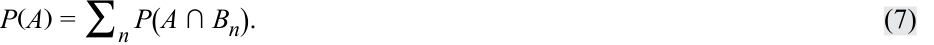
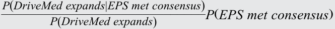
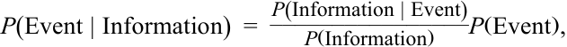
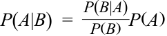

# Tập 1: Phương pháp Định lượng (*Quantitative Methods*)
## Học phần 4: Cây Xác suất và Kỳ vọng Có điều kiện (*Probability Trees and Conditional Expectations*)
### Phần 2/2: Công thức Bayes và Cập nhật Ước lượng Xác suất (*Bayes' Formula and Updating Probability Estimates*) (Trang PDF 147–158)

---

<!-- PDF Page 147 -->

giá trị vốn gốc với xác suất 0.55. Kịch bản 2 có xác suất 0.25 và sẽ dẫn đến việc thu hồi được USD 0.50 trên mỗi USD 1 giá trị vốn gốc với xác suất 0.85, hoặc thu hồi được USD 0.40 trên mỗi USD 1 giá trị vốn gốc với xác suất 0.15. 

Sử dụng dữ liệu của Kịch bản 1 và Kịch bản 2, hãy tính các đại lượng sau: 

- **A.** Tính mức thu hồi kỳ vọng, khi biết kịch bản thứ nhất. 

- **B.** Tính mức thu hồi kỳ vọng, khi biết kịch bản thứ hai. 

- **C.** Tính mức thu hồi kỳ vọng tổng thể. 

- **D.** Biểu diễn thông tin lên sơ đồ cây xác suất. 

- **E.** Tính xác suất của từng mức trong bốn mức thu hồi có thể xảy ra: USD 0.90, USD 0.80, USD 0.50, và USD 0.40. 

- **Lời giải:** 

*(Lưu ý: Trong tài liệu gốc, thứ tự trình bày lời giải của câu E được đặt ở mục A và các câu A, B, C, D được trình bày nối tiếp ngay bên dưới)*

- **E (được ghi là A trong bản gốc).** _Các kết quả gắn với Kịch bản 1:_ Với xác suất 0.45 thu hồi được USD 0.90 trên mỗi USD 1 giá trị vốn gốc khi biết Kịch bản 1, và với xác suất của Kịch bản 1 bằng 0.75, xác suất thu hồi được USD 0.90 là $0.45(0.75) = 0.3375$. Bằng phép tính tương tự, xác suất thu hồi được USD 0.80 là $0.55(0.75) = 0.4125$. _Các kết quả gắn với Kịch bản 2:_ Với xác suất 0.85 thu hồi được USD 0.50 trên mỗi USD 1 giá trị vốn gốc khi biết Kịch bản 2, và với xác suất của Kịch bản 2 bằng 0.25, xác suất thu hồi được USD 0.50 là $0.85(0.25) = 0.2125$. Bằng phép tính tương tự, xác suất thu hồi được USD 0.40 là $0.15(0.25) = 0.0375$. 

<!-- Picture Text: B.  E ( recovery  |  Scenario 1 ) = 0.45(USD0.90) + 0.55(USD0.80) = USD0.845 C.  E ( recovery  |  Scenario 2 ) = 0.85(USD0.50) + 0.15(USD0.40) = USD0.485 D.  E ( recovery ) = 0.75(USD0.845) + 0.25(USD0.485) = USD0.755 Recovery = $0.90 0.45 Prob = 0.3375 Scenario 1, Probability = 0.75 0.55 Recovery = $0.80 Prob = 0.4125 Expected Recovery = $0.755 Recovery = $0.50 0.85 Prob = 0.2125 Scenario 2, Probability = 0.25 Recovery = $0.40 0.15 Prob = 0.0375  -->

- **A (B trong hình):** $E(\text{mức thu hồi} | \text{Kịch bản 1}) = 0.45(\text{USD } 0.90) + 0.55(\text{USD } 0.80) = \text{USD } 0.845$
- **B (C trong hình):** $E(\text{mức thu hồi} | \text{Kịch bản 2}) = 0.85(\text{USD } 0.50) + 0.15(\text{USD } 0.40) = \text{USD } 0.485$
- **C (D trong hình):** $E(\text{mức thu hồi}) = 0.75(\text{USD } 0.845) + 0.25(\text{USD } 0.485) = \text{USD } 0.755$
- **D (Sơ đồ cây xác suất trong hình):**
  - **Gốc cây:** Mức thu hồi kỳ vọng (*Expected Recovery*) = $\$0.755$
  - **Nhánh trên:** Kịch bản 1 (*Scenario 1*), Xác suất = 0.75:
    - Nhánh con 1 (0.45): Thu hồi = $\$0.90$, Xác suất = 0.3375
    - Nhánh con 2 (0.55): Thu hồi = $\$0.80$, Xác suất = 0.4125
  - **Nhánh dưới:** Kịch bản 2 (*Scenario 2*), Xác suất = 0.25:
    - Nhánh con 1 (0.85): Thu hồi = $\$0.50$, Xác suất = 0.2125
    - Nhánh con 2 (0.15): Thu hồi = $\$0.40$, Xác suất = 0.0375

## **CÔNG THỨC BAYES VÀ CẬP NHẬT ƯỚC LƯỢNG XÁC SUẤT (*BAYES' FORMULA AND UPDATING PROBABILITY ESTIMATES*)** 

<!-- Picture Text: 4  -->

tính toán và diễn giải xác suất cập nhật trong bối cảnh đầu tư bằng cách sử dụng công thức Bayes 

<!-- PDF Page 148 -->

Một chủ đề thường hữu ích trong việc giải quyết các bài toán đầu tư là công thức Bayes: những gì lý thuyết xác suất nói về việc học hỏi từ kinh nghiệm. 

### **Công thức Bayes (*Bayes’ Formula*)** 

Khi đưa ra các quyết định liên quan đến đầu tư, chúng ta thường bắt đầu với những quan điểm dựa trên kinh nghiệm và kiến thức của mình. Những quan điểm này có thể được thay đổi hoặc củng cố bởi kiến thức và các quan sát mới. **Công thức Bayes (*Bayes’ formula*)** là một phương pháp hợp lý để điều chỉnh quan điểm của chúng ta khi tiếp nhận thông tin mới. Công thức Bayes và các khái niệm liên quan được sử dụng trong nhiều bối cảnh ra quyết định kinh doanh và đầu tư. 

Công thức Bayes sử dụng quy tắc xác suất toàn phần (*total probability rule*): 

<!-- Formula Text: P(A) = ∑ n  P(A ∩ B n). (7) -->

$$P(A) = \sum_{n} P(A \cap B_n) \tag{7}$$

Để ôn lại, quy tắc đó biểu thị xác suất của một biến cố dưới dạng trung bình có trọng số của các xác suất của biến cố đó khi biết một tập hợp các kịch bản. Công thức Bayes hoạt động theo chiều ngược lại; chính xác hơn, nó đảo ngược thông tin “với điều kiện / khi biết rằng” (*“given that”*). Công thức Bayes sử dụng sự xuất hiện của biến cố để suy ra xác suất của kịch bản đã tạo ra nó. Vì lý do đó, công thức Bayes đôi khi được gọi là xác suất nghịch đảo (*inverse probability*). Trong nhiều ứng dụng, bao gồm cả những ứng dụng minh họa cách sử dụng nó trong phần này, một cá nhân đang cập nhật niềm tin của mình liên quan đến các nguyên nhân có thể đã tạo ra một quan sát mới. 

**Công thức Bayes (*Bayes’ Formula*).** Cho một tập hợp các xác suất tiên nghiệm (*prior probabilities*) đối với một biến cố đang quan tâm, nếu bạn nhận được thông tin mới, quy tắc để cập nhật xác suất của bạn về biến cố đó như sau: 

$$\text{Xác suất cập nhật của biến cố khi biết thông tin mới} = \frac{\text{Xác suất của thông tin mới khi biết biến cố}}{\text{Xác suất vô điều kiện của thông tin mới}} \times \text{Xác suất tiên nghiệm của biến cố}$$

Theo ký hiệu xác suất, công thức này có thể được viết ngắn gọn như sau: 

<!-- Formula Text: P(Event | Information)  = P(Information | Event) ________________ P(Information) P(Event). (8) -->

$$P(\text{Event} | \text{Information}) = \frac{P(\text{Information} | \text{Event})}{P(\text{Information})} P(\text{Event}) \tag{8}$$

Hãy xem xét ví dụ sau đây sử dụng các tần số (*frequencies*)—ban đầu có thể dễ hiểu hơn so với các xác suất—để minh họa và hiểu rõ công thức Bayes. Giả sử một chỉ số cổ phiếu vốn hóa lớn giả định có 500 công ty thành viên, trong đó có 100 công ty công nghệ (*tech firms*), và 60 trong số này có tỷ suất sinh lợi $> 10\%$, còn 40 công ty có tỷ suất sinh lợi $\le 10\%$. Trong số 400 công ty phi công nghệ (*non-technology firms*) trong chỉ số, 100 công ty có tỷ suất sinh lợi $> 10\%$, và 300 công ty có tỷ suất sinh lợi $\le 10\%$. Sơ đồ cây phân cấp (*tree map*) trong Bảng minh họa 4 rất hữu ích để trực quan hóa ví dụ này, và được tóm tắt trong bảng ở Bảng minh họa 5. 

<!-- PDF Page 149 -->

**Bảng minh họa 4: Sơ đồ Cây để Trực quan hóa Công thức Bayes Sử dụng Tần số (*Tree Map for Visualizing Bayes’ Formula Using Frequencies*)** 

<!-- Picture Text: All Firms 500 Tech Firms Non-Tech Firms 100 400 Return > 10 % Return ≤ 10% 60 40 100 300 Return ≤ 10% Return > 10 %  -->

> **Chú thích hình ảnh:**
> - **All Firms (Tất cả công ty):** 500
>   - **Tech Firms (Công ty công nghệ):** 100 $\rightarrow$ **Return > 10%:** 60 | **Return $\le$ 10%:** 40
>   - **Non-Tech Firms (Công ty phi công nghệ):** 400 $\rightarrow$ **Return > 10%:** 100 | **Return $\le$ 10%:** 300

<!-- Picture Text: P  ( Tech  |  R  > 10%) = 60/(60+100)  -->

$$P(\text{Tech} | R > 10\%) = \frac{60}{60 + 100}$$

**Bảng minh họa 5: Tóm tắt Tỷ suất sinh lợi của các Công ty Công nghệ và Phi công nghệ trong Chỉ số Cổ phiếu Vốn hóa Lớn Giả định (*Summary of Returns for Tech and Non-Tech Firms in Hypothetical Large-Cap Equity Index*)** 

||**Loại công ty trong Chỉ số Cổ phiếu (*Type of Firm in Stock Index*)**|||
|---|---|---|---|
|**Tỷ suất sinh lợi ($R$)**|**Phi công nghệ (*Non-Tech*)**|**Công nghệ (*Tech*)**|**Tổng (*Total*)**|
|$R > 10\%$|100|60|160|
|$R \le 10\%$|300|40|340|
|Tổng (*Total*)|400|100|500|

Xác suất một công ty là công ty công nghệ khi biết rằng nó có tỷ suất sinh lợi $> 10\%$, hay $P(\text{tech} | R > 10\%)$, là bao nhiêu? Nhìn vào các tần số trong sơ đồ cây và trong bảng, chúng ta có thể thấy nhiều xác suất thực nghiệm, chẳng hạn như sau: 

- $P(\text{tech}) = 100 / 500 = 0.20$, 

- $P(\text{non-tech}) = 400 / 500 = 0.80$, 

- $P(R > 10\% | \text{tech}) = 60 / 100 = 0.60$, 

- $P(R > 10\% | \text{non-tech}) = 100 / 400 = 0.25$, 

- $P(R > 10\%) = 160 / 500 = 0.32$, và cuối cùng, 

- $P(\text{tech} | R > 10\%) = 60 / 160 = 0.375$. 

Xác suất này chính là câu trả lời cho câu hỏi ban đầu của chúng ta. 

Không nhìn vào các tần số, chúng ta hãy sử dụng công thức Bayes để tìm xác suất một công ty có tỷ suất sinh lợi $> 10\%$ và sau đó là xác suất một công ty có tỷ suất sinh lợi $> 10\%$ là một công ty công nghệ, $P(\text{tech} | R > 10\%)$. Trước hết, 

$$P(R > 10\%) = P(R > 10\% | \text{tech}) \times P(\text{tech}) + P(R > 10\% | \text{non-tech}) \times P(\text{non-tech})$$

$$= 0.60 \times 0.20 + 0.25 \times 0.80 = 0.32$$

<!-- PDF Page 150 -->

Bây giờ chúng ta có thể áp dụng công thức Bayes để trả lời câu hỏi của mình: 

<!-- Formula Text: P(tech|R  >  10%)  = P(R  >  10 % |tech) × P(tech) ____________________ P(R  >  10%) =   0.60 × 0.20 _ 0.32 =  0.375. -->

$$P(\text{tech} | R > 10\%) = \frac{P(R > 10\% | \text{tech}) \times P(\text{tech})}{P(R > 10\%)} = \frac{0.60 \times 0.20}{0.32} = 0.375$$

Xác suất để một công ty có tỷ suất sinh lợi $> 10\%$ là công ty công nghệ bằng 0.375, một con số rất đáng chú ý vì xác suất để một công ty bất kỳ là công ty công nghệ (tính trên toàn bộ mẫu) chỉ là 0.20. Tóm lại, có thể dễ dàng nhận thấy từ sơ đồ cây và dữ liệu tần số cơ sở (lần lượt ở Bảng minh họa 4 và 5) hoặc từ các xác suất trong công thức Bayes rằng có 160 công ty đạt $R > 10\%$, và 60 trong số đó là các công ty công nghệ, do đó: 

$$P(\text{tech} | R > 10\%) = 60 / 160 = 0.375$$

Những người sử dụng thống kê Bayes không coi các xác suất (hay các khả năng xảy ra – *likelihoods*) là được biết trước một cách chắc chắn mà tin rằng chúng cần được điều chỉnh bất cứ khi nào có thông tin mới. Niềm tin hay xác suất của chúng ta được cập nhật liên tục khi thông tin mới xuất hiện theo thời gian. 

Để minh họa rõ hơn công thức Bayes, chúng ta hãy giải quyết một ví dụ đầu tư có thể điều chỉnh cho phù hợp với bất kỳ bài toán thực tế nào. Giả sử bạn là một nhà đầu tư nắm giữ cổ phiếu của DriveMed, Inc. Những bất ngờ thu nhập tích cực (*positive earnings surprises*) so với ước tính EPS đồng thuận (*consensus EPS estimates*) thường dẫn đến tỷ suất sinh lợi cổ phiếu dương, và những bất ngờ tiêu cực thường có tác động ngược lại. DriveMed đang chuẩn bị công bố kết quả EPS của quý trước, và bạn quan tâm đến việc biến cố nào trong ba biến cố sau đây đã xảy ra: _EPS quý trước vượt ước tính EPS đồng thuận (EPS exceeded consensus), EPS quý trước đạt đúng bằng ước tính EPS đồng thuận (EPS met consensus),_ hoặc _EPS quý trước thấp hơn ước tính EPS đồng thuận (EPS fell short of consensus)._ Danh sách các khả năng thay thế này là xung khắc và đầy đủ. 

Trên cơ sở nghiên cứu của riêng mình, bạn ghi lại **các xác suất tiên nghiệm (*prior probabilities* / *priors*)** sau đây liên quan đến ba biến cố này: 

- $P(\text{EPS vượt đồng thuận}) = 0.45$ 

- $P(\text{EPS đạt đồng thuận}) = 0.30$ 

- $P(\text{EPS thấp hơn đồng thuận}) = 0.25$ 

Các xác suất này mang tính “tiên nghiệm” (*“prior”*) theo nghĩa là chúng chỉ phản ánh những gì bạn biết ở thời điểm hiện tại, trước khi có bất kỳ thông tin mới nào xuất hiện. 

Ngày hôm sau, DriveMed thông báo rằng họ đang mở rộng công suất nhà máy tại Singapore và Ireland để đáp ứng nhu cầu bán hàng gia tăng. Bạn đánh giá thông tin mới này. Quyết định mở rộng công suất không chỉ liên quan đến nhu cầu hiện tại mà có lẽ còn liên quan đến nhu cầu bán hàng của quý trước. Bạn biết rằng nhu cầu bán hàng có liên hệ cùng chiều với EPS. Vì vậy, bây giờ có vẻ nhiều khả năng hơn là EPS của quý trước sẽ vượt mức đồng thuận. 

Câu hỏi bạn đặt ra là: “Trước thông tin mới này, xác suất cập nhật cho việc EPS quý trước vượt ước tính đồng thuận là bao nhiêu?” 

Công thức Bayes cung cấp một phương pháp hợp lý để thực hiện việc cập nhật này. Chúng ta có thể viết tắt thông tin mới là _DriveMed mở rộng_ (*DriveMed expands*). Bước đầu tiên trong việc áp dụng công thức Bayes là tính xác suất của thông tin mới (ở đây là: _DriveMed mở rộng_), khi biết một danh sách các biến cố hoặc kịch bản có thể đã tạo ra nó. Danh sách các biến cố phải bao quát mọi khả năng có thể xảy ra, như trong trường hợp này. Việc thiết lập các xác suất có điều kiện này là bước then chốt trong quy trình cập nhật. Giả sử quan điểm của bạn, dựa trên nghiên cứu về DriveMed và ngành của công ty, là: 

- $P(\text{DriveMed mở rộng} | \text{EPS vượt đồng thuận}) = 0.75$ 

- $P(\text{DriveMed mở rộng} | \text{EPS đạt đồng thuận}) = 0.20$ 

- $P(\text{DriveMed mở rộng} | \text{EPS thấp hơn đồng thuận}) = 0.05$ 

Các xác suất có điều kiện của một quan sát (ở đây là: _DriveMed mở rộng_) đôi khi được gọi là **các khả năng xảy ra (*likelihoods*)**. Một lần nữa, các khả năng xảy ra này là cần thiết để cập nhật xác suất. 

<!-- PDF Page 151 -->

Tiếp theo, bạn kết hợp các xác suất có điều kiện hay các khả năng xảy ra này với các xác suất tiên nghiệm của mình để có được xác suất vô điều kiện của việc DriveMed mở rộng, $P(\text{DriveMed mở rộng})$, như sau: 

$$P(\text{DriveMed mở rộng}) = P(\text{DriveMed mở rộng} | \text{EPS vượt đồng thuận}) \times P(\text{EPS vượt đồng thuận})$$

$$+ P(\text{DriveMed mở rộng} | \text{EPS đạt đồng thuận}) \times P(\text{EPS đạt đồng thuận})$$

$$+ P(\text{DriveMed mở rộng} | \text{EPS thấp hơn đồng thuận}) \times P(\text{EPS thấp hơn đồng thuận})$$

$$= 0.75(0.45) + 0.20(0.30) + 0.05(0.25) = 0.41, \text{ hay } 41\%$$

Đây chính là quy tắc xác suất toàn phần đang phát huy tác dụng. Bây giờ bạn có thể trả lời câu hỏi của mình bằng cách áp dụng công thức Bayes, Phương trình 8: 

<!-- Formula Text: = P(DriveMed expands|EPS exceeded consensus) _________________________________ P(DriveMed expands) P(EPS exceeded consensus) -->

$$P(\text{EPS vượt đồng thuận} | \text{DriveMed mở rộng}) = \frac{P(\text{DriveMed mở rộng} | \text{EPS vượt đồng thuận})}{P(\text{DriveMed mở rộng})} P(\text{EPS vượt đồng thuận})$$

$$= (0.75 / 0.41)(0.45) = 1.829268(0.45) = 0.823171$$

Trước thông báo của DriveMed, bạn nghĩ rằng xác suất DriveMed đánh bại kỳ vọng đồng thuận là 45 phần trăm. Trên cơ sở diễn giải của bạn về thông báo này, bạn cập nhật xác suất đó lên 82.3 phần trăm. Xác suất cập nhật này được gọi là **xác suất hậu nghiệm (*posterior probability*)** của bạn vì nó phản ánh hoặc xuất hiện sau khi có thông tin mới. 

Phép tính Bayes lấy xác suất tiên nghiệm, vốn là 45 phần trăm, và nhân nó với một tỷ số—số hạng đầu tiên ở vế phải của dấu bằng. Mẫu số của tỷ số này là xác suất DriveMed mở rộng, theo cách bạn nhìn nhận mà không xét đến (đặt điều kiện trên) bất kỳ điều gì khác. Do đó, xác suất này là vô điều kiện. Tử số là xác suất DriveMed mở rộng, nếu EPS quý trước thực sự vượt ước tính đồng thuận. Xác suất vừa nêu này lớn hơn xác suất vô điều kiện ở mẫu số, vì vậy tỷ số này (xấp xỉ 1.83) lớn hơn 1. Kết quả là, xác suất cập nhật hay xác suất hậu nghiệm của bạn lớn hơn xác suất tiên nghiệm. Như vậy, tỷ số này phản ánh tác động của thông tin mới lên niềm tin tiên nghiệm của bạn. 

#### **VÍ DỤ 4** 

### **Suy luận Liệu EPS của DriveMed Có Đạt Mức EPS Đồng thuận Hay Không (*Inferring Whether DriveMed’s EPS Met Consensus EPS*)** 

Bạn vẫn là một nhà đầu tư nắm giữ cổ phiếu DriveMed. Để ôn lại các dữ kiện đã cho, các xác suất tiên nghiệm của bạn là $P(\text{EPS vượt đồng thuận}) = 0.45$, $P(\text{EPS đạt đồng thuận}) = 0.30$, và $P(\text{EPS thấp hơn đồng thuận}) = 0.25$. Bạn cũng có các xác suất có điều kiện sau đây: 

$$P(\text{DriveMed mở rộng} | \text{EPS vượt đồng thuận}) = 0.75$$

$$P(\text{DriveMed mở rộng} | \text{EPS đạt đồng thuận}) = 0.20$$

$$P(\text{DriveMed mở rộng} | \text{EPS thấp hơn đồng thuận}) = 0.05$$

<!-- PDF Page 152 -->

1. Ước tính của bạn về xác suất $P(\text{EPS đạt đồng thuận} | \text{DriveMed mở rộng})$ là bao nhiêu? 

Hãy nhớ lại rằng bạn đã cập nhật xác suất EPS quý trước vượt ước tính đồng thuận từ 45 phần trăm lên 82.3 phần trăm sau khi DriveMed thông báo sẽ mở rộng. Bây giờ bạn muốn cập nhật các xác suất tiên nghiệm còn lại của mình. 

Hãy cập nhật xác suất tiên nghiệm của bạn rằng EPS của DriveMed đạt đúng mức đồng thuận. 

#### **Lời giải:** 

Xác suất đó là $P(\text{EPS đạt đồng thuận} | \text{DriveMed mở rộng}) =$ 

<!-- Formula Text: P(DriveMed expands|EPS met consensus) _____________________________ P(DriveMed expands) P(EPS met consensus) -->

$$\frac{P(\text{DriveMed mở rộng} | \text{EPS đạt đồng thuận})}{P(\text{DriveMed mở rộng})} P(\text{EPS đạt đồng thuận})$$

Xác suất $P(\text{DriveMed mở rộng})$ được tìm bằng cách lấy từng xác suất trong ba xác suất có điều kiện nêu trong đề bài, chẳng hạn như $P(\text{DriveMed mở rộng} | \text{EPS vượt đồng thuận})$; nhân mỗi xác suất đó với xác suất tiên nghiệm của biến cố điều kiện, chẳng hạn như $P(\text{EPS vượt đồng thuận})$; và sau đó cộng ba tích số lại với nhau. Phép tính này không thay đổi so với bài toán trong phần nội dung phía trên: $P(\text{DriveMed mở rộng}) = 0.75(0.45) + 0.20(0.30) + 0.05(0.25) = 0.41$, hay 41 phần trăm. Các xác suất cần thiết khác, $P(\text{DriveMed mở rộng} | \text{EPS đạt đồng thuận}) = 0.20$ và $P(\text{EPS đạt đồng thuận}) = 0.30$, đã được cho trước. Do đó: 

$$P(\text{EPS đạt đồng thuận} | \text{DriveMed mở rộng}) = [P(\text{DriveMed mở rộng} | \text{EPS đạt đồng thuận}) / P(\text{DriveMed mở rộng})] P(\text{EPS đạt đồng thuận})$$

$$= (0.20 / 0.41)(0.30) = 0.487805(0.30) = 0.146341$$

Sau khi tính đến thông báo về việc mở rộng, xác suất cập nhật của bạn rằng EPS quý trước của DriveMed chỉ vừa đạt mức đồng thuận là 14.6 phần trăm so với xác suất tiên nghiệm là 30 phần trăm. 

2. Hãy cập nhật xác suất tiên nghiệm của bạn rằng EPS của DriveMed thấp hơn mức đồng thuận. 

#### **Lời giải:** 

$P(\text{DriveMed mở rộng})$ đã được tính ở trên là 41 phần trăm. Hãy nhớ rằng $P(\text{DriveMed mở rộng} | \text{EPS thấp hơn đồng thuận}) = 0.05$ và $P(\text{EPS thấp hơn đồng thuận}) = 0.25$ là các dữ kiện đã cho. 

$$P(\text{EPS thấp hơn đồng thuận} | \text{DriveMed mở rộng}) = [P(\text{DriveMed mở rộng} | \text{EPS thấp hơn đồng thuận}) / P(\text{DriveMed mở rộng})] P(\text{EPS thấp hơn đồng thuận})$$

$$= (0.05 / 0.41)(0.25) = 0.121951(0.25) = 0.030488$$

Kết quả của thông báo này là bạn đã điều chỉnh xác suất EPS của DriveMed thấp hơn mức đồng thuận từ 25 phần trăm (xác suất tiên nghiệm của bạn) xuống còn 3 phần trăm. 

<!-- PDF Page 153 -->

3. Hãy chứng minh rằng tổng của ba xác suất cập nhật bằng 1. (Lấy mỗi xác suất đến bốn chữ số thập phân.) 

#### **Lời giải:** 

Tổng của ba xác suất cập nhật là: 

$$P(\text{EPS vượt đồng thuận} | \text{DriveMed mở rộng}) + P(\text{EPS đạt đồng thuận} | \text{DriveMed mở rộng}) + P(\text{EPS thấp hơn đồng thuận} | \text{DriveMed mở rộng})$$

$$= 0.8232 + 0.1463 + 0.0305 = 1.000$$

Ba biến cố (_EPS vượt đồng thuận_, _EPS đạt đồng thuận_, và _EPS thấp hơn đồng thuận_) là xung khắc và đầy đủ: Một trong các biến cố hoặc nhận định này bắt buộc phải đúng, vì vậy tổng các xác suất có điều kiện phải bằng 1. Cho dù chúng ta đang nói về xác suất có điều kiện hay vô điều kiện, bất cứ khi nào chúng ta có một tập hợp đầy đủ các biến cố hoặc kết quả riêng biệt có thể xảy ra, tổng các xác suất phải bằng 1. Phép tính này dùng để kiểm tra lại kết quả làm việc của bạn. 

4. Giả sử, do thiếu niềm tin tiên nghiệm về việc liệu DriveMed có đạt mức đồng thuận hay không, bạn thực hiện cập nhật trên cơ sở các xác suất tiên nghiệm rằng cả ba khả năng đều có cơ hội xảy ra ngang nhau: $P(\text{EPS vượt đồng thuận}) = P(\text{EPS đạt đồng thuận}) = P(\text{EPS thấp hơn đồng thuận}) = 1/3$. 

#### **Lời giải:** 

Sử dụng các xác suất được cho trong câu hỏi, 

$$P(\text{DriveMed mở rộng}) = P(\text{DriveMed mở rộng} | \text{EPS vượt đồng thuận})P(\text{EPS vượt đồng thuận})$$

$$+ P(\text{DriveMed mở rộng} | \text{EPS đạt đồng thuận})P(\text{EPS đạt đồng thuận})$$

$$+ P(\text{DriveMed mở rộng} | \text{EPS thấp hơn đồng thuận})P(\text{EPS thấp hơn đồng thuận})$$

$$= 0.75(1/3) + 0.20(1/3) + 0.05(1/3) = 1/3$$

Không có gì đáng ngạc nhiên, xác suất DriveMed mở rộng là một phần ba ($1/3$) bởi vì người ra quyết định không có niềm tin hay quan điểm tiên nghiệm nào về việc EPS thực hiện tốt ra sao so với ước tính đồng thuận. Bây giờ chúng ta có thể sử dụng công thức Bayes để tìm $P(\text{EPS vượt đồng thuận} | \text{DriveMed mở rộng}) = [P(\text{DriveMed mở rộng} | \text{EPS vượt đồng thuận}) / P(\text{DriveMed mở rộng})] P(\text{EPS vượt đồng thuận}) = [0.75 / (1/3)](1/3) = 0.75$, hay 75 phần trăm. Xác suất này hoàn toàn trùng khớp với ước tính của bạn về $P(\text{DriveMed mở rộng} | \text{EPS vượt đồng thuận})$. Khi các xác suất tiên nghiệm bằng nhau, xác suất của thông tin khi biết một biến cố đúng bằng xác suất của biến cố đó khi biết thông tin. Khi người ra quyết định có các xác suất tiên nghiệm bằng nhau (được gọi là **xác suất tiên nghiệm phân tán đều – *diffuse priors***), xác suất của một biến cố được quyết định hoàn toàn bởi thông tin mới. 

#### **BỘ CÂU HỎI (*QUESTION SET*)** 

Ví dụ sau đây cho thấy cách công thức Bayes được sử dụng trong việc cấp tín dụng trong những trường hợp mà xác suất thanh toán khi biết thông tin tín dụng cao hơn xác suất thanh toán khi không có thông tin đó. 

1. Jake Bronson đang dự đoán xác suất những người nộp đơn vay tài chính tiêu dùng được cấp tín dụng sẽ trả nợ đúng hạn (tức là tài khoản của họ sẽ không 

<!-- PDF Page 154 -->

trở thành “quá hạn”). Sử dụng công thức Bayes, anh ấy đã cấu trúc bài toán như sau: 

<!-- Formula Text: P(Event | Information)  = P(Information | Event) ________________ P(Information) P(Event), -->

$$P(\text{Event} | \text{Information}) = \frac{P(\text{Information} | \text{Event})}{P(\text{Information})} P(\text{Event})$$

trong đó biến cố ($A$) là “trả nợ đúng hạn” (*“timely repayment”*) và thông tin ($B$) là có “báo cáo tín dụng tốt” (*“good credit report”*). 

Bronson ước tính rằng xác suất vô điều kiện của việc nhận được khoản thanh toán đúng hạn, $P(A)$, là 0.90 và xác suất vô điều kiện của việc có báo cáo tín dụng tốt, $P(B)$, là 0.80. Xác suất có báo cáo tín dụng tốt khi biết rằng người đi vay đã trả nợ đúng hạn, $P(B | A)$, là 0.85. 

Xác suất những người nộp đơn có báo cáo tín dụng tốt sẽ trả nợ đúng hạn là bao nhiêu? 

- **A.** 0.720 

- **B.** 0.944 

- **C.** 0.956 

#### **Lời giải:** 

Đáp án đúng là C. Xác suất trả nợ đúng hạn khi biết có báo cáo tín dụng tốt, $P(A | B)$, là: 

<!-- Formula Text: P(A|B)  = P(B|A) _ P(B) P(A)  =   0.85 _ 0.80  × 0.90  =  0.956 -->

$$P(A | B) = \frac{P(B | A)}{P(B)} P(A) = \frac{0.85}{0.80} \times 0.90 = 0.956$$

2. Bạn đã xây dựng một bộ tiêu chí để đánh giá các khoản tín dụng gặp khó khăn (*distressed credits*). Các công ty không đạt được điểm đậu (*passing score*) được phân loại là có khả năng phá sản trong vòng 12 tháng. Bạn đã thu thập được thông tin sau đây khi kiểm định bộ tiêu chí: 

   - Bốn mươi phần trăm các công ty được áp dụng bài kiểm tra sẽ phá sản trong vòng 12 tháng: $P(\text{không sống sót / non-survivor}) = 0.40$. 

   - Năm mươi lăm phần trăm các công ty được áp dụng bài kiểm tra vượt qua được nó: $P(\text{vượt qua bài kiểm tra / pass test}) = 0.55$. 

   - Xác suất một công ty vượt qua bài kiểm tra khi biết rằng sau đó công ty sống sót qua 12 tháng là 0.85: $P(\text{vượt qua bài kiểm tra} | \text{sống sót / survivor}) = 0.85$. 

Sử dụng thông tin kiểm định bộ tiêu chí của bạn, hãy tính các giá trị sau: 

- **A.** $P(\text{vượt qua bài kiểm tra} | \text{không sống sót})$ là bao nhiêu? 

- **B.** Sử dụng công thức Bayes, hãy tính xác suất một công ty là công ty sống sót khi biết rằng nó vượt qua bài kiểm tra; nghĩa là, tính $P(\text{sống sót} | \text{vượt qua bài kiểm tra})$. 

- **C.** Xác suất một công ty là công ty _không sống sót_ khi biết rằng nó trượt bài kiểm tra (*fail test*) là bao nhiêu? 

- **D.** Bài kiểm tra này có hiệu quả không? 

#### **Lời giải:** 

- **A.** Chúng ta có thể thiết lập phương trình bằng cách sử dụng quy tắc xác suất toàn phần: 

$$P(\text{vượt qua bài kiểm tra}) = P(\text{vượt qua bài kiểm tra} | \text{sống sót})P(\text{sống sót})$$

<!-- PDF Page 155 -->

$$+ P(\text{vượt qua bài kiểm tra} | \text{không sống sót})P(\text{không sống sót})$$

Chúng ta biết rằng $P(\text{sống sót}) = 1 - P(\text{không sống sót}) = 1 - 0.40 = 0.60$. Do đó, $P(\text{vượt qua bài kiểm tra}) = 0.55 = 0.85(0.60) + P(\text{vượt qua bài kiểm tra} | \text{không sống sót})(0.40)$. Như vậy, $P(\text{vượt qua bài kiểm tra} | \text{không sống sót}) = [0.55 - 0.85(0.60)] / 0.40 = 0.10$. 

- **B.** Chúng ta có thể tính xác suất một công ty sống sót như sau: 

$$P(\text{sống sót} | \text{vượt qua bài kiểm tra}) = [P(\text{vượt qua bài kiểm tra} | \text{sống sót}) / P(\text{vượt qua bài kiểm tra})] P(\text{sống sót})$$

$$= (0.85 / 0.55) \times 0.60 = 0.927273$$

Thông tin một công ty vượt qua bài kiểm tra khiến bạn cập nhật xác suất công ty đó sống sót từ 0.60 lên xấp xỉ 0.927. 

- **C.** Theo công thức Bayes, $P(\text{không sống sót} | \text{trượt bài kiểm tra}) = [P(\text{trượt bài kiểm tra} | \text{không sống sót}) / P(\text{trượt bài kiểm tra})] P(\text{không sống sót}) = [P(\text{trượt bài kiểm tra} | \text{không sống sót}) / 0.45] \times 0.40$. Chúng ta có thể thiết lập phương trình sau để tìm $P(\text{trượt bài kiểm tra} | \text{không sống sót})$: 

$$P(\text{trượt bài kiểm tra}) = P(\text{trượt bài kiểm tra} | \text{không sống sót})P(\text{không sống sót}) + P(\text{trượt bài kiểm tra} | \text{sống sót})P(\text{sống sót})$$

$$0.45 = P(\text{trượt bài kiểm tra} | \text{không sống sót}) \times 0.40 + 0.15(0.60)$$

trong đó $P(\text{trượt bài kiểm tra} | \text{sống sót}) = 1 - P(\text{vượt qua bài kiểm tra} | \text{sống sót}) = 1 - 0.85 = 0.15$. Do đó, $P(\text{trượt bài kiểm tra} | \text{không sống sót}) = [0.45 - 0.15(0.60)] / 0.40 = 0.90$. Sử dụng kết quả này với công thức trước đó, chúng ta tìm được $P(\text{không sống sót} | \text{trượt bài kiểm tra}) = [0.90 / 0.45] \times 0.40 = 0.80$. Việc thấy một công ty trượt bài kiểm tra khiến chúng ta cập nhật xác suất công ty đó không sống sót từ 0.40 lên 0.80. 

- **D.** Việc một công ty vượt qua bài kiểm tra làm tăng đáng kể sự tự tin của chúng ta rằng đó là một công ty sống sót. Việc một công ty trượt bài kiểm tra làm tăng gấp đôi xác suất nó là một công ty không sống sót. Do đó, bài kiểm tra này tỏ ra hữu ích. 

3. Một chuyên viên phân tích ước tính rằng 20 phần trăm trái phiếu rủi ro cao sẽ vỡ nợ (phá sản). Nếu cô áp dụng một mô hình dự báo phá sản, cô nhận thấy rằng 70 phần trăm trái phiếu sẽ nhận được xếp hạng “tốt” (*“good” rating*), hàm ý rằng chúng ít có khả năng vỡ nợ hơn. Trong số các trái phiếu bị vỡ nợ, chỉ có 50 phần trăm có xếp hạng “tốt”. Sử dụng công thức Bayes, xác suất dự báo về việc vỡ nợ khi biết trái phiếu có xếp hạng “tốt” là bao nhiêu? (Gợi ý: gọi $P(A)$ là xác suất vỡ nợ, $P(B)$ là xác suất có xếp hạng “tốt”, $P(B | A)$ là khả năng có xếp hạng “tốt” khi biết đã vỡ nợ, và $P(A | B)$ là khả năng vỡ nợ khi biết có xếp hạng “tốt”.) 

   - **A.** 5.7 phần trăm 

   - **B.** 14.3 phần trăm 

   - **C.** 28.6 phần trăm 

#### **Lời giải:** 

B là đáp án đúng. Với công thức Bayes, xác suất vỡ nợ khi biết có xếp hạng “tốt” là: 

<!-- PDF Page 156 -->

<!-- Formula Text: P(A|B)  = P(B|A) _ P(B) P(A) -->

$$P(A | B) = \frac{P(B | A)}{P(B)} P(A)$$

trong đó: 

$P(A) = 0.20 =$ xác suất vỡ nợ 

$P(B) = 0.70 =$ xác suất có xếp hạng “tốt” 

$P(B | A) = 0.50 =$ xác suất có xếp hạng “tốt” khi biết đã vỡ nợ 

Với các ước lượng này, xác suất vỡ nợ khi biết có xếp hạng “tốt” là: 

$$P(A | B) = \frac{P(B | A)}{P(B)} P(A) = \frac{0.50}{0.70} \times 0.20 = 0.143$$

Nếu chuyên viên phân tích sử dụng mô hình dự báo phá sản làm chỉ dẫn, xác suất vỡ nợ giảm từ 20 phần trăm xuống còn 14.3 phần trăm. 

4. Trong một năm điển hình, 5 phần trăm tổng số CEO bị sa thải vì lý do “hiệu quả hoạt động” (*“performance”*). Giả sử hiệu quả hoạt động của CEO được đánh giá theo hiệu quả hoạt động của cổ phiếu và 50 phần trăm cổ phiếu có tỷ suất sinh lợi trên trung bình hay hiệu quả hoạt động “tốt”. Theo số liệu thực nghiệm, 30 phần trăm trong tổng số các CEO bị sa thải có hiệu quả hoạt động “tốt”. Sử dụng công thức Bayes, xác suất một CEO sẽ bị sa thải khi biết có hiệu quả hoạt động “tốt” là bao nhiêu? (Gợi ý: gọi $P(A)$ là xác suất một CEO bị sa thải, $P(B)$ là xác suất được đánh giá hiệu quả hoạt động “tốt”, $P(B | A)$ là khả năng có đánh giá hiệu quả hoạt động “tốt” khi biết CEO đã bị sa thải, và $P(A | B)$ là khả năng CEO bị sa thải khi biết có đánh giá hiệu quả hoạt động “tốt”.) 

   - **A.** 1.5 phần trăm 

   - **B.** 2.5 phần trăm 

   - **C.** 3.0 phần trăm 

#### **Lời giải:** 

C là đáp án đúng. Với công thức Bayes, xác suất CEO bị sa thải khi biết có đánh giá “tốt” là: 

<!-- Formula Text: P(A|B)  = P(B|A) _ P(B) P(A) -->

$$P(A | B) = \frac{P(B | A)}{P(B)} P(A)$$

trong đó: 

$P(A) = 0.05 =$ xác suất CEO bị sa thải 

$P(B) = 0.50 =$ xác suất có đánh giá “tốt” 

$P(B | A) = 0.30 =$ xác suất có đánh giá “tốt” khi biết CEO bị sa thải 

Với các ước lượng này, xác suất CEO bị sa thải khi biết có đánh giá “tốt” là: 

$$P(A | B) = \frac{P(B | A)}{P(B)} P(A) = \frac{0.30}{0.50} \times 0.05 = 0.03$$

Mặc dù 5 phần trăm tổng số CEO bị sa thải, nhưng xác suất bị sa thải khi biết có đánh giá hiệu quả hoạt động “tốt” là 3 phần trăm. 

<!-- PDF Page 157 -->

# **BÀI TẬP THỰC HÀNH (*PRACTICE PROBLEMS*)** 

**1.** Một chuyên viên phân tích đã xây dựng hai kịch bản liên quan đến việc thu hồi USD 100,000 vốn gốc từ các khoản vay bị vỡ nợ: 

|**Kịch bản (*Scenario*)**|**Xác suất của kịch bản (*Probability of Scenario*) (%)**|**Số tiền thu hồi được (*Amount Recovered*) (USD)**|**Xác suất của số tiền (*Probability of Amount*) (%)**|
|---|---|---|---|
|1|40|50,000|60|
|||30,000|40|
|2|60|80,000|90|
|||60,000|10|

Số tiền thu hồi kỳ vọng _gần nhất_ với mức nào sau đây? 

   - **A.** USD 36,400. 

   - **B.** USD 55,000. 

   - **C.** USD 63,600. 

**2.** Phân phối xác suất đối với doanh thu của một công ty như sau: 

|**Xác suất (*Probability*)**|**Doanh thu (*Sales*) (USD, triệu)**|
|---|---|
|0.05|70|
|0.70|40|
|0.25|25|

Độ lệch chuẩn của doanh thu _gần nhất_ với mức nào sau đây? 

   - **A.** USD 9.81 triệu. 

   - **B.** USD 12.20 triệu. 

   - **C.** USD 32.40 triệu. 

<!-- PDF Page 158 -->

# **LỜI GIẢI (*SOLUTIONS*)** 

1. C là đáp án đúng. Nếu Kịch bản 1 xảy ra, số tiền thu hồi kỳ vọng là $60\%(\text{USD } 50,000) + 40\%(\text{USD } 30,000) = \text{USD } 42,000$, và nếu Kịch bản 2 xảy ra, số tiền thu hồi kỳ vọng là $90\%(\text{USD } 80,000) + 10\%(\text{USD } 60,000) = \text{USD } 78,000$. Nhân trọng số theo xác suất của mỗi kịch bản, số tiền thu hồi kỳ vọng là $40\%(\text{USD } 42,000) + 60\%(\text{USD } 78,000) = \text{USD } 63,600$. Hoặc cách khác, trước tiên tính xác suất xảy ra của từng mức tiền, số tiền thu hồi kỳ vọng là $(40\%)(60\%)(\text{USD } 50,000) + (40\%)(40\%)(\text{USD } 30,000) + (60\%)(90\%)(\text{USD } 80,000) + (60\%)(10\%)(\text{USD } 60,000) = \text{USD } 63,600$. 

2. A là đáp án đúng. Trước tiên chuyên viên phân tích phải tính doanh thu kỳ vọng là $0.05 \times \text{USD } 70 + 0.70 \times \text{USD } 40 + 0.25 \times \text{USD } 25 = \text{USD } 3.50\text{ triệu} + \text{USD } 28.00\text{ triệu} + \text{USD } 6.25\text{ triệu} = \text{USD } 37.75\text{ triệu}$. 

Sau khi tính doanh thu kỳ vọng, chúng ta có thể tính phương sai của doanh thu: 

$$\sigma^2(\text{Sales}) = P(\text{USD } 70)[\text{USD } 70 - E(\text{Sales})]^2 + P(\text{USD } 40)[\text{USD } 40 - E(\text{Sales})]^2 + P(\text{USD } 25)[\text{USD } 25 - E(\text{Sales})]^2$$

$$= 0.05(\text{USD } 70 - 37.75)^2 + 0.70(\text{USD } 40 - 37.75)^2 + 0.25(\text{USD } 25 - 37.75)^2$$

$$= \text{USD } 52.00\text{ triệu} + \text{USD } 3.54\text{ triệu} + \text{USD } 40.64\text{ triệu} = \text{USD } 96.18\text{ triệu}$$

Do đó, độ lệch chuẩn của doanh thu là $\sigma = (\text{USD } 96.18)^{1/2} = \text{USD } 9.81\text{ triệu}$. 
