# Tập 1: Phương pháp Định lượng (Quantitative Methods)
## Learning Module 5 Portfolio Mathematics (Trang PDF 159–182)

---

# Tập 1: Phương pháp Định lượng (*Quantitative Methods*)
## Học phần 5: Toán học Danh mục đầu tư (*Portfolio Mathematics*)
### Phần 1/2: Giới thiệu (Trang PDF 159–172)

---

<!-- PDF Page 159 -->

#### H Ọ C P H Ầ N 

# **<mark>5</mark>** 

### **Toán học Danh mục đầu tư (*Portfolio Mathematics*)** 

**Tác giả: Richard A. DeFusco, PhD, CFA, Dennis W. McLeavey, DBA, CFA, Jerald E. Pinto, PhD, CFA, và David E. Runkle, PhD, CFA.** 

_Richard A. DeFusco, PhD, CFA, công tác tại Đại học Nebraska-Lincoln (Hoa Kỳ). Dennis W. McLeavey, DBA, CFA, công tác tại Đại học Rhode Island (Hoa Kỳ). Jerald E. Pinto, PhD, CFA, công tác tại Viện CFA (Hoa Kỳ). David E. Runkle, PhD, CFA, công tác tại Jacobs Levy Equity Management (Hoa Kỳ)._ 

###### **<mark>MỤC TIÊU HỌC TẬP (*LEARNING OUTCOMES*)</mark>** 

###### **_Mức độ thành thạo — Ứng viên cần có khả năng:_** 

- tính toán và diễn giải giá trị kỳ vọng (*expected value*), phương sai (*variance*), độ lệch chuẩn (*standard deviation*), hiệp phương sai (*covariances*), và hệ số tương quan (*correlations*) của tỷ suất sinh lợi danh mục đầu tư
- tính toán và diễn giải hiệp phương sai và hệ số tương quan của tỷ suất sinh lợi danh mục đầu tư bằng cách sử dụng hàm xác suất đồng thời (*joint probability function*) của tỷ suất sinh lợi
- định nghĩa rủi ro thiếu hụt (*shortfall risk*), tính toán tỷ số an toàn trên hết (*safety-first ratio*), và xác định danh mục đầu tư tối ưu bằng cách sử dụng tiêu chuẩn an toàn trên hết của Roy (*Roy’s safety-first criterion*) 

<!-- Picture Text: 1  -->

##### **GIỚI THIỆU (*INTRODUCTION*)** 

Lý thuyết danh mục đầu tư hiện đại (*modern portfolio theory*) thường xuyên sử dụng ý tưởng rằng các cơ hội đầu tư có thể được đánh giá bằng cách sử dụng tỷ suất sinh lợi kỳ vọng làm thước đo phần thưởng và phương sai tỷ suất sinh lợi làm thước đo rủi ro. Trong Bài học 1, chúng ta sẽ xây dựng sự hiểu biết về các thước đo tỷ suất sinh lợi và rủi ro của danh mục đầu tư. Tỷ suất sinh lợi kỳ vọng và phương sai tỷ suất sinh lợi dự báo là các hàm số của tỷ suất sinh lợi trên từng khoản nắm giữ riêng lẻ trong danh mục. Để bắt đầu, tỷ suất sinh lợi kỳ vọng của một danh mục đầu tư là trung bình có trọng số của tỷ suất sinh lợi kỳ vọng trên các chứng khoán trong danh mục. Khi chúng ta đã ước tính được tỷ suất sinh lợi kỳ vọng trên từng chứng khoán riêng lẻ, chúng ta ngay lập tức có được tỷ suất sinh lợi kỳ vọng của danh mục đầu tư. Bài học 2 tập trung vào việc dự báo một số chỉ số nhất định của danh mục đầu tư, chẳng hạn như hệ số tương quan và hiệp phương sai, bằng cách xem xét rủi ro và tỷ suất sinh lợi của các thành phần riêng lẻ trong danh mục. Bài học 3 giới thiệu các thước đo rủi ro danh mục đầu tư khác nhau được sử dụng rộng rãi trong quản lý danh mục đầu tư. 

<!-- PDF Page 160 -->

###### **TỔNG QUAN HỌC PHẦN (*LEARNING MODULE OVERVIEW*)** 

- Phương sai của một danh mục đầu tư đo lường rủi ro đầu tư kỳ vọng của nó và được định nghĩa là $\sigma^2(R_p) = E\{[R_p - E(R_p)]^2\}$. Tỷ suất sinh lợi kỳ vọng của một danh mục đầu tư ($E(R_p)$) là trung bình có trọng số của các tỷ suất sinh lợi kỳ vọng ($R_1$ đến $R_n$) trên các chứng khoán thành phần bằng cách sử dụng tỷ trọng tương ứng của chúng trong danh mục tính theo đơn vị tiền tệ làm trọng số ($w_1$ đến $w_n$): 

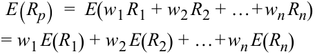

<!-- Formula Text: E(R p)  =  E(w 1 R 1 + w 2 R 2 + … + w n R n) = w 1 E(R 1) + w 2 E(R 2) + … + w n E(R n) -->

$$E(R_p) = E(w_1 R_1 + w_2 R_2 + \dots + w_n R_n) = w_1 E(R_1) + w_2 E(R_2) + \dots + w_n E(R_n)$$

- Phương sai của danh mục đầu tư chịu ảnh hưởng bởi cả rủi ro của từng tài sản thành phần riêng lẻ và rủi ro kết hợp của chúng cùng nhau được đo bằng hiệp phương sai, được định nghĩa là: 

<!-- Formula Text: σ 2(R p)  =  ∑ i=1 n ∑ j=1 n w i w j Cov(R i, R j). -->

$$\sigma^2(R_p) = \sum_{i=1}^{n} \sum_{j=1}^{n} w_i w_j \text{Cov}(R_i, R_j)$$

- Hiệp phương sai của tỷ suất sinh lợi có thể mang dấu âm (mối quan hệ ngược chiều trung bình giữa các tỷ suất sinh lợi), bằng 0 nếu tỷ suất sinh lợi trên các tài sản không liên quan với nhau, hoặc mang dấu dương (mối quan hệ cùng chiều trung bình giữa các tỷ suất sinh lợi). Hệ số tương quan, giống như hiệp phương sai, đo lường mối liên hệ tuyến tính và nằm trong khoảng từ –1 (nghịch biến mạnh) đến +1 (đồng biến mạnh), với 0 biểu thị không có mối quan hệ tuyến tính. 

- Hiệp phương sai của tỷ suất sinh lợi danh mục đầu tư có thể được ước tính bằng cách sử dụng hàm xác suất đồng thời (*joint probability function*) của các biến ngẫu nhiên. Được định nghĩa trên hai biến $X$ và $Y$ là $P(X,Y)$, hàm này cho biết xác suất xảy ra đồng thời các giá trị của chúng. Ví dụ, $P(X=3, Y=2)$ là xác suất $X$ bằng 3 và $Y$ bằng 2. 

- Công thức tính hiệp phương sai giữa hai biến ngẫu nhiên $R_A$ và $R_B$, chẳng hạn như các tài sản khác nhau của một danh mục đầu tư, là: 

<!-- Formula Text: Cov(R A, R B)  =  ∑ i ∑ j P(R A,i, R B,j)(R A,i − E R A)(R B,j − E R B). -->

$$\text{Cov}(R_A, R_B) = \sum_{i} \sum_{j} P(R_{A,i}, R_{B,j})(R_{A,i} - ER_A)(R_{B,j} - ER_B)$$

Giá trị này được tính bằng cách cộng tất cả các tích chéo độ lệch có thể có được nhân trọng số với xác suất đồng thời tương ứng. 

- Hàm xác suất đồng thời được đơn giản hóa đối với các biến độc lập (*independent variables*), được định nghĩa cho hai biến ngẫu nhiên $X$ và $Y$ khi và chỉ khi $P(X,Y) = P(X)P(Y)$. Giá trị kỳ vọng của tích của hai biến ngẫu nhiên độc lập cũng như không tương quan bằng tích các giá trị kỳ vọng của chúng. 

- Một ứng dụng của lý thuyết phân phối chuẩn vào các bài toán đầu tư thực tế liên quan đến các quy tắc an toàn trên hết (*safety-first rules*). Các quy tắc này tập trung vào việc giảm thiểu rủi ro thiếu hụt (*shortfall risk*), được định nghĩa là giá trị danh mục đầu tư (hoặc tỷ suất sinh lợi danh mục đầu tư) giảm xuống dưới một mức tối thiểu có thể chấp nhận được nào đó trong một khoảng thời gian nhất định. 

- Tỷ số an toàn trên hết (*safety-first ratio*) được định nghĩa là $\text{SFRatio} = [E(R_P) - R_L]/\sigma_P$, trong đó $E(R_P)$ là tỷ suất sinh lợi kỳ vọng của danh mục đầu tư, $R_L$ là mức ngưỡng tối thiểu được xác định trước cho một biến số quan tâm như tỷ suất sinh lợi danh mục đầu tư, và $\sigma_P$ là độ lệch chuẩn của danh mục đầu tư. Khi $R_L$ là lãi suất phi rủi ro, tỷ số an toàn trên hết tương đương với tỷ số Sharpe (*Sharpe ratio*). 

- Tiêu chuẩn an toàn trên hết của Roy (*Roy’s safety-first criterion*) phát biểu rằng danh mục đầu tư tối ưu sẽ tối thiểu hóa xác suất để tỷ suất sinh lợi của danh mục, $R_P$, giảm xuống dưới mức $R_L$. Đối với một danh mục đầu tư có tỷ số an toàn trên hết ($\text{SFRatio}$) cho trước, xác suất để 

<!-- PDF Page 161 -->

tỷ suất sinh lợi của nó nhỏ hơn $R_L$ là $\text{Normal}(-\text{SFRatio})$, và danh mục tối ưu theo tiêu chuẩn an toàn trên hết có xác suất đó thấp nhất. Tiêu chuẩn này được thực hiện bằng cách trước tiên tính $\text{SFRatio}$ của từng danh mục tiềm năng và sau đó chọn danh mục có $\text{SFRatio}$ cao nhất. 

##### **TỶ SUẤT SINH LỢI KỲ VỌNG VÀ PHƯƠNG SAI TỶ SUẤT SINH LỢI CỦA DANH MỤC ĐẦU TƯ (*PORTFOLIO EXPECTED RETURN AND VARIANCE OF RETURN*)** 

## **<mark>2</mark>** 

tính toán và diễn giải giá trị kỳ vọng, phương sai, độ lệch chuẩn, hiệp phương sai và hệ số tương quan của tỷ suất sinh lợi danh mục đầu tư 

**Tỷ suất sinh lợi kỳ vọng của danh mục đầu tư (*expected return on the portfolio* – $E(R_p)$)** là trung bình có trọng số của các tỷ suất sinh lợi kỳ vọng ($R_1$ đến $R_n$) trên các chứng khoán thành phần bằng cách sử dụng tỷ trọng tương ứng của chúng trong danh mục tính theo đơn vị tiền tệ làm trọng số ($w_1$ đến $w_n$): 

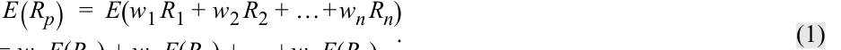

<!-- Formula Text: E(R p)  =  E(w 1 R 1 + w 2 R 2 + … + w n R n) = w E(R ) + w E(R ) + +w E(R )  . (1) -->

$$E(R_p) = E(w_1 R_1 + w_2 R_2 + \dots + w_n R_n) = w_1 E(R_1) + w_2 E(R_2) + \dots + w_n E(R_n) \tag{1}$$

Giả sử chúng ta đã ước tính tỷ suất sinh lợi kỳ vọng trên các tài sản trong danh mục ba tài sản được thể hiện trong Bảng minh họa 1. 

**Bảng minh họa 1: Tỷ trọng và Tỷ suất sinh lợi Kỳ vọng của Danh mục Mẫu (*Weights and Expected Returns of Sample Portfolio*)** 

|**Loại tài sản (*Asset Class*)**|**Tỷ trọng (*Weight*)**|**Tỷ suất sinh lợi kỳ vọng (*Expected Return*) (%)**|
|---|---|---|
|S&P 500|0.50|13|
|Trái phiếu doanh nghiệp dài hạn của Hoa Kỳ|0.25|6|
|MSCI EAFE|0.25|15|

Chúng ta tính được tỷ suất sinh lợi kỳ vọng của danh mục đầu tư là 11.75 phần trăm: 

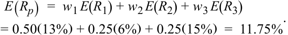

<!-- Formula Text: E(R p)  =  w 1 E(R 1) + w 2 E(R 2) + w 3 E(R 3) = 0.50(13%) + 0.25(6%) + 0.25(15%)  =  11.75% . -->

$$E(R_p) = w_1 E(R_1) + w_2 E(R_2) + w_3 E(R_3) = 0.50(13\%) + 0.25(6\%) + 0.25(15\%) = 11.75\%$$

Ở đây chúng ta quan tâm đến phương sai tỷ suất sinh lợi của danh mục đầu tư như một thước đo rủi ro đầu tư. Theo đó, phương sai danh mục đầu tư được tính như sau: 

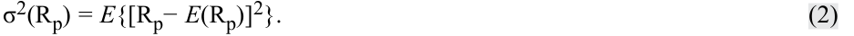

<!-- Formula Text: σ2(Rp) = E{[Rp− E(Rp)]2}. (2) -->

$$\sigma^2(R_p) = E\left\{[R_p - E(R_p)]^2\right\} \tag{2}$$

Đây là phương sai kỳ vọng hay phương sai theo nghĩa hướng tới tương lai (*forward-looking*). Để áp dụng định nghĩa về phương sai danh mục đầu tư này, chúng ta sử dụng thông tin về từng tài sản riêng lẻ trong danh mục, nhưng chúng ta cũng cần đến khái niệm hiệp phương sai. Để tránh sự rườm rà trong ký hiệu, chúng ta viết $ER_p$ thay cho $E(R_p)$. 

###### **Hiệp phương sai (*Covariance*)** 

Cho hai biến ngẫu nhiên $R_i$ và $R_j$, **hiệp phương sai (*covariance*)** giữa $R_i$ và $R_j$ như sau: 

$$\text{Cov}(R_i, R_j) = E[(R_i - ER_i)(R_j - ER_j)] \tag{3}$$

<!-- PDF Page 162 -->

Các ký hiệu thay thế khác là $\sigma(R_i, R_j)$ và $\sigma_{ij}$. Phương trình 3 phát biểu rằng hiệp phương sai giữa hai biến ngẫu nhiên là trung bình có trọng số xác suất của các tích chéo giữa độ lệch của mỗi biến ngẫu nhiên so với giá trị kỳ vọng của chính nó. Thước đo trên là hiệp phương sai tổng thể và mang tính hướng tới tương lai. Hiệp phương sai mẫu (*sample covariance*) giữa hai biến ngẫu nhiên $R_i$ và $R_j$, dựa trên một mẫu dữ liệu quá khứ có kích thước $n$, như sau: 

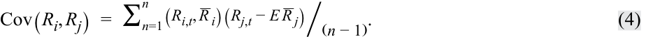

<!-- Formula Text: Cov(R i, R j)  =  ∑ n=1 n (R i,t, _ R  i)(R j,t − E _ R  j)⧸(n − 1). (4) -->

$$\text{Cov}(R_i, R_j) = \frac{\sum_{t=1}^{n} (R_{i,t} - \bar{R}_i)(R_{j,t} - \bar{R}_j)}{n - 1} \tag{4}$$

Hãy bắt đầu với định nghĩa về phương sai cho một danh mục gồm ba tài sản và xem cách nó phân rã thành ba số hạng phương sai và sáu số hạng hiệp phương sai. Bỏ qua bước biến đổi trung gian, kết quả là Phương trình 5: 

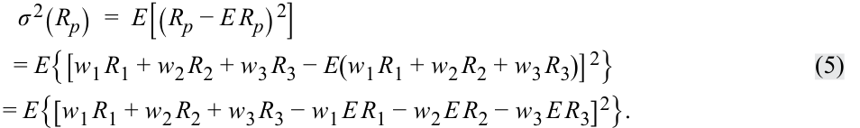

<!-- Formula Text: σ 2(R p)  =  E[(R p − E R p) 2] = E{[w 1 R 1 + w 2 R 2 + w 3 R 3 − E(w 1 R 1 + w 2 R 2 + w 3 R 3)] 2} = E{[w 1 R 1 + w 2 R 2 + w 3 R 3 − w 1 E R 1 − w 2 E R 2 − w 3 E R 3] 2}. (5) -->

$$\sigma^2(R_p) = E[(R_p - ER_p)^2] = E\left\{[w_1 R_1 + w_2 R_2 + w_3 R_3 - E(w_1 R_1 + w_2 R_2 + w_3 R_3)]^2\right\}$$

$$= E\left\{[w_1 R_1 + w_2 R_2 + w_3 R_3 - w_1 ER_1 - w_2 ER_2 - w_3 ER_3]^2\right\} \tag{5}$$

<!-- Formula Text: = w 1 2 σ 2(R 1) + w 1 w 2 Cov(R 1, R 2) + w 1 w 3 Cov(R 1, R 3) + w 1 w 2 Cov(R 1, R 2) + w 2 2 σ 2(R 2) + w 2 w 3 Cov(R 2, R 3) + w 1 w 3 Cov(R 1, R 3) + w 2 w 3 Cov(R 2, R 3) + w 2 3 σ 2(R 3). -->

$$= w_1^2 \sigma^2(R_1) + w_1 w_2 \text{Cov}(R_1, R_2) + w_1 w_3 \text{Cov}(R_1, R_3)$$

$$+ w_1 w_2 \text{Cov}(R_1, R_2) + w_2^2 \sigma^2(R_2) + w_2 w_3 \text{Cov}(R_2, R_3)$$

$$+ w_1 w_3 \text{Cov}(R_1, R_3) + w_2 w_3 \text{Cov}(R_2, R_3) + w_3^2 \sigma^2(R_3)$$

Lưu ý rằng thứ tự của các biến số trong hiệp phương sai không quan trọng, ví dụ $\text{Cov}(R_2, R_1) = \text{Cov}(R_1, R_2)$, và các số hạng phương sai nằm trên đường chéo $\sigma^2(R_1), \sigma^2(R_2)$, và $\sigma^2(R_3)$ có thể được biểu diễn lần lượt là $\text{Cov}(R_1, R_1), \text{Cov}(R_2, R_2)$, và $\text{Cov}(R_3, R_3)$, cách viết gọn nhất cho Phương trình 5 là: 

<!-- Formula Text: σ 2(R p)  =  ∑ i=1 3   ∑ j=1 3   w i w j Cov(R i, R j). -->

$$\sigma^2(R_p) = \sum_{i=1}^{3} \sum_{j=1}^{3} w_i w_j \text{Cov}(R_i, R_j)$$

Hơn nữa, biểu thức này được tổng quát hóa cho một danh mục đầu tư có kích thước $n$ bất kỳ thành: 

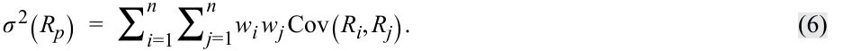

<!-- Formula Text: σ 2(R p)  =  ∑ i=1 n ∑ j=1 n w i w j Cov(R i, R j). (6) -->

$$\sigma^2(R_p) = \sum_{i=1}^{n} \sum_{j=1}^{n} w_i w_j \text{Cov}(R_i, R_j) \tag{6}$$

Phương trình 6 cho thấy phương sai tỷ suất sinh lợi của từng tài sản riêng lẻ chỉ cấu thành một phần, chứ không phải toàn bộ, phương sai của danh mục đầu tư. Ba số hạng phương sai ít hơn nhiều so với sáu số hạng hiệp phương sai nằm ngoài đường chéo chính (*off-diagonal*). Nếu có 20 tài sản, sẽ có 20 số hạng phương sai và $20(20) - 20 = 380$ số hạng hiệp phương sai ngoài đường chéo chính. Nhận xét đầu tiên là khi số lượng tài sản nắm giữ tăng lên, hiệp phương sai ngày càng trở nên quan trọng hơn, khi các yếu tố khác không đổi. 

Các số hạng hiệp phương sai nắm bắt cách thức sự đồng biến động (*co-movements*) của các tỷ suất sinh lợi ảnh hưởng đến tổng phương sai của danh mục đầu tư. Từ định nghĩa về hiệp phương sai, chúng ta có thể rút ra hai nhận xét thiết yếu về hiệp phương sai. 

**1.** Chúng ta có thể diễn giải dấu của hiệp phương sai như sau: 

   - Hiệp phương sai của tỷ suất sinh lợi mang dấu âm nếu, khi tỷ suất sinh lợi của một tài sản nằm trên giá trị kỳ vọng của nó, thì tỷ suất sinh lợi của tài sản kia có xu hướng nằm dưới giá trị kỳ vọng của nó (một mối quan hệ nghịch đảo trung bình giữa các tỷ suất sinh lợi). 

   - Hiệp phương sai của tỷ suất sinh lợi bằng 0 nếu tỷ suất sinh lợi của các tài sản không có liên hệ với nhau. 

   - Hiệp phương sai của tỷ suất sinh lợi mang dấu dương khi tỷ suất sinh lợi của cả hai tài sản có xu hướng nằm cùng một phía (cùng ở trên hoặc cùng ở dưới) so với giá trị kỳ vọng của chúng tại cùng một thời điểm (một mối quan hệ cùng chiều trung bình giữa các tỷ suất sinh lợi). 

**2.** Hiệp phương sai của một biến ngẫu nhiên với chính nó (_tự hiệp phương sai_ – *own covariance*) chính là phương sai của nó: $\text{Cov}(R, R) = E\{[R - E(R)][R - E(R)]\} = E\{[R - E(R)]^2\} = \sigma^2(R)$. 

<!-- PDF Page 163 -->

Bảng minh họa 2 tóm tắt các dữ liệu đầu vào cho tỷ suất sinh lợi kỳ vọng của danh mục đầu tư (Bảng A) và phương sai tỷ suất sinh lợi (Bảng B). Một danh sách đầy đủ các hiệp phương sai cấu thành toàn bộ dữ liệu thống kê cần thiết để tính phương sai tỷ suất sinh lợi của danh mục đầu tư như được thể hiện trong ma trận hiệp phương sai (*covariance matrix*) ở Bảng B. 

**Bảng minh họa 2: Các Dữ liệu Đầu vào cho Tỷ suất sinh lợi Kỳ vọng và Phương sai của Danh mục đầu tư (*Inputs to Portfolio Expected Return and Variance*)** 

|**A. Các dữ liệu đầu vào cho Tỷ suất sinh lợi Kỳ vọng của Danh mục (*Inputs to Portfolio Expected Return*)**||||
|---|---|---|---|
|**Tài sản (*Asset*)**|**A**|**B**|**C**|
||$E(R_A)$|$E(R_B)$|$E(R_C)$|
|**B. Ma trận Hiệp phương sai: Các dữ liệu đầu vào cho Phương sai Tỷ suất sinh lợi của Danh mục (*Covariance Matrix: The Inputs to Portfolio Variance of Return*)**||||
|**Tài sản (*Asset*)**|**A**|**B**|**C**|
|A|**$\text{Cov}(R_A, R_A)$**|$\text{Cov}(R_A, R_B)$|$\text{Cov}(R_A, R_C)$|
|B|$\text{Cov}(R_B, R_A)$|**$\text{Cov}(R_B, R_B)$**|$\text{Cov}(R_B, R_C)$|
|C|$\text{Cov}(R_C, R_A)$|$\text{Cov}(R_C, R_B)$|**$\text{Cov}(R_C, R_C)$**|

Với ba tài sản, ma trận hiệp phương sai có $3^2 = 3 \times 3 = 9$ phần tử, nhưng các số hạng trên đường chéo chính, tức các phương sai (được in đậm trong Bảng minh họa 2), được xử lý tách biệt với các số hạng ngoài đường chéo chính. Vì vậy, có $9 - 3 = 6$ hiệp phương sai, không tính các phương sai. Tuy nhiên, $\text{Cov}(R_B, R_A) = \text{Cov}(R_A, R_B)$, $\text{Cov}(R_C, R_A) = \text{Cov}(R_A, R_C)$, và $\text{Cov}(R_C, R_B) = \text{Cov}(R_B, R_C)$. Phần ma trận hiệp phương sai phía dưới đường chéo chính là hình ảnh phản chiếu qua gương của phần ma trận hiệp phương sai phía trên đường chéo chính, vì vậy bạn chỉ cần sử dụng một nửa (tức là phía dưới hoặc phía trên đường chéo chính). Do đó, chỉ có $6 / 2 = 3$ số hạng hiệp phương sai riêng biệt cần ước tính. Tổng quát, đối với $n$ chứng khoán, có $n(n - 1)/2$ hiệp phương sai riêng biệt và $n$ phương sai cần ước tính. 

Giả sử chúng ta có ma trận hiệp phương sai được thể hiện trong Bảng minh họa 3 với tỷ suất sinh lợi được biểu thị dưới dạng phần trăm. Các phần tử trong bảng được hiển thị theo đơn vị phần trăm tỷ suất sinh lợi bình phương ($\%^2$). Các số hạng $38\%^2$ và $400\%^2$ lần lượt là 0.0038 và 0.0400 khi được viết dưới dạng số thập phân; việc sử dụng đúng nhất quán đơn vị phần trăm hoặc số thập phân sẽ dẫn đến kết quả hoàn toàn giống nhau. 

**Bảng minh họa 3: Ma trận Hiệp phương sai (*Covariance Matrix*)** 

||**S&P 500**|**Trái phiếu doanh nghiệp dài hạn Hoa Kỳ (*US Long-Term Corporate Bonds*)**|**MSCI EAFE**|
|---|---|---|---|
|S&P 500|400|45|189|
|Trái phiếu doanh nghiệp dài hạn Hoa Kỳ|45|81|38|
|MSCI EAFE|189|38|441|

Lấy Phương trình 5 và nhóm các số hạng phương sai lại với nhau sẽ cho ra kết quả sau: 

$$\sigma^2(R_p) = w_1^2 \sigma^2(R_1) + w_2^2 \sigma^2(R_2) + w_3^2 \sigma^2(R_3) + 2 w_1 w_2 \text{Cov}(R_1, R_2) + 2 w_1 w_3 \text{Cov}(R_1, R_3) + 2 w_2 w_3 \text{Cov}(R_2, R_3)$$

$$= (0.50)^2(400) + (0.25)^2(81) + (0.25)^2(441) + 2(0.50)(0.25)(45) + 2(0.50)(0.25)(189) + 2(0.25)(0.25)(38)$$

$$= 100 + 5.0625 + 27.5625 + 11.25 + 47.25 + 4.75 = 195.875$$

<!-- PDF Page 164 -->

Phương sai là 195.875. Độ lệch chuẩn của tỷ suất sinh lợi là $195.875^{1/2} = 14\%$. Tóm lại, danh mục đầu tư có tỷ suất sinh lợi hàng năm kỳ vọng là 11.75 phần trăm và độ lệch chuẩn của tỷ suất sinh lợi là 14 phần trăm. 

Nhìn vào ba số hạng đầu tiên trong phép tính trên, tổng của chúng ($100 + 5.0625 + 27.5625$) là 132.625, chính là mức đóng góp của các phương sai riêng lẻ vào phương sai của danh mục đầu tư. Nếu tỷ suất sinh lợi của ba tài sản độc lập với nhau, các hiệp phương sai sẽ bằng 0 và độ lệch chuẩn của tỷ suất sinh lợi danh mục sẽ là $132.625^{1/2} = 11.52\%$ so với mức $14\%$ trước đó, tức là một danh mục ít rủi ro hơn. Nếu các số hạng hiệp phương sai mang dấu âm, thì một số âm sẽ được cộng vào 132.625, do đó phương sai và rủi ro của danh mục đầu tư sẽ còn nhỏ hơn nữa, trong khi tỷ suất sinh lợi kỳ vọng không thay đổi. Với cùng một mức tỷ suất sinh lợi kỳ vọng của danh mục, danh mục đó có rủi ro thấp hơn. Sự cắt giảm rủi ro này là lợi ích đa dạng hóa (*diversification benefit*), có nghĩa là lợi ích giảm thiểu rủi ro từ việc nắm giữ một danh mục các tài sản. Lợi ích đa dạng hóa tăng lên khi hiệp phương sai giảm xuống. Nhận xét này là một hiểu biết sâu sắc then chốt của lý thuyết danh mục đầu tư hiện đại. Hiểu biết này càng được diễn đạt trực quan hơn khi chúng ta sử dụng khái niệm hệ số tương quan. 

###### **Hệ số Tương quan (*Correlation*)** 

**Hệ số tương quan (*correlation*)** giữa hai biến ngẫu nhiên, $R_i$ và $R_j$, được định nghĩa như sau: 

$$\rho(R_i, R_j) = \frac{\text{Cov}(R_i, R_j)}{\sigma(R_i)\sigma(R_j)} \tag{7}$$

Các ký hiệu thay thế khác là $\text{Corr}(R_i, R_j)$ và $\rho_{ij}$. 

Định nghĩa về hệ số tương quan ở trên mang tính hướng tới tương lai vì nó liên quan đến việc chia hiệp phương sai hướng tới tương lai cho tích của các độ lệch chuẩn hướng tới tương lai. Thông thường, hiệp phương sai được thay thế bằng mối quan hệ $\text{Cov}(R_i, R_j) = \rho(R_i, R_j)\sigma(R_i)\sigma(R_j)$. Giống như hiệp phương sai, hệ số tương quan là một thước đo mối liên hệ tuyến tính. Tuy nhiên, phép chia trong định nghĩa làm cho hệ số tương quan trở thành một con số thuần túy (không có đơn vị đo lường) và đặt ra các giới hạn cho giá trị lớn nhất và nhỏ nhất có thể có của nó, lần lượt là +1 và –1. 

Nếu hai biến số có mối quan hệ tuyến tính cùng chiều mạnh, thì hệ số tương quan của chúng sẽ gần bằng +1. Nếu hai biến số có mối quan hệ tuyến tính ngược chiều mạnh, thì hệ số tương quan của chúng sẽ gần bằng –1. Nếu hai biến số có mối quan hệ tuyến tính yếu, thì hệ số tương quan của chúng sẽ gần bằng 0. Sử dụng định nghĩa trước đó, chúng ta có thể thiết lập một ma trận tương quan (*correlation matrix*) chỉ từ dữ liệu trong ma trận hiệp phương sai. Bảng minh họa 4 thể hiện ma trận tương quan này. 

**Bảng minh họa 4: Ma trận Tương quan của Tỷ suất sinh lợi (*Correlation Matrix of Returns*)** 

||**S&P 500**|**Trái phiếu doanh nghiệp dài hạn Hoa Kỳ (*US Long-Term Corporate Bonds*)**|**MSCI EAFE**|
|---|---|---|---|
|S&P 500|1.00|0.25|0.45|
|Trái phiếu doanh nghiệp dài hạn Hoa Kỳ|0.25|1.00|0.20|
|MSCI EAFE|0.45|0.20|1.00|

Ví dụ, từ Bảng minh họa 3, chúng ta biết hiệp phương sai giữa trái phiếu dài hạn và MSCI EAFE là 38. Độ lệch chuẩn của tỷ suất sinh lợi trái phiếu dài hạn là $81^{1/2} = 9\%$, và của tỷ suất sinh lợi MSCI EAFE là $441^{1/2} = 21\%$, lấy từ các số hạng trên đường chéo chính trong Bảng minh họa 3. Hệ số tương quan $\rho(R_{\text{trái phiếu dài hạn}}, R_{\text{EAFE}})$ là $38 / [(9\%)(21\%)] = 0.201$, làm tròn thành 0.20. Hệ số tương quan của S&P 500 với chính nó bằng 1: Phép tính là lấy tự hiệp phương sai của nó chia cho bình phương độ lệch chuẩn của chính nó. 

<!-- PDF Page 165 -->

###### **VÍ DỤ 1** 

###### **Tỷ suất sinh lợi Kỳ vọng và Phương sai Tỷ suất sinh lợi của Danh mục với các Tỷ trọng Danh mục Thay đổi (*Portfolio Expected Return and Variance of Return with Varying Portfolio Weights*)** 

Anna Cintara đang xây dựng các danh mục đầu tư khác nhau từ hai cổ phiếu sau đây: 

###### **Bảng minh họa 5: Mô tả Danh mục Hai Cổ phiếu (*Description of Two-Stock Portfolio*)** 

||**Cổ phiếu 1 (*Stock 1*)**||**Cổ phiếu 2 (*Stock 2*)**|
|---|---|---|---|
|Tỷ suất sinh lợi kỳ vọng (*Expected return*)|4%||8%|
|Độ lệch chuẩn (*Standard deviation*)|6%||15%|
|Tỷ trọng danh mục hiện tại (*Current portfolio weights*)|0.40||0.60|
|Hệ số tương quan giữa các tỷ suất sinh lợi (*Correlation between returns*)||0.30||

1. Tính hiệp phương sai giữa tỷ suất sinh lợi của hai cổ phiếu. 

   - **Lời giải:** 

Hệ số tương quan giữa tỷ suất sinh lợi của hai cổ phiếu là $\rho(R_i, R_j) = \text{Cov}(R_i, R_j) / [\sigma(R_i)\sigma(R_j)]$, do đó hiệp phương sai là $\text{Cov}(R_i, R_j) = \rho(R_i, R_j)\sigma(R_i)\sigma(R_j)$. Đối với hai cổ phiếu này, hiệp phương sai là $\text{Cov}(R_1, R_2) = \rho(R_1, R_2)\sigma(R_1)\sigma(R_2) = 0.30(6)(15) = 27$. 

2. Tỷ suất sinh lợi kỳ vọng và độ lệch chuẩn của danh mục là bao nhiêu nếu Cintara bỏ 100 phần trăm khoản đầu tư của mình vào Cổ phiếu 1 ($w_1 = 1.00$ và $w_2 = 0.00$)? Tỷ suất sinh lợi kỳ vọng và độ lệch chuẩn của danh mục là bao nhiêu nếu Cintara bỏ 100 phần trăm khoản đầu tư của mình vào Cổ phiếu 2 ($w_1 = 0.00$ và $w_2 = 1.00$)? 

   - **Lời giải:** 

Nếu danh mục được đầu tư 100 phần trăm vào Cổ phiếu 1, danh mục có tỷ suất sinh lợi kỳ vọng là 4 phần trăm và độ lệch chuẩn là 6 phần trăm. Nếu danh mục được đầu tư 100 phần trăm vào Cổ phiếu 2, danh mục có tỷ suất sinh lợi kỳ vọng là 8 phần trăm và độ lệch chuẩn là 15 phần trăm. 

3. Tỷ suất sinh lợi kỳ vọng và độ lệch chuẩn của danh mục khi sử dụng tỷ trọng danh mục hiện tại là bao nhiêu? 

###### **Lời giải:** 

Đối với danh mục tỷ trọng 40/60 hiện tại, tỷ suất sinh lợi kỳ vọng là: 

$$E(R_p) = w_1 E(R_1) + (1 - w_1)E(R_2) = 0.40(4\%) + 0.60(8\%) = 6.4\%$$

Phương sai và độ lệch chuẩn của danh mục như sau: 

$$\sigma^2(R_p) = w_1^2 \sigma^2(R_1) + w_2^2 \sigma^2(R_2) + 2 w_1 w_2 \text{Cov}(R_1, R_2)$$

$$= (0.40)^2(36) + (0.60)^2(225) + 2(0.40)(0.60)(27)$$

$$= 5.76 + 81 + 12.96 = 99.72$$

$$\sigma(R_p) = 99.72^{1/2} = 9.99\%$$

4. Tính tỷ suất sinh lợi kỳ vọng và độ lệch chuẩn của các danh mục khi $w_1$ thay đổi từ 0.00 đến 1.00 với bước nhảy 0.10 (và $w_2 = 1 - w_1$). Đặt các 

<!-- PDF Page 166 -->

kết quả (tỷ trọng cổ phiếu, tỷ suất sinh lợi kỳ vọng của danh mục và độ lệch chuẩn của danh mục) vào một bảng, và sau đó phác thảo đồ thị của các kết quả với độ lệch chuẩn trên trục hoành và tỷ suất sinh lợi kỳ vọng trên trục tung. 

###### **Lời giải:** 

Tỷ suất sinh lợi kỳ vọng, phương sai và độ lệch chuẩn của danh mục đầu tư ứng với các tập hợp tỷ trọng danh mục khác nhau được cho trong bảng sau. Ba hàng đã được tính trong lời giải của câu 2 và 3, và các hàng còn lại được tính bằng cách sử dụng cùng các công thức tỷ suất sinh lợi kỳ vọng, phương sai và độ lệch chuẩn như trong lời giải của câu 3: 

|**Tỷ trọng Cổ phiếu 1 (*Stock 1 weight*)**|**Tỷ trọng Cổ phiếu 2 (*Stock 2 weight*)**|**Tỷ suất sinh lợi kỳ vọng (*Expected return*) (%)**|**Phương sai (*Variance*) ($\%^2$)**|**Độ lệch chuẩn (*Standard deviation*) (%)**|
|---|---|---|---|---|
|1.00|0.00|4.00|36.00|6.00|
|0.90|0.10|4.40|36.27|6.02|
|0.80|0.20|4.80|40.68|6.38|
|0.70|0.30|5.20|49.23|7.02|
|0.60|0.40|5.60|61.92|7.87|
|0.50|0.50|6.00|78.75|8.87|
|0.40|0.60|6.40|99.72|9.99|
|0.30|0.70|6.80|124.83|11.17|
|0.20|0.80|7.20|154.08|12.41|
|0.10|0.90|7.60|187.47|13.69|
|0.00|1.00|8.00|225.00|15.00|

Đồ thị của tỷ suất sinh lợi kỳ vọng và độ lệch chuẩn như sau: 

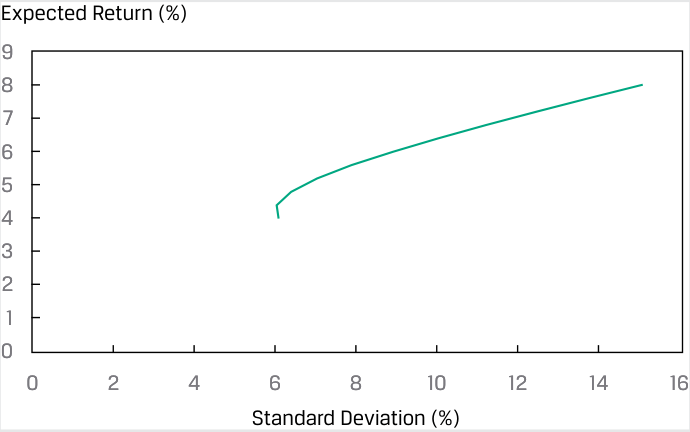

<!-- Picture Text: Expected Return (%) 9 8 7 6 5 4 3 2 1 0 0 2 4 6 8 10 12 14 16 Standard Deviation (%)  -->

> **Chú thích hình ảnh:**
> - **Trục tung:** Tỷ suất sinh lợi kỳ vọng (*Expected Return (%)*) từ 0 đến 9.
> - **Trục hoành:** Độ lệch chuẩn (*Standard Deviation (%)*) từ 0 đến 16.

###### **BỘ CÂU HỎI (*QUESTION SET*)** 

1. Tỷ suất sinh lợi trái phiếu của Hoa Kỳ và Tây Ban Nha được đo bằng cùng một đơn vị tiền tệ có độ lệch chuẩn lần lượt là 0.64 và 0.56. Nếu hệ số tương quan giữa hai trái phiếu là 0.24, thì hiệp phương sai của tỷ suất sinh lợi _gần nhất_ với: 

   - **A.** 0.086. 

   - **B.** 0.335. 

<!-- PDF Page 167 -->

   - **C.** 0.390. 

   - **Lời giải:** 

A là đáp án đúng. Hiệp phương sai là tích của các độ lệch chuẩn và hệ số tương quan sử dụng công thức $\text{Cov}(\text{tỷ suất sinh lợi trái phiếu Hoa Kỳ}, \text{tỷ suất sinh lợi trái phiếu Tây Ban Nha}) = \sigma(\text{trái phiếu Hoa Kỳ}) \times \sigma(\text{trái phiếu Tây Ban Nha}) \times \rho(\text{tỷ suất sinh lợi trái phiếu Hoa Kỳ}, \text{tỷ suất sinh lợi trái phiếu Tây Ban Nha}) = 0.64 \times 0.56 \times 0.24 = 0.086$. 

2. Hiệp phương sai của tỷ suất sinh lợi mang dấu dương khi tỷ suất sinh lợi của hai tài sản có xu hướng: 

   - **A.** có cùng giá trị kỳ vọng. 

   - **B.** nằm trên giá trị kỳ vọng của chúng tại các thời điểm khác nhau. 

   - **C.** nằm cùng một phía so với giá trị kỳ vọng của chúng tại cùng một thời điểm. 

   - **Lời giải:** 

C là đáp án đúng. Hiệp phương sai của tỷ suất sinh lợi mang dấu dương khi tỷ suất sinh lợi của cả hai tài sản có xu hướng nằm cùng một phía (cùng ở trên hoặc cùng ở dưới) so với giá trị kỳ vọng của chúng tại cùng một thời điểm, cho thấy một mối quan hệ cùng chiều trung bình giữa các tỷ suất sinh lợi. 

3. Hệ số tương quan nào sau đây cho biết mối quan hệ tuyến tính yếu nhất giữa hai biến số? 

   - **A.** –0.67 

   - **B.** –0.24 

   - **C.** 0.33 

###### **Lời giải:** 

B là đáp án đúng. Các hệ số tương quan gần +1 thể hiện tính tuyến tính dương mạnh, trong khi các hệ số tương quan gần –1 thể hiện tính tuyến tính âm mạnh. Hệ số tương quan bằng 0 cho biết sự vắng mặt của bất kỳ mối quan hệ tuyến tính nào giữa các biến số. Hệ số tương quan càng gần 0 thì mối quan hệ tuyến tính càng yếu. 

4. Một chuyên viên phân tích lập ma trận hiệp phương sai của tỷ suất sinh lợi như sau: 

||**Quỹ Phòng hộ (*Hedge Fund*)**|**Chỉ số Thị trường (*Market Index*)**|
|---|---|---|
|Quỹ phòng hộ (*Hedge fund*)|256|110|
|Chỉ số thị trường (*Market index*)|110|81|

Hệ số tương quan của tỷ suất sinh lợi giữa quỹ phòng hộ và chỉ số thị trường _gần nhất_ với: 

   - **A.** 0.005. 

   - **B.** 0.073. 

   - **C.** 0.764. 

###### **Lời giải:** 

C là đáp án đúng. Hệ số tương quan giữa hai biến ngẫu nhiên $R_i$ và $R_j$ được định nghĩa là $\rho(R_i, R_j) = \text{Cov}(R_i, R_j) / [\sigma(R_i)\sigma(R_j)]$. Sử dụng chỉ số dưới $i$ để đại diện cho quỹ phòng hộ và chỉ số dưới $j$ để đại diện cho chỉ số thị trường, các độ lệch chuẩn là $\sigma(R_i) = 256^{1/2} = 16$ và $\sigma(R_j) = 81^{1/2} = 9$. Do đó, $\rho(R_i, R_j) = \text{Cov}(R_i, R_j) / [\sigma(R_i)\sigma(R_j)] = 110 / (16 \times 9) = 0.764$. 

5. Khi các yếu tố khác không đổi, khi hệ số tương quan giữa hai tài sản tiến gần đến +1.0, lợi ích đa dạng hóa (*diversification benefits*) sẽ: 

   - **A.** giảm xuống. 

<!-- PDF Page 168 -->

   - **B.** giữ nguyên. 

   - **C.** tăng lên. 

   - **Lời giải:** 

A là đáp án đúng. Khi hệ số tương quan giữa hai tài sản tiến gần đến +1, lợi ích đa dạng hóa sẽ giảm xuống. Nói cách khác, hệ số tương quan dương ngày càng tăng cho thấy mối quan hệ tuyến tính cùng chiều ngày càng mạnh và lợi ích đa dạng hóa ngày càng ít đi. 

6. Cho một danh mục gồm năm cổ phiếu, cần bao nhiêu số hạng hiệp phương sai riêng biệt (duy nhất), không tính các phương sai, để tính phương sai tỷ suất sinh lợi của danh mục đầu tư? 

   - **A.** 10 

   - **B.** 20 

   - **C.** 25 

   - **Lời giải:** 

A là đáp án đúng. Một ma trận hiệp phương sai cho năm cổ phiếu có $5 \times 5 = 25$ phần tử. Trừ đi 5 số hạng phương sai trên đường chéo chính sẽ còn lại 20 phần tử ngoài đường chéo chính. Bởi vì ma trận hiệp phương sai có tính đối xứng, nên chỉ có 10 phần tử là duy nhất ($20 / 2 = 10$). 

7. Phát biểu nào sau đây là _chính xác nhất_? Nếu hiệp phương sai của tỷ suất sinh lợi giữa hai tài sản là 0.0023, thì: 

   - **A.** rủi ro của các tài sản gần bằng không. 

   - **B.** tỷ suất sinh lợi của các tài sản không có liên hệ với nhau. 

   - **C.** tỷ suất sinh lợi của các tài sản có mối quan hệ cùng chiều (dương). 

   - **Lời giải:** 

C là đáp án đúng. Hiệp phương sai của tỷ suất sinh lợi mang dấu dương khi tỷ suất sinh lợi của cả hai tài sản có xu hướng nằm cùng một phía (cùng ở trên hoặc cùng ở dưới) so với giá trị kỳ vọng của chúng tại cùng một thời điểm. 

8. Một danh mục gồm hai cổ phiếu bao gồm các cổ phiếu có các đặc điểm sau: 

||**Cổ phiếu 1 (*Stock 1*)**||**Cổ phiếu 2 (*Stock 2*)**|
|---|---|---|---|
|Tỷ suất sinh lợi kỳ vọng (*Expected return*)|7%||10%|
|Độ lệch chuẩn (*Standard deviation*)|12%||25%|
|Tỷ trọng danh mục (*Portfolio weights*)|0.30||0.70|
|Hệ số tương quan (*Correlation*)||0.20||

Độ lệch chuẩn của tỷ suất sinh lợi danh mục đầu tư là bao nhiêu? 

   - **A.** 14.91 phần trăm 

   - **B.** 18.56 phần trăm 

   - **C.** 21.10 phần trăm 

   - **Lời giải:** 

B là đáp án đúng. Hiệp phương sai giữa tỷ suất sinh lợi của hai cổ phiếu là $\text{Cov}(R_1, R_2) = \rho(R_1, R_2)\sigma(R_1)\sigma(R_2) = 0.20(12)(25) = 60$. Phương sai của danh mục đầu tư là: 

<!-- PDF Page 169 -->

$$\sigma^2(R_p) = w_1^2 \sigma^2(R_1) + w_2^2 \sigma^2(R_2) + 2 w_1 w_2 \text{Cov}(R_1, R_2)$$

$$= (0.30)^2(12)^2 + (0.70)^2(25)^2 + 2(0.30)(0.70)(60) = 12.96 + 306.25 + 25.2 = 344.41$$

Độ lệch chuẩn của danh mục đầu tư là $\sigma(R_p) = 344.41^{1/2} = 18.56\%$. 

9. Lena Hunziger đã thiết kế danh mục ba tài sản sau đây: 

||**Tài sản 1 (*Asset 1*)**|**Tài sản 2 (*Asset 2*)**|**Tài sản 3 (*Asset 3*)**|
|---|---|---|---|
|Tỷ suất sinh lợi kỳ vọng (*Expected return*)|5%|6%|7%|
|Tỷ trọng danh mục (*Portfolio weight*)|**0.20**|0.30|0.50|

###### **Ma trận Phương sai-Hiệp phương sai (*Variance-Covariance Matrix*)** 

||**Tài sản 1 (*Asset 1*)**|**Tài sản 2 (*Asset 2*)**|**Tài sản 3 (*Asset 3*)**|
|---|---|---|---|
|Tài sản 1|196|105|140|
|Tài sản 2|105|225|150|
|Tài sản 3|140|150|400|

Hunziger ước tính tỷ suất sinh lợi của danh mục đầu tư là 6.3 phần trăm. Độ lệch chuẩn của danh mục đầu tư là bao nhiêu? 

   - **A.** 13.07 phần trăm 

   - **B.** 13.88 phần trăm 

   - **C.** 14.62 phần trăm 

   - **Lời giải:** 

C là đáp án đúng. Đối với danh mục gồm ba tài sản, phương sai của danh mục đầu tư là: 

$$\sigma^2(R_p) = w_1^2 \sigma^2(R_1) + w_2^2 \sigma^2(R_2) + w_3^2 \sigma^2(R_3) + 2 w_1 w_2 \text{Cov}(R_1, R_2) + 2 w_1 w_3 \text{Cov}(R_1, R_3) + 2 w_2 w_3 \text{Cov}(R_2, R_3)$$

$$= (0.20)^2(196) + (0.30)^2(225) + (0.50)^2(400) + 2(0.20)(0.30)(105) + 2(0.20)(0.50)(140) + 2(0.30)(0.50)(150)$$

$$= 7.84 + 20.25 + 100 + 12.6 + 28 + 45 = 213.69$$

Độ lệch chuẩn của danh mục đầu tư là: 

$$\sigma(R_p) = 213.69^{1/2} = 14.62\%$$

##### **DỰ BÁO HỆ SỐ TƯƠNG QUAN CỦA TỶ SUẤT SINH LỢI: HIỆP PHƯƠNG SAI KHI BIẾT HÀM XÁC SUẤT ĐỒNG THỜI (*FORECASTING CORRELATION OF RETURNS: COVARIANCE GIVEN A JOINT PROBABILITY FUNCTION*)** 

## **<mark>3</mark>** 

tính toán và diễn giải hiệp phương sai và hệ số tương quan của tỷ suất sinh lợi danh mục đầu tư bằng cách sử dụng hàm xác suất đồng thời của tỷ suất sinh lợi 

<!-- PDF Page 170 -->

Làm thế nào để chúng ta ước tính hiệp phương sai và hệ số tương quan của tỷ suất sinh lợi? Thông thường, chúng ta đưa ra các dự báo trên cơ sở hiệp phương sai lịch sử hoặc sử dụng các phương pháp khác chẳng hạn như hồi quy mô hình thị trường (*market model regression*) dựa trên dữ liệu tỷ suất sinh lợi lịch sử. Chúng ta cũng có thể tính hiệp phương sai bằng cách sử dụng **hàm xác suất đồng thời (*joint probability function*)** của các biến ngẫu nhiên, nếu hàm đó có thể được ước tính. Hàm xác suất đồng thời của hai biến ngẫu nhiên $X$ và $Y$, được ký hiệu là $P(X,Y)$, cho biết xác suất xảy ra đồng thời các giá trị của $X$ và $Y$. Ví dụ, $P(X=3, Y=2)$ là xác suất $X$ bằng 3 và $Y$ bằng 2. 

Giả sử rằng hàm xác suất đồng thời của tỷ suất sinh lợi trên cổ phiếu BankCorp ($R_A$) và tỷ suất sinh lợi trên cổ phiếu NewBank ($R_B$) có cấu trúc đơn giản được cho trong Bảng minh họa 6. 

**Bảng minh họa 6: Hàm Xác suất Đồng thời của Tỷ suất sinh lợi BankCorp và NewBank (Các phần tử trong bảng là Xác suất Đồng thời) (*Joint Probability Function of BankCorp and NewBank Returns (Entries Are Joint Probabilities)*)** 

||**$R_B = 20\%$**|**$R_B = 16\%$**|**$R_B = 10\%$**|
|---|---|---|---|
|$R_A = 25\%$|0.20|0|0|
|$R_A = 12\%$|0|0.50|0|
|$R_A = 10\%$|0|0|0.30|

Tỷ suất sinh lợi kỳ vọng trên cổ phiếu BankCorp là $0.20(25\%) + 0.50(12\%) + 0.30(10\%) = 14\%$. Tỷ suất sinh lợi kỳ vọng trên cổ phiếu NewBank là $0.20(20\%) + 0.50(16\%) + 0.30(10\%) = 15\%$. Hàm xác suất đồng thời ở trên có thể phản ánh một phân tích dựa trên việc điều kiện ngành ngân hàng là tốt (*good*), trung bình (*average*), hay kém (*poor*). Bảng minh họa 7 trình bày phép tính hiệp phương sai. 

**Bảng minh họa 7: Các Phép tính Hiệp phương sai (*Covariance Calculations*)** 

|**Điều kiện ngành ngân hàng (*Banking Industry Condition*)**|**Độ lệch của BankCorp (*Deviations BankCorp*)**|**Độ lệch của NewBank (*Deviations NewBank*)**|**Tích các độ lệch (*Product of Deviations*)**|**Xác suất của điều kiện (*Probability of Condition*)**|**Tích có trọng số xác suất (*Probability-Weighted Product*)**|
|---|---|---|---|---|---|
|Tốt (*Good*)|$25 - 14$|$20 - 15$|55|0.20|11|
|Trung bình (*Average*)|$12 - 14$|$16 - 15$|−2|0.50|−1|
|Kém (*Poor*)|$10 - 14$|$10 - 15$|20|0.30|6 $\text{Cov}(R_A, R_B) = 16$|

_Lưu ý:_ Tỷ suất sinh lợi kỳ vọng của BankCorp là 14% và của NewBank là 15%. 

Cột số thứ nhất và thứ hai thể hiện lần lượt các độ lệch của tỷ suất sinh lợi BankCorp và NewBank so với giá trị trung bình hay giá trị kỳ vọng của chúng. Cột tiếp theo thể hiện tích của các độ lệch đó. Ví dụ, đối với điều kiện ngành tốt, $(25 - 14)(20 - 15) = 11(5) = 55$. Sau đó, 55 được nhân hay tính trọng số với 0.20, tức xác suất điều kiện ngành ngân hàng là tốt: $55(0.20) = 11$. Các phép tính cho điều kiện ngành ngân hàng trung bình và kém tuân theo quy trình tương tự. Cộng các tích có trọng số xác suất này lại, chúng ta tìm được $\text{Cov}(R_A, R_B) = 16$. 

Công thức tính hiệp phương sai giữa hai biến ngẫu nhiên $R_A$ và $R_B$ là: 

$$\text{Cov}(R_A, R_B) = \sum_{i} \sum_{j} P(R_{A,i}, R_{B,j})(R_{A,i} - ER_A)(R_{B,j} - ER_B) \tag{8}$$

Công thức này cho chúng ta biết cần cộng tất cả các tích chéo độ lệch có thể có được nhân trọng số với xác suất đồng thời thích hợp. 

<!-- PDF Page 171 -->

Tiếp theo, chúng ta lưu ý thực tế rằng khi hai biến ngẫu nhiên độc lập với nhau, hàm xác suất đồng thời của chúng sẽ được đơn giản hóa. 

Hai biến ngẫu nhiên $X$ và $Y$ **độc lập (*independent*)** khi và chỉ khi $P(X,Y) = P(X)P(Y)$. 

Ví dụ, nếu độc lập với nhau, $P(3,2) = P(3)P(2)$. Chúng ta nhân các xác suất riêng lẻ lại để có được các xác suất đồng thời. _Tính độc lập (Independence)_ là một tính chất mạnh hơn _tính không tương quan (uncorrelatedness)_ bởi vì tương quan chỉ đề cập đến các mối quan hệ tuyến tính. Điều kiện sau đây luôn đúng với các biến ngẫu nhiên độc lập và do đó cũng đúng với các biến ngẫu nhiên không tương quan: 

Giá trị kỳ vọng của tích các biến ngẫu nhiên không tương quan bằng tích các giá trị kỳ vọng của chúng. 

$$E(XY) = E(X)E(Y) \text{ nếu } X \text{ và } Y \text{ không tương quan.}$$

Nhiều biến số tài chính, chẳng hạn như doanh thu (giá nhân với sản lượng), là tích của các đại lượng ngẫu nhiên. Khi có thể áp dụng, quy tắc trên giúp đơn giản hóa việc tính toán giá trị kỳ vọng của một tích các biến ngẫu nhiên. 

###### **VÍ DỤ 2** 

###### **Hiệp phương sai và Hệ số Tương quan của Tỷ suất sinh lợi Chứng khoán (*Covariances and Correlations of Security Returns*)** 

Isabel Vasquez đang xem xét các hệ số tương quan giữa bốn loại tài sản trong danh mục đầu tư của công ty cô. Trong Bảng minh họa 8, cô vẽ đồ thị 24 mức tỷ suất sinh lợi hàng tháng gần đây của cổ phiếu vốn hóa lớn Hoa Kỳ so với cổ phiếu vốn hóa lớn thế giới không bao gồm Hoa Kỳ (Hình A) và 24 mức tỷ suất sinh lợi hàng tháng của trái phiếu doanh nghiệp trung hạn so với trái phiếu doanh nghiệp dài hạn (Hình B). Vasquez trình bày các mức tỷ suất sinh lợi, phương sai và hiệp phương sai dưới dạng số thập phân thay vì dạng phần trăm. Lưu ý các khoảng giá trị trên trục tung (Tỷ suất sinh lợi %). 

<!-- PDF Page 172 -->

###### **Bảng minh họa 8: Tỷ suất sinh lợi Hàng tháng của Bốn Loại Tài sản (*Monthly Returns for Four Asset Classes*)** 

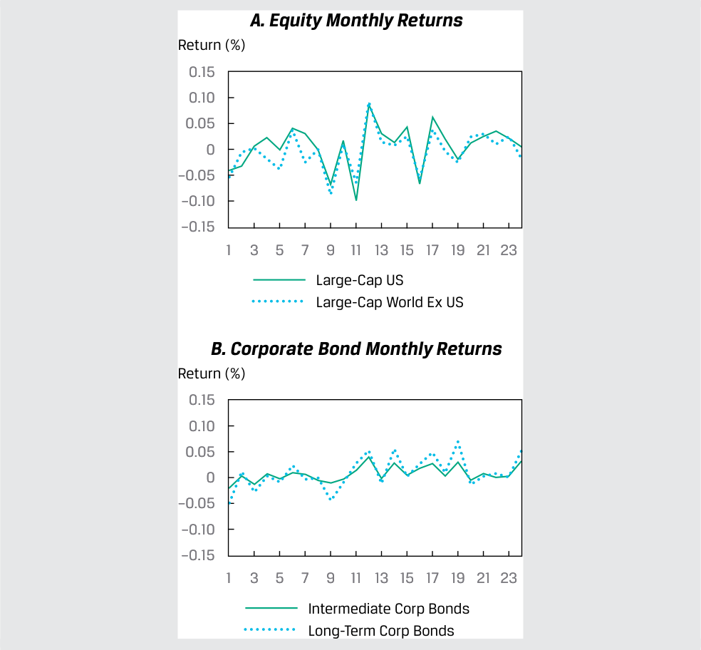

<!-- Picture Text: A. Equity Monthly Returns Return (%) 0.15 0.10 0.05 0 –0.05 –0.10 –0.15 1 3 5 7 9 11 13 15 17 19 21 23 Large-Cap US Large-Cap World Ex US B. Corporate Bond Monthly Returns Return (%) 0.15 0.10 0.05 0 –0.05 –0.10 –0.15 1 3 5 7 9 11 13 15 17 19 21 23 Intermediate Corp Bonds Long-Term Corp Bonds  -->

> **Chú thích hình ảnh:**
> - **A. Equity Monthly Returns (Tỷ suất sinh lợi hàng tháng của Cổ phiếu):** Cổ phiếu vốn hóa lớn Hoa Kỳ (*Large-Cap US*) và Cổ phiếu vốn hóa lớn thế giới trừ Hoa Kỳ (*Large-Cap World Ex US*).
> - **B. Corporate Bond Monthly Returns (Tỷ suất sinh lợi hàng tháng của Trái phiếu doanh nghiệp):** Trái phiếu doanh nghiệp trung hạn (*Intermediate Corp Bonds*) và Trái phiếu doanh nghiệp dài hạn (*Long-Term Corp Bonds*).

1. Dữ liệu chọn lọc cho bốn loại tài sản được thể hiện trong Bảng minh họa 9. 

**Bảng minh họa 9: Dữ liệu Chọn lọc cho Bốn Loại Tài sản (*Selected Data for Four Asset Classes*)** 

|**Các loại tài sản (*Asset Classes*)**|**Cổ phiếu vốn hóa lớn Hoa Kỳ (*Large-Cap US Equities*)**|**Cổ phiếu Thế giới (trừ Hoa Kỳ) (*World (ex US) Equities*)**|**Trái phiếu doanh nghiệp trung hạn (*Intermediate Corp Bonds*)**|**Trái phiếu doanh nghiệp dài hạn (*Long-Term Corp Bonds*)**|
|---|---|---|---|---|
|Phương sai (*Variance*)|0.001736|0.001488|0.000174|0.000699|
|Độ lệch chuẩn (*Standard deviation*)|0.041668|0.038571|0.013180|0.026433|
|Hiệp phương sai (*Covariance*)||0.001349||0.000318|
|Hệ số tương quan (*Correlation*)||0.87553||0.95133|

Vasquez lưu ý, như được thể hiện trong Bảng minh họa 9, rằng mặc dù hai loại cổ phiếu có phương sai và hiệp phương sai lớn hơn nhiều so với hai loại trái phiếu, nhưng hệ số tương quan giữa hai loại cổ phiếu lại thấp hơn hệ số tương quan giữa hai loại trái phiếu. Cô cũng lưu ý rằng trái phiếu dài hạn biến động mạnh hơn (phương sai cao hơn) so với trái phiếu trung hạn; tuy nhiên, tỷ suất sinh lợi của trái phiếu dài hạn và trung hạn vẫn có hệ số tương quan cao. 

---

# Tập 1: Phương pháp Định lượng (*Quantitative Methods*)
## Học phần 5: Toán học Danh mục đầu tư (*Portfolio Mathematics*)
### Phần 2/2: Các Thước đo Rủi ro Danh mục đầu tư: Ứng dụng của Phân phối Chuẩn (*Portfolio Risk Measures: Applications of the Normal Distribution*) (Trang PDF 173–182)

---

<!-- PDF Page 173 -->

### **CÁC THƯỚC ĐO RỦI RO DANH MỤC ĐẦU TƯ: ỨNG DỤNG CỦA PHÂN PHỐI CHUẨN (*PORTFOLIO RISK MEASURES: APPLICATIONS OF THE NORMAL DISTRIBUTION*)** 

# **<mark>4</mark>** 

định nghĩa rủi ro thiếu hụt (*shortfall risk*), tính toán tỷ số an toàn trên hết (*safety-first ratio*), và xác định danh mục đầu tư tối ưu bằng cách sử dụng tiêu chuẩn an toàn trên hết của Roy (*Roy’s safety-first criterion*) 

Lý thuyết danh mục đầu tư hiện đại (MPT) thường liên quan đến việc đánh giá các cơ hội đầu tư bằng cách sử dụng các thước đo tỷ suất sinh lợi trung bình và phương sai của tỷ suất sinh lợi. Trong lý thuyết kinh tế, **phân tích trung bình–phương sai (*mean–variance analysis*)** hoàn toàn chính xác khi các nhà đầu tư ngại rủi ro (*risk averse*); khi họ lựa chọn các khoản đầu tư nhằm tối đa hóa hữu dụng kỳ vọng (*expected utility*) hay sự thỏa mãn; và khi hoặc (giả định 1) tỷ suất sinh lợi có phân phối chuẩn hoặc (giả định 2) các nhà đầu tư có hàm hữu dụng bậc hai (*quadratic utility functions* – một khái niệm được sử dụng trong kinh tế học để biểu diễn toán học sự đánh đổi giữa rủi ro và tỷ suất sinh lợi). Tuy nhiên, phân tích trung bình–phương sai vẫn có thể hữu ích—nghĩa là nó có thể đúng một cách xấp xỉ—khi giả định 1 hoặc giả định 2 bị vi phạm. Bởi vì những người hành nghề thực tiễn thích làm việc với các đại lượng có thể quan sát được, chẳng hạn như tỷ suất sinh lợi, nên mệnh đề cho rằng tỷ suất sinh lợi ít nhất tuân theo phân phối chuẩn một cách xấp xỉ đã đóng một vai trò then chốt trong phần lớn lý thuyết MPT. 

Để minh họa khái niệm này, giả sử một nhà đầu tư đang tiết kiệm cho việc nghỉ hưu. Mặc dù mục tiêu của bà là kiếm được tỷ suất sinh lợi thực cao nhất có thể, bà tin rằng danh mục đầu tư ít nhất phải đạt được mục tiêu bảo toàn vốn thực (*real capital preservation*) trong dài hạn. Giả sử tỷ lệ lạm phát kỳ vọng dài hạn là 2 phần trăm, mức tỷ suất sinh lợi tối thiểu có thể chấp nhận được (*minimum acceptable return*) sẽ là 2 phần trăm. Bảng minh họa 10 so sánh ba phương án đầu tư thay thế xét về tỷ suất sinh lợi kỳ vọng và độ lệch chuẩn của tỷ suất sinh lợi của chúng. Xác suất rơi xuống dưới mức 2 phần trăm được tính dựa trên giả định tỷ suất sinh lợi có phân phối chuẩn. Trong Bảng minh họa 10, chúng ta thấy rằng Danh mục II, kết hợp tỷ suất sinh lợi kỳ vọng cao nhất và độ biến động (*volatility*) thấp nhất, có xác suất kiếm được dưới 2 phần trăm là thấp nhất (hoặc tương đương, có xác suất kiếm được ít nhất 2 phần trăm là cao nhất). Điều này cũng có thể được nhìn thấy trong Bảng B, cho thấy Danh mục II có diện tích tô đậm nhỏ nhất ở phía bên trái mức 2 phần trăm (xác suất kiếm được thấp hơn mức tỷ suất sinh lợi tối thiểu có thể chấp nhận được). 

**Bảng minh họa 10: Xác suất Kiếm được Tỷ suất sinh lợi Tối thiểu Có thể Chấp nhận được (*Probability of Earning a Minimum Acceptable Return*)** 

#### **Bảng A: Đặc điểm của các Danh mục Thay thế (*Alternative Portfolio Characteristics*)** 

|**Danh mục đầu tư (*Portfolio*)**|**I**|**II**|**III**|
|---|---|---|---|
|Tỷ suất sinh lợi kỳ vọng (*Expected return*)|5%|8%|5%|
|Độ lệch chuẩn của tỷ suất sinh lợi (*Standard deviation of return*)|8%|8%|12%|
|Xác suất kiếm được $< 2\%$ [$P(x < 2)$]|37.7%|24.6%|41.7%|
|Xác suất kiếm được $\ge 2\%$ [$P(x \ge 2)$]|62.3%|75.4%|58.3%|

<!-- PDF Page 174 -->

#### **Bảng B: Khả năng Đạt được Tỷ suất sinh lợi Tối thiểu Có thể Chấp nhận được (*Likelihoods of Attaining Minimal Acceptable Return*)** 

##### **_A. Danh mục I (*Portfolio I*)_** 

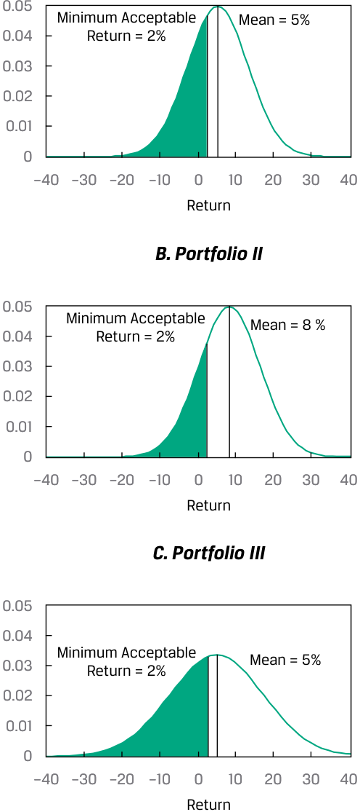

<!-- Picture Text: 0.05 Minimum Acceptable Mean = 5% 0.04 Return = 2% 0.03 0.02 0.01 0 –40 –30 –20 –10 0 10 20 30 40 Return B. Portfolio II 0.05 Minimum Acceptable Mean = 8 % 0.04 Return = 2% 0.03 0.02 0.01 0 –40 –30 –20 –10 0 10 20 30 40 Return C. Portfolio III 0.05 0.04 Minimum Acceptable Mean = 5% 0.03 Return = 2% 0.02 0.01 0 –40 –30 –20 –10 0 10 20 30 40 Return  -->

> **Chú thích hình ảnh:**
> - **A. Portfolio I:** Tỷ suất sinh lợi tối thiểu chấp nhận được (*Minimum Acceptable Return*) = 2%, Trung bình (*Mean*) = 5%.
> - **B. Portfolio II:** Tỷ suất sinh lợi tối thiểu chấp nhận được = 2%, Trung bình = 8%.
> - **C. Portfolio III:** Tỷ suất sinh lợi tối thiểu chấp nhận được = 2%, Trung bình = 5% (đường cong rộng hơn do độ lệch chuẩn 12%).

Phân tích trung bình–phương sai nhìn chung xem xét rủi ro một cách đối xứng theo nghĩa là độ lệch chuẩn nắm bắt sự biến thiên ở cả phía trên và phía dưới giá trị trung bình. Một cách tiếp cận thay thế chỉ đánh giá rủi ro phía dưới (*downside risk*). Chúng ta thảo luận về một cách tiếp cận như vậy, đó là các quy tắc an toàn trên hết (*safety-first rules*), bởi vì chúng cung cấp một minh họa xuất sắc về việc áp dụng lý thuyết phân phối chuẩn vào các bài toán đầu tư thực tế. **Các quy tắc an toàn trên hết (*Safety-first rules*)** tập trung vào **rủi ro thiếu hụt (*shortfall risk*)**, tức rủi ro giá trị danh mục đầu tư (hoặc tỷ suất sinh lợi danh mục đầu tư) sẽ rơi xuống dưới một mức tối thiểu có thể chấp nhận được nào đó trong một khoảng thời gian nhất định. Rủi ro tài sản trong một quỹ hưu trí có mức hưởng xác định (*defined benefit plan*) giảm xuống thấp hơn các nghĩa vụ nợ của quỹ là một ví dụ về rủi ro thiếu hụt. 

Giả sử một nhà đầu tư coi bất kỳ mức tỷ suất sinh lợi nào thấp hơn mức $R_L$ là không thể chấp nhận được. **Tiêu chuẩn an toàn trên hết của Roy (*Roy’s safety-first criterion*)** (Roy 1952) phát biểu rằng danh mục đầu tư tối ưu sẽ tối thiểu hóa xác suất để tỷ suất sinh lợi của danh mục, $R_P$, rơi xuống dưới mức ngưỡng (*threshold level*), $R_L$. Nghĩa là, mục tiêu của nhà đầu tư là chọn một danh mục tối thiểu hóa $P(R_P < R_L)$. Khi tỷ suất sinh lợi của danh mục có phân phối chuẩn, chúng ta có thể tính $P(R_P < R_L)$ bằng cách sử dụng số lần độ lệch chuẩn mà mức $R_L$ nằm thấp hơn tỷ suất sinh lợi kỳ vọng của danh mục, $E(R_P)$. 

<!-- PDF Page 175 -->

Danh mục nào có $E(R_P) - R_L$ lớn nhất tương ứng với độ lệch chuẩn sẽ tối thiểu hóa $P(R_P < R_L)$. Do đó, nếu tỷ suất sinh lợi có phân phối chuẩn, danh mục tối ưu theo tiêu chuẩn an toàn trên hết sẽ _tối đa hóa_ **tỷ số an toàn trên hết (*safety-first ratio* – SFRatio)**, như sau: 

$$\text{SFRatio} = \frac{E(R_P) - R_L}{\sigma_P} \tag{9}$$

Đại lượng $E(R_P) - R_L$ là khoảng cách từ tỷ suất sinh lợi trung bình đến mức thiếu hụt (*shortfall level*). Chia khoảng cách này cho $\sigma_P$ sẽ cho biết khoảng cách tính theo đơn vị độ lệch chuẩn. Khi lựa chọn giữa các danh mục đầu tư bằng tiêu chuẩn của Roy (giả định phân phối chuẩn), hãy làm theo hai bước sau: 

**1.** Tính $\text{SFRatio}$ của từng danh mục đầu tư. 

**2.** Chọn danh mục đầu tư có $\text{SFRatio}$ cao nhất. 

Đối với một danh mục có tỷ số an toàn trên hết cho trước, xác suất để tỷ suất sinh lợi của nó nhỏ hơn $R_L$ là $\text{Normal}(-\text{SFRatio})$, và danh mục tối ưu theo tiêu chuẩn an toàn trên hết có xác suất đó thấp nhất. Ví dụ, giả sử mức tỷ suất sinh lợi ngưỡng của một nhà đầu tư, $R_L$, là 2 phần trăm. Ông được giới thiệu hai danh mục đầu tư. Danh mục 1 có tỷ suất sinh lợi kỳ vọng là 12 phần trăm, với độ lệch chuẩn là 15 phần trăm. Danh mục 2 có tỷ suất sinh lợi kỳ vọng là 14 phần trăm, với độ lệch chuẩn là 16 phần trăm. Các tỷ số $\text{SFRatio}$, sử dụng Phương trình 9, lần lượt là $0.667 = (12 - 2)/15$ và $0.75 = (14 - 2)/16$ đối với Danh mục 1 và 2. Đối với Danh mục 2 vượt trội hơn, xác suất để tỷ suất sinh lợi của danh mục nhỏ hơn 2 phần trăm là $N(-0.75) = 1 - N(0.75) = 1 - 0.7734 = 0.227$, hay khoảng 23 phần trăm, giả sử rằng tỷ suất sinh lợi của danh mục có phân phối chuẩn. 

Bạn có thể đã nhận thấy sự tương đồng giữa $\text{SFRatio}$ và tỷ số Sharpe (*Sharpe ratio*). Nếu chúng ta thay lãi suất phi rủi ro, $R_F$, cho mức tới hạn $R_L$, thì $\text{SFRatio}$ sẽ trở thành tỷ số Sharpe. Cách tiếp cận an toàn trên hết mang lại một góc nhìn mới về tỷ số Sharpe: Khi chúng ta đánh giá các danh mục đầu tư bằng tỷ số Sharpe, danh mục có tỷ số Sharpe cao nhất chính là danh mục tối thiểu hóa xác suất tỷ suất sinh lợi của danh mục sẽ thấp hơn lãi suất phi rủi ro (với giả định phân phối chuẩn). 

##### **VÍ DỤ 3** 

#### **Danh mục đầu tư Tối ưu theo Tiêu chuẩn An toàn trên hết cho một Khách hàng (*The Safety-First Optimal Portfolio for a Client*)** 

Bạn đang nghiên cứu các phương án phân bổ tài sản cho một khách hàng tại Canada có danh mục đầu tư trị giá CAD 800,000. Mặc dù mục tiêu đầu tư của bà là tăng trưởng dài hạn, nhưng vào cuối một năm, bà có thể muốn thanh lý CAD 30,000 từ danh mục để tài trợ cho các chi phí giáo dục. Nếu nhu cầu đó phát sinh, bà muốn có thể rút ra CAD 30,000 mà không xâm phạm vào số vốn ban đầu là CAD 800,000. Bảng minh họa 11 cho thấy ba phương án phân bổ thay thế. 

##### **Bảng minh họa 11: Giá trị Trung bình và Độ lệch chuẩn của Ba Phương án Phân bổ (tính bằng Phần trăm) (*Mean and Standard Deviation for Three Allocations (in Percent)*)** 

|**Phương án phân bổ (*Allocation*)**|**A**|**B**|**C**|
|---|---|---|---|
|Tỷ suất sinh lợi hàng năm kỳ vọng (*Expected annual return*)|25|11|14|
|Độ lệch chuẩn của tỷ suất sinh lợi (*Standard deviation of return*)|27|8|20|

Hãy trả lời các câu hỏi sau (giả định phân phối chuẩn cho Câu hỏi 2 và 3): 

<!-- PDF Page 176 -->

1. Với mong muốn của khách hàng là không xâm phạm vào vốn gốc CAD 800,000, mức thiếu hụt, $R_L$, là bao nhiêu? Sử dụng mức thiếu hụt này để trả lời câu hỏi 2. 

##### **Lời giải:** 

Bởi vì $\text{CAD } 30,000 / \text{CAD } 800,000$ bằng 3.75 phần trăm, nên với bất kỳ mức tỷ suất sinh lợi nào thấp hơn 3.75 phần trăm, khách hàng sẽ phải xâm phạm vào vốn gốc nếu bà rút ra CAD 30,000. Do đó, $R_L = 3.75\%$. 

2. Theo tiêu chuẩn an toàn trên hết, phương án nào trong ba phương án phân bổ là tốt nhất? 

(Gợi ý: để quyết định phương án phân bổ nào trong ba phương án là tối ưu theo tiêu chuẩn an toàn trên hết, hãy chọn phương án có tỷ số $[E(R_P) - R_L]/\sigma_P$ cao nhất.) 

   - **A.** $0.787037 = (25 - 3.75)/27$ 

   - **B.** $0.90625 = (11 - 3.75)/8$ 

   - **C.** $0.5125 = (14 - 3.75)/20$ 

##### **Lời giải:** 

B là đáp án đúng. Phương án phân bổ B, với tỷ số lớn nhất (0.90625), là phương án tốt nhất theo tiêu chuẩn an toàn trên hết. 

3. Xác suất để tỷ suất sinh lợi của danh mục tối ưu theo tiêu chuẩn an toàn trên hết nhỏ hơn mức thiếu hụt là bao nhiêu? 

##### **Lời giải:** 

Để trả lời câu hỏi này, lưu ý rằng $P(R_B < 3.75) = \text{Normal}(-0.90625)$. Chúng ta có thể làm tròn 0.90625 thành 0.91 để sử dụng với bảng hàm phân phối tích lũy (CDF) chuẩn tắc. Trước tiên, chúng ta tính $\text{Normal}(-0.91) = 1 - \text{Normal}(0.91) = 1 - 0.8186 = 0.1814$, hay khoảng 18.1 phần trăm. Sử dụng hàm bảng tính cho CDF chuẩn tắc với giá trị $-0.90625$ mà không làm tròn, chúng ta thu được 0.182402, hay khoảng 18.2 phần trăm. Danh mục tối ưu theo tiêu chuẩn an toàn trên hết có khoảng 18 phần trăm khả năng không đạt được ngưỡng tỷ suất sinh lợi 3.75 phần trăm. Điều này có thể được nhìn thấy trong đồ thị sau đây, trong đó Phương án phân bổ B có diện tích nằm dưới đường cong phân phối ở phía bên trái mức 3.75 phần trăm là nhỏ nhất. 

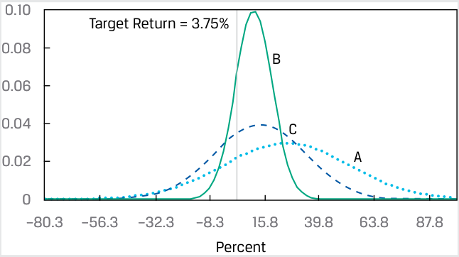

<!-- Picture Text: 0.10 Target Return = 3.75% 0.08 B 0.06 0.04 C 0.02 A 0 –80.3 –56.3 –32.3 –8.3 15.8 39.8 63.8 87.8 Percent  -->

> **Chú thích hình ảnh:**
> - **Target Return = 3.75%:** Tỷ suất sinh lợi mục tiêu = 3.75%
> - Ba đường cong phân phối chuẩn của phương án **A, B, C** với trục hoành là **Percent** (Phần trăm).

Có một số điểm đáng lưu ý. Thứ nhất, nếu các dữ liệu đầu vào hơi khác một chút, chúng ta có thể nhận được một thứ hạng khác. Ví dụ, nếu tỷ suất sinh lợi trung bình của B là 10 phần trăm thay vì 11 phần trăm, thì Phương án phân bổ A sẽ vượt trội hơn B. Thứ hai, nếu việc đáp ứng ngưỡng tỷ suất sinh lợi 3.75 phần trăm là một điều bắt buộc thay vì chỉ là một mong muốn, thì mức CAD 830,000 sau một năm có thể được mô hình hóa như một khoản nợ phải trả (*liability*). Các chiến lược thu nhập cố định, chẳng hạn như khớp dòng tiền (*cash flow matching*), có thể được sử dụng để bù đắp hoặc miễn nhiễm rủi ro (*immunize*) cho khoản chuẩn nợ (*quasi-liability*) trị giá CAD 830,000 này. 

<!-- PDF Page 177 -->

Trong nhiều bối cảnh đầu tư ngoài tiêu chuẩn an toàn trên hết của Roy, chúng ta sử dụng phân phối chuẩn để ước tính xác suất. Một lĩnh vực khác mà phân phối chuẩn đóng vai trò quan trọng là quản trị rủi ro tài chính (*financial risk management*). Các định chế tài chính, chẳng hạn như ngân hàng đầu tư, nhà kinh doanh chứng khoán và ngân hàng thương mại, có các hệ thống chính thức để đo lường và kiểm soát rủi ro tài chính ở nhiều cấp độ khác nhau, từ các vị thế giao dịch đến rủi ro tổng thể của toàn công ty. Hai trụ cột chính trong quản trị rủi ro tài chính là giá trị có rủi ro (*value at risk* – VaR) và kiểm định sức chịu đựng/phân tích kịch bản (*stress testing/scenario analysis*). **Kiểm định sức chịu đựng (*Stress testing*)** và **phân tích kịch bản (*scenario analysis*)** đề cập đến một tập hợp các kỹ thuật nhằm ước tính các khoản lỗ trong những sự kết hợp biến cố hoặc kịch bản cực kỳ bất lợi. **Giá trị có rủi ro (*Value at risk* – VaR)** là thước đo bằng tiền về giá trị tổn thất tối thiểu dự kiến trong một khoảng thời gian xác định (ví dụ: một ngày, một quý, hoặc một năm) tại một mức xác suất cho trước (thường là 0.05 hoặc 0.01). Giả sử chúng ta chỉ định khung thời gian một ngày và mức xác suất là 0.05, khi đó sẽ được gọi là VaR một ngày ở mức độ tin cậy 95 phần trăm (*95 percent one-day VaR*). Nếu mức VaR này bằng EUR 5 triệu đối với một danh mục đầu tư, thì sẽ có xác suất 0.05 là danh mục đầu tư đó sẽ lỗ từ EUR 5 triệu trở lên trong một ngày duy nhất (giả sử các giả định của chúng ta là chính xác). Một trong những cách tiếp cận cơ bản để ước tính VaR, phương pháp phương sai–hiệp phương sai hay phương pháp giải tích (*variance–covariance or analytical method*), giả định rằng tỷ suất sinh lợi tuân theo phân phối chuẩn. 

##### **BỘ CÂU HỎI (*QUESTION SET*)** 

Một khách hàng có danh mục đầu tư gồm các cổ phiếu phổ thông và các công cụ thu nhập cố định với giá trị hiện tại là GBP 1,350,000. Bà dự định thanh lý GBP 50,000 từ danh mục đầu tư vào cuối năm để mua cổ phần hợp danh trong một doanh nghiệp. Hơn nữa, khách hàng muốn có thể rút ra GBP 50,000 mà không làm giảm số vốn ban đầu là GBP 1,350,000. Bảng sau đây cho thấy bốn phương án phân bổ tài sản thay thế. 

##### **Giá trị Trung bình và Độ lệch chuẩn của Bốn Phương án Phân bổ (tính bằng Phần trăm) (*Mean and Standard Deviation for Four Allocations (in Percent)*)** 

||**A**|**B**|**C**|**D**|
|---|---|---|---|---|
|Tỷ suất sinh lợi hàng năm kỳ vọng (*Expected annual return*)|16|12|10|9|
|Độ lệch chuẩn của tỷ suất sinh lợi (*Standard deviation of return*)|24|17|12|11|

1. Hãy trả lời các câu hỏi sau (giả định phân phối chuẩn cho Phần B và C): 

   - **A.** Với mong muốn của khách hàng là không xâm phạm vào vốn gốc GBP 1,350,000, mức thiếu hụt, $R_L$, là bao nhiêu? Sử dụng mức thiếu hụt này để trả lời Câu B. 

   - **B.** Theo tiêu chuẩn an toàn trên hết, phương án phân bổ nào là tốt nhất? 

   - **C.** Xác suất để tỷ suất sinh lợi của danh mục tối ưu theo tiêu chuẩn an toàn trên hết nhỏ hơn mức thiếu hụt, $R_L$, là bao nhiêu? 

   - **Lời giải:** 

   - **A.** Bởi vì $\text{GBP } 50,000 / \text{GBP } 1,350,000$ bằng 3.7 phần trăm, nên với bất kỳ mức tỷ suất sinh lợi nào thấp hơn 3.7 phần trăm, khách hàng sẽ phải xâm phạm vào vốn gốc nếu bà rút ra GBP 50,000. Do đó, $R_L = 3.7\%$. 

   - **B.** Để quyết định phương án phân bổ nào là tối ưu theo tiêu chuẩn an toàn trên hết, hãy chọn phương án có tỷ số $[E(R_P) - R_L]/\sigma_P$ cao nhất: 

      - Phương án A: $0.5125 = (16 - 3.7)/24$. 

      - Phương án B: $0.488235 = (12 - 3.7)/17$. 

<!-- PDF Page 178 -->

      - Phương án C: $0.525 = (10 - 3.7)/12$. 

      - Phương án D: $0.481818 = (9 - 3.7)/11$. 

      - Phương án C, với tỷ số lớn nhất (0.525), là phương án thay thế tốt nhất theo tiêu chuẩn an toàn trên hết. 

   - **C.** Để trả lời câu hỏi này, lưu ý rằng $P(R_C < 3.7) = N((0.037 - 0.10)/0.12) = \text{Normal}(-0.525)$. Bằng cách sử dụng hàm `NORM.S.DIST()` của Excel, chúng ta thu được `NORM.S.DIST((0.037 - 0.10)/0.12)` $= 29.98\%$, hay khoảng 30 phần trăm. Danh mục tối ưu theo tiêu chuẩn an toàn trên hết có khoảng 30 phần trăm khả năng không đạt được ngưỡng tỷ suất sinh lợi 3.7 phần trăm. 

2. Một khách hàng nắm giữ danh mục đầu tư trị giá GBP 2,000,000 muốn rút ra GBP 90,000 sau một năm mà không xâm phạm vào vốn gốc. Theo tiêu chuẩn an toàn trên hết của Roy, phương án phân bổ danh mục đầu tư nào sau đây là tối ưu? 

||**Phương án A (*Allocation A*)**|**Phương án B (*Allocation B*)**|**Phương án C (*Allocation C*)**|
|---|---|---|---|
|Tỷ suất sinh lợi hàng năm kỳ vọng (*Expected annual return*)|6.5%|7.5%|8.5%|
|Độ lệch chuẩn của tỷ suất sinh lợi (*Standard deviation of returns*)|8.35%|10.21%|14.34%|

   - **A.** Phương án A 

   - **B.** Phương án B 

   - **C.** Phương án C 

   - **Lời giải:** 

B là đáp án đúng. Phương án B có tỷ số an toàn trên hết cao nhất. Mức tỷ suất sinh lợi ngưỡng, $R_L$, đối với danh mục đầu tư là $\text{GBP } 90,000 / \text{GBP } 2,000,000 = 4.5\%$; do đó, bất kỳ mức tỷ suất sinh lợi nào nhỏ hơn $R_L = 4.5\%$ sẽ xâm phạm vào vốn gốc của danh mục đầu tư. Để tính toán phương án phân bổ tối ưu theo tiêu chuẩn an toàn trên hết, hãy chọn phương án có tỷ số cao nhất: 

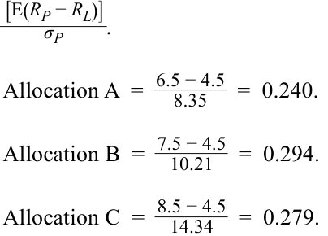

<!-- Formula Text: [E(R P − R L)] _ σ P . Allocation A  =   6.5 − 4.5 _ 8.35    =  0.240. Allocation B  =   7.5 − 4.5 _ 10.21    =  0.294. Allocation C  =   8.5 − 4.5 _ 14.34    =  0.279. -->

$$\frac{E(R_P) - R_L}{\sigma_P}$$

$$\text{Phương án A} = \frac{6.5 - 4.5}{8.35} = 0.240$$

$$\text{Phương án B} = \frac{7.5 - 4.5}{10.21} = 0.294$$

$$\text{Phương án C} = \frac{8.5 - 4.5}{14.34} = 0.279$$

<!-- PDF Page 179 -->

## **TÀI LIỆU THAM KHẢO (*REFERENCES*)** 

Roy, A. D. 1952. “Safety First and the Holding of Assets.” _Econometrica_ 20 (3): 431–49. 10.2307/1907413 

<!-- PDF Page 180 -->

## **BÀI TẬP THỰC HÀNH (*PRACTICE PROBLEMS*)** 

**1.** Một chuyên viên phân tích lập hàm xác suất đồng thời (*joint probability function*) sau đây cho một chỉ số nước ngoài (FI) và một chỉ số trong nước (DI). 

||**$R_{\text{DI}} = 30\%$**|**$R_{\text{DI}} = 25\%$**|**$R_{\text{DI}} = 15\%$**|
|---|---|---|---|
|$R_{\text{FI}} = 25\%$|0.25|||
|$R_{\text{FI}} = 15\%$||0.50||
|$R_{\text{FI}} = 10\%$|||0.25|

Hiệp phương sai của tỷ suất sinh lợi trên chỉ số nước ngoài và tỷ suất sinh lợi trên chỉ số trong nước _gần nhất_ với: 

   - **A.** 26.39. 

   - **B.** 26.56. 

   - **C.** 28.12. 

<!-- PDF Page 181 -->

## **LỜI GIẢI (*SOLUTIONS*)** 

1. B là đáp án đúng. Hiệp phương sai là 26.56, được tính như sau. Trước tiên, tỷ suất sinh lợi kỳ vọng là $E(R_{\text{FI}}) = (0.25 \times 25) + (0.50 \times 15) + (0.25 \times 10) = 6.25 + 7.50 + 2.50 = 16.25$ và $E(R_{\text{DI}}) = (0.25 \times 30) + (0.50 \times 25) + (0.25 \times 15) = 7.50 + 12.50 + 3.75 = 23.75$. Hiệp phương sai là: 

$$\text{Cov}(R_{\text{FI}}, R_{\text{DI}}) = \sum_{i} \sum_{j} P(R_{\text{FI},i}, R_{\text{DI},j})(R_{\text{FI},i} - ER_{\text{FI}})(R_{\text{DI},j} - ER_{\text{DI}})$$

$$= 0.25[(25 - 16.25)(30 - 23.75)] + 0.50[(15 - 16.25)(25 - 23.75)] + 0.25[(10 - 16.25)(15 - 23.75)]$$

$$= 13.67 + (-0.78) + 13.67 = 26.56$$

<!-- PDF Page 182 -->
