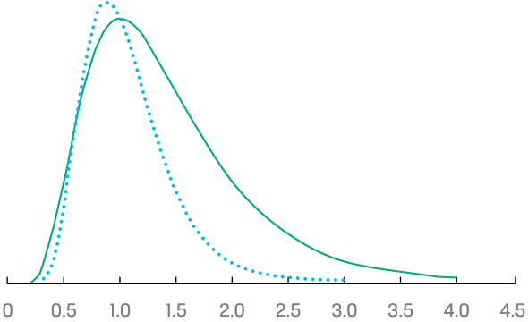
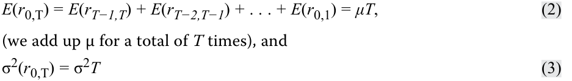
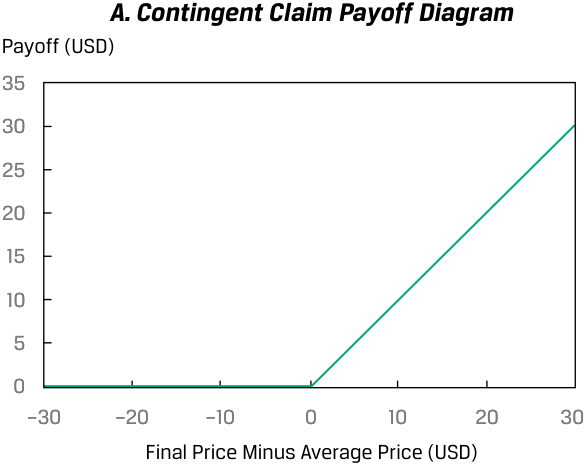
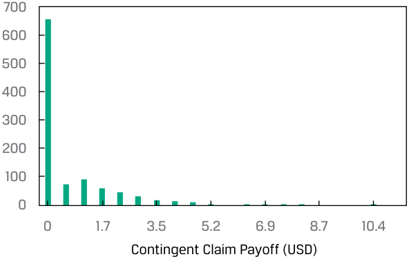
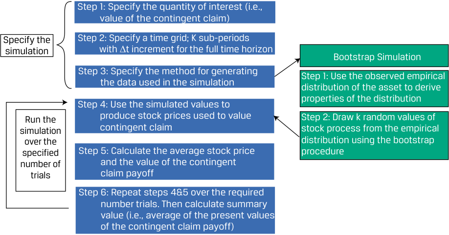

# Tập 1: Phương pháp Định lượng (*Quantitative Methods*)
## Học phần 6: Các Phương pháp Mô phỏng (*Simulation Methods*)
### Phần 1/2: Giới thiệu (*Introduction*) (Trang PDF 183–198)

---

<!-- PDF Page 183 -->

#### H Ọ C P H Ầ N 

# **<mark>6</mark>** 

### **Các Phương pháp Mô phỏng (*Simulation Methods*)** 

**tác giả: Kobor Adam, PhD, CFA.** 

_Adam Kobor, PhD, CFA, tại Văn phòng Đầu tư Đại học New York (Hoa Kỳ)_ 

###### **<mark>MỤC TIÊU HỌC TẬP (*LEARNING OUTCOMES*)</mark>** 

**_Mức độ Thành thạo – Ứng viên cần có khả năng:_**
- Giải thích mối quan hệ giữa phân phối chuẩn (*normal distribution*) và phân phối log-chuẩn (*lognormal distribution*) cũng như lý do tại sao phân phối log-chuẩn được sử dụng để mô hình hóa giá tài sản khi sử dụng tỷ suất sinh lợi tài sản ghép lãi liên tục (*continuously compounded asset returns*).
- Mô tả mô phỏng Monte Carlo (*Monte Carlo simulation*) và giải thích cách thức sử dụng phương pháp này trong các ứng dụng đầu tư.
- Mô tả việc sử dụng lấy mẫu lại kiểu tự thân (*bootstrap resampling*) khi thực hiện mô phỏng dựa trên dữ liệu quan sát được trong các ứng dụng đầu tư.

##### **GIỚI THIỆU (*INTRODUCTION*)** 

**<mark>1</mark>** 

Việc hiểu và áp dụng các phân phối xác suất (*probability distributions*) là một cấu phần then chốt trong việc dự báo các biến số tài chính và giá tài sản. Học phần này cung cấp nền tảng để hiểu các khái niệm quan trọng liên quan đến phân phối xác suất. Về mặt ứng dụng của phân phối xác suất, học phần này giải thích cách xây dựng và diễn giải một phân tích mô phỏng Monte Carlo (*Monte Carlo simulation*). Phương pháp tự thân (*Bootstrapping*), vốn có một số điểm tương đồng với mô phỏng Monte Carlo, cũng được trình bày nhằm minh họa cách sử dụng và ứng dụng của phương pháp lấy mẫu thống kê này. 

###### **TỔNG QUAN HỌC PHẦN (*LEARNING MODULE OVERVIEW*)** 

- Phân phối log-chuẩn (*lognormal distribution*) được sử dụng rộng rãi để mô hình hóa phân phối xác suất của giá tài sản tài chính vì phân phối này bị chặn dưới bởi 0 giống như giá tài sản và thường mô tả chính xác các đặc tính phân phối thống kê của giá tài sản tài chính. Phân phối log-chuẩn thường lệch phải (*skewed to the right*). 

- Tỷ suất sinh lợi ghép lãi liên tục (*continuously compounded returns*) đóng một vai trò trong nhiều mô hình định giá tài sản cũng như trong quản trị rủi ro. 

<!-- PDF Page 184 -->

- Mô phỏng Monte Carlo (*Monte Carlo simulation*) được sử dụng rộng rãi để ước tính rủi ro và tỷ suất sinh lợi trong các ứng dụng đầu tư. Cụ thể, phương pháp này thường được dùng để định giá các chứng khoán có đặc tính phức tạp, chẳng hạn như các quyền chọn gắn kèm (*embedded options*), nơi không có sẵn công thức định giá giải tích (*analytic pricing formula*). 

- Một mô phỏng Monte Carlo tạo ra một số lượng lớn các mẫu ngẫu nhiên từ một phân phối xác suất được chỉ định hoặc một chuỗi các phân phối để thu được khả năng xảy ra của một phạm vi kết quả. 

- Phương pháp tự thân (*Bootstrapping*) mô phỏng quá trình thực hiện lấy mẫu ngẫu nhiên từ một tổng thể để xây dựng phân phối mẫu (*sampling distribution*) bằng cách coi mẫu được rút ra ngẫu nhiên như thể chính là tổng thể. 

- Bởi vì một mẫu ngẫu nhiên mang lại sự đại diện tốt cho tổng thể, phương pháp bootstrapping có thể mô phỏng việc lấy mẫu từ tổng thể bằng cách lấy mẫu từ chính mẫu quan sát được (*observed sample*). 

## **<mark>2</mark>** 

##### **PHÂN PHỐI LOG-CHUẨN VÀ GHÉP LÃI LIÊN TỤC (*LOGNORMAL DISTRIBUTION AND CONTINUOUS COMPOUNDING*)** 

*Giải thích mối quan hệ giữa phân phối chuẩn và phân phối log-chuẩn cũng như lý do tại sao phân phối log-chuẩn được sử dụng để mô hình hóa giá tài sản khi sử dụng tỷ suất sinh lợi tài sản ghép lãi liên tục*

###### **Phân phối Log-chuẩn (*The Lognormal Distribution*)** 

Có mối liên hệ mật thiết với phân phối chuẩn (*normal distribution*), phân phối log-chuẩn (*lognormal distribution*) được sử dụng rộng rãi để mô hình hóa phân phối xác suất của giá cổ phiếu và các tài sản khác. Ví dụ, phân phối log-chuẩn xuất hiện trong mô hình định giá quyền chọn Black–Scholes–Merton (*Black–Scholes–Merton option pricing model*). Mô hình Black–Scholes–Merton giả định rằng giá của tài sản cơ sở (*underlying asset*) của quyền chọn có phân phối log-chuẩn. 

Một biến ngẫu nhiên $Y$ tuân theo phân phối log-chuẩn nếu logarit tự nhiên của nó, $\ln Y$, có phân phối chuẩn. Điều ngược lại cũng đúng: Nếu logarit tự nhiên của biến ngẫu nhiên $Y$, $\ln Y$, có phân phối chuẩn, thì $Y$ tuân theo phân phối log-chuẩn. Nếu bạn nghĩ về thuật ngữ log-chuẩn (*lognormal*) là “hàm log có phân phối chuẩn” (“*the log is normal*”), bạn sẽ không gặp khó khăn gì khi ghi nhớ mối quan hệ này. 

Hai nhận xét đáng chú ý nhất về phân phối log-chuẩn là nó bị chặn dưới bởi 0 (*bounded below by 0*) và nó bị lệch phải (*skewed to the right* – có đuôi bên phải dài). Hãy lưu ý hai tính chất này trong đồ thị hàm mật độ xác suất (*probability density functions* – pdf) của hai phân phối log-chuẩn trong Minh họa 1. Giá tài sản bị chặn dưới bởi 0. Trên thực tế, phân phối log-chuẩn đã được chứng minh là một mô tả chính xác và hữu ích về phân phối giá của nhiều tài sản tài chính. Tuy nhiên, phân phối chuẩn thường là một xấp xỉ tốt cho tỷ suất sinh lợi (*returns*). Vì lý do này, cả hai phân phối đều rất quan trọng đối với các chuyên gia tài chính. 

<!-- PDF Page 185 -->

###### **Minh họa 1: Hai Phân phối Log-chuẩn (*Exhibit 1: Two Lognormal Distributions*)** 

<!-- Picture Text: 0 0.5 1.0 1.5 2.0 2.5 3.0 3.5 4.0 4.5  -->
> **Chú thích hình ảnh:** Đồ thị biểu diễn hàm mật độ xác suất của hai phân phối log-chuẩn với trục hoành từ 0 đến 4.5, minh họa đặc tính chặn dưới tại 0 và đuôi lệch phải.

Giống như phân phối chuẩn, phân phối log-chuẩn được mô tả hoàn toàn bởi hai tham số (*parameters*). Không giống như nhiều phân phối khác, một phân phối log-chuẩn được định nghĩa theo các tham số của một phân phối *khác*. Hai tham số của phân phối log-chuẩn là giá trị trung bình (*mean*) và độ lệch chuẩn (*standard deviation* – hoặc phương sai, *variance*) của phân phối chuẩn liên kết với nó: giá trị trung bình và phương sai của $\ln Y$, biết rằng $Y$ là biến log-chuẩn. Do đó, chúng ta phải theo dõi hai tập hợp giá trị trung bình và độ lệch chuẩn (hoặc phương sai): (1) giá trị trung bình và độ lệch chuẩn (hoặc phương sai) của phân phối chuẩn liên kết (đây là các tham số) và (2) giá trị trung bình và độ lệch chuẩn (hoặc phương sai) của chính biến log-chuẩn đó. 

Để minh họa mối quan hệ này, chúng tôi đã mô phỏng 1.000 kịch bản tỷ suất sinh lợi tài sản hàng năm, giả định rằng tỷ suất sinh lợi có phân phối chuẩn với giá trị trung bình 7% và độ lệch chuẩn 12%. Đối với mỗi kịch bản $i$, chúng tôi chuyển đổi tỷ suất sinh lợi ghép lãi liên tục mô phỏng ($r_i$) thành giá tài sản tương lai bằng công thức $\text{Giá (1 năm sau)}_i = \text{USD } 1 \times \exp(r_i)$, trong đó $\exp$ là hàm mũ và giả định rằng giá tài sản ngày hôm nay là 1 USD. Trong Minh họa 2, Bảng A hiển thị phân phối của các tỷ suất sinh lợi mô phỏng cùng với hàm mật độ xác suất (pdf) chuẩn khớp nối, trong khi Bảng B hiển thị phân phối của giá tài sản tương lai tương ứng cùng với hàm pdf log-chuẩn khớp nối. Một lần nữa, hãy lưu ý rằng phân phối log-chuẩn của giá tài sản tương lai bị chặn dưới bởi 0 và có đuôi bên phải dài. 

<!-- PDF Page 186 -->

###### **Minh họa 2: Tỷ suất sinh lợi Mô phỏng (PDF Chuẩn) và Giá Tài sản (PDF Log-chuẩn) (*Exhibit 2: Simulated Returns (Normal PDF) and Asset Prices (Lognormal PDF)*)** 

###### **_A. Hàm mật độ xác suất chuẩn (Normal PDF)_** 

<!-- Picture Text: 120 100 80 60 40 20 0 –28.76 –18.58 –8.41 1.76 11.93 22.1 32.27 42.45 Yearly Returns (%) Histogram Normal Fit  -->
> **Chú thích hình ảnh:** Bảng A biểu diễn Biểu đồ tần suất (*Histogram*) và Đường khớp chuẩn (*Normal Fit*) của Tỷ suất sinh lợi hàng năm (*Yearly Returns* (%)) từ -28.76% đến 42.45%.

###### **_B. Hàm mật độ xác suất log-chuẩn (Lognormal PDF)_** 

<!-- Picture Text: 120 100 80 60 40 20 0 0.75 0.86 0.98 1.09 1.21 1.32 1.44 1.55 Asset Values 1 Year Later (USD 1 Initial Investment) Histogram Lognormal Fit  -->
> **Chú thích hình ảnh:** Bảng B biểu diễn Biểu đồ tần suất (*Histogram*) và Đường khớp log-chuẩn (*Lognormal Fit*) của Giá trị tài sản sau 1 năm (*Asset Values 1 Year Later* - Đầu tư ban đầu 1 USD) từ 0.75 đến 1.55.

Các biểu thức tính giá trị trung bình và phương sai của biến log-chuẩn khá phức tạp. Giả sử một biến ngẫu nhiên chuẩn $X$ có giá trị kỳ vọng $\mu$ và phương sai $\sigma^2$. Định nghĩa $Y = \exp(X)$. Hãy nhớ rằng phép toán được biểu thị bởi $\exp(X)$ hoặc $e^X$ (trong đó $e \approx 2.7183$) là phép toán ngược lại với việc lấy logarit. Bởi vì $\ln Y = \ln[\exp(X)] = X$ có phân phối chuẩn (chúng ta giả định $X$ có phân phối chuẩn), nên $Y$ có phân phối log-chuẩn. Giá trị kỳ vọng của $Y = \exp(X)$ là bao nhiêu? Một phỏng đoán có thể là giá trị kỳ vọng của $Y$ bằng $\exp(\mu)$. Thực tế, giá trị kỳ vọng là $\exp(\mu + 0.50\sigma^2)$, lớn hơn $\exp(\mu)$ một hệ số là $\exp(0.50\sigma^2) > 1$. Để hiểu sâu hơn về khái niệm này, hãy nghĩ xem điều gì sẽ xảy ra nếu chúng ta tăng $\sigma^2$. Phân phối sẽ trải rộng ra; nó có thể mở rộng lên phía trên, nhưng không thể mở rộng xuống phía dưới vượt quá 0. Kết quả là, tâm của phân phối bị đẩy sang bên phải: Giá trị trung bình của phân phối tăng lên. Các biểu thức tính giá trị trung bình và phương sai của một biến log-chuẩn được tóm tắt dưới đây, trong đó $\mu$ và $\sigma^2$ là giá trị trung bình và phương sai của phân phối chuẩn liên kết (hãy tham khảo các biểu thức này khi cần thiết thay vì học thuộc lòng): 

- Giá trị trung bình ($\mu_L$) của một biến ngẫu nhiên log-chuẩn $= \exp(\mu + 0.50\sigma^2)$. 

<!-- PDF Page 187 -->

- Phương sai ($\sigma_L^2$) của một biến ngẫu nhiên log-chuẩn $= \exp(2\mu + \sigma^2) \times [\exp(\sigma^2) - 1]$. 

###### **Tỷ suất sinh lợi Ghép lãi Liên tục (*Continuously Compounded Rates of Return*)** 

Bây giờ chúng ta khám phá mối quan hệ giữa phân phối của tỷ suất sinh lợi cổ phiếu và giá cổ phiếu. Trong phần này, chúng ta chứng minh rằng nếu tỷ suất sinh lợi ghép lãi liên tục của một cổ phiếu có phân phối chuẩn, thì giá cổ phiếu trong tương lai tất yếu sẽ có phân phối log-chuẩn. Hơn nữa, chúng ta chỉ ra rằng giá cổ phiếu có thể được mô tả tốt bởi phân phối log-chuẩn ngay cả khi tỷ suất sinh lợi ghép lãi liên tục không tuân theo phân phối chuẩn. Những kết quả này cung cấp nền tảng lý thuyết cho việc sử dụng phân phối log-chuẩn để mô hình hóa giá tài sản. 

Biểu diễn giá cổ phiếu tại một thời điểm tương lai $T$, $P_T$, bằng giá cổ phiếu hiện tại, $P_0$, nhân với $e$ lũy thừa $r_{0,T}$, tức tỷ suất sinh lợi ghép lãi liên tục từ thời điểm $0$ đến $T$: 

<!-- Formula Text: PT = P0exp(r0,T). -->
$$P_T = P_0 \exp(r_{0,T})$$

Chúng ta đã chỉ ra trong một bài học trước rằng $r_{0,T}$, tỷ suất sinh lợi ghép lãi liên tục đến thời điểm $T$, là tổng của các tỷ suất sinh lợi ghép lãi liên tục trong một kỳ (*one-period continuously compounded returns*), như sau: 

<!-- Formula Text: r0,T = rT−1,T + rT−2,T−1 + . . . + r0,1. (1) -->
$$r_{0,T} = r_{T-1,T} + r_{T-2,T-1} + \dots + r_{0,1} \tag{1}$$

Nếu các tỷ suất sinh lợi kỳ ngắn hơn này có phân phối chuẩn, thì $r_{0,T}$ có phân phối chuẩn (với một số giả định nhất định) hoặc xấp xỉ phân phối chuẩn (nếu không đưa ra các giả định đó). Vì $P_T$ tỷ lệ với hàm mũ của một biến ngẫu nhiên chuẩn (logarit của $P_T$ là biến ngẫu nhiên chuẩn), nên $P_T$ có phân phối log-chuẩn. 

Một giả định quan trọng trong nhiều ứng dụng đầu tư là các tỷ suất sinh lợi có **phân phối độc lập và đồng nhất (*independently and identically distributed* – i.i.d.)**. Tính độc lập (*independence*) phản ánh mệnh đề rằng các nhà đầu tư không thể dự đoán tỷ suất sinh lợi tương lai bằng cách sử dụng tỷ suất sinh lợi trong quá khứ. Phân phối đồng nhất (*identical distribution*) phản ánh giả định về tính dừng (*stationarity*), một tính chất ngụ ý rằng giá trị trung bình và phương sai của tỷ suất sinh lợi không thay đổi từ kỳ này sang kỳ khác. 

Giả sử rằng các tỷ suất sinh lợi ghép lãi liên tục một kỳ (chẳng hạn như $r_{0,1}$) là các biến ngẫu nhiên i.i.d. với giá trị trung bình $\mu$ và phương sai $\sigma^2$ (nhưng không đưa ra giả định về tính chuẩn hay phân phối nào khác). Khi đó, 

<!-- Formula Text: E(r0,T) = E(rT−1,T) + E(rT−2,T−1) + . . . + E(r0,1) = μT, (2) (we add up μ for a total of T times), and σ2(r0,T) = σ2T (3) -->
$$E(r_{0,T}) = E(r_{T-1,T}) + E(r_{T-2,T-1}) + \dots + E(r_{0,1}) = \mu T \tag{2}$$
*(chúng ta cộng dồn $\mu$ tổng cộng $T$ lần), và*
$$\sigma^2(r_{0,T}) = \sigma^2 T \tag{3}$$

(như một hệ quả của giả định độc lập). 

Phương sai của tỷ suất sinh lợi ghép lãi liên tục trong thời kỳ nắm giữ $T$ bằng $T$ nhân với phương sai của tỷ suất sinh lợi ghép lãi liên tục một kỳ; ngoài ra, $\sigma(r_{0,T}) = \sigma\sqrt{T}$. Nếu các tỷ suất sinh lợi ghép lãi liên tục một kỳ ở vế phải của Phương trình 1 có phân phối chuẩn, thì tỷ suất sinh lợi ghép lãi liên tục trong thời kỳ nắm giữ $T$, $r_{0,T}$, cũng có phân phối chuẩn với giá trị trung bình $\mu T$ và phương sai $\sigma^2 T$. Điều này là do một tổ hợp tuyến tính của các biến ngẫu nhiên chuẩn cũng là một biến ngẫu nhiên chuẩn. 

Ngay cả khi các tỷ suất sinh lợi ghép lãi liên tục một kỳ không có phân phối chuẩn, tổng của chúng, $r_{0,T}$, vẫn xấp xỉ chuẩn theo định lý giới hạn trung tâm (*central limit theorem*). Bây giờ hãy so sánh $P_T = P_0\exp(r_{0,T})$ với $Y = \exp(X)$, trong đó $X$ có *phân phối chuẩn* và $Y$ có *phân phối log-chuẩn* (như chúng ta đã thảo luận trước đó). Rõ ràng, chúng ta có thể mô hình hóa giá cổ phiếu tương lai $P_T$ như một biến ngẫu nhiên log-chuẩn bởi vì $r_{0,T}$ ít nhất phải xấp xỉ *chuẩn*. Giả định về tỷ suất sinh lợi có phân phối chuẩn này là cơ sở lý thuyết để sử dụng phân phối log-chuẩn làm mô hình cho phân phối giá của cổ phiếu và các tài sản tài chính khác. 

<!-- PDF Page 188 -->

Tỷ suất sinh lợi ghép lãi liên tục đóng vai trò trong nhiều mô hình định giá tài sản, cũng như trong quản trị rủi ro. **Độ biến động (*Volatility*)** đo lường độ lệch chuẩn của tỷ suất sinh lợi ghép lãi liên tục trên tài sản cơ sở; theo quy ước, nó được biểu thị dưới dạng thước đo chuẩn hóa theo năm (*annualized measure*). Trên thực tế, chúng ta thường ước tính độ biến động bằng cách sử dụng một chuỗi lịch sử các tỷ suất sinh lợi hàng ngày ghép lãi liên tục. Chúng ta thu thập một tập hợp các tỷ suất sinh lợi thời kỳ nắm giữ hàng ngày, chuyển đổi chúng thành tỷ suất sinh lợi hàng ngày ghép lãi liên tục và sau đó tính độ lệch chuẩn của các tỷ suất sinh lợi hàng ngày ghép lãi liên tục rồi chuẩn hóa con số đó theo năm bằng Phương trình 3. 

Việc chuẩn hóa theo năm (*annualizing*) thường được thực hiện dựa trên cơ sở 250 ngày trong một năm, tức số ngày làm việc xấp xỉ mà các thị trường tài chính thường mở cửa giao dịch. Do đó, nếu độ biến động hàng ngày là $0.01$, chúng ta sẽ biểu thị độ biến động (trên cơ sở hàng năm) là $0.01\sqrt{250} = 0.1581$. Ví dụ 1 minh họa việc ước tính độ biến động cho cổ phiếu của Astra International. 

###### **VÍ DỤ 1 (*EXAMPLE 1*)** 

###### **Độ biến động của Giá Cổ phiếu (*Volatility of Share Price*)** 

Giả sử bạn đang nghiên cứu công ty Astra International (Sở Giao dịch Chứng khoán Indonesia: ASII) và quan tâm đến biến động giá của Astra trong một tuần mà tin tức kinh tế quốc tế đã ảnh hưởng đáng kể đến thị trường chứng khoán Indonesia. Bạn quyết định sử dụng độ biến động (*volatility*) làm thước đo mức độ biến thiên của cổ phiếu Astra trong tuần đó. Minh họa 3 cho thấy giá đóng cửa trong tuần đó. 

**Minh họa 3: Giá Đóng cửa Hàng ngày của Astra International (*Exhibit 3: Astra International Daily Closing Prices*)** 

|**Ngày (*Day*)**|**Giá Đóng cửa (*Closing Price*)** **(Rupiah Indonesia, IDR)**|
|---|---|
|Thứ Hai (*Monday*)|6,950|
|Thứ Ba (*Tuesday*)|7,000|
|Thứ Tư (*Wednesday*)|6,850|
|Thứ Năm (*Thursday*)|6,600|
|Thứ Sáu (*Friday*)|6,350|

Sử dụng dữ liệu được cung cấp để thực hiện các yêu cầu sau: 

<!-- PDF Page 189 -->

1. Ước tính độ biến động của cổ phiếu Astra. (Chuẩn hóa độ biến động theo năm trên cơ sở 250 ngày giao dịch trong một năm.) 

###### **Lời giải (*Solution*):** 

Trước tiên, hãy tính tỷ suất sinh lợi hàng ngày ghép lãi liên tục; sau đó, tìm độ lệch chuẩn của chúng theo cách thông thường. Khi tính phương sai mẫu để suy ra độ lệch chuẩn mẫu, số chia là kích thước mẫu trừ đi 1 ($n - 1$). 

$$\ln(7,000 / 6,950) = 0.007168$$

$$\ln(6,850 / 7,000) = -0.021661$$
$$\ln(6,600 / 6,850) = -0.037179$$
$$\ln(6,350 / 6,600) = -0.038615$$
$$\text{Tổng (Sum)} = -0.090287, \quad \text{Trung bình (Mean)} = -0.022572, \quad \text{Phương sai (Variance)} = 0.000452$$

$$\text{Độ lệch chuẩn (Standard deviation)} = 0.021261$$

Độ lệch chuẩn của tỷ suất sinh lợi hàng ngày ghép lãi liên tục là $0.021261$. Phương trình 3 phát biểu rằng $\hat{\sigma}(r_{0,T}) = \hat{\sigma}\sqrt{T}$. Trong ví dụ này, $\hat{\sigma}$ là độ lệch chuẩn mẫu của tỷ suất sinh lợi ghép lãi liên tục một kỳ. Do đó, $\hat{\sigma}$ bằng $0.021261$. Chúng ta muốn chuẩn hóa theo năm, vì vậy kỳ hạn $T$ tương ứng với một năm. Bởi vì $\hat{\sigma}$ được tính theo ngày, chúng ta đặt $T$ bằng số ngày giao dịch trong một năm ($250$). 

Do đó, chúng ta tìm được độ biến động chuẩn hóa theo năm của cổ phiếu Astra trong tuần đó là $33.6\%$, được tính bằng $0.021261\sqrt{250} = 0.336165$. 

2. Tính toán ước lượng cho tỷ suất sinh lợi hàng năm ghép lãi liên tục kỳ vọng của Astra. 

###### **Lời giải (*Solution*):** 

Lưu ý rằng trung bình mẫu, $-0.022572$ (từ Lời giải câu 1), là một ước lượng mẫu của giá trị trung bình $\mu$ của tỷ suất sinh lợi ghép lãi liên tục một kỳ hoặc hàng ngày. Trung bình mẫu có thể được quy đổi thành ước lượng của tỷ suất sinh lợi hàng năm ghép lãi liên tục kỳ vọng bằng cách sử dụng Phương trình 2, $\hat{\mu}T = -0.022572(250) = -5.643$ hay $-564.3\%$ (sử dụng 250 để nhất quán với phép tính độ biến động). 

3. Thảo luận lý do tại sao có thể không thận trọng khi sử dụng tỷ suất sinh lợi trung bình mẫu hàng ngày để ước tính tỷ suất sinh lợi hàng năm ghép lãi liên tục kỳ vọng cho Astra. 

###### **Lời giải (*Solution*):** 

Bốn quan sát tỷ suất sinh lợi hàng ngày là quá ít để ước tính tỷ suất sinh lợi kỳ vọng. Hơn nữa, sự biến thiên trong tỷ suất sinh lợi hàng ngày làm lu mờ bất kỳ thông tin nào về tỷ suất sinh lợi kỳ vọng trong một chuỗi dữ liệu ngắn như vậy. 

4. Xác định phân phối xác suất cho giá cổ phiếu Astra nếu tỷ suất sinh lợi hàng ngày ghép lãi liên tục tuân theo phân phối chuẩn. 

###### **Lời giải (*Solution*):** 

Giá cổ phiếu Astra sẽ tuân theo phân phối log-chuẩn (*lognormal distribution*) nếu tỷ suất sinh lợi hàng ngày ghép lãi liên tục trên cổ phiếu Astra tuân theo phân phối chuẩn. 

<!-- PDF Page 190 -->

Chúng ta đã chứng minh rằng phân phối của giá cổ phiếu là log-chuẩn với những giả định nhất định. Trước đó, chúng ta đã đưa ra các biểu thức gạch đầu dòng cho giá trị trung bình và phương sai của một biến ngẫu nhiên log-chuẩn. Trong bối cảnh giá cổ phiếu, $\hat{\mu}$ và $\hat{\sigma}^2$ trong các biểu thức này sẽ đề cập đến giá trị trung bình và phương sai của kỳ hạn $T$, chứ không phải tỷ suất sinh lợi ghép lãi liên tục một kỳ, sao cho tương thích với kỳ hạn của $P_T$. 

## **<mark>3</mark>** 

##### **MÔ PHỎNG MONTE CARLO (*MONTE CARLO SIMULATION*)** 

*Mô tả mô phỏng Monte Carlo và giải thích cách thức sử dụng phương pháp này trong các ứng dụng đầu tư*

Sau khi hiểu về các phân phối xác suất được sử dụng để mô tả đặc điểm của giá tài sản và tỷ suất sinh lợi tài sản, chúng ta khám phá một kỹ thuật gọi là **mô phỏng Monte Carlo (*Monte Carlo simulation*)**, trong đó các phân phối xác suất đóng một vai trò không thể thiếu. Một đặc trưng của mô phỏng Monte Carlo là việc tạo ra một số lượng rất lớn các mẫu ngẫu nhiên từ một hoặc nhiều phân phối xác suất được chỉ định để thu được khả năng xảy ra của một phạm vi kết quả. 

Mô phỏng Monte Carlo được sử dụng rộng rãi để ước tính rủi ro và tỷ suất sinh lợi trong các ứng dụng đầu tư. Trong bối cảnh này, chúng ta mô phỏng kết quả lãi lỗ (*profit and loss performance*) của danh mục đầu tư cho một khung thời gian xác định, trên cơ sở từng tài sản hoặc trên cơ sở tổng hợp toàn danh mục. Các phép thử lặp đi lặp lại (*repeated trials*) trong mô phỏng, mỗi phép thử bao gồm một lần rút các quan sát ngẫu nhiên từ một phân phối xác suất, tạo ra một phân phối tần suất mô phỏng của tỷ suất sinh lợi danh mục đầu tư, từ đó suy ra các thước đo hiệu quả và rủi ro. 

Một ứng dụng quan trọng khác của mô phỏng Monte Carlo trong đầu tư là làm công cụ định giá các chứng khoán phức tạp mà không có sẵn công thức định giá giải tích (*analytic pricing formula*). Đối với các chứng khoán khác, chẳng hạn như chứng khoán đảm bảo bằng thế chấp (*mortgage-backed securities* – MBS) có các quyền chọn gắn kèm phức tạp, mô phỏng Monte Carlo cũng là một công cụ mô hình hóa quan trọng. Bởi vì chúng ta kiểm soát các giả định khi thực hiện mô phỏng, chúng ta có thể chạy một mô hình định giá các chứng khoán như vậy thông qua mô phỏng Monte Carlo để kiểm tra độ nhạy của mô hình trước sự thay đổi trong các giả định chính. 

Để hiểu kỹ thuật mô phỏng Monte Carlo, chúng tôi trình bày quy trình này dưới dạng một chuỗi các bước; có thể xem đây là phần tổng quan hơn là một công thức chi tiết để triển khai mô phỏng Monte Carlo trong nhiều ứng dụng đa dạng của nó. 

Để minh họa các bước, chúng ta sử dụng mô phỏng Monte Carlo để định giá một quyền chọn, hay **quyền đòi nợ có điều kiện (*contingent claim*)**, có giá trị dựa trên một chứng khoán cơ sở khác. Đối với quyền chọn này, không có sẵn công thức định giá giải tích. Cho mục đích của chúng ta, giá trị của quyền đòi nợ có điều kiện này (một quyền chọn kiểu Á – *Asian option*) bằng chênh lệch giữa giá cổ phiếu cơ sở tại thời điểm đáo hạn và giá cổ phiếu *trung bình* trong suốt vòng đời của quyền đòi nợ có điều kiện hoặc 0 USD, tùy theo giá trị nào lớn hơn. Chẳng hạn, nếu giá cổ phiếu cơ sở cuối cùng là 34 USD và giá trị trung bình trong suốt vòng đời của quyền đòi nợ là 31 USD, thì giá trị của quyền đòi nợ có điều kiện tại thời điểm đáo hạn là 3 USD (giá trị lớn hơn giữa $\text{USD } 34 - \text{USD } 31 = \text{USD } 3$ và $\text{USD } 0$). 

Giả sử kỳ đáo hạn của quyền đòi nợ là một năm kể từ hôm nay; chúng ta sẽ mô phỏng giá cổ phiếu theo từng bước hàng tháng trong 12 tháng tới và sẽ tạo ra 1.000 kịch bản để định giá quyền đòi nợ này. Sơ đồ giá trị nhận được (*payoff diagram*) của chứng khoán quyền đòi nợ có điều kiện này được mô tả trong Bảng A của Minh họa 4, biểu đồ tần suất (*histogram*) của giá cổ phiếu trung bình và giá cuối cùng mô phỏng được hiển thị trong Bảng B, và biểu đồ tần suất của các giá trị nhận được (*payoffs*) mô phỏng của quyền đòi nợ có điều kiện được trình bày trong Bảng C. 

Sơ đồ giá trị nhận được (Bảng A) là bức tranh tổng quan của quyền đòi nợ có điều kiện tại thời điểm đáo hạn. Nếu giá cuối cùng của cổ phiếu nhỏ hơn hoặc bằng giá trung bình của nó trong suốt vòng đời của quyền đòi nợ có điều kiện, thì giá trị nhận được sẽ bằng 0. Tuy nhiên, nếu giá cuối cùng vượt quá giá trung bình, giá trị nhận được sẽ bằng khoản chênh lệch này. Bảng B hiển thị biểu đồ tần suất của giá cổ phiếu cuối cùng và giá trung bình mô phỏng. 

<!-- PDF Page 191 -->

Lưu ý rằng phân phối giá cuối cùng mô phỏng rộng hơn phân phối giá trung bình mô phỏng. Đồng thời, lưu ý rằng giá trị của quyền đòi nợ có điều kiện phụ thuộc vào chênh lệch giữa giá cổ phiếu cuối cùng và giá cổ phiếu trung bình, điều không thể suy ra trực tiếp từ các biểu đồ tần suất này. 

###### **Minh họa 4: Sơ đồ Giá trị nhận được, Biểu đồ tần suất Giá Cổ phiếu Trung bình và Cuối cùng Mô phỏng, và Biểu đồ tần suất Giá trị nhận được Mô phỏng của Quyền đòi nợ có điều kiện (*Exhibit 4: Payoff Diagram, Histogram of Simulated Average, and Final Stock Prices, and Histogram of Simulated Payoffs for Contingent Claim*)** 

<!-- Picture Text: A. Contingent Claim Payoff Diagram Payoff (USD) 35 30 25 20 15 10 5 0 –30 –20 –10 0 10 20 30 Final Price Minus Average Price (USD)  -->
> **Chú thích hình ảnh:** Bảng A. Sơ đồ giá trị nhận được của quyền đòi nợ có điều kiện (*Contingent Claim Payoff Diagram*). Trục tung: Giá trị nhận được (*Payoff* (USD)); Trục hoành: Giá cuối cùng trừ Giá trung bình (*Final Price Minus Average Price* (USD)).

###### **_B. Biểu đồ tần suất Giá Cổ phiếu Trung bình và Cuối cùng Mô phỏng (Histogram of Simulated Average and Final Stock Prices)_** – Số lượng Phép thử (*Number of Trials*) 

<!-- Picture Text: 250 200 150 100 50 0 16.0 20.7 25.5 30.2 34.9 39.7 44.4 Stock Price (USD) Average Stock Price Final Stock Price  -->
> **Chú thích hình ảnh:** Bảng B. Trục tung: Số lượng phép thử (*Number of Trials*); Trục hoành: Giá cổ phiếu (*Stock Price* (USD)), so sánh Giá cổ phiếu trung bình (*Average Stock Price*) và Giá cổ phiếu cuối cùng (*Final Stock Price*).

###### **_C. Biểu đồ tần suất Giá trị nhận được Mô phỏng của Quyền đòi nợ có điều kiện (Histogram of Simulated Contingent Claim Payoffs)_** 

###### Số lượng Phép thử (*Number of Trials*) 

<!-- Picture Text: 700 600 500 400 300 200 100 0 0 1.7 3.5 5.2 6.9 8.7 10.4 Contingent Claim Payoff (USD)  -->
> **Chú thích hình ảnh:** Bảng C. Trục tung: Số lượng phép thử (*Number of Trials*); Trục hoành: Giá trị nhận được của quyền đòi nợ có điều kiện (*Contingent Claim Payoff* (USD)).

<!-- PDF Page 192 -->

Cuối cùng, Bảng C hiển thị biểu đồ tần suất các giá trị nhận được mô phỏng của quyền đòi nợ có điều kiện. Trong 654 trên tổng số 1.000 phép thử, giá cổ phiếu cuối cùng nhỏ hơn hoặc bằng giá trung bình, vì vậy trong 65.4% số phép thử, quyền đòi nợ có điều kiện có giá trị nhận được bằng 0. Tuy nhiên, trong 34.6% số phép thử còn lại, quyền đòi nợ trả phần chênh lệch dương giữa giá cuối cùng và giá trung bình, với mức chi trả tối đa là 11 USD. 

Lưu đồ quy trình trong Minh họa 5 cho thấy các bước triển khai mô phỏng Monte Carlo để định giá quyền đòi nợ có điều kiện này. Các bước từ 1 đến 3 của quy trình mô tả việc thiết lập đặc tả mô phỏng (*specifying the simulation*); Các bước từ 4 đến 6 mô tả việc chạy mô phỏng (*running the simulation*). 

**Minh họa 5: Các bước Triển khai Mô phỏng Monte Carlo (*Exhibit 5: Steps in Implementing the Monte Carlo Simulation*)** 

<!-- Picture Text: Step 1: Specify the quantity of interest (i.e., value of the contingent claim) Specify the Step 2: Specify a time grid; K sub-periods Monte Carlo Simulation simulation with t increment for the full time horizon Step 1: Specify the model with Step 3: Specify the method for generating risk factors the data used in the simulation Step 2: Specify probability Step 4: Use the simulated values to  distributions for key produce stock prices used to value risk factors Run the contingent claim Step 3: Draw random numbers simulation from distributions for each over the Step 5: Calculate the average stock price key risk factor over the each specified and the value of the contingent  of the K sub-periods number of trials claim payoff Step 4: Use model to convert random numbers to stock Step 6: Repeat steps 4&5 over the required prices number trials. Then calculate summary value (i.e., average of the present values of the contingent claim payoff)  -->
> **Chú thích hình ảnh:**
> - **Thiết lập mô phỏng (*Specify the simulation*):**
>   - Bước 1: Xác định đại lượng quan tâm (tức giá trị của quyền đòi nợ có điều kiện).
>   - Bước 2: Xác định lưới thời gian; $K$ kỳ con với bước nhảy $\Delta t$ cho toàn bộ khung thời gian.
>   - Bước 3: Xác định phương pháp tạo dữ liệu dùng trong mô phỏng.
> - **Chạy mô phỏng qua số phép thử xác định (*Run the simulation over the specified number of trials*):**
>   - Bước 4: Sử dụng các giá trị mô phỏng để tạo ra giá cổ phiếu dùng để định giá quyền đòi nợ có điều kiện. *(Chi tiết Mô phỏng Monte Carlo cho Bước 3 & 4: Bước 1 nhỏ: Xác định mô hình với các yếu tố rủi ro -> Bước 2 nhỏ: Xác định phân phối xác suất cho các yếu tố rủi ro chính -> Bước 3 nhỏ: Rút các số ngẫu nhiên từ các phân phối cho mỗi yếu tố rủi ro chính qua từng kỳ trong $K$ kỳ con -> Bước 4 nhỏ: Sử dụng mô hình để chuyển đổi các số ngẫu nhiên thành giá cổ phiếu)*.
>   - Bước 5: Tính giá cổ phiếu trung bình và giá trị nhận được của quyền đòi nợ có điều kiện.
>   - Bước 6: Lặp lại bước 4 & 5 qua số lượng phép thử yêu cầu. Sau đó tính giá trị tổng hợp (tức trung bình của các giá trị hiện tại của khoản chi trả quyền đòi nợ có điều kiện).

Cơ chế triển khai mô phỏng Monte Carlo để định giá quyền đòi nợ có điều kiện bằng quy trình sáu bước được mô tả như sau: 

**1.** Xác định đại lượng quan tâm theo các biến cơ sở. Đại lượng quan tâm là giá trị quyền đòi nợ có điều kiện, và biến cơ sở là giá cổ phiếu. Sau đó, xác định (các) giá trị khởi đầu của (các) biến cơ sở. 

   - Chúng ta sử dụng $C_{iT}$ để biểu thị giá trị của quyền đòi nợ tại thời điểm đáo hạn $T$. Chỉ số dưới $i$ trong $C_{iT}$ cho biết $C_{iT}$ là giá trị thu được từ **phép thử mô phỏng (*simulation trial*)** thứ $i$, mỗi phép thử mô phỏng bao gồm một lần rút các giá trị ngẫu nhiên (một lần lặp của Bước 4). 

**2.** Xác định lưới thời gian (*time grid*). Lấy khung thời gian theo lịch và chia nhỏ thành một số kỳ con—giả sử tổng cộng là $K$ kỳ. Thời gian theo lịch chia cho số kỳ con $K$ là bước nhảy thời gian, $\Delta t$. Trong ví dụ của chúng ta, thời gian theo lịch là một năm và $K$ bằng 12, vì vậy $\Delta t$ bằng một tháng. 

**3.** Xác định phương pháp tạo dữ liệu được sử dụng trong mô phỏng. Bước này đòi hỏi phải đưa ra các giả định phân phối cho các yếu tố rủi ro chính dẫn dắt các biến cơ sở. Ví dụ, giá cổ phiếu là biến cơ sở cho quyền đòi nợ có điều kiện, vì vậy chúng ta cần một mô hình cho biến động giá cổ phiếu, thực chất là tỷ suất sinh lợi trong kỳ. Chúng ta chọn mô hình sau đây cho những thay đổi trong giá cổ phiếu, trong đó $Z_k$ đại diện cho biến ngẫu nhiên chuẩn hóa (*standard normal random variable*): 

$$\Delta \text{Giá cổ phiếu} = (\mu \times \text{Giá cổ phiếu kỳ trước} \times \Delta t) + (\sigma \times \text{Giá cổ phiếu kỳ trước} \times Z_k)$$

<!-- PDF Page 193 -->

Đại lượng $Z_k$ là yếu tố rủi ro chính trong mô phỏng. Thông qua việc lựa chọn $\mu$ (giá trị trung bình) và $\sigma$ (độ lệch chuẩn), chúng ta kiểm soát phân phối của biến giá cổ phiếu. Mặc dù ví dụ này có một yếu tố rủi ro chính, một mô phỏng bất kỳ có thể có nhiều yếu tố rủi ro chính. 

Sau đó, sử dụng chương trình máy tính hoặc hàm bảng tính, hãy rút $K$ giá trị ngẫu nhiên của từng yếu tố rủi ro. Trong ví dụ của chúng ta, hàm bảng tính sẽ tạo ra một lần rút gồm $K$ ($= 12$) giá trị của biến chuẩn hóa $Z_k$: $Z_1, Z_2, Z_3, \dots, Z_K$. Chúng ta sẽ thảo luận về việc tạo các số ngẫu nhiên chuẩn hóa (hoặc thực tế là các số ngẫu nhiên có bất kỳ loại phân phối nào) sau khi mô tả trình tự các bước mô phỏng. 

**4.** Sử dụng các giá trị mô phỏng để tạo ra giá cổ phiếu dùng để định giá quyền đòi nợ có điều kiện. Bước này sẽ chuyển đổi các số ngẫu nhiên chuẩn hóa được tạo ở Bước 3 thành các thay đổi giá cổ phiếu ($\Delta\text{Giá cổ phiếu}$) bằng cách sử dụng mô hình động thái giá cổ phiếu từ Bước 3. Kết quả là $K$ quan sát về những thay đổi có thể xảy ra của giá cổ phiếu trong $K$ kỳ con (hãy nhớ, $K = 12$). Cần thêm một phép tính nữa để chuyển đổi những thay đổi đó thành một chuỗi gồm $K$ mức giá cổ phiếu, với giá cổ phiếu ban đầu làm giá trị khởi đầu qua $K$ kỳ con. Đây là một bước quan trọng: chúng ta dựa vào các giả định phân phối của mô phỏng Monte Carlo để tạo ngẫu nhiên một số lượng rất lớn các quá trình biến động giá cổ phiếu. 

**5.** Tính giá cổ phiếu trung bình và giá trị của quyền đòi nợ có điều kiện. Phép tính này tạo ra giá cổ phiếu trung bình trong suốt vòng đời của quyền đòi nợ có điều kiện (tổng của $K$ mức giá cổ phiếu chia cho $K$). Tiếp theo, tính giá trị của quyền đòi nợ có điều kiện tại thời điểm đáo hạn, $C_{iT}$, và sau đó tính giá trị hiện tại của nó, $C_{i0}$, bằng cách chiết khấu giá trị cuối kỳ này theo một mức lãi suất phù hợp tại ngày hôm nay. (Chỉ số dưới $i$ trong $C_{i0}$ đại diện cho phép thử mô phỏng thứ $i$, giống như trong $C_{iT}$.) Bây giờ chúng ta đã hoàn thành một phép thử mô phỏng. 

**6.** Lặp lại bước 4 và bước 5 qua số lượng phép thử yêu cầu. Lặp đi lặp lại việc quay về Bước 4 cho đến khi hoàn thành số lượng phép thử được chỉ định, $I$. Cuối cùng, xuất ra các giá trị tổng hợp và thống kê cho mô phỏng. Đại lượng quan tâm trong ví dụ của chúng ta là giá trị trung bình của $C_{i0}$ cho tổng số phép thử mô phỏng ($I = 1,000$). Giá trị trung bình này là ước lượng Monte Carlo cho giá trị của quyền đòi nợ có điều kiện của chúng ta. 

Trong Ví dụ 2, chúng ta tiếp tục áp dụng mô phỏng Monte Carlo để định giá một loại quyền đòi nợ có điều kiện khác. 

###### **VÍ DỤ 2 (*EXAMPLE 2*)** 

###### **Định giá Quyền đòi nợ có điều kiện Kiểu Nhìn lại (*Lookback Contingent Claim*) Bằng Mô phỏng Monte Carlo** 

1. Một quyền đòi nợ có điều kiện kiểu nhìn lại (*lookback contingent claim*) tiêu chuẩn trên một cổ phiếu có giá trị tại thời điểm đáo hạn bằng $(\text{Giá trị cổ phiếu khi đáo hạn} - \text{Giá trị tối thiểu của cổ phiếu trong suốt vòng đời của quyền đòi nợ trước khi đáo hạn})$ hoặc $\text{USD } 0$, tùy theo giá trị nào lớn hơn. Ví dụ, nếu giá trị tối thiểu đạt được trước khi đáo hạn là $20.11\text{ USD}$ và giá trị của 

<!-- PDF Page 194 -->

cổ phiếu khi đáo hạn là $23\text{ USD}$, thì quyền đòi nợ có điều kiện có giá trị là $\text{USD } 23 - \text{USD } 20.11 = \text{USD } 2.89$. 

Bạn có thể sử dụng mô phỏng Monte Carlo như thế nào trong việc định giá một quyền đòi nợ có điều kiện kiểu nhìn lại? 

###### **Lời giải (*Solution*):** 

Trước đó chúng ta đã mô tả cách sử dụng mô phỏng Monte Carlo để định giá một loại quyền đòi nợ có điều kiện nhất định. Cũng giống như việc chúng ta có thể tính giá trị trung bình của cổ phiếu qua một phép thử mô phỏng để định giá quyền đòi nợ đó, đối với quyền đòi nợ có điều kiện kiểu nhìn lại, chúng ta cũng có thể tính giá trị tối thiểu của cổ phiếu qua một phép thử mô phỏng. Sau đó, đối với một phép thử mô phỏng nhất định, chúng ta có thể tính giá trị cuối kỳ (*terminal value*) của quyền đòi nợ dựa trên giá trị tối thiểu của cổ phiếu trong phép thử mô phỏng đó. Tiếp theo, chúng ta có thể chiết khấu giá trị cuối kỳ này về hiện tại để nhận được giá trị của quyền đòi nợ ngày hôm nay ($t = 0$). Giá trị trung bình của các giá trị tại $t = 0$ này qua tất cả các phép thử mô phỏng chính là giá trị mô phỏng Monte Carlo của quyền đòi nợ có điều kiện kiểu nhìn lại. 

Cuối cùng, hãy lưu ý rằng mô phỏng Monte Carlo là một sự bổ sung cho các phương pháp giải tích (*analytical methods*). Nó chỉ cung cấp các ước lượng thống kê chứ không phải kết quả chính xác tuyệt đối. Các phương pháp giải tích, khi có sẵn, cung cấp cái nhìn sâu sắc hơn về mối quan hệ nhân quả (*cause-and-effect relationships*). Tuy nhiên, khi các đổi mới sản phẩm tài chính tiếp tục diễn ra, các ứng dụng của mô phỏng Monte Carlo trong quản lý đầu tư vẫn tiếp tục phát triển. 

###### **BỘ CÂU HỎI (*QUESTION SET*)** 

1. Định nghĩa mô phỏng Monte Carlo và giải thích cách sử dụng nó trong quản lý đầu tư. 

###### **Lời giải (*Solution*):** 

Mô phỏng Monte Carlo tạo ra một số lượng lớn các mẫu ngẫu nhiên từ một (hoặc nhiều) phân phối xác suất được chỉ định để đại diện cho vai trò của rủi ro trong hệ thống. Mô phỏng Monte Carlo được sử dụng rộng rãi để ước tính rủi ro và tỷ suất sinh lợi trong các ứng dụng đầu tư. Trong bối cảnh này, chúng ta mô phỏng kết quả lãi lỗ của danh mục đầu tư cho một khung thời gian xác định. Các phép thử lặp lại trong mô phỏng tạo ra một phân phối tần suất mô phỏng của tỷ suất sinh lợi danh mục đầu tư, từ đó suy ra các thước đo hiệu quả và rủi ro. Một ứng dụng quan trọng khác của mô phỏng Monte Carlo trong đầu tư là làm công cụ định giá các chứng khoán phức tạp mà không có sẵn công thức định giá giải tích. Nó cũng là một công cụ mô hình hóa quan trọng đối với các chứng khoán có quyền chọn gắn kèm phức tạp. 

2. So với các phương pháp giải tích, điểm mạnh và điểm yếu của việc sử dụng mô phỏng Monte Carlo để định giá chứng khoán là gì? 

###### **Lời giải (*Solution*):** 

- _Điểm mạnh (*Strengths*):_ Mô phỏng Monte Carlo có thể được sử dụng để định giá các chứng khoán phức tạp mà không có sẵn biểu thức giải tích, đặc biệt là các quyền chọn kiểu Âu (*European-style options*). 

- _Điểm yếu (*Weaknesses*):_ Mô phỏng Monte Carlo chỉ cung cấp các ước lượng thống kê chứ không phải kết quả chính xác. Các phương pháp giải tích, khi có sẵn, cung cấp cái nhìn sâu sắc hơn về mối quan hệ nhân quả so với mô phỏng Monte Carlo. 

<!-- PDF Page 195 -->

|3. Mô phỏng Monte Carlo có thể được sử dụng để:|
|---|
|**A.** trực tiếp cung cấp các mức định giá chính xác tuyệt đối cho các quyền chọn mua (*call options*).|
|**B.** mô phỏng một quá trình từ dữ liệu lịch sử của tỷ suất sinh lợi.|
|**C.** kiểm tra độ nhạy của một mô hình trước những thay đổi trong các giả định—ví dụ, về phân phối của các biến số chính.|
|**Lời giải (*Solution*):**|
|C đúng. Một tính năng đặc trưng của mô phỏng Monte Carlo là việc tạo ra một số lượng lớn các mẫu ngẫu nhiên từ một hoặc nhiều phân phối xác suất được chỉ định để đại diện cho vai trò của rủi ro trong hệ thống. Do đó, nó rất hữu ích để khảo sát độ nhạy của một mô hình trước những thay đổi trong các giả định—ví dụ, về phân phối của các biến số chính.|

4. Một hạn chế của mô phỏng Monte Carlo là:
- **A.** không thực hiện được phân tích “điều gì sẽ xảy ra nếu” (“*what if*” *analysis*).
- **B.** đòi hỏi phải có dữ liệu lịch sử của tỷ suất sinh lợi.
- **C.** không có khả năng tự xác định một cách độc lập các mối quan hệ nhân quả (*cause-and-effect relationships*). 

**Lời giải (*Solution*):** C đúng. Mô phỏng Monte Carlo là một sự bổ sung cho các phương pháp giải tích. Mô phỏng Monte Carlo cung cấp các ước lượng thống kê chứ không phải kết quả chính xác. Các phương pháp giải tích, khi có sẵn, cung cấp cái nhìn sâu sắc hơn về các mối quan hệ nhân quả. 

##### **PHƯƠNG PHÁP LẤY MẪU TỰ THÂN (*BOOTSTRAPPING*)** 

## **<mark>4</mark>** 

*Mô tả việc sử dụng lấy mẫu lại kiểu tự thân (bootstrap resampling) khi thực hiện mô phỏng dựa trên dữ liệu quan sát được trong các ứng dụng đầu tư*

Trước đó, chúng ta đã minh họa cách tìm sai số chuẩn của trung bình mẫu (*standard error of the sample mean*), có thể được tính toán dựa trên định lý giới hạn trung tâm. Bây giờ chúng ta giới thiệu một công cụ tính toán gọi là **lấy mẫu lại (*resampling*)**, thực hiện rút mẫu lặp đi lặp lại từ mẫu dữ liệu quan sát ban đầu để suy luận thống kê về các tham số tổng thể. **Phương pháp tự thân (*Bootstrap*)**, một trong những phương pháp lấy mẫu lại phổ biến nhất, sử dụng mô phỏng máy tính để suy luận thống kê mà không cần dùng đến công thức giải tích chẳng hạn như thống kê $z$ (*z-statistic*) hay thống kê $t$ (*t-statistic*). 

Ý tưởng đằng sau phương pháp bootstrap là bắt chước quá trình thực hiện lấy mẫu ngẫu nhiên từ một tổng thể để xây dựng phân phối mẫu (*sampling distribution*). Điểm khác biệt nằm ở chỗ chúng ta không biết tổng thể trông như thế nào, ngoại trừ một mẫu có kích thước $n$ được rút ra từ tổng thể đó. Bởi vì một mẫu ngẫu nhiên mang lại sự đại diện tốt cho tổng thể, chúng ta có thể mô phỏng việc lấy mẫu từ tổng thể bằng cách lấy mẫu từ chính mẫu quan sát được. Nói cách khác, phương pháp bootstrap bắt chước quá trình này bằng cách coi mẫu được rút ngẫu nhiên như thể chính là tổng thể. 

Cả phương pháp bootstrap và mô phỏng Monte Carlo đều được xây dựng dựa trên việc lấy mẫu lặp đi lặp lại. Phương pháp bootstrapping lấy mẫu lại một tập dữ liệu như thể đó là tổng thể thực sự, và suy luận từ phân phối thống kê lấy mẫu ra các giá trị tham số (tức là giá trị trung bình, phương sai, độ lệch và độ nhọn) cho tổng thể. Mô phỏng Monte Carlo được xây dựng dựa trên việc tạo dữ liệu ngẫu nhiên với phân phối thống kê đã biết trước của các giá trị tham số. 

<!-- PDF Page 196 -->

Phía bên phải của Minh họa 6 minh họa quy trình này. Trong phương pháp bootstrap, chúng ta liên tục rút các mẫu từ mẫu ban đầu, và mỗi mẫu lấy lại (*resample*) có cùng kích thước với mẫu ban đầu. Lưu ý rằng mỗi phần tử được rút ra sẽ được hoàn lại cho lần rút tiếp theo (tức là phần tử giống hệt đó được đưa trở lại vào nhóm để nó có thể được rút ra nhiều hơn một lần – *sampling with replacement*). Mặc dù một số phần tử có thể xuất hiện nhiều lần trong các mẫu lấy lại, các phần tử khác có thể không xuất hiện lần nào. 

**Minh họa 6: Lấy mẫu lại kiểu Tự thân (*Exhibit 6: Bootstrap Resampling*)** 

<!-- Picture Text: Sample True Population Estimated Population Bootstrap Bootstrap Bootstrap Sample 1 Sample 2 ... Sample n ... Sample 1 Sample 2 Sample “B” Estimate 1 Estimate 2 Estimate n Estimate 1 Estimate 2 Estimate B True Sampling Distribution Bootstrap Sampling Distribution  -->
> **Chú thích hình ảnh:**
> - **Bên trái (Lấy mẫu truyền thống):** Tổng thể thực (*True Population*) $\rightarrow$ Mẫu 1, Mẫu 2, ..., Mẫu $n$ $\rightarrow$ Ước lượng 1, Ước lượng 2, ..., Ước lượng $n$ $\rightarrow$ Phân phối mẫu thực (*True Sampling Distribution*).
> - **Bên phải (Lấy mẫu Bootstrap):** Mẫu (*Sample*) $\rightarrow$ Tổng thể ước tính (*Estimated Population*) $\rightarrow$ Mẫu Bootstrap 1, Mẫu Bootstrap 2, ..., Mẫu Bootstrap "B" $\rightarrow$ Ước lượng 1, Ước lượng 2, ..., Ước lượng B $\rightarrow$ Phân phối mẫu Bootstrap (*Bootstrap Sampling Distribution*).

Cơ chế triển khai mô phỏng để định giá quyền đòi nợ có điều kiện đã sử dụng trong bài học trước bằng phương pháp bootstrap chỉ khác ở nguồn của biến ngẫu nhiên được sử dụng. Thay vì được rút ra từ một phân phối xác suất, theo phương pháp bootstrapping, biến ngẫu nhiên được rút ra từ mẫu như được mô tả trong phần thảo luận liên quan đến Minh họa 6. Minh họa 7 cho thấy các bước của quy trình bootstrap, làm nổi bật sự khác biệt giữa quy trình bootstrap và mô phỏng Monte Carlo. 

**Minh họa 7: Các bước Triển khai Mô phỏng bằng Phương pháp Bootstrapping (*Exhibit 7: Steps in Implementing Simulation using Bootstrapping*)** 

<!-- Picture Text: Step 1: Specify the quantity of interest (i.e., value of the contingent claim) Specify the Step 2: Specify a time grid; K sub-periods simulation with t increment for the full time horizon Bootstrap Simulation Step 3: Specify the method for generating Step 1: Use the observed empirical the data used in the simulation distribution of the asset to derive properties of the distribution Step 4: Use the simulated values to Run the produce stock prices used to value Step 2: Draw k random values of simulation contingent claim stock process from the empirical over the distribution using the bootstrap specified Step 5: Calculate the average stock price procedure number of and the value of the contingent trials claim payoff Step 6: Repeat steps 4&5 over the required number trials. Then calculate summary value (i.e., average of the present values of the contingent claim payoff)  -->
> **Chú thích hình ảnh:**
> - **Thiết lập mô phỏng (*Specify the simulation*):** Bước 1, Bước 2, Bước 3 tương tự cấu trúc chung.
> - **Mô phỏng Bootstrap (*Bootstrap Simulation* - chi tiết cho Bước 3 & 4):**
>   - Bước 1 nhỏ: Sử dụng phân phối thực nghiệm quan sát được (*observed empirical distribution*) của tài sản để suy ra các đặc tính của phân phối.
>   - Bước 2 nhỏ: Rút $K$ giá trị ngẫu nhiên của quá trình giá cổ phiếu từ phân phối thực nghiệm bằng thủ tục bootstrap.
> - **Chạy mô phỏng (*Run the simulation*):** Bước 4, Bước 5, Bước 6 lặp lại và tính giá trị trung bình của các giá trị hiện tại của khoản chi trả quyền đòi nợ có điều kiện.

<!-- PDF Page 197 -->

Các bước sử dụng bootstrap để mô phỏng quyền đòi nợ có điều kiện (với hai bước đầu tiên và ba bước cuối cùng) giống hệt như đối với mô phỏng Monte Carlo: 

**1.** Xác định đại lượng quan tâm theo các biến cơ sở. Đại lượng quan tâm là giá trị quyền đòi nợ có điều kiện, và biến cơ sở là giá cổ phiếu. Sau đó, xác định (các) giá trị khởi đầu của (các) biến cơ sở. Chúng ta sử dụng $C_{iT}$ để biểu thị giá trị của quyền đòi nợ tại thời điểm đáo hạn $T$. Chỉ số dưới $i$ trong $C_{iT}$ cho biết $C_{iT}$ là giá trị thu được từ phép thử mô phỏng thứ $i$, mỗi phép thử mô phỏng bao gồm một lần rút các giá trị ngẫu nhiên (một lần lặp của Bước 4). 

**2.** Xác định lưới thời gian nhất quán với định kỳ của các quan sát mẫu. Lấy khung thời gian theo lịch và chia nhỏ thành một số kỳ con—giả sử tổng cộng là $K$ kỳ. Thời gian theo lịch chia cho số kỳ con $K$ là bước nhảy thời gian, $\Delta t$. Trong ví dụ, thời gian theo lịch là một năm và $K$ là 12, vì vậy $\Delta t$ bằng một tháng. 

**3.** Xác định phương pháp tạo dữ liệu được sử dụng trong mô phỏng. Trong ví dụ của chúng ta, giá cổ phiếu là biến cơ sở cho quyền đòi nợ có điều kiện, vì vậy chúng ta sử dụng những thay đổi quan sát được của giá cổ phiếu làm phân phối thực nghiệm (*empirical distribution*). Chúng ta sử dụng hành vi lịch sử quan sát được của các quá trình giá cổ phiếu: thay đổi giá hoặc tỷ suất sinh lợi giá. 

**4.** Sử dụng các giá trị mô phỏng để tạo ra giá cổ phiếu dùng để định giá quyền đòi nợ có điều kiện. Sử dụng chương trình máy tính hoặc hàm bảng tính, rút $K$ giá trị ngẫu nhiên của quá trình cổ phiếu từ phân phối thực nghiệm bằng thủ tục bootstrap. Sau đó, chuyển đổi các thay đổi giá cổ phiếu ($\Delta\text{Giá cổ phiếu}$) từ Bước 3 thành động thái giá cổ phiếu. Phép tính này là cần thiết để chuyển đổi những thay đổi đó thành một chuỗi gồm $K$ mức giá cổ phiếu, với giá cổ phiếu ban đầu làm giá trị khởi đầu qua $K$ kỳ con. Đây là một bước quan trọng: chúng ta dựa vào phân phối của các phép thử bootstrap được rút ra từ các quá trình giá cổ phiếu lịch sử quan sát được. 

**5.** Tính giá cổ phiếu trung bình và giá trị của quyền đòi nợ có điều kiện. Một phép tính khác tạo ra giá cổ phiếu trung bình trong suốt vòng đời của quyền đòi nợ có điều kiện (tổng của $K$ mức giá cổ phiếu chia cho $K$). Tiếp theo, tính giá trị của quyền đòi nợ có điều kiện tại thời điểm đáo hạn, $C_{iT}$, và sau đó tính giá trị hiện tại của nó, $C_{i0}$, bằng cách chiết khấu giá trị cuối kỳ này theo một mức lãi suất phù hợp tại ngày hôm nay. (Chỉ số dưới $i$ trong $C_{i0}$ đại diện cho phép thử mô phỏng thứ $i$, giống như trong $C_{iT}$.) Bây giờ chúng ta đã hoàn thành một phép thử mô phỏng. 

**6.** Lặp lại bước 4 và bước 5 qua số lượng phép thử yêu cầu. Lặp đi lặp lại việc quay về Bước 4 cho đến khi hoàn thành số lượng phép thử được chỉ định, $I$. Cuối cùng, xuất ra các giá trị tổng hợp và thống kê cho mô phỏng. Đại lượng quan tâm trong ví dụ của chúng ta là giá trị trung bình của $C_{i0}$ cho tổng số lần chạy bootstrapping ($I = 1,000$). Giá trị trung bình này là ước lượng bootstrap cho giá trị của quyền đòi nợ có điều kiện của chúng ta dựa trên phân phối thực nghiệm quan sát được. 

Một lần nữa, hãy lưu ý rằng mô phỏng bootstrap là một sự bổ sung cho các phương pháp giải tích. Nó chỉ cung cấp các ước lượng thống kê dựa trên phân phối thực nghiệm được tạo ra bởi quy trình bootstrapping từ mức giá và quá trình giá lịch sử quan sát được; đây không phải là những kết quả chính xác tuyệt đối. Các phương pháp giải tích, khi có sẵn, cung cấp cái nhìn sâu sắc hơn về các mối quan hệ nhân quả. 

<!-- PDF Page 198 -->

###### **BỘ CÂU HỎI (*QUESTION SET*)** 

1. Những điểm mạnh và điểm yếu chính của phương pháp bootstrapping là gì?

###### **Lời giải (*Solution*):**

- _Điểm mạnh (*Strengths*):_ 
  - Phương pháp bootstrapping rất đơn giản để thực hiện. 
  - Phương pháp bootstrapping mang lại sự đại diện tốt cho các đặc tính thống kê của tổng thể và có thể mô phỏng việc lấy mẫu từ tổng thể bằng cách lấy mẫu từ chính mẫu quan sát được. 

- _Điểm yếu (*Weaknesses*):_ 
  - Phương pháp bootstrapping chỉ cung cấp các ước lượng thống kê chứ không phải kết quả chính xác tuyệt đối. 
