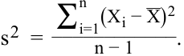
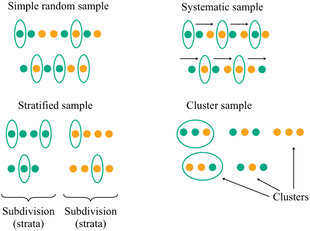
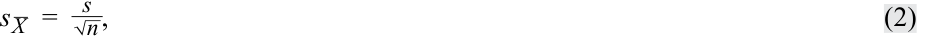

# Tập 1: Phương pháp Định lượng (Quantitative Methods)
## Learning Module 7 Estimation and Inference (Trang PDF 201–222)

---

# Tập 1: Phương pháp Định lượng (*Quantitative Methods*)
## Học phần 7: Ước lượng và Suy luận (*Estimation and Inference*)
### Phần 1/2: Giới thiệu (*Introduction*) (Trang PDF 201–214)

---

<!-- PDF Page 201 -->

#### H Ọ C P H Ầ N 

# **<mark>7</mark>** 

### **Ước lượng và Suy luận (*Estimation and Inference*)** 

###### **tác giả: Wu Jian, PhD.** 

_Jian Wu, PhD, làm việc tại State Street (Hoa Kỳ)._ 

###### **<mark>MỤC TIÊU HỌC TẬP (*LEARNING OUTCOMES*)</mark>** 

|**_Mức độ Thành thạo_**|**_Ứng viên cần có khả năng:_**|
|---|---|
||So sánh và đối chiếu lấy mẫu ngẫu nhiên đơn giản (*simple random*), lấy mẫu ngẫu nhiên phân tầng (*stratified random*), lấy mẫu theo cụm (*cluster*), lấy mẫu thuận tiện (*convenience*), và lấy mẫu phán đoán (*judgmental sampling*) cùng những hàm ý của chúng đối với sai số lấy mẫu (*sampling error*) trong một bài toán đầu tư.|
||Giải thích định lý giới hạn trung tâm (*central limit theorem*) và tầm quan trọng của nó đối với phân phối và sai số chuẩn của trung bình mẫu (*standard error of the sample mean*).|
||Mô tả việc sử dụng lấy mẫu lại (*resampling*: *bootstrap*, *jackknife*) để ước tính phân phối mẫu (*sampling distribution*) của một thống kê.|

<!-- Picture Text: 1  -->

##### **GIỚI THIỆU (*INTRODUCTION*)** 

Trong Học phần này, chúng tôi trình bày các phương pháp khác nhau để thu thập thông tin về một tổng thể (*population* – tất cả các phần tử của một nhóm xác định) thông qua các mẫu (*samples* – một phần của tổng thể). Thông tin về tổng thể mà chúng ta tìm kiếm thường liên quan đến giá trị của một **tham số (*parameter*)**, một đại lượng được tính toán từ hoặc được sử dụng để mô tả một tổng thể dữ liệu. Trong Bài 1, chúng tôi giới thiệu về lấy mẫu (*sampling*), phương pháp sử dụng một mẫu để ước tính một tham số; chúng ta sử dụng các thống kê mẫu (*sample statistics*). Một thống kê (*statistic*) là một đại lượng được tính toán từ hoặc được sử dụng để mô tả một mẫu dữ liệu. 

Giả sử rằng một mẫu mang tính đại diện cho tổng thể cơ sở, làm thế nào nhà phân tích có thể đánh giá sai số lấy mẫu (*sampling error*) khi ước tính một tham số tổng thể? Trong Bài 2, Định lý Giới hạn Trung tâm (*Central Limit Theorem*) giúp chúng ta hiểu được phân phối mẫu của trung bình mẫu (*sampling distribution of the sample mean*) trong nhiều bài toán ước lượng mà chúng ta gặp phải. Điều này cung cấp hướng dẫn về mức độ sát sao mà một trung bình mẫu có thể được kỳ vọng sẽ khớp với trung bình tổng thể cơ sở của nó, cho phép nhà phân tích sử dụng phân phối mẫu để đánh giá độ chính xác của mẫu và kiểm định các giả thuyết về tham số cơ sở. Bài 3 trình bày các phương pháp tiếp cận lấy mẫu lại (*resampling*) khác nhau. 

<!-- PDF Page 202 -->

###### **TỔNG QUAN HỌC PHẦN (*LEARNING MODULE OVERVIEW*)** 

- Trong hai loại phương pháp lấy mẫu, lấy mẫu xác suất (*probability sampling*) bao gồm lấy mẫu ngẫu nhiên đơn giản (*simple random sampling*) và lấy mẫu ngẫu nhiên phân tầng (*stratified random sampling*), còn lấy mẫu phi xác suất (*non-probability sampling*) bao gồm lấy mẫu thuận tiện (*convenience sampling*) và lấy mẫu phán đoán (*judgmental sampling*). Lấy mẫu xác suất bao hàm cơ hội được chọn vào mẫu ngang nhau, trong khi lấy mẫu phi xác suất có rủi ro đáng kể là không mang tính đại diện (*non-representative*). 

- Sai số lấy mẫu (*sampling error*) là sự khác biệt giữa giá trị quan sát được của một thống kê và đại lượng mà nó nhằm mục đích ước tính do việc sử dụng các tập hợp con của tổng thể. 

- Các phương pháp lấy mẫu phi xác suất không dựa vào một quy trình lựa chọn cố định mà thay vào đó dựa vào khả năng lựa chọn mẫu của nhà nghiên cứu. Ưu điểm của nó bao gồm thu thập dữ liệu nhanh chóng với chi phí thấp, và có thể áp dụng phán đoán chuyên gia để lựa chọn mẫu hiệu quả. 

- Định lý Giới hạn Trung tâm (*Central Limit Theorem*) được định nghĩa như sau: Cho một tổng thể được mô tả bởi bất kỳ phân phối xác suất nào có giá trị trung bình $\mu$ và phương sai hữu hạn $\sigma^2$, phân phối mẫu của trung bình mẫu $\bar{X}$ được tính từ các mẫu ngẫu nhiên có kích thước $n$ từ tổng thể này sẽ có phân phối xấp xỉ chuẩn với giá trị trung bình $\mu$ (trung bình tổng thể) và phương sai $\sigma^2 / n$ (phương sai tổng thể chia cho $n$) khi kích thước mẫu $n$ lớn. 

- Sai số chuẩn của trung bình mẫu (*standard error of the sample mean*) là một đại lượng quan trọng khi áp dụng định lý giới hạn trung tâm trong thực tế. Nó thường được ước tính bằng căn bậc hai của phương sai mẫu, được tính như sau: 

<!-- Formula Text: s 2  = ∑ i=1 n (X i − _ X) 2 ____________ n − 1 . -->
$$s^2 = \frac{\sum_{i=1}^{n}(X_i - \bar{X})^2}{n - 1}$$

- Định lý giới hạn trung tâm chỉ ra rằng khi lấy mẫu từ bất kỳ phân phối nào, phân phối của trung bình mẫu sẽ có hai tính chất sau khi kích thước mẫu lớn: (1) phân phối của trung bình mẫu $\bar{X}$ sẽ xấp xỉ chuẩn, và (2) giá trị trung bình của phân phối $\bar{X}$ sẽ bằng giá trị trung bình của tổng thể mà từ đó các mẫu được rút ra. 

- Phương pháp tự thân (*Bootstrap*), một phương pháp lấy mẫu lại phổ biến thực hiện rút liên tiếp các mẫu có cùng kích thước với mẫu ban đầu, sử dụng mô phỏng máy tính để suy luận thống kê mà không cần sử dụng công thức giải tích như thống kê $z$ hay thống kê $t$. Nó có thể được sử dụng như một phương pháp đơn giản nhưng mạnh mẽ cho bất kỳ ước lượng phức tạp nào chẳng hạn như sai số chuẩn của trung bình mẫu. 

- Phương pháp bootstrap có những lợi thế tiềm năng về độ chính xác. Với những ưu điểm này, nó có thể được áp dụng rộng rãi trong tài chính, chẳng hạn như cho các mô phỏng lịch sử trong phân bổ tài sản (*asset allocation*) hoặc trong việc đo lường hiệu quả của một chiến lược đầu tư so với chỉ số chuẩn (*benchmark*). 

- Phương pháp *Jackknife* là một kỹ thuật lấy mẫu lại khác với các mẫu được chọn bằng cách lấy mẫu dữ liệu quan sát ban đầu và loại bỏ lần lượt từng quan sát một ra khỏi tập hợp (và không hoàn lại). Phương pháp Jackknife thường được sử dụng để giảm độ chệch (*bias*) của một ước lượng, và các ứng dụng khác bao gồm tìm sai số chuẩn và khoảng tin cậy (*confidence interval*) của một ước lượng. 

<!-- PDF Page 203 -->

##### **CÁC PHƯƠNG PHÁP LẤY MẪU (*SAMPLING METHODS*)** 

## **<mark>2</mark>** 

*So sánh và đối chiếu lấy mẫu ngẫu nhiên đơn giản, lấy mẫu ngẫu nhiên phân tầng, lấy mẫu theo cụm, lấy mẫu thuận tiện, và lấy mẫu phán đoán cùng những hàm ý của chúng đối với sai số lấy mẫu trong một bài toán đầu tư*

Chúng ta lấy mẫu vì một trong hai lý do. Trong một số trường hợp, chúng ta không thể kiểm tra mọi phần tử của tổng thể. Trong các trường hợp khác, việc kiểm tra mọi phần tử của tổng thể sẽ không hiệu quả về mặt kinh tế. Do đó, tiết kiệm thời gian và tiền bạc là hai yếu tố chính khiến nhà phân tích sử dụng phương pháp lấy mẫu để trả lời một câu hỏi về tổng thể. 

Có hai loại phương pháp lấy mẫu: **lấy mẫu xác suất (*probability sampling*)** và **lấy mẫu phi xác suất (*non-probability sampling*)**. Lấy mẫu xác suất trao cho mọi phần tử của tổng thể cơ hội ngang nhau để được chọn. Do đó, nó có thể tạo ra một mẫu mang tính đại diện cho tổng thể. Ngược lại, lấy mẫu phi xác suất phụ thuộc vào các yếu tố ngoài những cân nhắc về xác suất, chẳng hạn như phán đoán của người lấy mẫu hoặc sự thuận tiện trong việc tiếp cận dữ liệu. Hệ quả là có một rủi ro đáng kể rằng lấy mẫu phi xác suất có thể tạo ra một mẫu không mang tính đại diện. Nhìn chung, với các yếu tố khác không đổi, lấy mẫu xác suất có thể mang lại độ chính xác và độ tin cậy cao hơn so với lấy mẫu phi xác suất. 

Trước tiên chúng ta tập trung vào lấy mẫu xác suất, đặc biệt là hai phương pháp được sử dụng rộng rãi: **lấy mẫu ngẫu nhiên đơn giản (*simple random sampling*)** và **lấy mẫu ngẫu nhiên phân tầng (*stratified random sampling*)**. Sau đó, chúng ta chuyển sự chú ý sang lấy mẫu phi xác suất. 

###### **Lấy mẫu Ngẫu nhiên Đơn giản (*Simple Random Sampling*)** 

Giả sử một nhà phân tích thiết bị không dây muốn biết các khách hàng lớn sẽ chi tiêu trung bình bao nhiêu cho thiết bị trong năm tới. Một chiến lược là khảo sát toàn bộ tổng thể khách hàng thiết bị không dây và hỏi kế hoạch mua hàng của họ là gì. Tuy nhiên, việc khảo sát tất cả các công ty sẽ rất tốn kém về thời gian và tiền bạc. 

Thay vào đó, nhà phân tích có thể thu thập một mẫu đại diện các công ty và khảo sát họ về các khoản chi tiêu thiết bị không dây sắp tới. Trong trường hợp này, nhà phân tích sẽ tính toán mức chi tiêu trung bình mẫu, $\bar{X}$, một đại lượng thống kê (*statistic*). Chiến lược này có lợi thế đáng kể so với việc khảo sát toàn bộ tổng thể vì nó có thể được thực hiện nhanh hơn và với chi phí thấp hơn. 

Tuy nhiên, việc lấy mẫu làm phát sinh sai số. Sai số phát sinh bởi vì không phải tất cả các công ty trong tổng thể đều được khảo sát. Nhà phân tích quyết định lấy mẫu đang đánh đổi thời gian và tiền bạc lấy sai số lấy mẫu (*sampling error*). 

Khi một nhà phân tích chọn lấy mẫu, họ phải lập một kế hoạch lấy mẫu. **Kế hoạch lấy mẫu (*sampling plan*)** là tập hợp các quy tắc được sử dụng để chọn một mẫu. Loại mẫu cơ bản mà từ đó chúng ta có thể rút ra các kết luận vững chắc về mặt thống kê đối với một tổng thể là mẫu ngẫu nhiên đơn giản. 

**Mẫu ngẫu nhiên đơn giản (*simple random sample*)** là một tập hợp con của một tổng thể lớn hơn được tạo ra theo cách sao cho mỗi phần tử của tổng thể có xác suất được chọn vào tập hợp con là như nhau. 

Thủ tục rút một mẫu thỏa mãn định nghĩa về mẫu ngẫu nhiên đơn giản được gọi là **lấy mẫu ngẫu nhiên đơn giản (*simple random sampling*)**. Lấy mẫu ngẫu nhiên đơn giản đặc biệt hữu ích khi dữ liệu trong tổng thể có tính đồng nhất (*homogeneous*)—tức là đặc điểm của dữ liệu hoặc các quan sát (ví dụ: quy mô hoặc khu vực) nhìn chung là tương đồng. Nếu điều kiện này không được thỏa mãn, các loại lấy mẫu khác có thể phù hợp hơn. 

<!-- PDF Page 204 -->

**Lấy mẫu hệ thống (*Systematic sampling*)** có thể được sử dụng khi chúng ta không thể mã hóa (hoặc thậm chí xác định) tất cả các phần tử của một tổng thể. Với lấy mẫu hệ thống, chúng ta chọn mỗi phần tử thứ $k$ cho đến khi có được một mẫu có kích thước mong muốn. Mẫu thu được từ thủ tục này sẽ xấp xỉ ngẫu nhiên. 

Giả sử nhà phân tích thiết bị không dây khảo sát một mẫu ngẫu nhiên các khách hàng thiết bị không dây để xác định mức chi tiêu thiết bị trung bình. Trung bình mẫu thu được sẽ cung cấp cho nhà phân tích một ước lượng về mức chi tiêu trung bình của tổng thể. Giá trị trung bình thu được từ mẫu theo cách này sẽ khác với trung bình tổng thể mà chúng ta đang cố gắng ước tính. Nó chịu ảnh hưởng của sai số. Một phần quan trọng của sai số này được gọi là sai số lấy mẫu (*sampling error*), xuất phát từ sự biến thiên lấy mẫu và xảy ra vì chúng ta chỉ có dữ liệu trên một tập hợp con của tổng thể. 

**Sai số lấy mẫu (*Sampling error*)** là sự khác biệt giữa giá trị quan sát được của một thống kê và đại lượng mà nó nhằm mục đích ước tính do việc sử dụng các tập hợp con của tổng thể. 

Một mẫu ngẫu nhiên phản ánh các đặc tính của tổng thể một cách không chệch (*unbiased*), và các thống kê mẫu, chẳng hạn như trung bình mẫu, được tính toán trên cơ sở một mẫu ngẫu nhiên là các ước lượng hợp lệ của các tham số tổng thể cơ sở. Do đó, một thống kê mẫu là một biến ngẫu nhiên. Nói cách khác, không chỉ dữ liệu gốc từ tổng thể có một phân phối mà thống kê mẫu cũng có một phân phối. Phân phối này chính là phân phối mẫu (*sampling distribution*) của thống kê đó. 

**Phân phối mẫu (*Sampling distribution*)** của một thống kê là phân phối của tất cả các giá trị khả dĩ riêng biệt mà thống kê đó có thể nhận khi được tính toán từ các mẫu có cùng kích thước được rút ngẫu nhiên từ cùng một tổng thể. 

Ví dụ, trong trường hợp trung bình mẫu, chúng ta gọi là “phân phối mẫu của trung bình mẫu” hoặc phân phối của trung bình mẫu. Chúng ta sẽ nói nhiều hơn về phân phối mẫu ở phần sau của tài liệu này. Tiếp theo, chúng ta xem xét một phương pháp lấy mẫu khác hữu ích trong phân tích đầu tư. 

###### **Lấy mẫu Ngẫu nhiên Phân tầng (*Stratified Random Sampling*)** 

Phương pháp lấy mẫu ngẫu nhiên đơn giản vừa thảo luận có thể không phải là cách tiếp cận tốt nhất trong mọi tình huống. Một phương pháp thay thế thường được sử dụng là lấy mẫu ngẫu nhiên phân tầng. 

Trong **lấy mẫu ngẫu nhiên phân tầng (*stratified random sampling*)**, tổng thể được chia thành các tổng thể con (các tầng – *strata*) dựa trên một hoặc nhiều tiêu chí phân loại. Các mẫu ngẫu nhiên đơn giản sau đó được rút ra từ mỗi tầng với kích thước tỷ lệ thuận với quy mô tương đối của mỗi tầng trong tổng thể. Các mẫu này sau đó được gộp lại để tạo thành một mẫu ngẫu nhiên phân tầng. 

Trái ngược với lấy mẫu ngẫu nhiên đơn giản, lấy mẫu ngẫu nhiên phân tầng đảm bảo rằng các phân nhóm tổng thể được quan tâm đều có đại diện trong mẫu. Một ưu điểm khác là các ước lượng tham số được tạo ra từ lấy mẫu phân tầng có độ chính xác cao hơn—tức là phương sai hoặc độ phân tán nhỏ hơn—so với các ước lượng thu được từ lấy mẫu ngẫu nhiên đơn giản. 

Đầu tư bám sát chỉ số trái phiếu (*bond indexing*) là một lĩnh vực mà lấy mẫu phân tầng thường xuyên được áp dụng. **Đầu tư theo chỉ số (*Indexing*)** là một chiến lược đầu tư trong đó nhà đầu tư xây dựng một danh mục đầu tư để mô phỏng hiệu quả của một chỉ số xác định. Trong đầu tư chỉ số trái phiếu thuần túy (*pure bond indexing*), còn được gọi là phương pháp mô phỏng toàn phần (*full-replication approach*), nhà đầu tư cố gắng mô phỏng hoàn toàn một chỉ số bằng cách sở hữu tất cả các trái phiếu trong chỉ số theo tỷ lệ trọng số giá trị thị trường của chúng. Tuy nhiên, nhiều chỉ số trái phiếu bao gồm hàng ngàn đợt phát hành, vì vậy đầu tư chỉ số trái phiếu thuần túy rất khó thực hiện. Ngoài ra, chi phí giao dịch sẽ rất cao vì nhiều trái phiếu không có thị trường thanh khoản. 

Mặc dù một mẫu ngẫu nhiên đơn giản có thể là giải pháp cho bài toán chi phí, nhưng mẫu đó có khả năng sẽ không khớp với các yếu tố rủi ro chính của chỉ số, chẳng hạn như độ nhạy lãi suất (*interest rate sensitivity*). Bởi vì các yếu tố rủi ro chính của danh mục thu nhập cố định đã được biết rõ và có thể định lượng được, lấy mẫu phân tầng mang lại một cách tiếp cận hiệu quả hơn. Trong cách tiếp cận này, chúng ta chia tổng thể các trái phiếu trong chỉ số thành các nhóm có thời lượng (*duration* – độ nhạy lãi suất), phân phối dòng tiền, ngành, chất lượng tín dụng và mức độ rủi ro mua lại (*call exposure*) tương tự nhau. Chúng ta gọi 

<!-- PDF Page 205 -->

mỗi nhóm là một tầng (*stratum*) hoặc ô (*cell* – một thuật ngữ thường được sử dụng trong bối cảnh này). Sau đó, chúng ta chọn một mẫu từ mỗi tầng tỷ lệ thuận với trọng số thị trường tương đối của tầng đó trong chỉ số cần mô phỏng. 

###### **VÍ DỤ 1 (*EXAMPLE 1*)** 

###### **Chỉ số Trái phiếu và Lấy mẫu Phân tầng (*Bond Indexes and Stratified Sampling*)** 

Giả sử bạn là người quản lý một danh mục đầu tư trái phiếu bám sát theo Chỉ số Chính phủ/Tín dụng Hoa Kỳ của Bloomberg Barclays (*Bloomberg Barclays US Government/Credit Index*), nghĩa là tỷ suất sinh lợi của danh mục đầu tư phải tương tự như tỷ suất sinh lợi của chỉ số. Bạn đang khám phá một số cách tiếp cận để đầu tư theo chỉ số, bao gồm cả cách tiếp cận lấy mẫu phân tầng. Trước tiên, bạn phân biệt giữa trái phiếu cơ quan chính phủ (*agency bonds*), trái phiếu Kho bạc Hoa Kỳ (*US Treasury bonds*) và trái phiếu doanh nghiệp hạng đầu tư (*investment-grade corporate bonds*). Đối với mỗi nhóm trong ba nhóm này, bạn xác định 10 khoảng kỳ hạn—1 đến 2 năm, 2 đến 3 năm, 3 đến 4 năm, 4 đến 6 năm, 6 đến 8 năm, 8 đến 10 năm, 10 đến 12 năm, 12 đến 15 năm, 15 đến 20 năm, và 20 đến 30 năm—và cũng tách biệt các trái phiếu có lãi suất coupon (lãi suất hàng năm) từ 6% trở xuống với các trái phiếu có lãi suất coupon trên 6%. 

1. Kế hoạch lấy mẫu này bao gồm bao nhiêu ô (*cells*) hoặc tầng (*strata*)? 

###### **Lời giải (*Solution*):** 

Chúng ta có 3 phân loại tổ chức phát hành, 10 phân loại kỳ hạn và 2 phân loại lãi suất coupon. Vì vậy, tổng cộng, kế hoạch này bao gồm $3(10)(2) = 60$ tầng hoặc ô khác nhau. 

2. Nếu bạn sử dụng kế hoạch lấy mẫu này, số lượng đợt phát hành tối thiểu mà danh mục đầu tư theo chỉ số có thể có là bao nhiêu? 

###### **Lời giải (*Solution*):** 

Người ta không thể có ít hơn 1 đợt phát hành cho mỗi ô, vì vậy danh mục đầu tư phải bao gồm ít nhất 60 đợt phát hành. 

3. Giả sử rằng khi lựa chọn trong số các chứng khoán đủ điều kiện để chọn trong mỗi ô, bạn áp dụng một tiêu chí liên quan đến tính thanh khoản của thị trường chứng khoán đó. Mẫu thu được có phải là ngẫu nhiên không? Giải thích câu trả lời của bạn. 

###### **Lời giải (*Solution*):** 

Khi áp dụng bất kỳ tiêu chí bổ sung nào vào việc lựa chọn chứng khoán cho các ô, không phải mọi chứng khoán có thể được đưa vào đều có xác suất được chọn ngang nhau. Không có tính tỷ lệ đồng đều trong việc lựa chọn, và kết quả là việc lấy mẫu không phải là ngẫu nhiên. Trên thực tế, việc đầu tư theo chỉ số sử dụng lấy mẫu phân tầng thường không hoàn toàn bao hàm việc lấy mẫu ngẫu nhiên bởi vì việc lựa chọn các đợt phát hành trái phiếu trong các ô phải tuân theo nhiều tiêu chí bổ sung khác nhau. Bởi vì mục đích của việc lấy mẫu trong ứng dụng này không phải là để đưa ra suy luận về một tham số tổng thể mà là để mô phỏng chỉ số cho một danh mục đầu tư, nên việc thiếu tính ngẫu nhiên tự bản thân nó không phải là một vấn đề trong ứng dụng lấy mẫu phân tầng này. 

###### **Lấy mẫu theo Cụm (*Cluster Sampling*)** 

Một phương pháp lấy mẫu khác, **lấy mẫu theo cụm (*cluster sampling*)**, cũng đòi hỏi việc phân chia hoặc phân loại tổng thể thành các nhóm tổng thể con, được gọi là các cụm (*clusters*). Trong phương pháp này, tổng thể được chia thành các cụm, mỗi cụm về cơ bản là một bản đại diện thu nhỏ (*mini-representation*) của toàn bộ tổng thể. Sau đó, một số cụm nhất định được chọn nguyên cụm bằng cách sử dụng lấy mẫu 

<!-- PDF Page 206 -->

ngẫu nhiên đơn giản. Nếu tất cả các phần tử trong mỗi cụm được chọn đều được lấy mẫu, kế hoạch lấy mẫu này được gọi là lấy mẫu theo cụm một giai đoạn (*one-stage cluster sampling*). Nếu một mẫu con được chọn ngẫu nhiên từ mỗi cụm đã chọn, thì kế hoạch đó được gọi là lấy mẫu theo cụm hai giai đoạn (*two-stage cluster sampling*). Minh họa 1 (bảng góc dưới bên phải) cho thấy cách hoạt động của lấy mẫu theo cụm và so sánh nó với các phương pháp lấy mẫu xác suất khác. 

**Minh họa 1: Lấy mẫu Xác suất (*Exhibit 1: Probability Sampling*)** 

<!-- Picture Text: Simple random sample Systematic sample Stratified sample Cluster sample Clusters Subdivision Subdivision (strata) (strata)  -->
> **Chú thích hình ảnh:** Bốn phương pháp lấy mẫu xác suất:
> - **Mẫu ngẫu nhiên đơn giản (*Simple random sample*):** Chọn ngẫu nhiên các cá thể từ toàn bộ tổng thể.
> - **Mẫu hệ thống (*Systematic sample*):** Chọn định kỳ mỗi cá thể thứ $k$.
> - **Mẫu phân tầng (*Stratified sample*):** Chia thành các phân nhóm/tầng (*Subdivision/strata*) và lấy mẫu ngẫu nhiên trong tất cả các tầng.
> - **Mẫu theo cụm (*Cluster sample*):** Chia thành các cụm (*Clusters*) và chọn ngẫu nhiên một số cụm.

Một sự khác biệt lớn giữa mẫu ngẫu nhiên theo cụm và mẫu ngẫu nhiên phân tầng là trong lấy mẫu theo cụm, toàn bộ một cụm được coi là một đơn vị lấy mẫu và chỉ những cụm được lấy mẫu mới được đưa vào. Tuy nhiên, trong lấy mẫu ngẫu nhiên phân tầng, tất cả các tầng đều được đưa vào và chỉ những phần tử cụ thể bên trong mỗi tầng mới được chọn làm đơn vị lấy mẫu. 

Lấy mẫu theo cụm thường được sử dụng cho các cuộc khảo sát thị trường diện rộng, và phiên bản phổ biến nhất xác định các cụm dựa trên các tham số địa lý. Ví dụ, một viện nghiên cứu đang tìm cách khảo sát xem các nhà đầu tư cá nhân tại Hoa Kỳ đang lạc quan (*bullish*), bi quan (*bearish*) hay trung lập (*neutral*) về thị trường chứng khoán. Sẽ là bất khả thi nếu thực hiện nghiên cứu bằng cách khảo sát tất cả các nhà đầu tư cá nhân trong cả nước. Lấy mẫu theo cụm hai giai đoạn là một giải pháp tốt trong trường hợp này. Ở giai đoạn đầu tiên, nhà nghiên cứu có thể nhóm tổng thể theo các tiểu bang và tất cả các nhà đầu tư cá nhân của mỗi tiểu bang đại diện cho một cụm. Một số ít các cụm sau đó được chọn ngẫu nhiên. Ở giai đoạn thứ hai, một mẫu ngẫu nhiên đơn giản gồm các nhà đầu tư cá nhân được chọn từ mỗi cụm đã lấy mẫu để tiến hành khảo sát. 

So với các phương pháp lấy mẫu xác suất khác, với cùng kích thước mẫu, lấy mẫu theo cụm thường mang lại độ chính xác thấp hơn vì một mẫu từ một cụm có thể ít mang tính đại diện cho toàn bộ tổng thể hơn. Tuy nhiên, ưu điểm lớn của nó là mang lại kế hoạch lấy mẫu xác suất tiết kiệm thời gian và chi phí nhất để phân tích một tổng thể rộng lớn. 

###### **Lấy mẫu Phi xác suất (*Non-Probability Sampling*)** 

Các phương pháp lấy mẫu phi xác suất không dựa vào một quy trình lựa chọn cố định mà thay vào đó dựa vào khả năng lựa chọn mẫu của nhà nghiên cứu. Chúng tôi giới thiệu hai loại phương pháp lấy mẫu phi xác suất chính tại đây. 

- **Lấy mẫu Thuận tiện (*Convenience Sampling*):** Trong phương pháp này, một phần tử được chọn từ tổng thể dựa trên việc liệu nhà nghiên cứu có thể tiếp cận được nó hay không hoặc mức độ dễ dàng để nhà nghiên cứu tiếp cận phần tử đó. Các mẫu không 

<!-- PDF Page 207 -->

nhất thiết mang tính đại diện cho toàn bộ tổng thể, và do đó mức độ chính xác của việc lấy mẫu có thể bị hạn chế. Ưu điểm của **lấy mẫu thuận tiện (*convenience sampling*)** là dữ liệu có thể được thu thập nhanh chóng với chi phí thấp. Trong các tình huống như giai đoạn sơ bộ của nghiên cứu hoặc trong các hoàn cảnh bị ràng buộc về chi phí, lấy mẫu thuận tiện thường được sử dụng như một kế hoạch lấy mẫu tiết kiệm thời gian và hiệu quả về chi phí cho một nghiên cứu thử nghiệm quy mô nhỏ (*pilot study*) trước khi kiểm nghiệm một mẫu quy mô lớn và mang tính đại diện hơn. 

- **Lấy mẫu Phán đoán (*Judgmental Sampling*):** Quy trình lấy mẫu này bao gồm việc tuyển chọn có chọn lọc các phần tử từ tổng thể dựa trên kiến thức và phán đoán chuyên môn của nhà nghiên cứu. Việc lựa chọn mẫu theo **lấy mẫu phán đoán (*judgmental sampling*)** có thể bị ảnh hưởng bởi sự thiên lệch (*bias*) của nhà nghiên cứu và có thể dẫn đến các kết quả bị lệch không đại diện cho toàn bộ tổng thể. Tuy nhiên, trong những hoàn cảnh có sự ràng buộc về thời gian, hoặc khi chuyên môn của các nhà nghiên cứu là yếu tố quyết định để chọn được một mẫu mang tính đại diện tốt hơn so với việc sử dụng các phương pháp lấy mẫu xác suất hoặc phi xác suất khác, lấy mẫu phán đoán cho phép các nhà nghiên cứu đi thẳng vào tổng thể mục tiêu cần quan tâm. Ví dụ, khi kiểm toán báo cáo tài chính, các kiểm toán viên dày dạn kinh nghiệm có thể áp dụng phán đoán sắc bén của mình để chọn các tài khoản hoặc giao dịch có thể cung cấp phạm vi bao phủ kiểm toán đầy đủ. Ví dụ 2 minh họa một ứng dụng của các phương pháp lấy mẫu này. 

###### **VÍ DỤ 2 (*EXAMPLE 2*)** 

###### **Minh họa Sức mạnh của Lấy mẫu (*Demonstrating the Power of Sampling*)** 

Để minh họa sức mạnh của việc lấy mẫu, chúng ta tiến hành hai thí nghiệm lấy mẫu trên một tập dữ liệu lớn. Toàn bộ tập dữ liệu là “tổng thể”, đại diện cho tỷ suất sinh lợi hàng ngày của Chỉ số Cổ phiếu Âu-Á-Phi (*Euro-Asia-Africa – EAA Equity Index*) giả định. Tập dữ liệu này kéo dài trong giai đoạn 5 năm và bao gồm 1,258 quan sát về tỷ suất sinh lợi hàng ngày với giá trị tối thiểu là $-4.1\%$ và giá trị tối đa là $5.0\%$. 

Trước tiên, chúng ta tính tỷ suất sinh lợi trung bình hàng ngày của Chỉ số Cổ phiếu EAA (sử dụng tổng thể). 

Bằng cách lấy trung bình của tất cả các điểm dữ liệu, giá trị trung bình của toàn bộ chuỗi tỷ suất sinh lợi hàng ngày được tính là $0.035\%$. 

###### **Thí nghiệm Thứ nhất: Lấy mẫu Ngẫu nhiên (*First Experiment: Random Sampling*)** 

Kích thước mẫu $m$ được đặt thành 5, 10, 20, 50, 100, 200, 500 và 1,000. Tại mỗi kích thước mẫu, chúng ta chạy lấy mẫu ngẫu nhiên nhiều lần ($N = 100$) để thu thập 100 mẫu nhằm tính sai số tuyệt đối trung bình (*mean absolute error*). Mục đích là để tính toán và vẽ đồ thị sai số trung bình theo kích thước mẫu. 

Đối với một kích thước mẫu $m$ nhất định, chúng ta sử dụng thủ tục lấy mẫu ngẫu nhiên để tính sai số tuyệt đối trung bình nhằm đo lường sai số lấy mẫu. 

Bằng cách áp dụng thủ tục này, chúng ta tính toán sai số tuyệt đối trung bình cho tám kích thước mẫu khác nhau: $m = 5, 10, 20, 50, 100, 200, 500$ và $1,000$. 

###### **Thí nghiệm Thứ hai: Lấy mẫu Ngẫu nhiên Phân tầng (*Second Experiment: Stratified Random Sampling*)** 

Bây giờ chúng ta tiến hành lấy mẫu ngẫu nhiên phân tầng bằng cách chia tỷ suất sinh lợi hàng ngày thành các nhóm theo năm. Kích thước mẫu $m$ một lần nữa được đặt thành 5, 10, 20, 50, 100, 200, 500 và 1,000. Tại mỗi kích thước mẫu, chúng ta chạy lấy mẫu ngẫu nhiên nhiều lần ($N = 100$) để thu thập 100 mẫu nhằm tính sai số tuyệt đối trung bình. 

<!-- PDF Page 208 -->

Chúng ta làm theo các bước tương tự như trước, ngoại trừ bước đầu tiên. Thay vì chạy lấy mẫu ngẫu nhiên đơn giản, chúng ta tiến hành lấy mẫu ngẫu nhiên phân tầng—tức là chọn ngẫu nhiên các mẫu con có số lượng bằng nhau từ các nhóm tỷ suất sinh lợi hàng ngày theo năm để tạo ra một mẫu đầy đủ. Ví dụ, đối với một mẫu gồm 50 quan sát, 10 điểm dữ liệu được chọn ngẫu nhiên từ tỷ suất sinh lợi hàng ngày của mỗi năm tương ứng từ 2014 đến 2018. Minh họa 2 tóm tắt các kết quả. 

###### **Minh họa 2: Sai số Tuyệt đối Trung bình theo các Thủ tục Lấy mẫu Khác nhau (*Exhibit 2: Mean Absolute Errors under Different Sampling Procedures*)** 

**Sai số Tuyệt đối Trung bình của Lấy mẫu Ngẫu nhiên (*Mean Absolute Error of Random Sampling*)**

|**Kích thước mẫu (*Sample size*)**|**5**|**10**|**20**|**50**|**100**|**200**|**500**|**1,000**|
|---|---|---|---|---|---|---|---|---|
|Sai số tuyệt đối trung bình (*Mean absolute error*)|0.297%|0.218%|0.163%|0.091%|0.063%|0.039%|0.019%|0.009%|

**Sai số Tuyệt đối Trung bình của Lấy mẫu Ngẫu nhiên Phân tầng (*Mean Absolute Error of Stratified Random Sampling*)**

|**Kích thước mẫu (*Sample size*)**|**5**|**10**|**20**|**50**|**100**|**200**|**500**|**1,000**|
|---|---|---|---|---|---|---|---|---|
|Sai số tuyệt đối trung bình (*Mean absolute error*)|0.294%|0.205%|0.152%|0.083%|0.071%|0.051%|0.025%|0.008%|

Dưới cả hai phương pháp lấy mẫu ngẫu nhiên và lấy mẫu phân tầng, sai số tuyệt đối trung bình đều giảm nhanh chóng khi kích thước mẫu tăng lên. Lấy mẫu phân tầng tạo ra sai số tuyệt đối trung bình nhỏ hơn vì nó phản ánh chính xác hơn đặc tính của tổng thể, nhưng sự khác biệt này thu hẹp lại—và trong trường hợp này thực tế lại đảo chiều nhẹ ở một vài cỡ mẫu—khi kích thước mẫu tăng lên. 

Minh họa 2 cũng chỉ ra rằng cần có một kích thước mẫu tối thiểu để giới hạn sai số mẫu và đạt được một mức độ chính xác nhất định. Tuy nhiên, sau một quy mô nhất định, có rất ít lợi ích tăng thêm từ việc bổ sung thêm các quan sát (từ 200 đến 400 trong trường hợp này). 

###### **Lấy mẫu từ các Phân phối Khác nhau (*Sampling from Different Distributions*)** 

Trên thực tế, ngoài việc lựa chọn các phương pháp lấy mẫu phù hợp, chúng ta cũng cần thận trọng khi lấy mẫu từ một tổng thể không thuộc cùng một phân phối duy nhất. Ví dụ 3 minh họa các vấn đề có thể phát sinh khi lấy mẫu từ nhiều hơn một phân phối. 

###### **VÍ DỤ 3 (*EXAMPLE 3*)** 

###### **Tính Tỷ số Sharpe: Dữ liệu Hàng quý trong Một hoặc Hai Năm (*Calculating Sharpe Ratios: One or Two Years of Quarterly Data*)** 

Các nhà phân tích thường sử dụng tỷ số Sharpe (*Sharpe ratio*) để đánh giá hiệu quả của một danh mục đầu tư được quản lý. Tỷ số Sharpe là tỷ suất sinh lợi trung bình vượt trên lãi suất phi rủi ro chia cho độ lệch chuẩn của tỷ suất sinh lợi. Tỷ số này đo lường tỷ suất sinh lợi của một quỹ hoặc một chứng khoán vượt trên lãi suất phi rủi ro (tỷ suất sinh lợi vượt trội – *excess return*) kiếm được trên mỗi đơn vị độ lệch chuẩn của tỷ suất sinh lợi. 

<!-- PDF Page 209 -->

Để tính tỷ số Sharpe, giả sử một nhà phân tích thu thập tám quan sát tỷ suất sinh lợi vượt trội hàng quý (tức là tổng tỷ suất sinh lợi vượt trên lãi suất phi rủi ro). Trong năm đầu tiên, người quản lý đầu tư của danh mục đã theo đuổi chiến lược rủi ro thấp, và trong năm thứ hai, người quản lý đã theo đuổi chiến lược rủi ro cao. Đối với mỗi năm này, nhà phân tích cũng theo dõi tỷ suất sinh lợi vượt trội hàng quý của một chỉ số chuẩn (*benchmark*) dùng để đánh giá người quản lý. Trong mỗi năm của hai năm đó, tỷ số Sharpe của chỉ số chuẩn là $0.21$. Minh họa 3 đưa ra phép tính tỷ số Sharpe của danh mục đầu tư. 

**Minh họa 3: Tính Tỷ số Sharpe: Chiến lược Rủi ro Thấp và Chiến lược Rủi ro Cao (*Exhibit 3: Calculation of Sharpe Ratios: Low-Risk and High-Risk Strategies*)** 

|**Quý/Thước đo (*Quarter/Measure*)**|**Tỷ suất sinh lợi Vượt trội Năm 1 (*Year 1 Excess Returns*)**|**Tỷ suất sinh lợi Vượt trội Năm 2 (*Year 2 Excess Returns*)**|
|---|---|---|
|Quý 1 (*Quarter 1*)|−3%|−12%|
|Quý 2 (*Quarter 2*)|5%|20%|
|Quý 3 (*Quarter 3*)|−3%|−12%|
|Quý 4 (*Quarter 4*)|5%|20%|
|Trung bình hàng quý (*Quarterly average*)|1%|4%|
|Độ lệch chuẩn hàng quý (*Quarterly standard deviation*)|4.62%|18.48%|

_Tỷ số Sharpe (Sharpe ratio) = $0.22 = 1/4.62 = 4/18.48$_ 

Trong năm đầu tiên, khi người quản lý theo đuổi chiến lược rủi ro thấp, tỷ suất sinh lợi hàng quý trung bình vượt trên lãi suất phi rủi ro là $1\%$ với độ lệch chuẩn là $4.62\%$. Do đó, tỷ số Sharpe là $1 / 4.62 = 0.22$. Kết quả của năm thứ hai phản ánh năm đầu tiên ngoại trừ việc có tỷ suất sinh lợi trung bình và độ biến động cao hơn. Tỷ số Sharpe cho năm thứ hai là $4 / 18.48 = 0.22$. Tỷ số Sharpe của chỉ số chuẩn là $0.21$ trong cả năm thứ nhất và năm thứ hai. Bởi vì tỷ số Sharpe lớn hơn thì tốt hơn tỷ số nhỏ hơn (mang lại nhiều tỷ suất sinh lợi hơn trên mỗi đơn vị rủi ro), người quản lý dường như đã có hiệu quả vượt trội so với chỉ số chuẩn (*outperformed the benchmark*). 

Bây giờ, giả sử nhà phân tích tin rằng một mẫu lớn hơn sẽ ưu việt hơn một mẫu nhỏ. Do đó, cô quyết định gộp hai năm lại với nhau và tính tỷ số Sharpe dựa trên tám quan sát hàng quý. Tỷ suất sinh lợi vượt trội hàng quý trung bình cho hai năm là trung bình cộng của tỷ suất sinh lợi vượt trội trung bình của mỗi năm. Trong giai đoạn hai năm, tỷ suất sinh lợi vượt trội trung bình là $(1 + 4)/2 = 2.5\%$ mỗi quý. Độ lệch chuẩn cho cả tám quý được đo lường từ trung bình mẫu $2.5\%$ là $12.57\%$. Tỷ số Sharpe của danh mục đầu tư trong giai đoạn hai năm bây giờ là $2.5 / 12.57 = 0.199$; tỷ số Sharpe của chỉ số chuẩn vẫn là $0.21$. Như vậy, khi tỷ suất sinh lợi của giai đoạn hai năm được gộp chung, người quản lý dường như đã mang lại ít tỷ suất sinh lợi trên mỗi đơn vị rủi ro hơn so với chỉ số chuẩn và thấp hơn khi so với kết quả riêng lẻ từng năm. 

Vấn đề với việc sử dụng tám quý dữ liệu tỷ suất sinh lợi là nhà phân tích đã vi phạm giả định rằng các tỷ suất sinh lợi được lấy mẫu đến từ cùng một tổng thể. Do sự thay đổi trong chiến lược đầu tư của người quản lý, tỷ suất sinh lợi trong Năm 2 tuân theo một phân phối khác với tỷ suất sinh lợi trong Năm 1. Rõ ràng, trong Năm 1, tỷ suất sinh lợi được tạo ra bởi một tổng thể cơ sở có giá trị trung bình và phương sai thấp hơn so với tổng thể của năm thứ hai. Việc kết hợp kết quả của năm thứ nhất và năm thứ hai đã tạo ra một mẫu không đại diện cho bất kỳ tổng thể nào. Bởi vì mẫu lớn hơn không thỏa mãn các giả định của mô hình, nên bất kỳ kết luận nào mà 

<!-- PDF Page 210 -->

nhà phân tích đưa ra dựa trên mẫu lớn hơn đều không chính xác. Đối với ví dụ này, cô ấy sẽ tốt hơn nếu sử dụng một mẫu nhỏ hơn thay vì một mẫu lớn hơn bởi vì mẫu nhỏ hơn đại diện cho một phân phối tỷ suất sinh lợi đồng nhất hơn (*more homogeneous distribution of returns*). 

###### **BỘ CÂU HỎI (*QUESTION SET*)** 

Một nhà phân tích đang nghiên cứu chi tiêu nghiên cứu và phát triển (R&D) của các công ty dược phẩm trên toàn thế giới. Cô cân nhắc ba phương pháp lấy mẫu để tìm hiểu mức độ chi tiêu R&D của một công ty. Phương pháp 1 là chỉ cần sử dụng tất cả dữ liệu có sẵn từ một cơ sở dữ liệu nội bộ mà cô và các đồng nghiệp đã xây dựng khi nghiên cứu vài chục cổ phiếu tiêu biểu trong ngành. Phương pháp 2 bao gồm việc dựa vào một cơ sở dữ liệu thương mại do một nhà cung cấp dữ liệu cung cấp. Cô sẽ chọn mỗi công ty dược phẩm thứ năm trong danh sách để trích xuất dữ liệu. Phương pháp 3 là trước tiên chia các công ty dược phẩm trong cơ sở dữ liệu thương mại thành ba nhóm theo khu vực đặt trụ sở chính của công ty (ví dụ: Châu Á, Châu Âu hoặc Bắc Mỹ) và sau đó chọn ngẫu nhiên một mẫu con gồm các công ty từ mỗi nhóm, với kích thước mẫu tỷ lệ thuận với quy mô của nhóm liên kết nhằm tạo thành một mẫu hoàn chỉnh. 

1. Phương pháp 1 là một ví dụ về: 

   - **A.** lấy mẫu ngẫu nhiên đơn giản (*simple random sampling*). 
   - **B.** lấy mẫu ngẫu nhiên phân tầng (*stratified random sampling*). 
   - **C.** lấy mẫu thuận tiện (*convenience sampling*). 

###### **Lời giải (*Solution*):** 

C đúng. Nhà phân tích chọn dữ liệu từ cơ sở dữ liệu nội bộ vì chúng dễ dàng và thuận tiện để tiếp cận. 

2. Phương pháp 2 là một ví dụ về: 

   - **A.** lấy mẫu phán đoán (*judgmental sampling*). 
   - **B.** lấy mẫu hệ thống (*systematic sampling*). 
   - **C.** lấy mẫu theo cụm (*cluster sampling*). 

###### **Lời giải (*Solution*):** 

B đúng. Các phần tử mẫu được chọn với một khoảng cách cố định ($k = 5$) từ tổng thể lớn do nhà cung cấp dữ liệu cung cấp. 

3. Phương pháp 3 là một ví dụ về: 

   - **A.** lấy mẫu ngẫu nhiên đơn giản (*simple random sampling*). 
   - **B.** lấy mẫu ngẫu nhiên phân tầng (*stratified random sampling*). 
   - **C.** lấy mẫu theo cụm (*cluster sampling*). 

###### **Lời giải (*Solution*):** 

B đúng. Tổng thể các công ty dược phẩm được chia thành ba tầng theo khu vực để thực hiện lấy mẫu ngẫu nhiên riêng lẻ. 

4. Perkiomen Kinzua, một kiểm toán viên dày dạn kinh nghiệm, đang kiểm toán các giao dịch năm ngoái của Conemaugh Corporation. Không may là Conemaugh có số lượng giao dịch rất lớn, và Kinzua đang chịu áp lực về thời gian để hoàn thành cuộc kiểm toán. 

<!-- PDF Page 211 -->

Ông quyết định chỉ kiểm toán một tập hợp con nhỏ trong tổng thể giao dịch cần quan tâm và sử dụng phương pháp lấy mẫu để tạo ra tập hợp con đó. 

Phương pháp lấy mẫu phù hợp nhất để Kinzua sử dụng là: 

- **A.** lấy mẫu phán đoán (*judgmental sampling*). 
- **B.** lấy mẫu hệ thống (*systematic sampling*). 
- **C.** lấy mẫu thuận tiện (*convenience sampling*). 

###### **Lời giải (*Solution*):** 

A đúng. Với lấy mẫu phán đoán, Kinzua sẽ sử dụng kiến thức và phán đoán chuyên môn của mình với tư cách là một kiểm toán viên dày dạn kinh nghiệm để chọn các giao dịch cần quan tâm từ tổng thể. Cách tiếp cận này sẽ cho phép Kinzua tạo ra một mẫu mang tính đại diện cho tổng thể và cung cấp phạm vi bao phủ kiểm toán đầy đủ. Lấy mẫu phán đoán hữu ích trong các trường hợp có sự ràng buộc về thời gian hoặc trong đó chuyên môn của các nhà nghiên cứu là yếu tố quyết định để chọn được một mẫu mang tính đại diện tốt hơn so với việc sử dụng các phương pháp lấy mẫu xác suất hoặc phi xác suất khác. Tuy nhiên, lấy mẫu phán đoán tiềm ẩn rủi ro là Kinzua bị thiên lệch trong các lựa chọn của mình, dẫn đến kết quả bị lệch không đại diện cho toàn bộ tổng thể. 

##### **ĐỊNH LÝ GIỚI HẠN TRUNG TÂM VÀ SUY LUẬN (*CENTRAL LIMIT THEOREM AND INFERENCE*)** 

## **<mark>3</mark>** 

*Giải thích định lý giới hạn trung tâm và tầm quan trọng của nó đối với phân phối và sai số chuẩn của trung bình mẫu*

Trước đó chúng ta đã giới thiệu một nhà phân tích thiết bị không dây quyết định lấy mẫu để ước tính chi tiêu vốn dự kiến trung bình của khách hàng mua thiết bị không dây. Giả sử rằng mẫu mang tính đại diện cho tổng thể cơ sở, làm thế nào nhà phân tích có thể đánh giá sai số lấy mẫu khi ước tính trung bình tổng thể? 

Bản thân trung bình mẫu là một biến ngẫu nhiên có phân phối xác suất được gọi là phân phối mẫu của thống kê (*statistic’s sampling distribution*). Để ước tính mức độ sát sao mà trung bình mẫu có thể được kỳ vọng sẽ khớp với trung bình tổng thể cơ sở, nhà phân tích cần hiểu rõ phân phối mẫu của giá trị trung bình. Định lý giới hạn trung tâm giúp chúng ta hiểu được phân phối mẫu của giá trị trung bình trong nhiều bài toán ước lượng mà chúng ta gặp phải. 

###### **Định lý Giới hạn Trung tâm (*The Central Limit Theorem*)** 

Để giải thích định lý giới hạn trung tâm, chúng ta sẽ xem lại tỷ suất sinh lợi hàng ngày của Chỉ số Cổ phiếu Âu-Á-Phi giả định đã trình bày trước đó. Tập dữ liệu (tổng thể) bao gồm tỷ suất sinh lợi hàng ngày của chỉ số trong giai đoạn 5 năm. 1,258 quan sát tỷ suất sinh lợi có trung bình tổng thể là $0.035\%$. 

Chúng ta tiến hành bốn tập hợp lấy mẫu ngẫu nhiên khác nhau từ tổng thể. Trước tiên, chúng ta rút một mẫu ngẫu nhiên gồm 10 tỷ suất sinh lợi hàng ngày và thu được một trung bình mẫu. Chúng ta lặp lại bài tập này thêm 99 lần nữa, rút tổng cộng 100 mẫu, mỗi mẫu gồm 10 tỷ suất sinh lợi hàng ngày. Chúng ta vẽ đồ thị kết quả trung bình mẫu trên một biểu đồ tần suất (*histogram*), như được hiển thị ở bảng góc trên bên trái của Minh họa 4. Sau đó, chúng ta lặp lại quy trình với kích thước mẫu lớn hơn gồm 50 tỷ suất sinh lợi hàng ngày. Chúng ta rút 100 mẫu, mỗi mẫu gồm 50 tỷ suất sinh lợi hàng ngày và vẽ đồ thị kết quả (các tỷ suất sinh lợi trung bình) trong biểu đồ tần suất hiển thị ở bảng góc trên bên phải của Minh họa 4. Sau đó, chúng ta lặp lại quy trình cho các kích thước mẫu lần lượt là 100 và 300 tỷ suất sinh lợi hàng ngày, một lần nữa rút 100 mẫu trong mỗi trường hợp. 

<!-- PDF Page 212 -->

Các kết quả này xuất hiện ở bảng góc dưới bên trái và góc dưới bên phải của Minh họa 4. Nhìn vào cả bốn bảng cùng nhau, chúng ta quan sát thấy rằng kích thước mẫu càng lớn thì biểu đồ tần suất càng bám sát hình dạng của phân phối chuẩn. 

**Minh họa 4: Phân phối Mẫu với Kích thước Mẫu Tăng dần (*Exhibit 4: Sampling Distribution with Increasing Sample Size*)** 

<!-- Picture Text: A. Sample Size  n  = 10 B. Sample Size  n  = 50 25 25 20 20 15 15 10 10 5 5 0 0 –0.6 –0.4 –0.2 0 0.2 0.4 0.6 –0.6 –0.4 –0.2 0 0.2 0.4 0.6 Sample Mean Sample Mean C. Sample Size  n  = 100 D. Sample Size  n  = 300 25 25 20 20 15 15 10 10 5 5 0 0 –0.6 –0.4 –0.2 0 0.2 0.4 0.6 –0.6 –0.4 –0.2 0 0.2 0.4 0.6 Sample Mean Sample Mean  -->
> **Chú thích hình ảnh:** Biểu đồ tần suất của Trung bình mẫu (*Sample Mean*) khi kích thước mẫu tăng dần:
> - **Bảng A:** Kích thước mẫu $n = 10$
> - **Bảng B:** Kích thước mẫu $n = 50$
> - **Bảng C:** Kích thước mẫu $n = 100$
> - **Bảng D:** Kích thước mẫu $n = 300$ (phân phối thu hẹp rõ rệt quanh giá trị trung bình và tiệm cận hình chuông chuẩn).

Kết quả của bài tập này cho thấy khi chúng ta tăng kích thước của một mẫu ngẫu nhiên, phân phối của các trung bình mẫu có xu hướng tiến về phân phối chuẩn và sai số lấy mẫu của trung bình mẫu giảm xuống. Đây là một kết quả quan trọng và đưa chúng ta đến khái niệm định lý giới hạn trung tâm, một trong những định lý hữu ích nhất trên thực tế trong lý thuyết xác suất. Nó có những hàm ý quan trọng đối với cách chúng ta xây dựng các khoảng tin cậy và kiểm định giả thuyết. Một cách chính thức, **định lý giới hạn trung tâm (*central limit theorem*)** được phát biểu như sau: 

- **Định lý Giới hạn Trung tâm (*Central Limit Theorem*).** Cho một tổng thể được mô tả bởi bất kỳ phân phối xác suất nào có giá trị trung bình $\mu$ và phương sai hữu hạn $\sigma^2$, phân phối mẫu của trung bình mẫu $\bar{X}$ được tính từ các mẫu ngẫu nhiên có kích thước $n$ từ tổng thể này sẽ có phân phối xấp xỉ chuẩn với giá trị trung bình $\mu$ (trung bình tổng thể) và phương sai $\sigma^2 / n$ (phương sai tổng thể chia cho $n$) khi kích thước mẫu $n$ lớn. 

Hãy xem xét ý nghĩa của biểu thức $\sigma^2 / n$. Phương sai ($\sigma^2$) giữ nguyên không đổi, nhưng khi $n$ tăng lên, giá trị của phân số giảm xuống. Điều này cho thấy rằng việc thu được một trung bình mẫu nằm xa trung bình tổng thể thực sự sẽ ngày càng trở nên hiếm gặp hơn khi kích thước mẫu ngày càng lớn hơn. 

<!-- PDF Page 213 -->

Định lý giới hạn trung tâm cho phép chúng ta đưa ra các phát biểu xác suất khá chính xác về trung bình tổng thể bằng cách sử dụng trung bình mẫu, _bất kể phân phối của tổng thể là gì_ (miễn là nó có phương sai hữu hạn), bởi vì trung bình mẫu tuân theo phân phối xấp xỉ chuẩn đối với các mẫu có kích thước lớn. Câu hỏi hiển nhiên là, “Khi nào thì kích thước của một mẫu đủ lớn để chúng ta có thể giả định rằng trung bình mẫu có phân phối chuẩn?” Nhìn chung, khi kích thước mẫu $n$ lớn hơn hoặc bằng $30$ ($n \ge 30$), chúng ta có thể giả định rằng trung bình mẫu có phân phối xấp xỉ chuẩn. Khi tổng thể cơ sở lệch rất xa so với phân phối chuẩn (*very non-normal*), có thể cần một kích thước mẫu vượt xa con số 30 để phân phối chuẩn trở thành một mô tả tốt cho phân phối mẫu của giá trị trung bình. 

###### **Sai số Chuẩn của Trung bình Mẫu (*Standard Error of the Sample Mean*)** 

Định lý giới hạn trung tâm phát biểu rằng phương sai của phân phối trung bình mẫu là $\sigma^2 / n$. Căn bậc hai dương của phương sai là độ lệch chuẩn. Độ lệch chuẩn của một thống kê mẫu được gọi là sai số chuẩn của thống kê đó (*standard error of the statistic*). Sai số chuẩn của trung bình mẫu là một đại lượng quan trọng trong việc áp dụng định lý giới hạn trung tâm trên thực tế. 

- **Định nghĩa Sai số Chuẩn của Trung bình Mẫu (*Definition of the Standard Error of the Sample Mean*).** Đối với trung bình mẫu $\bar{X}$ được tính từ một mẫu được tạo ra bởi một tổng thể có độ lệch chuẩn $\sigma$, sai số chuẩn của trung bình mẫu được cho bởi một trong hai biểu thức: 

<!-- Formula Text: σ _ X   =   σ _ √ _ n  , (1) -->
$$\sigma_{\bar{X}} = \frac{\sigma}{\sqrt{n}} \tag{1}$$

khi chúng ta biết $\sigma$, độ lệch chuẩn của tổng thể, hoặc bởi: 

<!-- Formula Text: s _ X   =    s _ √ _ n  , (2) -->
$$s_{\bar{X}} = \frac{s}{\sqrt{n}} \tag{2}$$

khi chúng ta không biết độ lệch chuẩn của tổng thể và cần sử dụng độ lệch chuẩn mẫu, $s$, để ước tính nó. 

Trên thực tế, chúng ta hầu như luôn cần sử dụng Phương trình 2. Ước lượng của $s$ được cho bởi căn bậc hai của phương sai mẫu, $s^2$, được tính như sau: 

<!-- Formula Text: s 2  = ∑ i=1 n (X i − _ X ) 2 ___________ n − 1 . (3) -->
$$s^2 = \frac{\sum_{i=1}^{n}(X_i - \bar{X})^2}{n - 1} \tag{3}$$

Lưu ý rằng mặc dù sai số chuẩn là độ lệch chuẩn của phân phối mẫu của tham số, nhưng “độ lệch chuẩn” (*standard deviation*) nói chung và “sai số chuẩn” (*standard error*) là hai khái niệm riêng biệt, và hai thuật ngữ này không thể thay thế cho nhau. 

Nói một cách đơn giản, độ lệch chuẩn đo lường sự phân tán của dữ liệu so với giá trị trung bình, trong khi sai số chuẩn đo lường mức độ thiếu chính xác của một ước lượng tham số tổng thể xuất phát từ việc lấy mẫu. Sự tương phản giữa độ lệch chuẩn và sai số chuẩn phản ánh sự phân biệt giữa mô tả dữ liệu (*data description*) và suy luận (*inference*). Nếu chúng ta muốn rút ra kết luận về mức độ trải rộng của dữ liệu, độ lệch chuẩn là thống kê cần sử dụng. Nếu chúng ta muốn tìm hiểu mức độ chính xác của ước lượng một tham số tổng thể từ dữ liệu mẫu so với giá trị thực của nó, sai số chuẩn là thống kê cần sử dụng. 

Trong một học phần khác, chúng ta sẽ thấy cách trung bình mẫu và sai số chuẩn của nó được sử dụng trong kiểm định giả thuyết (*hypothesis testing*) để đưa ra các phát biểu xác suất về trung bình tổng thể. Tóm lại, định lý giới hạn trung tâm cho chúng ta biết rằng khi chúng ta lấy mẫu từ bất kỳ phân phối nào, phân phối của trung bình mẫu sẽ có các tính chất sau đây miễn là kích thước mẫu của chúng ta lớn: 

- Phân phối của trung bình mẫu $\bar{X}$ sẽ xấp xỉ chuẩn. 
- Giá trị trung bình của phân phối $\bar{X}$ sẽ bằng giá trị trung bình của tổng thể mà từ đó các mẫu được rút ra. 

<!-- PDF Page 214 -->

- Phương sai của phân phối $\bar{X}$ sẽ bằng phương sai của tổng thể chia cho kích thước mẫu. 

###### **BỘ CÂU HỎI (*QUESTION SET*)** 

Một nhà phân tích nghiên cứu đưa ra hai phát biểu về việc lấy mẫu ngẫu nhiên lặp đi lặp lại: 

- Phát biểu 1: Khi liên tục rút các mẫu lớn từ các tập dữ liệu, các trung bình mẫu có phân phối xấp xỉ chuẩn. 
- Phát biểu 2: Tổng thể cơ sở mà từ đó các mẫu được rút ra phải có phân phối chuẩn thì trung bình mẫu mới có phân phối chuẩn. 

1. Câu nào sau đây mô tả đúng nhất tính hợp lệ của các phát biểu của nhà phân tích? 

- **A.** Phát biểu 1 sai; Phát biểu 2 đúng. 
- **B.** Cả hai phát biểu đều đúng. 
- **C.** Phát biểu 1 đúng; Phát biểu 2 sai. 

###### **Lời giải (*Solution*):** 

C đúng. Theo định lý giới hạn trung tâm, Phát biểu 1 là đúng. Phát biểu 2 là sai bởi vì tổng thể cơ sở không cần phải có phân phối chuẩn thì trung bình mẫu mới có phân phối chuẩn. 

2. Mặc dù biết rằng tỷ suất sinh lợi chứng khoán không độc lập với nhau, một đồng nghiệp vẫn đưa ra khẳng định rằng do định lý giới hạn trung tâm, nếu chúng ta đa dạng hóa qua một số lượng lớn các khoản đầu tư, độ lệch chuẩn của danh mục đầu tư cuối cùng sẽ tiến về 0 khi $n$ trở nên lớn. Anh ấy nói có đúng không? 

###### **Lời giải (*Solution*):** 

Không. Thứ nhất, kết luận về giới hạn bằng 0 là sai (do có hiệp phương sai giữa các chứng khoán nên rủi ro hệ thống không thể triệt tiêu về 0); thứ hai, cơ sở được trích dẫn để rút ra kết luận (tức định lý giới hạn trung tâm) không liên quan trong bối cảnh này. 

3. Tại sao định lý giới hạn trung tâm lại quan trọng? 

###### **Lời giải (*Solution*):** 

Trong nhiều trường hợp, phân phối mô tả tổng thể cơ sở không phải là phân phối chuẩn hoặc phân phối đó không được biết trước. Định lý giới hạn trung tâm phát biểu rằng nếu kích thước mẫu lớn, bất kể hình dạng của tổng thể cơ sở là gì, phân phối của trung bình mẫu đều xấp xỉ chuẩn. Do đó, ngay cả trong những trường hợp này, chúng ta vẫn có thể xây dựng các khoảng tin cậy (và tiến hành các kiểm định suy luận) miễn là kích thước mẫu lớn (thường là $n \ge 30$). 

4. Có điểm gì sai trong phát biểu sau đây về định lý giới hạn trung tâm? 

_Định lý Giới hạn Trung tâm._ “Nếu các biến ngẫu nhiên $X_1, X_2, X_3, \dots, X_n$ là một mẫu ngẫu nhiên có kích thước $n$ từ bất kỳ phân phối nào có giá trị trung bình hữu hạn $\mu$ và phương sai *(xem tiếp đầu Phần 2)*

---

# Tập 1: Phương pháp Định lượng (*Quantitative Methods*)
## Học phần 7: Ước lượng và Suy luận (*Estimation and Inference*)
### Phần 2/2: Phương pháp Bootstrapping và Phân phối Mẫu Thực nghiệm (*Bootstrapping and Empirical Sampling Distributions*) (Trang PDF 215–222)

---

<!-- PDF Page 215 -->

|*(Tiếp theo Câu hỏi 4 ở cuối Phần 1:)* “...có phương sai $\sigma^2$, thì phân phối của $\bar{X}$ sẽ xấp xỉ chuẩn, với độ lệch chuẩn là $\sigma/\sqrt{n}$.”|
|---|
|**Lời giải (*Solution*):**|
|Phát biểu trên mắc phải những sai sót sau: • Với các điều kiện trong phát biểu, phân phối của $\bar{X}$ sẽ chỉ xấp xỉ chuẩn đối với các kích thước mẫu lớn (*large sample sizes*). • Phát biểu đã bỏ sót yếu tố quan trọng của định lý giới hạn trung tâm rằng phân phối của $\bar{X}$ sẽ có giá trị trung bình bằng $\mu$.|
|5. Peter Biggs muốn biết các nhà quản lý đầu tư tăng trưởng (*growth managers*) đã hoạt động như thế nào trong năm ngoái. Biggs giả định rằng độ lệch chuẩn chéo của tổng thể (*population cross-sectional standard deviation*) đối với tỷ suất sinh lợi của các nhà quản lý tăng trưởng là 6% và tỷ suất sinh lợi là độc lập giữa các nhà quản lý.|
|**A.** Biggs cần một mẫu ngẫu nhiên lớn đến mức nào nếu ông muốn độ lệch chuẩn của các trung bình mẫu là 1%?|
|**B.** Biggs cần một mẫu ngẫu nhiên lớn đến mức nào nếu ông muốn độ lệch chuẩn của các trung bình mẫu là 0.25%? **Lời giải (*Solution*):**|
|A. Độ lệch chuẩn hay sai số chuẩn của trung bình mẫu là $\sigma_{\bar{X}} = \sigma / \sqrt{n}$. Thay các giá trị của $\sigma_{\bar{X}}$ và $\sigma$ vào, ta có $1\% = 6\% / \sqrt{n}$, hay $\sqrt{n} = 6$. Bình phương giá trị này, ta được mẫu ngẫu nhiên có kích thước $n = 36$.|
|B. Giống như ở Phần A, độ lệch chuẩn của trung bình mẫu là $\sigma_{\bar{X}} = \sigma / \sqrt{n}$. Thay các giá trị của $\sigma_{\bar{X}}$ và $\sigma$ vào, ta có $0.25\% = 6\% / \sqrt{n}$, hay $\sqrt{n} = 24$. Bình phương giá trị này, ta được mẫu ngẫu nhiên có kích thước $n = 576$, lớn hơn đáng kể so với Phần A của câu hỏi này.|

### **PHƯƠNG PHÁP BOOTSTRAPPING VÀ PHÂN PHỐI MẪU THỰC NGHIỆM (*BOOTSTRAPPING AND EMPIRICAL SAMPLING DISTRIBUTIONS*)** 

# **<mark>4</mark>** 

*Mô tả việc sử dụng lấy mẫu lại (bootstrap, jackknife) để ước tính phân phối mẫu của một thống kê*

Chúng ta đã minh họa cách tìm sai số chuẩn của trung bình mẫu dựa trên định lý giới hạn trung tâm. Bây giờ chúng ta quay lại công cụ tính toán gọi là **lấy mẫu lại (*resampling*)**, thực hiện rút mẫu lặp đi lặp lại từ mẫu dữ liệu quan sát ban đầu để suy luận thống kê về các tham số tổng thể. **Phương pháp tự thân (*Bootstrap*)**, một trong những phương pháp lấy mẫu lại phổ biến nhất, sử dụng mô phỏng máy tính để suy luận thống kê mà không cần sử dụng công thức giải tích chẳng hạn như thống kê $z$ (*z-statistic*) hay thống kê $t$ (*t-statistic*). 

Trong phương pháp bootstrap, chúng ta liên tục rút các mẫu từ mẫu ban đầu, và mỗi mẫu lấy lại (*resample*) có cùng kích thước với mẫu ban đầu. Lưu ý rằng mỗi phần tử được rút ra sẽ được hoàn lại cho lần rút tiếp theo (tức là phần tử giống hệt đó được đưa trở lại vào nhóm để nó có thể được rút ra nhiều hơn một lần). Giả sử chúng ta đang tìm cách tính sai số chuẩn của trung bình mẫu, chúng ta lấy nhiều mẫu lấy lại và sau đó tính giá trị trung bình của mỗi mẫu lấy lại. Lưu ý rằng mặc dù một số phần tử có thể xuất hiện nhiều lần trong các mẫu lấy lại, các phần tử khác có thể không xuất hiện lần nào. 

<!-- PDF Page 216 -->

**Minh họa 5: Lấy mẫu lại kiểu Tự thân (*Exhibit 5: Bootstrap Resampling*)** 

<!-- Picture Text: Sample True Population Estimated Population Sample 1 Sample 2 ... Sample  n Bootstrap Bootstrap ... Bootstrap Sample 1 Sample 2 Sample “B” Estimate 1 Estimate 2 Estimate  n Estimate 1 Estimate 2 Estimate B True Sampling Distribution Bootstrap Sampling Distribution  -->
> **Chú thích hình ảnh:**
> - **Bên trái:** Tổng thể thực (*True Population*) $\rightarrow$ Mẫu 1, Mẫu 2, ..., Mẫu $n$ $\rightarrow$ Ước lượng 1, Ước lượng 2, ..., Ước lượng $n$ $\rightarrow$ Phân phối mẫu thực (*True Sampling Distribution*).
> - **Bên phải:** Mẫu (*Sample*) $\rightarrow$ Tổng thể ước tính (*Estimated Population*) $\rightarrow$ Mẫu Bootstrap 1, Mẫu Bootstrap 2, ..., Mẫu Bootstrap "B" $\rightarrow$ Ước lượng 1, Ước lượng 2, ..., Ước lượng B $\rightarrow$ Phân phối mẫu Bootstrap (*Bootstrap Sampling Distribution*).

Tiếp theo, chúng ta xây dựng một phân phối mẫu với các mẫu lấy lại này. Phân phối mẫu bootstrap (phía bên phải của Minh họa 5) sẽ xấp xỉ phân phối mẫu thực sự. Chúng ta ước tính sai số chuẩn của trung bình mẫu bằng Phương trình 4. Lưu ý rằng để phân biệt quy trình lấy mẫu lại vừa nêu với các loại lấy mẫu lại khác, nó thường được gọi là lấy mẫu lại phi mô hình (*model-free resampling*) hoặc lấy mẫu lại phi tham số (*non-parametric resampling*). 

<!-- Formula Text: s _ X   =  √ ___________________ 1 _ B − 1  ∑ b=1 B   ( ˆ θ  b − _ θ ) 2 , (4) -->
$$s_{\bar{X}} = \sqrt{\frac{1}{B - 1} \sum_{b=1}^{B} (\hat{\theta}_b - \bar{\theta})^2} \tag{4}$$

trong đó: 

<!-- Formula Text: S _ X  = the estimate of the standard error of the sample mean, -->
- $s_{\bar{X}} =$ ước lượng sai số chuẩn của trung bình mẫu (*the estimate of the standard error of the sample mean*),
- $B =$ số lượng mẫu lấy lại (*resamples*) được rút ra từ mẫu ban đầu, 
- $\hat{\theta}_b =$ giá trị trung bình của một mẫu lấy lại thứ $b$, và 
- $\bar{\theta} =$ giá trị trung bình của tất cả các trung bình mẫu lấy lại. 

Bootstrap là một trong những công cụ mạnh mẽ nhất và được sử dụng rộng rãi nhất để suy luận thống kê. Như chúng ta đã giải thích, nó có thể được sử dụng để ước tính sai số chuẩn của một trung bình mẫu. Tương tự, bootstrap có thể được sử dụng để tìm sai số chuẩn hoặc xây dựng khoảng tin cậy cho thống kê của các tham số tổng thể khác, chẳng hạn như trung vị (*median*), vốn không áp dụng được các phương pháp luận đã thảo luận trước đó. So với các phương pháp thống kê truyền thống, bootstrap không dựa vào công thức giải tích để ước tính phân phối của các ước lượng. Đây là một phương pháp đơn giản nhưng mạnh mẽ cho bất kỳ ước lượng phức tạp nào và đặc biệt hữu ích khi không có sẵn công thức giải tích. Ngoài ra, bootstrap còn có những lợi thế tiềm năng về độ chính xác. Với những ưu điểm này, bootstrap có thể được áp dụng rộng rãi trong tài chính, chẳng hạn như cho các mô phỏng lịch sử trong phân bổ tài sản hoặc trong việc đo lường hiệu quả của một chiến lược đầu tư so với chỉ số chuẩn. 

<!-- PDF Page 217 -->

##### **VÍ DỤ 4 (*EXAMPLE 4*)** 

#### **Minh họa Lấy mẫu lại kiểu Tự thân (*Bootstrap Resampling Illustration*)** 

Minh họa 6 hiển thị một tập hợp gồm 12 tỷ suất sinh lợi hàng tháng của một cổ phiếu ít được giao dịch, được trình bày trong Cột A. Mục tiêu của chúng ta là tính sai số chuẩn của trung bình mẫu. Sử dụng phương pháp lấy mẫu lại bootstrap, một chuỗi các mẫu bootstrap, được dán nhãn là “Mẫu lấy lại” (*Resample* – có hoàn lại) được rút ra từ mẫu gồm 12 tỷ suất sinh lợi. Hãy chú ý cách một số tỷ suất sinh lợi từ mẫu dữ liệu ở Cột A xuất hiện nhiều hơn một lần trong một số mẫu lấy lại (ví dụ: $0.055$ xuất hiện hai lần trong Mẫu lấy lại 1). 

**Minh họa 6: Cổ phiếu Ít Giao dịch, 12 Tỷ suất sinh lợi Hàng tháng (*Exhibit 6: Rarely Traded Stock, 12 Monthly Returns*)** 

|**Cột A (*Column A*)**|**Mẫu lấy lại 1 (*Resample 1*)**|**Mẫu lấy lại 2 (*Resample 2*)**|**Mẫu lấy lại 3 (*Resample 3*)**|**…**|**Mẫu lấy lại 1,000 (*Resample 1,000*)**|
|---|---|---|---|---|---|
|−0.096|0.055|−0.096|−0.033|…|−0.072|
|−0.132|−0.033|0.055|−0.132|…|0.255|
|−0.191|0.255|0.055|−0.157|…|0.055|
|−0.096|−0.033|−0.157|0.255|…|0.296|
|0.055|0.255|−0.096|−0.132|…|0.055|
|−0.053|−0.157|−0.053|−0.191|…|−0.096|
|−0.033|−0.053|−0.096|0.055|…|0.296|
|0.296|−0.191|−0.132|0.255|…|−0.132|
|0.055|−0.132|−0.132|0.296|…|0.055|
|−0.072|−0.096|0.055|−0.096|…|−0.096|
|0.255|0.055|−0.072|0.055|…|−0.191|
|−0.157|−0.157|−0.053|−0.157|…|0.055|
|Trung bình mẫu (*Sample mean*)|−0.019|−0.060|0.001|…|0.040|

Rút 1,000 mẫu như vậy, chúng ta thu được 1,000 trung bình mẫu. Giá trị trung bình của tất cả các trung bình mẫu lấy lại là $-0.01367$. Tổng bình phương các chênh lệch giữa mỗi trung bình mẫu và giá trị trung bình của tất cả các trung bình mẫu lấy lại ($\sum_{b=1}^{B}(\hat{\theta}_b - \bar{\theta})^2$) là $1.94143$. Sử dụng Phương trình 4, chúng ta tính được ước lượng sai số chuẩn của trung bình mẫu: 

<!-- Formula Text: s _ X   =  √ ___________________ 1 _ B − 1  ∑ b=1 B   ( ˆ θ  b − _ θ ) 2   =  √ ____________ 1 _ 999  × 1.94143   =  0.04408. -->
$$s_{\bar{X}} = \sqrt{\frac{1}{B - 1} \sum_{b=1}^{B} (\hat{\theta}_b - \bar{\theta})^2} = \sqrt{\frac{1}{999} \times 1.94143} = 0.04408$$

**Jackknife** là một kỹ thuật lấy mẫu lại khác để suy luận thống kê về các tham số tổng thể. Không giống như bootstrap vốn liên tục rút các mẫu có hoàn lại (*with replacement*), các mẫu jackknife được chọn bằng cách lấy mẫu dữ liệu quan sát ban đầu và loại bỏ lần lượt từng quan sát một ra khỏi tập hợp (và không hoàn lại). Phương pháp Jackknife thường được sử dụng để giảm độ chệch (*bias*) của một ước lượng, và các ứng dụng khác bao gồm tìm sai số chuẩn và khoảng tin cậy của một ước lượng. Theo thủ tục tính toán của nó, chúng ta có thể kết luận rằng jackknife tạo ra các kết quả tương tự nhau cho mỗi lần chạy, trong khi bootstrap thường cho ra các kết quả khác nhau bởi vì các mẫu lấy lại bootstrap được rút ngẫu nhiên. Đối với một mẫu có kích thước $n$, jackknife thường yêu cầu $n$ lần lặp lại, trong khi với bootstrap, chúng ta phải tự xác định xem bao nhiêu lần lặp lại là phù hợp. 

<!-- PDF Page 218 -->

##### **BỘ CÂU HỎI (*QUESTION SET*)** 

1. Một nhà phân tích tại một công ty đầu tư bất động sản đang nghiên cứu thị trường nhà ở của khu vực Greater Boston. Từ một mẫu dữ liệu giá bán nhà thu thập được trong năm qua, cô ước tính giá nhà trung vị (*median house price*) của khu vực. Để tìm sai số chuẩn của trung vị ước tính, cô đang cân nhắc hai phương án: 

Phương án 1: Sai số chuẩn của trung vị mẫu có thể được tính bằng $s/\sqrt{n}$, trong đó $s$ ký hiệu độ lệch chuẩn mẫu và $n$ ký hiệu kích thước mẫu. 

Phương án 2: Áp dụng phương pháp bootstrap để xây dựng phân phối mẫu của trung vị mẫu, và sau đó tính sai số chuẩn bằng Phương trình 4 (trong tài liệu gốc ghi Equation 7). 

Phát biểu nào sau đây là chính xác? 

- **A.** Phương án 1 phù hợp để tìm sai số chuẩn của trung vị mẫu. 
- **B.** Phương án 2 phù hợp để tìm sai số chuẩn của trung vị mẫu. 
- **C.** Cả hai phương án đều phù hợp để tìm sai số chuẩn của trung vị mẫu. 

##### **Lời giải (*Solution*):** 

B đúng. Phương án 1 có hiệu lực để ước tính sai số chuẩn của trung bình mẫu (*sample mean*) nhưng không áp dụng được cho sai số chuẩn của trung vị mẫu (*sample median*), vốn không dựa trên công thức đã cho. Do đó, cả A và C đều sai. Phương pháp bootstrap là một cách đơn giản để tìm sai số chuẩn của một ước lượng ngay cả khi không có sẵn công thức giải tích hoặc công thức quá phức tạp. 

Sau khi đã trình bày nhiều khái niệm cơ bản về lấy mẫu và ước lượng, bây giờ chúng ta tập trung vào các vấn đề lấy mẫu được các nhà phân tích đặc biệt quan tâm. Chất lượng của các suy luận phụ thuộc vào chất lượng của dữ liệu cũng như chất lượng của kế hoạch lấy mẫu được sử dụng. Dữ liệu tài chính đặt ra những vấn đề đặc biệt, và các kế hoạch lấy mẫu thường phản ánh một hoặc nhiều sự thiên lệch (*biases*). Phần tiếp theo xem xét các vấn đề này. 

2. Otema Chi có một bảng tính gồm 108 tỷ suất sinh lợi hàng tháng của cổ phiếu Marunou Corporation. Anh viết một chương trình phần mềm sử dụng lấy mẫu lại bootstrap để tạo ra 200 mẫu lấy lại (*resamples*) của dữ liệu Marunou này bằng cách lấy mẫu có hoàn lại. Mỗi mẫu lấy lại có 108 điểm dữ liệu. Chương trình của Chi tính giá trị trung bình của mỗi mẫu trong số 200 mẫu lấy lại, và sau đó tính ra rằng giá trị trung bình của 200 trung bình mẫu lấy lại này là $0.0261$. Chương trình lấy mỗi giá trị trong số 200 trung bình mẫu lấy lại trừ đi $0.0261$, bình phương mỗi chênh lệch trong 200 chênh lệch này, và cộng các bình phương chênh lệch lại với nhau. Kết quả là $0.835$. Chương trình sau đó tính một ước lượng cho sai số chuẩn của trung bình mẫu. 

Sai số chuẩn ước tính của trung bình mẫu gần nhất với: 

- **A.** 0.0115 
- **B.** 0.0648 

<!-- PDF Page 219 -->

- **C.** 0.0883

<!-- Formula Text: C.	 0.0883 Solution: B is correct. The estimate of the standard error of the sample mean with bootstrap resampling is calculated as follows: s _ X   =  √ __________________ 1 _ B − 1  ∑ b=1 B   (ˆ θ b − _ θ) 2   =  √ ________________________ 1 _ 200 − 1  ∑ b=1 200  (ˆ θ b − 0.0261) 2   =  √ _ 0.004196 s _ X   =  0.0648 . -->

##### **Lời giải (*Solution*):**

B đúng. Ước lượng sai số chuẩn của trung bình mẫu bằng lấy mẫu lại bootstrap được tính như sau:

$$s_{\bar{X}} = \sqrt{\frac{1}{B - 1} \sum_{b=1}^{B} (\hat{\theta}_b - \bar{\theta})^2} = \sqrt{\frac{1}{200 - 1} \sum_{b=1}^{200} (\hat{\theta}_b - 0.0261)^2} = \sqrt{\frac{0.835}{199}} = \sqrt{0.004196}$$
$$s_{\bar{X}} = 0.0648$$

<!-- PDF Page 220 -->

## **BÀI TẬP THỰC HÀNH (*PRACTICE PROBLEMS*)** 

**1.** Phát biểu nào sau đây là đúng về lấy mẫu phi xác suất (*non-probability sampling*)? 

- **A.** Có rủi ro đáng kể là mẫu không mang tính đại diện cho tổng thể. 
- **B.** Mọi phần tử của tổng thể đều có cơ hội ngang nhau để được chọn vào mẫu. 
- **C.** Việc sử dụng phán đoán đảm bảo rằng các phân nhóm tổng thể được quan tâm đều có đại diện trong mẫu. 

**2.** Cách tiếp cận _tốt nhất_ để tạo ra một mẫu ngẫu nhiên phân tầng (*stratified random sample*) của một tổng thể bao gồm: 

- **A.** rút một số lượng bằng nhau các mẫu ngẫu nhiên đơn giản từ mỗi tổng thể con. 
- **B.** chọn mỗi phần tử thứ $k$ của tổng thể cho đến khi đạt được kích thước mẫu mong muốn. 
- **C.** rút các mẫu ngẫu nhiên đơn giản từ mỗi tổng thể con với kích thước tỷ lệ thuận với quy mô tương đối của mỗi tổng thể con. 

**3.** Một tổng thể có phân phối không chuẩn (*non-normal distribution*) với giá trị trung bình $\mu$ và phương sai $\sigma^2$. Phân phối mẫu của trung bình mẫu được tính từ các mẫu có kích thước lớn từ tổng thể đó sẽ có: 

- **A.** cùng phân phối với phân phối của tổng thể. 
- **B.** giá trị trung bình của nó xấp xỉ bằng giá trị trung bình của tổng thể. 
- **C.** phương sai của nó xấp xỉ bằng phương sai của tổng thể. 

**4.** Một trung bình mẫu được tính từ một tổng thể có phương sai là $2.45$. Kích thước mẫu là $40$. Sai số chuẩn của trung bình mẫu _gần nhất_ với: 

- **A.** 0.039. 
- **B.** 0.247. 
- **C.** 0.387. 

**5.** So với lấy mẫu lại kiểu tự thân (*bootstrap resampling*), lấy mẫu lại kiểu *jackknife* (*jackknife resampling*): 

- **A.** được thực hiện có hoàn lại (*with replacement*). 
- **B.** thường đòi hỏi số lần lặp lại bằng với kích thước mẫu. 
- **C.** tạo ra các kết quả khác nhau cho mỗi lần chạy bởi vì các mẫu lấy lại được rút ngẫu nhiên. 

<!-- PDF Page 221 -->

## **LỜI GIẢI (*SOLUTIONS*)** 

1. **A đúng.** Bởi vì lấy mẫu phi xác suất phụ thuộc vào các yếu tố ngoài những cân nhắc về xác suất, chẳng hạn như phán đoán của người lấy mẫu hoặc sự thuận tiện trong việc tiếp cận dữ liệu, nên có một rủi ro đáng kể rằng lấy mẫu phi xác suất có thể tạo ra một mẫu không mang tính đại diện. 

2. **C đúng.** Lấy mẫu ngẫu nhiên phân tầng bao gồm việc chia một tổng thể thành các tổng thể con dựa trên một hoặc nhiều tiêu chí phân loại. Sau đó, các mẫu ngẫu nhiên đơn giản được rút ra từ mỗi tổng thể con với kích thước tỷ lệ thuận với quy mô tương đối của mỗi tổng thể con. Các mẫu này sau đó được gộp lại để tạo thành một mẫu ngẫu nhiên phân tầng. 

3. **B đúng.** Cho một tổng thể được mô tả bởi bất kỳ phân phối xác suất nào (chuẩn hoặc không chuẩn) với phương sai hữu hạn, định lý giới hạn trung tâm phát biểu rằng phân phối mẫu của trung bình mẫu sẽ xấp xỉ chuẩn, với giá trị trung bình xấp xỉ bằng giá trị trung bình của tổng thể, khi kích thước mẫu lớn. 

4. **B đúng.** Lấy căn bậc hai của phương sai tổng thể đã biết để xác định độ lệch chuẩn tổng thể ($\sigma$) cho kết quả: 

   - $\sigma = \sqrt{2.45} = 1.565$. 

Công thức tính sai số chuẩn của trung bình mẫu ($\sigma_{\bar{X}}$), dựa trên kích thước mẫu đã biết ($n$), là: 

<!-- Formula Text: σ X  =   σ _ √ _ n  . -->
$$\sigma_{\bar{X}} = \frac{\sigma}{\sqrt{n}}$$

Do đó, 

<!-- Formula Text: σ X  =   1.565 _ √ _ 40    =  0.247. -->
$$\sigma_{\bar{X}} = \frac{1.565}{\sqrt{40}} = 0.247$$

5. **B đúng.** Đối với một mẫu có kích thước $n$, lấy mẫu lại jackknife thường yêu cầu $n$ lần lặp lại. Ngược lại, với lấy mẫu lại bootstrap, chúng ta phải tự xác định xem bao nhiêu lần lặp lại là phù hợp. 

<!-- PDF Page 222 -->
