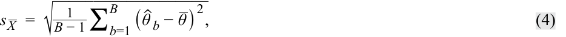
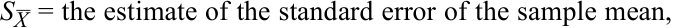
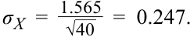

# Tập 1: Phương pháp Định lượng (*Quantitative Methods*)
## Học phần 7: Ước lượng và Suy luận (*Estimation and Inference*)
### Phần 2/2: Phương pháp Bootstrapping và Phân phối Mẫu Thực nghiệm (*Bootstrapping and Empirical Sampling Distributions*) (Trang PDF 215–222)

---

<!-- PDF Page 215 -->

|*(Tiếp theo Câu hỏi 4 ở cuối Phần 1:)* “...có phương sai $\sigma^2$, thì phân phối của $\bar{X}$ sẽ xấp xỉ chuẩn, với độ lệch chuẩn là $\sigma/\sqrt{n}$.”|
|---|
|**Lời giải (*Solution*):**|
|Phát biểu trên mắc phải những sai sót sau: • Với các điều kiện trong phát biểu, phân phối của $\bar{X}$ sẽ chỉ xấp xỉ chuẩn đối với các kích thước mẫu lớn (*large sample sizes*). • Phát biểu đã bỏ sót yếu tố quan trọng của định lý giới hạn trung tâm rằng phân phối của $\bar{X}$ sẽ có giá trị trung bình bằng $\mu$.|
|5. Peter Biggs muốn biết các nhà quản lý đầu tư tăng trưởng (*growth managers*) đã hoạt động như thế nào trong năm ngoái. Biggs giả định rằng độ lệch chuẩn chéo của tổng thể (*population cross-sectional standard deviation*) đối với tỷ suất sinh lợi của các nhà quản lý tăng trưởng là 6% và tỷ suất sinh lợi là độc lập giữa các nhà quản lý.|
|**A.** Biggs cần một mẫu ngẫu nhiên lớn đến mức nào nếu ông muốn độ lệch chuẩn của các trung bình mẫu là 1%?|
|**B.** Biggs cần một mẫu ngẫu nhiên lớn đến mức nào nếu ông muốn độ lệch chuẩn của các trung bình mẫu là 0.25%? **Lời giải (*Solution*):**|
|A. Độ lệch chuẩn hay sai số chuẩn của trung bình mẫu là $\sigma_{\bar{X}} = \sigma / \sqrt{n}$. Thay các giá trị của $\sigma_{\bar{X}}$ và $\sigma$ vào, ta có $1\% = 6\% / \sqrt{n}$, hay $\sqrt{n} = 6$. Bình phương giá trị này, ta được mẫu ngẫu nhiên có kích thước $n = 36$.|
|B. Giống như ở Phần A, độ lệch chuẩn của trung bình mẫu là $\sigma_{\bar{X}} = \sigma / \sqrt{n}$. Thay các giá trị của $\sigma_{\bar{X}}$ và $\sigma$ vào, ta có $0.25\% = 6\% / \sqrt{n}$, hay $\sqrt{n} = 24$. Bình phương giá trị này, ta được mẫu ngẫu nhiên có kích thước $n = 576$, lớn hơn đáng kể so với Phần A của câu hỏi này.|

### **PHƯƠNG PHÁP BOOTSTRAPPING VÀ PHÂN PHỐI MẪU THỰC NGHIỆM (*BOOTSTRAPPING AND EMPIRICAL SAMPLING DISTRIBUTIONS*)** 

# **<mark>4</mark>** 

*Mô tả việc sử dụng lấy mẫu lại (bootstrap, jackknife) để ước tính phân phối mẫu của một thống kê*

Chúng ta đã minh họa cách tìm sai số chuẩn của trung bình mẫu dựa trên định lý giới hạn trung tâm. Bây giờ chúng ta quay lại công cụ tính toán gọi là **lấy mẫu lại (*resampling*)**, thực hiện rút mẫu lặp đi lặp lại từ mẫu dữ liệu quan sát ban đầu để suy luận thống kê về các tham số tổng thể. **Phương pháp tự thân (*Bootstrap*)**, một trong những phương pháp lấy mẫu lại phổ biến nhất, sử dụng mô phỏng máy tính để suy luận thống kê mà không cần sử dụng công thức giải tích chẳng hạn như thống kê $z$ (*z-statistic*) hay thống kê $t$ (*t-statistic*). 

Trong phương pháp bootstrap, chúng ta liên tục rút các mẫu từ mẫu ban đầu, và mỗi mẫu lấy lại (*resample*) có cùng kích thước với mẫu ban đầu. Lưu ý rằng mỗi phần tử được rút ra sẽ được hoàn lại cho lần rút tiếp theo (tức là phần tử giống hệt đó được đưa trở lại vào nhóm để nó có thể được rút ra nhiều hơn một lần). Giả sử chúng ta đang tìm cách tính sai số chuẩn của trung bình mẫu, chúng ta lấy nhiều mẫu lấy lại và sau đó tính giá trị trung bình của mỗi mẫu lấy lại. Lưu ý rằng mặc dù một số phần tử có thể xuất hiện nhiều lần trong các mẫu lấy lại, các phần tử khác có thể không xuất hiện lần nào. 

<!-- PDF Page 216 -->

**Minh họa 5: Lấy mẫu lại kiểu Tự thân (*Exhibit 5: Bootstrap Resampling*)** 

<!-- Picture Text: Sample True Population Estimated Population Sample 1 Sample 2 ... Sample  n Bootstrap Bootstrap ... Bootstrap Sample 1 Sample 2 Sample “B” Estimate 1 Estimate 2 Estimate  n Estimate 1 Estimate 2 Estimate B True Sampling Distribution Bootstrap Sampling Distribution  -->
> **Chú thích hình ảnh:**
> - **Bên trái:** Tổng thể thực (*True Population*) $\rightarrow$ Mẫu 1, Mẫu 2, ..., Mẫu $n$ $\rightarrow$ Ước lượng 1, Ước lượng 2, ..., Ước lượng $n$ $\rightarrow$ Phân phối mẫu thực (*True Sampling Distribution*).
> - **Bên phải:** Mẫu (*Sample*) $\rightarrow$ Tổng thể ước tính (*Estimated Population*) $\rightarrow$ Mẫu Bootstrap 1, Mẫu Bootstrap 2, ..., Mẫu Bootstrap "B" $\rightarrow$ Ước lượng 1, Ước lượng 2, ..., Ước lượng B $\rightarrow$ Phân phối mẫu Bootstrap (*Bootstrap Sampling Distribution*).

Tiếp theo, chúng ta xây dựng một phân phối mẫu với các mẫu lấy lại này. Phân phối mẫu bootstrap (phía bên phải của Minh họa 5) sẽ xấp xỉ phân phối mẫu thực sự. Chúng ta ước tính sai số chuẩn của trung bình mẫu bằng Phương trình 4. Lưu ý rằng để phân biệt quy trình lấy mẫu lại vừa nêu với các loại lấy mẫu lại khác, nó thường được gọi là lấy mẫu lại phi mô hình (*model-free resampling*) hoặc lấy mẫu lại phi tham số (*non-parametric resampling*). 

<!-- Formula Text: s _ X   =  √ ___________________ 1 _ B − 1  ∑ b=1 B   ( ˆ θ  b − _ θ ) 2 , (4) -->
$$s_{\bar{X}} = \sqrt{\frac{1}{B - 1} \sum_{b=1}^{B} (\hat{\theta}_b - \bar{\theta})^2} \tag{4}$$

trong đó: 

<!-- Formula Text: S _ X  = the estimate of the standard error of the sample mean, -->
- $s_{\bar{X}} =$ ước lượng sai số chuẩn của trung bình mẫu (*the estimate of the standard error of the sample mean*),
- $B =$ số lượng mẫu lấy lại (*resamples*) được rút ra từ mẫu ban đầu, 
- $\hat{\theta}_b =$ giá trị trung bình của một mẫu lấy lại thứ $b$, và 
- $\bar{\theta} =$ giá trị trung bình của tất cả các trung bình mẫu lấy lại. 

Bootstrap là một trong những công cụ mạnh mẽ nhất và được sử dụng rộng rãi nhất để suy luận thống kê. Như chúng ta đã giải thích, nó có thể được sử dụng để ước tính sai số chuẩn của một trung bình mẫu. Tương tự, bootstrap có thể được sử dụng để tìm sai số chuẩn hoặc xây dựng khoảng tin cậy cho thống kê của các tham số tổng thể khác, chẳng hạn như trung vị (*median*), vốn không áp dụng được các phương pháp luận đã thảo luận trước đó. So với các phương pháp thống kê truyền thống, bootstrap không dựa vào công thức giải tích để ước tính phân phối của các ước lượng. Đây là một phương pháp đơn giản nhưng mạnh mẽ cho bất kỳ ước lượng phức tạp nào và đặc biệt hữu ích khi không có sẵn công thức giải tích. Ngoài ra, bootstrap còn có những lợi thế tiềm năng về độ chính xác. Với những ưu điểm này, bootstrap có thể được áp dụng rộng rãi trong tài chính, chẳng hạn như cho các mô phỏng lịch sử trong phân bổ tài sản hoặc trong việc đo lường hiệu quả của một chiến lược đầu tư so với chỉ số chuẩn. 

<!-- PDF Page 217 -->

##### **VÍ DỤ 4 (*EXAMPLE 4*)** 

#### **Minh họa Lấy mẫu lại kiểu Tự thân (*Bootstrap Resampling Illustration*)** 

Minh họa 6 hiển thị một tập hợp gồm 12 tỷ suất sinh lợi hàng tháng của một cổ phiếu ít được giao dịch, được trình bày trong Cột A. Mục tiêu của chúng ta là tính sai số chuẩn của trung bình mẫu. Sử dụng phương pháp lấy mẫu lại bootstrap, một chuỗi các mẫu bootstrap, được dán nhãn là “Mẫu lấy lại” (*Resample* – có hoàn lại) được rút ra từ mẫu gồm 12 tỷ suất sinh lợi. Hãy chú ý cách một số tỷ suất sinh lợi từ mẫu dữ liệu ở Cột A xuất hiện nhiều hơn một lần trong một số mẫu lấy lại (ví dụ: $0.055$ xuất hiện hai lần trong Mẫu lấy lại 1). 

**Minh họa 6: Cổ phiếu Ít Giao dịch, 12 Tỷ suất sinh lợi Hàng tháng (*Exhibit 6: Rarely Traded Stock, 12 Monthly Returns*)** 

|**Cột A (*Column A*)**|**Mẫu lấy lại 1 (*Resample 1*)**|**Mẫu lấy lại 2 (*Resample 2*)**|**Mẫu lấy lại 3 (*Resample 3*)**|**…**|**Mẫu lấy lại 1,000 (*Resample 1,000*)**|
|---|---|---|---|---|---|
|−0.096|0.055|−0.096|−0.033|…|−0.072|
|−0.132|−0.033|0.055|−0.132|…|0.255|
|−0.191|0.255|0.055|−0.157|…|0.055|
|−0.096|−0.033|−0.157|0.255|…|0.296|
|0.055|0.255|−0.096|−0.132|…|0.055|
|−0.053|−0.157|−0.053|−0.191|…|−0.096|
|−0.033|−0.053|−0.096|0.055|…|0.296|
|0.296|−0.191|−0.132|0.255|…|−0.132|
|0.055|−0.132|−0.132|0.296|…|0.055|
|−0.072|−0.096|0.055|−0.096|…|−0.096|
|0.255|0.055|−0.072|0.055|…|−0.191|
|−0.157|−0.157|−0.053|−0.157|…|0.055|
|Trung bình mẫu (*Sample mean*)|−0.019|−0.060|0.001|…|0.040|

Rút 1,000 mẫu như vậy, chúng ta thu được 1,000 trung bình mẫu. Giá trị trung bình của tất cả các trung bình mẫu lấy lại là $-0.01367$. Tổng bình phương các chênh lệch giữa mỗi trung bình mẫu và giá trị trung bình của tất cả các trung bình mẫu lấy lại ($\sum_{b=1}^{B}(\hat{\theta}_b - \bar{\theta})^2$) là $1.94143$. Sử dụng Phương trình 4, chúng ta tính được ước lượng sai số chuẩn của trung bình mẫu: 

<!-- Formula Text: s _ X   =  √ ___________________ 1 _ B − 1  ∑ b=1 B   ( ˆ θ  b − _ θ ) 2   =  √ ____________ 1 _ 999  × 1.94143   =  0.04408. -->
$$s_{\bar{X}} = \sqrt{\frac{1}{B - 1} \sum_{b=1}^{B} (\hat{\theta}_b - \bar{\theta})^2} = \sqrt{\frac{1}{999} \times 1.94143} = 0.04408$$

**Jackknife** là một kỹ thuật lấy mẫu lại khác để suy luận thống kê về các tham số tổng thể. Không giống như bootstrap vốn liên tục rút các mẫu có hoàn lại (*with replacement*), các mẫu jackknife được chọn bằng cách lấy mẫu dữ liệu quan sát ban đầu và loại bỏ lần lượt từng quan sát một ra khỏi tập hợp (và không hoàn lại). Phương pháp Jackknife thường được sử dụng để giảm độ chệch (*bias*) của một ước lượng, và các ứng dụng khác bao gồm tìm sai số chuẩn và khoảng tin cậy của một ước lượng. Theo thủ tục tính toán của nó, chúng ta có thể kết luận rằng jackknife tạo ra các kết quả tương tự nhau cho mỗi lần chạy, trong khi bootstrap thường cho ra các kết quả khác nhau bởi vì các mẫu lấy lại bootstrap được rút ngẫu nhiên. Đối với một mẫu có kích thước $n$, jackknife thường yêu cầu $n$ lần lặp lại, trong khi với bootstrap, chúng ta phải tự xác định xem bao nhiêu lần lặp lại là phù hợp. 

<!-- PDF Page 218 -->

##### **BỘ CÂU HỎI (*QUESTION SET*)** 

1. Một nhà phân tích tại một công ty đầu tư bất động sản đang nghiên cứu thị trường nhà ở của khu vực Greater Boston. Từ một mẫu dữ liệu giá bán nhà thu thập được trong năm qua, cô ước tính giá nhà trung vị (*median house price*) của khu vực. Để tìm sai số chuẩn của trung vị ước tính, cô đang cân nhắc hai phương án: 

Phương án 1: Sai số chuẩn của trung vị mẫu có thể được tính bằng $s/\sqrt{n}$, trong đó $s$ ký hiệu độ lệch chuẩn mẫu và $n$ ký hiệu kích thước mẫu. 

Phương án 2: Áp dụng phương pháp bootstrap để xây dựng phân phối mẫu của trung vị mẫu, và sau đó tính sai số chuẩn bằng Phương trình 4 (trong tài liệu gốc ghi Equation 7). 

Phát biểu nào sau đây là chính xác? 

- **A.** Phương án 1 phù hợp để tìm sai số chuẩn của trung vị mẫu. 
- **B.** Phương án 2 phù hợp để tìm sai số chuẩn của trung vị mẫu. 
- **C.** Cả hai phương án đều phù hợp để tìm sai số chuẩn của trung vị mẫu. 

##### **Lời giải (*Solution*):** 

B đúng. Phương án 1 có hiệu lực để ước tính sai số chuẩn của trung bình mẫu (*sample mean*) nhưng không áp dụng được cho sai số chuẩn của trung vị mẫu (*sample median*), vốn không dựa trên công thức đã cho. Do đó, cả A và C đều sai. Phương pháp bootstrap là một cách đơn giản để tìm sai số chuẩn của một ước lượng ngay cả khi không có sẵn công thức giải tích hoặc công thức quá phức tạp. 

Sau khi đã trình bày nhiều khái niệm cơ bản về lấy mẫu và ước lượng, bây giờ chúng ta tập trung vào các vấn đề lấy mẫu được các nhà phân tích đặc biệt quan tâm. Chất lượng của các suy luận phụ thuộc vào chất lượng của dữ liệu cũng như chất lượng của kế hoạch lấy mẫu được sử dụng. Dữ liệu tài chính đặt ra những vấn đề đặc biệt, và các kế hoạch lấy mẫu thường phản ánh một hoặc nhiều sự thiên lệch (*biases*). Phần tiếp theo xem xét các vấn đề này. 

2. Otema Chi có một bảng tính gồm 108 tỷ suất sinh lợi hàng tháng của cổ phiếu Marunou Corporation. Anh viết một chương trình phần mềm sử dụng lấy mẫu lại bootstrap để tạo ra 200 mẫu lấy lại (*resamples*) của dữ liệu Marunou này bằng cách lấy mẫu có hoàn lại. Mỗi mẫu lấy lại có 108 điểm dữ liệu. Chương trình của Chi tính giá trị trung bình của mỗi mẫu trong số 200 mẫu lấy lại, và sau đó tính ra rằng giá trị trung bình của 200 trung bình mẫu lấy lại này là $0.0261$. Chương trình lấy mỗi giá trị trong số 200 trung bình mẫu lấy lại trừ đi $0.0261$, bình phương mỗi chênh lệch trong 200 chênh lệch này, và cộng các bình phương chênh lệch lại với nhau. Kết quả là $0.835$. Chương trình sau đó tính một ước lượng cho sai số chuẩn của trung bình mẫu. 

Sai số chuẩn ước tính của trung bình mẫu gần nhất với: 

- **A.** 0.0115 
- **B.** 0.0648 

<!-- PDF Page 219 -->

- **C.** 0.0883

<!-- Formula Text: C.	 0.0883 Solution: B is correct. The estimate of the standard error of the sample mean with bootstrap resampling is calculated as follows: s _ X   =  √ __________________ 1 _ B − 1  ∑ b=1 B   (ˆ θ b − _ θ) 2   =  √ ________________________ 1 _ 200 − 1  ∑ b=1 200  (ˆ θ b − 0.0261) 2   =  √ _ 0.004196 s _ X   =  0.0648 . -->

##### **Lời giải (*Solution*):**

B đúng. Ước lượng sai số chuẩn của trung bình mẫu bằng lấy mẫu lại bootstrap được tính như sau:

$$s_{\bar{X}} = \sqrt{\frac{1}{B - 1} \sum_{b=1}^{B} (\hat{\theta}_b - \bar{\theta})^2} = \sqrt{\frac{1}{200 - 1} \sum_{b=1}^{200} (\hat{\theta}_b - 0.0261)^2} = \sqrt{\frac{0.835}{199}} = \sqrt{0.004196}$$
$$s_{\bar{X}} = 0.0648$$

<!-- PDF Page 220 -->

## **BÀI TẬP THỰC HÀNH (*PRACTICE PROBLEMS*)** 

**1.** Phát biểu nào sau đây là đúng về lấy mẫu phi xác suất (*non-probability sampling*)? 

- **A.** Có rủi ro đáng kể là mẫu không mang tính đại diện cho tổng thể. 
- **B.** Mọi phần tử của tổng thể đều có cơ hội ngang nhau để được chọn vào mẫu. 
- **C.** Việc sử dụng phán đoán đảm bảo rằng các phân nhóm tổng thể được quan tâm đều có đại diện trong mẫu. 

**2.** Cách tiếp cận _tốt nhất_ để tạo ra một mẫu ngẫu nhiên phân tầng (*stratified random sample*) của một tổng thể bao gồm: 

- **A.** rút một số lượng bằng nhau các mẫu ngẫu nhiên đơn giản từ mỗi tổng thể con. 
- **B.** chọn mỗi phần tử thứ $k$ của tổng thể cho đến khi đạt được kích thước mẫu mong muốn. 
- **C.** rút các mẫu ngẫu nhiên đơn giản từ mỗi tổng thể con với kích thước tỷ lệ thuận với quy mô tương đối của mỗi tổng thể con. 

**3.** Một tổng thể có phân phối không chuẩn (*non-normal distribution*) với giá trị trung bình $\mu$ và phương sai $\sigma^2$. Phân phối mẫu của trung bình mẫu được tính từ các mẫu có kích thước lớn từ tổng thể đó sẽ có: 

- **A.** cùng phân phối với phân phối của tổng thể. 
- **B.** giá trị trung bình của nó xấp xỉ bằng giá trị trung bình của tổng thể. 
- **C.** phương sai của nó xấp xỉ bằng phương sai của tổng thể. 

**4.** Một trung bình mẫu được tính từ một tổng thể có phương sai là $2.45$. Kích thước mẫu là $40$. Sai số chuẩn của trung bình mẫu _gần nhất_ với: 

- **A.** 0.039. 
- **B.** 0.247. 
- **C.** 0.387. 

**5.** So với lấy mẫu lại kiểu tự thân (*bootstrap resampling*), lấy mẫu lại kiểu *jackknife* (*jackknife resampling*): 

- **A.** được thực hiện có hoàn lại (*with replacement*). 
- **B.** thường đòi hỏi số lần lặp lại bằng với kích thước mẫu. 
- **C.** tạo ra các kết quả khác nhau cho mỗi lần chạy bởi vì các mẫu lấy lại được rút ngẫu nhiên. 

<!-- PDF Page 221 -->

## **LỜI GIẢI (*SOLUTIONS*)** 

1. **A đúng.** Bởi vì lấy mẫu phi xác suất phụ thuộc vào các yếu tố ngoài những cân nhắc về xác suất, chẳng hạn như phán đoán của người lấy mẫu hoặc sự thuận tiện trong việc tiếp cận dữ liệu, nên có một rủi ro đáng kể rằng lấy mẫu phi xác suất có thể tạo ra một mẫu không mang tính đại diện. 

2. **C đúng.** Lấy mẫu ngẫu nhiên phân tầng bao gồm việc chia một tổng thể thành các tổng thể con dựa trên một hoặc nhiều tiêu chí phân loại. Sau đó, các mẫu ngẫu nhiên đơn giản được rút ra từ mỗi tổng thể con với kích thước tỷ lệ thuận với quy mô tương đối của mỗi tổng thể con. Các mẫu này sau đó được gộp lại để tạo thành một mẫu ngẫu nhiên phân tầng. 

3. **B đúng.** Cho một tổng thể được mô tả bởi bất kỳ phân phối xác suất nào (chuẩn hoặc không chuẩn) với phương sai hữu hạn, định lý giới hạn trung tâm phát biểu rằng phân phối mẫu của trung bình mẫu sẽ xấp xỉ chuẩn, với giá trị trung bình xấp xỉ bằng giá trị trung bình của tổng thể, khi kích thước mẫu lớn. 

4. **B đúng.** Lấy căn bậc hai của phương sai tổng thể đã biết để xác định độ lệch chuẩn tổng thể ($\sigma$) cho kết quả: 

   - $\sigma = \sqrt{2.45} = 1.565$. 

Công thức tính sai số chuẩn của trung bình mẫu ($\sigma_{\bar{X}}$), dựa trên kích thước mẫu đã biết ($n$), là: 

<!-- Formula Text: σ X  =   σ _ √ _ n  . -->
$$\sigma_{\bar{X}} = \frac{\sigma}{\sqrt{n}}$$

Do đó, 

<!-- Formula Text: σ X  =   1.565 _ √ _ 40    =  0.247. -->
$$\sigma_{\bar{X}} = \frac{1.565}{\sqrt{40}} = 0.247$$

5. **B đúng.** Đối với một mẫu có kích thước $n$, lấy mẫu lại jackknife thường yêu cầu $n$ lần lặp lại. Ngược lại, với lấy mẫu lại bootstrap, chúng ta phải tự xác định xem bao nhiêu lần lặp lại là phù hợp. 

<!-- PDF Page 222 -->
