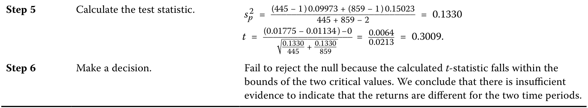
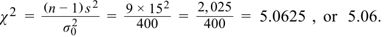

# Tập 1: Phương pháp Định lượng (Quantitative Methods)
## Learning Module 8 Hypothesis Testing (Trang PDF 223–250)

---

# Tập 1: Phương pháp Định lượng (*Quantitative Methods*)
## Học phần 8: Kiểm định Giả thuyết (*Hypothesis Testing*)
### Phần 1/3: Giới thiệu (*Introduction*) (Trang PDF 223–229)

---

<!-- PDF Page 223 -->

#### H Ọ C P H Ầ N 

# **<mark>8</mark>** 

### **Kiểm định Giả thuyết (*Hypothesis Testing*)** 

**tác giả: Pamela Peterson Drake, PhD, CFA.** 

_Pamela Peterson Drake, PhD, CFA, làm việc tại Đại học James Madison (Hoa Kỳ)._ 

###### **<mark>MỤC TIÊU HỌC TẬP (*LEARNING OUTCOMES*)</mark>** 

|**_Mức độ Thành thạo_**|**_Ứng viên cần có khả năng:_**|
|---|---|
||Giải thích kiểm định giả thuyết (*hypothesis testing*) và các cấu phần của nó, bao gồm ý nghĩa thống kê (*statistical significance*), sai lầm Loại I và Loại II (*Type I and Type II errors*), và lực kiểm định (*power of a test*).|
||Xây dựng các kiểm định giả thuyết và xác định ý nghĩa thống kê của chúng, các sai lầm Loại I và Loại II liên quan, cũng như lực kiểm định khi biết trước một mức ý nghĩa (*significance level*).|
||So sánh và đối chiếu các kiểm định tham số (*parametric tests*) và phi tham số (*nonparametric tests*), đồng thời mô tả các tình huống mà mỗi loại kiểm định là phù hợp hơn.|

<!-- Picture Text: 1  -->

##### **GIỚI THIỆU (*INTRODUCTION*)** 

Kiểm định giả thuyết (*hypothesis testing*) đã được trình bày chi tiết trong phần tài liệu đọc trước (*pre-read*). Học phần này phát triển dựa trên nội dung đó và giả định rằng người học đã có sự hiểu biết thực hành về chủ đề này từ tài liệu đó hoặc từ nguồn khác. 

Bài 1 tóm tắt quy trình kiểm định giả thuyết thông qua các ví dụ về việc sử dụng nó trong tài chính và quản lý đầu tư. Bài 2 làm rõ tác động của các sai lầm trong quy trình kiểm định giả thuyết. Bài 3 giới thiệu các kiểm định phi tham số (*nonparametric tests*) và ứng dụng của chúng trong quản lý đầu tư. 

###### **TỔNG QUAN HỌC PHẦN (*LEARNING MODULE OVERVIEW*)** 

- Các bước trong việc kiểm định một giả thuyết như sau:
   **1.** Phát biểu các giả thuyết (*State the hypotheses*).
   **2.** Xác định thống kê kiểm định phù hợp và phân phối xác suất của nó (*Identify the appropriate test statistic and its probability distribution*). 
   **3.** Xác định mức ý nghĩa (*Specify the significance level*). 
   **4.** Phát biểu quy tắc quyết định (*State the decision rule*).
   **5.** Thu thập dữ liệu và tính toán thống kê kiểm định (*Collect the data and calculate the test statistic*). 

<!-- PDF Page 224 -->

   **6.** Đưa ra quyết định (*Make a decision*). 

- Thống kê kiểm định (*test statistic*) là một đại lượng được tính toán bằng cách sử dụng một mẫu, có giá trị làm cơ sở để quyết định bác bỏ hay không bác bỏ giả thuyết không (*null hypothesis*). Chúng ta so sánh giá trị tính toán được của thống kê kiểm định với một giá trị tới hạn (*critical value*) của cùng thống kê kiểm định đó để xác định xem nên bác bỏ hay không bác bỏ giả thuyết không. 

- Khi đưa ra một quyết định thống kê, có thể mắc phải hai sai lầm: bác bỏ một giả thuyết không đang đúng (sai lầm Loại I – *Type I error*, hay dương tính giả – *false positive*), hoặc không bác bỏ một giả thuyết không đang sai (sai lầm Loại II – *Type II error*, hay âm tính giả – *false negative*). 

- Mức ý nghĩa của một kiểm định (*level of significance*) là xác suất mắc sai lầm Loại I khi tiến hành kiểm định giả thuyết. Cách tiếp cận tiêu chuẩn trong kiểm định giả thuyết bao gồm việc chỉ định trước một mức ý nghĩa (tức là xác suất mắc sai lầm Loại I). Phần bù của mức ý nghĩa là mức độ tin cậy (*confidence level*). 

- Đối với các kiểm định giả thuyết liên quan đến trung bình tổng thể của một tổng thể có phân phối chuẩn với phương sai chưa biết, thống kê kiểm định chính xác về mặt lý thuyết là thống kê $t$ (*t-statistic*). 

- Để kiểm định xem sự khác biệt quan sát được giữa hai giá trị trung bình có ý nghĩa thống kê hay không, trước tiên nhà phân tích phải quyết định xem các mẫu là độc lập (*independent*) hay phụ thuộc/có liên quan (*dependent/related*). Nếu các mẫu độc lập, kiểm định sự khác biệt giữa hai giá trị trung bình (*test concerning differences between means*) được sử dụng. Nếu các mẫu phụ thuộc, kiểm định giá trị trung bình của các chênh lệch (*test of mean differences* hay kiểm định so sánh cặp – *paired comparisons test*) được sử dụng. 

- Để xác định sự khác biệt giữa hai trung bình tổng thể từ các tổng thể có phân phối chuẩn với phương sai chưa biết nhưng bằng nhau, kiểm định phù hợp là kiểm định $t$ (*t-test*) dựa trên việc gộp chung (*pooling*) các quan sát của hai mẫu để ước tính phương sai chung chưa biết. Kiểm định này dựa trên giả định các mẫu độc lập. 

- Trong các kiểm định liên quan đến hai giá trị trung bình dựa trên hai mẫu không độc lập, dữ liệu thường được sắp xếp thành các quan sát ghép cặp (*paired observations*) và một kiểm định trung bình của các chênh lệch (kiểm định so sánh cặp) được tiến hành. Khi các mẫu đến từ các tổng thể có phân phối chuẩn với phương sai chưa biết, thống kê kiểm định phù hợp có phân phối $t$. 

- Trong các kiểm định liên quan đến phương sai của một tổng thể đơn lẻ có phân phối chuẩn, thống kê kiểm định là Khi-bình phương (*chi-square* – $\chi^2$) với $n - 1$ bậc tự do (*degrees of freedom*), trong đó $n$ là kích thước mẫu. 

- Đối với các kiểm định liên quan đến sự khác biệt giữa phương sai của hai tổng thể có phân phối chuẩn dựa trên hai mẫu ngẫu nhiên, độc lập, thống kê kiểm định phù hợp dựa trên kiểm định $F$ (*F-test* – tỷ số của hai phương sai mẫu). Bậc tự do cho kiểm định $F$ này là $n_1 - 1$ và $n_2 - 1$, trong đó $n_1$ tương ứng với số lượng quan sát trong phép tính ở tử số, và $n_2$ là số lượng quan sát trong phép tính ở mẫu số của thống kê $F$. 

- Kiểm định tham số (*parametric test*) là một kiểm định giả thuyết liên quan đến một tham số tổng thể, hoặc một kiểm định giả thuyết dựa trên các giả định phân phối cụ thể. Ngược lại, kiểm định phi tham số (*nonparametric test*) hoặc không liên quan đến một tham số hoặc đưa ra các giả định tối thiểu về tổng thể mà từ đó mẫu được lấy ra. 

<!-- PDF Page 225 -->

- Kiểm định phi tham số chủ yếu được sử dụng khi dữ liệu không đáp ứng các giả định về phân phối, khi có các giá trị ngoại lai (*outliers*), khi dữ liệu được cho dưới dạng thứ hạng (*ranks*), hoặc khi giả thuyết chúng ta đang giải quyết không liên quan đến một tham số. 

##### **CÁC KIỂM ĐỊNH GIẢ THUYẾT TRONG TÀI CHÍNH (*HYPOTHESIS TESTS FOR FINANCE*)** 

## **<mark>2</mark>** 

*Giải thích kiểm định giả thuyết và các cấu phần của nó, bao gồm ý nghĩa thống kê, sai lầm Loại I và Loại II, và lực kiểm định*

Chúng ta sử dụng **kiểm định giả thuyết (*hypothesis testing*)** để đưa ra quyết định bằng cách sử dụng dữ liệu. Kiểm định giả thuyết là một phần của suy luận thống kê (*statistical inference*), quá trình đưa ra các phán đoán về một nhóm lớn hơn (tổng thể) dựa trên một nhóm quan sát nhỏ hơn (mẫu). 

Trong kiểm định giả thuyết, chúng ta kiểm định để xác định xem một thống kê mẫu có khả năng đến từ một tổng thể có giá trị tham số tổng thể như giả thuyết hay không. 

Các khái niệm và công cụ của kiểm định giả thuyết cung cấp một phương tiện khách quan để đánh giá xem bằng chứng hiện có có ủng hộ giả thuyết hay không. Sau khi áp dụng một kiểm định thống kê, chúng ta sẽ có ý niệm rõ ràng hơn về xác suất một giả thuyết là đúng hay sai, mặc dù kết luận của chúng ta luôn chưa đạt tới sự chắc chắn tuyệt đối. 

Trọng tâm chính của bài học này là khuôn khổ của kiểm định giả thuyết và các kiểm định liên quan đến giá trị trung bình và phương sai, hai thước đo thường xuyên được sử dụng trong đầu tư. 

###### **Quy trình Kiểm định Giả thuyết (*The Process of Hypothesis Testing*)** 

Kiểm định giả thuyết là một phần của nhánh thống kê được gọi là suy luận thống kê. Trong suy luận thống kê, có ước lượng (*estimation*) và kiểm định giả thuyết (*hypothesis testing*). Ước lượng bao gồm ước lượng điểm (*point estimates*) và ước lượng khoảng (*interval estimates*). Hãy xem xét một trung bình mẫu, vốn là một ước lượng điểm, mà chúng ta có thể sử dụng để lập một khoảng tin cậy. Trong kiểm định giả thuyết, trọng tâm là xem xét cách một thống kê mẫu cung cấp thông tin cho chúng ta về một tham số tổng thể. Một **giả thuyết (*hypothesis*)** là một phát biểu về một hoặc nhiều tổng thể mà chúng ta kiểm định bằng cách sử dụng các thống kê mẫu. 

Quy trình kiểm định giả thuyết bắt đầu bằng việc hình thành một lý thuyết để sắp xếp và giải thích các quan sát. Chúng ta đánh giá tính đúng đắn của lý thuyết bằng khả năng đưa ra các dự đoán chính xác của nó—ví dụ, dự đoán kết quả của các quan sát mới. Nếu các dự đoán là chính xác, chúng ta tiếp tục duy trì lý thuyết đó như một lời giải thích có khả năng đúng cho các quan sát của mình. Rủi ro đóng một vai trò trong kết quả của các quan sát trong tài chính, vì vậy chúng ta chỉ có thể cố gắng đưa ra các phán đoán không chệch, dựa trên xác suất về việc liệu dữ liệu mới có ủng hộ các dự đoán hay không. Kiểm định giả thuyết thống kê lấp đầy vai trò quan trọng đó là kiểm định các giả thuyết khi có sự không chắc chắn. Khi một nhà phân tích chuyển hóa đúng câu hỏi thành một giả thuyết có thể kiểm định được và tiến hành kiểm định giả thuyết, việc sử dụng các phương pháp khoa học đã được thiết lập vững chắc sẽ củng cố cho các kết luận và quyết định được đưa ra trên cơ sở kiểm định này. 

Chúng tôi sắp xếp phần giới thiệu về kiểm định giả thuyết này xoay quanh sáu bước được trình bày trong Minh họa 1, minh họa cách tiếp cận tiêu chuẩn đối với kiểm định giả thuyết. 

<!-- PDF Page 226 -->

###### **Minh họa 1: Quy trình Kiểm định Giả thuyết (*Exhibit 1: The Process of Hypothesis Testing*)** 

<!-- Picture Text: Step 1: State the hypotheses Step 2: Identify the appropriate test statistic Step 3: Specify the level of significance Step 4: State the decision rule Step 5: Collect data and calculate the test statistic Step 6: Make a decision  -->
> **Chú thích hình ảnh:**
> - **Bước 1:** Phát biểu các giả thuyết (*State the hypotheses*)
> - **Bước 2:** Xác định thống kê kiểm định phù hợp (*Identify the appropriate test statistic*)
> - **Bước 3:** Xác định mức ý nghĩa (*Specify the level of significance*)
> - **Bước 4:** Phát biểu quy tắc quyết định (*State the decision rule*)
> - **Bước 5:** Thu thập dữ liệu và tính toán thống kê kiểm định (*Collect data and calculate the test statistic*)
> - **Bước 6:** Đưa ra quyết định (*Make a decision*)

###### **_Phát biểu các Giả thuyết (Stating the Hypotheses)_** 

Đối với mỗi kiểm định giả thuyết, chúng ta luôn phát biểu hai giả thuyết: **giả thuyết không (*null hypothesis*)**, được ký hiệu là $H_0$, và **giả thuyết đối (*alternative hypothesis*)**, được ký hiệu là $H_a$. Giả thuyết không là một phát biểu liên quan đến một hoặc nhiều tham số tổng thể được coi là đúng trừ khi mẫu mà chúng ta sử dụng để tiến hành kiểm định giả thuyết đưa ra bằng chứng thuyết phục rằng giả thuyết không là sai. Trên thực tế, giả thuyết không là thứ mà chúng ta muốn bác bỏ. Nếu có đủ bằng chứng chỉ ra rằng giả thuyết không là không đúng, chúng ta bác bỏ nó để ủng hộ giả thuyết đối. 

Điều quan trọng là giả thuyết không và giả thuyết đối được phát biểu theo các tham số tổng thể (*population parameters*), và chúng ta sử dụng các thống kê mẫu (*sample statistics*) để kiểm định các giả thuyết này. 

Thứ hai, giả thuyết không và giả thuyết đối phải xung khắc lẫn nhau (*mutually exclusive*) và bao quát toàn bộ (*collectively exhaustive*); nói cách khác, tất cả các giá trị có thể có đều nằm trong giả thuyết không hoặc giả thuyết đối. 

###### **_Xác định Thống kê Kiểm định và Phân phối Phù hợp (Identify the Appropriate Test Statistic and Distribution)_** 

Thống kê kiểm định (*test statistic*) là một giá trị được tính toán trên cơ sở một mẫu mà khi được sử dụng kết hợp với một quy tắc quyết định sẽ là cơ sở để quyết định có bác bỏ giả thuyết không hay không. 

Trọng tâm của quyết định thống kê của chúng ta là giá trị của thống kê kiểm định. Thống kê kiểm định mà chúng ta sử dụng phụ thuộc vào những gì chúng ta đang kiểm định. 

Sau khi xác định được thống kê kiểm định phù hợp, chúng ta phải quan tâm đến phân phối của thống kê kiểm định đó. Chúng tôi trình bày các ví dụ về thống kê kiểm định và phân phối tương ứng của chúng trong Minh họa 2. 

<!-- PDF Page 227 -->

**Minh họa 2: Các Thống kê Kiểm định và Phân phối của Chúng (*Exhibit 2: Test Statistics and Their Distribution*)** 

|**Nội dung Cần Kiểm định (*What We Want to Test*)**|**Thống kê Kiểm định (*Test Statistic*)**|**Phân phối Xác suất của Thống kê (*Probability Distribution of the Statistic*)**|**Bậc Tự do (*Degrees of Freedom*)**|
|---|---|---|---|
|Kiểm định một giá trị trung bình đơn lẻ (*Test of a single mean*)|$$t = \frac{\bar{X} - \mu_0}{s / \sqrt{n}}$$|Phân phối $t$ (*t-distributed*)|$n - 1$|
|Kiểm định sự khác biệt giữa hai giá trị trung bình (*Test of the difference in means*)|$$t = \frac{(\bar{X}_{d1} - \bar{X}_{d2}) - (\mu_{d1} - \mu_{d2})}{\sqrt{\frac{s_p^2}{n_{d1}} + \frac{s_p^2}{n_{d2}}}}$$|Phân phối $t$ (*t-distributed*)|$n_1 + n_2 - 2$|
|Kiểm định giá trị trung bình của các chênh lệch (*Test of the mean of differences*)|$$t = \frac{\bar{d} - \mu_{d0}}{s_{\bar{d}}}$$|Phân phối $t$ (*t-distributed*)|$n - 1$|
|Kiểm định một phương sai đơn lẻ (*Test of a single variance*)|$$\chi^2 = \frac{(n - 1)s^2}{\sigma_0^2}$$|Phân phối Khi-bình phương (*Chi-square distributed*)|$n - 1$|
|Kiểm định sự khác biệt giữa hai phương sai (*Test of the difference in variances*)|$$F = \frac{s_{\text{Before}}^2}{s_{\text{After}}^2}$$|Phân phối $F$ (*F-distributed*)|$n_1 - 1, n_2 - 1$|
|Kiểm định hệ số tương quan (*Test of a correlation*)|$$t = \frac{r\sqrt{n - 2}}{\sqrt{1 - r^2}}$$|Phân phối $t$ (*t-distributed*)|$n - 2$|
|Kiểm định tính độc lập – dữ liệu phân loại (*Test of independence – categorical data*)|$$\chi^2 = \sum_{i=1}^{m} \frac{(O_{ij} - E_{ij})^2}{E_{ij}}$$|Phân phối Khi-bình phương (*Chi-square distributed*)|$(r - 1)(c - 1)$|

_Lưu ý:_ $\mu_0, \mu_{d0}$ và $\sigma_0^2$ lần lượt ký hiệu các giá trị theo giả thuyết của trung bình, trung bình chênh lệch và phương sai. $\bar{X}, \bar{d}, s^2, s$ và $r$ lần lượt ký hiệu cho trung bình mẫu, trung bình của các chênh lệch, phương sai mẫu, độ lệch chuẩn mẫu và hệ số tương quan mẫu, với các chỉ số dưới cho biết mẫu tương ứng nếu phù hợp. Kích thước mẫu được biểu thị là $n$, và chỉ số dưới cho biết mẫu nếu phù hợp. $O_{ij}$ và $E_{ij}$ lần lượt là tần số quan sát được (*observed frequencies*) và tần số kỳ vọng (*expected frequencies*), với $r$ biểu thị số hàng và $c$ biểu thị số cột trong bảng tiếp liên (*contingency table*). 

###### **_Xác định Mức Ý nghĩa (Specify the Level of Significance)_** 

Mức ý nghĩa (*level of significance*) phản ánh lượng bằng chứng mẫu mà chúng ta yêu cầu để bác bỏ giả thuyết không. Tiêu chuẩn bằng chứng yêu cầu có thể thay đổi tùy theo bản chất của các giả thuyết và mức độ nghiêm trọng của hậu quả khi mắc sai lầm. 

Có bốn kết quả có thể xảy ra khi chúng ta kiểm định một giả thuyết không, như được hiển thị trong Minh họa 3. **Sai lầm Loại I (*Type I error*)** là dương tính giả (*false positive* – bác bỏ khi giả thuyết không đang đúng), trong khi **sai lầm Loại II (*Type II error*)** là âm tính giả (*false negative* – không bác bỏ khi giả thuyết không đang sai). 

**Minh họa 3: Các Quyết định Đúng và Sai trong Kiểm định Giả thuyết (*Exhibit 3: Correct and Incorrect Decisions in Hypothesis Testing*)** 

|**Quyết định (*Decision*)**|**$H_0$ Đúng (*$H_0$ True*)**|**$H_0$ Sai (*$H_0$ False*)**|
|---|---|---|
|**Không bác bỏ $H_0$ (*Fail to reject $H_0$*)**|**Quyết định đúng (*Correct decision*):** Không bác bỏ một giả thuyết không đang đúng.|**Sai lầm Loại II (*Type II error*):** Không bác bỏ một giả thuyết không đang sai. Âm tính giả (*False negative*)|
|**Bác bỏ $H_0$ (*Reject $H_0$*)**|**Sai lầm Loại I (*Type I error*):** Bác bỏ một giả thuyết không đang đúng. Dương tính giả (*False positive*)|**Quyết định đúng (*Correct decision*):** Bác bỏ một giả thuyết không đang sai.|

<!-- PDF Page 228 -->

Khi đưa ra một quyết định trong một kiểm định giả thuyết, chúng ta đối mặt với rủi ro mắc sai lầm Loại I hoặc Loại II. Như được hiển thị trong Minh họa 3, các sai lầm này loại trừ lẫn nhau (*mutually exclusive*): Nếu chúng ta bác bỏ nhầm giả thuyết không đang đúng, chúng ta chỉ có thể mắc sai lầm Loại I; nếu chúng ta không bác bỏ nhầm giả thuyết không đang sai, chúng ta chỉ có thể mắc sai lầm Loại II. 

Xác suất mắc sai lầm Loại I được ký hiệu bằng chữ cái Hy Lạp viết thường alpha, $\alpha$. Xác suất này còn được gọi là **mức ý nghĩa (*level of significance*)** của kiểm định, và phần bù của nó, $(1 - \alpha)$, là **mức độ tin cậy (*confidence level*)**. Ví dụ, mức ý nghĩa $5\%$ cho một kiểm định có nghĩa là có $5\%$ xác suất bác bỏ một giả thuyết không đang đúng và tương ứng với mức độ tin cậy $95\%$. 

Việc kiểm soát xác suất của hai loại sai lầm này bao hàm sự đánh đổi (*trade-off*). Với các yếu tố khác không đổi, nếu chúng ta giảm xác suất mắc sai lầm Loại I bằng cách chỉ định một mức ý nghĩa nhỏ hơn (chẳng hạn $1\%$ thay vì $5\%$), chúng ta sẽ làm tăng xác suất mắc sai lầm Loại II bởi vì chúng ta sẽ ít bác bỏ giả thuyết không hơn, kể cả khi nó sai. Cả sai lầm Loại I và Loại II đều là rủi ro đưa ra kết luận sai. Việc chấp nhận loại sai lầm nào nhiều hơn phụ thuộc vào hậu quả của các sai lầm đó, chẳng hạn như chi phí. Sự đánh đổi này cân nhắc tác động của những sai lầm mà chúng ta sẵn sàng chấp nhận và nếu có thì với cái giá nào. Cách duy nhất để giảm xác suất của cả hai loại sai lầm cùng một lúc là tăng kích thước mẫu, $n$. 

Trong khi mức ý nghĩa của một kiểm định là xác suất bác bỏ *sai* giả thuyết không đang đúng, thì **lực kiểm định (*power of a test*)** là xác suất bác bỏ _đúng_ giả thuyết không—tức là xác suất bác bỏ giả thuyết không khi nó thực sự sai. Lực kiểm định trên thực tế là phần bù của sai lầm Loại II. Xác suất mắc sai lầm Loại II thường được ký hiệu bằng chữ cái Hy Lạp viết thường beta, $\beta$. Chúng ta có thể phân loại các xác suất khác nhau trong Minh họa 4 để phản ánh các ký hiệu thường được sử dụng. 

**Minh họa 4: Các Xác suất Liên quan đến Quyết định Kiểm định Giả thuyết (*Exhibit 4: Probabilities Associated with Hypothesis Testing Decisions*)** 

|**Quyết định (*Decision*)**|**$H_0$ Đúng (*$H_0$ True*)**|**$H_0$ Sai (*$H_0$ False*)**|
|---|---|---|
|Không bác bỏ $H_0$ (*Fail to reject $H_0$*)|$1 - \alpha$|$\beta$|
|Bác bỏ $H_0$ (*Reject $H_0$*)|$\alpha$|$1 - \beta$|

###### **_Phát biểu Quy tắc Quyết định (State the Decision Rule)_** 

Bước thứ tư trong kiểm định giả thuyết là phát biểu quy tắc quyết định: Khi nào chúng ta bác bỏ giả thuyết không, và khi nào chúng ta không bác bỏ? Hành động chúng ta thực hiện dựa trên việc so sánh thống kê kiểm định mẫu tính toán được với một hoặc nhiều giá trị được chỉ định, được gọi là **các giá trị tới hạn (*critical values*)**. 

(Các) giá trị tới hạn mà chúng ta chọn dựa trên mức ý nghĩa và phân phối xác suất gắn với thống kê kiểm định. Nếu chúng ta thấy rằng giá trị tính toán được của thống kê kiểm định khắc nghiệt hơn (*more extreme* – nằm ngoài vùng chấp nhận) so với (các) giá trị tới hạn, thì chúng ta bác bỏ giả thuyết không; chúng ta nói rằng kết quả có **ý nghĩa thống kê (*statistically significant*)**. Ngược lại, chúng ta không bác bỏ giả thuyết không; không có đủ bằng chứng để bác bỏ giả thuyết không. Hãy nhớ lại rằng mức ý nghĩa nhỏ nhất mà tại đó giả thuyết không có thể bị bác bỏ chính là **giá trị p (*p-value*)**, phần diện tích trong phân phối xác suất nằm bên ngoài thống kê kiểm định tính toán được. 

<!-- PDF Page 229 -->

###### **BỘ CÂU HỎI (*QUESTION SET*)** 

1. Willco là một nhà sản xuất trong một ngành có tính chu kỳ đã trưởng thành. Trong chu kỳ ngành gần đây nhất, thu nhập ròng của công ty đạt trung bình 30 triệu USD mỗi năm với độ lệch chuẩn là 10 triệu USD ($n = 6$ quan sát). Ban giám đốc tuyên bố rằng kết quả hoạt động của Willco trong chu kỳ gần đây nhất là nhờ các phương pháp tiếp cận mới và khả năng sinh lời của Willco sẽ vượt mức trung bình 24 triệu USD mỗi năm từng quan sát được trong các chu kỳ trước. 

   - **A.** Với $\mu$ là giá trị tổng thể của thu nhập ròng hàng năm trung bình, hãy thiết lập giả thuyết không và giả thuyết đối nhất quán với việc kiểm định tuyên bố của ban giám đốc Willco. 
   - **B.** Giả sử thu nhập ròng của Willco ít nhất có phân phối xấp xỉ chuẩn, hãy xác định thống kê kiểm định phù hợp và tính bậc tự do. 
   - **C.** Dựa trên giá trị tới hạn là $2.015$, hãy xác định xem có bác bỏ giả thuyết không hay không. 

###### **Lời giải (*Solution*):** 

   - **A.** Chúng ta thường thiết lập điều kiện “mong muốn” hoặc “nghi ngờ” làm giả thuyết đối. Ở đây, điều kiện đó là giá trị tổng thể của thu nhập ròng hàng năm trung bình của Willco vượt quá 24 triệu USD. Do đó, ta có $H_0: \mu \le 24$ đối lập với $H_a: \mu > 24$. 
   - **B.** Biết rằng thu nhập ròng có phân phối chuẩn với phương sai chưa biết, thống kê kiểm định phù hợp là thống kê $t$ với bậc tự do là $n - 1 = 6 - 1 = 5$. 
   - **C.** Chúng ta bác bỏ giả thuyết không nếu thống kê $t$ tính toán được lớn hơn $2.015$. Thống kê $t$ tính toán được là: 

   $$t = \frac{30 - 24}{10 / \sqrt{6}} = 1.4697$$

   - **D.** Bởi vì thống kê kiểm định tính toán được không vượt quá $2.015$, chúng ta không bác bỏ giả thuyết không (*fail to reject the null hypothesis*). Không có đủ bằng chứng để chỉ ra rằng thu nhập ròng trung bình lớn hơn 24 triệu USD. 

2. Với các yếu tố khác không đổi, việc chỉ định một mức ý nghĩa nhỏ hơn trong một kiểm định giả thuyết có khả năng làm tăng xác suất của: 

||**Sai lầm Loại I (*Type I error*)?**|**Sai lầm Loại II (*Type II error*)?**|
|---|---|---|
|A.|Không (*No*)|Không (*No*)|
|B.|Không (*No*)|Có (*Yes*)|
|C.|Có (*Yes*)|Không (*No*)|

###### **Lời giải (*Solution*):** 

B đúng. Việc chỉ định một mức ý nghĩa nhỏ hơn làm giảm xác suất mắc sai lầm Loại I (bác bỏ một giả thuyết không đang đúng) nhưng làm tăng xác suất mắc sai lầm Loại II (không bác bỏ một giả thuyết không đang sai). Khi mức ý nghĩa giảm xuống, giả thuyết không ít bị bác bỏ hơn. 

---

# Tập 1: Phương pháp Định lượng (*Quantitative Methods*)
## Học phần 8: Kiểm định Giả thuyết (*Hypothesis Testing*)
### Phần 2/3: Các Kiểm định Tỷ suất sinh lợi và Rủi ro trong Tài chính (*Tests of Return and Risk in Finance*) (Trang PDF 230–243)

---

<!-- PDF Page 230 -->

3. Đối với mỗi kiểm định giả thuyết sau đây liên quan đến trung bình tổng thể, $\mu$, hãy nêu kết luận về việc kiểm định các giả thuyết. 

   - **A.** $H_0: \mu = 10$ đối lập với $H_a: \mu \ne 10$, với thống kê $t$ tính toán được là $2.05$ và các giá trị $t$ tới hạn là $\pm 1.984$. 
   - **B.** $H_0: \mu \le 10$ đối lập với $H_a: \mu > 10$, với thống kê $t$ tính toán được là $2.35$ và giá trị $t$ tới hạn là $+1.679$. 
   - **C.** $H_0: \mu = 10$ đối lập với $H_a: \mu \ne 10$, với thống kê $t$ tính toán được là $2.05$, giá trị $p$ (*p-value*) là $4.6352\%$, và mức ý nghĩa là $5\%$. 
   - **D.** $H_0: \mu \le 10$ đối lập với $H_a: \mu > 10$, với mức ý nghĩa $2\%$ và thống kê kiểm định tính toán được có giá trị $p$ là $3\%$. 

#### **Lời giải (*Solution*):** 

Chúng ta đưa ra quyết định bằng cách so sánh thống kê kiểm định tính toán được với các giá trị tới hạn hoặc bằng cách so sánh giá trị $p$ của thống kê kiểm định tính toán được với mức ý nghĩa. 

- **A.** Bác bỏ giả thuyết không vì thống kê kiểm định tính toán được là $2.05$ nằm ngoài giới hạn của các giá trị tới hạn $\pm 1.984$. 
- **B.** Bác bỏ giả thuyết không vì thống kê kiểm định tính toán được là $2.35$ nằm ngoài giới hạn của giá trị tới hạn $+1.679$. 
- **C.** Giá trị $p$ tương ứng với thống kê kiểm định tính toán được là $4.6352\%$ nhỏ hơn mức ý nghĩa ($5\%$), vì vậy chúng ta bác bỏ giả thuyết không. 
- **D.** Chúng ta không bác bỏ giả thuyết không vì giá trị $p$ cho thống kê kiểm định tính toán được là $3\%$ lớn hơn mức ý nghĩa ($2\%$). 

# **<mark>3</mark>** 

## **CÁC KIỂM ĐỊNH TỶ SUẤT SINH LỢI VÀ RỦI RO TRONG TÀI CHÍNH (*TESTS OF RETURN AND RISK IN FINANCE*)** 

*Xây dựng các kiểm định giả thuyết và xác định ý nghĩa thống kê của chúng, các sai lầm Loại I và Loại II liên quan, cũng như lực kiểm định khi biết trước một mức ý nghĩa*

Các kiểm định giả thuyết liên quan đến tỷ suất sinh lợi và rủi ro nằm trong số những kiểm định phổ biến nhất trong tài chính. Phân phối mẫu của giá trị trung bình, khi độ lệch chuẩn của tổng thể chưa biết, có phân phối $t$ (*t-distributed*), và khi độ lệch chuẩn của tổng thể đã biết, nó có phân phối chuẩn, hay phân phối $z$ (*z-distributed*). Vì độ lệch chuẩn của tổng thể hầu như luôn chưa biết trong mọi trường hợp, chúng ta sẽ tập trung vào việc sử dụng thống kê kiểm định có phân phối $t$. 

#### **KIỂM ĐỊNH MỘT GIÁ TRỊ TRUNG BÌNH ĐƠN LẺ: ĐẶC ĐIỂM RỦI RO VÀ TỶ SUẤT SINH LỢI CỦA MỘT QUỸ TƯƠNG HỖ CỔ PHIẾU (*TEST OF A SINGLE MEAN: RISK AND RETURN CHARACTERISTICS OF AN EQUITY MUTUAL FUND*)** 

Giả sử bạn đang phân tích Quỹ Cổ phiếu Sendar (*Sendar Equity Fund*). Trong 24 tháng qua, quỹ đã đạt được tỷ suất sinh lợi hàng tháng trung bình là $1.50\%$, với độ lệch chuẩn mẫu của tỷ suất sinh lợi hàng tháng là $3.60\%$. Với mức độ rủi ro thị trường của quỹ và theo một mô hình định giá, quỹ tương hỗ này được kỳ vọng đạt tỷ suất sinh lợi hàng tháng trung bình là $1.10\%$ trong khoảng thời gian đó. 

Giả sử tỷ suất sinh lợi có phân phối chuẩn, liệu kết quả thực tế có nhất quán với một trung bình tổng thể của tỷ suất sinh lợi hàng tháng là $1.10\%$ hay không? 

<!-- PDF Page 231 -->

Hãy thiết lập và kiểm định giả thuyết rằng kết quả hoạt động của quỹ khác với tỷ suất sinh lợi trung bình $1.1\%$ được suy ra từ mô hình định giá. Sử dụng mức ý nghĩa $5\%$. 

**Minh họa 5: Kiểm định Một Giá trị Trung bình Đơn lẻ (*Exhibit 5: Test of a Single Mean*)** 

|**Bước 1 (*Step 1*)**|Phát biểu các giả thuyết.|$$H_0: \mu = 1.1\% \text{ đối lập với } H_a: \mu \ne 1.1\%$$|
|---|---|---|
|**Bước 2 (*Step 2*)**|Xác định thống kê kiểm định phù hợp.|$$t = \frac{\bar{X} - \mu_0}{s / \sqrt{n}}$$ với $24 - 1 = 23$ bậc tự do.|
|**Bước 3 (*Step 3*)**|Xác định mức ý nghĩa.|$\alpha = 5\%$ (hai phía – *two tailed*).|
|**Bước 4 (*Step 4*)**|Phát biểu quy tắc quyết định.|Các giá trị $t$ tới hạn $= \pm 2.069$. Bác bỏ giả thuyết không nếu thống kê $t$ tính toán được nhỏ hơn $-2.069$, và bác bỏ giả thuyết không nếu thống kê $t$ tính toán được lớn hơn $+2.069$. **Excel**  _Cận dưới (Lower):_ `T.INV(0.025,23)`  _Cận trên (Upper):_ `T.INV(0.975,23)` **R** `qt(c(.025,.975),23)` **Python** `from scipy.stats import t`  _Cận dưới (Lower):_ `t.ppf(.025,23)`  _Cận trên (Upper):_ `t.ppf(.975,23)`|
|**Bước 5 (*Step 5*)**|Tính toán thống kê kiểm định.|$$t = \frac{1.5 - 1.1}{3.6 / \sqrt{24}} = 0.54433$$|
|**Bước 6 (*Step 6*)**|Đưa ra quyết định.|Không bác bỏ giả thuyết không vì thống kê $t$ tính toán được nằm giữa hai giá trị tới hạn. Không có đủ bằng chứng để chỉ ra rằng trung bình tổng thể của tỷ suất sinh lợi hàng tháng khác với $1.10\%$.|

Kiểm định giả thuyết bằng cách sử dụng khoảng tin cậy $95\%$. Khoảng tin cậy $95\%$ là $\bar{X} \pm \text{Giá trị tới hạn} \times \left(\frac{s}{\sqrt{n}}\right)$, do đó:
$$\left\{1.5 - 2.069 \left(\frac{3.6}{\sqrt{24}}\right), \; 1.5 + 2.069 \left(\frac{3.6}{\sqrt{24}}\right)\right\}$$
$$\{1.5 - 1.5204, \; 1.5 + 1.5204\}$$
$$\{-0.0204, \; 3.0204\}$$
Giá trị theo giả thuyết là $1.1\%$ nằm trong giới hạn của khoảng tin cậy $95\%$, vì vậy chúng ta không bác bỏ giả thuyết không. 

#### **KIỂM ĐỊNH MỘT PHƯƠNG SAI ĐƠN LẺ: ĐẶC ĐIỂM RỦI RO CỦA MỘT QUỸ TƯƠNG HỖ CỔ PHIẾU (*TEST OF A SINGLE VARIANCE: RISK CHARACTERISTICS OF AN EQUITY MUTUAL FUND*)** 

Giả sử chúng ta muốn sử dụng phương sai mẫu quan sát được của quỹ để kiểm định xem liệu phương sai thực sự của quỹ có thấp hơn một mức ngưỡng kích hoạt (*trigger level*) nào đó, chẳng hạn độ lệch chuẩn $4\%$, hay không. Việc thực hiện kiểm định phương sai tổng thể đòi hỏi phải chỉ định giá trị theo giả thuyết của phương sai. Chúng ta có thể thiết lập các giả thuyết liên quan đến việc liệu phương sai có bằng một giá trị cụ thể hay lớn hơn hoặc nhỏ hơn một giá trị theo giả thuyết: 

Giả thuyết đối một phía (đuôi bên trái – *left tail*): $H_0: \sigma^2 \ge \sigma_0^2$ đối lập với $H_a: \sigma^2 < \sigma_0^2$. 

<!-- PDF Page 232 -->

Lưu ý rằng độ lệch chuẩn của quỹ nhỏ hơn mức ngưỡng kích hoạt $\sigma_0 = 4\%$ (tức phương sai $\sigma_0^2 = 16(\%^2)$ hoặc $0.0016$) nếu giả thuyết không bị bác bỏ để ủng hộ giả thuyết đối. Trong các kiểm định liên quan đến phương sai của một tổng thể đơn lẻ có phân phối chuẩn, chúng ta sử dụng thống kê kiểm định Khi-bình phương (*chi-square test statistic*), được ký hiệu là $\chi^2$. 

Bạn tiếp tục phân tích Quỹ Cổ phiếu Sendar, một quỹ tăng trưởng vốn hóa trung bình (*midcap growth fund*) mới chỉ tồn tại được 24 tháng. Trong giai đoạn này, Quỹ Cổ phiếu Sendar đạt tỷ suất sinh lợi hàng tháng trung bình là $1.50\%$ và độ lệch chuẩn của tỷ suất sinh lợi hàng tháng là $3.60\%$. Sử dụng mức ý nghĩa $5\%$, hãy kiểm định xem liệu độ lệch chuẩn của tỷ suất sinh lợi có nhỏ hơn $4\%$ hay không. Hãy nhớ lại rằng độ lệch chuẩn là căn bậc hai của phương sai, do đó độ lệch chuẩn $4\%$ hay $0.04$ tương đương với phương sai là $16(\%^2)$ hay $0.0016$ (và $s = 3.60\%$ tương đương $s^2 = 3.6^2 = 12.96$). 

#### **Minh họa 6: Kiểm định Một Phương sai Đơn lẻ (*Exhibit 6: Test of Single Variance*)** 

|**Bước 1 (*Step 1*)**|Phát biểu các giả thuyết.|$$H_0: \sigma^2 \ge 16 \text{ đối lập với } H_a: \sigma^2 < 16$$|
|---|---|---|
|**Bước 2 (*Step 2*)**|Xác định thống kê kiểm định phù hợp.|$$\chi^2 = \frac{(n - 1)s^2}{\sigma_0^2}$$|
|**Bước 3 (*Step 3*)**|Xác định mức ý nghĩa.|$5\%$|
|**Bước 4 (*Step 4*)**|Phát biểu quy tắc quyết định.|Với $24 - 1 = 23$ bậc tự do, giá trị tới hạn là $13.09051$. *(Lưu ý nguyên bản sách CFA và đính chính chuẩn xác: Kiểm định đuôi trái $H_a: \sigma^2 < 16$ có miền bác bỏ ở phía trái, tức bác bỏ $H_0$ nếu thống kê $\chi^2$ tính được nhỏ hơn $13.09051$; bản gốc in nhầm chữ "greater than").* **Excel** `CHISQ.INV(0.05,23)` **R** `qchisq(.05,23)` **Python** `from scipy.stats import chi2` `chi2.ppf(.05,23)`|
|**Bước 5 (*Step 5*)**|Tính toán thống kê kiểm định.|$$\chi^2 = \frac{(24 - 1)12.96}{16} = 18.63000$$|
|**Bước 6 (*Step 6*)**|Đưa ra quyết định.|*(Theo văn bản gốc trong sách)*: Bác bỏ giả thuyết không bởi vì thống kê $\chi^2$ tính toán được lớn hơn giá trị tới hạn. Có đủ bằng chứng để chỉ ra rằng phương sai nhỏ hơn $16\%$ (hoặc tương đương là độ lệch chuẩn nhỏ hơn $4\%$). *(Lưu ý học thuật: Với $\chi^2 = 18.63 > 13.09051$, thực tế thống kê kiểm định không rơi vào miền bác bỏ đuôi trái nên đúng về mặt toán học là không thể bác bỏ $H_0$).*|

#### **KIỂM ĐỊNH LIÊN QUAN ĐẾN SỰ KHÁC BIỆT GIỮA HAI GIÁ TRỊ TRUNG BÌNH VỚI CÁC MẪU ĐỘC LẬP (*TEST CONCERNING DIFFERENCES BETWEEN MEANS WITH INDEPENDENT SAMPLES*)** 

Chúng ta thường muốn biết liệu một giá trị trung bình—ví dụ, tỷ suất sinh lợi trung bình—có khác nhau giữa hai nhóm hay không. Sự khác biệt quan sát được là do ngẫu nhiên hay do các giá trị cơ sở khác nhau của giá trị trung bình? Chúng ta kiểm định điều này bằng cách rút một mẫu từ mỗi nhóm. Khi có cơ sở hợp lý để tin rằng các mẫu đến từ các tổng thể có phân phối xấp xỉ chuẩn và các mẫu cũng độc lập với nhau, chúng ta sử dụng kiểm định sự khác biệt giữa hai giá trị trung bình (*test of the difference in the means*). Chúng ta có thể giả định rằng các phương sai tổng thể bằng nhau hoặc không bằng nhau. Tuy nhiên, trọng tâm của chúng ta khi thảo luận về kiểm định sự khác biệt giữa hai giá trị trung bình là sử dụng giả định rằng các phương sai tổng thể bằng nhau. Trong phép tính thống kê kiểm định, chúng ta kết hợp các quan sát từ cả hai mẫu để thu được một ước lượng gộp (*pooled estimate*) của phương sai tổng thể chung. 

Gọi $\mu_1$ và $\mu_2$ lần lượt đại diện cho trung bình tổng thể của tổng thể thứ nhất và tổng thể thứ hai. Thường thì chúng ta muốn kiểm định xem các trung bình tổng thể có bằng nhau hay không hoặc liệu có một giá trị lớn hơn giá trị kia hay không. Do đó, chúng ta thiết lập các giả thuyết sau: 

<!-- PDF Page 233 -->

$$H_0: \mu_1 - \mu_2 = 0 \text{ đối lập với } H_a: \mu_1 - \mu_2 \ne 0$$

#### **VÍ DỤ 1 (*EXAMPLE 1*)** 

### **So sánh Tỷ suất sinh lợi trên Chỉ số ACE High Yield trong Hai Giai đoạn (*Comparison of Returns on the ACE High Yield Index for Two Periods*)** 

Giả sử chúng ta muốn kiểm định xem tỷ suất sinh lợi của Chỉ số Tổng Tỷ suất sinh lợi Lợi suất Cao ACE (*ACE High Yield Total Return Index*), được trình bày trong Minh họa 7, có khác nhau trong hai giai đoạn thời gian khác nhau là Giai đoạn 1 và Giai đoạn 2 hay không. 

**Minh họa 7: Thống kê Mô tả cho Chỉ số Tổng Tỷ suất sinh lợi Lợi suất Cao ACE trong Giai đoạn 1 và 2 (*Exhibit 7: Descriptive Statistics for ACE High Yield Total Return Index for Periods 1 and 2*)** 

||**Giai đoạn 1 (*Period 1*)**|**Giai đoạn 2 (*Period 2*)**|
|---|---|---|
|**Giá trị trung bình (*Mean*)**|0.01775%|0.01134%|
|**Độ lệch chuẩn (*Standard deviation*)**|0.31580%|0.38760%|
|**Kích thước mẫu (*Sample size*)**|445 ngày|859 ngày|

Lưu ý rằng các giai đoạn này có độ dài khác nhau và các mẫu độc lập với nhau; tức là không có sự ghép cặp các ngày giữa hai giai đoạn. 

1. Có sự khác biệt nào giữa tỷ suất sinh lợi hàng ngày trung bình trong Giai đoạn 1 và Giai đoạn 2 hay không, sử dụng mức ý nghĩa $5\%$? 

#### **Lời giải (*Solution*):** 

- **Bước 1:** Phát biểu các giả thuyết.
  $$H_0: \mu_{\text{Period 1}} = \mu_{\text{Period 2}} \text{ đối lập với } H_a: \mu_{\text{Period 1}} \ne \mu_{\text{Period 2}}$$
- **Bước 2:** Xác định thống kê kiểm định phù hợp.
  $$t = \frac{(\bar{X}_{\text{Period 1}} - \bar{X}_{\text{Period 2}}) - (\mu_{\text{Period 1}} - \mu_{\text{Period 2}})}{\sqrt{\frac{s_p^2}{n_{\text{Period 1}}} + \frac{s_p^2}{n_{\text{Period 2}}}}}$$
  trong đó:
  $$s_p^2 = \frac{(n_{\text{Period 1}} - 1)s_{\text{Period 1}}^2 + (n_{\text{Period 2}} - 1)s_{\text{Period 2}}^2}{n_{\text{Period 1}} + n_{\text{Period 2}} - 2}$$
  với $445 + 859 - 2 = 1,302$ bậc tự do.
- **Bước 3:** Xác định mức ý nghĩa. $\alpha = 5\%$.
- **Bước 4:** Phát biểu quy tắc quyết định.
  Các giá trị $t$ tới hạn $= \pm 1.962$.
  Bác bỏ giả thuyết không nếu thống kê $t$ tính toán được nhỏ hơn $-1.962$, và bác bỏ giả thuyết không nếu thống kê $t$ tính toán được lớn hơn $+1.962$.
  - **Excel:** _Cận dưới (Lower):_ `T.INV(0.025,1302)` | _Cận trên (Upper):_ `T.INV(0.975,1302)`
  - **R:** `qt(c(.025,.975),1302)`
  - **Python:** `from scipy.stats import t` | _Cận dưới (Lower):_ `t.ppf(.025,1302)` | _Cận trên (Upper):_ `t.ppf(.975,1302)`

<!-- PDF Page 234 -->

<!-- Formula Text: Step 5 Calculate the test statistic. s p 2  =   (445 − 1 ) 0.09973 + (859 − 1 ) 0.15023 ____________________________ 445 + 859 − 2 =  0.1330 t  =   (0.01775 − 0.01134 ) − 0 __________________ √ _____________ 0.1330 _ 445   +  0.1330 _ 859 =   0.0064 _ 0.0213   =  0.3009. Step 6 Make a decision. Fail to reject the null because the calculated t-statistic falls within the bounds of the two critical values. We conclude that there is insufficient evidence to indicate that the returns are different for the two time periods. -->

- **Bước 5:** Tính toán thống kê kiểm định.
  $$s_p^2 = \frac{(445 - 1)0.09973 + (859 - 1)0.15023}{445 + 859 - 2} = 0.1330$$
  $$t = \frac{(0.01775 - 0.01134) - 0}{\sqrt{\frac{0.1330}{445} + \frac{0.1330}{859}}} = \frac{0.0064}{0.0213} = 0.3009$$
- **Bước 6:** Đưa ra quyết định.
  Không bác bỏ giả thuyết không bởi vì thống kê $t$ tính toán được nằm trong giới hạn của hai giá trị tới hạn. Chúng ta kết luận rằng không có đủ bằng chứng để chỉ ra rằng tỷ suất sinh lợi là khác nhau giữa hai giai đoạn thời gian.

### **Kiểm định Liên quan đến Sự khác biệt giữa Hai Giá trị Trung bình với các Mẫu Phụ thuộc (*Test Concerning Differences between Means with Dependent Samples*)** 

Khi chúng ta so sánh hai mẫu độc lập, chúng ta sử dụng một thống kê kiểm định có phân phối $t$ sử dụng hiệu số giữa hai trung bình mẫu và một phương sai gộp (*pooled variance*). Một giả định cho tính hợp lệ của các kiểm định đó là các mẫu phải độc lập—tức là không liên quan với nhau. Khi chúng ta muốn tiến hành kiểm định trên hai giá trị trung bình dựa trên các mẫu mà chúng ta tin là phụ thuộc lẫn nhau, chúng ta sử dụng **kiểm định giá trị trung bình của các chênh lệch (*test of the mean of the differences* – hay kiểm định so sánh cặp, *paired comparisons test*)**. 

Kiểm định các chênh lệch ghép cặp này khác với kiểm định sự khác biệt giữa hai giá trị trung bình trong các mẫu độc lập như thế nào? Kiểm định so sánh cặp có lực kiểm định mạnh hơn (*more powerful*) so với kiểm định sự khác biệt giữa hai giá trị trung bình bởi vì bằng cách sử dụng yếu tố chung (chẳng hạn như cùng các giai đoạn thời gian hoặc cùng các công ty), chúng ta loại bỏ được sự biến thiên giữa các mẫu có thể gây ra bởi những yếu tố khác ngoài yếu tố mà chúng ta đang kiểm định. 

#### **VÍ DỤ 2 (*EXAMPLE 2*)** 

### **So sánh Tỷ suất sinh lợi của Hai Chỉ số (*A Comparison of the Returns of Two Indexes*)** 

Giả sử chúng ta muốn so sánh tỷ suất sinh lợi của Chỉ số ACE High Yield với tỷ suất sinh lợi của Chỉ số ACE BBB. Chúng ta thu thập dữ liệu trong cùng 1,304 ngày cho cả hai chỉ số và tính giá trị trung bình cũng như độ lệch chuẩn của chúng như được trình bày trong Minh họa 8. 

**Minh họa 8: Giá trị Trung bình và Độ lệch chuẩn của Chỉ số ACE High Yield và Chỉ số ACE BBB (*Exhibit 8: Mean and Standard Deviations for the ACE High Yield Index and the ACE BBB Index*)** 

||**Chỉ số ACE High Yield (%)**|**Chỉ số ACE BBB (%)**|**Chênh lệch (*Difference*) (%)**|
|---|---|---|---|
|Tỷ suất sinh lợi trung bình (*Mean return*)|0.0157|0.0135|−0.0021|
|Độ lệch chuẩn (*Standard deviation*)|0.3157|0.3645|0.3622|

1. Sử dụng mức ý nghĩa $5\%$, liệu giá trị trung bình của các chênh lệch có khác $0$ hay không? 

#### **Lời giải (*Solution*):** 

- **Bước 1:** Phát biểu các giả thuyết. $H_0: \mu_{d0} = 0$ đối lập với $H_a: \mu_{d0} \ne 0$.
- **Bước 2:** Xác định thống kê kiểm định phù hợp.
  $$t = \frac{\bar{d} - \mu_{d0}}{s_{\bar{d}}}$$
- **Bước 3:** Xác định mức ý nghĩa. $5\%$.

<!-- PDF Page 235 -->

|**Bước 4 (*Step 4*)**|Phát biểu quy tắc quyết định.|Với $1,304 - 1 = 1,303$ bậc tự do, các giá trị tới hạn là $\pm 1.962$. Chúng ta bác bỏ giả thuyết không nếu thống kê $t$ tính toán được nhỏ hơn $-1.962$ hoặc lớn hơn $+1.962$. **Excel** _Cận dưới (Lower):_ `T.INV(0.025,1303)` _Cận trên (Upper):_ `T.INV(0.975,1303)` **R** `qt(c(.025,.975),1303)` **Python** `from scipy.stats import t` _Cận dưới (Lower):_ `t.ppf(.025,1303)` _Cận trên (Upper):_ `t.ppf(.975,1303)`|
|---|---|---|
|**Bước 5 (*Step 5*)**|Tính toán thống kê kiểm định.|$$\bar{d} = -0.0021\%$$ $$s_{\bar{d}} = \frac{s_d}{\sqrt{n}} = \frac{0.3622}{\sqrt{1,304}} = 0.01003\%$$ $$t = \frac{-0.00210 - 0}{0.01003} = -0.20937$$|
|**Bước 6 (*Step 6*)**|Đưa ra quyết định.|Không bác bỏ giả thuyết không bởi vì thống kê $t$ tính toán được nằm trong giới hạn của hai giá trị tới hạn. Không có đủ bằng chứng để chỉ ra rằng giá trị trung bình của các chênh lệch tỷ suất sinh lợi là khác $0$.|

### **Kiểm định Liên quan đến Sự Bằng nhau của Hai Phương sai (*Test Concerning the Equality of Two Variances*)** 

Có nhiều trường hợp chúng ta muốn so sánh độ biến động (*volatility*) của hai mẫu, khi đó chúng ta có thể kiểm định sự bằng nhau của hai phương sai. Các ví dụ bao gồm so sánh các rổ chứng khoán với các chỉ số hoặc chỉ số chuẩn (*benchmarks*), cũng như so sánh độ biến động trong các giai đoạn khác nhau. 

#### **VÍ DỤ 3 (*EXAMPLE 3*)** 

### **Độ biến động và Quy định Quản lý (*Volatility and Regulation*)** 

Bạn đang khảo sát xem liệu phương sai tổng thể của tỷ suất sinh lợi trên một chỉ số thị trường chứng khoán có thay đổi sau một sự thay đổi trong quy định quản lý thị trường hay không. 418 tuần đầu tiên diễn ra trước khi thay đổi quy định, và 418 tuần thứ hai diễn ra sau khi thay đổi quy định. Bạn thu thập dữ liệu trong Minh họa 9 cho 418 tuần tỷ suất sinh lợi cả trước và sau khi thay đổi quy định. Bạn đã chỉ định mức ý nghĩa là $5\%$. 

#### **Minh họa 9: Tỷ suất sinh lợi và Phương sai Chỉ số Trước và Sau khi Thay đổi Quy định Thị trường (*Exhibit 9: Index Returns and Variances before and after the Market Regulation Change*)** 

||**$N$**|**Tỷ suất sinh lợi Hàng tuần Trung bình (*Mean Weekly Return*) (%)**|**Phương sai của Tỷ suất sinh lợi (*Variance of Returns*)**|
|---|---|---|---|
|Trước khi thay đổi quy định (*Before regulation change*)|418|0.250|4.644|
|Sau khi thay đổi quy định (*After regulation change*)|418|0.110|3.919|

1. Phương sai của tỷ suất sinh lợi trước khi thay đổi quy định có khác với sau khi thay đổi quy định hay không? 

**Lời giải (*Solution*):** 

<!-- PDF Page 236 -->

|**Bước 1 (*Step 1*)**|Phát biểu các giả thuyết.|$$H_0: \sigma_{\text{Before}}^2 = \sigma_{\text{After}}^2 \text{ đối lập với } H_a: \sigma_{\text{Before}}^2 \ne \sigma_{\text{After}}^2$$|
|---|---|---|
|**Bước 2 (*Step 2*)**|Xác định thống kê kiểm định phù hợp.|$$F = \frac{s_{\text{Before}}^2}{s_{\text{After}}^2}$$|
|**Bước 3 (*Step 3*)**|Xác định mức ý nghĩa.|$5\%$|
|**Bước 4 (*Step 4*)**|Phát biểu quy tắc quyết định.|Với $418 - 1 = 417$ và $418 - 1 = 417$ bậc tự do, các giá trị tới hạn là $0.82512$ và $1.21194$. Bác bỏ giả thuyết không nếu thống kê $F$ tính toán được nhỏ hơn $0.82512$ hoặc lớn hơn $1.21194$. **Excel**  _Phía trái (Left side):_ `F.INV(0.025,417,417)`  _Phía phải (Right side):_ `F.INV(0.975,417,417)` **R** `qf(c(.025,.975),417,417)` **Python** `from scipy.stats import f`  _Phía trái (Left side):_ `f.ppf(.025,417,417)`  _Phía phải (Right side):_ `f.ppf(.975,417,417)`|
|**Bước 5 (*Step 5*)**|Tính toán thống kê kiểm định.|$$F = \frac{4.644}{3.919} = 1.18500$$|
|**Bước 6 (*Step 6*)**|Đưa ra quyết định.|Không bác bỏ giả thuyết không vì thống kê $F$ tính toán được nằm trong giới hạn của hai giá trị tới hạn. Không có đủ bằng chứng để chỉ ra rằng phương sai hàng tuần của tỷ suất sinh lợi là khác nhau trong giai đoạn trước và sau khi thay đổi quy định.|

2. Phương sai của tỷ suất sinh lợi trước khi thay đổi quy định có lớn hơn so với sau khi thay đổi quy định hay không?

**Lời giải (*Solution*):**

|**Bước 1 (*Step 1*)**|Phát biểu các giả thuyết.|$$H_0: \sigma_{\text{Before}}^2 \le \sigma_{\text{After}}^2 \text{ đối lập với } H_a: \sigma_{\text{Before}}^2 > \sigma_{\text{After}}^2$$|
|---|---|---|
|**Bước 2 (*Step 2*)**|Xác định thống kê kiểm định phù hợp.|$$F = \frac{s_{\text{Before}}^2}{s_{\text{After}}^2}$$|
|**Bước 3 (*Step 3*)**|Xác định mức ý nghĩa.|$5\%$|
|**Bước 4 (*Step 4*)**|Phát biểu quy tắc quyết định.|Với $418 - 1 = 417$ và $418 - 1 = 417$ bậc tự do, giá trị tới hạn là $1.17502$. Chúng ta bác bỏ giả thuyết không nếu thống kê $F$ tính toán được lớn hơn $1.17502$. **Excel** `F.INV(0.95,417,417)` **R** `qf(.95,417,417)` **Python** `from scipy.stats import f` `f.ppf(.95,417,417)`|
|**Bước 5 (*Step 5*)**|Tính toán thống kê kiểm định.|$$F = \frac{4.644}{3.919} = 1.18500$$|
|**Bước 6 (*Step 6*)**|Đưa ra quyết định.|Bác bỏ giả thuyết không vì thống kê $F$ tính toán được lớn hơn $1.17502$. Có đủ bằng chứng để chỉ ra rằng phương sai hàng tuần của tỷ suất sinh lợi trước khi thay đổi quy định lớn hơn phương sai sau khi thay đổi quy định.|

<!-- PDF Page 237 -->

#### **BỘ CÂU HỎI (*QUESTION SET*)** 

Các nhà phân tích đầu tư thường sử dụng các dự báo thu nhập trên mỗi cổ phiếu (*earnings per share* – EPS). Một kiểm định về chất lượng dự báo là kiểm định trung bình bằng không (*zero-mean test*), phát biểu rằng các dự báo tối ưu phải có sai số dự báo trung bình bằng 0. Sai số dự báo (*forecasting error*) là chênh lệch giữa giá trị dự đoán của một biến số và giá trị thực tế của biến số đó. 

Bạn đã thu thập dữ liệu (được hiển thị trong Minh họa 10) của hai nhà phân tích phụ trách hai ngành khác nhau: Nhà phân tích A phụ trách ngành viễn thông; Nhà phân tích B phụ trách ngành phụ tùng và nhà cung cấp ô tô. 

**Minh họa 10: Kiểm định Tỷ suất sinh lợi và Rủi ro – Hiệu quả Dự báo Thu nhập trên mỗi Cổ phiếu Hàng quý (*Exhibit 10: Test of Return and Risk – Performance in Forecasting Quarterly Earnings per Share*)** 

||**Số lượng Dự báo (*Number of Forecasts*)**|**Sai số Dự báo Trung bình (Dự đoán − Thực tế) (*Mean Forecast Error: Predicted − Actual*)**|**Độ lệch chuẩn của Sai số Dự báo (*Standard Deviation of Forecast Errors*)**|
|---|---|---|---|
|Nhà phân tích A (*Analyst A*)|10|0.05|0.10|
|Nhà phân tích B (*Analyst B*)|15|0.02|0.09|

Các giá trị $t$ tới hạn (*Critical t-values*): 

|**Bậc Tự do (*Degrees of Freedom*)**|**Diện tích Miền Bác bỏ Phía Bên phải (*Area in the Right-Side Rejection Area*): $p = 0.05$**|**Diện tích Miền Bác bỏ Phía Bên phải (*Area in the Right-Side Rejection Area*): $p = 0.025$**|
|---|---|---|
|8|1.860|2.306|
|9|1.833|2.262|
|10|1.812|2.228|
|11|1.796|2.201|
|12|1.782|2.179|
|13|1.771|2.160|
|14|1.761|2.145|
|15|1.753|2.131|
|16|1.746|2.120|
|17|1.740|2.110|
|18|1.734|2.101|
|19|1.729|2.093|
|20|1.725|2.086|
|21|1.721|2.080|
|22|1.717|2.074|
|23|1.714|2.069|
|24|1.711|2.064|
|25|1.708|2.060|
|26|1.706|2.056|
|27|1.703|2.052|

<!-- PDF Page 238 -->

1. Với $\mu$ là sai số dự báo trung bình của tổng thể, hãy thiết lập giả thuyết không và giả thuyết đối cho kiểm định trung bình bằng không về chất lượng dự báo. 

   - **A.** Đối với Nhà phân tích A, hãy xác định xem có bác bỏ giả thuyết không ở mức ý nghĩa $0.05$ hay không. 
   - **B.** Đối với Nhà phân tích B, hãy xác định xem có bác bỏ giả thuyết không ở mức ý nghĩa $0.05$ hay không. 

**Lời giải (*Solution*):** 

$$H_0: \mu = 0 \text{ đối lập với } H_a: \mu \ne 0$$

- **A.** Kiểm định $t$ dựa trên $t = \frac{\bar{X} - \mu_0}{s / \sqrt{n}}$ với $n - 1 = 10 - 1 = 9$ bậc tự do. Ở mức ý nghĩa $0.05$, chúng ta bác bỏ giả thuyết không nếu thống kê $t$ tính toán được nằm ngoài giới hạn $\pm 2.262$ (tra từ bảng với 9 bậc tự do và $0.025$ ở phía bên phải của phân phối). Đối với Nhà phân tích A, chúng ta có thống kê kiểm định tính toán được là: 

$$t = \frac{0.05 - 0}{0.10 / \sqrt{10}} = 1.58114$$

Do đó, chúng ta không bác bỏ giả thuyết không ở mức ý nghĩa $0.05$. 

- **B.** Đối với Nhà phân tích B, kiểm định $t$ dựa trên $t$ với $15 - 1 = 14$ bậc tự do. Ở mức ý nghĩa $0.05$, chúng ta bác bỏ giả thuyết không nếu thống kê $t$ tính toán được nằm ngoài giới hạn $\pm 2.145$ (tra từ bảng với 14 bậc tự do). Thống kê kiểm định tính toán được là: 

$$t = \frac{0.02 - 0}{0.09 / \sqrt{15}} = 0.86066$$

Bởi vì $0.86066$ nằm trong phạm vi $\pm 2.145$, chúng ta không bác bỏ giả thuyết không ở mức ý nghĩa $0.05$. 

2. Khi xem xét dữ liệu hiệu quả dự báo EPS của Nhà phân tích A và B, bạn muốn khảo sát xem liệu sai số dự báo trung bình lớn hơn của Nhà phân tích A so với Nhà phân tích B là do ngẫu nhiên hay do giá trị trung bình cơ sở cao hơn của Nhà phân tích A. Giả sử rằng sai số dự báo của cả hai nhà phân tích đều có phân phối chuẩn và các mẫu độc lập với nhau. 

   - **A.** Thiết lập giả thuyết không và giả thuyết đối nhất quán với việc xác định xem giá trị trung bình tổng thể của sai số dự báo của Nhà phân tích A ($\mu_1$ hay $\mu_A$) có lớn hơn của Nhà phân tích B ($\mu_2$ hay $\mu_B$) hay không. 
   - **B.** Xác định thống kê kiểm định để tiến hành kiểm định giả thuyết không đã thiết lập ở Phần A. 
   - **C.** Xác định (các) điểm bác bỏ cho các giả thuyết được kiểm định ở Phần A tại mức ý nghĩa $0.05$. 
   - **D.** Xác định xem có bác bỏ giả thuyết không ở mức ý nghĩa $0.05$ hay không. 

**Lời giải (*Solution*):** 

- **A.** Phát biểu điều kiện nghi ngờ làm giả thuyết đối, ta có: 

$$H_0: \mu_A - \mu_B \le 0 \text{ đối lập với } H_a: \mu_A - \mu_B > 0$$

trong đó: 
- $\mu_A =$ giá trị trung bình tổng thể của sai số dự báo của Nhà phân tích A
- $\mu_B =$ giá trị trung bình tổng thể của sai số dự báo của Nhà phân tích B

<!-- PDF Page 239 -->

- **B.** Chúng ta có hai tổng thể có phân phối chuẩn với phương sai chưa biết. Dựa trên các mẫu, có cơ sở hợp lý để giả định rằng các phương sai tổng thể bằng nhau. Các mẫu được giả định là độc lập; giả định này hợp lý vì các nhà phân tích phụ trách các ngành khác nhau. Thống kê kiểm định phù hợp là $t$ sử dụng ước lượng gộp của phương sai chung: 

<!-- Formula Text: t  = ( _ X  1 − _ X  2 ) − (μ 1 − μ 2) ________________ √ _ s p 2 _ n 1  + s p 2 _ n 2 , where s p 2  = (n 1 − 1 ) s 1 2 + (n 2 − 1 ) s 2 2 _________________ n 1 + n 2 − 2 . The number of degrees of freedom is nA + nB − 2 = 10 +15 − 2 = 23. C.	 For df = 23, according to the table, the rejection point for a one-sided (right side) test at the 0.05 significance level is 1.714.i -->
$$t = \frac{(\bar{X}_1 - \bar{X}_2) - (\mu_1 - \mu_2)}{\sqrt{\frac{s_p^2}{n_1} + \frac{s_p^2}{n_2}}}, \quad \text{trong đó } s_p^2 = \frac{(n_1 - 1)s_1^2 + (n_2 - 1)s_2^2}{n_1 + n_2 - 2}$$
Số bậc tự do là $n_A + n_B - 2 = 10 + 15 - 2 = 23$.

- **C.** Với $df = 23$, theo bảng tra, điểm bác bỏ cho kiểm định một phía (phía bên phải) ở mức ý nghĩa $0.05$ là $1.714$.

<!-- Formula Text: i D.	 We first calculate the pooled estimate of variance: s p 2  =   (10 − 1 ) 0.01 + (15 − 1 ) 0.0081 ______________________ 10 + 15 − 2 =  0.0088435. -->
- **D.** Trước tiên chúng ta tính ước lượng phương sai gộp:
$$s_p^2 = \frac{(10 - 1)0.01 + (15 - 1)0.0081}{10 + 15 - 2} = 0.0088435$$

Sau đó chúng ta tính thống kê kiểm định có phân phối $t$: 

<!-- Formula Text: t  = (0.05 − 0.02 ) − 0 _________________ √ __________________ 0.0088435 _ 10 +  0.0088435 _ 15 = 0.03 _ 0.0383916   =  0.78142. -->
$$t = \frac{(0.05 - 0.02) - 0}{\sqrt{\frac{0.0088435}{10} + \frac{0.0088435}{15}}} = \frac{0.03}{0.0383916} = 0.78142$$

Bởi vì $0.78142 < 1.714$, chúng ta không bác bỏ giả thuyết không. Không có đủ bằng chứng để chỉ ra rằng giá trị trung bình của Nhà phân tích A vượt quá giá trị trung bình của Nhà phân tích B. 

Một nhà tư vấn đầu tư thu thập hai mẫu ngẫu nhiên độc lập về dữ liệu hiệu quả hoạt động 5 năm của các quỹ phòng hộ tỷ suất sinh lợi tuyệt đối (*absolute return hedge funds*) tại Hoa Kỳ và Châu Âu. Nhận thấy lợi thế tỷ suất sinh lợi $50\text{ bps}$ nghiêng về các nhà quản lý Hoa Kỳ, nhà tư vấn quyết định kiểm định xem liệu hai giá trị trung bình có khác nhau hay không ở mức ý nghĩa $0.05$. Hai tổng thể được giả định là có phân phối chuẩn với phương sai chưa biết nhưng bằng nhau. Kết quả của kiểm định giả thuyết được trình bày trong Minh họa 11. 

#### **Minh họa 11: Kết quả Kiểm định Giả thuyết (*Exhibit 11: Hypothesis Test Results*)** 

|**Nhóm / Chỉ tiêu**|**Kích thước Mẫu (*Sample Size*)**|**Tỷ suất sinh lợi Trung bình (*Mean Return*) (%)**|**Độ lệch chuẩn (*Standard Deviation*)**|
|---|---|---|---|
|Các nhà quản lý Hoa Kỳ (*US managers*)|50|4.7|5.4|
|Các nhà quản lý Châu Âu (*European managers*)|50|4.2|4.8|
|Giả thuyết không và giả thuyết đối (*Null and alternative hypotheses*)|$H_0: \mu_{\text{US}} - \mu_{\text{E}} = 0$;|$H_a: \mu_{\text{US}} - \mu_{\text{E}} \ne 0$||
|Thống kê kiểm định tính toán được (*Calculated test statistic*)|$0.4893$|||
|Các điểm bác bỏ giá trị tới hạn (*Critical value rejection points*)|$\pm 1.984$|||

_Lưu ý:_ Tỷ suất sinh lợi trung bình của các quỹ Hoa Kỳ là $\mu_{\text{US}}$, và $\mu_{\text{E}}$ là tỷ suất sinh lợi trung bình của các quỹ Châu Âu. 

3. Nhà tư vấn nên kết luận rằng: 

- **A.** giả thuyết không không bị bác bỏ (*null hypothesis is not rejected*). 
- **B.** giả thuyết đối được xác nhận có ý nghĩa thống kê. 

<!-- PDF Page 240 -->

- **C.** sự khác biệt trong tỷ suất sinh lợi trung bình là khác $0$ có ý nghĩa thống kê. 

###### **Lời giải (*Solution*):** 

A đúng. Giá trị thống kê $t$ tính toán được là $0.4893$ nằm trong giới hạn của các giá trị $t$ tới hạn là $\pm 1.984$. Do đó, không thể bác bỏ $H_0$; kết quả không có ý nghĩa thống kê ở mức $0.05$. 

4. Trong giai đoạn 10 năm, độ lệch chuẩn của tỷ suất sinh lợi hàng năm trên một danh mục đầu tư mà bạn đang phân tích là $15\%$ một năm. Bạn muốn xem liệu hồ sơ này có phải là bằng chứng đủ để ủng hộ kết luận rằng phương sai tỷ suất sinh lợi cơ sở của danh mục đầu tư nhỏ hơn $400$, tức phương sai tỷ suất sinh lợi của chỉ số chuẩn (*benchmark*) của danh mục đầu tư hay không. 

   - **A.** Thiết lập giả thuyết không và giả thuyết đối nhất quán với mục tiêu của bạn. 
   - **B.** Xác định thống kê kiểm định để tiến hành kiểm định các giả thuyết ở Phần A, và tính bậc tự do. 
   - **C.** Xác định xem giả thuyết không bị bác bỏ hay không bị bác bỏ ở mức ý nghĩa $0.05$ bằng cách sử dụng giá trị tới hạn là $3.325$. 

###### **Lời giải (*Solution*):** 

   - **A.** Chúng ta có một giả thuyết đối dạng “nhỏ hơn”, trong đó $\sigma^2$ là phương sai tỷ suất sinh lợi của danh mục đầu tư. Các giả thuyết là $H_0: \sigma^2 \ge 400$ đối lập với $H_a: \sigma^2 < 400$, trong đó $400$ là giá trị phương sai theo giả thuyết. Điều này có nghĩa là miền bác bỏ nằm ở phía bên trái của phân phối. 
   - **B.** Thống kê kiểm định có phân phối Khi-bình phương (*chi-square distributed*) với $10 - 1 = 9$ bậc tự do. 
   - **C.** Thống kê kiểm định được tính như sau: 

<!-- Formula Text: χ 2  =   (n − 1) s 2 _ σ 0 2 =   9 × 15 2 _ 400    =   2, 025 _ 400    =  5.0625 ,  or  5.06. -->
$$\chi^2 = \frac{(n - 1)s^2}{\sigma_0^2} = \frac{9 \times 15^2}{400} = \frac{2,025}{400} = 5.0625, \text{ hay } 5.06$$

*(Lưu ý nguyên bản sách CFA và đính chính chuẩn xác)*: Văn bản gốc ghi "Bởi vì $5.06$ lớn hơn $3.325$, chúng ta bác bỏ giả thuyết không; thống kê kiểm định tính toán được rơi về phía bên phải của giá trị tới hạn, nơi giá trị tới hạn ngăn cách vùng phía bên trái với vùng chúng ta bác bỏ giả thuyết không." *(Đính chính toán học: Vì $H_a: \sigma^2 < 400$ là kiểm định đuôi trái với giá trị tới hạn đuôi trái $\chi^2_{0.05, 9} = 3.325$, miền bác bỏ là $\chi^2 < 3.325$. Vì $5.06 > 3.325$ và $p\text{-value} = 17.0953\% > 5\%$, kết luận chuẩn xác về mặt toán học là **không bác bỏ** $H_0$).* Chúng ta có thể xác định giá trị tới hạn cho kiểm định này bằng phần mềm: 

- **Excel:** `[CHISQ.INV(0.05,9)]` 
- **R:** `[qchisq(.05,9)]` 
- **Python:** `[from scipy.stats import chi2 and chi2.ppf(.05,9)]`

Chúng ta có thể xác định giá trị $p$ (*p-value*) cho thống kê kiểm định tính toán được là $17.0953\%$ bằng phần mềm: 

- **Excel:** `[CHISQ.DIST(5.06,9,TRUE)]` 
- **R:** `[pchisq(5.06,9,lower.tail=TRUE)]` 
- **Python:** `[from scipy.stats import chi2 and chi2.cdf(5.06,9)]` 

<!-- PDF Page 241 -->

5. Bạn đang khảo sát xem liệu phương sai tổng thể của tỷ suất sinh lợi trên một chỉ số có thay đổi sau một sự kiện gián đoạn thị trường (*market disruption*) hay không. Bạn thu thập dữ liệu sau đây cho 120 tháng tỷ suất sinh lợi trước khi gián đoạn và 120 tháng tỷ suất sinh lợi sau khi gián đoạn. Bạn đã chỉ định mức ý nghĩa là $0.05$. 

#### **Minh họa 12: Dữ liệu cho 120 Tháng Tỷ suất sinh lợi (*Exhibit 12: Data for 120 Months of Returns*)** 

|**Giai đoạn Thời gian (*Time Period*)**|**$N$**|**Tỷ suất sinh lợi Hàng tháng Trung bình (*Mean Monthly Return*) (%)**|**Phương sai của Tỷ suất sinh lợi (*Variance of Returns*)**|
|---|---|---|---|
|Trước gián đoạn (*Before disruption*)|120|1.416|22.367|
|Sau gián đoạn (*After disruption*)|120|1.436|15.795|

- **A.** Thiết lập giả thuyết không và giả thuyết đối nhất quán với mục tiêu nghiên cứu. 
- **B.** Xác định thống kê kiểm định để tiến hành kiểm định các giả thuyết ở Phần A, và tính bậc tự do. 
- **C.** Xác định xem có bác bỏ giả thuyết không ở mức ý nghĩa $0.05$ hay không nếu các giá trị tới hạn là $0.6969$ và $1.4349$. 

###### **Lời giải (*Solution*):**

- **A.** Chúng ta có một giả thuyết đối dạng “khác” (*not equal to*): 
  $$H_0: \sigma_{\text{Before}}^2 = \sigma_{\text{After}}^2 \text{ đối lập với } H_a: \sigma_{\text{Before}}^2 \ne \sigma_{\text{After}}^2$$
- **B.** Để kiểm định giả thuyết không về sự bằng nhau của hai phương sai, chúng ta sử dụng kiểm định $F$ (*F-test*): 
  $$F = \frac{s_1^2}{s_2^2}$$
  $$F = \frac{22.367}{15.795} = 1.416$$
  với $120 - 1 = 119$ bậc tự do ở tử số và $120 - 1 = 119$ bậc tự do ở mẫu số. 
- **C.** Bởi vì đây là kiểm định hai phía (*two-tailed test*), chúng ta sử dụng các giá trị tới hạn cho mức $0.05 / 2 = 0.025$. Thống kê kiểm định tính toán được nằm trong giới hạn của các giá trị tới hạn (tức là nằm giữa $0.6969$ và $1.4349$), vì vậy chúng ta không bác bỏ giả thuyết không; không có đủ bằng chứng để chỉ ra rằng phương sai là khác nhau trước và sau khi gián đoạn. Lưu ý rằng chúng ta cũng có thể lập thống kê $F$ dưới dạng $15.795 / 22.367 = 0.706$ và rút ra cùng một kết luận. 

Chúng ta cũng có thể sử dụng phần mềm để tính các giá trị tới hạn: 

- **Excel:** `[F.INV(0.025,119,119) and F.INV(0.975,119,119)]`
- **R:** `[qf(c(.025,.975),119,119)]`
- **Python:** `from scipy.stats import f and f.ppf[(.025,119,119) and f.ppf(.975,119,119)]` 

<!-- PDF Page 242 -->

Ngoài ra, chúng ta có thể sử dụng phần mềm để tính giá trị $p$ của thống kê kiểm định tính toán được, có kết quả là $5.896\%$, và sau đó so sánh nó với mức ý nghĩa: 

- **Excel:** `[(1-F.DIST(22.367/15.796,119,119,TRUE))*2 or F.DIST(15.796/22.367,119,119,TRUE)*2]`
- **R:** `[(1-pf(22.367/15.796,119,119))*2 or pf(15.796/22.367,119,119)*2]` 
- **Python:** `from scipy.stats import f and f.cdf[(15.796/22.367,119,119)*2 or (1-f.cdf(22.367/15.796,119,119))*2]` 

# **<mark>4</mark> KIỂM ĐỊNH THAM SỐ SO VỚI KIỂM ĐỊNH PHI THAM SỐ (*PARAMETRIC VERSUS NONPARAMETRIC TESTS*)** 

*So sánh và đối chiếu các kiểm định tham số và phi tham số, đồng thời mô tả các tình huống mà mỗi loại kiểm định là phù hợp hơn*

Các thủ tục kiểm định giả thuyết mà chúng ta đã thảo luận cho đến thời điểm này có hai đặc điểm chung. Thứ nhất, chúng liên quan đến các tham số (*parameters*), và thứ hai, tính hợp lệ của chúng phụ thuộc vào một tập hợp các giả định xác định. Ví dụ, giá trị trung bình và phương sai là hai tham số, hay hai đại lượng xác định, của một phân phối chuẩn. Các kiểm định này cũng đưa ra các giả định cụ thể—đặc biệt là các giả định về phân phối của tổng thể tạo ra mẫu. Bất kỳ kiểm định hoặc thủ tục nào có một trong hai đặc điểm này đều là **kiểm định tham số (*parametric test*)** hoặc thủ tục tham số. 

Tuy nhiên, trong một số trường hợp, chúng ta quan tâm đến các đại lượng khác ngoài các tham số của phân phối. Trong các trường hợp khác, chúng ta có thể tin rằng các giả định của kiểm định tham số không được thỏa mãn. Trong những trường hợp chúng ta đang xem xét các đại lượng khác ngoài tham số tổng thể hoặc nơi các giả định về tham số không được thỏa mãn, một kiểm định hoặc thủ tục phi tham số có thể rất hữu ích. 

**Kiểm định phi tham số (*nonparametric test*)** là một kiểm định không liên quan đến một tham số hoặc một kiểm định đưa ra các giả định tối thiểu về tổng thể mà từ đó mẫu được rút ra. Minh họa 13 trình bày các ví dụ về các phương pháp thay thế phi tham số cho các kiểm định tham số có phân phối $t$ liên quan đến giá trị trung bình. 

**Minh họa 13: Các Phương pháp Thay thế Phi tham số cho các Kiểm định Tham số Liên quan đến Giá trị Trung bình (*Exhibit 13: Nonparametric Alternatives to Parametric Tests Concerning Means*)** 

||**Tham số (*Parametric*)**|**Phi tham số (*Nonparametric*)**|
|---|---|---|
|Các kiểm định liên quan đến một giá trị trung bình đơn lẻ (*Tests concerning a single mean*)|Kiểm định phân phối $t$ (*t-distributed test*) Kiểm định phân phối $z$ (*z-distributed test*)|Kiểm định thứ hạng có dấu Wilcoxon (*Wilcoxon signed-rank test*)|

<!-- PDF Page 243 -->

||**Tham số (*Parametric*)**|**Phi tham số (*Nonparametric*)**|
|---|---|---|
|Các kiểm định liên quan đến sự khác biệt giữa hai giá trị trung bình (*Tests concerning differences between means*)|Kiểm định phân phối $t$ (*t-distributed test*)|Kiểm định $U$ Mann–Whitney (*Mann–Whitney U test*) (Kiểm định tổng thứ hạng Wilcoxon – *Wilcoxon rank sum test*)|
|Các kiểm định liên quan đến trung bình của các chênh lệch – kiểm định so sánh cặp (*Tests concerning mean differences – paired comparisons tests*)|Kiểm định phân phối $t$ (*t-distributed test*)|Kiểm định thứ hạng có dấu Wilcoxon (*Wilcoxon signed-rank test*) Kiểm định dấu (*Sign test*)|

### **Ứng dụng của các Kiểm định Phi tham số (*Uses of Nonparametric Tests*)** 

Các thủ tục phi tham số chủ yếu được sử dụng trong bốn tình huống: (1) khi dữ liệu không đáp ứng các giả định về phân phối, (2) khi có các giá trị ngoại lai (*outliers*), (3) khi dữ liệu được cho dưới dạng thứ hạng (*ranks*) hoặc sử dụng thang đo thứ bậc (*ordinal scale*), hoặc (4) khi các giả thuyết có liên quan không đề cập đến một tham số. 

Tình huống thứ nhất xảy ra khi dữ liệu sẵn có để phân tích cho thấy rằng các giả định về phân phối của kiểm định tham số không được thỏa mãn. Ví dụ, chúng ta có thể muốn kiểm định một giả thuyết liên quan đến giá trị trung bình của một tổng thể nhưng tin rằng cả kiểm định phân phối $t$ lẫn phân phối $z$ đều không phù hợp bởi vì mẫu nhỏ và có thể đến từ một tổng thể có phân phối lệch chuẩn rõ rệt (*markedly non-normally distributed*). Trong trường hợp đó, chúng ta có thể sử dụng một kiểm định phi tham số. Kiểm định phi tham số sẽ thường xuyên bao gồm việc chuyển đổi các quan sát (hoặc một hàm của các quan sát) thành các thứ hạng (*ranks*) theo độ lớn, và đôi khi nó sẽ chỉ làm việc với các mối quan hệ “lớn hơn” hoặc “nhỏ hơn” (sử dụng các dấu $+$ và $-$ để biểu thị các mối quan hệ đó). Về mặt đặc trưng, người ta phải tham khảo các bảng thống kê chuyên biệt để xác định các điểm bác bỏ của thống kê kiểm định, ít nhất là đối với các mẫu nhỏ. Khi đó, các kiểm định như vậy thường diễn giải giả thuyết không thành một giả thuyết về thứ hạng hoặc dấu. 

Thứ hai, trong khi phân phối cơ sở của tổng thể có thể là chuẩn, có thể có các giá trị cực đoan hoặc giá trị ngoại lai (*outliers*) gây ảnh hưởng đến các thống kê tham số nhưng không ảnh hưởng đến các thống kê phi tham số. Ví dụ, chúng ta có thể muốn sử dụng một kiểm định phi tham số về trung vị (*median*), trong trường hợp có các giá trị ngoại lai, thay vì kiểm định về giá trị trung bình (*mean*). 

Thứ ba, chúng ta có thể có một mẫu trong đó các quan sát được xếp hạng (*ranked*). Trong những trường hợp đó, chúng ta cũng sử dụng các kiểm định phi tham số bởi vì các kiểm định tham số thường đòi hỏi một thang đo mạnh hơn thang đo thứ hạng. Ví dụ, nếu dữ liệu của chúng ta là bảng xếp hạng các nhà quản lý đầu tư, chúng ta sẽ sử dụng các thủ tục phi tham số để kiểm định các giả thuyết liên quan đến các bảng xếp hạng đó. 

Tình huống thứ tư mà chúng ta sử dụng các thủ tục phi tham số xảy ra khi câu hỏi của chúng ta không liên quan đến một tham số. Ví dụ, nếu câu hỏi liên quan đến việc liệu một mẫu có ngẫu nhiên hay không, chúng ta sử dụng kiểm định phi tham số phù hợp (kiểm định mạch – “*runs test*”). Kiểm định mạch phi tham số được sử dụng để kiểm định xem liệu các thay đổi giá cổ phiếu có thể được dùng để dự báo các thay đổi giá cổ phiếu trong tương lai hay không—nói cách khác, một kiểm định về lý thuyết bước đi ngẫu nhiên (*random walk theory*). Một loại câu hỏi khác mà các phương pháp phi tham số có thể giải quyết là liệu một mẫu có đến từ một tổng thể tuân theo một phân phối xác suất cụ thể nào đó hay không. 

### **Suy luận Phi tham số: Tóm tắt (*Nonparametric Inference: Summary*)** 

Các thủ tục thống kê phi tham số mở rộng phạm vi của suy luận bởi vì chúng đưa ra rất ít giả định, có thể được sử dụng trên dữ liệu xếp hạng, và có thể giải quyết các câu hỏi không liên quan đến tham số. Khá thường xuyên, các kiểm định phi tham số được báo cáo song song với các kiểm định tham số; khi đó người dùng có thể đánh giá mức độ nhạy cảm của kết luận thống kê đối với các giả định cơ sở của kiểm định tham số. Tuy nhiên, nếu các giả định của kiểm định tham số được đáp ứng, kiểm định tham số (khi có sẵn) nhìn chung được ưu tiên hơn so với kiểm định phi tham số bởi vì kiểm định tham số có thể có lực kiểm định lớn hơn (*more power*)—tức là khả năng lớn hơn trong việc bác bỏ một giả thuyết không đang sai. 

---

# Tập 1: Phương pháp Định lượng (*Quantitative Methods*)
## Học phần 8: Kiểm định Giả thuyết (*Hypothesis Testing*)
### Phần 3/3: Bài tập Thực hành (*Practice Problems*) (Trang PDF 244–250)

---

<!-- PDF Page 244 -->

# **BÀI TẬP THỰC HÀNH (*PRACTICE PROBLEMS*)** 

**1.** Một nhà phân tích nghi ngờ rằng trong năm gần đây nhất, tỷ suất sinh lợi vượt trội (*excess returns*) trên cổ phiếu đã giảm xuống dưới $5\%$. Cô muốn nghiên cứu xem liệu tỷ suất sinh lợi vượt trội có nhỏ hơn $5\%$ hay không. Ký hiệu trung bình tổng thể là $\mu$, các giả thuyết nào là phù hợp nhất cho phân tích của cô? 

   - **A.** $H_0: \mu = 5\%$ đối lập với $H_a: \mu \ne 5\%$ 
   - **B.** $H_0: \mu \ge 5\%$ đối lập với $H_a: \mu < 5\%$ 
   - **C.** $H_0: \mu \le 5\%$ đối lập với $H_a: \mu > 5\%$ 

**2.** Phát biểu nào sau đây về kiểm định giả thuyết là đúng? 

   - **A.** Giả thuyết không (*null hypothesis*) là điều kiện mà nhà nghiên cứu hy vọng tìm được bằng chứng ủng hộ. 
   - **B.** Giả thuyết đối (*alternative hypothesis*) là mệnh đề được coi là đúng khi không có bằng chứng thuyết phục ngược lại. 
   - **C.** Giả thuyết đối bao quát tất cả các giá trị tham số tiềm năng chưa được tính đến bởi giả thuyết không. 

**3.** Phát biểu nào sau đây liên quan đến giả thuyết không là đúng? 

   - **A.** Nó có thể được phát biểu dưới dạng “khác” (*not equal to*) miễn là giả thuyết đối được phát biểu dưới dạng “bằng” (*equal to*). 
   - **B.** Cùng với giả thuyết đối, nó xem xét tất cả các giá trị có thể có của tham số tổng thể. 
   - **C.** Trong một kiểm định hai phía, nó bị bác bỏ khi bằng chứng ủng hộ sự bằng nhau giữa giá trị theo giả thuyết và tham số tổng thể. 

**4.** Phát biểu nào sau đây liên quan đến kiểm định giả thuyết một phía (*one-tailed hypothesis test*) là đúng? 

   - **A.** Miền bác bỏ tăng kích thước khi mức ý nghĩa trở nên nhỏ hơn. 
   - **B.** Kiểm định một phía phản ánh niềm tin của nhà nghiên cứu mạnh mẽ hơn so với kiểm định hai phía. 
   - **C.** Giá trị tuyệt đối của giá trị tới hạn lớn hơn so với giá trị tuyệt đối của giá trị tới hạn cho kiểm định hai phía ở cùng mức ý nghĩa. 

**5.** Nếu một nhà nghiên cứu chọn mức ý nghĩa $5\%$ cho một kiểm định giả thuyết, thì mức độ tin cậy (*confidence level*) là: 

   - **A.** $2.5\%$. 
   - **B.** $5\%$. 
   - **C.** $95\%$. 

**6.** Một kiểm định giả thuyết cho một tổng thể có phân phối chuẩn, ở mức ý nghĩa $0.05$, 

<!-- PDF Page 245 -->

ngụ ý một: 

   - **A.** xác suất $95\%$ bác bỏ một giả thuyết không đang đúng. 
   - **B.** xác suất $95\%$ mắc sai lầm Loại I đối với một kiểm định hai phía. 
   - **C.** miền bác bỏ giá trị tới hạn $5\%$ đối với một kiểm định một phía. 

**7.** Giá trị của một thống kê kiểm định được mô tả _đúng nhất_ là cơ sở để quyết định xem có nên: 

   - **A.** bác bỏ giả thuyết không (*reject the null hypothesis*). 
   - **B.** chấp nhận giả thuyết không (*accept the null hypothesis*). 
   - **C.** bác bỏ giả thuyết đối (*reject the alternative hypothesis*). 

**8.** Câu nào sau đây mô tả _đúng nhất_ về sai lầm Loại I (*Type I error*)? 

   - **A.** Bác bỏ một giả thuyết không đang đúng (*Rejecting a true null hypothesis*) 
   - **B.** Bác bỏ một giả thuyết không đang sai (*Rejecting a false null hypothesis*) 
   - **C.** Không bác bỏ một giả thuyết không đang sai (*Failing to reject a false null hypothesis*) 

**9.** Sai lầm Loại II (*Type II error*) được mô tả _đúng nhất_ là: 

   - **A.** bác bỏ một giả thuyết không đang đúng. 
   - **B.** không bác bỏ một giả thuyết không đang sai (*failing to reject a false null hypothesis*). 
   - **C.** không bác bỏ một giả thuyết đối đang sai. 

**10.** Mức ý nghĩa (*level of significance*) của một kiểm định giả thuyết được sử dụng _tốt nhất_ để: 

   - **A.** tính toán thống kê kiểm định. 
   - **B.** xác định các điểm bác bỏ của kiểm định (*define the test’s rejection points*). 
   - **C.** chỉ định xác suất mắc sai lầm Loại II. 

**11.** Xác suất bác bỏ đúng giả thuyết không là: 

   - **A.** giá trị $p$ (*p-value*). 
   - **B.** lực kiểm định (*power of a test*). 
   - **C.** mức ý nghĩa (*level of significance*). 

**12.** Lực kiểm định (*power*) của một kiểm định giả thuyết là: 

   - **A.** tương đương với mức ý nghĩa. 
   - **B.** xác suất không mắc sai lầm Loại II (*the probability of not making a Type II error*). 
   - **C.** không thay đổi khi tăng kích thước của một mẫu nhỏ. 

**13.** Trong bước “phát biểu quy tắc quyết định” khi kiểm định một giả thuyết, yếu tố nào sau đây phải được chỉ định? 

   - **A.** Giá trị tới hạn (*Critical value*) 
   - **B.** Lực kiểm định (*Power of a test*) 

<!-- PDF Page 246 -->

   - **C.** Giá trị của thống kê kiểm định (*Value of a test statistic*) 

**14.** Một ước lượng gộp (*pooled estimator*) được sử dụng khi kiểm định một giả thuyết liên quan đến: 

   - **A.** sự bằng nhau của phương sai của hai tổng thể có phân phối chuẩn. 
   - **B.** sự khác biệt giữa hai giá trị trung bình của hai tổng thể có phân phối xấp xỉ chuẩn với phương sai chưa biết nhưng được giả định là bằng nhau. 
   - **C.** sự khác biệt giữa hai giá trị trung bình của hai tổng thể ít nhất có phân phối xấp xỉ chuẩn với phương sai chưa biết và được giả định là không bằng nhau. 

**15.** Khi đánh giá trung bình của các chênh lệch giữa hai mẫu phụ thuộc (*dependent samples*), kiểm định phù hợp _nhất_ là: 

   - **A.** kiểm định $z$ (*z-test*). 
   - **B.** kiểm định Khi-bình phương (*chi-square test*). 
   - **C.** kiểm định so sánh cặp (*paired comparisons test*). 

**16.** Kiểm định Khi-bình phương (*chi-square test*) phù hợp _nhất_ cho các kiểm định liên quan đến: 

   - **A.** một phương sai đơn lẻ (*a single variance*). 
   - **B.** sự khác biệt giữa hai trung bình tổng thể với phương sai được giả định là bằng nhau. 
   - **C.** sự khác biệt giữa hai trung bình tổng thể với phương sai không được giả định là bằng nhau. 

**17.** Kiểm định nào sau đây nên được sử dụng để kiểm định sự khác biệt giữa phương sai của hai tổng thể có phân phối chuẩn với các mẫu ngẫu nhiên độc lập? 

   - **A.** Kiểm định $t$ (*t-test*) 
   - **B.** Kiểm định $F$ (*F-test*) 
   - **C.** Kiểm định so sánh cặp (*Paired comparisons test*) 

**18.** Một kiểm định phi tham số (*nonparametric test*) phù hợp nhất khi: 

   - **A.** dữ liệu bao gồm các giá trị được xếp hạng (*ranked values*). 
   - **B.** tính hợp lệ của kiểm định phụ thuộc vào nhiều giả định. 
   - **C.** kích thước mẫu lớn nhưng được rút ra từ một tổng thể có thể không chuẩn. 

**19.** Trong tình huống nào sau đây, một kiểm định giả thuyết phi tham số _nhiều khả năng nhất_ sẽ được sử dụng? 

   - **A.** Dữ liệu mẫu được xếp hạng theo độ lớn (*ranked according to magnitude*). 
   - **B.** Dữ liệu mẫu đến từ một tổng thể có phân phối chuẩn. 
   - **C.** Tính hợp lệ của kiểm định phụ thuộc vào nhiều giả định về bản chất của tổng thể. 

<!-- PDF Page 247 -->

**20.** Một nhà phân tích đang xem xét tỷ suất sinh lợi hàng tháng của hai quỹ trong một năm. Tỷ suất sinh lợi của cả hai quỹ đều có phân phối không chuẩn (*non-normally distributed*). Để kiểm định xem liệu tỷ suất sinh lợi trung bình của một quỹ có lớn hơn tỷ suất sinh lợi trung bình của quỹ kia hay không, nhà phân tích có thể sử dụng: 

   - **A.** chỉ kiểm định tham số (*a parametric test only*). 
   - **B.** chỉ kiểm định phi tham số (*a nonparametric test only*). 
   - **C.** cả kiểm định tham số và phi tham số. 

<!-- PDF Page 248 -->

# **LỜI GIẢI (*SOLUTIONS*)** 

1. **B đúng.** Giả thuyết không là điều mà cô ấy muốn bác bỏ để ủng hộ giả thuyết đối, tức là tỷ suất sinh lợi vượt trội trung bình của tổng thể nhỏ hơn $5\%$. Đây là một giả thuyết đối một phía (phía bên trái). 

2. **C đúng.** Cùng với nhau, giả thuyết không và giả thuyết đối tính đến tất cả các giá trị có thể có của tham số. Bất kỳ giá trị có thể có nào của tham số không được bao hàm bởi giả thuyết không đều phải được bao hàm bởi giả thuyết đối (ví dụ: $H_0: \mu \le 5$ đối lập với $H_a: \mu > 5$). A sai bởi vì giả thuyết không là điều mà nhà nghiên cứu muốn bác bỏ; điều kiện “mong muốn” hoặc “nghi ngờ” thường được thiết lập làm giả thuyết đối. B sai bởi vì giả thuyết không (chứ không phải giả thuyết đối) được coi là đúng trừ khi mẫu được sử dụng để tiến hành kiểm định giả thuyết đưa ra bằng chứng thuyết phục rằng giả thuyết không là sai. 

3. **B đúng.** Giả thuyết không và giả thuyết đối là phần bù của nhau và phải vừa xung khắc lẫn nhau vừa bao quát toàn bộ (*mutually and collectively exhaustive*). Nói cách khác: tất cả các giá trị hoặc kết quả có thể có đều cần phải nằm trong giả thuyết không hoặc giả thuyết đối. 

A sai bởi vì giả thuyết không phải luôn bao gồm dấu bằng (nhỏ hơn hoặc bằng, bằng, hoặc lớn hơn hoặc bằng). C sai bởi vì trong một kiểm định hai phía, giả thuyết không thường được thiết lập dưới dạng dấu bằng giữa giá trị theo giả thuyết và tham số tổng thể. Nếu bằng chứng ủng hộ sự bằng nhau, thì giả thuyết không sẽ không bị bác bỏ. 

4. **B đúng.** Các kiểm định một phía trong đó giả thuyết đối là “lớn hơn” hoặc “nhỏ hơn” thể hiện niềm tin của nhà nghiên cứu vững chắc hơn so với một giả thuyết đối dạng “khác”. 

A sai bởi vì mức ý nghĩa nhỏ hơn ngụ ý một miền bác bỏ nhỏ hơn. C sai bởi vì giá trị tuyệt đối của giá trị tới hạn đối với kiểm định giả thuyết một phía nhỏ hơn so với kiểm định hai phía. 

Ví dụ, đối với kiểm định $t$ hai phía với 30 bậc tự do ở mức ý nghĩa $5\%$, giá trị tới hạn tương ứng là $\pm 2.042$ ($2.5\%$ ở mỗi đuôi) trong khi giá trị tới hạn tương ứng cho kiểm định $t$ một phía là $+1.697$ hoặc $-1.697$ ($5\%$ ở đuôi trái hoặc đuôi phải). Do đó, giá trị tuyệt đối của giá trị tới hạn đối với kiểm định một phía nhỏ hơn so với kiểm định hai phía ở cùng mức ý nghĩa. 

5. **C đúng.** Mức ý nghĩa $5\%$ (tức xác suất mắc sai lầm Loại I) tương ứng với $1 - 0.05 = 0.95$, hay mức độ tin cậy $95\%$ (tức xác suất không bác bỏ một giả thuyết không đang đúng). Mức ý nghĩa là phần bù của mức độ tin cậy; nói cách khác, tổng của chúng bằng $1.00$, hay $100\%$. 

6. **C đúng.** Đối với một kiểm định giả thuyết một phía, có một miền bác bỏ $5\%$ ở một đuôi của phân phối. A sai bởi vì mức ý nghĩa $5\%$ ngụ ý xác suất $5\%$ bác bỏ giả thuyết không và khoảng tin cậy $95\%$. B sai bởi vì xác suất mắc sai lầm Loại I (bác bỏ nhầm một giả thuyết không đang đúng) là mức ý nghĩa $5\%$ đã nêu. 

7. **A đúng.** Trong kiểm định giả thuyết, thống kê kiểm định là một đại lượng có giá trị làm cơ sở để quyết định xem có bác bỏ giả thuyết không hay không. 

8. **A đúng.** Định nghĩa của sai lầm Loại I là khi một giả thuyết không đang đúng bị bác bỏ. 

<!-- PDF Page 249 -->

9. **B đúng.** Sai lầm Loại II xảy ra khi một giả thuyết không đang sai không bị bác bỏ. 

10. **B đúng.** Mức ý nghĩa được sử dụng để thiết lập các điểm bác bỏ của kiểm định giả thuyết. A sai bởi vì mức ý nghĩa không được sử dụng để tính thống kê kiểm định; thay vào đó, nó được sử dụng để xác định giá trị tới hạn. C sai bởi vì mức ý nghĩa chỉ định xác suất mắc sai lầm Loại I. 

11. **B đúng.** Lực kiểm định là xác suất bác bỏ giả thuyết không khi nó sai. A sai bởi vì giá trị $p$ là mức ý nghĩa nhỏ nhất mà tại đó giả thuyết không có thể bị bác bỏ. C sai bởi vì mức ý nghĩa là xác suất bác bỏ nhầm giả thuyết không (sai lầm Loại I). 

12. **B đúng.** Lực của một kiểm định giả thuyết là xác suất bác bỏ đúng giả thuyết không khi nó sai. Việc không bác bỏ giả thuyết không khi nó sai là sai lầm Loại II. Do đó, lực của một kiểm định giả thuyết là xác suất không phạm phải sai lầm Loại II. 

13. **A đúng.** Giá trị tới hạn trong quy tắc quyết định là điểm bác bỏ cho kiểm định. Đó là điểm mà thống kê kiểm định được đem ra so sánh để xác định xem có bác bỏ giả thuyết không hay không, thuộc bước thứ tư trong kiểm định giả thuyết. B sai bởi vì lực kiểm định đề cập đến xác suất bác bỏ giả thuyết không khi nó sai. C sai bởi vì công thức của thống kê kiểm định được xác định trong bước “Xác định thống kê kiểm định phù hợp và phân phối xác suất của nó” (và giá trị của nó được tính ở bước thứ năm). 

14. **B đúng.** Giả định rằng các phương sai bằng nhau cho phép kết hợp cả hai mẫu để thu được một ước lượng gộp (*pooled estimate*) của phương sai chung. 

15. **C đúng.** Kiểm định so sánh cặp (*paired comparisons test*) là phù hợp để kiểm định trung bình của các chênh lệch của hai mẫu được cho là phụ thuộc lẫn nhau. A sai bởi vì kiểm định $z$ được sử dụng để xác định xem hai trung bình tổng thể có khác nhau hay không khi đã biết phương sai và kích thước mẫu lớn. B sai bởi vì kiểm định Khi-bình phương được sử dụng cho các kiểm định liên quan đến phương sai của một tổng thể đơn lẻ có phân phối chuẩn. 

16. **A đúng.** Kiểm định Khi-bình phương được sử dụng cho các kiểm định liên quan đến phương sai của một tổng thể đơn lẻ có phân phối chuẩn. 

17. **B đúng.** Kiểm định $F$ được sử dụng để tiến hành các kiểm định liên quan đến sự khác biệt giữa phương sai của hai tổng thể có phân phối chuẩn với các mẫu ngẫu nhiên độc lập. 

18. **A đúng.** Khi các mẫu bao gồm các giá trị được xếp hạng, các kiểm định tham số là không phù hợp. Trong những trường hợp như vậy, các kiểm định phi tham số là phù hợp nhất. 

19. **A đúng.** Một kiểm định phi tham số được sử dụng khi dữ liệu được cho dưới dạng thứ hạng. 

20. **B đúng.** Chỉ có 12 quan sát (hàng tháng) trong một năm của mẫu và do đó các mẫu là nhỏ. Ngoài ra, tỷ suất sinh lợi của các quỹ có phân phối không chuẩn. Do đó, các mẫu không đáp ứng các giả định về phân phối cho một kiểm định tham số. Kiểm định $U$ Mann–Whitney (một kiểm định phi tham số) có thể được sử dụng để kiểm định sự khác biệt giữa các trung bình tổng thể. 

<!-- PDF Page 250 -->
