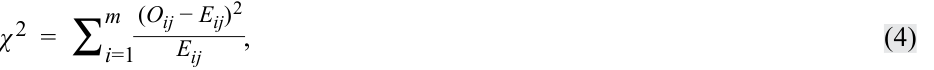
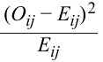
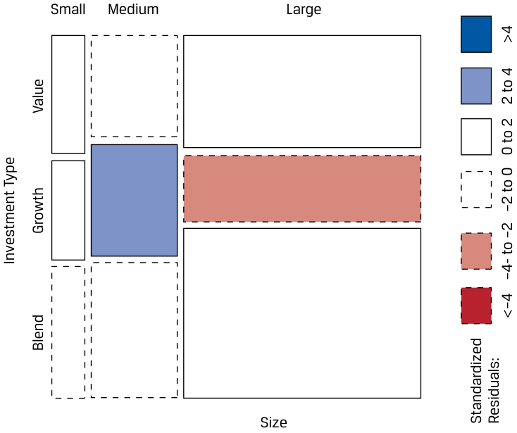
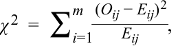
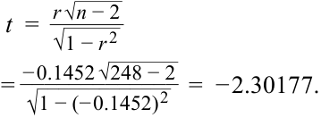

# Tập 1: Phương pháp Định lượng (Quantitative Methods)
## Learning Module 9 Parametric and Non-Parametric Tests of Independence (Trang PDF 251–270)

---

# Tập 1: Phương pháp Định lượng (*Quantitative Methods*)
## Học phần 9: Các Kiểm định Tính Độc lập Tham số và Phi tham số (*Parametric and Non-Parametric Tests of Independence*)
### Phần 1/2: Giới thiệu (*Introduction*) (Trang PDF 251–260)

---

<!-- PDF Page 251 -->

#### H Ọ C P H Ầ N 

# **<mark>9</mark>** 

### **Các Kiểm định Tính Độc lập Tham số và Phi tham số (*Parametric and Non-Parametric Tests of Independence*)** 

**tác giả: Pamela Peterson Drake, PhD, CFA.** 

_Pamela Peterson Drake, PhD, CFA, làm việc tại Đại học James Madison (Hoa Kỳ)._ 

###### **<mark>MỤC TIÊU HỌC TẬP (*LEARNING OUTCOMES*)</mark>** 

**_Mức độ Thành thạo – Ứng viên cần có khả năng:_**
- Giải thích các kiểm định tham số và phi tham số đối với giả thuyết rằng hệ số tương quan tổng thể (*population correlation coefficient*) bằng 0, và xác định xem giả thuyết có bị bác bỏ ở một mức ý nghĩa cho trước hay không.
- Giải thích các kiểm định tính độc lập dựa trên dữ liệu bảng tiếp liên (*contingency table data*).

##### **GIỚI THIỆU (*INTRODUCTION*)** 

**<mark>1</mark>** 

Trong nhiều bối cảnh đầu tư, chúng ta muốn đánh giá độ mạnh của mối quan hệ tuyến tính giữa hai biến số—tức là chúng ta muốn đánh giá **tương quan (*correlation*)** giữa chúng. Một kiểm định ý nghĩa của hệ số tương quan cho phép chúng ta đánh giá xem liệu mối quan hệ giữa hai biến ngẫu nhiên có phải là kết quả của sự ngẫu nhiên hay không. Bài 1 trình bày cách tiếp cận tham số và phi tham số để kiểm định tương quan giữa hai biến số. Nếu chúng ta kết luận rằng mối quan hệ không phải do ngẫu nhiên mà có, thì chúng ta có thể sử dụng thông tin này trong việc mô hình hóa hoặc dự báo bằng cách sử dụng các mô hình hồi quy (*regression models*) hoặc học máy (*machine learning*) được trình bày trong các Học phần sau. 

Tuy nhiên, khi đối mặt với dữ liệu phân loại (*categorical data*) hoặc dữ liệu rời rạc (*discrete data*), chúng ta không thể sử dụng các phương pháp được thảo luận trong bài học đầu tiên để kiểm định xem các phân loại của dữ liệu đó có độc lập với nhau hay không. Nếu chúng ta muốn kiểm định xem liệu có mối quan hệ nào giữa dữ liệu phân loại hoặc rời rạc hay không, chúng ta có thể thực hiện kiểm định tính độc lập (*test of independence*) bằng cách sử dụng một thống kê kiểm định phi tham số. Bài học thứ hai trình bày việc sử dụng các bảng tiếp liên (*contingency tables*) trong việc triển khai kiểm định phi tham số này. 

###### **TỔNG QUAN HỌC PHẦN (*LEARNING MODULE OVERVIEW*)** 

- Có ba cách để thiết lập các giả thuyết. Gọi $\theta$ biểu thị các tham số tổng thể: 

<!-- PDF Page 252 -->

   **1.** Giả thuyết đối hai phía (*Two-sided alternative*): $H_0: \theta = \theta_0$ đối lập với $H_a: \theta \ne \theta_0$ 
   **2.** Giả thuyết đối một phía (phía bên phải – *right side*): $H_0: \theta \le \theta_0$ đối lập với $H_a: \theta > \theta_0$ 
   **3.** Giả thuyết đối một phía (phía bên trái – *left side*): $H_0: \theta \ge \theta_0$ đối lập với $H_a: \theta < \theta_0$ 

   trong đó $\theta_0$ là một giá trị theo giả thuyết của tham số tổng thể và $\theta$ là giá trị thực của tham số tổng thể. 

- Kiểm định tham số (*parametric test*) là một kiểm định giả thuyết liên quan đến một tham số tổng thể hoặc một kiểm định giả thuyết dựa trên các giả định phân phối cụ thể. Ngược lại, kiểm định phi tham số (*nonparametric test*) hoặc không liên quan đến một tham số hoặc đưa ra các giả định tối thiểu về tổng thể mà từ đó mẫu được rút ra. 

- Kiểm định phi tham số chủ yếu được sử dụng khi dữ liệu không đáp ứng các giả định về phân phối, khi có các giá trị ngoại lai (*outliers*), khi dữ liệu được cho dưới dạng thứ hạng (*ranks*), hoặc khi giả thuyết chúng ta đang giải quyết không liên quan đến một tham số. 

- Trong các kiểm định liên quan đến tương quan, chúng ta sử dụng thống kê $t$ để kiểm định xem hệ số tương quan tổng thể có khác $0$ hay không. Nếu chúng ta có $n$ quan sát cho hai biến số, thống kê kiểm định này có phân phối $t$ với $n - 2$ bậc tự do. 

- Hệ số tương quan hạng Spearman (*Spearman rank correlation coefficient*) được tính toán trên thứ hạng của hai biến số trong các mẫu tương ứng của chúng. 

- Một thống kê kiểm định có phân phối Khi-bình phương (*chi-square distributed test statistic*) được sử dụng để kiểm định tính độc lập của hai biến phân loại. Kiểm định phi tham số này so sánh các tần số thực tế với các tần số kỳ vọng trên cơ sở tính độc lập. Thống kê kiểm định này có bậc tự do là $(r - 1)(c - 1)$ *(lưu ý: bản gốc tiếng Anh ở trang 252 in nhầm thành $(r - 1)(c - 2)$, công thức đúng chuẩn ở trang 262 là $(r - 1)(c - 1)$)*, trong đó $r$ là số danh mục của biến thứ nhất và $c$ là số danh mục của biến thứ hai. 

## **<mark>2</mark>** 

##### **CÁC KIỂM ĐỊNH LIÊN QUAN ĐẾN TƯƠNG QUAN (*TESTS CONCERNING CORRELATION*)** 

- *Giải thích các kiểm định tham số và phi tham số đối với giả thuyết rằng hệ số tương quan tổng thể bằng 0, và xác định xem giả thuyết có bị bác bỏ ở một mức ý nghĩa cho trước hay không*

Các giả thuyết phổ biến nhất liên quan đến tương quan xuất hiện khi so sánh hệ số tương quan tổng thể với $0$ bởi vì chúng ta thường đặt câu hỏi liệu một mối quan hệ có tồn tại hay không, điều này ngụ ý một giả thuyết không rằng hệ số tương quan bằng $0$ (tức là không có mối quan hệ). Các giả thuyết liên quan đến hệ số tương quan tổng thể có thể là hai phía hoặc một phía, như chúng ta đã thấy trong các kiểm định khác. Gọi $\rho$ đại diện cho hệ số tương quan tổng thể. Các giả thuyết có thể có như sau: 

- Hai phía (*Two sided*): $H_0: \rho = 0$ đối lập với $H_a: \rho \ne 0$ 
- Một phía (phía bên phải – *right side*): $H_0: \rho \le 0$ đối lập với $H_a: \rho > 0$ 
- Một phía (phía bên trái – *left side*): $H_0: \rho \ge 0$ đối lập với $H_a: \rho < 0$ 

Chúng ta sử dụng tương quan mẫu để kiểm định các giả thuyết này về tương quan tổng thể. 

<!-- PDF Page 253 -->

###### **Kiểm định Tham số về Tương quan (*Parametric Test of a Correlation*)** 

Hệ số tương quan từng cặp tham số thường được gọi là **tương quan Pearson (*Pearson correlation*)**, **tương quan hai biến (*bivariate correlation*)**, hoặc đơn giản là tương quan. Trọng tâm của chúng ta là việc kiểm định tương quan chứ không phải phép tính thực tế của thống kê này, nhưng việc nhìn vào công thức tính tương quan mẫu sẽ giúp phân biệt tương quan này với tương quan phi tham số. Xét hai biến số, $X$ và $Y$. Tương quan mẫu, $r_{XY}$, được tính như sau: 

<!-- Formula Text: r XY  = s XY _ s X s Y , (1) -->
$$r_{XY} = \frac{s_{XY}}{s_X s_Y} \tag{1}$$

trong đó $s_{XY}$ là hiệp phương sai mẫu (*sample covariance*) giữa hai biến $X$ và $Y$, $s_X$ là độ lệch chuẩn của biến $X$, và $s_Y$ là độ lệch chuẩn của biến $Y$. Chúng ta thường lược bỏ chỉ số dưới để biểu thị tương quan đơn giản là $r$. 

Do đó, bạn có thể thấy từ công thức này rằng mỗi quan sát được so sánh với giá trị trung bình của biến tương ứng và, do có hiệp phương sai, mức độ chênh lệch của mỗi quan sát so với giá trị trung bình của biến tương ứng đóng vai trò rất quan trọng. Lưu ý rằng hiệp phương sai quyết định dấu của hệ số tương quan. 

Nếu hai biến số có phân phối chuẩn, chúng ta có thể kiểm định để xác định xem giả thuyết không ($H_0: \rho = 0$) có nên bị bác bỏ hay không bằng cách sử dụng tương quan mẫu, $r$. Công thức cho kiểm định $t$ như sau: 

<!-- Formula Text: t  =   r √ _ n − 2 _ √ _ 1 − r 2  . (2) -->
$$t = \frac{r\sqrt{n - 2}}{\sqrt{1 - r^2}} \tag{2}$$

Thống kê kiểm định này có phân phối $t$ với $n - 2$ bậc tự do. Một nhận xét thực tế liên quan đến Phương trình 2 là độ lớn của $r$ cần thiết để bác bỏ giả thuyết không sẽ giảm xuống khi kích thước mẫu $n$ tăng lên, vì hai lý do. Thứ nhất, khi $n$ tăng lên, số bậc tự do tăng lên và giá trị tuyệt đối của giá trị tới hạn của thống kê $t$ giảm xuống. Thứ hai, giá trị tuyệt đối của tử số tăng lên khi $n$ lớn hơn, dẫn đến độ lớn của thống kê $t$ tính toán được lớn hơn. Ví dụ, với kích thước mẫu $n = 12$, $r = 0.35$ mang lại thống kê $t$ là $1.182$, không khác $0$ ở mức ý nghĩa $0.05$ ($t_{\alpha/2} = \pm 2.228$). Với kích thước mẫu $n = 32$, cùng mức tương quan mẫu đó, $r = 0.35$, mang lại thống kê $t$ là $2.046$, vừa đủ có ý nghĩa thống kê ở mức $0.05$ ($t_{\alpha/2} = \pm 2.042$). 

Một cách khác để diễn đạt điểm này là khi lấy mẫu từ cùng một tổng thể, một giả thuyết không đang sai có nhiều khả năng bị bác bỏ hơn (tức là lực kiểm định tăng lên) khi chúng ta tăng kích thước mẫu, với các yếu tố khác không đổi, bởi vì số lượng quan sát cao hơn làm tăng tử số của thống kê kiểm định. Chúng tôi thể hiện điều này trong Minh họa 1 cho ba hệ số tương quan mẫu khác nhau, với các thống kê $t$ tính toán được tương ứng và ý nghĩa thống kê ở mức $5\%$ cho một giả thuyết đối hai phía. Khi kích thước mẫu tăng lên, ý nghĩa thống kê có nhiều khả năng đạt được hơn, nhưng tốc độ đạt được ý nghĩa thống kê này phụ thuộc vào hệ số tương quan mẫu; tương quan mẫu càng cao thì càng nhanh đạt được ý nghĩa thống kê khi tăng kích thước mẫu. Khi kích thước mẫu tăng lên do các tập dữ liệu ngày càng lớn được xem xét, giả thuyết không hầu như luôn bị bác bỏ và cần phải áp dụng các công cụ phân tích dữ liệu khác. 

<!-- PDF Page 254 -->

**Minh họa 1: Các Thống kê Kiểm định Tính toán được cho các Kích thước Mẫu và Tương quan Mẫu Khác nhau với Mức Ý nghĩa 5% (*Exhibit 1: Calculated Test Statistics for Different Sample Sizes and Sample Correlations with a 5 Percent Level of Significance*)** 

<!-- Picture Text: Calculated  t -Statistic 8 7 6 5 4 3 2 1 0 3 12 21 30 39 48 57 66 75 84 93 Sample Size t -Statistic for Correlation = 0.2 Significant Correlation = 0.2 t -Statistic for Correlation = 0.4 Significant Correlation = 0.4 t -Statistic for Correlation = 0.6 Significant Correlation = 0.6  -->
> **Chú thích hình ảnh:** Đồ thị biểu diễn Thống kê $t$ tính toán được (*Calculated t-Statistic*) trên trục tung theo Kích thước mẫu (*Sample Size*) trên trục hoành cho các mức hệ số tương quan $r = 0.2, 0.4, 0.6$, đánh dấu vùng bắt đầu có ý nghĩa thống kê (*Significant Correlation*).

###### **VÍ DỤ 1 (*EXAMPLE 1*)** 

###### **Xem xét Mối quan hệ giữa Tỷ suất sinh lợi trên Khoản đầu tư Một và Khoản đầu tư Hai (*Examining the Relationship between Returns on Investment One and Investment Two*)** 

Một nhà phân tích đang xem xét tỷ suất sinh lợi hàng năm của Khoản đầu tư Một và Khoản đầu tư Hai trong 33 năm, như được hiển thị trong Minh họa 2. 

**Minh họa 2: Tỷ suất sinh lợi của Khoản đầu tư Một và Hai trong 33 Năm (*Exhibit 2: Returns for Investments One and Two over 33 Years*)** 

<!-- Picture Text: Annual Return (%) 12 10 8 6 4 2 0 –2 1 3 5 7 9 11 13 15 17 19 21 23 25 27 29 31 33 Year Investment One Investment Two  -->
> **Chú thích hình ảnh:** Đồ thị chuỗi thời gian của Tỷ suất sinh lợi hàng năm (*Annual Return* (%)) từ Năm 1 đến Năm 33 của Khoản đầu tư Một (*Investment One*) và Khoản đầu tư Hai (*Investment Two*).

Mặc dù đồ thị chuỗi thời gian này cung cấp một số thông tin hữu ích, nhà phân tích quan tâm nhất đến việc định lượng mối liên hệ giữa tỷ suất sinh lợi của hai chuỗi này, vì vậy cô tính hệ số tương quan giữa hai chuỗi này và thu được kết quả bằng $0.43051$. 

1. Có mối tương quan dương có ý nghĩa thống kê giữa hai chuỗi tỷ suất sinh lợi này hay không nếu cô sử dụng mức ý nghĩa $1\%$?

**Lời giải (*Solution*):** 

<!-- PDF Page 255 -->

|**Bước 1 (*Step 1*)**|Phát biểu các giả thuyết.|$$H_0: \rho \le 0 \text{ đối lập với } H_a: \rho > 0$$|
|---|---|---|
|**Bước 2 (*Step 2*)**|Xác định thống kê kiểm định phù hợp.|$$t = \frac{r\sqrt{n - 2}}{\sqrt{1 - r^2}}$$|
|**Bước 3 (*Step 3*)**|Xác định mức ý nghĩa.|$1\%$|
|**Bước 4 (*Step 4*)**|Phát biểu quy tắc quyết định.|Với $33 - 2 = 31$ bậc tự do và kiểm định một phía với mức ý nghĩa $1\%$, giá trị tới hạn là $2.45282$. Chúng ta bác bỏ giả thuyết không nếu thống kê $t$ tính toán được lớn hơn $2.45282$.|
|**Bước 5 (*Step 5*)**|Tính toán thống kê kiểm định.|$$t = \frac{0.43051\sqrt{33 - 2}}{\sqrt{1 - 0.18534}} = 2.65568$$|
|**Bước 6 (*Step 6*)**|Đưa ra quyết định.|Bác bỏ giả thuyết không bởi vì thống kê $t$ tính toán được lớn hơn $2.45282$. Có đủ bằng chứng để bác bỏ $H_0$ nhằm ủng hộ $H_a$, tức là tương quan giữa tỷ suất sinh lợi hàng năm của hai khoản đầu tư này là dương.|

###### **VÍ DỤ 2 (*EXAMPLE 2*)** 

###### **Tương quan với Tỷ suất sinh lợi S&P 500 (*Correlation with the S&P 500 Returns*)** 

1. Minh họa 3 cho thấy tương quan mẫu giữa tỷ suất sinh lợi hàng tháng của bốn quỹ tương hỗ khác nhau và chỉ số S&P 500. Các hệ số tương quan dựa trên 36 quan sát hàng tháng. Các quỹ như sau: 

###### **Minh họa 3: Tương quan Mẫu giữa Tỷ suất sinh lợi Hàng tháng và S&P 500 (*Exhibit 3: Sample Correlations between Monthly Returns and the S&P 500*)** 

- **Quỹ 1 (*Fund 1*):** Quỹ vốn hóa lớn (*Large-cap fund*)
- **Quỹ 2 (*Fund 2*):** Quỹ vốn hóa trung bình (*Mid-cap fund*)
- **Quỹ 3 (*Fund 3*):** Quỹ giá trị vốn hóa lớn (*Large-cap value fund*)
- **Quỹ 4 (*Fund 4*):** Quỹ thị trường mới nổi (*Emerging market fund*)
- **S&P 500:** Chỉ số cổ phiếu nội địa Hoa Kỳ (*US domestic stock index*)

<!-- PDF Page 256 -->

||**Quỹ 1 (*Fund 1*)**|**Quỹ 2 (*Fund 2*)**|**Quỹ 3 (*Fund 3*)**|**Quỹ 4 (*Fund 4*)**|**S&P 500**|
|---|---|---|---|---|---|
|Quỹ 1 (*Fund 1*)|1|||||
|Quỹ 2 (*Fund 2*)|0.9231|1||||
|Quỹ 3 (*Fund 3*)|0.4771|0.4156|1|||
|Quỹ 4 (*Fund 4*)|0.7111|0.7238|0.3102|1||
|S&P 500|0.8277|0.8223|0.5791|0.7515|1|

Hãy kiểm định giả thuyết không rằng mỗi hệ số tương quan này, xét riêng lẻ, bằng $0$ đối lập với giả thuyết đối rằng nó khác $0$. Sử dụng mức ý nghĩa $5\%$ và các giá trị $t$ tới hạn là $\pm 2.032$. 

###### **Lời giải (*Solution*):** 

Các giả thuyết là $H_0: \rho = 0$ và $H_a: \rho \ne 0$. Các thống kê kiểm định tính toán được dựa trên công thức: 

<!-- Formula Text: t  =   r √ _ n − 2 _ √ _ 1 − r 2  . -->
$$t = \frac{r\sqrt{n - 2}}{\sqrt{1 - r^2}}$$

<!-- Formula Text: For example, the calculated t-statistic for the correlation of Fund 3 and Fund 4 is as follows t  =   r √ _ n − 2 _ √ _ 1 − r 2    =   0.3102 √ _ 36 − 2 ___________ √ _ 1 − 0.3102 2    =  1.903. -->
Ví dụ, thống kê $t$ tính toán được cho tương quan của Quỹ 3 và Quỹ 4 như sau:
$$t = \frac{r\sqrt{n - 2}}{\sqrt{1 - r^2}} = \frac{0.3102\sqrt{36 - 2}}{\sqrt{1 - 0.3102^2}} = 1.903$$

Lặp lại phép tính này cho toàn bộ ma trận tương quan mang lại kết quả sau: 

###### **Thống kê $t$ Tính toán được cho các Hệ số Tương quan (*Calculated t-Statistics for Correlations*)** 

||**Quỹ 1 (*Fund 1*)**|**Quỹ 2 (*Fund 2*)**|**Quỹ 3 (*Fund 3*)**|**Quỹ 4 (*Fund 4*)**|**S&P 500**|
|---|---|---|---|---|---|
|Quỹ 1 (*Fund 1*)||||||
|Quỹ 2 (*Fund 2*)|13.997|||||
|Quỹ 3 (*Fund 3*)|3.165|2.664||||
|Quỹ 4 (*Fund 4*)|5.897|6.116|1.903|||
|S&P 500|8.600|8.426|4.142|6.642||

Với các giá trị tới hạn là $\pm 2.032$, ngoại trừ tương quan giữa tỷ suất sinh lợi của Quỹ 3 và Quỹ 4, chúng ta bác bỏ giả thuyết không cho tất cả các hệ số tương quan này. Nói cách khác, có đủ bằng chứng để chỉ ra rằng các hệ số tương quan đều khác $0$, ngoại trừ tương quan tỷ suất sinh lợi giữa Quỹ 3 và Quỹ 4. 

Chúng ta có thể sử dụng phần mềm để xác định các giá trị tới hạn: 

###### **Excel** 

<!-- Formula Text: [T.INV(0.025,34) and T.INV(0.975,34)] -->
`[T.INV(0.025,34) and T.INV(0.975,34)]`

**R** 

<!-- Formula Text: [qt(c(.025,.975),34)] -->
`[qt(c(.025,.975),34)]`

###### **Python** 

`[from scipy.stats import t and t.ppf(.025,34) and t.ppf(.975,34)]` 

Chúng ta cũng có thể sử dụng phần mềm để xác định giá trị $p$ (*p-value*) cho thống kê kiểm định tính toán được nhằm so sánh với mức ý nghĩa. Ví dụ, đối với $t = 2.664$, giá trị $p$ là $0.01172$: 

<!-- PDF Page 257 -->

- **Excel:** `[(1-T.DIST(2.664,34,TRUE))*2]`
- **R:** `[(1-pt(2.664,34))*2]` 
- **Python:** `[from scipy.stats import t (1-t.cdf(2.664,34))*2]` 

###### **Kiểm định Phi tham số về Tương quan: Hệ số Tương quan Hạng Spearman (*Non-Parametric Test of Correlation: The Spearman Rank Correlation Coefficient*)** 

Khi chúng ta tin rằng tổng thể đang xem xét lệch đáng kể so với phân phối chuẩn, chúng ta có thể sử dụng một kiểm định dựa trên **hệ số tương quan hạng Spearman (*Spearman rank correlation coefficient*)**, $r_S$. Hệ số tương quan hạng Spearman về cơ bản tương đương với hệ số tương quan Pearson như đã định nghĩa trước đó, nhưng nó được tính toán trên _thứ hạng_ (*ranks*) của hai biến số (ví dụ: $X$ và $Y$) trong các mẫu tương ứng của chúng. Phép tính $r_S$ đòi hỏi các bước sau: 

**1.** Xếp hạng các quan sát của $X$ từ lớn nhất đến nhỏ nhất. Gán số 1 cho quan sát có giá trị lớn nhất, số 2 cho quan sát có giá trị lớn thứ hai, và cứ tiếp tục như vậy. Trong trường hợp có các giá trị bằng nhau (*ties*), hãy gán cho mỗi quan sát đồng hạng giá trị trung bình của các thứ hạng mà chúng cùng chiếm giữ. Ví dụ, nếu giá trị lớn thứ ba và thứ tư bằng nhau, chúng ta gán cho cả hai quan sát thứ hạng là $3.5$ (trung bình cộng của 3 và 4). Thực hiện thủ tục tương tự cho các quan sát của $Y$. 

**2.** Tính chênh lệch, $d_i$, giữa các thứ hạng cho mỗi cặp quan sát của $X$ và $Y$, và sau đó tính $d_i^2$ (bình phương chênh lệch thứ hạng). 

<!-- Formula Text: 3.	 With n as the sample size, the Spearman rank correlation is given as follows: r s  =  1 − 6∑ i=1 n d i 2 _ n(n 2 − 1) . (3) -->
**3.** Với $n$ là kích thước mẫu, tương quan hạng Spearman được cho như sau:
$$r_S = 1 - \frac{6 \sum_{i=1}^{n} d_i^2}{n(n^2 - 1)} \tag{3}$$

Giả sử một nhà phân tích đang xem xét mối quan hệ giữa tỷ suất sinh lợi của hai quỹ đầu tư, A và B, có rủi ro tương tự nhau trong 35 năm. Cô lo ngại rằng các giả định cho tương quan tham số có thể không được đáp ứng, vì vậy cô quyết định kiểm định tương quan hạng Spearman. Các giả thuyết của cô là $H_0: r_S = 0$ và $H_a: r_S \ne 0$. Cô thu thập tỷ suất sinh lợi, xếp hạng tỷ suất sinh lợi cho mỗi quỹ, và tính chênh lệch thứ hạng cùng bình phương các chênh lệch. Một phần của bảng được cung cấp trong Minh họa 4. 

**Minh họa 4: Chênh lệch và Bình phương Chênh lệch Thứ hạng của Quỹ A và Quỹ B trong 35 Năm (*Exhibit 4: Differences and Squared Differences in Ranks for Fund A and Fund B over 35 Years*)** 

|**Năm (*Year*)**|**Quỹ A (*Fund A*)**|**Quỹ B (*Fund B*)**|**Thứ hạng của A (*Rank of A*)**|**Thứ hạng của B (*Rank of B*)**|**$d$**|**$d^2$**|
|---|---|---|---|---|---|---|
|1|2.453|1.382|27|31|−4|16|
|2|3.017|3.110|24|24|0|0|
|3|4.495|6.587|19|7|12|144|
|4|3.627|3.300|23|23|0|0|

$$\vdots$$

<!-- PDF Page 258 -->

|**Năm (*Year*)**|**Quỹ A (*Fund A*)**|**Quỹ B (*Fund B*)**|**Thứ hạng của A (*Rank of A*)**|**Thứ hạng của B (*Rank of B*)**|**$d$**|**$d^2$**|
|---|---|---|---|---|---|---|
|30|2.269|0.025|28|35|−7|49|
|31|6.354|4.428|10|19|−9|81|
|32|6.793|4.165|8|20|−12|144|
|33|7.300|7.623|5|5|0|0|
|34|6.266|4.527|11|18|−7|49|
|35|1.257|4.704|34|16|18|324|
||||||Tổng (*Sum*) =|2,202|

Tương quan hạng Spearman được tính như sau: 

<!-- Formula Text: r s  =  1 − 6∑ i=1 n d i 2 _ n(n 2 − 1)   =  1 − 6(2, 202) _ 35(1, 225 − 1)   =  0.6916. -->
$$r_S = 1 - \frac{6 \sum_{i=1}^{n} d_i^2}{n(n^2 - 1)} = 1 - \frac{6(2,202)}{35(1,225 - 1)} = 0.6916$$

Kiểm định giả thuyết cho tương quan hạng Spearman phụ thuộc vào việc mẫu là nhỏ hay lớn ($n > 30$). Đối với các mẫu nhỏ, nhà nghiên cứu cần một bảng giá trị tới hạn chuyên biệt, nhưng đối với các mẫu lớn, chúng ta có thể tiến hành kiểm định $t$ bằng cách sử dụng thống kê kiểm định trong Phương trình 2, có phân phối $t$ với $n - 2$ bậc tự do. 

Trong ví dụ này, đối với kiểm định hai phía với mức ý nghĩa $5\%$, các giá trị tới hạn cho $n - 2 = 35 - 2 = 33$ bậc tự do là $\pm 2.0345$. Với thông tin mẫu trong Minh họa 4, thống kê kiểm định tính toán được như sau: 

<!-- Formula Text: t  =    0.6916 √ _ 33 ___________ √ ____________ 1 − (0.6916 2)    =  5.5005 -->
$$t = \frac{0.6916\sqrt{33}}{\sqrt{1 - (0.6916^2)}} = 5.5005$$

Theo đó, chúng ta bác bỏ giả thuyết không ($H_0: r_S = 0$), kết luận rằng có đủ bằng chứng để chỉ ra rằng tương quan giữa tỷ suất sinh lợi của Quỹ A và Quỹ B là khác $0$. 

###### **VÍ DỤ 3 (*EXAMPLE 3*)** 

###### **Kiểm định Tương quan Tỷ giá Hối đoái (*Testing the Exchange Rate Correlation*)** 

Một nhà phân tích thu thập dữ liệu tỷ giá hối đoái của năm đồng tiền so với đồng đô la Mỹ. Khi kiểm tra phân phối của các tỷ giá hối đoái này, cô quan sát thấy có sự lệch khỏi phân phối chuẩn, đặc biệt là độ lệch âm (*negative skewness*) đối với bốn chuỗi và độ lệch dương (*positive skewness*) đối với chuỗi thứ năm. Do đó, cô quyết định xem xét mối quan hệ giữa các đồng tiền này bằng cách sử dụng tương quan hạng Spearman. Cô tính toán các hệ số tương quan này giữa các đồng tiền trong 180 ngày, được hiển thị trong biểu đồ tương quan (*correlogram*) ở Minh họa 5. Trong biểu đồ tương quan này, tam giác dưới báo cáo các hệ số tương quan từng cặp và tam giác trên cung cấp hình ảnh trực quan về độ lớn của các hệ số tương quan, với các hình tròn lớn hơn biểu thị giá trị tuyệt đối lớn hơn của các hệ số tương quan và các hình tròn đậm hơn biểu thị các hệ số tương quan âm. 

<!-- PDF Page 259 -->

###### **Minh họa 5: Tương quan Hạng Spearman giữa các Tỷ giá Hối đoái so với Đô la Mỹ (*Exhibit 5: Spearman Rank Correlations between Exchanges Rates Relative to the US Dollar*)** 

<!-- Picture Text: 1.0 AUD 0.8 0.6 0.9124 CAD 0.4 0.2 0.6079 0.5654 EUR 0 –0.2 0.6816 0.7047 0.4889 GBP –0.4 –0.6 –0.1973 –0.2654 0.3691 –0.2046 JPY –0.8 –1.0  -->
> **Chú thích hình ảnh:** Biểu đồ ma trận tương quan (*correlogram*) giữa 5 đồng tiền (AUD, CAD, EUR, GBP, JPY) so với USD, hiển thị giá trị số ở nửa dưới và biểu tượng hình tròn theo thang màu từ -1.0 đến 1.0 ở nửa trên.

1. Đối với bất kỳ tương quan hạng Spearman từng cặp nào trong số này, chúng ta có thể bác bỏ giả thuyết không về việc không có tương quan ($H_0: r_S = 0$ và $H_a: r_S \ne 0$) ở mức ý nghĩa $5\%$ hay không? 

###### **Lời giải (*Solution*):** 

Các giá trị $t$ tới hạn cho $2.5\%$ ở mỗi đuôi của phân phối là $\pm 1.97338$. 

Có năm tỷ giá hối đoái, vì vậy có $_5C_2 = \frac{5!}{2!(5 - 2)!}$, hay 10 cặp tương quan duy nhất. Do đó, chúng ta cần tính 10 thống kê $t$. Ví dụ, tương quan giữa EUR/USD và AUD/USD là $0.6079$. Thống kê $t$ tính toán được là: 

<!-- Formula Text: 0.6079 √ _ 180 − 2 ____________ √ _ 1 − 0.6079 2     =   8.11040 _ 0.79401   =  10.2144. -->
$$t = \frac{0.6079\sqrt{180 - 2}}{\sqrt{1 - 0.6079^2}} = \frac{8.11040}{0.79401} = 10.2144$$

Lặp lại phép tính thống kê $t$ này cho mỗi cặp tỷ giá hối đoái mang lại các thống kê kiểm định được trình bày trong Minh họa 6. 

**Minh họa 6: Các Thống kê Kiểm định Tính toán được cho Kiểm định Tương quan Hạng Spearman (*Exhibit 6: Calculated Test Statistics for Test of Spearman Rank Correlations*)** 

||**AUD/USD**|**CAD/USD**|**EUR/USD**|**GBP/USD**|
|---|---|---|---|---|
|CAD/USD|29.7409||||
|EUR/USD|10.2144|9.1455|||
|GBP/USD|12.4277|13.2513|7.4773||
|JPY/USD|−2.6851|−3.6726|5.2985|−2.7887|

Nhà phân tích nên bác bỏ tất cả 10 giả thuyết không, bởi vì các thống kê $t$ tính toán được cho tất cả các cặp tỷ giá hối đoái đều nằm ngoài giới hạn của hai giá trị tới hạn. Cô nên kết luận rằng tất cả các tương quan cặp tỷ giá hối đoái đều khác $0$ ở mức ý nghĩa $5\%$. 

<!-- PDF Page 260 -->

###### **BỘ CÂU HỎI (*QUESTION SET*)** 

Bạn đang quan tâm đến việc liệu tỷ suất sinh lợi vượt trội đã điều chỉnh rủi ro (alpha) có tương quan với tỷ lệ chi phí (*expense ratios*) của quỹ tương hỗ đối với các quỹ tăng trưởng vốn hóa lớn tại Hoa Kỳ hay không. Bảng sau đây trình bày dữ liệu mẫu. 

|**Quỹ Tương hỗ (*Mutual Fund*)**|**Alpha**|**Tỷ lệ Chi phí (*Expense Ratio*)**|
|---|---|---|
|1|−0.52|1.34|
|2|−0.13|0.40|
|3|−0.50|1.90|
|4|−1.01|1.50|
|5|−0.26|1.35|
|6|−0.89|0.50|
|7|−0.42|1.00|
|8|−0.23|1.50|
|9|−0.60|1.45|

1. Thiết lập giả thuyết không và giả thuyết đối nhất quán với mô tả bằng lời về mục tiêu nghiên cứu. 

###### **Lời giải (*Solution*):** 

Chúng ta có một giả thuyết đối dạng “khác” (*not equal to*): 

$$H_0: \rho = 0 \text{ đối lập với } H_a: \rho \ne 0$$

2. Xác định và giải thích lý do lựa chọn thống kê kiểm định để tiến hành kiểm định các giả thuyết ở Câu 1. 

###### **Lời giải (*Solution*):** 

Tỷ lệ chi phí của quỹ tương hỗ bị chặn trên và chặn dưới; trên thực tế, có ít nhất một cận dưới đối với alpha (vì bất kỳ tỷ suất sinh lợi nào cũng không thể nhỏ hơn $-100\%$), và tỷ lệ chi phí không thể âm. Các biến số này có thể không có phân phối chuẩn, và các giả định của một kiểm định tham số không có khả năng được thỏa mãn. Do đó, một kiểm định phi tham số có vẻ là phù hợp. 

Chúng ta sẽ sử dụng hệ số tương quan hạng Spearman phi tham số để tiến hành kiểm định: 

<!-- Formula Text: r s  =  1 − 6∑ i=1 n d i 2 _ n(n 2 − 1) -->
$$r_S = 1 - \frac{6 \sum_{i=1}^{n} d_i^2}{n(n^2 - 1)}$$

với thống kê kiểm định có phân phối $t$ là: 

<!-- Formula Text: t  =   r √ _ n − 2 _ √ _ 1 − r 2  . -->
$$t = \frac{r\sqrt{n - 2}}{\sqrt{1 - r^2}}$$

Phép tính hệ số tương quan hạng Spearman được cho trong bảng tiếp theo *(xem đầu Phần 2)*. 

---

# Tập 1: Phương pháp Định lượng (*Quantitative Methods*)
## Học phần 9: Các Kiểm định Tính Độc lập Tham số và Phi tham số (*Parametric and Non-Parametric Tests of Independence*)
### Phần 2/2: Các Kiểm định Tính Độc lập Sử dụng Dữ liệu Bảng Tiếp liên (*Tests of Independence Using Contingency Table Data*) (Trang PDF 261–270)

---

<!-- PDF Page 261 -->

*(Tiếp theo Lời giải Câu 2 của Bộ Câu hỏi cuối Phần 1:)*

|**Quỹ Tương hỗ (*Mutual Fund*)**|**Alpha**|**Tỷ lệ Chi phí (*Expense Ratio*)**|**Thứ hạng theo Alpha (*Rank by Alpha*)**|**Thứ hạng theo Tỷ lệ Chi phí (*Rank by Expense Ratio*)**|**Chênh lệch Thứ hạng (*Difference in Rank*)**|**Bình phương Chênh lệch (*Difference Squared*)**|
|---|---|---|---|---|---|---|
|1|−0.52|1.34|6|6|0|0|
|2|−0.13|0.40|1|9|−8|64|
|3|−0.50|1.90|5|1|4|16|
|4|−1.01|1.50|9|2.5|6.5|42.25|
|5|−0.26|1.35|3|5|−2|4|
|6|−0.89|0.50|8|8|0|0|
|7|−0.42|1.00|4|7|−3|9|
|8|−0.23|1.50|2|2.5|−0.5|0.25|
|9|−0.60|1.45|7|4|3|9|
||||||**Tổng (*Sum*)**|144.5|

$$r_S = 1 - \frac{6(144.5)}{9(80)} = -0.20417$$

3. Xác định xem có bác bỏ giả thuyết không ở mức ý nghĩa $0.05$ hay không nếu các giá trị tới hạn là $\pm 2.306$. 

###### **Lời giải (*Solution*):**

Thống kê kiểm định tính toán được, sử dụng thống kê kiểm định có phân phối $t$:

$$t = \frac{r\sqrt{n - 2}}{\sqrt{1 - r^2}} \quad \text{là} \quad t = \frac{-0.20417\sqrt{7}}{\sqrt{1 - 0.041681}} = \frac{-0.540183}{0.978937} = -0.55181$$

Dựa trên việc giá trị này nằm trong phạm vi $\pm 2.306$, chúng ta không bác bỏ giả thuyết không rằng hệ số tương quan hạng Spearman bằng $0$. 

### **CÁC KIỂM ĐỊNH TÍNH ĐỘC LẬP SỬ DỤNG DỮ LIỆU BẢNG TIẾP LIÊN (*TESTS OF INDEPENDENCE USING CONTINGENCY TABLE DATA*)** 

# **<mark>3</mark>** 

*Giải thích các kiểm định tính độc lập dựa trên dữ liệu bảng tiếp liên*

Khi đối mặt với dữ liệu phân loại (*categorical data*) hoặc dữ liệu rời rạc (*discrete data*), chúng ta không thể sử dụng các phương pháp đã thảo luận cho đến thời điểm này để kiểm định xem các phân loại của dữ liệu đó có độc lập với nhau hay không. Giả sử chúng ta quan sát **bảng tần số (*frequency table*)** sau đây của 1,594 quỹ hoán đổi danh mục (*exchange-traded funds* – ETFs) dựa trên hai phân loại: quy mô (tức giá trị vốn hóa thị trường) và loại hình đầu tư (giá trị, tăng trưởng hoặc hỗn hợp – *value, growth, or blend*), như được hiển thị trong Minh họa 7. Phân loại loại hình đầu tư là rời rạc, vì vậy chúng ta không thể sử dụng hệ số tương quan để đánh giá mối quan hệ giữa quy mô và loại hình đầu tư. 

<!-- PDF Page 262 -->

**Minh họa 7: Phân loại Quy mô và Loại hình Đầu tư của 1,594 Quỹ ETF (*Exhibit 7: Size and Investment Type Classifications of 1,594 ETFs*)** 

|**Loại hình Đầu tư (*Investment Type*)**|**Quy mô theo Vốn hóa Thị trường: Nhỏ (*Small*)**|**Quy mô theo Vốn hóa Thị trường: Vừa (*Medium*)**|**Quy mô theo Vốn hóa Thị trường: Lớn (*Large*)**|**Tổng (*Total*)**|
|---|---|---|---|---|
|Giá trị (*Value*)|50|110|343|503|
|Tăng trưởng (*Growth*)|42|122|202|366|
|Hỗn hợp (*Blend*)|56|149|520|725|
|Tổng (*Total*)|148|381|1,065|1,594|

Minh họa 7 được gọi là **bảng tiếp liên (*contingency table*)** hoặc **bảng hai chiều (*two-way table*)** (bởi vì có hai phân loại, hoặc hai lớp—quy mô và loại hình đầu tư). 

Nếu chúng ta muốn kiểm định xem liệu có tồn tại mối quan hệ giữa quy mô và loại hình đầu tư hay không, chúng ta có thể thực hiện một kiểm định tính độc lập bằng cách sử dụng một thống kê kiểm định phi tham số có phân phối Khi-bình phương (*chi-square distributed*): 

<!-- Formula Text: χ 2  =  ∑ i=1 m (O ij − E ij) 2 _ E ij , (4) -->
$$\chi^2 = \sum_{i=1}^{m} \frac{(O_{ij} - E_{ij})^2}{E_{ij}} \tag{4}$$

trong đó: 

- $m =$ số lượng ô (*cells*) trong bảng, bằng số nhóm trong phân loại thứ nhất nhân với số nhóm trong phân loại thứ hai; 
- $O_{ij} =$ số lượng quan sát trong mỗi ô ở hàng $i$ và cột $j$ (tức là tần số quan sát được – *observed frequency*); và 
- $E_{ij} =$ số lượng quan sát kỳ vọng trong mỗi ô ở hàng $i$ và cột $j$, giả định tính độc lập (tức là tần số kỳ vọng – *expected frequency*). 

Thống kê kiểm định này có $(r - 1)(c - 1)$ bậc tự do, trong đó $r$ là số hàng và $c$ là số cột. 

Trong Minh họa 7, lớp quy mô có ba nhóm (nhỏ, vừa và lớn) và lớp loại hình đầu tư có ba nhóm (giá trị, tăng trưởng và hỗn hợp), vì vậy $m$ bằng $9$ ($= 3 \times 3$). Số lượng quỹ ETF trong mỗi ô ($O_{ij}$), tức tần số quan sát được, đã được cho trước, vì vậy để tính thống kê kiểm định Khi-bình phương, chúng ta cần ước tính $E_{ij}$, tần số kỳ vọng, tức là số lượng quỹ ETF mà chúng ta kỳ vọng sẽ có trong mỗi ô nếu quy mô và loại hình đầu tư hoàn toàn độc lập với nhau. Số lượng quỹ ETF kỳ vọng ($E_{ij}$) được tính bằng công thức sau: 

<!-- Formula Text: E ij  = (Total row i ) × (Total column j) ______________________ Overall total . (5) -->
$$E_{ij} = \frac{(\text{Tổng hàng } i) \times (\text{Tổng cột } j)}{\text{Tổng chung toàn bảng}} \tag{5}$$

Hãy xem xét một sự kết hợp giữa quy mô và loại hình đầu tư, nhóm giá trị vốn hóa nhỏ (*small-cap value*): 

<!-- Formula Text: E ij  =   503 × 148 _ 1, 594    =  46.703. -->
$$E_{ij} = \frac{503 \times 148}{1,594} = 46.703$$

Chúng ta lặp lại phép tính này cho từng sự kết hợp giữa quy mô và loại hình đầu tư (tức là $m = 9$ cặp) để thu được các tần số kỳ vọng, được trình bày trong Bảng A của Minh họa 8. Tiếp theo, chúng ta tính: 

<!-- Formula Text: (O ij − E ij) 2 _ E ij , -->
$$\frac{(O_{ij} - E_{ij})^2}{E_{ij}}$$

tức bình phương chênh lệch giữa tần số quan sát được và tần số kỳ vọng được chuẩn hóa theo tần số kỳ vọng, cho mỗi ô như được hiển thị trong Bảng B của Minh họa 8. Cuối cùng, bằng cách cộng tổng các giá trị của: 

<!-- Formula Text: (O ij − E ij) 2 _ E ij -->
$$\frac{(O_{ij} - E_{ij})^2}{E_{ij}}$$

<!-- PDF Page 263 -->

cho mỗi ô trong số $m$ ô, chúng ta tính được thống kê Khi-bình phương là $32.08025$. 

##### **Minh họa 8: Các Đầu vào cho Phép tính Thống kê Kiểm định Khi-bình phương cho 1,594 Quỹ ETF Giả định Tính Độc lập giữa Quy mô và Loại hình Đầu tư (*Exhibit 8: Inputs to Chi-Square Test Statistic Calculation for 1,594 ETFs Assuming Independence of Size and Investment Type*)** 

###### **A. Tần số Kỳ vọng của các Quỹ ETF theo Quy mô và Loại hình Đầu tư (*Expected Frequency of ETFs by Size and Investment Type*)** 

|**Loại hình Đầu tư (*Investment Type*)**|**Quy mô theo Vốn hóa: Nhỏ (*Small*)**|**Quy mô theo Vốn hóa: Vừa (*Medium*)**|**Quy mô theo Vốn hóa: Lớn (*Large*)**|
|---|---|---|---|
|Giá trị (*Value*)|46.703|120.228|336.070|
|Tăng trưởng (*Growth*)|33.982|87.482|244.536|
|Hỗn hợp (*Blend*)|67.315|173.290|484.395|
|Tổng (*Total*)|148.000|381.000|1,065.000|

###### **B. Độ lệch Bình phương Chuẩn hóa cho Mỗi Sự kết hợp giữa Quy mô và Loại hình Đầu tư (*Scaled Squared Deviation for Each Combination of Size and Investment Type*)** 

|**Loại hình Đầu tư (*Investment Type*)**|**Quy mô theo Vốn hóa: Nhỏ (*Small*)**|**Quy mô theo Vốn hóa: Vừa (*Medium*)**|**Quy mô theo Vốn hóa: Lớn (*Large*)**|
|---|---|---|---|
|Giá trị (*Value*)|0.233|0.870|0.143|
|Tăng trưởng (*Growth*)|1.892|13.620|7.399|
|Hỗn hợp (*Blend*)|1.902|3.405|2.617|

Trong ví dụ về quỹ ETF của chúng ta, chúng ta kiểm định giả thuyết không về tính độc lập giữa hai lớp (tức là không có mối quan hệ giữa quy mô và loại hình đầu tư) đối lập với giả thuyết đối về sự phụ thuộc (tức là có mối quan hệ giữa quy mô và loại hình đầu tư) bằng cách sử dụng mức ý nghĩa $5\%$, như được hiển thị trong Minh họa 9. Nếu các giá trị quan sát được bằng với các giá trị kỳ vọng, thống kê kiểm định tính toán được sẽ bằng $0$. Tuy nhiên, nếu các giá trị quan sát được và kỳ vọng khác nhau, những chênh lệch này được bình phương lên, vì vậy thống kê Khi-bình phương tính toán được sẽ mang giá trị dương. Do đó, đối với kiểm định tính độc lập sử dụng bảng tiếp liên, chỉ có duy nhất một miền bác bỏ nằm ở phía bên phải (*right side*). 

**Minh họa 9: Kiểm định Tính Độc lập của Quy mô và Loại hình Đầu tư cho 1,594 Quỹ ETF (*Exhibit 9: Test of Independence of Size and Investment Type for 1,594 ETFs*)** 

|**Bước 1 (*Step 1*)**|Phát biểu các giả thuyết.|$H_0$: Quy mô ETF và loại hình đầu tư không có liên hệ với nhau, vì vậy các phân loại này độc lập với nhau; $H_a$: Quy mô ETF và loại hình đầu tư có liên hệ với nhau, vì vậy các phân loại này không độc lập với nhau.|
|---|---|---|
|**Bước 2 (*Step 2*)**|Xác định thống kê kiểm định phù hợp.|$$\chi^2 = \sum_{i=1}^{m} \frac{(O_{ij} - E_{ij})^2}{E_{ij}}$$|
|**Bước 3 (*Step 3*)**|Xác định mức ý nghĩa.|$5\%$|

<!-- PDF Page 264 -->

|**Bước 4 (*Step 4*)**|Phát biểu quy tắc quyết định.|Với $(3 - 1) \times (3 - 1) = 4$ bậc tự do và kiểm định một phía với mức ý nghĩa $5\%$, giá trị tới hạn là $9.4877$. Chúng ta bác bỏ giả thuyết không nếu thống kê $\chi^2$ tính toán được lớn hơn $9.4877$. **Excel:** `CHISQ.INV(0.95,4)` **R:** `qchisq(.95,4)` **Python:** `from scipy.stats import chi2` / `chi2.ppf(.95,4)`|
|---|---|---|
|**Bước 5 (*Step 5*)**|Tính toán thống kê kiểm định.|$$\chi^2 = 32.08025$$|
|**Bước 6 (*Step 6*)**|Đưa ra quyết định.|Bác bỏ giả thuyết không về tính độc lập bởi vì thống kê kiểm định $\chi^2$ tính toán được lớn hơn $9.4877$. Có đủ bằng chứng để kết luận rằng quy mô ETF và loại hình đầu tư có liên hệ với nhau (tức là không độc lập).|

Chúng ta có thể trực quan hóa bảng tiếp liên trong một đồ họa được gọi là biểu đồ khảm (*mosaic*). Trong biểu đồ khảm, một lưới các ô phản ánh sự so sánh giữa tần số quan sát được và tần số kỳ vọng. Hãy xem xét Minh họa 10, biểu diễn bảng tiếp liên của quỹ ETF. 

**Minh họa 10: Biểu đồ Khảm của Bảng Tiếp liên ETF (*Exhibit 10: Mosaic of the ETF Contingency Table*)** 

<!-- Picture Text: Small Medium Large Size 4> 2 to 4 Value 0 to 2 –2 to 0 Growth Investment Type –4- to –2 –4< Blend Standardized Residuals:  -->
> **Chú thích hình ảnh:** Biểu đồ khảm (*Mosaic plot*) chia theo Quy mô (*Size*: *Small, Medium, Large*) và Loại hình đầu tư (*Investment Type*: *Value, Growth, Blend*) cùng thang màu của Phần dư chuẩn hóa (*Standardized Residuals* từ $<-4$ đến $>4$).

Chiều rộng của các hình chữ nhật trong Minh họa 10 phản ánh tỷ trọng của các quỹ ETF có quy mô nhỏ, vừa và lớn, trong khi chiều cao phản ánh tỷ trọng thuộc nhóm giá trị, tăng trưởng và hỗn hợp. Độ tô bóng đậm hơn cho biết số lượng quan sát nhiều hơn mức kỳ vọng dưới giả thuyết không về tính độc lập, trong khi độ tô bóng nhạt hơn cho biết số lượng quan sát ít hơn mức kỳ vọng, với mức “nhiều hơn” và “ít hơn” được xác định bằng cách tham chiếu đến các ô phần dư chuẩn hóa (*standardized residuals*). Phần dư chuẩn hóa, còn được gọi là phần dư Pearson (*Pearson residual*), được tính như sau: 

<!-- Formula Text: Standardized residual  = O ij − E ij _ √ _ E ij   . -->
$$\text{Phần dư chuẩn hóa (Standardized residual)} = \frac{O_{ij} - E_{ij}}{\sqrt{E_{ij}}}$$

<!-- PDF Page 265 -->

Cách diễn giải cho ví dụ ETF này là có nhiều quỹ ETF tăng trưởng quy mô vừa hơn (phần dư chuẩn hóa là $3.69$) và ít quỹ ETF tăng trưởng quy mô lớn hơn (phần dư chuẩn hóa là $-2.72$) so với mức được kỳ vọng nếu quy mô và loại hình đầu tư độc lập với nhau. 

##### **VÍ DỤ 4 (*EXAMPLE 4*)** 

#### **Sử dụng Bảng Tiếp liên để Kiểm định Tính Độc lập (*Using Contingency Tables to Test for Independence*)** 

Hãy xem xét bảng tiếp liên trong Minh họa 11, phân loại 500 công ty được chọn ngẫu nhiên trên cơ sở hai chiều kích xếp hạng môi trường, xã hội và quản trị (ESG): xếp hạng môi trường (*environmental rating*) và xếp hạng quản trị (*governance rating*). 

**Minh họa 11: Phân loại 500 Công ty Được Chọn Ngẫu nhiên Dựa trên Xếp hạng Môi trường và Quản trị (*Exhibit 11: Classification of 500 Randomly Selected Companies Based on Environmental and Governance Ratings*)** 

|**Xếp hạng Môi trường (*Environmental Rating*)**|**Xếp hạng Quản trị: Tiến bộ (*Progressive*)**|**Xếp hạng Quản trị: Trung bình (*Average*)**|**Xếp hạng Quản trị: Kém (*Poor*)**|**Tổng (*Total*)**|
|---|---|---|---|---|
|Tiến bộ (*Progressive*)|35|40|5|80|
|Trung bình (*Average*)|80|130|50|260|
|Kém (*Poor*)|40|60|60|160|
|Tổng (*Total*)|155|230|115|500|

1. Các tần số kỳ vọng cho hai chiều kích xếp hạng ESG này là bao nhiêu nếu các danh mục này độc lập với nhau? 

##### **Lời giải (*Solution*):** 

Các tần số kỳ vọng dựa trên tính độc lập của xếp hạng quản trị và xếp hạng môi trường được hiển thị trong Bảng A của Minh họa 12. Ví dụ, sử dụng Phương trình 5, tần số kỳ vọng cho sự kết hợp giữa xếp hạng quản trị tiến bộ và xếp hạng môi trường tiến bộ là: 

<!-- Formula Text: E ij  =   155 × 80 _ 500    =  24.80. -->
$$E_{ij} = \frac{155 \times 80}{500} = 24.80$$

Các độ lệch bình phương chuẩn hóa (*scaled squared deviations*) cho mỗi sự kết hợp giữa xếp hạng môi trường và quản trị được hiển thị trong Bảng B của Minh họa 12. Ví dụ, sử dụng Phương trình 4, độ lệch bình phương chuẩn hóa cho sự kết hợp giữa xếp hạng quản trị tiến bộ và xếp hạng môi trường tiến bộ như sau: 

<!-- Formula Text: =  (35 − 24.8) 2 _ 24.8 =  4.195. -->
$$\frac{(35 - 24.8)^2}{24.8} = 4.195$$

<!-- PDF Page 266 -->

##### **Minh họa 12: Các Đầu vào cho Phép tính Thống kê Kiểm định Khi-bình phương Giả định Tính Độc lập của Xếp hạng Môi trường và Quản trị (*Exhibit 12: Inputs to Chi-Square Test Statistic Calculation Assuming Independence of Environmental and Governance Ratings*)** 

**A. Tần số Kỳ vọng của Xếp hạng Môi trường và Quản trị Giả định Tính Độc lập (*Expected Frequencies of Environmental and Governance Ratings Assuming Independence*)** 

|**Xếp hạng Môi trường (*Environmental Rating*)**|**Xếp hạng Quản trị: Tiến bộ (*Progressive*)**|**Xếp hạng Quản trị: Trung bình (*Average*)**|**Xếp hạng Quản trị: Kém (*Poor*)**|
|---|---|---|---|
|Tiến bộ (*Progressive*)|24.8|36.8|18.4|
|Trung bình (*Average*)|80.6|119.6|59.8|
|Kém (*Poor*)|49.6|73.6|36.8|

**B. Độ lệch Bình phương Chuẩn hóa cho Mỗi Sự kết hợp giữa Xếp hạng Môi trường và Quản trị (*Scaled Squared Deviation for Each Combination of Environmental and Governance Ratings*)** 

|**Xếp hạng Môi trường (*Environmental Rating*)**|**Xếp hạng Quản trị: Tiến bộ (*Progressive*)**|**Xếp hạng Quản trị: Trung bình (*Average*)**|**Xếp hạng Quản trị: Kém (*Poor*)**|
|---|---|---|---|
|Tiến bộ (*Progressive*)|4.195|0.278|9.759|
|Trung bình (*Average*)|0.004|0.904|1.606|
|Kém (*Poor*)|1.858|2.513|14.626|

2. Sử dụng mức ý nghĩa $5\%$, hãy xác định xem hai chiều kích xếp hạng ESG này có độc lập với nhau hay không. 

##### **Lời giải (*Solution*):** 

|**Bước 1 (*Step 1*)**|Phát biểu các giả thuyết.|$H_0$: Xếp hạng quản trị và môi trường không có liên hệ với nhau, vì vậy các xếp hạng này độc lập với nhau; $H_a$: Xếp hạng quản trị và môi trường có liên hệ với nhau, vì vậy các xếp hạng này không độc lập với nhau.|
|---|---|---|
|**Bước 2 (*Step 2*)**|Xác định thống kê kiểm định phù hợp.|$$\chi^2 = \sum_{i=1}^{m} \frac{(O_{ij} - E_{ij})^2}{E_{ij}}$$|
|**Bước 3 (*Step 3*)**|Xác định mức ý nghĩa.|$5\%$|
|**Bước 4 (*Step 4*)**|Phát biểu quy tắc quyết định.|Với $(3 - 1) \times (3 - 1) = 4$ bậc tự do và kiểm định một phía với mức ý nghĩa $5\%$, giá trị tới hạn là $9.487729$. Chúng ta bác bỏ giả thuyết không nếu thống kê $\chi^2$ tính toán được lớn hơn $9.487729$. **Excel:** `CHISQ.INV(0.95,4)` **R:** `qchisq(.95,4)` **Python:** `from scipy.stats import chi2` / `chi2.ppf(.95,4)`|

<!-- PDF Page 267 -->

|**Bước 5 (*Step 5*)**|Tính toán thống kê kiểm định.|$\chi^2 = 35.74415$ Để tính thống kê kiểm định, trước tiên chúng ta tính bình phương chênh lệch giữa tần số quan sát được và tần số kỳ vọng được chuẩn hóa theo tần số kỳ vọng cho mỗi ô, như được hiển thị trong Bảng B của Minh họa 12. Sau đó, cộng tổng các giá trị trong mỗi ô của $m$ ô (xem Phương trình 4), chúng ta tính được thống kê Khi-bình phương là $35.74415$.|
|---|---|---|
|**Bước 6 (*Step 6*)**|Đưa ra quyết định.|Bác bỏ giả thuyết không bởi vì thống kê kiểm định $\chi^2$ tính toán được lớn hơn $9.487729$. Có đủ bằng chứng để chỉ ra rằng xếp hạng môi trường và quản trị có liên hệ với nhau, vì vậy chúng không độc lập với nhau.|

##### **BỘ CÂU HỎI (*QUESTION SET*)** 

Một nhóm phân tích theo dõi 250 công ty và phân loại chúng theo hai chiều kích. Thứ nhất, họ sử dụng lịch sử chi trả cổ tức và dự báo thu nhập để phân loại các công ty vào một trong ba nhóm, với nhóm 1 biểu thị các ngôi sao cổ tức (*dividend stars*) và nhóm 3 biểu thị các công ty tụt hậu về cổ tức (*dividend laggards*). Thứ hai, họ phân loại các công ty trên cơ sở đòn bẩy tài chính (*financial leverage*), sử dụng các tỷ số nợ, đặc điểm khoản nợ và quản trị doanh nghiệp để phân loại các công ty thành ba nhóm, với nhóm 1 biểu thị các công ty ít rủi ro nhất dựa trên đòn bẩy tài chính và nhóm 3 biểu thị các công ty rủi ro nhất. Phân loại của 250 công ty như sau: 

|**Nhóm Đòn bẩy Tài chính (*Financial Leverage Group*)**|**Nhóm Cổ tức (*Dividend Group*): 1**|**Nhóm Cổ tức (*Dividend Group*): 2**|**Nhóm Cổ tức (*Dividend Group*): 3**|
|---|---|---|---|
|1|40|40|40|
|2|30|10|20|
|3|10|50|10|

Sử dụng bảng phân loại của 250 công ty này, hãy trả lời các câu hỏi sau: 

1. Giả thuyết không và giả thuyết đối để kiểm định xem các nhóm cổ tức và nhóm đòn bẩy tài chính có độc lập với nhau hay không là gì? 

###### **Lời giải (*Solution*):** 

Các giả thuyết như sau: 

- $H_0$: Xếp hạng cổ tức và đòn bẩy tài chính không có liên hệ với nhau, vì vậy các cách phân nhóm này độc lập với nhau. 
- $H_a$: Xếp hạng cổ tức và đòn bẩy tài chính có liên hệ với nhau, vì vậy các cách phân nhóm này không độc lập với nhau. 

2. Thống kê kiểm định phù hợp để sử dụng trong loại kiểm định này là gì?

###### **Lời giải (*Solution*):** 

Thống kê kiểm định phù hợp là: 

<!-- PDF Page 268 -->

<!-- Formula Text: χ 2  =  ∑ i=1 m (O ij − E ij) 2 _ E ij , -->
$$\chi^2 = \sum_{i=1}^{m} \frac{(O_{ij} - E_{ij})^2}{E_{ij}}$$

trong đó $O_{ij}$ đại diện cho tần số quan sát được đối với nhóm $i$ và $j$, còn $E_{ij}$ đại diện cho tần số kỳ vọng đối với nhóm $i$ và $j$ nếu các cách phân nhóm là độc lập với nhau. 

Các tần số kỳ vọng dựa trên tính độc lập như sau: 

|**Nhóm Đòn bẩy Tài chính (*Financial Leverage Group*)**|**Nhóm Cổ tức: 1**|**Nhóm Cổ tức: 2**|**Nhóm Cổ tức: 3**|**Tổng (*Sum*)**|
|---|---|---|---|---|
|1|38.4|48|33.6|120|
|2|19.2|24|16.8|60|
|3|22.4|28|19.6|70|
|Tổng (*Sum*)|80|100|70|250|

Các độ lệch bình phương chuẩn hóa cho mỗi sự kết hợp giữa nhóm đòn bẩy tài chính và nhóm cổ tức là: 

|**Nhóm Đòn bẩy Tài chính (*Financial Leverage Group*)**|**Nhóm Cổ tức: 1**|**Nhóm Cổ tức: 2**|**Nhóm Cổ tức: 3**|
|---|---|---|---|
|1|0.06667|1.33333|1.21905|
|2|6.07500|8.16667|0.60952|
|3|6.86429|17.28571|4.70204|

3. Nếu giá trị tới hạn cho mức ý nghĩa $0.05$ là $9.4877$, kết luận của bạn là gì? 

##### **Lời giải (*Solution*):** 

Tổng của các độ lệch bình phương chuẩn hóa này là thống kê Khi-bình phương tính toán được bằng $46.3223$. Bởi vì giá trị tính toán được này vượt quá giá trị tới hạn là $9.4877$, chúng ta bác bỏ giả thuyết không rằng các cách phân nhóm này độc lập với nhau. 

<!-- PDF Page 269 -->

## **BÀI TẬP THỰC HÀNH (*PRACTICE PROBLEMS*)** 

**1.** Jill Batten đang phân tích xem tỷ suất sinh lợi trên cổ phiếu của Stellar Energy Corp. có liên hệ như thế nào với thay đổi phần trăm của tháng trước đó trong Chỉ số Giá Tiêu dùng Hoa Kỳ ngành Năng lượng (CPIENG). Dựa trên 248 quan sát, cô đã tính được tương quan mẫu giữa hai biến Stellar và CPIENG là $-0.1452$. Cô cũng muốn xác định xem liệu tương quan mẫu có khác $0$ một cách có ý nghĩa thống kê hay không. Giá trị tới hạn cho thống kê kiểm định ở mức ý nghĩa $0.05$ là xấp xỉ $1.96$. Batten nên kết luận rằng mối quan hệ thống kê giữa Stellar và CPIENG là: 

   - **A.** có ý nghĩa thống kê, bởi vì thống kê kiểm định tính toán được nằm ngoài giới hạn của các giá trị tới hạn cho thống kê kiểm định. 
   - **B.** có ý nghĩa thống kê, bởi vì thống kê kiểm định tính toán được có giá trị tuyệt đối thấp hơn giá trị tới hạn cho thống kê kiểm định. 
   - **C.** không có ý nghĩa thống kê, bởi vì thống kê kiểm định tính toán được nằm ngoài giới hạn của các giá trị tới hạn cho thống kê kiểm định. 

**2.** Phát biểu nào sau đây là đúng liên quan đến kiểm định Khi-bình phương về tính độc lập (*chi-square test of independence*)? 

   - **A.** Kiểm định có miền bác bỏ một phía (*one-sided rejection region*). 
   - **B.** Giả thuyết không là hai nhóm phụ thuộc lẫn nhau. 
   - **C.** Nếu có hai danh mục, mỗi danh mục có ba mức độ hoặc nhóm, thì có sáu bậc tự do. 

<!-- PDF Page 270 -->

## **LỜI GIẢI (*SOLUTIONS*)** 

1. **A đúng.** Thống kê kiểm định tính toán được là: 

<!-- Formula Text: t  =   r √ _ n − 2 _ √ _ 1 − r 2 =  − 0.1452 √ _ 248 − 2 _____________ √ _____________ 1 − (− 0.1452) 2    =  − 2.30177. -->
$$t = \frac{r\sqrt{n - 2}}{\sqrt{1 - r^2}} = \frac{-0.1452\sqrt{248 - 2}}{\sqrt{1 - (-0.1452)^2}} = -2.30177$$

Bởi vì giá trị của $t = -2.30177$ nằm ngoài giới hạn của $\pm 1.96$, chúng ta bác bỏ giả thuyết không về việc không có tương quan và kết luận rằng có đủ bằng chứng để chỉ ra rằng tương quan là khác $0$. 

2. **A đúng.** Thống kê kiểm định bao gồm bình phương các chênh lệch giữa giá trị quan sát được và giá trị kỳ vọng, vì vậy kiểm định chỉ bao gồm một phía là phía bên phải (*right side*). B sai bởi vì giả thuyết không là các nhóm độc lập với nhau, và C sai bởi vì với ba mức độ nhóm cho hai biến phân loại, có $(3 - 1)(3 - 1) = 4$ bậc tự do. 
