# Tập 1: Phương pháp Định lượng (Quantitative Methods)
## Learning Module 10 Simple Linear Regression (Trang PDF 271–334)

---

# Tập 1: Các Phương pháp Định lượng (*Quantitative Methods*)
## Học phần 10: Hồi quy Tuyến tính Đơn (*Simple Linear Regression*)
### Phần 1/6: Giới thiệu (Trang PDF 271–282)

---

<!-- PDF Page 271 -->

H Ọ C P H Ầ N

# **<mark>10</mark>**

### **Hồi quy Tuyến tính Đơn (*Simple Linear Regression*)**

**Tác giả: Pamela Peterson Drake, PhD, CFA.**

*Pamela Peterson Drake, PhD, CFA, công tác tại Đại học James Madison (Hoa Kỳ).*

##### **<mark>MỤC TIÊU HỌC TẬP (*LEARNING OUTCOMES*)</mark>**

|**_Mức độ thành thạo_**|**_Ứng viên cần có khả năng:_**|
|---|---|
||mô tả mô hình hồi quy tuyến tính đơn (*simple linear regression model*), cách tiêu chuẩn bình phương tối thiểu (*least squares criterion*) được sử dụng để ước lượng các hệ số hồi quy (*regression coefficients*), và ý nghĩa giải thích của các hệ số này|
||giải thích các giả định cơ sở của mô hình hồi quy tuyến tính đơn, và mô tả cách phần dư (*residuals*) cùng đồ thị phần dư (*residual plots*) cho biết liệu các giả định này có thể đã bị vi phạm hay không|
||tính toán và diễn giải các thước đo mức độ phù hợp (*measures of fit*) cũng như thiết lập và đánh giá các kiểm định mức độ phù hợp (*tests of fit*) và kiểm định các hệ số hồi quy trong hồi quy tuyến tính đơn|
||mô tả việc sử dụng phân tích phương sai (*analysis of variance* – ANOVA) trong phân tích hồi quy, diễn giải kết quả ANOVA, và tính toán cũng như diễn giải sai số chuẩn của ước lượng (*standard error of estimate*) trong hồi quy tuyến tính đơn|
||tính toán và diễn giải giá trị dự báo cho biến phụ thuộc (*dependent variable*), và khoảng dự báo (*prediction interval*) cho giá trị đó, khi biết mô hình hồi quy tuyến tính ước lượng và một giá trị của biến độc lập (*independent variable*)|
||mô tả các dạng hàm (*functional forms*) khác nhau của hồi quy tuyến tính đơn|

#### **GIỚI THIỆU (*INTRODUCTION*)**

<!-- Picture Text: 1  -->

- mô tả mô hình hồi quy tuyến tính đơn (*simple linear regression model*), cách tiêu chuẩn bình phương tối thiểu (*least squares criterion*) được sử dụng để ước lượng các hệ số hồi quy (*regression coefficients*), và ý nghĩa giải thích của các hệ số này

Các nhà phân tích tài chính thường cần kiểm tra xem liệu một biến số có hữu ích trong việc giải thích một biến số khác hay không. Ví dụ, nhà phân tích có thể muốn biết liệu tăng trưởng thu nhập hoặc dòng tiền có giúp giải thích giá trị thị trường của một công ty hay không. **Phân tích hồi quy (*Regression analysis*)** là một công cụ để xem xét loại vấn đề này.

<!-- PDF Page 272 -->

Hồi quy tuyến tính (*Linear regression*) cho phép chúng ta kiểm định các giả thuyết về mối quan hệ giữa hai biến số bằng cách lượng hóa độ mạnh của mối quan hệ giữa hai biến số đó, và sử dụng một biến số để đưa ra các dự báo về biến số kia. Trọng tâm của chúng ta là hồi quy tuyến tính với một biến độc lập duy nhất—tức là hồi quy tuyến tính đơn (*simple linear regression*).

###### **TỔNG QUAN HỌC PHẦN (*LEARNING MODULE OVERVIEW*)**

- Hồi quy tuyến tính đơn (*Simple linear regression*) là một quy trình toán học nhằm xác định cách thức biến thiên (*variation*) của một biến số có thể giải thích sự biến thiên của một biến số khác.

- Biến số mà chúng ta muốn giải thích được gọi là biến phụ thuộc (*dependent variable*), và biến số mà chúng ta sử dụng để giải thích biến phụ thuộc được gọi là biến độc lập (*independent variable*).

- Hồi quy tuyến tính đơn sử dụng phương pháp bình phương tối thiểu thông thường (*ordinary least squares* – OLS) để tính toán tham số hệ số góc (*slope*) và hệ số chặn (*intercept*) đặc trưng cho mối quan hệ tuyến tính giữa hai biến số.

- Hồi quy tuyến tính đơn đòi hỏi chúng ta phải đưa ra bốn giả định: tính tuyến tính (*linearity*), phương sai sai số không đổi (*homoskedasticity*), tính độc lập (*independence*), và tính phân phối chuẩn (*normality*).

- Tính tuyến tính (*Linearity*) đòi hỏi phần dư hồi quy (*regression residuals*) phải mang tính ngẫu nhiên và biến độc lập không phải là ngẫu nhiên. Phương sai sai số không đổi (*Homoskedasticity*), đề cập đến việc phương sai không đổi qua các quan sát, không thể được giả định khi chúng ta thấy phần dư phân cụm thành nhiều nhóm vì sự phân cụm này cho thấy có nhiều chế độ (*regimes*) với các phương sai khác nhau trong giai đoạn thời gian của chúng ta.

- Tính độc lập (*Independence*) có nghĩa là các cặp $X$-$Y$ không tương quan với nhau; một quy luật (*pattern*) trong đồ thị phần dư (ví dụ: tính thời vụ – *seasonality*) gợi ý rằng có sự tự tương quan (*autocorrelation*) giữa các quan sát và chúng ta không thể giả định tính độc lập. Tính phân phối chuẩn (*Normality*) có nghĩa là phần dư phải có phân phối chuẩn chứ không đòi hỏi bản thân dữ liệu phải có phân phối chuẩn. Việc không tuân theo phân phối chuẩn (*Non-normality*) là mối quan ngại đặc biệt đối với các cỡ mẫu nhỏ, nhưng đối với các cỡ mẫu lớn, định lý giới hạn trung tâm (*central limit theorem*) cho chúng ta biết rằng chúng ta có thể nới lỏng yêu cầu về tính phân phối chuẩn.

- Tổng biến thiên của biến phụ thuộc, được gọi là tổng bình phương toàn phần (*sum of squares total* – SST), có thể được phân rã thành hai phần: phần biến thiên được giải thích (*explained variation*), được gọi là tổng bình phương hồi quy (*sum of squares regression* – SSR), và phần biến thiên không được giải thích (*unexplained variation*), được gọi là tổng bình phương sai số (*sum of squares error* – SSE).

- Có một số cách để đo lường mức độ phù hợp (*goodness of fit*) của một mô hình hồi quy. Những cách này bao gồm hệ số xác định (*coefficient of determination*), thống kê $F$ (*$F$-statistic*) cho kiểm định mức độ phù hợp, và sai số chuẩn của hồi quy (*standard error of the regression*).

- Kiểm định giả thuyết (*Hypothesis testing*) có thể được sử dụng để xác định, tại một mức độ tin cậy (*confidence level*) nhất định, liệu hệ số góc hay hệ số chặn có khác 0 hoặc khác một giá trị xác định nào khác hay không, hoặc liệu hệ số góc là dương hay âm. Chúng ta có thể sử dụng các biến chỉ báo (*indicator variables*) để xác định xem liệu các tham số hồi quy của chúng ta có khác biệt giữa các điểm dữ liệu có hoặc không có một đặc tính cụ thể nào đó hay không (ví dụ: dữ liệu giá hàng tháng trong các trường hợp chỉ một số tháng có công bố thu nhập).

- Bảng phân tích phương sai (*analysis of variance* – ANOVA) trình bày các tổng bình phương (*sums of squares*), bậc tự do (*degrees of freedom*), trung bình bình phương (*mean squares*), và thống kê $F$ (*$F$-statistic*) cho một mô hình hồi quy.

<!-- PDF Page 273 -->

- Sai số chuẩn của ước lượng (*standard error of the estimate*) là thước đo khoảng cách giữa các giá trị quan sát được của biến phụ thuộc và các giá trị được dự báo từ phương trình hồi quy ước lượng. Giá trị này càng nhỏ thì độ phù hợp của mô hình càng tốt.

- Sai số chuẩn của dự báo (*standard error of the forecast*) được sử dụng để cung cấp một ước lượng khoảng (*interval estimate*) xung quanh đường hồi quy ước lượng. Điều này là cần thiết vì đường hồi quy không mô tả hoàn hảo mối quan hệ giữa biến phụ thuộc và biến độc lập.

- Mô hình hồi quy tuyến tính đơn trên dữ liệu phi tuyến tính có thể được điều chỉnh bằng cách sử dụng các dạng hàm (*functional forms*) khác nhau nhằm biến đổi biến phụ thuộc hoặc biến độc lập.

- Ba dạng hàm phổ biến để biến đổi dữ liệu bao gồm mô hình log-tuyến tính (*log-lin model*), mô hình tuyến tính-log (*lin-log model*), và mô hình log-log (*log-log model*).

- Chìa khóa để lựa chọn dạng hàm phù hợp của hồi quy tuyến tính đơn là xem xét các thước đo mức độ phù hợp—hệ số xác định ($R^2$), thống kê $F$ ($F$-statistic), và sai số chuẩn của ước lượng ($s_e$)—cũng như kiểm tra xem liệu có các quy luật (*patterns*) trong phần dư hay không.

#### **ƯỚC LƯỢNG MÔ HÌNH HỒI QUY TUYẾN TÍNH ĐƠN (*ESTIMATION OF THE SIMPLE LINEAR REGRESSION MODEL*)**

## **<mark>2</mark>**

- mô tả mô hình hồi quy tuyến tính đơn (*simple linear regression model*), cách tiêu chuẩn bình phương tối thiểu (*least squares criterion*) được sử dụng để ước lượng các hệ số hồi quy (*regression coefficients*), và ý nghĩa giải thích của các hệ số này

##### **Giới thiệu về Hồi quy Tuyến tính (*Introduction to Linear Regression*)**

Giả sử một nhà phân tích đang kiểm tra tỷ suất sinh lợi trên tài sản (*return on assets* – ROA) của một ngành và quan sát ROA của sáu công ty được trình bày trong Bảng 1. Trung bình của các mức ROA này là 12,5%, nhưng khoảng biến thiên trải dài từ 4% đến 20%.

**Bảng 1: Tỷ suất sinh lợi trên tài sản (ROA) của các công ty được chọn**

|**Công ty (*Company*)**|**ROA (%)**|
|---|---|
|A|6.0|
|B|4.0|
|C|15.0|
|D|20.0|
|E|10.0|
|F|20.0|

<!-- PDF Page 274 -->

Khi cố gắng tìm hiểu tại sao ROA lại khác nhau giữa các công ty này, chúng ta có thể xem xét tại sao ROA của Công ty A khác với ROA của Công ty B, tại sao ROA của Công ty A khác với ROA của Công ty D, tại sao ROA của Công ty F khác với ROA của Công ty C, v.v., bằng cách so sánh từng cặp ROA. Chúng ta có thể đơn giản hóa công việc này bằng cách thay vào đó so sánh ROA của mỗi công ty với mức ROA trung bình là 12,5%. Để làm điều này, chúng ta xem xét tổng bình phương các độ lệch (*sum of the squared deviations*) của các quan sát so với giá trị trung bình nhằm nắm bắt sự biến thiên của ROA so với mức trung bình của chúng. Gọi $Y$ là biến số mà chúng ta muốn giải thích, trong trường hợp này là ROA. Gọi $Y_i$ là một quan sát về ROA của một công ty, và gọi $\bar{Y}$ là ROA trung bình cho mẫu có kích thước $n$. Chúng ta có thể mô tả sự biến thiên của các mức ROA như sau:

<!-- Formula Text: Variation of Y  =  ∑ i=1 n (Y i − _ Y ) 2. (1) -->
$$\text{Biến thiên của } Y = \sum_{i=1}^{n} (Y_i - \bar{Y})^2 \tag{1}$$

Mục tiêu của chúng ta là hiểu điều gì thúc đẩy các mức ROA này hay nói cách khác, điều gì giải thích sự biến thiên của $Y$. Sự biến thiên của $Y$ thường được gọi là **tổng bình phương toàn phần (*sum of squares total* – SST)**, hay tổng các bình phương toàn phần (*total sum of squares*).

Bây giờ chúng ta đặt câu hỏi liệu có thể giải thích sự biến thiên của ROA bằng cách sử dụng một biến số khác cũng biến thiên giữa các công ty hay không; lưu ý rằng nếu biến số khác này là hằng số hoặc ngẫu nhiên, nó sẽ không giải thích được sự khác biệt về ROA. Giả sử nhà phân tích tin rằng chi tiêu vốn (*capital expenditures*) trong kỳ trước, được chuẩn hóa theo quy mô (*scaled*) bằng giá trị bất động sản, nhà xưởng và thiết bị (*property, plant, and equipment* – PP&E) đầu kỳ trước, là yếu tố thúc đẩy biến số ROA. Hãy biểu diễn biến số chi tiêu vốn đã chuẩn hóa theo quy mô này là CAPEX, như chúng ta trình bày trong Bảng 2.

**Bảng 2: Tỷ suất sinh lợi trên tài sản (ROA) và Chi tiêu vốn đã chuẩn hóa theo quy mô (CAPEX)**

|**Công ty (*Company*)**|**ROA (%)**|**CAPEX (%)**|
|---|---|---|
|A|6.0|0.7|
|B|4.0|0.4|
|C|15.0|5.0|
|D|20.0|10.0|
|E|10.0|8.0|
|F|20.0|12.5|
|Trung bình cộng (*Arithmetic mean*)|12.5|6.1|

Gọi $X$ là biến giải thích (*explanatory variable*), trong trường hợp này là CAPEX. Khi đó $X_i$ sẽ đại diện cho một quan sát của biến giải thích của chúng ta, và $\bar{X}$ sẽ đại diện cho giá trị trung bình của biến giải thích, tức là trung bình của tất cả các giá trị CAPEX của chúng ta. Sự biến thiên của $X$ được tính như sau:

<!-- Formula Text: Variation of X  =  ∑ i=1 n (X i − _ X ) 2. (2) -->
$$\text{Biến thiên của } X = \sum_{i=1}^{n} (X_i - \bar{X})^2 \tag{2}$$

Chúng ta có thể thấy mối quan hệ giữa ROA và CAPEX trong **biểu đồ phân tán (*scatter plot* / *scattergram*)** ở Hình 3, biểu diễn hai biến số trên không gian hai chiều. Thông thường, chúng ta trình bày biến số mà chúng ta muốn giải thích sự biến thiên dọc theo trục tung (*vertical axis*) và biến số mà chúng ta muốn sử dụng để giải thích sự biến thiên đó dọc theo trục hoành (*horizontal axis*). Mỗi điểm trong biểu đồ phân tán này đại diện cho một quan sát theo cặp bao gồm CAPEX và ROA. Qua quan sát trực quan thông thường, có thể thấy rõ một mối quan hệ thuận chiều (*positive relation*) giữa ROA và CAPEX: Các công ty có CAPEX cao hơn có xu hướng có ROA cao hơn.

<!-- PDF Page 275 -->

###### **Hình 3: Biểu đồ phân tán (*Scatter Plot*) của ROA và CAPEX**

<!-- Picture Text: ROA (%) 25 10.0, 20.0 12.5, 20.0 20 5.0, 15.0 15 8.0, 10.0 10 0.7, 6.0 5 0.4, 4.0 0 0 2 4 6 8 10 12 14 CAPEX (%)  -->
> **Chú thích hình ảnh:** Trục tung: ROA (%) từ 0 đến 25. Trục hoành: CAPEX (%) từ 0 đến 14. Các điểm dữ liệu $(X, Y)$: $(0.4, 4.0)$, $(0.7, 6.0)$, $(5.0, 15.0)$, $(8.0, 10.0)$, $(10.0, 20.0)$, $(12.5, 20.0)$.

Trong ví dụ về ROA, chúng ta sử dụng chi tiêu vốn để giải thích ROA. Chúng ta gọi biến số có sự biến thiên đang được giải thích là **biến phụ thuộc (*dependent variable*)**, hay biến được giải thích (*explained variable*); nó thường được ký hiệu là $Y$. Chúng ta gọi biến số có sự biến thiên được sử dụng để giải thích sự biến thiên của biến phụ thuộc là **biến độc lập (*independent variable*)**, hay biến giải thích (*explanatory variable*); nó thường được ký hiệu là $X$. Do đó, trong ví dụ của chúng ta, ROA là biến phụ thuộc ($Y$) và CAPEX là biến độc lập ($X$).

Một phương pháp phổ biến được sử dụng để liên hệ biến phụ thuộc và biến độc lập là thông qua việc ước lượng một mối quan hệ tuyến tính (*linear relationship*), ngụ ý việc mô tả mối quan hệ giữa hai biến số được biểu diễn bằng một đường thẳng. Nếu chúng ta chỉ có một biến độc lập, chúng ta gọi phương pháp này là **hồi quy tuyến tính đơn (*simple linear regression* – SLR)**, hay hồi quy tuyến tính; nếu chúng ta có nhiều hơn một biến độc lập, chúng ta gọi phương pháp này là hồi quy bội (*multiple regression*).

Hồi quy tuyến tính cho phép chúng ta kiểm định các giả thuyết về mối quan hệ giữa hai biến số bằng cách lượng hóa độ mạnh của mối quan hệ giữa hai biến số đó và sử dụng một biến số để đưa ra các dự báo về biến số kia.

###### **XÁC ĐỊNH BIẾN PHỤ THUỘC VÀ BIẾN ĐỘC LẬP TRONG HỒI QUY**

Một nhà phân tích đang nghiên cứu mối quan hệ giữa tăng trưởng thu nhập doanh nghiệp và tỷ suất sinh lợi cổ phiếu. Cụ thể, cô ấy quan tâm đến việc liệu các đợt điều chỉnh dự báo thu nhập (*earnings revisions*) có tương quan với tỷ suất sinh lợi giá cổ phiếu trong cùng kỳ hay không. Cô thu thập dữ liệu hàng tháng trong năm năm về các đợt điều chỉnh thu nhập trên mỗi cổ phần (*earnings per share* – EPS) và tỷ suất sinh lợi giá cổ phiếu cho một mẫu gồm 100 công ty.

1. Biến phụ thuộc và biến độc lập trong mô hình của cô ấy là gì?

###### **Lời giải:**

Biến phụ thuộc là tỷ suất sinh lợi giá cổ phiếu hàng tháng, và biến độc lập là các đợt điều chỉnh EPS. Trong mô hình của nhà phân tích, sự biến thiên của tỷ suất sinh lợi giá cổ phiếu hàng tháng đang được giải thích bởi sự biến thiên của các đợt điều chỉnh EPS.

<!-- PDF Page 276 -->

##### **Ước lượng các Tham số của Hồi quy Tuyến tính Đơn (*Estimating the Parameters of a Simple Linear Regression*)**

###### **_Những vấn đề cơ bản của Hồi quy Tuyến tính Đơn (*The Basics of Simple Linear Regression*)_**

Phân tích hồi quy bắt đầu với biến phụ thuộc, biến số mà bạn đang tìm cách giải thích sự biến thiên của nó. Biến độc lập là biến số có sự biến thiên được bạn sử dụng để giải thích những thay đổi trong biến phụ thuộc. Ví dụ, bạn có thể cố gắng giải thích tỷ suất sinh lợi của cổ phiếu vốn hóa nhỏ (biến phụ thuộc) bằng cách sử dụng tỷ suất sinh lợi của Chỉ số S&P 500 (biến độc lập). Hoặc bạn có thể cố gắng giải thích tỷ lệ lạm phát của một quốc gia (biến phụ thuộc) như một hàm số của tốc độ tăng trưởng cung tiền của quốc gia đó (biến độc lập).

Đúng như tên gọi, hồi quy tuyến tính giả định một mối quan hệ tuyến tính giữa biến phụ thuộc và biến độc lập. Mục tiêu là khớp một đường thẳng (*fit a line*) với các quan sát của $Y$ và $X$ sao cho tối thiểu hóa tổng bình phương các độ lệch so với đường thẳng đó; đây là tiêu chuẩn bình phương tối thiểu (*least squares criterion*)—do đó có tên là hồi quy bình phương tối thiểu (*least squares regression*). Vì được sử dụng phổ biến, hồi quy tuyến tính thường được gọi là hồi quy bình phương tối thiểu thông thường (*ordinary least squares* – OLS).

Sử dụng ký hiệu toán học, mối quan hệ tuyến tính giữa biến phụ thuộc và biến độc lập được mô tả như sau:

<!-- Formula Text: Yi = b0 + b1Xi + εi, i = 1, . . . , n. (3) -->
$$Y_i = b_0 + b_1 X_i + \varepsilon_i, \quad i = 1, \dots, n \tag{3}$$

Phương trình 3 là một mô hình không đòi hỏi mọi cặp $(X, Y)$ của một quan sát phải nằm trên đường hồi quy. Phương trình này phát biểu rằng biến phụ thuộc, $Y$, bằng **hệ số chặn (*intercept*)**, $b_0$, cộng với **hệ số góc (*slope coefficient*)**, $b_1$, nhân với biến độc lập, $X$, cộng với **hạng tử sai số (*error term*)**, $\varepsilon$. Hạng tử sai số, hay đơn giản là sai số (*error*), đại diện cho phần chênh lệch giữa giá trị quan sát được của $Y$ và giá trị kỳ vọng từ mối quan hệ tổng thể thực sự ngầm định (*true underlying population relation*) giữa $Y$ và $X$. Chúng ta gọi hệ số chặn, $b_0$, và hệ số góc, $b_1$, là các **hệ số hồi quy (*regression coefficients*)**. Một cách mà chúng ta thường dùng để mô tả mối quan hệ hồi quy tuyến tính đơn này là $Y$ được hồi quy theo $X$ (*$Y$ is regressed on $X$*).

Hãy xem xét biểu đồ phân tán ROA và CAPEX từ Hình 3, được chúng ta chi tiết hóa trong Hình 4 bằng cách đưa thêm đường hồi quy ước lượng (*fitted regression line*). Đường thẳng này đại diện cho mối quan hệ trung bình giữa ROA và CAPEX; không phải mọi quan sát đều nằm trên đường thẳng, nhưng đường thẳng này mô tả mối quan hệ trung bình giữa ROA và CAPEX.

**Hình 4: Đường hồi quy ước lượng (*Fitted Regression Line*) của ROA và CAPEX**

<!-- Picture Text: ROA ( Y ,%) 25 20 15 10 5 0 0 2 4 6 8 10 12 14 CAPEX ( X ,%) Observed Values Regression Line  -->
> **Chú thích hình ảnh:** Trục tung: ROA ($Y$, %). Trục hoành: CAPEX ($X$, %). Các chấm tròn biểu thị Giá trị quan sát (*Observed Values*), đường thẳng nét liền biểu thị Đường hồi quy (*Regression Line*).

<!-- PDF Page 277 -->

###### **_Ước lượng Đường Hồi quy (*Estimating the Regression Line*)_**

Chúng ta không thể quan sát được các giá trị tham số tổng thể $b_0$ và $b_1$ trong một mô hình hồi quy. Thay vào đó, chúng ta chỉ quan sát được $\hat{b}_0$ và $\hat{b}_1$, là các ước lượng (như được biểu thị bằng dấu “mũ” phía trên các hệ số) của các tham số tổng thể dựa trên mẫu. Do đó, các dự báo phải dựa trên các giá trị ước lượng của tham số, và việc kiểm định được dựa trên các giá trị ước lượng trong mối tương quan với các giá trị tổng thể theo giả thuyết.

Chúng ta ước lượng đường hồi quy là đường thẳng khớp tốt nhất (*best fits*) với các quan sát. Trong hồi quy tuyến tính đơn, hệ số chặn ước lượng, $\hat{b}_0$, và hệ số góc ước lượng, $\hat{b}_1$, được xác định sao cho tổng bình phương khoảng cách theo chiều dọc (*vertical distances*) từ các quan sát đến đường thẳng ước lượng được tối thiểu hóa. Trọng tâm đặt vào tổng bình phương các chênh lệch giữa các quan sát $Y_i$ và giá trị ước lượng tương ứng, $\hat{Y}_i$, nằm trên đường hồi quy.

Chúng ta biểu diễn giá trị của biến phụ thuộc cho quan sát thứ $i$ nằm trên đường thẳng là $\hat{Y}_i$, bằng $\hat{b}_0 + \hat{b}_1 X_i$. $\hat{Y}_i$ là giá trị ước lượng của biến $Y$ cho quan sát thứ $i$ dựa trên mối quan hệ trung bình giữa $Y$ và $X$. **Phần dư (*residual*)** cho quan sát thứ $i$, $e_i$, là mức chênh lệch giữa giá trị quan sát được của $Y_i$ so với $\hat{Y}_i$ được ước lượng bằng đường hồi quy: $e_i = Y_i - \hat{Y}_i$. Hãy lưu ý sự khác biệt tinh tế giữa hạng tử sai số (*error term*) và phần dư (*residual*): Hạng tử sai số đề cập đến mối quan hệ tổng thể thực sự ngầm định, trong khi phần dư đề cập đến mối quan hệ tuyến tính ước lượng dựa trên mẫu.

Việc khớp đường thẳng đòi hỏi phải tối thiểu hóa tổng bình phương các phần dư, tức **tổng bình phương sai số (*sum of squares error* – SSE)**, còn được gọi là tổng bình phương phần dư (*residual sum of squares*):

<!-- Formula Text: Sum of squares error  =  ∑ i=1 n (Y i −  ˆ Y  i ) 2 = ∑ i=1 n [Y i − ( ˆ b  0 +  ˆ b  1 X i)] 2 = ∑ i=1 n e i 2. (4) -->
$$\text{Tổng bình phương sai số (SSE)} = \sum_{i=1}^{n} (Y_i - \hat{Y}_i)^2 = \sum_{i=1}^{n} [Y_i - (\hat{b}_0 + \hat{b}_1 X_i)]^2 = \sum_{i=1}^{n} e_i^2 \tag{4}$$

Sử dụng hồi quy bình phương tối thiểu để ước lượng giá trị của các tham số tổng thể $b_0$ và $b_1$, chúng ta có thể vẽ một đường thẳng đi qua các quan sát của $X$ và $Y$ nhằm giải thích giá trị mà $Y$ nhận đối với bất kỳ giá trị cụ thể nào của $X$.

Như thấy trong Hình 5, các phần dư được biểu diễn bằng khoảng cách theo chiều dọc tính từ đường thẳng ước lượng (xem quan sát thứ ba và thứ năm, tương ứng là Công ty C và Công ty E) và do đó, có cùng đơn vị đo lường với biến phụ thuộc. Phần dư có cùng đơn vị đo lường với biến phụ thuộc: Nếu biến phụ thuộc tính bằng euro thì hạng tử sai số tính bằng euro, và nếu biến phụ thuộc tính bằng tốc độ tăng trưởng thì hạng tử sai số tính bằng tốc độ tăng trưởng.

<!-- PDF Page 278 -->

**Hình 5: Phần dư của Hồi quy Tuyến tính (*Residuals of the Linear Regression*)**

<!-- Picture Text: ROA ( Y ,%) 25 20 15 Company C Residual: Company E Residual: e 3 =  Y 3 – ( b 0 –  b 1 X 3) e 5 =  Y 5 – ( b 0 –  b 1 X 5) 10 5 0 0 2 4 6 8 10 12 14 CAPEX ( X ,%) Observed Values of  Y Predicted Values of  Y Regression Line  -->
> **Chú thích hình ảnh:** Trục tung: ROA ($Y$, %). Trục hoành: CAPEX ($X$, %). Hiển thị phần dư của Công ty C: $e_3 = Y_3 - (\hat{b}_0 + \hat{b}_1 X_3)$ và phần dư của Công ty E: $e_5 = Y_5 - (\hat{b}_0 + \hat{b}_1 X_5)$, cùng với Giá trị quan sát của $Y$ (*Observed Values of $Y$*), Giá trị dự báo của $Y$ (*Predicted Values of $Y$*), và Đường hồi quy (*Regression Line*).

Làm thế nào chúng ta tính được hệ số chặn ($\hat{b}_0$) và hệ số góc ($\hat{b}_1$) cho một mẫu gồm các cặp quan sát $(Y, X)$ cho trước? Hệ số góc là tỷ số giữa hiệp phương sai (*covariance*) của $Y$ và $X$ với phương sai (*variance*) của $X$, trong đó $\bar{Y}$ là trung bình của biến $Y$ và $\bar{X}$ là trung bình của biến $X$:

<!-- Formula Text: ˆ b  1  =   Covariance of Y and X ________________ Variance of X = ∑ i=1 n (Y i − _ Y )(X i − _ X ) ________________ n − 1 ______________ ∑ i=1 n (X i − _ X ) 2 ___________ n − 1 . -->
$$\hat{b}_1 = \frac{\text{Hiệp phương sai của } Y \text{ và } X}{\text{Phương sai của } X} = \frac{\frac{\sum_{i=1}^{n} (Y_i - \bar{Y})(X_i - \bar{X})}{n - 1}}{\frac{\sum_{i=1}^{n} (X_i - \bar{X})^2}{n - 1}}$$

Rút gọn lại,

<!-- Formula Text: ˆ b  1  = ∑ i=1 n (Y i − _ Y )(X i − _ X ) ________________ ∑ i=1 n (X i − _ X ) 2 . (5) -->
$$\hat{b}_1 = \frac{\sum_{i=1}^{n} (Y_i - \bar{Y})(X_i - \bar{X})}{\sum_{i=1}^{n} (X_i - \bar{X})^2} \tag{5}$$

<!-- Formula Text: Once we estimate the slope, we can then estimate the intercept using the mean of Y and the mean of X: ˆ b  0  = _ Y  −  ˆ b  1 _ X . (6) -->
Một khi chúng ta ước lượng được hệ số góc, chúng ta có thể ước lượng hệ số chặn bằng cách sử dụng giá trị trung bình của $Y$ và giá trị trung bình của $X$:

$$\hat{b}_0 = \bar{Y} - \hat{b}_1 \bar{X} \tag{6}$$

Các giá trị thành phần để tính hệ số góc và hệ số chặn được trình bày trong Bảng 6.

**Bảng 6: Ước lượng Hệ số góc và Hệ số chặn cho Mô hình ROA**

|**Công ty (*Company*)**|**ROA ($Y_i$)**|**CAPEX ($X_i$)**|$(Y_i - \bar{Y})^2$|$(X_i - \bar{X})^2$|$(Y_i - \bar{Y})(X_i - \bar{X})$|
|---|---|---|---|---|---|
|A|6.0|0.7|42.25|29.16|35.10|
|B|4.0|0.4|72.25|32.49|48.45|
|C|15.0|5.0|6.25|1.21|−2.75|
|D|20.0|10.0|56.25|15.21|29.25|
|E|10.0|8.0|6.25|3.61|−4.75|
|F|20.0|12.5|56.25|40.96|48.00|

<!-- PDF Page 279 -->

|**Công ty (*Company*)**|**ROA ($Y_i$)**|**CAPEX ($X_i$)**|$(Y_i - \bar{Y})^2$|$(X_i - \bar{X})^2$|$(Y_i - \bar{Y})(X_i - \bar{X})$|
|---|---|---|---|---|---|
|Tổng (*Sum*)|75.0|36.6|239.50|122.64|153.30|
|Trung bình cộng (*Arithmetic mean*)|12.5|6.1||||

- Hệ số góc (*Slope coefficient*): $\hat{b}_1 = \frac{153.30}{122.64} = 1.25$.
- Hệ số chặn (*Intercept*): $\hat{b}_0 = 12.5 - (1.25 \times 6.10) = 4.875$.
- Mô hình hồi quy ROA: $\hat{Y}_i = 4.875 + 1.25 X_i + \varepsilon_i$.

Hãy lưu ý sự tương đồng giữa công thức tính hệ số góc và công thức tính hệ số tương quan cặp (*pairwise correlation*). Hệ số tương quan mẫu, $r$, là tỷ số giữa hiệp phương sai với tích của hai độ lệch chuẩn:

<!-- Formula Text: r  = Covariance of Y and X ____________________________________ (Standard deviation of Y ) (Standard deviation of X) (7) -->
$$r = \frac{\text{Hiệp phương sai của } Y \text{ và } X}{(\text{Độ lệch chuẩn của } Y)(\text{Độ lệch chuẩn của } X)} \tag{7}$$

Sự khác biệt tinh tế giữa công thức hệ số góc và công thức hệ số tương quan nằm ở mẫu số: Đối với hệ số góc, mẫu số là phương sai của biến độc lập, nhưng đối với hệ số tương quan, mẫu số là tích của hai độ lệch chuẩn. Đối với phân tích ROA và CAPEX của chúng ta:

<!-- Formula Text: Covariance of Y and X: cov XY  = ∑ i=1 n (Y i − _ Y  ) (X i − _ X ) ________________ n − 1 =   153.30 _ 5    =  30.6600. -->
$$\text{Hiệp phương sai của } Y \text{ và } X: \quad \text{cov}_{XY} = \frac{\sum_{i=1}^{n} (Y_i - \bar{Y})(X_i - \bar{X})}{n - 1} = \frac{153.30}{5} = 30.6600$$

Độ lệch chuẩn của $Y$ và $X$:

<!-- Formula Text: S Y  =  √ ___________ ∑ i=1 n (Y i − _ Y ) 2 ___________ n − 1 =  √ _ 239.50 _ 5     =  6.9210  ; S X  =  √ ____________ ∑ i=1 n (X i − _ X ) 2 ___________ n − 1 =  √ _ 122.64 _ 5     =  4.9526. r  = 30.66 ____________ (6.9210)(4.9526)   =  0.8945. -->
$$S_Y = \sqrt{\frac{\sum_{i=1}^{n} (Y_i - \bar{Y})^2}{n - 1}} = \sqrt{\frac{239.50}{5}} = 6.9210; \quad S_X = \sqrt{\frac{\sum_{i=1}^{n} (X_i - \bar{X})^2}{n - 1}} = \sqrt{\frac{122.64}{5}} = 4.9526$$

$$r = \frac{30.66}{(6.9210)(4.9526)} = 0.8945$$

Bởi vì mẫu số của cả hệ số góc và hệ số tương quan đều dương, dấu của hệ số góc và hệ số tương quan được quyết định bởi tử số: Nếu hiệp phương sai dương, cả hệ số góc và hệ số tương quan đều dương, và nếu hiệp phương sai âm, cả hệ số góc và hệ số tương quan đều âm.

###### **VÍ DỤ 1**

##### **Các Nhà phân tích Thực hiện Hồi quy Tuyến tính Đơn như thế nào?**

Thông thường, một nhà phân tích sẽ sử dụng các hàm phân tích dữ liệu trên bảng tính, chẳng hạn như Microsoft Excel, hoặc một gói thống kê trong ngôn ngữ lập trình R hoặc Python để thực hiện phân tích hồi quy tuyến tính. Dưới đây là một số lựa chọn phổ biến hơn trong thực tiễn.

###### **Hồi quy Tuyến tính Đơn: Hệ số chặn và Hệ số góc (*Intercept and Slope*)**

> ■ *Excel*: Sử dụng các hàm `INTERCEPT`, `SLOPE`.

> ■ *R*: Sử dụng hàm `lm`.

> ■ *Python*: Sử dụng hàm `sm.OLS` trong gói `statsmodels`.

<!-- PDF Page 280 -->

###### **Tương quan (*Correlations*)**

- *Excel*: Sử dụng hàm `CORREL`.

- *R*: Sử dụng hàm `cor` trong thư viện `stats`.

- *Python*: Sử dụng hàm `corrcoef` trong thư viện `numpy`.

Lưu ý rằng trong R và Python, có rất nhiều lựa chọn để phân tích hồi quy và tương quan.

###### **_Diễn giải các Hệ số Hồi quy (*Interpreting the Regression Coefficients*)_**

Ý nghĩa của các hệ số hồi quy là gì? Hệ số chặn (*intercept*) là giá trị của biến phụ thuộc nếu giá trị của biến độc lập bằng 0. Điều quan trọng là con số này không có ý nghĩa trong một số bối cảnh, đặc biệt nếu việc biến độc lập bằng 0 là phi thực tế. Ví dụ, nếu chúng ta có một mô hình trong đó cung tiền giải thích tăng trưởng GDP, thì hệ số chặn không có ý nghĩa bởi vì trên thực tế, mức cung tiền bằng 0 là điều không thể xảy ra. Tuy nhiên, nếu biến độc lập là tốc độ tăng trưởng cung tiền, thì hệ số chặn lại có ý nghĩa. Hệ số góc (*slope*) là mức thay đổi trong biến phụ thuộc ứng với một đơn vị thay đổi trong biến độc lập. Nếu hệ số góc dương, thì sự thay đổi của biến độc lập và sự thay đổi của biến phụ thuộc sẽ cùng chiều; nếu hệ số góc âm, sự thay đổi của biến độc lập và sự thay đổi của biến phụ thuộc sẽ ngược chiều nhau.

###### **VÍ DỤ 2**

##### **Diễn giải Hệ số góc Dương và Âm (*Interpreting Positive and Negative Slopes*)**

Giả sử biến phụ thuộc ($Y$) tính bằng triệu euro và biến độc lập ($X$) tính bằng triệu đô la Mỹ.

Nếu hệ số góc là dương 1,2, thì:

- ↑ 1 triệu USD → ↑ 1,2 triệu EUR

- ↓ 1 triệu USD → ↓ 1,2 triệu EUR

Nếu hệ số góc là âm 1,2, thì:

- ↑ 1 triệu USD → ↓ 1,2 triệu EUR

- ↓ 1 triệu USD → ↑ 1,2 triệu EUR

Sử dụng mô hình hồi quy ROA từ Bảng 6, chúng ta sẽ diễn giải các hệ số ước lượng như sau:

- Tỷ suất sinh lợi trên tài sản (ROA) của một công ty là 4,875% nếu công ty không thực hiện bất kỳ khoản chi tiêu vốn nào.

- Nếu CAPEX tăng thêm một đơn vị—chẳng hạn từ 4% lên 5%—ROA sẽ tăng thêm 1,25%.

Sử dụng các hệ số hồi quy ước lượng, chúng ta có thể xác định giá trị của biến phụ thuộc nếu chúng tuân theo mối quan hệ trung bình giữa biến phụ thuộc và biến độc lập. Một kết quả toán học của việc khớp đường hồi quy theo phương pháp bình phương tối thiểu là giá trị kỳ vọng của hạng tử phần dư bằng 0: $E(\varepsilon) = 0$.

<!-- PDF Page 281 -->

Chúng ta trình bày phép tính biến phụ thuộc dự báo và hạng tử phần dư cho từng quan sát trong ví dụ ROA ở Bảng 7. Lưu ý rằng tổng và trung bình của $Y_i$ và $\hat{Y}_i$ là như nhau, và tổng các phần dư bằng 0.

**Bảng 7: Tính toán Biến phụ thuộc và Phần dư cho Mô hình ROA và CAPEX**

||**(1)**|**(2)**|**(3)**|**(4)**|
|---|---|---|---|---|
|**Công ty (*Company*)**|**ROA ($Y_i$)**|**CAPEX ($X_i$)**|**ROA dự báo ($\hat{Y}_i$)**|**(1) − (3)** **Phần dư ($e_i$)**|
|A|6.0|0.7|5.750|0.250|
|B|4.0|0.4|5.375|−1.375|
|C|15.0|5.0|11.125|3.875|
|D|20.0|10.0|17.375|2.625|
|E|10.0|8.0|14.875|−4.875|
|F|20.0|12.5|20.500|−0.500|
|Tổng (*Sum*)|75.0|36.6|75.000|0.000|
|Trung bình (*Average*)|12.5|6.1|12.5|0.000|

*Đối với Công ty C ($i = 3$):*

$$\hat{Y}_i = \hat{b}_0 + \hat{b}_1 X_i + \varepsilon_i = 4.875 + 1.25 X_i + \varepsilon_i$$

$$\hat{Y}_i = 4.875 + (1.25 \times 5.0) = 4.875 + 6.25 = 11.125$$

$$Y_i - \hat{Y}_i = e_i = 15.0 - 11.125 = 3.875 \text{ (khoảng cách theo chiều dọc trong Hình 5).}$$

Trong khi tổng các phần dư phải bằng 0 theo thiết kế, trọng tâm của việc khớp đường hồi quy trong hồi quy tuyến tính đơn là tối thiểu hóa tổng bình phương các hạng tử phần dư.

###### **_Hồi quy Dữ liệu Chéo so với Hồi quy Chuỗi Thời gian (*Cross-Sectional versus Time-Series Regressions*)_**

Phân tích hồi quy sử dụng hai loại dữ liệu chính: dữ liệu chéo (*cross sectional*) và chuỗi thời gian (*time series*). Hồi quy dữ liệu chéo (*cross-sectional regression*) bao gồm nhiều quan sát của $X$ và $Y$ trong cùng một khoảng thời gian. Những quan sát này có thể đến từ các công ty, lớp tài sản, quỹ đầu tư, quốc gia hoặc các thực thể khác nhau, tùy thuộc vào mô hình hồi quy. Ví dụ, một mô hình dữ liệu chéo có thể sử dụng dữ liệu từ nhiều công ty để kiểm định xem liệu mức tăng trưởng EPS dự báo có giải thích được sự khác biệt trong hệ số giá trên thu nhập (*price-to-earnings ratio* – P/E) trong một khoảng thời gian cụ thể hay không. Lưu ý rằng nếu chúng ta sử dụng các quan sát dữ liệu chéo trong một hồi quy, chúng ta thường ký hiệu các quan sát là $i = 1, 2, \dots, n$.

Dữ liệu chuỗi thời gian (*Time-series data*) sử dụng nhiều quan sát từ các khoảng thời gian khác nhau cho cùng một công ty, lớp tài sản, quỹ đầu tư, quốc gia hoặc thực thể khác, tùy thuộc vào mô hình hồi quy. Ví dụ, một mô hình chuỗi thời gian có thể sử dụng dữ liệu hàng tháng từ nhiều năm để kiểm định xem liệu tỷ lệ lạm phát của một quốc gia có quyết định lãi suất ngắn hạn của quốc gia đó hay không. Nếu chúng ta sử dụng dữ liệu chuỗi thời gian trong một hồi quy, chúng ta thường ký hiệu các quan sát là $t = 1, 2, \dots, T$. Lưu ý rằng trong các phần tiếp theo, chúng ta chủ yếu sử dụng ký hiệu $i = 1, 2, \dots, n$, ngay cả đối với chuỗi thời gian.

###### **BỘ CÂU HỎI (*QUESTION SET*)**

Một nhà phân tích đang khám phá mối quan hệ giữa biên lợi nhuận ròng (*net profit margin*) của một công ty và chi tiêu nghiên cứu và phát triển (*research and development* – R&D). Anh ấy thu thập dữ liệu của một ngành và tính toán tỷ lệ chi tiêu nghiên cứu và phát triển trên doanh thu (RDR) và biên lợi nhuận ròng (NPM) cho tám công ty.

<!-- PDF Page 282 -->

Cụ thể, anh ấy muốn giải thích sự biến thiên của biên lợi nhuận ròng bằng cách sử dụng sự biến thiên quan sát được trong chi tiêu nghiên cứu và phát triển của các công ty. Anh ấy báo cáo dữ liệu trong Bảng 8.

**Bảng 8: Các quan sát về NPM và RDR của Tám Công ty**

|**Công ty (*Company*)**|**NPM (%)**|**RDR (%)**|
|---|---|---|
|1|4|8|
|2|5|10|
|3|10|6|
|4|9|5|
|5|5|7|
|6|6|9|
|7|12|5|
|8|3|10|

1. Hệ số góc (*slope coefficient*) của mô hình hồi quy tuyến tính đơn này là bao nhiêu?

###### **Lời giải:**

Hệ số góc của mô hình hồi quy là $-1.3$, và chi tiết về các dữ liệu đầu vào cho phép tính này được trình bày trong Bảng 9.

**Bảng 9: Chi tiết tính toán Hệ số góc của NPM được hồi quy theo RDR**

|**Công ty**|**NPM (%) ($Y_i$)**|**RDR (%) ($X_i$)**|$Y_i - \bar{Y}$|$X_i - \bar{X}$|$(Y_i - \bar{Y})^2$|$(X_i - \bar{X})^2$|$(Y_i - \bar{Y})(X_i - \bar{X})$|
|---|---|---|---|---|---|---|---|
|1|4|8|−2.8|0.5|7.5625|0.25|−1.375|
|2|5|10|−1.8|2.5|3.0625|6.25|−4.375|
|3|10|6|3.3|−1.5|10.5625|2.25|−4.875|
|4|9|5|2.3|−2.5|5.0625|6.25|−5.625|
|5|5|7|−1.8|−0.5|3.0625|0.25|0.875|
|6|6|9|−0.8|1.5|0.5625|2.25|−1.125|
|7|12|5|5.3|−2.5|27.5625|6.25|−13.125|
|8|3|10|−3.8|2.5|14.0625|6.25|−9.375|
|Tổng (*Sum*)|54|60|0.0|0.0|71.5000|30.00|−39.000|
|Trung bình (*Average*)|6.75|7.5||||||

- Hệ số góc (*Slope coefficient*): $\hat{b}_1 = \frac{-39}{30} = -1.3$.

2. Hệ số chặn (*intercept*) của mô hình hồi quy này là bao nhiêu?

###### **Lời giải:**

Hệ số chặn của mô hình hồi quy là 16,5:

$$\text{Hệ số chặn: } \hat{b}_0 = 6.75 - (-1.3 \times 7.5) = 6.75 + 9.75 = 16.5$$

---

# Tập 1: Các Phương pháp Định lượng (*Quantitative Methods*)
## Học phần 10: Hồi quy Tuyến tính Đơn (*Simple Linear Regression*)
### Phần 2/6: Các Giả định của Mô hình Hồi quy Tuyến tính Đơn (Trang PDF 283–289)

---

<!-- PDF Page 283 -->

3. Mô hình hồi quy tuyến tính ước lượng này được biểu diễn như thế nào?

###### **Lời giải:**

Mô hình hồi quy được biểu diễn bởi $\hat{Y}_i = 16.5 - 1.3 X_i + \varepsilon_i$.

<!-- Picture Text: 4. What is the pairwise correlation between NPM and RDR? Solution: The pairwise correlation is −0.8421: r  =  ___________ − 39 ⧸_7  =  ____________ ( 3.1960− 5.5714 )( 2.0702 ) = − 0.8421. √ _ 71.5⧸7 √30⧸7  -->

4. Hệ số tương quan cặp (*pairwise correlation*) giữa NPM và RDR là bao nhiêu?

###### **Lời giải:**

Hệ số tương quan cặp là $-0.8421$:

$$r = \frac{-39 / 7}{\sqrt{71.5 / 7} \sqrt{30 / 7}} = \frac{-5.5714}{(3.1960)(2.0702)} = -0.8421$$

## **CÁC GIẢ ĐỊNH CỦA MÔ HÌNH HỒI QUY TUYẾN TÍNH ĐƠN (*ASSUMPTIONS OF THE SIMPLE LINEAR REGRESSION MODEL*)**

# **<mark>3</mark>**

- giải thích các giả định cơ sở của mô hình hồi quy tuyến tính đơn, và mô tả cách phần dư (*residuals*) cùng đồ thị phần dư (*residual plots*) cho biết liệu các giả định này có thể đã bị vi phạm hay không

Chúng ta đã thảo luận về cách diễn giải các hệ số trong mô hình hồi quy tuyến tính đơn. Bây giờ chúng ta chuyển sang các giả định thống kê làm cơ sở cho mô hình này. Giả sử rằng chúng ta có $n$ quan sát của cả biến phụ thuộc, $Y$, và biến độc lập, $X$, và chúng ta muốn ước lượng hồi quy tuyến tính đơn của $Y$ theo $X$. Chúng ta cần đưa ra bốn giả định cốt lõi sau đây để có thể rút ra các kết luận hợp lệ từ một mô hình hồi quy tuyến tính đơn:

**1.** **Tính tuyến tính (*Linearity*)**: Mối quan hệ giữa biến phụ thuộc, $Y$, và biến độc lập, $X$, là tuyến tính.

**2.** **Phương sai sai số không đổi (*Homoskedasticity*)**: Phương sai của phần dư hồi quy là như nhau đối với tất cả các quan sát.

**3.** **Tính độc lập (*Independence*)**: Các quan sát, tức các cặp $Y$ và $X$, độc lập với nhau. Điều này ngụ ý rằng phần dư hồi quy không tương quan với nhau qua các quan sát.

**4.** **Tính phân phối chuẩn (*Normality*)**: Phần dư hồi quy có phân phối chuẩn.

Bây giờ chúng ta sẽ xem xét kỹ hơn từng giả định này và giới thiệu “thông lệ tốt nhất” (*best practice*) trong việc kiểm tra đồ thị phần dư (*residual plots*) của kết quả hồi quy nhằm nhận diện các vi phạm tiềm ẩn đối với những giả định cốt lõi này.

### **Giả định 1: Tính tuyến tính (*Linearity*)**

Chúng ta đang khớp một mô hình tuyến tính, vì vậy chúng ta phải giả định rằng mối quan hệ thực sự ngầm định giữa biến phụ thuộc và biến độc lập là tuyến tính. Nếu mối quan hệ giữa biến độc lập và biến phụ thuộc là phi tuyến tính theo các tham số (*nonlinear in the parameters*), việc ước lượng mối quan hệ đó bằng mô hình hồi quy tuyến tính đơn sẽ tạo ra kết quả không hợp lệ: Mô hình sẽ bị chệch (*biased*), bởi vì nó sẽ ước lượng thấp hơn thực tế (*underestimate*) và ước lượng cao hơn thực tế (*overestimate*) biến phụ thuộc tại những điểm nhất định. Ví dụ, $Y_i = b_0 e^{b_1 X_i} + \varepsilon_i$ là phi tuyến tính theo $b_1$, vì vậy chúng ta không nên áp dụng mô hình hồi quy tuyến tính cho nó. Hình 10 cho thấy một ví dụ về mô hình hàm mũ này,

<!-- PDF Page 284 -->

với một đường hồi quy được chỉ ra. Bạn có thể thấy rằng đường thẳng này không khớp tốt với mối quan hệ này: Đối với các giá trị thấp hơn và cao hơn của $X$, mô hình tuyến tính ước lượng thấp hơn giá trị của $Y$, trong khi đối với các giá trị ở giữa, mô hình tuyến tính lại ước lượng cao hơn giá trị của $Y$.

**Hình 10: Minh họa Mối quan hệ Phi tuyến tính được Ước lượng như một Mối quan hệ Tuyến tính**

<!-- Picture Text: Y  -->

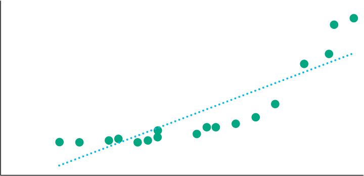

<!-- Picture Text: X  -->
> **Chú thích hình ảnh:** Trục tung $Y$, trục hoành $X$. Các điểm dữ liệu đi theo đường cong hàm mũ nhưng được khớp bằng một đường thẳng hồi quy tuyến tính.

Một hàm ý khác của giả định này là biến độc lập, $X$, không được mang tính ngẫu nhiên; nghĩa là nó mang tính phi ngẫu nhiên (*non-stochastic*). Nếu biến độc lập là ngẫu nhiên, sẽ không có mối quan hệ tuyến tính nào giữa biến phụ thuộc và biến độc lập. Mặc dù ban đầu chúng ta có thể giả định rằng biến độc lập trong mô hình hồi quy không phải là ngẫu nhiên, nhưng giả định đó không phải lúc nào cũng đúng.

Khi chúng ta nhìn vào phần dư của một mô hình, điều chúng ta muốn thấy là phần dư mang tính ngẫu nhiên. Phần dư không được thể hiện bất kỳ quy luật (*pattern*) nào khi được vẽ theo biến độc lập. Như chúng ta trình bày trong Hình 11, phần dư từ hồi quy tuyến tính ở Hình 10 dường như không ngẫu nhiên mà thay vào đó, chúng thể hiện một mối quan hệ với biến độc lập, $X$, giảm xuống trong một khoảng giá trị của $X$ và tăng lên trong một khoảng khác.

#### **Hình 11: Minh họa Phần dư trong một Mối quan hệ Phi tuyến tính được Ước lượng như một Mối quan hệ Tuyến tính**

<!-- Picture Text: Y  -->

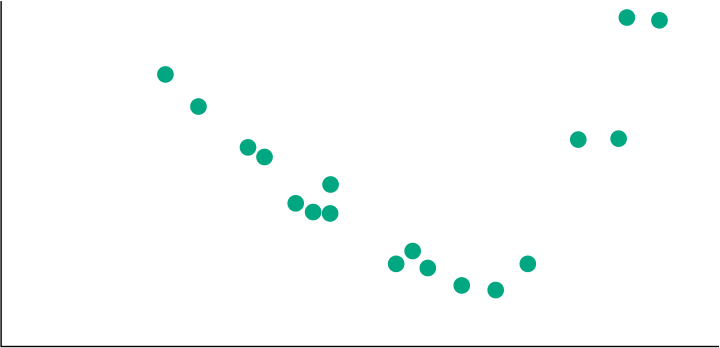

<!-- Picture Text: X  -->
> **Chú thích hình ảnh:** Đồ thị phần dư theo biến độc lập $X$ tạo thành hình chữ U (ban đầu dương, sau đó âm ở đoạn giữa, rồi lại tăng lên dương ở cuối), cho thấy vi phạm giả định tính tuyến tính.

<!-- PDF Page 285 -->

### **Giả định 2: Phương sai sai số không đổi (*Homoskedasticity*)**

Giả định 2, rằng phương sai của phần dư là như nhau đối với tất cả các quan sát, được gọi là giả định **phương sai sai số không đổi (*homoskedasticity*)**. Về mặt ký hiệu, giả định này liên quan đến bình phương phần dư:

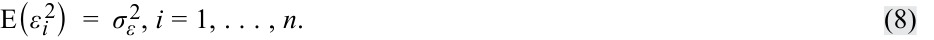

<!-- Formula Text: E(ε i 2)  =  σ ε 2, i = 1, . . . , n. (8) -->
$$E(\varepsilon_i^2) = \sigma_\varepsilon^2, \quad i = 1, \dots, n \tag{8}$$

Nếu phần dư không có phương sai không đổi, tức là nếu phương sai của phần dư khác nhau qua các quan sát, thì chúng ta gọi hiện tượng này là **phương sai sai số thay đổi (*heteroskedasticity*)**.

Giả sử bạn đang kiểm tra một chuỗi thời gian của lãi suất ngắn hạn với vai trò là biến phụ thuộc và tỷ lệ lạm phát với vai trò là biến độc lập trong vòng 16 năm. Chúng ta có thể tin rằng lãi suất ngắn hạn ($Y$) và tỷ lệ lạm phát ($X$) phải có liên hệ với nhau (tức là lãi suất cao hơn khi tỷ lệ lạm phát cao hơn). Nếu chuỗi thời gian này kéo dài nhiều năm, với các hành động khác nhau của ngân hàng trung ương buộc lãi suất ngắn hạn phải ở mức thấp (một cách nhân tạo) trong tám năm cuối của chuỗi, thì rất có khả năng phần dư trong mô hình ước lượng này sẽ có vẻ như đến từ hai mô hình khác nhau. Chúng ta sẽ gọi tám năm đầu tiên là Chế độ 1 (*Regime 1* – lãi suất bình thường) và tám năm thứ hai là Chế độ 2 (*Regime 2* – lãi suất thấp). Nếu mô hình có mức độ phù hợp khác nhau trong hai chế độ, phần dư và phương sai của chúng sẽ khác nhau.

Bạn có thể thấy tình huống này trong Hình 12, thể hiện biểu đồ phân tán với một đường hồi quy ước lượng. Hệ số góc của đường hồi quy trong cả 16 năm là 1,1979.

**Hình 12: Biểu đồ phân tán của Lãi suất ($Y$) và Tỷ lệ Lạm phát ($X$)**

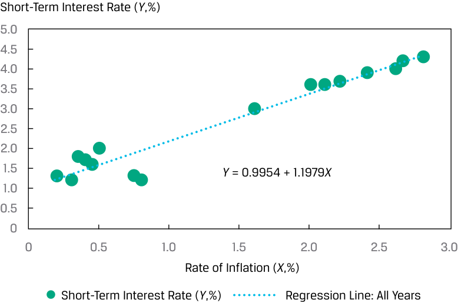

<!-- Picture Text: Short-Term Interest Rate ( Y ,%) 5.0 4.5 4.0 3.5 3.0 2.5 2.0 1.5 Y  = 0.9954 + 1.1979 X 1.0 0.5 0 0 0.5 1.0 1.5 2.0 2.5 3.0 Rate of Inflation ( X ,%) Short-Term Interest Rate ( Y ,%) Regression Line: All Years  -->
> **Chú thích hình ảnh:** Trục tung: Lãi suất ngắn hạn ($Y$, %). Trục hoành: Tỷ lệ lạm phát ($X$, %). Đường hồi quy cho tất cả các năm: $Y = 0.9954 + 1.1979X$.

Chúng ta vẽ đồ thị phần dư của mô hình này trong Hình 13 theo các năm. Trong đồ thị này, chúng ta chỉ ra khoảng cách hai độ lệch chuẩn tính từ mức 0 (giá trị trung bình của phần dư) cho phần dư của tám năm đầu tiên và sau đó làm tương tự cho tám năm thứ hai. Như bạn có thể thấy, phần dư có vẻ khác biệt giữa hai chế độ: sự biến thiên của phần dư trong tám năm đầu tiên nhỏ hơn nhiều so với sự biến thiên trong tám năm thứ hai.

<!-- PDF Page 286 -->

#### **Hình 13: Đồ thị Phần dư cho Mô hình Lãi suất ($Y$) theo Tỷ lệ Lạm phát ($X$)**

<!-- Picture Text: Residual (%) 1.0 0.8 0.6 0.4 0.2 0 –0.2 –0.4 –0.6 –0.8 –1.0 1 2 3 4 5 6 7 8 9 10 11 12 13 14 15 16 Year Residuals Regime 1 Residuals Regime 2 2 Standard Deviations below the Zero 2 Standard Deviations above the Zero  -->
> **Chú thích hình ảnh:** Trục tung: Phần dư (%). Trục hoành: Năm (từ 1 đến 16). Hiển thị Phần dư Chế độ 1 (Năm 1–8) có dải $\pm 2$ độ lệch chuẩn hẹp, và Phần dư Chế độ 2 (Năm 9–16) có dải $\pm 2$ độ lệch chuẩn rộng hơn nhiều.

Tại sao điều này lại xảy ra? Mô hình có vẻ hợp lý, nhưng khi chúng ta kiểm tra phần dư (Hình 13), một bước quan trọng trong việc đánh giá độ phù hợp của mô hình, chúng ta thấy rằng mô hình khớp tốt hơn ở một số năm so với những năm khác. Sự khác biệt về phương sai của phần dư giữa hai chế độ thể hiện rõ qua dải băng rộng hơn nhiều xung quanh phần dư của Chế độ 2 (giai đoạn lãi suất thấp). Điều này cho thấy sự vi phạm rõ ràng đối với giả định phương sai sai số không đổi (*homoskedasticity*).

Nếu chúng ta ước lượng một đường hồi quy cho từng chế độ, chúng ta có thể thấy rằng mô hình cho hai chế độ là khá khác nhau, như được trình bày trong Hình 14. Trong trường hợp Chế độ 1 (lãi suất bình thường), hệ số góc là 1,0247, trong khi ở Chế độ 2 (lãi suất thấp), hệ số góc là $-0,2805$. Tóm lại, sự phân cụm của phần dư thành hai nhóm có phương sai rất khác nhau chỉ ra rõ ràng sự tồn tại của các chế độ riêng biệt đối với mối quan hệ giữa lãi suất ngắn hạn và tỷ lệ lạm phát.

<!-- PDF Page 287 -->

#### **Hình 14: Các Đường hồi quy Ước lượng cho Hai Chế độ (*Two Regimes*)**

<!-- Picture Text: Short-Term Interest Rate ( Y ,%) 5.0 4.5 4.0 3.5 3.0 Regime 1: 2.5 Y  = 1.4372 + 1.0247 X 2.0 1.5 1.0 Regime 2: 0.5 Y  = 1.6440 – 0.2805 X 0 0 0.5 1.0 1.5 2.0 2.5 3.0 Rate of Inflation ( X ,%) Regime 1 Regime 1 Regression Line Regime 2 Regime 2 Regression Line  -->
> **Chú thích hình ảnh:** Trục tung: Lãi suất ngắn hạn ($Y$, %). Trục hoành: Tỷ lệ lạm phát ($X$, %). Đường hồi quy Chế độ 1: $Y = 1.4372 + 1.0247X$. Đường hồi quy Chế độ 2: $Y = 1.6440 - 0.2805X$.

### **Giả định 3: Tính độc lập (*Independence*)**

Chúng ta giả định rằng các quan sát (các cặp $Y$ và $X$) không tương quan với nhau, nghĩa là chúng độc lập với nhau. Nếu có sự tương quan giữa các quan sát (tức là tự tương quan – *autocorrelation*), chúng không độc lập và các phần dư sẽ tương quan với nhau. Giả định rằng các phần dư không tương quan qua các quan sát cũng rất cần thiết để ước lượng chính xác phương sai của các **tham số ước lượng (*estimated parameters*)** của $b_0$ và $b_1$ (tức là $\hat{b}_0$ và $\hat{b}_1$) mà chúng ta sử dụng trong các kiểm định giả thuyết cho hệ số chặn và hệ số góc tương ứng. Điều quan trọng là phải kiểm tra xem liệu phần dư có thể hiện một quy luật (*pattern*) nào đó hay không, điều gợi ý sự vi phạm giả định này. Do đó, chúng ta cần kiểm tra trực quan và kiểm tra thống kê đối với phần dư của một mô hình hồi quy.

Hãy xem xét doanh thu hàng quý của một công ty được hồi quy qua 40 quý, như trình bày trong Hình 15, kèm theo đường hồi quy. Rõ ràng là các mức doanh thu này thể hiện một quy luật mang tính thời vụ (*seasonal pattern*), một dấu hiệu chỉ báo của hiện tượng tự tương quan (*autocorrelation*).

<!-- PDF Page 288 -->

**Hình 15: Hồi quy Doanh thu Hàng quý theo Thời gian (40 Quý)**

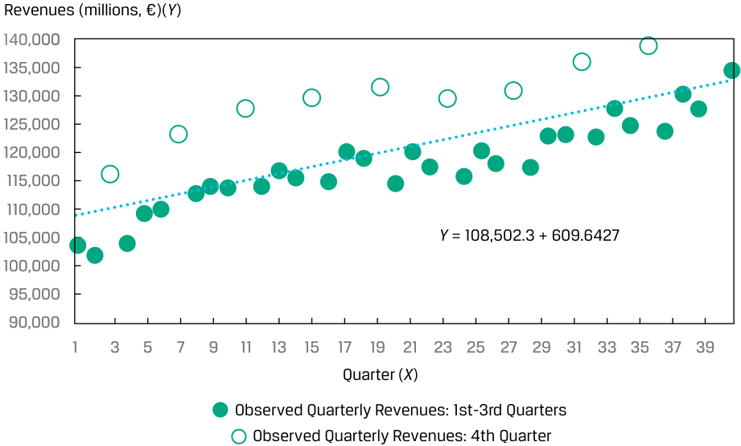

<!-- Picture Text: Revenues (millions, €)( Y ) 140,000 135,000 130,000 125,000 120,000 115,000 110,000 105,000 Y  = 108,502.3 + 609.6427 100,000 95,000 90,000 1 3 5 7 9 11 13 15 17 19 21 23 25 27 29 31 33 35 37 39 Quarter ( X ) Observed Quarterly Revenues: 1st-3rd Quarters Observed Quarterly Revenues: 4th Quarter  -->
> **Chú thích hình ảnh:** Trục tung: Doanh thu (triệu €) ($Y$). Trục hoành: Quý ($X$, từ 1 đến 40). Đường hồi quy: $Y = 108,502.3 + 609.6427X$. Doanh thu quan sát của Quý 4 luôn vọt lên cao hơn hẳn so với Quý 1–3.

Trong Hình 16, chúng ta vẽ đồ thị phần dư từ mô hình này và thấy rằng có một quy luật lặp lại. Các phần dư này có tương quan với nhau, cụ thể là nhảy vọt lên vào Quý 4 và sau đó giảm trở lại vào quý tiếp theo. Tóm lại, các quy luật trong cả Hình 15 và Hình 16 đều cho thấy sự vi phạm giả định về tính độc lập.

**Hình 16: Đồ thị Phần dư cho Mô hình Doanh thu Hàng quý theo Thời gian**

<!-- Picture Text: Residuals (millions, €) 15,000 10,000 5,000 0 –5,000 –10,000 1 3 5 7 9 11 13 15 17 19 21 23 25 27 29 31 33 35 37 39 Quarter Residuals: 1st-3rd Quarters Residuals: 4th Quarter  -->
> **Chú thích hình ảnh:** Trục tung: Phần dư (triệu €). Trục hoành: Quý (từ 1 đến 40). Phần dư của Quý 1–3 luôn âm hoặc thấp, trong khi phần dư của Quý 4 luôn dương cao (khoảng $+10,000$).

### **Giả định 4: Tính phân phối chuẩn (*Normality*)**

Giả định về tính phân phối chuẩn đòi hỏi phần dư phải có phân phối chuẩn. Điều này không có nghĩa là biến phụ thuộc và biến độc lập phải có phân phối chuẩn; nó chỉ có nghĩa là phần dư từ mô hình có phân phối chuẩn. Tuy nhiên, khi ước lượng bất kỳ mô hình nào, thông lệ tốt là cần hiểu rõ phân phối của

<!-- PDF Page 289 -->

biến phụ thuộc và biến độc lập để dò tìm các giá trị ngoại lai (*outliers*). Một giá trị ngoại lai ở một hoặc cả hai biến số có thể ảnh hưởng đáng kể đến đường thẳng ước lượng đến mức mô hình ước lượng sẽ không còn khớp tốt đối với hầu hết các quan sát khác.

Với phần dư có phân phối chuẩn, chúng ta có thể kiểm định một giả thuyết cụ thể về mô hình hồi quy tuyến tính. Đối với các cỡ mẫu lớn, chúng ta có thể bỏ qua giả định về tính phân phối chuẩn bằng cách dựa vào định lý giới hạn trung tâm (*central limit theorem*); lý thuyết tiệm cận (*asymptotic theory* – xử lý các mẫu lớn) chỉ ra rằng trong nhiều trường hợp, các thống kê kiểm định (*test statistics*) được tạo ra bởi các chương trình hồi quy tiêu chuẩn vẫn hợp lệ ngay cả khi phần dư của mô hình không có phân phối chuẩn.

#### **BỘ CÂU HỎI (*QUESTION SET*)**

Một nhà phân tích đang nghiên cứu doanh thu của một công ty và ước lượng một mô hình chuỗi thời gian tuyến tính đơn bằng cách hồi quy doanh thu theo thời gian, trong đó thời gian—$1, 2, \dots, 15$—được đo bằng năm. Cô vẽ đồ thị doanh thu quan sát được của công ty và đường hồi quy ước lượng, như trình bày trong Hình 17. Cô cũng vẽ đồ thị phần dư từ mô hình hồi quy này, như trình bày trong Hình 18.

#### **Hình 17: Doanh thu theo Thời gian sử dụng Hồi quy Tuyến tính Đơn**

<!-- Picture Text: Revenues (millions, €)( Y ) 900 800 700 600 500 400 300 200 100 0 1 2 3 4 5 6 7 8 9 10 11 12 13 14 15 Year ( X ) Observed Revenues Linear Prediction of Revenues  -->
> **Chú thích hình ảnh:** Trục tung: Doanh thu (triệu €) ($Y$). Trục hoành: Năm ($X$, từ 1 đến 15). Hiển thị Doanh thu quan sát (*Observed Revenues* - tăng theo đường cong) và Dự báo tuyến tính của doanh thu (*Linear Prediction of Revenues* - đường thẳng).

#### **Hình 18: Đồ thị Phần dư của Doanh thu theo Thời gian**

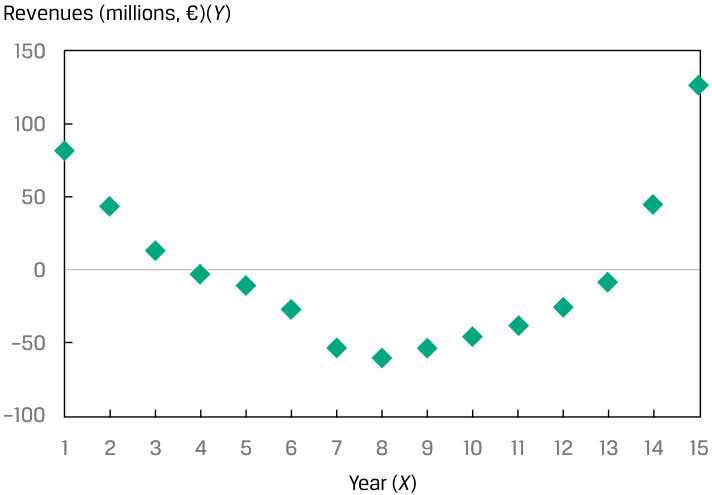

<!-- Picture Text: Revenues (millions, €)( Y ) 150 100 50 0 –50 –100 1 2 3 4 5 6 7 8 9 10 11 12 13 14 15 Year ( X )  -->
> **Chú thích hình ảnh:** Trục tung: Phần dư doanh thu (triệu €). Trục hoành: Năm ($X$, từ 1 đến 15). Các điểm phần dư tạo thành đường cong hình chữ U rõ rệt.

---

# Tập 1: Các Phương pháp Định lượng (*Quantitative Methods*)
## Học phần 10: Hồi quy Tuyến tính Đơn (*Simple Linear Regression*)
### Phần 3/6: Kiểm định Giả thuyết trong Mô hình Hồi quy Tuyến tính Đơn (Trang PDF 290–302)

---

<!-- PDF Page 290 -->

1. Dựa trên Hình 17 và Hình 18, hãy mô tả (các) giả định nào của hồi quy tuyến tính đơn mà mô hình của nhà phân tích có thể đang vi phạm.

###### **Lời giải:**

Mô hình đúng không phải là tuyến tính, như thấy rõ từ quy luật của doanh thu trong Hình 17. Trong những năm đầu (tức là năm 1 và 2) và những năm cuối (tức là năm 14 và 15), mô hình tuyến tính ước lượng thấp hơn thực tế (*underestimates*) doanh thu, trong khi đối với những năm ở giữa (tức là năm 7–11), mô hình tuyến tính lại ước lượng cao hơn thực tế (*overestimates*) doanh thu. Hơn nữa, quy luật cong của phần dư trong Hình 18 cho thấy khả năng có phương sai sai số thay đổi (*heteroskedasticity* – phần dư có phương sai không bằng nhau), thiếu tính độc lập giữa các quan sát (*lack of independence*), và không tuân theo phân phối chuẩn (*non-normality* – một mối quan ngại do cỡ mẫu nhỏ $n = 15$). Tóm lại, nhà phân tích cần lo ngại rằng mô hình của cô ấy vi phạm tất cả các giả định chi phối hồi quy tuyến tính đơn (tính tuyến tính, phương sai sai số không đổi, tính độc lập và tính phân phối chuẩn).

# **<mark>4</mark>**

### **KIỂM ĐỊNH GIẢ THUYẾT TRONG MÔ HÌNH HỒI QUY TUYẾN TÍNH ĐƠN (*HYPOTHESIS TESTS IN THE SIMPLE LINEAR REGRESSION MODEL*)**

- tính toán và diễn giải các thước đo mức độ phù hợp (*measures of fit*) cũng như thiết lập và đánh giá các kiểm định mức độ phù hợp (*tests of fit*) và kiểm định các hệ số hồi quy trong hồi quy tuyến tính đơn

#### **Phân tích Phương sai (*Analysis of Variance*)**

Mô hình hồi quy tuyến tính đơn đôi khi mô tả mối quan hệ giữa hai biến số khá tốt, nhưng đôi khi lại không. Chúng ta phải có khả năng phân biệt giữa hai trường hợp này để sử dụng phân tích hồi quy một cách hiệu quả. Hãy nhớ rằng mục tiêu của chúng ta là giải thích sự biến thiên của biến phụ thuộc. Vậy mục tiêu này đã đạt được tốt đến mức nào, với lựa chọn biến độc lập của chúng ta?

##### **_Phân rã Tổng Bình phương Toàn phần thành các Thành phần của Nó (*Breaking Down the Sum of Squares Total into Its Components*)_**

Chúng ta bắt đầu với tổng bình phương toàn phần (*sum of squares total* – SST) và sau đó chia nó thành hai phần: tổng bình phương sai số (*sum of squares error* – SSE) và **tổng bình phương hồi quy (*sum of squares regression* – SSR)**. Tổng bình phương hồi quy là tổng bình phương các chênh lệch giữa giá trị dự báo của biến phụ thuộc, $\hat{Y}_i$, dựa trên đường hồi quy ước lượng, và giá trị trung bình của biến phụ thuộc, $\bar{Y}$:

<!-- Formula Text: ∑ i=1 n ( ˆ Y  i − _ Y ) 2. (9) -->
$$\text{SSR} = \sum_{i=1}^{n} (\hat{Y}_i - \bar{Y})^2 \tag{9}$$

Chúng ta đã định nghĩa tổng bình phương toàn phần (SST), là tổng biến thiên trong $Y$, và tổng bình phương sai số (SSE), là phần biến thiên không được giải thích (*unexplained variation*) trong $Y$. Lưu ý rằng tổng bình phương hồi quy (SSR) là phần biến thiên được giải thích (*explained variation*) trong $Y$. Do đó, như được minh họa trong Hình 19, $\text{SST} = \text{SSR} + \text{SSE}$, nghĩa là tổng biến thiên trong $Y$ bằng phần biến thiên được giải thích trong $Y$ cộng với phần biến thiên không được giải thích trong $Y$.

<!-- PDF Page 291 -->

**Hình 19: Phân rã Sự biến thiên của Biến phụ thuộc (*Breakdown of Variation of Dependent Variable*)**

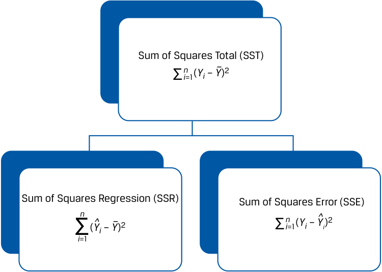

<!-- Picture Text: Sum of Squares Total (SST) Σ ni =1( Yi  –  Y– ) 2 Sum of Squares Regression (SSR) Sum of Squares Error (SSE) n ^ ^ – n Σ( Yi  –  Y ) 2 Σ i =1( Yi  –  Yi ) 2 i =1  -->
> **Chú thích hình ảnh:** Tổng bình phương toàn phần ($\text{SST} = \sum_{i=1}^n (Y_i - \bar{Y})^2$) được chia thành hai nhánh: Tổng bình phương hồi quy ($\text{SSR} = \sum_{i=1}^n (\hat{Y}_i - \bar{Y})^2$) và Tổng bình phương sai số ($\text{SSE} = \sum_{i=1}^n (Y_i - \hat{Y}_i)^2$).

Chúng ta trình bày sự phân rã công thức tổng bình phương toàn phần cho ví dụ hồi quy ROA của chúng ta trong Bảng 20. Tổng biến thiên của ROA mà chúng ta muốn giải thích (SST) là 239,50. Con số này bao gồm phần biến thiên không được giải thích (SSE) là 47,88, và phần biến thiên được giải thích (SSR) là 191,63. Các giá trị tổng bình phương này là các dữ liệu đầu vào quan trọng cho các thước đo mức độ phù hợp của đường hồi quy.

**Bảng 20: Phân rã Tổng Bình phương Toàn phần cho Mô hình ROA**

|**Công ty (*Company*)**|**ROA ($Y_i$)**|**CAPEX ($X_i$)**|**ROA dự báo ($\hat{Y}_i$)**|**Biến thiên cần giải thích $(Y_i - \bar{Y})^2$**|**Biến thiên không được giải thích $(Y_i - \hat{Y}_i)^2$**|**Biến thiên được giải thích $(\hat{Y}_i - \bar{Y})^2$**|
|---|---|---|---|---|---|---|
|A|6.0|0.7|5.750|42.25|0.063|45.563|
|B|4.0|0.4|5.375|72.25|1.891|50.766|
|C|15.0|5.0|11.125|6.25|15.016|1.891|
|D|20.0|10.0|17.375|56.25|6.891|23.766|
|E|10.0|8.0|14.875|6.25|23.766|5.641|
|F|20.0|12.5|20.500|56.25|0.250|64.000|
|||||239.50|47.88|191.625|
|Trung bình (*Mean*)|12.50||||||

*Tổng bình phương toàn phần (SST) = 239.50. Tổng bình phương sai số (SSE) = 47.88. Tổng bình phương hồi quy (SSR) = 191.63.*

#### **Các Thước đo Mức độ Phù hợp (*Measures of Goodness of Fit*)**

Chúng ta có thể sử dụng một số thước đo để đánh giá mức độ phù hợp (*goodness of fit*)—tức là mô hình hồi quy khớp với dữ liệu tốt đến mức nào. Những thước đo này bao gồm hệ số xác định (*coefficient of determination*), thống kê $F$ (*$F$-statistic*) cho kiểm định mức độ phù hợp, và sai số chuẩn của hồi quy (*standard error of the regression*).

<!-- PDF Page 292 -->

**Hệ số xác định (*coefficient of determination* – $R^2$)**, còn được gọi là $R$-bình phương (*$R$-squared*), là tỷ lệ phần trăm sự biến thiên của biến phụ thuộc được giải thích bởi biến độc lập:

<!-- Formula Text: Coefficient of determination = Sum of squares regression ___________________ Sum of squares total Coefficient of determination = ∑ i=1 n (ˆ Y i − _ Y ) 2 ___________ ∑ i=1 n (Y i − _ Y ) 2 . (10) -->
$$\text{Hệ số xác định } (R^2) = \frac{\text{Tổng bình phương hồi quy (SSR)}}{\text{Tổng bình phương toàn phần (SST)}} = \frac{\sum_{i=1}^{n} (\hat{Y}_i - \bar{Y})^2}{\sum_{i=1}^{n} (Y_i - \bar{Y})^2} \tag{10}$$

Theo cách xây dựng, hệ số xác định nằm trong khoảng từ 0% đến 100%. Trong ví dụ ROA của chúng ta, hệ số xác định là $191.625 \div 239.50$, hay $0.8001$, nghĩa là 80,01% sự biến thiên trong ROA được giải thích bởi CAPEX. Trong hồi quy tuyến tính đơn, bình phương của hệ số tương quan cặp bằng với hệ số xác định:

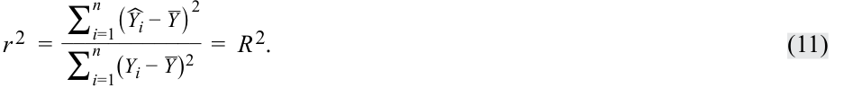

<!-- Formula Text: r 2  = ∑ i=1 n (ˆ Y i − _ Y ) 2 ____________ ∑ i=1 n (Y i − _ Y ) 2 =  R 2. (11) -->
$$r^2 = \frac{\sum_{i=1}^{n} (\hat{Y}_i - \bar{Y})^2}{\sum_{i=1}^{n} (Y_i - \bar{Y})^2} = R^2 \tag{11}$$

Trong phân tích hồi quy ROA trước đó của chúng ta, $r = 0.8945$, vì vậy bây giờ chúng ta thấy rằng $r^2$ thực sự bằng hệ số xác định ($R^2$), vì $(0.8945)^2 = 0.8001$.

Mặc dù hệ số xác định—phần biến thiên của biến phụ thuộc được giải thích bởi biến độc lập—mang tính mô tả, nhưng nó không phải là một kiểm định thống kê. Để xem liệu mô hình hồi quy của chúng ta có khả năng mang ý nghĩa thống kê hay không, chúng ta sẽ cần xây dựng một thống kê kiểm định có phân phối $F$ (*$F$-distributed test statistic*).

Nhìn chung, chúng ta sử dụng một thống kê kiểm định có phân phối $F$ để so sánh hai phương sai. Trong phân tích hồi quy, chúng ta có thể sử dụng thống kê kiểm định có phân phối $F$ để kiểm định xem liệu các hệ số góc trong một hồi quy có bằng 0 hay không, với các hệ số góc được ký hiệu là $b_i$, đối lập với giả thuyết đối rằng có ít nhất một hệ số góc khác 0:

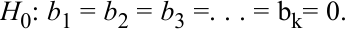

<!-- Formula Text: H0: b1 = b2 = b3 =. . . = bk= 0. -->
$$H_0: b_1 = b_2 = b_3 = \dots = b_k = 0$$

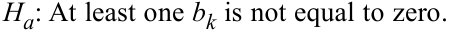

<!-- Formula Text: Ha: At least one bk is not equal to zero. -->
$$H_a: \text{Có ít nhất một } b_k \text{ khác } 0$$

Đối với hồi quy tuyến tính đơn, các giả thuyết này được đơn giản hóa thành:

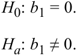

<!-- Formula Text: H0: b1 = 0. Ha: b1 ≠ 0. -->
$$H_0: b_1 = 0$$
$$H_a: b_1 \neq 0$$

Thống kê kiểm định có phân phối $F$ được xây dựng bằng cách sử dụng tổng bình phương hồi quy (SSR) và tổng bình phương sai số (SSE), mỗi đại lượng được điều chỉnh theo bậc tự do (*degrees of freedom*); nói cách khác, nó là tỷ số của hai phương sai. Chúng ta chia tổng bình phương hồi quy cho số lượng biến độc lập, được ký hiệu là $k$. Trong trường hợp hồi quy tuyến tính đơn, $k = 1$, vì vậy chúng ta thu được **trung bình bình phương hồi quy (*mean square regression* – MSR)**, có giá trị bằng chính tổng bình phương hồi quy:

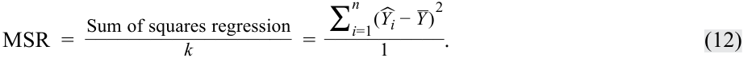

<!-- Formula Text: MSR  = Sum of squares regression ___________________ k = ∑ i=1 n (ˆ Y i − _ Y ) 2 ___________ 1 . (12) -->
$$\text{MSR} = \frac{\text{Tổng bình phương hồi quy (SSR)}}{k} = \frac{\sum_{i=1}^{n} (\hat{Y}_i - \bar{Y})^2}{1} \tag{12}$$

Vì vậy, đối với hồi quy tuyến tính đơn:

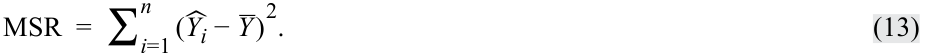

<!-- Formula Text: MSR  =  ∑ i=1 n (ˆ Y i − _ Y ) 2. (13) -->
$$\text{MSR} = \sum_{i=1}^{n} (\hat{Y}_i - \bar{Y})^2 \tag{13}$$

Tiếp theo, chúng ta tính **trung bình bình phương sai số (*mean square error* – MSE)**, bằng tổng bình phương sai số chia cho bậc tự do là $n - k - 1$. Trong hồi quy tuyến tính đơn, $n - k - 1$ trở thành $n - 2$:

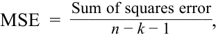

<!-- Formula Text: MSE  = Sum of squares error _______________ n − k − 1 , -->
$$\text{MSE} = \frac{\text{Tổng bình phương sai số (SSE)}}{n - k - 1}$$

<!-- PDF Page 293 -->

<!-- Formula Text: MSE  = ∑ i=1 n (Y i − ˆ Y i) 2 ___________ n − 2 . -->

<!-- Formula Text: (14) -->
$$\text{MSE} = \frac{\sum_{i=1}^{n} (Y_i - \hat{Y}_i)^2}{n - 2} \tag{14}$$

Do đó, thống kê kiểm định có phân phối $F$ ($\text{MSR}/\text{MSE}$) là:

<!-- Formula Text: F  = Sum of squares regression ___________________ k ________________ Sum of squares error _______________ n − k − 1 =   MSR _ MSE , F  = ∑ i=1 n ( ˆ Y  i − _ Y ) 2 ____________ 1 ___________ ∑ i=1 n (Y i −  ˆ Y  i) 2 ____________ n − 2 , (15) -->
$$F = \frac{\frac{\text{Tổng bình phương hồi quy}}{k}}{\frac{\text{Tổng bình phương sai số}}{n - k - 1}} = \frac{\text{MSR}}{\text{MSE}}, \quad F = \frac{\frac{\sum_{i=1}^{n} (\hat{Y}_i - \bar{Y})^2}{1}}{\frac{\sum_{i=1}^{n} (Y_i - \hat{Y}_i)^2}{n - 2}} \tag{15}$$

phân phối theo 1 và $n - 2$ bậc tự do trong hồi quy tuyến tính đơn. Thống kê $F$ trong phân tích hồi quy là kiểm định một phía (*one sided*), với miền bác bỏ (*rejection region*) nằm ở phía bên phải, bởi vì chúng ta quan tâm đến việc liệu phần biến thiên trong $Y$ được giải thích (tử số) có lớn hơn phần biến thiên trong $Y$ không được giải thích (mẫu số) hay không.

#### **Kiểm định Giả thuyết cho Từng Hệ số Hồi quy Riêng lẻ (*Hypothesis Testing of Individual Regression Coefficients*)**

##### **_Kiểm định Giả thuyết đối với Hệ số góc (*Hypothesis Tests of the Slope Coefficient*)_**

Chúng ta có thể sử dụng thống kê $F$ để kiểm định ý nghĩa thống kê của hệ số góc (tức là liệu nó có khác 0 một cách có ý nghĩa thống kê hay không), nhưng chúng ta cũng có thể muốn thực hiện các kiểm định giả thuyết khác cho hệ số góc—ví dụ: kiểm định xem hệ số góc tổng thể có khác một giá trị cụ thể nào đó hay không hoặc liệu hệ số góc có dương hay không. Chúng ta có thể sử dụng thống kê kiểm định có phân phối $t$ (*$t$-distributed test statistic*) để kiểm định các giả thuyết như vậy về một hệ số hồi quy.

Giả sử chúng ta muốn kiểm tra định giá của một cổ phiếu bằng cách sử dụng mô hình thị trường (*market model*); chúng ta đặt giả thuyết rằng cổ phiếu có rủi ro hệ thống (*systematic risk*) ở mức trung bình (tức là rủi ro tương tự như rủi ro của thị trường), được đại diện bởi hệ số gắn với biến tỷ suất sinh lợi thị trường. Hoặc chúng ta có thể muốn kiểm định giả thuyết rằng dự báo của các nhà kinh tế học về tỷ lệ lạm phát là không chệch (*unbiased* – tức là xét trung bình, không ước lượng cao hơn hay thấp hơn tỷ lệ lạm phát thực tế). Trong mỗi trường hợp, bằng chứng có ủng hộ giả thuyết đó không? Những câu hỏi như thế này có thể được giải quyết bằng các kiểm định giả thuyết đối với hệ số góc hồi quy. Để kiểm định một giả thuyết về hệ số góc, chúng ta tính toán thống kê kiểm định bằng cách lấy hệ số góc ước lượng ($\hat{b}_1$) trừ đi hệ số góc tổng thể theo giả thuyết ($B_1$) và sau đó chia hiệu số này cho sai số chuẩn của hệ số góc, $s_{\hat{b}_1}$:

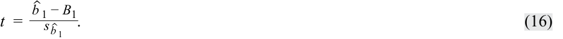

<!-- Formula Text: t  = ˆ b  1 − B 1 _ s  ˆ b  1  . (16) -->
$$t = \frac{\hat{b}_1 - B_1}{s_{\hat{b}_1}} \tag{16}$$

Thống kê kiểm định này có phân phối $t$ với $n - k - 1$ hoặc $n - 2$ bậc tự do bởi vì có hai tham số (một hệ số chặn và một hệ số góc) đã được ước lượng trong hồi quy.

**Sai số chuẩn của hệ số góc (*standard error of the slope coefficient* – $s_{\hat{b}_1}$)** đối với hồi quy tuyến tính đơn là tỷ số giữa sai số chuẩn của ước lượng của mô hình ($s_e$), sẽ được giới thiệu sau, với căn bậc hai của sự biến thiên của biến độc lập:

<!-- Formula Text: s  ˆ b  1  = s e ____________ √ _____________ ∑ i=1 n (X i − _ X ) 2 . (17) -->
$$s_{\hat{b}_1} = \frac{s_e}{\sqrt{\sum_{i=1}^{n} (X_i - \bar{X})^2}} \tag{17}$$

Chúng ta so sánh thống kê $t$ tính được với các giá trị tới hạn (*critical values*) để kiểm định giả thuyết. Lưu ý rằng mức độ biến thiên của biến độc lập càng lớn thì sai số chuẩn của hệ số góc càng thấp (Phương trình 17) và do đó thống kê $t$ tính được càng lớn (Phương trình 16). Nếu thống kê $t$ tính được nằm ngoài phạm vi của các giá trị $t$ tới hạn, chúng ta bác bỏ giả thuyết không (*reject the null hypothesis*), nhưng nếu thống kê $t$ tính được nằm trong phạm vi của các giá trị tới hạn, chúng ta không bác bỏ giả thuyết không (*fail to reject the null hypothesis*). Tương tự như kiểm định giá trị trung bình, giả thuyết đối (*alternative hypothesis*) có thể là hai phía (*two sided*) hoặc một phía (*one sided*).

<!-- PDF Page 294 -->

Hãy xem xét ví dụ hồi quy tuyến tính đơn trước đó của chúng ta với ROA là biến phụ thuộc và CAPEX là biến độc lập. Giả sử chúng ta muốn kiểm định xem liệu hệ số góc của CAPEX có khác 0 hay không nhằm xác nhận trực giác của chúng ta về một mối quan hệ có ý nghĩa thống kê giữa ROA và CAPEX. Chúng ta có thể kiểm định giả thuyết liên quan đến hệ số góc bằng quy trình sáu bước, như được trình bày trong Bảng 21. Kết quả của kiểm định này là chúng ta kết luận rằng hệ số góc khác 0; nghĩa là CAPEX là một biến giải thích có ý nghĩa thống kê đối với ROA.

**Bảng 21: Kiểm định Hệ số góc cho Hồi quy của ROA theo CAPEX**

|**Bước 1**|Phát biểu các giả thuyết.|$H_0: b_1 = 0$ đối lập với $H_a: b_1 \neq 0$|
|---|---|---|
|**Bước 2**|Xác định thống kê kiểm định phù hợp.|$t = \frac{\hat{b}_1 - B_1}{s_{\hat{b}_1}}$ với $6 - 2 = 4$ bậc tự do.|
|**Bước 3**|Xác định mức ý nghĩa (*level of significance*).|$\alpha = 5\%$.|
|**Bước 4**|Phát biểu quy tắc quyết định (*decision rule*).|Giá trị $t$ tới hạn (*Critical $t$-values*) $= \pm 2.776$. Chúng ta có thể xác định giá trị này từ: **Excel:** *Giới hạn dưới (Lower):* `T.INV(0.025,4)` *Giới hạn trên (Upper):* `T.INV(0.975,4)` **R:** `qt(c(.025,.975),4)` **Python:** `from scipy.stats import t` *Giới hạn dưới (Lower):* `t.ppf(.025,4)` *Giới hạn trên (Upper):* `t.ppf(.975,4)` Chúng ta bác bỏ giả thuyết không nếu thống kê $t$ tính được nhỏ hơn $-2.776$ hoặc lớn hơn $+2.776$.|
|**Bước 5**|Tính toán thống kê kiểm định.|Hệ số góc là $1.25$ (Bảng 6). Trung bình bình phương sai số (MSE) là $11.96875$ (Bảng 33). Sự biến thiên của CAPEX là $122.640$ (Bảng 6). $s_e = \sqrt{11.96875} = 3.459588$. $s_{\hat{b}_1} = \frac{3.459588}{\sqrt{122.640}} = 0.312398$. $t = \frac{1.25 - 0}{0.312398} = 4.00131$.|
|**Bước 6**|Đưa ra quyết định.|Bác bỏ giả thuyết không về hệ số góc bằng 0. Có đủ bằng chứng cho thấy hệ số góc khác 0.|

Một đặc điểm của hồi quy tuyến tính đơn là thống kê $t$ được sử dụng để kiểm định xem hệ số góc có bằng 0 hay không và thống kê $t$ để kiểm định xem hệ số tương quan cặp có bằng 0 hay không (tức là $H_0: \rho = 0$ đối lập với $H_a: \rho \neq 0$) có cùng một giá trị. Giống như kiểm định hệ số góc, cả giả thuyết đối hai phía và một phía đều có thể áp dụng cho kiểm định hệ số tương quan—ví dụ: $H_0: \rho \le 0$ đối lập với $H_a: \rho > 0$. Thống kê kiểm định để kiểm tra xem hệ số tương quan có bằng 0 hay không như sau:

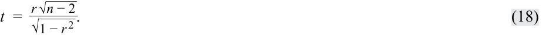

<!-- Formula Text: t  =   r √ _ n − 2 _ √ _ 1 − r 2  . (18) -->
$$t = \frac{r\sqrt{n - 2}}{\sqrt{1 - r^2}} \tag{18}$$

Trong ví dụ ROA được hồi quy theo CAPEX của chúng ta, hệ số tương quan ($r$) là $0.8945$. Để kiểm định xem hệ số tương quan này có khác 0 hay không, chúng ta thực hiện kiểm định giả thuyết được trình bày trong Bảng 22. Như bạn có thể thấy, chúng ta rút ra một kết luận tương tự như kết luận cho kiểm định hệ số góc của chúng ta, nhưng được diễn đạt theo mối tương quan giữa ROA và CAPEX: Có mối tương quan có ý nghĩa thống kê giữa ROA và CAPEX.

<!-- PDF Page 295 -->

**Bảng 22: Kiểm định Hệ số tương quan giữa ROA và CAPEX**

|**Bước 1**|Phát biểu các giả thuyết.|$H_0: \rho = 0$ đối lập với $H_a: \rho \neq 0$|
|---|---|---|
|**Bước 2**|Xác định thống kê kiểm định phù hợp.|$t = \frac{r\sqrt{n - 2}}{\sqrt{1 - r^2}}$ với $6 - 2 = 4$ bậc tự do.|
|**Bước 3**|Xác định mức ý nghĩa.|$\alpha = 5\%$.|
|**Bước 4**|Phát biểu quy tắc quyết định.|Giá trị $t$ tới hạn $= \pm 2.776$. Bác bỏ giả thuyết không nếu thống kê $t$ tính được nhỏ hơn $-2.776$ hoặc lớn hơn $+2.776$.|
|**Bước 5**|Tính toán thống kê kiểm định.|$t = \frac{0.8945\sqrt{4}}{\sqrt{1 - 0.8001}} = 4.00163$.|
|**Bước 6**|Đưa ra quyết định.|Bác bỏ giả thuyết không về việc không có tương quan. Có đủ bằng chứng cho thấy hệ số tương quan giữa ROA và CAPEX khác 0.|

Một đặc điểm thú vị khác của hồi quy tuyến tính đơn là thống kê kiểm định được sử dụng để kiểm định mức độ phù hợp của mô hình (tức là thống kê kiểm định có phân phối $F$) có liên hệ với thống kê $t$ tính được dùng để kiểm định xem hệ số góc có bằng 0 hay không: $t^2 = F$; do đó, $4.00131^2 = 16.0104$.

Điều gì sẽ xảy ra nếu thay vào đó chúng ta muốn kiểm định xem liệu có mối quan hệ một-đối-một (*one-to-one relationship*) giữa ROA và CAPEX hay không, ngụ ý hệ số góc bằng $1.0$? Các giả thuyết sẽ trở thành $H_0: b_1 = 1$ và $H_a: b_1 \neq 1$. Thống kê $t$ tính được như sau:

<!-- Formula Text: t  =   1.25 − 1 _ 0.312398   =  0.80026. -->
$$t = \frac{1.25 - 1}{0.312398} = 0.80026$$

Thống kê kiểm định tính được này nằm trong phạm vi của các giá trị tới hạn, $\pm 2.776$, vì vậy chúng ta không bác bỏ giả thuyết không: Không có đủ bằng chứng để chỉ ra rằng hệ số góc khác $1.0$.

Điều gì sẽ xảy ra nếu thay vào đó chúng ta muốn kiểm định xem liệu có hệ số góc dương hay tương quan dương như trực giác của chúng ta gợi ý hay không? Trong trường hợp này, tất cả các bước đều giống như trong Bảng 21 và Bảng 22 ngoại trừ các giá trị tới hạn bởi vì đây là các kiểm định một phía. Đối với kiểm định hệ số góc dương hoặc tương quan dương, giá trị tới hạn tại mức ý nghĩa 5% là $+2.132$. Chúng ta trình bày kiểm định giả thuyết cho hệ số góc dương và tương quan dương trong Bảng 23. Kết luận của chúng ta là có đủ bằng chứng để ủng hộ cả hệ số góc dương và tương quan dương.

**Bảng 23: Kiểm định Một phía cho Hệ số góc và Hệ số tương quan**

|||**Kiểm định Hệ số góc (*Test of the Slope*)**|**Kiểm định Hệ số tương quan (*Test of the Correlation*)**|
|---|---|---|---|
|**Bước 1**|Phát biểu các giả thuyết.|$H_0: b_1 \le 0$ đối lập với $H_a: b_1 > 0$|$H_0: \rho \le 0$ đối lập với $H_a: \rho > 0$|
|**Bước 2**|Xác định thống kê kiểm định phù hợp.|$t = \frac{\hat{b}_1 - B_1}{s_{\hat{b}_1}}$ với $6 - 2 = 4$ bậc tự do.|$t = \frac{r\sqrt{n - 2}}{\sqrt{1 - r^2}}$ với $6 - 2 = 4$ bậc tự do.|
|**Bước 3**|Xác định mức ý nghĩa.|$\alpha = 5\%$.|$\alpha = 5\%$.|
|**Bước 4**|Phát biểu quy tắc quyết định.|Giá trị $t$ tới hạn $= 2.132$. Bác bỏ giả thuyết không nếu thống kê $t$ tính được lớn hơn $2.132$.|Giá trị $t$ tới hạn $= 2.132$. Bác bỏ giả thuyết không nếu thống kê $t$ tính được lớn hơn $2.132$.|

<!-- PDF Page 296 -->

|||**Kiểm định Hệ số góc (*Test of the Slope*)**|**Kiểm định Hệ số tương quan (*Test of the Correlation*)**|
|---|---|---|---|
|**Bước 5**|Tính toán thống kê kiểm định.|$t = \frac{1.25 - 0}{0.312398} = 4.00131$|$t = \frac{0.8945\sqrt{4}}{\sqrt{1 - 0.8001}} = 4.00131$|
|**Bước 6**|Đưa ra quyết định.|Bác bỏ giả thuyết không. Có đủ bằng chứng cho thấy hệ số góc lớn hơn 0.|Bác bỏ giả thuyết không. Có đủ bằng chứng cho thấy hệ số tương quan lớn hơn 0.|

##### **_Kiểm định Giả thuyết đối với Hệ số chặn (*Hypothesis Tests of the Intercept*)_**

Chúng ta có thể muốn kiểm định xem liệu hệ số chặn tổng thể có bằng một giá trị cụ thể nào đó hay không. Để nhắc lại cách diễn giải hệ số chặn, hãy xem xét hồi quy tuyến tính đơn với tốc độ tăng trưởng doanh thu của một công ty là biến phụ thuộc ($Y$), và tốc độ tăng trưởng GDP của quốc gia sở tại là biến độc lập ($X$). Hệ số chặn là tốc độ tăng trưởng doanh thu của công ty nếu tốc độ tăng trưởng GDP là 0%.

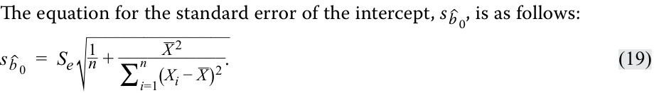

<!-- Formula Text: g g p The equation for the standard error of the intercept, s  ˆ b  0, is as follows: s  ˆ b  0  =  S e √ _______________ 1 _ n  + _ X  2 ___________ ∑ i=1 n (X i − _ X ) 2 . (19) -->
Phương trình tính sai số chuẩn của hệ số chặn, $s_{\hat{b}_0}$, như sau:

$$s_{\hat{b}_0} = s_e \sqrt{\frac{1}{n} + \frac{\bar{X}^2}{\sum_{i=1}^{n} (X_i - \bar{X})^2}} \tag{19}$$

Chúng ta có thể kiểm định xem liệu hệ số chặn có khác với giá trị theo giả thuyết, $B_0$, hay không bằng cách so sánh hệ số chặn ước lượng ($\hat{b}_0$) với hệ số chặn theo giả thuyết và sau đó chia hiệu số này cho sai số chuẩn của hệ số chặn:

<!-- Formula Text: t intercept  = ˆ b  0 − B 0 _ s  ˆ b  0    = ˆ b  0 − B 0 _______________ S √ _______________ 1 _ n  + _ X  2 ___________ ∑ i-1 n (X i − _ X ) 2 . (20) -->
$$t_{\text{intercept}} = \frac{\hat{b}_0 - B_0}{s_{\hat{b}_0}} = \frac{\hat{b}_0 - B_0}{s_e \sqrt{\frac{1}{n} + \frac{\bar{X}^2}{\sum_{i=1}^{n} (X_i - \bar{X})^2}}} \tag{20}$$

Trong ví dụ hồi quy ROA, hệ số chặn là 4,875%. Giả sử chúng ta muốn kiểm định xem liệu hệ số chặn có lớn hơn 3% hay không. Kiểm định giả thuyết một phía được trình bày trong Bảng 24. Như bạn có thể thấy, chúng ta không bác bỏ giả thuyết không (Lưu ý: văn bản gốc tiếng Anh ở đoạn dẫn ghi nhầm "reject", nhưng trong Bảng 24 Bước 6 ghi chính xác là "Do not reject" vì $t = 0.7905 < 2.132$). Nói cách khác, không có đủ bằng chứng cho thấy nếu không có chi tiêu vốn ($\text{CAPEX} = 0$), ROA sẽ lớn hơn 3%.

**Bảng 24: Kiểm định Giả thuyết cho Hệ số chặn đối với Hồi quy của ROA theo CAPEX**

|**Bước 1**|Phát biểu các giả thuyết.|$H_0: b_0 \le 3\%$ đối lập với $H_a: b_0 > 3\%$|
|---|---|---|
|**Bước 2**|Xác định thống kê kiểm định phù hợp.|$t_{\text{intercept}} = \frac{\hat{b}_0 - B_0}{s_{\hat{b}_0}}$ với $6 - 2 = 4$ bậc tự do.|
|**Bước 3**|Xác định mức ý nghĩa.|$\alpha = 5\%$.|
|**Bước 4**|Phát biểu quy tắc quyết định.|Giá trị $t$ tới hạn $= 2.132$. Bác bỏ giả thuyết không nếu thống kê $t$ tính được lớn hơn $2.132$.|
|**Bước 5**|Tính toán thống kê kiểm định.|$t_{\text{intercept}} = \frac{4.875 - 3.0}{3.4596 \times \sqrt{\frac{1}{6} + \frac{6.1^2}{122.64}}} = \frac{1.875}{3.4596 \times 0.68562} = 0.7905$|
|**Bước 6**|Đưa ra quyết định.|Không bác bỏ giả thuyết không. Không có đủ bằng chứng để chỉ ra rằng hệ số chặn lớn hơn 3%.|

<!-- PDF Page 297 -->

##### **_Kiểm định Giả thuyết của Hệ số góc khi Biến độc lập là một Biến chỉ báo (*Hypothesis Tests of Slope When the Independent Variable Is an Indicator Variable*)_**

Giả sử chúng ta muốn kiểm tra xem liệu các đợt công bố thu nhập hàng quý của một công ty có ảnh hưởng đến tỷ suất sinh lợi cổ phiếu hàng tháng của công ty đó hay không. Trong trường hợp này, chúng ta có thể sử dụng một **biến chỉ báo (*indicator variable*)**, hay biến giả (*dummy variable*), chỉ nhận các giá trị 0 hoặc 1 làm biến độc lập. Hãy xem xét trường hợp tỷ suất sinh lợi cổ phiếu hàng tháng của một công ty trong giai đoạn 30 tháng. Một mô hình hồi quy tuyến tính đơn để nghiên cứu câu hỏi này sẽ là tỷ suất sinh lợi hàng tháng, $\text{RET}$, được hồi quy theo biến chỉ báo, $\text{EARN}$, nhận giá trị bằng 0 nếu không có công bố thu nhập vào tháng đó và bằng 1 nếu có công bố thu nhập:

$$\text{RET}_i = b_0 + b_1 \text{EARN}_i + \varepsilon_i \tag{21}$$

Thiết lập hồi quy này cho phép chúng ta kiểm định xem liệu có sự khác biệt về tỷ suất sinh lợi giữa các tháng có công bố thu nhập so với các tháng không có công bố thu nhập hay không. Các quan sát và kết quả hồi quy được thể hiện bằng đồ thị trong Hình 25.

**Hình 25: Công bố Thu nhập, Biến giả và Tỷ suất sinh lợi Cổ phiếu**

<!-- Picture Text: Monthly Return (%) 2.5 2.0 1.5 1.0 0.5 0 1 2 3 4 5 6 7 8 9 10 11 12 13 14 15 16 17 18 19 20 21 22 23 24 25 26 27 28 29 30 Month Returns for Announcement Months Returns for Months without Announcements Mean Return for Announcement Months Mean Return for Non-Announcement Months  -->
> **Chú thích hình ảnh:** Trục tung: Tỷ suất sinh lợi hàng tháng (%). Trục hoành: Tháng (từ 1 đến 30). Hiển thị Tỷ suất sinh lợi của các tháng có công bố (*Returns for Announcement Months*) với đường trung bình ở mức cao (~1,77%), và Tỷ suất sinh lợi của các tháng không có công bố (*Returns for Months without Announcements*) với đường trung bình ở mức thấp (~0,56%).

Rõ ràng có một số tháng mà tỷ suất sinh lợi khác biệt so với những tháng khác, và những tháng này tương ứng với các tháng có công bố thu nhập. Chúng ta ước lượng mô hình hồi quy tuyến tính đơn và thực hiện kiểm định giả thuyết theo cùng một cách giống như khi biến độc lập là một biến liên tục (*continuous variable*). Trong hồi quy tuyến tính đơn, ý nghĩa của hệ số chặn là giá trị dự báo của biến phụ thuộc nếu biến chỉ báo bằng 0. Hơn nữa, hệ số góc khi biến chỉ báo bằng 1 chính là chênh lệch giữa hai giá trị trung bình nếu chúng ta phân nhóm các quan sát theo biến chỉ báo. Kết quả của hồi quy được cho trong Phần A của Bảng 26.

**Bảng 26: Hồi quy và Kiểm định Sự khác biệt sử dụng Biến chỉ báo**

#### **A. Kết quả Ước lượng Hồi quy (*Regression Estimation Results*)**

||**Các hệ số ước lượng (*Estimated Coefficients*)**|**Sai số chuẩn của các hệ số (*Standard Error of Coefficients*)**|**Thống kê kiểm định tính được (*Calculated Test Statistic*)**|
|---|---|---|---|
|Hệ số chặn (*Intercept*)|0.5629|0.0560|10.0596|
|EARN|1.2098|0.1158|10.4435|

*Kết quả ước lượng hồi quy: Bậc tự do = 28.*

<!-- PDF Page 298 -->

*Giá trị $t$ tới hạn = $\pm 2.0484$ (mức ý nghĩa 5%).*

#### **B. Kiểm định Sự khác biệt giữa Hai Giá trị Trung bình (*Test of Differences in Means*)**

||**RET cho các tháng có công bố thu nhập**|**RET cho các tháng không có công bố thu nhập**|**Chênh lệch giữa hai trung bình (*Difference in Means*)**|
|---|---|---|---|
|Trung bình (*Mean*)|1.7727|0.5629|1.2098|
|Phương sai (*Variance*)|0.1052|0.0630||
|Số quan sát (*Observations*)|7|23||
|Phương sai gộp (*Pooled variance*)|||0.07202|
|Thống kê kiểm định tính được (*Calculated test statistic*)|||10.4435|

*Kiểm định sự khác biệt giữa hai giá trị trung bình: Bậc tự do = 28. Giá trị $t$ tới hạn = $\pm 2.0484$ (mức ý nghĩa 5%).*

Chúng ta có thể thấy những điều sau đây từ Phần A của Bảng 26:

- Hệ số chặn ($0.5629$) là giá trị trung bình của tỷ suất sinh lợi cho các tháng không có công bố thu nhập.

- Hệ số góc ($1.2098$) là mức chênh lệch giữa trung bình tỷ suất sinh lợi của các tháng có công bố thu nhập và các tháng không có công bố thu nhập.

- Chúng ta bác bỏ giả thuyết không cho rằng hệ số góc của $\text{EARN}$ bằng 0. Chúng ta cũng bác bỏ giả thuyết không cho rằng hệ số chặn bằng 0. Lý do là trong cả hai trường hợp, thống kê kiểm định tính được đều vượt quá giá trị $t$ tới hạn.

Chúng ta cũng có thể kiểm định xem liệu tỷ suất sinh lợi trung bình hàng tháng có như nhau đối với cả các tháng không có công bố thu nhập và các tháng có công bố thu nhập hay không bằng cách kiểm định giả thuyết sau:

$$H_0: \mu_{\text{RET}_{\text{earnings}}} = \mu_{\text{RET}_{\text{Non-earnings}}} \quad \text{và} \quad H_a: \mu_{\text{RET}_{\text{earnings}}} \neq \mu_{\text{RET}_{\text{Non-earnings}}}$$

Kết quả của kiểm định giả thuyết này được rút ra từ Phần B của Bảng 26. Như bạn có thể thấy, chúng ta bác bỏ giả thuyết không cho rằng không có sự khác biệt về giá trị trung bình của $\text{RET}$ giữa các tháng có công bố thu nhập và các tháng không có công bố thu nhập tại mức ý nghĩa 5%, bởi vì thống kê kiểm định tính được ($10.4435$) vượt quá giá trị tới hạn ($2.0484$).

##### **_Kiểm định Giả thuyết: Mức ý nghĩa và Trị số p (*Level of Significance and p-Values*)_**

Việc lựa chọn mức ý nghĩa (*significance level*) trong kiểm định giả thuyết luôn là vấn đề mang tính phán đoán. Các nhà phân tích thường chọn mức ý nghĩa $0.05$, biểu thị 5% khả năng bác bỏ giả thuyết không khi trên thực tế nó đúng (sai lầm Loại I – *Type I error*, hay dương tính giả – *false positive*). Tất nhiên, việc giảm mức ý nghĩa từ $0.05$ xuống $0.01$ làm giảm xác suất mắc sai lầm Loại I, nhưng nó cũng làm tăng xác suất mắc sai lầm Loại II (*Type II error*)—không bác bỏ giả thuyết không khi trên thực tế nó sai (tức là âm tính giả – *false negative*).

Trị số $p$ (*$p$-value*) là mức ý nghĩa nhỏ nhất mà tại đó giả thuyết không có thể bị bác bỏ. Trị số $p$ càng nhỏ thì cơ hội mắc sai lầm Loại I (tức là bác bỏ một giả thuyết không đúng) càng nhỏ, do đó khả năng mô hình hồi quy hợp lệ càng lớn. Ví dụ, nếu trị số $p$ là $0.005$, chúng ta bác bỏ giả thuyết không cho rằng tham số thực sự bằng 0 tại mức ý nghĩa 0,5% (độ tin cậy 99,5%).

<!-- PDF Page 299 -->

Trong hầu hết các gói phần mềm, trị số $p$ được cung cấp cho các hệ số hồi quy là dành cho kiểm định giả thuyết không rằng tham số thực sự bằng 0 đối lập với giả thuyết đối rằng tham số khác 0.

Trong ví dụ hồi quy ROA của chúng ta, thống kê $t$ tính được cho kiểm định xem liệu hệ số góc có bằng 0 hay không là $4.00131$. Trị số $p$ tương ứng với thống kê kiểm định này là $0.016$, có nghĩa là, giả sử giả thuyết không là đúng, có 1,6% khả năng quan sát được một thống kê kiểm định khắc nghiệt như giá trị đã quan sát, hoặc khắc nghiệt hơn. So sánh trị số $p$ này với mức ý nghĩa 5% (và các giá trị tới hạn $\pm 2.776$) giúp chúng ta dễ dàng bác bỏ giả thuyết không $H_0: b_1 = 0$.

Làm thế nào chúng ta xác định được các trị số $p$? Bởi vì đây là diện tích trong phân phối nằm bên ngoài thống kê kiểm định tính được, chúng ta cần nhờ đến các công cụ phần mềm. Đối với trị số $p$ tương ứng với $t = 4.00131$ từ ví dụ hồi quy ROA, chúng ta có thể sử dụng các hàm sau:

- **Excel:** `(1-T.DIST(4.00131,4,TRUE))*2`

- **R:** `(1-pt(4.00131,4))*2`

- **Python:** `from scipy.stats import t` *và* `(1 - t.cdf(4.00131,4))*2`

##### **BỘ CÂU HỎI (*QUESTION SET*)**

Thông tin sau đây áp dụng cho các câu hỏi 1–3:

Julie Moon là một nhà phân tích năng lượng đang kiểm tra mức tiêu thụ điện, dầu và khí tự nhiên ở các khu vực khác nhau qua các mùa khác nhau. Cô đã chạy một hồi quy đơn giải thích sự biến thiên trong mức tiêu thụ năng lượng như một hàm số của nhiệt độ. Tổng biến thiên (*total variation*) của biến phụ thuộc là $140.58$, và phần biến thiên được giải thích (*explained variation*) là $60.16$. Cô có 60 quan sát hàng tháng.

1. Tính hệ số xác định (*coefficient of determination*).

##### **Lời giải:**

Hệ số xác định là $0.4279$:

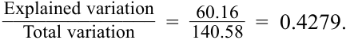

<!-- Picture Text: ______________Explained variation _ =   60.16 Total variation 140.58  = 0.4279.  -->
$$R^2 = \frac{\text{Biến thiên được giải thích}}{\text{Tổng biến thiên}} = \frac{60.16}{140.58} = 0.4279$$

2. Tính thống kê $F$ (*$F$-statistic*) để kiểm định mức độ phù hợp của mô hình.

<!-- Picture Text: Solution: _________________ 60.16 ⧸1 _ F  =   =   60.16 1.3866  = 43.3882. (140.58 − 60.16) ⧸(60 − 2)  -->

##### **Lời giải:**

$$F = \frac{60.16 / 1}{(140.58 - 60.16) / (60 - 2)} = \frac{60.16}{1.3866} = 43.3882$$

3. Tính độ lệch chuẩn mẫu (*sample standard deviation*) của mức tiêu thụ năng lượng hàng tháng.

##### **Lời giải:**

Phương sai mẫu của biến phụ thuộc sử dụng tổng biến thiên của biến phụ thuộc và chia cho số lượng quan sát trừ đi một:

<!-- Formula Text: ∑ i=1 n (Y i − _ Y ) 2 _ n − 1    =   Total variation ___________ n − 1 =   140.58 _ 60 − 1   =  2.3827. -->
$$\frac{\sum_{i=1}^{n} (Y_i - \bar{Y})^2}{n - 1} = \frac{\text{Tổng biến thiên}}{n - 1} = \frac{140.58}{60 - 1} = 2.3827$$

Độ lệch chuẩn mẫu của biến phụ thuộc là căn bậc hai của phương sai, hay $\sqrt{2.3827} = 1.544$.

Thông tin sau đây áp dụng cho các câu hỏi 4–6:

<!-- PDF Page 300 -->

Một nhà phân tích quan tâm đến việc diễn giải kết quả và thực hiện các kiểm định giả thuyết cho ước lượng mô hình thị trường (*market model*) hồi quy tỷ suất sinh lợi hàng ngày của cổ phiếu ABC theo tỷ suất sinh lợi hàng ngày của Chỉ số Cổ phiếu Âu–Á–Phi (EAA) giả định, đại diện (*proxy*) cho thị trường chứng khoán của anh ấy. Anh ấy đã tạo ra các kết quả hồi quy được trình bày trong Bảng 27.

##### **Bảng 27: Kiểm định Giả thuyết Kết quả Hồi quy Tuyến tính Đơn – Kết quả Chọn lọc của Ước lượng Mô hình Thị trường cho Cổ phiếu ABC**

|Thống kê / Hệ số|Giá trị|
|---|---|
|Sai số chuẩn của ước lượng ($s_e$)|1.26|
|Độ lệch chuẩn của tỷ suất sinh lợi cổ phiếu ABC|0.80|
|Độ lệch chuẩn của tỷ suất sinh lợi Chỉ số Cổ phiếu EAA|0.70|
|Số lượng quan sát|1,200|
||*Các hệ số (Coefficients)*|
|Hệ số chặn (*Intercept*)|0.010|
|Hệ số góc của tỷ suất sinh lợi Chỉ số Cổ phiếu EAA|0.982|

4. Nếu các giá trị $t$ tới hạn là $\pm 1.96$ (tại mức ý nghĩa 5%), hệ số góc có khác 0 hay không?

##### **Lời giải:**

Đầu tiên, chúng ta tính sự biến thiên của biến độc lập bằng cách sử dụng độ lệch chuẩn của biến độc lập:

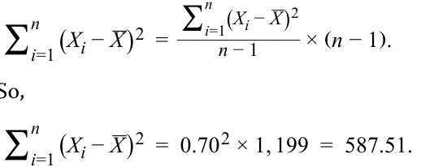

<!-- Formula Text: ∑ i=1 n (X i − _ X ) 2  = ∑ i=1 n (X i − _ X ) 2 ___________ n − 1 × (n − 1). So, ∑ i=1 n (X i − _ X ) 2  =  0.70 2 × 1, 199  =  587.51. -->
$$\sum_{i=1}^{n} (X_i - \bar{X})^2 = \frac{\sum_{i=1}^{n} (X_i - \bar{X})^2}{n - 1} \times (n - 1)$$

Vì vậy,

$$\sum_{i=1}^{n} (X_i - \bar{X})^2 = 0.70^2 \times 1,199 = 587.51$$

Tiếp theo, sai số chuẩn của hệ số góc ước lượng là:

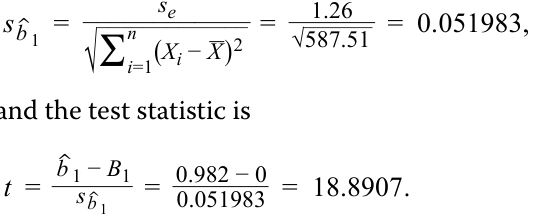

<!-- Formula Text: s  ˆ b  1  = s e ____________ √ _____________ ∑ i=1 n (X i − _ X ) 2 =    1.26 _ √ _ 587.51    =  0.051983, and the test statistic is t  = ˆ b  1 − B 1 _ s  ˆ b  1    =   0.982 − 0 _ 0.051983   =  18.8907. -->
$$s_{\hat{b}_1} = \frac{s_e}{\sqrt{\sum_{i=1}^{n} (X_i - \bar{X})^2}} = \frac{1.26}{\sqrt{587.51}} = 0.051983$$

và thống kê kiểm định là:

$$t = \frac{\hat{b}_1 - B_1}{s_{\hat{b}_1}} = \frac{0.982 - 0}{0.051983} = 18.8907$$

Thống kê kiểm định tính được nằm ngoài phạm vi $\pm 1.96$, vì vậy chúng ta bác bỏ giả thuyết không cho rằng hệ số góc bằng 0.

5. Nếu các giá trị $t$ tới hạn là $\pm 1.96$ (tại mức ý nghĩa 5%), hệ số góc có khác $1.0$ hay không?

##### **Lời giải:**

Thống kê kiểm định tính được cho kiểm định xem liệu hệ số góc có bằng $1.0$ hay không là:

<!-- PDF Page 301 -->

$$t = \frac{0.982 - 1}{0.051983} = -0.3463$$

Thống kê kiểm định tính được nằm trong phạm vi $\pm 1.96$, vì vậy chúng ta không bác bỏ giả thuyết không cho rằng hệ số góc bằng $1.0$, đây là bằng chứng cho thấy hệ số góc tổng thể thực sự có thể bằng $1.0$.

6. Một nhà kinh tế học đã thu thập tỷ suất sinh lợi hàng tháng cho danh mục đầu tư của KDL và một chỉ số cổ phiếu đa dạng hóa. Dữ liệu thu thập được trình bày trong Bảng 28:

##### **Bảng 28: Tỷ suất sinh lợi Hàng tháng của KDL**

|**Tháng (*Month*)**|**Tỷ suất sinh lợi Danh mục đầu tư (%)**|**Tỷ suất sinh lợi Chỉ số (%)**|
|---|---|---|
|1|1.11|−0.59|
|2|72.10|64.90|
|3|5.12|4.81|
|4|1.01|1.68|
|5|−1.72|−4.97|
|6|4.06|−2.06|

Nhà kinh tế học đã tính hệ số tương quan giữa hai tỷ suất sinh lợi và thấy nó bằng $0.996$. Kết quả hồi quy với tỷ suất sinh lợi danh mục đầu tư là biến phụ thuộc và tỷ suất sinh lợi chỉ số là biến độc lập được cho trong Bảng 29:

##### **Bảng 29: Kết quả Hồi quy (*Regression Results*)**

|**Thống kê Hồi quy (*Regression Statistics*)**||
|---|---|
|$R^2$|0.9921|
|Sai số chuẩn (*Standard error*)|2.8619|
|Số quan sát (*Observations*)|6|

|**Nguồn (*Source*)**|**Bậc tự do (*df*)**|**Tổng bình phương (*Sum of Squares*)**|**Trung bình bình phương (*Mean Square*)**|**$F$**|**Trị số $p$ (*$p$-Value*)**|
|---|---|---|---|---|---|
|Hồi quy (*Regression*)|1|4,101.6205|4,101.6205|500.7921|0.0000|
|Phần dư (*Residual*)|4|32.7611|8.1903|||
|Tổng (*Total*)|5|4,134.3815||||

||**Các hệ số (*Coefficients*)**|**Sai số chuẩn (*Standard Error*)**|**Thống kê $t$ (*$t$-Statistic*)**|**Trị số $p$ (*$p$-Value*)**|
|---|---|---|---|---|
|Hệ số chặn (*Intercept*)|2.2521|1.2739|1.7679|0.1518|
|Tỷ suất sinh lợi chỉ số (*Index return*, %)|1.0690|0.0478|22.3784|0.0000|

Khi xem xét lại kết quả, Andrea Fusilier nghi ngờ rằng chúng không đáng tin cậy. Cô phát hiện ra rằng tỷ suất sinh lợi của Tháng 2 lẽ ra phải là 7,21%

<!-- PDF Page 302 -->

và 6,49%, thay vì các giá trị lớn được hiển thị trong bảng đầu tiên. Việc sửa lại các giá trị này đã mang lại hệ số tương quan điều chỉnh là $0.824$ và kết quả hồi quy điều chỉnh trong Bảng 30:

**Bảng 30: Kết quả Hồi quy Đã điều chỉnh (*Revised Regression Results*)**

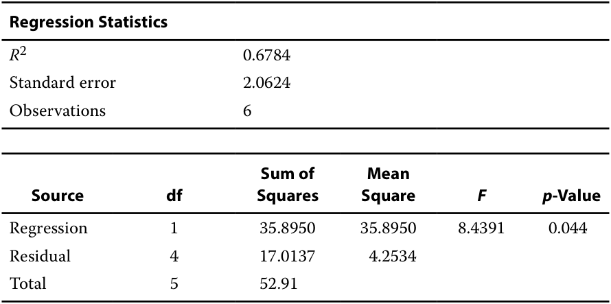

<!-- Picture Text: Regression Statistics R 2 0.6784 Standard error 2.0624 Observations 6 Sum of  Mean Source df Squares Square F p -Value Regression 1 35.8950 35.8950 8.4391 0.044 Residual 4 17.0137 4.2534 Total 5 52.91  -->

|**Thống kê Hồi quy (*Regression Statistics*)**||
|---|---|
|$R^2$|0.6784|
|Sai số chuẩn (*Standard error*)|2.0624|
|Số quan sát (*Observations*)|6|

|**Nguồn (*Source*)**|**Bậc tự do (*df*)**|**Tổng bình phương (*Sum of Squares*)**|**Trung bình bình phương (*Mean Square*)**|**$F$**|**Trị số $p$ (*$p$-Value*)**|
|---|---|---|---|---|---|
|Hồi quy (*Regression*)|1|35.8950|35.8950|8.4391|0.044|
|Phần dư (*Residual*)|4|17.0137|4.2534|||
|Tổng (*Total*)|5|52.91||||

||**Các hệ số (*Coefficients*)**|**Sai số chuẩn (*Standard Error*)**|**Thống kê $t$ (*$t$-Statistic*)**|**Trị số $p$ (*$p$-Value*)**|
|---|---|---|---|---|
|Hệ số chặn (*Intercept*)|2.2421|0.8635|2.5966|0.060|
|Hệ số góc (*Slope*)|0.6217|0.2143|2.9050|0.044|

Hãy giải thích dữ liệu sai đã ảnh hưởng đến kết quả như thế nào.

##### **Lời giải:**

Điểm dữ liệu Tháng 2 là một giá trị ngoại lai (*outlier*), nằm cách rất xa so với các giá trị dữ liệu khác. Bởi vì giá trị ngoại lai này là do lỗi nhập dữ liệu, việc sửa chữa giá trị ngoại lai giúp cải thiện tính hợp lệ và độ tin cậy của hồi quy. Trong trường hợp này, $R^2$ sau điều chỉnh thấp hơn (từ $0.9921$ xuống $0.6784$). Các giá trị ngoại lai đã tạo ra ảo giác về mức độ phù hợp tốt hơn từ mức $R^2$ cao hơn; các giá trị ngoại lai cũng đã làm thay đổi ước lượng của hệ số góc. Sai số chuẩn của ước lượng thấp hơn khi lỗi dữ liệu được sửa chữa (từ $2.8619$ xuống $2.0624$), do trung bình bình phương sai số (MSE) thấp hơn. Tại mức ý nghĩa $0.05$, cả hai mô hình đều phù hợp tốt. Sự khác biệt về mức độ phù hợp được minh họa trong Hình 31.

---

# Tập 1: Các Phương pháp Định lượng (*Quantitative Methods*)
## Học phần 10: Hồi quy Tuyến tính Đơn (*Simple Linear Regression*)
### Phần 4/6: Dự báo trong Mô hình Hồi quy Tuyến tính Đơn (Trang PDF 303–317)

---

<!-- PDF Page 303 -->

<!-- Picture Text: Exhibit 31: Fit of the Model with and without Data Errors A. Before the Data Errors Are Corrected Portfolio Return 80 70 60 50 40 30 20 10 0 –10 –20 0 20 40 60 80 Index Return B. After the Data Errors Are Corrected Portfolio Return (%) 8 6 4 2 0 –2 –4 –10 –5 0 5 10 Index Return (%)  -->
> **Chú thích hình ảnh (Hình 31: Mức độ phù hợp của Mô hình khi có và không có Lỗi dữ liệu):**
> - **A. Trước khi sửa lỗi dữ liệu (*Before the Data Errors Are Corrected*):** Trục tung: Tỷ suất sinh lợi danh mục đầu tư (từ $-10$ đến $80$). Trục hoành: Tỷ suất sinh lợi chỉ số (từ $-20$ đến $80$). Điểm dữ liệu ngoại lai ở góc trên bên phải kéo đường hồi quy đi qua nó, tạo cảm giác khớp gần như tuyệt đối.
> - **B. Sau khi sửa lỗi dữ liệu (*After the Data Errors Are Corrected*):** Trục tung: Tỷ suất sinh lợi danh mục đầu tư (%) (từ $-4$ đến $8$). Trục hoành: Tỷ suất sinh lợi chỉ số (%) (từ $-10$ đến $10$). Các điểm dữ liệu phân tán tự nhiên hơn quanh đường hồi quy.

## **DỰ BÁO TRONG MÔ HÌNH HỒI QUY TUYẾN TÍNH ĐƠN (*PREDICTION IN THE SIMPLE LINEAR REGRESSION MODEL*)**

# **<mark>5</mark>**

- mô tả việc sử dụng phân tích phương sai (*analysis of variance* – ANOVA) trong phân tích hồi quy, diễn giải kết quả ANOVA, và tính toán cũng như diễn giải sai số chuẩn của ước lượng (*standard error of estimate*) trong hồi quy tuyến tính đơn

- tính toán và diễn giải giá trị dự báo cho biến phụ thuộc (*dependent variable*), và khoảng dự báo (*prediction interval*) cho giá trị đó, khi biết mô hình hồi quy tuyến tính ước lượng và một giá trị của biến độc lập (*independent variable*)

### **ANOVA và Sai số chuẩn của Ước lượng trong Hồi quy Tuyến tính Đơn (*ANOVA and Standard Error of Estimate in Simple Linear Regression*)**

Chúng ta thường biểu diễn các tổng bình phương từ một mô hình hồi quy trong bảng **phân tích phương sai (*analysis of variance* – ANOVA)**, như trình bày trong Bảng 32, bao gồm các tổng bình phương (*sums of squares*), bậc tự do (*degrees of freedom*), trung bình bình phương (*mean squares*), và thống kê $F$ (*$F$-statistic*). Lưu ý rằng phương sai của biến phụ thuộc là tỷ số giữa tổng bình phương toàn phần (SST) và $n - 1$.

<!-- PDF Page 304 -->

**Bảng 32: Bảng Phân tích Phương sai (ANOVA) cho Hồi quy Tuyến tính Đơn**

|**Nguồn biến thiên (*Source*)**|**Tổng bình phương (*Sum of Squares*)**|**Bậc tự do (*Degrees of Freedom*)**|**Trung bình bình phương (*Mean Square*)**|**Thống kê $F$ (*$F$-Statistic*)**|
|---|---|---|---|---|
|Hồi quy (*Regression*)|$\text{SSR} = \sum_{i=1}^{n} (\hat{Y}_i - \bar{Y})^2$|$1$|$\text{MSR} = \frac{\sum_{i=1}^{n} (\hat{Y}_i - \bar{Y})^2}{1}$|$F = \frac{\text{MSR}}{\text{MSE}} = \frac{\frac{\sum_{i=1}^{n} (\hat{Y}_i - \bar{Y})^2}{1}}{\frac{\sum_{i=1}^{n} (Y_i - \hat{Y}_i)^2}{n - 2}}$|
|Sai số (*Error*)|$\text{SSE} = \sum_{i=1}^{n} (Y_i - \hat{Y}_i)^2$|$n - 2$|$\text{MSE} = \frac{\sum_{i=1}^{n} (Y_i - \hat{Y}_i)^2}{n - 2}$||
|Tổng (*Total*)|$\text{SST} = \sum_{i=1}^{n} (Y_i - \bar{Y})^2$|$n - 1$|||

Từ bảng ANOVA, chúng ta cũng có thể tính **sai số chuẩn của ước lượng (*standard error of the estimate* – $s_e$)**, còn được gọi là sai số chuẩn của hồi quy (*standard error of the regression*) hoặc căn bậc hai trung bình bình phương sai số (*root mean square error* – RMSE). Đại lượng $s_e$ là thước đo khoảng cách giữa các giá trị quan sát được của biến phụ thuộc và các giá trị được dự báo từ hồi quy ước lượng—$s_e$ càng nhỏ thì độ phù hợp của mô hình càng tốt. Cùng với hệ số xác định ($R^2$) và thống kê $F$, $s_e$ là một thước đo mức độ phù hợp của đường hồi quy ước lượng. Không giống như hệ số xác định và thống kê $F$ là các thước đo mức độ phù hợp mang tính tương đối (*relative measures of fit*), sai số chuẩn của ước lượng là một thước đo tuyệt đối (*absolute measure*) về khoảng cách từ biến phụ thuộc quan sát được đến đường hồi quy. Do đó, $s_e$ là một thống kê quan trọng được sử dụng để đánh giá mô hình hồi quy và được dùng để tính các khoảng dự báo (*prediction intervals*) cũng như thực hiện các kiểm định đối với các hệ số. Việc tính toán $s_e$ rất đơn giản một khi chúng ta có bảng ANOVA bởi vì nó là căn bậc hai của MSE:

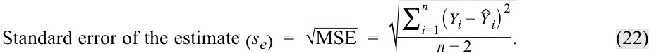

<!-- Formula Text: Standard error of the estimate (s e)  =  √ _ MSE   =  √ ____________ ∑ i=1 n (Y i −  ˆ Y  i) 2 ____________ n − 2 . (22) -->
$$\text{Sai số chuẩn của ước lượng } (s_e) = \sqrt{\text{MSE}} = \sqrt{\frac{\sum_{i=1}^{n} (Y_i - \hat{Y}_i)^2}{n - 2}} \tag{22}$$

Chúng ta trình bày bảng ANOVA cho ví dụ hồi quy ROA của chúng ta trong Bảng 33 (dựa theo cấu trúc của Bảng 32). Tại mức ý nghĩa 5%, giá trị $F$ tới hạn cho kiểm định xem liệu mô hình có độ phù hợp tốt hay không (tức là liệu hệ số góc có khác 0 hay không) là $7.71$. Chúng ta có thể lấy giá trị tới hạn này theo các cách sau:

- *Excel*: `[F.INV(0.95,1,4)]`

- *R*: `[qf(.95,1,4)]`

- *Python*: `[from scipy.stats import f` *và* `f.ppf(.95,1,4)]`

Với thống kê $F$ tính được là $16.0104$ và giá trị $F$ tới hạn là $7.71$, chúng ta bác bỏ giả thuyết không và kết luận rằng hệ số góc của mô hình hồi quy tuyến tính đơn cho ROA của chúng ta khác 0.

**Bảng 33: Bảng ANOVA cho Mô hình Hồi quy ROA**

|**Nguồn biến thiên (*Source*)**|**Tổng bình phương (*Sum of Squares*)**|**Bậc tự do (*Degrees of Freedom*)**|**Trung bình bình phương (*Mean Square*)**|**Thống kê $F$ (*$F$-Statistic*)**|
|---|---|---|---|---|
|Hồi quy (*Regression*)|191.625|1|191.625|16.0104|
|Sai số (*Error*)|47.875|4|11.96875||
|Tổng (*Total*)|239.50|5|||

<!-- PDF Page 305 -->

Các phép tính để lập bảng ANOVA và cuối cùng là kiểm định mức độ phù hợp của mô hình hồi quy có thể tốn nhiều thời gian, đặc biệt đối với các mẫu có nhiều quan sát. Tuy nhiên, các gói thống kê như SAS, SPSS Statistics và Stata, cũng như các phần mềm như Excel, R và Python, đều tạo ra bảng ANOVA như một phần của kết quả đầu ra cho phân tích hồi quy.

### **Dự báo Sử dụng Hồi quy Tuyến tính Đơn và Khoảng Dự báo (*Prediction Using Simple Linear Regression and Prediction Intervals*)**

Các nhà phân tích tài chính thường muốn sử dụng kết quả hồi quy để đưa ra các dự báo về biến phụ thuộc. Ví dụ, chúng ta có thể hỏi, “Doanh số của Tập đoàn XYZ sẽ tăng trưởng nhanh như thế nào trong năm nay nếu GDP thực tăng trưởng 4%?” Nhưng chúng ta không chỉ đơn thuần quan tâm đến việc đưa ra các dự báo này; chúng ta còn muốn biết mình có thể chắc chắn đến mức nào về kết quả của các dự báo đó. Một giá trị dự báo của biến phụ thuộc, $\hat{Y}_f$, được xác định bằng cách sử dụng hệ số chặn và hệ số góc ước lượng, cũng như biến độc lập kỳ vọng hoặc dự báo, $X_f$:

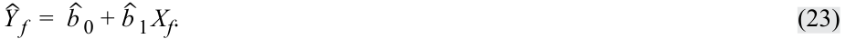

<!-- Formula Text: ˆ Y  f  =   ˆ b  0 +  ˆ b  1 X f. (23) -->
$$\hat{Y}_f = \hat{b}_0 + \hat{b}_1 X_f \tag{23}$$

Trong mô hình hồi quy ROA của chúng ta, nếu chúng ta dự báo CAPEX của một công ty là 6%, thì ROA dự báo dựa trên phương trình ước lượng của chúng ta là 12,375%:

$$\hat{Y}_f = 4.875 + (1.25 \times 6) = 12.375$$

Tuy nhiên, chúng ta cần lưu ý rằng đường hồi quy ước lượng không mô tả hoàn hảo mối quan hệ giữa biến phụ thuộc và biến độc lập; nó chỉ là mức trung bình của mối quan hệ giữa hai biến số. Điều này thể hiện rõ bởi vì không phải tất cả các phần dư đều bằng 0.

Do đó, cần có một ước lượng khoảng (*interval estimate*) của dự báo để phản ánh sự không chắc chắn này. Phương sai ước lượng của sai số dự báo (*prediction error*), $s_f^2$, của $Y$ khi biết $X$ là:

<!-- Formula Text: s f 2  =  s e 2[1 +  1 _ n  + (X f − _ X ) 2 _ (n − 1) s X 2  ]  =  s e 2 [ 1 +  1 _ n  + (X f − _ X ) 2 ___________ ∑ i=1 n (X i − _ X ) 2 ] , and the standard error of the forecast is s f  =  s e √ ___________________ 1 +  1 _ n  + (X f − _ X ) 2 ___________ ∑ i=1 n (X i − _ X ) 2 . (24) -->
$$s_f^2 = s_e^2 \left[ 1 + \frac{1}{n} + \frac{(X_f - \bar{X})^2}{(n - 1) s_X^2} \right] = s_e^2 \left[ 1 + \frac{1}{n} + \frac{(X_f - \bar{X})^2}{\sum_{i=1}^{n} (X_i - \bar{X})^2} \right]$$

và **sai số chuẩn của dự báo (*standard error of the forecast*)** là:

$$s_f = s_e \sqrt{1 + \frac{1}{n} + \frac{(X_f - \bar{X})^2}{\sum_{i=1}^{n} (X_i - \bar{X})^2}} \tag{24}$$

Sai số chuẩn của dự báo phụ thuộc vào các yếu tố sau:

- sai số chuẩn của ước lượng, $s_e$;

- số lượng quan sát, $n$;

- giá trị dự báo của biến độc lập, $X_f$, được sử dụng để dự báo biến phụ thuộc và độ lệch của nó so với giá trị trung bình ước lượng, $\bar{X}$; và

- sự biến thiên của biến độc lập.

Chúng ta có thể thấy những điều sau đây từ phương trình tính sai số chuẩn của dự báo:

**1.** Mô hình hồi quy có độ phù hợp càng tốt thì sai số chuẩn của ước lượng ($s_e$) càng nhỏ và do đó, sai số chuẩn của dự báo ($s_f$) càng nhỏ.

**2.** Cỡ mẫu ($n$) trong ước lượng hồi quy càng lớn thì sai số chuẩn của dự báo càng nhỏ.

**3.** Biến độc lập dự báo ($X_f$) càng gần với giá trị trung bình của biến độc lập ($\bar{X}$) được sử dụng trong ước lượng hồi quy thì sai số chuẩn của dự báo càng nhỏ.

<!-- PDF Page 306 -->

Một khi chúng ta có ước lượng này về sai số chuẩn của dự báo, việc xác định một khoảng dự báo (*prediction interval*) xung quanh giá trị dự báo của biến phụ thuộc ($\hat{Y}_f$) rất giống với việc ước lượng một khoảng tin cậy (*confidence interval*) xung quanh một tham số ước lượng. Khoảng dự báo là:

$$\hat{Y}_f \pm t_{\text{critical for }\alpha/2} s_f$$

Chúng ta phác thảo các bước để xây dựng khoảng dự báo trong Hình 34.

#### **Hình 34: Tạo Khoảng Dự báo xung quanh Biến phụ thuộc Dự báo**

<!-- Picture Text: Predict the value of  Y ,  Y^f , given the forecasted value of  X ,  Xf Choose a significance level, α, for the prediction interval Determine the critical value for the prediction interval based on the degrees of freedom and the significance level Compute the standard error of the forecast Compute the (1 – α) percent prediction interval for the prediction as:  Y^f  ± t critical for α/2  sf  -->
> **Chú thích hình ảnh (Quy trình 5 bước):**
> 1. Dự báo giá trị của $Y$, tức $\hat{Y}_f$, khi biết giá trị dự báo của $X$, tức $X_f$.
> 2. Chọn một mức ý nghĩa, $\alpha$, cho khoảng dự báo.
> 3. Xác định giá trị tới hạn cho khoảng dự báo dựa trên bậc tự do và mức ý nghĩa.
> 4. Tính sai số chuẩn của dự báo ($s_f$).
> 5. Tính khoảng dự báo $(1 - \alpha)\%$ cho giá trị dự báo theo công thức: $\hat{Y}_f \pm t_{\text{critical for }\alpha/2} s_f$.

Đối với mô hình hồi quy ROA của chúng ta, biết rằng giá trị dự báo của CAPEX là $6.0$, giá trị dự báo của $Y$ là $12.375$:

$$\hat{Y}_f = 4.875 + 1.25 X_f = 4.875 + (1.25 \times 6.0) = 12.375$$

Giả sử mức ý nghĩa 5% ($\alpha$), kiểm định hai phía, với $n - 2$ bậc tự do (tức $\text{df} = 4$), các giá trị tới hạn cho khoảng dự báo là $\pm 2.776$. Sai số chuẩn của dự báo là:

<!-- Formula Text: s f  =  3.459588 √ ______________ 1 +  1 _ 6  +  (6 − 6.1) 2 _ 122.640    =  3.459588 √ _ 1.166748   =  3.736912. -->
$$s_f = 3.459588 \sqrt{1 + \frac{1}{6} + \frac{(6 - 6.1)^2}{122.640}} = 3.459588 \sqrt{1.166748} = 3.736912$$

Khi đó, khoảng dự báo 95% trở thành:

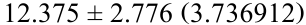

<!-- Formula Text: 12.375 ± 2.776 (3.736912) -->
$$12.375 \pm 2.776 (3.736912)$$

$$12.375 \pm 10.3737$$

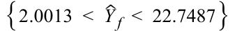

<!-- Formula Text: {2.0013  <   ˆ Y  f  <  22.7487} -->
$$\{2.0013 < \hat{Y}_f < 22.7487\}$$

Đối với ví dụ hồi quy ROA của chúng ta, chúng ta có thể thấy sai số chuẩn của dự báo ($s_f$) thay đổi như thế nào khi giá trị dự báo của biến độc lập rời xa dần giá trị trung bình của biến độc lập $(X_f - \bar{X})$ trong Hình 35. Giá trị trung bình của CAPEX là 6,1%, và dải băng biểu thị một sai số chuẩn của dự báo, nằm phía trên và phía dưới mức dự báo, đạt mức tối thiểu tại điểm đó và mở rộng dần khi biến độc lập rời xa $\bar{X}$.

<!-- PDF Page 307 -->

#### **Hình 35: Dự báo ROA và Sai số chuẩn của Dự báo**

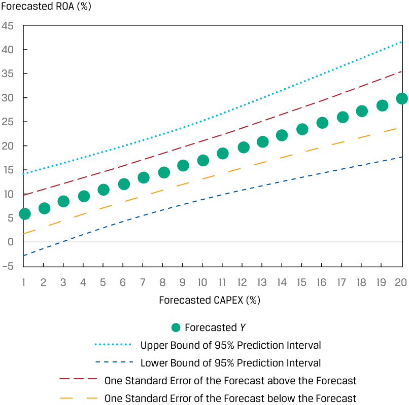

<!-- Picture Text: Forecasted ROA (%) 45 40 35 30 25 20 15 10 5 0 –5 1 2 3 4 5 6 7 8 9 10 11 12 13 14 15 16 17 18 19 20 Forecasted CAPEX (%) Forecasted  Y Upper Bound of 95% Prediction Interval Lower Bound of 95% Prediction Interval One Standard Error of the Forecast above the Forecast One Standard Error of the Forecast below the Forecast  -->
> **Chú thích hình ảnh:** Trục tung: ROA dự báo (%). Trục hoành: CAPEX dự báo (%). Hiển thị đường Dự báo $Y$ (*Forecasted $Y$*), Cận trên và Cận dưới của Khoảng dự báo 95% (*Upper/Lower Bound of 95% Prediction Interval*), cùng với các đường cộng/trừ 1 Sai số chuẩn của dự báo (*One Standard Error of the Forecast above/below the Forecast*). Các đường giới hạn loe rộng ra khi $X_f$ rời xa mức trung bình $6.1\%$.

#### **BỘ CÂU HỎI (*QUESTION SET*)**

Giả sử bạn chạy một hồi quy dữ liệu chéo cho 100 công ty, trong đó biến phụ thuộc là tỷ suất sinh lợi cổ phiếu hàng năm và biến độc lập là tỷ lệ phần trăm sở hữu của tổ chức có độ trễ (*lagged percentage of institutional ownership* – INST). Kết quả của ước lượng hồi quy tuyến tính đơn này được trình bày trong Bảng 36. Hãy đánh giá mô hình bằng cách trả lời các câu hỏi 1–4.

#### **Bảng 36: Bảng ANOVA cho Tỷ suất sinh lợi Cổ phiếu Hàng năm được Hồi quy theo Tỷ lệ Sở hữu của Tổ chức**

|**Nguồn biến thiên (*Source*)**|**Tổng bình phương (*Sum of Squares*)**|**Bậc tự do (*Degrees of Freedom*)**|**Trung bình bình phương (*Mean Square*)**|
|---|---|---|---|
|Hồi quy (*Regression*)|576.1485|1|576.1485|
|Sai số (*Error*)|1,873.5615|98|19.1180|
|Tổng (*Total*)|2,449.7100|||

1. Hệ số xác định (*coefficient of determination*) của mô hình hồi quy này là bao nhiêu?

#### **Lời giải:**

Hệ số xác định bằng tổng bình phương hồi quy chia cho tổng bình phương toàn phần: $576.1485 \div 2,449.71 = 0.2352$, hay 23,52%.

<!-- PDF Page 308 -->

2. Sai số chuẩn của ước lượng (*standard error of the estimate*) của mô hình hồi quy này là bao nhiêu?

#### **Lời giải:**

Sai số chuẩn của ước lượng là căn bậc hai của trung bình bình phương sai số (MSE): $\sqrt{19.1180} = 4.3724$.

3. Tại mức ý nghĩa 5%, chúng ta có bác bỏ giả thuyết không cho rằng hệ số góc bằng 0 hay không nếu giá trị $F$ tới hạn là $3.938$?

#### **Lời giải:**

Sử dụng quy trình sáu bước để kiểm định giả thuyết, chúng ta có:

|**Bước 1**|Phát biểu các giả thuyết.|$H_0: b_1 = 0$ đối lập với $H_a: b_1 \neq 0$|
|---|---|---|
|**Bước 2**|Xác định thống kê kiểm định phù hợp.|$F = \frac{\text{MSR}}{\text{MSE}}$ với 1 và 98 bậc tự do.|
|**Bước 3**|Xác định mức ý nghĩa.|$\alpha = 5\%$ (một phía, bên phải).|
|**Bước 4**|Phát biểu quy tắc quyết định.|Giá trị $F$ tới hạn $= 3.938$. Bác bỏ giả thuyết không nếu thống kê $F$ tính được lớn hơn $3.938$.|
|**Bước 5**|Tính toán thống kê kiểm định.|$F = \frac{576.1485}{19.1180} = 30.1364$|
|**Bước 6**|Đưa ra quyết định.|Bác bỏ giả thuyết không bởi vì thống kê $F$ tính được lớn hơn giá trị $F$ tới hạn. Có đủ bằng chứng cho thấy hệ số góc khác $0.0$.|

4. Dựa trên câu trả lời của bạn cho các câu hỏi trước, hãy đánh giá mô hình hồi quy tuyến tính đơn này.

#### **Lời giải:**

Hệ số xác định chỉ ra rằng sự biến thiên của biến độc lập giải thích được 23,52% sự biến thiên của biến phụ thuộc. Ngoài ra, kiểm định thống kê $F$ xác nhận rằng hệ số góc của mô hình khác 0 tại mức ý nghĩa 5%. Tóm lại, mô hình dường như khớp với dữ liệu khá tốt.

### **Thông tin sau đây áp dụng cho các câu hỏi 5–10**

Giả sử chúng ta muốn dự báo biên lợi nhuận ròng (NPM) của một công ty dựa trên chi tiêu nghiên cứu và phát triển được chuẩn hóa theo doanh thu (RDR) của công ty đó, sử dụng mô hình đã ước lượng ở phần trước và các chi tiết được cung cấp trong Bảng 8. Mô hình hồi quy đã được ước lượng bằng dữ liệu của tám công ty như sau:

$$\hat{Y}_f = 16.5 - 1.3 X_f$$

với sai số chuẩn của ước lượng ($s_e$) là $1.8618987$ và phương sai của RDR, $\frac{\sum_{i=1}^{n} (X_i - \bar{X})^2}{n - 1}$, là $4.285714$ như đã cho.

5. Giá trị dự báo của NPM là bao nhiêu nếu giá trị dự báo của RDR là 5?

#### **Lời giải:**

Giá trị dự báo của NPM là 10: $16.5 - (1.3 \times 5) = 10$.

<!-- PDF Page 309 -->

6. Sai số chuẩn của dự báo ($s_f$) là bao nhiêu nếu giá trị dự báo của RDR là 5?

#### **Lời giải:**

Để suy ra sai số chuẩn của dự báo ($s_f$), trước tiên chúng ta phải tính sự biến thiên của RDR. Sau đó, chúng ta có tất cả các mảnh ghép để tính $s_f$:

$$\sum_{i=1}^{n} (X_i - \bar{X})^2 = 4.285714 \times 7 = 30$$

$$s_f = 1.8618987 \sqrt{1 + \frac{1}{8} + \frac{(5 - 7.5)^2}{30}} = 2.1499$$

7. Khoảng dự báo 95% cho giá trị dự báo của NPM sử dụng các giá trị $t$ tới hạn ($\text{df} = 6$) bằng $\pm 2.447$ là bao nhiêu?

#### **Lời giải:**

Khoảng dự báo 95% cho giá trị dự báo của NPM là $\{10 \pm 2.447(2.1499)\}$, hay $\{4.7392 < \hat{Y}_f < 15.2608\}$.

8. Giá trị dự báo của NPM là bao nhiêu nếu giá trị dự báo của RDR là 15?

#### **Lời giải:**

Giá trị dự báo của NPM là $-3$: $16.5 - (1.3 \times 15) = -3$.

9. Tham chiếu Bảng 9, sai số chuẩn của dự báo là bao nhiêu nếu giá trị dự báo của RDR là 15?

#### **Lời giải:**

Để suy ra sai số chuẩn của dự báo, trước tiên chúng ta phải tính sự biến thiên của RDR. Sau đó, chúng ta có thể tính $s_f$:

$$\sum_{i=1}^{n} (X_i - \bar{X})^2 = 4.285714 \times 7 = 30$$

$$s_f = 1.8618987 \sqrt{1 + \frac{1}{8} + \frac{(15 - 7.5)^2}{30}} = 3.2249$$

10. Khoảng dự báo 95% cho giá trị dự báo của NPM sử dụng các giá trị $t$ tới hạn ($\text{df} = 6$) bằng $\pm 2.447$ là bao nhiêu?

#### **Lời giải:**

Khoảng dự báo 95% cho giá trị dự báo của NPM là $\{-3 \pm 2.447(3.2249)\}$, hay $\{-10.8913 < \hat{Y}_f < 4.8913\}$.

### **Thông tin sau đây áp dụng cho các câu hỏi 11–15**

Bạn đang kiểm tra kết quả của một ước lượng hồi quy nhằm cố gắng giải thích tốc độ tăng trưởng doanh số theo đơn vị sản phẩm (*unit sales growth*) của một doanh nghiệp mà bạn đang nghiên cứu. Kết quả đầu ra phân tích phương sai (ANOVA) cho hồi quy được cho trong Bảng 37. Hồi quy được dựa trên năm quan sát ($n = 5$).

<!-- PDF Page 310 -->

#### **Bảng 37: Kết quả Đầu ra ANOVA (*ANOVA Output*)**

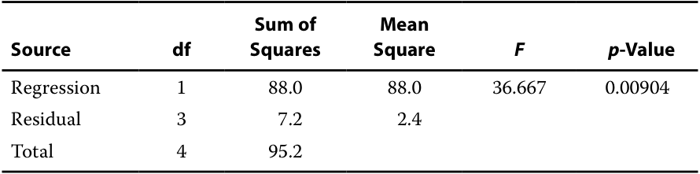

<!-- Picture Text: Sum of  Mean Source df Squares Square F p -Value Regression 1 88.0 88.0 36.667 0.00904 Residual 3 7.2 2.4 Total 4 95.2  -->

|**Nguồn (*Source*)**|**Bậc tự do (*df*)**|**Tổng bình phương (*Sum of Squares*)**|**Trung bình bình phương (*Mean Square*)**|**$F$**|**Trị số $p$ (*$p$-Value*)**|
|---|---|---|---|---|---|
|Hồi quy (*Regression*)|1|88.0|88.0|36.667|0.00904|
|Phần dư (*Residual*)|3|7.2|2.4|||
|Tổng (*Total*)|4|95.2||||

11. Tính phương sai mẫu (*sample variance*) của biến phụ thuộc bằng cách sử dụng thông tin trong bảng.

#### **Lời giải:**

Phương sai mẫu của biến phụ thuộc là tổng bình phương toàn phần chia cho bậc tự do của nó ($n - 1 = 5 - 1 = 4$, như đã cho). Do đó, phương sai mẫu của biến phụ thuộc là $95.2 \div 4 = 23.8$.

12. Tính hệ số xác định (*coefficient of determination*) cho mô hình ước lượng này.

#### **Lời giải:**

Hệ số xác định $= 88.0 \div 95.2 = 0.92437$.

13. Thống kê $F$ kiểm định giả thuyết nào?

#### **Lời giải:**

Thống kê $F$ kiểm định xem liệu tất cả các hệ số góc trong một hồi quy tuyến tính có bằng 0 hay không.

14. Kiểm định $F$ có ý nghĩa thống kê tại mức ý nghĩa $0.05$ hay không?

#### **Lời giải:**

Giá trị tính được của thống kê $F$ là $36.667$, như trình bày trong Bảng 37. Trị số $p$ tương ứng ($0.00904$) nhỏ hơn $0.05$, vì vậy bạn bác bỏ giả thuyết không cho rằng hệ số góc bằng 0.

15. Tính sai số chuẩn của ước lượng (*standard error of the estimate*).

#### **Lời giải:**

Sai số chuẩn của ước lượng là căn bậc hai của trung bình bình phương sai số: $s_e = \sqrt{2.4} = 1.54919$.

# **<mark>6</mark>**

## **CÁC DẠNG HÀM CHO HỒI QUY TUYẾN TÍNH ĐƠN (*FUNCTIONAL FORMS FOR SIMPLE LINEAR REGRESSION*)**

- mô tả các dạng hàm (*functional forms*) khác nhau của hồi quy tuyến tính đơn

Không phải mọi tập hợp biến độc lập và biến phụ thuộc đều có mối quan hệ tuyến tính. Trên thực tế, chúng ta thường thấy các mối quan hệ phi tuyến tính trong dữ liệu kinh tế và tài chính. Hãy xem xét doanh thu của một công ty theo thời gian được minh họa trong Hình 38, với doanh thu là biến phụ thuộc

<!-- PDF Page 311 -->

($Y$) và thời gian là biến độc lập ($X$). Doanh thu tăng trưởng ở mức 15% mỗi năm trong một vài năm, nhưng sau đó tốc độ tăng trưởng cuối cùng giảm xuống chỉ còn 5% mỗi năm. Việc ước lượng mối quan hệ này dưới dạng một mô hình tuyến tính đơn sẽ ước lượng thấp hơn thực tế (*understate*) biến phụ thuộc (doanh thu) đối với một số khoảng của biến độc lập (thời gian), và sẽ ước lượng cao hơn thực tế (*overstate*) đối với các khoảng khác của biến độc lập.

**Hình 38: Doanh thu Công ty theo Thời gian**

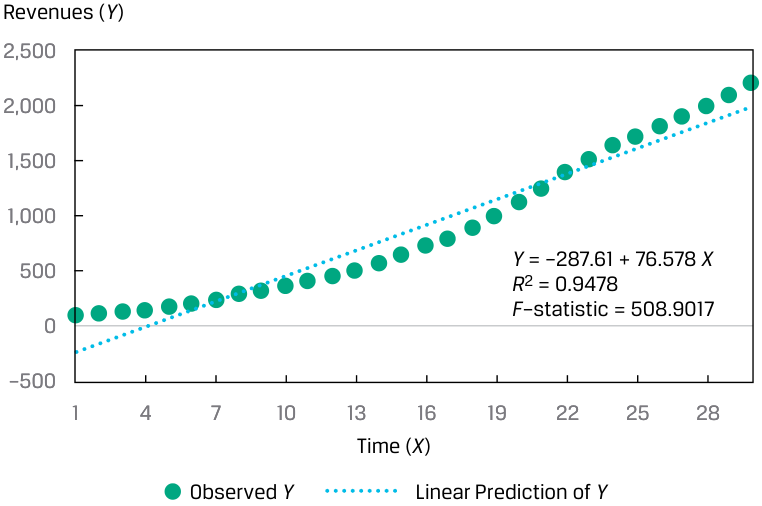

<!-- Picture Text: Revenues ( Y ) 2,500 2,000 1,500 1,000 Y  = –287.61 + 76.578  X 500 R 2  = 0.9478 F –statistic = 508.9017 0 –500 1 4 7 10 13 16 19 22 25 28 Time ( X ) Observed  Y Linear Prediction of  Y  -->
> **Chú thích hình ảnh:** Trục tung: Doanh thu ($Y$). Trục hoành: Thời gian ($X$, từ 1 đến 30). Phương trình tuyến tính: $Y = -287.61 + 76.578X$, $R^2 = 0.9478$, $F\text{-statistic} = 508.9017$. Hiển thị Giá trị $Y$ quan sát (*Observed $Y$*) và Dự báo tuyến tính của $Y$ (*Linear Prediction of $Y$*).

Chúng ta vẫn có thể sử dụng mô hình hồi quy tuyến tính đơn, nhưng chúng ta cần điều chỉnh biến phụ thuộc hoặc biến độc lập để làm cho mô hình hoạt động tốt. Đây là trường hợp của nhiều dữ liệu tài chính hoặc kinh tế khác nhau mà bạn có thể sử dụng làm biến phụ thuộc và biến độc lập trong phân tích hồi quy của mình.

Một số dạng hàm (*functional forms*) khác nhau có thể được sử dụng để biến đổi dữ liệu nhằm cho phép sử dụng chúng trong hồi quy tuyến tính. Những phép biến đổi này bao gồm việc sử dụng logarit (tức là logarit tự nhiên – *natural logarithm*) của biến phụ thuộc, logarit của biến độc lập, nghịch đảo của biến độc lập, bình phương của biến độc lập, hoặc lấy sai phân (*differencing*) của biến độc lập. Chúng ta minh họa và thảo luận ba dạng hàm thường được sử dụng, mỗi dạng đều liên quan đến phép biến đổi logarit:

**1.** **Mô hình log-tuyến tính (*log-lin model*)**, trong đó biến phụ thuộc ở dạng logarit nhưng biến độc lập ở dạng tuyến tính;

**2.** **Mô hình tuyến tính-log (*lin-log model*)**, trong đó biến phụ thuộc ở dạng tuyến tính nhưng biến độc lập ở dạng logarit; và

**3.** **Mô hình log-log (*log-log model*)**, trong đó cả biến phụ thuộc và biến độc lập đều ở dạng logarit.

### **_Mô hình Log-Tuyến tính (*The Log-Lin Model*)_**

Trong mô hình log-tuyến tính (*log-lin model*), biến phụ thuộc ở dạng logarit và biến độc lập thì không, như sau:

$$\ln Y_i = b_0 + b_1 X_i \tag{25}$$

<!-- PDF Page 312 -->

Hệ số góc trong mô hình này là mức thay đổi tương đối (*relative change*) trong biến phụ thuộc ứng với một mức thay đổi tuyệt đối (*absolute change*) trong biến độc lập. Chúng ta có thể biến đổi biến $Y$ (doanh thu) trong Hình 38 thành logarit tự nhiên ($\ln$) của nó và sau đó khớp đường hồi quy, như trình bày trong Hình 39. Từ biểu đồ này, chúng ta thấy rằng mô hình log-lin là một mô hình khớp tốt hơn so với mô hình hồi quy tuyến tính đơn.

**Hình 39: Mô hình Log-Lin được Áp dụng cho Doanh thu Công ty theo Thời gian**

<!-- Picture Text: Ln Revenues (Ln  Y ) 9 8 7 6 5 4 Ln Y  = 4.7932 + 0.1087  X R 2  = 0.9808 3 F –statistic = 1429.5473 2 1 0 1 4 7 10 13 16 19 22 25 28 Time ( X ) Ln  Y Log-Lin Prediction of  Y  -->
> **Chú thích hình ảnh:** Trục tung: $\ln$ Doanh thu ($\ln Y$). Trục hoành: Thời gian ($X$). Phương trình: $\ln Y = 4.7932 + 0.1087X$, $R^2 = 0.9808$, $F\text{-statistic} = 1429.5473$.

Điều quan trọng cần lưu ý là khi làm việc với mô hình log-lin, bạn phải cẩn thận khi đưa ra dự báo. Ví dụ, giả sử mô hình hồi quy ước lượng là $\ln Y = -7 + 2X$. Nếu $X$ là 2,5%, thì giá trị dự báo của $\ln Y$ là $-2$. Trong trường hợp này, giá trị dự báo của $Y$ là đối logarit (*antilog*) của $-2$, hay $e^{-2} = 0.135335$. Một lưu ý thận trọng khác là bạn không thể so sánh trực tiếp một mô hình log-lin với một mô hình lin-lin (tức là hồi quy của $Y$ theo $X$ mà không có bất kỳ phép biến đổi nào) bởi vì các biến phụ thuộc không ở cùng một dạng—chúng ta sẽ phải biến đổi $R^2$ và thống kê $F$ để có thể so sánh. Tuy nhiên, việc xem xét các phần dư lại rất hữu ích.

### **_Mô hình Tuyến tính-Log (*The Lin-Log Model*)_**

Mô hình tuyến tính-log (*lin-log model*) tương tự như mô hình log-lin, nhưng chỉ có biến độc lập ở dạng logarit:

$$Y_i = b_0 + b_1 \ln X_i$$

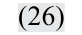

<!-- Formula Text: (26) -->
$$Y_i = b_0 + b_1 \ln X_i \tag{26}$$

Hệ số góc trong mô hình hồi quy này cung cấp mức thay đổi tuyệt đối (*absolute change*) trong biến phụ thuộc ứng với một mức thay đổi tương đối (*relative change*) trong biến độc lập.

Giả sử một nhà phân tích đang kiểm tra mối quan hệ dữ liệu chéo giữa biên lợi nhuận hoạt động (*operating profit margin*), biến phụ thuộc ($Y$), và doanh số theo đơn vị sản phẩm (*unit sales*), biến độc lập ($X$), và thu thập dữ liệu trên một mẫu gồm 30 công ty. Biểu đồ phân tán và đường hồi quy cho các quan sát này được trình bày trong Hình 40. Mặc dù hệ số góc khác 0 tại mức ý nghĩa 5% (thống kê $t$ tính được của hệ số góc là $5.8616$, so với giá trị $t$ tới hạn là $\pm 2.048$), với $R^2$ là 55,10%, vấn đề đặt ra là liệu chúng ta có thể đạt được mức độ phù hợp tốt hơn bằng cách sử dụng một dạng hàm khác hay không.

<!-- PDF Page 313 -->

#### **Hình 40: Mối quan hệ giữa Biên lợi nhuận Hoạt động và Doanh số theo Đơn vị sản phẩm**

<!-- Picture Text: Operating Profit Margin ( Y ) 20 18 16 14 12 10 8 Y  = 10.3665 + 0.000045 X 6 R 2  = 0.5510 4 S e  = 2.2528 F –statistic = 33.8259 2 0 0 50,000 100,000 150,000 Unit Sales ( X ) Operating Profit Margin Regression Line  -->
> **Chú thích hình ảnh:** Trục tung: Biên lợi nhuận hoạt động ($Y$). Trục hoành: Doanh số theo đơn vị ($X$). Phương trình: $Y = 10.3665 + 0.000045X$, $R^2 = 0.5510$, $s_e = 2.2528$, $F\text{-statistic} = 33.8259$.

Nếu thay vào đó chúng ta sử dụng logarit tự nhiên của doanh số theo đơn vị sản phẩm làm biến độc lập trong mô hình của mình, chúng ta sẽ nhận được một bức tranh rất khác, như trình bày trong Hình 41. Hệ số $R^2$ cho mô hình biên lợi nhuận hoạt động được hồi quy theo logarit tự nhiên của doanh số theo đơn vị sản phẩm nhảy vọt lên 97,17%. Bởi vì biến phụ thuộc là như nhau trong cả mô hình gốc và mô hình đã biến đổi, chúng ta có thể so sánh sai số chuẩn của ước lượng: $2.2528$ với biến độc lập gốc và mức thấp hơn nhiều là $0.5659$ (văn bản ghi $0.5629$, hình ghi $0.5659$) với biến độc lập đã biến đổi. Rõ ràng biến giải thích được biến đổi logarit đã mang lại một mô hình có độ phù hợp tốt hơn.

**Hình 41: Mối quan hệ giữa Biên lợi nhuận Hoạt động và Logarit Tự nhiên của Doanh số theo Đơn vị sản phẩm**

<!-- Picture Text: Operating Profit Margin ( Y ) 20 18 16 14 12 10 8 Y  = 2.6286 + 1.1797 Ln X 6 R 2  = 0.9717 4 S e  = 0.5659 F –statistic = 960.1538 2 0 0 2 4 6 8 10 12 14 Ln of Unit Sales (Ln  X ) Operating Profit Margin Lin-Log Regression Line  -->
> **Chú thích hình ảnh:** Trục tung: Biên lợi nhuận hoạt động ($Y$). Trục hoành: $\ln$ của Doanh số theo đơn vị ($\ln X$). Phương trình: $Y = 2.6286 + 1.1797 \ln X$, $R^2 = 0.9717$, $s_e = 0.5659$, $F\text{-statistic} = 960.1538$.

<!-- PDF Page 314 -->

### **_Mô hình Log-Log (*The Log-Log Model*)_**

Mô hình log-log (*log-log model*), trong đó cả biến phụ thuộc và biến độc lập đều tuyến tính dưới dạng logarit của chúng, còn được gọi là mô hình log kép (*double-log model*):

$$\ln Y_i = b_0 + b_1 \ln X_i \tag{27}$$

Mô hình này rất hữu ích trong việc tính toán độ co giãn (*elasticities*) bởi vì hệ số góc là mức thay đổi tương đối (*relative change*) trong biến phụ thuộc ứng với một mức thay đổi tương đối trong biến độc lập. Hãy xem xét một mô hình dữ liệu chéo của doanh thu công ty (biến $Y$) được hồi quy theo chi tiêu quảng cáo tính theo tỷ lệ phần trăm của chi phí bán hàng, chi phí chung và quản lý (SG&A), ký hiệu là $\text{ADVERT}$ (biến $X$). Như trình bày trong Hình 42, mô hình hồi quy tuyến tính đơn tạo ra một đường hồi quy khá thoải, với hệ số xác định chỉ đạt 20,89%.

**Hình 42: Khớp Mối quan hệ Tuyến tính giữa Doanh thu và Chi tiêu Quảng cáo**

<!-- Picture Text: Revenues ( Y ) 5,000 4,500 Y  = 70.7139 + 475.3665  X 4,000 R 2  = 0.2089 F –statistic = 7.3924 3,500 3,000 2,500 2,000 1,500 1,000 500 0 0 0.5 1.0 1.5 2.0 2.5 3.0 3.5 4.0 Advertising as a Percentage of SG&A  (%,  X ) Revenues Regression Line  -->
> **Chú thích hình ảnh:** Trục tung: Doanh thu ($Y$). Trục hoành: Quảng cáo tính theo tỷ lệ % của SG&A (%, $X$). Phương trình: $Y = 70.7139 + 475.3665X$, $R^2 = 0.2089$, $F\text{-statistic} = 7.3924$.

Nếu thay vào đó chúng ta sử dụng logarit tự nhiên của cả doanh thu và $\text{ADVERT}$, chúng ta sẽ có một bức tranh rất khác về mối quan hệ này. Như trình bày trong Hình 43, đường hồi quy ước lượng có hệ số góc dương có ý nghĩa thống kê; hệ số $R^2$ của mô hình log-log tăng hơn bốn lần, từ 20,89% lên 84,91%; và thống kê $F$ nhảy vọt từ $7.39$ lên $157.52$. Do đó, việc sử dụng phép biến đổi log-log cải thiện đáng kể mức độ phù hợp của mô hình hồi quy đối với dữ liệu của chúng ta.

<!-- PDF Page 315 -->

#### **Hình 43: Khớp Mô hình Log-Log của Doanh thu và Chi tiêu Quảng cáo**

<!-- Picture Text: Ln Revenues (Ln  Y ) 10 8 6 4 2 0 Ln Y  = 5.3109 + 1.3686 Ln X –2 R 2  = 0.8491 F –statistic = 157.5208 –4 –6 –8 –6 –4 –2 0 2 Ln Advertising as a Percentage of SG&A  (Ln  X ) Natural Log of Revenues Log-Log Regression Line  -->
> **Chú thích hình ảnh:** Trục tung: $\ln$ Doanh thu ($\ln Y$). Trục hoành: $\ln$ Quảng cáo tính theo tỷ lệ % của SG&A ($\ln X$). Phương trình: $\ln Y = 5.3109 + 1.3686 \ln X$, $R^2 = 0.8491$, $F\text{-statistic} = 157.5208$.

### **_Lựa chọn Dạng hàm Đúng (*Selecting the Correct Functional Form*)_**

Chìa khóa để khớp dạng hàm phù hợp của một hồi quy tuyến tính đơn là xem xét các thước đo mức độ phù hợp (*goodness-of-fit measures*)—hệ số xác định ($R^2$), thống kê $F$, và sai số chuẩn của ước lượng ($s_e$)—cũng như kiểm tra xem liệu có các quy luật (*patterns*) trong phần dư hay không. Ngoài các thống kê về độ phù hợp, hầu hết các gói thống kê đều cung cấp đồ thị phần dư như một phần của kết quả đầu ra hồi quy, cho phép bạn kiểm tra trực quan các phần dư. Để nhắc lại một điểm quan trọng, điều bạn muốn thấy trong các đồ thị này là các phần dư mang tính ngẫu nhiên.

Để làm ví dụ, hãy xem xét mối quan hệ giữa tỷ suất sinh lợi hàng tháng của cổ phiếu DEF và tỷ suất sinh lợi hàng tháng của Chỉ số Cổ phiếu EAA, như được mô tả trong Phần A của Hình 44, kèm theo đường hồi quy. Sử dụng phương trình của đường hồi quy này, chúng ta tính toán phần dư và vẽ đồ thị của chúng theo Chỉ số Cổ phiếu EAA, như trình bày trong Phần B của Hình 44. Các phần dư có vẻ ngẫu nhiên, không mang mối liên hệ nào với biến độc lập. Phân phối của phần dư, được trình bày trong Phần C của Hình 44, cho thấy các phần dư xấp xỉ phân phối chuẩn. Sử dụng phần mềm thống kê, chúng ta có thể nghiên cứu sâu hơn bằng cách kiểm tra phân phối của phần dư, bao gồm việc sử dụng biểu đồ xác suất chuẩn (*normal probability plot*) hoặc các thống kê để kiểm định tính phân phối chuẩn của phần dư.

<!-- PDF Page 316 -->

#### **Hình 44: Tỷ suất sinh lợi Hàng tháng của Cổ phiếu DEF được Hồi quy theo Tỷ suất sinh lợi của Chỉ số EAA**

#### **_A. Biểu đồ phân tán của Tỷ suất sinh lợi Cổ phiếu DEF và Tỷ suất sinh lợi Chỉ số EAA_**
Tỷ suất sinh lợi Cổ phiếu DEF (%)

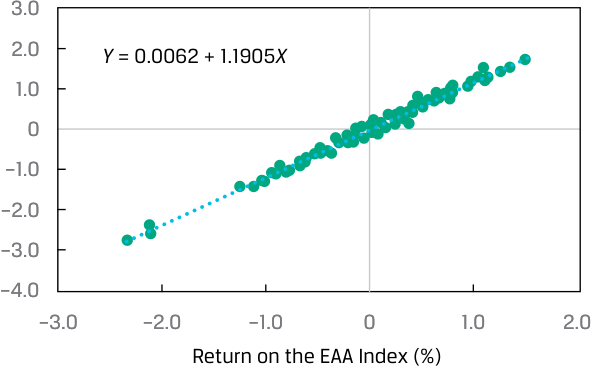

<!-- Picture Text: 3.0 2.0 Y  = 0.0062 + 1.1905 X 1.0 0 –1.0 –2.0 –3.0 –4.0 –3.0 –2.0 –1.0 0 1.0 2.0 Return on the EAA Index (%)  -->
> **Chú thích hình ảnh (Phần A):** Trục tung: Tỷ suất sinh lợi cổ phiếu DEF (%). Trục hoành: Tỷ suất sinh lợi Chỉ số EAA (%). Phương trình đường hồi quy: $Y = 0.0062 + 1.1905X$.

#### **_B. Biểu đồ phân tán của Phần dư và Tỷ suất sinh lợi Chỉ số EAA_**

##### Phần dư Tỷ suất sinh lợi Cổ phiếu DEF (%)

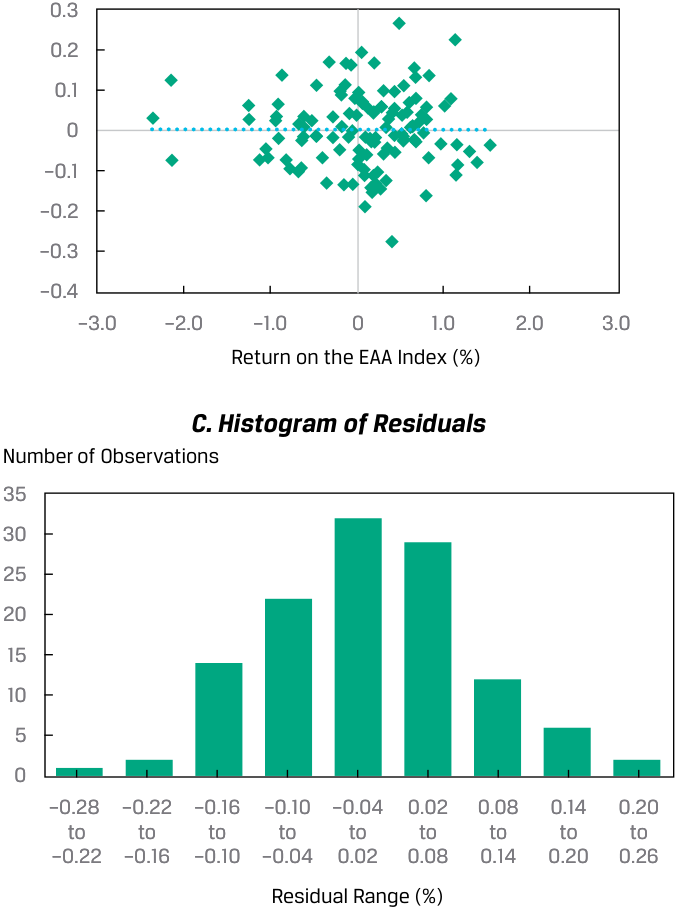

<!-- Picture Text: 0.3 0.2 0.1 0 –0.1 –0.2 –0.3 –0.4 –3.0 –2.0 –1.0 0 1.0 2.0 3.0 Return on the EAA Index (%) C. Histogram of Residuals Number of Observations 35 30 25 20 15 10 5 0 –0.28  –0.22 –0.16 –0.10 –0.04 0.02 0.08 0.14 0.20 to to to to to to to to to –0.22 –0.16 –0.10 –0.04 0.02 0.08 0.14 0.20 0.26 Residual Range (%)  -->
> **Chú thích hình ảnh (Phần B & C):**
> - **B. Biểu đồ phân tán của phần dư:** Các điểm phần dư phân bố ngẫu nhiên quanh đường 0 trên toàn bộ dải giá trị của Tỷ suất sinh lợi Chỉ số EAA (%).
> - **C. Biểu đồ tần suất của phần dư (*Histogram of Residuals*):** Trục tung: Số lượng quan sát (*Number of Observations*). Trục hoành: Khoảng phần dư (*Residual Range*, %). Hình dáng quả chuông đối xứng cho thấy phần dư có phân phối xấp xỉ chuẩn.

#### **BỘ CÂU HỎI (*QUESTION SET*)**

Một nhà phân tích đang nghiên cứu mối quan hệ giữa tốc độ tăng trưởng chi tiêu tiêu dùng hàng năm ($\text{CONS}$) ở một quốc gia và tốc độ tăng trưởng GDP hàng năm của quốc gia đó ($\text{GGDP}$). Nhà phân tích ước lượng hai mô hình trong Bảng 45.

<!-- PDF Page 317 -->

#### **Bảng 45: Các Ước lượng Mô hình (*Model Estimates*)**

||**Mô hình 1 (*Model 1*)**|**Mô hình 2 (*Model 2*)**|
|---|---|---|
||$\text{GGDP}_i = b_0 + b_1 \text{CONS}_i + \varepsilon_i$|$\text{GGDP}_i = b_0 + b_1 \ln(\text{CONS}_i) + \varepsilon_i$|
|Hệ số chặn (*Intercept*)|1.040|1.006|
|Hệ số góc (*Slope*)|0.669|1.994|
|$R^2$|0.788|0.867|
|Sai số chuẩn của ước lượng (*Standard error of the estimate*)|0.404|0.320|
|Thống kê $F$ (*$F$-statistic*)|141.558|247.040|

1. Xác định dạng hàm (*functional form*) được sử dụng trong các mô hình này.

#### **Lời giải:**

Mô hình 1 là mô hình hồi quy tuyến tính đơn không có biến đổi biến số, trong khi Mô hình 2 là mô hình tuyến tính-log (*lin-log model*) với logarit tự nhiên của biến $\text{CONS}$ làm biến độc lập.

2. Giải thích mô hình nào có mức độ phù hợp (*goodness of fit*) tốt hơn với dữ liệu mẫu.

#### **Lời giải:**

Mô hình lin-log, tức Mô hình 2, khớp với dữ liệu tốt hơn. Bởi vì biến phụ thuộc là như nhau đối với cả hai mô hình, chúng ta có thể so sánh mức độ phù hợp của hai mô hình bằng cách sử dụng các thước đo tương đối ($R^2$ hoặc thống kê $F$) hoặc thước đo mức độ phù hợp tuyệt đối là sai số chuẩn của ước lượng ($s_e$). Sai số chuẩn của ước lượng thấp hơn đối với Mô hình 2 ($0.320 < 0.404$), trong khi $R^2$ và thống kê $F$ lại cao hơn đối với Mô hình 2 so với Mô hình 1.

---

# Tập 1: Các Phương pháp Định lượng (*Quantitative Methods*)
## Học phần 10: Hồi quy Tuyến tính Đơn (*Simple Linear Regression*)
### Phần 5/6: Bài tập Thực hành (Trang PDF 318–329)

---

<!-- PDF Page 318 -->

# **BÀI TẬP THỰC HÀNH (*PRACTICE PROBLEMS*)**

## **Thông tin sau đây liên quan đến các câu hỏi 1–3**

Một nhà phân tích đã ước lượng một mô hình hồi quy tỷ suất sinh lợi trên vốn chủ sở hữu (ROE) của một công ty theo cơ hội tăng trưởng (GO) của công ty đó, được định nghĩa là tốc độ tăng trưởng kép hàng năm (*compounded annual growth rate* – CAGR) trong ba năm của doanh số bán hàng, trong giai đoạn 20 năm, và đưa ra hồi quy tuyến tính đơn ước lượng sau đây:

$$\text{ROE}_i = 4 + 1.8 \text{GO}_i + \varepsilon_i$$

Cả hai biến số đều được tính bằng phần trăm, vì vậy một quan sát GO bằng 5% được đưa vào mô hình là 5.

**1.** Giá trị dự báo của ROE của công ty nếu GO của công ty là 10% *gần nhất* với:

   - **A.** 1,8%.

   - **B.** 15,8%.

   - **C.** 22,0%.

**2.** Mức thay đổi trong ROE khi GO thay đổi từ 5% lên 6% *gần nhất* với:

   - **A.** 1,8%.

   - **B.** 4,0%.

   - **C.** 5,8%.

**3.** Phần dư (*residual*) trong trường hợp $\text{GO}$ bằng 8% và $\text{ROE}$ quan sát được bằng 21% *gần nhất* với:

   - **A.** −1,8%.

   - **B.** 2,6%.

   - **C.** 12,0%.

**4.** Phương sai sai số không đổi (*Homoskedasticity*) được mô tả đúng nhất là tình huống trong đó phương sai của phần dư của một hồi quy:

   - **A.** bằng 0.

   - **B.** có phân phối chuẩn.

   - **C.** không đổi qua các quan sát.

<!-- PDF Page 319 -->

## **Thông tin sau đây liên quan đến các câu hỏi 5–8**

Một nhà phân tích đang kiểm tra tốc độ tăng trưởng cung tiền hàng năm của một quốc gia trong 30 năm qua. Quốc gia này đã trải qua một sự thay đổi chính sách của ngân hàng trung ương cách đây 15 năm, làm thay đổi cách tiếp cận quản lý cung tiền. Nhà phân tích đã ước lượng một mô hình sử dụng tốc độ tăng trưởng hàng năm của cung tiền được hồi quy theo biến số ($\text{SHIFT}$) nhận giá trị bằng 0 trước khi thay đổi chính sách và bằng 1 sau khi thay đổi chính sách. Cô ấy đã ước lượng các giá trị trong Bảng 1:

**Bảng 1: Các Ước lượng với Biến SHIFT**

||**Các hệ số (*Coefficients*)**|**Sai số chuẩn (*Standard Error*)**|**Thống kê $t$ (*$t$-Stat.*)**|
|---|---|---|---|
|Hệ số chặn (*Intercept*)|5.767264|0.445229|12.95348|
|SHIFT|−5.13912|0.629649|−8.16188|

*Giá trị $t$ tới hạn, mức ý nghĩa 0,05:*
*Một phía, bên trái: $-1.701$ | Một phía, bên phải: $+1.701$ | Hai phía: $\pm 2.048$*

**5.** Biến số $\text{SHIFT}$ được mô tả đúng nhất là:

   - **A.** một biến chỉ báo (*indicator variable*).

   - **B.** một biến phụ thuộc (*dependent variable*).

   - **C.** một biến liên tục (*continuous variable*).

**6.** Ý nghĩa giải thích của hệ số chặn (*intercept*) là giá trị trung bình của tốc độ tăng trưởng cung tiền hàng năm:

   - **A.** trước khi thay đổi chính sách.

   - **B.** trong toàn bộ giai đoạn.

   - **C.** sau khi thay đổi chính sách.

**7.** Ý nghĩa giải thích của hệ số góc (*slope*) là:

   - **A.** mức thay đổi trong tốc độ tăng trưởng cung tiền hàng năm qua mỗi năm.

   - **B.** tốc độ tăng trưởng cung tiền trung bình hàng năm sau khi thay đổi chính sách.

   - **C.** sự chênh lệch trong tốc độ tăng trưởng cung tiền trung bình hàng năm từ trước sang sau khi thay đổi chính sách.

**8.** Kiểm định xem liệu có sự thay đổi trong tăng trưởng cung tiền sau khi thay đổi chính sách hay không, sử dụng mức ý nghĩa $0.05$, chúng ta kết luận rằng:

   - **A.** có đủ bằng chứng cho thấy tăng trưởng cung tiền đã thay đổi.

   - **B.** không có đủ bằng chứng cho thấy tăng trưởng cung tiền khác 0.

   - **C.** không có đủ bằng chứng để chỉ ra rằng tăng trưởng cung tiền đã thay đổi.

<!-- PDF Page 320 -->

## **Thông tin sau đây liên quan đến các câu hỏi 9–12**

Kenneth McCoin, CFA, là một người phỏng vấn đầy thử thách. Năm ngoái, ông đã đưa cho mỗi ứng viên xin việc một tờ giấy có thông tin trong Bảng 1, và sau đó ông hỏi một số câu hỏi về phân tích hồi quy. Một số câu hỏi của McCoin, cùng với một mẫu các câu trả lời mà ông nhận được cho từng câu hỏi, được đưa ra dưới đây. McCoin nói với các ứng viên rằng biến độc lập là tỷ lệ lợi nhuận ròng trên doanh thu (*ratio of net income to sales*) của các nhà hàng có vốn hóa thị trường trên 100 triệu đô la và biến phụ thuộc là tỷ lệ dòng tiền từ hoạt động kinh doanh trên doanh thu (*ratio of cash flow from operations to sales*) của các nhà hàng đó. Lựa chọn nào được cung cấp dưới đây là câu trả lời đúng nhất cho từng câu hỏi của McCoin?

**Bảng 1: Phân tích Hồi quy (*Regression Analysis*)**

|**Thống kê Hồi quy (*Regression Statistics*)**||
|---|---|
|$R^2$|0.7436|
|Sai số chuẩn (*Standard error*)|0.0213|
|Số quan sát (*Observations*)|24|

|**Nguồn (*Source*)**|**Bậc tự do (*df*)**|**Tổng bình phương (*Sum of Squares*)**|**Trung bình bình phương (*Mean Square*)**|**$F$**|**Trị số $p$ (*$p$-Value*)**|
|---|---|---|---|---|---|
|Hồi quy (*Regression*)|1|0.029|0.029000|63.81|0|
|Phần dư (*Residual*)|22|0.010|0.000455|||
|Tổng (*Total*)|23|0.040||||

||**Các hệ số (*Coefficients*)**|**Sai số chuẩn (*Standard Error*)**|**Thống kê $t$ (*$t$-Statistic*)**|**Trị số $p$ (*$p$-Value*)**|
|---|---|---|---|---|
|Hệ số chặn (*Intercept*)|0.077|0.007|11.328|0|
|Lợi nhuận ròng trên doanh thu (%)|0.826|0.103|7.988|0|

**9.** Hệ số xác định (*coefficient of determination*) *gần nhất* với:

   - **A.** 0,7436.

   - **B.** 0,8261.

   - **C.** 0,8623.

**10.** Hệ số tương quan giữa $X$ và $Y$ *gần nhất* với:

   - **A.** −0,7436.

   - **B.** 0,7436.

   - **C.** 0,8623.

**11.** Nếu tỷ lệ lợi nhuận ròng trên doanh thu của một nhà hàng là 5%, tỷ lệ dòng tiền từ hoạt động kinh doanh (CFO) trên doanh thu dự báo *gần nhất* với:

   - **A.** −4,054.

<!-- PDF Page 321 -->

   - **B.** 0,524.

   - **C.** 4,207.

**12.** Mối quan hệ giữa tỷ lệ dòng tiền từ hoạt động kinh doanh trên doanh thu và tỷ lệ lợi nhuận ròng trên doanh thu có ý nghĩa thống kê tại mức 0,05 hay không?

   - **A.** Không, bởi vì $R^2$ lớn hơn 0,05.

   - **B.** Không, bởi vì trị số $p$ của hệ số chặn và hệ số góc nhỏ hơn 0,05.

   - **C.** Có, bởi vì các trị số $p$ cho $F$ và $t$ của hệ số góc nhỏ hơn 0,05.

## **Thông tin sau đây liên quan đến các câu hỏi 13–17**

Howard Golub, CFA, đang chuẩn bị viết một báo cáo nghiên cứu về cổ phiếu phổ thông của Stellar Energy Corp. Là một trong những công ty lớn nhất thế giới, Stellar hoạt động trong lĩnh vực lọc dầu và tiếp thị dầu mỏ. Như một phần trong phân tích của mình, Golub muốn đánh giá độ nhạy cảm của tỷ suất sinh lợi cổ phiếu đối với các yếu tố kinh tế khác nhau. Ví dụ, một khách hàng gần đây đã hỏi Golub liệu giá cổ phiếu của Stellar Energy Corp. có xu hướng tăng sau các đợt tăng giá năng lượng bán lẻ hay không. Golub tin rằng mối liên hệ giữa hai biến số là âm (ngược chiều), nhưng ông không biết độ mạnh của mối liên hệ này.

Golub chỉ đạo trợ lý của mình, Jill Batten, nghiên cứu mối quan hệ giữa (1) tỷ suất sinh lợi cổ phiếu phổ thông hàng tháng của Stellar và mức thay đổi phần trăm của tháng trước trong Chỉ số Giá Tiêu dùng Năng lượng Hoa Kỳ (CPIENG) và (2) tỷ suất sinh lợi cổ phiếu phổ thông hàng tháng của Stellar và mức thay đổi phần trăm của tháng trước trong Chỉ số Giá Sản xuất Vật liệu Năng lượng Thô Hoa Kỳ (PPICEM). Golub muốn Batten chạy cả phân tích tương quan và phân tích hồi quy tuyến tính. Để đáp lại, Batten tổng hợp các thống kê tóm tắt được trình bày trong Bảng 1 cho 248 tháng. Tất cả dữ liệu đều ở dạng thập phân, trong đó $0.01$ biểu thị mức tỷ suất sinh lợi 1%. Batten cũng chạy phân tích hồi quy sử dụng tỷ suất sinh lợi hàng tháng của Stellar làm biến phụ thuộc và mức thay đổi hàng tháng trong CPIENG làm biến độc lập. Bảng 2 hiển thị kết quả của mô hình hồi quy này.

### **Bảng 1: Thống kê Mô tả (*Descriptive Statistics*)**

||**Tỷ suất sinh lợi hàng tháng cổ phiếu phổ thông Stellar**|**Thay đổi hàng tháng có độ trễ: CPIENG**|**Thay đổi hàng tháng có độ trễ: PPICEM**|
|---|---|---|---|
|Trung bình (*Mean*)|0.0123|0.0023|0.0042|
|Độ lệch chuẩn (*Standard deviation*)|0.0717|0.0160|0.0534|
|Hiệp phương sai (*Covariance*), Stellar vs. CPIENG|−0.00017|||
|Hiệp phương sai (*Covariance*), Stellar vs. PPICEM|−0.00048|||
|Hiệp phương sai (*Covariance*), CPIENG vs. PPICEM|0.00044|||
|Hệ số tương quan (*Correlation*), Stellar vs. CPIENG|−0.1452|||

<!-- PDF Page 322 -->

### **Bảng 2: Phân tích Hồi quy với CPIENG**

|**Thống kê Hồi quy (*Regression Statistics*)**|||
|---|---|---|
|$R^2$|0.0211||
|Sai số chuẩn của ước lượng (*Standard error of the estimate*)|0.0710||
|Số quan sát (*Observations*)|248||
||**Các hệ số (*Coefficients*)**|**Sai số chuẩn (*Standard Error*)**|**Thống kê $t$ (*$t$-Statistic*)**|
|Hệ số chặn (*Intercept*)|0.0138|0.0046|3.0275|
|CPIENG (%)|−0.6486|0.2818|−2.3014|

*Giá trị $t$ tới hạn: Một phía, bên trái: $-1.651$ | Một phía, bên phải: $+1.651$ | Hai phía: $\pm 1.967$*

**13.** Câu nào sau đây mô tả đúng nhất hồi quy của Batten?

   - **A.** Hồi quy chuỗi thời gian (*Time-series regression*)

   - **B.** Hồi quy dữ liệu chéo (*Cross-sectional regression*)

   - **C.** Hồi quy chuỗi thời gian và dữ liệu chéo (*Time-series and cross-sectional regression*)

**14.** Dựa trên hồi quy, nếu CPIENG *giảm* 1,0%, tỷ suất sinh lợi kỳ vọng trên cổ phiếu phổ thông của Stellar trong kỳ tiếp theo *gần nhất* với:

   - **A.** 0,0073 (0,73%).

   - **B.** 0,0138 (1,38%).

   - **C.** 0,0203 (2,03%).

**15.** Dựa trên mô hình hồi quy của Batten, hệ số xác định chỉ ra rằng:

   - **A.** tỷ suất sinh lợi của Stellar giải thích 2,11% sự biến thiên trong CPIENG.

   - **B.** tỷ suất sinh lợi của Stellar giải thích 14,52% sự biến thiên trong CPIENG.

   - **C.** những thay đổi trong CPIENG giải thích 2,11% sự biến thiên trong tỷ suất sinh lợi của Stellar.

**16.** Đối với mô hình hồi quy của Batten, $0.0710$ là độ lệch chuẩn của:

   - **A.** biến phụ thuộc.

   - **B.** phần dư từ hồi quy.

   - **C.** biến phụ thuộc dự báo từ hồi quy.

**17.** Đối với phân tích được thực hiện bởi Batten, câu nào sau đây là một kết luận *không chính xác* từ kết quả đầu ra của hồi quy?

   - **A.** Hệ số chặn ước lượng từ hồi quy của Batten khác 0 một cách có ý nghĩa thống kê tại mức ý nghĩa 0,05.

<!-- PDF Page 323 -->

   - **B.** Trong tháng sau khi CPIENG giảm, cổ phiếu phổ thông của Stellar được kỳ vọng sẽ mang lại tỷ suất sinh lợi dương.

   - **C.** Khi xem xét kết hợp, hệ số góc và hệ số chặn từ hồi quy của Batten không khác 0 một cách có ý nghĩa thống kê tại mức ý nghĩa 0,05.

## **Thông tin sau đây liên quan đến các câu hỏi 18–26**

Anh Liu là một nhà phân tích đang nghiên cứu xem liệu gánh nặng nợ của một công ty có ảnh hưởng đến quyết định bán khống (*short*) cổ phiếu công ty đó của các nhà đầu tư hay không. Cô tính toán tỷ lệ bán khống (*short interest ratio* – tỷ lệ giữa khối lượng cổ phiếu bán khống chưa đóng vị thế trên khối lượng giao dịch cổ phiếu trung bình hàng ngày, tính bằng số ngày) cho 50 công ty tính đến cuối năm và so sánh tỷ lệ này với tỷ lệ nợ của các công ty (*debt ratio* – tỷ lệ tổng nợ phải trả trên tổng tài sản, biểu diễn dưới dạng thập phân). Liu cung cấp một số thống kê trong Bảng 1. Cô cũng ước lượng một hồi quy đơn để điều tra tác động của tỷ lệ nợ lên tỷ lệ bán khống của công ty. Kết quả của hồi quy đơn này, bao gồm phân tích phương sai (ANOVA), được trình bày trong Bảng 2.

Ngoài việc ước lượng phương trình hồi quy, Liu vẽ đồ thị 50 quan sát bằng biểu đồ phân tán, với tỷ lệ bán khống trên trục tung và tỷ lệ nợ trên trục hoành.

**Bảng 1: Thống kê Tóm tắt (*Summary Statistics*)**

|**Thống kê (*Statistic*)**|**Tỷ lệ nợ (*Debt Ratio*, $X_i$)**|**Tỷ lệ bán khống (*Short Interest Ratio*, $Y_i$)**|
|---|---|---|
|Tổng (*Sum*)|$19.8550$|$192.3000$|
|Tổng bình phương các độ lệch so với giá trị trung bình|$\sum_{i=1}^{n} (X_i - \bar{X})^2 = 2.2225$|$\sum_{i=1}^{n} (Y_i - \bar{Y})^2 = 412.2042$|
|Tổng tích chéo của các độ lệch so với giá trị trung bình|$\sum_{i=1}^{n} (X_i - \bar{X})(Y_i - \bar{Y}) = -9.2430$||

**Bảng 2: Hồi quy của Tỷ lệ Bán khống theo Tỷ lệ Nợ**

|**ANOVA**|**Bậc tự do (*df*)**|**Tổng bình phương (*Sum of Squares*)**|**Trung bình bình phương (*Mean Square*)**|
|---|---|---|---|
|Hồi quy (*Regression*)|1|38.4404|38.4404|
|Phần dư (*Residual*)|48|373.7638|7.7867|
|Tổng (*Total*)|49|412.2042||
|**Thống kê Hồi quy (*Regression Statistics*)**||||
|$R^2$|0.0933|||
|Sai số chuẩn của ước lượng (*Standard error of estimate*)|2.7905|||

<!-- PDF Page 324 -->

|**ANOVA**|**Bậc tự do (*df*)**|**Tổng bình phương (*Sum of Squares*)**|**Trung bình bình phương (*Mean Square*)**|
|---|---|---|---|
|Số quan sát (*Observations*)|50|||
||**Các hệ số (*Coefficients*)**|**Sai số chuẩn (*Standard Error*)**|**Thống kê $t$ (*$t$-Statistic*)**|
|Hệ số chặn (*Intercept*)|5.4975|0.8416|6.5322|
|Tỷ lệ nợ (*Debt ratio*, %)|−4.1589|1.8718|−2.2219|

*Giá trị $t$ tới hạn cho mức ý nghĩa 0,05: Một phía, bên trái: $-1.677$ | Một phía, bên phải: $+1.677$ | Hai phía: $\pm 2.011$*

Liu đang xem xét ba cách diễn giải các kết quả này cho báo cáo của cô về mối quan hệ giữa tỷ lệ nợ và tỷ lệ bán khống:

- Cách diễn giải 1: Tỷ lệ nợ cao hơn của các công ty gây ra (*cause*) tỷ lệ bán khống thấp hơn.

- Cách diễn giải 2: Tỷ lệ bán khống cao hơn của các công ty gây ra (*cause*) tỷ lệ nợ cao hơn.

- Cách diễn giải 3: Các công ty có tỷ lệ nợ cao hơn có xu hướng (*tend to*) có tỷ lệ bán khống thấp hơn.

Cô đặc biệt quan tâm đến việc sử dụng kết quả ước lượng của mình để dự báo tỷ lệ bán khống cho Tập đoàn MQD, công ty có tỷ lệ nợ là $0.40$.

**18.** Dựa trên Bảng 1 và Bảng 2, nếu Liu vẽ đồ thị 50 quan sát, biểu đồ phân tán tóm tắt mối quan hệ này sẽ được mô tả *đúng nhất* là:

   - **A.** nằm ngang (*horizontal*).

   - **B.** dốc lên (*upward sloping*).

   - **C.** dốc xuống (*downward sloping*).

**19.** Dựa trên Bảng 1, hiệp phương sai mẫu (*sample covariance*) *gần nhất* với:

   - **A.** −9,2430.

   - **B.** −0,1886.

   - **C.** 8,4123.

**20.** Dựa trên Bảng 1 và Bảng 2, hệ số tương quan giữa tỷ lệ nợ và tỷ lệ bán khống *gần nhất* với:

   - **A.** −0,3054.

   - **B.** 0,0933.

   - **C.** 0,3054.

**21.** Cách diễn giải nào mô tả *đúng nhất* những phát hiện của Liu?

   - **A.** Cách diễn giải 1

<!-- PDF Page 325 -->

   - **B.** Cách diễn giải 2

   - **C.** Cách diễn giải 3

**22.** Biến phụ thuộc trong phân tích hồi quy của Liu là:

   - **A.** hệ số chặn.

   - **B.** tỷ lệ nợ.

   - **C.** tỷ lệ bán khống.

**23.** Dựa trên Bảng 2, số bậc tự do cho kiểm định $t$ của hệ số góc trong hồi quy này là:

   - **A.** 48.

   - **B.** 49.

   - **C.** 50.

**24.** Liu nên rút ra kết luận nào sau đây từ các kết quả được trình bày trong Bảng 2?

   - **A.** Tỷ lệ bán khống trung bình là 5,4975.

   - **B.** Hệ số góc ước lượng khác 0 tại mức ý nghĩa 0,05.

   - **C.** Tỷ lệ nợ giải thích 30,54% sự biến thiên trong tỷ lệ bán khống.

**25.** Dựa trên Bảng 2, tỷ lệ bán khống kỳ vọng cho Tập đoàn MQD *gần nhất* với:

   - **A.** 3,8339.

   - **B.** 5,4975.

   - **C.** 6,2462.

**26.** Dựa trên kết quả hồi quy của Liu trong Bảng 2, thống kê $F$ để kiểm định xem hệ số góc có bằng 0 hay không *gần nhất* với:

   - **A.** −2,2219.

   - **B.** 3,5036.

   - **C.** 4,9367.

## **Thông tin sau đây liên quan đến các câu hỏi 27–29**

Doug Abitbol là người quản lý danh mục đầu tư cho Polyi Investments, một quỹ phòng hộ giao dịch tại Hoa Kỳ. Abitbol quản lý quỹ phòng hộ với sự giúp đỡ của Robert Olabudo, một người quản lý danh mục đầu tư cấp dưới. Abitbol xem xét các dự báo lạm phát của các nhà kinh tế học và muốn kiểm tra

<!-- PDF Page 326 -->

mối quan hệ giữa dự báo đồng thuận về Chỉ số Giá Tiêu dùng Hoa Kỳ (US CPI) và US CPI thực tế bằng cách sử dụng phân tích hồi quy. Olabudo ước lượng các hệ số hồi quy để kiểm định xem liệu dự báo đồng thuận có phải là không chệch (*unbiased*) hay không. Nếu các dự báo đồng thuận là không chệch, hệ số chặn phải bằng $0.0$ và hệ số góc sẽ bằng $1.0$. Kết quả hồi quy được trình bày trong Bảng 1. Ngoài ra, Olabudo tính khoảng dự báo 95% của CPI thực tế bằng cách sử dụng dự báo đồng thuận US CPI là $2.8$.

**Bảng 1: Kết quả Đầu ra Hồi quy: Ước lượng US CPI**

|**Thống kê Hồi quy (*Regression Statistics*)**||||
|---|---|---|---|
|$R^2$|0.9859|||
|Sai số chuẩn của ước lượng (*Standard error of estimate*)|0.0009|||
|Số quan sát (*Observations*)|60|||
||**Các hệ số (*Coefficients*)**|**Sai số chuẩn (*Standard Error*)**|**Thống kê $t$ (*$t$-Statistic*)**|
|Hệ số chặn (*Intercept*)|0.0001|0.0002|0.5000|
|Dự báo đồng thuận US CPI|0.9830|0.0155|63.4194|

*Ghi chú:*

**1.** Giá trị tuyệt đối của giá trị tới hạn cho thống kê $t$ là $2.002$ tại mức ý nghĩa 5%.

**2.** Độ lệch chuẩn của dự báo đồng thuận US CPI là $s_X = 0.7539$.

**3.** Giá trị trung bình của dự báo đồng thuận US CPI là $\bar{X} = 1.3350$.

Cuối cùng, Abitbol và Olabudo thảo luận về dự báo và khoảng dự báo:

   - Nhận xét 1: Đối với một mức độ tin cậy cho trước, khoảng dự báo là như nhau bất kể dự báo đồng thuận US CPI là bao nhiêu.

   - Nhận xét 2: Sai số chuẩn của ước lượng lớn hơn sẽ dẫn đến khoảng tin cậy (dự báo) rộng hơn.

**27.** Dựa trên Bảng 1, Olabudo nên:

   - **A.** kết luận rằng các dự báo lạm phát là không chệch.

   - **B.** bác bỏ giả thuyết không cho rằng hệ số góc bằng 1.

   - **C.** bác bỏ giả thuyết không cho rằng hệ số chặn bằng 0.

**28.** Dựa trên Bảng 1, Olabudo nên tính khoảng dự báo cho US CPI thực tế *gần nhất* với:

   - **A.** 2,7506 đến 2,7544.

   - **B.** 2,7521 đến 2,7529.

   - **C.** 2,7981 đến 2,8019.

**29.** Nhận xét nào của Olabudo về việc dự báo là đúng?

   - **A.** Chỉ Nhận xét 1

<!-- PDF Page 327 -->

   - **B.** Chỉ Nhận xét 2

   - **C.** Cả Nhận xét 1 và Nhận xét 2

## **Thông tin sau đây liên quan đến các câu hỏi 30–34**

Elena Vasileva gần đây đã gia nhập EnergyInvest với tư cách là chuyên viên phân tích danh mục đầu tư cấp dưới. Người giám sát của Vasileva yêu cầu cô đánh giá một cơ hội đầu tư tiềm năng vào Amtex, một tập đoàn dầu khí đa quốc gia có trụ sở tại Hoa Kỳ. Người giám sát của Vasileva gợi ý sử dụng phân tích hồi quy để kiểm tra mối quan hệ giữa cổ phiếu Amtex và tỷ suất sinh lợi trên dầu thô.

Vasileva ghi chú các giả định sau đây của phân tích hồi quy:

- Giả định 1: Hạng tử sai số không tương quan qua các quan sát.

- Giả định 2: Phương sai của hạng tử sai số là như nhau đối với tất cả các quan sát.

- Giả định 3: Biến phụ thuộc có phân phối chuẩn.

Vasileva chạy một hồi quy của tỷ suất sinh lợi cổ phiếu Amtex theo tỷ suất sinh lợi dầu thô bằng cách sử dụng dữ liệu hàng tháng mà cô thu thập được. Dữ liệu chọn lọc được sử dụng trong hồi quy được trình bày trong Bảng 1, và kết quả đầu ra hồi quy chọn lọc được trình bày trong Bảng 2. Cô sử dụng mức ý nghĩa 1% trong tất cả các kiểm định của mình.

**Bảng 1: Dữ liệu Chọn lọc cho Tỷ suất sinh lợi Dầu thô và Tỷ suất sinh lợi Cổ phiếu Amtex**

||**Tỷ suất sinh lợi Dầu ($X_i$)**|**Tỷ suất sinh lợi Amtex ($Y_i$)**|**Tích chéo $(X_i - \bar{X})(Y_i - \bar{Y})$**|**Tỷ suất sinh lợi Amtex dự báo ($\hat{Y}_i$)**|**Phần dư hồi quy $(Y_i - \hat{Y}_i)$**|**Bình phương phần dư $(Y_i - \hat{Y}_i)^2$**|
|---|---|---|---|---|---|---|
|Tháng 1|−0.032000|0.033145|−0.000388|0.002011|−0.031134|0.000969|
|$\vdots$|$\vdots$|$\vdots$|$\vdots$|$\vdots$|$\vdots$|$\vdots$|
|Tháng 36|0.028636|0.062334|0.002663|0.016282|−0.046053|0.002121|
|Tổng (*Sum*)|||0.085598|||0.071475|
|Trung bình (*Average*)|−0.018056|0.005293|||||

**Bảng 2: Kết quả Đầu ra Hồi quy Chọn lọc, Biến phụ thuộc: Tỷ suất sinh lợi Cổ phiếu Amtex**

||**Hệ số (*Coefficient*)**|**Sai số chuẩn (*Standard Error*)**|
|---|---|---|
|Hệ số chặn (*Intercept*)|0.0095|0.0078|
|Tỷ suất sinh lợi dầu (*Oil return*)|0.2354|0.0760|

Giá trị $t$ tới hạn cho mức ý nghĩa 1%:

Một phía, bên trái: $-2.441$

<!-- PDF Page 328 -->

Một phía, bên phải: $+2.441$ | Hai phía: $\pm 2.728$

Vasileva kỳ vọng tỷ suất sinh lợi dầu thô vào tháng tới, Tháng 37, sẽ là $-0.01$. Cô tính toán sai số chuẩn của dự báo là $0.0469$.

**30.** Giả định nào của Vasileva liên quan đến phân tích hồi quy là *không chính xác*?

   - **A.** Giả định 1

   - **B.** Giả định 2

   - **C.** Giả định 3

**31.** Dựa trên Bảng 1, sai số chuẩn của ước lượng (*standard error of the estimate*) *gần nhất* với:

   - **A.** 0,04456.

   - **B.** 0,04585.

   - **C.** 0,05018.

**32.** Dựa trên Bảng 2, Vasileva nên bác bỏ giả thuyết không cho rằng:

   - **A.** hệ số góc nhỏ hơn hoặc bằng 0,15.

   - **B.** hệ số chặn nhỏ hơn hoặc bằng 0.

   - **C.** tỷ suất sinh lợi dầu thô không giải thích được tỷ suất sinh lợi cổ phiếu Amtex.

**33.** Dựa trên Bảng 2 và dự báo của Vasileva về tỷ suất sinh lợi dầu thô cho Tháng 37, ước lượng tỷ suất sinh lợi cổ phiếu Amtex cho Tháng 37 *gần nhất* với:

   - **A.** −0,0024.

   - **B.** 0,0071.

   - **C.** 0,0119.

**34.** Sử dụng thông tin từ Bảng 2, khoảng dự báo 99% cho tỷ suất sinh lợi cổ phiếu Amtex vào Tháng 37 được mô tả *đúng nhất* là:

   - **A.** $\hat{Y}_f \pm 0.0053$.

   - **B.** $\hat{Y}_f \pm 0.0469$.

   - **C.** $\hat{Y}_f \pm 0.1279$.

## **Thông tin sau đây liên quan đến các câu hỏi 35–38**

Espey Jones đang kiểm tra mối quan hệ giữa biên lợi nhuận ròng (NPM) của các công ty, tính bằng phần trăm, và vòng quay tài sản cố định (*fixed asset turnover* – FATO) của chúng. Anh ấy đã thu thập một mẫu gồm 35 công ty cho năm tài chính gần nhất và khớp một số dạng hàm khác nhau, cuối cùng chọn mô hình sau đây:

<!-- PDF Page 329 -->

$$\ln(\text{NPM}_i) = b_0 + b_1 \text{FATO}_i$$

Kết quả của ước lượng này được cung cấp trong Bảng 1.

**Bảng 1: Kết quả Hồi quy NPM theo FATO**

|**Nguồn (*Source*)**|**Bậc tự do (*df*)**|**Tổng bình phương (*Sum of Squares*)**|**Trung bình bình phương (*Mean Square*)**|**$F$**|**Trị số $p$ (*$p$-Value*)**|
|---|---|---|---|---|---|
|Hồi quy (*Regression*)|1|102.9152|102.9152|1,486.7079|0.0000|
|Phần dư (*Residual*)|32|2.2152|0.0692|||
|Tổng (*Total*)|33|105.1303||||

||**Các hệ số (*Coefficients*)**|**Sai số chuẩn (*Standard Error*)**|**Thống kê $t$ (*$t$-Statistic*)**|**Trị số $p$ (*$p$-Value*)**|
|---|---|---|---|---|
|Hệ số chặn (*Intercept*)|0.5987|0.0561|10.6749|0.0000|
|FATO|0.2951|0.0077|38.5579|0.0000|

**35.** Hệ số xác định (*coefficient of determination*) *gần nhất* với:

   - **A.** 0,0211.

   - **B.** 0,9789.

   - **C.** 0,9894.

**36.** Sai số chuẩn của ước lượng (*standard error of the estimate*) *gần nhất* với:

   - **A.** 0,2631.

   - **B.** 1,7849.

   - **C.** 38,5579.

**37.** Tại mức ý nghĩa $0.01$, Jones nên kết luận rằng:

   - **A.** biên lợi nhuận ròng trung bình là 0,5987%.

   - **B.** sự biến thiên của vòng quay tài sản cố định giải thích sự biến thiên của logarit tự nhiên của biên lợi nhuận ròng.

   - **C.** sự thay đổi trong vòng quay tài sản cố định từ 3 lên 4 lần có khả năng dẫn đến sự thay đổi trong biên lợi nhuận ròng là 0,5987%.

**38.** Biên lợi nhuận ròng dự báo cho một công ty có vòng quay tài sản cố định là 2 lần *gần nhất* với:

   - **A.** 1,1889%.

   - **B.** 1,8043%.

   - **C.** 3,2835%.

---

# Tập 1: Các Phương pháp Định lượng (*Quantitative Methods*)
## Học phần 10: Hồi quy Tuyến tính Đơn (*Simple Linear Regression*)
### Phần 6/6: Lời giải Bài tập Thực hành (Trang PDF 330–334)

---

<!-- PDF Page 330 -->

# **LỜI GIẢI (*SOLUTIONS*)**

1. **C đúng.** Giá trị dự báo của $\text{ROE} = 4 + (1.8 \times 10) = 22$.

2. **A đúng.** Hệ số góc bằng $1.8$ là mức thay đổi kỳ vọng trong biến phụ thuộc ($\text{ROE}$) ứng với một đơn vị thay đổi trong biến độc lập ($\text{GO}$).

3. **B đúng.** Giá trị dự báo là $\text{ROE} = 4 + (1.8 \times 8) = 18.4$. Giá trị quan sát được của $\text{ROE}$ là $21$, vì vậy phần dư là $2.6 = 21.0 - 18.4$.

4. **C đúng.** Phương sai sai số không đổi (*Homoskedasticity*) là tình huống trong đó phương sai của phần dư là không đổi qua các quan sát.

5. **A đúng.** $\text{SHIFT}$ là một biến chỉ báo (*indicator variable*) hay biến giả (*dummy variable*) bởi vì nó chỉ nhận các giá trị 0 và 1.

6. **A đúng.** Trong một hồi quy đơn với một biến chỉ báo duy nhất, hệ số chặn là giá trị trung bình của biến phụ thuộc khi biến chỉ báo nhận giá trị bằng 0, tức là trước khi thay đổi chính sách trong trường hợp này.

7. **C đúng.** Trong khi hệ số chặn là trung bình của biến phụ thuộc khi biến chỉ báo bằng 0 (tức là trước khi thay đổi chính sách), thì hệ số góc là mức chênh lệch trong giá trị trung bình của biến phụ thuộc từ trước sang sau khi thay đổi chính sách.

8. **A đúng.** Giả thuyết không về việc không có sự khác biệt trong tốc độ tăng trưởng hàng năm bị bác bỏ tại mức ý nghĩa $0.05$: Thống kê kiểm định tính được là $-8.16188$ nằm ngoài phạm vi $\pm 2.048$.

9. **A đúng.** Hệ số xác định (*coefficient of determination*) chính là $R^2$, bằng $0.7436$ trong bảng.

10. **C đúng.** Bởi vì hệ số góc dương, hệ số tương quan giữa $X$ và $Y$ đơn giản là căn bậc hai của hệ số xác định: $\sqrt{0.7436} = 0.8623$.

11. **C đúng.** Để đưa ra dự báo bằng mô hình hồi quy, hãy nhân hệ số góc với giá trị dự báo của biến độc lập và cộng kết quả với hệ số chặn. Giá trị kỳ vọng của tỷ lệ CFO trên doanh thu $= 0.077 + (0.826 \times 5) = 4.207$.

12. **C đúng.** Trị số $p$ (*$p$-value*) là mức ý nghĩa nhỏ nhất mà tại đó các giả thuyết không liên quan đến hệ số góc có thể bị bác bỏ. Trong trường hợp này, trị số $p$ nhỏ hơn $0.05$, và do đó hồi quy của tỷ lệ dòng tiền từ hoạt động kinh doanh trên doanh thu theo tỷ lệ lợi nhuận ròng trên doanh thu có ý nghĩa thống kê tại mức 5%.

13. **A đúng.** Dữ liệu là các quan sát theo thời gian (*observations over time*).

14. **C đúng.** Từ phương trình hồi quy, Tỷ suất sinh lợi kỳ vọng $= 0.0138 + (-0.6486 \times -0.01) = 0.0138 + 0.006486 = 0.0203$, hay 2,03%.

15. **C đúng.** $R^2$ là hệ số xác định. Trong trường hợp này, nó cho thấy 2,11% sự biến thiên trong tỷ suất sinh lợi của Stellar được giải thích bởi những thay đổi trong CPIENG.

16. **B đúng.** Sai số chuẩn của ước lượng (*standard error of the estimate*) là độ lệch chuẩn của các phần dư hồi quy (*regression residuals*).

17. **C là câu trả lời đúng** bởi vì đây là một phát biểu sai. Hệ số góc và hệ số chặn đều khác 0 một cách có ý nghĩa thống kê tại mức ý nghĩa $0.05$.

<!-- PDF Page 331 -->

18. **C đúng.** Hệ số góc (được trình bày trong Bảng 2) là số âm.

19. **B đúng.** Hiệp phương sai mẫu được tính như sau:

$$\frac{\sum_{i=1}^{n} (X_i - \bar{X})(Y_i - \bar{Y})}{n - 1} = -9.2430 \div 49 = -0.1886$$

20. **A đúng.** Trong hồi quy đơn, $R^2$ là bình phương của hệ số tương quan cặp. Bởi vì hệ số góc âm, hệ số tương quan là giá trị âm của căn bậc hai của $0.0933$, hay $-0.3055$ (gần nhất với $-0.3054$).

21. **C đúng.** Không thể rút ra các kết luận về quan hệ nhân quả (*causation*); chỉ có thể rút ra kết luận về mối liên hệ (*association*); do đó, Cách diễn giải 1 và 2 là không chính xác.

22. **C đúng.** Liu giải thích sự biến thiên của tỷ lệ bán khống (*short interest ratio*) bằng cách sử dụng sự biến thiên của tỷ lệ nợ (*debt ratio*).

23. **A đúng.** Bậc tự do bằng số lượng quan sát trừ đi số lượng tham số được ước lượng, bằng 2 trong trường hợp này (hệ số chặn và hệ số góc). Số bậc tự do là $50 - 2 = 48$.

24. **B đúng.** Thống kê $t$ là $-2.2219$, nằm ngoài phạm vi được tạo bởi các giá trị $t$ tới hạn là $\pm 2.011$ cho kiểm định hai phía với mức ý nghĩa 5%. Giá trị $2.011$ là giá trị $t$ tới hạn cho mức ý nghĩa 5% (2,5% ở một phía) đối với 48 bậc tự do. A không chính xác vì giá trị trung bình của tỷ lệ bán khống là $192.3 \div 50 = 3.846$. C không chính xác vì tỷ lệ nợ giải thích 9,33% sự biến thiên của tỷ lệ bán khống.

25. **A đúng.** Giá trị dự báo của tỷ lệ bán khống $= 5.4975 + (-4.1589 \times 0.40) = 5.4975 - 1.6636 = 3.8339$.

26. **C đúng.** Phép tính là:

$$F = \frac{\text{Trung bình bình phương hồi quy (MSR)}}{\text{Trung bình bình phương sai số (MSE)}} = \frac{38.4404}{7.7867} = 4.9367$$

27. **A đúng.** Chúng ta không bác bỏ giả thuyết không về hệ số góc bằng 1, và chúng ta không bác bỏ giả thuyết không về hệ số chặn bằng 0. Kiểm định hệ số góc bằng $1.0$ là:

$$t = \frac{0.9830 - 1.000}{0.0155} = -1.09677$$

Kiểm định hệ số chặn bằng $0.0$ là:

$$t = \frac{0.0001 - 0.0000}{0.0002} = 0.5000$$

Do đó, chúng ta kết luận rằng các dự báo là không chệch (*unbiased*).

28. **A đúng.** Khoảng dự báo cho lạm phát được tính theo ba bước:

- *Bước 1.* Đưa ra dự báo khi biết dự báo US CPI là $2.8$:

$$\hat{Y} = \hat{b}_0 + \hat{b}_1 X = 0.0001 + (0.9830 \times 2.8) = 2.7525$$

- *Bước 2.* Tính phương sai của sai số dự báo:

<!-- PDF Page 332 -->

$$s_f^2 = s_e^2 \left\{ 1 + (1/n) + \frac{(X_f - \bar{X})^2}{(n - 1) \times s_X^2} \right\}$$

$$s_f^2 = 0.0009^2 \left\{ 1 + (1/60) + \frac{(2.8 - 1.3350)^2}{(60 - 1) \times 0.7539^2} \right\}$$

$$s_f^2 = 0.00000088 \implies s_f = 0.0009$$

- *Bước 3.* Tính khoảng dự báo:

$$\hat{Y} \pm t_c \times s_f = 2.7525 \pm (2.0 \times 0.0009)$$

- Cận dưới (*Lower bound*): $2.7525 - (2.0 \times 0.0009) = 2.7506$.

- Cận trên (*Upper bound*): $2.7525 + (2.0 \times 0.0009) = 2.7544$.

Với dự báo US CPI là $2.8$, khoảng dự báo 95% là từ $2.7506$ đến $2.7544$.

29. **B đúng.** Mức độ tin cậy ảnh hưởng đến độ rộng của khoảng dự báo thông qua giá trị $t$ tới hạn được sử dụng để tính khoảng cách từ giá trị dự báo (và bản thân khoảng dự báo cũng phụ thuộc vào giá trị dự báo $X_f$ thông qua $(X_f - \bar{X})^2$). Do đó, Nhận xét 1 không chính xác. Nhận xét 2 chính xác: Sai số chuẩn của ước lượng ($s_e$) càng lớn thì sai số chuẩn của dự báo ($s_f$) càng lớn, dẫn đến khoảng dự báo rộng hơn.

30. **C đúng.** Các giả định của mô hình hồi quy tuyến tính là (1) mối quan hệ giữa biến phụ thuộc và biến độc lập là tuyến tính theo các tham số $b_0$ và $b_1$, (2) các phần dư độc lập với nhau, (3) phương sai của hạng tử sai số là như nhau đối với tất cả các quan sát, và (4) hạng tử sai số có phân phối chuẩn. Giả định 3 không chính xác bởi vì biến phụ thuộc không nhất thiết phải có phân phối chuẩn.

31. **B đúng.** Sai số chuẩn của ước lượng cho mô hình hồi quy tuyến tính với một biến độc lập được tính bằng căn bậc hai của trung bình bình phương sai số:

$$s_e = \sqrt{\frac{0.071475}{34}} = 0.04585$$

32. **C đúng.** Tỷ suất sinh lợi dầu thô giải thích tỷ suất sinh lợi cổ phiếu Amtex nếu hệ số góc khác 0 một cách có ý nghĩa thống kê. Hệ số góc là $0.2354$, và thống kê $t$ tính được là:

$$t = \frac{0.2354 - 0.0000}{0.0760} = 3.0974$$

nằm ngoài phạm vi của các giá trị tới hạn là $\pm 2.728$.

Do đó, Vasileva nên bác bỏ giả thuyết không cho rằng tỷ suất sinh lợi dầu thô không giải thích được tỷ suất sinh lợi cổ phiếu Amtex, bởi vì hệ số góc khác 0 một cách có ý nghĩa thống kê.

A không chính xác vì thống kê $t$ tính được để kiểm định hệ số góc so với $0.15$ là $t = \frac{0.2354 - 0.1500}{0.0760} = 1.1237$, nhỏ hơn giá trị tới hạn $+2.441$. B không chính xác vì thống kê $t$ tính được là $t = \frac{0.0095 - 0.0000}{0.0078} = 1.2179$, nhỏ hơn giá trị tới hạn $+2.441$.

33. **B đúng.** Giá trị dự báo của biến phụ thuộc, tỷ suất sinh lợi cổ phiếu Amtex, khi biết giá trị của biến độc lập, tỷ suất sinh lợi dầu thô là $-0.01$, được tính

<!-- PDF Page 333 -->

bằng $\hat{Y} = \hat{b}_0 + \hat{b}_1 X_i = 0.0095 + [0.2354 \times (-0.01)] = 0.0071$.

34. **C đúng.** Tỷ suất sinh lợi cổ phiếu dự báo là $0.0095 + [0.2354 \times (-0.01)] = 0.0071$. Khoảng dao động là $t_c \times s_f = 2.728 \times 0.0469 = 0.1279$. Giới hạn dưới cho khoảng dự báo là $0.0071 - (2.728 \times 0.0469) = -0.1208$, và giới hạn trên cho khoảng dự báo là $0.0071 + (2.728 \times 0.0469) = 0.1350$.

A không chính xác vì các cận của khoảng dự báo phải dựa trên sai số chuẩn của dự báo và giá trị $t$ tới hạn, chứ không phải dựa trên giá trị trung bình của biến phụ thuộc.

B không chính xác vì các cận của khoảng dự báo dựa trên tích của sai số chuẩn của dự báo *và* giá trị $t$ tới hạn, chứ không chỉ đơn thuần là sai số chuẩn của dự báo.

35. **B đúng.** Hệ số xác định là $102.9152 \div 105.1303 = 0.9789$.

36. **A đúng.** Sai số chuẩn của ước lượng là căn bậc hai của trung bình bình phương sai số, hay $\sqrt{0.0692} = 0.2631$.

37. **B đúng.** Trị số $p$ tương ứng với hệ số góc nhỏ hơn $0.01$, vì vậy chúng ta bác bỏ giả thuyết không về hệ số góc bằng 0, kết luận rằng vòng quay tài sản cố định giải thích logarit tự nhiên của biên lợi nhuận ròng.

38. **C đúng.** Logarit tự nhiên dự báo của biên lợi nhuận ròng là $0.5987 + (2 \times 0.2951) = 1.1889$. Biên lợi nhuận ròng dự báo là $e^{1.1889} = 3.2835\%$.

<!-- PDF Page 334 -->
