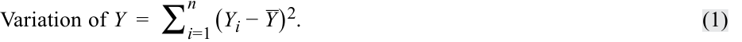
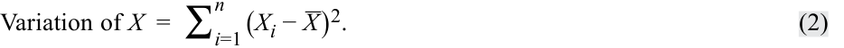
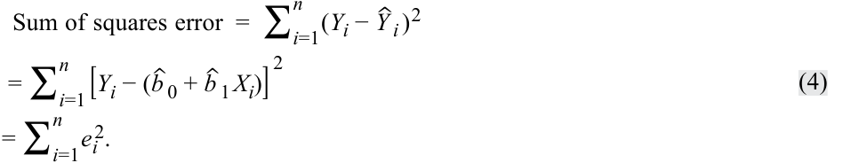
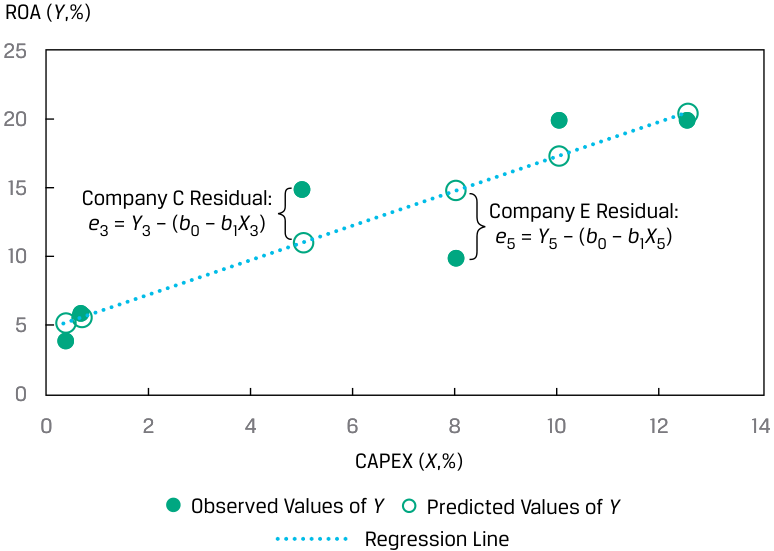
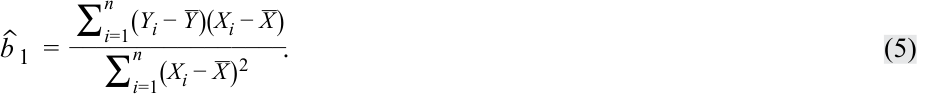
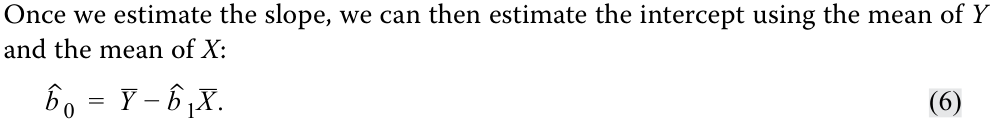
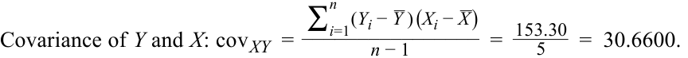

# Tập 1: Các Phương pháp Định lượng (*Quantitative Methods*)
## Học phần 10: Hồi quy Tuyến tính Đơn (*Simple Linear Regression*)
### Phần 1/6: Giới thiệu (Trang PDF 271–282)

---

<!-- PDF Page 271 -->

H Ọ C P H Ầ N

# **<mark>10</mark>**

### **Hồi quy Tuyến tính Đơn (*Simple Linear Regression*)**

**Tác giả: Pamela Peterson Drake, PhD, CFA.**

*Pamela Peterson Drake, PhD, CFA, công tác tại Đại học James Madison (Hoa Kỳ).*

##### **<mark>MỤC TIÊU HỌC TẬP (*LEARNING OUTCOMES*)</mark>**

|**_Mức độ thành thạo_**|**_Ứng viên cần có khả năng:_**|
|---|---|
||mô tả mô hình hồi quy tuyến tính đơn (*simple linear regression model*), cách tiêu chuẩn bình phương tối thiểu (*least squares criterion*) được sử dụng để ước lượng các hệ số hồi quy (*regression coefficients*), và ý nghĩa giải thích của các hệ số này|
||giải thích các giả định cơ sở của mô hình hồi quy tuyến tính đơn, và mô tả cách phần dư (*residuals*) cùng đồ thị phần dư (*residual plots*) cho biết liệu các giả định này có thể đã bị vi phạm hay không|
||tính toán và diễn giải các thước đo mức độ phù hợp (*measures of fit*) cũng như thiết lập và đánh giá các kiểm định mức độ phù hợp (*tests of fit*) và kiểm định các hệ số hồi quy trong hồi quy tuyến tính đơn|
||mô tả việc sử dụng phân tích phương sai (*analysis of variance* – ANOVA) trong phân tích hồi quy, diễn giải kết quả ANOVA, và tính toán cũng như diễn giải sai số chuẩn của ước lượng (*standard error of estimate*) trong hồi quy tuyến tính đơn|
||tính toán và diễn giải giá trị dự báo cho biến phụ thuộc (*dependent variable*), và khoảng dự báo (*prediction interval*) cho giá trị đó, khi biết mô hình hồi quy tuyến tính ước lượng và một giá trị của biến độc lập (*independent variable*)|
||mô tả các dạng hàm (*functional forms*) khác nhau của hồi quy tuyến tính đơn|

#### **GIỚI THIỆU (*INTRODUCTION*)**

<!-- Picture Text: 1  -->

- mô tả mô hình hồi quy tuyến tính đơn (*simple linear regression model*), cách tiêu chuẩn bình phương tối thiểu (*least squares criterion*) được sử dụng để ước lượng các hệ số hồi quy (*regression coefficients*), và ý nghĩa giải thích của các hệ số này

Các nhà phân tích tài chính thường cần kiểm tra xem liệu một biến số có hữu ích trong việc giải thích một biến số khác hay không. Ví dụ, nhà phân tích có thể muốn biết liệu tăng trưởng thu nhập hoặc dòng tiền có giúp giải thích giá trị thị trường của một công ty hay không. **Phân tích hồi quy (*Regression analysis*)** là một công cụ để xem xét loại vấn đề này.

<!-- PDF Page 272 -->

Hồi quy tuyến tính (*Linear regression*) cho phép chúng ta kiểm định các giả thuyết về mối quan hệ giữa hai biến số bằng cách lượng hóa độ mạnh của mối quan hệ giữa hai biến số đó, và sử dụng một biến số để đưa ra các dự báo về biến số kia. Trọng tâm của chúng ta là hồi quy tuyến tính với một biến độc lập duy nhất—tức là hồi quy tuyến tính đơn (*simple linear regression*).

###### **TỔNG QUAN HỌC PHẦN (*LEARNING MODULE OVERVIEW*)**

- Hồi quy tuyến tính đơn (*Simple linear regression*) là một quy trình toán học nhằm xác định cách thức biến thiên (*variation*) của một biến số có thể giải thích sự biến thiên của một biến số khác.

- Biến số mà chúng ta muốn giải thích được gọi là biến phụ thuộc (*dependent variable*), và biến số mà chúng ta sử dụng để giải thích biến phụ thuộc được gọi là biến độc lập (*independent variable*).

- Hồi quy tuyến tính đơn sử dụng phương pháp bình phương tối thiểu thông thường (*ordinary least squares* – OLS) để tính toán tham số hệ số góc (*slope*) và hệ số chặn (*intercept*) đặc trưng cho mối quan hệ tuyến tính giữa hai biến số.

- Hồi quy tuyến tính đơn đòi hỏi chúng ta phải đưa ra bốn giả định: tính tuyến tính (*linearity*), phương sai sai số không đổi (*homoskedasticity*), tính độc lập (*independence*), và tính phân phối chuẩn (*normality*).

- Tính tuyến tính (*Linearity*) đòi hỏi phần dư hồi quy (*regression residuals*) phải mang tính ngẫu nhiên và biến độc lập không phải là ngẫu nhiên. Phương sai sai số không đổi (*Homoskedasticity*), đề cập đến việc phương sai không đổi qua các quan sát, không thể được giả định khi chúng ta thấy phần dư phân cụm thành nhiều nhóm vì sự phân cụm này cho thấy có nhiều chế độ (*regimes*) với các phương sai khác nhau trong giai đoạn thời gian của chúng ta.

- Tính độc lập (*Independence*) có nghĩa là các cặp $X$-$Y$ không tương quan với nhau; một quy luật (*pattern*) trong đồ thị phần dư (ví dụ: tính thời vụ – *seasonality*) gợi ý rằng có sự tự tương quan (*autocorrelation*) giữa các quan sát và chúng ta không thể giả định tính độc lập. Tính phân phối chuẩn (*Normality*) có nghĩa là phần dư phải có phân phối chuẩn chứ không đòi hỏi bản thân dữ liệu phải có phân phối chuẩn. Việc không tuân theo phân phối chuẩn (*Non-normality*) là mối quan ngại đặc biệt đối với các cỡ mẫu nhỏ, nhưng đối với các cỡ mẫu lớn, định lý giới hạn trung tâm (*central limit theorem*) cho chúng ta biết rằng chúng ta có thể nới lỏng yêu cầu về tính phân phối chuẩn.

- Tổng biến thiên của biến phụ thuộc, được gọi là tổng bình phương toàn phần (*sum of squares total* – SST), có thể được phân rã thành hai phần: phần biến thiên được giải thích (*explained variation*), được gọi là tổng bình phương hồi quy (*sum of squares regression* – SSR), và phần biến thiên không được giải thích (*unexplained variation*), được gọi là tổng bình phương sai số (*sum of squares error* – SSE).

- Có một số cách để đo lường mức độ phù hợp (*goodness of fit*) của một mô hình hồi quy. Những cách này bao gồm hệ số xác định (*coefficient of determination*), thống kê $F$ (*$F$-statistic*) cho kiểm định mức độ phù hợp, và sai số chuẩn của hồi quy (*standard error of the regression*).

- Kiểm định giả thuyết (*Hypothesis testing*) có thể được sử dụng để xác định, tại một mức độ tin cậy (*confidence level*) nhất định, liệu hệ số góc hay hệ số chặn có khác 0 hoặc khác một giá trị xác định nào khác hay không, hoặc liệu hệ số góc là dương hay âm. Chúng ta có thể sử dụng các biến chỉ báo (*indicator variables*) để xác định xem liệu các tham số hồi quy của chúng ta có khác biệt giữa các điểm dữ liệu có hoặc không có một đặc tính cụ thể nào đó hay không (ví dụ: dữ liệu giá hàng tháng trong các trường hợp chỉ một số tháng có công bố thu nhập).

- Bảng phân tích phương sai (*analysis of variance* – ANOVA) trình bày các tổng bình phương (*sums of squares*), bậc tự do (*degrees of freedom*), trung bình bình phương (*mean squares*), và thống kê $F$ (*$F$-statistic*) cho một mô hình hồi quy.

<!-- PDF Page 273 -->

- Sai số chuẩn của ước lượng (*standard error of the estimate*) là thước đo khoảng cách giữa các giá trị quan sát được của biến phụ thuộc và các giá trị được dự báo từ phương trình hồi quy ước lượng. Giá trị này càng nhỏ thì độ phù hợp của mô hình càng tốt.

- Sai số chuẩn của dự báo (*standard error of the forecast*) được sử dụng để cung cấp một ước lượng khoảng (*interval estimate*) xung quanh đường hồi quy ước lượng. Điều này là cần thiết vì đường hồi quy không mô tả hoàn hảo mối quan hệ giữa biến phụ thuộc và biến độc lập.

- Mô hình hồi quy tuyến tính đơn trên dữ liệu phi tuyến tính có thể được điều chỉnh bằng cách sử dụng các dạng hàm (*functional forms*) khác nhau nhằm biến đổi biến phụ thuộc hoặc biến độc lập.

- Ba dạng hàm phổ biến để biến đổi dữ liệu bao gồm mô hình log-tuyến tính (*log-lin model*), mô hình tuyến tính-log (*lin-log model*), và mô hình log-log (*log-log model*).

- Chìa khóa để lựa chọn dạng hàm phù hợp của hồi quy tuyến tính đơn là xem xét các thước đo mức độ phù hợp—hệ số xác định ($R^2$), thống kê $F$ ($F$-statistic), và sai số chuẩn của ước lượng ($s_e$)—cũng như kiểm tra xem liệu có các quy luật (*patterns*) trong phần dư hay không.

#### **ƯỚC LƯỢNG MÔ HÌNH HỒI QUY TUYẾN TÍNH ĐƠN (*ESTIMATION OF THE SIMPLE LINEAR REGRESSION MODEL*)**

## **<mark>2</mark>**

- mô tả mô hình hồi quy tuyến tính đơn (*simple linear regression model*), cách tiêu chuẩn bình phương tối thiểu (*least squares criterion*) được sử dụng để ước lượng các hệ số hồi quy (*regression coefficients*), và ý nghĩa giải thích của các hệ số này

##### **Giới thiệu về Hồi quy Tuyến tính (*Introduction to Linear Regression*)**

Giả sử một nhà phân tích đang kiểm tra tỷ suất sinh lợi trên tài sản (*return on assets* – ROA) của một ngành và quan sát ROA của sáu công ty được trình bày trong Bảng 1. Trung bình của các mức ROA này là 12,5%, nhưng khoảng biến thiên trải dài từ 4% đến 20%.

**Bảng 1: Tỷ suất sinh lợi trên tài sản (ROA) của các công ty được chọn**

|**Công ty (*Company*)**|**ROA (%)**|
|---|---|
|A|6.0|
|B|4.0|
|C|15.0|
|D|20.0|
|E|10.0|
|F|20.0|

<!-- PDF Page 274 -->

Khi cố gắng tìm hiểu tại sao ROA lại khác nhau giữa các công ty này, chúng ta có thể xem xét tại sao ROA của Công ty A khác với ROA của Công ty B, tại sao ROA của Công ty A khác với ROA của Công ty D, tại sao ROA của Công ty F khác với ROA của Công ty C, v.v., bằng cách so sánh từng cặp ROA. Chúng ta có thể đơn giản hóa công việc này bằng cách thay vào đó so sánh ROA của mỗi công ty với mức ROA trung bình là 12,5%. Để làm điều này, chúng ta xem xét tổng bình phương các độ lệch (*sum of the squared deviations*) của các quan sát so với giá trị trung bình nhằm nắm bắt sự biến thiên của ROA so với mức trung bình của chúng. Gọi $Y$ là biến số mà chúng ta muốn giải thích, trong trường hợp này là ROA. Gọi $Y_i$ là một quan sát về ROA của một công ty, và gọi $\bar{Y}$ là ROA trung bình cho mẫu có kích thước $n$. Chúng ta có thể mô tả sự biến thiên của các mức ROA như sau:

<!-- Formula Text: Variation of Y  =  ∑ i=1 n (Y i − _ Y ) 2. (1) -->
$$\text{Biến thiên của } Y = \sum_{i=1}^{n} (Y_i - \bar{Y})^2 \tag{1}$$

Mục tiêu của chúng ta là hiểu điều gì thúc đẩy các mức ROA này hay nói cách khác, điều gì giải thích sự biến thiên của $Y$. Sự biến thiên của $Y$ thường được gọi là **tổng bình phương toàn phần (*sum of squares total* – SST)**, hay tổng các bình phương toàn phần (*total sum of squares*).

Bây giờ chúng ta đặt câu hỏi liệu có thể giải thích sự biến thiên của ROA bằng cách sử dụng một biến số khác cũng biến thiên giữa các công ty hay không; lưu ý rằng nếu biến số khác này là hằng số hoặc ngẫu nhiên, nó sẽ không giải thích được sự khác biệt về ROA. Giả sử nhà phân tích tin rằng chi tiêu vốn (*capital expenditures*) trong kỳ trước, được chuẩn hóa theo quy mô (*scaled*) bằng giá trị bất động sản, nhà xưởng và thiết bị (*property, plant, and equipment* – PP&E) đầu kỳ trước, là yếu tố thúc đẩy biến số ROA. Hãy biểu diễn biến số chi tiêu vốn đã chuẩn hóa theo quy mô này là CAPEX, như chúng ta trình bày trong Bảng 2.

**Bảng 2: Tỷ suất sinh lợi trên tài sản (ROA) và Chi tiêu vốn đã chuẩn hóa theo quy mô (CAPEX)**

|**Công ty (*Company*)**|**ROA (%)**|**CAPEX (%)**|
|---|---|---|
|A|6.0|0.7|
|B|4.0|0.4|
|C|15.0|5.0|
|D|20.0|10.0|
|E|10.0|8.0|
|F|20.0|12.5|
|Trung bình cộng (*Arithmetic mean*)|12.5|6.1|

Gọi $X$ là biến giải thích (*explanatory variable*), trong trường hợp này là CAPEX. Khi đó $X_i$ sẽ đại diện cho một quan sát của biến giải thích của chúng ta, và $\bar{X}$ sẽ đại diện cho giá trị trung bình của biến giải thích, tức là trung bình của tất cả các giá trị CAPEX của chúng ta. Sự biến thiên của $X$ được tính như sau:

<!-- Formula Text: Variation of X  =  ∑ i=1 n (X i − _ X ) 2. (2) -->
$$\text{Biến thiên của } X = \sum_{i=1}^{n} (X_i - \bar{X})^2 \tag{2}$$

Chúng ta có thể thấy mối quan hệ giữa ROA và CAPEX trong **biểu đồ phân tán (*scatter plot* / *scattergram*)** ở Hình 3, biểu diễn hai biến số trên không gian hai chiều. Thông thường, chúng ta trình bày biến số mà chúng ta muốn giải thích sự biến thiên dọc theo trục tung (*vertical axis*) và biến số mà chúng ta muốn sử dụng để giải thích sự biến thiên đó dọc theo trục hoành (*horizontal axis*). Mỗi điểm trong biểu đồ phân tán này đại diện cho một quan sát theo cặp bao gồm CAPEX và ROA. Qua quan sát trực quan thông thường, có thể thấy rõ một mối quan hệ thuận chiều (*positive relation*) giữa ROA và CAPEX: Các công ty có CAPEX cao hơn có xu hướng có ROA cao hơn.

<!-- PDF Page 275 -->

###### **Hình 3: Biểu đồ phân tán (*Scatter Plot*) của ROA và CAPEX**

<!-- Picture Text: ROA (%) 25 10.0, 20.0 12.5, 20.0 20 5.0, 15.0 15 8.0, 10.0 10 0.7, 6.0 5 0.4, 4.0 0 0 2 4 6 8 10 12 14 CAPEX (%)  -->
> **Chú thích hình ảnh:** Trục tung: ROA (%) từ 0 đến 25. Trục hoành: CAPEX (%) từ 0 đến 14. Các điểm dữ liệu $(X, Y)$: $(0.4, 4.0)$, $(0.7, 6.0)$, $(5.0, 15.0)$, $(8.0, 10.0)$, $(10.0, 20.0)$, $(12.5, 20.0)$.

Trong ví dụ về ROA, chúng ta sử dụng chi tiêu vốn để giải thích ROA. Chúng ta gọi biến số có sự biến thiên đang được giải thích là **biến phụ thuộc (*dependent variable*)**, hay biến được giải thích (*explained variable*); nó thường được ký hiệu là $Y$. Chúng ta gọi biến số có sự biến thiên được sử dụng để giải thích sự biến thiên của biến phụ thuộc là **biến độc lập (*independent variable*)**, hay biến giải thích (*explanatory variable*); nó thường được ký hiệu là $X$. Do đó, trong ví dụ của chúng ta, ROA là biến phụ thuộc ($Y$) và CAPEX là biến độc lập ($X$).

Một phương pháp phổ biến được sử dụng để liên hệ biến phụ thuộc và biến độc lập là thông qua việc ước lượng một mối quan hệ tuyến tính (*linear relationship*), ngụ ý việc mô tả mối quan hệ giữa hai biến số được biểu diễn bằng một đường thẳng. Nếu chúng ta chỉ có một biến độc lập, chúng ta gọi phương pháp này là **hồi quy tuyến tính đơn (*simple linear regression* – SLR)**, hay hồi quy tuyến tính; nếu chúng ta có nhiều hơn một biến độc lập, chúng ta gọi phương pháp này là hồi quy bội (*multiple regression*).

Hồi quy tuyến tính cho phép chúng ta kiểm định các giả thuyết về mối quan hệ giữa hai biến số bằng cách lượng hóa độ mạnh của mối quan hệ giữa hai biến số đó và sử dụng một biến số để đưa ra các dự báo về biến số kia.

###### **XÁC ĐỊNH BIẾN PHỤ THUỘC VÀ BIẾN ĐỘC LẬP TRONG HỒI QUY**

Một nhà phân tích đang nghiên cứu mối quan hệ giữa tăng trưởng thu nhập doanh nghiệp và tỷ suất sinh lợi cổ phiếu. Cụ thể, cô ấy quan tâm đến việc liệu các đợt điều chỉnh dự báo thu nhập (*earnings revisions*) có tương quan với tỷ suất sinh lợi giá cổ phiếu trong cùng kỳ hay không. Cô thu thập dữ liệu hàng tháng trong năm năm về các đợt điều chỉnh thu nhập trên mỗi cổ phần (*earnings per share* – EPS) và tỷ suất sinh lợi giá cổ phiếu cho một mẫu gồm 100 công ty.

1. Biến phụ thuộc và biến độc lập trong mô hình của cô ấy là gì?

###### **Lời giải:**

Biến phụ thuộc là tỷ suất sinh lợi giá cổ phiếu hàng tháng, và biến độc lập là các đợt điều chỉnh EPS. Trong mô hình của nhà phân tích, sự biến thiên của tỷ suất sinh lợi giá cổ phiếu hàng tháng đang được giải thích bởi sự biến thiên của các đợt điều chỉnh EPS.

<!-- PDF Page 276 -->

##### **Ước lượng các Tham số của Hồi quy Tuyến tính Đơn (*Estimating the Parameters of a Simple Linear Regression*)**

###### **_Những vấn đề cơ bản của Hồi quy Tuyến tính Đơn (*The Basics of Simple Linear Regression*)_**

Phân tích hồi quy bắt đầu với biến phụ thuộc, biến số mà bạn đang tìm cách giải thích sự biến thiên của nó. Biến độc lập là biến số có sự biến thiên được bạn sử dụng để giải thích những thay đổi trong biến phụ thuộc. Ví dụ, bạn có thể cố gắng giải thích tỷ suất sinh lợi của cổ phiếu vốn hóa nhỏ (biến phụ thuộc) bằng cách sử dụng tỷ suất sinh lợi của Chỉ số S&P 500 (biến độc lập). Hoặc bạn có thể cố gắng giải thích tỷ lệ lạm phát của một quốc gia (biến phụ thuộc) như một hàm số của tốc độ tăng trưởng cung tiền của quốc gia đó (biến độc lập).

Đúng như tên gọi, hồi quy tuyến tính giả định một mối quan hệ tuyến tính giữa biến phụ thuộc và biến độc lập. Mục tiêu là khớp một đường thẳng (*fit a line*) với các quan sát của $Y$ và $X$ sao cho tối thiểu hóa tổng bình phương các độ lệch so với đường thẳng đó; đây là tiêu chuẩn bình phương tối thiểu (*least squares criterion*)—do đó có tên là hồi quy bình phương tối thiểu (*least squares regression*). Vì được sử dụng phổ biến, hồi quy tuyến tính thường được gọi là hồi quy bình phương tối thiểu thông thường (*ordinary least squares* – OLS).

Sử dụng ký hiệu toán học, mối quan hệ tuyến tính giữa biến phụ thuộc và biến độc lập được mô tả như sau:

<!-- Formula Text: Yi = b0 + b1Xi + εi, i = 1, . . . , n. (3) -->
$$Y_i = b_0 + b_1 X_i + \varepsilon_i, \quad i = 1, \dots, n \tag{3}$$

Phương trình 3 là một mô hình không đòi hỏi mọi cặp $(X, Y)$ của một quan sát phải nằm trên đường hồi quy. Phương trình này phát biểu rằng biến phụ thuộc, $Y$, bằng **hệ số chặn (*intercept*)**, $b_0$, cộng với **hệ số góc (*slope coefficient*)**, $b_1$, nhân với biến độc lập, $X$, cộng với **hạng tử sai số (*error term*)**, $\varepsilon$. Hạng tử sai số, hay đơn giản là sai số (*error*), đại diện cho phần chênh lệch giữa giá trị quan sát được của $Y$ và giá trị kỳ vọng từ mối quan hệ tổng thể thực sự ngầm định (*true underlying population relation*) giữa $Y$ và $X$. Chúng ta gọi hệ số chặn, $b_0$, và hệ số góc, $b_1$, là các **hệ số hồi quy (*regression coefficients*)**. Một cách mà chúng ta thường dùng để mô tả mối quan hệ hồi quy tuyến tính đơn này là $Y$ được hồi quy theo $X$ (*$Y$ is regressed on $X$*).

Hãy xem xét biểu đồ phân tán ROA và CAPEX từ Hình 3, được chúng ta chi tiết hóa trong Hình 4 bằng cách đưa thêm đường hồi quy ước lượng (*fitted regression line*). Đường thẳng này đại diện cho mối quan hệ trung bình giữa ROA và CAPEX; không phải mọi quan sát đều nằm trên đường thẳng, nhưng đường thẳng này mô tả mối quan hệ trung bình giữa ROA và CAPEX.

**Hình 4: Đường hồi quy ước lượng (*Fitted Regression Line*) của ROA và CAPEX**

<!-- Picture Text: ROA ( Y ,%) 25 20 15 10 5 0 0 2 4 6 8 10 12 14 CAPEX ( X ,%) Observed Values Regression Line  -->
> **Chú thích hình ảnh:** Trục tung: ROA ($Y$, %). Trục hoành: CAPEX ($X$, %). Các chấm tròn biểu thị Giá trị quan sát (*Observed Values*), đường thẳng nét liền biểu thị Đường hồi quy (*Regression Line*).

<!-- PDF Page 277 -->

###### **_Ước lượng Đường Hồi quy (*Estimating the Regression Line*)_**

Chúng ta không thể quan sát được các giá trị tham số tổng thể $b_0$ và $b_1$ trong một mô hình hồi quy. Thay vào đó, chúng ta chỉ quan sát được $\hat{b}_0$ và $\hat{b}_1$, là các ước lượng (như được biểu thị bằng dấu “mũ” phía trên các hệ số) của các tham số tổng thể dựa trên mẫu. Do đó, các dự báo phải dựa trên các giá trị ước lượng của tham số, và việc kiểm định được dựa trên các giá trị ước lượng trong mối tương quan với các giá trị tổng thể theo giả thuyết.

Chúng ta ước lượng đường hồi quy là đường thẳng khớp tốt nhất (*best fits*) với các quan sát. Trong hồi quy tuyến tính đơn, hệ số chặn ước lượng, $\hat{b}_0$, và hệ số góc ước lượng, $\hat{b}_1$, được xác định sao cho tổng bình phương khoảng cách theo chiều dọc (*vertical distances*) từ các quan sát đến đường thẳng ước lượng được tối thiểu hóa. Trọng tâm đặt vào tổng bình phương các chênh lệch giữa các quan sát $Y_i$ và giá trị ước lượng tương ứng, $\hat{Y}_i$, nằm trên đường hồi quy.

Chúng ta biểu diễn giá trị của biến phụ thuộc cho quan sát thứ $i$ nằm trên đường thẳng là $\hat{Y}_i$, bằng $\hat{b}_0 + \hat{b}_1 X_i$. $\hat{Y}_i$ là giá trị ước lượng của biến $Y$ cho quan sát thứ $i$ dựa trên mối quan hệ trung bình giữa $Y$ và $X$. **Phần dư (*residual*)** cho quan sát thứ $i$, $e_i$, là mức chênh lệch giữa giá trị quan sát được của $Y_i$ so với $\hat{Y}_i$ được ước lượng bằng đường hồi quy: $e_i = Y_i - \hat{Y}_i$. Hãy lưu ý sự khác biệt tinh tế giữa hạng tử sai số (*error term*) và phần dư (*residual*): Hạng tử sai số đề cập đến mối quan hệ tổng thể thực sự ngầm định, trong khi phần dư đề cập đến mối quan hệ tuyến tính ước lượng dựa trên mẫu.

Việc khớp đường thẳng đòi hỏi phải tối thiểu hóa tổng bình phương các phần dư, tức **tổng bình phương sai số (*sum of squares error* – SSE)**, còn được gọi là tổng bình phương phần dư (*residual sum of squares*):

<!-- Formula Text: Sum of squares error  =  ∑ i=1 n (Y i −  ˆ Y  i ) 2 = ∑ i=1 n [Y i − ( ˆ b  0 +  ˆ b  1 X i)] 2 = ∑ i=1 n e i 2. (4) -->
$$\text{Tổng bình phương sai số (SSE)} = \sum_{i=1}^{n} (Y_i - \hat{Y}_i)^2 = \sum_{i=1}^{n} [Y_i - (\hat{b}_0 + \hat{b}_1 X_i)]^2 = \sum_{i=1}^{n} e_i^2 \tag{4}$$

Sử dụng hồi quy bình phương tối thiểu để ước lượng giá trị của các tham số tổng thể $b_0$ và $b_1$, chúng ta có thể vẽ một đường thẳng đi qua các quan sát của $X$ và $Y$ nhằm giải thích giá trị mà $Y$ nhận đối với bất kỳ giá trị cụ thể nào của $X$.

Như thấy trong Hình 5, các phần dư được biểu diễn bằng khoảng cách theo chiều dọc tính từ đường thẳng ước lượng (xem quan sát thứ ba và thứ năm, tương ứng là Công ty C và Công ty E) và do đó, có cùng đơn vị đo lường với biến phụ thuộc. Phần dư có cùng đơn vị đo lường với biến phụ thuộc: Nếu biến phụ thuộc tính bằng euro thì hạng tử sai số tính bằng euro, và nếu biến phụ thuộc tính bằng tốc độ tăng trưởng thì hạng tử sai số tính bằng tốc độ tăng trưởng.

<!-- PDF Page 278 -->

**Hình 5: Phần dư của Hồi quy Tuyến tính (*Residuals of the Linear Regression*)**

<!-- Picture Text: ROA ( Y ,%) 25 20 15 Company C Residual: Company E Residual: e 3 =  Y 3 – ( b 0 –  b 1 X 3) e 5 =  Y 5 – ( b 0 –  b 1 X 5) 10 5 0 0 2 4 6 8 10 12 14 CAPEX ( X ,%) Observed Values of  Y Predicted Values of  Y Regression Line  -->
> **Chú thích hình ảnh:** Trục tung: ROA ($Y$, %). Trục hoành: CAPEX ($X$, %). Hiển thị phần dư của Công ty C: $e_3 = Y_3 - (\hat{b}_0 + \hat{b}_1 X_3)$ và phần dư của Công ty E: $e_5 = Y_5 - (\hat{b}_0 + \hat{b}_1 X_5)$, cùng với Giá trị quan sát của $Y$ (*Observed Values of $Y$*), Giá trị dự báo của $Y$ (*Predicted Values of $Y$*), và Đường hồi quy (*Regression Line*).

Làm thế nào chúng ta tính được hệ số chặn ($\hat{b}_0$) và hệ số góc ($\hat{b}_1$) cho một mẫu gồm các cặp quan sát $(Y, X)$ cho trước? Hệ số góc là tỷ số giữa hiệp phương sai (*covariance*) của $Y$ và $X$ với phương sai (*variance*) của $X$, trong đó $\bar{Y}$ là trung bình của biến $Y$ và $\bar{X}$ là trung bình của biến $X$:

<!-- Formula Text: ˆ b  1  =   Covariance of Y and X ________________ Variance of X = ∑ i=1 n (Y i − _ Y )(X i − _ X ) ________________ n − 1 ______________ ∑ i=1 n (X i − _ X ) 2 ___________ n − 1 . -->
$$\hat{b}_1 = \frac{\text{Hiệp phương sai của } Y \text{ và } X}{\text{Phương sai của } X} = \frac{\frac{\sum_{i=1}^{n} (Y_i - \bar{Y})(X_i - \bar{X})}{n - 1}}{\frac{\sum_{i=1}^{n} (X_i - \bar{X})^2}{n - 1}}$$

Rút gọn lại,

<!-- Formula Text: ˆ b  1  = ∑ i=1 n (Y i − _ Y )(X i − _ X ) ________________ ∑ i=1 n (X i − _ X ) 2 . (5) -->
$$\hat{b}_1 = \frac{\sum_{i=1}^{n} (Y_i - \bar{Y})(X_i - \bar{X})}{\sum_{i=1}^{n} (X_i - \bar{X})^2} \tag{5}$$

<!-- Formula Text: Once we estimate the slope, we can then estimate the intercept using the mean of Y and the mean of X: ˆ b  0  = _ Y  −  ˆ b  1 _ X . (6) -->
Một khi chúng ta ước lượng được hệ số góc, chúng ta có thể ước lượng hệ số chặn bằng cách sử dụng giá trị trung bình của $Y$ và giá trị trung bình của $X$:

$$\hat{b}_0 = \bar{Y} - \hat{b}_1 \bar{X} \tag{6}$$

Các giá trị thành phần để tính hệ số góc và hệ số chặn được trình bày trong Bảng 6.

**Bảng 6: Ước lượng Hệ số góc và Hệ số chặn cho Mô hình ROA**

|**Công ty (*Company*)**|**ROA ($Y_i$)**|**CAPEX ($X_i$)**|$(Y_i - \bar{Y})^2$|$(X_i - \bar{X})^2$|$(Y_i - \bar{Y})(X_i - \bar{X})$|
|---|---|---|---|---|---|
|A|6.0|0.7|42.25|29.16|35.10|
|B|4.0|0.4|72.25|32.49|48.45|
|C|15.0|5.0|6.25|1.21|−2.75|
|D|20.0|10.0|56.25|15.21|29.25|
|E|10.0|8.0|6.25|3.61|−4.75|
|F|20.0|12.5|56.25|40.96|48.00|

<!-- PDF Page 279 -->

|**Công ty (*Company*)**|**ROA ($Y_i$)**|**CAPEX ($X_i$)**|$(Y_i - \bar{Y})^2$|$(X_i - \bar{X})^2$|$(Y_i - \bar{Y})(X_i - \bar{X})$|
|---|---|---|---|---|---|
|Tổng (*Sum*)|75.0|36.6|239.50|122.64|153.30|
|Trung bình cộng (*Arithmetic mean*)|12.5|6.1||||

- Hệ số góc (*Slope coefficient*): $\hat{b}_1 = \frac{153.30}{122.64} = 1.25$.
- Hệ số chặn (*Intercept*): $\hat{b}_0 = 12.5 - (1.25 \times 6.10) = 4.875$.
- Mô hình hồi quy ROA: $\hat{Y}_i = 4.875 + 1.25 X_i + \varepsilon_i$.

Hãy lưu ý sự tương đồng giữa công thức tính hệ số góc và công thức tính hệ số tương quan cặp (*pairwise correlation*). Hệ số tương quan mẫu, $r$, là tỷ số giữa hiệp phương sai với tích của hai độ lệch chuẩn:

<!-- Formula Text: r  = Covariance of Y and X ____________________________________ (Standard deviation of Y ) (Standard deviation of X) (7) -->
$$r = \frac{\text{Hiệp phương sai của } Y \text{ và } X}{(\text{Độ lệch chuẩn của } Y)(\text{Độ lệch chuẩn của } X)} \tag{7}$$

Sự khác biệt tinh tế giữa công thức hệ số góc và công thức hệ số tương quan nằm ở mẫu số: Đối với hệ số góc, mẫu số là phương sai của biến độc lập, nhưng đối với hệ số tương quan, mẫu số là tích của hai độ lệch chuẩn. Đối với phân tích ROA và CAPEX của chúng ta:

<!-- Formula Text: Covariance of Y and X: cov XY  = ∑ i=1 n (Y i − _ Y  ) (X i − _ X ) ________________ n − 1 =   153.30 _ 5    =  30.6600. -->
$$\text{Hiệp phương sai của } Y \text{ và } X: \quad \text{cov}_{XY} = \frac{\sum_{i=1}^{n} (Y_i - \bar{Y})(X_i - \bar{X})}{n - 1} = \frac{153.30}{5} = 30.6600$$

Độ lệch chuẩn của $Y$ và $X$:

<!-- Formula Text: S Y  =  √ ___________ ∑ i=1 n (Y i − _ Y ) 2 ___________ n − 1 =  √ _ 239.50 _ 5     =  6.9210  ; S X  =  √ ____________ ∑ i=1 n (X i − _ X ) 2 ___________ n − 1 =  √ _ 122.64 _ 5     =  4.9526. r  = 30.66 ____________ (6.9210)(4.9526)   =  0.8945. -->
$$S_Y = \sqrt{\frac{\sum_{i=1}^{n} (Y_i - \bar{Y})^2}{n - 1}} = \sqrt{\frac{239.50}{5}} = 6.9210; \quad S_X = \sqrt{\frac{\sum_{i=1}^{n} (X_i - \bar{X})^2}{n - 1}} = \sqrt{\frac{122.64}{5}} = 4.9526$$

$$r = \frac{30.66}{(6.9210)(4.9526)} = 0.8945$$

Bởi vì mẫu số của cả hệ số góc và hệ số tương quan đều dương, dấu của hệ số góc và hệ số tương quan được quyết định bởi tử số: Nếu hiệp phương sai dương, cả hệ số góc và hệ số tương quan đều dương, và nếu hiệp phương sai âm, cả hệ số góc và hệ số tương quan đều âm.

###### **VÍ DỤ 1**

##### **Các Nhà phân tích Thực hiện Hồi quy Tuyến tính Đơn như thế nào?**

Thông thường, một nhà phân tích sẽ sử dụng các hàm phân tích dữ liệu trên bảng tính, chẳng hạn như Microsoft Excel, hoặc một gói thống kê trong ngôn ngữ lập trình R hoặc Python để thực hiện phân tích hồi quy tuyến tính. Dưới đây là một số lựa chọn phổ biến hơn trong thực tiễn.

###### **Hồi quy Tuyến tính Đơn: Hệ số chặn và Hệ số góc (*Intercept and Slope*)**

> ■ *Excel*: Sử dụng các hàm `INTERCEPT`, `SLOPE`.

> ■ *R*: Sử dụng hàm `lm`.

> ■ *Python*: Sử dụng hàm `sm.OLS` trong gói `statsmodels`.

<!-- PDF Page 280 -->

###### **Tương quan (*Correlations*)**

- *Excel*: Sử dụng hàm `CORREL`.

- *R*: Sử dụng hàm `cor` trong thư viện `stats`.

- *Python*: Sử dụng hàm `corrcoef` trong thư viện `numpy`.

Lưu ý rằng trong R và Python, có rất nhiều lựa chọn để phân tích hồi quy và tương quan.

###### **_Diễn giải các Hệ số Hồi quy (*Interpreting the Regression Coefficients*)_**

Ý nghĩa của các hệ số hồi quy là gì? Hệ số chặn (*intercept*) là giá trị của biến phụ thuộc nếu giá trị của biến độc lập bằng 0. Điều quan trọng là con số này không có ý nghĩa trong một số bối cảnh, đặc biệt nếu việc biến độc lập bằng 0 là phi thực tế. Ví dụ, nếu chúng ta có một mô hình trong đó cung tiền giải thích tăng trưởng GDP, thì hệ số chặn không có ý nghĩa bởi vì trên thực tế, mức cung tiền bằng 0 là điều không thể xảy ra. Tuy nhiên, nếu biến độc lập là tốc độ tăng trưởng cung tiền, thì hệ số chặn lại có ý nghĩa. Hệ số góc (*slope*) là mức thay đổi trong biến phụ thuộc ứng với một đơn vị thay đổi trong biến độc lập. Nếu hệ số góc dương, thì sự thay đổi của biến độc lập và sự thay đổi của biến phụ thuộc sẽ cùng chiều; nếu hệ số góc âm, sự thay đổi của biến độc lập và sự thay đổi của biến phụ thuộc sẽ ngược chiều nhau.

###### **VÍ DỤ 2**

##### **Diễn giải Hệ số góc Dương và Âm (*Interpreting Positive and Negative Slopes*)**

Giả sử biến phụ thuộc ($Y$) tính bằng triệu euro và biến độc lập ($X$) tính bằng triệu đô la Mỹ.

Nếu hệ số góc là dương 1,2, thì:

- ↑ 1 triệu USD → ↑ 1,2 triệu EUR

- ↓ 1 triệu USD → ↓ 1,2 triệu EUR

Nếu hệ số góc là âm 1,2, thì:

- ↑ 1 triệu USD → ↓ 1,2 triệu EUR

- ↓ 1 triệu USD → ↑ 1,2 triệu EUR

Sử dụng mô hình hồi quy ROA từ Bảng 6, chúng ta sẽ diễn giải các hệ số ước lượng như sau:

- Tỷ suất sinh lợi trên tài sản (ROA) của một công ty là 4,875% nếu công ty không thực hiện bất kỳ khoản chi tiêu vốn nào.

- Nếu CAPEX tăng thêm một đơn vị—chẳng hạn từ 4% lên 5%—ROA sẽ tăng thêm 1,25%.

Sử dụng các hệ số hồi quy ước lượng, chúng ta có thể xác định giá trị của biến phụ thuộc nếu chúng tuân theo mối quan hệ trung bình giữa biến phụ thuộc và biến độc lập. Một kết quả toán học của việc khớp đường hồi quy theo phương pháp bình phương tối thiểu là giá trị kỳ vọng của hạng tử phần dư bằng 0: $E(\varepsilon) = 0$.

<!-- PDF Page 281 -->

Chúng ta trình bày phép tính biến phụ thuộc dự báo và hạng tử phần dư cho từng quan sát trong ví dụ ROA ở Bảng 7. Lưu ý rằng tổng và trung bình của $Y_i$ và $\hat{Y}_i$ là như nhau, và tổng các phần dư bằng 0.

**Bảng 7: Tính toán Biến phụ thuộc và Phần dư cho Mô hình ROA và CAPEX**

||**(1)**|**(2)**|**(3)**|**(4)**|
|---|---|---|---|---|
|**Công ty (*Company*)**|**ROA ($Y_i$)**|**CAPEX ($X_i$)**|**ROA dự báo ($\hat{Y}_i$)**|**(1) − (3)** **Phần dư ($e_i$)**|
|A|6.0|0.7|5.750|0.250|
|B|4.0|0.4|5.375|−1.375|
|C|15.0|5.0|11.125|3.875|
|D|20.0|10.0|17.375|2.625|
|E|10.0|8.0|14.875|−4.875|
|F|20.0|12.5|20.500|−0.500|
|Tổng (*Sum*)|75.0|36.6|75.000|0.000|
|Trung bình (*Average*)|12.5|6.1|12.5|0.000|

*Đối với Công ty C ($i = 3$):*

$$\hat{Y}_i = \hat{b}_0 + \hat{b}_1 X_i + \varepsilon_i = 4.875 + 1.25 X_i + \varepsilon_i$$

$$\hat{Y}_i = 4.875 + (1.25 \times 5.0) = 4.875 + 6.25 = 11.125$$

$$Y_i - \hat{Y}_i = e_i = 15.0 - 11.125 = 3.875 \text{ (khoảng cách theo chiều dọc trong Hình 5).}$$

Trong khi tổng các phần dư phải bằng 0 theo thiết kế, trọng tâm của việc khớp đường hồi quy trong hồi quy tuyến tính đơn là tối thiểu hóa tổng bình phương các hạng tử phần dư.

###### **_Hồi quy Dữ liệu Chéo so với Hồi quy Chuỗi Thời gian (*Cross-Sectional versus Time-Series Regressions*)_**

Phân tích hồi quy sử dụng hai loại dữ liệu chính: dữ liệu chéo (*cross sectional*) và chuỗi thời gian (*time series*). Hồi quy dữ liệu chéo (*cross-sectional regression*) bao gồm nhiều quan sát của $X$ và $Y$ trong cùng một khoảng thời gian. Những quan sát này có thể đến từ các công ty, lớp tài sản, quỹ đầu tư, quốc gia hoặc các thực thể khác nhau, tùy thuộc vào mô hình hồi quy. Ví dụ, một mô hình dữ liệu chéo có thể sử dụng dữ liệu từ nhiều công ty để kiểm định xem liệu mức tăng trưởng EPS dự báo có giải thích được sự khác biệt trong hệ số giá trên thu nhập (*price-to-earnings ratio* – P/E) trong một khoảng thời gian cụ thể hay không. Lưu ý rằng nếu chúng ta sử dụng các quan sát dữ liệu chéo trong một hồi quy, chúng ta thường ký hiệu các quan sát là $i = 1, 2, \dots, n$.

Dữ liệu chuỗi thời gian (*Time-series data*) sử dụng nhiều quan sát từ các khoảng thời gian khác nhau cho cùng một công ty, lớp tài sản, quỹ đầu tư, quốc gia hoặc thực thể khác, tùy thuộc vào mô hình hồi quy. Ví dụ, một mô hình chuỗi thời gian có thể sử dụng dữ liệu hàng tháng từ nhiều năm để kiểm định xem liệu tỷ lệ lạm phát của một quốc gia có quyết định lãi suất ngắn hạn của quốc gia đó hay không. Nếu chúng ta sử dụng dữ liệu chuỗi thời gian trong một hồi quy, chúng ta thường ký hiệu các quan sát là $t = 1, 2, \dots, T$. Lưu ý rằng trong các phần tiếp theo, chúng ta chủ yếu sử dụng ký hiệu $i = 1, 2, \dots, n$, ngay cả đối với chuỗi thời gian.

###### **BỘ CÂU HỎI (*QUESTION SET*)**

Một nhà phân tích đang khám phá mối quan hệ giữa biên lợi nhuận ròng (*net profit margin*) của một công ty và chi tiêu nghiên cứu và phát triển (*research and development* – R&D). Anh ấy thu thập dữ liệu của một ngành và tính toán tỷ lệ chi tiêu nghiên cứu và phát triển trên doanh thu (RDR) và biên lợi nhuận ròng (NPM) cho tám công ty.

<!-- PDF Page 282 -->

Cụ thể, anh ấy muốn giải thích sự biến thiên của biên lợi nhuận ròng bằng cách sử dụng sự biến thiên quan sát được trong chi tiêu nghiên cứu và phát triển của các công ty. Anh ấy báo cáo dữ liệu trong Bảng 8.

**Bảng 8: Các quan sát về NPM và RDR của Tám Công ty**

|**Công ty (*Company*)**|**NPM (%)**|**RDR (%)**|
|---|---|---|
|1|4|8|
|2|5|10|
|3|10|6|
|4|9|5|
|5|5|7|
|6|6|9|
|7|12|5|
|8|3|10|

1. Hệ số góc (*slope coefficient*) của mô hình hồi quy tuyến tính đơn này là bao nhiêu?

###### **Lời giải:**

Hệ số góc của mô hình hồi quy là $-1.3$, và chi tiết về các dữ liệu đầu vào cho phép tính này được trình bày trong Bảng 9.

**Bảng 9: Chi tiết tính toán Hệ số góc của NPM được hồi quy theo RDR**

|**Công ty**|**NPM (%) ($Y_i$)**|**RDR (%) ($X_i$)**|$Y_i - \bar{Y}$|$X_i - \bar{X}$|$(Y_i - \bar{Y})^2$|$(X_i - \bar{X})^2$|$(Y_i - \bar{Y})(X_i - \bar{X})$|
|---|---|---|---|---|---|---|---|
|1|4|8|−2.8|0.5|7.5625|0.25|−1.375|
|2|5|10|−1.8|2.5|3.0625|6.25|−4.375|
|3|10|6|3.3|−1.5|10.5625|2.25|−4.875|
|4|9|5|2.3|−2.5|5.0625|6.25|−5.625|
|5|5|7|−1.8|−0.5|3.0625|0.25|0.875|
|6|6|9|−0.8|1.5|0.5625|2.25|−1.125|
|7|12|5|5.3|−2.5|27.5625|6.25|−13.125|
|8|3|10|−3.8|2.5|14.0625|6.25|−9.375|
|Tổng (*Sum*)|54|60|0.0|0.0|71.5000|30.00|−39.000|
|Trung bình (*Average*)|6.75|7.5||||||

- Hệ số góc (*Slope coefficient*): $\hat{b}_1 = \frac{-39}{30} = -1.3$.

2. Hệ số chặn (*intercept*) của mô hình hồi quy này là bao nhiêu?

###### **Lời giải:**

Hệ số chặn của mô hình hồi quy là 16,5:

$$\text{Hệ số chặn: } \hat{b}_0 = 6.75 - (-1.3 \times 7.5) = 6.75 + 9.75 = 16.5$$
