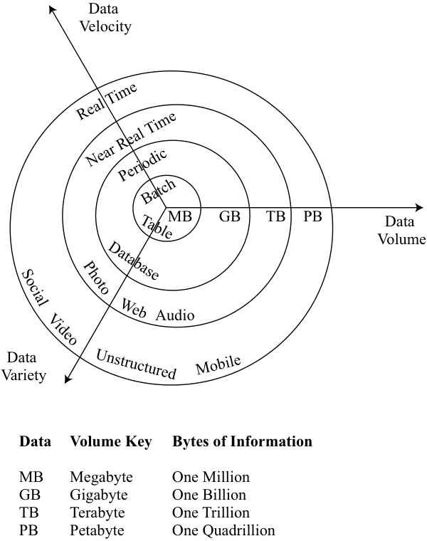
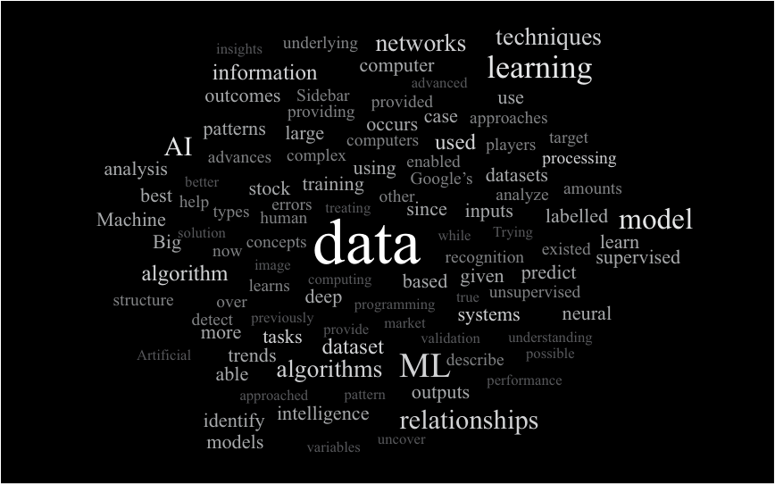

# Tập 1: Các Phương pháp Định lượng (*Quantitative Methods*)
## Học phần 11: Giới thiệu về các Kỹ thuật Dữ liệu Lớn (*Introduction to Big Data Techniques*)
### Phần 1/1: Giới thiệu về các Kỹ thuật Dữ liệu Lớn (Trang PDF 335–348)

---

<!-- PDF Page 335 -->

# H Ọ C P H Ầ N **<mark>11</mark>**

### **Giới thiệu về các Kỹ thuật Dữ liệu Lớn (*Introduction to Big Data Techniques*)**

###### **Tác giả: Robert Kissell, PhD, và Barbara J. Mack.**

*Robert Kissell, PhD, công tác tại Molloy College và Kissell Research Group (Hoa Kỳ). Barbara J. Mack công tác tại Pingry Hill Enterprises, Inc. (Hoa Kỳ).*

##### **<mark>MỤC TIÊU HỌC TẬP (*LEARNING OUTCOMES*)</mark>**

|**_Mức độ thành thạo_**|**_Ứng viên cần có khả năng:_**|
|---|---|
||mô tả các khía cạnh của “công nghệ tài chính” (*fintech*) có liên quan trực tiếp đến việc thu thập và phân tích dữ liệu tài chính|
||mô tả Dữ liệu lớn (*Big Data*), trí tuệ nhân tạo (*artificial intelligence* – AI), và học máy (*machine learning* – ML)|
||mô tả các ứng dụng của Dữ liệu lớn (*Big Data*) và Khoa học Dữ liệu (*Data Science*) vào quản lý đầu tư|

#### **GIỚI THIỆU (*INTRODUCTION*)**

**<mark>1</mark>**

Sự giao thoa giữa tài chính và công nghệ, thường được gọi là *công nghệ tài chính* (*fintech*), đang làm thay đổi bức tranh toàn cảnh của ngành quản lý đầu tư. Những tiến bộ bao gồm việc sử dụng Dữ liệu lớn (*Big Data*), trí tuệ nhân tạo (*artificial intelligence* – AI), và học máy (*machine learning* – ML) để đánh giá các cơ hội đầu tư, tối ưu hóa danh mục đầu tư và giảm thiểu rủi ro. Những sự phát triển này đang tác động không chỉ đến các nhà quản lý tài sản định lượng (*quantitative asset managers*) mà còn cả các nhà quản lý tài sản theo phân tích cơ bản (*fundamental asset managers*)—những người tận dụng các công cụ và công nghệ này để tham gia vào các hình thức ra quyết định đầu tư kết hợp (*hybrid forms*).

###### **TỔNG QUAN HỌC PHẦN (*LEARNING MODULE OVERVIEW*)**

- Dữ liệu lớn (*Big Data*) được đặc trưng bởi ba chữ V—khối lượng (*volume*), tốc độ (*velocity*), và sự đa dạng (*variety*)—và bao gồm cả các tập dữ liệu truyền thống lẫn phi truyền thống (hay dữ liệu thay thế – *alternative data*). Khi Dữ liệu lớn được sử dụng để suy luận hoặc dự báo, điều quan trọng là phải xem xét chữ V thứ tư: tính xác thực (*veracity*).

- Trong số các nguồn dữ liệu thay thế (*alternative data*) chính có dữ liệu được tạo ra bởi các cá nhân (*individuals*), các quy trình kinh doanh (*business processes*), và các cảm biến (*sensors*).

- Các hệ thống máy tính trí tuệ nhân tạo (*Artificial intelligence* – AI) có khả năng thực hiện các tác vụ mà theo truyền thống đòi hỏi trí thông minh của con người ở mức độ tương đương (hoặc vượt trội) so với con người.

<!-- PDF Page 336 -->

- Học máy (*Machine learning* – ML) tìm cách trích xuất tri thức từ lượng dữ liệu khổng lồ bằng cách “học” từ các ví dụ đã biết và sau đó tạo ra cấu trúc hoặc các dự báo. Nói một cách đơn giản, các thuật toán ML hướng tới mục tiêu “tìm kiếm quy luật, áp dụng quy luật” (*find the pattern, apply the pattern*). Các loại hình ML chính bao gồm học có giám sát (*supervised learning*), học không giám sát (*unsupervised learning*), và học sâu (*deep learning*).

- Xử lý ngôn ngữ tự nhiên (*Natural language processing* – NLP) là một ứng dụng của phân tích văn bản (*text analytics*) sử dụng sự hiểu biết sâu sắc về cấu trúc ngôn ngữ của con người để phân tích và diễn giải dữ liệu dạng văn bản và giọng nói.

## **<mark>2</mark>**

#### **FINTECH ĐƯỢC SỬ DỤNG TRONG PHÂN TÍCH ĐẦU TƯ ĐỊNH LƯỢNG NHƯ THẾ NÀO? (*HOW IS FINTECH USED IN QUANTITATIVE INVESTMENT ANALYSIS?*)**

- mô tả các khía cạnh của “công nghệ tài chính” (*fintech*) có liên quan trực tiếp đến việc thu thập và phân tích dữ liệu tài chính
- mô tả Dữ liệu lớn (*Big Data*), trí tuệ nhân tạo (*artificial intelligence* – AI), và học máy (*machine learning* – ML)

Theo nghĩa rộng nhất, thuật ngữ **công nghệ tài chính (*fintech*)** thường đề cập đến sự đổi mới sáng tạo dựa trên công nghệ đang diễn ra trong ngành dịch vụ tài chính. Đối với mục đích của chúng ta, fintech đề cập đến sự đổi mới công nghệ trong việc thiết kế và cung cấp các dịch vụ và sản phẩm tài chính. Trong cách sử dụng thông thường, fintech cũng có thể đề cập đến các công ty tham gia phát triển các công nghệ mới và ứng dụng của chúng, cũng như lĩnh vực kinh doanh bao gồm các công ty đó. Nhiều đổi mới trong số này đang thách thức các mô hình kinh doanh truyền thống của các nhà cung cấp dịch vụ tài chính hiện hữu (*incumbent*).

Các hình thức ban đầu của fintech bao gồm việc xử lý dữ liệu và tự động hóa các tác vụ lặp đi lặp lại thường nhật. Tiếp theo đó là các hệ thống cung cấp việc thực thi quyết định theo các quy tắc và chỉ dẫn được xác định trước. Fintech đã tiến xa sang các ứng dụng ra quyết định dựa trên logic học máy phức tạp, trong đó các chương trình máy tính có khả năng “học” cách hoàn thành các tác vụ theo thời gian. Trong một số ứng dụng, các hệ thống máy tính tiên tiến đang thực hiện các tác vụ ở mức độ vượt xa khả năng của con người. Fintech đã thay đổi ngành dịch vụ tài chính theo nhiều cách, làm nảy sinh các hệ thống mới cho tư vấn đầu tư, lập kế hoạch tài chính, cho vay doanh nghiệp và thanh toán.

Mặc dù fintech bao phủ một phạm vi rộng lớn các dịch vụ và ứng dụng, những lĩnh vực phát triển có liên quan trực tiếp hơn đến phân tích định lượng trong ngành đầu tư bao gồm:

- **Phân tích các tập dữ liệu lớn (*Analysis of large datasets*).** Ngoài lượng dữ liệu truyền thống ngày càng tăng, chẳng hạn như giá chứng khoán, báo cáo tài chính doanh nghiệp và các chỉ báo kinh tế, một lượng khổng lồ **dữ liệu thay thế (*alternative data*)** được tạo ra từ các nguồn dữ liệu phi truyền thống, chẳng hạn như mạng xã hội và mạng lưới cảm biến, giờ đây có thể được tích hợp vào quy trình ra quyết định đầu tư của nhà quản lý danh mục đầu tư và được sử dụng để giúp tạo ra alpha cũng như giảm thiểu thua lỗ.

- **Các công cụ phân tích (*Analytical tools*).** Đối với các tập dữ liệu cực lớn, các kỹ thuật liên quan đến **trí tuệ nhân tạo (*artificial intelligence* – AI)**—các hệ thống máy tính có khả năng thực hiện các tác vụ trước đây đòi hỏi trí thông minh của con người—có thể phù hợp hơn để nhận diện các mối quan hệ phức tạp, phi tuyến tính so với các phương pháp định lượng và phân tích thống kê truyền thống. Những tiến bộ trong các kỹ thuật dựa trên AI đang cho phép áp dụng các cách tiếp cận phân tích dữ liệu khác nhau. Ví dụ, các nhà phân tích đang tìm đến AI để sàng lọc lượng dữ liệu khổng lồ từ hồ sơ công bố của công ty, báo cáo

<!-- PDF Page 337 -->

thường niên, và các cuộc gọi công bố thu nhập (*earnings calls*) nhằm xác định dữ liệu nào là quan trọng nhất và giúp khám phá các xu hướng cũng như tạo ra những hiểu biết sâu sắc (*insights*) liên quan đến tâm lý và hành vi của con người.

##### **Dữ liệu Lớn (*Big Data*)**

Như đã lưu ý, các tập dữ liệu đang tăng trưởng nhanh chóng cả về quy mô lẫn sự đa dạng của các loại dữ liệu có sẵn để phân tích. Thuật ngữ **Dữ liệu lớn (*Big Data*)** đã được sử dụng từ cuối những năm 1990 và đề cập đến lượng thông tin khổng lồ đang được tạo ra bởi các ngành công nghiệp, chính phủ, cá nhân và các thiết bị điện tử. Dữ liệu lớn bao gồm dữ liệu được tạo ra từ các nguồn truyền thống—chẳng hạn như sở giao dịch chứng khoán, công ty và chính phủ—cũng như các loại dữ liệu phi truyền thống, còn được gọi là dữ liệu thay thế (*alternative data*), phát sinh từ việc sử dụng các thiết bị điện tử, mạng xã hội, mạng lưới cảm biến, và dữ liệu phụ phẩm của công ty (*company exhaust* – thông tin được tạo ra trong quá trình hoạt động kinh doanh bình thường).

Các nguồn dữ liệu truyền thống bao gồm dữ liệu doanh nghiệp dưới dạng báo cáo thường niên, hồ sơ nộp cho cơ quan quản lý, số liệu doanh thu và thu nhập, và các cuộc họp trực tuyến (*conference calls*) với các nhà phân tích. Dữ liệu truyền thống cũng bao gồm dữ liệu được tạo ra trên thị trường tài chính, bao gồm giá và khối lượng giao dịch. Bởi vì thế giới ngày càng trở nên kết nối chặt chẽ hơn, giờ đây chúng ta có thể thu thập dữ liệu từ nhiều loại thiết bị khác nhau, bao gồm điện thoại thông minh, máy ảnh, micrô, đầu đọc nhận dạng qua tần số vô tuyến (*radio-frequency identification* – RFID), cảm biến không dây và vệ tinh hiện đang được sử dụng trên toàn thế giới. Khi internet và sự hiện diện của các thiết bị kết nối mạng như vậy phát triển, việc sử dụng các nguồn dữ liệu phi truyền thống, hay các nguồn dữ liệu thay thế—bao gồm mạng xã hội (bài đăng, tweet và blog), thư điện tử (email) và tin nhắn văn bản, lưu lượng truy cập web, các trang tin tức trực tuyến và các nguồn thông tin điện tử khác—đã tăng lên.

Thuật ngữ *Dữ liệu lớn* (*Big Data*) thường đề cập đến các tập dữ liệu có các đặc điểm sau:

- **Khối lượng (*Volume*)**: Lượng dữ liệu được thu thập trong các tệp, bản ghi và bảng là rất lớn, đại diện cho hàng triệu, hoặc thậm chí hàng tỷ điểm dữ liệu.

- **Tốc độ (*Velocity*)**: Tốc độ và tần suất mà dữ liệu được ghi nhận và truyền tải đã tăng tốc. Dữ liệu thời gian thực (*real-time*) hoặc gần thời gian thực (*near-real-time*) đã trở thành chuẩn mực trong nhiều lĩnh vực.

- **Sự đa dạng (*Variety*)**: Dữ liệu được thu thập từ nhiều nguồn khác nhau và dưới nhiều định dạng khác nhau, bao gồm dữ liệu có cấu trúc (*structured data* – ví dụ: các bảng SQL), dữ liệu bán cấu trúc (*semistructured data* – ví dụ: mã HTML), và dữ liệu phi cấu trúc (*unstructured data* – ví dụ: tin nhắn video).

Các đặc tính liên quan đến khối lượng, tốc độ và sự đa dạng của dữ liệu lớn được trình bày trong Hình 1.

<!-- PDF Page 338 -->

**Hình 1: Các Đặc điểm của Dữ liệu Lớn: Khối lượng (*Volume*), Tốc độ (*Velocity*), và Sự đa dạng (*Variety*)**

<!-- Picture Text: Data Velocity MB GB TB PB Data Volume Audio Data Variety Data Volume Key Bytes of Information MB Megabyte One Million GB Gigabyte One Billion TB Terabyte One Trillion PB Petabyte One Quadrillion Unstructured Mobile Web Real Time Table Near Real Time Periodic Batch Database Video Photo Social  -->
> **Chú thích hình ảnh:**
> - **Khối lượng dữ liệu (*Data Volume*):** Tăng từ MB (Megabyte – Một triệu byte), GB (Gigabyte – Một tỷ byte), TB (Terabyte – Một nghìn tỷ byte) đến PB (Petabyte – Một triệu tỷ byte).
> - **Tốc độ dữ liệu (*Data Velocity*):** Theo lô (*Batch*), Định kỳ (*Periodic*), Gần thời gian thực (*Near Real Time*), Thời gian thực (*Real Time*).
> - **Sự đa dạng dữ liệu (*Data Variety*):** Bảng (*Table*), Cơ sở dữ liệu (*Database*), Web, Di động (*Mobile*), Mạng xã hội (*Social*), Hình ảnh (*Photo*), Video, Âm thanh (*Audio*), Phi cấu trúc (*Unstructured*).

*Nguồn*: Ivy Wigmore, “Definition: 3Vs (Volume, Variety and Velocity),” WhatIs.com, cập nhật lần cuối tháng 12 năm 2020, http://whatis.techtarget.com/definition/3Vs.

Hình 1 cho thấy khối lượng dữ liệu đang tăng từ megabyte và gigabyte lên các quy mô lớn hơn nhiều, chẳng hạn như terabyte và petabyte, khi ngày càng có nhiều dữ liệu được tạo ra, thu thập và lưu trữ. Đồng thời, ngày càng có nhiều dữ liệu, cả truyền thống lẫn phi truyền thống, sẵn có trên cơ sở thời gian thực hoặc gần thời gian thực với sự đa dạng về loại dữ liệu lớn hơn bao giờ hết.

Khi Dữ liệu lớn được sử dụng để suy luận hoặc dự báo, một “chữ V thứ tư” sẽ phát huy tác dụng—**tính xác thực (*veracity*)**—liên quan đến mức độ uy tín và độ tin cậy của các nguồn dữ liệu khác nhau. Việc xác định mức độ uy tín và độ tin cậy của các nguồn dữ liệu là một phần quan trọng của bất kỳ cuộc điều tra thực nghiệm nào. Tuy nhiên, vấn đề về tính xác thực trở nên cực kỳ quan trọng đối với Dữ liệu lớn bởi vì các nguồn đa dạng của những tập dữ liệu khổng lồ này. Dữ liệu lớn khuếch đại thách thức muôn thuở trong việc tách bạch chất lượng khỏi số lượng.

Dữ liệu lớn có thể là dữ liệu có cấu trúc (*structured*), bán cấu trúc (*semi-structured*), hoặc phi cấu trúc (*unstructured*). Các mục dữ liệu có cấu trúc có thể được tổ chức thành các bảng và thường được lưu trữ trong một cơ sở dữ liệu nơi mỗi trường (*field*) đại diện cho cùng một loại thông tin. Dữ liệu phi cấu trúc có thể là dữ liệu rời rạc, không được tổ chức và không thể biểu diễn dưới dạng bảng. Dữ liệu phi cấu trúc, chẳng hạn như dữ liệu được tạo ra bởi mạng xã hội, email, tin nhắn văn bản, bản ghi âm giọng nói, hình ảnh, blog, máy quét và cảm biến, thường đòi hỏi các ứng dụng chuyên biệt khác nhau hoặc các chương trình tùy chỉnh trước khi chúng có thể trở nên hữu ích cho các chuyên gia đầu tư. Ví dụ, để phân tích dữ liệu chứa trong email hoặc văn bản, có thể cần đến mã máy tính được phát triển đặc biệt hoặc tùy chỉnh để xử lý các tệp này trước tiên. Dữ liệu bán cấu trúc có thể mang các thuộc tính của cả dữ liệu có cấu trúc và dữ liệu phi cấu trúc.

<!-- PDF Page 339 -->

###### **_Các Nguồn của Dữ liệu Lớn (*Sources of Big Data*)_**

Do đó, Dữ liệu lớn bao hàm dữ liệu được tạo ra bởi các nguồn sau:

- thị trường tài chính (ví dụ: cổ phiếu, chứng khoán thu nhập cố định, hợp đồng tương lai, quyền chọn và các công cụ phái sinh khác),

- doanh nghiệp (ví dụ: báo cáo tài chính doanh nghiệp, các giao dịch thương mại và giao dịch mua hàng bằng thẻ tín dụng),

- chính phủ (ví dụ: dữ liệu thương mại, kinh tế, việc làm và bảng lương),

- cá nhân (ví dụ: giao dịch mua hàng bằng thẻ tín dụng, đánh giá sản phẩm, nhật ký tìm kiếm trên internet và các bài đăng trên mạng xã hội),

- cảm biến (ví dụ: hình ảnh vệ tinh, thông tin hàng hóa vận chuyển đường biển và quy luật giao thông), và đặc biệt là

- Internet vạn vật (*Internet of Things* – IoT) (ví dụ: dữ liệu được tạo ra bởi các tòa nhà “thông minh”, nơi tòa nhà cung cấp một luồng thông tin liên tục về kiểm soát khí hậu, mức tiêu thụ năng lượng, an ninh và các chi tiết vận hành khác).

Trong việc thu thập thông tin tình báo kinh doanh (*business intelligence*), về mặt lịch sử, các nhà phân tích có xu hướng dựa vào các nguồn dữ liệu truyền thống, sử dụng các phương pháp thống kê để đo lường hiệu quả hoạt động, dự báo tăng trưởng trong tương lai và phân tích xu hướng ngành cũng như thị trường. Ngược lại, việc phân tích Dữ liệu lớn kết hợp sử dụng các nguồn dữ liệu thay thế (*alternative data sources*).

Từ dữ liệu doanh số bán lẻ đến tâm lý trên mạng xã hội cho đến hình ảnh vệ tinh có thể tiết lộ thông tin về nông nghiệp, vận tải biển và các giàn khoan dầu, các tập dữ liệu thay thế có thể cung cấp thêm những hiểu biết sâu sắc về hành vi của người tiêu dùng, hiệu quả hoạt động của doanh nghiệp, các xu hướng và các yếu tố khác quan trọng đối với các hoạt động liên quan đến đầu tư. Những thông tin như vậy đang có tác động đáng kể đến cách thức mà các nhà đầu tư chuyên nghiệp, đặc biệt là các nhà đầu tư định lượng, tiếp cận phân tích tài chính và quy trình ra quyết định. Ba nguồn dữ liệu thay thế chính là:

- dữ liệu được tạo ra bởi các cá nhân (*data generated by individuals*),

- dữ liệu được tạo ra bởi các quy trình kinh doanh (*data generated by business processes*), và

- dữ liệu được tạo ra bởi các cảm biến (*data generated by sensors*).

Dữ liệu được tạo ra bởi các cá nhân thường được sản xuất dưới định dạng văn bản, video, hình ảnh và âm thanh, đồng thời cũng có thể được tạo ra thông qua các phương tiện như lượt nhấp chuột trên trang web hoặc thời gian lưu lại trên một trang web. Loại dữ liệu này có xu hướng là phi cấu trúc. Khối lượng của loại dữ liệu này đang tăng lên đáng kể khi mọi người tham gia ngày càng đông đảo và thường xuyên hơn vào các hoạt động trực tuyến, chẳng hạn như mạng xã hội và thương mại điện tử, bao gồm các bài đánh giá trực tuyến về sản phẩm, dịch vụ và toàn bộ công ty, cũng như khi họ để lại dữ liệu cá nhân thông qua các lượt tìm kiếm trên web, email và các dấu vết điện tử khác.

Dữ liệu quy trình kinh doanh (*Business process data*) bao gồm các luồng thông tin từ các tập đoàn và các thực thể công cộng khác. Những dữ liệu này có xu hướng là dữ liệu có cấu trúc và bao gồm thông tin bán hàng trực tiếp, chẳng hạn như dữ liệu thẻ tín dụng, cũng như dữ liệu phụ phẩm của doanh nghiệp (*corporate exhaust*). Dữ liệu phụ phẩm của doanh nghiệp bao gồm thông tin chuỗi cung ứng của công ty, hồ sơ ngân hàng và dữ liệu máy quét tại điểm bán lẻ (*point-of-sale* – POS). Dữ liệu quy trình kinh doanh có thể là các chỉ báo dẫn dắt (*leading indicators*) hoặc chỉ báo thời gian thực (*real-time indicators*) về hiệu quả kinh doanh, trong khi các chỉ số doanh nghiệp truyền thống có thể chỉ được báo cáo theo quý hoặc thậm chí theo năm và thường là các chỉ báo có độ trễ (*lagging indicators*) về hiệu quả hoạt động.

Dữ liệu cảm biến (*Sensor data*) được thu thập từ các thiết bị như điện thoại thông minh, máy ảnh, chip RFID và vệ tinh thường được kết nối với máy tính thông qua mạng không dây. Dữ liệu cảm biến có thể là phi cấu trúc, và khối lượng dữ liệu lớn hơn nhiều bậc độ lớn (*orders of magnitude*) so với các luồng dữ liệu từ cá nhân hoặc quy trình kinh doanh. Dạng dữ liệu này đang tăng trưởng theo cấp số nhân bởi vì bộ vi xử lý và công nghệ mạng ngày càng hiện diện nhiều hơn trong hàng loạt các thiết bị điện tử cá nhân và thương mại. Mở rộng ra các tòa nhà văn phòng, nhà ở, phương tiện giao thông và nhiều hình thức vật lý khác, điều này đạt đến đỉnh cao trong một cấu trúc mạng được gọi là **Internet vạn vật (*Internet of Things* – IoT)**, được hình thành bởi một mạng lưới

<!-- PDF Page 340 -->

rộng lớn các thiết bị vật lý, thiết bị gia dụng, tòa nhà thông minh, phương tiện giao thông và các vật dụng khác được nhúng thiết bị điện tử, cảm biến, phần mềm và kết nối mạng cho phép các vật thể trong hệ thống tương tác và chia sẻ thông tin.

Bảng 2 trình bày phân loại các nguồn dữ liệu thay thế và bao gồm các ví dụ cho từng loại.

**Bảng 2: Phân loại các Nguồn Dữ liệu Thay thế (*Classification of Alternative Data Sources*)**

|**Cá nhân (*Individuals*)**|**Quy trình Kinh doanh (*Business Processes*)**|**Cảm biến (*Sensors*)**|
|---|---|---|
|Mạng xã hội (*Social media*)|Dữ liệu giao dịch (*Transaction data*)|Vệ tinh (*Satellites*)|
|Tin tức, đánh giá (*News, reviews*)|Dữ liệu doanh nghiệp (*Corporate data*)|Định vị địa lý (*Geolocation*)|
|Tìm kiếm web, dữ liệu cá nhân (*Web searches, personal data*)||Internet vạn vật (*Internet of Things*)|
|||Các cảm biến khác (*Other sensors*)|

Trong nỗ lực tìm kiếm nhằm xác định các yếu tố mới có thể ảnh hưởng đến giá chứng khoán, nâng cao khả năng lựa chọn tài sản, cải thiện việc thực thi giao dịch và khám phá các xu hướng, dữ liệu thay thế đang được sử dụng để hỗ trợ các mô hình và quyết định đầu tư dựa trên dữ liệu (*data-driven*). Khi sự quan tâm đến dữ liệu thay thế tăng lên, số lượng các công ty chuyên biệt thu thập, tổng hợp và bán các tập dữ liệu thay thế cũng đã gia tăng.

Mặc dù thị trường dữ liệu thay thế đang mở rộng, các chuyên gia đầu tư cần hiểu rõ các vấn đề pháp lý và đạo đức tiềm ẩn liên quan đến thông tin không thuộc phạm vi công cộng. Ví dụ, việc **thu thập tự động (*scraping*)** dữ liệu web có khả năng thu giữ thông tin cá nhân được bảo vệ bởi các quy định pháp luật hoặc có thể đã được công bố hay cung cấp mà không có sự hiểu biết và đồng thuận rõ ràng của các cá nhân liên quan. Các thông lệ tốt nhất (*best practices*) vẫn đang trong quá trình phát triển ở nhiều khu vực pháp lý, và do cách tiếp cận khác nhau của các cơ quan quản lý quốc gia, các hình thức hướng dẫn khác nhau có thể xảy ra xung đột.

###### **_Những Thách thức của Dữ liệu Lớn (*Big Data Challenges*)_**

Dữ liệu lớn đặt ra một số thách thức khi được sử dụng trong phân tích đầu tư, bao gồm chất lượng, khối lượng và mức độ phù hợp của dữ liệu. Các vấn đề cốt lõi xoay quanh những câu hỏi sau đây, cùng với nhiều câu hỏi khác: Tập dữ liệu có bị thiên lệch chọn mẫu (*selection bias*), thiếu dữ liệu (*missing data*), hay có các giá trị ngoại lai (*data outliers*) hay không? Khối lượng dữ liệu thu thập được có đủ lớn không? Tập dữ liệu có phù hợp tốt với loại hình phân tích hay không? Trong hầu hết các trường hợp, dữ liệu phải được tìm nguồn, làm sạch (*cleansed*) và tổ chức sắp xếp trước khi có thể tiến hành phân tích. Quy trình này có thể cực kỳ khó khăn đối với dữ liệu thay thế do các đặc tính phi cấu trúc của dữ liệu liên quan, vốn thường mang bản chất định tính (ví dụ: văn bản, hình ảnh và video) hơn là định lượng.

Với quy mô và độ phức tạp của các tập dữ liệu thay thế, các phương pháp phân tích truyền thống không phải lúc nào cũng có thể được sử dụng để diễn giải và đánh giá các tập dữ liệu này. Để giải quyết thách thức này, các kỹ thuật AI và học máy (ML) đã xuất hiện nhằm hỗ trợ xử lý các nguồn thông tin lớn và phức tạp như vậy.

## **<mark>3</mark>**

#### **CÁC CÔNG CỤ PHÂN TÍCH TIÊN TIẾN: TRÍ TUỆ NHÂN TẠO VÀ HỌC MÁY (*ADVANCED ANALYTICAL TOOLS: ARTIFICIAL INTELLIGENCE AND MACHINE LEARNING*)**

<!-- PDF Page 341 -->

Các hệ thống máy tính trí tuệ nhân tạo (AI) có khả năng thực hiện các tác vụ mà theo truyền thống đòi hỏi trí thông minh của con người. Công nghệ AI đã cho phép phát triển các hệ thống máy tính thể hiện khả năng nhận thức và ra quyết định tương đương hoặc vượt trội so với con người.

Một ví dụ ban đầu của AI là **hệ chuyên gia (*expert system*)**, một loại lập trình máy tính cố gắng mô phỏng cơ sở tri thức và khả năng phân tích của các chuyên gia con người trong các bối cảnh giải quyết vấn đề cụ thể. Điều này thường được thực hiện thông qua việc sử dụng các quy tắc “nếu–thì” (*if–then rules*). Đến cuối những năm 1990, mạng lưới nhanh hơn và bộ vi xử lý mạnh hơn đã cho phép triển khai AI trong hậu cần (*logistics*), khai phá dữ liệu (*data mining*), phân tích tài chính, chẩn đoán y tế và các lĩnh vực khác. Kể từ những năm 1980, các định chế tài chính đã tận dụng AI—đặc biệt là **mạng nơ-ron (*neural networks*)**, phương pháp lập trình dựa trên cách bộ não của chúng ta học hỏi và xử lý thông tin—để phát hiện các khoản phí hoặc yêu cầu bồi thường bất thường trong các hệ thống phát hiện gian lận thẻ tín dụng.

**Học máy (*Machine learning* – ML)** bao gồm các kỹ thuật dựa trên máy tính tìm cách trích xuất tri thức từ lượng dữ liệu lớn mà không đưa ra bất kỳ giả định nào về phân phối xác suất ngầm định của dữ liệu. Mục tiêu của các thuật toán ML là tự động hóa quy trình ra quyết định bằng cách khái quát hóa, hay “học hỏi”, từ các ví dụ đã biết để xác định một cấu trúc ngầm định trong dữ liệu. Trọng tâm đặt vào khả năng của thuật toán trong việc tạo ra cấu trúc hoặc các dự báo mà không cần bất kỳ sự trợ giúp nào từ con người. Nói một cách đơn giản, các thuật toán ML hướng tới mục tiêu “tìm kiếm quy luật, áp dụng quy luật” (*find the pattern, apply the pattern*).

Như cách đang được sử dụng hiện nay trong bối cảnh đầu tư, ML đòi hỏi một lượng dữ liệu khổng lồ để “huấn luyện” (*training*), vì vậy mặc dù một số kỹ thuật ML đã tồn tại trong nhiều năm, việc thiếu hụt dữ liệu trong lịch sử đã hạn chế khả năng ứng dụng rộng rãi hơn. Trước đây, các thuật toán này thiếu quyền tiếp cận lượng dữ liệu lớn cần thiết để mô hình hóa các mối quan hệ một cách thành công. Sự phát triển của Dữ liệu lớn đã cung cấp cho các thuật toán ML, bao gồm cả mạng nơ-ron, đủ dữ liệu để cải thiện khả năng mô hình hóa và độ chính xác dự báo, và giờ đây việc sử dụng rộng rãi hơn các kỹ thuật ML đã trở nên khả thi.

Trong ML, thuật toán máy tính được cung cấp “đầu vào” (*inputs* – một tập hợp các biến số hoặc tập dữ liệu) và có thể được cung cấp “đầu ra” (*outputs* – dữ liệu mục tiêu). Thuật toán “học” từ dữ liệu được cung cấp cách tốt nhất để mô hình hóa đầu vào thành đầu ra (nếu được cung cấp) hoặc cách nhận diện hay mô tả cấu trúc dữ liệu ngầm định nếu không có đầu ra nào được cung cấp. Quá trình huấn luyện (*training*) diễn ra khi thuật toán nhận diện các mối quan hệ trong dữ liệu và sử dụng thông tin đó để tinh chỉnh quá trình học của nó.

ML bao gồm việc chia tập dữ liệu thành ba tập con riêng biệt: **tập dữ liệu huấn luyện (*training dataset*)**, **tập dữ liệu kiểm định (*validation dataset*)**, và **tập dữ liệu kiểm tra (*test dataset*)**. Tập dữ liệu huấn luyện cho phép thuật toán nhận diện các mối quan hệ giữa đầu vào và đầu ra dựa trên các quy luật lịch sử trong dữ liệu. Các mối quan hệ này sau đó được xác thực (*validated*), và mô hình được tinh chỉnh (*tuned*), bằng cách sử dụng tập dữ liệu kiểm định. Tập dữ liệu kiểm tra được sử dụng để kiểm tra khả năng dự báo tốt của mô hình trên dữ liệu mới. Một khi thuật toán đã được huấn luyện, kiểm định và kiểm tra, mô hình ML có thể được sử dụng để dự báo kết quả dựa trên các tập dữ liệu khác.

ML vẫn đòi hỏi sự phán đoán của con người trong việc hiểu dữ liệu cơ sở và lựa chọn các kỹ thuật phù hợp để phân tích dữ liệu. Trước khi có thể sử dụng, dữ liệu phải sạch và không có các thiên lệch (*biases*) cũng như dữ liệu giả mạo (*spurious data*). Như đã lưu ý, các mô hình ML cũng đòi hỏi lượng dữ liệu đủ lớn và có thể không hoạt động tốt khi không có đủ dữ liệu sẵn có để huấn luyện và kiểm định mô hình.

Các nhà phân tích phải nhận thức rõ về các sai số có thể phát sinh từ hiện tượng **quá khớp (*overfitting*)** dữ liệu, bởi vì các mô hình quá khớp dữ liệu có thể khám phá ra các mối quan hệ “sai lệch” hoặc các quy luật “không có cơ sở” dẫn đến sai số dự báo và dự báo đầu ra không chính xác. Hiện tượng quá khớp (*Overfitting*) xảy ra khi mô hình ML học tập dữ liệu đầu vào và mục tiêu một cách quá chính xác. Trong những trường hợp như vậy, mô hình đã bị “huấn luyện quá mức” (*overtrained*) trên dữ liệu và coi nhiễu (*noise*) trong dữ liệu như là các tham số thực sự. Một mô hình ML bị quá khớp không có khả năng dự báo chính xác kết quả khi sử dụng một tập dữ liệu khác và có thể quá phức tạp. Khi một mô hình bị **chưa khớp / khớp thiếu (*underfitted*)**, mô hình ML coi các tham số thực sự như thể chúng

<!-- PDF Page 342 -->

là nhiễu và không có khả năng nhận ra các mối quan hệ bên trong dữ liệu huấn luyện. Trong những trường hợp như vậy, mô hình có thể quá đơn giản. Các mô hình chưa khớp thường sẽ thất bại trong việc khám phá đầy đủ các quy luật ẩn dưới dữ liệu.

Ngoài ra, bởi vì chúng không được lập trình một cách tường minh, các kỹ thuật ML có thể có vẻ mờ đục hoặc giống như các cách tiếp cận “hộp đen” (*black box*), đi đến những kết quả có thể không hoàn toàn hiểu được hoặc không giải thích được.

Các cách tiếp cận ML có thể giúp nhận diện mối quan hệ giữa các biến số, phát hiện các quy luật hoặc xu hướng, và tạo ra cấu trúc từ dữ liệu, bao gồm cả việc phân loại dữ liệu (*data classification*). ML có thể được chia tổng quát thành ba nhóm kỹ thuật riêng biệt: học có giám sát (*supervised learning*), học không giám sát (*unsupervised learning*), và học sâu (*deep learning*).

Trong **học có giám sát (*supervised learning*)**, máy tính học cách mô hình hóa các mối quan hệ dựa trên dữ liệu huấn luyện đã được gán nhãn (*labeled training data*). Trong học có giám sát, đầu vào và đầu ra được gán nhãn, hoặc được xác định rõ, cho thuật toán. Sau khi học cách tốt nhất để mô hình hóa các mối quan hệ đối với dữ liệu đã gán nhãn, các thuật toán đã được huấn luyện sẽ được sử dụng để mô hình hóa hoặc dự báo kết quả cho các tập dữ liệu mới. Việc cố gắng xác định tín hiệu (*signal*) hoặc biến số tốt nhất để dự báo tỷ suất sinh lợi tương lai của một cổ phiếu, hoặc dự báo xem diễn biến thị trường chứng khoán trong nước sẽ tăng, giảm hay đi ngang trong ngày làm việc tiếp theo là những bài toán có thể được tiếp cận bằng các kỹ thuật học có giám sát.

Trong **học không giám sát (*unsupervised learning*)**, máy tính không được cung cấp dữ liệu đã gán nhãn mà thay vào đó chỉ được cung cấp dữ liệu để từ đó thuật toán tìm cách mô tả dữ liệu và cấu trúc của chúng. Ví dụ, việc phân nhóm các công ty thành các nhóm đồng đẳng (*peer groups*) dựa trên đặc điểm của chúng thay vì sử dụng cách phân nhóm theo ngành hoặc quốc gia tiêu chuẩn là một ứng dụng của kỹ thuật học không giám sát.

Nền tảng cho những tiến bộ của AI là những sự phát triển cốt lõi liên quan đến mạng nơ-ron (*neural networks*). Trong **học sâu (*deep learning*)** (hay **mạng học sâu – *deep learning nets***), máy tính sử dụng các mạng nơ-ron, thường có nhiều lớp ẩn (*hidden layers*), để thực hiện quá trình xử lý dữ liệu phi tuyến tính, đa giai đoạn nhằm nhận diện các quy luật. Học sâu có thể sử dụng các cách tiếp cận ML có giám sát hoặc không giám sát. Bằng cách áp dụng phương pháp tiếp cận theo lớp hoặc đa giai đoạn để phân tích dữ liệu, học sâu phát triển sự hiểu biết về các khái niệm đơn giản để làm cơ sở phân tích các khái niệm phức tạp hơn.

Mạng nơ-ron đã tồn tại từ năm 1958 và đã được sử dụng cho nhiều ứng dụng, chẳng hạn như dự báo và nhận dạng mẫu (*pattern recognition*). Những cải tiến trong các thuật toán cơ sở của mạng nơ-ron đang cung cấp các mô hình chính xác hơn, kết hợp và học hỏi từ dữ liệu tốt hơn. Kết quả là, các thuật toán này hiện nay vượt trội hơn hẳn trong các hoạt động như nhận dạng hình ảnh, mẫu và giọng nói. Trong nhiều trường hợp, các thuật toán tiên tiến đòi hỏi ít năng lực tính toán hơn so với các mạng nơ-ron trước đây, và giải pháp cải tiến của chúng cho phép các nhà phân tích khám phá những hiểu biết sâu sắc cũng như nhận diện các mối quan hệ mà trước đây quá khó hoặc quá tốn thời gian để tìm ra.

###### **NHỮNG TIẾN BỘ TRONG AI BÊN NGOÀI LĨNH VỰC TÀI CHÍNH (*ADVANCES IN AI OUTSIDE FINANCE*)**

Những đột phá về AI không liên quan đến tài chính bao gồm các chiến thắng trong trò chơi truyền hình kiến thức tổng hợp *Jeopardy* (bởi Watson của IBM vào năm 2011) và trong trò chơi cờ vây cổ đại của Trung Quốc (bởi DeepMind của Google vào năm 2016). AI không chỉ cung cấp các giải pháp ở những nơi tồn tại thông tin hoàn hảo (tất cả người chơi đều có quyền tiếp cận ngang nhau đối với cùng một thông tin), chẳng hạn như cờ đam, cờ vua và cờ vây, mà AI còn cung cấp sự thấu hiểu trong những trường hợp thông tin có thể không hoàn hảo và người chơi có thông tin ẩn; những thành công của AI trong trò chơi bài poker (bởi DeepStack) là một ví dụ. AI cũng đứng đằng sau sự trỗi dậy của các trợ lý ảo, chẳng hạn như Siri (của Apple), ứng dụng Dịch (*Translate*) của Google, và công cụ đề xuất sản phẩm của Amazon.

Khả năng phân tích Dữ liệu lớn bằng các kỹ thuật ML, bên cạnh các phương pháp thống kê truyền thống hơn, đại diện cho một bước phát triển quan trọng trong nghiên cứu đầu tư, được hỗ trợ bởi sự sẵn có ngày càng lớn của dữ liệu và những tiến bộ trong thuật toán. Những cải tiến về năng lực tính toán, tốc độ xử lý phần mềm và chi phí lưu trữ giảm xuống đã hỗ trợ thêm cho quá trình tiến hóa này.

<!-- PDF Page 343 -->

Các kỹ thuật ML đang được sử dụng để phân tích Dữ liệu lớn nhằm giúp dự báo các xu hướng hoặc sự kiện thị trường, chẳng hạn như khả năng thành công của một thương vụ sáp nhập hoặc kết quả của một cuộc bầu cử chính trị. Các thuật toán nhận dạng hình ảnh giờ đây có thể phân tích dữ liệu từ các hệ thống hình ảnh vệ tinh để cung cấp thông tin tình báo về số lượng người tiêu dùng trong bãi đậu xe của các cửa hàng bán lẻ, hoạt động vận tải biển và các cơ sở sản xuất, cũng như năng suất cây trồng nông nghiệp, cùng nhiều ví dụ khác.

Những thông tin như vậy có thể cung cấp cái nhìn sâu sắc về từng doanh nghiệp riêng lẻ hoặc ở cấp độ quốc gia hay toàn cầu và có thể được sử dụng làm dữ liệu đầu vào cho các mô hình định giá hoặc mô hình kinh tế.

#### **XỬ LÝ DỮ LIỆU LỚN BẰNG KHOA HỌC DỮ LIỆU (*TACKLING BIG DATA WITH DATA SCIENCE*)**

## **<mark>4</mark>**

- mô tả các ứng dụng của Dữ liệu lớn (*Big Data*) và Khoa học Dữ liệu (*Data Science*) vào quản lý đầu tư

**Khoa học dữ liệu (*Data science*)** có thể được định nghĩa là một lĩnh vực liên ngành khai thác những tiến bộ trong khoa học máy tính (bao gồm cả ML), thống kê và các ngành khác nhằm mục đích trích xuất thông tin từ Dữ liệu lớn (hoặc dữ liệu nói chung). Các công ty dựa vào chuyên môn của các nhà khoa học/nhà phân tích dữ liệu để trích xuất thông tin và những hiểu biết sâu sắc từ Dữ liệu lớn cho nhiều mục đích kinh doanh và đầu tư khác nhau.

Một yếu tố quan trọng cần cân nhắc đối với nhà khoa học dữ liệu là cấu trúc của dữ liệu. Như đã lưu ý trong phần thảo luận về Dữ liệu lớn, do bản chất phi cấu trúc của chúng, dữ liệu thay thế thường đòi hỏi sự xử lý chuyên biệt trước khi có thể được sử dụng để phân tích.

##### **Các Phương pháp Xử lý Dữ liệu (*Data Processing Methods*)**

Để giúp xác định kỹ thuật quản lý dữ liệu tốt nhất cần thiết cho phân tích Dữ liệu lớn, các nhà khoa học dữ liệu sử dụng nhiều phương pháp xử lý dữ liệu khác nhau, bao gồm thu thập (*capture*), giám tuyển/làm sạch (*curation*), lưu trữ (*storage*), tìm kiếm (*search*), và truyền tải (*transfer*).

- **Thu thập (*Capture*)**—Thu thập dữ liệu đề cập đến cách thức dữ liệu được thu gom và biến đổi thành định dạng có thể được sử dụng bởi quy trình phân tích. Các hệ thống độ trễ thấp (*Low-latency systems*)—các hệ thống hoạt động trên các mạng lưới truyền thông khối lượng dữ liệu lớn với độ trễ (*latency*) tối thiểu—là yếu tố thiết yếu cho các ứng dụng giao dịch tự động đưa ra quyết định dựa trên giá cả và sự kiện thị trường theo thời gian thực. Ngược lại, các hệ thống độ trễ cao (*high-latency systems*) không đòi hỏi quyền truy cập vào dữ liệu và các phép tính theo thời gian thực.

- **Giám tuyển / Làm sạch (*Curation*)**—Giám tuyển dữ liệu đề cập đến quy trình đảm bảo chất lượng và độ chính xác của dữ liệu thông qua công việc làm sạch dữ liệu (*data cleaning*). Quy trình này bao gồm việc rà soát tất cả dữ liệu để phát hiện và vạch ra các lỗi dữ liệu—dữ liệu xấu hoặc không chính xác—và thực hiện các điều chỉnh đối với dữ liệu bị thiếu khi thích hợp.

- **Lưu trữ (*Storage*)**—Lưu trữ dữ liệu đề cập đến cách thức dữ liệu sẽ được ghi lại, lưu trữ và truy cập cũng như thiết kế cơ sở dữ liệu nền tảng. Một cân nhắc quan trọng đối với việc lưu trữ dữ liệu là liệu dữ liệu có cấu trúc hay phi cấu trúc và liệu nhu cầu phân tích có đòi hỏi các giải pháp độ trễ thấp hay không.

- **Tìm kiếm (*Search*)**—Tìm kiếm đề cập đến cách thức truy vấn dữ liệu. Dữ liệu lớn đã tạo ra nhu cầu về các ứng dụng tiên tiến có khả năng kiểm tra và rà soát số lượng lớn dữ liệu để định vị nội dung dữ liệu được yêu cầu.

- **Truyền tải (*Transfer*)**—Truyền tải đề cập đến cách thức dữ liệu sẽ di chuyển từ nguồn dữ liệu cơ sở hoặc vị trí lưu trữ đến công cụ phân tích cơ sở. Điều này có thể thực hiện thông qua một luồng cấp dữ liệu trực tiếp (*direct data feed*), chẳng hạn như luồng cấp dữ liệu giá của sở giao dịch chứng khoán.

<!-- PDF Page 344 -->

##### **Trực quan hóa Dữ liệu (*Data Visualization*)**

Trực quan hóa dữ liệu (*Data visualization*) là một công cụ quan trọng để hiểu Dữ liệu lớn. Trực quan hóa đề cập đến cách thức dữ liệu sẽ được định dạng, hiển thị và tóm tắt dưới dạng đồ họa. Dữ liệu có cấu trúc truyền thống có thể được trực quan hóa bằng cách sử dụng các bảng, biểu đồ và đường xu hướng, trong khi dữ liệu phi cấu trúc phi truyền thống đòi hỏi các kỹ thuật trực quan hóa dữ liệu mới. Các công cụ trực quan hóa này bao gồm, ví dụ, đồ họa ba chiều (3D) tương tác, trong đó người dùng có thể tập trung vào các khoảng dữ liệu cụ thể và xoay dữ liệu qua các trục 3D để giúp nhận diện xu hướng và khám phá các mối quan hệ. Phân tích dữ liệu đa chiều bao gồm nhiều hơn ba biến số đòi hỏi các kỹ thuật trực quan hóa dữ liệu bổ sung—ví dụ: thêm màu sắc, hình dạng và kích thước vào biểu đồ 3D. Hơn nữa, có rất nhiều giải pháp tồn tại để phản ánh cấu trúc của dữ liệu thông qua hình học của sự trực quan hóa, với đồ họa tương tác cho phép những khả năng đặc biệt phong phú. Các ví dụ bao gồm bản đồ nhiệt (*heat maps*), sơ đồ cây (*tree diagrams*), và đồ thị mạng (*network graphs*).

Một kỹ thuật trực quan hóa Dữ liệu lớn có giá trị khác có thể áp dụng cho dữ liệu văn bản là “đám mây từ khóa” (*tag cloud* / *word cloud*), trong đó các từ được định cỡ và hiển thị dựa trên tần suất xuất hiện của từ đó trong tệp dữ liệu. Ví dụ, những từ xuất hiện thường xuyên hơn được hiển thị bằng phông chữ lớn hơn, và những từ xuất hiện ít thường xuyên hơn được hiển thị bằng phông chữ nhỏ hơn. “Sơ đồ tư duy” (*mind map*) là một kỹ thuật trực quan hóa dữ liệu khác; nó là một biến thể của đám mây từ khóa, nhưng thay vì hiển thị tần suất của các từ, sơ đồ tư duy cho thấy các khái niệm khác nhau có liên hệ với nhau như thế nào.

Hình 3 cho thấy một ví dụ về “đám mây từ khóa” dựa trên một phần của bài đọc này. Một từ được tìm thấy càng thường xuyên trong văn bản thì nó càng trở nên lớn hơn trong đám mây từ khóa. Như được hiển thị trong đám mây từ khóa, những từ xuất hiện thường xuyên nhất trong phần này bao gồm “data”, “ML”, “learning”, “AI”, “techniques”, “model”, và “relationships”.

**Hình 3: Đám mây Từ khóa Trực quan hóa Dữ liệu (*Data Visualization Tag Cloud*)**

<!-- Picture Text: insights underlying networks techniques information computeradvanced learning outcomes Sidebar provided use AI patternsadvances largecomplexprovidingcomputersoccursenabledcaseusedapproachesplayers processingtarget Machineanalysisbest helpbettertypesstockhumanerrorstrainingtreatingusingothersinceGoogle’sinputsdatasetsanalyzelabelledamountsmodel Bigsolutionnow concepts while Trying existed learn structureArtificialalgorithmdetectmoreovertrendslearnspreviouslyimagetasks deepcomputingdatadatasetprovideprogrammingmarketbasedvalidationrecognitiondescribetruesystemsgivenunsupervisedunderstandingpredictpossibleneuralsupervised able algorithms ML performance approached pattern outputs identify intelligence relationships models variables uncover  -->
> **Chú thích hình ảnh:** Đám mây từ khóa (*Tag Cloud*) hiển thị các từ khóa với kích thước tỷ lệ thuận với tần suất xuất hiện, nổi bật nhất là các từ `data`, `ML`, `learning`, `AI`, `model`, `techniques`, `relationships`, `algorithms`, `analysis`.

*Nguồn*: “About Word Clouds,” WordItOut, https://worditout.com/word-cloud/create.

Fintech đang được sử dụng trong nhiều lĩnh vực của quản lý đầu tư. Các ứng dụng cho quản lý đầu tư bao gồm phân tích văn bản (*text analytics*) và xử lý ngôn ngữ tự nhiên (*natural language processing*), phân tích rủi ro (*risk analysis*), và giao dịch thuật toán (*algorithmic trading*).

<!-- PDF Page 345 -->

##### **Phân tích Văn bản và Xử lý Ngôn ngữ Tự nhiên (*Text Analytics and Natural Language Processing*)**

**Phân tích văn bản (*Text analytics*)** bao gồm việc sử dụng các chương trình máy tính để phân tích và rút ra ý nghĩa thường từ các tập dữ liệu lớn, phi cấu trúc dựa trên văn bản hoặc giọng nói, chẳng hạn như hồ sơ công bố của công ty, báo cáo bằng văn bản, các cuộc gọi công bố thu nhập hàng quý, mạng xã hội, email, các bài đăng trên internet và các cuộc khảo sát. Phân tích văn bản bao gồm việc sử dụng các chương trình máy tính để thực hiện truy xuất thông tin tự động từ các nguồn khác nhau, không liên quan nhằm hỗ trợ quá trình ra quyết định. Việc sử dụng mang tính phân tích sâu hơn bao gồm phân tích từ vựng (*lexical analysis*), hay phân tích tần suất từ trong một tài liệu và nhận dạng mẫu dựa trên các từ khóa và cụm từ. Phân tích văn bản có thể được sử dụng trong phân tích dự báo (*predictive analysis*) để giúp xác định các chỉ báo về hiệu quả hoạt động trong tương lai, chẳng hạn như tâm lý người tiêu dùng (*consumer sentiment*).

**Xử lý ngôn ngữ tự nhiên (*Natural language processing* – NLP)** là một lĩnh vực nghiên cứu tại giao điểm của khoa học máy tính, AI và ngôn ngữ học, tập trung vào việc phát triển các chương trình máy tính để phân tích và diễn giải ngôn ngữ của con người. Trong lĩnh vực rộng lớn hơn của phân tích văn bản, NLP là một ứng dụng quan trọng. Các tác vụ tự động hóa sử dụng NLP bao gồm dịch thuật (*translation*), nhận dạng giọng nói (*speech recognition*), khai phá văn bản (*text mining*), phân tích cảm xúc/tâm lý (*sentiment analysis*), và phân tích chủ đề (*topic analysis*). NLP cũng có thể được sử dụng trong các chức năng tuân thủ (*compliance*) để rà soát các giao tiếp bằng giọng nói và điện tử của nhân viên nhằm đảm bảo việc tuân thủ chính sách của công ty hoặc quy định pháp luật, để phát hiện gian lận hoặc hành vi không phù hợp, hoặc để đảm bảo thông tin riêng tư hay thông tin khách hàng được giữ bí mật.

Hãy cân nhắc rằng tất cả các công ty đại chúng trên toàn thế giới tạo ra hàng triệu trang báo cáo thường niên và hàng chục nghìn giờ họp công bố thu nhập mỗi năm. Đây là lượng thông tin nhiều hơn mức mà bất kỳ nhà phân tích cá nhân hay nhóm nghiên cứu nào có thể đánh giá được. NLP, đặc biệt khi được hỗ trợ bởi các thuật toán ML, có thể phân tích các báo cáo thường niên, bản ghi âm cuộc gọi (*call transcripts*), các bài báo tin tức, bài đăng trên mạng xã hội, và các dữ liệu văn bản cũng như âm thanh khác để nhận diện các xu hướng trong khoảng thời gian ngắn hơn và với quy mô cùng độ chính xác lớn hơn mức con người có thể làm được.

Ví dụ, NLP có thể được sử dụng để theo dõi bình luận của các nhà phân tích nhằm hỗ trợ việc ra quyết định đầu tư. Các nhà phân tích tài chính có thể đưa ra các dự báo thu nhập trên mỗi cổ phần (EPS) phản ánh quan điểm của họ về triển vọng ngắn hạn của một công ty. Việc chỉ tập trung vào các con số EPS dự báo có thể khiến các nhà đầu tư bỏ lỡ những điểm tinh tế chứa đựng trong báo cáo nghiên cứu bằng văn bản của nhà phân tích. Bởi vì các nhà phân tích có xu hướng không thay đổi khuyến nghị mua, nắm giữ và bán đối với một công ty một cách thường xuyên, thay vào đó họ có thể đưa ra những bình luận mang sắc thái tinh tế mà không làm thay đổi khuyến nghị đầu tư của mình. Sau khi phân tích bình luận của nhà phân tích, NLP có thể gán các mức xếp hạng tâm lý (*sentiment ratings*) trải dài từ rất tiêu cực đến rất tích cực cho từng bình luận. Do đó, NLP có thể được sử dụng để phát hiện, theo dõi và gắn thẻ những sự dịch chuyển trong tâm lý, có khả năng đi trước cả sự thay đổi khuyến nghị của nhà phân tích. Khả năng của máy móc cho phép phân tích này mở rộng quy mô trên hàng nghìn công ty khắp thế giới, thực hiện công việc trước đây do con người đảm nhiệm.

Tương tự, các thông cáo và bản ghi chép từ các nhà hoạch định chính sách, chẳng hạn như Ngân hàng Trung ương Châu Âu (ECB) hoặc Cục Dự trữ Liên bang Hoa Kỳ (Fed), mang lại cơ hội cho việc phân tích dựa trên NLP bởi vì các quan chức tại những định chế này có thể gửi đi những thông điệp tinh tế thông qua cách họ lựa chọn chủ đề, từ ngữ và giọng điệu hàm ý. NLP có thể phân tích các sắc thái bên trong văn bản để cung cấp những hiểu biết sâu sắc xoay quanh các chủ đề quan tâm đang nổi lên hoặc đang lắng xuống, chẳng hạn như chính sách lãi suất, tổng sản lượng hoặc kỳ vọng lạm phát.

Các mô hình sử dụng phân tích NLP có thể kết hợp thông tin phi truyền thống để đánh giá những gì mọi người đang nói—thông qua sở thích, ý kiến, lượt thích hoặc không thích của họ—trong nỗ lực nhận diện các xu hướng và chỉ báo ngắn hạn—ví dụ: về một công ty, một cổ phiếu hoặc một sự kiện kinh tế—nhằm dự báo các xu hướng sắp tới có thể ảnh hưởng đến hiệu quả đầu tư trong tương lai. Ví dụ, các nghiên cứu trước đây đã đánh giá năng lực dự báo của tâm lý trên Twitter liên quan đến hiệu quả của đợt phát hành cổ phiếu lần đầu ra công chúng (IPO) cũng như tác động của tâm lý tin tức tích cực và tiêu cực lên tỷ suất sinh lợi cổ phiếu.

<!-- PDF Page 346 -->

###### **CÁC NGÔN NGỮ LẬP TRÌNH VÀ CƠ SỞ DỮ LIỆU (*PROGRAMMING LANGUAGES AND DATABASES*)**

Một số ngôn ngữ lập trình phổ biến hơn được sử dụng trong khoa học dữ liệu bao gồm:

- **Python:** Python là một ngôn ngữ lập trình miễn phí, mã nguồn mở (*open-source*), không đòi hỏi sự hiểu biết quá sâu sắc về lập trình máy tính. Python cho phép những cá nhân có ít hoặc không có kinh nghiệm lập trình phát triển các ứng dụng máy tính để sử dụng cho mục đích phân tích nâng cao và là nền tảng cho nhiều ứng dụng fintech.

- **R:** R là một ngôn ngữ lập trình miễn phí, mã nguồn mở theo truyền thống được sử dụng để phân tích thống kê. R có các gói toán học cho phân tích thống kê, ML, tối ưu hóa, kinh tế lượng và phân tích tài chính.

- **Java:** Java là một ngôn ngữ lập trình có thể chạy trên các máy tính, máy chủ và hệ điều hành khác nhau. Java là ngôn ngữ chương trình cơ sở được sử dụng trong nhiều ứng dụng internet.

- **C và C++:** Cả C và C++ đều là các ngôn ngữ lập trình chuyên biệt cung cấp khả năng tối ưu hóa mã nguồn để đạt được tốc độ tính toán và hiệu suất xử lý vượt trội. C và C++ được sử dụng trong các ứng dụng cho giao dịch thuật toán (*algorithmic trading*) và giao dịch tần suất cao (*high-frequency trading*).

- **Excel VBA:** Excel VBA giúp thu hẹp khoảng cách giữa lập trình và xử lý dữ liệu thủ công bằng cách cho phép người dùng chạy các macro để tự động hóa các tác vụ, chẳng hạn như cập nhật bảng dữ liệu và công thức, chạy truy vấn dữ liệu và thu thập dữ liệu từ các vị trí web khác nhau, cũng như thực hiện các phép tính. Excel VBA cho phép người dùng phát triển các báo cáo và phân tích tùy chỉnh dựa trên dữ liệu được cập nhật từ các ứng dụng và cơ sở dữ liệu khác nhau.

Một số loại cơ sở dữ liệu phổ biến hơn đang được sử dụng bao gồm:

- **SQL:** SQL là một ngôn ngữ truy vấn cơ sở dữ liệu dành cho dữ liệu có cấu trúc, nơi dữ liệu có thể được lưu trữ trong các bảng với các hàng và cột. Các cơ sở dữ liệu dựa trên SQL cần được chạy trên một máy chủ (*server*) được người dùng truy cập bằng các truy vấn SQL.

- **SQLite:** SQLite là một cơ sở dữ liệu dành cho dữ liệu có cấu trúc. Các cơ sở dữ liệu SQLite được nhúng vào trong chương trình và không cần phải chạy trên một máy chủ. Đây là cơ sở dữ liệu phổ biến nhất cho các ứng dụng di động cần quyền truy cập dữ liệu.

- **NoSQL:** NoSQL là một cơ sở dữ liệu được sử dụng cho dữ liệu phi cấu trúc, nơi dữ liệu không thể được tóm tắt trong các bảng truyền thống với các hàng và cột.

<!-- PDF Page 347 -->

### **BÀI TẬP THỰC HÀNH (*PRACTICE PROBLEMS*)**

**1.** Một đặc điểm của Dữ liệu lớn (*Big Data*) là:

   - **A.** nó bao gồm các định dạng có cấu trúc đa dạng.

   - **B.** một trong những nguồn truyền thống của nó là các quy trình kinh doanh (*business processes*).

   - **C.** việc truyền thông theo thời gian thực đối với nó là không phổ biến do nội dung quá khổng lồ.

**2.** Phát biểu nào sau đây là đúng khi sử dụng học máy (ML):

   - **A.** một số kỹ thuật được gọi là “hộp đen” (*black box*) do các thiên lệch dữ liệu.

   - **B.** sự phán đoán của con người là không cần thiết bởi vì các thuật toán liên tục học hỏi từ dữ liệu.

   - **C.** dữ liệu huấn luyện có thể được học quá chính xác, dẫn đến các dự báo không chính xác khi được sử dụng với các tập dữ liệu khác.

**3.** Phân tích văn bản (*Text analytics*) phù hợp để ứng dụng vào việc:

   - **A.** xử lý các tập dữ liệu lớn, có cấu trúc.

   - **B.** xử lý thông tin công cộng nhưng không áp dụng cho thông tin riêng tư.

   - **C.** nhận diện các chỉ báo ngắn hạn tiềm năng của những xu hướng sắp tới.

<!-- PDF Page 348 -->

### **LỜI GIẢI (*SOLUTIONS*)**

1. **A đúng.** Dữ liệu lớn được thu thập từ nhiều nguồn khác nhau và ở nhiều định dạng đa dạng, bao gồm dữ liệu có cấu trúc (ví dụ: các bảng SQL), dữ liệu bán cấu trúc (ví dụ: mã HTML), và dữ liệu phi cấu trúc (ví dụ: tin nhắn video).

2. **C đúng.** Hiện tượng quá khớp (*Overfitting*) xảy ra khi mô hình ML học tập dữ liệu đầu vào và mục tiêu một cách quá chính xác. Trong trường hợp này, mô hình đã bị “huấn luyện quá mức” (*overtrained*) trên dữ liệu và coi nhiễu trong dữ liệu như là các tham số thực sự. Một mô hình ML bị quá khớp không có khả năng dự báo chính xác kết quả khi sử dụng một tập dữ liệu khác và có thể quá phức tạp.

3. **C đúng.** Thông qua ứng dụng phân tích văn bản của NLP, các mô hình sử dụng phân tích NLP có thể kết hợp thông tin phi truyền thống để đánh giá những gì mọi người đang nói—thông qua sở thích, ý kiến, lượt thích hoặc không thích của họ—trong nỗ lực nhận diện các xu hướng và chỉ báo ngắn hạn—ví dụ: về một công ty, một cổ phiếu hoặc một sự kiện kinh tế—nhằm dự báo các xu hướng sắp tới có thể ảnh hưởng đến hiệu quả đầu tư trong tương lai.
