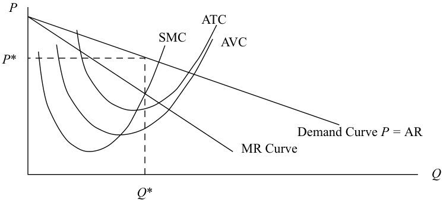
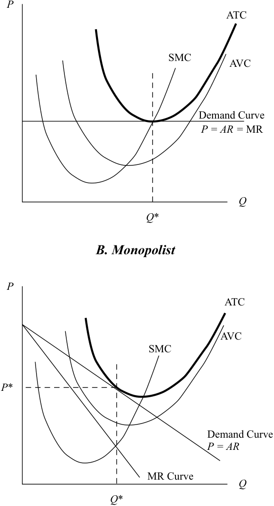
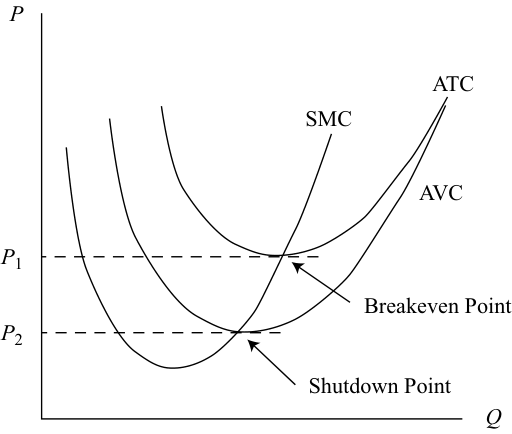
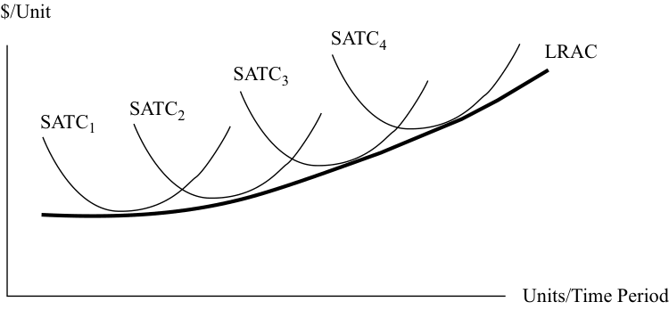
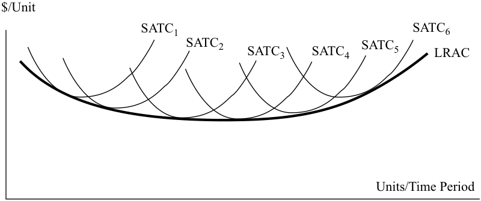
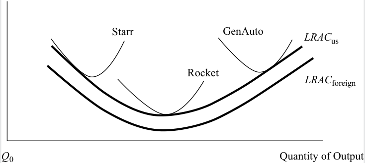

# Tập 2: Kinh tế học (Volume 2: Economics)
## Học phần 1: Doanh nghiệp và Cấu trúc Thị trường (Learning Module 1: The Firm and Market Structures)
### Phần 2/5: Tối đa hóa Lợi nhuận: Điểm Hòa vốn Sản xuất, Điểm Đóng cửa và Tính Kinh tế theo Quy mô (Profit Maximization: Production Breakeven, Shutdown and Economies of Scale) (Trang PDF 14–27)

---

<!-- PDF Page 14 -->

# **<mark>2</mark>**

## **TỐI ĐA HÓA LỢI NHUẬN: ĐIỂM HÒA VỐN SẢN XUẤT, ĐIỂM ĐÓNG CỬA VÀ TÍNH KINH TẾ THEO QUY MÔ (PROFIT MAXIMIZATION: PRODUCTION BREAKEVEN, SHUTDOWN AND ECONOMIES OF SCALE)**

xác định và diễn giải điểm hòa vốn (*breakeven point*) và điểm đóng cửa (*shutdown point*) trong sản xuất, cũng như cách thức tính kinh tế theo quy mô (*economies of scale*) và tính phi kinh tế theo quy mô (*diseconomies of scale*) ảnh hưởng đến chi phí trong điều kiện cạnh tranh hoàn hảo (*perfect competition*) và cạnh tranh không hoàn hảo (*imperfect competition*)

Các doanh nghiệp nhìn chung có thể được phân loại là hoạt động trong môi trường cạnh tranh hoàn hảo (*perfectly competitive*) hoặc cạnh tranh không hoàn hảo (*imperfectly competitive*). Sự khác biệt giữa hai môi trường này thể hiện ở độ dốc của đường cầu mà doanh nghiệp phải đối mặt. Nếu môi trường của doanh nghiệp là cạnh tranh hoàn hảo, doanh nghiệp phải chấp nhận mức giá thị trường của sản phẩm đầu ra như một yếu tố cho trước, vì vậy doanh nghiệp đối mặt với một đường cầu nằm ngang, hoàn toàn co giãn (*perfectly elastic, horizontal demand curve*). Trong trường hợp này, doanh thu cận biên (*marginal revenue* – MR) của doanh nghiệp và giá sản phẩm của nó là đồng nhất với nhau. Ngoài ra, **doanh thu bình quân (*average revenue* – AR)** của doanh nghiệp, hay doanh thu trên mỗi đơn vị sản phẩm, cũng bằng với mức giá trên mỗi đơn vị sản phẩm. Tuy nhiên, một doanh nghiệp đối mặt với đường cầu dốc xuống (*negatively sloped demand curve*) phải hạ giá bán để bán thêm một đơn vị sản phẩm, do đó doanh thu cận biên (MR) của doanh nghiệp nhỏ hơn giá bán ($P$).

Những đặc điểm này của doanh thu cận biên (MR) cũng được áp dụng cho các hàm tổng doanh thu (*total revenue* – TR). Trong điều kiện cạnh tranh hoàn hảo, tổng doanh thu (TR) (như mọi khi) bằng giá nhân với sản lượng: $\text{TR} = (P)(Q)$. Nhưng trong điều kiện cạnh tranh hoàn hảo, giá do thị trường quyết định; doanh nghiệp không có quyền kiểm soát đối với giá bán. Khi doanh nghiệp bán thêm một đơn vị sản phẩm, tổng doanh thu (TR) của nó tăng lên đúng bằng mức giá trên mỗi đơn vị sản phẩm.

Trong điều kiện cạnh tranh không hoàn hảo, giá là một biến số nằm dưới sự kiểm soát của doanh nghiệp, và do đó giá là một hàm số của sản lượng: $P = f(Q)$, và $\text{TR} = f(Q) \times Q$. Để đơn giản, giả sử doanh nghiệp là độc quyền (*monopolistic*) và đối mặt với đường cầu thị trường mà chúng ta sẽ giả định là tuyến tính và dốc xuống. Bởi vì nhà độc quyền là người bán duy nhất, tổng doanh thu (TR) của họ đồng nhất với tổng chi tiêu (*total expenditure*) của tất cả người mua trên thị trường. Khi giảm giá bán và lượng bán tăng lên trong môi trường này, việc giảm giá ban đầu sẽ làm tăng tổng chi tiêu của người mua và tổng doanh thu (TR) của doanh nghiệp bởi vì mức giảm giá được bù đắp vượt trội bởi mức tăng của số đơn vị sản phẩm bán ra. Nhưng khi giá tiếp tục giảm xuống, mức giảm giá sẽ lấn át mức tăng sản lượng, và tổng chi tiêu (doanh thu) sụt giảm. Bây giờ chúng ta có thể biểu diễn các hàm cầu và hàm tổng doanh thu (TR) cho các doanh nghiệp trong điều kiện cạnh tranh hoàn hảo và cạnh tranh không hoàn hảo, như được thể hiện trong Minh họa 1 (Exhibit 1).

<!-- PDF Page 15 -->

#### **Minh họa 1: Hàm Cầu và Hàm Tổng Doanh thu của Doanh nghiệp trong Điều kiện Cạnh tranh Hoàn hảo và Cạnh tranh Không hoàn hảo (Exhibit 1: Demand and Total Revenue Functions for Firms under Conditions of Perfect and Imperfect Competition)**

**_A. Doanh nghiệp Cạnh tranh Hoàn hảo (Perfectly Competitive Firm) — B. Doanh nghiệp Cạnh tranh Không hoàn hảo (Imperfectly Competitive Firm)_**

<!-- Picture Text: P P Demand Curve:  P  = MR Demand Curve Q Q TR TR MR Curve TR Curve TR Curve Q Q  -->

> **Chú thích hình ảnh:**
> - **Bảng A (Doanh nghiệp cạnh tranh hoàn hảo):** Đồ thị trên biểu diễn Đường cầu (*Demand Curve*): $P = \text{MR}$ nằm ngang theo sản lượng $Q$; Đồ thị dưới biểu diễn Đường tổng doanh thu (*TR Curve*) là đường thẳng dốc lên từ gốc tọa độ theo sản lượng $Q$.
> - **Bảng B (Doanh nghiệp cạnh tranh không hoàn hảo):** Đồ thị trên biểu diễn Đường cầu (*Demand Curve*) dốc xuống và Đường doanh thu cận biên (*MR Curve*) nằm dưới đường cầu; Đồ thị dưới biểu diễn Đường tổng doanh thu (*TR Curve*) có dạng hình vòm (tăng lên đạt đỉnh khi $\text{MR} = 0$ rồi giảm xuống) theo sản lượng $Q$.

Bảng A của Minh họa 1 biểu diễn đường cầu (đồ thị phía trên) và đường tổng doanh thu (đồ thị phía dưới) đối với doanh nghiệp trong điều kiện cạnh tranh hoàn hảo. Lưu ý rằng trục tung ở đồ thị phía trên là mức giá trên mỗi đơn vị sản phẩm (ví dụ: GBP/giạ), trong khi tổng doanh thu (TR) được đo lường trên trục tung ở đồ thị phía dưới (ví dụ: GBP/tuần). Điều tương tự cũng đúng với các trục tương ứng trong Bảng B, nơi biểu diễn đường cầu và đường tổng doanh thu của nhà độc quyền. Đường TR của doanh nghiệp trong điều kiện cạnh tranh hoàn hảo là một đường tuyến tính, với độ dốc bằng mức giá trên mỗi đơn vị sản phẩm. Đường TR của nhà độc quyền ban đầu tăng lên (trong vùng mà MR dương và cầu là co giãn) và sau đó giảm xuống (trong vùng mà MR âm và cầu là không co giãn) theo sản lượng đầu ra.

### **Tối đa hóa Lợi nhuận, Điểm Hòa vốn và Điểm Đóng cửa trong Sản xuất (Profit-Maximization, Breakeven, and Shutdown Points of Production)**

Bây giờ chúng ta có thể kết hợp các đường tổng chi phí (TC) ngắn hạn của doanh nghiệp với các đường tổng doanh thu (TR) để biểu diễn việc tối đa hóa lợi nhuận trong các trường hợp cạnh tranh hoàn hảo và cạnh tranh không hoàn hảo. Minh họa 2 cho thấy cả đường doanh thu bình quân (AR) và các đường chi phí bình quân trên cùng một đồ thị đối với doanh nghiệp trong điều kiện cạnh tranh hoàn hảo.

<!-- PDF Page 16 -->

**Minh họa 2: Đường Cầu, Đường Chi phí Bình quân và Đường Chi phí Cận biên của Doanh nghiệp trong Điều kiện Cạnh tranh Hoàn hảo (Exhibit 2: Demand and Average and Marginal Cost Curves for the Firm under Conditions of Perfect Competition)**

<!-- Picture Text: ATC SMC AVC P Demand Curve P =  MR Q Q′ Q*  -->

> **Chú thích hình ảnh:** Trục tung là Giá ($P$), trục hoành là Sản lượng ($Q$). Đường cầu nằm ngang (*Demand Curve* $P = \text{MR}$) cắt đường chi phí cận biên ngắn hạn (*SMC*) tại hai mức sản lượng $Q'$ (khi SMC đang dốc xuống) và $Q^*$ (khi SMC đang dốc lên). Tại mức sản lượng tối ưu $Q^*$, đường giá $P$ nằm cao hơn đường tổng chi phí bình quân (*ATC*) và đường chi phí biến đổi bình quân (*AVC*).

Doanh nghiệp tối đa hóa lợi nhuận bằng cách sản xuất tại mức sản lượng $Q^*$, nơi giá bán bằng với chi phí cận biên ngắn hạn (*short-run marginal cost* – SMC) và SMC đang trong xu hướng tăng. Lưu ý rằng tại một mức sản lượng khác là $Q'$, nơi $P = \text{SMC}$, đường SMC vẫn đang giảm xuống, vì vậy đây không thể là một nghiệm tối đa hóa lợi nhuận. Nếu giá thị trường tăng lên, đường cầu và đường MR của doanh nghiệp sẽ chỉ đơn giản dịch chuyển lên trên, và doanh nghiệp sẽ đạt được một mức sản lượng tối đa hóa lợi nhuận mới nằm ở bên phải của $Q^*$. Tuy nhiên, nếu giá thị trường giảm xuống, đường cầu và đường MR của doanh nghiệp sẽ dịch chuyển xuống dưới, dẫn đến một mức sản lượng tối đa hóa lợi nhuận mới thấp hơn. Như được minh họa trên hình, doanh nghiệp này hiện đang thu được lợi nhuận kinh tế dương (*positive economic profit*) bởi vì giá thị trường vượt quá tổng chi phí bình quân (*average total cost* – ATC) tại mức sản lượng $Q^*$. Khoản lợi nhuận này có thể đạt được trong ngắn hạn, nhưng trong dài hạn, các đối thủ cạnh tranh sẽ gia nhập thị trường để nắm lấy một phần lợi nhuận đó và sẽ đẩy giá thị trường giảm xuống mức bằng với ATC của mỗi doanh nghiệp.

Minh họa 3 biểu diễn các đường chi phí và doanh thu của một nhà độc quyền đang đối mặt với đường cầu thị trường dốc xuống. Đường MR và đường cầu không đồng nhất với nhau đối với doanh nghiệp này. Nhưng quy tắc tối đa hóa lợi nhuận vẫn giữ nguyên: Tìm mức sản lượng $Q$ làm cân bằng SMC với MR — trong trường hợp này là $Q^*$. Một khi mức sản lượng đó được xác định, mức giá tối ưu cần ấn định sẽ được cho bởi đường cầu của doanh nghiệp tại $P^*$. Nhà độc quyền này đang thu được lợi nhuận kinh tế dương bởi vì giá bán của họ vượt quá ATC. Các rào cản gia nhập (*barriers to entry*) mang lại sức mạnh độc quyền cho doanh nghiệp này đồng nghĩa với việc các đối thủ cạnh tranh bên ngoài sẽ không thể cạnh tranh làm triệt tiêu lợi nhuận của doanh nghiệp này.

#### **Minh họa 3: Đường Cầu, Đường Chi phí Bình quân và Đường Chi phí Cận biên của Doanh nghiệp Độc quyền (Exhibit 3: Demand and Average and Marginal Cost Curves for the Monopolistic Firm)**

<!-- Picture Text: P ATC SMC AVC P * Demand Curve  P =  AR MR Curve Q Q *  -->

> **Chú thích hình ảnh:** Trục tung là Giá ($P$), trục hoành là Sản lượng ($Q$). Đường chi phí cận biên ngắn hạn (*SMC*) cắt Đường doanh thu cận biên (*MR Curve*) tại sản lượng tối ưu $Q^*$. Từ $Q^*$ gióng lên Đường cầu (*Demand Curve* $P = \text{AR}$) xác định mức giá bán tối ưu $P^*$, nằm cao hơn đường *ATC* và *AVC* tại $Q^*$.

<!-- PDF Page 17 -->

### **Phân tích Điểm Hòa vốn và Quyết định Đóng cửa (Breakeven Analysis and Shutdown Decision)**

Một doanh nghiệp được gọi là hòa vốn (*break even*) nếu tổng doanh thu (TR) của nó bằng với tổng chi phí (TC). Cũng có thể nói rằng một doanh nghiệp hòa vốn nếu mức giá (AR) của nó bằng chính xác với tổng chi phí bình quân (ATC), điều này đúng trong cả điều kiện cạnh tranh hoàn hảo và cạnh tranh không hoàn hảo. Tất nhiên, mục tiêu của ban quản lý không chỉ là hòa vốn mà là tối đa hóa lợi nhuận. Tuy nhiên, có lẽ điều tốt nhất mà doanh nghiệp có thể làm được là bù đắp tất cả các chi phí kinh tế (*economic costs*) của mình. Chi phí kinh tế là tổng của toàn bộ chi phí kế toán (*accounting costs*) và các chi phí cơ hội ẩn (*implicit opportunity costs*). Một doanh nghiệp có doanh thu bằng với chi phí kinh tế là đang bù đắp được chi phí cơ hội của tất cả các yếu tố sản xuất của mình, bao gồm cả vốn (*capital*). Các nhà kinh tế học sẽ nói rằng một doanh nghiệp như vậy đang thu được lợi nhuận bình thường (*normal profit*), chứ không phải lợi nhuận kinh tế dương (*positive economic profit*). Doanh nghiệp đó đang kiếm được một tỷ suất sinh lợi trên vốn vừa đúng bằng tỷ suất sinh lợi mà một nhà đầu tư có thể kỳ vọng kiếm được từ một khoản đầu tư thay thế có mức độ rủi ro tương đương (chi phí cơ hội). Các doanh nghiệp hoạt động trong một môi trường cạnh tranh không có rào cản gia nhập từ các đối thủ cạnh tranh khác có thể kỳ vọng rằng, trong dài hạn, họ sẽ không thể kiếm được lợi nhuận kinh tế dương; tỷ suất sinh lợi vượt trội (*excess rate of return*) sẽ thu hút những người mới gia nhập ngành sản xuất thêm nhiều sản lượng hơn và cuối cùng đẩy giá thị trường giảm xuống mức mà tại đó mỗi doanh nghiệp, ở mức tốt nhất, chỉ vừa đủ kiếm được lợi nhuận bình thường. Tình huống này, tất nhiên, không hàm ý rằng doanh nghiệp đang có lợi nhuận kế toán bằng không.

Minh họa 4 biểu diễn điều kiện cho cả một doanh nghiệp trong điều kiện cạnh tranh hoàn hảo (Bảng A) và một nhà độc quyền (Bảng B), trong đó kết quả tốt nhất mà mỗi doanh nghiệp có thể làm được là hòa vốn. Lưu ý rằng tại mức sản lượng mà SMC bằng với MR, giá bán bằng với ATC. Do đó, lợi nhuận kinh tế bằng không, và các doanh nghiệp đang ở trạng thái hòa vốn.

<!-- PDF Page 18 -->

#### **Minh họa 4: Ví dụ về các Doanh nghiệp trong Cạnh tranh Hoàn hảo và Doanh nghiệp Độc quyền mà ở mức Tốt nhất chỉ có thể Hòa vốn (Exhibit 4: Examples of Firms under Perfect Competition and Monopolistic Firms That Can, at Best, Break Even)**

#### **_A. Cạnh tranh Hoàn hảo (Perfect Competition)_**

<!-- Picture Text: P ATC SMC AVC Demand Curve P = AR =  MR Q Q * B. Monopolist P ATC AVC SMC P * Demand Curve P = AR MR Curve Q Q *  -->

> **Chú thích hình ảnh:**
> - **Bảng A (Cạnh tranh hoàn hảo):** Đường cầu nằm ngang ($P = \text{AR} = \text{MR}$) tiếp xúc vừa đúng với điểm cực tiểu của đường *ATC* (nơi đường *SMC* đi qua từ dưới lên) tại mức sản lượng $Q^*$.
> - **Bảng B (Nhà độc quyền – *Monopolist*):** Tại mức sản lượng $Q^*$ nơi $\text{SMC} = \text{MR}$, Đường cầu ($P = \text{AR}$) tiếp xúc vừa đúng với đường *ATC* tại mức giá $P^*$.

### **Quyết định Đóng cửa (The Shutdown Decision)**

Trong dài hạn, nếu một doanh nghiệp không thể kiếm được ít nhất một khoản lợi nhuận kinh tế bằng không, doanh nghiệp đó sẽ không hoạt động bởi vì họ không bù đắp được chi phí cơ hội của tất cả các yếu tố sản xuất của mình là lao động và vốn. Tuy nhiên, trong ngắn hạn, một doanh nghiệp có thể nhận thấy việc tiếp tục hoạt động vẫn có lợi ngay cả khi không kiếm được lợi nhuận kinh tế tối thiểu bằng không. Phần thảo luận tiếp theo sẽ giải quyết quyết định tiếp tục hoạt động và chịu lợi nhuận âm hay đóng cửa hoạt động sản xuất (*shut down operations*).

Hãy nhớ lại rằng thông thường một phần hoặc toàn bộ chi phí cố định (*fixed costs*) của doanh nghiệp vẫn phát sinh bất kể doanh nghiệp có hoạt động hay không. Doanh nghiệp có thể có một hợp đồng thuê tòa nhà mà họ không thể tránh việc thanh toán cho đến khi hợp đồng thuê hết hạn. Trong trường hợp đó, khoản thanh toán tiền thuê là một chi phí chìm (*sunk cost*): Không thể tránh khỏi khoản chi phí này dù doanh nghiệp có làm gì đi nữa. Chi phí chìm phải được bỏ qua trong quyết định tiếp tục hoạt động trong ngắn hạn. Miễn là doanh thu của doanh nghiệp bù đắp được

<!-- PDF Page 19 -->

ít nhất phần chi phí biến đổi (*variable cost*), doanh nghiệp vẫn ở trạng thái tốt hơn nếu tiếp tục hoạt động. Nếu giá bán lớn hơn chi phí biến đổi bình quân (*average variable cost* – AVC), doanh nghiệp không chỉ bù đắp được toàn bộ chi phí biến đổi mà còn trang trải được một phần chi phí cố định.

Trong dài hạn, trừ khi giá thị trường tăng lên, doanh nghiệp này sẽ rời bỏ ngành (*exit the industry*). Nhưng trong ngắn hạn, doanh nghiệp sẽ tiếp tục hoạt động dù chịu lỗ. Minh họa 5 biểu diễn một doanh nghiệp trong điều kiện cạnh tranh hoàn hảo đối mặt với ba vùng giá thị trường khác nhau cho sản phẩm đầu ra của mình. Tại bất kỳ mức giá nào cao hơn $P_1$, doanh nghiệp có thể kiếm được lợi nhuận dương và rõ ràng nên tiếp tục hoạt động. Tại mức giá thấp hơn $P_2$ – mức AVC tối thiểu, doanh nghiệp thậm chí không thể bù đắp nổi chi phí biến đổi của mình và nên đóng cửa (*shut down*). Tại các mức giá nằm giữa $P_2$ và $P_1$, doanh nghiệp nên tiếp tục hoạt động trong ngắn hạn bởi vì doanh nghiệp có khả năng bù đắp toàn bộ chi phí biến đổi và đóng góp một phần vào việc trang trải các chi phí cố định không thể tránh khỏi. Các nhà kinh tế học gọi điểm AVC tối thiểu là **điểm đóng cửa (*shutdown point*)** và điểm ATC tối thiểu là **điểm hòa vốn (*breakeven point*)**.

#### **Minh họa 5: Một Doanh nghiệp trong Điều kiện Cạnh tranh Hoàn hảo Sẽ Chọn Đóng cửa Nếu Giá Thị trường Thấp hơn Mức AVC Tối thiểu (Exhibit 5: A Firm under Conditions of Perfect Competition Will Choose to Shut Down If Market Price Is Less Than Minimum AVC)**

<!-- Picture Text: P ATC SMC AVC P 1 Breakeven Point P 2 Shutdown Point Q  -->

> **Chú thích hình ảnh:** Trục tung là Giá ($P$), trục hoành là Sản lượng ($Q$). Đường *SMC* cắt điểm cực tiểu của đường *ATC* tại mức giá $P_1$ – đây là **Điểm hòa vốn (*Breakeven Point*)**; và cắt điểm cực tiểu của đường *AVC* tại mức giá $P_2$ – đây là **Điểm đóng cửa (*Shutdown Point*)**.

#### **VÍ DỤ 1 (EXAMPLE 1)**

### **Phân tích Điểm Hòa vốn và Tối đa hóa Lợi nhuận Khi Doanh nghiệp Đối mặt với Đường Cầu Dốc xuống trong Cạnh tranh Không hoàn hảo (Breakeven Analysis and Profit Maximization When the Firm Faces a Negatively Sloped Demand Curve under Imperfect Competition)**

Thông tin về doanh thu và chi phí cho một kỳ trong tương lai bao gồm tất cả các chi phí cơ hội được trình bày trong Minh họa 6 đối với WR International, một tập đoàn mới thành lập chuyên sản xuất các căn hộ lắp ghép chi phí thấp phục vụ thị trường nhà ở đô thị tại các nền kinh tế mới nổi. (Lưu ý rằng mức tăng sản lượng được tính theo từng lô 10 đơn vị ứng với mỗi mức thay đổi giá là 250). Doanh nghiệp có rất ít đối thủ cạnh tranh trong bối cảnh thị trường cạnh tranh không hoàn hảo.

**Minh họa 6: Thông tin Doanh thu và Chi phí của WR International (Exhibit 6: Revenue and Cost Information for WR International)**

|**Sản lượng (*Quantity* – $Q$)**|**Giá (*Price* – $P$)**|**Tổng Doanh thu (*Total Revenue* – $TR$)**|**Tổng Chi phí (*Total Cost* – $TC$)****a**|**Lợi nhuận (*Profit*)**|
|---|---|---|---|---|
|0|10.000|0|100.000|–100.000|
|10|9.750|97.500|170.000|–72.500|

<!-- PDF Page 20 -->

|**Sản lượng (*Quantity* – $Q$)**|**Giá (*Price* – $P$)**|**Tổng Doanh thu (*Total Revenue* – $TR$)**|**Tổng Chi phí (*Total Cost* – $TC$)****a**|**Lợi nhuận (*Profit*)**|
|---|---|---|---|---|
|20|9.500|190.000|240.000|–50.000|
|30|9.250|277.500|300.000|–22.500|
|40|9.000|360.000|360.000|0|
|50|8.750|437.500|420.000|17.500|
|60|8.500|510.000|480.000|30.000|
|70|8.250|577.500|550.000|27.500|
|80|8.000|640.000|640.000|0|
|90|7.750|697.500|710.000|–12.500|
|100|7.500|750.000|800.000|–50.000|

a _Bao gồm tất cả các chi phí cơ hội (Includes all opportunity costs)_

1. WR International phải bán bao nhiêu đơn vị sản phẩm để đạt điểm hòa vốn ban đầu?

#### **Lời giải (Solution):**

WR International sẽ đạt điểm hòa vốn ban đầu tại mức sản lượng 40 đơn vị, nơi TR và TC đều bằng 360.000.

2. Vùng có khả năng sinh lời (*region of profitability*) nằm ở đâu?

#### **Lời giải (Solution):**

Vùng có khả năng sinh lời sẽ trải dài từ mức lớn hơn 40 đơn vị đến nhỏ hơn 80 đơn vị. Bất kỳ mức sản lượng sản xuất nào nhỏ hơn 40 đơn vị và bất kỳ mức sản lượng nào lớn hơn 80 đơn vị đều sẽ dẫn đến lỗ kinh tế (*economic loss*).

3. Tại điểm nào doanh nghiệp sẽ tối đa hóa lợi nhuận? Tại những điểm nào xảy ra lỗ kinh tế?

#### **Lời giải (Solution):**

Lợi nhuận tối đa là 30.000 sẽ xảy ra tại mức 60 đơn vị sản phẩm. Mức lợi nhuận thấp hơn sẽ xảy ra ở bất kỳ mức sản lượng nào cao hơn hoặc thấp hơn 60 đơn vị. Từ 0 đơn vị đến dưới 40 đơn vị và đối với các mức sản lượng lớn hơn 80 đơn vị, lỗ kinh tế sẽ xảy ra.

Dựa trên mối quan hệ giữa tổng doanh thu (TR), tổng chi phí biến đổi (*total variable costs* – TVC), và tổng chi phí cố định (*total fixed costs* – TFC), Minh họa 7 tóm tắt các quyết định tiếp tục hoạt động, đóng cửa sản xuất, hoặc rời bỏ thị trường trong cả ngắn hạn và dài hạn. Doanh nghiệp phải bù đắp được chi phí biến đổi của mình để duy trì hoạt động kinh doanh trong ngắn hạn; nếu TR không thể bù đắp được TVC, doanh nghiệp sẽ đóng cửa sản xuất để tối thiểu hóa khoản lỗ. Khoản lỗ khi đó sẽ bằng với số tiền chi phí cố định. Nếu TVC vượt quá TR trong dài hạn, doanh nghiệp sẽ rời bỏ thị trường để tránh khoản lỗ gắn liền với chi phí cố định ở mức sản lượng bằng không. Bằng cách rời bỏ thị trường, các nhà đầu tư của doanh nghiệp không phải gánh chịu sự xói mòn vốn cổ phần (*equity capital*) do các khoản lỗ kinh tế gây ra. Khi TR đủ để bù đắp TVC nhưng không bù đắp được toàn bộ TFC, doanh nghiệp có thể tiếp tục sản xuất trong ngắn hạn nhưng sẽ không thể duy trì khả năng thanh toán tài chính (*financial solvency*) trong dài hạn.

<!-- PDF Page 21 -->

**Minh họa 7: Quyết định Hoạt động hay Không Hoạt động trong Ngắn hạn và Dài hạn (Exhibit 7: Short-Run and Long-Run Decisions to Operate or Not)**

|**Mối quan hệ Doanh thu – Chi phí (Revenue–Cost Relationship)**|**Quyết định Ngắn hạn (Short-Run Decision)**|**Quyết định Dài hạn (Long-Term Decision)**|
|---|---|---|
|$\text{TR} = \text{TC}$|Ở lại thị trường (*Stay in market*)|Ở lại thị trường (*Stay in market*)|
|$\text{TR} = \text{TVC}$ nhưng $< \text{TC}$|Ở lại thị trường (*Stay in market*)|Rời bỏ thị trường (*Exit market*)|
|$\text{TR} < \text{TVC}$|Đóng cửa sản xuất (*Shut down production*)|Rời bỏ thị trường (*Exit market*)|

#### **VÍ DỤ 2 (EXAMPLE 2)**

### **Phân tích Điểm Đóng cửa (Shutdown Analysis)**

Trong kỳ báo cáo tài chính gần nhất, một doanh nghiệp có trụ sở tại London có doanh thu là 2 triệu GBP và tổng chi phí (TC) là 2,5 triệu GBP, khoản chi phí này được hoặc có thể được tách thành tổng chi phí cố định (TFC) là 1 triệu GBP và tổng chi phí biến đổi (TVC) là 1,5 triệu GBP. Khoản lỗ ròng trên báo cáo kết quả hoạt động kinh doanh của doanh nghiệp được ghi nhận là 500.000 GBP (bỏ qua các tác động về thuế). Trong các kỳ trước đó, doanh nghiệp đã báo cáo có lợi nhuận từ hoạt động kinh doanh của mình.

1. Doanh nghiệp nên đưa ra quyết định gì liên quan đến hoạt động trong ngắn hạn?

#### **Lời giải (Solution):**

Trong ngắn hạn, doanh nghiệp có khả năng bù đắp toàn bộ TVC nhưng chỉ bù đắp được một nửa trong số 1 triệu GBP TFC. Nếu doanh nghiệp ngừng hoạt động, khoản lỗ của họ sẽ là 1 triệu GBP – đúng bằng số tiền TFC, trong khi khoản lỗ ròng nếu tiếp tục hoạt động sẽ được giảm thiểu xuống mức 500.000 GBP. Doanh nghiệp nên cố gắng duy trì hoạt động bằng cách đàm phán các thỏa thuận đặc biệt với các chủ nợ để có thêm thời gian đưa hoạt động kinh doanh quay trở lại trạng thái có lời.

2. Doanh nghiệp nên đưa ra quyết định gì liên quan đến hoạt động trong dài hạn?

#### **Lời giải (Solution):**

Nếu sự thiếu hụt doanh thu dự kiến sẽ kéo dài theo thời gian, doanh nghiệp nên chấm dứt hoạt động, thanh lý tài sản và thanh toán các khoản nợ trong phạm vi có thể. Bất kỳ giá trị còn lại nào dành cho các cổ đông sẽ càng sụt giảm nếu doanh nghiệp càng được phép kéo dài hoạt động không có lãi.

3. Giả sử cùng kịch bản kinh doanh như trên ngoại trừ việc doanh thu hiện chỉ còn 1,3 triệu GBP, tạo ra khoản lỗ ròng là 1,2 triệu GBP. Doanh nghiệp nên đưa ra quyết định gì liên quan đến hoạt động trong trường hợp này?

#### **Lời giải (Solution):**

Doanh nghiệp sẽ tối thiểu hóa khoản lỗ ở mức 1 triệu GBP của TFC bằng cách đóng cửa sản xuất. Nếu doanh nghiệp quyết định tiếp tục kinh doanh, khoản lỗ sẽ tăng lên tới 1,2 triệu GBP. Các cổ đông sẽ tiết kiệm được 200.000 GBP giá trị vốn cổ phần bằng cách theo đuổi phương án đóng cửa này. Không còn nghi ngờ gì nữa, doanh nghiệp sẽ có thời gian tồn tại kỳ vọng khá ngắn ngủi nếu tình trạng thua lỗ này tiếp diễn.

Khi đánh giá khả năng sinh lời, đặc biệt là của các doanh nghiệp khởi nghiệp (*start-up firms*) và các doanh nghiệp đang áp dụng chiến lược tái cơ cấu phục hồi (*turnaround strategies*), các nhà phân tích nên cân nhắc việc làm nổi bật điểm hòa vốn và điểm đóng cửa trong nghiên cứu tài chính của mình. Việc xác định các mức doanh số bán theo đơn vị sản phẩm mà tại đó doanh nghiệp

<!-- PDF Page 22 -->

bước vào hoặc rời khỏi vùng sản xuất có lời và tại đó doanh nghiệp không còn có thể vận hành như một thực thể kinh doanh có khả năng tồn tại sẽ mang lại góc nhìn sâu sắc vô giá khi đưa ra các quyết định đầu tư.

### **Tính Kinh tế và Phi kinh tế theo Quy mô với Phân tích Chi phí Ngắn hạn và Dài hạn (Economies and Diseconomies of Scale with Short-Run and Long-Run Cost Analysis)**

Hành vi hợp lý đòi hỏi doanh nghiệp phải lựa chọn một quy mô hoạt động (*operating size or scale*) giúp tối đa hóa lợi nhuận trong bất kỳ khung thời gian nào. Khung thời gian xác định ngắn hạn (*short run*) và dài hạn (*long run*) đối với bất kỳ doanh nghiệp nào đều dựa trên khả năng của doanh nghiệp trong việc điều chỉnh số lượng các nguồn lực cố định mà họ sử dụng. Ngắn hạn là khoảng thời gian mà trong đó ít nhất một trong các yếu tố sản xuất, chẳng hạn như công nghệ, vốn vật chất (*physical capital*), và quy mô nhà máy (*plant size*), là cố định. Dài hạn được định nghĩa là khoảng thời gian mà trong đó tất cả các yếu tố sản xuất đều có thể thay đổi (*variable*). Ngoài ra, trong dài hạn, các doanh nghiệp có thể gia nhập hoặc rời bỏ thị trường dựa trên các quyết định liên quan đến khả năng sinh lời. Dài hạn thường được gọi là “tầm nhìn hoạch định” (*planning horizon*), trong đó doanh nghiệp có thể lựa chọn vị thế ngắn hạn hoặc quy mô hoạt động tối ưu giúp tối đa hóa lợi nhuận theo thời gian. Doanh nghiệp luôn hoạt động trong ngắn hạn nhưng hoạch định trong dài hạn.

Thời gian cần thiết cho các điều chỉnh dài hạn thay đổi tùy theo từng ngành. Ví dụ, dài hạn đối với một doanh nghiệp nhỏ sử dụng rất ít công nghệ và vốn vật chất có thể là dưới một năm, trong khi đối với một doanh nghiệp thâm dụng vốn (*capital-intensive firm*), dài hạn có thể là hơn một thập kỷ. Tuy nhiên, nếu có đủ thời gian, tất cả các yếu tố sản xuất đều có thể thay đổi, điều này cho phép doanh nghiệp lựa chọn một quy mô hoạt động hoặc công suất nhà máy dựa trên các công nghệ và vốn vật chất khác nhau. Về phương diện này, chi phí và lợi nhuận sẽ có sự khác biệt giữa ngắn hạn và dài hạn.

#### **_Các Đường Chi phí Ngắn hạn và Dài hạn (Short- and Long-Run Cost Curves)_**

Hãy nhớ lại rằng khi chúng ta đề cập đến các đường chi phí ngắn hạn của doanh nghiệp, chúng ta đã giả định rằng yếu tố đầu vào vốn (*capital input*) được giữ không đổi. Điều đó có nghĩa là cách duy nhất để thay đổi sản lượng trong ngắn hạn là thay đổi mức độ sử dụng yếu tố đầu vào biến đổi — trong trường hợp của chúng ta là lao động (*labor*). Tuy nhiên, nếu yếu tố đầu vào vốn — cụ thể là nhà xưởng và thiết bị — thay đổi, chúng ta sẽ có một tập hợp hoàn toàn mới gồm các đường chi phí ngắn hạn, mỗi đường ứng với từng mức đầu vào vốn.

Tổng chi phí ngắn hạn bao gồm tất cả các yếu tố đầu vào — lao động và vốn — mà doanh nghiệp đang sử dụng để sản xuất ra sản lượng. Vì những lý do đã thảo luận trước đó, đường tổng chi phí ngắn hạn (*short-run total cost* – STC) điển hình có thể tăng theo sản lượng, ban đầu tăng với tốc độ giảm dần nhờ hiệu quả chuyên môn hóa (*specialization economies*) và sau đó tăng với tốc độ tăng dần, phản ánh quy luật năng suất cận biên giảm dần của lao động (*law of diminishing marginal returns to labor*). Tổng chi phí cố định (TFC), bằng lượng đầu vào vốn nhân với giá thuê vốn (*rental rate on capital*), xác định tung độ gốc (*vertical intercept*) của đường STC. Ở các mức đầu vào cố định cao hơn, TFC lớn hơn, nhưng công suất sản xuất của doanh nghiệp cũng lớn hơn. Minh họa 8 cho thấy ba đường STC khác nhau cho cùng một công nghệ nhưng sử dụng ba mức đầu vào vốn riêng biệt — các điểm 1, 2, và 3 trên trục tung.

<!-- PDF Page 23 -->

**Minh họa 8: Các Đường Tổng Chi phí Ngắn hạn ứng với các Quy mô Nhà máy Khác nhau (Exhibit 8: Short-Run Total Cost Curves for Various Plant Sizes)**

<!-- Picture Text: $/Time Period STC1 STC2 STC3 Use Smallest Plant Use Largest Plant 3 2 Use Medium 1 Plant Q Qa Qb  -->

> **Chú thích hình ảnh:** Trục tung là Chi phí mỗi kỳ ($\$/\text{Time Period}$) với 3 tung độ gốc 1, 2, 3 tương ứng với ba đường tổng chi phí ngắn hạn $\text{STC}_1, \text{STC}_2, \text{STC}_3$; trục hoành là Sản lượng ($Q$). Từ $0$ đến $Q_a$: Sử dụng nhà máy nhỏ nhất (*Use Smallest Plant* – $\text{STC}_1$); từ $Q_a$ đến $Q_b$: Sử dụng nhà máy trung bình (*Use Medium Plant* – $\text{STC}_2$); lớn hơn $Q_b$: Sử dụng nhà máy lớn nhất (*Use Largest Plant* – $\text{STC}_3$).

Quy mô Nhà máy 1 (*Plant Size 1*) là nhỏ nhất và tất nhiên có chi phí cố định thấp nhất; do đó, đường $\text{STC}_1$ của nó có tung độ gốc thấp nhất. Lưu ý rằng đường $\text{STC}_1$ bắt đầu dốc lên nhanh hơn theo sản lượng, phản ánh công suất nhà máy thấp hơn. Quy mô Nhà máy 3 (*Plant Size 3*) là lớn nhất trong ba nhà máy và phản ánh quy mô đó qua cả mức chi phí cố định cao hơn lẫn độ dốc thấp hơn tại bất kỳ mức sản lượng nào. Nếu một doanh nghiệp quyết định sản xuất ở mức sản lượng nằm giữa $0$ và $Q_a$, doanh nghiệp sẽ lên kế hoạch xây dựng Quy mô Nhà máy 1 bởi vì đối với bất kỳ mức sản lượng nào trong khoảng đó, chi phí của nó sẽ thấp hơn so với Quy mô Nhà máy 2 hoặc 3. Tương ứng, nếu doanh nghiệp dự định sản xuất mức sản lượng lớn hơn $Q_b$, doanh nghiệp sẽ chọn Quy mô Nhà máy 3 bởi vì chi phí cho bất kỳ mức sản lượng nào trong vùng đó cũng sẽ thấp hơn so với Quy mô Nhà máy 1 hoặc 2. Tất nhiên, Quy mô Nhà máy 2 sẽ được lựa chọn cho các mức sản lượng nằm giữa $Q_a$ và $Q_b$. Đường tổng chi phí dài hạn (*long-run total cost curve*) được suy ra từ mức thấp nhất của STC tại mỗi mức sản lượng bởi vì trong dài hạn, doanh nghiệp hoàn toàn tự do lựa chọn quy mô nhà máy mà mình sẽ vận hành. Đường này được gọi là “đường bao” (*envelope curve*). Về bản chất, đường này bao bọc — bao hàm — tất cả các kết hợp có thể có của công nghệ, quy mô nhà máy, và vốn vật chất.

Ứng với mỗi đường STC, cũng có một đường **tổng chi phí bình quân ngắn hạn (*short-run average total cost* – SATC)** tương ứng và một đường **tổng chi phí bình quân dài hạn (*long-run average total cost* – LRAC)** tương ứng – chính là đường bao của tất cả các đường tổng chi phí bình quân ngắn hạn có thể có. Hình dạng của đường LRAC phản ánh một khái niệm quan trọng được gọi là **tính kinh tế theo quy mô (*economies of scale*)** và **tính phi kinh tế theo quy mô (*diseconomies of scale*)**.

#### **_Định nghĩa Tính Kinh tế theo Quy mô và Tính Phi kinh tế theo Quy mô (Defining Economies of Scale and Diseconomies of Scale)_**

Khi một doanh nghiệp gia tăng tất cả các yếu tố đầu vào của mình để tăng mức sản lượng đầu ra (rõ ràng đây là một khái niệm dài hạn), doanh nghiệp đó được gọi là _mở rộng quy mô_ (*scale up*) sản xuất. _Thu hẹp quy mô_ (*scaling down*) là quá trình ngược lại — giảm tất cả các yếu tố đầu vào để sản xuất ít hơn trong dài hạn. Tính kinh tế theo quy mô (*economies of scale*) xảy ra nếu, khi doanh nghiệp tăng sản lượng đầu ra, chi phí sản xuất trên mỗi đơn vị sản phẩm giảm xuống. Về mặt đồ thị, định nghĩa này chuyển thành một đường LRAC có độ dốc âm (dốc xuống). Minh họa 9 biểu diễn một số đường SATC, mỗi đường ứng với một quy mô nhà máy, và đường LRAC thể hiện tính kinh tế theo quy mô.

<!-- PDF Page 24 -->

**Minh họa 9: Các Đường Tổng Chi phí Bình quân Ngắn hạn ứng với các Quy mô Nhà máy Khác nhau và Đường Bao của Chúng, LRAC: Tính Kinh tế theo Quy mô (Exhibit 9: Short-Run Average Total Cost Curves for Various Plant Sizes and Their Envelope Curve, LRAC: Economies of Scale)**

<!-- Picture Text: $/Unit SATC1 SATC2 SATC3 SATC4 LRAC Units/Time Period  -->

> **Chú thích hình ảnh:** Trục tung là Chi phí trên mỗi đơn vị ($\$/\text{Unit}$), trục hoành là Số đơn vị mỗi kỳ (*Units/Time Period*). Đường bao *LRAC* đi xuống qua các đường $\text{SATC}_1, \text{SATC}_2, \text{SATC}_3, \text{SATC}_4$, phản ánh chi phí bình quân dài hạn giảm dần khi quy mô sản lượng tăng lên (tính kinh tế theo quy mô).

Tính phi kinh tế theo quy mô (*diseconomies of scale*) xảy ra nếu chi phí trên mỗi đơn vị sản phẩm tăng lên khi sản lượng tăng. Về mặt đồ thị, tính phi kinh tế theo quy mô chuyển thành một đường LRAC có độ dốc dương (dốc lên). Minh họa 10 biểu diễn một số đường SATC, mỗi đường ứng với một quy mô nhà máy, và đường bao của chúng là đường LRAC thể hiện tính phi kinh tế theo quy mô.

**Minh họa 10: Các Đường Tổng Chi phí Bình quân Ngắn hạn ứng với các Quy mô Nhà máy Khác nhau và Đường Bao của Chúng, LRAC: Tính Phi kinh tế theo Quy mô (Exhibit 10: Short-Run Average Total Cost Curves for Various Plant Sizes and Their Envelope Curve, LRAC: Diseconomies of Scale)**

<!-- Picture Text: $/Unit SATC4 LRAC SATC3 SATC2 SATC1 Units/Time Period  -->

> **Chú thích hình ảnh:** Trục tung là Chi phí trên mỗi đơn vị ($\$/\text{Unit}$), trục hoành là Số đơn vị mỗi kỳ (*Units/Time Period*). Đường bao *LRAC* dốc lên qua các đường $\text{SATC}_1, \text{SATC}_2, \text{SATC}_3, \text{SATC}_4$, phản ánh chi phí bình quân dài hạn tăng lên khi quy mô sản lượng tăng (tính phi kinh tế theo quy mô).

Khi doanh nghiệp phát triển về quy mô, tính kinh tế theo quy mô và mức ATC thấp hơn có thể bắt nguồn từ các yếu tố sau đây:

- Đạt được **hiệu suất tăng dần theo quy mô (*increasing returns to scale*)** khi quy trình sản xuất cho phép mức tăng sản lượng đầu ra lớn hơn tương ứng theo tỷ lệ so với mức tăng của các yếu tố đầu vào.

- Có sự phân công lao động và quản lý (*division of labor and management*) trong một doanh nghiệp lớn với nhiều công nhân, cho phép mỗi công nhân chuyên môn hóa vào một nhiệm vụ thay vì phải thực hiện nhiều công việc như trong trường hợp của một doanh nghiệp nhỏ (nhờ đó, công nhân trong doanh nghiệp lớn trở nên thành thạo hơn với công việc của mình).

- Có khả năng chi trả cho các trang thiết bị đắt tiền hơn nhưng hiệu quả hơn, cũng như ứng dụng công nghệ mới nhất giúp tăng năng suất.

- Giảm thiểu chất thải một cách hiệu quả và hạ thấp chi phí thông qua các sản phẩm phụ có thể bán được trên thị trường (*marketable by-products*), tiêu thụ ít năng lượng hơn, và kiểm soát chất lượng nâng cao.

- Sử dụng tốt hơn thông tin và tri thức thị trường để ra quyết định quản lý hiệu quả hơn.

<!-- PDF Page 25 -->

- Đạt được mức giá chiết khấu đối với các nguồn lực khi mua với số lượng lớn hơn.

Một ví dụ kinh điển về một doanh nghiệp hiện thực hóa tính kinh tế theo quy mô thông qua đầu tư vốn vật chất lớn hơn là công ty tiện ích điện lực (*electric utility*). Bằng cách mở rộng công suất đầu ra để phục vụ tệp khách hàng lớn hơn, chi phí trên mỗi đơn vị điện của công ty tiện ích sẽ giảm xuống. Tính kinh tế theo quy mô giúp giải thích tại sao các công ty tiện ích điện lực lại phát triển một cách tự nhiên từ các đơn vị địa phương thành các doanh nghiệp cấp vùng và đa vùng. Walmart là một ví dụ về doanh nghiệp đã sử dụng sức mua số lượng lớn (*bulk purchasing power*) của mình để đạt được các mức chiết khấu sâu từ các nhà cung cấp nhằm giữ chi phí và giá bán ở mức thấp. Walmart cũng sử dụng công nghệ mới nhất để theo dõi các giao dịch tại điểm bán hàng (*point-of-sale transactions*) nhằm thu thập thông tin thị trường kịp thời để phản ứng với những thay đổi trong hành vi mua sắm của khách hàng, qua đó dẫn đến tính kinh tế theo quy mô thông qua chi phí phân phối và chi phí hàng tồn kho thấp hơn.

Các yếu tố có thể dẫn đến tính phi kinh tế theo quy mô, sự kém hiệu quả và chi phí gia tăng khi một doanh nghiệp tăng quy mô bao gồm:

- Hiện thực hóa **hiệu suất giảm dần theo quy mô (*decreasing returns to scale*)** khi quy trình sản xuất dẫn đến mức tăng sản lượng đầu ra nhỏ hơn tương ứng theo tỷ lệ so với mức tăng của các yếu tố đầu vào.

- Trở nên quá lớn đến mức không thể được quản lý một cách hợp lý.

- Sự chồng chéo và trùng lặp (*overlapping and duplicating*) giữa các chức năng kinh doanh và các dòng sản phẩm.

- Phải chịu mức giá nguồn lực cao hơn do những hạn chế về nguồn cung (*supply constraints*) khi mua các yếu tố đầu vào với số lượng lớn.

Trước khi tái cơ cấu, General Motors (GM) là một ví dụ về doanh nghiệp đã gặp phải tính phi kinh tế theo quy mô do trở nên quá lớn. Tính phi kinh tế theo quy mô xảy ra thông qua sự chồng chéo và trùng lặp sản phẩm (tức là các mẫu xe ô tô tương tự hoặc giống hệt nhau), và chi phí cố định cho các mẫu xe này không được phân bổ trên một sản lượng đầu ra lớn. Năm 2009, GM quyết định ngừng sản xuất ba thương hiệu (Saturn, Pontiac, và Hummer) và đồng thời loại bỏ nhiều mẫu sản phẩm có sản lượng thấp bị chồng chéo với các mẫu khác. GM có rất nhiều nhà máy sản xuất trên khắp thế giới và bán xe tại hơn một trăm quốc gia. Với sự phân tán về mặt địa lý trong sản xuất và bán hàng như vậy, công ty đã gặp phải các vấn đề về giao tiếp và phối hợp quản lý, dẫn đến chi phí cao hơn. Năm 2017, GM đã bán nhánh châu Âu của mình là Opel cho Groupe PSA, nhà sản xuất xe Peugeot và Citroën. GM cũng có chi phí lao động cao hơn đáng kể so với các đối thủ cạnh tranh. Là nhà sản xuất lớn nhất trên thị trường, công ty đã trở thành mục tiêu của các nghiệp đoàn lao động (*labor unions*) nhằm đòi hỏi các gói lương thưởng và phúc lợi cao hơn so với các doanh nghiệp khác.

Tính kinh tế và tính phi kinh tế theo quy mô có thể xảy ra cùng một lúc; tác động lên LRAC phụ thuộc vào việc yếu tố nào chiếm ưu thế. Nếu tính kinh tế theo quy mô chiếm ưu thế, LRAC sẽ giảm xuống khi sản lượng tăng lên. Điều ngược lại sẽ đúng khi tính phi kinh tế theo quy mô lấn át. LRAC có thể giảm xuống (tính kinh tế theo quy mô) trên một khoảng sản lượng và sau đó LRAC có thể giữ nguyên không đổi trên một khoảng sản lượng khác, tiếp theo đó có thể là một khoảng sản lượng mà tính phi kinh tế theo quy mô chiếm ưu thế, như được biểu diễn trong Minh họa 11.

Điểm cực tiểu trên đường LRAC được gọi là **quy mô hiệu quả tối thiểu (*minimum efficient scale*)**. Quy mô hiệu quả tối thiểu là quy mô doanh nghiệp tối ưu trong điều kiện cạnh tranh hoàn hảo trong dài hạn. Về mặt lý thuyết, cạnh tranh hoàn hảo buộc doanh nghiệp phải hoạt động tại điểm cực tiểu trên đường LRAC bởi vì giá thị trường sẽ được thiết lập tại mức này trong dài hạn. Nếu doanh nghiệp không hoạt động tại điểm có chi phí thấp nhất này, khả năng tồn tại lâu dài của doanh nghiệp sẽ bị đe dọa.

<!-- PDF Page 26 -->

#### **Minh họa 11: LRAC Có thể Thể hiện Cả Tính Kinh tế và Tính Phi kinh tế theo Quy mô (Exhibit 11: LRAC Can Exhibit Economies and Diseconomies of Scale)**

<!-- Picture Text: $/Unit SATC1 SATC2 SATC3 SATC4 SATC5 SATCLRAC6 Units/Time Period  -->

> **Chú thích hình ảnh:** Đường bao *LRAC* có dạng hình chữ U thoải, đi qua các đường $\text{SATC}_1$ đến $\text{SATC}_6$: ban đầu dốc xuống (tính kinh tế theo quy mô), sau đó đi ngang ở đáy (hiệu suất không đổi theo quy mô / quy mô hiệu quả tối thiểu), rồi dốc lên (tính phi kinh tế theo quy mô).

#### **VÍ DỤ 3 (EXAMPLE 3)**

### **Đường Tổng Chi phí Bình quân Dài hạn (Long-Run Average Total Cost Curve)**

Minh họa 12 hiển thị đường tổng chi phí bình quân dài hạn ($\text{LRAC}_{\text{US}}$) và các đường tổng chi phí bình quân ngắn hạn của ba nhà sản xuất ô tô giả định có trụ sở tại Hoa Kỳ — Starr Vehicles (Starr), Rocket Sports Cars (Rocket), và General Auto (GenAuto). Đường LRAC của các công ty ô tô thuộc sở hữu nước ngoài đang cạnh tranh trên thị trường ô tô Hoa Kỳ ($\text{LRAC}_{\text{foreign}}$) cũng được chỉ ra trên đồ thị. (Cấu trúc thị trường ngầm định trong hình minh họa này là cạnh tranh không hoàn hảo).

1. Các mối quan hệ chi phí được biểu diễn trong Minh họa 12 hữu ích đến mức độ nào đối với việc phân tích kinh tế và tài chính của ba doanh nghiệp ô tô có trụ sở tại Hoa Kỳ này?

#### **Minh họa 12: Đường Tổng Chi phí Bình quân Dài hạn của Ba Nhà Sản xuất Ô tô (Exhibit 12: Long-Run Average Total Cost Curves for Three Auto Manufacturers)**

Chi phí trên mỗi đơn vị (*Cost Per Unit*)

<!-- Picture Text: Starr GenAuto LRAC us Rocket LRAC foreign Q 0 Quantity of Output  -->

> **Chú thích hình ảnh:** Trục tung là Chi phí trên mỗi đơn vị (*Cost Per Unit*), trục hoành là Sản lượng đầu ra (*Quantity of Output*). Trên đường $\text{LRAC}_{\text{US}}$, *Starr* nằm ở nhánh dốc xuống bên trái, *Rocket* nằm tại điểm cực tiểu $Q_0$, và *GenAuto* nằm ở nhánh dốc lên bên phải. Đường $\text{LRAC}_{\text{foreign}}$ nằm thấp hơn toàn bộ đường $\text{LRAC}_{\text{US}}$.

#### **Lời giải (Solution):**

Thứ nhất, có thể quan sát thấy rằng các công ty ô tô nước ngoài có đường LRAC thấp hơn so với các nhà sản xuất ô tô Hoa Kỳ. Vị thế cạnh tranh này đặt các doanh nghiệp Hoa Kỳ vào thế bất lợi về chi phí — và có thể là cả bất lợi về định giá — trên thị trường, với nguy cơ đánh mất thị phần vào tay các đối thủ cạnh tranh nước ngoài có chi phí thấp hơn. Thứ hai, chỉ có Rocket hoạt động tại điểm cực tiểu của đường $\text{LRAC}_{\text{US}}$, trong khi GenAuto nằm trong vùng phi kinh tế theo quy mô và Starr nằm ở phần kinh tế theo quy mô của đường cong. Để trở nên hiệu quả và có sức cạnh tranh hơn, GenAuto cần thu hẹp quy mô (*downsize*) và tái cơ cấu, nghĩa là di chuyển xuống dọc theo đường $\text{LRAC}_{\text{US}}$ về một mức sản lượng sản xuất nhỏ hơn

<!-- PDF Page 27 -->

nhưng có chi phí thấp hơn. Ngược lại, Starr phải mở rộng quy mô để trở nên hiệu quả và cạnh tranh hơn bằng cách hạ thấp chi phí trên mỗi đơn vị sản phẩm. Từ góc độ đầu tư dài hạn và xét đến lợi thế chi phí của mình, Rocket có tiềm năng tạo ra nhiều giá trị đầu tư hơn so với GenAuto và Starr. Trong dài hạn, nếu GenAuto và Starr có thể hạ thấp mức ATC của mình, họ sẽ trở nên hấp dẫn hơn đối với các nhà đầu tư. Nhưng nếu bất kỳ công ty nào trong số ba công ty ô tô Hoa Kỳ không thể bắt kịp năng lực cạnh tranh về chi phí của các doanh nghiệp nước ngoài, họ có thể bị đẩy ra khỏi thị trường. Trong dài hạn, các nhà sản xuất ô tô nước ngoài có chi phí thấp hơn đặt ra một thách thức cạnh tranh gay gắt đối với sự sống còn của các nhà sản xuất Hoa Kỳ cũng như khả năng duy trì và gia tăng tài sản cho các cổ đông của họ.

#### **BỘ CÂU HỎI (QUESTION SET)**

|1. Một doanh nghiệp nông nghiệp hoạt động trong thị trường cạnh tranh hoàn hảo cung cấp lúa mì cho các nhà sản xuất thực phẩm tiêu dùng và thức ăn chăn nuôi. Nếu doanh nghiệp này có thể mở rộng sản xuất và doanh số bán theo đơn vị thêm 10%, kết quả _có khả năng xảy ra nhất_ sẽ là:|
|---|
|**A.** tổng doanh thu (*total revenue*) tăng 10%.|
|**B.** doanh thu bình quân (*average revenue*) tăng 10%.|
|**C.** tổng doanh thu tăng ít hơn 10%. **Lời giải (Solution):**|
|A là đáp án đúng. Trong một thị trường cạnh tranh hoàn hảo, sự gia tăng lượng cung từ một doanh nghiệp đơn lẻ sẽ không làm ảnh hưởng đến giá bán. Do đó, mức tăng số đơn vị sản phẩm bán ra của doanh nghiệp sẽ đi kèm với mức tăng tương ứng theo đúng tỷ lệ của tổng doanh thu.|
|2. Doanh thu cận biên (*marginal revenue*) trên mỗi đơn vị sản phẩm bán ra của một doanh nghiệp kinh doanh trong điều kiện cạnh tranh hoàn hảo sẽ _có khả năng nhất_ là:|
|**A.** bằng với doanh thu bình quân (*average revenue*).|
|**B.** nhỏ hơn doanh thu bình quân. **C.** lớn hơn doanh thu bình quân. **Lời giải (Solution):** A là đáp án đúng. Trong điều kiện cạnh tranh hoàn hảo, doanh nghiệp là người chấp nhận giá (*price taker*) tại bất kỳ mức sản lượng nào cung ứng ra thị trường, và $\text{AR} = \text{MR} = \text{Giá bán (Price)}$.|
|3. Lợi nhuận tối đa (*profit maximum*) _ít có khả năng xảy ra nhất_ khi: **A.** tổng chi phí bình quân (*average total cost*) đạt mức tối thiểu.|
|**B.** doanh thu cận biên bằng với chi phí cận biên ($\text{MR} = \text{MC}$). **C.** chênh lệch giữa tổng doanh thu và tổng chi phí đạt mức tối đa. **Lời giải (Solution):**|
|A là đáp án đúng. Mức sản lượng mà tại đó tổng chi phí bình quân đạt mức tối thiểu không nhất thiết tương ứng với điểm tối đa hóa lợi nhuận.|
|4. Điểm hòa vốn sản xuất trong ngắn hạn (*short-term breakeven point*) đối với một doanh nghiệp hoạt động trong điều kiện cạnh tranh hoàn hảo sẽ _có khả năng xảy ra nhất_ khi:|
|**A.** giá bán bằng với tổng chi phí bình quân (*price is equal to average total cost*).|
|**B.** doanh thu cận biên bằng với chi phí cận biên (*marginal revenue is equal to marginal cost*).|
