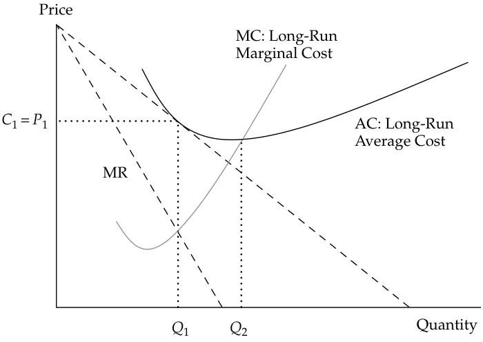

# Tập 2: Kinh tế học (Volume 2: Economics)
## Học phần 1: Doanh nghiệp và Cấu trúc Thị trường (Learning Module 1: The Firm and Market Structures)
### Phần 3/5: Giới thiệu về Cấu trúc Thị trường (Introduction to Market Structures) (Trang PDF 28–36)

---

<!-- PDF Page 28 -->

- **C.** doanh thu cận biên bằng với chi phí biến đổi bình quân (*marginal revenue is equal to average variable costs*).

- **Lời giải (Solution):**

A là đáp án đúng. Trong điều kiện cạnh tranh hoàn hảo, giá bán bằng với doanh thu cận biên. Một doanh nghiệp hòa vốn khi doanh thu cận biên (hay giá bán) bằng với tổng chi phí bình quân (*average total cost*).

# **<mark>3</mark>**

## **GIỚI THIỆU VỀ CẤU TRÚC THỊ TRƯỜNG (INTRODUCTION TO MARKET STRUCTURES)**

mô tả các đặc điểm của cạnh tranh hoàn hảo (*perfect competition*), cạnh tranh độc quyền (*monopolistic competition*), độc quyền nhóm (*oligopoly*), và độc quyền thuần túy (*pure monopoly*)

Các cấu trúc thị trường khác nhau dẫn đến các tập hợp lựa chọn khác nhau mà những người ra quyết định của doanh nghiệp phải đối mặt. Do đó, sự hiểu biết về cấu trúc thị trường là một công cụ mạnh mẽ trong việc phân tích các vấn đề như việc định giá sản phẩm của doanh nghiệp và, rộng hơn là tiềm năng gia tăng khả năng sinh lời của doanh nghiệp đó. Trong dài hạn, khả năng sinh lời của một doanh nghiệp sẽ được quyết định bởi các lực lượng gắn liền với cấu trúc thị trường mà trong đó doanh nghiệp hoạt động. Trong một thị trường có tính cạnh tranh cao, lợi nhuận dài hạn sẽ bị đẩy xuống thấp bởi các lực lượng cạnh tranh. Trong các thị trường ít cạnh tranh hơn, lợi nhuận lớn vẫn có thể đạt được ngay cả trong dài hạn; còn trong ngắn hạn, bất kỳ kết quả nào cũng có thể xảy ra. Do đó, việc hiểu rõ các lực lượng đằng sau cấu trúc thị trường sẽ hỗ trợ nhà phân tích tài chính trong việc xác định triển vọng ngắn hạn và dài hạn của các doanh nghiệp.

Cấu trúc thị trường giải quyết các câu hỏi như sau: Điều gì quyết định mức độ cạnh tranh gắn liền với mỗi cấu trúc thị trường? Với mức độ cạnh tranh gắn liền với từng cấu trúc thị trường, những quyết định nào còn lại dành cho đội ngũ quản lý khi xây dựng chiến lược doanh nghiệp? Làm thế nào một chiến lược định giá và sản lượng đã chọn lại phát triển thành các quyết định cụ thể làm ảnh hưởng đến khả năng sinh lời của doanh nghiệp? Câu trả lời cho những câu hỏi này có liên hệ mật thiết với các lực lượng của cấu trúc thị trường mà trong đó doanh nghiệp hoạt động.

### **Phân tích các Cấu trúc Thị trường (Analysis of Market Structures)**

Theo truyền thống, các nhà kinh tế học phân loại thị trường thành một trong bốn cấu trúc: cạnh tranh hoàn hảo (*perfect competition*), cạnh tranh độc quyền (*monopolistic competition*), độc quyền nhóm (*oligopoly*), và độc quyền (*monopoly*).

Các nhà kinh tế học định nghĩa thị trường là một nhóm người mua và người bán biết về nhau và có thể thống nhất về một mức giá để trao đổi hàng hóa và dịch vụ. Mặc dù việc truy cập internet đã mở rộng nhiều thị trường ra phạm vi toàn cầu, một số thị trường nhất định vẫn bị giới hạn bởi ranh giới địa lý. Ví dụ, công cụ tìm kiếm internet Google hoạt động trong một thị trường toàn cầu. Ngược lại, thị trường bê tông trộn sẵn bị giới hạn trong khu vực mà một chiếc xe tải có thể giao hỗn hợp bê tông ướt từ trạm trộn đến công trường xây dựng trước khi hỗn hợp đó đông cứng và trở nên vô dụng. Cuốn sách bán chạy quốc tế của Thomas L. Friedman có tựa đề _Thế giới Phẳng_ (_The World Is Flat_) đã thách thức khái niệm về những giới hạn địa lý của thị trường. Nếu dịch vụ do người bán cung cấp có thể được số hóa (*digitized*), thị trường của nó sẽ mở rộng ra toàn cầu. Ví dụ, một kỹ thuật viên có thể chụp cắt lớp chấn thương của bạn tại một phòng khám ở Thụy Sĩ. Hình ảnh X-quang đó có thể được số hóa và gửi cho một bác sĩ chẩn đoán hình ảnh ở Ấn Độ để đọc kết quả. Với tư cách là một khách hàng (tức là bệnh nhân), bạn có thể không bao giờ biết rằng một phần dịch vụ y tế được cung cấp cho bạn là kết quả của một thị trường toàn cầu.

Một số thị trường có mức độ tập trung rất cao (*highly concentrated*), với phần lớn tổng doanh số đến từ một số lượng nhỏ các doanh nghiệp. Ví dụ, trong thị trường tìm kiếm trên internet, ba doanh nghiệp đã kiểm soát 98,9% thị trường Hoa Kỳ (Google chiếm 63,5%, Microsoft chiếm 24%, và Oath (trước đây là Yahoo!) chiếm 11,4%) tính đến tháng 1 năm 2018. Các thị trường khác

<!-- PDF Page 29 -->

lại bị phân mảnh (*fragmented*), chẳng hạn như dịch vụ sửa chữa ô tô, nơi các cửa hàng độc lập quy mô nhỏ thường chiếm ưu thế và các chuỗi cửa hàng lớn có thể tồn tại hoặc không. Các sản phẩm mới có thể dẫn đến sự tập trung thị trường. Ví dụ, Apple đã giới thiệu máy nghe nhạc kỹ thuật số đầu tiên của mình (iPod) vào năm 2001 và bất chấp sự gia nhập của các đối thủ cạnh tranh, hãng vẫn nắm giữ thị phần toàn cầu hơn 70% trong số các máy nghe nhạc kỹ thuật số vào năm 2009.

#### **TẦM QUAN TRỌNG CỦA CẤU TRÚC THỊ TRƯỜNG (THE IMPORTANCE OF MARKET STRUCTURE)**

Hãy xem xét sự phát triển của ngành phát thanh truyền hình (*television broadcasting*). Khi môi trường thị trường của ngành truyền hình phát triển, cấu trúc thị trường đã thay đổi, dẫn đến một tập hợp mới các thách thức và sự lựa chọn. Trong những ngày đầu, khán giả chỉ có một lựa chọn duy nhất: các kênh truyền hình tương tự (*analog channels*) “miễn phí” được phát qua sóng vô tuyến. Hầu hết các quốc gia chỉ có một kênh truyền hình do chính phủ sở hữu và điều hành. Tại Hoa Kỳ, một số thị trường đông dân cư hơn có thể thu được nhiều kênh hơn bởi vì các kênh địa phương được thiết lập để phủ sóng một thị trường có nhiều khán giả tiềm năng hơn. Đến những năm 1970, các công nghệ mới đã làm cho việc phát sóng qua kết nối cáp (*cable connectivity*) trở nên khả thi và các lựa chọn cung cấp cho người tiêu dùng bắt đầu mở rộng nhanh chóng. Truyền hình cáp đã thách thức các kênh phát sóng quảng bá “miễn phí” bằng cách cung cấp nhiều sự lựa chọn hơn và chất lượng hình ảnh tốt hơn. Sự đổi mới này khá đắt đỏ đối với người tiêu dùng và mang lại lợi nhuận cao cho các công ty truyền hình cáp. Đến những năm 1990, một phương án thay thế mới bắt đầu thách thức các hệ thống phát sóng quảng bá và truyền hình cáp hiện có: truyền hình vệ tinh (*satellite television*). Các nhà cung cấp truyền hình vệ tinh đã mang đến một tập hợp lựa chọn còn mở rộng hơn nữa, mặc dù ở mức giá cao hơn so với các phương án truyền hình quảng bá miễn phí và truyền hình cáp. Vào đầu những năm 2000, các nhà cung cấp truyền hình vệ tinh đã hạ mức giá của họ xuống để cạnh tranh trực tiếp với các nhà cung cấp truyền hình cáp.

Ngày nay, các nhà cung cấp chương trình truyền hình cáp, các nhà cung cấp truyền hình vệ tinh, và các đài truyền hình kỹ thuật số mặt đất cung cấp các kênh trả tiền cao cấp (*premium*) và trả tiền theo lượt xem (*pay-per-view*) đang phải cạnh tranh để giành giật những khách hàng vốn ngày càng tìm kiếm nội dung trên internet và trên các thiết bị di động của họ. Các công ty như Netflix, Apple, và Amazon đã cung cấp những phương thức thay thế để người tiêu dùng tiếp cận nội dung. Theo thời gian, các công ty này đã tiến xa hơn việc chỉ đóng gói lại các chương trình hiện có để tự phát triển nội dung của riêng mình, phản ánh đúng quá trình tiến hóa của các kênh truyền hình cáp như HBO và ESPN một thập kỷ trước đó.

Đây là một minh họa đơn giản về tầm quan trọng của cấu trúc thị trường. Khi thị trường phát sóng truyền hình ngày càng trở nên cạnh tranh hơn, các nhà quản lý đã phải đưa ra những quyết định liên quan đến việc đóng gói sản phẩm, định giá, quảng cáo, và tiếp thị để tồn tại trong môi trường đang thay đổi. Thêm vào đó, các hoạt động mua bán và sáp nhập (*mergers and acquisitions* – M&A) như một phản ứng trước những áp lực cạnh tranh này đã làm thay đổi cấu trúc cốt lõi của ngành.

Cấu trúc thị trường có thể được chia thành bốn phân loại riêng biệt: cạnh tranh hoàn hảo (*perfect competition*), cạnh tranh độc quyền (*monopolistic competition*), độc quyền nhóm (*oligopoly*), và độc quyền (*monopoly*).

Chúng ta bắt đầu với môi trường cạnh tranh cao nhất, **cạnh tranh hoàn hảo (*perfect competition*)**. Không giống như một số khái niệm kinh tế học khác, cạnh tranh hoàn hảo không đơn thuần chỉ là một hình mẫu lý tưởng dựa trên các giả định. Cạnh tranh hoàn hảo là một thực tế — ví dụ, trong một số thị trường hàng hóa cơ bản (*commodities markets*), nơi người bán và người mua có một sản phẩm đồng nhất tuyệt đối (*strictly homogeneous product*) và không một nhà sản xuất đơn lẻ nào đủ lớn để gây ảnh hưởng lên giá thị trường. Các đặc điểm của cạnh tranh hoàn hảo được nhận diện rất rõ ràng và kết quả dài hạn của nó là điều không thể tránh khỏi. Lợi nhuận trong điều kiện cạnh tranh hoàn hảo bị đẩy về mức tỷ suất sinh lợi yêu cầu mà người chủ doanh nghiệp phải trả để vay vốn từ các nhà đầu tư (được gọi là lợi nhuận bình thường – *normal profit* hay chi phí thuê vốn – *rental cost of capital*). Điều này không có nghĩa là tất cả các ngành cạnh tranh hoàn hảo đều bị định đoạt sẽ tuyệt chủng vì thiếu lợi nhuận. Ngược lại, hàng triệu doanh nghiệp đang ăn nên làm ra vẫn đang sống dưới những áp lực của cạnh tranh hoàn hảo.

**Cạnh tranh độc quyền (*monopolistic competition*)** cũng có tính cạnh tranh rất cao; tuy nhiên, nó được coi là một hình thức của cạnh tranh không hoàn hảo (*imperfect competition*). Hai nhà kinh tế học, Edward H. Chamberlin (Hoa Kỳ) và Joan Robinson (Vương quốc Anh), đã xác định được thị trường lai (*hybrid market*) này và đưa ra

<!-- PDF Page 30 -->

thuật ngữ đó bởi vì cấu trúc thị trường này không chỉ có các yếu tố cạnh tranh mạnh mẽ mà còn có một số điều kiện giống như độc quyền. Đặc điểm mang tính cạnh tranh là một số lượng lớn đáng kể các doanh nghiệp, trong khi khía cạnh độc quyền là kết quả của sự khác biệt hóa sản phẩm (*product differentiation*). Nghĩa là, nếu người bán có thể thuyết phục người tiêu dùng rằng sản phẩm của mình khác biệt một cách độc đáo so với các sản phẩm tương tự khác, thì người bán có thể thực thi một mức độ quyền lực định giá (*pricing power*) nhất định đối với thị trường. Một ví dụ điển hình là lòng trung thành với thương hiệu (*brand loyalty*) gắn liền với các loại nước giải khát như Coca-Cola. Nhiều khách hàng của Coca-Cola tin rằng đồ uống của hãng thực sự khác biệt và ngon hơn tất cả các loại nước giải khát khác. Điều tương tự cũng đúng đối với các sáng tạo thời trang và mỹ phẩm.

Cấu trúc thị trường **độc quyền nhóm (*oligopoly*)** dựa trên một số lượng tương đối nhỏ các doanh nghiệp cung ứng cho thị trường. Số lượng ít ỏi các doanh nghiệp trên thị trường đồng nghĩa với việc mỗi doanh nghiệp phải cân nhắc xem các doanh nghiệp khác sẽ theo đuổi những chiến lược trả đũa (*retaliatory strategies*) nào khi giá bán và mức sản lượng thay đổi. Hãy xem xét hành vi định giá của các hãng hàng không thương mại. Các chiến lược định giá và lập lịch trình đường bay được dựa trên phản ứng kỳ vọng của các hãng vận chuyển khác trên những thị trường tương tự. Đối với bất kỳ tuyến bay nhất định nào — chẳng hạn từ Paris, Pháp đến Chennai, Ấn Độ — chỉ có một vài hãng hàng không cạnh tranh với nhau. Nếu một trong các hãng thay đổi gói giá cước của mình, những hãng khác nhiều khả năng sẽ trả đũa. Việc hiểu rõ cấu trúc thị trường của các thị trường độc quyền nhóm có thể giúp nhận diện một khuôn mẫu hợp lý của những thay đổi giá mang tính chiến lược đối với các doanh nghiệp đang cạnh tranh.

Cuối cùng, cấu trúc thị trường ít cạnh tranh nhất là **độc quyền (*monopoly*)**. Trong các thị trường độc quyền thuần túy (*pure monopoly*), không tồn tại bất kỳ hàng hóa thay thế tốt nào khác cho sản phẩm hoặc dịch vụ đang xét. Một người bán duy nhất, nếu được phép hoạt động mà không có sự ràng buộc nào, sẽ thực thi quyền lực to lớn đối với các quyết định về giá bán và sản lượng. Trong hầu hết các nền kinh tế thị trường trên toàn cầu, các nhà độc quyền thuần túy đều chịu sự quản lý của cơ quan nhà nước (*regulated by a governmental authority*). Ví dụ phổ biến nhất về một nhà độc quyền có sự điều tiết là nhà cung cấp điện năng tại địa phương. Trong hầu hết các trường hợp, nhà cung cấp điện độc quyền được phép kiếm một tỷ suất sinh lợi bình thường trên khoản đầu tư của mình và mức giá được cơ quan quản lý ấn định để cho phép đạt được mức sinh lợi đó.

#### **_Các Yếu tố Quyết định Cấu trúc Thị trường (Factors That Determine Market Structure)_**

Năm yếu tố sau đây quyết định cấu trúc thị trường:

**1.** Số lượng và quy mô tương đối của các doanh nghiệp cung ứng sản phẩm;

**2.** Mức độ khác biệt hóa sản phẩm (*degree of product differentiation*);

**3.** Quyền lực của người bán đối với các quyết định định giá;

**4.** Sức mạnh tương đối của các rào cản gia nhập và rút lui khỏi thị trường (*barriers to market entry and exit*); và

**5.** Mức độ cạnh tranh phi giá (*degree of non-price competition*).

Số lượng và quy mô tương đối của các doanh nghiệp trên một thị trường có ảnh hưởng đến cấu trúc thị trường. Khi có nhiều doanh nghiệp tồn tại, mức độ cạnh tranh sẽ tăng lên. Khi có ít doanh nghiệp cung ứng một hàng hóa hoặc dịch vụ hơn, người tiêu dùng bị giới hạn trong các lựa chọn trên thị trường của họ. Một trường hợp cực đoan là cấu trúc thị trường độc quyền, với chỉ một doanh nghiệp duy nhất cung ứng một hàng hóa hoặc dịch vụ độc nhất. Một thái cực khác là cạnh tranh hoàn hảo, với rất nhiều doanh nghiệp cung ứng một sản phẩm tương tự nhau. Cuối cùng, một ví dụ về quy mô tương đối là ngành công nghiệp ô tô, trong đó một số lượng nhỏ các nhà sản xuất quốc tế lớn (ví dụ: Volkswagen và Toyota) là những người dẫn đầu trên thị trường toàn cầu, và một số công ty nhỏ hoặc là có sức mạnh thị trường bởi vì họ là những người chơi trong phân khúc ngách (*niche players*, ví dụ: Ferrari hoặc McLaren) hoặc là có sức mạnh thị trường hạn chế do dải mẫu xe hẹp hay sự hiện diện địa lý hạn chế của họ (ví dụ: Mazda hoặc Stellantis).

Trong trường hợp cạnh tranh độc quyền, có nhiều doanh nghiệp cùng cung cấp sản phẩm ra thị trường giống như trong cạnh tranh hoàn hảo. Tuy nhiên, sản phẩm của một doanh nghiệp được tạo sự khác biệt theo một cách thức nào đó khiến nó có vẻ tốt hơn so với các sản phẩm tương tự từ những doanh nghiệp khác. Nếu một doanh nghiệp thành công trong việc tạo sự khác biệt hóa cho sản phẩm của mình, sự khác biệt hóa này sẽ mang lại đòn bẩy định giá (*pricing leverage*). Sản phẩm càng có vẻ khác biệt bao nhiêu thì thị trường sẽ càng

<!-- PDF Page 31 -->

giống với cấu trúc thị trường độc quyền bấy nhiêu. Một doanh nghiệp có thể tạo sự khác biệt cho sản phẩm của mình thông qua các chiến dịch quảng cáo rầm rộ; thường xuyên thay đổi kiểu dáng; liên kết sản phẩm của mình với các sản phẩm bổ sung (*complementary products*) khác; hoặc hàng loạt các phương pháp khác.

Khi thị trường quyết định mức giá dựa trên điều kiện tổng cung và tổng cầu, doanh nghiệp cá lẻ không có quyền kiểm soát đối với việc định giá. Người nông dân nuôi lợn điển hình ở Nebraska và nhà sản xuất sữa ở Bavaria là những **người chấp nhận giá (*price takers*)**. Nghĩa là, họ phải chấp nhận bất cứ mức giá nào mà thị trường ấn định. Đây là trường hợp diễn ra dưới cấu trúc thị trường cạnh tranh hoàn hảo. Trong trường hợp cạnh tranh độc quyền, sự thành công của việc khác biệt hóa sản phẩm quyết định mức độ mà doanh nghiệp có thể gây ảnh hưởng lên giá bán. Trong trường hợp độc quyền nhóm, có quá ít doanh nghiệp trên thị trường đến mức việc kiểm soát giá trở nên khả thi. Tuy nhiên, số lượng ít các doanh nghiệp trong thị trường độc quyền nhóm lại dẫn lối cho các chiến lược định giá phức tạp. Sự thông đồng (*collusion*), sự dẫn dắt giá bởi các doanh nghiệp thống lĩnh (*price leadership by dominant firms*), và các chiến lược định giá khác có thể xảy ra.

Mức độ mà một cấu trúc thị trường có thể phát triển thành một cấu trúc khác cũng như sự khác biệt giữa các kết quả tiềm năng trong ngắn hạn và các điều kiện cân bằng trong dài hạn phụ thuộc vào sức mạnh của các rào cản gia nhập ngành (*barriers to entry*) và khả năng các doanh nghiệp không thu hồi được chi phí ban đầu hoặc thua lỗ trong một khoảng thời gian kéo dài và do đó buộc phải rời bỏ thị trường. Rào cản gia nhập có thể bắt nguồn từ các yêu cầu đầu tư vốn lớn, như trong trường hợp lọc hóa dầu. Rào cản cũng có thể bắt nguồn từ bằng sáng chế (*patents*), như trong trường hợp của một số sản phẩm điện tử và công thức dược phẩm. Một yếu tố cần cân nhắc khác khi gia nhập là khả năng có chi phí rút lui (*exit costs*) cao. Ví dụ, các nhà máy mang tính đặc thù chuyên biệt cho một dòng sản phẩm đặc biệt, chẳng hạn như các nhà máy luyện nhôm, không thể tái bố trí sang mục đích khác (*non-redeployable*), và chi phí rút lui sẽ rất cao nếu không có một thị trường thanh khoản cho các tài sản của doanh nghiệp. Chi phí rút lui cao làm nản lòng việc gia nhập và do đó cũng được coi là rào cản gia nhập. Trong trường hợp trồng trọt nông nghiệp, rào cản gia nhập là rất thấp. Việc sản xuất ngô, đậu tương, lúa mì, cà chua và các nông sản khác là một quy trình dễ sao chép; do đó, đó là những thị trường có tính cạnh tranh rất cao.

Cạnh tranh phi giá (*non-price competition*) thống lĩnh những cấu trúc thị trường mà ở đó sự khác biệt hóa sản phẩm đóng vai trò sống còn. Do đó, cạnh tranh độc quyền dựa vào các chiến lược cạnh tranh có thể không bao gồm việc thay đổi giá bán. Một ví dụ về cạnh tranh phi giá là việc tạo sự khác biệt hóa sản phẩm thông qua hoạt động tiếp thị (*marketing*). Trong những hoàn cảnh khác, cạnh tranh phi giá có thể xảy ra bởi vì một vài doanh nghiệp ít ỏi trên thị trường cảm thấy phụ thuộc lẫn nhau. Mỗi doanh nghiệp đều lo sợ những đợt thay đổi giá trả đũa vốn sẽ làm giảm tổng doanh thu của tất cả các doanh nghiệp trên thị trường. Bởi vì các ngành độc quyền nhóm có quá ít doanh nghiệp, mỗi doanh nghiệp đều cảm thấy phụ thuộc vào chiến lược định giá của các doanh nghiệp khác. Do đó, cạnh tranh phi giá trở thành một chiến lược chi phối (*dominant strategy*).

#### **_Các Đặc điểm của Cấu trúc Thị trường (Characteristics of Market Structure)_**

**Minh họa 13: Các Đặc điểm của Cấu trúc Thị trường (Exhibit 13: Characteristics of Market Structure)**

|**Cấu trúc Thị trường (Market Structure)**|**Số lượng Người bán (Number of Sellers)**|**Mức độ Khác biệt hóa Sản phẩm (Degree of Product Differentiation)**|**Rào cản Gia nhập (Barriers to Entry)**|**Quyền lực Định giá của Doanh nghiệp (Pricing Power of Firm)**|**Cạnh tranh Phi giá (Non-Price Competition)**|
|---|---|---|---|---|---|
|Cạnh tranh hoàn hảo (*Perfect competition*)|Nhiều (*Many*)|Đồng nhất / Tiêu chuẩn hóa (*Homogeneous/ Standardized*)|Rất thấp (*Very Low*)|Không có (*None*)|Không có (*None*)|
|Cạnh tranh độc quyền (*Monopolistic competition*)|Nhiều (*Many*)|Khác biệt hóa (*Differentiated*)|Thấp (*Low*)|Một chút (*Some*)|Quảng cáo và Khác biệt hóa Sản phẩm (*Advertising and Product Differentiation*)|
|Độc quyền nhóm (*Oligopoly*)|Một vài (*Few*)|Đồng nhất / Tiêu chuẩn hóa (*Homogeneous/ Standardized*)|Cao (*High*)|Một chút hoặc Đáng kể (*Some or Considerable*)|Quảng cáo và Khác biệt hóa Sản phẩm (*Advertising and Product Differentiation*)|
|Độc quyền (*Monopoly*)|Một (*One*)|Sản phẩm Độc nhất (*Unique Product*)|Rất cao (*Very High*)|Đáng kể (*Considerable*)|Quảng cáo (*Advertising*)|

<!-- PDF Page 32 -->

Từ góc độ của những người chủ sở hữu doanh nghiệp, cấu trúc thị trường đáng mong ước nhất là cấu trúc có quyền kiểm soát lớn nhất đối với giá bán, bởi vì quyền kiểm soát này có thể dẫn đến lợi nhuận lớn (Minh họa 13). Thị trường độc quyền và độc quyền nhóm mang lại tiềm năng kiểm soát giá lớn nhất; cạnh tranh độc quyền mang lại quyền kiểm soát ít hơn. Các doanh nghiệp hoạt động trong điều kiện thị trường cạnh tranh hoàn hảo không có quyền kiểm soát nào đối với giá bán. Từ góc độ của người tiêu dùng, cấu trúc thị trường đáng mong ước nhất là cấu trúc có mức độ cạnh tranh cao nhất bởi vì giá cả nhìn chung thấp hơn. Do đó, người tiêu dùng sẽ ưa thích càng nhiều hàng hóa và dịch vụ được cung ứng trong các thị trường cạnh tranh càng tốt.

Như thường thấy trong kinh tế học, luôn có một sự đánh đổi (*trade-off*). Trong khi cạnh tranh hoàn hảo mang lại số lượng hàng hóa lớn nhất với mức giá thấp nhất, các hình thái thị trường khác lại có thể thúc đẩy nhiều sự đổi mới sáng tạo (*innovation*) hơn. Cụ thể, các doanh nghiệp có thể phải chịu chi phí cao khi nghiên cứu một sản phẩm mới, và họ sẽ chỉ gánh chịu những chi phí như vậy nếu họ kỳ vọng kiếm được một tỷ suất sinh lợi hấp dẫn trên khoản đầu tư nghiên cứu của mình. Đây là lập luận thường được đưa ra đối với các đổi mới y học, chẳng hạn — chi phí thử nghiệm lâm sàng và thí nghiệm để tạo ra các loại thuốc mới sẽ làm phá sản các doanh nghiệp cạnh tranh hoàn hảo nhưng lại có thể chấp nhận được trong một cấu trúc thị trường độc quyền nhóm. Do đó, người tiêu dùng có thể được hưởng lợi từ những thị trường kém cạnh tranh hoàn hảo hơn.

#### **NĂM ÁP LỰC CẠNH TRANH CỦA PORTER VÀ CẤU TRÚC THỊ TRƯỜNG (PORTER’S FIVE FORCES AND MARKET STRUCTURE)**

Một nhà phân tích tài chính hướng tới việc xác lập các điều kiện thị trường và khả năng sinh lời kéo theo của các doanh nghiệp hiện hữu (*incumbent firms*) nên bắt đầu bằng những câu hỏi đã đặt ra trước đó: Có bao nhiêu người bán? Sản phẩm có được khác biệt hóa hay không? Hơn nữa, trong trường hợp độc quyền và bán độc quyền (*quasi-monopolies*), nhà phân tích nên đánh giá khung pháp lý và quy định quản lý: Công ty có thể tự do ấn định giá bán hay có sự kiểm soát của chính phủ? Cuối cùng, nhà phân tích nên xem xét mối đe dọa cạnh tranh từ những doanh nghiệp tiềm năng mới gia nhập ngành.

Phân tích này thường được các sinh viên ngành chiến lược doanh nghiệp tóm tắt là “năm áp lực cạnh tranh của Porter” (*Porter’s five forces*), được đặt theo tên của giáo sư Trường Kinh doanh Harvard Michael E. Porter. Cuốn sách của ông, _Chiến lược Cạnh tranh_ (_Competitive Strategy_), đã trình bày một phân tích có hệ thống về thực tiễn chiến lược thị trường. Porter đã xác định năm áp lực cạnh tranh như sau:

- Mối đe dọa từ các đối thủ mới gia nhập (*Threat of entry*);

- Quyền lực đàm phán của nhà cung cấp (*Power of suppliers*);

- Quyền lực đàm phán của người mua / khách hàng (*Power of buyers/customers*);

- Mối đe dọa từ các sản phẩm thay thế (*Threat of substitutes*); và

- Sự cạnh tranh giữa các đối thủ hiện hữu trong ngành (*Rivalry among existing competitors*).

Rất dễ nhận thấy sự tương đồng giữa bốn trong số năm áp lực này với những câu hỏi đã được đặt ra ở phần trước. Yếu tố “đơn lẻ” duy nhất là quyền lực của nhà cung cấp – yếu tố không nằm ở trọng tâm của phân tích kinh tế lý thuyết về cạnh tranh, nhưng lại có sức nặng đáng kể trong phân tích thực tiễn về cạnh tranh và khả năng sinh lời.

Một số nhà phân tích cổ phiếu sử dụng thuật ngữ “con hào kinh tế” (*economic moat*) để gợi ý rằng một số yếu tố bảo vệ khả năng sinh lời của doanh nghiệp cũng tương tự như những con hào (rãnh sâu chứa đầy nước) từng được sử dụng để bảo vệ các lâu đài thời trung cổ. Một con hào sâu có nghĩa là có rất ít hoặc không có mối đe dọa xâm nhập từ những kẻ tấn công (tức là các đối thủ cạnh tranh). Nó cũng có nghĩa là khách hàng bị giữ chân chặt chẽ do chi phí chuyển đổi (*switching costs*) cao.

<!-- PDF Page 33 -->

|**BỘ CÂU HỎI (QUESTION SET)**|
|---|
|1. Một cấu trúc thị trường được đặc trưng bởi nhiều người bán, trong đó mỗi người bán có một số quyền lực định giá và sự khác biệt hóa sản phẩm được _mô tả đúng nhất_ là:|
|**A.** độc quyền nhóm (*oligopoly*).|
|**B.** cạnh tranh hoàn hảo (*perfect competition*).|
|**C.** cạnh tranh độc quyền (*monopolistic competition*). **Lời giải (Solution):**|
|C là đáp án đúng. Cạnh tranh độc quyền được đặc trưng bởi nhiều người bán, các sản phẩm có sự khác biệt hóa, và có một số quyền lực định giá.|
|2. Một cấu trúc thị trường có tương đối ít người bán một sản phẩm đồng nhất hoặc được tiêu chuẩn hóa được _mô tả đúng nhất_ là:|
|**A.** độc quyền nhóm (*oligopoly*).|
|**B.** độc quyền (*monopoly*).|
|**C.** cạnh tranh hoàn hảo (*perfect competition*). **Lời giải (Solution):**|
|A là đáp án đúng. Có ít người bán một sản phẩm đồng nhất hoặc được tiêu chuẩn hóa là đặc trưng của cấu trúc thị trường độc quyền nhóm.|

## **CẠNH TRANH ĐỘC QUYỀN (MONOPOLISTIC COMPETITION)**

# **<mark>4</mark>**

giải thích mối quan hệ cung và cầu trong điều kiện cạnh tranh độc quyền, bao gồm mức giá và sản lượng tối ưu cho doanh nghiệp cũng như chiến lược định giá (*pricing strategy*)

Nhiều cấu trúc thị trường thể hiện các đặc điểm của những lực lượng cạnh tranh mạnh mẽ; tuy nhiên, các yếu tố phi cạnh tranh riêng biệt khác cũng có thể đóng vai trò quan trọng trên thị trường. Đúng như tên gọi của nó, cạnh tranh độc quyền (*monopolistic competition*) là một thị trường lai (*hybrid market*). _Yếu tố đặc trưng nổi bật nhất trong cạnh tranh độc quyền là sự khác biệt hóa sản phẩm (product differentiation)_. Hãy nhớ lại các đặc điểm đã được phác thảo ở phần trước:

**1.** Thị trường có một số lượng lớn người mua và người bán tiềm năng.

**2.** Các sản phẩm do mỗi người bán cung cấp là những hàng hóa thay thế gần gũi (*close substitutes*) cho các sản phẩm do những doanh nghiệp khác cung cấp, và mỗi doanh nghiệp đều cố gắng làm cho sản phẩm của mình trông khác biệt.

**3.** Việc gia nhập và rút lui khỏi thị trường là khả thi với chi phí khá thấp.

**4.** Các doanh nghiệp có một số quyền lực định giá (*some pricing power*).

**5.** Các nhà cung cấp tạo sự khác biệt hóa cho sản phẩm của mình thông qua quảng cáo và các chiến lược phi giá khác.

Mặc dù thị trường được tạo thành từ nhiều doanh nghiệp cùng cấu thành nên nhóm sản phẩm, mỗi nhà sản xuất đều cố gắng phân biệt sản phẩm của mình với sản phẩm của những nhà sản xuất khác. Sự khác biệt hóa sản phẩm được thực hiện theo nhiều cách đa dạng. Ví dụ, hãy xem xét sự đa dạng phong phú của các thiết bị liên lạc hiện có ngày nay. Hàng thập kỷ trước, khi mỗi thị trường

<!-- PDF Page 34 -->

liên lạc đều bị kiểm soát bởi một người bán duy nhất chịu sự điều tiết (công ty điện thoại), tất cả những chiếc điện thoại đều giống hệt nhau. Trong thị trường đã được phi điều tiết (*deregulated market*) ngày nay, sự đa dạng về kiểu dáng vật lý và màu sắc là vô cùng phong phú. Tất cả các phiên bản đều thực hiện nhiều tác vụ giống nhau.

Các nhà sản xuất và nhà cung cấp thiết bị liên lạc tạo sự khác biệt cho sản phẩm của họ bằng các màu sắc, kiểu dáng, mạng lưới, ứng dụng đi kèm (*bundled applications*), hợp đồng có điều kiện, tính năng khác nhau, và nhiều yếu tố khác nữa. Quảng cáo thường là con đường được theo đuổi để thuyết phục người tiêu dùng rằng các hàng hóa trong nhóm sản phẩm là khác nhau. Việc quảng cáo và xây dựng thương hiệu nhãn hiệu (*trademark branding*) thành công sẽ dẫn đến lòng trung thành của khách hàng (*customer loyalty*). Một ví dụ điển hình là lòng trung thành với thương hiệu gắn liền với những chiếc mô tô Harley-Davidson. Khách hàng của Harley-Davidson tin rằng những chiếc mô tô của hãng thực sự khác biệt và tốt hơn tất cả các loại mô tô khác.

Mức độ thành công của nhà sản xuất trong việc khác biệt hóa sản phẩm sẽ quyết định quyền lực định giá trên thị trường. Sự khác biệt hóa rất thành công sẽ dẫn đến một cấu trúc thị trường giống với thị trường một người bán duy nhất (độc quyền). Do chi phí gia nhập và rút lui tương đối thấp, sự cạnh tranh trong dài hạn sẽ đẩy giá cả và doanh thu giảm xuống hướng tới một trạng thái cân bằng tương tự như cạnh tranh hoàn hảo. Như vậy, thị trường lai này thể hiện các đặc điểm được tìm thấy trong cả thị trường cạnh tranh hoàn hảo lẫn thị trường độc quyền.

### **Phân tích Cầu trong Thị trường Cạnh tranh Độc quyền (Demand Analysis in Monopolistically Competitive Markets)**

Bởi vì mỗi hàng hóa được bán trong nhóm sản phẩm có phần khác biệt so với những hàng hóa khác, đường cầu đối với mỗi doanh nghiệp trong cấu trúc thị trường cạnh tranh độc quyền đều dốc xuống về phía bên phải. Giá bán và lượng cầu có mối quan hệ nghịch biến (*negatively related*). Việc hạ giá sẽ làm tăng lượng cầu và việc tăng giá sẽ làm giảm lượng cầu. Sẽ có những khoảng giá mà trong đó cầu là co giãn (*elastic*) và những mức giá (thấp hơn) mà tại đó cầu là không co giãn (*inelastic*). Minh họa 14 minh họa cấu trúc cầu, doanh thu cận biên, và chi phí mà một doanh nghiệp cạnh tranh độc quyền phải đối mặt trong ngắn hạn.

**Minh họa 14: Trạng thái Cân bằng Ngắn hạn trong Cạnh tranh Độc quyền (Exhibit 14: Short-Run Equilibrium in Monopolistic Competition)**

<!-- Picture Text: Price MC: Short-Run Marginal Cost AC: Average Total Cost P 1 C 1 MC = MR MR   D Q 1 Quantity  -->

> **Chú thích hình ảnh:** Trục tung là Giá (*Price*), trục hoành là Sản lượng (*Quantity*). Đường chi phí cận biên ngắn hạn (*MC: Short-Run Marginal Cost*) cắt đường doanh thu cận biên (*MR*) tại mức sản lượng $Q_1$ ($\text{MC} = \text{MR}$). Gióng lên đường cầu (*D*) xác định giá bán $P_1$, và gióng lên đường tổng chi phí bình quân (*AC: Average Total Cost*) xác định chi phí bình quân $C_1$ (với $P_1 > C_1$).

Trong ngắn hạn, lựa chọn tối đa hóa lợi nhuận là mức sản lượng đầu ra mà tại đó $\text{MR} = \text{MC}$. Bởi vì sản phẩm có phần khác biệt so với sản phẩm của các đối thủ cạnh tranh, doanh nghiệp có thể ấn định mức giá được xác định bởi đường cầu. Do đó, trong Minh họa 14, $Q_1$ là mức sản lượng lý tưởng và $P_1$ là mức giá mà người tiêu dùng sẵn lòng chi trả để mua mức sản lượng đó. Tổng doanh thu là diện tích của hình chữ nhật $P_1 \times Q_1$.

<!-- PDF Page 35 -->

### **Phân tích Cung trong Thị trường Cạnh tranh Độc quyền (Supply Analysis in Monopolistically Competitive Markets)**

Trong cạnh tranh hoàn hảo, biểu cung (*supply schedule*) của doanh nghiệp được đại diện bởi biểu chi phí cận biên (*marginal cost schedule*). Trong cạnh tranh độc quyền, không có một hàm cung được xác định rõ ràng (*no well-defined supply function*). Thông tin được sử dụng để xác định mức sản lượng đầu ra phù hợp dựa trên giao điểm của MC và MR. Tuy nhiên, mức giá sẽ được ấn định lại dựa trên biểu cầu thị trường (*market demand schedule*). Đường cung của doanh nghiệp lẽ ra phải đo lường mức sản lượng mà doanh nghiệp sẵn lòng cung ứng tại các mức giá khác nhau. Thông tin đó không được đại diện bởi chi phí cận biên hay chi phí bình quân.

### **Mức Giá và Sản lượng Tối ưu trong Thị trường Cạnh tranh Độc quyền (Optimal Price and Output in Monopolistically Competitive Markets)**

Trong ngắn hạn, lựa chọn tối đa hóa lợi nhuận là mức sản lượng đầu ra mà tại đó $\text{MR} = \text{MC}$ và tổng doanh thu là diện tích của hình chữ nhật $P_1 \times Q_1$ được thể hiện trong Minh họa 14.

Chi phí bình quân để sản xuất $Q_1$ đơn vị sản phẩm là $C_1$, và tổng chi phí là diện tích của hình chữ nhật $C_1 \times Q_1$. Phần chênh lệch giữa TR và TC là lợi nhuận kinh tế (*economic profit*). Mối quan hệ lợi nhuận được mô tả như sau:

$$\pi = \text{TR} - \text{TC}$$

trong đó $\pi$ là tổng lợi nhuận, $\text{TR}$ là tổng doanh thu, và $\text{TC}$ là tổng chi phí.

#### **NHỮNG LỢI ÍCH CỦA CẠNH TRANH KHÔNG HOÀN HẢO (THE BENEFITS OF IMPERFECT COMPETITION)**

Liệu cạnh tranh độc quyền có thực sự là không hoàn hảo — nghĩa là, liệu nó có phải là một điều tồi tệ hay không? Thoạt nhìn, người ta sẽ nói rằng đó là một cấu trúc thị trường kém hiệu quả bởi vì giá bán cao hơn và sản lượng cung ứng ít hơn so với trong cạnh tranh hoàn hảo. Đồng thời, trong thế giới thực, chúng ta thấy có nhiều thị trường mang đặc điểm của cạnh tranh độc quyền hơn là các thị trường đáp ứng những điều kiện nghiêm ngặt của cạnh tranh hoàn hảo. Người ta tự hỏi, nếu cạnh tranh độc quyền kém hiệu quả đến vậy, tại sao nó lại phổ biến đến thế?

Một phần của lời giải thích quay trở lại với lý thuyết của Schumpeter. Các doanh nghiệp cố gắng tạo sự khác biệt hóa cho sản phẩm của mình nhằm đáp ứng nhu cầu của khách hàng. Sự khác biệt hóa mang lại động lực lợi nhuận (*profit incentive*) để đổi mới sáng tạo, thử nghiệm các sản phẩm và dịch vụ mới, và có tiềm năng nâng cao mức sống.

Hơn nữa, bởi vì mỗi khách hàng có thị hiếu và sở thích khác nhau, những biến thể nhỏ của mỗi hàng hóa hoặc dịch vụ có nhiều khả năng sẽ chiếm lĩnh được phân khúc ngách (*niche*) của thị trường ưa chuộng chúng. Một ví dụ là thị trường kẹo ngọt, nơi người ta có thể tìm thấy hương sô-cô-la, cam thảo, bạc hà, trái cây, và vô số hương vị khác.

Một lý do khác giải thích tại sao cạnh tranh độc quyền có thể là điều tốt nằm ở việc con người yêu thích sự đa dạng (*variety*). Các lý thuyết kinh tế truyền thống về thương mại quốc tế cho rằng các quốc gia nên mua những sản phẩm từ các quốc gia khác mà họ không thể tự sản xuất trong nước. Do đó, Na Uy nên mua chuối từ một quốc gia nhiệt đới và bán dầu thô để trao đổi. Nhưng đây không phải là kiểu trao đổi duy nhất diễn ra trong thực tế: Ví dụ, Đức nhập khẩu xe ô tô Honda, Subaru, và Toyota từ Nhật Bản và bán xe Volkswagen, Porsche, Mercedes, và BMW sang Nhật Bản. Về mặt lý thuyết, điều này lẽ ra không nên xảy ra bởi vì mỗi quốc gia đều tự sản xuất được những chiếc xe ô tô tốt ở trong nước và không cần phải nhập khẩu chúng. Tuy nhiên, sự thật là người tiêu dùng ở cả hai quốc gia đều yêu thích sự đa dạng. Một số tài xế Nhật Bản thích ngồi sau tay lái của một chiếc BMW; những người khác lại thích xe Honda, và điều tương tự cũng diễn ra ở Đức. Do đó, sự đa dạng và khác biệt hóa sản phẩm không nhất thiết là những điều tồi tệ.

<!-- PDF Page 36 -->

### **Trạng thái Cân bằng Dài hạn trong Cạnh tranh Độc quyền (Long-Run Equilibrium in Monopolistic Competition)**

Bởi vì tổng chi phí đã bao gồm tất cả các chi phí gắn liền với hoạt động sản xuất, kể cả chi phí cơ hội, nên lợi nhuận kinh tế là một tín hiệu gửi tới thị trường, và tín hiệu đó sẽ thu hút thêm nhiều sự cạnh tranh hơn. Cũng giống như đối với cấu trúc thị trường cạnh tranh hoàn hảo, với chi phí gia nhập tương đối thấp, nhiều doanh nghiệp hơn sẽ gia nhập thị trường và thu hút một số khách hàng rời bỏ doanh nghiệp đang tạo ra lợi nhuận kinh tế. Việc mất khách hàng vào tay các doanh nghiệp mới gia nhập sẽ đẩy nhu cầu đối với tất cả các doanh nghiệp sản xuất sản phẩm tương tự giảm xuống. Trong dài hạn đối với doanh nghiệp cạnh tranh độc quyền, lợi nhuận kinh tế sẽ giảm xuống bằng không. Minh họa 15 minh họa điều kiện cân bằng dài hạn đối với cạnh tranh độc quyền.

#### **Minh họa 15: Trạng thái Cân bằng Dài hạn trong Cạnh tranh Độc quyền (Exhibit 15: Long-Run Equilibrium in Monopolistic Competition)**

<!-- Picture Text: Price MC: Long-Run Marginal Cost C 1 = P 1 AC: Long-Run Average Cost MR Q 1 Q 2 Quantity  -->

> **Chú thích hình ảnh:** Trục tung là Giá (*Price*), trục hoành là Sản lượng (*Quantity*). Tại mức sản lượng $Q_1$ nơi đường chi phí cận biên dài hạn (*MC: Long-Run Marginal Cost*) cắt đường doanh thu cận biên (*MR*), đường cầu tiếp xúc với đường chi phí bình quân dài hạn (*AC: Long-Run Average Cost*) tại mức giá $C_1 = P_1$. Mức sản lượng $Q_1$ nằm bên trái mức sản lượng $Q_2$ (điểm cực tiểu của đường *AC*).

Trong trạng thái cân bằng dài hạn, sản lượng đầu ra vẫn đạt mức tối ưu tại điểm mà $\text{MR} = \text{MC}$, tức là mức $Q_1$ trong Minh họa 15. Một lần nữa, mức giá mà người tiêu dùng sẵn lòng chi trả cho bất kỳ số lượng sản phẩm nào đều được xác định từ đường cầu. Mức giá đó là $P_1$ ứng với mức sản lượng $Q_1$ trong Minh họa 15, và tổng doanh thu là diện tích của hình chữ nhật $P_1 \times Q_1$. Lưu ý rằng không giống như trạng thái cân bằng dài hạn trong cạnh tranh hoàn hảo, trên thị trường cạnh tranh độc quyền, vị thế cân bằng nằm ở mức chi phí bình quân cao hơn so với mức sản lượng giúp tối thiểu hóa chi phí bình quân. Chi phí bình quân không đạt mức cực tiểu cho đến khi đạt được mức sản lượng $Q_2$. Tổng chi phí tại vị thế cân bằng dài hạn này là diện tích của hình chữ nhật $C_1 \times Q_1$. Lợi nhuận kinh tế bằng tổng doanh thu trừ đi tổng chi phí. Trong Minh họa 15, lợi nhuận kinh tế bằng không bởi vì tổng doanh thu bằng với tổng chi phí: $P_1 \times Q_1 = C_1 \times Q_1$.

Trong thị trường lai của cạnh tranh độc quyền, mức lợi nhuận kinh tế bằng không ở trạng thái cân bằng dài hạn có nét giống với cạnh tranh hoàn hảo. Tuy nhiên, mức sản lượng dài hạn, $Q_1$, lại nhỏ hơn $Q_2$ – mức sản lượng tương ứng với chi phí sản xuất bình quân tối thiểu và cũng là mức sản lượng dài hạn trong một thị trường cạnh tranh hoàn hảo. Thêm vào đó, chi phí kinh tế trong cạnh tranh độc quyền bao gồm cả một số chi phí gắn liền với việc tạo sự khác biệt hóa sản phẩm, chẳng hạn như chi phí quảng cáo. Trong cạnh tranh hoàn hảo, không có chi phí nào gắn với hoạt động quảng cáo hay tiếp thị bởi vì tất cả các sản phẩm đều đồng nhất (*homogeneous*). Giá cả ở đó thấp hơn, nhưng người tiêu dùng có thể có rất ít sự đa dạng.
