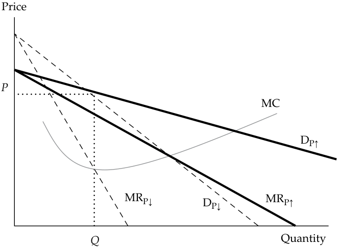
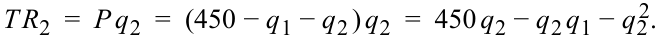
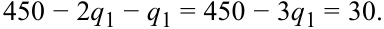
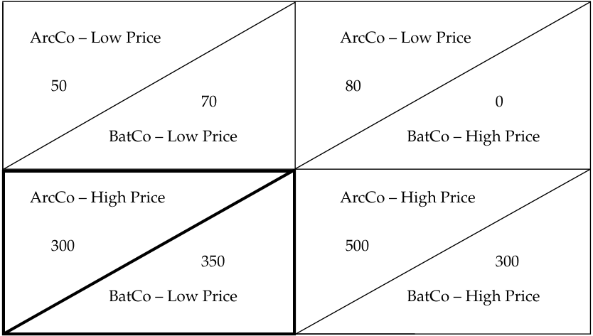
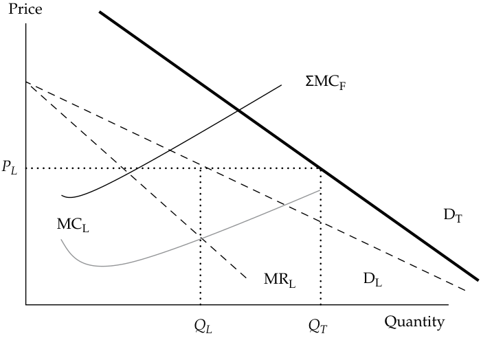
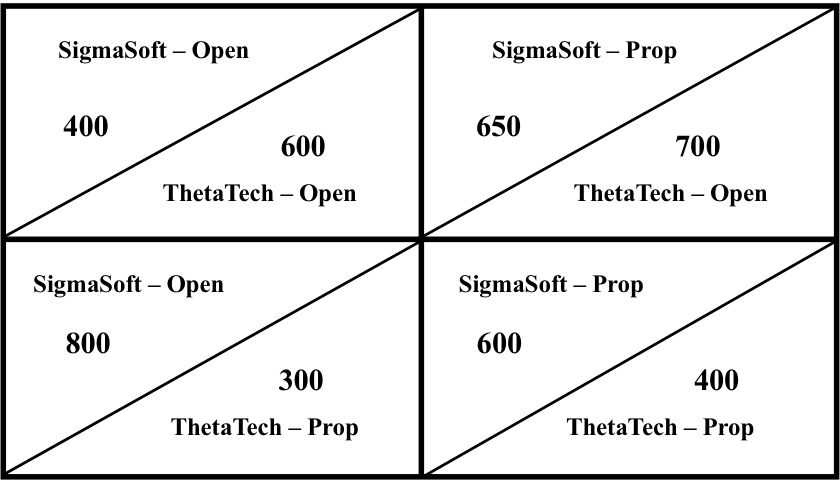

# Tập 2: Kinh tế học (Volume 2: Economics)
## Học phần 1: Doanh nghiệp và Cấu trúc Thị trường (Learning Module 1: The Firm and Market Structures)
### Phần 4/5: Độc quyền nhóm (Oligopoly) (Trang PDF 37–52)

---

<!-- PDF Page 37 -->

- **BỘ CÂU HỎI (QUESTION SET)** 1. Một công ty kinh doanh trong thị trường cạnh tranh độc quyền sẽ _có khả năng nhất_ tối đa hóa lợi nhuận khi mức sản lượng đầu ra của công ty được thiết lập sao cho:

|**A.** chi phí bình quân đạt mức tối thiểu (*average cost is minimized*).|
|---|
|**B.** doanh thu cận biên bằng với chi phí bình quân (*marginal revenue is equal to average cost*).|
|**C.** doanh thu cận biên bằng với chi phí cận biên (*marginal revenue is equal to marginal cost*).|
|**Lời giải (Solution):**|
|C là đáp án đúng. Lựa chọn tối đa hóa lợi nhuận là mức sản lượng đầu ra mà tại đó doanh thu cận biên bằng với chi phí cận biên ($\text{MR} = \text{MC}$).|

## **ĐỘC QUYỀN NHÓM (OLIGOPOLY)**

# **<mark>5</mark>**

giải thích mối quan hệ cung và cầu trong điều kiện độc quyền nhóm, bao gồm mức giá và sản lượng tối ưu cho doanh nghiệp cũng như chiến lược định giá (*pricing strategy*)

### **Độc quyền nhóm và các Chiến lược Định giá (Oligopoly and Pricing Strategies)**

Cấu trúc thị trường độc quyền nhóm (*oligopoly market structure*) được đặc trưng bởi chỉ một vài doanh nghiệp kinh doanh trong một thị trường liên quan. Các sản phẩm đều phải tương tự nhau và nhìn chung là hàng hóa thay thế (*substitutes*) cho nhau. Trong một số thị trường độc quyền nhóm, hàng hóa hoặc dịch vụ có thể được khác biệt hóa nhờ hoạt động tiếp thị và mức độ nhận diện thương hiệu mạnh mẽ, như trong thị trường ngũ cốc ăn sáng và thị trường đồ uống đóng chai hoặc đóng lon. Các ví dụ khác về thị trường độc quyền nhóm được cấu thành từ những sản phẩm đồng nhất (*homogeneous products*) với rất ít hoặc không có nỗ lực khác biệt hóa sản phẩm nào, chẳng hạn như dầu mỏ và xi măng. _Đặc điểm nổi bật nhất của thị trường độc quyền nhóm là số lượng nhỏ các doanh nghiệp thống lĩnh thị trường_. _Có quá ít doanh nghiệp trong thị trường liên quan đến mức các quyết định định giá của họ phụ thuộc lẫn nhau (interdependent)_. Nghĩa là, quyết định định giá của mỗi doanh nghiệp đều dựa trên sự trả đũa kỳ vọng (*expected retaliation*) từ các doanh nghiệp khác. Hãy nhớ lại các đặc điểm của thị trường độc quyền nhóm:

**1.** Có một số lượng nhỏ những người bán tiềm năng.

**2.** Các sản phẩm do mỗi người bán cung cấp là những hàng hóa thay thế gần gũi cho các sản phẩm do những doanh nghiệp khác cung cấp và có thể được khác biệt hóa theo thương hiệu hoặc đồng nhất và không có thương hiệu.

**3.** Việc gia nhập thị trường rất khó khăn, với chi phí khá cao và những rào cản cạnh tranh đáng kể.

**4.** Các doanh nghiệp thường có quyền lực định giá đáng kể (*substantial pricing power*).

**5.** Các sản phẩm thường được khác biệt hóa cao độ thông qua hoạt động tiếp thị, tính năng, và các chiến lược phi giá khác.

Bởi vì có quá ít doanh nghiệp, mỗi doanh nghiệp có thể có một mức độ quyền lực định giá nhất định, điều này có thể mang lại những khoản lợi nhuận đáng kể. Một hệ quả phụ khác của cấu trúc thị trường độc quyền nhóm là sức hấp dẫn của sự thông đồng giá (*price collusion*). Ngay cả khi không có sự thông đồng giá, một doanh nghiệp thống lĩnh (*dominant firm*) cũng có thể dễ dàng trở thành người định giá (*price maker*) trên thị trường. Các thị trường độc quyền nhóm

<!-- PDF Page 38 -->

không có sự thông đồng thường có những chiến lược định giá tinh vi và phức tạp nhất. Có lẽ thị trường độc quyền nhóm có sự thông đồng nổi tiếng nhất là liên minh độc quyền (các-ten – *cartel*) Tổ chức Các nước Xuất khẩu Dầu mỏ (OPEC), tổ chức tìm cách kiểm soát giá cả trên thị trường dầu mỏ bằng cách thúc đẩy các thỏa thuận giữa các quốc gia sản xuất dầu.

### **Phân tích Cầu và các Chiến lược Định giá trong Thị trường Độc quyền nhóm (Demand Analysis and Pricing Strategies in Oligopoly Markets)**

Đường cầu của các thị trường độc quyền nhóm phụ thuộc vào mức độ phụ thuộc lẫn nhau về giá (*pricing interdependence*). Trong một thị trường có sự hiện diện của hành vi thông đồng, đường tổng cầu thị trường được phân chia cho từng thành viên tham gia sản xuất. Trong điều kiện thị trường không có sự thông đồng (*non-colluding market conditions*), mỗi doanh nghiệp phải đối mặt với một đường cầu cá nhân riêng. Hơn nữa, các đặc điểm cầu của thị trường độc quyền nhóm không thông đồng phụ thuộc vào các chiến lược định giá được áp dụng bởi các doanh nghiệp tham gia. Ba chiến lược định giá cơ bản là sự phụ thuộc lẫn nhau về giá (*pricing interdependence*), giả định Cournot (*Cournot assumption*), và cân bằng Nash (*Nash equilibrium*).

Chiến lược định giá đầu tiên giả định sự phụ thuộc lẫn nhau về giá giữa các doanh nghiệp trong thị trường độc quyền nhóm. Một ví dụ điển hình cho tình huống này là bất kỳ thị trường nào có “cuộc chiến về giá” (*price wars*), chẳng hạn như ngành hàng không thương mại. Ví dụ, khi bay từ trung tâm trung chuyển (*hub*) của họ ở Atlanta, cả Delta Air Lines và AirTran Airways đều cùng phục vụ một số thành phố. AirTran là một hãng hàng không giá rẻ và thường cung cấp mức giá vé thấp hơn đến các điểm đến xuất phát từ Atlanta. Delta có xu hướng áp dụng mức giá thấp tương ứng cho những thành phố cũng được AirTran phục vụ khi giờ khởi hành và giờ đến tương tự như giờ bay của hãng. Tuy nhiên, khi Delta cung cấp dịch vụ bay đến cùng những thành phố đó vào các khung giờ khác nhau, giá vé của Delta lại cao hơn.

Giả định chiến lược định giá phổ biến nhất trong các thị trường có cuộc chiến về giá này là các đối thủ cạnh tranh sẽ chạy theo khi giảm giá (*match a price reduction*) và phớt lờ khi tăng giá (*ignore a price increase*). Logic ở đây là bằng cách hạ giá xuống ngang bằng với mức giảm giá của đối thủ cạnh tranh, doanh nghiệp sẽ không bị sụt giảm nhu cầu của khách hàng. Ngược lại, bằng cách không tăng giá theo đối thủ, doanh nghiệp có cơ hội thu hút khách hàng rời bỏ doanh nghiệp đã tăng giá. Mối quan hệ cầu của nhà độc quyền nhóm phải phản ánh được sự gia tăng thị phần tiềm năng khi không chạy theo các đợt tăng giá của đối thủ và không có sự thay đổi thị phần đáng kể nào khi chạy theo các đợt giảm giá của đối thủ.

Tại một mức giá hiện hành (*prevailing price*) cho trước, độ co giãn của cầu theo giá sẽ lớn hơn rất nhiều nếu giá bán được tăng lên và nhỏ hơn nếu giá bán được giảm xuống. Khách hàng của doanh nghiệp phản ứng nhạy bén hơn với việc tăng giá bởi vì các đối thủ của doanh nghiệp có mức giá thấp hơn. Ngược lại, khách hàng của doanh nghiệp ít phản ứng hơn với việc giảm giá bởi vì các đối thủ của doanh nghiệp cũng sẽ hạ giá tương ứng theo sự thay đổi giá của doanh nghiệp.

Điều này hàm ý rằng doanh nghiệp độc quyền nhóm phải đối mặt với hai cấu trúc cầu khác nhau: một cấu trúc gắn liền với việc tăng giá và một cấu trúc khác liên quan đến việc giảm giá. Mỗi hàm cầu cũng sẽ có cấu trúc doanh thu cận biên của riêng nó. Hãy xem xét các hàm cầu và hàm doanh thu cận biên trong Minh họa 16. Các hàm $D_{P\uparrow}$ và $\text{MR}_{P\uparrow}$ đại diện cho biểu cầu và biểu doanh thu cận biên gắn liền với các mức giá cao hơn, trong khi các hàm $D_{P\downarrow}$ và $\text{MR}_{P\downarrow}$ đại diện cho biểu cầu và biểu doanh thu cận biên ở các mức giá thấp hơn. Hai biểu cầu giao nhau tại mức giá hiện hành (tức là mức giá mà tại đó cả mức tăng giá và mức giảm giá đều bằng không).

<!-- PDF Page 39 -->

#### **Minh họa 16: Đường Cầu Gãy khúc trong Thị trường Độc quyền nhóm (Exhibit 16: Kinked Demand Curve in Oligopoly Market)**

<!-- Picture Text: Price P MC DP↑ MRP↓ DP↓ MRP↑ Q Quantity  -->

> **Chú thích hình ảnh:** Trục tung là Giá (*Price*), trục hoành là Sản lượng (*Quantity*). Hai đường cầu $D_{P\uparrow}$ (thoải hơn) và $D_{P\downarrow}$ (dốc hơn) cắt nhau tại điểm $(Q, P)$. Ứng với hai đường cầu này là hai đường doanh thu cận biên $\text{MR}_{P\uparrow}$ và $\text{MR}_{P\downarrow}$, cùng đường chi phí cận biên *MC* đi qua khoảng đứt gãy tại sản lượng $Q$.

Chiến lược định giá độc quyền nhóm này dẫn đến một đường cầu gãy khúc (*kinked demand curve*), với hai phân đoạn đại diện cho các phản ứng khác nhau của đối thủ cạnh tranh trước những thay đổi về giá. Điểm gãy (*kink*) trên đường cầu cũng tạo ra một cấu trúc doanh thu cận biên không liên tục (bị đứt gãy – *discontinuous marginal revenue structure*), với một phần gắn liền với phân đoạn cầu khi tăng giá và phần kia liên quan đến phân đoạn cầu khi giảm giá. Do đó, đường cầu tổng thể của doanh nghiệp bằng phần liên quan của $D_{P\uparrow}$ cộng với phần liên quan của $D_{P\downarrow}$. Minh họa 17 biểu diễn biểu cầu và biểu doanh thu cận biên mới của doanh nghiệp. Biểu cầu của doanh nghiệp được thể hiện trong Minh họa 17 là phân đoạn $D_{P\uparrow}$ và $D_{P\downarrow}$, trong đó tổng cầu $D = D_{P\uparrow} + D_{P\downarrow}$.

#### **Minh họa 17: Đường Cầu Gãy khúc trong Thị trường Độc quyền nhóm (Exhibit 17: Kinked Demand Curve in Oligopoly Market)**

<!-- Picture Text: Price Kinked at MC3 Prevailing Price DP↑ MC2 P MC1 MR MRP↓ DP↓ Q Quantity  -->

> **Chú thích hình ảnh:** Đường cầu bị gãy khúc tại mức giá hiện hành (*Kinked at Prevailing Price* $P$) gồm nhánh trên $D_{P\uparrow}$ và nhánh dưới $D_{P\downarrow}$. Đường doanh thu cận biên (*MR*) có một khoảng trống thẳng đứng (đứt gãy) tại mức sản lượng $Q$, nơi các đường chi phí cận biên $\text{MC}_1, \text{MC}_2$ đi qua mà không làm thay đổi mức giá $P$ và sản lượng $Q$ tối ưu (trừ khi chi phí tăng vọt lên tới $\text{MC}_3$).

Minh họa 17 cho thấy một loạt các cấu trúc chi phí khác nhau đều nhất quán với mức giá hiện hành. Nếu doanh nghiệp có chi phí cận biên tương đối thấp, $\text{MC}_1$, quy tắc định giá tối đa hóa lợi nhuận đã thiết lập trước đó là $\text{MR} = \text{MC}$ vẫn đúng đối với doanh nghiệp độc quyền nhóm. Chi phí cận biên có thể tăng lên tới $\text{MC}_2$ và $\text{MC}_3$ trước khi khả năng sinh lời của doanh nghiệp bị thách thức. Nếu đường chi phí cận biên

<!-- PDF Page 40 -->

$\text{MC}_2$ đi qua khoảng trống đứt gãy (*gap*) của đường doanh thu cận biên, sự kết hợp giữa mức giá và sản lượng mang lại lợi nhuận cao nhất vẫn giữ nguyên không đổi tại mức giá hiện hành và mức sản lượng ban đầu.

Sự chỉ trích đối với phân tích đường cầu gãy khúc tập trung vào việc mô hình này không có khả năng xác định xem mức giá hiện hành ngay từ ban đầu là bao nhiêu. Phân tích đường cầu gãy khúc giúp giải thích tại sao mức giá ổn định thường được quan sát thấy trong các thị trường độc quyền nhóm và do đó là một công cụ hữu ích để phân tích các thị trường như vậy. Tuy nhiên, bởi vì không thể xác định được mức giá hiện hành ban đầu, nó được coi là một phân tích định giá chưa hoàn chỉnh (*incomplete pricing analysis*).

### **Giả định Cournot (The Cournot Assumption)**

Chiến lược định giá thứ hai được phát triển lần đầu tiên bởi nhà kinh tế học người Pháp Augustin Cournot vào năm 1838. Trong **giả định Cournot (*Cournot assumption*)**, mỗi doanh nghiệp xác định mức sản lượng sản xuất tối đa hóa lợi nhuận của mình bằng cách giả định rằng sản lượng đầu ra của các doanh nghiệp khác sẽ không thay đổi. Giả định này làm đơn giản hóa chiến lược định giá bởi vì không cần phải đoán xem doanh nghiệp kia sẽ làm gì để trả đũa. Nó cũng cung cấp một cách tiếp cận hữu ích để phân tích hành vi trong thế giới thực tại các thị trường độc quyền nhóm. Hãy lấy tình huống thị trường độc quyền nhóm cơ bản nhất, một thị trường độc quyền đôi gồm hai doanh nghiệp (*two-firm duopoly market*). Ở trạng thái cân bằng, không doanh nghiệp nào có động lực để thay đổi sản lượng khi cho trước mức sản xuất của doanh nghiệp kia. Mỗi doanh nghiệp đều cố gắng tối đa hóa lợi nhuận của riêng mình dưới giả định rằng doanh nghiệp kia sẽ tiếp tục sản xuất cùng một mức sản lượng đầu ra trong tương lai. Chiến lược Cournot giả định rằng khuôn mẫu này tiếp tục diễn ra cho đến khi mỗi doanh nghiệp đạt đến vị thế cân bằng dài hạn của mình. Trong trạng thái cân bằng dài hạn, sản lượng và giá bán đều ổn định: Không có sự thay đổi nào về giá bán hay sản lượng có thể làm tăng lợi nhuận cho bất kỳ doanh nghiệp nào trong hai doanh nghiệp.

Hãy xem xét ví dụ này về một thị trường độc quyền đôi (*duopoly market*). Giả sử rằng tổng cầu thị trường đã được ước tính như sau:

$$Q_D = 450 - P$$

Hàm cung được đại diện bởi chi phí cận biên không đổi $\text{MC} = 30$.

Nghiệm của chiến lược Cournot có thể được tìm thấy bằng cách đặt $Q_D = q_1 + q_2$, trong đó $q_1$ và $q_2$ đại diện cho mức sản lượng đầu ra của hai doanh nghiệp. Mỗi doanh nghiệp đều tìm cách tối đa hóa lợi nhuận, và mỗi doanh nghiệp đều tin rằng doanh nghiệp kia sẽ không thay đổi sản lượng khi bản thân nó thay đổi sản lượng của mình (tức là giả định của Cournot). Doanh nghiệp sẽ tối đa hóa lợi nhuận tại nơi $\text{MR} = \text{MC}$. Sắp xếp lại hàm tổng cầu theo biến giá, chúng ta có:

$$P = 450 - Q_D = 450 - (q_1 + q_2), \quad \text{và} \quad \text{MC} = 30$$

Tổng doanh thu của mỗi doanh nghiệp trong hai doanh nghiệp được tìm thấy bằng cách lấy giá nhân với sản lượng:

<!-- Formula Text: T R 1  =  P q 1  =  (450 − q 1 − q 2 ) q 1  =  450 q 1 − q 1 2 − q 1 q 2 , -->

$$TR_1 = P q_1 = (450 - q_1 - q_2) q_1 = 450 q_1 - q_1^2 - q_1 q_2$$

và

<!-- Formula Text: T R 2  =  P q 2  =  (450 − q 1 − q 2 ) q 2  =  450 q 2 − q 2 q 1 − q 2 2. -->

$$TR_2 = P q_2 = (450 - q_1 - q_2) q_2 = 450 q_2 - q_2 q_1 - q_2^2$$

Doanh thu cận biên được định nghĩa là mức thay đổi trong tổng doanh thu khi có một sự thay đổi trong doanh số bán ($q_1$ hoặc $q_2$). Để tìm mức sản lượng tối đa hóa lợi nhuận, ta đặt $\text{MR} = \text{MC}$, hay:

<!-- Formula Text: 450 − 2q1 − q2 = 30, -->

$$450 - 2q_1 - q_2 = 30$$

và

<!-- Formula Text: 450 − q1 − 2q2 = 30. -->

$$450 - q_1 - 2q_2 = 30$$

Sau đó, tìm điểm cân bằng đồng thời cho cả hai doanh nghiệp bằng cách giải hệ hai phương trình với hai ẩn số:

<!-- Formula Text: 450 − 2q1 − q2 = 450 − q1 − 2q2. -->

$$450 - 2q_1 - q_2 = 450 - q_1 - 2q_2$$

Bởi vì $q_2 = q_1$ theo giả định của Cournot, hãy thay nghiệm này vào hàm cầu và giải như sau:

<!-- Formula Text: 450 − 2q1 − q1 = 450 − 3q1 = 30. -->

$$450 - 2q_1 - q_1 = 450 - 3q_1 = 30$$

<!-- PDF Page 41 -->

Do đó, $q_1 = 140$, $q_2 = 140$, và $Q = 280$.

Mức giá là $P = 450 - 280 = 170$.

Trong nghiệm định giá chiến lược Cournot, giá cân bằng thị trường sẽ là 170, và tổng sản lượng đầu ra sẽ là 280 đơn vị. Kết quả này, được gọi là cân bằng Cournot (*Cournot equilibrium*), khác với điểm cân bằng thị trường cạnh tranh hoàn hảo bởi vì mức giá cạnh tranh hoàn hảo sẽ thấp hơn và sản lượng cạnh tranh hoàn hảo sẽ cao hơn. Nhìn chung, các thị trường phi cạnh tranh có mức giá cao hơn và mức sản lượng đầu ra thấp hơn ở trạng thái cân bằng khi so sánh với cạnh tranh hoàn hảo. Trong thị trường cạnh tranh hoàn hảo, trạng thái cân bằng đạt được khi giá bán bằng với chi phí cận biên:

$$P_C = \text{MR}_C = \text{MC}, \quad \text{do đó} \quad 450 - Q = 30$$

trong đó $P_C$ là mức giá cân bằng của doanh nghiệp cạnh tranh hoàn hảo.

$$Q = 420, \quad \text{và} \quad P_C = 30$$

Minh họa 18 mô tả các vị thế cân bằng của thị trường độc quyền nhóm, cạnh tranh hoàn hảo, và độc quyền, trong đó $P_M$ là mức giá tối ưu của độc quyền, $P_C$ là mức giá cạnh tranh hoàn hảo, và $P_{\text{Cournot}}$ là mức giá độc quyền nhóm theo giả định Cournot.

#### **Minh họa 18: Cân bằng Cournot trong Thị trường Độc quyền đôi (Exhibit 18: Cournot Equilibrium in Duopoly Market)**

<!-- Picture Text: Price PM 240 PCournot 170 Demand 30 PC 210 280 420 Quantity  -->

> **Chú thích hình ảnh:** Trục tung là Giá (*Price*), trục hoành là Sản lượng (*Quantity*). Trên đường cầu (*Demand*):
> - Điểm cân bằng độc quyền: Giá $P_M = 240$, Sản lượng $Q = 210$.
> - Điểm cân bằng Cournot (độc quyền đôi): Giá $P_{\text{Cournot}} = 170$, Sản lượng $Q = 280$.
> - Điểm cân bằng cạnh tranh hoàn hảo: Giá $P_C = 30$, Sản lượng $Q = 420$.

Trong phần thảo luận sau này liên quan đến cấu trúc thị trường độc quyền, điểm cân bằng sẽ được thiết lập tại nơi $\text{MR} = \text{MC}$. Nghiệm đó cũng được thể hiện trong Minh họa 18. Biểu cầu của doanh nghiệp độc quyền chính là biểu tổng cầu thị trường. Do đó, nghiệm số là:

$$\text{MR} = \text{MC}$$

Đối với hàm cầu thị trường, tổng doanh thu là $P \times Q = 450Q - Q^2$ và $\text{MR} = 450 - 2Q$; do đó,

$$450 - 2Q = 30 \quad \text{và} \quad Q = 210$$

Từ hàm tổng cầu, giải tìm mức giá:

$$P_M = 450 - 210 = 240$$

Lưu ý rằng nghiệm Cournot nằm ở khoảng giữa điểm cân bằng cạnh tranh hoàn hảo và nghiệm độc quyền.

<!-- PDF Page 42 -->

Khi số lượng doanh nghiệp tăng từ hai lên ba, từ ba lên bốn, v.v., các vị thế cân bằng về sản lượng và giá sẽ dịch chuyển dần về phía nghiệm cân bằng cạnh tranh hoàn hảo. Trong lịch sử, kết quả này từng là cơ sở lý thuyết cho các chính sách chống độc quyền (*antitrust policies*) được thiết lập tại Hoa Kỳ.

### **Cân bằng Nash (The Nash Equilibrium)**

Chiến lược định giá thứ ba được gắn liền với một trong những chủ nhân giải Nobel năm 1994, John Nash, người đầu tiên phát triển các khái niệm tổng quát này. Trong phân tích trước đó, khái niệm cân bằng thị trường xảy ra khi các doanh nghiệp đang đạt được mức thù lao tối ưu trong những hoàn cảnh mà họ phải đối mặt. Trong môi trường tối ưu này, doanh nghiệp không có động cơ để thay đổi giá bán hay mức sản lượng. Các doanh nghiệp hiện hữu đang kiếm được tỷ suất sinh lợi bình thường (lợi nhuận kinh tế bằng không), khiến không còn động cơ nào cho việc gia nhập hay rút lui khỏi thị trường. Tất cả các doanh nghiệp trên thị trường đều đang sản xuất tại mức sản lượng mà ở đó giá bán bằng với chi phí sản xuất bình quân.

Trong **lý thuyết trò chơi (*game theory*)** (tập hợp các công cụ mà những người ra quyết định sử dụng để xem xét phản ứng của những người ra quyết định đối thủ), **cân bằng Nash (*Nash equilibrium*)** hiện diện khi hai hoặc nhiều người tham gia trong một trò chơi bất hợp tác (*non-cooperative game*) không có động lực để chệch hướng khỏi các chiến lược cân bằng tương ứng của họ sau khi họ đã cân nhắc và dự tính các lựa chọn hoặc chiến lược hợp lý của đối thủ. Trong bối cảnh thị trường độc quyền nhóm, cân bằng Nash là một trạng thái cân bằng được định nghĩa bởi đặc điểm là không một nhà độc quyền nhóm nào có thể làm tăng lợi nhuận của mình bằng cách đơn phương thay đổi chiến lược định giá. Giả định được đưa ra ở đây là mỗi doanh nghiệp tham gia đều làm tốt nhất có thể khi cho trước các phản ứng của những đối thủ cạnh tranh. Mỗi doanh nghiệp đều dự tính rằng các doanh nghiệp khác sẽ phản ứng lại bất kỳ sự thay đổi nào do đối thủ thực hiện bằng cách làm tốt nhất có thể trong hoàn cảnh đã thay đổi. Các doanh nghiệp trong thị trường độc quyền nhóm có các hành động phụ thuộc lẫn nhau. Hành động của họ mang tính bất hợp tác, trong đó mỗi doanh nghiệp tự đưa ra các quyết định nhằm tối đa hóa lợi nhuận của riêng mình. Các doanh nghiệp không thông đồng với nhau trong nỗ lực tối đa hóa lợi nhuận chung. Trạng thái cân bằng đạt được khi tất cả các doanh nghiệp đều đang làm tốt nhất có thể khi cho trước hành động của các đối thủ.

Minh họa 19 minh họa kết quả độc quyền đôi từ cân bằng Nash. Giả sử có hai doanh nghiệp trên thị trường là ArcCo và BatCo. ArcCo và BatCo có thể ấn định mức giá cao (*high prices*) hoặc mức giá thấp (*low prices*) cho sản phẩm. Các kết quả thị trường được thể hiện trong Minh họa 19.

**Minh họa 19: Cân bằng Nash trong Thị trường Độc quyền đôi (Exhibit 19: Nash Equilibrium in Duopoly Market)**

<!-- Picture Text: ArcCo – Low Price ArcCo – Low Price 50 80 70 0 BatCo – Low Price BatCo – High Price ArcCo – High Price ArcCo – High Price 300 500 350 300 BatCo – Low Price BatCo – High Price  -->

> **Chú thích hình ảnh:** Ma trận lợi nhuận giữa ArcCo và BatCo:
> - **Ô trên bên trái (ArcCo – Giá thấp, BatCo – Giá thấp):** ArcCo đạt 50, BatCo đạt 70.
> - **Ô trên bên phải (ArcCo – Giá thấp, BatCo – Giá cao):** ArcCo đạt 80, BatCo đạt 0.
> - **Ô dưới bên trái (ArcCo – Giá cao, BatCo – Giá thấp):** ArcCo đạt 300, BatCo đạt 350.
> - **Ô dưới bên phải (ArcCo – Giá cao, BatCo – Giá cao):** ArcCo đạt 500, BatCo đạt 300.

<!-- PDF Page 43 -->

Ví dụ, nghiệm ở góc trên bên trái chỉ ra rằng khi cả ArcCo và BatCo đều cung cấp sản phẩm ở mức giá thấp, ArcCo kiếm được khoản lợi nhuận là 50 và BatCo kiếm được 70. Nghiệm ở góc trên bên phải cho thấy rằng nếu ArcCo cung cấp sản phẩm ở mức giá thấp (trong khi BatCo định giá cao), BatCo sẽ có lợi nhuận bằng không. Nghiệm có tổng lợi nhuận chung tối đa là điểm cân bằng ở góc dưới bên phải, nơi cả hai doanh nghiệp đều ấn định mức giá cao cho sản phẩm. Tổng lợi nhuận chung là 800 trong nghiệm này.

Tuy nhiên, cân bằng Nash đòi hỏi mỗi doanh nghiệp phải hành xử vì lợi ích tốt nhất của chính mình. BatCo có thể cải thiện vị thế của mình bằng cách cung cấp sản phẩm ở mức giá thấp khi ArcCo đang ấn định mức giá cao. Trong nghiệm ở góc dưới bên trái, BatCo tối đa hóa lợi nhuận của mình ở mức 350. Mặc dù ArcCo có thể kiếm được 500 trong nghiệm tốt nhất của mình, họ chỉ có thể làm được điều đó nếu BatCo cũng đồng ý ấn định mức giá cao. Phương án này rõ ràng không mang lại lợi ích tốt nhất cho BatCo bởi vì hãng có thể tăng mức sinh lợi của mình từ 300 lên 350 bằng cách ấn định mức giá thấp hơn.

Kịch bản này làm nảy sinh khả năng thông đồng (*collusion*). Nếu ArcCo đồng ý chia sẻ ít nhất 51 trong khoản lợi nhuận 500 của mình khi cả hai công ty cùng ấn định giá cao, thì BatCo hẳn cũng sẽ sẵn lòng ấn định giá cao. Nhìn chung, sự thông đồng như vậy là bất hợp pháp ở hầu hết các quốc gia, nhưng nó vẫn luôn là một lựa chọn đầy cám dỗ. Rõ ràng, các điều kiện trong những ngành độc quyền nhóm khuyến khích sự thông đồng, với một số lượng nhỏ các đối thủ cạnh tranh và hành vi định giá phụ thuộc lẫn nhau. Sự thông đồng được thúc đẩy bởi một số yếu tố: gia tăng lợi nhuận, giảm sự bất định của dòng tiền, và cải thiện cơ hội dựng lên các rào cản gia nhập ngành.

Khi các thỏa thuận thông đồng được thực hiện một cách công khai và chính thức, các doanh nghiệp tham gia được gọi là một **liên minh độc quyền / các-ten (*cartel*)**. Trong một số trường hợp, sự thông đồng diễn ra thành công; những lần khác, các lực lượng cạnh tranh lại áp đảo hành vi thông đồng. Sáu yếu tố chính sau đây ảnh hưởng đến cơ hội thông đồng thành công:

**1.** _Số lượng và sự phân bổ quy mô của người bán (The number and size distribution of sellers)._ Sự thông đồng thành công có nhiều khả năng xảy ra hơn nếu số lượng doanh nghiệp là ít hoặc nếu có một doanh nghiệp giữ vị thế thống lĩnh. Sự thông đồng trở nên khó khăn hơn khi số lượng doanh nghiệp tăng lên hoặc nếu một vài doanh nghiệp đó có thị phần tương đương nhau. Khi các doanh nghiệp có thị phần tương đương nhau, các lực lượng cạnh tranh có xu hướng lấn át những lợi ích của sự thông đồng.

**2.** _Sự tương đồng của các sản phẩm (The similarity of the products)._ Khi các sản phẩm là đồng nhất (*homogeneous*), sự thông đồng sẽ thành công hơn. Sản phẩm càng có tính khác biệt hóa cao thì khả năng thông đồng thành công càng thấp.

**3.** _Cấu trúc chi phí (Cost structure)._ Cấu trúc chi phí của các doanh nghiệp càng tương đồng nhau thì khả năng thông đồng thành công càng cao.

**4.** _Quy mô và tần suất đơn hàng (Order size and frequency)._ Sự thông đồng thành công có nhiều khả năng xảy ra hơn khi các đơn hàng diễn ra thường xuyên, được nhận đều đặn và có quy mô tương đối nhỏ. Các đơn hàng nhỏ thường xuyên, nhận được một cách đều đặn sẽ làm giảm cơ hội và phần thưởng cho hành vi gian lận (phá vỡ ngầm) thỏa thuận thông đồng.

**5.** _Sức mạnh và mức độ nghiêm trọng của sự trả đũa (The strength and severity of retaliation)._ Các nhà độc quyền nhóm sẽ ít có khả năng phá vỡ thỏa thuận thông đồng hơn nếu mối đe dọa trả đũa từ các doanh nghiệp khác trên thị trường là rất nghiêm trọng.

**6.** _Mức độ cạnh tranh từ bên ngoài (The degree of external competition)._ Lý do chính để tham gia vào sự thông đồng chính thức là nhằm gia tăng khả năng sinh lời tổng thể của thị trường, và lợi nhuận gia tăng lại thu hút sự cạnh tranh. Ví dụ, vào năm 2016, chi phí khai thác bình quân một thùng dầu thô từ Ả Rập Xê Út là khoảng 9 USD, trong khi chi phí bình quân từ các mỏ dầu đá phiến (*shale oil fields*) của Hoa Kỳ là khoảng 23,50 USD. Chi phí khai thác dầu từ cát dầu (*tar sands*) của Canada vào năm 2016 là khoảng 27 USD mỗi thùng. Các nhà sản xuất dầu thô ở các quốc gia vùng Vịnh có nhiều khả năng thông đồng thành công hơn do sự tương đồng trong cấu trúc chi phí của họ (khoảng 9–10 USD mỗi thùng). Nếu OPEC kìm giữ giá dầu thô ở mức dưới 30 USD mỗi thùng, thì đã không có một luận cứ kinh tế khả thi nào để phát triển các mỏ dầu đá phiến của Hoa Kỳ thông qua công nghệ nứt vỡ thủy lực (*fracking*) hoặc mở rộng khai thác từ cát dầu của Canada.

<!-- PDF Page 44 -->

Liên minh các-ten thành công của OPEC đã đẩy giá dầu thô lên tới mức mà các nguồn cung bên ngoài trở nên khả thi về mặt kinh tế, và khi làm như vậy, đã làm gia tăng sự cạnh tranh mà chính các-ten này phải đối mặt.

Các chiến lược độc quyền nhóm khả dĩ khác gắn liền với việc ra quyết định dựa trên lý thuyết trò chơi. Cân bằng Cournot và cân bằng Nash là những ví dụ về các trò chơi chiến lược cụ thể. Một trò chơi chiến lược (*strategic game*) là bất kỳ sự lựa chọn hành vi phụ thuộc lẫn nhau nào được sử dụng bởi các cá nhân hoặc nhóm có chung một mục tiêu (ví dụ: các đơn vị quân đội, các đội thể thao, hoặc những người ra quyết định kinh doanh). Một chiến lược ra quyết định nổi bật khác trong các thị trường độc quyền nhóm là lợi thế của người đi đầu (*first-mover advantage*) trong **mô hình Stackelberg (*Stackelberg model*)**, được đặt theo tên của nhà kinh tế học đầu tiên khái niệm hóa chiến lược này. Sự khác biệt quan trọng giữa mô hình Cournot và mô hình Stackelberg là Cournot giả định rằng trong thị trường độc quyền đôi, việc ra quyết định diễn ra đồng thời (*simultaneous*), trong khi Stackelberg giả định rằng các quyết định được đưa ra một cách tuần tự (*sequentially*). Trong mô hình Stackelberg, doanh nghiệp dẫn đầu (*leader firm*) chọn mức sản lượng của mình trước và sau đó doanh nghiệp theo sau (*follower firm*) sẽ lựa chọn sau khi đã quan sát sản lượng của người dẫn đầu. Có thể chứng minh rằng doanh nghiệp dẫn đầu có một lợi thế rõ rệt — đó là trở thành người đi trước (*first mover*). Trong trò chơi Stackelberg, người dẫn đầu có thể chủ động sản xuất vượt mức một cách quyết liệt (*aggressively overproduce*) nhằm buộc người theo sau phải thu hẹp quy mô sản xuất hoặc thậm chí trừng phạt hay loại bỏ đối thủ yếu hơn. Cách tiếp cận này đôi khi được gọi là chiến lược “kẻ thống trị” (*“top dog” strategy*). Người dẫn đầu kiếm được nhiều lợi nhuận hơn so với trong trò chơi đồng thời của Cournot, trong khi người theo sau kiếm được ít hơn. Nhiều trò chơi chiến lược khác cũng có thể xảy ra trong các thị trường độc quyền nhóm. Kết luận quan trọng là chiến lược tối ưu của doanh nghiệp phụ thuộc vào những gì đối thủ của nó thực hiện. Mức giá và doanh thu cận biên mà doanh nghiệp nhận được cho sản phẩm của mình phụ thuộc vào cả quyết định của chính nó lẫn quyết định của đối thủ.

### **Thị trường Độc quyền nhóm: Mức Giá Tối ưu, Sản lượng và Trạng thái Cân bằng Dài hạn (Oligopoly Markets: Optimal Price, Output, and Long-Run Equilibrium)**

Cũng giống như trong cạnh tranh độc quyền, nhà độc quyền nhóm không có một hàm cung được xác định rõ ràng (*no well-defined supply function*). Nghĩa là, không có cách nào để xác định mức sản lượng và giá bán tối ưu của nhà độc quyền nhóm một cách độc lập với các điều kiện cầu và chiến lược của đối thủ cạnh tranh. Tuy nhiên, nhà độc quyền nhóm vẫn có một hàm chi phí giúp xác định mức cung tối ưu. Do đó, quy tắc tối đa hóa lợi nhuận đã thiết lập trước đó vẫn còn nguyên giá trị: Mức sản lượng giúp tối đa hóa lợi nhuận là nơi $\text{MR} = \text{MC}$. Mức giá cần ấn định được xác định bởi mức giá mà người tiêu dùng sẵn lòng chi trả cho số lượng sản phẩm đó. Do đó, giá cân bằng đến từ đường cầu, trong khi mức sản lượng đầu ra đến từ mối quan hệ giữa doanh thu cận biên và chi phí cận biên.

Hãy xem xét một thị trường độc quyền nhóm trong đó một trong các doanh nghiệp giữ vị thế thống lĩnh (*dominant*) và nhờ đó có khả năng trở thành người dẫn dắt giá (*price leader*). Các doanh nghiệp thống lĩnh nhìn chung nắm giữ từ 40% thị phần trở lên. Khi một doanh nghiệp thống lĩnh một thị trường độc quyền nhóm, họ làm được như vậy bởi vì họ có công suất lớn hơn, có cấu trúc chi phí thấp hơn, là người đầu tiên gia nhập thị trường (*first to market*), hoặc có lòng trung thành của khách hàng lớn hơn so với các doanh nghiệp khác trên thị trường.

Giả sử không có sự thông đồng, doanh nghiệp thống lĩnh trở thành người định giá (*price maker*), và do đó hành động của họ tương tự như hành vi độc quyền trong phân khúc thị trường của mình. Các doanh nghiệp khác trên thị trường đi theo khuôn mẫu định giá của doanh nghiệp thống lĩnh. Tại sao những doanh nghiệp theo sau về giá (*price followers*) không cố gắng giành thị phần bằng cách phá giá thấp hơn mức giá của doanh nghiệp thống lĩnh? Lời giải thích phổ biến nhất là ưu thế vượt trội của doanh nghiệp thống lĩnh thường bắt nguồn từ chi phí sản xuất thấp hơn. Thông thường, các doanh nghiệp theo sau về giá thậm chí còn muốn ấn định một mức giá cao hơn cả lựa chọn giá của doanh nghiệp thống lĩnh. Nếu họ cố tình phá giá thấp hơn doanh nghiệp thống lĩnh, những người theo sau sẽ đối mặt với rủi ro xảy ra một cuộc chiến về giá với một nhà sản xuất có chi phí thấp hơn – điều có thể đe dọa sự sống còn của chính họ. Một số người tin rằng một lời giải thích cho vị thế dẫn dắt giá của doanh nghiệp thống lĩnh chỉ đơn giản là sự thuận tiện (*convenience*). Chỉ cần một doanh nghiệp phải đưa ra các quyết định định giá, và những doanh nghiệp khác có thể đơn giản làm theo sự dẫn dắt đó.

<!-- PDF Page 45 -->

Minh họa 20 thiết lập quyết định định giá của doanh nghiệp thống lĩnh. Biểu cầu của doanh nghiệp thống lĩnh, $D_L$, chiếm một tỷ trọng đáng kể trong tổng cầu thị trường, $D_T$. Vị thế chi phí thấp của doanh nghiệp thống lĩnh được đại diện bởi chi phí cận biên của nó, $\text{MC}_L$. Tổng chi phí cận biên của các doanh nghiệp theo sau về giá được thiết lập là $\sum \text{MC}_F$ và thể hiện mức chi phí sản xuất cao hơn so với người dẫn dắt giá.

#### **Minh họa 20: Sự Dẫn dắt Giá của Nhà Độc quyền nhóm Thống lĩnh (Exhibit 20: Dominant Oligopolist’s Price Leadership)**

<!-- Picture Text: Price ΣMCF PL DT MCL MRL   DL QL QT Quantity  -->

> **Chú thích hình ảnh:** Trục tung là Giá (*Price*), trục hoành là Sản lượng (*Quantity*). Đường chi phí cận biên của doanh nghiệp dẫn đầu ($\text{MC}_L$) cắt đường doanh thu cận biên của nó ($\text{MR}_L$) tại sản lượng $Q_L$. Gióng lên đường cầu của doanh nghiệp dẫn đầu ($D_L$) xác định mức giá $P_L$. Tại mức giá $P_L$, tổng lượng cầu thị trường trên đường $D_T$ là $Q_T$, trong đó doanh nghiệp dẫn đầu cung ứng $Q_L$ và các doanh nghiệp theo sau (với tổng chi phí cận biên $\sum \text{MC}_F$) cung ứng phần còn lại $Q_F = Q_T - Q_L$.

Một lý do quan trọng giải thích tại sao đường tổng cầu và đường cầu của doanh nghiệp dẫn đầu không song song với nhau được minh họa trong Minh họa 20: Doanh nghiệp dẫn đầu là nhà sản xuất có chi phí thấp. Do đó, khi giá giảm xuống, sẽ có ít nhà cung cấp nhỏ hơn có thể trụ lại thị trường một cách có lãi, và một số sẽ rời bỏ thị trường bởi vì họ không muốn bán dưới mức chi phí. Vì vậy, doanh nghiệp dẫn đầu sẽ có thị phần lớn hơn khi giá $P$ giảm xuống, điều này hàm ý rằng $Q_L$ tăng lên ở mức giá thấp, đúng như được thể hiện bởi đường $D_T$ dốc hơn trong biểu đồ.

Người dẫn dắt giá xác định mức sản lượng tối đa hóa lợi nhuận của mình tại nơi $\text{MR}_L = \text{MC}_L$, ở mức sản lượng $Q_L$. Đây là mức sản lượng mà doanh nghiệp này muốn cung ứng; tuy nhiên, mức giá mà hãng sẽ ấn định được xác định bởi phân đoạn của hãng trong hàm tổng cầu, $D_L$. Tại mức giá $P_L$, doanh nghiệp thống lĩnh sẽ cung ứng mức sản lượng $Q_L$ trong tổng cầu $D_T$. Các doanh nghiệp theo sau về giá sẽ cung ứng phần chênh lệch cho thị trường, $(Q_T - Q_L) = Q_F$. Do đó, cả doanh nghiệp thống lĩnh lẫn các doanh nghiệp theo sau đều không có một mối quan hệ hàm số đơn lẻ nào giúp xác định lượng cung ứng tại các mức giá khác nhau.

#### **_Mức Giá và Sản lượng Tối ưu trong Thị trường Độc quyền nhóm (Optimal Price and Output in Oligopoly Markets)_**

Như phần thảo luận này cho thấy, rõ ràng không có một phân tích mức giá và sản lượng tối ưu đơn lẻ nào phù hợp với mọi tình huống thị trường độc quyền nhóm. Sự phụ thuộc lẫn nhau giữa một vài doanh nghiệp cấu thành nên thị trường độc quyền nhóm tạo ra một tập hợp phức tạp các phương án định giá, tùy thuộc vào hoàn cảnh ở từng thị trường. Trong trường hợp đường cầu gãy khúc, mức giá tối ưu là mức giá hiện hành tại điểm gãy trong hàm cầu. Tuy nhiên, như đã lưu ý, phân tích đường cầu gãy khúc không cung cấp góc nhìn sâu sắc về điều gì đã thiết lập nên mức giá hiện hành ngay từ ban đầu.

Có lẽ trường hợp doanh nghiệp thống lĩnh, với các doanh nghiệp khác đi theo người dẫn dắt giá, là trường hợp rõ ràng nhất. Trong trường hợp đó, mức giá tối ưu được xác định tại mức sản lượng nơi $\text{MR} = \text{MC}$. Mức giá tối đa hóa lợi nhuận sau đó được xác định bởi vị trí sản lượng trên phân đoạn hàm cầu mà doanh nghiệp thống lĩnh phải đối mặt. Những doanh nghiệp

<!-- PDF Page 46 -->

theo sau về giá có rất ít động lực để thay đổi mức giá của người dẫn đầu. Trong trường hợp giả định Cournot, mỗi doanh nghiệp giả định rằng các doanh nghiệp khác sẽ không thay đổi sản lượng của họ sau khi doanh nghiệp thống lĩnh lựa chọn mức giá và sản lượng của mình.

Do đó, một lần nữa, mức giá tối ưu được xác định bởi mức sản lượng nơi $\text{MR} = \text{MC}$. Trong trường hợp cân bằng Nash, mỗi doanh nghiệp sẽ phản ứng với những hoàn cảnh mà mình đối mặt, nhằm tối đa hóa lợi nhuận của chính mình. Những điều chỉnh này tiếp tục diễn ra cho đến khi giá bán và mức sản lượng đạt trạng thái ổn định. Do sự phụ thuộc lẫn nhau, mức giá và mức sản lượng của từng doanh nghiệp cá lẻ vẫn mang tính bất định.

#### **_Các Yếu tố Ảnh hưởng đến Trạng thái Cân bằng Dài hạn trong Thị trường Độc quyền nhóm (Factors Affecting Long-Run Equilibrium in Oligopoly Markets)_**

Lợi nhuận kinh tế dài hạn là điều khả thi đối với các doanh nghiệp hoạt động trong thị trường độc quyền nhóm. Tuy nhiên, lịch sử đã cho thấy thị phần của doanh nghiệp thống lĩnh sẽ suy giảm theo thời gian. Lợi nhuận thu hút sự gia nhập của các doanh nghiệp khác vào thị trường độc quyền nhóm. Theo thời gian, chi phí cận biên của các doanh nghiệp mới gia nhập giảm xuống bởi vì họ áp dụng các kỹ thuật sản xuất hiệu quả hơn, làm cho cầu và doanh thu cận biên của doanh nghiệp thống lĩnh bị thu hẹp lại, và khả năng sinh lời của doanh nghiệp thống lĩnh sụt giảm. Vào đầu những năm 1900, J.P. Morgan, Elbert Gary, Andrew Carnegie, và Charles M. Schwab đã sáng lập nên Tập đoàn Thép Hoa Kỳ (United States Steel Corporation – US Steel). Khi mới được thành lập vào năm 1901, US Steel kiểm soát tới 66% thị trường. Đến năm 1920, thị phần của US Steel đã giảm xuống còn 46%, và đến năm 1925 thị phần của hãng là 42%.

Trong dài hạn, chiến lược định giá tối ưu phải tính đến phản ứng của các doanh nghiệp đối thủ. Lịch sử đã chứng minh rằng nên tránh các cuộc chiến về giá bởi vì bất kỳ sự gia tăng thị phần nào đạt được cũng chỉ mang tính tạm thời. Việc giảm giá để đuổi các đối thủ cạnh tranh sẽ làm giảm tổng doanh thu của tất cả các thành viên tham gia trong thị trường độc quyền nhóm. Đổi mới sáng tạo (*innovation*) có thể là một cách thức — dù đôi khi là một cách thức không kinh tế — để duy trì vị thế dẫn đầu thị trường.

#### **ĐỘC QUYỀN NHÓM: HÌNH THỨC BÊN NGOÀI SO VỚI HÀNH VI THỰC TẾ (OLIGOPOLIES: APPEARANCE VERSUS BEHAVIOR)**

Khi nào một thị trường độc quyền nhóm lại không phải là độc quyền nhóm? Có hai trường hợp cực đoan cho tình huống này. Một thị trường độc quyền nhóm thông thường có một vài doanh nghiệp sản xuất một hàng hóa có sự khác biệt hóa, và sự khác biệt hóa này mang lại cho họ quyền lực định giá.

Ở một đầu của dải phổ, chúng ta có thị trường độc quyền nhóm với mối đe dọa gia nhập đáng tin cậy (*credible threat of entry*). Trên thực tế, nếu các nhà độc quyền nhóm đang sản xuất một hàng hóa hoặc dịch vụ có thể dễ dàng bị sao chép, có tính kinh tế theo quy mô hạn chế, và không được bảo vệ bởi nhận diện thương hiệu hay bằng sáng chế, họ sẽ không thể ấn định mức giá cao. Một nhà cung cấp mới càng dễ dàng gia nhập thị trường bao nhiêu thì biên lợi nhuận sẽ càng thấp bấy nhiêu. Trên thực tế, thị trường độc quyền nhóm này sẽ hành xử rất giống với một thị trường cạnh tranh hoàn hảo.

Ở đầu đối diện của dải phổ, chúng ta có trường hợp của liên minh độc quyền (các-ten – *cartel*). Tại đây, các nhà độc quyền nhóm thông đồng với nhau và hành động như thể họ là một doanh nghiệp duy nhất. Trên thực tế, một các-ten hoạt động rất hiệu quả sẽ thực thi một chiến lược hợp tác (*cooperative strategy*). Thay vì đi đến điểm cân bằng Nash, các thành viên tham gia các-ten đi đến điểm cân bằng hợp tác mang lại nhiều lợi nhuận hơn (cho họ).

Một các-ten có thể mang tính công khai rõ ràng (*explicit*, tức là dựa trên một hợp đồng) hoặc ngầm định (*implicit*, dựa trên các tín hiệu – *signals*). Một ví dụ về các tín hiệu trong thị trường độc quyền đôi sẽ là việc một trong hai doanh nghiệp giảm giá bán và doanh nghiệp kia thì không. Bởi vì doanh nghiệp không cắt giảm giá từ chối khơi mào một cuộc chiến về giá, doanh nghiệp đã cắt giảm giá có thể diễn giải tín hiệu này như một “lời đề nghị” cùng nâng giá lên một mức cao hơn trước đó, để lợi nhuận của cả hai cùng tăng lên.

<!-- PDF Page 47 -->

- **BỘ CÂU HỎI (QUESTION SET)** 1. Chiến lược định giá độc quyền nhóm _có khả năng nhất_ dẫn đến một đường cầu có dạng: **A.** gãy khúc (*kinked*). **B.** thẳng đứng (*vertical*). **C.** nằm ngang (*horizontal*).

- **Lời giải (Solution):** A là đáp án đúng. Nhà độc quyền nhóm phải đối mặt với hai cấu trúc cầu khác nhau, một cấu trúc cho việc tăng giá và một cấu trúc khác cho việc giảm giá. Các đối thủ cạnh tranh sẽ hạ giá để chạy theo một đợt giảm giá, nhưng sẽ không tăng giá theo một đợt tăng giá. Kết quả là tạo ra một đường cầu gãy khúc (*kinked demand curve*).

- 2. Sự thông đồng (*collusion*) _ít có khả năng xảy ra hơn_ trên một thị trường khi: **A.** sản phẩm là đồng nhất (*homogeneous*). **B.** các công ty có thị phần tương đương nhau (*similar market shares*). **C.** cấu trúc chi phí của các công ty tương tự nhau.

- **Lời giải (Solution):** B là đáp án đúng. Khi các công ty có thị phần tương đương nhau, các lực lượng cạnh tranh có xu hướng lấn át những lợi ích của sự thông đồng.

- 3. Trong một ngành bao gồm ba công ty là những nhà sản xuất quy mô nhỏ của một sản phẩm dễ bị sao chép và không được bảo vệ bởi nhận diện thương hiệu hay bằng sáng chế, mô hình đại diện _đúng nhất_ cho hành vi của công ty là: **A.** độc quyền nhóm (*oligopoly*). **B.** cạnh tranh hoàn hảo (*perfect competition*). **C.** cạnh tranh độc quyền (*monopolistic competition*).

- **Lời giải (Solution):** B là đáp án đúng. Mối đe dọa gia nhập đáng tin cậy (*credible threat of entry*) kìm giữ giá bán ở mức thấp và nhiều doanh nghiệp hiện hữu đang cung cấp các sản phẩm không có sự khác biệt hóa.

- 4. Deep River Manufacturing là một trong nhiều công ty trong một ngành sản xuất thực phẩm. Các đơn vị sản phẩm của Deep River hoàn toàn giống hệt nhau cho đến khâu dán nhãn. Deep River sản xuất thương hiệu có dán nhãn riêng của mình với giá bán 2,20 USD mỗi đơn vị, và “thương hiệu riêng của nhà bán lẻ” (*“house brands”*) cho bảy chuỗi cửa hàng tạp hóa khác nhau với giá bán 2,00 USD mỗi đơn vị. Mỗi chuỗi cửa hàng tạp hóa đều bán cả thương hiệu Deep River lẫn thương hiệu riêng của chuỗi mình. Sự mô tả _đúng nhất_ về thị trường của Deep River là: **A.** độc quyền nhóm (*oligopoly*). **B.** cạnh tranh hoàn hảo (*perfect competition*). **C.** cạnh tranh độc quyền (*monopolistic competition*).

- **Lời giải (Solution):** C là đáp án đúng. Có rất nhiều đối thủ cạnh tranh trên thị trường, nhưng tồn tại một mức độ khác biệt hóa sản phẩm nhất định, như được chỉ ra bởi mức chênh lệch giá giữa thương hiệu của Deep River và các thương hiệu riêng của nhà bán lẻ.

#### **Thông tin sau đây liên quan đến câu hỏi 5 & 6 (The following information relates to questions 5 & 6)**

<!-- PDF Page 48 -->

SigmaSoft và ThetaTech là những nhà sản xuất thống lĩnh về phần mềm hệ thống máy tính. Thị trường có hai phân khúc cấu thành: một phân khúc thị trường đại chúng (*mass-market component*) lớn, nơi nhu cầu nhạy cảm với giá, và một phân khúc nhỏ hơn định hướng theo hiệu năng (*performance-oriented component*), nơi nhu cầu ít nhạy cảm với giá hơn rất nhiều. Sản phẩm của SigmaSoft được coi là vượt trội về mặt kỹ thuật. Mỗi công ty có thể chọn một trong hai chiến lược:

_Kiến trúc mở (Open architecture – Open):_ Tập trung vào thị trường đại chúng, cho phép các nhà cung cấp phần mềm khác phát triển sản phẩm cho nền tảng của mình.

_Độc quyền sở hữu riêng (Proprietary – Prop):_ Chỉ cho phép các ứng dụng phần mềm của chính hãng chạy trên nền tảng của mình.

5. Tùy thuộc vào chiến lược mà mỗi công ty lựa chọn, lợi nhuận của họ sẽ là:

<!-- Picture Text: SigmaSoft – Open SigmaSoft – Prop 400 650 600 700 ThetaTech – Open ThetaTech – Open SigmaSoft – Open SigmaSoft – Prop 800 600 300 400 ThetaTech – Prop ThetaTech – Prop  -->

> **Chú thích hình ảnh:** Ma trận lợi nhuận giữa SigmaSoft và ThetaTech:
> - **Ô trên bên trái (SigmaSoft – Mở, ThetaTech – Mở):** SigmaSoft đạt 400, ThetaTech đạt 600.
> - **Ô trên bên phải (SigmaSoft – Độc quyền riêng, ThetaTech – Mở):** SigmaSoft đạt 650, ThetaTech đạt 700.
> - **Ô dưới bên trái (SigmaSoft – Mở, ThetaTech – Độc quyền riêng):** SigmaSoft đạt 800, ThetaTech đạt 300.
> - **Ô dưới bên phải (SigmaSoft – Độc quyền riêng, ThetaTech – Độc quyền riêng):** SigmaSoft đạt 600, ThetaTech đạt 400.

Điểm cân bằng Nash (*Nash equilibrium*) đối với các công ty này là:

- **A.** độc quyền sở hữu riêng (*proprietary*) cho SigmaSoft và độc quyền sở hữu riêng (*proprietary*) cho ThetaTech.

- **B.** kiến trúc mở (*open architecture*) cho SigmaSoft và độc quyền sở hữu riêng (*proprietary*) cho ThetaTech.

- **C.** độc quyền sở hữu riêng (*proprietary*) cho SigmaSoft và kiến trúc mở (*open architecture*) cho ThetaTech.

- **Lời giải (Solution):**

C là đáp án đúng. Trong mô hình Nash, mỗi công ty đều xem xét phản ứng của công ty kia khi lựa chọn chiến lược của mình. Ở trạng thái cân bằng, không công ty nào có động lực để thay đổi chiến lược. ThetaTech luôn đạt kết quả tốt hơn với kiến trúc mở bất kể SigmaSoft quyết định như thế nào (600 > 300 khi SigmaSoft chọn Open; và 700 > 400 khi SigmaSoft chọn Prop). Khi biết trước lựa chọn này của ThetaTech, SigmaSoft đạt kết quả tốt hơn với nền tảng độc quyền sở hữu riêng (650 > 400). Không công ty nào sẽ đơn phương thay đổi quyết định của mình.

# **<mark>6</mark>**

## **XÁC ĐỊNH CẤU TRÚC THỊ TRƯỜNG (DETERMINING MARKET STRUCTURE)**

xác định loại cấu trúc thị trường (*market structure*) mà trong đó một doanh nghiệp hoạt động và mô tả việc sử dụng cũng như hạn chế của các thước đo mức độ tập trung (*concentration measures*)

<!-- PDF Page 49 -->

Các thị trường độc quyền và các tình huống khác mà ở đó các công ty có quyền lực định giá có thể kém hiệu quả bởi vì các nhà sản xuất hạn chế sản lượng đầu ra để gây ra sự gia tăng về giá bán. Do đó, lượng hàng hóa được tiêu thụ sẽ ít hơn và hàng hóa sẽ được bán ở mức giá cao hơn, điều này nhìn chung là không hiệu quả đối với tổng thể thị trường. Kết quả là nhiều quốc gia đã ban hành luật cạnh tranh (*competition law*) nhằm điều tiết mức độ cạnh tranh trong nhiều ngành kinh tế.

Sức mạnh thị trường (*market power*) trong thế giới thực không phải lúc nào cũng rõ ràng như trong các ví dụ sách giáo khoa. Các chính phủ và cơ quan quản lý thường có nhiệm vụ đầy khó khăn là đo lường sức mạnh thị trường và xác lập xem liệu một doanh nghiệp có nắm giữ vị thế thống lĩnh gần giống như độc quyền hay không. Một vài ví dụ lịch sử về vấn đề này như sau:

**1.** Vào những năm 1990, các cơ quan quản lý Hoa Kỳ đã truy tố tập đoàn nông nghiệp Archer Daniels Midland vì âm mưu thông đồng với các đối thủ cạnh tranh Nhật Bản nhằm ấn định giá (*fix the price*) lysine – một loại axit amin được sử dụng làm phụ gia thức ăn chăn nuôi. Vụ kiện chống độc quyền này đã dẫn đến một thỏa thuận dàn xếp bao gồm hơn 100 triệu USD tiền phạt do các thành viên các-ten chi trả.

**2.** Vào những năm 1970, các cơ quan chống độc quyền Hoa Kỳ đã chia tách thế độc quyền điện thoại nội hạt, chỉ để lại cho AT&T mảng kinh doanh điện thoại đường dài (đồng thời mở cửa mảng kinh doanh đó cho các đối thủ cạnh tranh), và yêu cầu AT&T phải thoái vốn khỏi các công ty điện thoại nội hạt mà hãng sở hữu. Quyết định chống độc quyền này đã mang lại sự cạnh tranh, đổi mới sáng tạo và mức giá thấp hơn cho thị trường điện thoại Hoa Kỳ.

**3.** Các cơ quan quản lý châu Âu (cụ thể là Ủy ban Châu Âu – *European Commission*) đã tác động đến các thương vụ sáp nhập và vị thế độc quyền của các tập đoàn châu Âu (như trong trường hợp của các công ty Roche, Rhone-Poulenc, và BASF – những công ty nằm ở tâm điểm của vụ án ấn định giá vitamin) cũng như các công ty ngoài châu Âu (chẳng hạn như Intel) có hoạt động kinh doanh tại châu Âu. Hơn nữa, thương vụ sáp nhập giữa công ty Hoa Kỳ General Electric và công ty châu Âu Honeywell đã bị Ủy ban Châu Âu từ chối với lý do gây ra sự tập trung thị trường quá mức (*excessive market concentration*).

Việc lượng hóa mức độ tập trung thị trường quá mức là rất khó khăn. Đôi khi, các cơ quan quản lý cần phải đo lường xem liệu một sự việc chưa xảy ra có thể tạo ra sức mạnh thị trường quá mức hay không. Ví dụ, một vụ sáp nhập giữa hai công ty có thể cho phép công ty hợp nhất trở thành một nhà độc quyền hoặc bán độc quyền trên một thị trường nhất định.

Một nhà phân tích tài chính khi nghe tin tức về một thương vụ sáp nhập tiềm năng nên luôn cân nhắc tác động của luật cạnh tranh (đôi khi được gọi là luật chống độc quyền – *antitrust law*) — nghĩa là, liệu thương vụ sáp nhập được đề xuất có thể bị các cơ quan quản lý chặn lại vì lợi ích bảo vệ một thị trường cạnh tranh hay không.

### **Các Cách tiếp cận Kinh tế lượng (Econometric Approaches)**

Người ta nên đo lường sức mạnh thị trường như thế nào? Câu trả lời về mặt lý thuyết là ước lượng độ co giãn của cầu và cung trên một thị trường. Nếu cầu rất co giãn, thị trường chắc hẳn phải rất gần với cạnh tranh hoàn hảo. Nếu cầu cứng nhắc (không co giãn – *inelastic*), các công ty _có thể_ có sức mạnh thị trường.

Từ góc độ kinh tế lượng, việc ước lượng này đòi hỏi một số sự chú ý. Vấn đề nằm ở chỗ mức giá và sản lượng quan sát được là các giá trị cân bằng của giá và sản lượng chứ không đại diện riêng cho giá trị của cung hay cầu. Về mặt kỹ thuật, điều này được gọi là vấn đề nội sinh (*problem of endogeneity*), theo nghĩa là giá và sản lượng cân bằng được xác định đồng thời bởi sự tương tác giữa cầu và cung. Do đó, để có một ước lượng phù hợp về cầu và cung, chúng ta cần sử dụng một mô hình gồm hai phương trình: một phương trình về lượng cầu (là hàm số của giá bán, thu nhập của người mua, và các biến số khác) và một phương trình về lượng cung (là hàm số của giá bán, chi phí sản xuất, và các biến số khác). Các tham số ước lượng được sau đó sẽ cho phép chúng ta tính toán độ co giãn.

<!-- PDF Page 50 -->

Phân tích hồi quy (*regression analysis*) rất hữu ích trong việc tính toán độ co giãn nhưng đòi hỏi một số lượng lớn các quan sát. Do đó, người ta có thể sử dụng cách tiếp cận chuỗi thời gian (*time-series approach*) và, chẳng hạn, xem xét dữ liệu doanh số hàng quý trong 20 năm của một thị trường. Tuy nhiên, cấu trúc thị trường có thể đã thay đổi hoàn toàn trong suốt 20 năm đó, và độ co giãn ước lượng được có thể không còn áp dụng được cho tình huống hiện tại. Hơn nữa, đường cung có thể thay đổi do một vụ sáp nhập giữa các đối thủ cạnh tranh lớn, và việc ước lượng dựa trên dữ liệu quá khứ có thể không mang lại thông tin hữu ích liên quan đến trạng thái tương lai của thị trường sau sáp nhập.

Một cách tiếp cận thay thế là phân tích hồi quy chéo (*cross-sectional regression analysis*). Thay vì xem xét tổng doanh số và mức giá bình quân trên một thị trường theo thời gian (cách tiếp cận chuỗi thời gian đã đề cập ở trên), chúng ta có thể xem xét doanh số từ các công ty khác nhau trên thị trường trong cùng một năm, hoặc thậm chí xem xét từng giao dịch đơn lẻ từ nhiều người mua và nhiều công ty. Rõ ràng, cách tiếp cận này đòi hỏi nỗ lực thu thập dữ liệu rất lớn, và do đó phương pháp ước lượng này có thể rất phức tạp. Hơn nữa, các cách xác định khác nhau của các biến giải thích (ví dụ: sử dụng tổng GDP thay vì thu nhập hộ gia đình trung vị hoặc GDP bình quân đầu người để đại diện cho thu nhập) có thể dẫn đến những kết quả ước lượng khác biệt một cách đáng kể.

### **Các Thước đo Đơn giản hơn (Simpler Measures)**

Để cố gắng tránh những nhược điểm này, các nhà phân tích thường sử dụng những thước đo đơn giản hơn nhằm ước tính độ co giãn. Thước đo đơn giản nhất là tỷ lệ tập trung (*concentration ratio*), là tổng thị phần của $N$ doanh nghiệp lớn nhất. Để tính tỷ lệ này, người ta sẽ, chẳng hạn, cộng giá trị doanh số của 10 doanh nghiệp lớn nhất lại và chia con số này cho tổng doanh số toàn thị trường. Con số này luôn nằm trong khoảng từ 0 (cạnh tranh hoàn hảo) đến 100% (độc quyền).

Ưu điểm chính của tỷ lệ tập trung là nó rất đơn giản để tính toán, như đã trình bày ở trên. Nhược điểm là nó không trực tiếp lượng hóa được sức mạnh thị trường. Nói cách khác, liệu một tỷ lệ tập trung cao có phải là một tín hiệu rõ ràng của sức mạnh độc quyền hay không? Một công ty có thể là doanh nghiệp hiện hữu duy nhất trên thị trường, nhưng nếu rào cản gia nhập thấp, chỉ riêng sự hiện diện của một doanh nghiệp _tiềm năng_ gia nhập ngành cũng có thể đủ để thuyết phục doanh nghiệp hiện hữu phải hành xử giống như một doanh nghiệp trong thị trường cạnh tranh hoàn hảo. Ví dụ, một nhà bán buôn đường có thể là đơn vị duy nhất tại một quốc gia, nhưng việc biết rằng các nhà bán buôn lớn khác trong ngành thực phẩm có thể dễ dàng bổ sung mặt hàng đường nhập khẩu vào danh mục sản phẩm của họ sẽ thuyết phục nhà bán buôn đường đó định giá sản phẩm của mình như thể đang ở trong thị trường cạnh tranh hoàn hảo.

Một nhược điểm khác của tỷ lệ tập trung là nó có xu hướng không bị ảnh hưởng bởi các vụ sáp nhập giữa những doanh nghiệp dẫn đầu đang hiện hữu trên thị trường. Ví dụ, nếu doanh nghiệp hiện hữu lớn nhất và lớn thứ hai sáp nhập với nhau, quyền lực định giá của thực thể hợp nhất nhiều khả năng sẽ lớn hơn rất nhiều so với hai công ty tồn tại trước đó. Nhưng tỷ lệ tập trung có thể không thay đổi nhiều.

#### **TÍNH TOÁN TỶ LỆ TẬP TRUNG (CALCULATING THE CONCENTRATION RATIO)**

Giả sử có tám nhà sản xuất một mặt hàng nhất định trên một thị trường. Nhà sản xuất lớn nhất nắm giữ 35% thị phần, nhà sản xuất lớn thứ hai có 25%, thứ ba có 20%, thứ tư có 10%, và bốn nhà sản xuất còn lại mỗi bên có 2,5%. Nếu chúng ta tính tỷ lệ tập trung của ba nhà sản xuất hàng đầu, con số đó sẽ là $35 + 25 + 20 = 80\%$, trong khi tỷ lệ tập trung của bốn nhà sản xuất hàng đầu sẽ là $35 + 25 + 20 + 10 = 90\%$.

Nếu hai công ty lớn nhất sáp nhập, tỷ lệ tập trung mới của ba nhà sản xuất hàng đầu sẽ là $60$ (tổng thị phần của hai công ty sáp nhập) $+ 20 + 10 = 90\%$, và tỷ lệ tập trung của bốn nhà sản xuất hàng đầu sẽ là $92,5\%$. Do đó, vụ sáp nhập này tác động rất nhẹ đến tỷ lệ tập trung, mặc dù nó tạo ra một thực thể khổng lồ kiểm soát tới 60% thị trường.

<!-- PDF Page 51 -->

Ví dụ, tác động của quá trình hợp nhất (*consolidation*) trên thị trường bán lẻ xăng dầu Hoa Kỳ đã dẫn đến mức độ tập trung ngày càng tăng. Năm 1992, bốn công ty hàng đầu trên thị trường bán lẻ xăng dầu Hoa Kỳ cùng chia sẻ 33% thị phần. Đến năm 2001, bốn công ty hàng đầu đã kiểm soát tới 78% thị trường (Exxon Mobil 24%, Shell 20%, BP/Amoco/Arco 18%, và Chevron/Texaco 16%).

Để tránh những vấn đề đã biết của tỷ lệ tập trung, hai nhà kinh tế học O. C. Herfindahl và A. O. Hirschman đã đề xuất một chỉ số trong đó thị phần của $N$ công ty hàng đầu trước tiên được bình phương lên và sau đó cộng lại với nhau. Nếu một doanh nghiệp kiểm soát toàn bộ thị trường (độc quyền), chỉ số Herfindahl–Hirschman (*Herfindahl–Hirschman index* – HHI) sẽ bằng 1. Nếu có $M$ doanh nghiệp trong ngành với thị phần bằng nhau, thì chỉ số HHI sẽ bằng $(1/M)$. Điều này cung cấp một thước đo hữu ích để diễn giải chỉ số HHI. Ví dụ, một chỉ số HHI bằng 0,20 sẽ tương đương với việc thị trường được chia đều cho năm doanh nghiệp.

Chỉ số HHI của ba công ty hàng đầu trong ví dụ ở khung bên trên sẽ là $0,35^2 + 0,25^2 + 0,20^2 = 0,225$ trước khi sáp nhập, trong khi sau khi sáp nhập, chỉ số này sẽ là $0,60^2 + 0,20^2 + 0,10^2 = 0,410$, cao hơn đáng kể so với mức 0,225 ban đầu. Chỉ số HHI được các cơ quan quản lý cạnh tranh sử dụng rộng rãi; tuy nhiên, cũng giống như tỷ lệ tập trung, chỉ số HHI không tính đến khả năng gia nhập ngành của đối thủ mới, và cũng không xem xét đến độ co giãn của cầu. Do đó, chỉ số HHI có giá trị sử dụng hạn chế đối với một nhà phân tích tài chính đang cố gắng ước tính khả năng sinh lời tiềm năng của một công ty hoặc một nhóm công ty.

#### **VÍ DỤ 4 (EXAMPLE 4)**

### **Chỉ số Herfindahl–Hirschman (The Herfindahl–Hirschman Index)**

1. Giả sử một thị trường có 10 nhà cung cấp, mỗi nhà cung cấp nắm giữ 10% thị phần. Tỷ lệ tập trung và chỉ số HHI của bốn doanh nghiệp hàng đầu là bao nhiêu?

   - **A.** Tỷ lệ tập trung 4% và HHI là 40

   - **B.** Tỷ lệ tập trung 40% và HHI là 0,4

   - **C.** Tỷ lệ tập trung 40% và HHI là 0,04

   - **Lời giải (Solution):**

   - C là đáp án đúng. Tỷ lệ tập trung của bốn doanh nghiệp hàng đầu là $10 + 10 + 10 + 10 = 40\%$, và chỉ số HHI là $0,10^2 \times 4 = 0,01 \times 4 = 0,04$.

#### **BỘ CÂU HỎI (QUESTION SET)**

1. Một nhà phân tích thu thập dữ liệu thị phần sau đây của một ngành:

|**Công ty (Company)**|**Doanh số (Sales – tính bằng triệu euro)**|
|---|---|
|ABC|300|
|Brown|250|
|Coral|200|
|Delta|150|
|Erie|100|
|Tất cả các công ty khác (*All others*)|50|

2. Tỷ lệ tập trung của bốn công ty hàng đầu trong ngành _gần nhất_ với mức:

**A.** 71%.

<!-- PDF Page 52 -->

**B.** 86%.

**C.** 95%.

**Lời giải (Solution):**

B là đáp án đúng. Bốn công ty hàng đầu trong ngành chiếm 86% tổng doanh số toàn ngành: $(300 + 250 + 200 + 150) / (300 + 250 + 200 + 150 + 100 + 50) = 900 / 1050 = 86\%$.

#### **Thông tin sau đây áp dụng cho câu hỏi 3 & 4 (The following information applies to questions 3 & 4)**

Một nhà phân tích đã thu thập dữ liệu thị phần sau đây của một ngành bao gồm năm công ty:

|**Công ty (Company)**|**Thị phần (Market Share) (%)**|
|---|---|
|Zeta|35|
|Yusef|25|
|Xenon|20|
|Waters|10|
|Vlastos|10|

3. Chỉ số Herfindahl–Hirschman của ba doanh nghiệp hàng đầu trong ngành _gần nhất_ với mức:

   - **A.** 0,185.

   - **B.** 0,225.

   - **C.** 0,235.

   - **Lời giải (Solution):**

   - B là đáp án đúng. Chỉ số Herfindahl–Hirschman của ba doanh nghiệp hàng đầu là $0,35^2 + 0,25^2 + 0,20^2 = 0,225$.

4. Một nhược điểm của chỉ số Herfindahl–Hirschman là chỉ số này:

   - **A.** rất khó tính toán.

   - **B.** không phản ánh được các rào cản gia nhập thấp (*fails to reflect low barriers to entry*).

   - **C.** không phản ánh được tác động của các vụ sáp nhập trong ngành.

   - **Lời giải (Solution):**

B là đáp án đúng. Chỉ số Herfindahl–Hirschman không phản ánh được các rào cản gia nhập thấp vốn có thể hạn chế sức mạnh thị trường của các công ty hiện đang có mặt trên thị trường.
