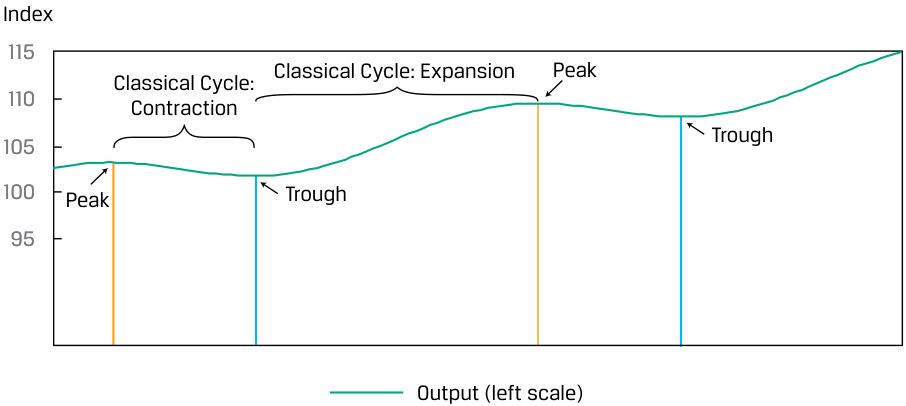
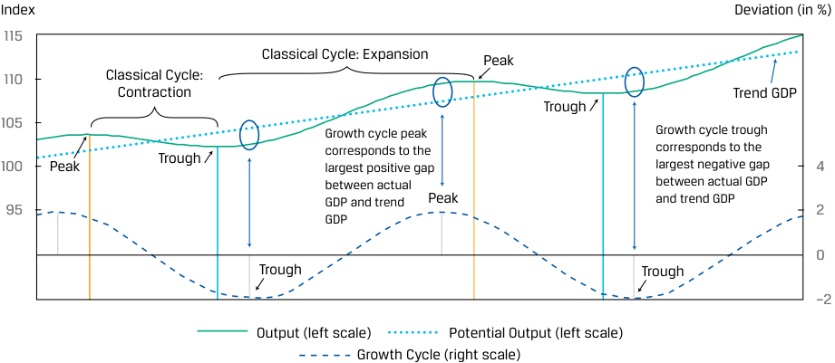
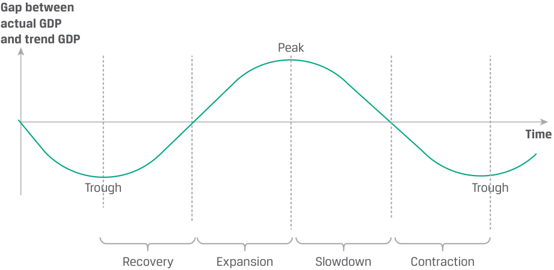
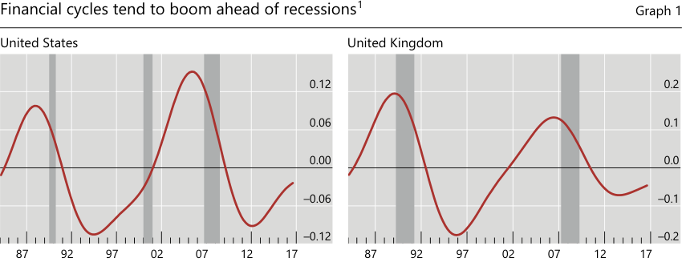

# Tập 2: Kinh tế học (Economics)
## Learning Module 2 Understanding Business Cycles (Trang PDF 57–86)

---

# Tập 2: Kinh tế học (Volume 2: Economics)
## Học phần 2: Tìm hiểu về Chu kỳ Kinh doanh (Learning Module 2: Understanding Business Cycles)
### Phần 1/3: Giới thiệu (Introduction) (Trang PDF 57–67)

---

<!-- PDF Page 57 -->

#### H Ọ C P H Ầ N (L E A R N I N G M O D U L E)

# **<mark>2</mark>**

### **Tìm hiểu về Chu kỳ Kinh doanh (Understanding Business Cycles)**

###### **bởi Gambera Michele, PhD, CFA, Ezrati Milton, và Cao Bolong, PhD, CFA.**

_Michele Gambera, PhD, CFA, công tác tại UBS Asset Management và Đại học Illinois tại Urbana-Champaign (Hoa Kỳ). Milton Ezrati (Hoa Kỳ). Bolong Cao, PhD, CFA, công tác tại Đại học Ohio (Hoa Kỳ)._

###### **<mark>MỤC TIÊU HỌC TẬP (LEARNING OUTCOMES)</mark>**

|**_Mức độ thành thạo (Mastery)_**|**_Ứng viên cần có khả năng (The candidate should be able to):_**|
|---|---|
||mô tả chu kỳ kinh doanh (*business cycle*) và các pha (*phases*) của nó|
||mô tả chu kỳ tín dụng (*credit cycles*)|
||mô tả cách thức việc sử dụng nguồn lực, hoạt động của người tiêu dùng và doanh nghiệp, hoạt động của khu vực nhà ở (*housing sector activity*), và hoạt động của khu vực ngoại thương (*external trade sector activity*) biến động qua chu kỳ kinh doanh và mô tả việc đo lường chúng bằng cách sử dụng các chỉ báo kinh tế (*economic indicators*)|

##### **GIỚI THIỆU (INTRODUCTION)**

**<mark>1</mark>**

Sản lượng hàng hóa và dịch vụ của một nền kinh tế điển hình luôn biến động xoay quanh quỹ đạo dài hạn của nó. Bây giờ chúng ta hướng sự chú ý sang những biến động mang tính chu kỳ, lặp đi lặp lại (*recurring, cyclical fluctuations*) đó trong sản lượng kinh tế. Một số yếu tố ảnh hưởng đến những thay đổi ngắn hạn trong nền kinh tế — chẳng hạn như những thay đổi về dân số, công nghệ, và vốn — cũng chính là những yếu tố ảnh hưởng đến tăng trưởng kinh tế bền vững trong dài hạn. Nhưng các lực lượng gây ra sự dịch chuyển của đường tổng cầu (*aggregate demand*) và đường tổng cung (*aggregate supply*) — chẳng hạn như kỳ vọng, các diễn biến chính trị, thiên tai, và các quyết định chính sách tài khóa (*fiscal policy*) cũng như chính sách tiền tệ (*monetary policy*) — cũng ảnh hưởng đến các nền kinh tế, đặc biệt là trong ngắn hạn.

Trước tiên chúng ta mô tả một chu kỳ kinh doanh điển hình và các pha của nó. Mặc dù mỗi chu kỳ đều khác nhau, các nhà phân tích và nhà đầu tư cần phải quen thuộc với các pha chu kỳ điển hình và ý nghĩa của chúng đối với kỳ vọng cũng như quyết định của các doanh nghiệp và hộ gia đình vốn ảnh hưởng đến kết quả hoạt động của các ngành và các công ty. Những hành vi này cũng tác động đến các điều kiện tài chính và khẩu vị rủi ro (*risk appetite*), từ đó ảnh hưởng đến việc thiết lập kỳ vọng và lựa chọn mức độ tiếp xúc danh mục đầu tư (*portfolio exposures*) đối với các ngành hoặc phong cách đầu tư khác nhau.

Trong các bài học tiếp theo, chúng tôi mô tả các chu kỳ tín dụng (*credit cycles*), giới thiệu một số lý thuyết về chu kỳ kinh doanh, và giải thích cách các trường phái tư tưởng kinh tế khác nhau diễn giải chu kỳ kinh doanh cũng như các khuyến nghị của họ đối với chu kỳ đó. Chúng tôi cũng thảo luận về

<!-- PDF Page 58 -->

các biến số thể hiện mối quan hệ có thể dự đoán được với nền kinh tế, tập trung vào những biến số mà chuyển động của chúng có giá trị trong việc dự báo đường hướng tương lai của nền kinh tế. Sau đó chúng tôi tiến hành giải thích các thước đo và đặc điểm của thất nghiệp (*unemployment*) và lạm phát (*inflation*).

###### **TỔNG QUAN HỌC PHẦN (LEARNING MODULE OVERVIEW)**

- Chu kỳ kinh doanh (*business cycles*) là những đợt mở rộng (*expansions*) và thu hẹp (*contractions*) lặp đi lặp lại trong hoạt động kinh tế làm ảnh hưởng đến các phân khúc rộng lớn của nền kinh tế.

- Chu kỳ cổ điển (*classical cycle*) đề cập đến những biến động trong mức độ hoạt động kinh tế tuyệt đối (ví dụ: được đo lường bằng GDP tính theo khối lượng thực).

- Chu kỳ tăng trưởng (*growth cycle*) đề cập đến những biến động trong hoạt động kinh tế xoay quanh mức tăng trưởng tiềm năng hoặc mức tăng trưởng theo xu hướng dài hạn (*long-term potential or trend growth level*).

- Chu kỳ tốc độ tăng trưởng (*growth rate cycle*) đề cập đến những biến động trong tốc độ tăng trưởng của hoạt động kinh tế (ví dụ: tốc độ tăng trưởng GDP).

- Tổng thể chu kỳ kinh doanh có thể được chia thành bốn pha: phục hồi (*recovery*), mở rộng (*expansion*), giảm tốc (*slowdown*), và thu hẹp / suy thoái (*contraction*).

- Trong pha phục hồi (*recovery phase*) của chu kỳ kinh doanh, nền kinh tế đang đi qua vùng “đáy” (*“trough”*) của chu kỳ, nơi sản lượng thực tế (*actual output*) đang ở mức thấp nhất so với sản lượng tiềm năng (*potential output*).

- Trong pha mở rộng (*expansion phase*) của chu kỳ kinh doanh, sản lượng gia tăng và tốc độ tăng trưởng ở mức trên trung bình. Sản lượng thực tế tăng vượt lên trên sản lượng tiềm năng, và nền kinh tế bước vào pha được gọi là bùng nổ (*boom phase*).

- Trong pha giảm tốc (*slowdown phase*) của chu kỳ kinh doanh, sản lượng đạt mức cao nhất so với sản lượng tiềm năng (tức là có khoảng cách sản lượng dương – *positive output gap* lớn nhất). Tốc độ tăng trưởng bắt đầu chậm lại so với mức tăng trưởng sản lượng tiềm năng, và khoảng cách sản lượng dương bắt đầu thu hẹp lại.

- Trong pha thu hẹp (*contraction phase*) của chu kỳ kinh doanh, sản lượng kinh tế thực tế giảm xuống dưới mức sản lượng kinh tế tiềm năng.

- Chu kỳ tín dụng (*credit cycles*) mô tả sự thay đổi về mức độ sẵn có — và định giá (lãi suất) — của tín dụng.

- Các đỉnh cao mạnh mẽ trong chu kỳ tín dụng có liên hệ chặt chẽ với các cuộc khủng hoảng ngân hàng mang tính hệ thống (*systemic banking crises*) diễn ra sau đó.

- Các chỉ báo kinh tế (*economic indicators*) là những biến số cung cấp thông tin về trạng thái của tổng thể nền kinh tế.

   - Các chỉ báo kinh tế dẫn dắt (*leading economic indicators*) có các điểm đảo chiều (*turning points*) thường diễn ra trước các điểm đảo chiều của tổng thể nền kinh tế.

   - Các chỉ báo kinh tế trùng khớp (*coincident economic indicators*) có các điểm đảo chiều thường diễn ra sát với các điểm đảo chiều của tổng thể nền kinh tế.

   - Các chỉ báo kinh tế trễ (*lagging economic indicators*) có các điểm đảo chiều diễn ra muộn hơn so với các điểm đảo chiều của tổng thể nền kinh tế.

- Chỉ số khuếch tán (*diffusion index*) phản ánh tỷ lệ các thành phần trong một chỉ số tổng hợp (*composite index*) gồm các chỉ báo dẫn dắt, chỉ báo trễ và chỉ báo trùng khớp đang di chuyển theo một khuôn mẫu nhất quán với chỉ số tổng thể. Các nhà phân tích thường dựa vào các chỉ số khuếch tán này để cung cấp một thước đo về độ rộng (*breadth*) của sự thay đổi trong một chỉ số tổng hợp.

<!-- PDF Page 59 -->

##### **TỔNG QUAN VỀ CHU KỲ KINH DOANH (OVERVIEW OF THE BUSINESS CYCLE)**

## **<mark>2</mark>**

mô tả chu kỳ kinh doanh (*business cycle*) và các pha (*phases*) của nó

**Chu kỳ kinh doanh (*Business cycles*)** là những đợt mở rộng và thu hẹp lặp đi lặp lại trong hoạt động kinh tế làm ảnh hưởng đến các phân khúc rộng lớn của nền kinh tế. Trong cuốn sách năm 1946 có tựa đề “Đo lường Chu kỳ Kinh doanh” (“Measuring Business Cycles”), Burns và Mitchell định nghĩa chu kỳ kinh doanh như sau:

Chu kỳ kinh doanh là một dạng biến động được tìm thấy trong hoạt động kinh tế tổng hợp của các quốc gia tổ chức công việc chủ yếu thông qua các doanh nghiệp kinh doanh: một chu kỳ bao gồm các đợt mở rộng xảy ra vào khoảng cùng một thời điểm trong nhiều hoạt động kinh tế, tiếp theo là các đợt suy thoái, thu hẹp và hồi phục diễn ra trên diện rộng tương tự rồi hòa vào pha mở rộng của chu kỳ tiếp theo; chuỗi sự kiện này mang tính lặp lại (*recurrent*) nhưng không định kỳ đều đặn (*not periodic*); về thời lượng, các chu kỳ kinh doanh dao động từ hơn một năm đến 10 hoặc 12 năm.

Định nghĩa này chứa đựng nhiều góc nhìn sâu sắc quan trọng. Thứ nhất, các chu kỳ kinh doanh là đặc trưng của những nền kinh tế dựa chủ yếu vào các doanh nghiệp kinh doanh — do đó, không phải là các xã hội nông nghiệp hay các nền kinh tế kế hoạch hóa tập trung (*centrally planned economies*). Thứ hai, một chu kỳ có một trình tự dự kiến của các pha, luân phiên giữa mở rộng và thu hẹp, hay các pha đi lên (*upswings*) và đi xuống (*downturns*). Thứ ba, những pha như vậy xảy ra vào khoảng cùng một thời điểm trên khắp nền kinh tế. Cuối cùng, các chu kỳ có tính lặp lại (*recurrent*); chúng xảy ra hết lần này đến lần khác theo thời gian nhưng không theo một chu kỳ cố định (*not in a periodic way*); không phải tất cả chúng đều có cùng cường độ và độ dài thời gian giống hệt nhau. Minh họa 1 cung cấp một hình ảnh minh họa về khuôn mẫu tốc độ tăng trưởng kinh tế tại các thị trường phát triển.

**Minh họa 1: Biến động Tăng trưởng tại các Quốc gia OECD theo Thời gian (Exhibit 1: Fluctuations of Growth in OECD Countries over Time)**

<!-- Picture Text: Quarterly GDP (Y-o-y change %) 10 8 6 4 2 0 –2 –4 –6 1965 1972 1979 1986 1993 2000 2007 2014  -->

> **Chú thích hình ảnh:** Trục tung là Thay đổi GDP hàng quý so với cùng kỳ năm trước tính theo % (*Quarterly GDP Y-o-y change %*), trục hoành là các năm từ 1965 đến 2014, cho thấy những đợt tăng trưởng tăng vọt và sụt giảm lặp đi lặp lại nhưng với biên độ và độ dài thời gian không đều nhau.

_Ghi chú:_ Tổ chức Hợp tác và Phát triển Kinh tế (*Organisation for Economic Co-Operation and Development* – OECD) bao gồm hơn 30 quốc gia thành viên lớn.

_Nguồn:_ OECD.Stat (https://stats.oecd.org), mức thay đổi so với cùng kỳ năm trước của GDP hàng quý tại các quốc gia OECD.

Định nghĩa của Burns và Mitchell vẫn giữ nguyên tính hữu ích. Lịch sử không bao giờ tự lặp lại theo cách hoàn toàn giống hệt nhau, nhưng chắc chắn nó mang lại những khuôn mẫu có thể được sử dụng khi phân tích hiện tại và dự báo tương lai. Phân tích chu kỳ kinh doanh là một chủ đề rộng lớn với những quan điểm trái chiều nhau giữa những người tham gia trong ngành.

<!-- PDF Page 60 -->

###### **Các Pha của Chu kỳ Kinh doanh (Phases of the Business Cycle)**

Chu kỳ kinh doanh là những chuỗi lặp đi lặp lại của các đợt đi lên (*upswings*) và đi xuống (*downturns*) luân phiên nhau. Chu kỳ kinh doanh có thể được chia nhỏ thành các pha theo nhiều cách khác nhau. Cách hiển nhiên nhất là chia nó thành hai phân đoạn chính: pha mở rộng (*expansion*), hay pha đi lên (*upswing*), và pha thu hẹp (*contraction*), hay pha đi xuống (*downturn*), với hai điểm đảo chiều (*turning points*) chính là các đỉnh (*peaks*) và các đáy (*troughs*) (xem Minh họa 2 và Minh họa 3). Hai giai đoạn này khá dễ xác định khi nhìn lại quá khứ (*in retrospect*). Tuy nhiên, việc chia nhỏ chu kỳ một cách chi tiết hơn lại trở nên mơ hồ, ngay cả khi nhìn lại quá khứ, bởi vì nó đòi hỏi phải nhận diện được những thay đổi tinh tế hơn, chẳng hạn như sự tăng tốc (*acceleration*) hay giảm tốc (*deceleration*) của tăng trưởng mà không có sự thay đổi về chiều hướng của nó. Do đó, sẽ rất hữu ích khi chia chu kỳ thành một số pha được phân biệt thông qua cả các đặc điểm kinh tế lẫn thị trường tài chính. Trọng tâm của chúng ta là vào các đặc điểm kinh tế của những pha khác nhau, nhưng chúng ta cũng sẽ làm nổi bật hàm ý của chúng đối với hành vi của các phân khúc khác nhau trên thị trường tài chính.

Thời điểm của các giai đoạn này sẽ phụ thuộc vào loại chu kỳ. Trước khi chuyển sang phần mô tả bốn pha riêng biệt mà chúng ta sẽ đề cập trong các phần tiếp theo, trước tiên chúng ta giải thích các khái niệm chu kỳ khác nhau mà các nhà phân tích cần lưu ý trước sự đa dạng của các ý kiến, cách diễn giải và mô tả khác nhau mà những người làm thực tiễn sử dụng.

###### **_Các Loại Chu kỳ (Types of Cycles)_**

- **Chu kỳ cổ điển (*Classical cycle*)** đề cập đến những biến động trong mức độ hoạt động kinh tế tuyệt đối (ví dụ: được đo lường bằng GDP tính theo khối lượng thực). Các pha thu hẹp nằm giữa đỉnh và đáy thường ngắn, trong khi các pha mở rộng lại dài hơn rất nhiều. Minh họa 2 cho thấy chu kỳ cổ điển của hoạt động kinh tế. Trên thực tế, chu kỳ cổ điển không được giới học thuật và những người làm thực tiễn sử dụng rộng rãi bởi vì nó không dễ dàng cho phép bóc tách các chuyển động của GDP thành các biến động ngắn hạn và các xu hướng dài hạn. Thêm vào đó, sự sụt giảm tuyệt đối trong hoạt động kinh tế giữa các đỉnh và đáy không xảy ra thường xuyên.

###### **Minh họa 2: Chu kỳ Cổ điển (Exhibit 2: Classical Cycle)**

<!-- Picture Text: Index 115 Classical Cycle: Expansion  Peak Classical Cycle: 110 Contraction Trough 105 100 Peak Trough 95 Output (left scale)  -->

> **Chú thích hình ảnh:** Trục tung bên trái là Chỉ số Sản lượng (*Output Index*). Đường biểu diễn mức sản lượng thực tế có các giai đoạn mở rộng (*Classical Cycle: Expansion*) kéo dài đi lên tới Đỉnh (*Peak*) và các giai đoạn thu hẹp (*Classical Cycle: Contraction*) ngắn đi xuống tới Đáy (*Trough*).

- **Chu kỳ tăng trưởng (*Growth cycle*)** đề cập đến những biến động trong hoạt động kinh tế xoay quanh mức tăng trưởng tiềm năng hoặc mức tăng trưởng theo xu hướng dài hạn. Trọng tâm nằm ở việc hoạt động kinh tế thực tế đang nằm thấp hơn hay cao hơn bao nhiêu so với mức tăng trưởng theo xu hướng. Đường “sóng” nét đứt ở phần dưới của Minh họa 3 nắm bắt sự biến động của hoạt động thực tế so với hoạt động tăng trưởng theo xu hướng. Minh họa 3 cho thấy những “khoảng cách” (*“gaps”*) giữa sản lượng thực tế và sản lượng theo xu hướng. Định nghĩa chu kỳ tăng trưởng tiến gần nhất với cách tư duy của

<!-- PDF Page 61 -->

các nhà kinh tế học chính thống (*mainstream economists*): Nó mổ xẻ hoạt động kinh tế tổng thể thành một phần được dẫn dắt bởi các xu hướng dài hạn và một phần phản ánh những biến động ngắn hạn. So với quan điểm cổ điển về chu kỳ kinh doanh, các đỉnh nhìn chung đạt được sớm hơn và các đáy diễn ra muộn hơn theo thời gian. Các khoảng thời gian nằm dưới và nằm trên mức tăng trưởng xu hướng có độ dài tương đương nhau.

**Minh họa 3: Chu kỳ Cổ điển và Chu kỳ Tăng trưởng (Exhibit 3: Classical and Growth Cycles)**

<!-- Picture Text: Index Deviation (in %) 115 Classical Cycle: Expansion  Peak 110 Classical Cycle: Contraction Trend GDP Trough 105 Growth cycle peak  Growth cycle trough 100 Peak Trough corresponds to the largest positive gap  corresponds to the largest negative gap  4 between actual  between actual GDP 95 GDP and trend  Peak and trend GDP  2 GDP 0 Trough Trough –2 Output (left scale) Potential Output (left scale) Growth Cycle (right scale)  -->

> **Chú thích hình ảnh:** Đồ thị kết hợp Sản lượng thực tế (*Output*, thang đo bên trái), Sản lượng tiềm năng / GDP xu hướng (*Potential Output / Trend GDP*, đường chấm bi dốc lên, thang đo bên trái) và Chu kỳ tăng trưởng (*Growth Cycle*, đường nét đứt bên dưới đo độ lệch tính theo % so với xu hướng ở thang đo bên phải). Đỉnh của chu kỳ tăng trưởng (*Growth cycle peak*) tương ứng với khoảng cách dương lớn nhất giữa GDP thực tế và GDP xu hướng; Đáy của chu kỳ tăng trưởng (*Growth cycle trough*) tương ứng với khoảng cách âm lớn nhất giữa GDP thực tế và GDP xu hướng.

- **Chu kỳ tốc độ tăng trưởng (*Growth rate cycle*)** đề cập đến những biến động trong tốc độ tăng trưởng của hoạt động kinh tế (ví dụ: tốc độ tăng trưởng GDP). Các đỉnh và đáy hầu hết đều được nhận diện sớm hơn so với khi sử dụng hai định nghĩa kia (xem Minh họa 4). Một ưu điểm của cách tiếp cận này là không cần thiết phải ước lượng trước một quỹ đạo tăng trưởng dài hạn. Tuy nhiên, các nhà kinh tế học thường đề cập đến việc tăng trưởng kinh tế đang ở trên hay ở dưới tốc độ tăng trưởng tiềm năng, phản ánh các đợt đi lên hoặc đi xuống.

**Minh họa 4: Chu kỳ Cổ điển, Chu kỳ Tăng trưởng và Chu kỳ Tốc độ Tăng trưởng (Exhibit 4: Classical, Growth, and Growth Rate Cycles)**

<!-- Picture Text: Index Deviation (in %) 115 Classical Cycle: Expansion 110 Classical Cycle: Contraction Highest rate of 105 Highest Lowest growth rate of rate of 100 Peak Trough Peak growth growth Peak 4 95 2 0 Trough Trough –2 Output (left scale) Potential Output (left scale) Growth Cycle (right scale) Growth Rate Cycle (right scale) Potential Output (right scale)  -->

> **Chú thích hình ảnh:** Đồ thị so sánh thời điểm đạt đỉnh (*Peak*) và chạm đáy (*Trough*) của 3 loại chu kỳ: Chu kỳ tốc độ tăng trưởng (*Growth Rate Cycle* – đạt đỉnh/đáy sớm nhất khi tốc độ tăng trưởng cao nhất/thấp nhất), Chu kỳ tăng trưởng (*Growth Cycle*), và Chu kỳ cổ điển (*Classical Cycle* – đạt đỉnh/đáy muộn nhất).

_Ghi chú:_ Các đường thẳng đứng chỉ ra các đáy và các đỉnh khi sử dụng định nghĩa chu kỳ cổ điển, chu kỳ tăng trưởng, hoặc chu kỳ tốc độ tăng trưởng của một chu kỳ kinh doanh. Chu kỳ tăng trưởng phản ánh độ lệch phần trăm của sản lượng so với xu hướng của nó. Tốc độ tăng trưởng trong chu kỳ tốc độ tăng trưởng được tính bằng tốc độ tăng trưởng hàng tháng đã được chuẩn hóa theo năm (*annualized month-over-month growth rates*).

<!-- PDF Page 62 -->

###### **_Các Vấn đề Thực tiễn (Practical Issues)_**

Trên thực tế, các định nghĩa về chu kỳ kinh doanh thường được sử dụng thay thế lẫn nhau, điều này hay gây ra sự nhầm lẫn liên quan đến cách người ta gắn nhãn cho các pha và thời điểm của chúng. Định nghĩa chu kỳ cổ điển hiếm khi được sử dụng. Phù hợp với cách nhìn nhận chu kỳ của hầu hết các nhà kinh tế học và những người làm thực tiễn, nhìn chung chúng ta sẽ sử dụng khái niệm chu kỳ tăng trưởng (*growth cycle concept*), trong đó các chu kỳ kinh doanh có thể được hiểu là những biến động xoay quanh sản lượng tiềm năng (xu hướng của sản lượng tiềm năng được hiển thị bằng đường chấm bi dốc lên trong Minh họa 3).

###### **_Bốn Pha của Chu kỳ (Four Phases of the Cycle)_**

Tổng thể chu kỳ kinh doanh có thể được chia thành bốn pha:

**Phục hồi (*Recovery*)**: Nền kinh tế đang đi qua vùng “đáy” (*“trough”*) của chu kỳ, nơi sản lượng thực tế đang ở mức thấp nhất so với sản lượng tiềm năng. Hoạt động kinh tế, bao gồm chi tiêu của người tiêu dùng và doanh nghiệp, đang ở dưới mức tiềm năng nhưng bắt đầu tăng lên, thu hẹp dần khoảng cách sản lượng âm (*negative output gap*).

**Mở rộng (*Expansion*)**: Quá trình phục hồi tăng tốc, sản lượng gia tăng, và tốc độ tăng trưởng đạt mức trên trung bình. Sản lượng thực tế tăng vượt lên trên sản lượng tiềm năng, và nền kinh tế bước vào pha được gọi là bùng nổ (*boom phase*). Người tiêu dùng gia tăng chi tiêu, và các công ty gia tăng sản xuất, việc làm, và đầu tư. Giá cả và lãi suất có thể bắt đầu tăng lên. Khi pha mở rộng tiếp diễn, nền kinh tế có thể bắt đầu gặp phải tình trạng thiếu hụt các yếu tố sản xuất (*shortages in factors of production*). Việc đầu tư quá mức (*overinvestment*) vào năng lực sản xuất có thể khiến các công ty cắt giảm chi tiêu đầu tư thêm trong tương lai.

**Giảm tốc (*Slowdown*)**: Sản lượng của nền kinh tế đạt mức cao nhất so với sản lượng tiềm năng (khoảng cách sản lượng dương lớn nhất – *largest positive output gap*). Tốc độ tăng trưởng bắt đầu chậm lại so với mức tăng trưởng sản lượng tiềm năng, và khoảng cách sản lượng dương bắt đầu thu hẹp lại. Người tiêu dùng vẫn lạc quan về nền kinh tế, nhưng các công ty có thể dựa vào việc làm thêm giờ (*overtime*) thay vì tuyển dụng nhân sự mới để đáp ứng nhu cầu. Lạm phát chậm lại tại một thời điểm nào đó, và mức giá cả có thể giảm xuống.

**Thu hẹp / Suy thoái (*Contraction*)**: Sản lượng kinh tế thực tế giảm xuống dưới mức sản lượng kinh tế tiềm năng. Niềm tin của người tiêu dùng và doanh nghiệp suy giảm. Các công ty cắt giảm chi phí bằng cách xóa bỏ làm thêm giờ và cắt giảm việc làm. Nền kinh tế có thể trải qua những đợt sụt giảm trong hoạt động kinh tế tuyệt đối; một cuộc suy thoái (*recession*); hoặc nếu mức sụt giảm hoạt động đặc biệt lớn, một cuộc đại suy thoái / khủng hoảng (*depression*). Nếu mức sụt giảm là vừa phải, pha này có xu hướng ngắn hơn so với pha mở rộng.

Minh họa 5 cung cấp bản tóm tắt các đặc điểm chính của từng pha và mô tả cách một số biến số kinh tế quan trọng vận động xuyên suốt hành trình của một chu kỳ kinh doanh.

**Minh họa 5: Các Đặc điểm của các Pha trong Chu kỳ Kinh doanh (Exhibit 5: Business Cycle Phase Characteristics)**

<!-- Picture Text: Gap between actual GDP and trend GDP Peak Time Trough Trough Recovery Expansion Slowdown Contraction  -->

> **Chú thích hình ảnh:** Trục tung là Khoảng cách giữa GDP thực tế và GDP xu hướng (*Gap between actual GDP and trend GDP*), trục hoành là Thời gian (*Time*). Chu kỳ đi từ Đáy (*Trough*) qua 4 pha: **Phục hồi (*Recovery*)** (từ đáy lên đường xu hướng 0), **Mở rộng (*Expansion*)** (từ đường 0 lên Đỉnh – *Peak*), **Giảm tốc (*Slowdown*)** (từ Đỉnh xuống đường 0), và **Thu hẹp (*Contraction*)** (từ đường 0 xuống Đáy tiếp theo).

<!-- PDF Page 63 -->

|**Pha (Phase)**|**Phục hồi (Recovery)**|**Mở rộng (Expansion)**|**Giảm tốc (Slowdown)**|**Thu hẹp (Contraction)**|
|---|---|---|---|---|
|**Mô tả (Description)**|Nền kinh tế đi qua vùng đáy. Khoảng cách sản lượng âm bắt đầu thu hẹp lại.|Nền kinh tế tận hưởng đà đi lên. Khoảng cách sản lượng dương mở rộng ra.|Nền kinh tế đi qua vùng đỉnh. Khoảng cách sản lượng dương bắt đầu thu hẹp lại.|Nền kinh tế suy yếu và có thể rơi vào suy thoái. Khoảng cách sản lượng âm mở rộng ra.|
|**Mức độ hoạt động: người tiêu dùng và doanh nghiệp (Activity levels: consumers and businesses)**|Mức độ hoạt động ở dưới mức tiềm năng nhưng bắt đầu tăng lên.|Các thước đo hoạt động cho thấy tốc độ tăng trưởng trên mức trung bình.|Các thước đo hoạt động ở trên mức trung bình nhưng đang giảm tốc. Chuyển dần sang tốc độ tăng trưởng dưới mức trung bình.|Các thước đo hoạt động ở dưới mức tiềm năng. Tăng trưởng thấp hơn mức bình thường.|
|**Việc làm (Employment)**|Tình trạng sa thải chậm lại. Doanh nghiệp dựa vào làm thêm giờ trước khi chuyển sang tuyển dụng mới. Tỷ lệ thất nghiệp vẫn cao hơn mức trung bình.|Doanh nghiệp chuyển từ việc sử dụng làm thêm giờ và nhân viên thời vụ sang tuyển dụng chính thức. Tỷ lệ thất nghiệp ổn định lại và bắt đầu giảm xuống.|Doanh nghiệp tiếp tục tuyển dụng nhưng với tốc độ chậm hơn. Tỷ lệ thất nghiệp tiếp tục giảm nhưng với tốc độ giảm dần.|Doanh nghiệp trước tiên cắt giảm số giờ làm, xóa bỏ làm thêm giờ, và đóng băng tuyển dụng, tiếp theo là sa thải trực tiếp. Tỷ lệ thất nghiệp bắt đầu tăng lên.|
|**Lạm phát (Inflation)**|Lạm phát duy trì ở mức vừa phải (*moderate*).|Lạm phát nhích tăng nhẹ (*picks up modestly*).|Lạm phát tiếp tục tăng tốc (*further accelerates*).|Lạm phát giảm tốc nhưng có độ trễ (*decelerates but with a lag*).|

###### **Sự Dẫn trước và Độ trễ trong việc Ra quyết định của Doanh nghiệp và Người tiêu dùng (Leads and Lags in Business and Consumer Decision Making)**

Hành vi của các doanh nghiệp và hộ gia đình đóng vai trò then chốt đối với chu kỳ và thường xuyên bao hàm các yếu tố dẫn trước (*leads*) và độ trễ (*lags*) so với những điểm được xác lập là điểm đảo chiều. Ví dụ, vào đầu pha mở rộng, các công ty có thể muốn tận dụng tối đa lực lượng lao động hiện có của mình và chờ đợi việc tuyển dụng nhân viên mới cho đến khi họ chắc chắn rằng nền kinh tế thực sự đang tăng trưởng. Tuy nhiên, dần dần tất cả các biến số kinh tế đều sẽ quay trở về khoảng giá trị bình thường của chúng (ví dụ: tăng trưởng GDP sẽ tiệm cận mức tăng trưởng tiềm năng, hay mức tăng trưởng trung bình).

###### **Điều kiện Thị trường và Hành vi của Nhà đầu tư (Market Conditions and Investor Behavior)**

Nhiều biến số kinh tế và các khu vực ngành nghề của nền kinh tế có những khuôn mẫu chu kỳ riêng biệt. Kiến thức về những khuôn mẫu này có thể mang lại góc nhìn sâu sắc về các chiều hướng chu kỳ tổng thể có khả năng xảy ra, hoặc có thể đặc biệt áp dụng được cho một chiến lược đầu tư đòi hỏi những góc nhìn chu kỳ cụ thể, chi tiết thay vì chung chung để đạt được thành công trong đầu tư.

###### **_Pha Phục hồi (Recovery Phase)_**

Khi các thị trường tài sản kỳ vọng sự kết thúc của một cuộc suy thoái và sự bắt đầu của một pha mở rộng, các tài sản rủi ro (*risky assets*) sẽ được định giá lại theo hướng tăng lên. Khi một đợt mở rộng được kỳ vọng, các thị trường sẽ bắt đầu phản ánh những kỳ vọng lợi nhuận cao hơn vào giá của trái phiếu doanh nghiệp và cổ phiếu. Thông thường, thị trường cổ phiếu (*equity markets*) sẽ chạm đáy khoảng ba đến sáu tháng trước khi nền kinh tế chạm đáy và rất lâu trước khi các chỉ báo kinh tế quay đầu đi lên. Quả thực, như chúng ta sẽ thấy ở phần sau, thị trường cổ phiếu được phân loại là một chỉ báo dẫn dắt (*leading indicator*) của nền kinh tế.

###### **_Pha Mở rộng (Expansion Phase)_**

Khi sự mở rộng của nền kinh tế đã được xác lập vững chắc, phần sau của pha mở rộng, được gọi là giai đoạn **“bùng nổ” (*“boom”*)**, thường nối tiếp theo sau. Giai đoạn bùng nổ là một pha mở rộng được đặc trưng bởi mức tăng trưởng kinh tế “thử thách các giới hạn” của nền kinh tế, niềm tin mạnh mẽ, cùng sự tăng trưởng cao về lợi nhuận và tín dụng. Ví dụ, các công ty có thể mở rộng nhiều đến mức họ gặp khó khăn trong việc tìm kiếm những người lao động có trình độ và sẽ phải cạnh tranh với các nhà tuyển dụng tiềm năng khác bằng cách

<!-- PDF Page 64 -->

tăng lương cũng như tiếp tục mở rộng công suất, dựa vào dòng tiền mạnh mẽ và hoạt động vay nợ. Chính phủ hoặc ngân hàng trung ương có thể can thiệp nếu lo ngại về việc nền kinh tế tăng trưởng quá nóng (*overheating*).

###### **_Pha Giảm tốc (Slowdown Phase)_**

Trong giai đoạn bùng nổ, những tài sản rủi ro nhất thường sẽ có mức tăng giá đáng kể. Các tài sản an toàn, chẳng hạn như trái phiếu chính phủ vốn được đánh giá cao hơn trong thời kỳ suy thoái, có thể có mức giá thấp hơn và do đó có lợi suất (*yields*) cao hơn. Thêm vào đó, các nhà đầu tư có thể lo sợ lạm phát cao hơn, điều này cũng góp phần làm tăng lợi suất danh nghĩa (*nominal yields*).

###### **_Pha Thu hẹp (Contraction Phase)_**

Trong pha thu hẹp, các nhà đầu tư đặt giá trị tương đối cao cho những tài sản an toàn hơn như chứng khoán chính phủ và cổ phiếu của các công ty có dòng tiền dương ổn định (hoặc đang tăng trưởng), chẳng hạn như các công ty tiện ích (*utilities*) và các nhà sản xuất hàng tiêu dùng thiết yếu (*staple goods*). Sự ưa thích như vậy phản ánh thực tế rằng độ hữu dụng cận biên (*marginal utility*) của một dòng thu nhập an toàn tăng lên trong những giai đoạn mà việc làm bấp bênh hoặc đang suy giảm.

###### **KHI NÀO SUY THOÁI BẮT ĐẦU VÀ KẾT THÚC? (WHEN DO RECESSIONS BEGIN AND END?)**

Một quy tắc đơn giản và thường được nhắc đến là: Một cuộc suy thoái (*recession*) đã bắt đầu khi một quốc gia hoặc khu vực trải qua hai quý liên tiếp có tốc độ tăng trưởng GDP thực âm (*two consecutive quarters of negative real GDP growth*). Tăng trưởng GDP thực là thước đo mức tăng trưởng “thực” hay “đã điều chỉnh theo lạm phát” của tổng thể nền kinh tế. Quy tắc này có thể gây hiểu lầm bởi vì nó không chỉ ra một cuộc suy thoái nếu tăng trưởng GDP thực âm trong một quý, dương nhẹ trong quý tiếp theo, và lại âm trong quý kế tiếp. Nhiều nhà phân tích đặt dấu hỏi về kết quả này. Vấn đề này là lý do tại sao một số quốc gia có các ủy ban thống kê và kinh tế áp dụng những nguyên tắc do Burns và Mitchell nêu ra cho nhiều biến số kinh tế vĩ mô — chứ không chỉ riêng tăng trưởng GDP thực — làm cơ sở để xác định các đỉnh và đáy của chu kỳ kinh doanh. Cục Nghiên cứu Kinh tế Quốc gia (*National Bureau of Economic Research* – NBER) là một tổ chức xác định niên đại các chu kỳ kinh doanh tại Hoa Kỳ. Thật thú vị là các nhà kinh tế học và các nhà thống kê học trong Ủy ban Xác định Niên đại Chu kỳ Kinh doanh của NBER phân tích rất nhiều chuỗi dữ liệu thời gian tập trung vào việc làm, sản xuất công nghiệp, và doanh số bán hàng. Bởi vì dữ liệu được cung cấp với một độ trễ (các bản công bố dữ liệu sơ bộ có thể được điều chỉnh lại thậm chí nhiều năm sau kỳ mà chúng đề cập tới), điều đó cũng có nghĩa là các quyết định xác nhận của Ủy ban có thể diễn ra rất lâu sau khi các điểm đảo chiều của chu kỳ kinh doanh đã thực sự xảy ra. Như chúng ta sẽ thấy ở phần sau của bài đọc, các chỉ báo thực tiễn có thể giúp các nhà kinh tế học hiểu trước được liệu một điểm đảo chiều mang tính chu kỳ có sắp sửa xảy ra hay không.

1. Quy tắc nào sau đây _có khả năng nhất_ được sử dụng để xác định xem liệu nền kinh tế có đang ở trong một cuộc suy thoái hay không?

   - **A.** Ngân hàng trung ương đã cạn kiệt dự trữ ngoại hối.

   - **B.** GDP thực có hai quý tăng trưởng âm liên tiếp (*Real GDP has two consecutive quarters of negative growth*).

   - **C.** Hoạt động kinh tế trải qua sự sụt giảm đáng kể ở hai khu vực ngành nghề kinh doanh.

###### **Lời giải (Solution):**

B là đáp án đúng. GDP là thước đo hoạt động kinh tế cho toàn bộ nền kinh tế. Những thay đổi trong dự trữ ngoại hối hoặc ở một số lượng hạn chế các ngành nghề có thể không gây ra tác động trọng yếu lên toàn bộ nền kinh tế.

2. Giả sử bạn đang quan tâm đến việc dự báo tăng trưởng thu nhập (*earnings growth*) cho một công ty hoạt động tại một quốc gia nơi không tồn tại ủy ban xác định niên đại chu kỳ kinh doanh chính thức nào (chẳng hạn

<!-- PDF Page 65 -->

|như NBER). Các biến số mà bạn _có khả năng nhất_ sẽ xem xét để xác định các đỉnh và đáy của chu kỳ kinh doanh tại quốc gia đó là:|
|---|
|**A.** lạm phát, lãi suất, và thất nghiệp. **B.** giá trị thị trường chứng khoán và cung tiền. **C.** thất nghiệp, tăng trưởng GDP, sản xuất công nghiệp, và lạm phát (*unemployment, GDP growth, industrial production, and inflation*). **Lời giải (Solution):** C là đáp án đúng. Thất nghiệp, tăng trưởng GDP, sản xuất công nghiệp, và lạm phát là các thước đo trực tiếp về hoạt động kinh tế. Lãi suất chiết khấu, cơ sở tiền tệ (*monetary base*), và các chỉ số thị trường chứng khoán không phải là thước đo trực tiếp của các hoạt động kinh tế. Hai yếu tố đầu được quyết định bởi chính sách tiền tệ vốn phản ứng lại các hoạt động kinh tế, trong khi các chỉ số thị trường chứng khoán có xu hướng hướng tới tương lai (*forward looking*) hay là các chỉ báo dẫn dắt của nền kinh tế.|
|**BỘ CÂU HỎI (QUESTION SET)**|
|1. Các khuôn mẫu chu kỳ kinh doanh đặc trưng gồm đáy, mở rộng, đỉnh, và thu hẹp có tính chất là:|
|**A.** định kỳ đều đặn (*periodic*).|
|**B.** lặp đi lặp lại (*recurrent*).|
|**C.** có thời lượng tương tự nhau (*of similar duration*). **Lời giải (Solution):**|
|B là đáp án đúng. Các giai đoạn của chu kỳ kinh doanh xảy ra lặp đi lặp lại theo thời gian.|
|2. Trong pha thu hẹp (*contraction phase*) của một chu kỳ kinh doanh, điều _có khả năng xảy ra nhất_ là: **A.** các chỉ báo lạm phát giữ ổn định.|
|**B.** hoạt động kinh tế tổng hợp so với sản lượng tiềm năng đang giảm xuống (*aggregate economic activity relative to potential output is decreasing*). **C.** sự ưa thích của nhà đầu tư đối với chứng khoán chính phủ suy giảm. **Lời giải (Solution):**|
|B là đáp án đúng. Xu hướng ròng trong pha thu hẹp là âm (suy giảm).|
|3. Đỉnh kinh tế (*economic peak*) có liên hệ _mật thiết nhất_ với:|
|**A.** lạm phát đang tăng tốc (*accelerating inflation*).|
|**B.** tỷ lệ thất nghiệp ổn định.|
|**C.** chi tiêu vốn đang suy giảm. **Lời giải (Solution):**|
|A là đáp án đúng. Lạm phát thường tăng lên tại các vùng đỉnh.|

##### **CHU KỲ TÍN DỤNG (CREDIT CYCLES)**

<!-- PDF Page 66 -->

Trong khi các chu kỳ kinh doanh chủ yếu sử dụng GDP làm thước đo hoạt động kinh tế, một hệ thống các nghiên cứu học thuật đã nổi lên trong đó các diễn biến theo chu kỳ của những biến số tài chính được phân tích tách biệt. Điều này thường được thực hiện phổ biến nhất dưới góc độ tín dụng và giá bất động sản (*credit and property prices*). Chu kỳ tín dụng (*credit cycles*) mô tả sự thay đổi về mức độ sẵn có — và định giá — của tín dụng. Chúng mô tả sự tăng trưởng trong tín dụng khu vực tư nhân (mức độ sẵn có và việc sử dụng các khoản vay), yếu tố thiết yếu cho hoạt động đầu tư của doanh nghiệp và việc mua bất động sản của các hộ gia đình. Do đó, chúng có sự kết nối với hoạt động kinh tế thực được phản ánh bởi các chu kỳ kinh doanh vốn mô tả những biến động trong GDP thực.

Khi nền kinh tế vững mạnh hoặc đang cải thiện, sự sẵn lòng cấp tín dụng của người cho vay, kèm theo các điều khoản thuận lợi, là rất cao. Ngược lại, khi nền kinh tế yếu kém hoặc đang suy yếu, những người cho vay sẽ thu hẹp lại, hay “thắt chặt” (*“tighten”*) tín dụng, bằng cách làm cho tín dụng trở nên ít sẵn có hơn và đắt đỏ hơn. Điều này thường xuyên góp phần làm sụt giảm giá trị của các tài sản như bất động sản, gây ra sự suy yếu kinh tế sâu hơn và tỷ lệ vỡ nợ (*defaults*) cao hơn. Đó là bởi vì tầm quan trọng của tín dụng trong việc tài trợ cho hoạt động xây dựng và mua sắm bất động sản. Chu kỳ tín dụng là một tập hợp con của một họ rộng lớn hơn gồm các chu kỳ được gọi là chu kỳ tài chính (*financial cycles*), một chủ đề vượt ra ngoài phạm vi bài học của chúng ta.

###### **Các Ứng dụng của Chu kỳ Tín dụng (Applications of Credit Cycles)**

Các yếu tố tài chính trong một thời gian dài đã không giữ vị trí nổi bật trên màn hình radar theo dõi của các nhà kinh tế học vĩ mô. Các hiện tượng tiền tệ và tài chính phần lớn được coi như một bức màn che có thể bỏ qua khi cố gắng tìm hiểu nền kinh tế. Nhưng tín dụng khu vực tư nhân nới lỏng (*loose private sector credit*) được cho là đã góp phần dẫn đến một số cuộc khủng hoảng tài chính, chẳng hạn như cuộc khủng hoảng Mỹ Latinh những năm 1980; các cuộc khủng hoảng tại Mexico, Brazil, và Nga những năm 1990; cuộc khủng hoảng tài chính châu Á 1997–1998; và Cuộc Khủng hoảng Tài chính Toàn cầu 2008–2009. Các điều kiện tín dụng mở rộng thường dẫn đến bong bóng giá tài sản và bong bóng bất động sản, những bong bóng này sẽ vỡ tung khi dòng vốn tháo chạy khỏi thị trường vốn và các đợt sụt giảm sâu xảy ra chủ yếu do các yếu tố nền tảng cơ bản (*fundamentals*) suy yếu.

Người ta nhận ra rằng trong một thế giới có những ma sát tài chính (*financial frictions*), các chu kỳ kinh doanh có thể bị khuếch đại (*amplified*), với những cuộc suy thoái sâu hơn và những đợt mở rộng quy mô lớn hơn do những thay đổi trong khả năng tiếp cận nguồn tài trợ bên ngoài. Phù hợp với niềm tin này, các nghiên cứu phát hiện ra rằng độ dài thời gian và biên độ của các cuộc suy thoái cũng như các đợt phục hồi thường được định hình bởi mối liên kết giữa chu kỳ kinh doanh và chu kỳ tín dụng. Cụ thể, các cuộc suy thoái đi kèm với những giai đoạn đứt gãy tài chính (*financial disruption episodes*, đặc biệt là sự đổ vỡ của giá nhà ở và giá cổ phiếu) có xu hướng kéo dài hơn và sâu sắc hơn. Các đợt phục hồi kết hợp với sự tăng trưởng nhanh chóng về tín dụng, việc chấp nhận rủi ro (*risk-taking*), và giá nhà ở có xu hướng diễn ra mạnh mẽ hơn.

Các biến số tài chính có xu hướng đồng biến chặt chẽ với nhau và thường có thể giúp giải thích quy mô của một đợt mở rộng hay thu hẹp kinh tế, nhưng chúng không phải lúc nào cũng đồng bộ (*synchronized*) với chu kỳ kinh doanh truyền thống. Chu kỳ tín dụng có xu hướng dài hơn, sâu hơn, và sắc nét hơn so với chu kỳ kinh doanh. Mặc dù độ dài của một chu kỳ kinh doanh từ đỉnh đến đáy có sự biến thiên, độ dài trung bình của một chu kỳ tín dụng hầu hết đều được nhận thấy là dài hơn so với chu kỳ kinh doanh. Minh họa 6 minh họa cách thức trực quan hóa các chu kỳ tín dụng.

###### **TRỰC QUAN HÓA CÁC CHU KỲ TÀI CHÍNH (VISUALIZING FINANCIAL CYCLES)**

Trong một báo cáo nghiên cứu tháng 10 năm 2019 có tựa đề “Dự báo Suy thoái: Chu kỳ Tài chính so với Chênh lệch Kỳ hạn” (“Predicting Recessions: Financial Cycle versus Term Spread”), Ngân hàng Thanh toán Quốc tế (*Bank for International Settlements* – BIS) đã cung cấp một biểu diễn trực quan về các chu kỳ tín dụng, được tái hiện lại trong Minh họa 6. Hình này cho thấy các chu kỳ như vậy có xu hướng bùng nổ mạnh trước khi xảy ra suy thoái.

<!-- PDF Page 67 -->

###### **Minh họa 6: Biểu diễn Trực quan của BIS về các Chu kỳ Tài chính (Exhibit 6: BIS Visualization of Financial Cycles)**

<!-- Picture Text: Financial cycles tend to boom ahead of recessions 1  Graph 1 United States  United Kingdom 0.12 0.2 0.06 0.1 0.00 0.0 –0.06 –0.1 –0.12 –0.2 87 92 97 02 07 12 17 87 92 97 02 07 12 17  -->

> **Chú thích hình ảnh:** Đồ thị 1 (*Graph 1*): Các chu kỳ tài chính có xu hướng bùng nổ trước các cuộc suy thoái (*Financial cycles tend to boom ahead of recessions*) tại Hoa Kỳ (*United States*) và Vương quốc Anh (*United Kingdom*) giai đoạn 1987–2017. Các vùng tô xám biểu thị các giai đoạn suy thoái kinh tế (*recessions*).

Các vùng tô xám biểu thị các cuộc suy thoái (*recessions*).

1 Các chu kỳ tài chính được đo lường bằng biến đại diện chu kỳ tài chính tổng hợp (*composite financial cycle proxy*) được tính toán từ các bộ lọc thông dải dựa trên tần số (*frequency-based bandpass filters*) nắm bắt các chu kỳ trung hạn trong tín dụng thực, tỷ lệ tín dụng trên GDP (*credit-to-GDP ratio*) và giá nhà ở thực (*real house prices*).

_Ghi chú:_ Các chu kỳ tín dụng được đo lường bằng một biến đại diện (tổng hợp) được tính từ các biến số bao gồm tỷ lệ tín dụng trên GDP và giá nhà ở thực. Trục bên phải cho thấy mức thay đổi so với cùng kỳ năm trước của biến đại diện.

_Nguồn:_ Tài liệu của Ngân hàng Thanh toán Quốc tế (BIS) (có sẵn trên trang web của BIS: www.bis.org).

###### **Hệ quả đối với Chính sách (Consequences for Policy)**

Các nhà đầu tư chú ý đến giai đoạn của chu kỳ tín dụng bởi vì (1) nó giúp họ hiểu được các diễn biến trên thị trường nhà ở và xây dựng; (2) nó giúp họ đánh giá mức độ mở rộng cũng như thu hẹp của chu kỳ kinh doanh, đặc biệt là mức độ nghiêm trọng của một cuộc suy thoái nếu nó trùng khớp với pha thu hẹp của chu kỳ tín dụng; và (3) nó giúp họ dự báo tốt hơn hành động của các nhà hoạch định chính sách. Trong khi chính sách tiền tệ và chính sách tài khóa theo truyền thống tập trung vào việc giảm thiểu biến động của các chu kỳ kinh doanh, các chính sách ổn định an toàn vĩ mô (*macroprudential stabilization policies*) nhằm mục đích hạ nhiệt các đợt bùng nổ tài chính đã ngày càng trở nên quan trọng. Điều này càng được nhấn mạnh hơn bởi các kết quả nghiên cứu cho thấy những đỉnh cao mạnh mẽ trong chu kỳ tín dụng có liên hệ chặt chẽ với các cuộc khủng hoảng ngân hàng mang tính hệ thống diễn ra sau đó.

###### **BỘ CÂU HỎI (QUESTION SET)**

1. Một nhà quản lý danh mục đầu tư cấp cao tại Carnara Asset Management giải thích phân tích của bà về chu kỳ kinh doanh cho một nhà phân tích cấp dưới. Bà đưa ra hai phát biểu:

- Phát biểu 1: Chu kỳ kinh doanh đo lường hoạt động bằng GDP, trong khi chu kỳ tín dụng kết hợp một loạt các biến số tài chính, chẳng hạn như quy mô và định giá của tín dụng.

- Phát biểu 2: Chu kỳ tín dụng và chu kỳ kinh doanh không có liên hệ với nhau và phục vụ các mục đích khác nhau.

- **A.** Chỉ có Phát biểu 1 là đúng.

- **B.** Chỉ có Phát biểu 2 là đúng.

- **C.** Cả hai phát biểu đều đúng.

- **Lời giải (Solution):**

A là đáp án đúng. Chỉ có Phát biểu 1 là đúng. Phát biểu 2 không đúng bởi vì các nhà nghiên cứu đã tìm thấy mối liên kết chặt chẽ giữa chu kỳ tài chính và chu kỳ kinh doanh giúp giải thích biên độ của các đợt mở rộng và thu hẹp trong chu kỳ kinh doanh tùy thuộc vào trạng thái của chu kỳ tín dụng.

---

# Tập 2: Kinh tế học (Volume 2: Economics)
## Học phần 2: Tìm hiểu về Chu kỳ Kinh doanh (Learning Module 2: Understanding Business Cycles)
### Phần 2/3: Các Chỉ báo Kinh tế qua Chu kỳ Kinh doanh (Economic Indicators over the Business Cycle) (Trang PDF 68–81)

---

<!-- PDF Page 68 -->

2. Các nhà phân tích thường gắn chu kỳ tín dụng với khu vực nào của nền kinh tế một cách phổ biến nhất?

   - **A.** Xuất khẩu (*Exports*)

   - **B.** Xây dựng và mua sắm bất động sản (*Construction and purchases of property*)

   - **C.** Bán lẻ thực phẩm (*Food retail*)

   - **Lời giải (Solution):**

B là đáp án đúng. Chu kỳ tín dụng gắn liền với mức độ sẵn có của tín dụng, yếu tố đóng vai trò quan trọng trong việc tài trợ cho hoạt động xây dựng và mua sắm bất động sản.

3. Lý do các nhà phân tích theo dõi những diễn biến về mức độ sẵn có của tín dụng là vì:

   - **A.** tín dụng khu vực tư nhân nới lỏng có thể góp phần làm gia tăng quy mô của bong bóng giá tài sản và bất động sản cùng các cuộc khủng hoảng theo sau đó (*loose private sector credit may contribute to the extent of asset price and real estate bubbles and subsequent crises*).

   - **B.** tín dụng nới lỏng giúp làm giảm quy mô của bong bóng giá tài sản và bất động sản.

   - **C.** chu kỳ tín dụng có cùng độ dài và độ sâu với chu kỳ kinh doanh.

   - **Lời giải (Solution):**

A là đáp án đúng. Các nghiên cứu đã chỉ ra rằng điều kiện tín dụng nới lỏng góp phần làm gia tăng quy mô của bong bóng giá tài sản và bất động sản vốn có xu hướng dẫn đến các cuộc khủng hoảng theo sau đó.

# **<mark>4</mark>**

## **CÁC CHỈ BÁO KINH TẾ QUA CHU KỲ KINH DOANH (ECONOMIC INDICATORS OVER THE BUSINESS CYCLE)**

- mô tả cách thức việc sử dụng nguồn lực, hoạt động của người tiêu dùng và doanh nghiệp, hoạt động của khu vực nhà ở (*housing sector activity*), và hoạt động của khu vực ngoại thương (*external trade sector activity*) biến động qua chu kỳ kinh doanh và mô tả việc đo lường chúng bằng cách sử dụng các chỉ báo kinh tế (*economic indicators*)

Bài học này cung cấp một cái nhìn tổng quan rộng lớn về cách thức việc sử dụng các nguồn lực cần thiết để sản xuất hàng hóa và dịch vụ thường vận động trong suốt một chu kỳ kinh doanh. Chúng ta bắt đầu bằng cách tập trung vào hoàn cảnh của các doanh nghiệp và khám phá một số mối liên kết giữa những biến động về hàng tồn kho (*inventory*), việc làm (*employment*), và đầu tư vào vốn vật chất (*investment in physical capital*) với những biến động kinh tế.

### **Lực lượng Lao động và Chi phí Công ty (The Workforce and Company Costs)**

Khuôn mẫu tuyển dụng và việc làm được thể hiện trong Minh họa 7. Khi nền kinh tế bước vào pha thu hẹp (*contraction*), các công ty cắt giảm chi phí và xóa bỏ việc làm thêm giờ (*overtime*). Họ có thể cố gắng giữ chân người lao động thay vì cắt giảm nhân sự để rồi sau đó lại phải tuyển dụng tăng thêm. Việc tìm kiếm và đào tạo công nhân mới rất tốn kém, và có thể sẽ hiệu quả về mặt chi phí hơn nếu giữ người lao động lại trong bảng lương ngay cả khi họ không được sử dụng hết công suất. Các công ty cũng có thể hưởng lợi từ sự gắn kết lòng trung thành ngầm định giữa công ty và người lao động, giúp thúc đẩy năng suất trong quá trình đó. Trong các đợt thu hẹp kéo dài, các công ty sẽ bắt đầu cắt giảm chi phí một cách quyết liệt hơn — chấm dứt hợp đồng với các nhà tư vấn, dừng các chiến dịch quảng cáo, và cắt giảm số lượng công nhân vượt quá mức tối thiểu nghiêm ngặt. Tỷ lệ sử dụng công suất (*capacity utilization*) sẽ ở mức thấp, và rất ít công ty đầu tư vào trang thiết bị mới. Các công ty sẽ cố gắng thanh lý lượng hàng tồn kho gồm các sản phẩm chưa bán được. Thêm vào đó, các ngân hàng sẽ ngần ngại cho vay bởi vì rủi ro phá sản được nhìn nhận là cao hơn, làm gia tăng thêm sự suy yếu trong nền kinh tế.

<!-- PDF Page 69 -->

Sự sụt giảm trong tổng cầu nhiều khả năng sẽ làm giảm tiền lương hoặc tốc độ tăng trưởng tiền lương cũng như giá của các yếu tố đầu vào và tư liệu sản xuất (*capital goods*). Sau một thời gian, tất cả mức giá của các yếu tố đầu vào này sẽ ở mức tương đối thấp. Ngoài ra, lãi suất có thể được cắt giảm nhằm cố gắng vực dậy nền kinh tế.

Khi giá cả và lãi suất giảm xuống, người tiêu dùng và các công ty có thể bắt đầu mua sắm nhiều hơn và tổng cầu có thể bắt đầu tăng lên. Giai đoạn này chính là điểm đảo chiều (*turning point*) của chu kỳ kinh doanh: Tổng cầu bắt đầu tăng lên và hoạt động kinh tế gia tăng.

**Minh họa 7: Các Pha của Chu kỳ Kinh doanh — Mức độ Việc làm (Exhibit 7: Business Cycle Phases—Levels of Employment)**

|**Khoảng cách giữa GDP thực tế và GDP xu hướng (*Gap between actual GDP and trend GDP*)**|Đáy (*Trough*) $\rightarrow$ Phục hồi (*Recovery*) $\rightarrow$ Mở rộng (*Expansion*)|Đỉnh (*Peak*) $\rightarrow$ Giảm tốc (*Slowdown*) $\rightarrow$ Thu hẹp (*Contraction*)|Thời gian (*Time*) $\rightarrow$ Đáy (*Trough*)|
|---|---|---|---|---|
|**Pha (Phase)**|**Phục hồi (Recovery)**|**Mở rộng (Expansion)**|**Giảm tốc (Slowdown)**|**Thu hẹp (Contraction)**|
|Mô tả mức độ hoạt động (*Description of activity levels*)|Nền kinh tế bắt đầu tại vùng đáy và sản lượng ở dưới mức tiềm năng. Hoạt động khởi sắc, và khoảng cách sản lượng bắt đầu khép lại.|Nền kinh tế tận hưởng đà đi lên, với các thước đo hoạt động cho thấy tốc độ tăng trưởng trên mức trung bình.|Nền kinh tế ở vùng đỉnh. Hoạt động ở trên mức trung bình nhưng đang giảm tốc. Nền kinh tế có thể gặp phải tình trạng thiếu hụt các yếu tố sản xuất khi cầu có thể vượt quá cung.|Nền kinh tế bước vào pha thu hẹp (suy thoái, nếu nghiêm trọng). Các thước đo hoạt động ở dưới mức tiềm năng. Tăng trưởng thấp hơn mức bình thường.|
|Việc làm (*Employment*) *(Mức độ việc làm có độ trễ so với chu kỳ – Levels of employment lag the cycle)*|Tình trạng sa thải chậm lại. Doanh nghiệp dựa vào làm thêm giờ trước khi chuyển sang tuyển dụng mới. Tỷ lệ thất nghiệp vẫn cao hơn mức trung bình.|Doanh nghiệp chuyển từ việc sử dụng làm thêm giờ và nhân viên thời vụ sang tuyển dụng chính thức. Tỷ lệ thất nghiệp ổn định lại và bắt đầu giảm xuống.|Doanh nghiệp tiếp tục tuyển dụng nhưng với tốc độ chậm hơn. Tỷ lệ thất nghiệp tiếp tục giảm nhưng với tốc độ giảm dần chậm lại.|Doanh nghiệp trước tiên cắt giảm số giờ làm, xóa bỏ làm thêm giờ, và đóng băng tuyển dụng, tiếp theo là sa thải trực tiếp. Tỷ lệ thất nghiệp bắt đầu tăng lên.|

### **Biến động trong Chi tiêu Vốn (Fluctuations in Capital Spending)**

Chi tiêu vốn (*capital spending*) — chi tiêu cho các hàng hóa hữu hình, chẳng hạn như bất động sản, nhà xưởng, và trang thiết bị (*property, plant, and equipment* – PP&E) — thường biến động cùng chiều với chu kỳ kinh doanh. Bởi vì lợi nhuận và dòng tiền của doanh nghiệp nhạy cảm với những thay đổi trong hoạt động kinh tế, nên chi tiêu vốn cũng cực kỳ nhạy cảm với những thay đổi trong hoạt động kinh tế. Trên thực tế, đầu tư là một trong những cấu phần thuận chu kỳ (*procyclical*) và biến động mạnh nhất của GDP. Các quyết định chi tiêu của công ty được thúc đẩy bởi điều kiện kinh doanh, kỳ vọng, và mức độ sử dụng công suất (*levels of capacity utilization*) – tất cả những yếu tố này đều biến động qua chu kỳ. Về mặt hiệu quả, các doanh nghiệp sẽ vận hành “sản xuất tinh gọn” (*“lean production”*) để tạo ra sản lượng tối đa với số lượng công nhân ít nhất vào cuối pha thu hẹp. Minh họa 8 cung cấp mô tả về chi tiêu vốn qua chu kỳ kinh tế. Lưu ý rằng số liệu thống kê về đơn đặt hàng mới (*new orders statistics*) bao gồm cả những đơn hàng sẽ được bàn giao trong nhiều năm. Ví dụ,

<!-- PDF Page 70 -->

việc các hãng hàng không đặt mua 40 chiếc máy bay để được bàn giao trong vòng năm năm là điều rất phổ biến. Khi phù hợp, các nhà phân tích sử dụng số liệu đơn đặt hàng “lõi” (*“core” orders*) không bao gồm lĩnh vực quốc phòng và máy bay để hiểu rõ hơn về xu hướng của nền kinh tế.

**Minh họa 8: Chi tiêu Vốn trong Chu kỳ Kinh tế (Exhibit 8: Capital Spending during the Economic Cycle)**

|**Pha của Chu kỳ (Phase of the Cycle)**|**Điều kiện và Kỳ vọng Kinh doanh (Business conditions and expectations)**|**Chi tiêu Vốn (Capital spending)**|**Ví dụ (Examples)**|
|---|---|---|---|
|**Phục hồi (Recovery)**|Công suất dư thừa (*excess capacity*) trong vùng đáy, hiệu suất sử dụng thấp, ít có nhu cầu mở rộng công suất. Lãi suất có xu hướng ở mức thấp — hỗ trợ cho đầu tư.|Ở mức thấp nhưng đang tăng lên khi các công ty bắt đầu tận hưởng các điều kiện tốt hơn. Chi tiêu vốn (*Capex*) tập trung vào nâng cao hiệu quả thay vì mở rộng công suất. Đà tăng rõ nét nhất ở các đơn đặt hàng thiết bị sản xuất hạng nhẹ (*light producer equipment*). Thông thường, các đơn đặt hàng được khôi phục đầu tiên là dành cho những thiết bị có tốc độ lỗi thời (*rate of obsolescence*) cao, chẳng hạn như phần mềm, hệ thống, và phần cứng công nghệ.|Các đơn đặt hàng phần mềm, hệ thống, và phần cứng (tốc độ lỗi thời cao) được đặt mới hoặc khôi phục lại đầu tiên.|
|**Mở rộng (Expansion)**|Các công ty tận hưởng những điều kiện thuận lợi. Tỷ lệ sử dụng công suất tăng lên từ các mức thấp. Theo thời gian, năng lực sản xuất có thể bắt đầu hạn chế khả năng đáp ứng nhu cầu. Sự tăng trưởng về lợi nhuận và dòng tiền mang lại cho doanh nghiệp khả năng tài chính để gia tăng chi tiêu đầu tư.|Đơn đặt hàng của khách hàng và tỷ lệ sử dụng công suất tăng lên. Các công ty bắt đầu tập trung vào việc mở rộng công suất. Cơ cấu năng lực sản xuất của nền kinh tế có thể không tối ưu cho cấu trúc cầu hiện tại, đòi hỏi phải chi tiêu cho các loại trang thiết bị mới. Các đơn đặt hàng diễn ra trước các đợt giao hàng thực tế, vì vậy đơn đặt hàng trang thiết bị vốn là một chỉ báo được theo dõi rộng rãi về chiều hướng tương lai của chi tiêu vốn.|Trang thiết bị hạng nặng và phức tạp, kho bãi, và nhà máy. Một công ty có thể cần không gian kho bãi ở những địa điểm khác với nơi đặt các cơ sở hiện có.|
|**Giảm tốc (Slowdown)**|Điều kiện kinh doanh ở vùng đỉnh, với dòng tiền lành mạnh. Lãi suất có xu hướng cao hơn — nhằm mục đích giảm tình trạng tăng trưởng quá nóng và khuyến khích sự giảm tốc đầu tư.|Các đơn đặt hàng mới nhằm mục đích tăng công suất có thể là một chỉ báo sớm về giai đoạn cuối của pha mở rộng. Các công ty tiếp tục đặt các đơn hàng mới khi họ hoạt động ở mức tối đa hoặc gần tối đa công suất.|Tình trạng đầu tư quá mức vào cáp quang vào cuối những năm 1990 vốn đạt đỉnh cùng với “bong bóng công nghệ, truyền thông, viễn thông” (*TMT bubble*).|
|**Thu hẹp (Contraction)**|Các công ty trải qua sự sụt giảm về nhu cầu, lợi nhuận, và dòng tiền.|Các đơn đặt hàng mới bị tạm dừng, và một số đơn hàng hiện có bị hủy bỏ (không có nhu cầu mở rộng). Những đợt cắt giảm ban đầu có thể rất mạnh và làm trầm trọng thêm đà đi xuống của nền kinh tế. Khi đợt suy thoái chu kỳ chung chín muồi, việc cắt giảm chi tiêu cho các thiết bị hạng nặng càng làm tăng thêm mức độ thu hẹp. Hoạt động bảo trì bị thu hẹp quy mô.|Công nghệ và thiết bị hạng nhẹ có thời gian chờ (*lead times*) ngắn bị cắt giảm trước tiên. Việc cắt giảm trong xây dựng và thiết bị hạng nặng diễn ra theo sau.|

<!-- PDF Page 71 -->

#### **VÍ DỤ 1 (EXAMPLE 1)**

### **Chi tiêu Vốn (Capital Spending)**

1. Mức độ sử dụng công suất (*levels of capacity utilization*) là một trong những yếu tố quyết định tổng nhu cầu chi tiêu vốn bổ sung của các công ty. Yếu tố nào sau đây là một yếu tố khác có ảnh hưởng đến quyết định chi tiêu vốn?

   - **A.** Tỷ lệ thất nghiệp

   - **B.** Cơ cấu năng lực sản xuất của nền kinh tế trong mối tương quan với cách thức nó có thể thỏa mãn nhu cầu (*The composition of the economy’s capacity in relation to how it can satisfy demand*)

   - **C.** Khả năng khôi phục lại các đơn đặt hàng đã bị hủy bỏ trong giai đoạn thu hẹp

   - **Lời giải (Solution):**

B là đáp án đúng. Cơ cấu năng lực sản xuất hiện tại có thể không tối ưu đối với cấu trúc cầu hiện tại. C sai bởi vì khả năng khôi phục lại các đơn hàng đã hủy là vấn đề chỉ có liên quan sau khi quyết định tăng chi tiêu vốn đã được đưa ra.

2. Các đơn đặt hàng công nghệ và thiết bị hạng nhẹ sụt giảm trước các dự án xây dựng trong pha thu hẹp bởi vì:

   - **A.** các doanh nghiệp không chắc chắn về chiều hướng của chu kỳ.

   - **B.** các đơn đặt hàng thiết bị dễ hủy bỏ hơn so với các dự án xây dựng quy mô lớn (*equipment orders are easier to cancel than large construction projects*).

   - **C.** các doanh nghiệp coi trọng thiết bị hạng nhẹ ít hơn so với các công trình kiến trúc và máy móc hạng nặng.

#### **Lời giải (Solution):**

B là đáp án đúng. Bởi vì thông thường việc lập kế hoạch và hoàn thành các dự án xây dựng lớn mất nhiều thời gian hơn rất nhiều so với việc lập kế hoạch và hoàn thành các đơn đặt hàng thiết bị, nên các dự án xây dựng có thể ít bị ảnh hưởng tức thời bởi chu kỳ kinh doanh hơn.

### **Biến động trong Mức Hàng tồn kho (Fluctuations in Inventory Levels)**

Tổng quy mô của hàng tồn kho (*inventories*) là khá nhỏ so với quy mô của toàn nền kinh tế, nhưng việc tích lũy và cắt giảm hàng tồn kho của các doanh nghiệp có thể diễn ra với tốc độ và tần suất đáng kể. Hàng tồn kho thay đổi phản ánh sự chênh lệch giữa tốc độ tăng trưởng (hoặc sụt giảm) của doanh số bán hàng và tốc độ tăng trưởng (hoặc sụt giảm) của hoạt động sản xuất. Một chỉ báo then chốt trong lĩnh vực này là tỷ lệ hàng tồn kho trên doanh số (*inventory–sales ratio*), đo lường lượng hàng tồn kho có sẵn để bán so với mức doanh số bán ra. Các nhà phân tích chú ý đến hàng tồn kho để đánh giá vị trí của nền kinh tế trong chu kỳ. Minh họa 9 cho thấy cách thức hoạt động sản xuất, doanh số bán hàng, và hàng tồn kho thường vận động qua các pha của một chu kỳ.

<!-- PDF Page 72 -->

#### **Minh họa 9: Hàng tồn kho Xuyên suốt Chu kỳ (Exhibit 9: Inventories throughout the Cycle)**

|**Pha của Chu kỳ (Phase of the Cycle)**|**Phục hồi (Recovery)**|**Mở rộng (Expansion)**|**Giảm tốc (Slowdown)**|**Thu hẹp (Contraction)**|
|---|---|---|---|---|
|Doanh số và sản xuất (*Sales and production*)|Đà giảm doanh số chậm lại. Doanh số sau đó phục hồi. Đà tăng sản xuất diễn ra theo sau nhưng có độ trễ so với tăng trưởng doanh số. Theo thời gian, sản xuất tiến dần về mức bình thường khi lượng hàng tồn kho dư thừa từ đợt suy thoái được giải phóng hết.|Doanh số tăng lên. Sản xuất tăng nhanh để bắt kịp đà tăng trưởng doanh số và để bổ sung lại kho hàng thành phẩm. Điều này làm tăng nhu cầu đối với các sản phẩm trung gian. “Giai đoạn tái tạo hoặc nạp lại hàng tồn kho” (*“Inventory rebuilding or restocking stage”*).|Doanh số chậm lại nhanh hơn so với sản xuất; hàng tồn kho tăng lên. Sự giảm tốc kinh tế dẫn đến việc cắt giảm sản xuất và hủy bỏ đơn đặt hàng.|Các doanh nghiệp sản xuất ở tốc độ thấp hơn khối lượng bán hàng cần thiết để thanh lý lượng hàng tồn kho không mong muốn.|
|Tỷ lệ hàng tồn kho trên doanh số (*Inventory–sales ratio*)|Bắt đầu giảm xuống khi sự phục hồi doanh số vượt nhanh hơn tốc độ sản xuất.|Tỷ lệ giữ ổn định (*Ratio stable*).|Tỷ lệ tăng lên. Báo hiệu nền kinh tế đang suy yếu.|Tỷ lệ bắt đầu giảm trở lại về mức bình thường.|

#### **VÍ DỤ 2 (EXAMPLE 2)**

### **Biến động Hàng tồn kho (Inventory Fluctuation)**

1. Mặc dù chỉ chiếm một phần nhỏ trong tổng thể nền kinh tế, những thay đổi trong hàng tồn kho có thể ảnh hưởng đáng kể đến các thước đo tăng trưởng kinh tế bởi vì chúng: **A.** phản ánh tâm lý kinh doanh chung. **B.** có xu hướng biến động tăng hoặc giảm rất mạnh mẽ (*tend to move forcefully up or down*). **C.** quyết định mức độ sẵn có của hàng hóa để bán.

**Lời giải (Solution):**

B là đáp án đúng. Mức hàng tồn kho có thể biến động vô cùng mạnh mẽ qua chu kỳ kinh doanh.

2. Hàng tồn kho có xu hướng tăng lên khi:

   - **A.** tỷ lệ hàng tồn kho trên doanh số ở mức thấp (*inventory–sales ratios are low*). **B.** tỷ lệ hàng tồn kho trên doanh số ở mức cao. **C.** hoạt động kinh tế bắt đầu bật tăng trở lại.

   - **Lời giải (Solution):**

A là đáp án đúng. Khi nền kinh tế bắt đầu phục hồi, doanh số bán hàng từ kho có thể vượt nhanh hơn tốc độ sản xuất, dẫn đến tỷ lệ hàng tồn kho trên doanh số ở mức thấp. Khi đó, các công ty cần tích lũy thêm nhiều hàng tồn kho hơn để khôi phục tỷ lệ này về mức bình thường. C sai bởi vì trong những giai đoạn đầu của pha phục hồi, hàng tồn kho nhiều khả năng sẽ giảm xuống khi doanh số tăng nhanh hơn sản xuất.

3. Hàng tồn kho thường sẽ giảm xuống vào đầu pha phục hồi bởi vì: **A.** các doanh nghiệp cần lợi nhuận. **B.** doanh số bán hàng vượt quá sản lượng sản xuất (*sales outstrip production*). **C.** các doanh nghiệp đẩy mạnh sản xuất do hoạt động kinh tế gia tăng.

**Lời giải (Solution):** B là đáp án đúng. Các công ty thường chậm tăng sản lượng sản xuất trong giai đoạn đầu của pha phục hồi bởi vì trước tiên họ muốn xác nhận chắc chắn rằng cuộc suy thoái đã kết thúc. Việc tăng sản lượng đầu ra cũng cần có thời gian sau đợt thu hẹp quy mô nhân sự và công suất trong suốt cuộc suy thoái.

<!-- PDF Page 73 -->

4. Trong một cuộc suy thoái, các công ty _có khả năng nhất_ điều chỉnh khối lượng vốn vật chất (*stock of physical capital*) của mình bằng cách:

   - **A.** bán tháo với mức giá rẻ mạt (*fire sale prices*).

   - **B.** không bảo trì trang thiết bị (*not maintaining equipment*).

   - **C.** nhanh chóng hủy bỏ các đơn đặt hàng thiết bị xây dựng mới.

   - **Lời giải (Solution):** B là đáp án đúng. Việc điều chỉnh giảm vốn vật chất trong các đợt suy thoái diễn ra thông qua sự hao mòn tự nhiên theo tuổi thọ của trang thiết bị cộng với việc thiếu bảo trì.

5. Tỷ lệ hàng tồn kho trên doanh số _có khả năng nhất_ đang tăng lên:

   - **A.** khi pha thu hẹp đang diễn ra.

   - **B.** khi đi được một phần vào pha phục hồi.

   - **C.** ở gần vùng đỉnh của một chu kỳ kinh tế (*near the top of an economic cycle*).

   - **Lời giải (Solution):** C là đáp án đúng. Ở gần đỉnh của một chu kỳ, doanh số bán hàng bắt đầu chậm lại trước khi hoạt động sản xuất bị cắt giảm, dẫn đến sự gia tăng của hàng tồn kho so với doanh số.

### **Các Chỉ báo Kinh tế (Economic Indicators)**

**Các chỉ báo kinh tế (*Economic indicators*)** là những biến số cung cấp thông tin về trạng thái của tổng thể nền kinh tế. Chúng là các số liệu thống kê hoặc dữ liệu đọc được phản ánh hoàn cảnh kinh tế của một quốc gia, một nhóm quốc gia, một khu vực, hoặc một ngành. Các chỉ báo kinh tế được các nhà hoạch định chính sách và các nhà phân tích sử dụng để hiểu và đánh giá điều kiện hiện tại của nền kinh tế cũng như vị trí của nó trong chu kỳ. Chúng cũng có thể được sử dụng để giúp dự báo hoặc xác nhận các điểm đảo chiều trong chu kỳ. Kiến thức như vậy cho phép các nhà phân tích dự báo tốt hơn kết quả hoạt động tài chính và thị trường của các cổ phiếu và trái phiếu từ những tổ chức phát hành hoạt động trong các khu vực ngành nghề khác nhau của nền kinh tế với mức độ nhạy cảm khác nhau đối với chu kỳ kinh tế.

### **Các Loại Chỉ báo (Types of Indicators)**

Các chỉ báo kinh tế thường được phân loại dựa theo việc chúng đi trễ (*lag*), dẫn dắt (*lead*), hay trùng khớp (*coincide*) với những thay đổi trong tăng trưởng của nền kinh tế.

- **Các chỉ báo kinh tế dẫn dắt (*Leading economic indicators*)** có các điểm đảo chiều thường diễn ra trước các điểm đảo chiều của tổng thể nền kinh tế. Chúng được tin là có giá trị trong việc dự báo trạng thái tương lai của nền kinh tế, thường là trong ngắn hạn.

- **Các chỉ báo kinh tế trùng khớp (*Coincident economic indicators*)** có các điểm đảo chiều thường diễn ra sát với các điểm đảo chiều của tổng thể nền kinh tế. Chúng được tin là có giá trị trong việc nhận diện trạng thái hiện tại của nền kinh tế.

- **Các chỉ báo kinh tế trễ (*Lagging economic indicators*)** có các điểm đảo chiều diễn ra muộn hơn so với các điểm đảo chiều của tổng thể nền kinh tế. Chúng được tin là có giá trị trong việc nhận diện điều kiện quá khứ của nền kinh tế và chỉ thay đổi sau khi một xu hướng đã được xác lập.

Minh họa 10 cung cấp hình ảnh minh họa về một số chỉ báo dẫn dắt, chỉ báo trễ, và chỉ báo trùng khớp. Các chỉ báo dẫn dắt được quan sát tại một thời điểm gắn nhãn là thời điểm “1” chỉ ra chiều hướng của hoạt động (sản lượng) tại một thời điểm trong tương lai, chẳng hạn như thời điểm “2”. Các chỉ báo trễ, được công bố vào khoảng thời điểm “3”, đề cập đến và giúp xác nhận trạng thái của nền kinh tế tại thời điểm “2” là như thế nào.

<!-- PDF Page 74 -->

#### **Minh họa 10: Các Loại Chỉ báo Kinh tế (Exhibit 10: Types of Economic Indicators)**

<!-- Picture Text: Industrial production refects the current state better than services Level of Leading indicators*: Coincident indicators: economic • Stock market • Industrial production index activity • House prices • Real personal incomes • Retail sales • Manufacturing and trade sales • Interest spread (between LT and ST rates) Businesses wait to see that • Building permits upturn or downturn is • Consumer expectations confirmed before changing • Average weekly hours employment (manufacturing) • Manufacturers’ new Accumulate at the orders Lagging indicators: peak and deplete • Avg. duration of unemployment when sales pick up • Inventory to sales ratio • Change in unit labor costs Adjusts slower as index • Inflation i ncludes more stable • Average prime lending rate services component • Ratio of consumer instalment debt to income • Commercial and industrial Consumers only borrow heavily when loans outstanding loans confident – lags during upturn but debt stays 1 2 3 into downturns Time Frequently support inventory building, lagging the cycle  -->

> **Chú thích hình ảnh:** Trục tung là Mức độ hoạt động kinh tế (*Level of economic activity*), trục hoành là Thời gian (*Time*) với các mốc 1, 2, 3:
> - **Mốc 1 – Các chỉ báo dẫn dắt (*Leading indicators\**):** Thị trường chứng khoán (*Stock market*), Giá nhà ở (*House prices*), Doanh số bán lẻ (*Retail sales*), Chênh lệch lãi suất giữa lãi suất dài hạn và ngắn hạn (*Interest spread between LT and ST rates*), Giấy phép xây dựng (*Building permits*), Kỳ vọng của người tiêu dùng (*Consumer expectations*), Số giờ làm việc trung bình hàng tuần trong ngành sản xuất chế tạo (*Average weekly hours, manufacturing*), Đơn đặt hàng mới của các nhà sản xuất (*Manufacturers’ new orders*).
> - **Mốc 2 – Các chỉ báo trùng khớp (*Coincident indicators*):** Chỉ số sản xuất công nghiệp (*Industrial production index* – phản ánh trạng thái hiện tại tốt hơn dịch vụ), Thu nhập cá nhân thực (*Real personal incomes*), Doanh số sản xuất chế tạo và thương mại (*Manufacturing and trade sales*).
> - **Mốc 3 – Các chỉ báo trễ (*Lagging indicators*):** Thời gian thất nghiệp trung bình (*Avg. duration of unemployment* – doanh nghiệp chờ thấy đà đi lên hoặc đi xuống được xác nhận trước khi thay đổi việc làm), Tỷ lệ hàng tồn kho trên doanh số (*Inventory to sales ratio* – tích tụ ở đỉnh và cạn dần khi doanh số khởi sắc), Thay đổi trong chi phí lao động trên mỗi đơn vị sản phẩm (*Change in unit labor costs*), Lạm phát (*Inflation* – điều chỉnh chậm hơn vì chỉ số bao gồm cấu phần dịch vụ vốn ổn định hơn), Lãi suất cho vay cơ bản trung bình (*Average prime lending rate*), Tỷ lệ nợ trả góp tiêu dùng trên thu nhập (*Ratio of consumer instalment debt to income* – người tiêu dùng chỉ vay mạnh khi tự tin, đi trễ trong đà đi lên nhưng nợ vẫn duy trì sang các đợt đi xuống), Dư nợ cho vay thương mại và công nghiệp (*Commercial and industrial loans outstanding* – thường hỗ trợ xây dựng hàng tồn kho, đi trễ so với chu kỳ).

\* Các chỉ báo dẫn dắt sẽ được khám phá chi tiết trong phần tiếp theo.

### **Các Chỉ báo Tổng hợp (Composite Indicators)**

Một chỉ báo kinh tế hoặc chỉ bao gồm một biến số đơn lẻ, giống như sản xuất công nghiệp hay tổng giá trị giấy phép xây dựng đang lưu hành, hoặc có thể là một tổ hợp (*composite*) của nhiều biến số khác nhau có cùng xu hướng di chuyển với nhau. Nhóm thứ hai thường xuyên được gắn nhãn là các chỉ báo tổng hợp (*composite indicators*). Theo truyền thống, hầu hết các chỉ báo tổng hợp dùng để đo lường trạng thái chu kỳ của nền kinh tế bao gồm tối đa khoảng một tá các biến số được tuyển chọn kỹ lưỡng do các tổ chức như OECD hoặc các viện nghiên cứu quốc gia công bố. Các biến số cụ thể được kết hợp vào những chỉ số tổng hợp này có sự khác nhau giữa nền kinh tế này với nền kinh tế khác. Tuy nhiên, trong mỗi trường hợp, chúng đều tập hợp các thước đo kinh tế và tài chính đa dạng vốn đã thể hiện một mối quan hệ dẫn dắt, trùng khớp, hoặc đi trễ một cách nhất quán đối với chu kỳ chung của nền kinh tế đó.

### **Các Chỉ báo Dẫn dắt (Leading Indicators)**

The Conference Board, một tổ chức nghiên cứu ngành của Hoa Kỳ, công bố một chỉ báo dẫn dắt tổng hợp được biết đến với tên gọi Chỉ số Kinh tế Dẫn dắt của The Conference Board (*The Conference Board Leading Economic Index* – LEI), bao gồm 10 cấu phần thành phần (sử dụng chu kỳ kinh doanh cổ điển làm khái niệm nền tảng). Minh họa 11 trình bày 10 cấu phần được sử dụng trong LEI. Ngoài việc nêu tên các chỉ báo, bảng này còn đưa ra mô tả tổng quát về lý do tại sao mỗi thước đo lại dẫn dắt chu kỳ kinh doanh.

<!-- PDF Page 75 -->

**Minh họa 11: Chỉ số các Chỉ báo Kinh tế Dẫn dắt, Hoa Kỳ (Exhibit 11: Index of Leading Economic Indicators, United States)**

|**Các chỉ báo dẫn dắt (Leading indicators)**|**Ghi chú / Khái niệm bổ trợ**|**Lý do sử dụng (Reason for use)**|
|---|---|---|
|Số giờ làm việc trung bình hàng tuần trong ngành sản xuất chế tạo (*Average weekly hours, manufacturing*)||Các doanh nghiệp sẽ cắt giảm giờ làm thêm trước khi sa thải công nhân trong đợt đi xuống và tăng giờ làm thêm trước khi tuyển dụng lại trong đợt đi lên theo chu kỳ. Biến động tăng và giảm trước nền kinh tế chung.|
|Số đơn xin trợ cấp thất nghiệp lần đầu trung bình hàng tuần (*Average weekly initial claims for unemployment insurance*)||Một phép thử rất nhạy bén đối với các đợt sa thải ban đầu và tuyển dụng lại.|
|Đơn đặt hàng mới của các nhà sản xuất đối với hàng tiêu dùng và nguyên vật liệu (*Manufacturers’ new orders for consumer goods and materials*)||Các doanh nghiệp không thể chờ đợi quá lâu để đáp ứng nhu cầu mà không đặt hàng. Các đơn đặt hàng có xu hướng dẫn dắt tại các điểm đảo chiều đi lên và đi xuống & nắm bắt tâm lý kinh doanh.|
|Chỉ số đơn đặt hàng mới của ISM (*ISM new order index*) *(Dựa trên khảo sát – Survey based)*|_Viện Quản lý Cung ứng (The Institute of Supply Management – ISM) khảo sát các thành viên của mình để xây dựng các chỉ số về đơn đặt hàng sản xuất chế tạo, sản lượng, việc làm, định giá, và các thước đo tương đương cho khu vực dịch vụ._ _Một chỉ số khuếch tán (diffusion index) thường đo lường tỷ lệ phần trăm các cấu phần trong một chuỗi đang tăng lên trong cùng một kỳ. Nó chỉ ra mức độ lan tỏa rộng khắp của một chuyển động cụ thể trong xu hướng giữa các cấu phần riêng lẻ._|Phản ánh mức thay đổi hàng tháng trong các đơn đặt hàng mới phục vụ bán hàng cuối cùng. Sự sụt giảm của các đơn đặt hàng mới có thể báo hiệu nhu cầu yếu và có thể dẫn đến suy thoái.|
|Đơn đặt hàng mới của các nhà sản xuất đối với tư liệu sản xuất phi quốc phòng không bao gồm máy bay (*Manufacturers’ new orders for non-defense capital goods excluding aircraft*)||Nắm bắt kỳ vọng của doanh nghiệp và đưa ra tín hiệu đầu tiên về sự dịch chuyển đi lên hoặc đi xuống. Khu vực kinh tế quan trọng.|
|Giấy phép xây dựng cho các căn hộ nhà ở tư nhân mới (*Building permits for new private housing units*)||Báo hiệu hoạt động xây dựng mới vì giấy phép là bắt buộc trước khi việc xây dựng mới có thể bắt đầu.|
|Chỉ số S&P 500 (*S&P 500 Index*)||Cổ phiếu có xu hướng dự báo trước các điểm đảo chiều kinh tế; tín hiệu sớm hữu ích.|
|Chỉ số Tín dụng Dẫn dắt (*Leading Credit Index*)||Một hệ thống tài chính dễ bị tổn thương có thể khuếch đại tác động của các cú sốc tiêu cực, gây ra suy thoái trên diện rộng.|
|Chênh lệch lãi suất giữa lợi suất trái phiếu kho bạc kỳ hạn 10 năm và lãi suất vay qua đêm – lãi suất quỹ liên bang (*Interest rate spread between 10-year treasury yields and overnight borrowing rates – federal funds rate*)|_Tổng hợp thông tin từ sáu chỉ báo tài chính dẫn dắt phản ánh sức mạnh của hệ thống tài chính trong việc chịu đựng căng thẳng (stress)._ _Sự đảo ngược đường cong lợi suất (Inversion of the yield curve) xảy ra khi lãi suất ngắn hạn (ST) vượt quá lãi suất dài hạn (LT) – có nghĩa là lãi suất ngắn hạn dự kiến sẽ giảm xuống và hoạt động kinh tế dự kiến sẽ suy yếu._|Lợi suất trái phiếu dài hạn (10 hoặc 30 năm) thể hiện kỳ vọng của thị trường về chiều hướng của lãi suất ngắn hạn. Vì lãi suất cuối cùng sẽ đi theo chu kỳ kinh tế lên và xuống, mức chênh lệch (*spread*) rộng hơn, thông qua việc dự báo lãi suất ngắn hạn tăng lên, cũng dự báo một đợt đi lên của nền kinh tế và ngược lại.|
|Kỳ vọng trung bình của người tiêu dùng về điều kiện kinh doanh (*Average consumer expectations for business conditions*)|_Dựa trên khảo sát (Survey based)_|Sự lạc quan có xu hướng làm tăng chi tiêu. Cung cấp góc nhìn sớm về chiều hướng phía trước của toàn bộ nền kinh tế.|

### **Sử dụng các Chỉ báo Kinh tế (Using Economic Indicators)**

Minh họa 12 cho thấy một quy trình đơn giản hóa mà một nhà phân tích có thể sử dụng để nhận diện các pha của chu kỳ kinh doanh. Các kết luận sau đó có thể được sử dụng để đưa ra các quyết định đầu tư — ví dụ, để quyết định xem ở những khu vực ngành nghề nào các công ty có nhiều khả năng sẽ chứng kiến sự cải thiện hoặc xấu đi của

<!-- PDF Page 76 -->

dòng tiền, điều có thể ảnh hưởng đến kết quả đầu tư của các chứng khoán vốn và chứng khoán nợ do các công ty đó phát hành. Lưu ý rằng thứ tự của các bước không nhất thiết phải tuân theo đúng trình tự cụ thể này.

#### **Minh họa 12: Sử dụng Số liệu Thống kê để Nhận diện Pha của Chu kỳ Kinh doanh (Exhibit 12: Use of Statistics to Identify Business Cycle Phase)**

#### Bước 1 (Step 1)

- Công bố dữ liệu (*Data release*): Nhà phân tích ghi nhận sự gia tăng trong mức công bố của tỷ lệ nợ trả góp tiêu dùng trên thu nhập (*consumer instalment debt to income*).

- Phân tích (*Analysis*): Chỉ báo trên thông thường đi trễ so với các đợt đi lên theo chu kỳ (*lags cyclical upturns*).

- Kết luận khả dĩ (*Possible conclusion*): Bằng chứng ban đầu cho thấy một đợt đi lên đã và đang diễn ra.

#### Bước 2 (Step 2)

- Công bố dữ liệu (*Data release*): Chỉ số Sản xuất Công nghiệp (*Industrial Production Index*) và bảng lương phi nông nghiệp (*non-farm payrolls* – số nhân viên trong bảng lương phi nông nghiệp) đang dịch chuyển tăng lên.

- Phân tích (*Analysis*): Các chỉ báo trùng khớp (*coincident indicators*) này cho thấy hoạt động kinh tế đang khởi sắc.

- Kết luận khả dĩ (*Possible conclusion*): Bằng chứng bổ sung cho thấy pha mở rộng đang diễn ra.

#### Bước 3 (Step 3)

- Quan sát (*Observation*): Chỉ số thị trường cổ phiếu đang có xu hướng tăng lên. Chỉ số cổ phiếu là một chỉ báo dẫn dắt (*leading indicator*). Nhà phân tích kiểm tra Chỉ số LEI tổng hợp (*aggregate LEI Index*).

- Phân tích (*Analysis*): Nếu chỉ số LEI tổng hợp cũng đang dịch chuyển tăng lên, bằng chứng cho thấy quá trình phục hồi đang diễn ra. Xác nhận rằng sản lượng đang đi lên.

#### **Hoặc (Or)**

- Nếu chỉ số LEI tổng hợp không dịch chuyển tăng lên, nhà phân tích chưa thể rút ra kết luận chắc chắn về sự phục hồi.

### **Các Chỉ báo Dẫn dắt Tổng hợp Khác (Other Composite Leading Indicators)**

Đối với khoảng 30 quốc gia và một số khối tổng hợp như EU và G–7, OECD tính toán Chỉ báo Dẫn dắt Tổng hợp của OECD (*OECD Composite Leading Indicator* – CLI), đo lường trạng thái của chu kỳ kinh doanh trong nền kinh tế bằng cách sử dụng khái niệm chu kỳ tăng trưởng (*growth cycle concept*). Một trong những đặc điểm thú vị của OECD CLI là phương pháp luận nền tảng của nó nhất quán qua nhiều quốc gia. Do đó, nó có thể được so sánh dễ dàng hơn để xem mỗi khu vực đang hoạt động ra sao. Minh họa 13 cho thấy tám cấu phần của CLI được OECD sử dụng. Như thường thấy đối với các chỉ báo dẫn dắt, một số dữ liệu được dựa trên các cuộc khảo sát trong khi những dữ liệu khác được dựa trên dữ liệu thị trường hoặc kinh tế được báo cáo.

<!-- PDF Page 77 -->

#### **Minh họa 13: Các Cấu phần CLI Khu vực Đồng Euro của OECD (Exhibit 13: OECD Euro Area CLI Components)**

|**Loại dữ liệu (OECD CLI)**|**Cấu phần thành phần**|**Chỉ báo đầu ra**|
|---|---|---|
|_Chỉ báo tổng hợp của kết quả khảo sát xu hướng kinh tế (Composite indicator of economic tendency survey results)_|Chỉ số tâm lý kinh tế (*Economic sentiment index*) Giấy phép xây dựng nhà ở dân cư (*Residential building permits*) Đơn đặt hàng tư liệu sản xuất (*Capital goods orders*) Cung tiền M2 (*M2 money supply*) Chỉ số Cổ phiếu Euro Stoxx (*Euro Stoxx Equity Index*) Chênh lệch lãi suất (*An interest rate spread*)|Chỉ báo dẫn dắt tổng hợp (*Composite leading indicator*)|
|_Dựa trên khảo sát (Survey – based)_|Chỉ số Nhà Quản trị Mua hàng ngành Sản xuất Chế tạo Khu vực đồng Euro (*Euro area Manufacturing Purchasing Managers Index – PMI*)|Chỉ báo dẫn dắt tổng hợp (*Composite leading indicator*)|
|_Dựa trên khảo sát (Survey – based)_|Chỉ số Kỳ vọng Hoạt động Kinh doanh Tương lai Khu vực Dịch vụ Khu vực đồng Euro (*Euro area Service Sector Future Business Activity Expectations Index*)|Chỉ báo dẫn dắt tổng hợp (*Composite leading indicator*)|

Những điểm tương đồng có thể được rút ra giữa nhiều cấu phần trong số này với những cấu phần được sử dụng tại Hoa Kỳ là rất rõ ràng, nhưng Khu vực đồng Euro bao gồm thêm một cấu phần dịch vụ trong các thước đo hoạt động kinh doanh của mình mà Hoa Kỳ không có. Ngoài ra, Khu vực đồng Euro bỏ qua nhiều thước đo về làm thêm giờ và việc làm mà Hoa Kỳ đưa vào. Chỉ số OECD CLI của Nhật Bản lại tương tự như vậy, nhưng có bao gồm các chỉ báo thị trường lao động (không giống như Khu vực đồng Euro) và bổ sung thêm một thước đo về số vụ phá sản doanh nghiệp (*business failures*) vốn không có trong hai khu vực kia.

#### **ĐỨC: KHẢO SÁT IFO (GERMANY: THE IFO SURVEY)**

Khảo sát ifo của Đức là một chỉ số được sử dụng rộng rãi nhằm nắm bắt môi trường kinh doanh (*business climate*) tại Đức và được công bố hàng tháng. Minh họa 14 cho thấy cách chỉ số này dịch chuyển đi trước những thay đổi so với cùng kỳ năm trước được báo cáo hàng quý của GDP nước Đức. Nó cũng cho thấy một nhịp nhích tăng vào năm 2018 bất chấp sự đi xuống của tăng trưởng GDP. Các chỉ báo này rất hữu ích, nhưng chúng không phải là hoàn hảo tuyệt đối (*not foolproof*).

#### **Minh họa 14: Khảo sát Môi trường Kinh doanh và GDP (Exhibit 14: Business Climate Survey and GDP)**

<!-- Picture Text: Percent (year-over-year) Index (2015 = 100) 6 110 4 105 2 100 0 95 –2 90 –4 85 –6 80 –8 75 08 09 10 11 12 13 14 15 16 17 18 19 20 GDP (year-over-year) IFO Index Sources:  The ifo Institute and the Federal Statistical Office of Germany.  -->

> **Chú thích hình ảnh:** Trục tung bên trái là Phần trăm thay đổi GDP so với cùng kỳ năm trước (*GDP year-over-year*), trục tung bên phải là Chỉ số IFO (*IFO Index*, $2015 = 100$) giai đoạn 2008–2020. Nguồn: Viện ifo và Cơ quan Thống kê Liên bang Đức.

<!-- PDF Page 78 -->

### **Các Cuộc Khảo sát (Surveys)**

Các chỉ báo tổng hợp cho những chu kỳ kinh doanh đặc thù theo khu vực hoặc quốc gia thường sử dụng các cuộc khảo sát xu hướng kinh tế (*economic tendency surveys*). Những cuộc khảo sát hàng tháng hoặc hàng quý này do các ngân hàng trung ương, viện nghiên cứu, cơ quan thống kê, và hiệp hội thương mại thực hiện được tiến hành trong phạm vi các doanh nghiệp, người tiêu dùng, hoặc các chuyên gia. Các câu hỏi chủ yếu mang tính định tính (*qualitative questions*) được đặt ra thường xoay quanh tình hình tài chính, mức độ hoạt động, và niềm tin vào tương lai của họ.

CIRET (một diễn đàn dành cho các nhà kinh tế học và các định chế hàng đầu chuyên thực hiện và phân tích dữ liệu khảo sát doanh nghiệp và người tiêu dùng), Liên Hợp Quốc, OECD, và Ủy ban Châu Âu hoạt động ở các cấp độ khu vực khác nhau nhằm hài hòa hóa và trao đổi tri thức liên quan đến các cuộc khảo sát xu hướng doanh nghiệp và người tiêu dùng này. Tổng vụ Kinh tế và Tài chính (*Directorate-General for Economic and Financial Affairs* – DG ECFIN) công bố các kết quả đã được hài hòa hóa hoàn toàn cho các khu vực ngành nghề khác nhau của các nền kinh tế thành viên và ứng viên gia nhập EU. Ngân hàng Trung ương Nhật Bản (*Bank of Japan*) tiến hành các cuộc khảo sát tương tự và công bố kết quả trong báo cáo được gọi là “Báo cáo Tankan” (*“Tankan Report”*). Những nguồn dữ liệu đa dạng này nhân rộng ra bên trong và xuyên suốt các nền kinh tế. Trong thập kỷ qua, các chỉ số được gọi là chỉ số nhà quản trị mua hàng (*purchasing managers indexes* – PMI) theo định hướng tương tự, mặc dù thường có quy mô mẫu khảo sát nhỏ hơn nhiều, đã được giới thiệu tại hàng loạt quốc gia và khu vực, bao gồm cả châu Âu và Trung Quốc.

Các cuộc khảo sát xu hướng kinh tế này thường được tổng hợp vào hoặc trở thành một phần của các chỉ báo tổng hợp. IHS Markit công bố chỉ báo Chỉ số Nhà Quản trị Mua hàng (PMI) toàn cầu bằng cách sử dụng kết quả từ các cuộc khảo sát doanh nghiệp cấp quốc gia của mình (xem Minh họa 13). Một chỉ báo niềm tin người tiêu dùng toàn cầu được công bố bởi The Conference Board. Một số tổ chức khác thu thập dữ liệu khảo sát quốc gia và tính toán các kết quả siêu quốc gia (*supranational results*). Ví dụ, OECD công bố một chỉ báo niềm tin doanh nghiệp và một chỉ báo niềm tin người tiêu dùng cho khối tổng hợp OECD trong báo cáo “Các Chỉ báo Kinh tế Chính” (*“Main Economic Indicators”*). Ngoài ra, Ủy ban Châu Âu tính toán nhiều chỉ báo dựa trên khảo sát khác nhau cho EU, phản ánh tình hình tại châu Âu. Dựa trên các cuộc khảo sát xu hướng kinh tế và sử dụng khái niệm chu kỳ tốc độ tăng trưởng (*growth rate cycle concept*), Viện Kinh tế Thụy Sĩ (*Konjunkturforschungsstelle* hay KOF) và viện _Fundação Getúlio Vargas_ (FGV) có trụ sở tại Rio de Janeiro, Brazil, công bố một chỉ báo trùng khớp và một chỉ báo dẫn dắt cho nền kinh tế thế giới được gọi là Phong vũ biểu Kinh tế Toàn cầu (*Global Economic Barometers*). Các phong vũ biểu này kết hợp hàng trăm biến số khảo sát từ khắp nơi trên thế giới.

### **Việc Sử dụng Dữ liệu Lớn trong các Chỉ báo Kinh tế (The Use of Big Data in Economic Indicators)**

Sự gia tăng khổng lồ của lượng thông tin này cùng những bước tiến học thuật liên quan đến việc sử dụng dữ liệu lớn (hơn) (*big(ger) data*) trong những năm gần đây đã làm tăng số lượng các biến số được đưa vào những chỉ báo tổng hợp này. Chẳng hạn, bằng cách sử dụng một kỹ thuật thống kê được gọi là phân tích thành phần chính (*principal components analysis*), Ngân hàng Dự trữ Liên bang Chicago tính toán Chỉ số Hoạt động Quốc gia của Fed Chicago (*Chicago Fed National Activity Index* – CFNAI) bằng cách sử dụng 85 chuỗi dữ liệu kinh tế vĩ mô hàng tháng. Các chuỗi dữ liệu này bao quát sản xuất công nghiệp, thu nhập cá nhân, hiệu suất sử dụng vốn, việc làm theo ngành, số lượng nhà ở khởi công mới (*housing starts*), doanh số bán lẻ, v.v. Phân tích thành phần chính trích xuất xu hướng ngầm định chung cho hầu hết các biến số này, qua đó chắt lọc bản chất cốt lõi của chu kỳ kinh doanh Hoa Kỳ. Tương tự, Ngân hàng Trung ương Ý phối hợp với Trung tâm Nghiên cứu Chính sách Kinh tế (*Centre for Economic Policy Research* – CEPR) tạo ra số liệu thống kê EuroCOIN, vốn cũng được dựa trên phân tích thành phần chính. Hơn 100 chuỗi dữ liệu kinh tế vĩ mô được đưa vào EuroCOIN. EuroCOIN cũng bao gồm dữ liệu có nguồn gốc từ các cuộc khảo sát, lãi suất, và các biến số tài chính khác.

### **Dự báo Hiện tại (Nowcasting)**

Các nhà hoạch định chính sách và những người làm thực tiễn trên thị trường sử dụng việc theo dõi theo thời gian thực (*real-time monitoring*) các biến số kinh tế và tài chính để liên tục đánh giá các điều kiện hiện tại. Để khắc phục độ trễ công bố dữ liệu (ví dụ: các con số GDP được công bố với một độ trễ đáng kể) và dự báo

<!-- PDF Page 79 -->

“hiện tại” (*forecast the “present”*), họ tận dụng một loạt các dữ liệu đa dạng — chẳng hạn như các giao dịch trên thị trường tài chính, dữ liệu từ việc sử dụng khối lượng lớn các lượt tìm kiếm kịp thời trên internet, và dữ liệu thanh toán điện tử — nhằm đưa ra các ước tính cho những chỉ báo kinh tế tần suất thấp (hàng tháng hoặc hàng quý) then chốt. Quy trình này tạo ra một bản dự báo hiện tại (*nowcast*), tức là một ước tính về trạng thái hiện tại, và chúng ta gọi quy trình tạo ra ước tính như vậy là kỹ thuật dự báo hiện tại (*nowcasting*). Nó có thể được áp dụng cho nhiều biến số kinh tế vĩ mô đang được quan tâm, chẳng hạn như tăng trưởng GDP, lạm phát, hoặc thất nghiệp.

### **GDPNow**

Các bản dự báo hiện tại (*nowcasts*) được tạo ra bởi một số đơn vị trong lĩnh vực ngân hàng đầu tư và quản lý tài sản để phục vụ mục đích sử dụng nội bộ hoặc cho khách hàng của họ, nhưng chúng cũng được công bố bởi các định chế công, chẳng hạn như Fed Atlanta (Ngân hàng Dự trữ Liên bang Atlanta, một trong 12 Ngân hàng Dự trữ Liên bang tại Hoa Kỳ). Theo Fed Atlanta, “GDPNow” được “xem xét tốt nhất như một ước tính cập nhật liên tục (*running estimate*) về tăng trưởng GDP thực dựa trên dữ liệu hiện có cho quý đang được đo lường hiện tại.” Mục tiêu là dự báo GDP cho quý hiện tại (vốn sẽ không được công bố cho đến sau khi kết thúc quý) theo thời gian thực dựa trên các dữ liệu khi chúng được công bố xuyên suốt trong quý. Để làm điều này, Fed Atlanta cố gắng sử dụng cùng phương pháp luận và dữ liệu giống như sẽ được Cục Phân tích Kinh tế Hoa Kỳ (*US Bureau of Economic Analysis* – BEA) sử dụng để ước tính GDP, thay thế những dữ liệu chưa được công bố bằng các dự báo dựa trên những dữ liệu đã được quan sát. Khi quý đó tiến triển dần, ngày càng có nhiều dữ liệu thực tế được quan sát hơn. GDPNow, ít nhất là xét trên mức trung bình, sẽ hội tụ về con số sẽ được BEA công bố dưới dạng ước tính “sơ bộ” (*“advance” estimate*) của GDP hàng quý vào khoảng bốn tuần sau khi kết thúc quý.

#### **CHỈ SỐ KHUẾCH TÁN CỦA CÁC CHỈ BÁO KINH TẾ (DIFFUSION INDEX OF ECONOMIC INDICATORS)**

Tại Hoa Kỳ, The Conference Board cũng biên soạn một chỉ số khuếch tán (*diffusion index*) hàng tháng của các chỉ báo dẫn dắt, chỉ báo trễ, và chỉ báo trùng khớp. **Chỉ số khuếch tán (*diffusion index*)** phản ánh tỷ lệ các cấu phần của chỉ số đang di chuyển theo một khuôn mẫu nhất quán với chỉ số tổng thể. Các nhà phân tích thường dựa vào các chỉ số khuếch tán này để cung cấp một thước đo về độ rộng (*breadth*) của sự thay đổi trong một chỉ số tổng hợp.

Ví dụ, The Conference Board theo dõi mức tăng trưởng của từng cấu phần trong số 10 cấu phần thuộc chỉ số LEI của mình, gán giá trị $1,0$ cho mỗi chỉ báo tăng hơn $0,05\%$ trong kỳ đo lường hàng tháng, giá trị $0,5$ cho mỗi chỉ báo cấu phần thay đổi ít hơn $0,05\%$, và giá trị $0$ cho mỗi chỉ báo cấu phần giảm hơn $0,05\%$. Các giá trị được gán này, vốn tất nhiên sẽ khác nhau ở các chỉ số khác tại các quốc gia khác, sau đó được cộng lại và chia cho $10$ (số lượng các cấu phần). Để làm cho thước đo tổng thể giống với các chỉ số quen thuộc hơn, tổ chức này nhân kết quả với $100$.

Một ví dụ số học đơn giản sẽ giúp giải thích rõ hơn. Giả sử, để dễ trình bày, chỉ báo chỉ có bốn cấu phần thành phần: giá cổ phiếu, tăng trưởng cung tiền, đơn đặt hàng, và niềm tin người tiêu dùng. Trong một tháng, giá cổ phiếu tăng $2,0\%$, tăng trưởng cung tiền tăng $1,0\%$, đơn đặt hàng đi ngang (không đổi), và niềm tin người tiêu dùng giảm $0,6\%$. Sử dụng các giá trị được gán của The Conference Board, các cấu phần này sẽ đóng góp tương ứng: $1,0 + 1,0 + 0,5 + 0$ để tạo ra tử số bằng $2,5$. Khi chia cho bốn (số lượng các cấu phần) và nhân với $100$, nó tạo ra một chỉ báo bằng $62,5$ cho tháng đó.

Giả sử rằng trong tháng tiếp theo, giá cổ phiếu giảm $0,8\%$, cung tiền tăng trưởng $0,5\%$, đơn đặt hàng nhích tăng $0,5\%$, và niềm tin người tiêu dùng tăng trưởng $3,5\%$. Áp dụng các giá trị tương ứng phù hợp, các cấu phần sẽ cộng lại thành $0 + 1,0 + 1,0 + 1,0 = 3,0$. Chia cho số lượng các cấu phần và nhân với

<!-- PDF Page 80 -->

$100$, ta thu được giá trị chỉ số là $75$. Mức tăng $20,0\%$ trong giá trị chỉ số (từ $62,5$ lên $75$) có nghĩa là có nhiều cấu phần của chỉ số tổng hợp đang tăng lên hơn. Với kết quả này, một nhà phân tích có thể tự tin hơn rằng giá trị chỉ số tổng hợp cao hơn thực sự đại diện cho những chuyển động rộng khắp hơn trong nền kinh tế. Nhìn chung, một chỉ số khuếch tán không phản ánh các giá trị ngoại lai (*outliers*) ở bất kỳ cấu phần nào (như cách mà trung bình cộng giản đơn sẽ làm) mà thay vào đó cố gắng nắm bắt sự thay đổi tổng thể chung cho tất cả các cấu phần.

#### **BỘ CÂU HỎI (QUESTION SET)**

1. Các chỉ báo dẫn dắt, chỉ báo trễ, và chỉ báo trùng khớp:

   - **A.** giống hệt nhau trên toàn thế giới.

   - **B.** dựa trên các quan sát chu kỳ trong lịch sử (*based on historical cyclical observations*).

   - **C.** dựa trên lý thuyết kinh tế học Keynes hoặc Trọng tiền (*Monetarist*).

#### **Lời giải (Solution):**

B là đáp án đúng. Việc nhận diện các chỉ báo kinh tế được dựa trên những quan sát thực nghiệm (*empirical observations*) đối với một nền kinh tế.

2. Một chỉ số khuếch tán (*diffusion index*):

   - **A.** đo lường tốc độ tăng trưởng.

   - **B.** phản ánh sự thay đổi đồng thuận trong các chỉ báo kinh tế (*reflects the consensus change in economic indicators*).

   - **C.** đại khái tương tự như các chỉ số được sử dụng để đo lường sản xuất công nghiệp.

#### **Lời giải (Solution):**

B là đáp án đúng. Các chỉ số khuếch tán được xây dựng để phản ánh các xu hướng chung nằm trong chuyển động của tất cả các chỉ báo được đưa vào chỉ số đó.

3. Trong bản tin kinh doanh buổi sáng, một nhà phân tích tài chính, Kevin Durbin, biết được rằng thu nhập trung bình mỗi giờ (*average hourly earnings*) đã tăng lên trong tháng trước. Hành động phù hợp nhất đối với Durbin là:

   - **A.** gọi điện cho khách hàng của mình để thông báo cho họ về một cơ hội giao dịch tốt ngay hôm nay.

   - **B.** kiểm tra các chỉ báo dẫn dắt khác để xem có bất kỳ sự xác nhận nào về một điểm đảo chiều khả dĩ của nền kinh tế hay không (*examine other leading indicators to see any confirmation of a possible turning point for the economy*).

   - **C.** sử dụng tin tức này trong báo cáo nghiên cứu của mình như một sự xác nhận cho niềm tin của anh rằng nền kinh tế đã phục hồi khỏi cuộc suy thoái.

#### **Lời giải (Solution):**

B là đáp án đúng. Các nhà phân tích tài chính cần phải tổng hợp thông tin từ nhiều chỉ báo khác nhau để thu thập được một nhận định đáng tin cậy về các xu hướng kinh tế.

4. Bảng sau đây cho thấy xu hướng của các chỉ báo kinh tế khác nhau trong hai quý gần nhất:

|**Chỉ báo Kinh tế (Economic Indicator)**|**Xu hướng (Trend)**|
|---|---|
|Chênh lệch lãi suất giữa trái phiếu chính phủ dài hạn và lãi suất vay qua đêm (*Interest rate spread between long-term government bonds and overnight borrowing rate*)|Đang thu hẹp lại (*Narrowing*)|
|Đơn đặt hàng mới đối với tư liệu sản xuất (*New orders for capital goods*)|Đang sụt giảm (*Declining*)|
|Giấy phép xây dựng nhà ở dân cư (*Residential building permits*)|Đang sụt giảm (*Declining*)|

<!-- PDF Page 81 -->

|**Chỉ báo Kinh tế (Economic Indicator)**|**Xu hướng (Trend)**|
|---|---|
|Số nhân viên trong bảng lương phi nông nghiệp (*Employees on non-agricultural payrolls*)|Chuyển từ tăng sang giảm (*Turned from rising to falling*)|
|Doanh số sản xuất chế tạo và thương mại (*Manufacturing and trade sales*)|Ổn định (*Stable*)|
|Thời gian thất nghiệp trung bình (*Average duration of unemployment*)|Giảm nhẹ (*Small decline*)|
|Thay đổi trong chi phí lao động trên mỗi đơn vị sản phẩm (*Change in unit labor costs*)|Đang tăng (*Rising*)|

Dựa trên thông tin đã cho, nền kinh tế này _có khả năng nhất_ đang trải qua một:

**A.** cuộc suy thoái đang tiếp diễn (*continuing recession*).

**B.** vùng đỉnh trong chu kỳ kinh doanh (*peak in the business cycle*).

**C.** đợt phục hồi mạnh mẽ thoát khỏi vùng đáy (*strong recovery out of a trough*).

#### **Lời giải (Solution):**

B là đáp án đúng. Ba chỉ báo đầu tiên là các chỉ báo dẫn dắt, và tất cả chúng đều đang chỉ ra một cuộc suy thoái sắp xảy ra, điều đó có nghĩa là nền kinh tế đã chạm tới vùng đỉnh trong chu kỳ này. Bảng lương phi nông nghiệp và doanh số sản xuất chế tạo và thương mại là các chỉ báo trùng khớp. Xu hướng trong hai biến số này tiếp tục chỉ ra rằng nền kinh tế có thể bắt đầu suy giảm. Xu hướng trong hai chỉ báo cuối cùng — cả hai đều là các chỉ báo trễ — chỉ ra rằng nền kinh tế hoặc có thể tiếp tục tăng trưởng hoặc có thể đang ở gần một vùng đỉnh. Khi tổng hợp các tín hiệu được đưa ra bởi cả ba nhóm chỉ báo kinh tế, có vẻ như nền kinh tế đang ở gần vùng đỉnh của một chu kỳ kinh doanh.

---

# Tập 2: Kinh tế học (Volume 2: Economics)
## Học phần 2: Tìm hiểu về Chu kỳ Kinh doanh (Learning Module 2: Understanding Business Cycles)
### Phần 3/3: Bài tập Thực hành (Practice Problems) (Trang PDF 82–86)

---

<!-- PDF Page 82 -->

# **BÀI TẬP THỰC HÀNH (PRACTICE PROBLEMS)**

**1.** Dựa trên các khuôn mẫu sử dụng lao động điển hình qua chu kỳ kinh doanh, năng suất lao động (*productivity* – sản lượng trên mỗi giờ làm việc) _có khả năng nhất_ đạt mức cao nhất:

   - **A.** tại đỉnh của một đợt bùng nổ (*at the peak of a boom*).

   - **B.** khi bước vào giai đoạn mở rộng đang chín muồi (*into a maturing expansion*).

   - **C.** tại đáy của một cuộc suy thoái (*at the bottom of a recession*).

**2.** Khi pha mở rộng của chu kỳ kinh doanh tiến triển từ giai đoạn đầu sang giai đoạn cuối, các doanh nghiệp _có khả năng nhất_ trải qua sự sụt giảm về:

   - **A.** chi phí lao động (*labor costs*).

   - **B.** đầu tư vốn (*capital investment*).

   - **C.** sự sẵn có của những người lao động có trình độ (*availability of qualified workers*).

**3.** Một nhà phân tích viết trong một báo cáo kinh tế rằng pha hiện tại của chu kỳ kinh doanh được đặc trưng bởi áp lực lạm phát đang tăng tốc và hoạt động vay nợ của các công ty. Nhà phân tích đó _có khả năng nhất_ đang đề cập đến:

   - **A.** đỉnh của chu kỳ kinh doanh (*peak of the business cycle*).

   - **B.** pha thu hẹp của chu kỳ kinh doanh (*contraction phase of the business cycle*).

   - **C.** giai đoạn đầu của pha mở rộng trong chu kỳ kinh doanh (*early expansion phase of the business cycle*).

**4.** Các chỉ số chỉ báo (*indicator indexes*) được tạo ra bởi các tổ chức hoặc cơ quan nghiên cứu khác nhau:

   - **A.** chỉ bao gồm các chỉ báo dẫn dắt (*leading indicators*) để tính toán giá trị của chúng.

   - **B.** là những tín hiệu có độ tin cậy rất cao về pha của các chu kỳ kinh doanh.

   - **C.** phát triển và thay đổi theo thời gian về mặt thành phần cấu tạo cũng như công thức tính toán (*evolve over time in terms of composition and computation formula*).

**5.** Xu hướng nào sau đây trong các chỉ báo kinh tế khác nhau là _nhất quán nhất_ với sự phục hồi từ một cuộc suy thoái (*recovery from a recession*)?

   - **A.** Tỷ lệ hàng tồn kho trên doanh số (*inventory–sales ratio*) giảm xuống và chỉ số sản xuất công nghiệp (*industrial production index*) ổn định

   - **B.** Chỉ số thị trường chứng khoán diện rộng tăng lên và chi phí lao động trên mỗi đơn vị sản phẩm (*unit labor costs*) chuyển từ tăng sang giảm

   - **C.** Số đơn xin trợ cấp thất nghiệp lần đầu trung bình hàng tuần (*average weekly initial claims for unemployment insurance*) giảm xuống và tổng thu nhập cá nhân thực (*aggregate real personal income*) tăng lên

**6.** Phát biểu nào sau đây đưa ra mô tả _đúng nhất_ về dự báo hiện tại (*nowcasting*)?

   - **A.** Phương pháp này được sử dụng để dự báo các xu hướng tương lai của các biến số kinh tế dựa trên giá trị quá khứ và hiện tại của chúng.

   - **B.** Phương pháp này được sử dụng để theo dõi theo thời gian thực (*real-time monitoring*) các biến số kinh tế và tài chính nhằm liên tục đánh giá các điều kiện hiện tại và đưa ra ước tính về trạng thái hiện tại (*estimate of the current state*).

<!-- PDF Page 83 -->

   - **C.** Phương pháp này được sử dụng để nghiên cứu các mối quan hệ trong quá khứ giữa các biến số nhằm xác định xem biến số nào đã giải thích cho quỹ đạo của một biến số cụ thể đang được quan tâm.

**7.** Phát biểu nào sau đây là mô tả _đúng nhất_ về đặc điểm của các chỉ báo kinh tế (*economic indicators*)?

   - **A.** Các chỉ báo dẫn dắt (*leading indicators*) rất quan trọng bởi vì chúng theo dõi toàn bộ nền kinh tế.

   - **B.** Các chỉ báo trễ (*lagging indicators*), khi đo lường các điều kiện trong quá khứ, không cần phải điều chỉnh lại số liệu (*revisions*).

   - **C.** Sự kết hợp giữa các chỉ báo dẫn dắt và các chỉ báo trùng khớp (*coincident indicators*) có thể mang lại những dự báo hiệu quả.

**8.** Khi chênh lệch lãi suất (*spread*) giữa lợi suất Trái phiếu Kho bạc Hoa Kỳ kỳ hạn 10 năm và lãi suất quỹ liên bang (*federal funds rate*) ngắn hạn thu hẹp lại và cùng lúc đó lãi suất cho vay cơ bản (*prime rate*) giữ nguyên không đổi, sự kết hợp của các chỉ báo này _có khả năng nhất_ dự báo kinh tế trong tương lai sẽ:

   - **A.** tăng trưởng (*growth*).

   - **B.** suy giảm (*decline*).

   - **C.** ổn định (*stability*).

**9.** Số liệu thống kê kinh tế hiện tại chỉ ra rằng lạm phát dịch vụ có rất ít thay đổi, giấy phép xây dựng nhà ở dân cư (*residential building permits*) đang tăng lên, và thời gian thất nghiệp trung bình (*average duration of unemployment*) đang tăng lên được _diễn giải đúng nhất_ là:

   - **A.** bằng chứng mâu thuẫn nhau về chiều hướng của nền kinh tế.

   - **B.** bằng chứng cho thấy một đợt đi lên theo chu kỳ (*cyclical upturn*) dự kiến sẽ xảy ra trong tương lai.

   - **C.** bằng chứng cho thấy một đợt đi xuống theo chu kỳ (*cyclical downturn*) dự kiến sẽ xảy ra trong tương lai.

**10.** Nếu so với các giá trị trước đó của từng chỉ báo tương ứng, tỷ lệ hàng tồn kho trên doanh số (*inventory–sales ratio*) đã tăng lên, chi phí lao động trên mỗi đơn vị sản phẩm (*unit labor cost*) ổn định, và thu nhập cá nhân thực (*real personal income*) đã giảm xuống, thì _có khả năng nhất_ là một đỉnh trong chu kỳ kinh doanh:

   - **A.** đã xảy ra (*has occurred*).

   - **B.** sắp sửa xảy ra (*is just about to occur*).

   - **C.** sẽ xảy ra vào một thời điểm nào đó trong tương lai (*will occur sometime in the future*).

**11.** Khi tổng thu nhập cá nhân thực, sản lượng công nghiệp (*industrial output*), và Chỉ số S&P 500 đều tăng lên trong một kỳ nhất định, sẽ là _chính xác nhất_ khi kết luận rằng một đợt đi lên theo chu kỳ (*cyclical upturn*) đang:

   - **A.** diễn ra (*occurring*).

   - **B.** sắp kết thúc (*about to end*).

   - **C.** sắp bắt đầu (*about to begin*).

**12.** Chỉ báo nào sau đây _có khả năng nhất_ sẽ tăng lên sau khi có sự gia tăng trong tổng thu nhập cá nhân thực (*aggregate real personal income*)?

   - **A.** Giá cổ phiếu (*Equity prices*)

   - **B.** Giấy phép xây dựng cho các căn hộ nhà ở tư nhân mới (*Building permits for new private housing units*)

<!-- PDF Page 84 -->

   - **C.** Tỷ lệ nợ trả góp tiêu dùng trên thu nhập (*The ratio of consumer installment debt to income*)

**13.** Chỉ báo nào sau đây là _phù hợp nhất_ trong việc dự báo một điểm đảo chiều (*turning point*) của nền kinh tế?

   - **A.** Chỉ số Sản xuất Công nghiệp (*The Industrial Production Index*)

   - **B.** Lãi suất cho vay cơ bản trung bình của ngân hàng (*The average bank prime lending rate*)

   - **C.** Số giờ làm việc trung bình hàng tuần trong ngành sản xuất chế tạo (*Average weekly hours, manufacturing*)

**14.** Tỷ lệ thất nghiệp (*unemployment rate*) được coi là một chỉ báo trễ (*lagging indicator*) bởi vì:

   - **A.** các loại hình công việc mới phải được định nghĩa thì mới đếm được số người lao động của chúng.

   - **B.** các hộ gia đình có nhiều người đi làm thay đổi công việc với tốc độ chậm hơn.

   - **C.** các doanh nghiệp thường chậm tuyển dụng và chậm sa thải do các chi phí liên quan (*businesses are slow to hire and fire due to related costs*).

**15.** Trong một đợt phục hồi kinh tế (*economic recovery*), tỷ lệ thất nghiệp có độ trễ _có khả năng nhất_ là do:

   - **A.** các doanh nghiệp nhanh chóng tuyển dụng lại công nhân.

   - **B.** những người tìm việc mới gia nhập vào lực lượng lao động (*new job seekers entering the labor force*).

   - **C.** những người lao động thiếu việc làm (*underemployed workers*) chuyển đổi sang các công việc có mức lương cao hơn.

<!-- PDF Page 85 -->

# **LỜI GIẢI (SOLUTIONS)**

1. C là đáp án đúng. Vào cuối một cuộc suy thoái, các doanh nghiệp sẽ vận hành “sản xuất tinh gọn” (*“lean production”*) để tạo ra sản lượng tối đa với số lượng công nhân ít nhất.

2. C là đáp án đúng. Khi sự mở rộng của một nền kinh tế đã được xác lập vững chắc, các doanh nghiệp thường gặp khó khăn trong việc tìm kiếm những người lao động có trình độ (*qualified workers*).

3. A là đáp án đúng. Lạm phát tăng tốc và chi tiêu vốn (*capital expenditures*) mở rộng nhanh chóng thường là đặc trưng của vùng đỉnh trong chu kỳ kinh doanh. Trong những thời điểm như vậy, nhiều doanh nghiệp tài trợ cho chi tiêu vốn của mình bằng nợ vay để mở rộng công suất sản xuất.

4. C là đáp án đúng. Các chỉ số chỉ báo liên tục được cập nhật về thành phần cấu tạo và phương pháp luận dựa trên sự tích lũy tri thức thực nghiệm, và chắc chắn chúng có thể bao gồm nhiều hơn chứ không chỉ riêng các chỉ báo dẫn dắt.

5. C là đáp án đúng. Chỉ báo dẫn dắt đang cải thiện – số đơn xin trợ cấp thất nghiệp lần đầu trung bình hàng tuần giảm xuống, và chỉ báo trùng khớp đang cải thiện – tổng thu nhập cá nhân thực tăng lên, là nhất quán nhất với một sự phục hồi kinh tế. Mặc dù tỷ lệ hàng tồn kho trên doanh số (một chỉ báo trễ) giảm xuống là nhất quán với giai đoạn đầu phục hồi, nhưng chỉ báo trùng khớp là chỉ số sản xuất công nghiệp ổn định lại không củng cố cho kết luận đó. Mặc dù chỉ số thị trường chứng khoán đang tăng có thể báo hiệu sự mở rộng kinh tế, nhưng chỉ báo trễ là chi phí lao động trên mỗi đơn vị sản phẩm đã tạo đỉnh và quay đầu giảm, điều này nhất quán hơn với một cuộc suy thoái.

6. B là đáp án đúng. Dự báo hiện tại (*Nowcasting*) bao gồm việc sử dụng các kỹ thuật để ước tính trạng thái hiện tại. A sai bởi vì nowcasting hướng tới việc ước tính hiện tại chứ không phải dự báo tương lai. C sai bởi vì trọng tâm của nowcasting là ước tính giá trị hiện tại của một biến số, chẳng hạn như GDP.

7. C là đáp án đúng. Mặc dù không một chỉ báo đơn lẻ nào có tính quyết định tuyệt đối, một sự kết hợp giữa chúng — vốn có thể chịu ảnh hưởng bởi nhiều yếu tố kinh tế quyết định khác nhau — có thể mang lại tín hiệu mạnh mẽ nhất về kết quả hoạt động của nền kinh tế.

8. B là đáp án đúng. Mức chênh lệch lãi suất (*spread*) thu hẹp lại của chỉ báo dẫn dắt này báo hiệu trước một đợt sụt giảm của lãi suất ngắn hạn và sự sụt giảm trong hoạt động kinh tế. Lãi suất cho vay cơ bản (*prime rate*) là một chỉ báo trễ và thường dịch chuyển sau khi nền kinh tế đã đảo chiều.

9. B là đáp án đúng. Giấy phép xây dựng tăng lên — một chỉ báo dẫn dắt — chỉ ra rằng một đợt đi lên dự kiến sẽ xảy ra hoặc tiếp diễn. Thời gian thất nghiệp trung bình tăng lên — một chỉ báo trễ — chỉ ra rằng một đợt đi xuống đã xảy ra trong quá khứ, trong khi việc lạm phát dịch vụ không có sự thay đổi nào — cũng là một chỉ báo trễ — không mang tính tiêu cực cũng không mang tính tích cực đối với chiều hướng của nền kinh tế. Khi xét tổng hợp cùng nhau, các số liệu thống kê này chỉ ra rằng một đợt đi lên theo chu kỳ (*cyclical upturn*) có thể được kỳ vọng sẽ xảy ra.

10. A là đáp án đúng. Cả tỷ lệ hàng tồn kho trên doanh số và chi phí lao động trên mỗi đơn vị sản phẩm đều là các chỉ báo trễ thường giảm xuống đôi chút sau khi qua đỉnh (hoặc tiếp tục tăng/ổn định ngay sau đỉnh). Thu nhập cá nhân thực là một chỉ báo trùng khớp mà thông qua sự sụt giảm của nó cho thấy sự suy giảm trong hoạt động kinh doanh (tức là đỉnh đã đi qua).

11. A là đáp án đúng. Tổng thu nhập cá nhân thực và sản lượng công nghiệp là các chỉ báo trùng khớp, trong khi Chỉ số S&P 500 là một chỉ báo dẫn dắt. Sự gia tăng trong tổng thu nhập cá nhân và sản lượng công nghiệp báo hiệu rằng một đợt mở rộng đang diễn ra, trong khi sự gia tăng của S&P 500 báo hiệu rằng một đợt mở rộng sẽ xảy ra hoặc dự kiến sẽ tiếp diễn. Khi xét tổng hợp cùng nhau, các số liệu thống kê này chỉ ra rằng một đợt đi lên theo chu kỳ đang diễn ra.

<!-- PDF Page 86 -->

12. C là đáp án đúng. Tổng thu nhập cá nhân thực là một chỉ báo trùng khớp của chu kỳ kinh doanh, còn tỷ lệ nợ trả góp tiêu dùng trên thu nhập là một chỉ báo trễ. Sự gia tăng trong tỷ lệ nợ trả góp tiêu dùng diễn ra theo sau sự gia tăng của tổng thu nhập bình quân trong một chu kỳ kinh doanh điển hình.

13. C là đáp án đúng. Các chỉ báo kinh tế dẫn dắt có các điểm đảo chiều thường diễn ra trước các điểm đảo chiều của tổng thể nền kinh tế. Số giờ làm việc trung bình hàng tuần trong ngành sản xuất chế tạo (*Average weekly hours, manufacturing*) là một chỉ báo kinh tế dẫn dắt. Chỉ số Sản xuất Công nghiệp là một chỉ báo kinh tế trùng khớp, và lãi suất cho vay cơ bản trung bình của ngân hàng là một chỉ báo kinh tế trễ.

14. C là đáp án đúng. Hiệu ứng này làm cho tỷ lệ thất nghiệp tăng lên chậm hơn khi suy thoái bắt đầu và giảm xuống chậm hơn khi quá trình phục hồi bắt đầu.

15. B là đáp án đúng. Trong một đợt phục hồi kinh tế, những người tìm việc mới quay trở lại lực lượng lao động, và bởi vì họ hiếm khi tìm được việc làm ngay lập tức, sự quay trở lại của họ ban đầu có thể làm tăng tỷ lệ thất nghiệp.
