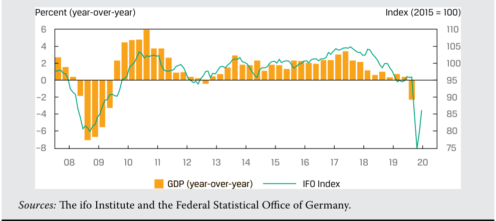

# Tập 2: Kinh tế học (Volume 2: Economics)
## Học phần 2: Tìm hiểu về Chu kỳ Kinh doanh (Learning Module 2: Understanding Business Cycles)
### Phần 2/3: Các Chỉ báo Kinh tế qua Chu kỳ Kinh doanh (Economic Indicators over the Business Cycle) (Trang PDF 68–81)

---

<!-- PDF Page 68 -->

2. Các nhà phân tích thường gắn chu kỳ tín dụng với khu vực nào của nền kinh tế một cách phổ biến nhất?

   - **A.** Xuất khẩu (*Exports*)

   - **B.** Xây dựng và mua sắm bất động sản (*Construction and purchases of property*)

   - **C.** Bán lẻ thực phẩm (*Food retail*)

   - **Lời giải (Solution):**

B là đáp án đúng. Chu kỳ tín dụng gắn liền với mức độ sẵn có của tín dụng, yếu tố đóng vai trò quan trọng trong việc tài trợ cho hoạt động xây dựng và mua sắm bất động sản.

3. Lý do các nhà phân tích theo dõi những diễn biến về mức độ sẵn có của tín dụng là vì:

   - **A.** tín dụng khu vực tư nhân nới lỏng có thể góp phần làm gia tăng quy mô của bong bóng giá tài sản và bất động sản cùng các cuộc khủng hoảng theo sau đó (*loose private sector credit may contribute to the extent of asset price and real estate bubbles and subsequent crises*).

   - **B.** tín dụng nới lỏng giúp làm giảm quy mô của bong bóng giá tài sản và bất động sản.

   - **C.** chu kỳ tín dụng có cùng độ dài và độ sâu với chu kỳ kinh doanh.

   - **Lời giải (Solution):**

A là đáp án đúng. Các nghiên cứu đã chỉ ra rằng điều kiện tín dụng nới lỏng góp phần làm gia tăng quy mô của bong bóng giá tài sản và bất động sản vốn có xu hướng dẫn đến các cuộc khủng hoảng theo sau đó.

# **<mark>4</mark>**

## **CÁC CHỈ BÁO KINH TẾ QUA CHU KỲ KINH DOANH (ECONOMIC INDICATORS OVER THE BUSINESS CYCLE)**

- mô tả cách thức việc sử dụng nguồn lực, hoạt động của người tiêu dùng và doanh nghiệp, hoạt động của khu vực nhà ở (*housing sector activity*), và hoạt động của khu vực ngoại thương (*external trade sector activity*) biến động qua chu kỳ kinh doanh và mô tả việc đo lường chúng bằng cách sử dụng các chỉ báo kinh tế (*economic indicators*)

Bài học này cung cấp một cái nhìn tổng quan rộng lớn về cách thức việc sử dụng các nguồn lực cần thiết để sản xuất hàng hóa và dịch vụ thường vận động trong suốt một chu kỳ kinh doanh. Chúng ta bắt đầu bằng cách tập trung vào hoàn cảnh của các doanh nghiệp và khám phá một số mối liên kết giữa những biến động về hàng tồn kho (*inventory*), việc làm (*employment*), và đầu tư vào vốn vật chất (*investment in physical capital*) với những biến động kinh tế.

### **Lực lượng Lao động và Chi phí Công ty (The Workforce and Company Costs)**

Khuôn mẫu tuyển dụng và việc làm được thể hiện trong Minh họa 7. Khi nền kinh tế bước vào pha thu hẹp (*contraction*), các công ty cắt giảm chi phí và xóa bỏ việc làm thêm giờ (*overtime*). Họ có thể cố gắng giữ chân người lao động thay vì cắt giảm nhân sự để rồi sau đó lại phải tuyển dụng tăng thêm. Việc tìm kiếm và đào tạo công nhân mới rất tốn kém, và có thể sẽ hiệu quả về mặt chi phí hơn nếu giữ người lao động lại trong bảng lương ngay cả khi họ không được sử dụng hết công suất. Các công ty cũng có thể hưởng lợi từ sự gắn kết lòng trung thành ngầm định giữa công ty và người lao động, giúp thúc đẩy năng suất trong quá trình đó. Trong các đợt thu hẹp kéo dài, các công ty sẽ bắt đầu cắt giảm chi phí một cách quyết liệt hơn — chấm dứt hợp đồng với các nhà tư vấn, dừng các chiến dịch quảng cáo, và cắt giảm số lượng công nhân vượt quá mức tối thiểu nghiêm ngặt. Tỷ lệ sử dụng công suất (*capacity utilization*) sẽ ở mức thấp, và rất ít công ty đầu tư vào trang thiết bị mới. Các công ty sẽ cố gắng thanh lý lượng hàng tồn kho gồm các sản phẩm chưa bán được. Thêm vào đó, các ngân hàng sẽ ngần ngại cho vay bởi vì rủi ro phá sản được nhìn nhận là cao hơn, làm gia tăng thêm sự suy yếu trong nền kinh tế.

<!-- PDF Page 69 -->

Sự sụt giảm trong tổng cầu nhiều khả năng sẽ làm giảm tiền lương hoặc tốc độ tăng trưởng tiền lương cũng như giá của các yếu tố đầu vào và tư liệu sản xuất (*capital goods*). Sau một thời gian, tất cả mức giá của các yếu tố đầu vào này sẽ ở mức tương đối thấp. Ngoài ra, lãi suất có thể được cắt giảm nhằm cố gắng vực dậy nền kinh tế.

Khi giá cả và lãi suất giảm xuống, người tiêu dùng và các công ty có thể bắt đầu mua sắm nhiều hơn và tổng cầu có thể bắt đầu tăng lên. Giai đoạn này chính là điểm đảo chiều (*turning point*) của chu kỳ kinh doanh: Tổng cầu bắt đầu tăng lên và hoạt động kinh tế gia tăng.

**Minh họa 7: Các Pha của Chu kỳ Kinh doanh — Mức độ Việc làm (Exhibit 7: Business Cycle Phases—Levels of Employment)**

|**Khoảng cách giữa GDP thực tế và GDP xu hướng (*Gap between actual GDP and trend GDP*)**|Đáy (*Trough*) $\rightarrow$ Phục hồi (*Recovery*) $\rightarrow$ Mở rộng (*Expansion*)|Đỉnh (*Peak*) $\rightarrow$ Giảm tốc (*Slowdown*) $\rightarrow$ Thu hẹp (*Contraction*)|Thời gian (*Time*) $\rightarrow$ Đáy (*Trough*)|
|---|---|---|---|---|
|**Pha (Phase)**|**Phục hồi (Recovery)**|**Mở rộng (Expansion)**|**Giảm tốc (Slowdown)**|**Thu hẹp (Contraction)**|
|Mô tả mức độ hoạt động (*Description of activity levels*)|Nền kinh tế bắt đầu tại vùng đáy và sản lượng ở dưới mức tiềm năng. Hoạt động khởi sắc, và khoảng cách sản lượng bắt đầu khép lại.|Nền kinh tế tận hưởng đà đi lên, với các thước đo hoạt động cho thấy tốc độ tăng trưởng trên mức trung bình.|Nền kinh tế ở vùng đỉnh. Hoạt động ở trên mức trung bình nhưng đang giảm tốc. Nền kinh tế có thể gặp phải tình trạng thiếu hụt các yếu tố sản xuất khi cầu có thể vượt quá cung.|Nền kinh tế bước vào pha thu hẹp (suy thoái, nếu nghiêm trọng). Các thước đo hoạt động ở dưới mức tiềm năng. Tăng trưởng thấp hơn mức bình thường.|
|Việc làm (*Employment*) *(Mức độ việc làm có độ trễ so với chu kỳ – Levels of employment lag the cycle)*|Tình trạng sa thải chậm lại. Doanh nghiệp dựa vào làm thêm giờ trước khi chuyển sang tuyển dụng mới. Tỷ lệ thất nghiệp vẫn cao hơn mức trung bình.|Doanh nghiệp chuyển từ việc sử dụng làm thêm giờ và nhân viên thời vụ sang tuyển dụng chính thức. Tỷ lệ thất nghiệp ổn định lại và bắt đầu giảm xuống.|Doanh nghiệp tiếp tục tuyển dụng nhưng với tốc độ chậm hơn. Tỷ lệ thất nghiệp tiếp tục giảm nhưng với tốc độ giảm dần chậm lại.|Doanh nghiệp trước tiên cắt giảm số giờ làm, xóa bỏ làm thêm giờ, và đóng băng tuyển dụng, tiếp theo là sa thải trực tiếp. Tỷ lệ thất nghiệp bắt đầu tăng lên.|

### **Biến động trong Chi tiêu Vốn (Fluctuations in Capital Spending)**

Chi tiêu vốn (*capital spending*) — chi tiêu cho các hàng hóa hữu hình, chẳng hạn như bất động sản, nhà xưởng, và trang thiết bị (*property, plant, and equipment* – PP&E) — thường biến động cùng chiều với chu kỳ kinh doanh. Bởi vì lợi nhuận và dòng tiền của doanh nghiệp nhạy cảm với những thay đổi trong hoạt động kinh tế, nên chi tiêu vốn cũng cực kỳ nhạy cảm với những thay đổi trong hoạt động kinh tế. Trên thực tế, đầu tư là một trong những cấu phần thuận chu kỳ (*procyclical*) và biến động mạnh nhất của GDP. Các quyết định chi tiêu của công ty được thúc đẩy bởi điều kiện kinh doanh, kỳ vọng, và mức độ sử dụng công suất (*levels of capacity utilization*) – tất cả những yếu tố này đều biến động qua chu kỳ. Về mặt hiệu quả, các doanh nghiệp sẽ vận hành “sản xuất tinh gọn” (*“lean production”*) để tạo ra sản lượng tối đa với số lượng công nhân ít nhất vào cuối pha thu hẹp. Minh họa 8 cung cấp mô tả về chi tiêu vốn qua chu kỳ kinh tế. Lưu ý rằng số liệu thống kê về đơn đặt hàng mới (*new orders statistics*) bao gồm cả những đơn hàng sẽ được bàn giao trong nhiều năm. Ví dụ,

<!-- PDF Page 70 -->

việc các hãng hàng không đặt mua 40 chiếc máy bay để được bàn giao trong vòng năm năm là điều rất phổ biến. Khi phù hợp, các nhà phân tích sử dụng số liệu đơn đặt hàng “lõi” (*“core” orders*) không bao gồm lĩnh vực quốc phòng và máy bay để hiểu rõ hơn về xu hướng của nền kinh tế.

**Minh họa 8: Chi tiêu Vốn trong Chu kỳ Kinh tế (Exhibit 8: Capital Spending during the Economic Cycle)**

|**Pha của Chu kỳ (Phase of the Cycle)**|**Điều kiện và Kỳ vọng Kinh doanh (Business conditions and expectations)**|**Chi tiêu Vốn (Capital spending)**|**Ví dụ (Examples)**|
|---|---|---|---|
|**Phục hồi (Recovery)**|Công suất dư thừa (*excess capacity*) trong vùng đáy, hiệu suất sử dụng thấp, ít có nhu cầu mở rộng công suất. Lãi suất có xu hướng ở mức thấp — hỗ trợ cho đầu tư.|Ở mức thấp nhưng đang tăng lên khi các công ty bắt đầu tận hưởng các điều kiện tốt hơn. Chi tiêu vốn (*Capex*) tập trung vào nâng cao hiệu quả thay vì mở rộng công suất. Đà tăng rõ nét nhất ở các đơn đặt hàng thiết bị sản xuất hạng nhẹ (*light producer equipment*). Thông thường, các đơn đặt hàng được khôi phục đầu tiên là dành cho những thiết bị có tốc độ lỗi thời (*rate of obsolescence*) cao, chẳng hạn như phần mềm, hệ thống, và phần cứng công nghệ.|Các đơn đặt hàng phần mềm, hệ thống, và phần cứng (tốc độ lỗi thời cao) được đặt mới hoặc khôi phục lại đầu tiên.|
|**Mở rộng (Expansion)**|Các công ty tận hưởng những điều kiện thuận lợi. Tỷ lệ sử dụng công suất tăng lên từ các mức thấp. Theo thời gian, năng lực sản xuất có thể bắt đầu hạn chế khả năng đáp ứng nhu cầu. Sự tăng trưởng về lợi nhuận và dòng tiền mang lại cho doanh nghiệp khả năng tài chính để gia tăng chi tiêu đầu tư.|Đơn đặt hàng của khách hàng và tỷ lệ sử dụng công suất tăng lên. Các công ty bắt đầu tập trung vào việc mở rộng công suất. Cơ cấu năng lực sản xuất của nền kinh tế có thể không tối ưu cho cấu trúc cầu hiện tại, đòi hỏi phải chi tiêu cho các loại trang thiết bị mới. Các đơn đặt hàng diễn ra trước các đợt giao hàng thực tế, vì vậy đơn đặt hàng trang thiết bị vốn là một chỉ báo được theo dõi rộng rãi về chiều hướng tương lai của chi tiêu vốn.|Trang thiết bị hạng nặng và phức tạp, kho bãi, và nhà máy. Một công ty có thể cần không gian kho bãi ở những địa điểm khác với nơi đặt các cơ sở hiện có.|
|**Giảm tốc (Slowdown)**|Điều kiện kinh doanh ở vùng đỉnh, với dòng tiền lành mạnh. Lãi suất có xu hướng cao hơn — nhằm mục đích giảm tình trạng tăng trưởng quá nóng và khuyến khích sự giảm tốc đầu tư.|Các đơn đặt hàng mới nhằm mục đích tăng công suất có thể là một chỉ báo sớm về giai đoạn cuối của pha mở rộng. Các công ty tiếp tục đặt các đơn hàng mới khi họ hoạt động ở mức tối đa hoặc gần tối đa công suất.|Tình trạng đầu tư quá mức vào cáp quang vào cuối những năm 1990 vốn đạt đỉnh cùng với “bong bóng công nghệ, truyền thông, viễn thông” (*TMT bubble*).|
|**Thu hẹp (Contraction)**|Các công ty trải qua sự sụt giảm về nhu cầu, lợi nhuận, và dòng tiền.|Các đơn đặt hàng mới bị tạm dừng, và một số đơn hàng hiện có bị hủy bỏ (không có nhu cầu mở rộng). Những đợt cắt giảm ban đầu có thể rất mạnh và làm trầm trọng thêm đà đi xuống của nền kinh tế. Khi đợt suy thoái chu kỳ chung chín muồi, việc cắt giảm chi tiêu cho các thiết bị hạng nặng càng làm tăng thêm mức độ thu hẹp. Hoạt động bảo trì bị thu hẹp quy mô.|Công nghệ và thiết bị hạng nhẹ có thời gian chờ (*lead times*) ngắn bị cắt giảm trước tiên. Việc cắt giảm trong xây dựng và thiết bị hạng nặng diễn ra theo sau.|

<!-- PDF Page 71 -->

#### **VÍ DỤ 1 (EXAMPLE 1)**

### **Chi tiêu Vốn (Capital Spending)**

1. Mức độ sử dụng công suất (*levels of capacity utilization*) là một trong những yếu tố quyết định tổng nhu cầu chi tiêu vốn bổ sung của các công ty. Yếu tố nào sau đây là một yếu tố khác có ảnh hưởng đến quyết định chi tiêu vốn?

   - **A.** Tỷ lệ thất nghiệp

   - **B.** Cơ cấu năng lực sản xuất của nền kinh tế trong mối tương quan với cách thức nó có thể thỏa mãn nhu cầu (*The composition of the economy’s capacity in relation to how it can satisfy demand*)

   - **C.** Khả năng khôi phục lại các đơn đặt hàng đã bị hủy bỏ trong giai đoạn thu hẹp

   - **Lời giải (Solution):**

B là đáp án đúng. Cơ cấu năng lực sản xuất hiện tại có thể không tối ưu đối với cấu trúc cầu hiện tại. C sai bởi vì khả năng khôi phục lại các đơn hàng đã hủy là vấn đề chỉ có liên quan sau khi quyết định tăng chi tiêu vốn đã được đưa ra.

2. Các đơn đặt hàng công nghệ và thiết bị hạng nhẹ sụt giảm trước các dự án xây dựng trong pha thu hẹp bởi vì:

   - **A.** các doanh nghiệp không chắc chắn về chiều hướng của chu kỳ.

   - **B.** các đơn đặt hàng thiết bị dễ hủy bỏ hơn so với các dự án xây dựng quy mô lớn (*equipment orders are easier to cancel than large construction projects*).

   - **C.** các doanh nghiệp coi trọng thiết bị hạng nhẹ ít hơn so với các công trình kiến trúc và máy móc hạng nặng.

#### **Lời giải (Solution):**

B là đáp án đúng. Bởi vì thông thường việc lập kế hoạch và hoàn thành các dự án xây dựng lớn mất nhiều thời gian hơn rất nhiều so với việc lập kế hoạch và hoàn thành các đơn đặt hàng thiết bị, nên các dự án xây dựng có thể ít bị ảnh hưởng tức thời bởi chu kỳ kinh doanh hơn.

### **Biến động trong Mức Hàng tồn kho (Fluctuations in Inventory Levels)**

Tổng quy mô của hàng tồn kho (*inventories*) là khá nhỏ so với quy mô của toàn nền kinh tế, nhưng việc tích lũy và cắt giảm hàng tồn kho của các doanh nghiệp có thể diễn ra với tốc độ và tần suất đáng kể. Hàng tồn kho thay đổi phản ánh sự chênh lệch giữa tốc độ tăng trưởng (hoặc sụt giảm) của doanh số bán hàng và tốc độ tăng trưởng (hoặc sụt giảm) của hoạt động sản xuất. Một chỉ báo then chốt trong lĩnh vực này là tỷ lệ hàng tồn kho trên doanh số (*inventory–sales ratio*), đo lường lượng hàng tồn kho có sẵn để bán so với mức doanh số bán ra. Các nhà phân tích chú ý đến hàng tồn kho để đánh giá vị trí của nền kinh tế trong chu kỳ. Minh họa 9 cho thấy cách thức hoạt động sản xuất, doanh số bán hàng, và hàng tồn kho thường vận động qua các pha của một chu kỳ.

<!-- PDF Page 72 -->

#### **Minh họa 9: Hàng tồn kho Xuyên suốt Chu kỳ (Exhibit 9: Inventories throughout the Cycle)**

|**Pha của Chu kỳ (Phase of the Cycle)**|**Phục hồi (Recovery)**|**Mở rộng (Expansion)**|**Giảm tốc (Slowdown)**|**Thu hẹp (Contraction)**|
|---|---|---|---|---|
|Doanh số và sản xuất (*Sales and production*)|Đà giảm doanh số chậm lại. Doanh số sau đó phục hồi. Đà tăng sản xuất diễn ra theo sau nhưng có độ trễ so với tăng trưởng doanh số. Theo thời gian, sản xuất tiến dần về mức bình thường khi lượng hàng tồn kho dư thừa từ đợt suy thoái được giải phóng hết.|Doanh số tăng lên. Sản xuất tăng nhanh để bắt kịp đà tăng trưởng doanh số và để bổ sung lại kho hàng thành phẩm. Điều này làm tăng nhu cầu đối với các sản phẩm trung gian. “Giai đoạn tái tạo hoặc nạp lại hàng tồn kho” (*“Inventory rebuilding or restocking stage”*).|Doanh số chậm lại nhanh hơn so với sản xuất; hàng tồn kho tăng lên. Sự giảm tốc kinh tế dẫn đến việc cắt giảm sản xuất và hủy bỏ đơn đặt hàng.|Các doanh nghiệp sản xuất ở tốc độ thấp hơn khối lượng bán hàng cần thiết để thanh lý lượng hàng tồn kho không mong muốn.|
|Tỷ lệ hàng tồn kho trên doanh số (*Inventory–sales ratio*)|Bắt đầu giảm xuống khi sự phục hồi doanh số vượt nhanh hơn tốc độ sản xuất.|Tỷ lệ giữ ổn định (*Ratio stable*).|Tỷ lệ tăng lên. Báo hiệu nền kinh tế đang suy yếu.|Tỷ lệ bắt đầu giảm trở lại về mức bình thường.|

#### **VÍ DỤ 2 (EXAMPLE 2)**

### **Biến động Hàng tồn kho (Inventory Fluctuation)**

1. Mặc dù chỉ chiếm một phần nhỏ trong tổng thể nền kinh tế, những thay đổi trong hàng tồn kho có thể ảnh hưởng đáng kể đến các thước đo tăng trưởng kinh tế bởi vì chúng: **A.** phản ánh tâm lý kinh doanh chung. **B.** có xu hướng biến động tăng hoặc giảm rất mạnh mẽ (*tend to move forcefully up or down*). **C.** quyết định mức độ sẵn có của hàng hóa để bán.

**Lời giải (Solution):**

B là đáp án đúng. Mức hàng tồn kho có thể biến động vô cùng mạnh mẽ qua chu kỳ kinh doanh.

2. Hàng tồn kho có xu hướng tăng lên khi:

   - **A.** tỷ lệ hàng tồn kho trên doanh số ở mức thấp (*inventory–sales ratios are low*). **B.** tỷ lệ hàng tồn kho trên doanh số ở mức cao. **C.** hoạt động kinh tế bắt đầu bật tăng trở lại.

   - **Lời giải (Solution):**

A là đáp án đúng. Khi nền kinh tế bắt đầu phục hồi, doanh số bán hàng từ kho có thể vượt nhanh hơn tốc độ sản xuất, dẫn đến tỷ lệ hàng tồn kho trên doanh số ở mức thấp. Khi đó, các công ty cần tích lũy thêm nhiều hàng tồn kho hơn để khôi phục tỷ lệ này về mức bình thường. C sai bởi vì trong những giai đoạn đầu của pha phục hồi, hàng tồn kho nhiều khả năng sẽ giảm xuống khi doanh số tăng nhanh hơn sản xuất.

3. Hàng tồn kho thường sẽ giảm xuống vào đầu pha phục hồi bởi vì: **A.** các doanh nghiệp cần lợi nhuận. **B.** doanh số bán hàng vượt quá sản lượng sản xuất (*sales outstrip production*). **C.** các doanh nghiệp đẩy mạnh sản xuất do hoạt động kinh tế gia tăng.

**Lời giải (Solution):** B là đáp án đúng. Các công ty thường chậm tăng sản lượng sản xuất trong giai đoạn đầu của pha phục hồi bởi vì trước tiên họ muốn xác nhận chắc chắn rằng cuộc suy thoái đã kết thúc. Việc tăng sản lượng đầu ra cũng cần có thời gian sau đợt thu hẹp quy mô nhân sự và công suất trong suốt cuộc suy thoái.

<!-- PDF Page 73 -->

4. Trong một cuộc suy thoái, các công ty _có khả năng nhất_ điều chỉnh khối lượng vốn vật chất (*stock of physical capital*) của mình bằng cách:

   - **A.** bán tháo với mức giá rẻ mạt (*fire sale prices*).

   - **B.** không bảo trì trang thiết bị (*not maintaining equipment*).

   - **C.** nhanh chóng hủy bỏ các đơn đặt hàng thiết bị xây dựng mới.

   - **Lời giải (Solution):** B là đáp án đúng. Việc điều chỉnh giảm vốn vật chất trong các đợt suy thoái diễn ra thông qua sự hao mòn tự nhiên theo tuổi thọ của trang thiết bị cộng với việc thiếu bảo trì.

5. Tỷ lệ hàng tồn kho trên doanh số _có khả năng nhất_ đang tăng lên:

   - **A.** khi pha thu hẹp đang diễn ra.

   - **B.** khi đi được một phần vào pha phục hồi.

   - **C.** ở gần vùng đỉnh của một chu kỳ kinh tế (*near the top of an economic cycle*).

   - **Lời giải (Solution):** C là đáp án đúng. Ở gần đỉnh của một chu kỳ, doanh số bán hàng bắt đầu chậm lại trước khi hoạt động sản xuất bị cắt giảm, dẫn đến sự gia tăng của hàng tồn kho so với doanh số.

### **Các Chỉ báo Kinh tế (Economic Indicators)**

**Các chỉ báo kinh tế (*Economic indicators*)** là những biến số cung cấp thông tin về trạng thái của tổng thể nền kinh tế. Chúng là các số liệu thống kê hoặc dữ liệu đọc được phản ánh hoàn cảnh kinh tế của một quốc gia, một nhóm quốc gia, một khu vực, hoặc một ngành. Các chỉ báo kinh tế được các nhà hoạch định chính sách và các nhà phân tích sử dụng để hiểu và đánh giá điều kiện hiện tại của nền kinh tế cũng như vị trí của nó trong chu kỳ. Chúng cũng có thể được sử dụng để giúp dự báo hoặc xác nhận các điểm đảo chiều trong chu kỳ. Kiến thức như vậy cho phép các nhà phân tích dự báo tốt hơn kết quả hoạt động tài chính và thị trường của các cổ phiếu và trái phiếu từ những tổ chức phát hành hoạt động trong các khu vực ngành nghề khác nhau của nền kinh tế với mức độ nhạy cảm khác nhau đối với chu kỳ kinh tế.

### **Các Loại Chỉ báo (Types of Indicators)**

Các chỉ báo kinh tế thường được phân loại dựa theo việc chúng đi trễ (*lag*), dẫn dắt (*lead*), hay trùng khớp (*coincide*) với những thay đổi trong tăng trưởng của nền kinh tế.

- **Các chỉ báo kinh tế dẫn dắt (*Leading economic indicators*)** có các điểm đảo chiều thường diễn ra trước các điểm đảo chiều của tổng thể nền kinh tế. Chúng được tin là có giá trị trong việc dự báo trạng thái tương lai của nền kinh tế, thường là trong ngắn hạn.

- **Các chỉ báo kinh tế trùng khớp (*Coincident economic indicators*)** có các điểm đảo chiều thường diễn ra sát với các điểm đảo chiều của tổng thể nền kinh tế. Chúng được tin là có giá trị trong việc nhận diện trạng thái hiện tại của nền kinh tế.

- **Các chỉ báo kinh tế trễ (*Lagging economic indicators*)** có các điểm đảo chiều diễn ra muộn hơn so với các điểm đảo chiều của tổng thể nền kinh tế. Chúng được tin là có giá trị trong việc nhận diện điều kiện quá khứ của nền kinh tế và chỉ thay đổi sau khi một xu hướng đã được xác lập.

Minh họa 10 cung cấp hình ảnh minh họa về một số chỉ báo dẫn dắt, chỉ báo trễ, và chỉ báo trùng khớp. Các chỉ báo dẫn dắt được quan sát tại một thời điểm gắn nhãn là thời điểm “1” chỉ ra chiều hướng của hoạt động (sản lượng) tại một thời điểm trong tương lai, chẳng hạn như thời điểm “2”. Các chỉ báo trễ, được công bố vào khoảng thời điểm “3”, đề cập đến và giúp xác nhận trạng thái của nền kinh tế tại thời điểm “2” là như thế nào.

<!-- PDF Page 74 -->

#### **Minh họa 10: Các Loại Chỉ báo Kinh tế (Exhibit 10: Types of Economic Indicators)**

<!-- Picture Text: Industrial production refects the current state better than services Level of Leading indicators*: Coincident indicators: economic • Stock market • Industrial production index activity • House prices • Real personal incomes • Retail sales • Manufacturing and trade sales • Interest spread (between LT and ST rates) Businesses wait to see that • Building permits upturn or downturn is • Consumer expectations confirmed before changing • Average weekly hours employment (manufacturing) • Manufacturers’ new Accumulate at the orders Lagging indicators: peak and deplete • Avg. duration of unemployment when sales pick up • Inventory to sales ratio • Change in unit labor costs Adjusts slower as index • Inflation i ncludes more stable • Average prime lending rate services component • Ratio of consumer instalment debt to income • Commercial and industrial Consumers only borrow heavily when loans outstanding loans confident – lags during upturn but debt stays 1 2 3 into downturns Time Frequently support inventory building, lagging the cycle  -->

> **Chú thích hình ảnh:** Trục tung là Mức độ hoạt động kinh tế (*Level of economic activity*), trục hoành là Thời gian (*Time*) với các mốc 1, 2, 3:
> - **Mốc 1 – Các chỉ báo dẫn dắt (*Leading indicators\**):** Thị trường chứng khoán (*Stock market*), Giá nhà ở (*House prices*), Doanh số bán lẻ (*Retail sales*), Chênh lệch lãi suất giữa lãi suất dài hạn và ngắn hạn (*Interest spread between LT and ST rates*), Giấy phép xây dựng (*Building permits*), Kỳ vọng của người tiêu dùng (*Consumer expectations*), Số giờ làm việc trung bình hàng tuần trong ngành sản xuất chế tạo (*Average weekly hours, manufacturing*), Đơn đặt hàng mới của các nhà sản xuất (*Manufacturers’ new orders*).
> - **Mốc 2 – Các chỉ báo trùng khớp (*Coincident indicators*):** Chỉ số sản xuất công nghiệp (*Industrial production index* – phản ánh trạng thái hiện tại tốt hơn dịch vụ), Thu nhập cá nhân thực (*Real personal incomes*), Doanh số sản xuất chế tạo và thương mại (*Manufacturing and trade sales*).
> - **Mốc 3 – Các chỉ báo trễ (*Lagging indicators*):** Thời gian thất nghiệp trung bình (*Avg. duration of unemployment* – doanh nghiệp chờ thấy đà đi lên hoặc đi xuống được xác nhận trước khi thay đổi việc làm), Tỷ lệ hàng tồn kho trên doanh số (*Inventory to sales ratio* – tích tụ ở đỉnh và cạn dần khi doanh số khởi sắc), Thay đổi trong chi phí lao động trên mỗi đơn vị sản phẩm (*Change in unit labor costs*), Lạm phát (*Inflation* – điều chỉnh chậm hơn vì chỉ số bao gồm cấu phần dịch vụ vốn ổn định hơn), Lãi suất cho vay cơ bản trung bình (*Average prime lending rate*), Tỷ lệ nợ trả góp tiêu dùng trên thu nhập (*Ratio of consumer instalment debt to income* – người tiêu dùng chỉ vay mạnh khi tự tin, đi trễ trong đà đi lên nhưng nợ vẫn duy trì sang các đợt đi xuống), Dư nợ cho vay thương mại và công nghiệp (*Commercial and industrial loans outstanding* – thường hỗ trợ xây dựng hàng tồn kho, đi trễ so với chu kỳ).

\* Các chỉ báo dẫn dắt sẽ được khám phá chi tiết trong phần tiếp theo.

### **Các Chỉ báo Tổng hợp (Composite Indicators)**

Một chỉ báo kinh tế hoặc chỉ bao gồm một biến số đơn lẻ, giống như sản xuất công nghiệp hay tổng giá trị giấy phép xây dựng đang lưu hành, hoặc có thể là một tổ hợp (*composite*) của nhiều biến số khác nhau có cùng xu hướng di chuyển với nhau. Nhóm thứ hai thường xuyên được gắn nhãn là các chỉ báo tổng hợp (*composite indicators*). Theo truyền thống, hầu hết các chỉ báo tổng hợp dùng để đo lường trạng thái chu kỳ của nền kinh tế bao gồm tối đa khoảng một tá các biến số được tuyển chọn kỹ lưỡng do các tổ chức như OECD hoặc các viện nghiên cứu quốc gia công bố. Các biến số cụ thể được kết hợp vào những chỉ số tổng hợp này có sự khác nhau giữa nền kinh tế này với nền kinh tế khác. Tuy nhiên, trong mỗi trường hợp, chúng đều tập hợp các thước đo kinh tế và tài chính đa dạng vốn đã thể hiện một mối quan hệ dẫn dắt, trùng khớp, hoặc đi trễ một cách nhất quán đối với chu kỳ chung của nền kinh tế đó.

### **Các Chỉ báo Dẫn dắt (Leading Indicators)**

The Conference Board, một tổ chức nghiên cứu ngành của Hoa Kỳ, công bố một chỉ báo dẫn dắt tổng hợp được biết đến với tên gọi Chỉ số Kinh tế Dẫn dắt của The Conference Board (*The Conference Board Leading Economic Index* – LEI), bao gồm 10 cấu phần thành phần (sử dụng chu kỳ kinh doanh cổ điển làm khái niệm nền tảng). Minh họa 11 trình bày 10 cấu phần được sử dụng trong LEI. Ngoài việc nêu tên các chỉ báo, bảng này còn đưa ra mô tả tổng quát về lý do tại sao mỗi thước đo lại dẫn dắt chu kỳ kinh doanh.

<!-- PDF Page 75 -->

**Minh họa 11: Chỉ số các Chỉ báo Kinh tế Dẫn dắt, Hoa Kỳ (Exhibit 11: Index of Leading Economic Indicators, United States)**

|**Các chỉ báo dẫn dắt (Leading indicators)**|**Ghi chú / Khái niệm bổ trợ**|**Lý do sử dụng (Reason for use)**|
|---|---|---|
|Số giờ làm việc trung bình hàng tuần trong ngành sản xuất chế tạo (*Average weekly hours, manufacturing*)||Các doanh nghiệp sẽ cắt giảm giờ làm thêm trước khi sa thải công nhân trong đợt đi xuống và tăng giờ làm thêm trước khi tuyển dụng lại trong đợt đi lên theo chu kỳ. Biến động tăng và giảm trước nền kinh tế chung.|
|Số đơn xin trợ cấp thất nghiệp lần đầu trung bình hàng tuần (*Average weekly initial claims for unemployment insurance*)||Một phép thử rất nhạy bén đối với các đợt sa thải ban đầu và tuyển dụng lại.|
|Đơn đặt hàng mới của các nhà sản xuất đối với hàng tiêu dùng và nguyên vật liệu (*Manufacturers’ new orders for consumer goods and materials*)||Các doanh nghiệp không thể chờ đợi quá lâu để đáp ứng nhu cầu mà không đặt hàng. Các đơn đặt hàng có xu hướng dẫn dắt tại các điểm đảo chiều đi lên và đi xuống & nắm bắt tâm lý kinh doanh.|
|Chỉ số đơn đặt hàng mới của ISM (*ISM new order index*) *(Dựa trên khảo sát – Survey based)*|_Viện Quản lý Cung ứng (The Institute of Supply Management – ISM) khảo sát các thành viên của mình để xây dựng các chỉ số về đơn đặt hàng sản xuất chế tạo, sản lượng, việc làm, định giá, và các thước đo tương đương cho khu vực dịch vụ._ _Một chỉ số khuếch tán (diffusion index) thường đo lường tỷ lệ phần trăm các cấu phần trong một chuỗi đang tăng lên trong cùng một kỳ. Nó chỉ ra mức độ lan tỏa rộng khắp của một chuyển động cụ thể trong xu hướng giữa các cấu phần riêng lẻ._|Phản ánh mức thay đổi hàng tháng trong các đơn đặt hàng mới phục vụ bán hàng cuối cùng. Sự sụt giảm của các đơn đặt hàng mới có thể báo hiệu nhu cầu yếu và có thể dẫn đến suy thoái.|
|Đơn đặt hàng mới của các nhà sản xuất đối với tư liệu sản xuất phi quốc phòng không bao gồm máy bay (*Manufacturers’ new orders for non-defense capital goods excluding aircraft*)||Nắm bắt kỳ vọng của doanh nghiệp và đưa ra tín hiệu đầu tiên về sự dịch chuyển đi lên hoặc đi xuống. Khu vực kinh tế quan trọng.|
|Giấy phép xây dựng cho các căn hộ nhà ở tư nhân mới (*Building permits for new private housing units*)||Báo hiệu hoạt động xây dựng mới vì giấy phép là bắt buộc trước khi việc xây dựng mới có thể bắt đầu.|
|Chỉ số S&P 500 (*S&P 500 Index*)||Cổ phiếu có xu hướng dự báo trước các điểm đảo chiều kinh tế; tín hiệu sớm hữu ích.|
|Chỉ số Tín dụng Dẫn dắt (*Leading Credit Index*)||Một hệ thống tài chính dễ bị tổn thương có thể khuếch đại tác động của các cú sốc tiêu cực, gây ra suy thoái trên diện rộng.|
|Chênh lệch lãi suất giữa lợi suất trái phiếu kho bạc kỳ hạn 10 năm và lãi suất vay qua đêm – lãi suất quỹ liên bang (*Interest rate spread between 10-year treasury yields and overnight borrowing rates – federal funds rate*)|_Tổng hợp thông tin từ sáu chỉ báo tài chính dẫn dắt phản ánh sức mạnh của hệ thống tài chính trong việc chịu đựng căng thẳng (stress)._ _Sự đảo ngược đường cong lợi suất (Inversion of the yield curve) xảy ra khi lãi suất ngắn hạn (ST) vượt quá lãi suất dài hạn (LT) – có nghĩa là lãi suất ngắn hạn dự kiến sẽ giảm xuống và hoạt động kinh tế dự kiến sẽ suy yếu._|Lợi suất trái phiếu dài hạn (10 hoặc 30 năm) thể hiện kỳ vọng của thị trường về chiều hướng của lãi suất ngắn hạn. Vì lãi suất cuối cùng sẽ đi theo chu kỳ kinh tế lên và xuống, mức chênh lệch (*spread*) rộng hơn, thông qua việc dự báo lãi suất ngắn hạn tăng lên, cũng dự báo một đợt đi lên của nền kinh tế và ngược lại.|
|Kỳ vọng trung bình của người tiêu dùng về điều kiện kinh doanh (*Average consumer expectations for business conditions*)|_Dựa trên khảo sát (Survey based)_|Sự lạc quan có xu hướng làm tăng chi tiêu. Cung cấp góc nhìn sớm về chiều hướng phía trước của toàn bộ nền kinh tế.|

### **Sử dụng các Chỉ báo Kinh tế (Using Economic Indicators)**

Minh họa 12 cho thấy một quy trình đơn giản hóa mà một nhà phân tích có thể sử dụng để nhận diện các pha của chu kỳ kinh doanh. Các kết luận sau đó có thể được sử dụng để đưa ra các quyết định đầu tư — ví dụ, để quyết định xem ở những khu vực ngành nghề nào các công ty có nhiều khả năng sẽ chứng kiến sự cải thiện hoặc xấu đi của

<!-- PDF Page 76 -->

dòng tiền, điều có thể ảnh hưởng đến kết quả đầu tư của các chứng khoán vốn và chứng khoán nợ do các công ty đó phát hành. Lưu ý rằng thứ tự của các bước không nhất thiết phải tuân theo đúng trình tự cụ thể này.

#### **Minh họa 12: Sử dụng Số liệu Thống kê để Nhận diện Pha của Chu kỳ Kinh doanh (Exhibit 12: Use of Statistics to Identify Business Cycle Phase)**

#### Bước 1 (Step 1)

- Công bố dữ liệu (*Data release*): Nhà phân tích ghi nhận sự gia tăng trong mức công bố của tỷ lệ nợ trả góp tiêu dùng trên thu nhập (*consumer instalment debt to income*).

- Phân tích (*Analysis*): Chỉ báo trên thông thường đi trễ so với các đợt đi lên theo chu kỳ (*lags cyclical upturns*).

- Kết luận khả dĩ (*Possible conclusion*): Bằng chứng ban đầu cho thấy một đợt đi lên đã và đang diễn ra.

#### Bước 2 (Step 2)

- Công bố dữ liệu (*Data release*): Chỉ số Sản xuất Công nghiệp (*Industrial Production Index*) và bảng lương phi nông nghiệp (*non-farm payrolls* – số nhân viên trong bảng lương phi nông nghiệp) đang dịch chuyển tăng lên.

- Phân tích (*Analysis*): Các chỉ báo trùng khớp (*coincident indicators*) này cho thấy hoạt động kinh tế đang khởi sắc.

- Kết luận khả dĩ (*Possible conclusion*): Bằng chứng bổ sung cho thấy pha mở rộng đang diễn ra.

#### Bước 3 (Step 3)

- Quan sát (*Observation*): Chỉ số thị trường cổ phiếu đang có xu hướng tăng lên. Chỉ số cổ phiếu là một chỉ báo dẫn dắt (*leading indicator*). Nhà phân tích kiểm tra Chỉ số LEI tổng hợp (*aggregate LEI Index*).

- Phân tích (*Analysis*): Nếu chỉ số LEI tổng hợp cũng đang dịch chuyển tăng lên, bằng chứng cho thấy quá trình phục hồi đang diễn ra. Xác nhận rằng sản lượng đang đi lên.

#### **Hoặc (Or)**

- Nếu chỉ số LEI tổng hợp không dịch chuyển tăng lên, nhà phân tích chưa thể rút ra kết luận chắc chắn về sự phục hồi.

### **Các Chỉ báo Dẫn dắt Tổng hợp Khác (Other Composite Leading Indicators)**

Đối với khoảng 30 quốc gia và một số khối tổng hợp như EU và G–7, OECD tính toán Chỉ báo Dẫn dắt Tổng hợp của OECD (*OECD Composite Leading Indicator* – CLI), đo lường trạng thái của chu kỳ kinh doanh trong nền kinh tế bằng cách sử dụng khái niệm chu kỳ tăng trưởng (*growth cycle concept*). Một trong những đặc điểm thú vị của OECD CLI là phương pháp luận nền tảng của nó nhất quán qua nhiều quốc gia. Do đó, nó có thể được so sánh dễ dàng hơn để xem mỗi khu vực đang hoạt động ra sao. Minh họa 13 cho thấy tám cấu phần của CLI được OECD sử dụng. Như thường thấy đối với các chỉ báo dẫn dắt, một số dữ liệu được dựa trên các cuộc khảo sát trong khi những dữ liệu khác được dựa trên dữ liệu thị trường hoặc kinh tế được báo cáo.

<!-- PDF Page 77 -->

#### **Minh họa 13: Các Cấu phần CLI Khu vực Đồng Euro của OECD (Exhibit 13: OECD Euro Area CLI Components)**

|**Loại dữ liệu (OECD CLI)**|**Cấu phần thành phần**|**Chỉ báo đầu ra**|
|---|---|---|
|_Chỉ báo tổng hợp của kết quả khảo sát xu hướng kinh tế (Composite indicator of economic tendency survey results)_|Chỉ số tâm lý kinh tế (*Economic sentiment index*) Giấy phép xây dựng nhà ở dân cư (*Residential building permits*) Đơn đặt hàng tư liệu sản xuất (*Capital goods orders*) Cung tiền M2 (*M2 money supply*) Chỉ số Cổ phiếu Euro Stoxx (*Euro Stoxx Equity Index*) Chênh lệch lãi suất (*An interest rate spread*)|Chỉ báo dẫn dắt tổng hợp (*Composite leading indicator*)|
|_Dựa trên khảo sát (Survey – based)_|Chỉ số Nhà Quản trị Mua hàng ngành Sản xuất Chế tạo Khu vực đồng Euro (*Euro area Manufacturing Purchasing Managers Index – PMI*)|Chỉ báo dẫn dắt tổng hợp (*Composite leading indicator*)|
|_Dựa trên khảo sát (Survey – based)_|Chỉ số Kỳ vọng Hoạt động Kinh doanh Tương lai Khu vực Dịch vụ Khu vực đồng Euro (*Euro area Service Sector Future Business Activity Expectations Index*)|Chỉ báo dẫn dắt tổng hợp (*Composite leading indicator*)|

Những điểm tương đồng có thể được rút ra giữa nhiều cấu phần trong số này với những cấu phần được sử dụng tại Hoa Kỳ là rất rõ ràng, nhưng Khu vực đồng Euro bao gồm thêm một cấu phần dịch vụ trong các thước đo hoạt động kinh doanh của mình mà Hoa Kỳ không có. Ngoài ra, Khu vực đồng Euro bỏ qua nhiều thước đo về làm thêm giờ và việc làm mà Hoa Kỳ đưa vào. Chỉ số OECD CLI của Nhật Bản lại tương tự như vậy, nhưng có bao gồm các chỉ báo thị trường lao động (không giống như Khu vực đồng Euro) và bổ sung thêm một thước đo về số vụ phá sản doanh nghiệp (*business failures*) vốn không có trong hai khu vực kia.

#### **ĐỨC: KHẢO SÁT IFO (GERMANY: THE IFO SURVEY)**

Khảo sát ifo của Đức là một chỉ số được sử dụng rộng rãi nhằm nắm bắt môi trường kinh doanh (*business climate*) tại Đức và được công bố hàng tháng. Minh họa 14 cho thấy cách chỉ số này dịch chuyển đi trước những thay đổi so với cùng kỳ năm trước được báo cáo hàng quý của GDP nước Đức. Nó cũng cho thấy một nhịp nhích tăng vào năm 2018 bất chấp sự đi xuống của tăng trưởng GDP. Các chỉ báo này rất hữu ích, nhưng chúng không phải là hoàn hảo tuyệt đối (*not foolproof*).

#### **Minh họa 14: Khảo sát Môi trường Kinh doanh và GDP (Exhibit 14: Business Climate Survey and GDP)**

<!-- Picture Text: Percent (year-over-year) Index (2015 = 100) 6 110 4 105 2 100 0 95 –2 90 –4 85 –6 80 –8 75 08 09 10 11 12 13 14 15 16 17 18 19 20 GDP (year-over-year) IFO Index Sources:  The ifo Institute and the Federal Statistical Office of Germany.  -->

> **Chú thích hình ảnh:** Trục tung bên trái là Phần trăm thay đổi GDP so với cùng kỳ năm trước (*GDP year-over-year*), trục tung bên phải là Chỉ số IFO (*IFO Index*, $2015 = 100$) giai đoạn 2008–2020. Nguồn: Viện ifo và Cơ quan Thống kê Liên bang Đức.

<!-- PDF Page 78 -->

### **Các Cuộc Khảo sát (Surveys)**

Các chỉ báo tổng hợp cho những chu kỳ kinh doanh đặc thù theo khu vực hoặc quốc gia thường sử dụng các cuộc khảo sát xu hướng kinh tế (*economic tendency surveys*). Những cuộc khảo sát hàng tháng hoặc hàng quý này do các ngân hàng trung ương, viện nghiên cứu, cơ quan thống kê, và hiệp hội thương mại thực hiện được tiến hành trong phạm vi các doanh nghiệp, người tiêu dùng, hoặc các chuyên gia. Các câu hỏi chủ yếu mang tính định tính (*qualitative questions*) được đặt ra thường xoay quanh tình hình tài chính, mức độ hoạt động, và niềm tin vào tương lai của họ.

CIRET (một diễn đàn dành cho các nhà kinh tế học và các định chế hàng đầu chuyên thực hiện và phân tích dữ liệu khảo sát doanh nghiệp và người tiêu dùng), Liên Hợp Quốc, OECD, và Ủy ban Châu Âu hoạt động ở các cấp độ khu vực khác nhau nhằm hài hòa hóa và trao đổi tri thức liên quan đến các cuộc khảo sát xu hướng doanh nghiệp và người tiêu dùng này. Tổng vụ Kinh tế và Tài chính (*Directorate-General for Economic and Financial Affairs* – DG ECFIN) công bố các kết quả đã được hài hòa hóa hoàn toàn cho các khu vực ngành nghề khác nhau của các nền kinh tế thành viên và ứng viên gia nhập EU. Ngân hàng Trung ương Nhật Bản (*Bank of Japan*) tiến hành các cuộc khảo sát tương tự và công bố kết quả trong báo cáo được gọi là “Báo cáo Tankan” (*“Tankan Report”*). Những nguồn dữ liệu đa dạng này nhân rộng ra bên trong và xuyên suốt các nền kinh tế. Trong thập kỷ qua, các chỉ số được gọi là chỉ số nhà quản trị mua hàng (*purchasing managers indexes* – PMI) theo định hướng tương tự, mặc dù thường có quy mô mẫu khảo sát nhỏ hơn nhiều, đã được giới thiệu tại hàng loạt quốc gia và khu vực, bao gồm cả châu Âu và Trung Quốc.

Các cuộc khảo sát xu hướng kinh tế này thường được tổng hợp vào hoặc trở thành một phần của các chỉ báo tổng hợp. IHS Markit công bố chỉ báo Chỉ số Nhà Quản trị Mua hàng (PMI) toàn cầu bằng cách sử dụng kết quả từ các cuộc khảo sát doanh nghiệp cấp quốc gia của mình (xem Minh họa 13). Một chỉ báo niềm tin người tiêu dùng toàn cầu được công bố bởi The Conference Board. Một số tổ chức khác thu thập dữ liệu khảo sát quốc gia và tính toán các kết quả siêu quốc gia (*supranational results*). Ví dụ, OECD công bố một chỉ báo niềm tin doanh nghiệp và một chỉ báo niềm tin người tiêu dùng cho khối tổng hợp OECD trong báo cáo “Các Chỉ báo Kinh tế Chính” (*“Main Economic Indicators”*). Ngoài ra, Ủy ban Châu Âu tính toán nhiều chỉ báo dựa trên khảo sát khác nhau cho EU, phản ánh tình hình tại châu Âu. Dựa trên các cuộc khảo sát xu hướng kinh tế và sử dụng khái niệm chu kỳ tốc độ tăng trưởng (*growth rate cycle concept*), Viện Kinh tế Thụy Sĩ (*Konjunkturforschungsstelle* hay KOF) và viện _Fundação Getúlio Vargas_ (FGV) có trụ sở tại Rio de Janeiro, Brazil, công bố một chỉ báo trùng khớp và một chỉ báo dẫn dắt cho nền kinh tế thế giới được gọi là Phong vũ biểu Kinh tế Toàn cầu (*Global Economic Barometers*). Các phong vũ biểu này kết hợp hàng trăm biến số khảo sát từ khắp nơi trên thế giới.

### **Việc Sử dụng Dữ liệu Lớn trong các Chỉ báo Kinh tế (The Use of Big Data in Economic Indicators)**

Sự gia tăng khổng lồ của lượng thông tin này cùng những bước tiến học thuật liên quan đến việc sử dụng dữ liệu lớn (hơn) (*big(ger) data*) trong những năm gần đây đã làm tăng số lượng các biến số được đưa vào những chỉ báo tổng hợp này. Chẳng hạn, bằng cách sử dụng một kỹ thuật thống kê được gọi là phân tích thành phần chính (*principal components analysis*), Ngân hàng Dự trữ Liên bang Chicago tính toán Chỉ số Hoạt động Quốc gia của Fed Chicago (*Chicago Fed National Activity Index* – CFNAI) bằng cách sử dụng 85 chuỗi dữ liệu kinh tế vĩ mô hàng tháng. Các chuỗi dữ liệu này bao quát sản xuất công nghiệp, thu nhập cá nhân, hiệu suất sử dụng vốn, việc làm theo ngành, số lượng nhà ở khởi công mới (*housing starts*), doanh số bán lẻ, v.v. Phân tích thành phần chính trích xuất xu hướng ngầm định chung cho hầu hết các biến số này, qua đó chắt lọc bản chất cốt lõi của chu kỳ kinh doanh Hoa Kỳ. Tương tự, Ngân hàng Trung ương Ý phối hợp với Trung tâm Nghiên cứu Chính sách Kinh tế (*Centre for Economic Policy Research* – CEPR) tạo ra số liệu thống kê EuroCOIN, vốn cũng được dựa trên phân tích thành phần chính. Hơn 100 chuỗi dữ liệu kinh tế vĩ mô được đưa vào EuroCOIN. EuroCOIN cũng bao gồm dữ liệu có nguồn gốc từ các cuộc khảo sát, lãi suất, và các biến số tài chính khác.

### **Dự báo Hiện tại (Nowcasting)**

Các nhà hoạch định chính sách và những người làm thực tiễn trên thị trường sử dụng việc theo dõi theo thời gian thực (*real-time monitoring*) các biến số kinh tế và tài chính để liên tục đánh giá các điều kiện hiện tại. Để khắc phục độ trễ công bố dữ liệu (ví dụ: các con số GDP được công bố với một độ trễ đáng kể) và dự báo

<!-- PDF Page 79 -->

“hiện tại” (*forecast the “present”*), họ tận dụng một loạt các dữ liệu đa dạng — chẳng hạn như các giao dịch trên thị trường tài chính, dữ liệu từ việc sử dụng khối lượng lớn các lượt tìm kiếm kịp thời trên internet, và dữ liệu thanh toán điện tử — nhằm đưa ra các ước tính cho những chỉ báo kinh tế tần suất thấp (hàng tháng hoặc hàng quý) then chốt. Quy trình này tạo ra một bản dự báo hiện tại (*nowcast*), tức là một ước tính về trạng thái hiện tại, và chúng ta gọi quy trình tạo ra ước tính như vậy là kỹ thuật dự báo hiện tại (*nowcasting*). Nó có thể được áp dụng cho nhiều biến số kinh tế vĩ mô đang được quan tâm, chẳng hạn như tăng trưởng GDP, lạm phát, hoặc thất nghiệp.

### **GDPNow**

Các bản dự báo hiện tại (*nowcasts*) được tạo ra bởi một số đơn vị trong lĩnh vực ngân hàng đầu tư và quản lý tài sản để phục vụ mục đích sử dụng nội bộ hoặc cho khách hàng của họ, nhưng chúng cũng được công bố bởi các định chế công, chẳng hạn như Fed Atlanta (Ngân hàng Dự trữ Liên bang Atlanta, một trong 12 Ngân hàng Dự trữ Liên bang tại Hoa Kỳ). Theo Fed Atlanta, “GDPNow” được “xem xét tốt nhất như một ước tính cập nhật liên tục (*running estimate*) về tăng trưởng GDP thực dựa trên dữ liệu hiện có cho quý đang được đo lường hiện tại.” Mục tiêu là dự báo GDP cho quý hiện tại (vốn sẽ không được công bố cho đến sau khi kết thúc quý) theo thời gian thực dựa trên các dữ liệu khi chúng được công bố xuyên suốt trong quý. Để làm điều này, Fed Atlanta cố gắng sử dụng cùng phương pháp luận và dữ liệu giống như sẽ được Cục Phân tích Kinh tế Hoa Kỳ (*US Bureau of Economic Analysis* – BEA) sử dụng để ước tính GDP, thay thế những dữ liệu chưa được công bố bằng các dự báo dựa trên những dữ liệu đã được quan sát. Khi quý đó tiến triển dần, ngày càng có nhiều dữ liệu thực tế được quan sát hơn. GDPNow, ít nhất là xét trên mức trung bình, sẽ hội tụ về con số sẽ được BEA công bố dưới dạng ước tính “sơ bộ” (*“advance” estimate*) của GDP hàng quý vào khoảng bốn tuần sau khi kết thúc quý.

#### **CHỈ SỐ KHUẾCH TÁN CỦA CÁC CHỈ BÁO KINH TẾ (DIFFUSION INDEX OF ECONOMIC INDICATORS)**

Tại Hoa Kỳ, The Conference Board cũng biên soạn một chỉ số khuếch tán (*diffusion index*) hàng tháng của các chỉ báo dẫn dắt, chỉ báo trễ, và chỉ báo trùng khớp. **Chỉ số khuếch tán (*diffusion index*)** phản ánh tỷ lệ các cấu phần của chỉ số đang di chuyển theo một khuôn mẫu nhất quán với chỉ số tổng thể. Các nhà phân tích thường dựa vào các chỉ số khuếch tán này để cung cấp một thước đo về độ rộng (*breadth*) của sự thay đổi trong một chỉ số tổng hợp.

Ví dụ, The Conference Board theo dõi mức tăng trưởng của từng cấu phần trong số 10 cấu phần thuộc chỉ số LEI của mình, gán giá trị $1,0$ cho mỗi chỉ báo tăng hơn $0,05\%$ trong kỳ đo lường hàng tháng, giá trị $0,5$ cho mỗi chỉ báo cấu phần thay đổi ít hơn $0,05\%$, và giá trị $0$ cho mỗi chỉ báo cấu phần giảm hơn $0,05\%$. Các giá trị được gán này, vốn tất nhiên sẽ khác nhau ở các chỉ số khác tại các quốc gia khác, sau đó được cộng lại và chia cho $10$ (số lượng các cấu phần). Để làm cho thước đo tổng thể giống với các chỉ số quen thuộc hơn, tổ chức này nhân kết quả với $100$.

Một ví dụ số học đơn giản sẽ giúp giải thích rõ hơn. Giả sử, để dễ trình bày, chỉ báo chỉ có bốn cấu phần thành phần: giá cổ phiếu, tăng trưởng cung tiền, đơn đặt hàng, và niềm tin người tiêu dùng. Trong một tháng, giá cổ phiếu tăng $2,0\%$, tăng trưởng cung tiền tăng $1,0\%$, đơn đặt hàng đi ngang (không đổi), và niềm tin người tiêu dùng giảm $0,6\%$. Sử dụng các giá trị được gán của The Conference Board, các cấu phần này sẽ đóng góp tương ứng: $1,0 + 1,0 + 0,5 + 0$ để tạo ra tử số bằng $2,5$. Khi chia cho bốn (số lượng các cấu phần) và nhân với $100$, nó tạo ra một chỉ báo bằng $62,5$ cho tháng đó.

Giả sử rằng trong tháng tiếp theo, giá cổ phiếu giảm $0,8\%$, cung tiền tăng trưởng $0,5\%$, đơn đặt hàng nhích tăng $0,5\%$, và niềm tin người tiêu dùng tăng trưởng $3,5\%$. Áp dụng các giá trị tương ứng phù hợp, các cấu phần sẽ cộng lại thành $0 + 1,0 + 1,0 + 1,0 = 3,0$. Chia cho số lượng các cấu phần và nhân với

<!-- PDF Page 80 -->

$100$, ta thu được giá trị chỉ số là $75$. Mức tăng $20,0\%$ trong giá trị chỉ số (từ $62,5$ lên $75$) có nghĩa là có nhiều cấu phần của chỉ số tổng hợp đang tăng lên hơn. Với kết quả này, một nhà phân tích có thể tự tin hơn rằng giá trị chỉ số tổng hợp cao hơn thực sự đại diện cho những chuyển động rộng khắp hơn trong nền kinh tế. Nhìn chung, một chỉ số khuếch tán không phản ánh các giá trị ngoại lai (*outliers*) ở bất kỳ cấu phần nào (như cách mà trung bình cộng giản đơn sẽ làm) mà thay vào đó cố gắng nắm bắt sự thay đổi tổng thể chung cho tất cả các cấu phần.

#### **BỘ CÂU HỎI (QUESTION SET)**

1. Các chỉ báo dẫn dắt, chỉ báo trễ, và chỉ báo trùng khớp:

   - **A.** giống hệt nhau trên toàn thế giới.

   - **B.** dựa trên các quan sát chu kỳ trong lịch sử (*based on historical cyclical observations*).

   - **C.** dựa trên lý thuyết kinh tế học Keynes hoặc Trọng tiền (*Monetarist*).

#### **Lời giải (Solution):**

B là đáp án đúng. Việc nhận diện các chỉ báo kinh tế được dựa trên những quan sát thực nghiệm (*empirical observations*) đối với một nền kinh tế.

2. Một chỉ số khuếch tán (*diffusion index*):

   - **A.** đo lường tốc độ tăng trưởng.

   - **B.** phản ánh sự thay đổi đồng thuận trong các chỉ báo kinh tế (*reflects the consensus change in economic indicators*).

   - **C.** đại khái tương tự như các chỉ số được sử dụng để đo lường sản xuất công nghiệp.

#### **Lời giải (Solution):**

B là đáp án đúng. Các chỉ số khuếch tán được xây dựng để phản ánh các xu hướng chung nằm trong chuyển động của tất cả các chỉ báo được đưa vào chỉ số đó.

3. Trong bản tin kinh doanh buổi sáng, một nhà phân tích tài chính, Kevin Durbin, biết được rằng thu nhập trung bình mỗi giờ (*average hourly earnings*) đã tăng lên trong tháng trước. Hành động phù hợp nhất đối với Durbin là:

   - **A.** gọi điện cho khách hàng của mình để thông báo cho họ về một cơ hội giao dịch tốt ngay hôm nay.

   - **B.** kiểm tra các chỉ báo dẫn dắt khác để xem có bất kỳ sự xác nhận nào về một điểm đảo chiều khả dĩ của nền kinh tế hay không (*examine other leading indicators to see any confirmation of a possible turning point for the economy*).

   - **C.** sử dụng tin tức này trong báo cáo nghiên cứu của mình như một sự xác nhận cho niềm tin của anh rằng nền kinh tế đã phục hồi khỏi cuộc suy thoái.

#### **Lời giải (Solution):**

B là đáp án đúng. Các nhà phân tích tài chính cần phải tổng hợp thông tin từ nhiều chỉ báo khác nhau để thu thập được một nhận định đáng tin cậy về các xu hướng kinh tế.

4. Bảng sau đây cho thấy xu hướng của các chỉ báo kinh tế khác nhau trong hai quý gần nhất:

|**Chỉ báo Kinh tế (Economic Indicator)**|**Xu hướng (Trend)**|
|---|---|
|Chênh lệch lãi suất giữa trái phiếu chính phủ dài hạn và lãi suất vay qua đêm (*Interest rate spread between long-term government bonds and overnight borrowing rate*)|Đang thu hẹp lại (*Narrowing*)|
|Đơn đặt hàng mới đối với tư liệu sản xuất (*New orders for capital goods*)|Đang sụt giảm (*Declining*)|
|Giấy phép xây dựng nhà ở dân cư (*Residential building permits*)|Đang sụt giảm (*Declining*)|

<!-- PDF Page 81 -->

|**Chỉ báo Kinh tế (Economic Indicator)**|**Xu hướng (Trend)**|
|---|---|
|Số nhân viên trong bảng lương phi nông nghiệp (*Employees on non-agricultural payrolls*)|Chuyển từ tăng sang giảm (*Turned from rising to falling*)|
|Doanh số sản xuất chế tạo và thương mại (*Manufacturing and trade sales*)|Ổn định (*Stable*)|
|Thời gian thất nghiệp trung bình (*Average duration of unemployment*)|Giảm nhẹ (*Small decline*)|
|Thay đổi trong chi phí lao động trên mỗi đơn vị sản phẩm (*Change in unit labor costs*)|Đang tăng (*Rising*)|

Dựa trên thông tin đã cho, nền kinh tế này _có khả năng nhất_ đang trải qua một:

**A.** cuộc suy thoái đang tiếp diễn (*continuing recession*).

**B.** vùng đỉnh trong chu kỳ kinh doanh (*peak in the business cycle*).

**C.** đợt phục hồi mạnh mẽ thoát khỏi vùng đáy (*strong recovery out of a trough*).

#### **Lời giải (Solution):**

B là đáp án đúng. Ba chỉ báo đầu tiên là các chỉ báo dẫn dắt, và tất cả chúng đều đang chỉ ra một cuộc suy thoái sắp xảy ra, điều đó có nghĩa là nền kinh tế đã chạm tới vùng đỉnh trong chu kỳ này. Bảng lương phi nông nghiệp và doanh số sản xuất chế tạo và thương mại là các chỉ báo trùng khớp. Xu hướng trong hai biến số này tiếp tục chỉ ra rằng nền kinh tế có thể bắt đầu suy giảm. Xu hướng trong hai chỉ báo cuối cùng — cả hai đều là các chỉ báo trễ — chỉ ra rằng nền kinh tế hoặc có thể tiếp tục tăng trưởng hoặc có thể đang ở gần một vùng đỉnh. Khi tổng hợp các tín hiệu được đưa ra bởi cả ba nhóm chỉ báo kinh tế, có vẻ như nền kinh tế đang ở gần vùng đỉnh của một chu kỳ kinh doanh.
