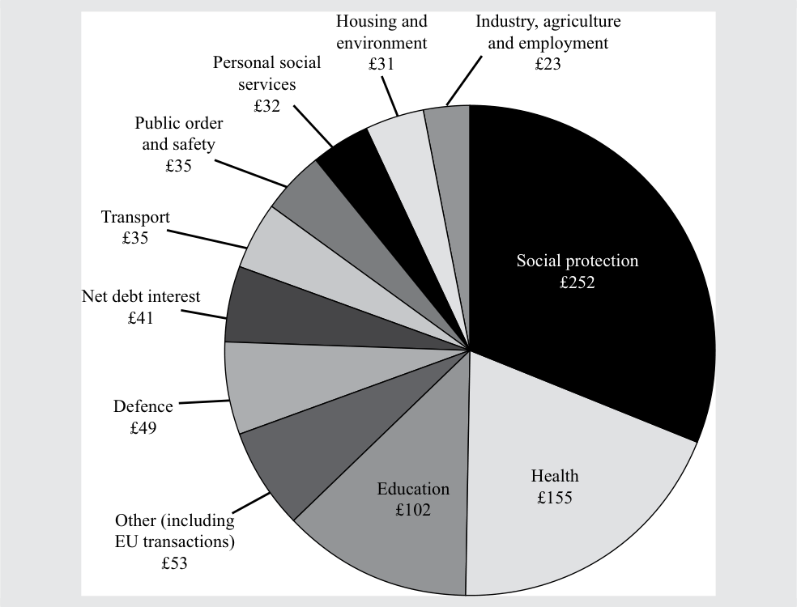
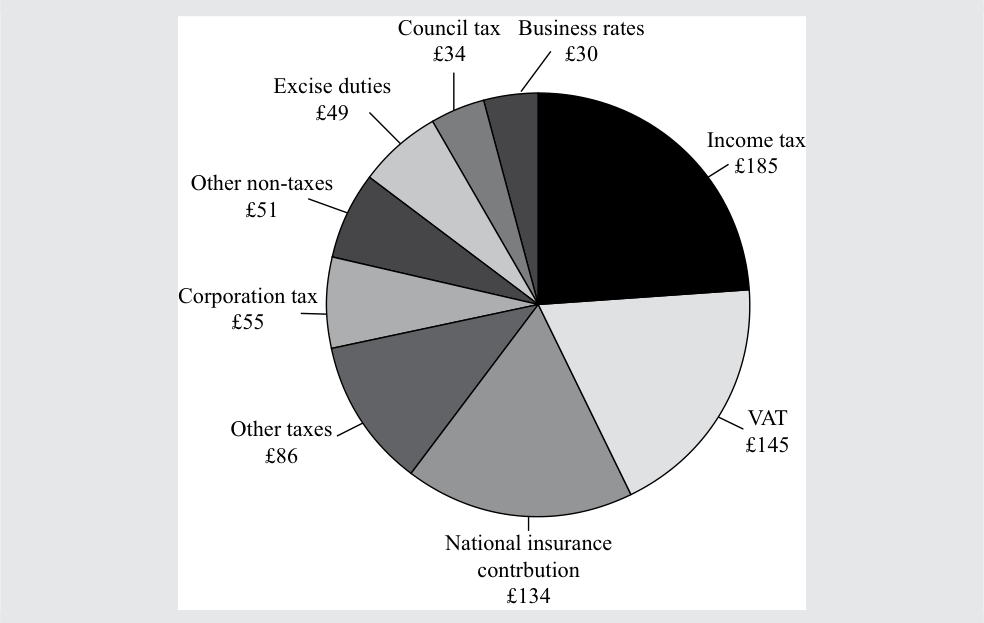
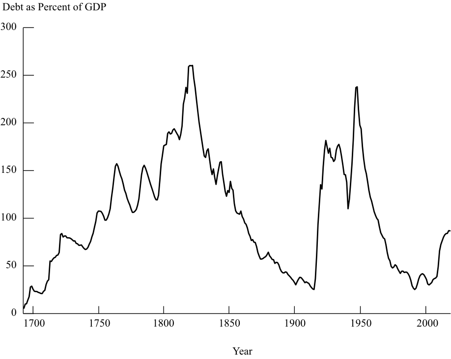

# Tập 2: Kinh tế học (Volume 2: Economics)
## Học phần 3: Chính sách Tài khóa (Learning Module 3: Fiscal Policy)
### Phần 1/2: Giới thiệu (Introduction) (Trang PDF 87–99)

---

<!-- PDF Page 87 -->

#### H Ọ C P H Ầ N (L E A R N I N G M O D U L E)

# **<mark>3</mark>** 

### **Chính sách Tài khóa (Fiscal Policy)** 

###### **Bởi Andrew Clare, PhD, và Stephen Thomas, PhD.** 

_Andrew Clare, PhD, và Stephen Thomas, PhD, công tác tại Trường Kinh doanh Cass (Cass Business School, Vương quốc Anh)._ 

###### **<mark>MỤC TIÊU HỌC TẬP (LEARNING OUTCOMES)</mark>** 

|**_Mức độ thành thạo (Mastery)_**|**_Ứng viên cần có khả năng (The candidate should be able to):_**|
|---|---|
||so sánh chính sách tiền tệ và chính sách tài khóa (*compare monetary and fiscal policy*)|
||mô tả vai trò và mục tiêu của chính sách tài khóa cũng như các lập luận về việc liệu quy mô nợ quốc gia so với GDP có quan trọng hay không (*describe roles and objectives of fiscal policy as well as arguments as to whether the size of a national debt relative to GDP matters*)|
||mô tả các công cụ của chính sách tài khóa, bao gồm ưu điểm và nhược điểm của chúng (*describe tools of fiscal policy, including their advantages and disadvantages*)|
||giải thích việc thực thi chính sách tài khóa và những khó khăn trong quá trình thực thi cũng như xác định xem một chính sách tài khóa là mở rộng hay thu hẹp (*explain the implementation of fiscal policy and difficulties of implementation as well as whether a fiscal policy is expansionary or contractionary*)|

##### **GIỚI THIỆU (INTRODUCTION)** 

**<mark>1</mark>** 

**Chính sách tài khóa (*Fiscal policy*)** đề cập đến các quyết định của chính phủ về thuế khóa và chi tiêu, trong khi **chính sách tiền tệ (*monetary policy*)** đề cập đến các hoạt động của ngân hàng trung ương hướng tới việc tác động đến lượng tiền và tín dụng trong một nền kinh tế. Chính sách tài khóa bao gồm việc sử dụng chi tiêu của chính phủ và thay đổi doanh thu thuế để tác động đến một số khía cạnh nhất định của nền kinh tế, chẳng hạn như mức tổng cầu (*aggregate demand*) chung. Thâm hụt ngân sách chính phủ (*government deficits*) là phần chênh lệch giữa doanh thu và chi tiêu của chính phủ trong một khoảng thời gian lịch trình nhất định. Các công cụ tài khóa sẵn có đối với một chính phủ bao gồm chi chuyển nhượng (*transfer payments*), chi tiêu thường xuyên của chính phủ (*current government spending*), chi đầu tư vốn (*capital expenditures*) và thuế (*taxes*). Các nhà kinh tế học thường xem xét **thâm hụt ngân sách cơ cấu (*structural budget deficit*)** như một chỉ báo về lập trường tài khóa (*fiscal stance*) của chính phủ. 

###### **TỔNG QUAN HỌC PHẦN (LEARNING MODULE OVERVIEW)** 

- Chính sách tài khóa (*Fiscal policy*) đề cập đến các quyết định của chính phủ về thuế khóa và chi tiêu. 

- Chính sách tiền tệ (*Monetary policy*) đề cập đến các hoạt động của ngân hàng trung ương hướng tới việc tác động đến lượng tiền và tín dụng trong một nền kinh tế. 

<!-- PDF Page 88 -->

- Mục tiêu chính của cả chính sách tiền tệ và chính sách tài khóa là tạo ra một môi trường kinh tế trong đó tăng trưởng ổn định và dương, đồng thời lạm phát ổn định và ở mức thấp. 

- Chính sách tài khóa bao gồm việc sử dụng chi tiêu chính phủ và thay đổi doanh thu thuế để tác động đến một số khía cạnh nhất định của nền kinh tế, bao gồm mức độ hoạt động kinh tế trong một nền kinh tế, sự phân phối thu nhập và của cải giữa các phân khúc dân cư khác nhau, và sự phân bổ nguồn lực giữa các khu vực và chủ thể kinh tế khác nhau. 

- **Thặng dư/thâm hụt ngân sách (*budget surplus/deficit*)** là phần chênh lệch giữa doanh thu và chi tiêu của chính phủ trong một khoảng thời gian cố định, chẳng hạn như một năm tài chính hoặc năm dương lịch. 

- Có một số lập luận mạnh mẽ cả ủng hộ lẫn phản đối việc lo ngại về nợ quốc gia (*national debt*) so với GDP. 

- Các công cụ tài khóa sẵn có đối với một chính phủ bao gồm chi chuyển nhượng (*transfer payments*), chi tiêu thường xuyên của chính phủ (*current government spending*), chi đầu tư vốn (*capital expenditures*), thuế trực thu (*direct taxes*) và thuế gián thu (*indirect taxes*). 

- Thuế có thể được biện minh cả về mặt huy động doanh thu để tài trợ cho các khoản chi tiêu lẫn về mặt các chính sách tái phân phối thu nhập và của cải. 

- Các công cụ chính sách tài khóa tìm cách đạt được hoặc duy trì một nền kinh tế trên quỹ đạo tăng trưởng dương, ổn định với mức lạm phát thấp. 

- Các nhà kinh tế học đánh giá thâm hụt ngân sách cơ cấu (hoặc đã điều chỉnh theo chu kỳ – *structural or cyclically adjusted budget deficit*) như một chỉ báo về lập trường tài khóa của chính phủ, được định nghĩa là mức thâm hụt sẽ tồn tại nếu nền kinh tế ở trạng thái toàn dụng nhân công (*full employment*). 

- Thâm hụt ngân sách thực tế của chính phủ có thể không phải là một thước đo tốt về lập trường tài khóa bởi sự khác biệt giữa lãi suất thực và lãi suất danh nghĩa cũng như vai trò của việc điều chỉnh lạm phát khi áp dụng cho thâm hụt ngân sách. 

- Chính sách tài khóa không thể ổn định hoàn toàn tổng cầu vì những khó khăn trong việc thực thi chính sách tài khóa không thể được khắc phục triệt để. 

## **<mark>2</mark> GIỚI THIỆU VỀ CHÍNH SÁCH TIỀN TỆ VÀ CHÍNH SÁCH TÀI KHÓA (INTRODUCTION TO MONETARY AND FISCAL POLICY)** 

*So sánh chính sách tiền tệ và chính sách tài khóa (compare monetary and fiscal policy)* 

Các quyết định kinh tế của các hộ gia đình có thể có tác động đáng kể đến một nền kinh tế. Ví dụ, một quyết định từ phía các hộ gia đình nhằm tiêu dùng nhiều hơn và tiết kiệm ít hơn có thể dẫn đến sự gia tăng về việc làm, đầu tư và cuối cùng là lợi nhuận. Tương tự như vậy, các quyết định đầu tư được đưa ra bởi các tập đoàn có thể có tác động quan trọng đến nền kinh tế thực và lợi nhuận doanh nghiệp. Nhưng các tập đoàn riêng lẻ hiếm khi có thể tự mình tác động đến các nền kinh tế lớn; các quyết định của một hộ gia đình đơn lẻ liên quan đến tiêu dùng sẽ có tác động không đáng kể đến nền kinh tế rộng lớn hơn. 

Ngược lại, các quyết định được đưa ra bởi các chính phủ có thể có tác động to lớn đến ngay cả những nền kinh tế lớn nhất và phát triển nhất vì hai lý do chính. Thứ nhất, khu vực công (*public sector*) của hầu hết các nền kinh tế phát triển thường sử dụng một tỷ lệ đáng kể dân số, và họ thường chịu trách nhiệm cho một tỷ lệ đáng kể 

<!-- PDF Page 89 -->

chi tiêu trong một nền kinh tế. Thứ hai, các chính phủ cũng là những chủ thể đi vay lớn nhất trên các thị trường nợ thế giới. Minh họa dưới đây đưa ra một số hình dung về quy mô vay nợ và chi tiêu của chính phủ. 

###### **Quy mô Vay nợ và Chi tiêu của Chính phủ (Scale of Government Borrowing and Spending)** 

**Bảng A. Nợ Chính phủ Trung ương so với GDP, 2017 (Panel A. Central Government Debt to GDP, 2017)** 

<!-- Picture Text: United Kingdom Canada France Spain Belgium United States Singapore Portugal Italy Greece Japan 0 50 100 150 200 250 General Government Gross Debt as % GDP  -->

> **Chú thích hình ảnh (Bảng A):**
> - **Các quốc gia (Trục tung):** Vương quốc Anh (*United Kingdom*), Canada, Pháp (*France*), Tây Ban Nha (*Spain*), Bỉ (*Belgium*), Hoa Kỳ (*United States*), Singapore, Bồ Đào Nha (*Portugal*), Ý (*Italy*), Hy Lạp (*Greece*), Nhật Bản (*Japan*).
> - **Trục hoành:** Tổng nợ của Chính phủ chung tính theo % GDP (*General Government Gross Debt as % GDP*), từ 0 đến 250.

**Bảng B. Chi tiêu Khu vực Công so với GDP, 2017 (Panel B. Public Sector Spending to GDP, 2017)** 

<!-- Picture Text: United Kingdom Canada France Spain Belgium United States Singapore Portugal Italy Greece Japan 0 10 20 30 40 50 60 Government Expenditure as % of GDP  -->

> **Chú thích hình ảnh (Bảng B):**
> - **Các quốc gia (Trục tung):** Vương quốc Anh (*United Kingdom*), Canada, Pháp (*France*), Tây Ban Nha (*Spain*), Bỉ (*Belgium*), Hoa Kỳ (*United States*), Singapore, Bồ Đào Nha (*Portugal*), Ý (*Italy*), Hy Lạp (*Greece*), Nhật Bản (*Japan*).
> - **Trục hoành:** Chi tiêu của Chính phủ tính theo % GDP (*Government Expenditure as % of GDP*), từ 0 đến 60.

_Nguồn (Source)_: IMF, Cơ sở dữ liệu Triển vọng Kinh tế Thế giới (*World Economic Outlook Database*), tháng 4 năm 2018. 

Chính sách của chính phủ suy cho cùng được thể hiện thông qua các hoạt động vay nợ và chi tiêu của mình. Trong bài đọc này, chúng ta xác định và thảo luận về hai loại chính sách của chính phủ có thể tác động đến nền kinh tế vĩ mô và các thị trường tài chính: chính sách tiền tệ (*monetary policy*) và chính sách tài khóa (*fiscal policy*). 

Chính sách tiền tệ đề cập đến các hoạt động của ngân hàng trung ương hướng tới việc tác động đến lượng tiền và tín dụng trong một nền kinh tế. Ở một thái cực, các ngân hàng trung ương có thể thực thi chính sách tiền tệ gần như hoàn toàn độc lập với sự can thiệp và ảnh hưởng của chính phủ, hoặc ở thái cực ngược lại, chỉ đơn thuần hoạt động như một đại diện (*agent*) của chính phủ. 

<!-- PDF Page 90 -->

Ngược lại, chính sách tài khóa đề cập đến các quyết định của chính phủ về thuế khóa và chi tiêu. Cả chính sách tiền tệ và chính sách tài khóa đều được sử dụng để điều tiết hoạt động kinh tế theo thời gian. Chúng có thể được sử dụng để thúc đẩy tăng trưởng khi một nền kinh tế bắt đầu chậm lại hoặc để kiềm chế tăng trưởng và hoạt động khi một nền kinh tế bắt đầu tăng trưởng quá nóng (*overheat*). Ngoài ra, chính sách tài khóa có thể được sử dụng để tái phân phối thu nhập và của cải. 

Mục tiêu bao trùm của cả chính sách tiền tệ và chính sách tài khóa thông thường là tạo ra một môi trường kinh tế trong đó tăng trưởng ổn định và dương, đồng thời lạm phát ổn định và ở mức thấp. Điều cốt yếu là mục tiêu nhằm chèo lái nền kinh tế cơ sở sao cho nó không trải qua những đợt bùng nổ kinh tế (*economic booms*) mà sau đó có thể là những giai đoạn kéo dài của tăng trưởng thấp hoặc âm và mức thất nghiệp cao. Trong một môi trường kinh tế ổn định như vậy, các hộ gia đình có thể cảm thấy an tâm trong các quyết định tiêu dùng và tiết kiệm của mình, trong khi các tập đoàn có thể tập trung vào các quyết định đầu tư, thực hiện các khoản thanh toán lãi định kỳ (*regular coupon payments*) cho các trái chủ, và tạo ra lợi nhuận cho các cổ đông của họ. 

Những thách thức để đạt được mục tiêu bao trùm này là rất nhiều. Các nền kinh tế thường xuyên bị giáng những cú sốc (chẳng hạn như giá dầu tăng vọt), và một số nhà kinh tế học tin rằng các chu kỳ tự nhiên trong nền kinh tế cũng tồn tại. Hơn nữa, chúng ta có thể tìm thấy rất nhiều ví dụ từ lịch sử trong đó các chính sách của chính phủ—hoặc là tiền tệ, tài khóa, hoặc cả hai—đã làm trầm trọng thêm một đợt mở rộng kinh tế mà cuối cùng dẫn đến những hậu quả tàn khốc cho nền kinh tế thực, cho các thị trường tài chính và cho các nhà đầu tư. 

###### **BỘ CÂU HỎI (QUESTION SET)** 

1. Phát biểu nào sau đây mô tả _đúng nhất_ về chính sách tiền tệ? Chính sách tiền tệ: 

   - **A.** bao gồm việc thiết lập các mục tiêu trung hạn cho các đại lượng cung tiền rộng (*broad money aggregates*). 

   - **B.** bao gồm việc ngân hàng trung ương thao túng mức thâm hụt ngân sách của chính phủ. 

   - **C.** tìm cách tác động đến nền kinh tế vĩ mô bằng cách tác động đến lượng tiền và tín dụng trong nền kinh tế. 

   - **Lời giải (Solution):** 

C là đáp án đúng, vì chính sách tiền tệ bao gồm các hoạt động của ngân hàng trung ương hướng tới việc tác động đến lượng tiền và tín dụng. Lựa chọn A không đúng vì mặc dù việc thiết lập các mục tiêu cho các đại lượng tiền tệ là một _công cụ_ khả dĩ của chính sách tiền tệ, nhưng bản thân chính sách tiền tệ quan tâm đến việc tác động đến nền kinh tế tổng thể, hay kinh tế vĩ mô. 

2. Phát biểu nào sau đây mô tả _đúng nhất_ về chính sách tài khóa? Chính sách tài khóa: 

   - **A.** được các chính phủ sử dụng để tái phân phối của cải và thu nhập. 

   - **B.** là nỗ lực của các chính phủ nhằm cân bằng ngân sách của họ từ năm này sang năm khác. 

   - **C.** bao gồm việc sử dụng chi tiêu chính phủ và thuế khóa để tác động đến hoạt động kinh tế. 

###### **Lời giải (Solution):** 

C là đáp án đúng. Lưu ý rằng các chính phủ có thể muốn sử dụng chính sách tài khóa để tái phân phối thu nhập và cân bằng ngân sách của họ, nhưng mục tiêu quan trọng nhất của chính sách tài khóa thường là tác động đến một phạm vi rộng lớn hơn của hoạt động kinh tế. 

<!-- PDF Page 91 -->

##### **VAI TRÒ VÀ MỤC TIÊU CỦA CHÍNH SÁCH TÀI KHÓA (ROLES AND OBJECTIVES OF FISCAL POLICY)** 

## **<mark>3</mark>** 

*Mô tả vai trò và mục tiêu của chính sách tài khóa cũng như các lập luận về việc liệu quy mô nợ quốc gia so với GDP có quan trọng hay không (describe roles and objectives of fiscal policy as well as arguments as to whether the size of a national debt relative to GDP matters)* 

Chính sách tài khóa bao gồm việc sử dụng chi tiêu của chính phủ và thay đổi doanh thu thuế để tác động đến một số khía cạnh của nền kinh tế: 

- Mức tổng cầu (*aggregate demand*) chung trong một nền kinh tế và do đó là mức độ hoạt động kinh tế. 

- Sự phân phối thu nhập và của cải giữa các phân khúc dân cư khác nhau. 

- Sự phân bổ nguồn lực giữa các khu vực và chủ thể kinh tế khác nhau. 

Cuộc thảo luận về chính sách tài khóa thường tập trung vào tác động của những thay đổi trong phần chênh lệch giữa chi tiêu và doanh thu của chính phủ đối với nền kinh tế tổng thể, hơn là vào bản thân các mức chi tiêu và doanh thu thực tế. 

###### **Vai trò và Mục tiêu của Chính sách Tài khóa (Roles and Objectives of Fiscal Policy)** 

Một mục đích chính của chính sách tài khóa là giúp quản lý nền kinh tế thông qua ảnh hưởng của nó lên tổng sản lượng quốc gia (*aggregate national output*), tức là GDP thực (*real GDP*). 

###### **_Chính sách Tài khóa và Tổng cầu (Fiscal Policy and Aggregate Demand)_** 

Tổng cầu (*Aggregate demand*) là số tiền mà các công ty và hộ gia đình dự định chi tiêu. Chúng ta có thể xem xét một số cách mà chính sách tài khóa có thể tác động đến tổng cầu. Ví dụ, một chính sách **mở rộng (*expansionary*)** có thể mang một hoặc nhiều hình thức sau đây: 

- Cắt giảm thuế thu nhập cá nhân (*personal income tax*) làm tăng thu nhập khả dụng (*disposable income*) với mục tiêu thúc đẩy tổng cầu. 

- Cắt giảm thuế bán hàng (thuế gián thu – *sales/indirect taxes*) nhằm hạ giá cả làm tăng thu nhập thực (*real incomes*) với mục tiêu nâng cao cầu tiêu dùng. 

- Cắt giảm thuế thu nhập doanh nghiệp (*corporation/company taxes*) nhằm thúc đẩy lợi nhuận kinh doanh có thể làm tăng chi tiêu vốn (*capital spending*). 

- Cắt giảm thuế suất đối với khoản tiết kiệm cá nhân nhằm làm tăng thu nhập khả dụng cho những người có tiền tiết kiệm, với mục tiêu nâng cao cầu tiêu dùng. 

- Chi tiêu công mới cho các hàng hóa xã hội và cơ sở hạ tầng, chẳng hạn như bệnh viện và trường học, thúc đẩy thu nhập cá nhân với mục tiêu nâng cao tổng cầu. 

Tuy nhiên, chúng ta phải nhấn mạnh rằng độ tin cậy và quy mô của các mối quan hệ này sẽ thay đổi theo thời gian và từ quốc gia này sang quốc gia khác. Ví dụ, trong một cuộc suy thoái với tỷ lệ thất nghiệp gia tăng, không phải lúc nào việc cắt giảm thuế thu nhập cũng sẽ làm tăng chi tiêu tiêu dùng bởi vì người tiêu dùng có thể muốn tăng khoản tiết kiệm phòng ngừa (*precautionary / rainy day saving*) của họ để dự phòng cho sự suy thoái sâu hơn của nền kinh tế. Thật vậy, xét về mặt tổng quát, các nhà kinh tế học thường được chia thành hai trường phái liên quan đến cơ chế hoạt động của chính sách tài khóa. **Trường phái Keynes (*Keynesians*)** tin rằng chính sách tài khóa có thể có những tác động mạnh mẽ lên tổng cầu, sản lượng và việc làm khi có năng lực sản xuất dư thừa (*spare capacity*) đáng kể trong một nền kinh tế. **Trường phái Trọng tiền (*Monetarists*)** tin rằng những thay đổi tài khóa chỉ có tác động tạm thời lên tổng cầu và rằng chính sách tiền tệ là một công cụ hiệu quả hơn để kiềm chế hoặc thúc đẩy các áp lực lạm phát. Các nhà kinh tế theo trường phái Trọng tiền có xu hướng không ủng hộ việc sử dụng chính sách tiền tệ để điều chỉnh ngược chu kỳ (*countercyclical adjustment*) đối với tổng cầu. Sự phân chia về mặt tư tưởng này 

<!-- PDF Page 92 -->

tự nhiên sẽ được phản ánh trong những quan điểm khác biệt của các nhà kinh tế học về tính hiệu quả của các đợt mở rộng tài khóa lớn được quan sát thấy ở nhiều quốc gia sau Cuộc khủng hoảng Tài chính Toàn cầu 2008–2009 (*2008–2009 Global Financial Crisis*), cùng với những quan điểm khác nhau về tác động khả dĩ của việc nới lỏng định lượng (*quantitative easing*). 

###### **_Thu và Chi của Chính phủ tại các Nền kinh tế Lớn (Government Receipts and Expenditure in Major Economies)_** 

Trong Minh họa 1 (*Exhibit 1*), chúng tôi trình bày tổng doanh thu của chính phủ tính theo tỷ lệ phần trăm của GDP đối với một số nền kinh tế lớn. Đây là tỷ trọng sản lượng của một quốc gia được chính phủ thu thập thông qua thuế và các khoản mục liên quan như phí, lệ phí, tiền phạt và chuyển nhượng vốn (*capital transfers*). Nó thường được coi là một thước đo tổng hợp về mức độ mà một chính phủ tham gia cả trực tiếp lẫn gián tiếp vào hoạt động kinh tế của một quốc gia. 

Thuế được định nghĩa chính thức là các khoản thanh toán bắt buộc, không hoàn trả trực tiếp (*compulsory, unrequited payments*) cho chính phủ chung (chúng không hoàn trả trực tiếp theo nghĩa là những lợi ích do chính phủ cung cấp cho người nộp thuế thường không tỷ lệ trực tiếp với các khoản thanh toán của họ). Minh họa 1 bao gồm các loại thuế đánh vào thu nhập và lợi nhuận, các khoản đóng góp an sinh xã hội, thuế gián thu đánh vào hàng hóa và dịch vụ, thuế lao động (*employment taxes*), và thuế đánh vào quyền sở hữu và chuyển nhượng tài sản. 

**Minh họa 1: Doanh thu Chính phủ Chung tính theo Phần trăm GDP (Exhibit 1: General Government Revenues as Percent of GDP)** 

|**Quốc gia / Khu vực**|**1995**|**2000**|**2005**|**2008**|**2010**|**2015**|
|---|---|---|---|---|---|---|
|Úc (*Australia*)|34.5|36.1|36.5|35.3|32.4|34.9|
|Đức (*Germany*)|45.1|46.4|43.6|43.8|43.0|44.5|
|Nhật Bản (*Japan*)|31.2|31.4|31.7|34.4|30.6|35.7|
|Vương quốc Anh (*United Kingdom*)|38.2|40.3|40.8|42.2|38.2|38.0|
|Hoa Kỳ (*United States*)|33.8|35.4|33.0|32.3|30.9|33.4|
|OECD|37.9|39.0|37.7|37.9|39.8|40.9|

_Nguồn (Source):_ Tổ chức Hợp tác và Phát triển Kinh tế (*Organisation for Economic Co-Operation and Development* – OECD). 

Thuế đánh vào thu nhập và lợi nhuận khá ổn định đối với các quốc gia thành viên của Tổ chức Hợp tác và Phát triển Kinh tế (OECD) ở mức khoảng 12.5–13% GDP kể từ giữa những năm 1990, trong khi thuế đánh vào hàng hóa và dịch vụ duy trì ổn định ở mức khoảng 11% GDP trong giai đoạn đó. Sự khác biệt giữa các quốc gia có thể rất lớn; thuế đánh vào hàng hóa và dịch vụ ở mức khoảng 5% GDP đối với Hoa Kỳ và Nhật Bản nhưng lại hơn 16% đối với Đan Mạch. 

Minh họa 2 cho thấy tỷ lệ phần trăm của GDP được đại diện bởi chi tiêu của chính phủ ở nhiều nền kinh tế lớn theo thời gian. Nhìn chung, các con số này khá ổn định kể từ năm 1995, mặc dù Đức có một con số đặc biệt cao vào đầu giai đoạn do chi phí tái thống nhất đất nước. Tác động của các chương trình kích thích tài khóa (*fiscal stimulus programs*) của các chính phủ trước cuộc khủng hoảng tài chính 2008–2009 xuất hiện dưới dạng sự gia tăng đáng kể trong chi tiêu chính phủ ở Minh họa 2 và sự gia tăng trong thâm hụt ngân sách chính phủ giữa năm 2008 và 2010 thể hiện rõ trong Minh họa 3. 

**Minh họa 2: Chi tiêu Chính phủ Chung tính theo Phần trăm GDP (Exhibit 2: General Government Expenditures as Percent of GDP)** 

|**Quốc gia / Khu vực**|**1995**|**2000**|**2005**|**2008**|**2010**|**2015**|
|---|---|---|---|---|---|---|
|Úc (*Australia*)|38.2|35.2|34.8|34.3|34.4|36.2|
|Đức (*Germany*)|54.8|45.1|46.9|43.8|47.3|43.9|
|Nhật Bản (*Japan*)|36.0|39.0|38.4|37.1|39.6|39.4|
|Vương quốc Anh (*United Kingdom*)|44.1|36.6|44.0|47.5|47.6|42.2|

<!-- PDF Page 93 -->

|**Quốc gia / Khu vực**|**1995**|**2000**|**2005**|**2008**|**2010**|**2015**|
|---|---|---|---|---|---|---|
|Hoa Kỳ (*United States*)|37.1|33.9|36.2|38.8|42.9|37.6|
|OECD|42.7|38.7|40.5|41.4|45.2|41.8|

_Nguồn (Source):_ OECD. 

Rõ ràng, khả năng chính sách tài khóa có thể tác động đến sản lượng có nghĩa là nó có thể là một công cụ quan trọng để **ổn định kinh tế (*economic stabilization*)**. Trong một cuộc suy thoái, các chính phủ có thể tăng chi tiêu (**chính sách tài khóa mở rộng – *expansionary fiscal policy***) nhằm nỗ lực nâng cao việc làm và sản lượng. Trong thời kỳ bùng nổ—khi một nền kinh tế có toàn dụng nhân công và tiền lương cùng giá cả đang tăng quá nhanh—chi tiêu của chính phủ có thể được cắt giảm và thuế được nâng lên (**chính sách tài khóa thu hẹp – *contractionary fiscal policy***). 

Do đó, một khái niệm then chốt là thặng dư hoặc thâm hụt ngân sách (*budget surplus or deficit*), là phần chênh lệch dương hoặc âm giữa doanh thu và chi tiêu của chính phủ trong một khoảng thời gian cố định, chẳng hạn như một năm tài chính hoặc năm dương lịch. Doanh thu của chính phủ bao gồm doanh thu thuế trừ đi các khoản chi chuyển nhượng (*transfer payments*); chi tiêu của chính phủ bao gồm các khoản thanh toán tiền lãi cho nợ chính phủ. Các nhà phân tích thường tập trung vào những thay đổi trong thặng dư hoặc thâm hụt ngân sách từ năm này sang năm khác như những chỉ báo cho biết liệu chính sách tài khóa đang trở nên thắt chặt hơn (*tighter*) hay nới lỏng hơn (*looser*). Sự gia tăng trong thặng dư ngân sách sẽ gắn liền với chính sách tài khóa thu hẹp, trong khi sự gia tăng trong thâm hụt là một chính sách tài khóa mở rộng. Tất nhiên, trong suốt một chu kỳ kinh doanh (*business cycle*), thặng dư ngân sách sẽ biến đổi một cách tự động theo hướng ngược chu kỳ (*countercyclical*). Ví dụ, khi một nền kinh tế chậm lại và tỷ lệ thất nghiệp tăng lên, chi tiêu của chính phủ cho bảo hiểm xã hội và trợ cấp thất nghiệp cũng sẽ tăng lên và bổ sung vào tổng cầu. Đây được gọi là **nhân tố ổn định tự động (*automatic stabilizer*)**. Tương tự như vậy, nếu các điều kiện bùng nổ diễn ra và việc làm cùng thu nhập ở mức cao, thì thuế thu nhập và thuế lợi nhuận lũy tiến (*progressive income and profit taxes*) sẽ tăng lên và cũng đóng vai trò như các nhân tố ổn định tự động làm tăng thặng dư ngân sách hoặc làm giảm thâm hụt ngân sách. Ưu điểm lớn của các nhân tố ổn định tự động là chúng diễn ra tự động và không đòi hỏi việc phải nhận diện các cú sốc mà các nhà hoạch định chính sách phải cân nhắc phản ứng. Bằng cách làm giảm độ nhạy cảm của nền kinh tế trước các cú sốc, những nhân tố ổn định tự động này làm giảm các biến động sản lượng. Cần phân biệt các nhân tố ổn định tự động với các chính sách tài khóa tùy nghi (*discretionary fiscal policies*), chẳng hạn như những thay đổi trong chi tiêu chính phủ hoặc thuế suất, vốn được chủ động sử dụng để ổn định tổng cầu. Nếu chi tiêu và doanh thu của chính phủ bằng nhau, thì ngân sách ở trạng thái **cân bằng (*balanced*)**. 

**Minh họa 3: Đi vay hoặc Cho vay Ròng của Chính phủ Chung tính theo Phần trăm GDP (Exhibit 3: General Government Net Borrowing or Lending as Percent of GDP)** 

|**Quốc gia / Khu vực**|**1995**|**2000**|**2005**|**2008**|**2010**|**2015**|
|---|---|---|---|---|---|---|
|Úc (*Australia*)|–3.7|0.9|1.7|–3.8|–4.4|–2.2|
|Đức (*Germany*)|–9.7|1.3|–3.3|–0.2|–4.2|0.8|
|Nhật Bản (*Japan*)|–4.7|–7.6|–6.7|–4.1|–9.1|–3.6|
|Vương quốc Anh (*United Kingdom*)|–5.8|3.7|–3.3|–5.1|–9.4|–4.2|
|Hoa Kỳ (*United States*)|–3.3|1.5|–3.3|–7.0|–12.0|–4.2|
|OECD|–4.8|0.2|–2.7|–1.5|–5.1|–1.9|

_Nguồn (Source):_ OECD. 

<!-- PDF Page 94 -->

###### **VÍ DỤ 1 (EXAMPLE 1)** 

###### **Nguồn thu và Sử dụng Dòng tiền của Chính phủ: Trường hợp của Vương quốc Anh (Sources and Uses of Government Cash Flows: The Case of the United Kingdom)** 

Các thành phần chính xác của doanh thu và chi tiêu tất nhiên sẽ thay đổi theo thời gian và giữa các quốc gia. Nhưng, như một ví dụ về sự phân tách chi tiêu và doanh thu, trong Minh họa 4 và Minh họa 5, chúng tôi trình bày các dự phóng ngân sách của Vương quốc Anh cho năm 2018/2019. Ngân sách dự phóng rằng tổng chi tiêu sẽ lên tới 808 tỷ GBP, trong khi tổng doanh thu sẽ chỉ là 769 tỷ GBP. Do đó, chính phủ dự báo mức thiếu hụt ngân sách (*budget shortfall*) là 39 tỷ GBP cho năm tài chính này, có nghĩa là chính phủ có nhu cầu liên quan là phải vay 39 tỷ GBP từ khu vực tư nhân ở Vương quốc Anh hoặc từ khu vực tư nhân và khu vực công của các nền kinh tế khác. 

###### **Minh họa 4: Tiền đi đâu? Vương quốc Anh, 2018–2019 (Exhibit 4: Where Does the Money Go? United Kingdom, 2018–2019)** 

<!-- Picture Text: Housing and Industry, agriculture environment and employment Personal social £31 £23 services £32 Public order and safety £35 Transport £35 Social protection £252 Net debt interest £41 Defence £49 Health Education £155 £102 Other (including EU transactions) £53  -->

> **Chú thích hình ảnh (Minh họa 4):**
> - Bảo trợ xã hội (*Social protection*): £252 tỷ
> - Y tế (*Health*): £155 tỷ
> - Giáo dục (*Education*): £102 tỷ
> - Khác (bao gồm các giao dịch EU) (*Other, including EU transactions*): £53 tỷ
> - Quốc phòng (*Defence*): £49 tỷ
> - Lãi nợ ròng (*Net debt interest*): £41 tỷ
> - Giao thông vận tải (*Transport*): £35 tỷ
> - Trật tự công cộng và an toàn (*Public order and safety*): £35 tỷ
> - Dịch vụ xã hội cá nhân (*Personal social services*): £32 tỷ
> - Nhà ở và môi trường (*Housing and environment*): £31 tỷ
> - Công nghiệp, nông nghiệp và việc làm (*Industry, agriculture and employment*): £23 tỷ

<!-- Picture Text: Note:  All values are in billions of pounds.  -->

_Lưu ý (Note):_ Tất cả các giá trị đều tính bằng tỷ bảng Anh (*billions of pounds*).

<!-- Picture Text: Source:  HM Treasury, United Kingdom.  -->

_Nguồn (Source):_ Bộ Tài chính Vương quốc Anh (*HM Treasury, United Kingdom*).

<!-- PDF Page 95 -->

###### **Minh họa 5: Tiền đến từ đâu? Vương quốc Anh, 2018–2019 (Exhibit 5: Where Does the Money Come From? United Kingdom, 2018–2019)** 

<!-- Picture Text: Council tax Business rates £34 £30 Excise duties £49 Income tax £185 Other non-taxes £51 Corporation tax £55 VAT Other taxes £145 £86 National insurance contrbution £134  -->

> **Chú thích hình ảnh (Minh họa 5):**
> - Thuế thu nhập (*Income tax*): £185 tỷ
> - Thuế giá trị gia tăng (*VAT*): £145 tỷ
> - Đóng góp bảo hiểm quốc gia (*National insurance contribution*): £134 tỷ
> - Các loại thuế khác (*Other taxes*): £86 tỷ
> - Thuế thu nhập doanh nghiệp (*Corporation tax*): £55 tỷ
> - Các khoản thu ngoài thuế khác (*Other non-taxes*): £51 tỷ
> - Thuế tiêu thụ đặc biệt (*Excise duties*): £49 tỷ
> - Thuế hội đồng địa phương (*Council tax*): £34 tỷ
> - Thuế bất động sản kinh doanh (*Business rates*): £30 tỷ

_Lưu ý (Note):_ Tất cả các giá trị đều tính bằng tỷ bảng Anh (*billions of pounds*). 

_Nguồn (Source):_ Bộ Tài chính Vương quốc Anh (*HM Treasury, United Kingdom*). 

###### **BỘ CÂU HỎI (QUESTION SET)** 

1. Mục tiêu _ít có khả năng nhất_ của chính sách tài khóa của một chính phủ là: 

   - **A.** tái phân phối thu nhập và của cải. 

   - **B.** tác động đến tổng sản lượng quốc gia. 

   - **C.** đảm bảo sự ổn định sức mua của đồng tiền quốc gia đó. 

   - **Lời giải (Solution):** 

C là đáp án đúng. Đảm bảo sức mua ổn định là mục tiêu của chính sách tiền tệ hơn là chính sách tài khóa. Chính sách tài khóa bao gồm việc sử dụng chi tiêu chính phủ và doanh thu thuế để tác động đến mức tổng cầu chung trong một nền kinh tế và do đó là mức độ hoạt động kinh tế. 

2. Lựa chọn nào sau đây thể hiện _đúng nhất_ một chính sách tài khóa thu hẹp (*contractionary fiscal policy*)? 

   - **A.** Tạm ngừng thu thuế tiền lương (*payroll taxes*) 

   - **B.** Chi tiêu công cho một tuyến đường sắt cao tốc 

   - **C.** Đóng băng chi tiêu chính phủ tùy nghi (*freeze in discretionary government spending*) 

   - **Lời giải (Solution):** 

C là đáp án đúng. Việc đóng băng chi tiêu chính phủ tùy nghi là một ví dụ về chính sách tài khóa thu hẹp. 

3. Quy tắc “chi trả khi phát sinh” (*“pay-as-you-go” rule*), đòi hỏi bất kỳ khoản cắt giảm thuế hoặc gia tăng chi tiêu phúc lợi bắt buộc (*entitlement spending*) nào cũng phải được bù đắp bằng sự gia tăng của các loại thuế khác hoặc cắt giảm các khoản chi tiêu phúc lợi bắt buộc khác, là một ví dụ về lập trường chính sách tài khóa nào? 

   - **A.** Trung lập (*Neutral*) 

<!-- PDF Page 96 -->

   - **B.** Mở rộng (*Expansionary*) 

   - **C.** Thu hẹp (*Contractionary*) 

   - **Lời giải (Solution):** 

A là đáp án đúng. Quy tắc “chi trả khi phát sinh” (*pay-as-you-go*) là một chính sách trung lập bởi vì bất kỳ sự gia tăng nào trong chi tiêu hoặc sụt giảm trong doanh thu đều sẽ được bù đắp. Theo đó, sẽ không có tác động ròng nào lên thâm hụt/thặng dư ngân sách. 

###### **Thâm hụt và Nợ Quốc gia (Deficits and the National Debt)** 

Thâm hụt ngân sách chính phủ (*Government deficits*) là phần chênh lệch giữa doanh thu và chi tiêu của chính phủ trong một khoảng thời gian lịch trình, thường là một năm. Nợ chính phủ (hay nợ quốc gia – *government or national debt*) là sự tích lũy theo thời gian của các khoản thâm hụt này. Thâm hụt ngân sách chính phủ được tài trợ bằng cách vay từ khu vực tư nhân, thường thông qua các khoản đầu tư danh mục của quỹ hưu trí tư nhân và quỹ bảo hiểm. Chúng ta biết rằng các chính phủ có nhiều khả năng bị thâm hụt hơn là thặng dư trong các khoảng thời gian dài. Kết quả là, một lượng lớn nợ chính phủ đang lưu hành có thể thuộc sở hữu của khu vực tư nhân. Con số này sẽ biến thiên khi chu kỳ kinh doanh lên xuống. Minh họa 6 cho thấy quỹ đạo thời gian của tỷ lệ nợ công trên GDP (*ratio of public debt to GDP*) của Vương quốc Anh trong vài trăm năm. Có thể thấy rõ ràng rằng nguyên nhân chính gây ra những biến động trong tỷ lệ đó xuyên suốt lịch sử là việc tài trợ cho các cuộc chiến tranh, đặc biệt là các cuộc Chiến tranh Napoléon giai đoạn 1799–1815 và Thế chiến thứ nhất cùng Thế chiến thứ hai giai đoạn 1914–1918 và 1939–1945. 

**Minh họa 6: Nợ Quốc gia của Vương quốc Anh tính theo Phần trăm GDP, 1692–2018 (Exhibit 6: UK National Debt as Percent of GDP, 1692–2018)** 

<!-- Picture Text: Debt as Percent of GDP 300 250 200 150 100 50 0 1700 1750 1800 1850 1900 1950 2000 Year  -->

> **Chú thích hình ảnh (Minh họa 6):**
> - **Trục tung:** Nợ tính theo Phần trăm GDP (*Debt as Percent of GDP*), từ 0 đến 300.
> - **Trục hoành:** Năm (*Year*), từ 1700 đến 2000.

_Nguồn (Source)_: http://ukpublicspending.co.uk. 

Với sự bùng phát của cuộc khủng hoảng tín dụng năm 2008, các chính phủ đã tích cực tìm cách kích thích nền kinh tế của họ thông qua việc tăng chi tiêu mà không tăng thuế và doanh thu. Điều này đã dẫn đến sự gia tăng vay nợ, được thể hiện trong Minh họa 7, vốn đã trở thành một mối lo ngại trên 

<!-- PDF Page 97 -->

các thị trường tài chính vào năm 2010 đối với các quốc gia như Hy Lạp. Thật vậy, giữa năm 2008 và 2009, theo OECD, nợ chính phủ trung ương đã tăng từ 1.2 nghìn tỷ USD lên 1.6 nghìn tỷ USD ở Vương quốc Anh và từ 5.8 nghìn tỷ USD lên 7.5 nghìn tỷ USD đối với Hoa Kỳ. Việc mở rộng tài khóa của các chính phủ trước cuộc khủng hoảng tài chính dường như đã làm tăng đáng kể tỷ lệ nợ chính phủ chung trên GDP (*general government debt-to-GDP ratio*) trong dài hạn đối với nhiều quốc gia, như được minh họa trong Minh họa 7. 

**Minh họa 7: Nợ Chính phủ Chung tính theo Phần trăm GDP (Exhibit 7: General Government Debt as Percent of GDP)** 

|**Quốc gia / Khu vực**|**1995**|**2000**|**2005**|**2008**|**2010**|**2015**|
|---|---|---|---|---|---|---|
|Úc (*Australia*)|57.3|41.1|30.0|30.0|41.9|64.1|
|Đức (*Germany*)|54.1|59.5|70.1|68.1|84.5|78.9|
|Nhật Bản (*Japan*)|94.7|142.6|176.2|181.6|207.5|237.4|
|Vương quốc Anh (*United Kingdom*)|51.4|48.7|51.3|63.3|88.8|111.7|
|Hoa Kỳ (*United States*)|83.2|61.7|79.0|93.2|117.0|125.3|
|OECD|65.8|59.9|59.5|60.8|73.0|85.3|

_Nguồn (Source):_ www.oecd.org. 

Cuối cùng, nếu tỷ lệ nợ trên GDP tăng vượt quá một điểm chưa biết nhất định, thì khả năng thanh toán nợ dài hạn (*solvency*) của quốc gia đó sẽ bị đặt dấu hỏi. Một chỉ báo bổ sung cho tình trạng mất khả năng thanh toán tiềm tàng là tỷ lệ thanh toán lãi vay trên GDP (*ratio of interest rate payments to GDP*), được thể hiện đối với một số nền kinh tế lớn trong Minh họa 8. Những con số này đại diện cho các khoản thanh toán bắt buộc của các chính phủ để trả lãi nợ tính theo tỷ lệ phần trăm của sản lượng quốc gia và, do đó, phản ánh cả quy mô nợ lẫn mức lãi suất tính trên các khoản nợ đó. 

**Minh họa 8: Thanh toán Lãi Nợ Ròng của Chính phủ Chung tính theo Phần trăm GDP (Exhibit 8: General Government Net Debt Interest Payments as Percent of GDP)** 

|**Quốc gia / Khu vực**|**1995**|**2000**|**2005**|**2008**|**2010**|**2015**|
|---|---|---|---|---|---|---|
|Úc (*Australia*)|3.5|1.7|1.0|–0.5|0.0|0.3|
|Đức (*Germany*)|2.9|2.7|2.4|2.3|2.1|0.9|
|Nhật Bản (*Japan*)|1.3|1.5|0.8|0.3|0.6|0.4|
|Vương quốc Anh (*United Kingdom*)|3.1|2.4|1.8|1.7|2.6|2.0|
|Hoa Kỳ (*United States*)|3.5|2.5|1.8|2.6|2.9|2.8|
|OECD|3.6|2.5|1.8|1.9|2.1|1.9|

_Nguồn (Source):_ OECD. 

Chi tiêu của chính phủ đã vượt xa doanh thu sau cuộc khủng hoảng tín dụng giai đoạn 2007–2010 khi các chính phủ cố gắng kích thích nền kinh tế của họ; mức chi tiêu này đã làm dấy lên những lo ngại ở một số giới về quy mô tích lũy nợ của chính phủ. Minh họa 7 cho thấy nợ chính phủ so với GDP của các quốc gia OECD nói chung đã tăng từ 59.5% năm 2005 lên 85.3% năm 2015. Tại Nhật Bản, nơi chi tiêu tài khóa đã được sử dụng để kích thích nền kinh tế từ đầu những năm 1990, tỷ lệ này đã tăng từ 94.7% năm 1995 lên 237.4% năm 2015. Nếu một nền kinh tế tăng trưởng xét theo giá trị thực (*in real terms*), thì doanh thu thuế thực cũng tăng theo và do đó khả năng trả lãi cho một khoản nợ thực đang tăng lên ở các mức thuế suất không đổi cũng tăng theo. Tuy nhiên, nếu mức tăng trưởng thực của nền kinh tế thấp hơn lãi suất thực (*real interest rate*) của khoản nợ, thì tỷ lệ nợ sẽ trở nên tồi tệ hơn ngay cả khi nền kinh tế đang tăng trưởng bởi vì gánh nặng nợ (tức là lãi suất thực nhân với khoản nợ) 

<!-- PDF Page 98 -->

tăng nhanh hơn nền kinh tế. Do đó, một vấn đề quan trọng đối với các chính phủ và các chủ nợ của họ là liệu khoản chi tiêu bổ sung của họ có dẫn đến doanh thu thuế cao hơn đủ để trả tiền lãi cho khoản nợ được sử dụng để tài trợ cho khoản chi tiêu tăng thêm đó hay không. 

Tuy nhiên, trong phạm vi một nền kinh tế quốc gia, giá trị thực của khoản nợ đang lưu hành sẽ giảm xuống nếu mức giá chung tăng lên (tức là lạm phát, và do đó làm tăng GDP danh nghĩa ngay cả khi GDP thực đứng yên) và vì vậy tỷ lệ nợ trên GDP có thể không tăng lên. Nếu mức giá chung giảm xuống (tức là giảm phát – *deflation*), thì tỷ lệ này có thể duy trì ở mức cao lâu hơn. Nếu các khoản thanh toán lãi ròng tăng nhanh chóng và các nhà đầu tư mất niềm tin vào khả năng tôn trọng các nghĩa vụ nợ của một chính phủ, thì chi phí tài trợ có thể leo thang thậm chí còn nhanh hơn nữa và làm cho tình hình trở nên mất ổn định. 

Liệu chúng ta có nên lo ngại về quy mô của nợ quốc gia (so với GDP) hay không? Có những lập luận mạnh mẽ cho cả hai phía ủng hộ và phản đối: 

- Các lập luận phản đối việc lo ngại về nợ quốc gia (so với GDP) bao gồm: 

   - Quy mô của vấn đề có thể bị phóng đại bởi vì khoản nợ là nợ nội bộ đối với chính những công dân trong nước. Điều này chắc chắn đúng ở Nhật Bản và Hàn Quốc, nơi 93% khoản nợ thuộc sở hữu của cư dân trong nước. Canada cũng tương tự với 90% nợ thuộc sở hữu của cư dân. Tuy nhiên, các quốc gia khác có tỷ lệ sở hữu nội bộ thấp hơn nhiều. Theo dữ liệu từ Ngân hàng Thanh toán Quốc tế (*Bank for International Settlements* – BIS) và Quỹ Tiền tệ Quốc tế (*International Monetary Fund* – IMF), các con số này lần lượt là 53% và 73% ở Hoa Kỳ và Vương quốc Anh, trong khi ở Ý, chỉ có 46% thuộc sở hữu của cư dân trong nước. 

   - Một tỷ lệ trong số tiền đi vay có thể đã được sử dụng cho các dự án đầu tư vốn hoặc để nâng cao vốn nhân lực (*human capital*, ví dụ: đào tạo, giáo dục); những khoản này sẽ dẫn đến sản lượng và doanh thu thuế trong tương lai cao hơn. 

   - Thâm hụt tài khóa lớn đòi hỏi những thay đổi về thuế mà thực tế có thể làm giảm những sự bóp méo (*distortions*) gây ra bởi các cơ cấu thuế hiện hành. 

   - Thâm hụt có thể không có tác động ròng bởi vì khu vực tư nhân có thể hành động để bù đắp thâm hụt tài khóa bằng cách tăng tiết kiệm để dự phòng cho việc tăng thuế trong tương lai. Lập luận này được gọi là “sự tương đương Ricardian” (*“Ricardian equivalence”*) và sẽ được thảo luận chi tiết hơn ở phần sau. 

   - Nếu có tình trạng thất nghiệp trong một nền kinh tế, thì khoản nợ không làm chệch hướng hoạt động ra khỏi các mục đích sử dụng có năng suất (và thực sự khoản nợ có thể gắn liền với sự gia tăng việc làm). 

- Các lập luận ủng hộ việc lo ngại về nợ quốc gia bao gồm: 

   - Mức nợ trên GDP cao có thể dẫn đến thuế suất cao hơn trong quá trình tìm kiếm doanh thu thuế cao hơn. Điều này có thể dẫn đến việc làm giảm động lực (*disincentives*) đối với hoạt động kinh tế khi mức thuế suất biên (*marginal tax rates*) cao hơn làm giảm nỗ lực lao động và hoạt động khởi nghiệp kinh doanh, dẫn đến tăng trưởng thấp hơn trong dài hạn. 

   - Nếu các thị trường mất niềm tin vào một chính phủ, thì ngân hàng trung ương có thể phải in tiền để tài trợ cho thâm hụt của chính phủ. Điều này cuối cùng có thể dẫn đến lạm phát cao, như được minh chứng bởi lịch sử kinh tế của Đức vào những năm 1920 và gần đây hơn là ở Zimbabwe. 

   - Việc vay nợ của chính phủ có thể làm chệch hướng khiến đầu tư của khu vực tư nhân không thể diễn ra (một hiệu ứng được gọi là **hiệu ứng lấn át – *crowding out***); nếu có một lượng tiết kiệm hữu hạn để chi tiêu cho đầu tư, thì nhu cầu lớn hơn của chính phủ sẽ dẫn đến lãi suất cao hơn và đầu tư của khu vực tư nhân thấp hơn. 

<!-- PDF Page 99 -->

Một sự phân biệt quan trọng cần thực hiện là giữa tác động dài hạn và ngắn hạn. Trong các khoảng thời gian ngắn (chẳng hạn vài năm), hiệu ứng lấn át (*crowding out*) có thể có rất ít tác động. Tuy nhiên, nếu nó kéo dài trong một thời gian dài hơn, thì sự tích lũy vốn (*capital accumulation*) trong một nền kinh tế có thể bị tổn hại. Tương tự như vậy, những sự bóp méo về thuế (*tax distortions*) có thể không quá nghiêm trọng trong ngắn hạn nhưng sẽ có tác động đáng kể hơn qua nhiều năm. 

###### **BỘ CÂU HỎI (QUESTION SET)** 

1. Điều nào sau đây _không_ gắn liền với một chính sách tài khóa mở rộng? 
   - **A.** Tăng thuế lãi vốn (*capital gains taxes*) 
   - **B.** Cắt giảm thuế thu nhập cá nhân 
   - **C.** Chi tiêu vốn mới của chính phủ cho việc xây dựng đường bộ 

**Lời giải (Solution):** 

   - A là đáp án đúng. Việc tăng thuế lãi vốn làm giảm thu nhập sẵn có để chi tiêu và do đó làm giảm tổng cầu, với giả định các yếu tố khác không đổi (*other things being equal*). Cắt giảm thuế thu nhập làm tăng thu nhập khả dụng, trong khi xây dựng đường bộ mới làm tăng việc làm và thu nhập; trong cả hai trường hợp, tổng cầu đều tăng và do đó chính sách mang tính mở rộng. 

2. Mở rộng tài khóa sẽ _có nhiều khả năng nhất_ tạo ra tác động lớn nhất lên tổng sản lượng khi nền kinh tế đang ở trạng thái nào sau đây? 

   - **A.** Toàn dụng nhân công (*Full employment*) 
   - **B.** Gần toàn dụng nhân công (*Near full employment*) 
   - **C.** Thất nghiệp đáng kể (*Considerable unemployment*) 

   - **Lời giải (Solution):** 

   - C là đáp án đúng. Khi một nền kinh tế ở gần mức toàn dụng nhân công, việc mở rộng tài khóa làm tăng tổng cầu có thể có rất ít tác động lên sản lượng bởi vì có rất ít nguồn lực nhàn rỗi chưa được sử dụng (ví dụ: lao động hoặc các nhà máy nhàn rỗi); thay vào đó, sẽ có áp lực đẩy giá lên cao (tức là lạm phát). Tác động lớn nhất lên tổng sản lượng sẽ xảy ra khi có tình trạng thất nghiệp đáng kể. 

3. Điều nào sau đây _có nhiều khả năng nhất_ là một lý do để _không_ sử dụng thâm hụt tài khóa như một công cụ mở rộng? 
   - **A.** Chúng có thể lấn át đầu tư tư nhân (*crowd out private investment*). 
   - **B.** Chúng có thể tạo điều kiện cho những thay đổi về thuế nhằm làm giảm sự bóp méo trong một nền kinh tế. 
   - **C.** Chúng có thể kích thích việc làm khi có tình trạng thất nghiệp đáng kể trong một nền kinh tế. 

   - **Lời giải (Solution):** 

A là đáp án đúng. Một lập luận thường gặp phản đối việc làm tăng thâm hụt tài khóa là khoản vay bổ sung để tài trợ cho thâm hụt trên các thị trường tài chính sẽ chèn ép việc vay vốn để đầu tư của khu vực tư nhân (tức là hiệu ứng lấn át – *crowding out*). 

4. Lập luận _có nhiều khả năng nhất_ phản đối mức nợ quốc gia cao là: 

   - **A.** khoản nợ là nợ nội bộ đối với những công dân trong nước. 

   - **B.** chúng tạo ra sự triệt tiêu động lực (*disincentives*) đối với hoạt động kinh tế. 
