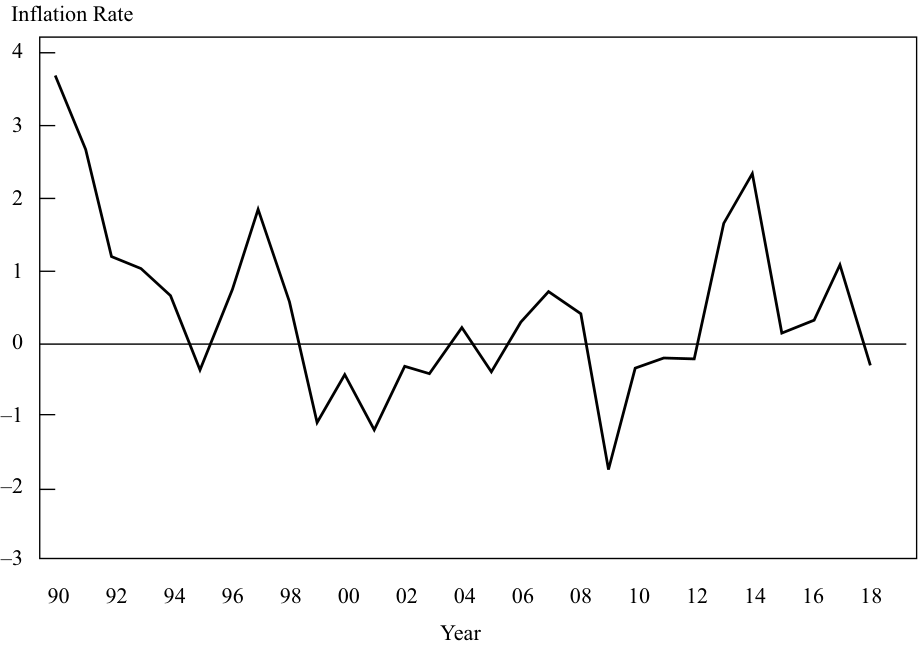

# Tập 2: Kinh tế học (Economics)
## Learning Module 4 Monetary Policy (Trang PDF 113–148)

---

# Tập 2: Kinh tế học (Volume 2: Economics)
## Học phần 4: Chính sách Tiền tệ (Learning Module 4: Monetary Policy)
### Phần 1/3: Giới thiệu (Introduction) (Trang PDF 113–123)

---

<!-- PDF Page 113 -->

#### H Ọ C P H Ầ N (L E A R N I N G M O D U L E)

# **<mark>4</mark>** 

### **Chính sách Tiền tệ (Monetary Policy)** 

###### **<mark>MỤC TIÊU HỌC TẬP (LEARNING OUTCOMES)</mark>** 

|**_Mức độ thành thạo (Mastery)_**|**_Ứng viên cần có khả năng (The candidate should be able to):_**|
|---|---|
||mô tả vai trò và mục tiêu của các ngân hàng trung ương (*describe the roles and objectives of central banks*)|
||mô tả các công cụ được sử dụng để thực thi chính sách tiền tệ và cơ chế truyền dẫn tiền tệ, đồng thời giải thích mối quan hệ giữa chính sách tiền tệ với tăng trưởng kinh tế, lạm phát, lãi suất và tỷ giá hối đoái (*describe tools used to implement monetary policy tools and the monetary transmission mechanism, and explain the relationships between monetary policy and economic growth, inflation, interest, and exchange rates*)|
||mô tả những phẩm chất của các ngân hàng trung ương hiệu quả; đối chiếu việc sử dụng mục tiêu lạm phát, lãi suất và tỷ giá hối đoái của chúng trong chính sách tiền tệ mở rộng hoặc thu hẹp; và mô tả những hạn chế của chính sách tiền tệ (*describe qualities of effective central banks; contrast their use of inflation, interest rate, and exchange rate targeting in expansionary or contractionary monetary policy; and describe the limitations of monetary policy*)|
||giải thích sự tương tác giữa chính sách tiền tệ và chính sách tài khóa (*explain the interaction of monetary and fiscal policy*)|

<!-- Picture Text: 1  -->

##### **GIỚI THIỆU (INTRODUCTION)** 

Các ngân hàng trung ương (*Central banks*) đóng một số vai trò quan trọng trong các nền kinh tế hiện đại. Những vai trò này bao gồm việc là nhà cung cấp độc quyền đồng tiền (*monopoly supplier of the currency*), ngân hàng của chính phủ và ngân hàng của các ngân hàng (*banker to the government and the bankers’ bank*), người cho vay cuối cùng (*lender of last resort*), cơ quan quản lý và giám sát hệ thống thanh toán (*regulator and supervisor of the payments system*), người điều hành chính sách tiền tệ (*conductor of monetary policy*), và cơ quan giám sát hệ thống ngân hàng (*supervisor of the banking system*). Các ngân hàng trung ương có ba công cụ chính sẵn có: nghiệp vụ thị trường mở (*open market operations*), lãi suất tái cấp vốn (*refinancing rate*), và tỷ lệ dự trữ bắt buộc (*reserve requirements*). Sự thành công của các ngân hàng trung ương được cho là phụ thuộc vào ba khái niệm then chốt: tính độc lập (*independence*), mức độ tín nhiệm (*credibility*) và tính minh bạch (*transparency*) của ngân hàng trung ương. Cả chính sách tài khóa và chính sách tiền tệ đều có thể làm thay đổi tổng cầu, nhưng chúng thực hiện điều đó thông qua các kênh khác nhau với những tác động khác nhau lên cơ cấu của tổng cầu. 

###### **TỔNG QUAN HỌC PHẦN (LEARNING MODULE OVERVIEW)** 

- Các ngân hàng trung ương là nhà cung cấp duy nhất đồng nội tệ, ngân hàng của chính phủ và ngân hàng của các ngân hàng, người cho vay cuối cùng, cơ quan quản lý và giám sát hệ thống thanh toán, người điều hành chính sách tiền tệ, và cơ quan giám sát hệ thống ngân hàng. 

<!-- PDF Page 114 -->

- Vai trò nổi bật nhất mà các ngân hàng trung ương đảm nhận là vận hành chính sách tiền tệ của một quốc gia, đề cập đến các hoạt động của ngân hàng trung ương hướng tới việc tác động đến lượng tiền và tín dụng trong một nền kinh tế. 

- Mục tiêu bao trùm của hầu hết các ngân hàng trung ương trong việc duy trì sự ổn định giá cả (*price stability*) là mục tiêu liên quan đến việc kiểm soát lạm phát. 

- Các ngân hàng trung ương có thể điều tiết cung tiền theo một trong ba cách: nghiệp vụ thị trường mở (*open market operations*), lãi suất chính sách chính thức (*official policy rate*) và các hành động liên quan trên thị trường mua lại (*repo market*), và điều tiết các yêu cầu dự trữ bắt buộc chính thức (*official reserve requirements*). 

- **Lãi suất** mục tiêu (hay **lãi suất chính sách – *policy rate***) của ngân hàng trung ương được sử dụng để tác động đến lãi suất ngắn hạn và dài hạn và, suy cho cùng, là hoạt động kinh tế thực. 

- Lãi suất chính sách của ngân hàng trung ương phát huy tác dụng trong nền kinh tế thông qua các kênh có mối liên hệ chặt chẽ với nhau sau đây: lãi suất ngắn hạn, những thay đổi trong giá trị của các mức giá tài sản chủ chốt, tỷ giá hối đoái, và kỳ vọng của các chủ thể kinh tế. 

- Sự thành công của việc nhắm mục tiêu lạm phát (*inflation-targeting*) của các ngân hàng trung ương phụ thuộc vào ba đặc điểm then chốt: tính độc lập (*independence*), mức độ tín nhiệm (*credibility*) và tính minh bạch (*transparency*) của ngân hàng trung ương. 

- Nhiều nền kinh tế thị trường mới nổi lựa chọn vận hành chính sách tiền tệ bằng cách nhắm mục tiêu tỷ giá hối đoái (*exchange rate targeting*) của đồng tiền nước mình, hơn là một mức lạm phát trong nước cụ thể. 

- Một vấn đề lớn đối với các ngân hàng trung ương khi họ cố gắng quản lý cung tiền để tác động đến nền kinh tế thực là họ không thể kiểm soát được lượng tiền mà các hộ gia đình và tập đoàn gửi vào ngân hàng dưới dạng tiền gửi, cũng như không thể dễ dàng kiểm soát được sự sẵn lòng tạo tiền của các ngân hàng thông qua việc mở rộng tín dụng. 

- Cả chính sách tài khóa và chính sách tiền tệ đều có thể làm thay đổi tổng cầu, nhưng chúng thực hiện điều đó thông qua các kênh khác nhau với những tác động khác nhau lên cơ cấu của tổng cầu. 

- Cả chính sách tài khóa và chính sách tiền tệ đều chịu ảnh hưởng từ việc thiếu kiến thức hiện hành chính xác về nền kinh tế, bởi vì dữ liệu kinh tế định kỳ được công bố với một độ trễ thời gian và phải chịu sự điều chỉnh. 

- Sự tương tác giữa chính sách tiền tệ và chính sách tài khóa thể hiện rõ trong sự tương đương Ricardian (*Ricardian equivalence*) bởi vì nếu việc cắt giảm thuế không có tác động lên chi tiêu tư nhân do kỳ vọng thuế trong tương lai cao hơn, thì điều này có thể khiến các nhà hoạch định chính sách ưu tiên các công cụ tiền tệ hơn. 

<!-- Picture Text: 2  -->

##### **VAI TRÒ CỦA CÁC NGÂN HÀNG TRUNG ƯƠNG (ROLE OF CENTRAL BANKS)** 

*Mô tả vai trò và mục tiêu của các ngân hàng trung ương (describe the roles and objectives of central banks)* 

<!-- PDF Page 115 -->

###### **Vai trò của Ngân hàng Trung ương và Mục tiêu của Chính sách Tiền tệ (Roles of Central Banks and Objectives of Monetary Policy)** 

Các ngân hàng trung ương đóng một số vai trò then chốt trong các nền kinh tế hiện đại. Nhìn chung, ngân hàng trung ương là nhà cung cấp duy nhất đồng nội tệ, ngân hàng của chính phủ và ngân hàng của các ngân hàng, người cho vay cuối cùng, cơ quan quản lý và giám sát hệ thống thanh toán, người điều hành chính sách tiền tệ, và cơ quan giám sát hệ thống ngân hàng. Hãy cùng xem xét lần lượt từng vai trò này. 

Ở hình thức sơ khai nhất, tiền có thể được trao đổi lấy một loại hàng hóa quý hiếm được quy định trước, thường là vàng, và các kỳ phiếu (*promissory notes*) được phát hành bởi nhiều ngân hàng tư nhân. Tuy nhiên, ngày nay, các định chế thuộc sở hữu nhà nước—thường là các ngân hàng trung ương—được pháp luật chỉ định là nhà cung cấp độc quyền của một đồng tiền. Ban đầu, các nhà độc quyền này cung cấp tiền có thể chuyển đổi thành một lượng vàng được quy định trước; họ tuân theo **bản vị vàng (*gold standard*)**. Ví dụ, cho đến năm 1931, tiền giấy (*bank notes*) do ngân hàng trung ương của Anh, tức Ngân hàng Trung ương Anh (*Bank of England*), phát hành có thể được quy đổi tại ngân hàng để lấy một lượng vàng được quy định trước. Nhưng Anh, giống như hầu hết các nền kinh tế lớn khác, đã từ bỏ nguyên tắc khả năng chuyển đổi này vào nửa đầu thế kỷ XX. Tiền ở tất cả các nền kinh tế lớn ngày nay theo luật không thể chuyển đổi thành bất kỳ thứ gì khác, nhưng về mặt pháp lý, nó là **phương tiện thanh toán hợp pháp (*legal tender*)**. Điều này có nghĩa là nó phải được chấp nhận khi được đưa ra để trao đổi lấy hàng hóa và dịch vụ. Tiền không thể chuyển đổi thành bất kỳ hàng hóa nào khác được gọi là **tiền pháp định (*fiat money*)**. Tiền pháp định có được giá trị của nó thông qua sắc lệnh của chính phủ và bởi vì mọi người chấp nhận nó để thanh toán cho hàng hóa và dịch vụ cũng như để trả nợ. 

Miễn là tiền pháp định được mọi người chấp nhận như một phương tiện trao đổi (*medium of exchange*), và nó giữ được giá trị của mình theo thời gian, thì nó cũng sẽ có thể đóng vai trò như một đơn vị hạch toán (*unit of account*). Tuy nhiên, một khi nền kinh tế đã chuyển sang hệ thống tiền pháp định, vai trò của nhà cung cấp đồng tiền đó càng trở nên sống còn hơn bởi vì họ có thể, ví dụ, mở rộng nguồn cung tiền này vô thời hạn nếu họ muốn làm như vậy. Do đó, các ngân hàng trung ương đóng một vai trò cốt tử trong các nền kinh tế hiện đại với tư cách là những người cung cấp và bảo vệ giá trị của các đồng tiền pháp định của họ và là những định chế được giao trọng trách duy trì niềm tin vào đồng tiền của mình. Với tư cách là nhà cung cấp duy nhất đồng nội tệ, các ngân hàng trung ương nằm ở vị trí trung tâm của đời sống kinh tế. Vì vậy, họ đảm nhận thêm các vai trò khác bên cạnh việc là người cung cấp và người bảo vệ giá trị đồng tiền của mình. 

Hầu hết các ngân hàng trung ương đóng vai trò là ngân hàng của chính phủ và của các ngân hàng khác. Họ cũng đóng vai trò là **người cho vay cuối cùng (*lender of last resort*)** đối với các ngân hàng. Bởi vì ngân hàng trung ương về thực chất có năng lực in tiền, nên nó ở vị thế có thể cung cấp nguồn vốn cho các ngân hàng đang đối mặt với khủng hoảng. Thực tế là các chủ thể kinh tế biết rằng ngân hàng trung ương luôn sẵn sàng cung cấp thanh khoản cần thiết cho bất kỳ ngân hàng nào thuộc thẩm quyền quản lý của mình và họ tin tưởng vào bảo hiểm tiền gửi ngân hàng của chính phủ đã giúp ngăn chặn hiện tượng rút tiền hàng loạt (*bank runs*) ngay từ đầu. Tuy nhiên, cuộc khủng hoảng tài chính gần đây đã cho thấy rằng sự hiểu biết này không phải lúc nào cũng đủ để ngăn chặn một cuộc rút tiền hàng loạt tại ngân hàng. 

###### **VÍ DỤ 1 (EXAMPLE 1)** 

###### **Cuộc Rút tiền Hàng loạt tại Ngân hàng Northern Rock (The Northern Rock Bank Run)** 

Vào cuối mùa hè năm 2007, sự sụt giảm giá nhà tại Hoa Kỳ và sự sụp đổ liên quan của thị trường thế chấp dưới chuẩn (*sub-prime mortgage market*) của Hoa Kỳ đã trở thành chất xúc tác cho một cuộc khủng hoảng thanh khoản toàn cầu. Các ngân hàng bắt đầu tích trữ tiền mặt và từ chối cho các ngân hàng khác vay thông qua thị trường liên ngân hàng ngoại trừ ở những mức lãi suất trừng phạt cực kỳ cao. Điều này đã gây ra những khó khăn nghiêm trọng cho một ngân hàng thế chấp của Vương quốc Anh là Northern Rock. Danh mục cho vay thế chấp của Northern Rock đã mở rộng nhanh chóng trong những năm trước đó khi ngân hàng này vay nợ ồ ạt từ các thị trường tiền tệ. Giờ đây đã rõ ràng là sự mở rộng này đã phải đánh đổi bằng chất lượng khoản vay. Cơ quan quản lý của Vương quốc Anh lúc bấy giờ là Cơ quan Dịch vụ Tài chính (*Financial Services Authority* – FSA) sau đó đã báo cáo vào năm 2008 rằng các thông lệ cho vay của Northern Rock đã không chú trọng đúng mức đến chất lượng tín dụng của người vay thế chấp lẫn giá trị của các bất động sản dùng làm tài sản bảo đảm cho các khoản thế chấp 

<!-- PDF Page 116 -->

đó. Nằm ở nhóm tệ nhất về thông lệ ngân hàng và phụ thuộc nặng nề vào các thị trường vốn quốc tế để huy động nguồn vốn, Northern Rock do đó rất dễ bị tổn thương trước sự sụt giảm thanh khoản toàn cầu. Khi cuộc khủng hoảng thanh khoản bùng phát mạnh, Northern Rock nhận thấy rằng họ không thể tái tài trợ các khoản vay trên thị trường tiền tệ đang đáo hạn của mình. Vào ngày 12 tháng 9 năm 2007, trong cơn khát thanh khoản tuyệt vọng, hội đồng quản trị của Northern Rock đã tiếp cận ngân hàng trung ương Vương quốc Anh để xin nguồn vốn cần thiết. 

Tuy nhiên, tin tức về vị thế thanh khoản hiểm nghèo của Northern Rock đã bị công chúng và, sát sườn hơn, là những người gửi tiền bán lẻ (*retail depositors*) của Northern Rock biết được. Vào ngày 14 tháng 9, sau khi nghe tin tức, những hàng người dài bắt đầu hình thành bên ngoài các chi nhánh của Northern Rock khi những người gửi tiền cố gắng rút tiền tiết kiệm của họ. Vào ngày hôm đó, ước tính những người gửi tiền tại Northern Rock đã rút khoảng 1 tỷ GBP, tương đương 5% tổng tiền gửi của Northern Rock. Sự hoảng loạn tiếp tục lan rộng khi các nhà đầu tư có tài khoản “chỉ giao dịch qua internet” (*internet-only*) của Northern Rock không thể rút tiền của họ do trang web của Northern Rock bị sập. Thêm 1 tỷ GBP nữa đã bị rút ra trong hai ngày tiếp theo. 

Giá cổ phiếu của Northern Rock lao dốc nhanh chóng, cũng như giá cổ phiếu của các ngân hàng tương tự khác tại Vương quốc Anh. Do đó, cuộc khủng hoảng đe dọa nhấn chìm nhiều hơn một ngân hàng. Để ngăn chặn hiệu ứng lây lan (*contagion*), Bộ trưởng Bộ Tài chính Anh (*Chancellor of the Exchequer*) vào ngày 17 tháng 9 đã tuyên bố rằng chính phủ Vương quốc Anh sẽ bảo lãnh toàn bộ tiền gửi tại Northern Rock. Tuyên bố này đủ để ổn định tình hình và xét việc cho Northern Rock vay giờ đây cũng giống hệt như cho chính phủ vay, lượng tiền gửi thực tế đã bắt đầu tăng trở lại. 

Cuối cùng, Northern Rock đã bị quốc hữu hóa bởi chính phủ Vương quốc Anh, với hy vọng rằng vào một thời điểm nào đó trong tương lai, nó có thể được tư nhân hóa trở lại một khi bảng cân đối kế toán của nó đã được khôi phục. 

Các ngân hàng trung ương thường được chính phủ giao trọng trách giám sát hệ thống ngân hàng, hoặc ít nhất là giám sát những ngân hàng mà họ cấp phép nhận tiền gửi. Ở một số quốc gia, vai trò này được đảm nhận bởi một cơ quan độc lập riêng biệt. Ở các quốc gia khác, ngân hàng trung ương có thể đồng chịu trách nhiệm với một cơ quan khác trong việc giám sát các ngân hàng của mình. 

Minh họa 1 liệt kê các cơ quan giám sát ngân hàng tại các quốc gia G–10; các ngân hàng trung ương được gạch chân (hoặc chú thích). Như minh họa cho thấy, hầu hết nhưng không phải tất cả các hệ thống ngân hàng đều có một cơ quan giám sát duy nhất, và cơ quan đó không nhất thiết phải là ngân hàng trung ương. Một vài quốc gia, chẳng hạn như Đức và Hoa Kỳ, có nhiều hơn một cơ quan giám sát. 

**Minh họa 1: Giám sát Ngân hàng trong khối G–10 (Exhibit 1: Banking Supervision in the G–10)** 

|**Quốc gia (Country)**|**Các định chế (Institutions)**|
|---|---|
|Bỉ (*Belgium*)|Ủy ban Ngân hàng và Tài chính (*Banking and Finance Commission*)|
|Canada|Văn phòng Giám sát các Định chế Tài chính (*Office of the Superintendent of Financial Institutions*)|
|Pháp (*France*)|Ủy ban Ngân hàng (*Commission Bancaire*)|
|Đức (*Germany*)|Cơ quan Giám sát Ngân hàng Liên bang (*Federal Banking Supervisory Office*); <u>Ngân hàng Trung ương Đức (*Deutsche Bundesbank*)</u>|
|Ý (*Italy*)|<u>Ngân hàng Trung ương Ý (*Bank of Italy*)</u>|
|Nhật Bản (*Japan*)|Cơ quan Dịch vụ Tài chính (*Financial Services Agency*)|
|Hà Lan (*Netherlands*)|<u>Ngân hàng Trung ương Hà Lan (*Bank of Netherlands*)</u>|
|Thụy Điển (*Sweden*)|Cơ quan Giám sát Tài chính Thụy Điển (*Swedish Financial Supervisory Authority*)|
|Thụy Sĩ (*Switzerland*)|Ủy ban Liên bang (*Federal Commission*)|
|Vương quốc Anh (*United Kingdom*)|<u>Ngân hàng Trung ương Anh (*Bank of England*)</u>|
|Hoa Kỳ (*United States*)|Văn phòng Kiểm soát Tiền tệ (*Office of the Comptroller of the Currency*); <u>Cục Dự trữ Liên bang (*Federal Reserve*)</u>; Tổng công ty Bảo hiểm Tiền gửi Liên bang (*Federal Deposit Insurance Corporation*)|

<!-- PDF Page 117 -->

Vương quốc Anh là một nghiên cứu tình huống thú vị về khía cạnh này. Cho đến tháng 5 năm 1997, Ngân hàng Trung ương Anh (*Bank of England*) có trách nhiệm theo luật định đối với việc giám sát ngân hàng tại Vương quốc Anh. Vào tháng 5 năm 1997, việc giám sát ngân hàng đã được tách khỏi Ngân hàng Trung ương Anh và giao cho một cơ quan mới là Cơ quan Dịch vụ Tài chính (*Financial Services Authority* – FSA). Tuy nhiên, việc tách trách nhiệm giám sát ngân hàng ra khỏi ngân hàng trung ương đã bị một số người coi là yếu tố góp phần dẫn đến cuộc rút tiền hàng loạt tại ngân hàng thế chấp Northern Rock, và nhìn chung là một yếu tố góp phần dẫn đến cuộc khủng hoảng ngân hàng gần đây. Do điểm yếu được nhận thấy này trong việc tách rời ngân hàng trung ương khỏi hoạt động giám sát ngân hàng, Ngân hàng Trung ương Anh đã giành lại trách nhiệm giám sát và quản lý ngân hàng vào năm 2013. 

Có lẽ vai trò ít được đánh giá đúng mức nhất của một ngân hàng trung ương là vai trò của nó trong **hệ thống thanh toán (*payments system*)**. Các ngân hàng trung ương thường được yêu cầu giám sát, quản lý và thiết lập các tiêu chuẩn cho hệ thống thanh toán của một quốc gia. Để hệ thống vận hành trơn tru, các quy trình thủ tục phải vững chắc và được chuẩn hóa. Ngân hàng trung ương thường sẽ giám sát hệ thống thanh toán và cũng sẽ chịu trách nhiệm cho việc áp dụng thành công bất kỳ quy trình mới nào. Xét bản chất quốc tế của tài chính, ngân hàng trung ương cũng sẽ chịu trách nhiệm điều phối các hệ thống thanh toán trên phạm vi quốc tế với các ngân hàng trung ương khác. 

Hầu hết các ngân hàng trung ương đều chịu trách nhiệm quản lý **dự trữ ngoại hối (*foreign currency reserves*)** cũng như dự trữ vàng (*gold reserves*) của quốc gia mình. Liên quan đến dự trữ vàng, mặc dù các quốc gia đã từ bỏ bản vị vàng vào đầu thế kỷ XX, các ngân hàng trung ương trên thế giới vẫn nắm giữ một lượng vàng lớn. Do đó, nếu các ngân hàng trung ương quyết định bán ra một tỷ lệ đáng kể dự trữ vàng của họ, điều đó có khả năng làm giảm giá vàng. 

Cuối cùng, các ngân hàng trung ương thường chịu trách nhiệm vận hành **chính sách tiền tệ (*monetary policy*)** của một quốc gia. Đây có thể coi là vai trò nổi bật nhất mà các tổ chức quan trọng này đảm nhận. Hãy nhớ lại rằng chính sách tiền tệ đề cập đến các hoạt động của ngân hàng trung ương hướng tới việc tác động đến lượng tiền và tín dụng trong một nền kinh tế. Với tư cách là nhà cung cấp duy nhất đồng nội tệ của một quốc gia, các ngân hàng trung ương ở vị thế lý tưởng để thực thi và quyết định chính sách tiền tệ. 

Tóm lại, các ngân hàng trung ương đảm nhận một loạt các vai trò và trách nhiệm. Không phải tất cả các ngân hàng trung ương đều đảm nhận trách nhiệm giám sát các ngân hàng, nhưng tất cả các vai trò sau đây thông thường đều do ngân hàng trung ương đảm nhận: 

- Nhà cung cấp độc quyền đồng tiền (*Monopoly supplier of the currency*); 

- Ngân hàng của chính phủ và ngân hàng của các ngân hàng (*Banker to the government and the bankers’ bank*); 

- Người cho vay cuối cùng (*Lender of last resort*); 

- Cơ quan quản lý và giám sát hệ thống thanh toán (*Regulator and supervisor of the payments system*); 

- Người điều hành chính sách tiền tệ (*Conductor of monetary policy*); và 

- Cơ quan giám sát hệ thống ngân hàng (*Supervisor of the banking system*). 

###### **Các Mục tiêu của Chính sách Tiền tệ (The Objectives of Monetary Policy)** 

Các ngân hàng trung ương thực hiện nhiều vai trò quan trọng khác nhau, nhưng vì mục đích bao trùm nào? Việc đọc kỹ trang web của các ngân hàng trung ương trên thế giới sẽ hé lộ một loạt các lời giải thích về mục tiêu của họ. Mục tiêu của họ rõ ràng có liên quan đến vai trò của họ, và vì vậy thường xuyên có sự đề cập đến các mục tiêu liên quan đến sự ổn định của hệ thống tài chính và các hệ thống thanh toán. Một số ngân hàng trung ương được giao nhiệm vụ làm tất cả những gì có thể để duy trì toàn dụng nhân công và sản lượng. Một số khác cũng có những vai trò liên quan nhưng ít hữu hình hơn, chẳng hạn như _duy trì niềm tin vào hệ thống tài chính_, hoặc thậm chí là _thúc đẩy sự hiểu biết về khu vực tài chính_. Hầu hết dường như đều thừa nhận một cách rõ ràng một mục tiêu bao trùm—đó là mục tiêu duy trì **sự ổn định giá cả (*price stability*)**. 

<!-- PDF Page 118 -->

Vì vậy, mặc dù các ngân hàng trung ương thường phải thực hiện nhiều vai trò, hầu hết đều chỉ rõ một mục tiêu bao trùm. Minh họa 2 liệt kê những gì chúng ta có thể gọi là các mục tiêu chính của một số ngân hàng trung ương, từ cả các nền kinh tế thị trường phát triển và thị trường mới nổi. 

###### **Minh họa 2: Các Mục tiêu của Ngân hàng Trung ương (Exhibit 2: The Objectives of Central Banks)** 

###### **Ngân hàng Trung ương Brazil (The Central Bank of Brazil)** 

Sứ mệnh định chế của ngân hàng này là “đảm bảo sự ổn định sức mua của đồng tiền và một hệ thống tài chính vững chắc, hiệu quả.” 

###### **Ngân hàng Trung ương Châu Âu (The European Central Bank – ECB)** 

“Duy trì sự ổn định giá cả là mục tiêu chính của Hệ thống Euro (*Euro system*) và của chính sách tiền tệ chung mà hệ thống này chịu trách nhiệm. Điều này được quy định trong Hiệp ước về Chức năng của Liên minh Châu Âu (*Treaty on the Functioning of the European Union*), Điều 127 (1).” 

“Không làm phương hại đến mục tiêu ổn định giá cả”, hệ thống đồng euro cũng sẽ “hỗ trợ các chính sách kinh tế chung trong Cộng đồng với mục đích góp phần đạt được các mục tiêu của Cộng đồng.” Những mục tiêu này bao gồm “mức việc làm cao” và “tăng trưởng bền vững và không gây lạm phát.” 

###### **Cục Dự trữ Liên bang Hoa Kỳ (The US Federal Reserve)** 

“Cục Dự trữ Liên bang thiết lập chính sách tiền tệ của quốc gia nhằm thúc đẩy các mục tiêu toàn dụng nhân công tối đa (*maximum employment*), giá cả ổn định (*stable prices*), và lãi suất dài hạn ở mức vừa phải (*moderate long-term interest rates*).” 

###### **Ngân hàng Dự trữ Úc (The Reserve Bank of Australia)** 

“Nhiệm vụ của Hội đồng Ngân hàng Dự trữ, trong giới hạn quyền hạn của mình, là đảm bảo rằng chính sách tiền tệ và ngân hàng của Ngân hàng được hướng tới lợi ích lớn nhất của người dân Úc và quyền hạn của Ngân hàng ... được thực thi theo cách thức mà, theo ý kiến của Hội đồng Ngân hàng Dự trữ, sẽ đóng góp tốt nhất vào: 

- **a.** sự ổn định của đồng tiền Úc; 

- **b.** việc duy trì toàn dụng nhân công tại Úc; và 

- **c.** sự thịnh vượng kinh tế và phúc lợi của người dân Úc.” 

###### **Ngân hàng Trung ương Hàn Quốc (The Bank of Korea)** 

“Mục đích chính của Ngân hàng, như được quy định bởi Đạo luật Ngân hàng Trung ương Hàn Quốc năm 1962, là theo đuổi sự ổn định giá cả.” 

_Nguồn (Source):_ “Trang web của các Ngân hàng Trung ương và Cơ quan Quản lý Tiền tệ” (*“Central Bank and Monetary Authority Websites”*), Ngân hàng Thanh toán Quốc tế (*Bank for International Settlements*), http://www.bis.org/cbanks.htm. 

###### **BỘ CÂU HỎI (QUESTION SET)** 

1. Ngân hàng trung ương thông thường _không_ phải là: 

   - **A.** người cho vay cuối cùng (*lender of last resort*). 

   - **B.** ngân hàng của chính phủ và của các ngân hàng. 

<!-- PDF Page 119 -->

   - **C.** cơ quan thiết lập mức thuế suất đánh trên tiền lãi tiết kiệm. 

   - **Lời giải (Solution):** 

C là đáp án đúng. Ngân hàng trung ương thông thường là người cho vay cuối cùng và là ngân hàng của các ngân hàng và chính phủ, nhưng việc xác định tất cả các mức thuế suất thông thường là đặc quyền của chính phủ và là một vấn đề thuộc về chính sách tài khóa. 

2. Điều nào sau đây mô tả _đúng nhất_ mục tiêu bao trùm, dài hạn của hầu hết các ngân hàng trung ương? 

   - **A.** Ổn định giá cả (*Price stability*) 

   - **B.** Tăng trưởng kinh tế nhanh (*Fast economic growth*) 

   - **C.** Thặng dư tài khoản vãng lai (*Current account surplus*) 

   - **Lời giải (Solution):** 

A là đáp án đúng. Các ngân hàng trung ương thông thường có nhiều mục tiêu khác nhau, nhưng mục tiêu quan trọng nhất gần như luôn luôn là sự ổn định giá cả. 

3. Vai trò nào ngân hàng trung ương _ít có khả năng nhất_ sẽ đảm nhận? 

   - **A.** Người cho vay cuối cùng (*Lender of last resort*) 

   - **B.** Nhà cung cấp đồng tiền (*Supplier of the currency*) 

   - **C.** Cơ quan giám sát duy nhất đối với các ngân hàng (*Sole supervisor of banks*) 

   - **Lời giải (Solution):** 

C là đáp án đúng. Việc giám sát các ngân hàng không phải là vai trò mà tất cả các ngân hàng trung ương đều đảm nhận. Khi đó là vai trò của ngân hàng trung ương, trách nhiệm này có thể được chia sẻ với một hoặc nhiều tổ chức khác. 

Như chúng ta đã thảo luận, một trong những đặc điểm thiết yếu của một hệ thống tiền tệ là phương tiện trao đổi phải có giá trị tương đối ổn định từ kỳ này sang kỳ tiếp theo. Khi đó, có thể lập luận rằng mục tiêu bao trùm của hầu hết các ngân hàng trung ương trong việc duy trì sự ổn định giá cả chính là mục tiêu liên quan đến việc kiểm soát lạm phát. Trước khi khám phá các công cụ mà ngân hàng trung ương sử dụng để kiểm soát lạm phát, trước tiên chúng ta nên xem xét các chi phí tiềm tàng của lạm phát. Nói cách khác, chúng ta nên tự hỏi tại sao các nhà hoạch định ngân hàng trung ương lại tin rằng việc kiểm soát một biến số danh nghĩa lại quan trọng đến vậy. 

##### **CÁC CÔNG CỤ CHÍNH SÁCH TIỀN TỆ VÀ TRUYỀN DẪN TIỀN TỆ (MONETARY POLICY TOOLS AND MONETARY TRANSMISSION)** 

## **<mark>3</mark>** 

*Mô tả các công cụ được sử dụng để thực thi chính sách tiền tệ và cơ chế truyền dẫn tiền tệ, đồng thời giải thích mối quan hệ giữa chính sách tiền tệ với tăng trưởng kinh tế, lạm phát, lãi suất và tỷ giá hối đoái (describe tools used to implement monetary policy tools and the monetary transmission mechanism, and explain the relationships between monetary policy and economic growth, inflation, interest, and exchange rates)* 

Các ngân hàng trung ương có ba công cụ chính sẵn có: nghiệp vụ thị trường mở (*open market operations*), lãi suất tái cấp vốn (*the refinancing rate*), và yêu cầu dự trữ bắt buộc (*reserve requirements*). 

<!-- PDF Page 120 -->

###### **Nghiệp vụ Thị trường Mở (Open Market Operations)** 

Một trong những cách trực tiếp nhất để một ngân hàng trung ương làm tăng hoặc giảm lượng tiền đang lưu thông là thông qua **nghiệp vụ thị trường mở (*open market operations*)**. Nghiệp vụ thị trường mở bao gồm việc mua và bán trái phiếu chính phủ từ và cho các ngân hàng thương mại hoặc các nhà tạo lập thị trường được chỉ định (*designated market makers*). Ví dụ, khi ngân hàng trung ương mua trái phiếu chính phủ từ các ngân hàng thương mại, điều này làm tăng dự trữ của các ngân hàng khu vực tư nhân ở bên phần tài sản (*asset side*) trên bảng cân đối kế toán của họ. Nếu sau đó các ngân hàng sử dụng các khoản dự trữ dôi dư (*surplus reserves*) này bằng cách tăng cho vay đối với các tập đoàn và hộ gia đình, thì tăng trưởng cung tiền rộng (*broad money growth*) sẽ mở rộng thông qua quá trình số nhân tiền tệ (*money multiplier process*). Tương tự, ngân hàng trung ương có thể bán trái phiếu chính phủ cho các ngân hàng thương mại. Khi làm như vậy, dự trữ của các ngân hàng thương mại sụt giảm, làm giảm năng lực cho vay (tức là khả năng tạo tín dụng) của họ đối với các hộ gia đình và tập đoàn, và do đó làm cho tăng trưởng cung tiền rộng sụt giảm thông qua cơ chế số nhân tiền tệ. Khi sử dụng nghiệp vụ thị trường mở, ngân hàng trung ương có thể nhắm mục tiêu vào một mức dự trữ ngân hàng thương mại mong muốn hoặc một mức lãi suất mong muốn đối với các khoản dự trữ này. 

###### **Lãi suất Chính sách của Ngân hàng Trung ương (The Central Bank’s Policy Rate)** 

Biểu hiện rõ ràng nhất về ý định và quan điểm của một ngân hàng trung ương đến từ mức lãi suất mà nó thiết lập. Tên gọi của **lãi suất chính thức (*official interest rate*)** (hay **lãi suất chính sách chính thức – *official policy rate*** hoặc chỉ đơn giản là **lãi suất chính sách – *policy rate***) khác nhau giữa các ngân hàng trung ương, nhưng mục đích của nó là nhằm tác động đến lãi suất ngắn hạn và dài hạn và suy cho cùng là hoạt động kinh tế thực. 

Mức lãi suất mà một ngân hàng trung ương thiết lập và công bố công khai thông thường là mức lãi suất mà tại đó ngân hàng trung ương sẵn lòng cho các ngân hàng thương mại vay tiền (mặc dù thông lệ thực tế có khác nhau giữa các quốc gia). Lãi suất chính sách này có thể đạt được bằng cách sử dụng các mức lãi suất cho vay có tài sản bảo đảm trong ngắn hạn, được gọi là lãi suất mua lại (*repo rates*). Ví dụ, nếu ngân hàng trung ương muốn tăng cung tiền, họ có thể mua trái phiếu (thường là trái phiếu chính phủ) từ các ngân hàng, kèm theo một thỏa thuận sẽ bán lại chúng vào một thời điểm nào đó trong tương lai. Giao dịch này được gọi là **hợp đồng mua lại (*repurchase agreement*)**. Thông thường, kỳ hạn của các hợp đồng repo dao động từ qua đêm (*overnight*) đến hai tuần. Về bản chất, điều này đại diện cho một khoản vay có bảo đảm dành cho các ngân hàng, và người cho vay (trong trường hợp này là ngân hàng trung ương) hưởng mức lãi suất repo (*repo rate*). 

Giả sử rằng một ngân hàng trung ương công bố tăng lãi suất chính thức của mình. Các ngân hàng thương mại thông thường cũng sẽ tăng **lãi suất cơ sở (*base rates*)** của họ cùng một lúc. Lãi suất cơ sở của một ngân hàng thương mại là mức lãi suất tham chiếu (*reference rate*) mà dựa vào đó ngân hàng xác định mức lãi suất cho vay đối với tất cả các khách hàng khác. Ví dụ, các khách hàng doanh nghiệp lớn có thể trả mức lãi suất cơ sở cộng thêm 1% cho khoản vay của họ từ ngân hàng, trong khi cùng ngân hàng đó có thể cho một khách hàng doanh nghiệp nhỏ vay tiền ở mức lãi suất cơ sở cộng thêm 3%. Nhưng tại sao các ngân hàng thương mại lại lập tức tăng lãi suất cơ sở hay lãi suất tham chiếu của họ chỉ vì lãi suất tái cấp vốn (*refinancing rate*) của ngân hàng trung ương đã tăng lên? 

Câu trả lời là các ngân hàng thương mại không muốn cho vay ở mức lãi suất thấp hơn mức lãi suất mà họ bị ngân hàng trung ương tính phí. Về thực chất, ngân hàng trung ương có thể buộc các ngân hàng thương mại phải vay từ mình ở mức lãi suất này bởi vì ngân hàng trung ương có thể thực hiện các nghiệp vụ thị trường mở tạo ra sự thiếu hụt tiền tệ, buộc các ngân hàng phải bán trái phiếu cho ngân hàng trung ương với một mức giá mua lại đã được thỏa thuận trước (tức là một hợp đồng mua lại). Lãi suất repo sẽ được định sao cho ngân hàng trung ương thu được mức lãi suất tái cấp vốn chính thức trên các giao dịch đó. 

Tên gọi của lãi suất tái cấp vốn chính thức của mỗi ngân hàng trung ương là khác nhau. Lãi suất tái cấp vốn của Ngân hàng Trung ương Anh (*Bank of England*) là **lãi suất repo kỳ hạn hai tuần (*two-week repo rate*)**. Nói cách khác, Ngân hàng Trung ương Anh ấn định mức lãi suất mà tại đó họ sẵn lòng cho khu vực ngân hàng vay tiền kỳ hạn hai tuần. Lãi suất chính sách chính thức của Ngân hàng Trung ương Châu Âu (ECB) được gọi là **lãi suất tái cấp vốn (*refinancing rate*)**, xác định mức lãi suất mà tại đó ECB sẵn lòng cho khu vực ngân hàng thuộc Khu vực đồng Euro vay tiền ngắn hạn. 

Mức lãi suất tương ứng tại Hoa Kỳ là lãi suất chiết khấu (*discount rate*), là mức lãi suất dành cho các ngân hàng thành viên vay trực tiếp từ Hệ thống Dự trữ Liên bang (*Federal Reserve System*). Mức lãi suất quan trọng nhất được sử dụng trong chính sách tiền tệ của Hoa Kỳ là **lãi suất quỹ liên bang (*federal funds rate*)**. Lãi suất quỹ liên bang 

<!-- PDF Page 121 -->

(hay **fed funds rate**) là lãi suất cho vay liên ngân hàng đối với các khoản vay dự trữ qua đêm (*overnight borrowings of reserves*). Ủy ban Thị trường Mở Liên bang (*Federal Open Market Committee* – FOMC) tìm cách đưa mức lãi suất này về mức mục tiêu bằng cách giảm hoặc bổ sung dự trữ vào hệ thống ngân hàng thông qua nghiệp vụ thị trường mở. Mức lãi suất này được FOMC xem xét lại tại các cuộc họp được tổ chức sáu tuần một lần (mặc dù mục tiêu có thể được thay đổi giữa các cuộc họp, nếu cần thiết). 

Thông qua việc thiết lập một mức lãi suất chính sách, ngân hàng trung ương có thể điều tiết lượng tiền trên các thị trường tiền tệ. Nói chung, lãi suất chính sách càng cao, mức phạt tiềm tàng mà các ngân hàng sẽ phải trả cho ngân hàng trung ương nếu họ bị thiếu hụt thanh khoản càng cao, sự sẵn lòng cắt giảm cho vay của họ sẽ càng lớn, và tăng trưởng cung tiền rộng sẽ càng có nhiều khả năng thu hẹp lại. 

###### **Yêu cầu Dự trữ Bắt buộc (Reserve Requirements)** 

Cách thức chính thứ ba mà các ngân hàng trung ương có thể hạn chế hoặc làm tăng cung tiền trong một nền kinh tế là thông qua **yêu cầu dự trữ bắt buộc (*reserve requirement*)**. Chúng ta đã thấy rằng quá trình tạo tiền có sức mạnh càng lớn khi tỷ lệ phần trăm dự trữ bắt buộc của các ngân hàng càng thấp. Vì vậy, một ngân hàng trung ương có thể hạn chế việc tạo tiền bằng cách nâng cao yêu cầu dự trữ bắt buộc đối với các ngân hàng. Tuy nhiên, công cụ chính sách này không còn được sử dụng nhiều ngày nay tại các nền kinh tế thị trường phát triển. Thật vậy, một số ngân hàng trung ương, chẳng hạn như Ngân hàng Trung ương Anh, thậm chí không còn thiết lập các yêu cầu dự trữ tối thiểu đối với các ngân hàng thuộc thẩm quyền quản lý của họ. Việc thay đổi yêu cầu dự trữ bắt buộc thường xuyên gây ra sự xáo trộn đối với các ngân hàng. Ví dụ, nếu một ngân hàng trung ương tăng yêu cầu dự trữ bắt buộc, một ngân hàng đang thiếu hụt dự trữ có thể phải ngừng các hoạt động cho vay của mình cho đến khi tích lũy đủ mức dự trữ cần thiết, bởi vì tiền gửi sẽ khó có khả năng tăng đủ nhanh để ngân hàng tích lũy dự trữ theo cách này. Tuy nhiên, yêu cầu dự trữ bắt buộc vẫn được sử dụng một cách tích cực ở nhiều quốc gia thị trường mới nổi để kiểm soát hoạt động cho vay và vẫn là một công cụ chính sách tiềm năng đối với những ngân hàng trung ương hiện không sử dụng nó. 

Tóm lại, các ngân hàng trung ương có thể điều tiết cung tiền theo một trong ba cách: 

- nghiệp vụ thị trường mở (*open market operations*); 

- lãi suất chính sách chính thức và các hành động liên quan trên thị trường repo (*official policy rates and associated actions in the repo market*); và 

- điều tiết các yêu cầu dự trữ bắt buộc chính thức (*manipulation of official reserve requirements*). 

###### **Cơ chế Truyền dẫn (The Transmission Mechanism)** 

Mục tiêu bao trùm của một ngân hàng trung ương là duy trì sự ổn định giá cả. Chúng ta đã chứng minh cách thức một ngân hàng trung ương có thể điều tiết cung tiền và tốc độ tăng trưởng của cung tiền. Chúng ta cũng đã chỉ ra cách mà các mức lãi suất chính sách được thiết lập và nhắm mục tiêu bởi các ngân hàng trung ương thường có bản chất rất ngắn hạn; thường thì họ nhắm mục tiêu vào lãi suất qua đêm. Tuy nhiên, hầu hết các doanh nghiệp và cá nhân trong nền kinh tế thực lại đi vay và cho vay trong những khung thời gian dài hơn thế này rất nhiều. Khi đó, có thể không mấy hiển nhiên về việc làm thế nào việc thay đổi lãi suất ngắn hạn lại có thể tác động đến nền kinh tế thực, đặc biệt nếu tính trung lập của tiền tệ (*money neutrality*) đúng trong dài hạn. Thực tế là các nhà hoạch định ngân hàng trung ương tin rằng họ có thể tác động đến các biến số kinh tế thực, đặc biệt là tăng trưởng kinh tế, bằng cách tác động đến tăng trưởng cung tiền rộng cho thấy rằng họ tin rằng tiền không mang tính trung lập—ít nhất là không trung lập trong ngắn hạn. 

Minh họa 3 trình bày một sơ đồ khái quát hóa về **cơ chế truyền dẫn tiền tệ (*monetary transmission mechanism*)**. Đây là quá trình mà qua đó lãi suất của ngân hàng trung ương được truyền dẫn khắp nền kinh tế và cuối cùng tác động đến tốc độ tăng giá—tức là lạm phát. 

<!-- PDF Page 122 -->

**Minh họa 3: Sơ đồ Khái quát hóa Cơ chế Truyền dẫn Tiền tệ (Exhibit 3: A Stylized Representation of the Monetary Transmission Mechanism)** 

<!-- Picture Text: Market Rates Domestic Demand Domestic Asset Prices Total Demand Inflationary Pressure Official Rate Net External Demand Expectations/ Inflation Confidence Import Prices Exchange Rate  -->

> **Chú thích hình ảnh (Minh họa 3):**
> - **Lãi suất chính thức (*Official Rate*)** tác động qua 4 kênh:
>   1. Lãi suất thị trường (*Market Rates*)
>   2. Giá tài sản (*Asset Prices*)
>   3. Kỳ vọng / Niềm tin (*Expectations / Confidence*)
>   4. Tỷ giá hối đoái (*Exchange Rate*)
> - Các kênh này tác động đến **Cầu trong nước (*Domestic Demand*)** và **Cầu bên ngoài ròng (*Net External Demand*)**, hợp thành **Tổng cầu (*Total Demand*)**, dẫn tới **Áp lực lạm phát trong nước (*Domestic Inflationary Pressure*)**.
> - Đồng thời, **Tỷ giá hối đoái (*Exchange Rate*)** tác động đến **Giá hàng nhập khẩu (*Import Prices*)**.
> - Cả **Áp lực lạm phát trong nước** và **Giá hàng nhập khẩu** cùng quyết định **Lạm phát (*Inflation*)**.

_Nguồn (Source)_: Ngân hàng Trung ương Anh (*Bank of England*), https://www.bankofengland.co.uk/. 

Giả sử rằng một ngân hàng trung ương công bố tăng lãi suất chính thức của mình. Việc thực thi chính sách có thể bắt đầu phát huy tác dụng khắp nền kinh tế thông qua bốn kênh có liên quan mật thiết với nhau. Các kênh đó bao gồm lãi suất cho vay ngân hàng (*bank lending rates*), giá tài sản (*asset prices*), kỳ vọng của các chủ thể (*agents’ expectations*), và tỷ giá hối đoái (*exchange rates*). Thứ nhất, như đã mô tả trước đó, lãi suất cơ sở của các ngân hàng thương mại và lãi suất liên ngân hàng sẽ tăng lên để phản ứng lại mức tăng của lãi suất chính thức. Đến lượt mình, các ngân hàng sẽ tăng chi phí đi vay đối với các cá nhân và công ty ở cả kỳ hạn ngắn và dài hạn. Khi đó, các doanh nghiệp và người tiêu dùng sẽ có xu hướng vay ít đi khi lãi suất tăng lên. Sự gia tăng lãi suất ngắn hạn cũng có thể khiến giá của các tài sản như trái phiếu hoặc giá trị của các dự án vốn sụt giảm khi lãi suất chiết khấu (*discount rate*) áp dụng cho các dòng tiền tương lai tăng lên. 

Những người tham gia thị trường khi đó sẽ đi đến quan điểm rằng lãi suất cao hơn sẽ dẫn đến tăng trưởng kinh tế chậm hơn, lợi nhuận giảm sút, và giảm vay nợ để tài trợ cho việc mua tài sản. Lợi nhuận của các nhà xuất khẩu có thể sụt giảm nếu việc tăng lãi suất khiến tỷ giá hối đoái của quốc gia đó lên giá (*appreciate*), bởi vì điều này sẽ làm cho hàng xuất khẩu trong nước trở nên đắt đỏ hơn đối với người mua nước ngoài và làm suy yếu nhu cầu mua chúng. Sự sụt giảm giá tài sản cũng như sự gia tăng giá cả sẽ làm giảm của cải tài chính của hộ gia đình và do đó dẫn đến sự sụt giảm trong tăng trưởng tiêu dùng. Kỳ vọng liên quan đến lãi suất có thể đóng một vai trò đáng kể trong nền kinh tế. Thường thì các công ty và cá nhân sẽ đưa ra các quyết định đầu tư và mua sắm dựa trên kỳ vọng lãi suất của họ, được ngoại suy từ các sự kiện gần đây. Nếu động thái lãi suất của ngân hàng trung ương được kỳ vọng rộng rãi là sẽ được nối tiếp bởi các đợt tăng lãi suất khác, các nhà đầu tư và công ty sẽ hành động tương ứng. Tiêu dùng, vay nợ và giá tài sản tất cả đều có thể sụt giảm do kết quả của việc điều chỉnh lại kỳ vọng. 

Sự gia tăng lãi suất chính sách của ngân hàng trung ương có thể làm giảm cầu trong nước thực (*real domestic demand*) và cầu bên ngoài ròng (*net external demand* — tức là phần chênh lệch giữa tiêu dùng xuất khẩu và nhập khẩu) thông qua một loạt các cách thức có mối liên hệ chặt chẽ với nhau. Tổng cầu yếu hơn sẽ có xu hướng tạo áp lực giảm xuống lên tỷ lệ lạm phát trong nước—cũng giống như một đồng tiền mạnh hơn, vốn sẽ làm giảm giá hàng nhập khẩu. Xét tổng thể cùng nhau, những yếu tố này có thể bắt đầu tạo ra áp lực giảm xuống đối với thước đo lạm phát tổng thể. 

Tóm lại, lãi suất chính sách của ngân hàng trung ương phát huy tác dụng trong nền kinh tế thông qua một hoặc nhiều kênh có mối liên hệ chặt chẽ với nhau sau đây: 

- Lãi suất ngắn hạn (*Short-term interest rates*); 

- Những thay đổi trong giá trị của các mức giá tài sản chủ chốt (*Changes in the values of key asset prices*); 

- Tỷ giá hối đoái (*The exchange rate*); và 

- Kỳ vọng của các chủ thể kinh tế (*The expectations of economic agents*). 

<!-- PDF Page 123 -->

###### **BỘ CÂU HỎI (QUESTION SET)**

1. Những biến số nào sau đây _có nhiều khả năng nhất_ bị tác động bởi một sự thay đổi trong lãi suất chính sách của ngân hàng trung ương?
   - **A.** Chỉ giá tài sản
   - **B.** Chỉ kỳ vọng về lãi suất trong tương lai
   - **C.** Cả giá tài sản và kỳ vọng về lãi suất trong tương lai

   - **Lời giải (Solution):**
C là đáp án đúng. Giá cổ phiếu, chẳng hạn, có thể bị tác động bởi kỳ vọng về những thay đổi lãi suất chính sách trong tương lai. Nói cách khác, một sự thay đổi lãi suất có thể được coi là một tín hiệu về lập trường tương lai của chính sách tiền tệ—thu hẹp (*contractionary*) hay mở rộng (*expansionary*).

2. Ngân hàng trung ương tìm cách tác động trực tiếp đến yếu tố nào sau đây thông qua việc thiết lập lãi suất chính thức của mình?
   - **A.** Giá hàng nhập khẩu (*Import prices*)
   - **B.** Lạm phát trong nước (*Domestic inflation*)
   - **C.** Kỳ vọng lạm phát (*Inflation expectations*)

   - **Lời giải (Solution):**
C là đáp án đúng. Bằng cách thiết lập lãi suất chính thức của mình, một ngân hàng trung ương có thể kỳ vọng tạo ra ảnh hưởng trực tiếp lên kỳ vọng lạm phát—cũng như lên các mức lãi suất thị trường khác, giá tài sản và tỷ giá hối đoái (ở những nơi tỷ giá được thả nổi tự do). Nếu có thể tác động đến các yếu tố này, suy cho cùng ngân hàng trung ương có thể hy vọng tác động đến giá hàng nhập khẩu (thông qua những thay đổi trong tỷ giá hối đoái) và cả lạm phát phát sinh trong nước (thông qua tác động của nó lên cầu trong nước hoặc cầu bên ngoài). Vấn đề là cơ chế vận hành của quá trình truyền dẫn—từ lãi suất chính thức đến lạm phát—rất phức tạp và có thể thay đổi theo thời gian.

3. Chính sách tiền tệ _ít có khả năng nhất_ bao gồm việc:
   - **A.** thiết lập một mục tiêu tỷ lệ lạm phát.
   - **B.** thay đổi một mức lãi suất chính thức.
   - **C.** ban hành một chương trình chi chuyển nhượng (*transfer payment program*).

   - **Lời giải (Solution):**
C là đáp án đúng. Các chương trình chi chuyển nhượng đại diện cho chính sách tài khóa, chứ không phải chính sách tiền tệ.

4. Đâu là phát biểu _chính xác nhất_ liên quan đến các ngân hàng trung ương và chính sách tiền tệ?
   - **A.** Các hoạt động của ngân hàng trung ương thường nhằm mục đích duy trì sự ổn định giá cả.
   - **B.** Các chính sách tiền tệ phát huy tác dụng trong nền kinh tế thông qua bốn kênh độc lập với nhau.

---

# Tập 2: Kinh tế học (Volume 2: Economics)
## Học phần 4: Chính sách Tiền tệ (Learning Module 4: Monetary Policy)
### Phần 2/3: Các Mục tiêu của Chính sách Tiền tệ (Monetary Policy Objectives) (Trang PDF 124–139)

---

<!-- PDF Page 124 -->

   - **C.** Lãi suất thương mại và lãi suất liên ngân hàng biến động ngược chiều với lãi suất chính thức. 

##### **Lời giải (Solution):** 

A là đáp án đúng. Các hoạt động của ngân hàng trung ương thường nhằm mục đích duy trì sự ổn định giá cả. B không đúng bởi vì các kênh truyền dẫn của chính sách tiền tệ không độc lập với nhau. 

# **<mark>4</mark>** 

## **CÁC MỤC TIÊU CỦA CHÍNH SÁCH TIỀN TỆ (MONETARY POLICY OBJECTIVES)** 

*Mô tả những phẩm chất của các ngân hàng trung ương hiệu quả; đối chiếu việc sử dụng mục tiêu lạm phát, lãi suất và tỷ giá hối đoái của chúng trong chính sách tiền tệ mở rộng hoặc thu hẹp; và mô tả những hạn chế của chính sách tiền tệ (describe qualities of effective central banks; contrast their use of inflation, interest rate, and exchange rate targeting in expansionary or contractionary monetary policy; and describe the limitations of monetary policy)* 

### **Nhắm mục tiêu Lạm phát (Inflation Targeting)** 

Trong suốt những năm 1990, một sự đồng thuận đã bắt đầu hình thành giữa cả các nhà hoạch định ngân hàng trung ương và các chính trị gia rằng cách tốt nhất để kiểm soát lạm phát và qua đó duy trì sự ổn định giá cả là nhắm mục tiêu vào một mức lạm phát nhất định và đảm bảo đạt được mục tiêu này bằng cách giám sát một loạt các biến số tiền tệ, tài chính và kinh tế thực. Ngày nay, các khuôn khổ nhắm mục tiêu lạm phát (*inflation-targeting frameworks*) là nền tảng của chính sách tiền tệ và chính sách kinh tế vĩ mô ở nhiều nền kinh tế. Minh họa 4 cho thấy sự gia tăng số lượng các cơ chế chính sách tiền tệ nhắm mục tiêu lạm phát theo thời gian. 

Khuôn khổ nhắm mục tiêu lạm phát hiện đang được áp dụng phổ biến đã được tiên phong tại New Zealand. Vào năm 1988, Bộ trưởng Tài chính New Zealand, Roger Douglas, đã công bố rằng chính sách kinh tế sẽ tập trung vào việc kéo giảm lạm phát từ mức hiện hành khoảng 6% xuống vùng mục tiêu từ 0 đến 2%. Mục tiêu này đã được trao địa vị pháp lý bởi Đạo luật Ngân hàng Dự trữ New Zealand năm 1989 (*Reserve Bank of New Zealand Act 1989*). Là một phần của Đạo luật này, Ngân hàng Dự trữ New Zealand (RBNZ) được giao vai trò theo đuổi mục tiêu này. Ngân hàng đã được trao **tính độc lập trong hoạt động (*operational independence*)**; ngân hàng được tự do thiết lập lãi suất theo cách mà họ cho rằng sẽ đáp ứng tốt nhất mục tiêu lạm phát. Mặc dù RBNZ có quyền kiểm soát độc lập đối với chính sách tiền tệ, ngân hàng này vẫn phải giải trình trước chính phủ và có trách nhiệm truyền thông các quyết định của mình một cách rõ ràng và minh bạch. Như Minh họa 4 cho thấy, mô hình New Zealand đã được sao chép rộng rãi. 

**Minh họa 4: Việc Áp dụng Lần lượt Khuôn khổ Nhắm mục tiêu Lạm phát của các Ngân hàng Trung ương (Exhibit 4: The Progressive Adoption of Inflation Targeting by Central Banks)** 

|**Năm**|**Các quốc gia / Ngân hàng Trung ương**|||||
|---|---|---|---|---|---|
|1989|New Zealand|||||
|1990|Chile|Canada||||
|1991|Israel|Vương quốc Anh (*United Kingdom*)||||
|1992|Thụy Điển (*Sweden*)|Phần Lan (*Finland*)|Úc (*Australia*)|||
|1995|Tây Ban Nha (*Spain*)|||||
|1998|Cộng hòa Séc (*Czech Republic*)|Hàn Quốc (*South Korea*)|Ba Lan (*Poland*)|||
|1999|Mexico|Brazil|Colombia|ECB||
|2000|Nam Phi (*South Africa*)|Thái Lan (*Thailand*)||||

<!-- PDF Page 125 -->

|**Năm**|**Các quốc gia / Ngân hàng Trung ương**|||||
|---|---|---|---|---|---|
|2001|Iceland|Na Uy (*Norway*)|Hungary|Peru|Philippines|
|2005|Guatemala|Indonesia|Romania|||
|2006|Thổ Nhĩ Kỳ (*Turkey*)|Serbia||||
|2007|Ghana|||||

_Lưu ý (Note):_ Tây Ban Nha và Phần Lan sau đó đã gia nhập Liên minh Kinh tế và Tiền tệ Châu Âu (EMU). _Nguồn (Sources):_ Đối với năm 2001 và trước đó, Truman (2003). Đối với giai đoạn 2002 đến 2007, Roger (2010). 

Mặc dù các cơ chế nhắm mục tiêu lạm phát này có đôi chút khác biệt giữa các nền kinh tế, sự thành công của chúng được cho là phụ thuộc vào ba khái niệm then chốt: tính độc lập (*central bank independence*), mức độ tín nhiệm (*credibility*) và tính minh bạch (*transparency*) của ngân hàng trung ương. 

### **Tính Độc lập của Ngân hàng Trung ương (Central Bank Independence)** 

Trong hầu hết các trường hợp, ngân hàng trung ương được giao trọng trách nhắm mục tiêu lạm phát có một mức độ độc lập nhất định khỏi chính phủ của mình. Sự độc lập này được cho là rất quan trọng. Có thể hình dung rằng các chính trị gia có thể công bố một mục tiêu lạm phát và chỉ đạo ngân hàng trung ương thiết lập lãi suất tương ứng. Thật vậy, đây từng là quy trình được áp dụng tại Vương quốc Anh trong giai đoạn từ năm 1994 đến năm 1997. Nhưng các chính trị gia luôn để mắt đến việc tái đắc cử và có thể bị cám dỗ, chẳng hạn, giữ lãi suất “quá thấp” trong giai đoạn trước thềm bầu cử với hy vọng rằng điều này có thể giúp ích cho triển vọng tái đắc cử của họ. Hệ quả là điều này có thể dẫn đến lạm phát cao hơn. Do đó, ngày nay người ta tin tưởng rộng rãi rằng các quyết định chính sách tiền tệ nên nằm trong tay một tổ chức tách biệt khỏi quy trình bầu cử. Ngân hàng trung ương là ứng cử viên tự nhiên cho vị trí nhà cung cấp độc quyền của một đồng tiền. 

Tuy nhiên, có nhiều mức độ độc lập khác nhau. Ví dụ, người đứng đầu ngân hàng trung ương gần như luôn luôn được lựa chọn bởi các quan chức chính phủ. Chủ tịch Hội đồng Thống đốc Cục Dự trữ Liên bang Hoa Kỳ được bổ nhiệm bởi Tổng thống Hợp chúng quốc Hoa Kỳ; người đứng đầu ECB được lựa chọn bởi ủy ban các bộ trưởng tài chính Khu vực đồng Euro; và Thống đốc Ngân hàng Trung ương Anh được lựa chọn bởi Bộ trưởng Bộ Tài chính Anh (*Chancellor of the Exchequer*). Vì vậy, trên thực tế, việc tách biệt hoàn toàn quyền kiểm soát khỏi ảnh hưởng chính trị có lẽ là một mục tiêu bất khả thi (mặc dù rất đáng mong đợi). 

Còn có những cấp độ độc lập sâu hơn nữa. Một số ngân hàng trung ương vừa độc lập trong hoạt động vừa **độc lập về mục tiêu (*target independent*)**. Điều này có nghĩa là họ không chỉ quyết định mức lãi suất mà còn xác định định nghĩa về lạm phát mà họ nhắm mục tiêu, tỷ lệ lạm phát mà họ nhắm mục tiêu, và khung thời gian (*horizon*) mà trong đó mục tiêu phải đạt được. ECB có sự độc lập thuộc loại này. Ngược lại, các ngân hàng trung ương khác—bao gồm các ngân hàng trung ương ở New Zealand, Thụy Điển và Vương quốc Anh—được giao nhiệm vụ đạt được định nghĩa và mức lạm phát do chính phủ xác định. Do đó, các ngân hàng trung ương này chỉ độc lập trong hoạt động (*operationally independent*). 

### **Mức độ Tín nhiệm (Credibility)** 

Tính độc lập của ngân hàng trung ương và niềm tin của công chúng vào nó là yếu tố then chốt trong việc thiết kế một cơ chế nhắm mục tiêu lạm phát. 

Để minh họa vai trò của mức độ tín nhiệm, giả sử rằng thay vì ngân hàng trung ương, chính phủ đảm nhận vai trò nhắm mục tiêu lạm phát, nhưng chính phủ lại đang mắc nợ rất nhiều. Xét việc lạm phát cao hơn làm giảm giá trị thực của khoản nợ, chính phủ sẽ có động cơ tránh đạt tới mục tiêu lạm phát hoặc thiết lập một mục tiêu lạm phát cao đến mức sự ổn định giá cả và niềm tin vào đồng tiền có thể bị đe dọa. Kết quả là sẽ có rất ít người tin rằng chính phủ thực sự có ý định kiểm soát lạm phát; do đó, chính phủ sẽ thiếu đi sự tín nhiệm. Nhiều chính phủ có mức nợ rất lớn, đặc biệt là kể từ sau Cuộc khủng hoảng Tài chính Toàn cầu 2008–2009. Trong một tình huống như vậy, 

<!-- PDF Page 126 -->

các chủ thể kinh tế có thể kỳ vọng một mức lạm phát cao, bất kể mục tiêu thực tế được tuyên bố là gì. Mục tiêu có thể có rất ít sự tín nhiệm nếu khả năng tổ chức đó kiên định bám sát mục tiêu bị nghi ngờ. 

Nếu một ngân hàng trung ương có uy tín đảm nhận vai trò nhắm mục tiêu lạm phát và nếu các chủ thể kinh tế tin rằng ngân hàng trung ương sẽ đạt được mục tiêu của mình, niềm tin này có thể trở thành lời tiên tri tự ứng nghiệm (*self-fulfilling*). Nếu mọi người đều tin rằng ngân hàng trung ương sẽ đạt được mục tiêu lạm phát 2% vào năm tới, kỳ vọng này có thể được đưa vào các yêu cầu tiền lương và các hợp đồng danh nghĩa khác, qua đó giúp nền kinh tế thực sự đạt được mục tiêu 2%. Vì lý do này, các nhà hoạch định ngân hàng trung ương rất chú ý đến kỳ vọng lạm phát (*inflation expectations*). Nếu những kỳ vọng này tăng lên nhanh chóng, có lẽ sau một đợt tăng vọt của giá dầu, những kỳ vọng không được kiểm soát có thể ăn sâu vào các yêu cầu đòi tăng lương và cuối cùng khiến lạm phát thực sự tăng lên. 

### **Tính Minh bạch (Transparency)** 

Một cách để thiết lập sự tín nhiệm là ngân hàng trung ương phải minh bạch trong quá trình ra quyết định của mình. Nhiều, nếu không muốn nói là tất cả, các ngân hàng trung ương độc lập nhắm mục tiêu lạm phát đều đưa ra bản đánh giá hàng quý về nền kinh tế của họ. Những **báo cáo lạm phát (*inflation reports*)** này, như tên gọi thường thấy của chúng, đưa ra quan điểm của các ngân hàng trung ương về một loạt các chỉ báo mà họ theo dõi khi đi đến quyết định lãi suất (thường là) hàng tháng của mình. Họ sẽ xem xét và phác thảo quan điểm của mình về các chủ đề sau đây, thường theo thứ tự này: 

- Các đại lượng cung tiền rộng và các điều kiện tín dụng (*Broad money aggregates and credit conditions*); 

- Các điều kiện trên thị trường tài chính (*Conditions in financial markets*); 

- Những diễn biến trong nền kinh tế thực (ví dụ: thị trường lao động) (*Developments in the real economy*); và 

- Diễn biến của giá cả (*Evolution of prices*). 

Việc xem xét tất cả các thành phần quan trọng này của một nền kinh tế sau đó thường được nối tiếp bằng một dự báo về tăng trưởng và lạm phát trong khung thời gian trung hạn, thường là hai năm. 

Bằng cách giải thích quan điểm của họ về nền kinh tế và bằng sự minh bạch trong quá trình ra quyết định, các ngân hàng trung ương độc lập nhắm mục tiêu lạm phát tìm cách tạo dựng danh tiếng và sự tín nhiệm, giúp cho việc tác động đến kỳ vọng lạm phát trở nên dễ dàng hơn và do đó suy cho cùng là dễ đạt được mục tiêu lạm phát hơn. 

##### **_Mục tiêu (The Target)_** 

Cho dù mục tiêu được thiết lập bởi ngân hàng trung ương hay bởi chính phủ để ngân hàng trung ương thực hiện, mức mục tiêu và khung thời gian mà trong đó mục tiêu phải đạt được là một yếu tố xem xét cốt tử trong tất cả các khuôn khổ nhắm mục tiêu lạm phát. 

**Minh họa 5: Một loạt các Mục tiêu Lạm phát (Exhibit 5: A Range of Inflation Targets)** 

|**Quốc gia / Khu vực (Country/Region)**|**Mục tiêu Lạm phát**|
|---|---|
|Úc (*Australia*)|Mục tiêu của Ngân hàng Dự trữ Úc là lạm phát nằm trong khoảng từ 2% đến 3%.|
|Canada|Mục tiêu của Ngân hàng Trung ương Canada (*Bank of Canada*) là lạm phát CPI nằm trong biên độ từ 1% đến 3%.|
|Khu vực đồng Euro (*Euro area*)|Mục tiêu của ECB là lạm phát CPI ở mức gần với, nhưng thấp hơn, mức trần 2%.|
|Hàn Quốc (*South Korea*)|Mục tiêu của Ngân hàng Trung ương Hàn Quốc (*Bank of Korea*) kể từ năm 2019 là lạm phát CPI ở mức 2%.|
|New Zealand|Mục tiêu của Ngân hàng Dự trữ New Zealand là giữ lạm phát tương lai nằm trong khoảng từ 1% đến 3% với trọng tâm là tỷ lệ lạm phát tương lai bình quân ở gần mức 2%.|

<!-- PDF Page 127 -->

|**Quốc gia / Khu vực (Country/Region)**|**Mục tiêu Lạm phát**|
|---|---|
|Thụy Điển (*Sweden*)|Mục tiêu của Riksbank là lạm phát CPI nằm trong biên độ $\pm 1.0$ điểm phần trăm quanh mức 2%.|
|Vương quốc Anh (*United Kingdom*)|Mục tiêu của Ngân hàng Trung ương Anh (*Bank of England*) là lạm phát CPI nằm trong biên độ $\pm 1.0$ điểm phần trăm quanh mức 2%.|

_Lưu ý (Note):_ CPI là chỉ số giá tiêu dùng (*consumer price index*). 

_Nguồn (Source):_ Trang web của các ngân hàng trung ương (http://www.bis.org/cbanks.htm). 

Minh họa 5 cho thấy nhiều ngân hàng trung ương ở các nền kinh tế phát triển nhắm mục tiêu tỷ lệ lạm phát ở mức 2% dựa trên chỉ số giá tiêu dùng (CPI). Xét việc vận hành chính sách tiền tệ vừa là nghệ thuật vừa là khoa học, các ngân hàng thông thường được cho phép một biên độ dao động xung quanh mục tiêu trung tâm là $+1\%$ hoặc $-1\%$. Ví dụ, với mục tiêu 2%, họ sẽ được giao nhiệm vụ giữ lạm phát trong khoảng từ 1% đến 3%. Nhưng tại sao lại nhắm mục tiêu 2% mà không phải là 0%? 

Câu trả lời là việc nhắm tới mức 0% có thể dẫn đến lạm phát âm, được gọi là **giảm phát (*deflation*)**. Một trong những hạn chế của chính sách tiền tệ mà chúng ta sẽ thảo luận là khả năng hoặc sự bất lực của nó trong việc đối phó với các giai đoạn giảm phát. Nếu giảm phát là điều cần tránh, tại sao không nhắm mục tiêu 10%? Câu trả lời cho câu hỏi này là mức lạm phát cao như vậy sẽ không nhất quán với sự ổn định giá cả; một tỷ lệ lạm phát cao như vậy sẽ còn có xu hướng gắn liền với sự biến động và bất định lạm phát ở mức cao. Các nhà hoạch định ngân hàng trung ương dường như đồng ý rằng mức 2% là đủ xa khỏi các rủi ro giảm phát và đủ thấp để không dẫn đến những cú sốc lạm phát gây mất ổn định. 

Cuối cùng, chúng ta nên ghi nhớ rằng tỷ lệ lạm phát toàn phần (*headline inflation rate*) được công bố ở hầu hết các nền kinh tế hàng tháng, và là mục tiêu của ngân hàng trung ương, là một thước đo xem một giỏ hàng hóa và dịch vụ đã tăng giá bao nhiêu trong mười hai tháng trước đó. Nó thuộc về lịch sử quá khứ. Hơn nữa, những thay đổi lãi suất được thực hiện ngày hôm nay sẽ mất một khoảng thời gian để phát huy toàn bộ tác dụng của chúng lên nền kinh tế thực khi chúng đi qua cơ chế truyền dẫn tiền tệ. Chính vì hai lý do này mà các cơ quan nhắm mục tiêu lạm phát không nhắm vào lạm phát hiện tại mà thay vào đó thường tập trung vào lạm phát của hai năm tới (*two years ahead*). 

Mặc dù các nhiệm vụ nhắm mục tiêu lạm phát (*inflation-targeting mandates*) có thể khác nhau giữa các quốc gia, chúng đều có những yếu tố chung: việc quy định một mục tiêu lạm phát rõ ràng, với các biên độ cho phép, và yêu cầu ngân hàng trung ương phải minh bạch trong các mục tiêu và hành động chính sách của mình. Tất cả những điều này thường được quy định trong luật pháp áp đặt các nghĩa vụ theo luật định lên ngân hàng trung ương. Như đã đề cập trước đó, New Zealand đã tiên phong trong cách tiếp cận nhắm mục tiêu lạm phát đối với chính sách tiền tệ mà kể từ đó đã được sao chép rộng rãi. Thỏa thuận Mục tiêu Chính sách của New Zealand (*New Zealand’s Policy Targets Agreement*), quy định nhiệm vụ nhắm mục tiêu lạm phát của ngân hàng trung ương nước này (RBNZ), được đưa vào trong Ví dụ 2. 

##### **VÍ DỤ 2 (EXAMPLE 2)** 

### **Thỏa thuận Mục tiêu Chính sách của New Zealand (New Zealand’s Policy Targets Agreement)** 

“Thỏa thuận này giữa Bộ trưởng Tài chính và Thống đốc Ngân hàng Dự trữ New Zealand (Ngân hàng) được lập theo mục 9 của Đạo luật Ngân hàng Dự trữ New Zealand năm 1989 (Đạo luật). Bộ trưởng và Thống đốc thỏa thuận như sau: 

#### **Ổn định giá cả (Price stability)** 

- **a.** Theo Mục 8 của Đạo luật, Ngân hàng Dự trữ được yêu cầu điều hành chính sách tiền tệ với mục tiêu duy trì mức giá chung ổn định. 

<!-- PDF Page 128 -->

- **b.** Mục tiêu kinh tế của Chính phủ là thúc đẩy một nền kinh tế đang phát triển, cởi mở và có tính cạnh tranh như là phương tiện tốt nhất để mang lại thu nhập và mức sống cao hơn một cách bền vững lâu dài cho người dân New Zealand. Sự ổn định giá cả đóng một vai trò quan trọng trong việc hỗ trợ mục tiêu này. 

#### **Mục tiêu chính sách (Policy target)** 

- **a.** Khi theo đuổi mục tiêu về một mức giá chung ổn định, Ngân hàng sẽ giám sát giá cả được đo lường bởi một loạt các chỉ số giá. Mục tiêu ổn định giá cả sẽ được định nghĩa theo Chỉ số Giá Tiêu dùng Tất cả các Nhóm (*All Groups Consumers Price Index* – CPI), như được công bố bởi Cơ quan Thống kê New Zealand (*Statistics New Zealand*). 

- **b.** Vì mục đích của thỏa thuận này, mục tiêu chính sách sẽ là giữ cho kết quả lạm phát CPI trong tương lai nằm trong khoảng từ 1 phần trăm đến 3 phần trăm tính trung bình trong trung hạn. 

#### **Biến động lạm phát quanh mức mục tiêu (Inflation variations around target)** 

- **a.** Vì nhiều lý do khác nhau, tỷ lệ lạm phát CPI hàng năm thực tế sẽ biến thiên xung quanh xu hướng lạm phát trung hạn, vốn là trọng tâm của mục tiêu chính sách. Trong số những lý do này, có một loạt các sự kiện mà tác động của chúng thông thường chỉ mang tính tạm thời. Những sự kiện như vậy bao gồm, ví dụ, những sự dịch chuyển trong mức giá chung do kết quả của những biến động bất thường trong giá của các loại hàng hóa thương phẩm (*commodities*) được giao dịch trên các thị trường thế giới, những thay đổi trong thuế gián thu,$^9$ những thay đổi chính sách quan trọng của chính phủ tác động trực tiếp đến giá cả, hoặc một thảm họa thiên nhiên ảnh hưởng đến một phần lớn của nền kinh tế. 

- **b.** Khi phát sinh những nhiễu loạn thuộc loại được mô tả trong khoản 3(a), Ngân hàng sẽ phản ứng một cách nhất quán với việc đáp ứng mục tiêu trung hạn của mình. 

#### **Truyền thông, thực thi và trách nhiệm giải trình (Communication, implementation, and accountability)** 

- **a.** Vào những dịp khi tỷ lệ lạm phát hàng năm nằm ngoài biên độ mục tiêu trung hạn, hoặc khi những dịp như vậy được dự phóng sẽ xảy ra, Ngân hàng sẽ giải thích trong các Tuyên bố Chính sách (*Policy Statements*) được lập theo mục 15 của Đạo luật tại sao những kết quả như vậy lại xảy ra, hoặc được dự phóng sẽ xảy ra, và những biện pháp nào Ngân hàng đã thực hiện, hoặc đề xuất thực hiện, để đảm bảo rằng các kết quả lạm phát vẫn nhất quán với mục tiêu trung hạn. 

- **b.** Khi theo đuổi mục tiêu ổn định giá cả của mình, Ngân hàng sẽ thực thi chính sách tiền tệ một cách bền vững, nhất quán và minh bạch và sẽ tìm cách tránh gây ra sự mất ổn định không cần thiết đối với sản lượng, lãi suất và tỷ giá hối đoái. 

- **c.** Ngân hàng sẽ hoàn toàn chịu trách nhiệm giải trình về các phán đoán và hành động của mình trong việc thực thi chính sách tiền tệ.” 

_Nguồn (Source):_ Ngân hàng Dự trữ New Zealand (*Reserve Bank of New Zealand*), http://www.rbnz.govt.nz/. 

Tóm lại, một khuôn khổ nhắm mục tiêu lạm phát thông thường có các đặc điểm sau đây: 

- Một ngân hàng trung ương độc lập và có mức độ tín nhiệm cao (*An independent and credible central bank*); 

- Cam kết về tính minh bạch (*A commitment to transparency*); 

- Một khuôn khổ ra quyết định xem xét một loạt các chỉ báo kinh tế và thị trường tài chính (*A decision-making framework that considers a wide range of economic and financial market indicators*); và 

- Một mục tiêu lạm phát trung hạn rõ ràng, đối xứng và hướng tới tương lai (*clear, symmetric, and forward-looking medium-term inflation target*), cao hơn 0% một mức vừa đủ để tránh rủi ro giảm phát nhưng đủ thấp để đảm bảo một mức độ ổn định giá cả đáng kể. 

<!-- PDF Page 129 -->

Thật vậy, tính độc lập, mức độ tín nhiệm và tính minh bạch có thể coi là những thành tố cốt tử cho một ngân hàng trung ương hiệu quả, cho dù họ có nhắm mục tiêu lạm phát hay không. 

##### **_Những Ngoại lệ Chính đối với Quy tắc Nhắm mục tiêu Lạm phát (The Main Exceptions to the Inflation-Targeting Rule)_** 

Mặc dù thông lệ nhắm mục tiêu lạm phát rất phổ biến, hai ngân hàng trung ương lỗi lạc đã không áp dụng một mục tiêu lạm phát chính thức theo hướng mô hình của New Zealand: Ngân hàng Trung ương Nhật Bản (*Bank of Japan* – BoJ) và Hệ thống Dự trữ Liên bang Hoa Kỳ (*US Federal Reserve System*). 

### **Ngân hàng Trung ương Nhật Bản (The Bank of Japan)** 

Ngân hàng trung ương của Nhật Bản, BoJ, không nhắm mục tiêu vào một thước đo lạm phát cụ thể rõ ràng nào. Chính phủ Nhật Bản và các cơ quan quản lý tiền tệ của nước này đã cố gắng chống lại tình trạng giảm phát trong phần lớn thời gian của hai thập kỷ qua. Tuy nhiên, bất chấp những nỗ lực của họ—bao gồm cả việc in tiền trực tiếp—lạm phát vẫn duy trì ở mức rất yếu. Việc nhắm mục tiêu lạm phát được nhìn nhận phần nhiều như một cách thức để chống lại và kiểm soát lạm phát; do đó, nó dường như không có chỗ đứng trong một nền kinh tế đang phải gánh chịu tình trạng giảm phát dai dẳng. 

Tuy nhiên, một số nhà kinh tế học đã lập luận rằng một mục tiêu lạm phát chính xác là những gì nền kinh tế Nhật Bản cần. Bằng cách công bố rằng mức lạm phát dương, chẳng hạn 3%, là điều được ngân hàng trung ương mong muốn, điều này có thể trở thành một lời tiên tri tự ứng nghiệm nếu người tiêu dùng và các công ty Nhật Bản đưa mục tiêu này vào các hợp đồng tiền lương và giá cả danh nghĩa. Nhưng để các chủ thể kinh tế tin rằng mục tiêu sẽ đạt được, họ phải tin rằng ngân hàng trung ương có đủ năng lực để đạt được nó. Xét việc BoJ đã thất bại trong việc tạo ra mức lạm phát dương, dai dẳng, việc các hộ gia đình và tập đoàn Nhật Bản sẽ dành bao nhiêu sự tín nhiệm cho một chính sách nhắm mục tiêu lạm phát như vậy vẫn là điều gây tranh cãi. 

### **Hệ thống Dự trữ Liên bang Hoa Kỳ (The US Federal Reserve System)** 

Có lẽ khá trớ trêu khi ngân hàng trung ương có ảnh hưởng lớn nhất thế giới, Cục Dự trữ Liên bang Hoa Kỳ (*US Federal Reserve*), cơ quan kiểm soát nguồn cung của đồng tiền dự trữ trên thực tế (*de facto reserve currency*) của thế giới là đồng đô la Mỹ, lại không có một mục tiêu lạm phát chính thức rõ ràng. Tuy nhiên, người ta cảm thấy rằng việc chỉ chuyên tâm theo đuổi mục tiêu lạm phát có thể không tương thích với mục tiêu theo luật định của Fed như được quy định trong Đạo luật Dự trữ Liên bang (*Federal Reserve Act*), vốn giao trọng trách cho hội đồng quản trị của Fed phải: “thúc đẩy một cách hiệu quả các mục tiêu toàn dụng nhân công tối đa, giá cả ổn định, và lãi suất dài hạn ở mức vừa phải.” 

Nói cách khác, người ta lập luận rằng việc nhắm mục tiêu lạm phát có thể làm tổn hại đến mục tiêu “toàn dụng nhân công tối đa” (*“maximum employment”*). Tuy nhiên, trên thực tế, Fed đã chỉ ra rằng họ coi mức lạm phát lõi (*core inflation*) được đo lường bởi chỉ số giảm phát chi tiêu tiêu dùng cá nhân (*personal consumption expenditure – PCE deflator*) ở mức khoảng, hoặc ngay dưới, 2% là tương thích với “giá cả ổn định”. Do đó, các thị trường tài chính theo dõi thước đo lạm phát này của Hoa Kỳ rất kỹ lưỡng để dự đoán các hành động lãi suất của Fed. 

##### **_Chính sách Tiền tệ tại các Quốc gia Đang phát triển (Monetary Policy in Developing Countries)_** 

Các nền kinh tế đang phát triển thường phải đối mặt với những trở ngại đáng kể đối với việc vận hành thành công bất kỳ chính sách tiền tệ nào—tức là việc đạt được sự ổn định giá cả. Những trở ngại này bao gồm: 

- sự thiếu vắng một thị trường trái phiếu chính phủ đủ thanh khoản và một thị trường liên ngân hàng phát triển mà thông qua đó chính sách tiền tệ có thể được tiến hành; 

- một nền kinh tế thay đổi nhanh chóng, gây khó khăn cho việc hiểu được mức lãi suất trung lập (*neutral rate*) có thể là bao nhiêu và mối quan hệ cân bằng giữa các đại lượng tiền tệ và nền kinh tế thực có thể là gì; 

- sự đổi mới tài chính nhanh chóng thường xuyên làm thay đổi định nghĩa về cung tiền; 

- thành tích yếu kém trong việc kiểm soát lạm phát trong quá khứ, làm cho các ý định chính sách tiền tệ trở nên kém đáng tin cậy hơn; và 

<!-- PDF Page 130 -->

- sự thiếu sẵn lòng của các chính phủ trong việc trao quyền độc lập thực sự cho ngân hàng trung ương. 

Xét tổng thể cùng nhau, bất kỳ hoặc tất cả những trở ngại này có thể đặt dấu hỏi về tính hiệu quả của bất kỳ khuôn khổ chính sách tiền tệ nào của một nền kinh tế đang phát triển, làm cho bất kỳ mục tiêu chính sách tiền tệ liên quan nào cũng trở nên khó đạt được. 

##### **BỘ CÂU HỎI (QUESTION SET)** 

1. Lý do tại sao một số ngân hàng nhắm mục tiêu lạm phát có thể nhắm mục tiêu vào mức lạm phát thấp chứ không phải mức lạm phát 0% được mô tả _đúng nhất_ bởi phát biểu nào sau đây? 

   - **A.** Một chút lạm phát được coi là tốt cho một nền kinh tế. 

   - **B.** Rất khó để loại bỏ toàn bộ lạm phát khỏi một nền kinh tế hiện đại. 

   - **C.** Việc nhắm mục tiêu lạm phát 0% mang lại rủi ro cao hơn về việc xảy ra kết cục giảm phát (*deflationary outcome*). 

##### **Lời giải (Solution):** 

C là đáp án đúng. Nhắm mục tiêu lạm phát là nghệ thuật, không phải là khoa học chính xác tuyệt đối. Đôi khi lạm phát sẽ cao hơn mục tiêu và đôi khi thấp hơn. Nếu các ngân hàng trung ương nhắm mục tiêu 0%, thì lạm phát gần như chắc chắn sẽ âm vào một số dịp. Nếu tâm lý giảm phát (*deflationary mindset*) sau đó ăn sâu vào các chủ thể kinh tế, ngân hàng trung ương có thể gặp khó khăn trong việc phản ứng lại điều này bởi vì họ không thể cắt giảm lãi suất xuống thấp hơn mức 0 quá nhiều. 

2. Mức độ tín nhiệm mà một ngân hàng trung ương được các chủ thể kinh tế dành cho là rất quan trọng bởi vì: 

   - **A.** họ là người cho vay cuối cùng. 

   - **B.** họ thiết lập các mục tiêu có thể trở thành những lời tiên tri tự ứng nghiệm (*self-fulfilling prophecies*). 

   - **C.** họ là những nhà cung cấp độc quyền của đồng tiền. 

   - **Lời giải (Solution):** 

B là đáp án đúng. Nếu một ngân hàng trung ương hoạt động trong một cơ chế nhắm mục tiêu lạm phát và nếu các chủ thể kinh tế tin rằng ngân hàng trung ương sẽ đạt được mục tiêu của mình, kỳ vọng này sẽ được gắn kết vào các cuộc đàm phán tiền lương, chẳng hạn, và trở thành một lời tiên tri tự ứng nghiệm. Ngoài ra, các ngân hàng cần phải tự tin rằng ngân hàng trung ương sẽ cho họ vay tiền khi tất cả các nguồn khác đều đóng cửa đối với họ; nếu không, họ có thể cắt giảm mạnh hoạt động cho vay của mình, dẫn đến sự sụt giảm tương ứng trong tiền tệ và hoạt động kinh tế. 

3. Một ngân hàng trung ương tự quyết định các mức lãi suất và lạm phát mong muốn cũng như khung thời gian mà trong đó mục tiêu lạm phát phải đạt được sẽ được mô tả _chính xác nhất_ là: 

   - **A.** độc lập về mục tiêu và độc lập trong hoạt động (*target independent and operationally independent*). 

   - **B.** độc lập về mục tiêu nhưng không độc lập trong hoạt động (*target independent but not operationally independent*). 

   - **C.** độc lập trong hoạt động nhưng không độc lập về mục tiêu (*operationally independent but not target independent*). 

   - **Lời giải (Solution):** 

A là đáp án đúng. Ngân hàng trung ương được mô tả là độc lập về mục tiêu bởi vì nó tự thiết lập các mục tiêu của riêng mình (ví dụ: tỷ lệ lạm phát mục tiêu) và độc lập trong hoạt động bởi vì nó tự quyết định cách thức để đạt được các mục tiêu của mình (ví dụ: khung thời gian). 

<!-- PDF Page 131 -->

### **Nhắm mục tiêu Tỷ giá Hối đoái (Exchange Rate Targeting)** 

Nhiều nền kinh tế đang phát triển lựa chọn vận hành chính sách tiền tệ bằng cách nhắm mục tiêu vào tỷ giá hối đoái của đồng tiền nước mình, hơn là một mức lạm phát trong nước cụ thể. Việc nhắm mục tiêu như vậy bao gồm việc thiết lập một mức cố định hoặc một biên độ giá trị (*band of values*) cho tỷ giá hối đoái so với một đồng tiền lớn, với việc ngân hàng trung ương hỗ trợ mục tiêu đó bằng cách mua và bán đồng nội tệ trên các thị trường ngoại hối. Có những ví dụ gần đây về các nền kinh tế phát triển cũng sử dụng cách tiếp cận như vậy. Vào những năm 1980, sau sự thất bại của chính sách cố gắng kiểm soát lạm phát ở Vương quốc Anh bằng cách thiết lập các mục tiêu trung hạn cho tăng trưởng cung tiền, chính phủ Vương quốc Anh đã quyết định vận hành chính sách tiền tệ sao cho tỷ giá hối đoái của đồng bảng Anh (*sterling*) bằng một giá trị được xác định trước tính theo đồng mác Đức (*German deutschemarks*). Ý tưởng cơ bản là bằng cách gắn kết đồng tiền của một nền kinh tế trong nước với đồng tiền của một nền kinh tế có chính sách đáng tin cậy trong việc duy trì lạm phát thấp, nền kinh tế trong nước về thực chất sẽ “nhập khẩu” (*“import”*) trải nghiệm lạm phát của nền kinh tế có lạm phát thấp đó. 

Giả sử rằng một quốc gia đang phát triển muốn duy trì giá trị đồng tiền của mình so với đồng đô la Mỹ. Chính phủ hoặc ngân hàng trung ương sẽ công bố mức tỷ giá hối đoái tiền tệ mà họ muốn nhắm mục tiêu. Để đơn giản hóa vấn đề, chúng ta hãy giả sử rằng tỷ lệ lạm phát trong nước rất giống nhau ở cả hai quốc gia và các cơ quan quản lý tiền tệ của nền kinh tế đang phát triển đã thiết lập một mục tiêu tỷ giá hối đoái nhất quán với mức giá tương đối ở hai nền kinh tế. Dưới những hoàn cảnh này (dù phải thừa nhận là ít có khả năng xảy ra), khi không có các cú sốc, sẽ không có lý do gì để tỷ giá hối đoái chệch đi đáng kể khỏi mức mục tiêu này. Miễn là lạm phát trong nước phản ánh sát sao lạm phát của Hoa Kỳ, tỷ giá hối đoái sẽ duy trì ở mức gần với mục tiêu của nó (hoặc nằm trong biên độ mục tiêu). Chính theo nghĩa này mà một chính sách tỷ giá hối đoái thành công sẽ nhập khẩu mức lạm phát của nền kinh tế nước ngoài. 

Bây giờ giả sử rằng hoạt động kinh tế ở nền kinh tế đang phát triển bắt đầu tăng lên nhanh chóng và lạm phát trong nước ở nền kinh tế đang phát triển tăng vượt quá mức ở Hoa Kỳ. Với một cơ chế tỷ giá hối đoái thả nổi tự do (*freely floating exchange rate regime*), đồng tiền của nền kinh tế đang phát triển sẽ bắt đầu giảm giá so với đồng đô la. Để chặn đà giảm này, và để bảo vệ mục tiêu tỷ giá hối đoái, cơ quan quản lý tiền tệ của nền kinh tế đang phát triển sẽ bán dự trữ ngoại hối ra và mua đồng tiền của chính mình vào. Việc này có tác dụng làm giảm cung tiền trong nước và làm tăng lãi suất ngắn hạn. Nền kinh tế đang phát triển trải qua một đợt thắt chặt chính sách tiền tệ mà, nếu được kỳ vọng sẽ kéo giảm lạm phát, sẽ khiến tỷ giá hối đoái của nước này tăng trở lại so với đồng đô la. 

Ngược lại, trong một kịch bản mà lạm phát ở quốc gia đang phát triển giảm xuống so với Hoa Kỳ, ngân hàng trung ương sẽ cần phải bán đồng nội tệ ra để hỗ trợ mục tiêu, có xu hướng làm tăng cung tiền trong nước và làm giảm lãi suất. 

Trên thực tế, sự can thiệp của ngân hàng trung ương ở nền kinh tế đang phát triển sẽ chỉ đơn thuần làm ổn định giá trị đồng tiền của mình, với nhiều lần điều chỉnh thường xuyên. Nhưng ví dụ giản lược này nhằm chứng minh một thực tế rất quan trọng: _Khi ngân hàng trung ương hoặc cơ quan quản lý tiền tệ lựa chọn nhắm mục tiêu vào một tỷ giá hối đoái, lãi suất và các điều kiện trong nền kinh tế trong nước phải thích ứng để phục vụ cho mục tiêu này và lãi suất trong nước cùng cung tiền có thể trở nên biến động hơn._ 

Cam kết và năng lực hỗ trợ mục tiêu tỷ giá hối đoái của cơ quan quản lý tiền tệ phải có tính tín nhiệm cao thì việc nhắm mục tiêu tỷ giá hối đoái mới thành công. Nếu không được như vậy, những nhà đầu cơ (*speculators*) có thể giao dịch chống lại cơ quan quản lý tiền tệ. Các cuộc tấn công đầu cơ (*speculative attacks*) đã buộc đồng bảng Anh phải rời khỏi Cơ chế Tỷ giá Hối đoái Châu Âu (*European Exchange Rate Mechanism*) vào năm 1992. Cơ chế tỷ giá hối đoái cố định đã bị từ bỏ, và Vương quốc Anh đã cho phép đồng tiền của mình thả nổi tự do. Cuối cùng, chính phủ Vương quốc Anh đã áp dụng một mục tiêu lạm phát chính thức vào năm 1997. Tương tự như vậy, trong cuộc khủng hoảng tài chính Châu Á giai đoạn 1997–1998, ngân hàng trung ương Thái Lan đã cố gắng bảo vệ đồng baht Thái trước các cuộc tấn công đầu cơ trong phần lớn nửa đầu năm 1997 nhưng 

<!-- PDF Page 132 -->

sau đó đã tiết lộ vào đầu tháng 7 rằng họ không còn dự trữ ngoại hối nữa. Đợt phá giá tiền tệ (*devaluation*) diễn ra sau đó đã châm ngòi cho một cuộc khủng hoảng nợ đối với các ngân hàng và công ty đã vay nợ bằng ngoại tệ, và hiệu ứng lây lan (*contagion*) đã lan rộng khắp Châu Á. 

Bất chấp những rủi ro này, nhiều đồng tiền vẫn được neo (*pegged*) vào các đồng tiền khác, đáng chú ý nhất là đồng đô la Mỹ. Minh họa 6 cho thấy danh sách một số đồng tiền được neo (cố định) vào đồng đô la Mỹ vào cuối năm 2018. Các đồng tiền khác hoạt động theo “chính sách tỷ giá hối đoái có quản lý” (*“managed exchange rate policy”*), nơi chúng được phép biến động trong một biên độ được duy trì bởi cơ quan quản lý tiền tệ thông qua sự can thiệp thị trường. Đô la hóa (*Dollarization*) xảy ra khi một quốc gia áp dụng đồng đô la Mỹ làm đồng tiền chức năng (*functional currency*) của mình. Mức độ này mạnh hơn so với việc neo tỷ giá vào đồng đô la bởi vì dưới chế độ đô la hóa, đồng đô la Mỹ thay thế luôn đồng tiền quốc gia trước đó. Minh họa 6 phân tách các quốc gia neo đồng tiền của họ vào đồng đô la và những quốc gia đã áp dụng đồng đô la Mỹ làm đồng tiền của mình. 

**Minh họa 6: Một số Đồng tiền Chọn lọc Neo vào Đồng Đô la Mỹ, tính đến tháng 12 năm 2018 (Exhibit 6: Select Currencies Pegged to the US Dollar, as of December 2018)** 

- **Neo vào USD (*Pegged to USD*):** • Bermuda • Ả Rập Xê Út (*Saudi Arabia*) • Bahamas • Qatar • Li-băng (*Lebanon*) • Các Tiểu vương quốc Ả Rập Thống nhất (*United Arab Emirates*) • Đặc khu Hành chính Hồng Kông (*Hong Kong SAR*) 
- **Đô la hóa (*Dollarized*):** • Panama (1904) • El Salvador (2000) • Ecuador (2000) • Vùng Caribe thuộc Hà Lan (*Caribbean Netherlands*) (2011) • Đông Timor (*East Timor*) (2001) 

##### **BỘ CÂU HỎI (QUESTION SET)** 

1. Khi ngân hàng trung ương lựa chọn nhắm mục tiêu vào một giá trị cụ thể cho tỷ giá hối đoái của mình: 

   - **A.** nó cũng phải nhắm mục tiêu vào lạm phát trong nước. 

   - **B.** nó cũng phải thiết lập các mục tiêu cho tăng trưởng cung tiền rộng. 

   - **C.** các điều kiện trong nền kinh tế trong nước phải thích ứng để phục vụ cho mục tiêu này. 

##### **Lời giải (Solution):** 

C là đáp án đúng. Việc áp dụng một mục tiêu tỷ giá hối đoái đòi hỏi ngân hàng trung ương phải thiết lập lãi suất để đạt được mục tiêu này. Nếu mục tiêu chịu áp lực, lãi suất trong nước có thể phải tăng lên, bất kể các điều kiện trong nước như thế nào. Ngân hàng trung ương có thể có sẵn một mức “mục tiêu” lạm phát trong đầu cũng như các “mục tiêu” cho tăng trưởng cung tiền rộng, nhưng chừng nào nó còn nhắm mục tiêu vào tỷ giá hối đoái, lạm phát trong nước và các xu hướng cung tiền rộng đơn giản là phải được để cho tự diễn biến. 

2. Liên quan đến chính sách tiền tệ, lợi ích kỳ vọng của việc áp dụng một mục tiêu tỷ giá hối đoái là gì? 

   - **A.** Tự do theo đuổi chính sách tài khóa tái phân phối 

   - **B.** Tự do thiết lập lãi suất theo các điều kiện trong nước 

<!-- PDF Page 133 -->

   - **C.** Khả năng “nhập khẩu” (*“import”*) trải nghiệm lạm phát của nền kinh tế có đồng tiền đang được nhắm mục tiêu 

   - **Lời giải (Solution):** 

C là đáp án đúng. Lưu ý rằng lãi suất phải được thiết lập để đạt được mục tiêu này và do đó phải phụ thuộc vào mục tiêu tỷ giá hối đoái và phụ thuộc một phần vào các điều kiện kinh tế ở nền kinh tế nước ngoài. 

3. Điều nào sau đây _ít có khả năng nhất_ là một trở ngại đối với việc thực thi thành công chính sách tiền tệ ở các nền kinh tế đang phát triển? 

   - **A.** Thâm hụt tài khóa (*Fiscal deficits*) 

   - **B.** Đổi mới tài chính nhanh chóng (*Rapid financial innovation*) 

   - **C.** Sự thiếu vắng một thị trường trái phiếu chính phủ có thanh khoản (*Absence of a liquid government bond market*) 

   - **Lời giải (Solution):** 

A là đáp án đúng. Lưu ý rằng sự thiếu vắng một thị trường trái phiếu chính phủ có thanh khoản mà thông qua đó ngân hàng trung ương có thể thực hiện các nghiệp vụ thị trường mở và/hoặc các giao dịch repo sẽ cản trở việc thực thi chính sách tiền tệ—cũng giống như sự đổi mới tài chính nhanh chóng bởi vì sự đổi mới như vậy có thể làm thay đổi mối quan hệ giữa tiền tệ và hoạt động kinh tế. Ngược lại, thâm hụt tài khóa thông thường không phải là một trở ngại đối với việc thực thi chính sách tiền tệ, mặc dù chúng có thể trở thành trở ngại nếu bị coi là không bền vững. 

4. Một quốc gia duy trì tỷ giá hối đoái mục tiêu _có nhiều khả năng nhất_ sẽ gặp kết cục nào khi tỷ lệ lạm phát của nước đó tăng vượt quá mức tỷ lệ lạm phát ở quốc gia mục tiêu? 

   - **A.** Sự gia tăng lãi suất ngắn hạn (*Increase in short-term interest rates*) 

   - **B.** Sự gia tăng cung tiền trong nước (*Increase in the domestic money supply*) 

   - **C.** Sự gia tăng dự trữ ngoại hối (*Increase in its foreign currency reserves*) 

   - **Lời giải (Solution):** 

A là đáp án đúng. Lãi suất được kỳ vọng sẽ tăng lên để bảo vệ mục tiêu tỷ giá hối đoái. 

### **Các Chính sách Tiền tệ Thu hẹp và Mở rộng cùng Những Hạn chế của Chúng (Contractionary and Expansionary Monetary Policies and Their Limitations)** 

Hầu hết các ngân hàng trung ương sẽ điều chỉnh các điều kiện thanh khoản bằng cách điều chỉnh lãi suất chính sách chính thức của họ. Khi họ tin rằng hoạt động kinh tế có khả năng dẫn đến sự gia tăng lạm phát, họ có thể tăng lãi suất, qua đó làm giảm thanh khoản. Trong những trường hợp này, các nhà phân tích thị trường mô tả những hành động như vậy là **thu hẹp (*contractionary*)** bởi vì chính sách này được thiết kế để làm cho tốc độ tăng trưởng của cung tiền và nền kinh tế thực thu hẹp lại (xem Minh họa 3 về cơ chế truyền dẫn khả dĩ). Ngược lại, khi nền kinh tế đang chậm lại và các xu hướng lạm phát cùng tiền tệ đang suy yếu, các ngân hàng trung ương có thể tăng thanh khoản bằng cách cắt giảm lãi suất mục tiêu của mình. Trong những hoàn cảnh này, chính sách tiền tệ được gọi là **mở rộng (*expansionary*)**. 

Do đó, khi lãi suất chính sách ở mức cao, chính sách tiền tệ có thể được mô tả là thu hẹp; khi ở mức thấp, nó có thể được mô tả là mở rộng. Nhưng chúng “cao” và “thấp” là so với cái gì? 

**Lãi suất trung lập (*neutral rate of interest*)** thường được lấy làm điểm so sánh. Một cách để mô tả đặc điểm của lãi suất trung lập là nói rằng đó là mức lãi suất không thúc đẩy mà cũng không làm chậm lại nền kinh tế cơ sở. Vì vậy, khi lãi suất chính sách 

<!-- PDF Page 134 -->

cao hơn lãi suất trung lập, chính sách tiền tệ mang tính thu hẹp; khi chúng thấp hơn lãi suất trung lập, chính sách tiền tệ mang tính mở rộng. Lãi suất trung lập sẽ tương ứng với mức lãi suất chính sách bình quân qua một chu kỳ kinh doanh. 

Tuy nhiên, quan điểm của các nhà kinh tế học về lãi suất trung lập đối với bất kỳ nền kinh tế nhất định nào có thể khác nhau, và do đó, quan điểm của họ về việc liệu chính sách tiền tệ đang là thu hẹp, trung lập hay mở rộng cũng có thể khác nhau. Điều mà các nhà kinh tế học đồng thuận là lãi suất chính sách trung lập đối với bất kỳ nền kinh tế nào cũng có hai thành phần: 

- Tốc độ tăng trưởng theo xu hướng thực của nền kinh tế cơ sở (*Real trend rate of growth of the underlying economy*), và 

- Lạm phát kỳ vọng trong dài hạn (*Long-run expected inflation*). 

Tốc độ tăng trưởng theo xu hướng thực của một nền kinh tế cũng rất khó nhận biết rõ, nhưng nó tương ứng với tốc độ tăng trưởng kinh tế có thể đạt được trong dài hạn mà tạo ra mức lạm phát ổn định. Nếu chúng ta đang suy nghĩ về một nền kinh tế có cơ chế nhắm mục tiêu lạm phát đáng tin cậy, nơi mục tiêu lạm phát là, chẳng hạn, 2% mỗi năm và nơi một nhà phân tích tin rằng nền kinh tế có thể tăng trưởng bền vững trong dài hạn ở mức 2.5% mỗi năm, thì họ cũng có thể ước tính lãi suất trung lập là: 

$$\text{Lãi suất trung lập (Neutral rate)} = \text{Tăng trưởng theo xu hướng (Trend growth)} + \text{Mục tiêu lạm phát (Inflation target)} = 2.5\% + 2.0\% = 4.5\%$$

Do đó, nhà phân tích sẽ mô tả chính sách tiền tệ của ngân hàng trung ương là đang thu hẹp khi lãi suất chính sách của nó cao hơn 4.5% và đang mở rộng khi thấp hơn mức này. 

Trên thực tế, các ngân hàng trung ương cũng thường chỉ ra mức mà họ tin là lãi suất trung lập đối với nền kinh tế của mình. Nhưng việc xác định “lãi suất trung lập” này mang tính nghệ thuật nhiều hơn là khoa học. Ví dụ, nhiều nhà phân tích gần đây đã điều chỉnh giảm ước tính của họ về tăng trưởng theo xu hướng đối với nhiều quốc gia phương Tây sau sự sụp đổ của bong bóng tín dụng, bởi vì trong nhiều trường hợp, các chính phủ và cá nhân tư nhân của những nền kinh tế này hiện đang buộc phải cắt giảm mức tiêu dùng và trả bớt nợ nần của họ. 

### **Nguồn gốc của Cú sốc đối với Tỷ lệ Lạm phát là gì? (What’s the Source of the Shock to the Inflation Rate?)** 

Một khía cạnh quan trọng của chính sách tiền tệ đối với những người chịu trách nhiệm điều hành nó là việc xác định nguồn gốc của bất kỳ cú sốc nào đối với tỷ lệ lạm phát. Giả sử rằng cơ quan quản lý tiền tệ thấy rằng lạm phát đang tăng vượt quá mục tiêu của mình, hoặc đơn giản là theo một cách đe dọa đến sự ổn định giá cả. Nếu sự gia tăng này gây ra bởi sự gia tăng niềm tin của người tiêu dùng và các nhà lãnh đạo doanh nghiệp, mà đến lượt nó lại dẫn đến sự gia tăng trong tốc độ tăng trưởng tiêu dùng và đầu tư, thì chúng ta có thể coi đó là một **cú sốc cầu (*demand shock*)**. Trong trường hợp này, có thể sẽ phù hợp nếu thắt chặt chính sách tiền tệ để kiểm soát các áp lực lạm phát được tạo ra bởi những áp lực cầu trong nước này. 

Tuy nhiên, giả sử thay vào đó, sự gia tăng lạm phát lại gây ra bởi sự gia tăng của giá dầu (để làm ví dụ lập luận). Trong trường hợp này, nền kinh tế đang phải đối mặt với một **cú sốc cung (*supply shock*)**, và việc tăng lãi suất có thể làm cho một tình hình tồi tệ trở nên tồi tệ hơn. Người tiêu dùng vốn đã phải đối mặt với sự gia tăng chi phí giá nhiên liệu có thể khiến lợi nhuận và tiêu dùng sụt giảm và cuối cùng là tỷ lệ thất nghiệp tăng lên. Việc nâng lãi suất trong trường hợp này có thể chỉ đơn thuần làm trầm trọng thêm đợt suy thoái do giá dầu gây ra, mà suy cho cùng có thể khiến lạm phát sụt giảm mạnh. 

Khi đó, điều quan trọng đối với cơ quan quản lý tiền tệ là phải cố gắng xác định nguồn gốc của cú sốc trước khi thiết kế một giai đoạn chính sách tiền tệ thu hẹp hay mở rộng. 

### **Những Hạn chế của Chính sách Tiền tệ (Limitations of Monetary Policy)** 

Những hạn chế của chính sách tiền tệ bao gồm các vấn đề trong cơ chế truyền dẫn và sự kém hiệu quả tương đối của việc điều chỉnh lãi suất như một công cụ chính sách trong các môi trường giảm phát. 

<!-- PDF Page 135 -->

##### **_Các Vấn đề trong Cơ chế Truyền dẫn Tiền tệ (Problems in the Monetary Transmission Mechanism)_** 

Trong Minh họa 3, chúng ta đã trình bày một sơ đồ khái quát hóa về cơ chế truyền dẫn chính sách tiền tệ, bao gồm các kênh lãi suất cho vay ngân hàng, giá tài sản, kỳ vọng và tỷ giá hối đoái. Hàm ý của sơ đồ này là có những kênh mà thông qua đó các hành động của ngân hàng trung ương hoặc cơ quan quản lý tiền tệ được truyền dẫn tới cả nền kinh tế danh nghĩa và nền kinh tế thực. Tuy nhiên, trong một số dịp, ý chí của cơ quan quản lý tiền tệ không được truyền dẫn một cách trơn tru liền mạch khắp nền kinh tế. 

Giả sử rằng một ngân hàng trung ương tăng lãi suất bởi vì họ lo ngại về sức mạnh của các áp lực lạm phát cơ bản. Lãi suất dài hạn chịu ảnh hưởng bởi quỹ đạo của lãi suất ngắn hạn kỳ vọng, vì vậy kết quả của đợt tăng lãi suất sẽ phụ thuộc vào kỳ vọng của thị trường. Giả sử rằng những người tham gia thị trường trái phiếu nghĩ rằng lãi suất ngắn hạn vốn đã quá cao, rằng các cơ quan quản lý tiền tệ đang mạo hiểm gây ra một cuộc suy thoái, và rằng ngân hàng trung ương có khả năng sẽ đạt mức thấp hơn (*undershoot*) mục tiêu lạm phát của mình. Sự sụt giảm trong kỳ vọng lạm phát này có thể khiến lãi suất dài hạn giảm xuống. Điều đó sẽ làm cho việc vay vốn dài hạn trở nên rẻ hơn đối với các công ty và hộ gia đình, qua đó đến lượt nó lại có thể kích thích hoạt động kinh tế thay vì làm cho nó thu hẹp lại. 

Có thể lập luận rằng cơ quan quản lý tiền tệ càng có mức độ tín nhiệm cao, thì đầu dài hạn của đường cong lợi suất (*long end of the yield curve*) càng ổn định; hơn nữa, cơ quan quản lý tiền tệ sẽ tự tin hơn rằng “thông điệp chính sách” của mình sẽ được truyền dẫn khắp nền kinh tế. Một thuật ngữ gần đây được sử dụng trên thị trường là **những người cảnh giác trên thị trường trái phiếu (*bond market vigilantes*)**. Những “người cảnh giác” này là những người tham gia thị trường trái phiếu có thể giảm cầu đối với trái phiếu dài hạn, từ đó đẩy lợi suất (*yields*) của chúng lên cao, nếu họ tin rằng cơ quan quản lý tiền tệ đang mất kiểm soát đối với lạm phát. Sự gia tăng lợi suất đó có thể đóng vai trò như một chiếc phanh hãm lại bất kỳ lập trường chính sách tiền tệ nới lỏng nào. Ngược lại, những người cảnh giác có thể đẩy lãi suất dài hạn xuống bằng cách tăng cầu đối với trái phiếu chính phủ kỳ hạn dài nếu họ kỳ vọng rằng chính sách tiền tệ thắt chặt có khả năng gây ra sự suy giảm mạnh trong nền kinh tế, qua đó nới lỏng các điều kiện tiền tệ cho những người đi vay dài hạn trong nền kinh tế. 

Một khuôn khổ và cơ quan quản lý chính sách tiền tệ đáng tin cậy sẽ có xu hướng không cần đến những người cảnh giác trên thị trường trái phiếu phải làm thay công việc của mình. 

Trong những trường hợp cực đoan, có thể có những dịp mà cầu tiền tệ trở nên co giãn vô cùng (*infinitely elastic*)—tức là nơi đường cầu tiền nằm ngang và các cá nhân sẵn lòng nắm giữ thêm số dư tiền tệ mà không cần bất kỳ sự thay đổi nào trong lãi suất—sao cho việc bơm thêm tiền vào nền kinh tế sẽ không có tác dụng hạ thấp lãi suất hơn nữa hay tác động đến hoạt động kinh tế thực. Hiện tượng này được gọi là **bẫy thanh khoản (*liquidity trap*)**. Trong hoàn cảnh cực đoan này, chính sách tiền tệ có thể trở nên hoàn toàn vô hiệu. Các điều kiện kinh tế cho một cái bẫy thanh khoản gắn liền với hiện tượng giảm phát (*deflation*). 

##### **_Điều chỉnh Lãi suất trong Môi trường Giảm phát và Nới lỏng Định lượng như một Phản ứng Chính sách (Interest Rate Adjustment in a Deflationary Environment and Quantitative Easing as a Response)_** 

Giảm phát (*Deflation*) là sự sụt giảm lan rộng và dai dẳng trong một chỉ số giá chung và khó xử lý hơn đối với chính sách tiền tệ truyền thống so với lạm phát. Điều này là bởi vì việc cắt giảm lãi suất danh nghĩa xuống thấp hơn mức 0 quá nhiều để kích thích nền kinh tế là rất khó khăn. Ví dụ, lãi suất chính sách đã được cắt giảm xuống dưới 0 ở một số quốc gia Châu Âu vào năm 2014 và sau đó là ở Nhật Bản vào năm 2016. Tại thời điểm này, các điều kiện kinh tế cho một cái bẫy thanh khoản sẽ phát sinh. 

Giảm phát làm tăng giá trị thực của khoản nợ, trong khi sự sụt giảm dai dẳng của giá cả có thể khuyến khích người tiêu dùng trì hoãn việc tiêu dùng ngày hôm nay, dẫn đến sự sụt giảm về cầu mà từ đó lại dẫn đến áp lực giảm phát sâu hơn. Do đó, một cái “bẫy” giảm phát (*deflationary “trap”*) có thể hình thành, được đặc trưng bởi tăng trưởng tiêu dùng yếu ớt, giá cả sụt giảm, và sự gia tăng trong mức nợ thực. Nhật Bản cuối cùng đã rơi vào tình thế như vậy sau sự sụp đổ của bong bóng bất động sản vào đầu những năm 1990. 

Nếu chính sách tiền tệ truyền thống—việc điều chỉnh lãi suất ngắn hạn—không còn khả năng kích thích nền kinh tế một khi đã chạm tới giới hạn lãi suất danh nghĩa bằng 0 hoặc thậm chí âm, thì liệu chính sách tiền tệ có trở nên vô dụng hay không? 

<!-- PDF Page 136 -->

Sau sự sụp đổ của bong bóng công nghệ cao vào tháng 11 năm 2002, Thống đốc Cục Dự trữ Liên bang lúc bấy giờ là Ben Bernanke đã có một bài phát biểu mang tựa đề “Giảm phát: Đảm bảo ‘Nó’ Không Xảy ra Ở Đây” (*“Deflation: Making Sure ‘It’ Doesn’t Happen Here”*). Trong bài phát biểu này, Bernanke tuyên bố rằng lạm phát luôn luôn và ở mọi nơi là một hiện tượng tiền tệ, và ông bày tỏ sự tự tin lớn lao rằng bằng cách mở rộng cung tiền thông qua nhiều phương tiện khác nhau (bao gồm cả việc thả tiền từ máy bay trực thăng xuống cho người dân bên dưới), Cục Dự trữ Liên bang với tư cách là nhà cung cấp tiền duy nhất luôn có thể tạo ra mức lạm phát dương trong nền kinh tế Hoa Kỳ. Ông nói: 

> Tôi tự tin rằng Fed sẽ thực hiện bất kỳ phương tiện cần thiết nào để ngăn chặn tình trạng giảm phát đáng kể tại Hoa Kỳ và, hơn nữa, ngân hàng trung ương Hoa Kỳ, khi hợp tác với các bộ phận khác của chính phủ lúc cần thiết, có đủ các công cụ chính sách để đảm bảo rằng bất kỳ tình trạng giảm phát nào có thể xảy ra sẽ đều ở mức nhẹ và diễn ra ngắn ngủi. 

Sau Cuộc khủng hoảng Tài chính Toàn cầu 2008–2009, một số chính phủ cùng với ngân hàng trung ương của họ đã cắt giảm lãi suất xuống mức (gần) bằng 0, bao gồm cả ở Hoa Kỳ và Vương quốc Anh. Tuy nhiên, có mối lo ngại rằng các nền kinh tế cơ sở có thể không phản ứng với liều thuốc tiền tệ mạnh mẽ này, chủ yếu bởi vì cuộc khủng hoảng ngân hàng liên quan đã khiến các ngân hàng cắt giảm mạnh hoạt động cho vay của họ. Để tái khởi động quá trình này, cả Cục Dự trữ Liên bang và Ngân hàng Trung ương Anh về thực chất đã in tiền và bơm vào nền kinh tế tương ứng của họ. Cách tiếp cận “phi truyền thống” (*“unconventional”*) này đối với chính sách tiền tệ, được gọi là **nới lỏng định lượng (*quantitative easing* – QE)**, về mặt vận hành thì tương tự như các nghiệp vụ mua trên thị trường mở nhưng được tiến hành trên một quy mô lớn hơn rất nhiều. 

Các khoản dự trữ bổ sung được tạo ra bởi các ngân hàng trung ương trong một chính sách nới lỏng định lượng có thể được sử dụng để mua bất kỳ tài sản nào. Ngân hàng Trung ương Anh đã chọn mua **trái phiếu chính phủ Anh (*gilts*** — trái phiếu được phát hành bởi chính phủ Vương quốc Anh), trong đó trọng tâm là các trái phiếu *gilts* có kỳ hạn từ ba đến năm năm. Ý tưởng là khoản dự trữ bổ sung này sẽ tái khởi động hoạt động cho vay, làm cho tăng trưởng cung tiền rộng mở rộng, điều mà cuối cùng sẽ dẫn đến sự gia tăng trong hoạt động kinh tế thực. Nhưng không có gì đảm bảo rằng các ngân hàng sẽ phản ứng theo cách này. Trong một bầu không khí kinh tế khó khăn, có thể sẽ tốt hơn nếu nắm giữ dự trữ dôi dư (*excess reserves*) thay vì cho các hộ gia đình và doanh nghiệp có nguy cơ vỡ nợ vay tiền. 

Tại Hoa Kỳ, kế hoạch chính thức cho QE chủ yếu bao gồm việc mua các trái phiếu thế chấp (*mortgage bonds*) được phát hành hoặc bảo lãnh bởi Freddie Mac và Fannie Mae. Một phần ý định là nhằm đẩy lãi suất thế chấp xuống để hỗ trợ thị trường nhà ở Hoa Kỳ, cũng như để làm tăng tốc độ tăng trưởng của cung tiền rộng. Trước khi thực thi chương trình chính thức này, Cục Dự trữ Liên bang đã can thiệp vào một số thị trường khác đang thất bại vì thiếu thanh khoản, bao gồm các thị trường liên ngân hàng và thị trường thương phiếu (*commercial paper market*). Những sự can thiệp này có tác động tương tự lên bảng cân đối kế toán của Cục Dự trữ Liên bang và cung tiền giống như chương trình QE sau đó. 

Vòng QE đầu tiên này của Cục Dự trữ Liên bang sau đó được nối tiếp bởi một vòng QE khác, được gọi là QE2. Vào tháng 11 năm 2010, Cục Dự trữ Liên bang đánh giá rằng nền kinh tế Hoa Kỳ đã không phản ứng đủ mạnh với vòng QE đầu tiên (QE1). Fed công bố rằng họ sẽ tạo ra 600 tỷ USD và sử dụng số tiền này để mua Trái phiếu Kho bạc Hoa Kỳ kỳ hạn dài (*long-dated US Treasuries*) theo các đợt bằng nhau trong suốt tám tháng tiếp theo. Mục đích của QE2 là nhằm đảm bảo lợi suất trái phiếu dài hạn duy trì ở mức thấp để khuyến khích các doanh nghiệp và hộ gia đình vay vốn lần lượt cho các mục đích đầu tư và tiêu dùng. 

Vòng QE cuối cùng, được gọi là QE3, đã được thực thi vào tháng 9 năm 2012 nhằm cung cấp 40 tỷ USD mỗi tháng để mua các chứng khoán đảm bảo bằng thế chấp của các cơ quan được chính phủ bảo trợ (*agency mortgage-backed securities*) “cho đến khi thị trường lao động cải thiện đáng kể”. QE3 kéo dài đến tháng 12 năm 2013, khi Cục Dự trữ Liên bang công bố rằng họ đang thu hẹp dần (*tapering back*) các giao dịch mua này. Các giao dịch mua này, và chương trình nới lỏng định lượng, đã kết thúc 10 tháng sau đó vào tháng 10 năm 2014. 

<!-- PDF Page 137 -->

Miễn là các ngân hàng trung ương có thẩm quyền phù hợp từ chính phủ, họ có thể mua bất kỳ tài sản nào trong một chương trình nới lỏng định lượng. Nhưng những rủi ro liên quan đến việc mua các tài sản có rủi ro tín dụng (*credit risk*) cần phải được nhìn nhận rõ ràng. Suy cho cùng, ngân hàng trung ương cũng chỉ là một ngân hàng đặc biệt. Nếu nó tích lũy các tài sản xấu mà sau đó hóa ra lại tạo ra các khoản thua lỗ, nó có thể phải đối mặt với sự đánh mất niềm tin chí mạng vào sản phẩm chính của mình: tiền pháp định (*fiat money*). 

##### **_Những Hạn chế của Chính sách Tiền tệ: Tóm tắt (Limitations of Monetary Policy: Summary)_** 

Vấn đề tối hậu đối với các cơ quan quản lý tiền tệ khi họ cố gắng điều tiết cung tiền để tác động đến nền kinh tế thực là họ không thể kiểm soát được lượng tiền mà các hộ gia đình và tập đoàn gửi vào ngân hàng dưới dạng tiền gửi, cũng như không thể dễ dàng kiểm soát được sự sẵn lòng tạo tiền của các ngân hàng thông qua việc mở rộng tín dụng. Xét tổng thể cùng nhau, điều này cũng có nghĩa là họ không phải lúc nào cũng có thể kiểm soát được cung tiền. Do đó, có những giới hạn nhất định đối với sức mạnh của chính sách tiền tệ. 

##### **VÍ DỤ 3 (EXAMPLE 3)** 

### **Những Giới hạn của Chính sách Tiền tệ: Trường hợp của Nhật Bản (The Limits of Monetary Policy: The Case of Japan)** 

### **Bối cảnh (The Background)** 

Giữa những năm 1950 và những năm 1980, nền kinh tế Nhật Bản đã đạt được tốc độ tăng trưởng thực nhanh hơn bất kỳ nền kinh tế G–7 nào khác. Nhưng sự thành công vang dội của nền kinh tế đã gieo mầm cho những vấn đề xảy đến sau đó. Tốc độ tăng trưởng thực rất cao mà Nhật Bản đạt được trong suốt bốn thập kỷ đã được phản ánh vào giá tài sản, đặc biệt là giá cổ phiếu và giá bất động sản thương mại. Vào cuối những năm 1980, giá tài sản đã tăng lên những mức thậm chí còn cao hơn nữa khi BoJ theo đuổi một chính sách tiền tệ rất nới lỏng lúc cố gắng ngăn không cho đồng yên Nhật lên giá quá nhiều so với đồng đô la Mỹ. Tuy nhiên, khi lãi suất tăng lên vào giai đoạn 1989–1990 và nền kinh tế chậm lại, các nhà đầu tư cuối cùng đã đi đến niềm tin rằng những giả định tăng trưởng được gắn vào giá tài sản và các khía cạnh khác của nền kinh tế Nhật Bản là phi thực tế. Sự nhận thức này đã khiến giá tài sản của Nhật Bản sụp đổ. Ví dụ, chỉ số thị trường chứng khoán Nikkei 225 đã đạt mức 38,915 vào năm 1989; đến cuối tháng 3 năm 2003, nó đã giảm 80% xuống còn 7,972. Sự sụp đổ của giá tài sản đã khiến của cải sụt giảm thê thảm. Niềm tin của người tiêu dùng một cách dễ hiểu cũng sụt giảm mạnh, và tăng trưởng tiêu dùng chậm lại. Chi tiêu của doanh nghiệp cũng giảm xuống, trong khi hoạt động cho vay của ngân hàng thu hẹp mạnh trong bầu không khí kinh tế yếu ớt. Mặc dù nhiều hiện tượng trong số này đều xuất hiện rõ trong mọi cuộc suy thoái, tình hình đã trở nên tồi tệ hơn khi giảm phát bắt đầu bám rễ. Trong một môi trường khi giá cả đang giảm xuống, người tiêu dùng có thể trì hoãn việc chi tiêu tùy nghi ngày hôm nay sang ngày mai; tuy nhiên, bằng cách làm như vậy, họ lại làm trầm trọng thêm môi trường giảm phát. Giảm phát cũng làm tăng giá trị thực của các khoản nợ; khi giảm phát bám rễ, những người đi vay nhận thấy giá trị thực của các khoản nợ của họ tăng lên và có thể cố gắng tăng tiết kiệm tương ứng. Một lần nữa, những hành động như vậy lại làm trầm trọng thêm các điều kiện suy thoái. 

### **Phản ứng Chính sách Tiền tệ (The Monetary Policy Response)** 

Đối mặt với một đợt suy thoái như vậy, phản ứng chính sách tiền tệ truyền thống là cắt giảm lãi suất để cố gắng kích thích hoạt động kinh tế thực. Ngân hàng trung ương Nhật Bản, BoJ, đã cắt giảm lãi suất từ 8% vào năm 1990 xuống còn 1% vào năm 1996. Đến tháng 2 năm 2001, lãi suất chính sách của Nhật Bản đã bị cắt giảm xuống mức 0 và duy trì ở đó. 

Một khi lãi suất ở mức 0 hoặc gần mức 0, có hai cách tiếp cận rộng được lý thuyết gợi ý, mặc dù cả hai thường bổ trợ cho nhau. Thứ nhất, ngân hàng trung ương có thể cố gắng thuyết phục các thị trường rằng lãi suất sẽ duy trì ở mức thấp trong một thời gian dài, ngay cả sau khi nền kinh tế và lạm phát phục hồi. Điều này sẽ có xu hướng hạ thấp lãi suất dọc theo đường cong lợi suất. Thứ hai, ngân hàng trung ương có thể cố gắng tăng cung tiền 

<!-- PDF Page 138 -->

bằng cách mua các tài sản từ khu vực tư nhân, tức cái gọi là nới lỏng định lượng (*quantitative easing*). BoJ đã thực hiện cả hai cách vào năm 2001. Ngân hàng này đã bắt tay vào một chương trình nới lỏng định lượng được bổ sung bởi một lời hứa rõ ràng là sẽ không tăng lãi suất ngắn hạn cho đến khi giảm phát nhường chỗ cho lạm phát. 

Nới lỏng định lượng đơn giản bao gồm việc ngân hàng trung ương in tiền. Trên thực tế, điều này bao gồm việc BoJ sử dụng các nghiệp vụ thị trường mở để bổ sung dự trữ vào hệ thống ngân hàng thông qua việc mua trực tiếp các chứng khoán chính phủ trên thị trường mở. 

Các mức dự trữ đã trở thành mục tiêu mới. Ủy ban chính sách tiền tệ của BoJ đã xác định mức dự trữ và khối lượng mua trái phiếu cần được thực hiện, thay vì bỏ phiếu biểu quyết về mức lãi suất chính sách. 

Sự thành công của chính sách này rất khó đánh giá. Như Minh họa 7 cho thấy, mặc dù giảm phát đã chuyển thành lạm phát trong một thời gian, nó đã quay trở lại thành giảm phát vào giai đoạn 2008–2009 khi nền kinh tế Nhật Bản hứng chịu một cuộc suy thoái sâu sắc cùng với phần lớn thế giới. Vào thời điểm đó, sau khi đã đảo ngược chính sách QE của mình trong giai đoạn 2004–2008 bằng cách giảm lượng nắm giữ trái phiếu, BoJ đã bắt đầu mua vào trở lại. 

BoJ đã đẩy mạnh việc mua tài sản bắt đầu từ năm 2013, khi các ngân hàng trung ương khác bắt đầu thu hẹp (*unwind*) các chương trình QE của họ. Vào đầu năm 2013, Tài sản của BoJ so với GDP của Nhật Bản ở mức xấp xỉ 30%, nhưng đã tăng lên hơn 170% vào năm 2020. Các nhà kinh tế học vẫn tranh luận về điểm này, nhưng có thể lập luận rằng ngay cả chương trình QE lớn hơn rất nhiều của BoJ cũng đã không thể xóa bỏ được tình trạng giảm phát. Trải nghiệm của Nhật Bản cho thấy rằng có thể có những giới hạn đối với sức mạnh của chính sách tiền tệ. 

**Minh họa 7: Lạm phát và Giảm phát tại Nhật Bản (Exhibit 7: Inflation and Deflation in Japan)** 

<!-- Picture Text: Inflation Rate 4 3 2 1 0 –1 –2 –3 90 92 94 96 98 00 02 04 06 08 10 12 14 16 18 Year  -->

> **Chú thích hình ảnh (Minh họa 7):**
> - **Trục tung:** Tỷ lệ lạm phát (*Inflation Rate*), từ –3 đến 4.
> - **Trục hoành:** Năm (*Year*), từ 1990 (90) đến 2018 (18).

_Nguồn (Source)_: “Bảng Lạm phát Hàng năm và Hàng tháng của Nhật Bản” (*“Japan Annual and Monthly Inflation Tables”*), StatBureau, www.statbureau.org/en/japan/inflation-tables. 

<!-- PDF Page 139 -->

##### **BỘ CÂU HỎI (QUESTION SET)** 

1. Nếu tốc độ tăng trưởng GDP theo xu hướng của một nền kinh tế là 3% và ngân hàng trung ương của nước đó có mục tiêu lạm phát là 2%, mức lãi suất chính sách nào là _nhất quán nhất_ với một chính sách tiền tệ mở rộng? 

   - **A.** 4 phần trăm 

   - **B.** 5 phần trăm 

   - **C.** 6 phần trăm 

   - **Lời giải (Solution):** 

A là đáp án đúng. Lãi suất trung lập (*neutral rate of interest*), trong ví dụ này là 5%, được coi là mức lãi suất không thúc đẩy mà cũng không làm chậm lại nền kinh tế cơ sở. Vì vậy, khi lãi suất chính sách cao hơn lãi suất trung lập, chính sách tiền tệ mang tính thu hẹp; khi chúng thấp hơn lãi suất trung lập, chính sách tiền tệ mang tính mở rộng. Nó có hai thành phần: tốc độ tăng trưởng theo xu hướng thực của nền kinh tế cơ sở (trong ví dụ này là 3%) và lạm phát kỳ vọng trong dài hạn (trong ví dụ này là 2%). 

2. Sự gia tăng trong lãi suất chính sách của ngân hàng trung ương có thể được kỳ vọng sẽ làm giảm áp lực lạm phát bằng cách: 

   - **A.** làm giảm cầu tiêu dùng (*reducing consumer demand*). 

   - **B.** làm giảm giá trị ngoại hối của đồng tiền. 

   - **C.** đẩy giá tài sản lên cao dẫn đến sự gia tăng của cải của khu vực cá nhân. 

   - **Lời giải (Solution):** 

A là đáp án đúng. Nếu sự gia tăng trong lãi suất chính sách của ngân hàng trung ương được truyền dẫn thành công qua các thị trường tiền tệ đến các bộ phận khác của khu vực tài chính, cầu tiêu dùng có thể sụt giảm khi lãi suất đối với các khoản vay thế chấp và các khoản tín dụng khác tăng lên. Sự sụt giảm trong cầu tiêu dùng này, với giả định tất cả các yếu tố khác không đổi và cùng với các tác động khác, sẽ dẫn đến sự sụt giảm áp lực đẩy giá tiêu dùng lên cao. 

3. Phát biểu nào sau đây mô tả _đúng nhất_ một hạn chế cơ bản của chính sách tiền tệ? Chính sách tiền tệ bị hạn chế bởi vì các nhà hoạch định ngân hàng trung ương: 

   - **A.** không thể kiểm soát tỷ lệ lạm phát một cách hoàn hảo. 

   - **B.** được bổ nhiệm bởi các chính trị gia và do đó không bao giờ thực sự độc lập. 

   - **C.** không thể kiểm soát được lượng tiền mà các chủ thể kinh tế gửi vào ngân hàng, cũng như sự sẵn lòng cho vay của các ngân hàng. 

##### **Lời giải (Solution):** 

C là đáp án đúng. Các nhà hoạch định ngân hàng trung ương không kiểm soát được các quyết định của các cá nhân và ngân hàng vốn có thể tác động đến quá trình tạo tiền. 

4. Về mặt lý thuyết, việc thiết lập lãi suất chính sách bằng với lãi suất trung lập sẽ thúc đẩy: 

   - **A.** lạm phát ổn định (*stable inflation*). 

   - **B.** ngân sách cân bằng (*balanced budgets*). 

---

# Tập 2: Kinh tế học (Volume 2: Economics)
## Học phần 4: Chính sách Tiền tệ (Learning Module 4: Monetary Policy)
### Phần 3/3: Sự Tương tác giữa Chính sách Tiền tệ và Chính sách Tài khóa (Interaction of Monetary and Fiscal Policy) (Trang PDF 140–148)

---

<!-- PDF Page 140 -->

   - **C.** việc làm nhiều hơn (*greater employment*). 

   - **Lời giải (Solution):** 

A là đáp án đúng. Lãi suất trung lập (*neutral rate of interest*) là mức lãi suất không kích thích mà cũng không làm chậm lại nền kinh tế cơ sở. Lãi suất trung lập sẽ nhất quán với mức lạm phát ổn định trong dài hạn. 

# **<mark>5</mark>** 

### **SỰ TƯƠNG TÁC GIỮA CHÍNH SÁCH TIỀN TỆ VÀ CHÍNH SÁCH TÀI KHÓA (INTERACTION OF MONETARY AND FISCAL POLICY)** 

*Giải thích sự tương tác giữa chính sách tiền tệ và chính sách tài khóa (explain the interaction of monetary and fiscal policy)* 

#### **Mối quan hệ giữa Chính sách Tiền tệ và Chính sách Tài khóa (The Relationship Between Monetary and Fiscal Policy)** 

Cả chính sách tiền tệ và chính sách tài khóa đều có thể được sử dụng để cố gắng tác động đến nền kinh tế vĩ mô. Nhưng tác động của chính sách tiền tệ lên tổng cầu có thể khác nhau tùy thuộc vào lập trường chính sách tài khóa. Ngược lại, tác động của chính sách tài khóa có thể biến đổi dưới các điều kiện chính sách tiền tệ thay thế khác nhau. Rõ ràng, các nhà hoạch định chính sách cần phải hiểu sự tương tác này. Ví dụ, họ cần xem xét tác động của những thay đổi đối với ngân sách khi chính sách tiền tệ đang nới lỏng hỗ trợ (*accommodative*) so với khi nó đang thắt chặt hạn chế (*restrictive*): Liệu chúng ta có thể kỳ vọng cùng một tác động lên tổng cầu trong cả hai tình huống hay không? 

Mặc dù cả chính sách tài khóa và chính sách tiền tệ đều có thể làm thay đổi tổng cầu, nhưng chúng thực hiện điều đó thông qua các kênh khác nhau với tác động khác nhau lên cơ cấu của tổng cầu. Hai chính sách này không thể thay thế hoàn toàn cho nhau (*not interchangeable*). Hãy xem xét các trường hợp sau đây trong đó giả định được đưa ra là _tiền lương và giá cả đều cứng nhắc (rigid)_: 

- _Chính sách tài khóa nới lỏng / chính sách tiền tệ thắt chặt (Easy fiscal policy/tight monetary policy)_: Nếu thuế được cắt giảm hoặc chi tiêu chính phủ tăng lên, chính sách tài khóa mở rộng sẽ dẫn đến sự gia tăng trong tổng sản lượng. Nếu điều này đi kèm với sự sụt giảm trong cung tiền để bù đắp lại việc mở rộng tài khóa, thì lãi suất sẽ tăng lên và có tác động tiêu cực lên cầu của khu vực tư nhân. Chúng ta có sản lượng cao hơn và lãi suất cao hơn, đồng thời chi tiêu của chính phủ sẽ chiếm một tỷ trọng lớn hơn trong tổng thu nhập quốc gia. 

- _Chính sách tài khóa thắt chặt / chính sách tiền tệ nới lỏng (Tight fiscal policy/easy monetary policy)_: Nếu việc thu hẹp tài khóa đi kèm với chính sách tiền tệ mở rộng và lãi suất thấp, thì khu vực tư nhân sẽ được kích thích và sẽ tăng tỷ trọng trong GDP, trong khi khu vực công sẽ thu hẹp lại. 

- _Chính sách tiền tệ nới lỏng / chính sách tài khóa nới lỏng (Easy monetary policy/easy fiscal policy)_: Nếu cả chính sách tài khóa và chính sách tiền tệ đều nới lỏng, thì tác động kết hợp sẽ mang tính mở rộng rất cao—dẫn đến sự gia tăng trong tổng cầu, lãi suất thấp hơn (ít nhất là nếu tác động tiền tệ lớn hơn), và cả khu vực tư nhân lẫn khu vực công đều tăng trưởng. 

- _Chính sách tiền tệ thắt chặt / chính sách tài khóa thắt chặt (Tight monetary policy/tight fiscal policy)_: Lãi suất tăng lên (ít nhất là nếu tác động tiền tệ lên lãi suất lớn hơn) và làm giảm cầu tư nhân. Đồng thời, thuế cao hơn và chi tiêu chính phủ sụt giảm dẫn đến sự sụt giảm trong tổng cầu từ cả khu vực công và khu vực tư nhân. 

<!-- PDF Page 141 -->

##### **_Các Yếu tố Ảnh hưởng đến Sự Phối hợp giữa Chính sách Tài khóa và Chính sách Tiền tệ (Factors Influencing the Mix of Fiscal and Monetary Policy)_** 

Mặc dù các chính phủ quan tâm đến việc ổn định mức tổng cầu ở gần mức toàn dụng nhân công, họ cũng quan tâm đến sự tăng trưởng của sản lượng tiềm năng (*potential output*). Vì mục đích này, việc khuyến khích đầu tư tư nhân sẽ rất quan trọng. Điều đó có thể đạt được tốt nhất bằng chính sách tiền tệ nới lỏng hỗ trợ với lãi suất thấp và một chính sách tài khóa thắt chặt nhằm đảm bảo giải phóng các nguồn lực tự do cho một khu vực tư nhân đang phát triển. 

Vào những thời điểm khác, sự thiếu hụt một lực lượng lao động có chất lượng tốt, được đào tạo bài bản—hoặc có lẽ là một cơ sở hạ tầng vốn hiện đại—sẽ bị coi là một trở ngại đối với tăng trưởng; do đó, việc mở rộng chi tiêu của chính phủ trong những lĩnh vực này có thể được coi là một ưu tiên cao. Nếu không tăng thuế để chi trả cho việc này, thì lập trường tài khóa sẽ mang tính mở rộng. Nếu một chính sách tiền tệ nới lỏng được lựa chọn để đi kèm với khoản chi tiêu mở rộng này, thì _có khả năng_ lạm phát sẽ bị kích hoạt. Tất nhiên, việc liệu các nhà hoạch định chính sách có thể phán đoán được các mức lãi suất hoặc mức chi tiêu tài khóa phù hợp hay không vẫn là một câu hỏi bỏ ngỏ. 

Rõ ràng, sự phối hợp các chính sách (*mix of policies*) sẽ chịu ảnh hưởng nặng nề bởi bối cảnh chính trị. Một chính phủ yếu ớt có thể tăng chi tiêu để chiều theo yêu cầu của các nhóm lợi ích đang cạnh tranh nhau (*competing vested interests*, ví dụ: trợ cấp cho các khu vực cụ thể, chẳng hạn như nông nghiệp trong khối EU), và do đó một chính sách tiền tệ thắt chặt hạn chế có thể là cần thiết để kìm hãm đà tăng trưởng có khả năng gây lạm phát của tổng cầu thông qua lãi suất cao hơn và khả năng tiếp cận tín dụng ít hơn. 

Cả chính sách tài khóa và chính sách tiền tệ đều chịu ảnh hưởng từ việc thiếu kiến thức chính xác về việc nền kinh tế hiện đang ở đâu ngày hôm nay, bởi vì dữ liệu ban đầu xuất hiện đều phải chịu sự điều chỉnh và có độ trễ thời gian. Tuy nhiên, chính sách tài khóa còn gặp phải hai vấn đề nữa liên quan đến việc sử dụng nó trong ngắn hạn. 

Như chúng ta đã thấy trước đó, rất khó để thực thi nhanh chóng bởi vì việc chi tiêu cho các dự án vốn cần có thời gian để lập kế hoạch, đấu thầu mua sắm và đưa vào thực tiễn. Ngoài ra, về mặt chính trị, việc nới lỏng chính sách tài khóa dễ dàng hơn là thắt chặt nó; trong nhiều trường hợp, các nhân tố ổn định tự động là nguồn gốc của việc thắt chặt tài khóa, bởi vì thuế suất không thay đổi và sự phản đối chính trị được giảm nhẹ. Tương tự như vậy, tính độc lập của nhiều ngân hàng trung ương có nghĩa là các quyết định về việc tăng lãi suất nằm ngoài tay các chính trị gia và do đó có thể được đưa ra dễ dàng hơn. 

Sự tương tác giữa chính sách tiền tệ và chính sách tài khóa đã được ngầm định trong cuộc thảo luận của chúng ta về sự tương đương Ricardian bởi vì nếu việc cắt giảm thuế không có tác động lên chi tiêu tư nhân khi các cá nhân dự đoán trước mức thuế cao hơn trong tương lai, thì rõ ràng điều này có thể khiến các nhà hoạch định chính sách ưu tiên các công cụ tiền tệ hơn. 

Suy cho cùng, sự tương tác giữa chính sách tiền tệ và chính sách tài khóa trên thực tế là một câu hỏi thực nghiệm, điều mà chúng ta cũng đã đề cập trước đó. Trong bài nghiên cứu chi tiết sử dụng Mô hình Tiền tệ và Tài khóa Tích hợp Toàn cầu (*Global Integrated Monetary and Fiscal Model*) của Quỹ Tiền tệ Quốc tế (IMF), các nhà nghiên cứu của IMF đã xem xét bốn hình thức nới lỏng tài khóa toàn cầu có phối hợp trong giai đoạn hai năm, và sẽ được đảo ngược dần sau khi kết thúc hai năm đó. Đó là: 

- tăng chi chuyển nhượng xã hội cho tất cả các hộ gia đình, 

- giảm thuế đánh vào thu nhập từ lao động, 

- tăng chi tiêu đầu tư của chính phủ, và 

- tăng chi chuyển nhượng cho những người nghèo nhất trong xã hội. 

Hai loại phản ứng chính sách tiền tệ được xem xét là: 

- không có sự hỗ trợ tiền tệ (*no monetary accommodation*), vì vậy tổng cầu tăng lên dẫn đến lãi suất cao hơn ngay lập tức; hoặc 

- lãi suất được giữ nguyên không đổi (chính sách hỗ trợ – *accommodative policy*) trong suốt hai năm. 

<!-- PDF Page 142 -->

Các kết luận chính sách quan trọng sau đây từ nghiên cứu này nhấn mạnh vai trò của sự tương tác chính sách: 

- _Không có sự hỗ trợ tiền tệ (No monetary accommodation)_: Việc tăng chi tiêu của chính phủ có tác động lên GDP lớn hơn rất nhiều (lớn gấp sáu lần) so với các khoản chi chuyển nhượng xã hội có quy mô tương tự bởi vì các khoản chi chuyển nhượng xã hội không được coi là mang tính lâu dài vĩnh viễn, mặc dù lãi suất thực tăng lên khi các cơ quan quản lý tiền tệ phản ứng lại sự gia tăng của tổng cầu và lạm phát. Các khoản chi chuyển nhượng xã hội có mục tiêu hướng tới những công dân nghèo nhất có tác động gấp đôi so với các khoản chi chuyển nhượng không nhắm mục tiêu, trong khi việc giảm thuế lao động có tác động lớn hơn một chút so với chi chuyển nhượng không nhắm mục tiêu. 

- _Có sự hỗ trợ tiền tệ (Monetary accommodation)_: Ngoại trừ trường hợp cắt giảm thuế lao động, các số nhân tài khóa giờ đây lớn hơn rất nhiều so với khi không có sự hỗ trợ tiền tệ. Số nhân tích lũy (*cumulative multiplier* — tức là tác động tích lũy lên GDP thực trong suốt hai năm chia cho tỷ lệ phần trăm của GDP là gói kích thích tài khóa) giờ đây là $3.9$ đối với chi tiêu của chính phủ so với mức $1.6$ khi không có sự hỗ trợ tiền tệ. Các con số tương ứng đối với các khoản thanh toán chi chuyển nhượng xã hội có mục tiêu là $0.5$ khi không có sự hỗ trợ tiền tệ và $1.7$ khi có sự hỗ trợ tiền tệ. Các hiệu ứng số nhân lớn hơn khi có sự hỗ trợ tiền tệ bắt nguồn từ sự gia tăng trong tổng cầu và lạm phát, dẫn đến sự sụt giảm trong lãi suất thực và làm tăng thêm chi tiêu của khu vực tư nhân (ví dụ: cho hàng hóa đầu tư). Việc cắt giảm thuế lao động có tác động kém tích cực hơn. 

##### **_Nới lỏng Định lượng và Sự Tương tác Chính sách (Quantitative Easing and Policy Interaction)_** 

Thế còn kịch bản lãi suất bằng 0 và giảm phát thì sao? Gói kích thích tài khóa vẫn sẽ làm tăng cầu và lạm phát, hạ thấp lãi suất thực và kích thích cầu của khu vực tư nhân. Chúng ta đã thấy trước đó rằng nới lỏng định lượng (*quantitative easing*) là một đặc điểm của các nền kinh tế lớn sau Cuộc khủng hoảng Tài chính Toàn cầu 2008–2009. Việc này bao gồm việc ngân hàng trung ương mua chứng khoán chính phủ hoặc chứng khoán tư nhân từ các cá nhân, định chế hoặc ngân hàng và thay thế các chứng khoán đó bằng số dư tại ngân hàng trung ương. Mục đích tối hậu là để những người nhận được sau đó sẽ tăng chi tiêu, cho vay hoặc đi vay trước số dư tiền mặt tăng lên và lãi suất thấp hơn. 

Nếu ngân hàng trung ương mua chứng khoán chính phủ trên quy mô lớn, về thực chất nó đang tài trợ cho thâm hụt ngân sách và tính độc lập của chính sách tiền tệ chỉ là một ảo tưởng. Cái gọi là việc in tiền này bị nhiều nhà kinh tế học lo sợ như là việc **tiền tệ hóa thâm hụt của chính phủ (*monetization of the government deficit*)**. Lưu ý rằng nó không liên quan đến mục tiêu lạm phát truyền thống của các ngân hàng trung ương, chẳng hạn như Ngân hàng Trung ương Anh. Một số nhà kinh tế học đặt câu hỏi liệu một ngân hàng trung ương độc lập có nên tham gia vào hoạt động như vậy hay không. 

##### **_Tầm quan trọng của Mức độ Tín nhiệm và Sự Cam kết (The Importance of Credibility and Commitment)_** 

Mô hình của IMF hàm ý rằng nếu các chính phủ duy trì mức thâm hụt ngân sách cao dai dẳng, lãi suất thực sẽ tăng lên và lấn át đầu tư tư nhân (*crowd out private investment*), làm giảm tiềm năng sản xuất của mỗi quốc gia. Khi các cá nhân nhận ra rằng thâm hụt sẽ kéo dài dai dẳng, kỳ vọng lạm phát và lãi suất dài hạn sẽ tăng lên: Điều này làm giảm một nửa tác động của gói kích thích. 

Hơn nữa, nếu thực sự thiếu sự cam kết đối với kỷ luật tài khóa (*fiscal discipline*) trong dài hạn (ví dụ: do dân số già hóa) và tỷ lệ nợ chính phủ trên GDP tăng thêm 10 điểm phần trăm một cách vĩnh viễn chỉ riêng tại Hoa Kỳ, thì lãi suất thực thế giới sẽ tăng thêm 0.14%—dẫn đến sự sụt giảm vĩnh viễn 0.6% trong GDP toàn thế giới. 

<!-- PDF Page 143 -->

##### **BỘ CÂU HỎI (QUESTION SET)** 

1. Trong một thế giới mà sự tương đương Ricardian (*Ricardian equivalence*) có hiệu lực, các chính phủ _có nhiều khả năng nhất_ sẽ thích sử dụng chính sách tiền tệ hơn là chính sách tài khóa bởi vì dưới sự tương đương Ricardian: 
   - **A.** lãi suất thực có tác động mạnh mẽ hơn lên nền kinh tế thực. 
   - **B.** cơ chế truyền dẫn của chính sách tiền tệ được hiểu rõ hơn. 
   - **C.** tác động tương lai của những thay đổi chính sách tài khóa đã được chiết khấu phản ánh đầy đủ (*fully discounted*) bởi các chủ thể kinh tế. 

**Lời giải (Solution):** 

C là đáp án đúng. Nếu sự tương đương Ricardian có hiệu lực, thì các chủ thể kinh tế dự đoán trước rằng hệ quả của bất kỳ đợt cắt giảm thuế hiện tại nào cũng sẽ là những đợt tăng thuế trong tương lai, điều này dẫn họ đến việc tăng tiết kiệm để dự phòng cho điều này sao cho việc cắt giảm thuế có rất ít tác động lên các quyết định tiêu dùng và đầu tư. Các chính phủ sẽ buộc phải sử dụng chính sách tiền tệ để tác động đến nền kinh tế thực dựa trên giả định rằng tính trung lập của tiền tệ không có hiệu lực trong ngắn hạn. 

2. Nếu chính sách tài khóa nới lỏng và chính sách tiền tệ thắt chặt, thì: 
   - **A.** lãi suất sẽ có xu hướng giảm xuống, củng cố thêm lập trường chính sách tài khóa. 
   - **B.** khu vực chính phủ sẽ có xu hướng thu hẹp lại xét theo tỷ trọng trên tổng GDP. 
   - **C.** khu vực chính phủ sẽ có xu hướng mở rộng ra xét theo tỷ trọng trên tổng GDP. 

**Lời giải (Solution):** 

C là đáp án đúng. Với một chính sách tiền tệ thắt chặt, lãi suất thực sẽ tăng lên và làm giảm hoạt động của khu vực tư nhân, điều mà có thể được bù đắp ít nhất một phần bởi sự mở rộng trong hoạt động của chính phủ thông qua việc nới lỏng chính sách tài khóa. Tuy nhiên, tác động ròng sẽ là sự mở rộng quy mô của khu vực công so với khu vực tư nhân. 

3. Điều nào sau đây có tác động lớn nhất lên tổng cầu theo một nghiên cứu của IMF? Một gói kích thích trị giá 1% GDP dưới hình thức: 
   - **A.** chi tiêu chính phủ (*government spending*) 
   - **B.** tăng trợ cấp chuyển nhượng (*rise in transfer benefits*) 
   - **C.** cắt giảm thuế thu nhập lao động trên tất cả các mức thu nhập (*cut in labor income tax across all income levels*) 

   - **Lời giải (Solution):** 

A là đáp án đúng. Nghiên cứu đã chỉ ra rõ ràng rằng việc chi tiêu trực tiếp của chính phủ dẫn đến tác động lên GDP lớn hơn so với những thay đổi trong thuế hoặc trợ cấp. 

4. Khi có một ngân hàng trung ương độc lập, các hành động chính sách tiền tệ _có nhiều khả năng hơn_ các hành động chính sách tài khóa ở điểm: 

   - **A.** có thể triển khai thực thi nhanh chóng (*implementable quickly*). 
   - **B.** có hiệu quả khi nhắm mục tiêu vào một nhóm cụ thể. 
   - **C.** có hiệu quả khi chống lại một nền kinh tế giảm phát. 

   - **Lời giải (Solution):** 

A là đáp án đúng. Các hành động tiền tệ có thể gặp ít sự chậm trễ hơn khi bắt tay vào hành động so với chính sách tài khóa, đặc biệt là khi ngân hàng trung ương độc lập. 

<!-- PDF Page 144 -->

5. Phương án kết hợp chính sách nào _có nhiều khả năng nhất_ sẽ mang lại hiệu quả để phát triển cả khu vực công và khu vực tư nhân? 

   - **A.** Chính sách tài khóa nới lỏng / chính sách tiền tệ nới lỏng (*Easy fiscal/easy monetary policy*) 
   - **B.** Chính sách tài khóa nới lỏng / chính sách tiền tệ thắt chặt (*Easy fiscal/tight monetary policy*) 
   - **C.** Chính sách tài khóa thắt chặt / chính sách tiền tệ thắt chặt (*Tight fiscal/tight monetary policy*) 

**Lời giải (Solution):** 

A là đáp án đúng. Nếu cả chính sách tài khóa và chính sách tiền tệ đều “nới lỏng”, thì tác động kết hợp sẽ mang tính mở rộng rất cao, dẫn đến sự gia tăng trong tổng cầu, lãi suất thấp, và sự tăng trưởng của cả khu vực tư nhân lẫn khu vực công. 

<!-- PDF Page 145 -->

## **TÀI LIỆU THAM KHẢO (REFERENCES)** 

Roger, Scott. 2010. “Inflation Targeting Turns 20.” March _Finance & Development_ 47 (1): 46–49. 
Truman, Edwin. 2003. _Inflation Targeting in the World Economy_. Washington, DC: Institute for International Economics. 

<!-- PDF Page 146 -->

## **BÀI TẬP THỰC HÀNH (PRACTICE PROBLEMS)** 

**1.** Khi một ngân hàng trung ương công bố giảm lãi suất chính sách chính thức của mình, tác động mong muốn là sự gia tăng trong: 

   - **A.** đầu tư (*investment*). 

   - **B.** lãi suất đi vay liên ngân hàng (*interbank borrowing rates*). 

   - **C.** giá trị của đồng tiền quốc gia khi quy đổi sang các đồng tiền khác. 

**2.** Hành động nào một ngân hàng trung ương _ít có khả năng nhất_ sẽ thực hiện nếu nó muốn khuyến khích các doanh nghiệp và hộ gia đình vay vốn cho các mục đích đầu tư và tiêu dùng? 

   - **A.** Bán các chứng khoán chính phủ kỳ hạn dài (*Sell long-dated government securities*) 

   - **B.** Mua trái phiếu kho bạc chính phủ kỳ hạn dài (*Purchase long-dated government treasuries*) 

   - **C.** Mua các trái phiếu thế chấp hoặc các chứng khoán khác (*Purchase mortgage bonds or other securities*) 

**3.** Việc ngân hàng trung ương liên tục mua trái phiếu chính phủ trên thị trường mở: 
   - **A.** làm giảm cung tiền. 
   - **B.** bị cấm ở hầu hết các quốc gia. 
   - **C.** nhất quán với một chính sách tiền tệ mở rộng. 

**4.** Một giai đoạn kéo dài trong đó lãi suất chính thức ở rất gần mức 0 mà không có sự gia tăng trong tăng trưởng kinh tế _có nhiều khả năng nhất_ cho thấy: 
   - **A.** nới lỏng định lượng phải được giới hạn thì mới thành công. 
   - **B.** tính hiệu quả của chính sách tiền tệ có thể bị hạn chế. 
   - **C.** việc nhắm mục tiêu vào các mức dự trữ quan trọng hơn việc nhắm mục tiêu vào lãi suất. 

**5.** Việc nâng cao yêu cầu dự trữ bắt buộc _có nhiều khả năng nhất_ là một ví dụ về loại chính sách tiền tệ nào? 
   - **A.** Trung lập (*Neutral*) 
   - **B.** Mở rộng (*Expansionary*) 
   - **C.** Thu hẹp (*Contractionary*) 

**6.** Điều nào sau đây là một hạn chế đối với khả năng của các ngân hàng trung ương nhằm kích thích tăng trưởng trong các giai đoạn giảm phát? 
   - **A.** Sự tương đương Ricardian (*Ricardian equivalence*) 
   - **B.** Sự tương tác giữa chính sách tiền tệ và chính sách tài khóa 
   - **C.** Lãi suất không thể giảm xuống thấp hơn mức 0 một cách đáng kể (*Interest rates cannot fall significantly below zero*) 

**7.** Hạn chế _ít có khả năng nhất_ đối với tính hiệu quả của chính sách tiền tệ là việc các ngân hàng trung ương không thể: 
   - **A.** xác định chính xác lãi suất trung lập (*accurately determine the neutral rate of interest*). 

<!-- PDF Page 147 -->

   - **B.** điều tiết sự sẵn lòng cho vay của các định chế tài chính. 
   - **C.** kiểm soát số tiền mà các chủ thể kinh tế gửi vào ngân hàng. 

**8.** Nới lỏng định lượng (*Quantitative easing*), tức việc các ngân hàng trung ương mua chứng khoán chính phủ hoặc chứng khoán tư nhân từ các cá nhân hoặc định chế, là một ví dụ về lập trường chính sách tiền tệ nào? 
   - **A.** Trung lập (*Neutral*) 
   - **B.** Mở rộng (*Expansionary*) 
   - **C.** Thu hẹp (*Contractionary*) 

<!-- PDF Page 148 -->

## **LỜI GIẢI (SOLUTIONS)** 

1. A là đáp án đúng. Đầu tư được kỳ vọng sẽ biến động ngược chiều với lãi suất chính sách chính thức. 

2. A là đáp án đúng. Hành động như vậy sẽ có xu hướng thắt chặt cung tiền và làm tăng lãi suất, với giả định tất cả các yếu tố khác không đổi. 

3. C là đáp án đúng. Việc mua trái phiếu chính phủ thông qua các nghiệp vụ thị trường mở làm tăng dự trữ ngân hàng và cung tiền; điều đó nhất quán với một chính sách tiền tệ mở rộng. 

4. B là đáp án đúng. Một ngân hàng trung ương sẽ giảm lãi suất chính thức để kích thích nền kinh tế. Bối cảnh trong đó lãi suất chính thức được hạ xuống mức 0 (hoặc thậm chí thấp hơn 0 một chút) mà không kích thích được tăng trưởng kinh tế cho thấy rằng chính sách tiền tệ có những giới hạn nhất định. 

5. C là đáp án đúng. Việc nâng cao yêu cầu dự trữ bắt buộc sẽ làm chậm lại tốc độ tăng trưởng cung tiền. 

6. C là đáp án đúng. Giảm phát đặt ra một thách thức đối với chính sách tiền tệ truyền thống bởi vì một khi ngân hàng trung ương đã cắt giảm lãi suất danh nghĩa xuống mức 0 (hoặc thấp hơn 0 một chút) để kích thích nền kinh tế, họ không thể cắt giảm chúng sâu thêm được nữa. 

7. A là đáp án đúng. Việc không có khả năng xác định chính xác lãi suất trung lập không nhất thiết làm hạn chế sức mạnh của chính sách tiền tệ. 

8. B là đáp án đúng. Nới lỏng định lượng là một ví dụ về lập trường chính sách tiền tệ mở rộng. Nó cố gắng thúc đẩy tổng cầu bằng cách làm tăng mạnh cung tiền. 
