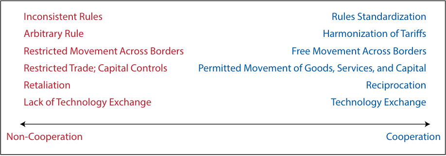
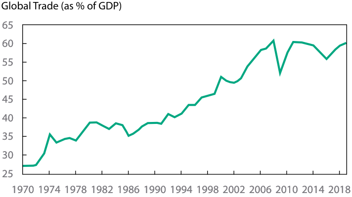
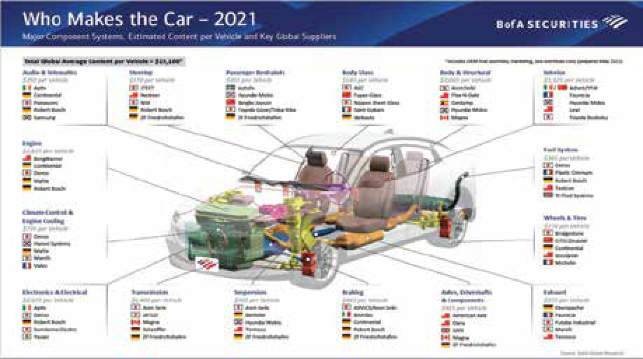
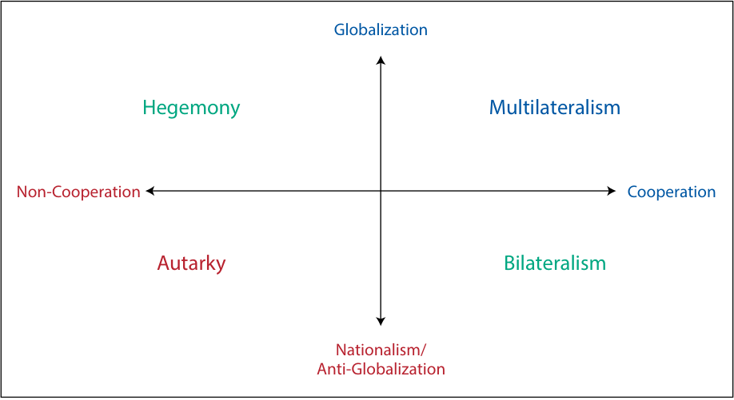
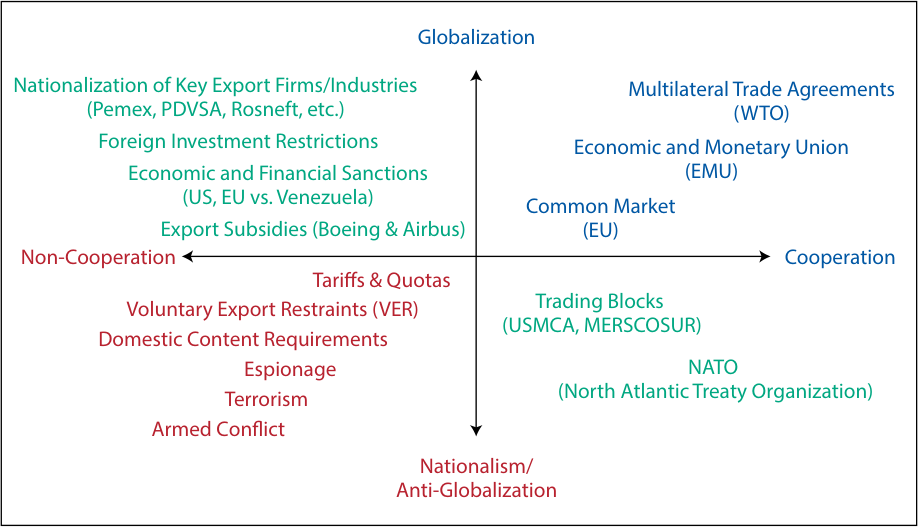
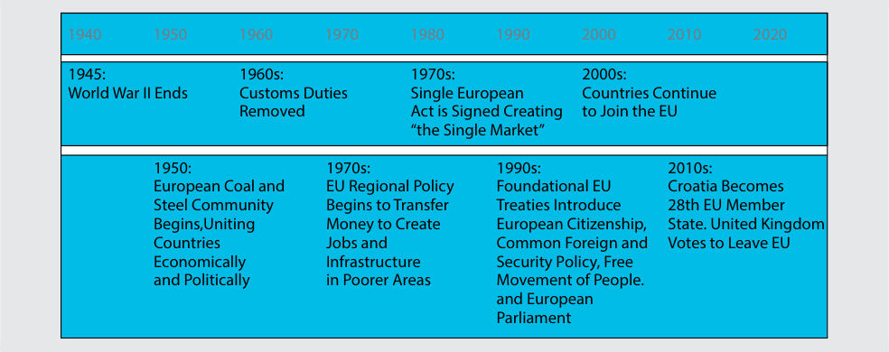
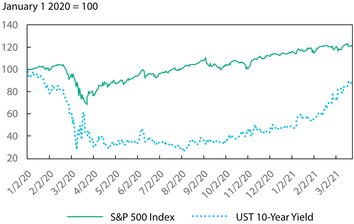

# Tập 2: Kinh tế học (Economics)
## Learning Module 5 Introduction to Geopolitics (Trang PDF 149–202)

---

# Tập 2: Kinh tế học (Volume 2: Economics)
## Học phần 5: Giới thiệu về Địa chính trị (Learning Module 5: Introduction to Geopolitics)
### Phần 1/4: Giới thiệu (Introduction) (Trang PDF 149–159)

---

<!-- PDF Page 149 -->

#### H Ọ C P H Ầ N (L E A R N I N G M O D U L E)

# **<mark>5</mark>** 

### **Giới thiệu về Địa chính trị (*Introduction to Geopolitics*)** 

**Tác giả: Goodwin Lauren, Nair-Reichert Usha, PhD, và Witschi Daniel Rober, PhD.** 

_Lauren Goodwin, CFA, làm việc tại New York Life Investments (Hoa Kỳ). Usha Nair-Reichert, PhD, làm việc tại Viện Công nghệ Georgia (Georgia Institute of Technology, Hoa Kỳ). Daniel Robert Witschi, PhD, CFA, làm việc tại Dreyfus Sons & Co Ltd. (Thụy Sĩ)._ 

###### **<mark>MỤC TIÊU HỌC TẬP (LEARNING OUTCOMES)</mark>** 

|**_Mức độ thành thạo (Mastery)_**|**_Ứng viên cần có khả năng (The candidate should be able to):_**|
|---|---|
||mô tả địa chính trị từ góc độ hợp tác so với cạnh tranh (*cooperation versus competition perspective*)|
||mô tả địa chính trị và mối quan hệ của nó với toàn cầu hóa (*globalization*)|
||mô tả chức năng và mục tiêu của các tổ chức quốc tế tạo thuận lợi cho thương mại, bao gồm Ngân hàng Thế giới (*World Bank*), Quỹ Tiền tệ Quốc tế (*International Monetary Fund* – IMF) và Tổ chức Thương mại Thế giới (*World Trade Organization* – WTO)|
||mô tả rủi ro địa chính trị (*geopolitical risk*)|
||mô tả các công cụ của địa chính trị (*tools of geopolitics*) và tác động của chúng đối với các khu vực và nền kinh tế|
||mô tả tác động của rủi ro địa chính trị đối với các khoản đầu tư|

<!-- Picture Text: 1  -->

##### **GIỚI THIỆU (INTRODUCTION)** 

Các nhà đầu tư nghiên cứu địa chính trị (*geopolitics*) và rủi ro địa chính trị (*geopolitical risk*) vì chúng có thể gây ra tác động trọng yếu đến kết quả đầu tư. Những mối quan hệ này ảnh hưởng đến các động lực chính của hiệu quả đầu tư, bao gồm tăng trưởng kinh tế (*economic growth*), kết quả hoạt động kinh doanh (*business performance*), biến động thị trường (*market volatility*) và chi phí giao dịch (*transaction costs*). Ở cấp độ danh mục đầu tư, rủi ro địa chính trị có thể ảnh hưởng đến sự phù hợp của một chứng khoán hoặc chiến lược đối với mục tiêu, mức độ chấp nhận rủi ro (*risk tolerance*) và khung thời gian đầu tư (*time horizon*) của nhà đầu tư. Trong học phần này, chúng ta sẽ xây dựng một khung phân tích giúp các nhà đầu tư có thể đo lường, đánh giá, theo dõi và phản ứng trước rủi ro địa chính trị, với mục tiêu cải thiện kết quả đầu tư. 

<!-- PDF Page 150 -->

###### **TỔNG QUAN HỌC PHẦN (LEARNING MODULE OVERVIEW)** 

- Địa chính trị (*Geopolitics*) là ngành nghiên cứu về cách thức các yếu tố địa lý ảnh hưởng đến chính trị và quan hệ quốc tế. Trong lĩnh vực địa chính trị, các nhà phân tích nghiên cứu các chủ thể (*actors*) — những cá nhân, tổ chức, công ty và chính phủ quốc gia thực hiện các hoạt động chính trị, kinh tế và tài chính — và cách thức họ tương tác với nhau. 

- Các chủ thể nhà nước (*state actors*) có thể mang tính hợp tác (*cooperative*) hoặc bất hợp tác (*non-cooperative*). Một quốc gia có thể muốn hợp tác với các nước láng giềng hoặc với các chủ thể nhà nước khác vì nhiều lý do. Những lý do này thường được xác định bởi lợi ích quốc gia (*national interest*) của đất nước đó — tức các mục tiêu và tham vọng của họ — dù là về quân sự, kinh tế hay văn hóa. 

- Sự hợp tác và gắn kết giữa các quốc gia cũng chịu ảnh hưởng bởi nguồn lực tự nhiên sẵn có (*resource endowment*), sự chuẩn hóa các quy tắc ứng xử (*standardization of the rules of engagement*), cùng các yếu tố văn hóa và quyền lực mềm (*soft power*). 

- Lợi ích quốc gia của một đất nước có thể được xem như một hệ thống phân cấp các yếu tố (*hierarchy of factors*), với những yếu tố thiết yếu cho sự sinh tồn nằm ở đỉnh tháp phân cấp và những yếu tố tốt-nhưng-không-thiết-yếu nằm ở vị trí thấp hơn. Các chính phủ sử dụng hệ thống phân cấp lợi ích (*hierarchy of interests*) để định hướng hành vi của mình. 

- Hợp tác chính trị so với bất hợp tác chỉ là một lăng kính qua đó các chủ thể địa chính trị tương tác với thế giới, nhưng đó là một lăng kính quan trọng để thấu hiểu các ưu tiên của các quốc gia. 

- Toàn cầu hóa (*Globalization*) được đặc trưng bởi sự hợp tác kinh tế và tài chính, bao gồm hoạt động trao đổi thương mại hàng hóa và dịch vụ sôi động, các dòng vốn (*capital flows*), trao đổi tiền tệ (*currency exchange*), cũng như trao đổi văn hóa và thông tin. Ngược lại, chống toàn cầu hóa (*antiglobalization*) hay chủ nghĩa dân tộc (*nationalism*) là việc thúc đẩy lợi ích kinh tế của chính một quốc gia mà loại trừ hoặc gây phương hại đến lợi ích của các quốc gia khác. Chủ nghĩa dân tộc được đặc trưng bởi sự hợp tác kinh tế và tài chính hạn chế. 

- Toàn cầu hóa mang lại những lợi ích tiềm năng, chẳng hạn như: 

   - gia tăng lợi nhuận — thông qua việc tăng doanh số bán hàng và/hoặc giảm chi phí, 

   - tiếp cận các nguồn lực — tiếp cận thị trường và các cơ hội đầu tư, và 

   - lợi ích nội tại (*intrinsic gains*) — chất lượng cuộc sống được cải thiện. 

- Toàn cầu hóa cũng có một số hạn chế tiềm tàng, chẳng hạn như: 

   - lợi ích kinh tế và tài chính phân bổ không đồng đều, 

   - sự phụ thuộc lẫn nhau (*interdependence*) có thể dẫn đến đứt gãy chuỗi cung ứng (*supply chain disruption*), và 

   - khả năng khai thác quá mức các nguồn lực xã hội và môi trường. 

- Nhiệm vụ chính của Quỹ Tiền tệ Quốc tế (*International Monetary Fund* – IMF) là đảm bảo sự ổn định của hệ thống tiền tệ quốc tế (*international monetary system*), tức hệ thống tỷ giá hối đoái và thanh toán quốc tế cho phép các quốc gia mua bán hàng hóa và dịch vụ lẫn nhau. 

- Mục tiêu chính của Ngân hàng Thế giới (*World Bank*) là giúp các nước đang phát triển xóa đói giảm nghèo và thúc đẩy tăng trưởng kinh tế bền vững với môi trường. 

- Tổ chức Thương mại Thế giới (*World Trade Organization* – WTO) cung cấp nền tảng pháp lý và thể chế cho hệ thống thương mại đa phương. Tổ chức này điều tiết các mối quan hệ thương mại xuyên biên giới giữa các quốc gia trên phạm vi toàn cầu. 

<!-- PDF Page 151 -->

|■|Một khung phân tích địa chính trị bao gồm bốn hình mẫu (*archetypes*) hành vi của quốc gia: tự cung tự cấp (*autarky*), bá quyền (*hegemony*), chủ nghĩa đa phương (*multilateralism*), và chủ nghĩa song phương (*bilateralism*). Mỗi hình mẫu đều có chi phí, lợi ích và sự đánh đổi riêng đối với rủi ro địa chính trị.|
|---|---|
|■|Rủi ro địa chính trị (*Geopolitical risk*) là rủi ro gắn liền với những căng thẳng hoặc hành động giữa các chủ thể (nhà nước và phi nhà nước) làm ảnh hưởng đến tiến trình bình thường và hòa bình của quan hệ quốc tế. Rủi ro địa chính trị có xu hướng gia tăng khi các yếu tố địa lý và chính trị làm nền tảng cho quan hệ giữa các quốc gia dịch chuyển.|
|■|Các công cụ của địa chính trị có thể được chia thành ba loại sau:|
||● các công cụ an ninh quốc gia (*national security tools*),|
||● các công cụ kinh tế (*economic tools*), và ● các công cụ tài chính (*financial tools*).|
|■|Ví dụ cực đoan nhất của công cụ an ninh quốc gia là xung đột vũ trang (*armed conflict*). Gián điệp (*Espionage*) là một công cụ an ninh quốc gia gián tiếp. Các liên minh quân sự (*Military alliances*) thường được sử dụng để hỗ trợ trong xung đột trực tiếp hoặc để răn đe, ngăn chặn xung đột phát sinh ngay từ đầu.|
|■|Các công cụ kinh tế được sử dụng để củng cố lập trường hợp tác hoặc bất hợp tác thông qua các biện pháp kinh tế. Giữa các chủ thể nhà nước, công cụ kinh tế có thể bao gồm các hiệp định thương mại đa phương (*multilateral trade agreements*) hoặc sự hài hòa hóa toàn cầu các quy tắc thuế quan (*harmonization of tariff rules*). Các công cụ kinh tế cũng có thể mang bản chất bất hợp tác. Quốc hữu hóa (*Nationalization*) là một cách tiếp cận bất hợp tác nhằm khẳng định quyền kiểm soát kinh tế.|
|■|Các công cụ tài chính là những hành động được sử dụng để củng cố lập trường hợp tác hoặc bất hợp tác thông qua các cơ chế tài chính. Ví dụ về các công cụ tài chính hợp tác bao gồm việc tự do chuyển đổi tiền tệ qua biên giới và cho phép đầu tư nước ngoài. Ví dụ về các công cụ tài chính bất hợp tác bao gồm việc hạn chế tiếp cận thị trường tiền tệ trong nước và hạn chế đầu tư nước ngoài.|
|■|Có ba loại rủi ro địa chính trị cơ bản:|
||● rủi ro sự kiện (*event risk*),|
||● rủi ro ngoại sinh (*exogenous risk*), và ● rủi ro theo chủ đề / xu hướng dài hạn (*thematic risk*).|
|■|Rủi ro sự kiện (*Event risk*) xoay quanh những ngày ấn định đã được biết trước. Ví dụ, các sự kiện chính trị thường dẫn đến những thay đổi trong kỳ vọng của nhà đầu tư liên quan đến lập trường hợp tác của một quốc gia. Sự kiện Brexit là một ví dụ về rủi ro sự kiện.|
|■|Rủi ro ngoại sinh (*Exogenous risk*) là một rủi ro đột ngột hoặc không lường trước được, có thể ảnh hưởng đến lập trường hợp tác của một quốc gia, khả năng toàn cầu hóa của các chủ thể phi nhà nước, hoặc cả hai. Các ví dụ bao gồm các cuộc nổi dậy bất ngờ, các cuộc xâm lược, hoặc hậu quả của thiên tai.|
|■|Rủi ro theo chủ đề (*Thematic risks*) là những rủi ro đã được nhận diện nhưng phát triển và mở rộng theo thời gian. Biến đổi khí hậu, các mối đe dọa an ninh mạng và mối đe dọa khủng bố thường trực thuộc nhóm này.|
|■|Để đưa ra đánh giá, nhà đầu tư xem xét rủi ro địa chính trị trên ba khía cạnh sau: ● xác suất xảy ra rủi ro (*likelihood it will occur*),|

<!-- PDF Page 152 -->

   - tốc độ (*velocity/speed*) tác động của nó, và 

   - quy mô và bản chất của tác động đó (*size and nature of that impact*). 

- Rủi ro địa chính trị hiếm khi diễn biến theo kiểu tuyến tính, khiến việc theo dõi và dự báo xác suất, tốc độ cũng như quy mô và bản chất tác động của chúng lên danh mục đầu tư trở nên khó khăn. Do đó, nhiều nhà đầu tư triển khai một phương pháp tiếp cận bao gồm xây dựng kịch bản (*scenario building*) và theo dõi các dấu hiệu chỉ báo (*signposting*) thay vì dự báo điểm đơn lẻ (*single point forecast*). 

- Các nhà đầu tư nghiên cứu rủi ro địa chính trị vì nó có tác động hữu hình đến kết quả đầu tư. Ở cấp độ kinh tế vĩ mô, những rủi ro này có thể ảnh hưởng đến các điều kiện trên thị trường vốn (*capital markets conditions*), chẳng hạn như tăng trưởng kinh tế, lãi suất và mức độ biến động của thị trường. 

- Những thay đổi trong điều kiện thị trường vốn có thể có ảnh hưởng quan trọng đến các quyết định phân bổ tài sản (*asset allocation decisions*), bao gồm cả sự lựa chọn mức độ tiếp xúc theo khu vực địa lý (*geographic exposures*) của nhà đầu tư. 

- Ở cấp độ danh mục đầu tư, rủi ro địa chính trị có thể ảnh hưởng đến mức độ phù hợp của một chứng khoán hoặc chiến lược đầu tư đối với mục tiêu, mức độ chấp nhận rủi ro và khung thời gian đầu tư của nhà đầu tư. 

## **<mark>2</mark>** 

##### **CHÍNH PHỦ QUỐC GIA VÀ HỢP TÁC CHÍNH TRỊ (NATIONAL GOVERNMENTS AND POLITICAL COOPERATION)** 

mô tả địa chính trị từ góc độ hợp tác so với cạnh tranh (*describe geopolitics from a cooperation versus competition perspective*) 

Môi trường quốc tế luôn không ngừng vận động. Những xu hướng như sự tăng trưởng của các nền kinh tế thị trường mới nổi (*emerging market economies*), toàn cầu hóa và sự trỗi dậy của chủ nghĩa dân túy (*populism*) đều tác động đến phạm vi các cơ hội và mối đe dọa mà các công ty, ngành công nghiệp, quốc gia và các nhóm khu vực phải đối mặt. **Địa chính trị (*Geopolitics*)** là ngành nghiên cứu về cách thức địa lý ảnh hưởng đến chính trị và quan hệ quốc tế. Trong lĩnh vực địa chính trị, các nhà phân tích nghiên cứu các chủ thể (*actors*) — các cá nhân, tổ chức, công ty và chính phủ quốc gia thực hiện các hoạt động chính trị, kinh tế và tài chính — và cách họ tương tác với nhau. Vai trò của các chủ thể nhà nước và phi nhà nước được thảo luận trong phần tiếp theo. 

###### **Chủ thể Nhà nước và Chủ thể Phi nhà nước (*State and Non-State Actors*)** 

Các mối quan hệ bên trong mỗi quốc gia và giữa các quốc gia với nhau có thể rất phức tạp. Trước hết, có rất nhiều chủ thể ảnh hưởng đến quan hệ quốc tế, các diễn biến chính trị và các vấn đề kinh tế. Trong phần giới thiệu, chúng ta đã định nghĩa các chủ thể (*actors*) là những cá nhân, tổ chức, công ty và chính phủ quốc gia thực hiện các hoạt động chính trị, kinh tế và tài chính. Định nghĩa này có thể được chia thành hai loại chủ thể có liên quan đến rủi ro địa chính trị: chủ thể nhà nước và chủ thể phi nhà nước. **Chủ thể nhà nước (*State actors*)** thường là các chính phủ quốc gia, các tổ chức chính trị hoặc các nhà lãnh đạo đất nước thực thi quyền lực đối với an ninh quốc gia và tài nguyên của một đất nước. Tổng thống Nam Phi, Quốc vương Brunei, Quốc hội Malaysia và Thủ tướng Anh đều là những ví dụ về các chủ thể nhà nước. **Chủ thể phi nhà nước (*Non-state actors*)** là những chủ thể tham gia vào các vấn đề chính trị, kinh tế hoặc tài chính toàn cầu nhưng không 

<!-- PDF Page 153 -->

trực tiếp kiểm soát an ninh quốc gia hay tài nguyên đất nước. Ví dụ về các chủ thể phi nhà nước là các tổ chức phi chính phủ (*non-governmental organizations* – NGOs), các công ty đa quốc gia (*multinational companies*), các tổ chức từ thiện, và thậm chí cả những cá nhân có tầm ảnh hưởng như các nhà lãnh đạo doanh nghiệp hoặc các biểu tượng văn hóa. 

Các chủ thể này không chỉ chịu ảnh hưởng bởi mối quan hệ giữa họ với nhau mà còn bởi các yếu tố tác động đến các đồng minh và đối thủ khác của họ. Ví dụ, nếu Quốc gia A có mối quan hệ hợp tác với Quốc gia B nhưng Quốc gia B lại tấn công Quốc gia C — một đồng minh thân cận của Quốc gia A — thì mối quan hệ giữa Quốc gia A và B có thể trở nên căng thẳng hoặc thậm chí tan vỡ. Điều ngược lại cũng đúng: Sự hợp tác của một quốc gia trên nhiều kênh chính trị, kinh tế hoặc tài chính có thể làm gia tăng sự tin cậy theo thời gian. Kết quả là, hệ thống quốc tế được cấu thành từ những mạng lưới quan hệ đa diện có khả năng định hình các sự kiện và quyết định cũng như các kết quả kinh tế và thị trường. Mặc dù không tồn tại một mô hình “áp dụng chung cho tất cả” (*one-size-fits-all*) đối với các chủ thể địa chính trị, việc thấu hiểu và phân loại các mối đe dọa cũng như cơ hội mà một quốc gia phải đối mặt có thể giúp chúng ta đánh giá khả năng phát sinh rủi ro địa chính trị. 

Các quốc gia và chính phủ của họ chịu ảnh hưởng nặng nề bởi các cân nhắc về kinh tế, tài chính và an ninh quốc gia, cũng như bởi các yếu tố xã hội, văn hóa và các chủ thể phi nhà nước. Trên thực tế, các cân nhắc về kinh tế và tài chính gắn kết chặt chẽ không thể tách rời với lợi ích quốc gia và động lực chính trị của một đất nước. Tuy nhiên, việc tách riêng một trong những lĩnh vực này — các chủ thể quốc gia và sự hợp tác chính trị — là rất hữu ích để làm điểm khởi đầu nhằm tìm hiểu các mục tiêu đan xen của các chủ thể và cách chúng có thể tác động đến rủi ro địa chính trị. Trong phần tiếp theo, chúng ta sẽ tìm hiểu về các chủ thể nhà nước và động cơ hợp tác (so với bất hợp tác) của họ trước khi bổ sung thêm các tầng phân tích rủi ro địa chính trị. 

###### **Các đặc điểm của Hợp tác Chính trị (*Features of Political Cooperation*)** 

Ở cấp độ cao nhất, mối quan hệ giữa các quốc gia hoặc các chính phủ quốc gia (các chủ thể nhà nước) có thể mang bản chất hợp tác hoặc cạnh tranh. **Hợp tác (*Cooperation*)** là quá trình mà qua đó các quốc gia làm việc cùng nhau hướng tới một mục tiêu hoặc mục đích chung nào đó. Những mục tiêu này có thể, và thường xuyên, rất khác biệt — từ những mối quan tâm chiến lược hoặc quân sự cho đến tầm ảnh hưởng kinh tế hoặc các sở thích văn hóa. Do bản chất rộng lớn của các mục tiêu và lợi ích quốc gia, sự tương tác giữa họ với nhau cũng có thể rất phức tạp, tạo ra khả năng phát sinh rủi ro địa chính trị. 

Chúng ta bắt đầu khung phân tích đó bằng cách khám phá một loại hình hợp tác cụ thể — hợp tác chính trị (*political cooperation*) — là mức độ mà các quốc gia cùng nhau hướng tới các thỏa thuận về quy tắc và sự chuẩn hóa cho các hoạt động cũng như tương tác giữa họ. Trong bối cảnh này, một **quốc gia hợp tác (*cooperative country*)** là quốc gia tham gia và có sự đi lại tương xứng (*reciprocates*) trong việc chuẩn hóa quy tắc; hài hòa hóa thuế quan; và tham gia các hiệp định quốc tế về thương mại, nhập cư hoặc quy định pháp lý, đồng thời cho phép dòng chảy thông tin tự do, bao gồm cả chuyển giao công nghệ (*technology transfer*). Ngược lại, một **quốc gia bất hợp tác (*non-cooperative country*)** là quốc gia có các quy tắc thiếu nhất quán và thậm chí độc đoán, tùy tiện; hạn chế sự di chuyển của hàng hóa, dịch vụ, con người và vốn qua biên giới; có hành vi trả đũa (*retaliation*); và hạn chế trao đổi công nghệ. Chúng tôi thể hiện mức độ hợp tác chính trị trong Bảng minh họa 1 (Exhibit 1). 

<!-- PDF Page 154 -->

**Bảng minh họa 1: Hợp tác và Bất hợp tác Chính trị (Exhibit 1: Political Cooperation and Non-Cooperation)** 

<!-- Picture Text: Inconsistent Rules Rules Standardization Arbitrary Rule Harmonization of Tariffs Restricted Movement Across Borders Free Movement Across Borders Restricted Trade; Capital Controls Permitted Movement of Goods, Services, and Capital Retaliation Reciprocation Lack of Technology Exchange Technology Exchange Non-Cooperation Cooperation  -->

> **Chú thích hình ảnh:**
> - **Bất hợp tác (*Non-Cooperation*):** Quy tắc thiếu nhất quán (*Inconsistent Rules*); Quy tắc tùy tiện/độc đoán (*Arbitrary Rule*); Hạn chế di chuyển qua biên giới (*Restricted Movement Across Borders*); Hạn chế thương mại, Kiểm soát vốn (*Restricted Trade; Capital Controls*); Trả đũa (*Retaliation*); Thiếu trao đổi công nghệ (*Lack of Technology Exchange*).
> - **Hợp tác (*Cooperation*):** Chuẩn hóa quy tắc (*Rules Standardization*); Hài hòa hóa thuế quan (*Harmonization of Tariffs*); Tự do di chuyển qua biên giới (*Free Movement Across Borders*); Cho phép di chuyển hàng hóa, dịch vụ và vốn (*Permitted Movement of Goods, Services, and Capital*); Có đi có lại / Tương hỗ (*Reciprocation*); Trao đổi công nghệ (*Technology Exchange*).

Một quốc gia có thể muốn hợp tác với các nước láng giềng hoặc với các chủ thể nhà nước khác vì nhiều lý do. Những lý do này thường được xác định bởi lợi ích quốc gia (*national interest*) của đất nước đó — tức các mục tiêu và tham vọng của họ — dù là về quân sự, kinh tế hay văn hóa. 

###### **_Lợi ích An ninh Quốc gia hoặc Quân sự (National Security or Military Interest)_** 

An ninh quốc gia (*National security*) hay quốc phòng (*national defense*) bao gồm việc bảo vệ một đất nước, bao gồm công dân, nền kinh tế và các định chế của nước đó, khỏi các mối đe dọa từ bên ngoài. Những mối đe dọa này có thể mang bản chất rất rộng — từ các cuộc tấn công quân sự và khủng bố, cho đến tội phạm, an ninh mạng và thậm chí cả thiên tai. 

Các yếu tố địa lý đóng một vai trò quan trọng trong việc định hình cách tiếp cận của một quốc gia đối với an ninh quốc gia và mức độ mà quốc gia đó sẽ lựa chọn cách tiếp cận hợp tác. Các quốc gia không giáp biển (*landlocked countries*), chẳng hạn như Thụy Sĩ, phụ thuộc rất nhiều vào các nước láng giềng để tiếp cận các nguồn lực thiết yếu. Sự phụ thuộc này có thể khiến việc hợp tác trở nên quan trọng hơn để duy trì khả năng tiếp cận quốc tế và tăng trưởng, hoặc thậm chí là để sinh tồn. Tương tự như vậy, các quốc gia có kết nối chặt chẽ với các tuyến đường thương mại, chẳng hạn như Singapore, hoặc các quốc gia đóng vai trò là tuyến trung chuyển thương mại (*conduit for trade*), chẳng hạn như Panama, có thể sử dụng vị trí địa lý của mình như một đòn bẩy quyền lực trong các động lực quốc tế rộng lớn hơn. 

###### **_Lợi ích Kinh tế (Economic Interest)_** 

Theo thời gian, khái niệm an ninh quốc gia đã mở rộng để bao hàm cả các yếu tố kinh tế, bao gồm việc tiếp cận các nguồn tài nguyên như năng lượng, lương thực hoặc nước. Ở cấp độ trong nước, việc gia tăng sự giàu có của quốc gia và hạn chế bất bình đẳng thu nhập có thể góp phần vào sự ổn định xã hội, một cấu phần quan trọng khác của an ninh quốc gia. Ở cấp độ quốc tế, khả năng hoạt động trên quy mô toàn cầu của các doanh nghiệp trong nước cũng ngày càng trở nên quan trọng. Trong bối cảnh này, các quốc gia hợp tác để hỗ trợ cho lợi ích kinh tế của mình thường tập trung vào một trong hai yếu tố: Hoặc là họ muốn đảm bảo các nguồn lực thiết yếu thông qua thương mại (*trade*), hoặc là họ muốn tạo lập một sân chơi toàn cầu bình đẳng cho các công ty hoặc ngành công nghiệp của mình thông qua sự chuẩn hóa (*standardization*). 

###### **VÍ DỤ 1 (EXAMPLE 1)** 

###### **Các yếu tố ảnh hưởng đến sự hợp tác (Factors Affecting Cooperation)** 

1. Đúng hay sai: Các yếu tố địa lý không ảnh hưởng đến mức độ mà một quốc gia sẽ lựa chọn cách tiếp cận hợp tác. Hãy giải thích lập luận của bạn. 

   - **A.** Đúng (*True*) 

<!-- PDF Page 155 -->

   - **B.** Sai (*False*) 

###### **Lời giải (Solution):** 

B là đáp án đúng. Các yếu tố địa lý đóng vai trò quan trọng trong việc định hình cách tiếp cận của một quốc gia đối với an ninh quốc gia và mức độ mà quốc gia đó sẽ lựa chọn cách tiếp cận hợp tác. Một quốc gia có khả năng tiếp cận hạn chế với các nguồn tài nguyên do đặc điểm địa lý của mình có thể có xu hướng hợp tác nhiều hơn vì họ cần tiếp cận tài nguyên để phát triển thịnh vượng, trong khi một quốc gia giàu tài nguyên nội địa có thể sử dụng tài nguyên của mình làm đòn bẩy để gây ảnh hưởng đến các động lực quốc tế. Các quốc gia có đường ra biển trực tiếp có lợi thế liên quan đến thương mại và vận tải cũng như các nguồn tài nguyên thiên nhiên do đại dương cung cấp. 

###### **VÍ DỤ 2 (EXAMPLE 2)** 

###### **Các yếu tố ảnh hưởng đến sự hợp tác (Factors Affecting Cooperation)** 

1. Điền vào chỗ trống: Hai yếu tố mà một quốc gia hợp tác nhiều khả năng sẽ tập trung vào bao gồm ____ và ___. 

###### **Lời giải (Solution):** 

Hai yếu tố mà một quốc gia hợp tác nhiều khả năng sẽ tập trung vào bao gồm _thương mại (trade)_ và _sự chuẩn hóa (standardization)_. 

###### **Nguồn lực tự nhiên sẵn có, Sự chuẩn hóa và Quyền lực mềm (*Resource Endowment, Standardization, and Soft Power*)** 

Sự hợp tác và gắn kết giữa các quốc gia cũng chịu ảnh hưởng bởi nguồn lực tự nhiên sẵn có (*resource endowment*), sự chuẩn hóa các quy tắc ứng xử (*standardization of the rules of engagement*), cùng các yếu tố văn hóa và quyền lực mềm (*soft power*). Những yếu tố này được xem xét trong phần tiếp theo. 

###### **_Nguồn lực Địa vật lý Sẵn có (Geophysical Resource Endowment)_** 

Ở cấp độ cơ bản, **nguồn lực địa vật lý sẵn có (*geophysical resource endowment*)** bao gồm các yếu tố như địa lý và khí hậu có thể sinh sống được cũng như khả năng tiếp cận lương thực và nước uống — những yếu tố cần thiết cho sự tăng trưởng bền vững. Nguồn lực địa vật lý sẵn có là hết sức không đồng đều giữa các quốc gia. Một số quốc gia, chẳng hạn như Hoa Kỳ, Nga, Úc và Trung Quốc, tương đối tự chủ trong việc sử dụng tài nguyên của mình. Những khu vực và quốc gia khác, chẳng hạn như Tây Âu, Nhật Bản và Thổ Nhĩ Kỳ, lại phụ thuộc rất nhiều vào các nước khác đối với các yếu tố sản xuất chính, chẳng hạn như nhiên liệu hóa thạch. Lại có những quốc gia khác, chẳng hạn như Ả Rập Xê Út, có nguồn nhiên liệu hóa thạch dồi dào nhưng lại phụ thuộc vào các nước khác đối với nhiều nhu cầu cơ bản. 

Những xuất phát điểm khác nhau này tạo ra các động lực quyền lực có thể ảnh hưởng đến các điều khoản cam kết và tương tác giữa các quốc gia. Một quốc gia được thiên nhiên ưu đãi dồi dào một loại tài nguyên có thể thấy mình có nhiều đòn bẩy chính trị hơn khi giao dịch với một quốc gia khác đang rất cần nguồn tài nguyên đó. Đồng thời, một quốc gia giàu tài nguyên có thể trở nên dễ bị tổn thương nếu việc sử dụng hoặc bán tài nguyên đó mang lại lợi ích cho một số nhóm nhất định nhiều hơn các nhóm khác, từ đó góp phần gây ra sự bất ổn chính trị nội bộ. 

###### **_Sự chuẩn hóa (Standardization)_** 

Các hoạt động kinh tế và tài chính có thể vượt qua biên giới dù có hay không có sự hỗ trợ rõ ràng của chính phủ. Khi điều đó diễn ra, các chính phủ có nhiều động lực hơn để hợp tác với các nước khác trong việc chuẩn hóa các quy tắc ứng xử. **Sự chuẩn hóa (*Standardization*)** là quá trình tạo lập các giao thức (*protocols*) cho việc sản xuất, bán hàng, vận chuyển hoặc sử dụng một sản phẩm hay dịch vụ. Sự chuẩn hóa diễn ra khi các bên liên quan đồng ý cùng nhau tuân theo các giao thức này. Nó giúp hỗ trợ mở rộng các hoạt động kinh tế và tài chính xuyên biên giới, chẳng hạn như 

<!-- PDF Page 156 -->

thương mại và các dòng vốn, qua đó hỗ trợ tăng trưởng kinh tế và mức sống cao hơn. Việc chuẩn hóa quy tắc có thể diễn ra dưới nhiều hình thức — từ hợp tác quản lý (*regulatory cooperation*), chuẩn hóa quy trình (*process standardization*), cho đến đồng bộ hóa vận hành (*operational synchronization*). Việc chuẩn hóa quy tắc cũng có thể được thúc đẩy bởi các thực thể phi nhà nước, chẳng hạn như các hiệp hội ngành nghề hoặc các tổ chức. Bảng minh họa 2 (Exhibit 2) cung cấp các ví dụ về sự chuẩn hóa. 

###### **Bảng minh họa 2: Các loại hình Chuẩn hóa Quy tắc (Exhibit 2: Types of Rules Standardization)** 

||**Hợp tác Quản lý (*Regulatory Cooperation*)**|**Chuẩn hóa Quy trình (*Process Standardization*)**|**Đồng bộ hóa Vận hành (*Operational Synchronization*)**|
|---|---|---|---|
|Thách thức (*Challenge*)|Khi hợp tác tài chính mở rộng, các quốc gia cần một tiêu chuẩn toàn diện về quản trị và quản lý rủi ro đối với lĩnh vực ngân hàng.|Các giao dịch tài chính xuyên biên giới phải đối mặt với chi phí cao hơn và thời gian chờ đợi lâu hơn, làm tăng gánh nặng cho hoạt động xuyên biên giới.|Thương mại quốc tế gia tăng đã tạo ra các điểm nghẽn trong chuỗi cung ứng khi các thùng chứa hàng (container) có kích thước và hình dạng khác nhau được gửi đến các cảng trên toàn thế giới.|
|Giải pháp (*Solution*)|Ủy ban Basel về Giám sát Ngân hàng (*Basel Committee on Banking Supervision* – BCBS)|Hiệp hội Viễn thông Tài chính Liên ngân hàng Toàn cầu (*Society for Worldwide Interbank Financial Telecommunication* – SWIFT)|Công-ten-nơ hóa (*Containerization*)|
|Quy trình (*Process*)|BCBS được thành lập vào năm 1974 bởi các cơ quan quản lý ngân hàng nhóm G–10. Tư cách thành viên sau đó đã mở rộng sang nhóm G–20.|SWIFT được thành lập vào năm 1973 nhằm cung cấp một cơ sở hạ tầng tài chính toàn cầu.|Các tiêu chuẩn được thiết lập cho các thùng container có kích thước và hình dạng đồng nhất sử dụng các phương thức vận tải đa phương thức (đường bộ, đường biển, đường hàng không, đường sắt) và cần cẩu tại cảng.|
|Lợi ích (*Benefit*)|Cho phép giám sát hiệu quả hơn đối với lĩnh vực ngân hàng toàn cầu và các dòng vốn quốc tế.|Tạo thuận lợi cho các khoản thanh toán toàn cầu tại hơn 200 quốc gia và vùng lãnh thổ, phục vụ hơn 11.000 định chế trên toàn thế giới.|Giảm đáng kể thời gian và chi phí vận chuyển hàng hóa.|

###### **_Các cân nhắc về Văn hóa và Quyền lực mềm (Cultural Considerations and Soft Power)_** 

Cuối cùng, các quốc gia có thể có những lý do văn hóa để hợp tác với các nước khác. Những lý do này có thể mang bản chất lịch sử, chẳng hạn như mối quan hệ chính trị lâu đời, các mô hình di cư, những trải nghiệm được chia sẻ, hoặc những nét tương đồng về văn hóa. Trong các trường hợp khác, các quốc gia có thể sử dụng **quyền lực mềm (*soft power*)**, một phương thức gây ảnh hưởng đến quyết định của quốc gia khác mà không dùng đến vũ lực hay sự ép buộc. Quyền lực mềm có thể được xây dựng theo thời gian thông qua các hành động như các chương trình văn hóa, quảng cáo, tài trợ du lịch và trao đổi đại học. Ví dụ, chương trình Erasmus+ của Liên minh Châu Âu (EU) cung cấp kinh phí cho các chương trình trao đổi trong giáo dục và thể thao nhằm thúc đẩy sự hòa nhập xã hội và sự tham gia giữa những người tham gia từ các quốc gia khác nhau, đồng thời thúc đẩy các chính sách ưu tiên như quá trình chuyển đổi xanh và chuyển đổi số của EU. Trong một ví dụ khác, các quốc gia như Hàn Quốc quảng cáo việc ghé thăm Seoul, thủ đô của đất nước, tại các hệ thống tàu điện ngầm trên toàn cầu. Những quảng cáo này sử dụng các sản phẩm phổ biến do Hàn Quốc sản xuất, các nhóm nhạc và diễn viên để khuyến khích sự tương tác với văn hóa và doanh nghiệp Hàn Quốc. 

###### **Vai trò của các Định chế (*The Role of Institutions*)** 

Một **định chế / thể chế (*institution*)** là một tổ chức hoặc tập quán đã được thiết lập vững chắc trong một xã hội hoặc nền văn hóa. Một định chế có thể là một cấu trúc chính thức, chẳng hạn như một trường đại học, tổ chức, hoặc quy trình được pháp luật hậu thuẫn; hoặc nó có thể là phi chính thức, chẳng hạn như các phong tục tập quán hoặc các khuôn mẫu hành vi quan trọng đối với một xã hội. Các định chế có thể, nhưng không nhất thiết phải, được thành lập bởi các chính phủ quốc gia. Ví dụ về các định chế bao gồm các tổ chức phi chính phủ (NGOs), các tổ chức từ thiện, phong tục tôn giáo, các đơn vị gia đình, truyền thông, các đảng phái chính trị và thông lệ giáo dục. 

Nhìn chung, các định chế vững mạnh góp phần tạo nên các lực lượng chính trị nội bộ và đối ngoại ổn định hơn. Sự nhất quán đó, đến lượt nó, mang lại cho một quốc gia nhiều cơ hội hơn để phát triển các mối quan hệ hợp tác. Các quốc gia có các định chế vững mạnh — bao gồm các tổ chức 

<!-- PDF Page 157 -->

và cấu trúc thúc đẩy trách nhiệm giải trình của chính phủ (*government accountability*), pháp quyền (*rule of law*) và quyền sở hữu tài sản (*property rights*) — cho phép họ hành động với nhiều thẩm quyền và sự độc lập hơn trong không gian quốc tế. Các định chế vững mạnh hơn cũng làm cho các mối quan hệ hợp tác trở nên bền vững hơn. Bằng cách tích hợp mối quan hệ hợp tác vào nhiều tầng lớp của xã hội, các định chế vững mạnh có thể làm giảm khả năng một quốc gia từ bỏ vai trò hợp tác của mình. 

###### **Hệ thống phân cấp Lợi ích và Chi phí của sự Hợp tác (*Hierarchy of Interests and Costs of Cooperation*)** 

Lợi ích quốc gia (*national interest*) của một đất nước là tập hợp các mục tiêu và tham vọng của nước đó. Đối với một số quốc gia, lợi ích quốc gia được nhìn nhận chủ yếu dưới góc độ không gian địa lý (*geospatial terms*) — nhu cầu tự quyết (*self-determination*), sự sinh tồn với tư cách là một quốc gia dân tộc, nhu cầu về biên giới quốc gia rõ ràng, hoặc sự mở rộng lãnh thổ của quốc gia dân tộc. Đối với các quốc gia khác, lợi ích quốc gia kết hợp một loạt các yếu tố có liên quan mật thiết với nhau, bao gồm cả các cân nhắc về kinh tế và xã hội đã thảo luận ở phần trước. Cách tiếp cận rộng này có thể tạo ra những xung đột giữa nhiều nhu cầu quan trọng của một quốc gia, làm phức tạp hóa việc đánh giá các chủ thể địa chính trị và động cơ của họ. 

Chúng ta có thể hình dung lợi ích quốc gia của một đất nước như một hệ thống phân cấp các yếu tố, với những yếu tố thiết yếu cho sự sinh tồn nằm ở đỉnh của hệ thống phân cấp và những yếu tố tốt-nhưng-không-thiết-yếu nằm ở vị trí thấp hơn trong hệ thống phân cấp. Các chính phủ sử dụng hệ thống phân cấp lợi ích (*hierarchy of interests*) để định hướng hành vi của mình. Họ sẽ chọn hợp tác ở những nơi mang lại lợi ích cho quốc gia dân tộc, nhưng khi hai nhu cầu dẫn đến các chiến thuật hợp tác xung đột nhau, những nhu cầu nằm ở vị trí cao hơn trong hệ thống phân cấp sẽ được ưu tiên. Ví dụ, sự hợp tác dưới hình thức hài hòa hóa thuế quan có thể mang lại lợi ích cho quốc gia khi xét riêng lẻ; tuy nhiên, nếu các quốc gia đó đang trong một cuộc xung đột quân sự, thì chi phí cho việc hợp tác sẽ cao hơn. Trong trường hợp này, nếu sự quyết tâm về quân sự nằm ở vị trí cao hơn trong hệ thống phân cấp của các quốc gia, thì việc hợp tác có thể không nằm trong lợi ích quốc gia của họ, bất chấp những lợi ích tiềm năng. 

Bảng minh họa 3 (Exhibit 3) cho thấy cách các quốc gia sắp xếp thứ tự ưu tiên trong hệ thống phân cấp lợi ích của mình. Mỗi quốc gia có các nguồn lực, mục tiêu và ban lãnh đạo khác nhau và do đó cũng có những ưu tiên khác nhau. Trong bảng minh họa, Quốc gia A ưu tiên khả năng tiếp cận lương thực và nước uống. Ngược lại, Quốc gia B ưu tiên sự độc lập khỏi ảnh hưởng của nước ngoài. Ngoài ra, những ưu tiên này có thể dịch chuyển khi ban lãnh đạo chính trị thay đổi hoặc khi các sự kiện toàn cầu biến chuyển. Đối với các nhà đầu tư, điều quan trọng là phải hiểu được cách thức mà các nguồn lực, mục tiêu và phong cách lãnh đạo này có thể tương tác hoặc thậm chí xung đột với nhau theo thời gian. Khi mục tiêu của các quốc gia lệch pha hoặc thay đổi, điều đó có thể làm phát sinh rủi ro địa chính trị. 

###### **Bảng minh họa 3: Hệ thống phân cấp Lợi ích (Exhibit 3: Hierarchy of Interests)** 

<!-- Picture Text: Highest Priority Example: Country A Example: Country B Example: Country C Access to Food and Water Independence from Foreign Influence Economic Stability Border Security Government Dominance over Population Equal Access to Resources Such as Food Economic Influence Cultural Homogeneity  and Education for all Citizens Cultural Ties with Other Countries Growing Personal or Family Wealth Regular Transition of Power via Elections Lowest Priority  -->

> **Chú thích hình ảnh (Từ Ưu tiên Cao nhất — *Highest Priority* đến Ưu tiên Thấp nhất — *Lowest Priority*):**
> - **Ví dụ: Quốc gia A (*Example: Country A*):** Tiếp cận lương thực và nước uống (*Access to Food and Water*) $\rightarrow$ An ninh biên giới (*Border Security*) $\rightarrow$ Ảnh hưởng kinh tế (*Economic Influence*) $\rightarrow$ Quan hệ văn hóa với các quốc gia khác (*Cultural Ties with Other Countries*).
> - **Ví dụ: Quốc gia B (*Example: Country B*):** Độc lập khỏi ảnh hưởng nước ngoài (*Independence from Foreign Influence*) $\rightarrow$ Sự thống trị của chính phủ đối với dân chúng (*Government Dominance over Population*) $\rightarrow$ Sự đồng nhất về văn hóa (*Cultural Homogeneity*) $\rightarrow$ Gia tăng tài sản cá nhân hoặc gia đình (*Growing Personal or Family Wealth*).
> - **Ví dụ: Quốc gia C (*Example: Country C*):** Ổn định kinh tế (*Economic Stability*) $\rightarrow$ Tiếp cận bình đẳng các nguồn lực như lương thực và giáo dục cho mọi công dân (*Equal Access to Resources Such as Food and Education for all Citizens*) $\rightarrow$ Chuyển giao quyền lực định kỳ thông qua bầu cử (*Regular Transition of Power via Elections*).

###### **Quyền lực của Người ra Quyết định (*Power of the Decision Maker*)** 

Một số yếu tố trong hệ thống phân cấp lợi ích quốc gia có vẻ rất rõ ràng; chẳng hạn, việc đảm bảo khả năng tiếp cận lương thực và nước uống có thể được ưu tiên hơn việc tài trợ cho một chương trình văn hóa. Tuy nhiên, khi các nhu cầu xã hội cơ bản đã được đáp ứng, hệ thống phân cấp lợi ích quốc gia 

<!-- PDF Page 158 -->

có thể trở nên mang tính chủ quan hơn. Một chính phủ có thể đối xử với việc ưu tiên một số lợi ích — chẳng hạn như tăng cường quân sự hoặc cung cấp dịch vụ chăm sóc sức khỏe — rất khác so với chính phủ tiền nhiệm. Cách thức các chính phủ cân nhắc những vấn đề đó sẽ quyết định chiều sâu và bản chất của sự hợp tác chính trị. 

Độ dài chu kỳ chính trị (*political cycle*) của một quốc gia có tác động quan trọng đến việc xác định thứ tự ưu tiên. Nhiều quốc gia có chu kỳ chính trị chỉ kéo dài vài năm, điều đó có nghĩa là những rủi ro dài hạn như biến đổi khí hậu hoặc giải quyết tình trạng bất bình đẳng thu nhập có thể khó được ưu tiên hơn so với các dự án hoặc mục tiêu có thể đạt được trong khung thời gian ngắn hạn. Bản chất nội tại của thực tế này là những người ra quyết định trong chính phủ, dù là các đảng phái chính trị hay các cá nhân, đều có những tác động chi phối và nhu cầu riêng của họ. Mặc dù chúng ta sẽ không khám phá sâu ý tưởng này, nhưng điều quan trọng cần thừa nhận là, đối với mục đích phân tích rủi ro địa chính trị, động cơ của những người ra quyết định có thể ảnh hưởng đến các lựa chọn hợp tác và bất hợp tác của một quốc gia. Điều này đưa một yếu tố tâm lý học và tính khó dự đoán vào các lựa chọn dọc theo hệ thống phân cấp nhu cầu của một quốc gia có khả năng định hình các mối quan hệ địa chính trị. 

###### **VÍ DỤ 3 (EXAMPLE 3)** 

###### **Chu kỳ Chính trị của Quốc gia (Country’s Political Cycle)** 

1. Đúng hay sai: Độ dài chu kỳ chính trị của một quốc gia không ảnh hưởng đến việc xác định thứ tự ưu tiên của quốc gia đó. 

Hãy giải thích lập luận của bạn. 

**A.** Đúng (*True*) 

**B.** Sai (*False*) 

**Lời giải (Solution):** 

B là đáp án đúng. Độ dài chu kỳ chính trị của một quốc gia có tác động quan trọng đến việc xác định thứ tự ưu tiên vì các chính phủ có chu kỳ ngắn hơn thường có ít động lực để tập trung vào các ưu tiên dài hạn hơn, ngay cả khi những ưu tiên đó có lợi cho xã hội. Ví dụ, Úc có nhiệm kỳ quốc hội ngắn hơn mức trung bình, điều này có khả năng ảnh hưởng đến các ưu tiên của chính phủ. 

###### **Bất hợp tác Chính trị (*Political Non-Cooperation*)** 

Chúng ta xem hợp tác chính trị và bất hợp tác chính trị như những trạng thái tồn tại dọc theo một dải phổ (*spectrum*). Trong khi việc hợp tác chính trị ở mức độ cao nằm trong lợi ích của một số quốc gia, thì đối với những quốc gia khác, điều đó lại ít thiết yếu hơn. Theo thời gian, hầu hết các quốc gia đều hợp tác dựa trên các quy tắc được chuẩn hóa ở quy mô quốc tế. Tuy nhiên, trong một số trường hợp bất hợp tác cực đoan, quyền tự quyết về chính trị (*political self-determination*) của các quốc gia lại quan trọng hơn lợi ích của bất kỳ hành động hợp tác nào. Những trường hợp cực đoan này rất hiếm gặp, một phần không nhỏ là bởi tầm quan trọng của việc hợp tác đối với các chủ thể nhà nước khác có thể dẫn đến những nỗ lực nhằm ép buộc các chủ thể nhà nước bất hợp tác phải tham gia. 

###### **CÁC LỆNH TRỪNG PHẠT QUỐC TẾ ĐỐI VỚI VENEZUELA (2015–) (INTERNATIONAL SANCTIONS AGAINST VENEZUELA (2015–))** 

Hoa Kỳ đã có những lo ngại về hoạt động buôn bán ma túy của Venezuela kể từ năm 2005 và sự thiếu hợp tác của Venezuela trong việc chống khủng bố kể từ năm 2006. Với sự ủng hộ từ Quốc hội và để đáp trả sự đàn áp chính trị ngày càng tăng ở Venezuela, Tổng thống Hoa Kỳ Obama đã áp đặt các lệnh trừng phạt (*sanctions*) bổ sung đối với các hành vi vi phạm nhân quyền, tham nhũng và các hành động phản dân chủ. Liên minh Châu Âu đã thúc giục 

<!-- PDF Page 159 -->

các quan chức Venezuela hướng tới hòa giải chính trị nhưng cuối cùng đã cùng với Hoa Kỳ áp đặt các lệnh trừng phạt có mục tiêu nhằm khuyến khích một tiến trình đáng tin cậy và có ý nghĩa hướng tới việc tái khởi động sự hợp tác. 

Trong suốt thời gian này, các lệnh trừng phạt đã bao gồm các hạn chế có mục tiêu nhắm vào các quan chức Venezuela, phong tỏa các giao dịch tài chính và cấm vận (*embargo*) đối với lĩnh vực dầu mỏ — lĩnh vực có tầm quan trọng sống còn đối với nền kinh tế của đất nước này. Một số chính trị gia tiếp tục ủng hộ các lệnh trừng phạt kinh tế như một biện pháp gây sức ép buộc chính phủ Venezuela phải đáp ứng các tiêu chuẩn quốc tế về nhân quyền và hợp tác chính trị. Những người khác lại lo ngại về cái giá nhân đạo ngày càng tăng của các lệnh trừng phạt đó. 

Lập trường bất hợp tác của Venezuela trên trường quốc tế đã dẫn đến việc nước này phải chịu các lệnh trừng phạt quốc tế nặng nề. Bản thân việc áp đặt các lệnh trừng phạt cũng là một cách tiếp cận bất hợp tác của Hoa Kỳ và Liên minh Châu Âu nhằm gây ảnh hưởng đến hành vi của một quốc gia hoặc giới lãnh đạo chính trị của quốc gia đó. Lập trường bất hợp tác của Venezuela cho thấy quyền tự quyết về chính trị của họ là một ưu tiên cao hơn so với tổn thất nhân đạo đang giáng xuống công dân của mình. 

Hợp tác chính trị so với bất hợp tác chỉ là một lăng kính qua đó các chủ thể địa chính trị tương tác với thế giới, nhưng đó là một lăng kính quan trọng để thấu hiểu các ưu tiên của các quốc gia. Việc đánh giá hệ thống phân cấp nhu cầu của một chủ thể nhà nước và cách thức nó có thể thay đổi sẽ giúp chúng ta hiểu được động cơ và các ưu tiên của chủ thể đó. Những yếu tố này không chỉ ảnh hưởng đến các hành động chính trị và quân sự của các quốc gia mà còn ảnh hưởng đến sự sẵn lòng hỗ trợ hợp tác kinh tế và tài chính của họ — nội dung mà chúng ta sẽ khám phá tiếp theo. 

###### **BỘ CÂU HỎI (QUESTION SET)** 

1. Yếu tố nào sau đây nhiều khả năng nằm ở vị trí thấp nhất trong hệ thống phân cấp lợi ích của một quốc gia?
   - **A.** Hài hòa hóa thuế quan (*Tariff harmonization*)
   - **B.** Quyết tâm quân sự (*Military determination*) 
   - **C.** Phát triển chương trình văn hóa (*Cultural program development*) 

   - **Lời giải (Solution):** 

C là đáp án đúng. Phát triển chương trình văn hóa nhiều khả năng nằm ở vị trí thấp nhất trong hệ thống phân cấp lợi ích của một quốc gia. Quyết tâm quân sự (B) thường là nguồn lực chính của an ninh quốc gia và là chìa khóa cho lợi ích quốc gia của một đất nước. Hài hòa hóa thuế quan (A) có thể cải thiện hoạt động kinh tế và nâng cao sự hợp tác. Các chương trình văn hóa tuy quan trọng và có tầm ảnh hưởng nhưng nhiều khả năng có mức độ ưu tiên thấp hơn so với A và B. 

2. Hành động nào sau đây của một quốc gia _nhiều khả năng nhất_ là một hình thức hợp tác địa chính trị? 

   - **A.** Đóng vai trò là tuyến trung chuyển thương mại (*Acting as a conduit for trade*) 

   - **B.** Tham gia vào việc chuẩn hóa các quy tắc (*Engaging in rules standardization*) 

   - **C.** Lựa chọn sử dụng quyền lực mềm thay vì trả đũa quân sự (*Opting to use soft power over military retaliation*) 

   - **Lời giải (Solution):** 

B là đáp án đúng. Hợp tác chính trị gắn liền với bất kỳ hoạt động nào liên quan đến các thỏa thuận về quy tắc và sự chuẩn hóa, với việc các quốc gia làm việc cùng nhau hướng tới một mục tiêu chung nào đó. Một quốc gia hợp tác là quốc gia tham gia và có sự đi lại tương xứng trong việc chuẩn hóa quy tắc. A sai vì việc đóng vai trò là tuyến trung chuyển thương mại, giống như Panama, bao hàm việc sử dụng vị trí địa lý của một quốc gia một cách bất hợp tác như một đòn bẩy quyền lực trong các động lực quốc tế rộng lớn hơn. C sai vì cả quyền lực mềm và trả đũa quân sự đều là những ví dụ

---

# Tập 2: Kinh tế học (Volume 2: Economics)
## Học phần 5: Giới thiệu về Địa chính trị (Learning Module 5: Introduction to Geopolitics)
### Phần 2/4: Các Động lực của Toàn cầu hóa (Forces of Globalization) (Trang PDF 160–174)

---

<!-- PDF Page 160 -->

về hành vi bất hợp tác, trong đó quyền lực mềm là một phương thức ít cực đoan hơn nhằm gây ảnh hưởng đến các quyết định của một quốc gia khác mà không dùng đến vũ lực hay sự ép buộc. 

3. Phát biểu nào sau đây thể hiện một khía cạnh của rủi ro địa chính trị? 

   - **A.** Việc mô hình hóa rủi ro địa chính trị tương đối dễ chuẩn hóa. 

   - **B.** Một quốc gia có tham gia tương tác (*engaged*) có thể được coi là hợp tác, ngay cả khi quốc gia đó không có hành động đáp lại tương xứng (*reciprocate*). 

   - **C.** Sức mạnh của các định chế trong một quốc gia có liên quan đến tính bền vững của các mối quan hệ hợp tác của quốc gia đó. 

#### **Lời giải (Solution):** 

C là đáp án đúng. Sức mạnh của các định chế trong một quốc gia có thể làm cho các mối quan hệ hợp tác trở nên bền vững hơn. A sai vì việc mô hình hóa rủi ro địa chính trị không dễ dàng được chuẩn hóa. B sai vì một quốc gia hợp tác là quốc gia vừa tham gia tương tác vừa có sự đi lại tương xứng (*reciprocates*). 

# **<mark>3</mark>** 

## **CÁC ĐỘNG LỰC CỦA TOÀN CẦU HÓA (FORCES OF GLOBALIZATION)** 

mô tả địa chính trị và mối quan hệ của nó với toàn cầu hóa (*describe geopolitics and its relationship with globalization*) 

**Toàn cầu hóa (*Globalization*)** là quá trình tương tác và hội nhập giữa con người, các công ty và các chính phủ trên toàn thế giới. Quá trình này được đánh dấu bằng sự lan tỏa của các sản phẩm, thông tin, việc làm và văn hóa qua biên giới các quốc gia. Quả thực, sự lưu chuyển hàng hóa và dịch vụ xuyên biên giới đã gia tăng trong nhiều thập kỷ qua. Chỉ số Độ mở của Ngân hàng Thế giới (*World Bank Openness Index*), một thước đo chính về toàn cầu hóa, đã tăng từ 27% vào năm 1970 lên hơn 60% vào năm 2019, như được thể hiện trong Bảng minh họa 4 (Exhibit 4). Kể từ năm 2008, toàn cầu hóa đã vấp phải những cơn gió ngược (*headwinds*); những lực cản này bao gồm tác động của Cuộc Khủng hoảng Tài chính Toàn cầu (*Global Financial Crisis*) làm gia tăng sự giám sát đối với các hoạt động xuyên biên giới, và sự trỗi dậy của chủ nghĩa dân tộc (*nationalism*) làm giảm mức độ sẵn lòng sử dụng các sản phẩm hoặc dịch vụ nhập khẩu của một số quốc gia. Những giới hạn về công suất (*capacity constraints*) cũng có thể tạo ra một lực cản quan trọng. Thương mại toàn cầu không thể chiếm tới 100% hoạt động kinh tế toàn cầu, có nghĩa là sự mở rộng của nó có thể chậm lại ngay cả khi không có những sự gián đoạn cụ thể nào. 

<!-- PDF Page 161 -->

#### **Bảng minh họa 4: Thương mại Toàn cầu tính theo Tỷ lệ Phần trăm của GDP (Exhibit 4: Global Trade as Percentage of GDP)** 

<!-- Picture Text: Global Trade (as % of GDP) 65 60 55 50 45 40 35 30 25 1970 1974 1978 1982 1986 1990 1994 1998 2002 2006 2010 2014 2018  -->

> **Chú thích hình ảnh:** Biểu đồ thể hiện **Thương mại Toàn cầu (tính theo % của GDP)** (*Global Trade as % of GDP*) trên trục tung (từ 25% đến 65%) qua các năm từ 1970 đến 2018 trên trục hoành.

_Nguồn (Source):_ Dữ liệu Mở của Ngân hàng Thế giới (*World Bank Open Data*), World Bank, https://data.worldbank.org. Thương mại được định nghĩa là tổng kim ngạch nhập khẩu cộng xuất khẩu trong nền kinh tế toàn cầu. 

Ngoài tác động kinh tế vĩ mô, toàn cầu hóa cũng hiện hữu rõ nét ở cấp độ kinh tế vi mô. Hãy lấy ví dụ về việc sản xuất một chiếc ô tô. Một chiếc xe hơi có thể được thiết kế tại Nhật Bản, với các linh kiện điện được sản xuất tại Đức, hệ thống lái được thiết kế tại Hoa Kỳ, dây an toàn được chế tạo tại Thụy Điển, hệ thống điều hòa khí hậu được làm tại Bỉ và xe được lắp ráp tại Mexico. Trên thực tế, ô tô thường được lắp ráp ở một quốc gia với các bộ phận đến từ khắp nơi trên thế giới, hoàn thiện ở quốc gia thứ hai và được bán ở quốc gia thứ ba (xem Bảng minh họa 5). Quy trình rộng khắp này mang lại cơ hội cho các công ty tìm kiếm các yếu tố đầu vào tốt nhất cho sản phẩm của mình, dù xét về mặt chất lượng hay hiệu quả chi phí. Quá trình toàn cầu hóa cũng mở ra cơ hội cho các nhà đầu tư trên toàn thế giới, những người có thể đầu tư vào các khía cạnh kỹ thuật, sản xuất, hoặc thậm chí là quy trình quản lý chuỗi cung ứng và hậu cần (*logistics*). 

<!-- PDF Page 162 -->

**Bảng minh họa 5: Sản xuất Ô tô (Exhibit 5: Production of Automobiles)** 

_Ghi chú (Notes):_ Được in lại với sự cho phép. Bản quyền © 2021 Tập đoàn Bank of America (“BAC”). Việc sử dụng thông tin trên hoàn toàn không ngụ ý rằng BAC hoặc bất kỳ công ty liên kết nào của BAC tán thành các quan điểm hoặc cách diễn giải hay việc sử dụng thông tin đó, hoặc đóng vai trò là bất kỳ sự bảo chứng nào cho việc sử dụng thông tin đó. Thông tin được cung cấp "nguyên trạng" và không có bất kỳ đơn vị nào thuộc BAC hoặc các công ty liên kết của BAC đảm bảo tính chính xác hoặc đầy đủ của thông tin. 

_Nguồn (Source):_ Bank of America Merrill Lynch Global Research. 

Toàn cầu hóa cũng có những đặc điểm về văn hóa và giao tiếp truyền thông. Mặc dù có thể khó đo lường những đặc điểm này, chẳng hạn như sự lan tỏa của thông tin hoặc văn hóa, nhưng không khó để nhìn thấy chúng trong cuộc sống hàng ngày của chúng ta. Một cửa hàng tạp hóa ở Warsaw có thể bày bán phô mai Ý, gia vị Ma-rốc, cà phê Colombia và nước sốt Ấn Độ. Mạng xã hội cho phép người dùng ở Nam Phi hợp tác thực hiện các điệu nhảy với một nhóm nhạc Nhật Bản. Việc đi lại nhanh hơn và với chi phí phải chăng hơn đã làm gia tăng sự tương tác giữa công dân của các quốc gia trên khắp thế giới. Việc sử dụng Internet cho phép lan truyền thông tin và bối cảnh văn hóa gần như tức thời. 

### **Các đặc điểm của Toàn cầu hóa (*Features of Globalization*)** 

Trong phần trước, chúng ta đã xem xét hợp tác chính trị và bất hợp tác chính trị như một lăng kính để qua đó đánh giá các chủ thể địa chính trị — chủ yếu là các chủ thể quốc gia hoặc nhà nước. Ngược lại, toàn cầu hóa là kết quả của sự hợp tác kinh tế và tài chính. Quá trình này được thực hiện phần lớn bởi các chủ thể phi nhà nước (*non-state actors*), chẳng hạn như các tập đoàn, cá nhân hoặc các tổ chức. 

Toàn cầu hóa được đặc trưng bởi sự hợp tác kinh tế và tài chính, bao gồm hoạt động thương mại hàng hóa và dịch vụ sôi động, các dòng vốn, trao đổi tiền tệ, cũng như trao đổi văn hóa và thông tin. Các chủ thể tham gia vào toàn cầu hóa thường có xu hướng vươn ra ngoài biên giới quốc gia của mình để tiếp cận các thị trường mới, nhân tài mới hoặc tri thức mới. Ngược lại, chống toàn cầu hóa (*antiglobalization*) hay **chủ nghĩa dân tộc (*nationalism*)** là việc thúc đẩy lợi ích kinh tế của chính một quốc gia mà loại trừ hoặc gây phương hại đến lợi ích của các quốc gia khác. Chủ nghĩa dân tộc được đặc trưng bởi sự hợp tác kinh tế và tài chính hạn chế. Các chủ thể này có thể tập trung vào sản xuất và bán hàng trong nước, hạn chế đầu tư và dòng vốn xuyên biên giới, đồng thời hạn chế trao đổi tiền tệ. Bảng minh họa 6 (Exhibit 6) cho thấy một dải liên tục từ chủ nghĩa dân tộc đến toàn cầu hóa. 

<!-- PDF Page 163 -->

#### **Bảng minh họa 6: Toàn cầu hóa: Hợp tác Kinh tế và Tài chính (Exhibit 6: Globalization: Economic and Financial Cooperation)** 

<!-- Picture Text: Globalization Trade of Goods and Services Capital Flows Currency Exchange Cultural and Information Exchange Limited Trade Limited Capital Flows Restricted Currency Exchange Nationalism  -->

> **Chú thích hình ảnh:**
> - **Toàn cầu hóa (*Globalization*):** Thương mại hàng hóa và dịch vụ (*Trade of Goods and Services*); Các dòng vốn (*Capital Flows*); Trao đổi tiền tệ (*Currency Exchange*); Trao đổi văn hóa và thông tin (*Cultural and Information Exchange*).
> - **Chủ nghĩa dân tộc (*Nationalism*):** Thương mại hạn chế (*Limited Trade*); Dòng vốn hạn chế (*Limited Capital Flows*); Hạn chế trao đổi tiền tệ (*Restricted Currency Exchange*).

Toàn cầu hóa và sự hợp tác có xu hướng tương quan với nhau, nghĩa là toàn cầu hóa có thể được tạo điều kiện thuận lợi hoặc được thúc đẩy nhanh hơn nhờ sự hợp tác chính trị, nhưng toàn cầu hóa cũng là một quá trình độc lập. Các động lực tự nhiên của khu vực tư nhân (*organic private sector forces*) có thể thúc đẩy việc trao đổi sản phẩm hoặc ý tưởng ngay cả khi không có sự hỗ trợ của chính phủ hoặc các quy tắc được hài hòa hóa. 

#### **VÍ DỤ 4 (EXAMPLE 4)** 

### **Các đặc điểm của Toàn cầu hóa (Features of Globalization)** 

1. Điền vào chỗ trống bằng cách sử dụng các từ sau: _chính phủ (government)_ ; _khu vực tư nhân (private sector)_ ; _quốc gia (national)_ ; _dưới cấp quốc gia / phi nhà nước (subnational)._ 

Mặc dù hợp tác và bất hợp tác chính trị có thể được thúc đẩy bởi các chủ thể ____, toàn cầu hóa với tư cách là kết quả của sự hợp tác kinh tế và tài chính lại được thực hiện phần lớn bởi các chủ thể _________, chẳng hạn như các tập đoàn, cá nhân hoặc tổ chức. Các động lực tự nhiên của _________ có thể thúc đẩy việc trao đổi sản phẩm hoặc ý tưởng ngay cả khi không có sự hỗ trợ của _________.

**Lời giải (Solution):** 

Mặc dù hợp tác và bất hợp tác chính trị có thể được thúc đẩy bởi các chủ thể _<u>quốc gia (national)</u>_, toàn cầu hóa với tư cách là kết quả của sự hợp tác kinh tế và tài chính lại được thực hiện phần lớn bởi các chủ thể _<u>dưới cấp quốc gia / phi nhà nước (subnational)</u>_, chẳng hạn như các tập đoàn, cá nhân hoặc tổ chức. Các động lực tự nhiên của _<u>khu vực tư nhân (private sector)</u>_ có thể thúc đẩy việc trao đổi sản phẩm hoặc ý tưởng ngay cả khi không có sự hỗ trợ của _<u>chính phủ (government)</u>_. 

#### **VÍ DỤ 5 (EXAMPLE 5)** 

### **Các đặc điểm của Toàn cầu hóa (Features of Globalization)** 

1. Đúng hay Sai: Toàn cầu hóa chủ yếu được thực hiện bởi các chủ thể chính phủ. Hãy giải thích lập luận của bạn.
   - **A.** Đúng (*True*) 

<!-- PDF Page 164 -->

   - **B.** Sai (*False*) 

#### **Lời giải (Solution):** 

B là đáp án đúng. Toàn cầu hóa chủ yếu được thực hiện bởi các chủ thể phi chính phủ (*non-governmental actors*), chẳng hạn như các tập đoàn, cá nhân hoặc tổ chức, và là kết quả của sự hợp tác kinh tế và tài chính. Ví dụ, các tập đoàn đa quốc gia mong muốn có được lợi thế cạnh tranh, điều này dẫn dắt họ tìm kiếm các thị trường mới, nhân tài và tri thức mới cũng như hoạt động thương mại, vốn, tiền tệ và trao đổi văn hóa, thông tin. Việc các doanh nghiệp thuê ngoài (*corporate outsourcing*) nguồn nhân tài là một ví dụ về toàn cầu hóa. 

### **Động cơ của Toàn cầu hóa (*Motivations for Globalization*)** 

Các chủ thể phi nhà nước, chẳng hạn như các công ty và nhà đầu tư, khi lựa chọn tham gia vào quá trình toàn cầu hóa thường cân nhắc ba lợi ích tiềm năng: 

- Gia tăng lợi nhuận (*Increasing profits*) 

- Tiếp cận các nguồn lực và thị trường (*Access to resources and markets*) 

- Lợi ích nội tại (*Intrinsic gain*) 

#### **_Gia tăng Lợi nhuận (Increasing Profits)_** 

Lợi nhuận có thể được gia tăng bằng hai cách: tăng doanh số bán hàng hoặc giảm chi phí. 

#### **Tăng doanh số bán hàng (*Increasing sales*)** 

Cơ hội tạo ra lợi nhuận cao hơn có thể thúc đẩy các công ty tiến hành toàn cầu hóa. Cách đầu tiên để tạo ra lợi nhuận là tăng doanh số bán hàng. Các công ty có thể lựa chọn tham gia vào toàn cầu hóa để tiếp cận những khách hàng mới cho hàng hóa và dịch vụ của mình. Quá trình này có thể đòi hỏi sự đầu tư lớn, bao gồm việc mua lại hoặc xây dựng bất động sản, nhà xưởng và thiết bị (*property, plant, and equipment* – PP&E) tại thị trường địa phương. Nó cũng có thể đòi hỏi việc tuyển dụng nhân công tại các thị trường mới và cung cấp hoạt động đào tạo mang lại lợi ích trực tiếp cho các quốc gia liên quan. 

#### **Giảm chi phí (*Reducing costs*)** 

Một cách khác để tăng lợi nhuận là giảm chi phí. Toàn cầu hóa cho phép các công ty tiếp cận các môi trường hoạt động có mức thuế suất thấp hơn, giảm chi phí lao động, hoặc tìm kiếm các lợi ích gia tăng hiệu quả khác trong chuỗi cung ứng — tất cả đều là những biện pháp cắt giảm chi phí. Tất nhiên, việc tăng doanh số bán hàng và giảm chi phí có thể đan xen chặt chẽ với nhau. Sự hợp nhất (*consolidation*) của ngành công nghiệp ô tô toàn cầu là một ví dụ điển hình mang tính minh họa cao. Đối với các quy trình sản xuất thâm dụng vốn (*capital-intensive production processes*), các công ty đạt được lợi thế kinh tế theo quy mô (*economies of scale*), giúp giảm chi phí trung bình bằng cách sản xuất nhiều hơn. Bằng cách hợp nhất, các nhà sản xuất ô tô có thể hưởng lợi từ cơ hội bán hàng toàn cầu đồng thời giảm được chi phí trên mỗi chiếc ô tô bán ra. 

#### **_Tiếp cận các Nguồn lực và Thị trường (Access to Resources and Markets)_** 

Trong phần “Động cơ của Toàn cầu hóa”, chúng ta đã mô tả lợi ích kinh tế mà các quốc gia có thể hướng tới khi hợp tác, bao gồm việc tiếp cận các nguồn tài nguyên. Điều tương tự cũng có thể đúng với các chủ thể phi nhà nước, chẳng hạn như các công ty đang tìm kiếm khả năng tiếp cận bền vững với các nguồn lực như nhân tài hoặc nguyên vật liệu thô. Nếu những nguồn lực đó không có sẵn hoặc không có mức giá phải chăng ở nước sở tại, thì chủ thể phi nhà nước có thể thực hiện toàn cầu hóa để cải thiện khả năng tiếp cận. 

Một chủ thể phi nhà nước cũng có thể tìm kiếm khả năng tiếp cận thị trường hoặc các cơ hội đầu tư ở nước ngoài. Ví dụ, một quốc gia đang có tỷ suất sinh lợi trên thị trường nội địa thấp đi kèm với sự giàu có ngày càng tăng có thể có xu hướng chấp nhận rủi ro xuyên biên giới cao hơn — một chất xúc tác thúc đẩy việc tìm kiếm lợi nhuận ở nước ngoài. Đối với các chuyên gia đầu tư, có hai loại dòng vốn quan trọng. **Dòng vốn đầu tư gián tiếp / đầu tư danh mục (*Portfolio investment flows*)** là các khoản đầu tư ngắn hạn vào tài sản nước ngoài, 

<!-- PDF Page 165 -->

chẳng hạn như cổ phiếu hoặc trái phiếu. Ngược lại, **đầu tư trực tiếp nước ngoài (*foreign direct investments* – FDI)** là các khoản đầu tư dài hạn vào năng lực sản xuất của một quốc gia nước ngoài. Những khái niệm này sẽ được đề cập chi tiết hơn ở các phần khác trong chương trình học. 

Khi khẩu vị đầu tư xuyên biên giới gia tăng, các chủ thể toàn cầu hóa như các công ty và tổ chức (tức các hiệp hội ngành nghề, các tổ chức phi chính phủ NGOs, hoặc các tổ chức từ thiện) đã thiết lập các quy trình nhằm tạo thuận lợi cho những nhu cầu đó, bao gồm dịch vụ ngoại hối, dịch vụ kế toán và dịch vụ quản lý đầu tư toàn cầu. Động lực toàn cầu hóa này, mặc dù là một động lực độc lập, đã được tạo điều kiện thuận lợi và củng cố theo thời gian nhờ sự hài hòa hóa của các thị trường ngoại hối và các thông lệ đầu tư. 

#### **_Lợi ích Nội tại (Intrinsic Gain)_** 

Lợi ích nội tại (*Intrinsic gain*) là một tác dụng phụ hoặc hệ quả của một hoạt động mang lại lợi ích vượt ra ngoài bản thân lợi nhuận. Lợi ích này rất khó đo lường nhưng lại góp phần tạo nên đà phát triển (*momentum*) của toàn cầu hóa. Nó cũng có thể là một lực lượng mang tính ổn định, làm tăng sự thấu cảm giữa các chủ thể và làm giảm khả năng một mối đe dọa địa chính trị bị tung ra. Một ví dụ về lợi ích nội tại là sự phát triển cá nhân hoặc kiến thức giáo dục mà các cá nhân có thể nhận được từ việc mở rộng tầm nhìn, trải nghiệm những vùng đất mới hoặc học hỏi những ý tưởng mới. Một ví dụ khác là năng suất được đẩy nhanh nhờ học hỏi các phương pháp mới. 

Bất kể động cơ của toàn cầu hóa là gì — được thúc đẩy bởi lợi nhuận hay bởi lợi ích nội tại — những quy trình và khoản đầu tư này đều có thể mang lại hiệu ứng cấp số nhân (*multiplicative effects*). Khi toàn cầu hóa đi vào chiều sâu, các công ty phát triển các tiêu chuẩn và quy trình để dung nạp nhiều nền văn hóa vào trong văn hóa doanh nghiệp tổng thể của mình. Họ phải phối hợp với nhiều bộ quy tắc khác nhau, và họ có thể thiết lập các quy trình chuẩn dựa trên các nhóm công ty mà họ đang hoạt động trong đó. 

Mặc dù những yếu tố này cung cấp các động lực thúc đẩy quan trọng cho toàn cầu hóa, nhưng chúng không phải là những lợi ích duy nhất của toàn cầu hóa. Quá trình giảm thiểu các rào cản giữa các doanh nghiệp và tổ chức toàn cầu cũng có thể mang lại những lợi ích kinh tế tổng thể (*aggregate economic benefits*), chẳng hạn như gia tăng sự lựa chọn, hàng hóa có chất lượng cao hơn, tăng cường sự cạnh tranh giữa các doanh nghiệp, hiệu quả cao hơn và gia tăng tính dịch chuyển của lao động (*labor mobility*). 

### **Chi phí của Toàn cầu hóa và các Mối đe dọa Đảo ngược (*Costs of Globalization and Threats of Rollback*)** 

Mặc dù toàn cầu hóa mang lại nhiều lợi ích, nhưng nó cũng có thể đi kèm với những chi phí đối với từng nền kinh tế hoặc từng lĩnh vực riêng lẻ, tùy thuộc vào cách thức nó được triển khai. Một số bất lợi tiềm tàng của toàn cầu hóa được thảo luận trong các phần tiếp theo. 

#### **_Sự phân bổ không đồng đều các Lợi ích Kinh tế và Tài chính (Unequal Accrual of Economic and Financial Gains)_** 

Lý thuyết kinh tế cho chúng ta biết rằng hoạt động kinh tế tổng thể sẽ được cải thiện khi tất cả các chủ thể đều tìm kiếm sự tối đa hóa lợi nhuận và tính hiệu quả. Tuy nhiên, sự cải thiện xét trên tổng thể không đồng nghĩa với sự cải thiện cho tất cả mọi người. Nếu một công ty chuyển một nhà máy sang một quốc gia khác, công ty đó sẽ tạo ra việc làm ở quốc gia mới nhưng lại làm giảm việc làm ở quê nhà, trong khi các doanh nghiệp ở quốc gia mới có thể phải cạnh tranh với doanh nghiệp nước ngoài để giành giật lao động. Một số chủ thể sẽ được hưởng lợi từ sự trao đổi này, nhưng những chủ thể khác có thể phải chịu thiệt thòi. 

#### **_Các Tiêu chuẩn Môi trường, Xã hội và Quản trị Thấp hơn (Lower Environmental, Social, and Governance Standards)_** 

Các công ty hoạt động tại những quốc gia có chi phí thấp thường vận hành theo các tiêu chuẩn địa phương của những quốc gia đó. Nếu các tiêu chuẩn về bảo vệ môi trường, phúc lợi xã hội hoặc quản trị doanh nghiệp (*environmental, social, and governance* – ESG) ở một quốc gia thấp hơn so với quốc gia khác, và các công ty rốt cuộc lại hạ thấp tiêu chuẩn sản xuất của mình trong bối cảnh đó, thì toàn cầu hóa có thể tạo ra sự bòn rút đối với các nguồn lực con người, hành chính và môi trường. Yếu tố lợi nhuận doanh nghiệp vốn dễ đo lường hơn có thể cho thấy một khoản lãi, nhưng tác động tổng thể của hoạt động đó có thể là tiêu cực. Ví dụ, nhiều quốc gia Châu Âu có các tiêu chuẩn nghiêm ngặt hơn về phát thải khí nhà kính (carbon) so với những nơi khác trên thế giới. Hãy tưởng tượng rằng một công ty có trụ sở tại Châu Âu 

<!-- PDF Page 166 -->

quyết định sản xuất tại một quốc gia khác có các quy định môi trường lỏng lẻo hơn và chi phí lao động rẻ hơn. Nếu công ty quyết định hành động theo các tiêu chuẩn địa phương thay vì tiêu chuẩn của nước sở tại, công ty đó có thể kiếm được nhiều lợi nhuận hơn nhưng lại làm suy giảm chất lượng môi trường. 

#### **_Hệ quả Chính trị (Political Consequences)_** 

Hai loại chi phí này có thể tạo ra loại chi phí thứ ba của toàn cầu hóa: những hệ quả chính trị của việc mở rộng toàn cầu. Trong khi một số cá nhân có thể thích thú với việc tiếp xúc toàn cầu, thì những người khác lại có thể e sợ điều đó. Trong khi một số quốc gia có thể được hưởng lợi từ việc sử dụng lực lượng lao động được cải thiện, thì những quốc gia khác có thể bị mất việc làm khi một công ty chuyển ra nước ngoài. Do đó, toàn cầu hóa có thể góp phần làm gia tăng sự bất bình đẳng về thu nhập và tài sản (*income and wealth inequality*), cũng như sự khác biệt về cơ hội, ở bên trong mỗi quốc gia và giữa các quốc gia với nhau. Những động lực này có thể biểu hiện trong nền chính trị địa phương của các quốc gia, tạo ra một lực đẩy không chỉ làm giảm sự hợp tác chính trị và kinh tế mà còn dẫn đến sự đảo ngược / thoái trào (*rollback*) trong hợp tác chính trị. 

#### **_Sự phụ thuộc lẫn nhau (Interdependence)_** 

Thông qua quá trình hợp tác kinh tế và tài chính sâu rộng hơn, các công ty có thể trở nên phụ thuộc vào nguồn tài nguyên của các quốc gia khác cho chuỗi cung ứng của mình. Xét trên tổng thể, điều này có thể dẫn đến việc một quốc gia trở nên phụ thuộc vào các quốc gia khác đối với một số nguồn lực nhất định. Nếu xảy ra sự gián đoạn đối với chuỗi cung ứng, kể cả thông qua một thời điểm bất hợp tác về chính trị, thì các doanh nghiệp có thể không tự sản xuất được hàng hóa đó. Hoạt động sản xuất hàng hóa nguyên liệu (*commodities production*) minh họa cho rủi ro tiềm tàng này. Kim loại đất hiếm (*rare earth metals*), được sử dụng cho đèn đi-ốt phát quang (LED) và hầu hết các màn hình điện tử, phần lớn được sản xuất tại Trung Quốc. Đồng (*Copper*), nguyên liệu thiết yếu cho việc xây dựng năng lượng tái tạo, phần lớn được sản xuất tại Chile. Những sự gián đoạn đối với hoạt động sản xuất tại các quốc gia này, bao gồm tai nạn hầm mỏ hoặc lũ lụt, có thể làm gián đoạn toàn bộ các ngành công nghiệp phụ thuộc vào những nguồn tài nguyên đó. 

#### **ĐẠI DỊCH COVID-19 VÀ TÌNH TRẠNG THIẾU HỤT CHUỖI CUNG ỨNG (THE COVID-19 PANDEMIC AND SUPPLY CHAIN SHORTAGES)** 

Đại dịch COVID-19, bắt đầu vào cuối năm 2019 và gây tác động toàn cầu vào năm 2020, cung cấp một ví dụ thú vị về cách thức những sự gián đoạn địa chính trị có thể tác động đến chuỗi cung ứng của các công ty và khả năng tiếp cận các nguồn lực quan trọng của các quốc gia. Trong những tháng đầu năm 2020, nhiều quốc gia đã thực thi lệnh yêu cầu người dân ở nhà (*stay-at-home orders*) với hy vọng bảo vệ công dân của mình trước sự lây lan của đại dịch. Kết quả là, nhu cầu đối với nhiều loại hàng hóa và dịch vụ đã sụp đổ và hoạt động chế tạo bị hạn chế, dẫn đến sự suy giảm đáng kể trong sản xuất nhiều loại hàng hóa và dịch vụ. Ngay cả khi hoạt động sản xuất được nối lại, tác động của việc đình trệ sản xuất vẫn gây ra hiệu ứng gợn sóng (*ripple effects*) lan tỏa khắp các ngành công nghiệp. 

Chất bán dẫn (*Semiconductors*) là một sản phẩm như vậy. Hoạt động sản xuất chất bán dẫn tập trung cao độ ở Trung Quốc và có tầm quan trọng sống còn đối với ngành công nghiệp ô tô. Các con chip này được sử dụng cho cảm biến áp suất nhiên liệu, màn hình định vị và đồng hồ đo tốc độ, cùng nhiều thiết bị phụ trợ ô tô khác. Dần dần, khi đại dịch kéo dài, khả năng di chuyển bắt đầu được cải thiện, nhưng nguồn cung vẫn bị thắt chặt. Kết quả là sự thiếu hụt nghiêm trọng nguồn cung chất bán dẫn, góp phần đẩy giá ô tô mới, ô tô đã qua sử dụng và ô tô cho thuê lên mức cao và ngày càng tăng tại nhiều quốc gia trên thế giới. Sự phụ thuộc của một ngành công nghiệp toàn cầu vào hoạt động sản xuất của một quốc gia này minh họa cách thức các chuỗi cung ứng có tính kết nối chặt chẽ với nhau có thể tạo ra những rủi ro tài chính quan trọng. Ngoài ra, những tác động của tình trạng thiếu hụt chất bán dẫn đã sớm vượt ra khỏi phạm vi ngành công nghiệp ô tô, khi các doanh nghiệp công nghiệp khác cũng phải vật lộn để đảm bảo nguồn chip cho thiết bị của mình. 

<!-- PDF Page 167 -->

Trải nghiệm từ đại dịch COVID-19 đã bồi đắp thêm vào những thách thức vốn có từ trước đối với việc quản lý chuỗi cung ứng toàn cầu. Những sự gián đoạn nguồn cung đã phơi bày những cạm bẫy của việc phụ thuộc quá mức vào bất kỳ một địa điểm sản xuất đơn lẻ nào. Các doanh nghiệp nhận thấy chuỗi cung ứng của mình thật mong manh khi các yếu tố đầu vào có nguồn gốc từ nước ngoài trở nên không thể tiếp cận được hoặc hoạt động sản xuất chuyển ra nước ngoài (*offshore*) bất ngờ trở thành nạn nhân của các lệnh phong tỏa (*lockdown orders*). 

### **Các mối đe dọa Đảo ngược Toàn cầu hóa (*Threats of Rollback of Globalization*)** 

Mối đe dọa phi toàn cầu hóa (*deglobalization*) đã chiếm lĩnh các mặt báo kể từ năm 2018 khi chính quyền Tổng thống Trump bắt đầu một loạt các chính sách “Nước Mỹ trên hết” (*“America first”*). Bắt nguồn từ chủ nghĩa dân tộc, chủ nghĩa biệt lập (*isolationism*) và những lo ngại về an ninh quốc gia cũng như an ninh kinh tế, các cuộc chiến tranh thương mại (*trade wars*) đã leo thang từng đợt trong suốt nhiều năm. Các mục tiêu nhắm tới đã mở rộng để bao gồm không chỉ các quốc gia vốn được coi là đối thủ cạnh tranh của Hoa Kỳ mà còn cả các đồng minh lâu năm, chẳng hạn như Liên minh Châu Âu thông qua việc áp thuế quan lên các sản phẩm nhập khẩu, cùng Canada và Mexico thông qua việc đàm phán lại Hiệp định Thương mại Tự do Bắc Mỹ (NAFTA) mà nay được gọi là Hiệp định Hoa Kỳ - Mexico - Canada (*U.S.-Mexico-Canada Agreement* – USMCA). Những diễn biến này đã khiến các nhà đầu tư và các nhà hoạch định chính sách phải cân nhắc xem liệu toàn cầu hóa có đang đảo chiều hay không và điều đó có ý nghĩa gì đối với lộ trình của rủi ro địa chính trị. 

Quả thực, tác động của sự bất hợp tác chính trị đối với các công ty đa quốc gia là rất đáng kể. Các hệ thống thiết kế, chế tạo và phân phối toàn cầu vốn rất phức tạp, khiến cho một sự thay đổi trong quy tắc — chẳng hạn như hạn chế sự di chuyển tự do của hàng hóa và dịch vụ — trở thành gánh nặng, làm dấy lên những câu hỏi về khả năng sinh lời và tính hiệu quả. Tuy nhiên, các tập đoàn đa quốc gia đã quen với những rủi ro chính trị và vận hành của hoạt động sản xuất quốc tế. Điều này khiến ban lãnh đạo doanh nghiệp có lý do chính đáng để chậm đưa ra thay đổi đối với các quy trình đã được thiết kế tỉ mỉ chỉ vì những tranh chấp chính trị mà rốt cuộc có thể sẽ được tháo gỡ. 

Bất chấp các cuộc thảo luận về phi toàn cầu hóa, việc đảo ngược hoàn toàn quá trình toàn cầu hóa dường như là điều khó xảy ra. Thay vào đó, các công ty nhiều khả năng sẽ sử dụng kết hợp các chiến thuật sau đây để củng cố chuỗi cung ứng của mình: 

**1.** _Đưa hoạt động sản xuất các mặt hàng thiết yếu về nước (Reshoring the essentials):_ Tình trạng thiếu hụt thuốc kê đơn, thiết bị bảo hộ cá nhân (PPE) và các mặt hàng thiết yếu khác trong suốt đại dịch đã làm nổi bật nhu cầu phải tái thiết một số chuỗi cung ứng “thiết yếu” ngay trong nước để phục vụ cho các tình huống khẩn cấp. Các công ty muốn giảm thiểu rủi ro sản xuất và thu mua có thể di dời hoạt động trở lại nước sở tại của mình. 

**2.** _Tái toàn cầu hóa hoạt động sản xuất (Reglobalizing production):_ Cũng chính những mối lo ngại về sự gián đoạn sản xuất, chi phí lao động gia tăng hoặc rủi ro chính trị đó có thể thúc đẩy các công ty nhân bản (*duplicate*) hoặc gia cố vững chắc chuỗi cung ứng của mình tại nhiều quốc gia khác nhau. 

**3.** _Tăng cường đầu tư gấp bội vào các thị trường trọng điểm (Doubling down on key markets):_ Trung Quốc từng là tâm điểm trong các mối lo ngại thương mại của Hoa Kỳ, nhưng rủi ro chính trị này khó có khả năng làm thay đổi nhu cầu đối với một mức độ toàn cầu hóa nhất định. Không phải tất cả hoạt động sản xuất đều có thể di chuyển ra bên ngoài các thị trường trọng điểm như Trung Quốc, Canada và Mexico, đặc biệt là đối với các công ty cũng đang tìm cách bán hàng vào chính những thị trường đó. Mặc dù chi phí lao động ở một số đối tác thương mại đã tăng lên theo thời gian, nhưng năng suất của những người lao động đó cũng tăng lên tương ứng. Cộng thêm quy mô thị trường lớn, cơ sở hạ tầng vật chất hỗ trợ sự phối hợp, chuỗi cung ứng tinh vi và khoản vốn đầu tư khổng lồ cần thiết để xây dựng lại chuỗi cung ứng ở một nơi khác, một số công ty có thể cân nhắc việc tăng cường đầu tư mạnh mẽ hơn nữa vào các thị trường trọng điểm. Việc phát triển hoạt động sản xuất theo phương châm “Tại quốc gia đó, vì quốc gia đó” (*“In country, for the country”*), kết hợp với các chuỗi cung ứng bên ngoài, có thể sẽ là điều cần thiết. 

<!-- PDF Page 168 -->

#### **BỘ CÂU HỎI (QUESTION SET)** 

1. Hành động nào sau đây sẽ làm gia tăng rủi ro địa chính trị nhiều nhất? 

   - **A.** Gia tăng các dòng vốn (*Increase capital flows*) 

   - **B.** Hạn chế trao đổi ngoại tệ (*Restrict foreign currency exchange*) 

   - **C.** Tham gia vào hoạt động thương mại hàng hóa và dịch vụ (*Engage in trade of goods and services*) 

   - **Lời giải (Solution):** 

B là đáp án đúng. Việc hạn chế trao đổi ngoại tệ — một đặc điểm của chủ nghĩa chống toàn cầu hóa — nhiều khả năng sẽ làm giảm sự hợp tác chính trị và kinh tế và do đó làm tăng rủi ro địa chính trị. A sai vì sự gia tăng các dòng vốn sẽ làm giảm rủi ro địa chính trị. C sai vì sự gia tăng thương mại sẽ làm giảm rủi ro địa chính trị. 

# **<mark>4</mark>** 

## **CÁC TỔ CHỨC THƯƠNG MẠI QUỐC TẾ (INTERNATIONAL TRADE ORGANIZATIONS)** 

mô tả chức năng và mục tiêu của các tổ chức quốc tế tạo thuận lợi cho thương mại, bao gồm Ngân hàng Thế giới, Quỹ Tiền tệ Quốc tế và Tổ chức Thương mại Thế giới (*describe functions and objectives of the international organizations that facilitate trade, including the World Bank, the International Monetary Fund, and the World Trade Organization*) 

Trong suốt cuộc Đại Suy thoái (*Great Depression*) vào những năm 1930, các quốc gia đã cố gắng hỗ trợ nền kinh tế đang suy sụp của mình bằng cách dựng lên hàng loạt rào cản gay gắt đối với thương mại nước ngoài, phá giá đồng tiền (*devaluing their currencies*) để cạnh tranh lẫn nhau giành thị trường xuất khẩu, và hạn chế quyền tự do nắm giữ ngoại hối của công dân nước mình. Những nỗ lực này đã chứng tỏ là hành động tự chuốc lấy thất bại (*self-defeating*). Thương mại thế giới sụt giảm thê thảm, đồng thời việc làm và mức sống sụt giảm nghiêm trọng ở nhiều quốc gia. Đến những năm 1940, một niềm tin sâu rộng đã hình thành rằng nền kinh tế thế giới cần có các tổ chức giúp thúc đẩy sự hợp tác kinh tế quốc tế. Vào tháng 7 năm 1944, tại Hội nghị Tiền tệ và Tài chính của Liên Hợp Quốc ở Bretton Woods, bang New Hampshire, đại diện của 45 chính phủ đã thống nhất một khuôn khổ cho sự hợp tác kinh tế quốc tế. Hai tổ chức đa quốc gia tối quan trọng đã ra đời từ hội nghị này — Ngân hàng Thế giới (*World Bank*), được thành lập ngay trong hội nghị, và Quỹ Tiền tệ Quốc tế (*International Monetary Fund* – IMF), chính thức đi vào hoạt động vào tháng 12 năm 1945. Trong khi IMF được thành lập với mục tiêu ổn định tỷ giá hối đoái và hỗ trợ tái thiết hệ thống thanh toán quốc tế của thế giới, thì Ngân hàng Thế giới được tạo ra để tạo thuận lợi cho công cuộc tái thiết và phát triển sau chiến tranh. 

Một định chế thứ ba, Tổ chức Thương mại Quốc tế (*International Trade Organization* – ITO), dự kiến được thành lập để phụ trách mảng thương mại trong hợp tác kinh tế quốc tế, sát cánh cùng hai định chế Bretton Woods kia. Dự thảo hiến chương ITO đầy tham vọng, mở rộng ra ngoài các quy định thương mại thế giới để bao gồm cả các quy tắc về việc làm, các hiệp định hàng hóa nguyên liệu, các thông lệ kinh doanh hạn chế cạnh tranh, đầu tư quốc tế và dịch vụ. Mục tiêu đặt ra là thành lập ITO tại Hội nghị Liên Hợp Quốc về Thương mại và Việc làm ở Havana, Cuba vào năm 1947. Trong lúc đó, 15 quốc gia đã bắt đầu các cuộc đàm phán vào tháng 12 năm 1945 nhằm cắt giảm và điều tiết thuế quan hải quan. Khi Chiến tranh Thế giới thứ II vừa mới kết thúc, họ muốn tạo ra một cú hích sớm cho tự do hóa thương mại và bắt đầu sửa chữa di sản của các biện pháp bảo hộ mậu dịch (*protectionist measures*) vốn đã tồn tại dai dẳng từ đầu những năm 1930. Nhóm này đã mở rộng lên 23 quốc gia vào thời điểm thỏa thuận được ký kết vào ngày 30 tháng 10 

<!-- PDF Page 169 -->

năm 1947 và Hiệp định Chung về Thuế quan và Thương mại (*General Agreement on Tariffs and Trade* – GATT) đã ra đời. Hội nghị Havana bắt đầu vào ngày 21 tháng 11 năm 1947, chưa đầy một tháng sau khi GATT được ký kết. Hiến chương ITO cuối cùng đã được thông qua tại Havana vào tháng 3 năm 1948, nhưng việc phê chuẩn tại cơ quan lập pháp của một số quốc gia đã tỏ ra bất khả thi. Sự phản đối gay gắt nhất diễn ra tại Quốc hội Hoa Kỳ, mặc dù chính phủ Hoa Kỳ từng là một trong những động lực thúc đẩy chính. Vào năm 1950, chính phủ Hoa Kỳ tuyên bố sẽ không tìm kiếm sự phê chuẩn của Quốc hội đối với Hiến chương Havana, và ITO trên thực tế đã khai tử. Do đó, GATT đã trở thành công cụ đa phương duy nhất điều chỉnh thương mại quốc tế từ năm 1948 cho đến khi Tổ chức Thương mại Thế giới (*World Trade Organization* – WTO) chính thức được thành lập vào năm 1995. 

### **Vai trò của Quỹ Tiền tệ Quốc tế (*Role of the International Monetary Fund*)** 

Như chúng ta đã thấy ở phần trước, thâm hụt cán cân vãng lai (*current account deficits*) phản ánh sự thiếu hụt tiết kiệm ròng trong một nền kinh tế và có thể được giải quyết bằng các chính sách được thiết kế nhằm kiềm chế cầu nội địa. Tuy nhiên, cách tiếp cận này có thể gây ra những hệ quả bất lợi cho việc làm trong nước. IMF luôn sẵn sàng cho các quốc gia thành viên vay ngoại tệ để hỗ trợ họ trong những giai đoạn thâm hụt đối ngoại lớn. Một quỹ dự trữ chung gồm vàng và tiền tệ do các thành viên đóng góp cung cấp cho IMF các nguồn lực cần thiết cho những hoạt động cho vay này. Nguồn vốn chỉ được cho vay dưới những điều kiện nghiêm ngặt và các chính sách kinh tế vĩ mô của các quốc gia đi vay được giám sát liên tục. Nhiệm vụ chính của IMF là đảm bảo sự ổn định của hệ thống tiền tệ quốc tế (*international monetary system*), tức hệ thống tỷ giá hối đoái và thanh toán quốc tế cho phép các quốc gia mua bán hàng hóa và dịch vụ lẫn nhau. Cụ thể hơn, IMF: 

- cung cấp một diễn đàn hợp tác về các vấn đề tiền tệ quốc tế; 

- tạo thuận lợi cho sự phát triển của thương mại quốc tế và thúc đẩy việc làm, tăng trưởng kinh tế và xóa đói giảm nghèo; 

- hỗ trợ sự ổn định tỷ giá hối đoái và một hệ thống thanh toán quốc tế mở; và 

- cho các thành viên vay ngoại hối khi cần thiết, trên cơ sở tạm thời và dưới các biện pháp bảo đảm thỏa đáng, nhằm giúp họ giải quyết các vấn đề về cán cân thanh toán (*balance of payments problems*). 

Cuộc Khủng hoảng Tài chính Toàn cầu 2008–2009 đã chứng minh rằng sự ổn định tài chính trong nước và quốc tế không thể được coi là điều hiển nhiên, ngay cả ở những quốc gia phát triển nhất trên thế giới. Trước những sự kiện này, IMF đã xác định lại và làm sâu sắc thêm các hoạt động của mình bằng cách: 

- _nâng cấp các công cụ / chương trình cho vay (enhancing its lending facilities)_ : IMF đã nâng cấp các chương trình cho vay của mình để phục vụ các thành viên tốt hơn. Như một phần của cuộc cải cách sâu rộng về thông lệ cho vay, tổ chức này cũng đã định hình lại cách thức làm việc với các quốc gia về những vấn đề liên quan đến cải cách cơ cấu (*structural reform*) nền kinh tế của họ. Trong bối cảnh này, IMF đã tăng gấp đôi hạn mức tiếp cận nguồn vốn quỹ của các quốc gia thành viên và tinh gọn quy trình cho vay nhằm giảm bớt sự kỳ thị (*stigma*) đối với việc đi vay của các quốc gia đang cần trợ giúp tài chính. 

- _cải thiện việc giám sát các nền kinh tế toàn cầu, khu vực và quốc gia (improving the monitoring of global, regional, and country economies)_ : IMF đã thực hiện một số bước để cải thiện hoạt động giám sát kinh tế và tài chính (*economic and financial surveillance*), vốn là khuôn khổ của quỹ nhằm cung cấp lời khuyên cho các quốc gia thành viên về các chính sách kinh tế vĩ mô và cảnh báo các quốc gia thành viên về những rủi ro cũng như điểm dễ bị tổn thương trong nền kinh tế của họ. 

- _giúp giải quyết sự mất cân đối kinh tế toàn cầu (helping resolve global economic imbalances)_ : Phân tích của IMF về các diễn biến kinh tế toàn cầu cung cấp cho các bộ trưởng tài chính và thống đốc ngân hàng trung ương một khuôn khổ chung để thảo luận về nền kinh tế toàn cầu. 

<!-- PDF Page 170 -->

- _phân tích các diễn biến trên thị trường vốn (analyzing capital market developments)_ : IMF đang dành nhiều nguồn lực hơn cho việc phân tích các thị trường tài chính toàn cầu và mối liên kết của chúng với chính sách kinh tế vĩ mô. Tổ chức này cũng cung cấp hoạt động đào tạo cho các quan chức quốc gia về cách thức quản lý hệ thống tài chính, chế độ tiền tệ và tỷ giá hối đoái, cũng như thị trường vốn của họ. 

- _đánh giá những điểm dễ bị tổn thương của khu vực tài chính (assessing financial sector vulnerabilities)_ : Các hệ thống tài chính vững vàng, có khả năng chống chịu tốt và được quản lý chặt chẽ là điều thiết yếu cho sự ổn định kinh tế vĩ mô trong một thế giới có các dòng vốn ngày càng gia tăng. IMF và Ngân hàng Thế giới cùng nhau điều hành một chương trình đánh giá nhằm cảnh báo các quốc gia về những điểm yếu và rủi ro trong khu vực tài chính của họ. 

Từ góc độ đầu tư, IMF giúp kiểm soát rủi ro thị trường đặc thù của từng quốc gia (*country-specific market risk*) và rủi ro hệ thống toàn cầu (*global systemic risk*). Cuộc khủng hoảng nợ công Hy Lạp (*Greek sovereign debt crisis*), vốn đe dọa làm mất ổn định toàn bộ hệ thống ngân hàng Châu Âu, là một ví dụ điển hình. Vào đầu năm 2010, xếp hạng tín nhiệm nợ công của Hy Lạp đã bị các tổ chức xếp hạng tín nhiệm hàng đầu hạ bậc xuống mức phi đầu tư (*non-investment grade* / trái phiếu rác) do những lo ngại nghiêm trọng về tính bền vững của gánh nặng nợ khu vực công của Hy Lạp. Lợi suất trái phiếu chính phủ Hy Lạp tăng vọt sau đợt hạ bậc tín nhiệm và khả năng tái cấp vốn (*refinance*) khoản nợ quốc gia của nước này bị đặt dấu hỏi nghiêm trọng trên các thị trường vốn quốc tế. Trái phiếu do một số chính phủ Châu Âu khác phát hành đã giảm giá và các thị trường cổ phiếu trên toàn thế giới sụt giảm trước những lo ngại lan rộng về việc Hy Lạp vỡ nợ. Việc hạ bậc tín nhiệm nợ công của Hy Lạp là hệ quả cuối cùng của tình trạng thâm hụt ngân sách dai dẳng và ngày càng phình to mà chính phủ Hy Lạp đã duy trì trước và sau khi nước này gia nhập Liên minh Tiền tệ Châu Âu (*European Monetary Union* – EMU) vào năm 2001. Hầu hết các khoản thiếu hụt ngân sách phản ánh chi tiêu quá mức cho việc làm trong khu vực công, lương hưu và các phúc lợi xã hội khác cũng như tình trạng trốn thuế dai dẳng. Các báo cáo cho thấy chính phủ Hy Lạp đã liên tục và cố tình báo cáo sai lệch các số liệu thống kê kinh tế và ngân sách chính thức của đất nước càng góp phần làm xói mòn thêm niềm tin vào trái phiếu chính phủ Hy Lạp trên các thị trường tài chính quốc tế. Đối mặt với nguy cơ vỡ nợ, chính phủ Hy Lạp đã yêu cầu kích hoạt gói cứu trợ (*bailout package*) chung của Liên minh Châu Âu/IMF, và một thỏa thuận cho vay đã đạt được giữa Hy Lạp, các quốc gia thành viên EMU khác và IMF. Thỏa thuận này bao gồm khoản vay 45 tỷ EUR được giải ngân ngay lập tức trong năm 2010, cùng với nguồn vốn bổ sung sẽ được cung cấp sau đó. Tổng cộng 110 tỷ EUR đã được thông qua tùy thuộc vào các điều kiện chính sách kinh tế nghiêm ngặt, bao gồm cắt giảm tiền lương và phúc lợi, tăng tuổi nghỉ hưu đối với nhân viên khu vực công, giới hạn lương hưu công, tăng thuế trực thu và thuế gián thu, và cắt giảm đáng kể số lượng các công ty nhà nước. Bằng cách cung cấp các khoản vay khẩn cấp có điều kiện cho chính phủ Hy Lạp và thiết kế một chương trình chung với Liên minh Châu Âu về cách thức đạt được sự củng cố tài khóa (*fiscal consolidation*), IMF đã ngăn chặn được một làn sóng lây lan (*contagious wave*) các cuộc khủng hoảng nợ công trên thị trường vốn toàn cầu. 

Một ví dụ khác về các hoạt động của IMF là Cuộc Khủng hoảng Tài chính Đông Á (*East Asian Financial Crisis*) vào cuối những năm 1990. Cuộc khủng hoảng bắt đầu vào tháng 7 năm 1997, khi Thái Lan buộc phải từ bỏ chế độ neo tỷ giá (*peg*) đồng nội tệ của mình vào đồng đô la Mỹ. Sự phá giá tiền tệ sau đó đã giáng xuống các quốc gia Đông Á khác có cùng vấn đề tương tự về cán cân thanh toán, bao gồm Hàn Quốc, Malaysia, Philippines và Indonesia. Các nước này đã duy trì tình trạng thâm hụt cán cân vãng lai dai dẳng và ngày càng tăng, được tài trợ chủ yếu bằng nguồn vốn nhập khẩu ngắn hạn, đặc biệt là việc các ngân hàng trong nước đi vay trên các thị trường tài chính quốc tế. Nguồn tài trợ từ bên ngoài rất được ưa chuộng do sự kết hợp giữa lãi suất nước ngoài (đặc biệt là lãi suất của Hoa Kỳ) thấp hơn và tỷ giá hối đoái cố định. Dòng tiền dễ dãi thu được từ nước ngoài đã dẫn đến hoạt động đầu tư thiếu thận trọng, góp phần gây ra tình trạng dư thừa công suất ở một số ngành công nghiệp và thổi phồng giá cả trên thị trường bất động sản cũng như thị trường chứng khoán. IMF đã đứng ra giải cứu các quốc gia bị ảnh hưởng bằng những khoản vay đáng kể, đi kèm với các chính sách được thiết kế nhằm kiểm soát cầu nội địa, bao gồm thắt lưng buộc bụng về tài khóa (*fiscal austerity*) và thắt chặt dây cương tiền tệ. 

<!-- PDF Page 171 -->

### **Nhóm Ngân hàng Thế giới và các Nước Đang phát triển (*World Bank Group and Developing Countries*)** 

Mục tiêu chính của Ngân hàng Thế giới (*World Bank*) là giúp các nước đang phát triển xóa đói giảm nghèo và thúc đẩy tăng trưởng kinh tế bền vững với môi trường. Để các nước đang phát triển có thể tăng trưởng và thu hút hoạt động kinh doanh, họ phải: 

- củng cố bộ máy chính phủ và đào tạo các quan chức chính phủ của mình; 

- triển khai các hệ thống pháp lý và tư pháp khuyến khích hoạt động kinh doanh; 

- bảo vệ quyền cá nhân và quyền sở hữu tài sản (*property rights*) cũng như tôn trọng các hợp đồng; 

- phát triển các hệ thống tài chính đủ vững mạnh để hỗ trợ các nỗ lực từ tín dụng vi mô (*micro credit*) cho đến tài trợ cho các dự án doanh nghiệp lớn hơn; và 

- chống tham nhũng. 

Với những mục tiêu này, Ngân hàng Thế giới cung cấp nguồn vốn cho một loạt các dự án tại các nước đang phát triển trên toàn thế giới cùng với chuyên môn tài chính và kỹ thuật nhằm giúp các quốc gia đó giảm nghèo. 

Hai tổ chức liên kết chặt chẽ của Ngân hàng Thế giới — Ngân hàng Quốc tế Tái thiết và Phát triển (*International Bank for Reconstruction and Development* – IBRD) và Hiệp hội Phát triển Quốc tế (*International Development Association* – IDA) — cung cấp các khoản vay với lãi suất thấp hoặc không lãi suất và các khoản viện trợ không hoàn lại (*grants*) cho các quốc gia gặp bất lợi hoặc không có khả năng tiếp cận thị trường tín dụng quốc tế. Không giống như các định chế tài chính tư nhân, cả IBRD và IDA đều không hoạt động vì mục tiêu lợi nhuận. IBRD hoạt động dựa trên cơ chế thị trường, và sử dụng mức xếp hạng tín nhiệm cao của mình để chuyển mức lãi suất huy động vốn thấp mà tổ chức này phải trả sang cho những người đi vay — tức các nước đang phát triển. IBRD tự chi trả cho các chi phí hoạt động của mình vì tổ chức này không tìm kiếm các nguồn bên ngoài để tài trợ cho chi phí quản lý chung (*overhead*). 

Hoạt động cho vay của IBRD đối với các nước đang phát triển chủ yếu được tài trợ bằng việc bán các trái phiếu được xếp hạng AAA trên các thị trường tài chính thế giới. Mặc dù IBRD kiếm được một khoản biên lợi nhuận nhỏ từ hoạt động cho vay này, nhưng phần lớn hơn trong thu nhập của tổ chức đến từ việc cho vay bằng chính nguồn vốn tự có của mình. Nguồn vốn này bao gồm các quỹ dự trữ được tích lũy qua nhiều năm và số tiền góp vốn từ 185 quốc gia thành viên là cổ đông của Ngân hàng. Thu nhập của IBRD cũng chi trả cho các chi phí hoạt động của Ngân hàng Thế giới và đóng góp cho IDA cũng như các chương trình xóa giảm nợ (*debt relief*). IDA là nguồn cung cấp các khoản vay không lãi suất và viện trợ không hoàn lại lớn nhất thế giới cho các quốc gia nghèo nhất. Nguồn quỹ của IDA được bổ sung định kỳ ba năm một lần bởi 40 quốc gia tài trợ. Các nguồn vốn bổ sung được tái tạo thông qua việc hoàn trả nợ gốc của các khoản vay không lãi suất có kỳ hạn từ 35 đến 40 năm, sau đó lại sẵn sàng để tiếp tục cho vay lại. Vào cuối tháng 9 năm 2010, IBRD có dư nợ cho vay ròng là 125,5 tỷ USD, trong khi các khoản đi vay của tổ chức này lên tới 132 tỷ USD. 

Ngoài vai trò là một nhà tài trợ vốn, Ngân hàng Thế giới còn cung cấp các phân tích, tư vấn và thông tin cho các quốc gia thành viên để giúp họ đạt được những cải thiện kinh tế và xã hội lâu dài mà người dân của họ cần. Một chức năng cốt lõi khác của Ngân hàng Thế giới là nâng cao năng lực của các đối tác, người dân ở các nước đang phát triển và đội ngũ nhân viên của chính ngân hàng. Các liên kết tới một loạt các mạng lưới chia sẻ tri thức đã được Ngân hàng thiết lập nhằm giải quyết nhu cầu to lớn về thông tin và đối thoại về phát triển. 

Từ góc độ đầu tư, Ngân hàng Thế giới giúp tạo ra cơ sở hạ tầng kinh tế cơ bản vốn rất thiết yếu cho việc hình thành các thị trường tài chính nội địa và một ngành tài chính vận hành tốt tại các nước đang phát triển. Hơn nữa, IBRD là một trong những tổ chức đi vay siêu quốc gia (*supranational borrowers*) quan trọng nhất trên các thị trường vốn quốc tế. Nhờ vị thế vốn vững mạnh cùng các chính sách tài chính, thanh khoản và cho vay hết sức thận trọng, IBRD tận hưởng mức xếp hạng tín nhiệm đầu tư cao nhất từ các tổ chức xếp hạng hàng đầu, và các nhà đầu tư có niềm tin vào khả năng chống chịu trước các sự kiện bất lợi của tổ chức này. Kết quả là, trái phiếu IBRD được định danh bằng nhiều đồng tiền mạnh khác nhau được nắm giữ rộng rãi bởi các nhà đầu tư tổ chức và tư nhân. 

<!-- PDF Page 172 -->

### **Tổ chức Thương mại Thế giới và Thương mại Toàn cầu (*World Trade Organization and Global Trade*)** 

WTO cung cấp nền tảng pháp lý và thể chế cho hệ thống thương mại đa phương. Đây là tổ chức quốc tế duy nhất điều tiết các mối quan hệ thương mại xuyên biên giới giữa các quốc gia trên quy mô toàn cầu. Tổ chức này được thành lập vào ngày 1 tháng 1 năm 1995, thay thế cho Hiệp định Chung về Thuế quan và Thương mại (GATT) vốn đã ra đời từ năm 1947. GATT từng là cơ quan đa phương duy nhất điều chỉnh thương mại quốc tế từ năm 1947 đến năm 1995. Hiệp định này đã hoạt động trong gần nửa thế kỷ như một hệ thống các điều ước đa phương lâm thời, bán thể chế hóa (*quasi-institutionalized, provisional system*). Nhiều vòng đàm phán đã diễn ra trong khuôn khổ GATT, trong đó Vòng đàm phán Tokyo (*Tokyo round*) và Vòng đàm phán Uruguay (*Uruguay round*) có lẽ là những vòng đàm phán có tầm ảnh hưởng sâu rộng nhất. Vòng đàm phán Tokyo là nỗ lực lớn đầu tiên nhằm giải quyết một loạt các rào cản thương mại phi thuế quan (*non-tariff trade barriers*), trong khi Vòng đàm phán Uruguay tập trung vào việc mở rộng hệ thống thương mại thế giới sang một số lĩnh vực mới, đặc biệt là thương mại dịch vụ và sở hữu trí tuệ (*intellectual property*), đồng thời cải cách thương mại đối với các mặt hàng nông sản và dệt may. GATT hiện vẫn tồn tại dưới phiên bản cập nhật năm 1994 và là điều ước chính của WTO đối với thương mại hàng hóa. GATT và Hiệp định Chung về Thương mại Dịch vụ (*General Agreement on Trade in Services* – GATS) là những hiệp định chính trong hệ thống điều ước của WTO vốn bao gồm tổng cộng khoảng 60 hiệp định, phụ lục, quyết định và biên bản ghi nhớ. 

Vào tháng 11 năm 2001, vòng đàm phán gần đây nhất đã được WTO khởi động tại Doha, Qatar. Vòng đàm phán Doha (*Doha round*) là một nỗ lực đầy tham vọng nhằm thúc đẩy toàn cầu hóa bằng cách cắt giảm mạnh các rào cản và trợ cấp trong nông nghiệp cũng như giải quyết một loạt các dịch vụ xuyên biên giới. Cho đến nay, theo khuôn khổ GATS (có hiệu lực từ tháng 1 năm 1995), các ngân hàng, công ty bảo hiểm, doanh nghiệp viễn thông, công ty lữ hành, chuỗi khách sạn và công ty vận tải muốn kinh doanh ở nước ngoài có thể tận hưởng cùng những nguyên tắc thương mại tự do và công bằng mà trước đây chỉ áp dụng cho thương mại hàng hóa quốc tế. Mặc dù không đạt được thỏa thuận cuối cùng nào tại Vòng đàm phán Doha, vòng đàm phán này đã đánh dấu một trong những sự kiện quan trọng bậc nhất trong thương mại toàn cầu suốt nhiều thập kỷ qua: việc Trung Quốc gia nhập WTO vào tháng 12 năm 2001. Việc không thể đạt được thỏa thuận tại Vòng đàm phán Doha đã dẫn đến sự gia tăng số lượng các hiệp định thương mại song phương và đa phương, chẳng hạn như Hiệp định Đối tác Xuyên Thái Bình Dương (*Trans-Pacific Partnership* – TPP) với sự tham gia của Nhật Bản, Việt Nam và chín quốc gia khác. 

Các chức năng quan trọng nhất của WTO là thực thi, quản lý và vận hành các hiệp định riêng lẻ; đóng vai trò là diễn đàn cho các cuộc đàm phán; và giải quyết các tranh chấp (*settling disputes*). Hơn nữa, WTO có nhiệm vụ rà soát và phổ biến các chính sách thương mại của các thành viên, đồng thời đảm bảo tính gắn kết và minh bạch của các chính sách thương mại thông qua hoạt động giám sát trong bối cảnh chính sách toàn cầu. WTO cũng cung cấp hợp tác kỹ thuật và đào tạo cho các quốc gia đang phát triển, kém phát triển nhất và thu nhập thấp nhằm hỗ trợ họ điều chỉnh thích ứng với các quy tắc của WTO. Ngoài ra, WTO còn là một nguồn nghiên cứu và phân tích kinh tế lớn, đưa ra các đánh giá thường xuyên về thương mại toàn cầu trong các ấn phẩm và báo cáo nghiên cứu về các chủ đề đặc biệt. Cuối cùng, WTO làm việc trên tinh thần hợp tác với hai định chế Bretton Woods còn lại là IMF và Ngân hàng Thế giới. 

Từ góc độ đầu tư, khuôn khổ các quy tắc thương mại toàn cầu của WTO cung cấp nền tảng thể chế và pháp lý quan trọng mà nếu thiếu nó thì khó có thể hình dung được sự tồn tại của các tập đoàn đa quốc gia toàn cầu ngày nay. Các thị trường tài chính hiện đại sẽ trông rất khác nếu không có các công ty đa quốc gia quy mô lớn mà cổ phiếu và trái phiếu của họ đã trở thành những yếu tố then chốt trong các danh mục đầu tư. Chẳng hạn, trong thế giới đầu tư cổ phiếu, những cân nhắc đầu tư tập trung vào các nhóm ngành toàn cầu (*global sectors*) thay vì các thị trường quốc gia riêng lẻ sẽ trở nên ít có ý nghĩa nếu không có một số lượng đủ lớn (*critical mass*) các doanh nghiệp đa quốc gia cạnh tranh với nhau trong một môi trường kinh doanh được xác định trên phạm vi toàn cầu. 

#### **BỘ CÂU HỎI (QUESTION SET)** 

Vào ngày 10 tháng 5 năm 2010, chính phủ Hy Lạp đã chính thức nộp đơn xin tiếp cận chương trình cho vay khẩn cấp do Quỹ Tiền tệ Quốc tế cấp. Chính phủ Hy Lạp đã gửi bức thư sau đây tới Tổng Giám đốc của IMF: 

<!-- PDF Page 173 -->

Yêu cầu Thỏa thuận Tín dụng Dự phòng (*Request for Stand-By Arrangement*)
Tài liệu này được soạn thảo dựa trên các thông tin hiện có vào thời điểm hoàn thành là Thứ Hai, ngày 10 tháng 5 năm 2010. Các quan điểm trình bày trong tài liệu này là của nhóm chuyên viên và không nhất thiết phản ánh quan điểm của chính phủ Hy Lạp hoặc Ban Giám đốc Điều hành của IMF. Chính sách công bố báo cáo của chuyên viên và các tài liệu khác của IMF cho phép xóa bỏ các thông tin nhạy cảm với thị trường. 

Ngày 3 tháng 5 năm 2010
Tổng Giám đốc (*Managing Director*)
Quỹ Tiền tệ Quốc tế (*International Monetary Fund*)
Washington DC 

Bản Ghi nhớ về Chính sách Kinh tế và Tài chính (*Memorandum of Economic and Financial Policies* – MEFP) đính kèm phác thảo các chính sách kinh tế và tài chính mà chính phủ Hy Lạp và Ngân hàng Trung ương Hy Lạp (*Bank of Greece*), theo thẩm quyền tương ứng, sẽ thực thi trong phần còn lại của năm 2010 và trong giai đoạn 2011–2013 nhằm củng cố niềm tin của thị trường cũng như vị thế tài khóa và tài chính của Hy Lạp trong giai đoạn chuyển đổi đầy khó khăn hướng tới một nền kinh tế mở và có sức cạnh tranh hơn. Chính phủ hoàn toàn cam kết thực hiện các chính sách được quy định trong tài liệu này và các phụ lục đính kèm, nhằm thiết lập ngân sách chặt chẽ trong những năm tới với mục tiêu giảm thâm hụt tài khóa xuống dưới mức 3% vào năm 2014 và đạt được quỹ đạo giảm dần đối với tỷ lệ nợ công trên GDP bắt đầu từ năm 2013, nhằm bảo vệ sự ổn định của hệ thống tài chính Hy Lạp, và thực hiện các cải cách cơ cấu để thúc đẩy năng lực cạnh tranh cũng như năng lực sản xuất, tiết kiệm và xuất khẩu của nền kinh tế. (…) Chính phủ hết sức quyết tâm hạ thấp thâm hụt tài khóa, (…) bằng cách đạt được mức thu thuế cao hơn và công bằng hơn, đồng thời kiềm chế chi tiêu trong quỹ lương của chính phủ và các khoản chi phúc lợi theo chế độ (*entitlement outlays*), cùng các khoản mục khác. Xét đến những nỗ lực này và để phát tín hiệu về sự cam kết đối với các chính sách kinh tế vĩ mô hiệu quả, chính phủ Hy Lạp đề nghị Quỹ hỗ trợ chương trình nhiều năm này theo một Thỏa thuận Tín dụng Dự phòng (*Stand-By Arrangement* – SBA) trong thời hạn 36 tháng với số tiền tương đương 26,4 tỷ SDR. (Một SDR — Quyền rút vốn đặc biệt (*special drawing right*) — là một rổ gồm bốn đồng tiền hàng đầu: yên Nhật (JPY), đô la Mỹ (USD), bảng Anh (GBP) và euro (EUR).) Một yêu cầu hỗ trợ tài chính song song gửi tới các quốc gia thuộc khu vực đồng euro với tổng số tiền 80 tỷ EUR cũng đã được chuyển đi. Việc thực thi chương trình sẽ được giám sát thông qua các tiêu chí kết quả hoạt động định lượng và các mốc chuẩn cơ cấu như được mô tả trong bản MEFP và Bản Ghi nhớ Kỹ thuật (*Technical Memorandum of Understanding* – TMU) đính kèm. Sẽ có mười hai đợt rà soát hàng quý đối với chương trình được hỗ trợ theo SBA của Quỹ, (….) bắt đầu bằng đợt rà soát đầu tiên dự kiến hoàn thành trong quý dương lịch thứ ba của năm 2010, và sau đó vào mỗi quý tiếp theo cho đến đợt rà soát hàng quý cuối cùng dự kiến hoàn thành trong quý dương lịch thứ hai của năm 2013, nhằm đánh giá tiến độ thực thi chương trình và đạt được sự thống nhất về bất kỳ biện pháp bổ sung nào có thể cần thiết để đạt được các mục tiêu đề ra. (….) Các cơ quan chức năng của Hy Lạp tin rằng các chính sách nêu trong bản ghi nhớ đính kèm là thỏa đáng để đạt được các mục tiêu của chương trình kinh tế, và sẵn sàng thực hiện bất kỳ biện pháp bổ sung nào có thể trở nên phù hợp cho mục đích này. Các cơ quan chức năng sẽ tham vấn với Quỹ theo đúng các chính sách của Quỹ về các cuộc tham vấn đó, (….) và trước khi có những sửa đổi đối với các chính sách nêu trong MEFP. Tất cả thông tin do Quỹ yêu cầu (….) để đánh giá việc thực thi chương trình sẽ được cung cấp đầy đủ. 

|(….)||
|---|---|
|Trân trọng (*Sincerely*),||
|George Papaconstantinou|George Provopoulos|
|Bộ trưởng Bộ Tài chính (*Minister of Finance*)|Thống đốc Ngân hàng Hy Lạp (*Governor of the Bank of Greece*)|

<!-- PDF Page 174 -->

1. Mục tiêu của chương trình cho vay khẩn cấp của IMF là gì?

#### **Lời giải (Solution):** 

Chương trình tìm cách bảo vệ sự ổn định của hệ thống tài chính Hy Lạp và thực hiện các cải cách cơ cấu nhằm thúc đẩy năng lực cạnh tranh cũng như năng lực sản xuất, tiết kiệm và xuất khẩu của nền kinh tế. 

2. Các điều kiện chính sách kinh tế vĩ mô mà theo đó IMF cung cấp khoản vay khẩn cấp cho Hy Lạp là gì? 

#### **Lời giải (Solution):** 

Chính phủ Hy Lạp phải giảm thâm hụt tài khóa của đất nước bằng cách đạt được mức thu thuế cao hơn và công bằng hơn cũng như kiềm chế chi tiêu trong quỹ lương của chính phủ và các khoản chi phúc lợi theo chế độ (*entitlement outlays*). 

3. Số tiền mà Hy Lạp yêu cầu từ IMF dưới dạng quỹ khẩn cấp là bao nhiêu?

#### **Lời giải (Solution):** 

Hy Lạp đã nộp đơn xin một thỏa thuận tín dụng dự phòng (*standby arrangement*) với số tiền tương đương 26,4 tỷ SDR (xấp xỉ 39,5 tỷ USD, dựa trên tỷ giá hối đoái ngày 10 tháng 5 năm 2010). 

4. Tổ chức thương mại quốc tế nào sau đây điều tiết hoạt động trao đổi thương mại xuyên biên giới giữa các quốc gia trên quy mô toàn cầu? 

   - **A.** Nhóm Ngân hàng Thế giới (*World Bank Group* – World Bank) 

   - **B.** Tổ chức Thương mại Thế giới (*World Trade Organization* – WTO) 

   - **C.** Quỹ Tiền tệ Quốc tế (*International Monetary Fund* – IMF) 

   - **Lời giải (Solution):** 

B là đáp án đúng. WTO cung cấp nền tảng pháp lý và thể chế cho hệ thống thương mại đa phương và là tổ chức quốc tế duy nhất điều tiết các mối quan hệ thương mại xuyên biên giới giữa các quốc gia trên quy mô toàn cầu. Sứ mệnh của WTO là thúc đẩy thương mại tự do bằng cách cung cấp một khuôn khổ thể chế và pháp lý quan trọng về các quy tắc thương mại toàn cầu. Nếu không có những quy tắc thương mại toàn cầu như vậy, các tập đoàn xuyên quốc gia toàn cầu ngày nay sẽ rất khó có thể hình thành. 

5. Tổ chức thương mại quốc tế nào sau đây có sứ mệnh giúp các nước đang phát triển xóa đói giảm nghèo và thúc đẩy tăng trưởng kinh tế bền vững với môi trường? 

   - **A.** Nhóm Ngân hàng Thế giới (*World Bank Group* – World Bank) 

   - **B.** Tổ chức Thương mại Thế giới (*World Trade Organization* – WTO) 

   - **C.** Quỹ Tiền tệ Quốc tế (*International Monetary Fund* – IMF) 

   - **Lời giải (Solution):** 

A là đáp án đúng. Sứ mệnh của Ngân hàng Thế giới là giúp các nước đang phát triển xóa đói giảm nghèo và thúc đẩy tăng trưởng kinh tế bền vững với môi trường. Ngân hàng Thế giới giúp tạo dựng cơ sở hạ tầng kinh tế cơ bản thiết yếu cho việc hình thành và duy trì các thị trường tài chính trong nước cũng như một ngành tài chính vận hành hiệu quả tại các nước đang phát triển. 

6. Tổ chức nào sau đây giúp kiểm soát rủi ro hệ thống toàn cầu bằng cách ngăn chặn hiệu ứng lây lan (*contagion*) trong các kịch bản như cuộc khủng hoảng nợ công Hy Lạp năm 2010? 

   - **A.** Nhóm Ngân hàng Thế giới <u>(*World Bank*)</u>

---

# Tập 2: Kinh tế học (Volume 2: Economics)
## Học phần 5: Giới thiệu về Địa chính trị (Learning Module 5: Introduction to Geopolitics)
### Phần 3/4: Đánh giá các Chủ thể và Rủi ro Địa chính trị (Assessing Geopolitical Actors and Risk) (Trang PDF 175–186)

---

<!-- PDF Page 175 -->

   - **B.** Tổ chức Thương mại Thế giới (*World Trade Organization* – WTO)
   - **C.** Quỹ Tiền tệ Quốc tế (*International Monetary Fund* – IMF)

#### **Lời giải (Solution):** 

C là đáp án đúng. Từ góc độ đầu tư, IMF giúp kiểm soát rủi ro thị trường đặc thù của từng quốc gia và rủi ro hệ thống toàn cầu. Cuộc khủng hoảng nợ công Hy Lạp năm 2010, vốn đe dọa làm mất ổn định toàn bộ hệ thống ngân hàng Châu Âu, là một ví dụ gần đây. Sứ mệnh của IMF là đảm bảo sự ổn định của hệ thống tiền tệ quốc tế — tức là hệ thống tỷ giá hối đoái và thanh toán quốc tế cho phép các quốc gia mua bán hàng hóa và dịch vụ lẫn nhau. 

7. Cơ quan thương mại quốc tế nào sau đây là cơ quan đa phương duy nhất điều chỉnh thương mại quốc tế từ năm 1948 đến năm 1995? 

   - **A.** Tổ chức Thương mại Thế giới (*World Trade Organization* – WTO) 

   - **B.** Tổ chức Thương mại Quốc tế (*International Trade Organization* – ITO) 

   - **C.** Hiệp định Chung về Thuế quan và Thương mại (*General Agreement on Tariffs and Trade* – GATT) 

   - **Lời giải (Solution):** 

C là đáp án đúng. GATT là cơ quan đa phương duy nhất điều chỉnh thương mại quốc tế từ năm 1948 đến năm 1995. Hiệp định này đã vận hành trong gần nửa thế kỷ như một hệ thống các điều ước đa phương lâm thời, bán thể chế hóa và bao gồm nhiều vòng đàm phán khác nhau. 

## **ĐÁNH GIÁ CÁC CHỦ THỂ VÀ RỦI RO ĐỊA CHÍNH TRỊ (ASSESSING GEOPOLITICAL ACTORS AND RISK)** 

# **<mark>5</mark>** 

#### mô tả rủi ro địa chính trị (*describe geopolitical risk*) 

Sử dụng hai trục mà chúng ta đã thảo luận — hợp tác chính trị so với bất hợp tác và toàn cầu hóa so với chủ nghĩa dân tộc — các nhà phân tích đầu tư có thể đánh giá các chủ thể địa chính trị và xác suất xảy ra mối đe dọa đối với kết quả đầu tư. Vị trí của các quốc gia trên cán cân đó định hình vị thế của họ so với các chủ thể địa chính trị khác, các công cụ địa chính trị mà họ có thể sử dụng, cũng như những mối đe dọa và cơ hội mà họ phải đối mặt. Bài học này cung cấp một khung phân tích để đánh giá rủi ro địa chính trị của một quốc gia. 

### **Các hình mẫu Hành vi của Quốc gia (*Archetypes of Country Behavior*)** 

Khung phân tích sử dụng hai trục được thể hiện trong Bảng minh họa 7 (Exhibit 7) trình bày bốn hình mẫu hành vi của quốc gia: **tự cung tự cấp (*autarky*)**, **bá quyền (*hegemony*)**, **chủ nghĩa đa phương (*multilateralism*)**, và **chủ nghĩa song phương (*bilateralism*)**. Mỗi hình mẫu đều có những chi phí, lợi ích và sự đánh đổi riêng đối với rủi ro địa chính trị. Xét về mặt tổng quát, các khu vực, quốc gia và ngành công nghiệp phụ thuộc nhiều hơn vào dòng chảy hàng hóa và dòng vốn xuyên biên giới sẽ có tốc độ tăng trưởng và tỷ suất sinh lợi đầu tư được hưởng lợi từ sự hợp tác toàn cầu lớn hơn. Bản chất phụ thuộc lẫn nhau trong các hoạt động của họ có thể làm giảm khả năng các quốc gia hợp tác tung ra các cuộc tấn công kinh tế, tài chính hoặc chính trị nhắm vào nhau. Tuy nhiên, chính sự phụ thuộc lẫn nhau đó thường khiến các chủ thể hợp tác trở nên dễ bị tổn thương hơn trước rủi ro địa chính trị so với những chủ thể ít phụ thuộc vào sự hợp tác và thương mại. Việc đa dạng hóa các phương thức sản xuất mang lại một lá chắn nhất định trước rủi ro nhưng đồng thời cũng tạo ra nhiều điểm tiếp xúc (*touchpoints*) hơn mà qua đó rủi ro có thể phát sinh. Trong phần còn lại của mục này, chúng ta sẽ mô tả chi phí và lợi ích của từng hình mẫu, kèm theo một số ví dụ cho mỗi hình mẫu. 

<!-- PDF Page 176 -->

**Bảng minh họa 7: Các hình mẫu của Toàn cầu hóa và Sự hợp tác (Exhibit 7: Archetypes of Globalization and Cooperation)** 

<!-- Picture Text: Globalization Hegemony Multilateralism Non-Cooperation Cooperation Autarky Bilateralism Nationalism/ Anti-Globalization  -->

> **Chú thích hình ảnh:**
> - **Trục tung:** Toàn cầu hóa (*Globalization*) ở phía trên $\leftrightarrow$ Chủ nghĩa dân tộc / Chống toàn cầu hóa (*Nationalism / Anti-Globalization*) ở phía dưới.
> - **Trục hoành:** Bất hợp tác (*Non-Cooperation*) ở bên trái $\leftrightarrow$ Hợp tác (*Cooperation*) ở bên phải.
> - **Bốn góc phần tư (Hình mẫu):**
>   - Góc trên bên trái (Toàn cầu hóa + Bất hợp tác): **Bá quyền (*Hegemony*)**
>   - Góc trên bên phải (Toàn cầu hóa + Hợp tác): **Chủ nghĩa đa phương (*Multilateralism*)**
>   - Góc dưới bên trái (Chủ nghĩa dân tộc + Bất hợp tác): **Tự cung tự cấp (*Autarky*)**
>   - Góc dưới bên phải (Chủ nghĩa dân tộc + Hợp tác): **Chủ nghĩa song phương (*Bilateralism*)**

Lưu ý rằng mỗi trục được khám phá trong khung phân tích này — hợp tác so với bất hợp tác và toàn cầu hóa so với chủ nghĩa dân tộc — đều đại diện cho một dải phổ (*spectrum*). Hiếm khi các quốc gia đại diện cho những thái cực tuyệt đối của một trong hai yếu tố này. Như bạn có thể thấy từ các ví dụ được cung cấp, vị trí của một quốc gia trong khung phân tích có thể là một mục tiêu di động (*moving target*). Do đó, các ví dụ được đưa ra hoàn toàn không đại diện cho sự phán xét giá trị đối với mục tiêu hay cách tiếp cận của một quốc gia. 

Đối với việc phân tích rủi ro địa chính trị, điều quan trọng không chỉ là một quốc gia đang nằm ở góc phần tư nào ngày hôm nay mà còn là sự ổn định của quốc gia đó bên trong góc phần tư đó. Một quốc gia bá quyền (*hegemon*) đang nỗ lực xây dựng thêm sự hợp tác chính trị có thể ít gây ra mối đe dọa cho kết quả đầu tư hơn là một chủ thể đa phương đang cố gắng phá vỡ các mối quan hệ hợp tác đó. 

Ví dụ về chính sách “Nước Mỹ trên hết” (*“America first”*) được nêu trong phần “Các mối đe dọa Đảo ngược Toàn cầu hóa” có tính liên hệ rất cao. Việc điều chỉnh các quy tắc đã được thỏa thuận trước đó có thể nằm trong lợi ích quốc gia của một đất nước, nhưng việc áp dụng thiếu nhất quán các quy tắc đó lại gây ra rủi ro cho các công ty và sự tăng trưởng kinh tế. Các nhà đầu tư phải nhận thức được sự dịch chuyển của các chủ thể bên trong khung phân tích để đánh giá xác suất và tác động của rủi ro địa chính trị một cách xác đáng hơn. 

#### **VÍ DỤ 6 (EXAMPLE 6)** 

### **Phân tích Rủi ro Địa chính trị (Geopolitical Risk Analysis)** 

1. Đúng hay sai: Tính chất tương đối vĩnh cửu của các yếu tố địa lý hàm ý một sự ổn định cơ bản trong việc phân tích rủi ro địa chính trị của các bên liên quan. 

Hãy giải thích lựa chọn của bạn. 

**A.** Đúng (*True*) 

**B.** Sai (*False*) 

#### **Lời giải (Solution):** 

B là đáp án đúng. Phân tích rủi ro địa chính trị về bản chất là một quá trình năng động (*dynamic*), đòi hỏi các nhà phân tích phải nhận thức được sự dịch chuyển của các bên bên trong khung phân tích liên quan để đánh giá xác suất và tác động của rủi ro địa chính trị. Các chủ thể địa chính trị phải đối mặt với sự cân bằng mong manh giữa việc khai thác các lợi ích nội tại và lợi nhuận tiềm năng từ toàn cầu hóa đồng thời quản lý vô số 

<!-- PDF Page 177 -->

những hệ quả đôi khi không lường trước được. Làm phức tạp thêm bức tranh này là mối liên kết chặt chẽ giữa toàn cầu hóa và sự hợp tác. Vị trí của một quốc gia trong khung phân tích toàn cầu hóa và hợp tác có thể là một mục tiêu di động, và đối với việc phân tích rủi ro địa chính trị, điều quan trọng không chỉ là một công ty hay quốc gia đang nằm ở góc phần tư nào ngày hôm nay mà còn là sự ổn định của nó bên trong góc phần tư đó. 

#### **_Tự cung tự cấp (Autarky)_** 

Tự cung tự cấp (*Autarky*) mô tả các quốc gia tìm kiếm sự tự chủ về chính trị với rất ít hoặc không có hoạt động thương mại hay tài chính đối ngoại. Các doanh nghiệp nhà nước (*state-owned enterprises*) kiểm soát các ngành công nghiệp nội địa mang tính chiến lược. Sự tự chủ của các quốc gia tự cung tự cấp cho phép họ mạnh mẽ hơn về mặt chính trị, bao gồm khả năng thực thi quyền kiểm soát hoàn toàn đối với nguồn cung công nghệ, hàng hóa và dịch vụ, cũng như truyền thông và thông điệp chính trị. Trong một số trường hợp, những giai đoạn tự cung tự cấp có thể mang lại cho một quốc gia sự phát triển kinh tế và chính trị nhanh chóng hơn. Ví dụ, trong phần lớn thế kỷ 20, Trung Quốc có thể được mô tả là tự cung tự cấp, thực hiện rất ít sự hợp tác chính trị hoặc toàn cầu hóa. Tuy nhiên, lập trường tự cung tự cấp của Trung Quốc đã dẫn đến kết quả giảm nghèo đáng kể và sự dịch chuyển sau đó hướng tới hợp tác kinh tế và tài chính nhiều hơn. Dù vậy, lập trường tự cung tự cấp không phải là không có cái giá phải trả. Trong các trường hợp khác, chẳng hạn như Triều Tiên và ví dụ trước đó về Venezuela, tình trạng tự cung tự cấp đã dẫn đến sự suy giảm dần dần về phát triển kinh tế và chính trị bên trong đất nước. 

#### **_Bá quyền (Hegemony)_** 

Các quốc gia bá quyền (*Hegemonic countries*) có xu hướng là những nước dẫn đầu khu vực hoặc thậm chí là toàn cầu, và họ sử dụng tầm ảnh hưởng chính trị hoặc kinh tế của mình đối với các nước khác để kiểm soát các nguồn tài nguyên. Các doanh nghiệp nhà nước có xu hướng kiểm soát các thị trường xuất khẩu then chốt. Một hệ thống bá quyền có thể mang lại những lợi ích có giá trị cho cả các quốc gia bá quyền lẫn hệ thống quốc tế. Đối với bản thân quốc gia đó, sự thống trị về kinh tế và chính trị có thể mang lại tầm ảnh hưởng quan trọng đối với các vấn đề toàn cầu. Đối với hệ thống toàn cầu, các quốc gia đi theo các quy tắc và tiêu chuẩn của nước bá quyền có thể tận hưởng những phần thưởng do nước dẫn đầu mang lại, bao gồm cả lực lượng gây dựng sự ổn định thông qua việc giám sát và thực thi các tiêu chuẩn của nước bá quyền. Tuy nhiên, các hệ thống bá quyền cũng có thể đi kèm với những chi phí. Khi các nước bá quyền gia tăng hoặc đánh mất tầm ảnh hưởng trong hệ thống quốc tế, họ có thể trở nên cạnh tranh gay gắt hơn, làm tăng khả năng xảy ra rủi ro địa chính trị. 

#### **TRUNG QUỐC VÀ CHUYỂN GIAO CÔNG NGHỆ (CHINA AND TECHNOLOGY TRANSFER)** 

Năm 2011, Trung Quốc vượt qua Nhật Bản để trở thành nền kinh tế lớn thứ hai thế giới. Sau khi gia nhập Tổ chức Thương mại Thế giới (WTO) vào năm 2001, nền kinh tế Trung Quốc đã toàn cầu hóa một cách đầy ý nghĩa. Đồng thời, tầm quan trọng của nền kinh tế Trung Quốc đã mang lại cho nước này ảnh hưởng quan trọng đối với các luật chơi trên trường quốc tế. Một lĩnh vực mà Trung Quốc đã thực thi ảnh hưởng chính trị của mình là chuyển giao công nghệ (*technology transfer*). Trong nhiều năm, lập trường của Trung Quốc là để hội nhập vào cỗ máy sản xuất của Trung Quốc, bao gồm cả việc tiếp cận nguồn cung lao động dồi dào và có tay nghề, một số công ty sẽ bị yêu cầu phải chuyển giao các ý tưởng và quy trình công nghệ của mình cho các đối tác Trung Quốc. Đối với một nền kinh tế nhỏ hơn hoặc ít quan trọng hơn, những quy tắc này có thể khó thực thi, nhưng quy mô và tầm quan trọng của Trung Quốc đã làm cho điều đó trở nên khả thi. Những chính sách này có thể mang lại một số tác động toàn cầu hóa. Bằng việc giúp các công ty Trung Quốc tiếp nhận nhiều ý tưởng và quy tắc công nghệ quốc tế hơn, họ trở nên toàn cầu hóa hơn trong cách tiếp cận của mình. Đồng thời, chúng cũng có thể tạo ra những rủi ro đầu tư. Nếu Trung Quốc trở nên hạn chế và khắt khe hơn, điều đó có thể làm gián đoạn các chuỗi cung ứng toàn cầu và làm tăng chi phí cho các công ty toàn cầu. 

<!-- PDF Page 178 -->

#### **NGA VÀ CÁC TRANH CHẤP KHÍ ĐỐT (RUSSIA AND GAS DISPUTES)** 

Nền kinh tế Nga, và đặc biệt là lĩnh vực dầu mỏ của nước này, được hội nhập sâu vào các chuỗi cung ứng toàn cầu. Tuy nhiên, quốc gia này cũng phần lớn tự trị về mặt chính trị, điều có thể góp phần gây ra rủi ro và sự bất định về địa chính trị. Ví dụ, việc Nga kiểm soát các đường ống dẫn khí đốt tự nhiên quan trọng mang lại cho nước này đòn bẩy chính trị đáng kể đối với các quốc gia khác, đặc biệt là các quốc gia ở Châu Âu vốn phụ thuộc vào Nga về nhiên liệu hóa thạch. Kết quả là, các quốc gia Châu Âu có thể ít có xu hướng đối đầu với Nga trong các lĩnh vực khác. Trong khoảng thời gian từ tháng 2 đến tháng 3 năm 2014, Nga đã sáp nhập bán đảo Crimea của Ukraine. Các quốc gia khác đã lên án vụ sáp nhập này và coi đó là sự vi phạm luật pháp quốc tế, bao gồm cả các thỏa thuận hợp tác chính trị trước đó như Hiệp định Belavezha năm 1991 thành lập Cộng đồng các Quốc gia Độc lập (CIS). Tuy vậy, việc sáp nhập vẫn tiếp diễn, một phần vì nhiều quốc gia không muốn làm gián đoạn một mối quan hệ kinh tế quan trọng. 

Ngoài sự bất định về chính trị, vụ sáp nhập còn góp phần tạo ra những diễn biến kinh tế và thị trường quan trọng ảnh hưởng đến các nhà đầu tư. Ngay sau vụ sáp nhập, đồng rúp Nga đã mất giá đáng kể, góp phần làm tăng biến động thị trường và lạm phát. Các tác động kinh tế đáng kể khác cũng nối tiếp theo sau. Ví dụ, các quốc gia bao gồm Canada, Hoa Kỳ và các nước thành viên Liên minh Châu Âu đã áp đặt các lệnh trừng phạt lên các quan chức Nga. Ukraine đã đáp trả vụ sáp nhập bằng cách cắt nguồn cung cấp nước cho khu vực này, dẫn đến tình trạng mất mùa. 

#### **_Chủ nghĩa đa phương (Multilateralism)_** 

Chủ nghĩa đa phương (*Multilateralism*) mô tả các quốc gia tham gia vào các mối quan hệ thương mại cùng có lợi và hài hòa hóa sâu rộng các quy tắc. Các doanh nghiệp tư nhân hội nhập hoàn toàn vào các chuỗi cung ứng toàn cầu với nhiều đối tác thương mại. Ví dụ về các quốc gia theo chủ nghĩa đa phương bao gồm Đức và Singapore. 

#### **SINGAPORE VỚI TƯ CÁCH LÀ CHỦ THỂ ĐA PHƯƠNG (SINGAPORE AS MULTILATERAL ACTOR)** 

Singapore được Diễn đàn Kinh tế Thế giới (*World Economic Forum*) xếp hạng là nền kinh tế mở nhất thế giới, được Tổ chức Minh bạch Quốc tế (*Transparency International*) xếp hạng là quốc gia ít tham nhũng thứ ba, và được Báo cáo Môi trường Kinh doanh (*Doing Business Report*) của Ngân hàng Thế giới xếp hạng là quốc gia thân thiện với doanh nghiệp thứ hai. Nước này có mức thuế suất thấp và GDP bình quân đầu người cao thứ hai xét theo sức mua của công dân. Các kết quả được thể hiện trong Bảng minh họa 8 (Exhibit 8). 

**Bảng minh họa 8: Một số Dữ liệu Toàn cầu Chọn lọc (Exhibit 8: Select Global Data)** 

|**Quốc gia**|**Xếp hạng Thuận lợi Kinh doanh của Ngân hàng Thế giới (*World Bank Ease of Doing Business Rank*) (2019)**|**Xếp hạng Chỉ số Cảm nhận Tham nhũng (*Corruption Perceptions Index Rank*) (2020)**|**Thuế suất Thuế Thu nhập Doanh nghiệp (*Corporate Tax Rate*) (2021)**|**GDP (bình quân đầu người, tính bằng đô la quốc tế, 2021)**|
|---|---|---|---|---|
|Singapore|2|3|17,00%|95.650|
|Hoa Kỳ (*United States*)|6|25|21,00%|63.594|
|Đức (*Germany*)|22|9|30,00%|53.024|
|Úc (*Australia*)|18|11|30,00%|51.102|
|Vương quốc Anh (*United Kingdom*)|8|11|19,00%|43.839|
|Nhật Bản (*Japan*)|29|19|30,60%|41.507|
|Mexico|60|124|30,00%|18.867|

<!-- PDF Page 179 -->

|**Quốc gia**|**Xếp hạng Thuận lợi Kinh doanh của Ngân hàng Thế giới (*World Bank Ease of Doing Business Rank*) (2019)**|**Xếp hạng Chỉ số Cảm nhận Tham nhũng (*Corruption Perceptions Index Rank*) (2020)**|**Thuế suất Thuế Thu nhập Doanh nghiệp (*Corporate Tax Rate*) (2021)**|**GDP (bình quân đầu người, tính bằng đô la quốc tế, 2021)**|
|---|---|---|---|---|
|Trung Quốc (*China*)|31|78|25,00%|17.624|
|Brazil|124|94|34,00%|14.563|
|Nam Phi (*South Africa*)|82|69|28,00%|11.582|
|Philippines|95|115|30,00%|8.436|

_Nguồn (Sources):_ Ngân hàng Thế giới (doingbusiness.org), Tổ chức Minh bạch Quốc tế (transparency.org), KPMG, Quỹ Tiền tệ Quốc tế (imf.org). 

Điều gì đứng đằng sau những con số thống kê ấn tượng này? Trước hết, các yếu tố nguồn lực sẵn có (*factor endowment*) của Singapore khiến nước này phụ thuộc rất nhiều vào sự hợp tác và đổi mới sáng tạo để sinh tồn. Đất nước này có nguồn tài nguyên thiên nhiên hạn chế, bao gồm cả nước ngọt và đất canh tác, có nghĩa là quốc gia này phải dựa vào các khu công nghệ nông nghiệp và đất lấn biển để sản xuất nông nghiệp cũng như dựa vào các đối tác thương mại để có các yếu tố đầu vào cho hoạt động sản xuất đó. 

Các yếu tố địa lý cũng góp phần tạo nên độ mở kinh tế của Singapore. Quốc gia này nằm ở giao điểm của nhiều tuyến đường thương mại toàn cầu quan trọng. Dân số của nước này rất đa dạng về sắc tộc và chủng tộc, cho phép tiếng Anh trở thành ngôn ngữ chính cho hoạt động kinh doanh toàn cầu. Ngoài ra, lực lượng lao động của nước này có trình độ tay nghề rất cao, mang lại cho Singapore một vai trò quan trọng như một trung tâm thương mại và đổi mới sáng tạo trên khắp Châu Á. 

Về mặt chính trị, Singapore có các định chế hết sức ổn định. Chính phủ tham gia một cách có chiến lược vào hệ thống kinh tế để cho phép ưu tiên nhất quán cho hoạt động kinh tế và thực thi quản trị thể chế thân thiện với doanh nghiệp. Độ mở của Singapore đã góp phần tạo nên sức hấp dẫn của nước này với tư cách là một đối tác tiềm năng. 

Do vị trí địa lý và các yếu tố nguồn lực sẵn có, Singapore vừa có năng lực vừa phụ thuộc cao độ vào sự hợp tác quốc tế để tăng trưởng kinh tế. Quốc gia này tạo ra tốc độ tăng trưởng kinh tế cao hơn nhờ sự hợp tác toàn cầu sâu rộng hơn này. Tuy nhiên, chính sự hợp tác đó có thể khiến Singapore dễ bị tổn thương hơn trước rủi ro địa chính trị so với những quốc gia ít phụ thuộc hơn vào hợp tác và thương mại. 

#### **VÍ DỤ 7 (EXAMPLE 7)** 

### **Các Yếu tố Toàn cầu hóa Then chốt (Key Globalization Factors)** 

1. Hãy xác định ít nhất hai trong số các yếu tố giải thích cho sự phụ thuộc của Singapore vào toàn cầu hóa để đạt được thành công về kinh tế. 

#### **Lời giải (Solution):** 

Thứ nhất, nguồn lực sẵn có của Singapore với tài nguyên thiên nhiên hạn chế khiến nước này phụ thuộc vào sự hợp tác và đổi mới sáng tạo để sinh tồn. 

Thứ hai, vị trí địa lý của Singapore nằm tại giao điểm của nhiều tuyến đường thương mại toàn cầu quan trọng giúp biến nước này thành một trung tâm kinh doanh thế giới tại Châu Á. Thứ ba, về mặt văn hóa, nước này có dân số đa dạng về sắc tộc và chủng tộc, thông thạo ngôn ngữ kinh doanh toàn cầu quan trọng là tiếng Anh, giúp nâng cao năng lực hợp tác của mình. 

Cuối cùng, nước này có các định chế chính trị hết sức ổn định với các ưu tiên cao của chính phủ trong việc thúc đẩy hoạt động kinh tế và thực thi quản trị thể chế thân thiện với doanh nghiệp. 

<!-- PDF Page 180 -->

Những phẩm chất này khiến Singapore trở thành một đối tác kinh doanh tiềm năng đầy hấp dẫn và thường được tìm kiếm để hợp tác toàn cầu. 

#### **_Chủ nghĩa song phương (Bilateralism)_** 

Chủ nghĩa song phương (*Bilateralism*) là việc tiến hành hợp tác chính trị, kinh tế, tài chính hoặc văn hóa giữa hai quốc gia. Các quốc gia tham gia vào chủ nghĩa song phương có thể có quan hệ với nhiều quốc gia khác nhau, nhưng đó là những thỏa thuận từng đôi một (*one-at-a-time agreements*) mà không có sự tham gia đồng thời của nhiều đối tác. Thông thường, các quốc gia tồn tại trên một dải phổ nằm giữa chủ nghĩa song phương và chủ nghĩa đa phương. Nằm giữa hai thái cực này là **chủ nghĩa khu vực (*regionalism*)**, trong đó một nhóm các quốc gia hợp tác với nhau. Cả chủ nghĩa song phương và chủ nghĩa khu vực đều có thể được tiến hành theo hướng loại trừ các nhóm khác. Ví dụ, các khối khu vực (*regional blocs*) có thể đồng ý dành các ưu đãi thương mại cho nhau và dựng lên các rào cản cao hơn đối với những nước nằm ngoài nhóm đó. 

Đáng chú ý là có tương đối ít quốc gia hoàn toàn vừa vặn với khuôn mẫu song phương thuần túy. Việc tiến tới hợp tác chính trị mạnh mẽ hơn có xu hướng dẫn dắt một cách tự nhiên tới toàn cầu hóa; việc các chủ thể phi nhà nước tiến hành toàn cầu hóa là điều phổ biến miễn là con đường đã được mở sẵn cho họ. Ngoài ra, những đổi mới sáng tạo như Internet và chuyển giao kỹ thuật số đã giúp các doanh nghiệp toàn cầu hóa dễ dàng hơn nữa. 

Chủ nghĩa song phương từng mô tả khá chính xác về Nhật Bản trước đây; chính phủ nước này đã tham gia vào sự hợp tác chính trị sâu rộng vì mục tiêu xây dựng một thị trường xuất khẩu hùng mạnh, nhưng lại không toàn cầu hóa hoạt động nhập khẩu của mình. Tuy nhiên, khi tầm quan trọng của các thị trường vốn quốc tế ngày càng sâu sắc hơn, Nhật Bản đã trở thành quốc gia tiên phong trong việc toàn cầu hóa thị trường cổ phiếu và trái phiếu của mình cho các nhà đầu tư quốc tế. Ngày nay, Nhật Bản sẽ được coi là một chủ thể đa phương (*multilateral player*). 

#### **BỘ CÂU HỎI (QUESTION SET)** 

1. Trong số các cặp hình mẫu đối lập về toàn cầu hóa và hợp tác dưới đây, cặp nào phản ánh sự khác biệt _lớn nhất_ trong hành vi của quốc gia? 

   - **A.** Chủ nghĩa song phương so với tự cung tự cấp (*Bilateralism versus autarky*) 

   - **B.** Chủ nghĩa đa phương so với tự cung tự cấp (*Multilateralism versus autarky*) 

   - **C.** Chủ nghĩa đa phương so với bá quyền (*Multilateralism versus hegemony*) 

#### **Lời giải (Solution):** 

B là đáp án đúng. Chủ nghĩa đa phương mô tả các quốc gia tham gia vào các mối quan hệ thương mại cùng có lợi và hài hòa hóa sâu rộng các quy tắc. Tự cung tự cấp mô tả các quốc gia tìm kiếm sự tự chủ về chính trị với rất ít hoặc không có thương mại hay tài chính đối ngoại. Trong Bảng minh họa 7 thể hiện các khuôn mẫu hành vi này, hai lựa chọn này nằm cách xa nhau nhất trên cả hai trục liên tục về toàn cầu hóa và hợp tác. A sai vì cách tiếp cận song phương hoặc khu vực mô tả những quốc gia tận dụng các mối quan hệ thương mại khu vực và có thể đối diện với thế giới như một nhóm. Chủ nghĩa song phương có chung với tự cung tự cấp sự thiên lệch chống lại toàn cầu hóa. Tuy nhiên, các cách tiếp cận này khác nhau về mặt hợp tác, trong đó tự cung tự cấp mang tính bất hợp tác nhiều hơn. C sai vì chủ nghĩa đa phương mô tả các quốc gia tham gia vào các mối quan hệ thương mại cùng có lợi và hài hòa hóa sâu rộng các quy tắc. Bá quyền đại diện cho các quốc gia thực thi ảnh hưởng chính trị hoặc kinh tế lên các nước khác để kiểm soát tài nguyên. Chủ nghĩa đa phương có chung với bá quyền xu hướng thiên về toàn cầu hóa, như được thể hiện trong Bảng minh họa 7, nhưng lại khác biệt với bá quyền về mặt hợp tác; bá quyền mang tính bất hợp tác nhiều hơn. 

<!-- PDF Page 181 -->

## **CÁC CÔNG CỤ CỦA ĐỊA CHÍNH TRỊ (THE TOOLS OF GEOPOLITICS)** 

# **<mark>6</mark>** 

mô tả các công cụ của địa chính trị và tác động của chúng đối với các khu vực và nền kinh tế (*describe tools of geopolitics and their impact on regions and economies*) 

Bây giờ, khi chúng ta đã hiểu được đặc điểm của các chủ thể địa chính trị, chúng ta có thể xem xét các công cụ mà những chủ thể này sử dụng để thể hiện hoặc củng cố lợi ích của họ đối với các chủ thể khác. Các công cụ mà một chủ thể sử dụng suy cho cùng chính là nguồn gốc của rủi ro địa chính trị khi nó tác động đến các nhà đầu tư — định hình xác suất xảy ra rủi ro cũng như tốc độ và quy mô tác động, như chúng ta sẽ khám phá trong Bài học 6. Do đó, việc hiểu rõ những công cụ này có thể cũng quan trọng không kém việc hiểu rõ động cơ sử dụng chúng. 

### **Các công cụ của Địa chính trị (*The Tools of Geopolitics*)** 

Các công cụ của địa chính trị có thể được chia thành ba loại: 

- các công cụ an ninh quốc gia (*national security tools*), 

- các công cụ kinh tế (*economic tools*), và 

- các công cụ tài chính (*financial tools*). 

Trong mỗi loại công cụ này, đều có những lựa chọn phản ánh hoặc cải thiện sự hợp tác và những lựa chọn phản ánh hoặc làm leo thang xung đột (bất hợp tác). Các công cụ tạo thuận lợi cho sự hợp tác là những công cụ làm gia tăng các dòng chảy giữa các quốc gia; điều này có thể đồng nghĩa với dòng chảy hàng hóa, dịch vụ, vốn hoặc lao động gia tăng thông qua các hiệp ước, hiệp định thương mại, các điều khoản về vốn và hoạt động di cư được phê duyệt. Các công cụ làm leo thang xung đột là những công cụ làm suy giảm các dòng chảy này giữa các quốc gia. 

Chúng ta có thể sử dụng khung phân tích được cung cấp trong phần “Các hình mẫu Hành vi của Quốc gia” để đánh giá bản chất của các công cụ được các chủ thể địa chính trị sử dụng và để củng cố việc phân loại các quốc gia bên trong khung phân tích đó. Mức độ mà các chủ thể sử dụng những công cụ này để cải thiện sự hợp tác hoặc làm leo thang xung đột sẽ ảnh hưởng đến vị trí của họ trong khung phân tích. Như chúng ta đã mô tả ở phần trước, điều quan trọng đối với các nhà phân tích rủi ro địa chính trị là phải theo dõi không chỉ góc phần tư nào mô tả đúng nhất một chủ thể mà còn cả sự ổn định của chủ thể đó bên trong góc phần tư ấy. Việc sử dụng các công cụ an ninh quốc gia, kinh tế hoặc tài chính khác nhau có thể cho thấy một chủ thể đang thay đổi về tính chất, điều này sẽ làm tăng hoặc giảm rủi ro địa chính trị. Bảng minh họa 9 (Exhibit 9) cho thấy cách thức các công cụ của địa chính trị khớp với bốn hình mẫu hành vi của quốc gia (được trình bày trong Bảng minh họa 7). 

<!-- PDF Page 182 -->

**Bảng minh họa 9: Các công cụ của Địa chính trị (Exhibit 9: Tools of Geopolitics)** 

<!-- Picture Text: Globalization Nationalization of Key Export Firms/Industries Multilateral Trade Agreements (Pemex, PDVSA, Rosneft, etc.) (WTO) Foreign Investment Restrictions Economic and Monetary Union Economic and Financial Sanctions (EMU) (US, EU vs. Venezuela) Common Market Export Subsidies (Boeing & Airbus) (EU) Non-Cooperation Cooperation Tariffs & Quotas Trading Blocks Voluntary Export Restraints (VER) (USMCA, MERSCOSUR) Domestic Content Requirements Espionage NATO Terrorism (North Atlantic Treaty Organization) Armed Conflict Nationalism/ Anti-Globalization  -->

> **Chú thích hình ảnh (Các công cụ Địa chính trị theo 4 góc phần tư):**
> - **Góc trên bên trái (Toàn cầu hóa + Bất hợp tác / Bá quyền):** Quốc hữu hóa các doanh nghiệp/ngành công nghiệp xuất khẩu trọng điểm (*Nationalization of Key Export Firms/Industries*: Pemex, PDVSA, Rosneft, v.v.); Hạn chế đầu tư nước ngoài (*Foreign Investment Restrictions*); Các lệnh trừng phạt kinh tế và tài chính (*Economic and Financial Sanctions*: Hoa Kỳ, EU đối với Venezuela); Trợ cấp xuất khẩu (*Export Subsidies*: Boeing & Airbus).
> - **Góc trên bên phải (Toàn cầu hóa + Hợp tác / Chủ nghĩa đa phương):** Các hiệp định thương mại đa phương (*Multilateral Trade Agreements*: WTO); Liên minh Kinh tế và Tiền tệ (*Economic and Monetary Union* – EMU); Thị trường chung (*Common Market* – EU).
> - **Góc dưới bên trái (Chủ nghĩa dân tộc + Bất hợp tác / Tự cung tự cấp):** Thuế quan & Hạn ngạch (*Tariffs & Quotas*); Hạn chế xuất khẩu tự nguyện (*Voluntary Export Restraints* – VER); Yêu cầu tỷ lệ nội địa hóa (*Domestic Content Requirements*); Gián điệp (*Espionage*); Khủng bố (*Terrorism*); Xung đột vũ trang (*Armed Conflict*).
> - **Góc dưới bên phải (Chủ nghĩa dân tộc + Hợp tác / Chủ nghĩa song phương & Khu vực):** Các khối thương mại (*Trading Blocks*: USMCA, MERCOSUR); Tổ chức Hiệp ước Bắc Đại Tây Dương (*NATO – North Atlantic Treaty Organization*).

#### **_Các công cụ An ninh Quốc gia (National Security Tools)_** 

Các công cụ an ninh quốc gia là những công cụ được sử dụng để gây ảnh hưởng hoặc ép buộc một chủ thể nhà nước thông qua tác động trực tiếp hoặc gián tiếp lên tài nguyên, con người hoặc biên giới của quốc gia đó. Các công cụ an ninh quốc gia có thể đang hoạt động (*active*), nghĩa là chúng đang được sử dụng tại thời điểm phân tích, hoặc đang ở dạng đe dọa (*threatened*), nghĩa là chúng hiện chưa được sử dụng nhưng khả năng được sử dụng là đủ lớn để gây quan ngại. 

Ví dụ cực đoan nhất của một công cụ an ninh quốc gia là xung đột vũ trang (*armed conflict*). Xung đột vũ trang là một công cụ an ninh quốc gia trực tiếp và tích cực. Nó có thể diễn ra ở bên trong hoặc bên ngoài một quốc gia và có hai tác động lớn. Tác động thứ nhất là sự gián đoạn hoặc phá hủy cơ sở hạ tầng vật chất, điều có thể gây ra thiệt hại lâu dài cho trữ lượng vốn (*capital stock*) của một quốc gia và khả năng tái thiết trữ lượng vốn đó. Tác động thứ hai là làn sóng di cư rời khỏi các khu vực có xung đột vũ trang, điều có thể định hình lại các dòng chảy quốc tế của hàng hóa, dịch vụ, vốn và lao động. Nó cũng có thể ảnh hưởng đến các nước láng giềng và các quốc gia tiếp nhận người tị nạn. 

#### **CUỘC KHỦNG HOẢNG NGƯỜI TỊ NẠN SYRIA (TỪ NĂM 2011) VÀ TÁC ĐỘNG ĐỐI VỚI NƯỚC ĐỨC (SYRIAN REFUGEE CRISIS (SINCE 2011) AND IMPACTS ON GERMANY)** 

Cuộc khủng hoảng người tị nạn Syria bắt đầu vào tháng 3 năm 2011 sau một cuộc trấn áp bạo lực của chính phủ đối với các cuộc biểu tình công chúng. Các cuộc biểu tình biến thành một cuộc nổi dậy vũ trang và leo thang thành nội chiến. Hậu quả là Syria đã phải hứng chịu sự xuống cấp và tàn phá cực độ đối với cơ sở hạ tầng vật chất của mình, bao gồm các tòa nhà, hệ thống giao thông và các công trình khác. Khi xung đột kéo dài, hơn 6,6 triệu người Syria đã phải chạy trốn khỏi đất nước, cùng với 6,7 triệu người khác phải di tản trong nước. Vượt ra ngoài những tổn thất bi thảm về sinh mạng con người của cuộc xung đột đang tiếp diễn này, Syria còn phải gánh chịu tác động tiêu cực đến tăng trưởng kinh tế hiện tại và tiềm năng của mình do sự suy kiệt của trữ lượng vốn và lực lượng lao động. Theo Quỹ Tiền tệ Quốc tế (IMF), nền kinh tế Syria đã tăng trưởng trung bình 4,5% từ năm 2000 đến năm 2010. Đến năm 2016, quy mô nền kinh tế Syria chỉ còn chưa đầy một nửa so với trước chiến tranh. Xét dưới góc độ đầu tư, những diễn biến này đã góp phần dẫn đến mức lãi suất chiết khấu (*discount rate*) duy trì ở mức cao hơn và tỷ suất sinh lợi trái phiếu cũng như cổ phiếu thấp hơn. 

Phần lớn người tị nạn đã tìm thấy nơi trú ẩn tại các quốc gia láng giềng, chẳng hạn như Thổ Nhĩ Kỳ, Lebanon và Jordan. Tuy nhiên, nhiều người cũng đã tìm đường, thường là qua những tuyến đường đầy hiểm nguy, để tới các quốc gia Châu Âu. Cuộc khủng hoảng người tị nạn đã thu hút sự chú ý quốc tế đáng kể vào năm 2015 khi Thủ tướng Đức Angela Merkel 

<!-- PDF Page 183 -->

tuyên bố rằng nước này sẽ tiếp nhận 1 triệu người tị nạn Syria. Trong ngắn hạn, quyết định này đã gây xáo trộn nền chính trị trong nước và sự hợp tác quốc tế vì không phải mọi công dân và quốc gia láng giềng đều ủng hộ cách tiếp cận này. Quyết định này cũng đi kèm với những chi phí kinh tế, bao gồm việc xây dựng nhà ở và thiết lập các chương trình tái định cư. Tuy nhiên, trong dài hạn, Đức dường như đang được hưởng lợi từ quyết định mang tính hợp tác này, khi đã thu hút được một nhóm nhân khẩu học người di cư trẻ tuổi và có kỹ năng, qua đó cải thiện sự cân bằng nhân khẩu học của một quốc gia vốn đang bị già hóa dân số. Những sự cải thiện kéo theo đối với lực lượng lao động và trữ lượng vốn của Đức có thể cải thiện tốc độ tăng trưởng kinh tế tiềm năng (*potential economic growth rate*) của nước này. Xét dưới góc độ đầu tư, tốc độ tăng trưởng kinh tế tiềm năng cao hơn góp phần mang lại tỷ suất sinh lợi kỳ vọng của thị trường cao hơn, với giả định các yếu tố khác không đổi (*all else equal*), và có thể đóng góp vào sự phát triển hoặc đổi mới sáng tạo của các ngành công nghiệp. 

Tất nhiên, không phải tất cả các công cụ đều được sử dụng một cách trực tiếp như xung đột vũ trang. Ví dụ, hoạt động gián điệp (*espionage*), hay việc sử dụng điệp viên để thu thập thông tin chính trị hoặc quân sự, tất yếu là một công cụ an ninh quốc gia gián tiếp. Các liên minh quân sự thường được sử dụng để hỗ trợ trong xung đột trực tiếp và cũng để răn đe, ngăn chặn xung đột phát sinh ngay từ đầu. 

Ngoài ra, không phải tất cả các công cụ an ninh quốc gia đều được sử dụng theo cách bất hợp tác. Các chủ thể nhà nước có thể hợp lực để giảm thiểu khả năng các công cụ an ninh quốc gia bị đem ra sử dụng. Ví dụ, Tổ chức Hiệp ước Bắc Đại Tây Dương (*North Atlantic Treaty Organization* – NATO), một liên minh giữa Liên minh Châu Âu, Hoa Kỳ, Vương quốc Anh và Canada, được sử dụng để thảo luận và hạ nhiệt các xung đột tiềm tàng giữa các thành viên và giữa các thành viên với các quốc gia bên ngoài. Ban đầu được xây dựng nhằm cung cấp nền an ninh tập thể chống lại Liên Xô, NATO hiện đóng vai trò là một nỗ lực tập thể nhằm giảm thiểu sự phổ biến vũ khí hạt nhân và hướng tới các mục tiêu an ninh quốc gia chung khác. 

#### **VÍ DỤ 8 (EXAMPLE 8)** 

### **Các công cụ của Địa chính trị (Tools of Geopolitics)** 

1. Đúng hay sai: Mặc dù các công cụ tài chính địa chính trị có thể được sử dụng cho cả lý do hợp tác và bất hợp tác, nhưng các công cụ an ninh quốc gia về bản chất là bất hợp tác. Hãy giải thích lựa chọn của bạn. 

**A.** Đúng (*True*) 

**B.** Sai (*False*) 

#### **Lời giải (Solution):** 

B là đáp án đúng. Các công cụ an ninh quốc gia mang tính bất hợp tác trong những trường hợp như xung đột vũ trang. Nhưng các thỏa thuận an ninh tập thể, chẳng hạn như NATO, cũng có thể được sử dụng một cách hợp tác để làm giảm khả năng xảy ra xung đột giữa các thành viên và giữa các thành viên với các quốc gia bên ngoài. 

Các công cụ tài chính có thể mang tính hợp tác trong việc làm giảm rủi ro địa chính trị nếu chúng khuyến khích sự hợp tác trên các lĩnh vực an ninh, kinh tế hoặc tài chính. Chúng cũng có thể dẫn tới sự bất hợp tác bằng cách tạo ra những điểm dễ bị tổn thương trong hệ thống quốc tế. Sự thống trị của đồng đô la Mỹ là một ví dụ như vậy, vừa thúc đẩy hoạt động tài chính vừa khiến các quốc gia khác dễ bị tổn thương trước những thay đổi trong chính sách tiền tệ của Hoa Kỳ. 

#### **_Các công cụ Kinh tế (Economic Tools)_** 

Các công cụ kinh tế là những hành động được sử dụng để củng cố lập trường hợp tác hoặc bất hợp tác thông qua các biện pháp kinh tế. Giữa các chủ thể nhà nước, các công cụ kinh tế có thể bao gồm các hiệp định thương mại đa phương, chẳng hạn như Thị trường Chung Nam Mỹ (*Southern Common Market* – MERCOSUR) tạo thuận lợi cho thương mại giữa các quốc gia thành viên ở Nam Mỹ, hoặc sự hài hòa hóa toàn cầu 

<!-- PDF Page 184 -->

các quy tắc thuế quan được tạo điều kiện bởi Tổ chức Thương mại Thế giới (WTO). Các công cụ kinh tế có tính hợp tác cao cũng có thể bao gồm các thị trường chung (*common markets*), giống như Liên minh Châu Âu, hoặc một đồng tiền chung (*common currency*), giống như đồng euro. 

Ngược lại, các công cụ kinh tế cũng có thể mang bản chất bất hợp tác. Quốc hữu hóa (*Nationalization*), quá trình chuyển giao một hoạt động hoặc một ngành công nghiệp từ quyền kiểm soát của tư nhân sang nhà nước, là một cách tiếp cận bất hợp tác nhằm khẳng định quyền kiểm soát kinh tế. Quốc hữu hóa phổ biến nhất trong các lĩnh vực được coi là sống còn đối với an ninh kinh tế hoặc năng lực cạnh tranh, chẳng hạn như lĩnh vực năng lượng. Ví dụ, sau một giai đoạn tư nhân hóa, vào năm 2012 Argentina đã tiến hành tái quốc hữu hóa YPF, công ty năng lượng lớn nhất quốc gia này. Ngoài việc kiểm soát một nguồn tài nguyên địa vật lý quan trọng, chính phủ Argentina còn tìm cách đảm bảo việc bán nhiên liệu hóa thạch như một nguồn thu ngoại hối quan trọng — thứ vốn đang khan hiếm vào thời điểm đó. Các quốc gia có thể thực hiện hạn chế xuất khẩu tự nguyện (*voluntary export restraints* – VER), nghĩa là họ từ chối giao dịch hàng hóa và dịch vụ của mình ở mức có thể đáp ứng đủ nhu cầu. Các quốc gia cũng có thể áp đặt các yêu cầu về tỷ lệ nội địa hóa (*domestic content requirements*), đòi hỏi một tỷ lệ hoặc một loại yếu tố đầu vào nội địa nhất định phải được đưa vào trong một hàng hóa xuất khẩu. 

#### **_Các công cụ Tài chính (Financial Tools)_** 

Các công cụ tài chính là những hành động được sử dụng để củng cố lập trường hợp tác hoặc bất hợp tác thông qua các cơ chế tài chính. Ví dụ về các công cụ tài chính hợp tác bao gồm việc tự do chuyển đổi tiền tệ qua biên giới và cho phép đầu tư nước ngoài. Ví dụ về các công cụ tài chính bất hợp tác bao gồm việc hạn chế tiếp cận thị trường tiền tệ trong nước và hạn chế đầu tư nước ngoài. Các lệnh trừng phạt (*sanctions*), đã được mô tả ở phần trước, cung cấp một ví dụ hữu ích về việc các quốc gia sử dụng các công cụ tài chính để gây ảnh hưởng đến kết quả địa chính trị. 

Các công cụ tài chính hợp tác có thể làm giảm rủi ro địa chính trị nếu chúng khuyến khích sự hợp tác trên các lĩnh vực an ninh, kinh tế hoặc tài chính. Tuy nhiên, chính những công cụ đó cũng có thể tạo ra những điểm dễ bị tổn thương trong hệ thống quốc tế. Sự thống trị của đồng đô la Mỹ là một ví dụ như vậy. Thị trường liên ngân hàng quốc tế (*international interbank market*), nơi các ngân hàng vay và cho vay lẫn nhau, thực hiện các giao dịch được định danh chủ yếu bằng đồng đô la Mỹ. Thị trường này cung cấp một công cụ hợp tác, và việc tự do chuyển đổi tiền tệ giúp tạo thuận lợi cho hoạt động tài chính và sự hợp tác rộng lớn hơn. Tuy nhiên, tầm quan trọng của đồng đô la Mỹ đối với hoạt động trao đổi cũng khiến các quốc gia khác dễ bị tổn thương trước những thay đổi trong chính sách tiền tệ của Hoa Kỳ. Cụ thể, chính sách tiền tệ thắt chặt hơn của Hoa Kỳ có thể góp phần gây ra tình trạng thiếu hụt thanh khoản ở những quốc gia không duy trì hoặc không thể duy trì dự trữ bằng đồng đô la Mỹ. 

#### **VÍ DỤ 9 (EXAMPLE 9)** 

### **Các công cụ Tài chính của Địa chính trị (Financial Tools of Geopolitics)** 

1. Hãy mô tả các điều kiện mà theo đó các công cụ tài chính hợp tác có thể làm giảm rủi ro địa chính trị cũng như tạo ra những điểm dễ bị tổn thương trong hệ thống quốc tế. 

#### **Lời giải (Solution):** 

Các công cụ tài chính hợp tác có thể làm giảm rủi ro địa chính trị nếu chúng khuyến khích sự hợp tác trên các lĩnh vực an ninh, kinh tế và tài chính. Tuy nhiên, nếu hệ thống trở nên quá phụ thuộc vào một công cụ tài chính cụ thể hoặc nếu công cụ đó trở nên quá thống trị, nó có thể đưa vào hệ thống quốc tế những điểm dễ bị tổn thương có khả năng gây ra những hệ lụy sâu rộng. 

<!-- PDF Page 185 -->

### **Các cách tiếp cận Đa diện (*Multifaceted Approaches*)** 

Cũng giống như bản thân địa chính trị mang tính đa diện và bao gồm nhiều loại chủ thể cũng như đặc điểm khác nhau, các công cụ của địa chính trị cũng vậy. Các hệ thống hợp tác chính trị, kinh tế và tài chính có thể, và thường xuyên, đan xen lẫn nhau. Một ví dụ thú vị là **quyền vận tải nội địa (*cabotage*)**, hay quyền vận chuyển hành khách hoặc hàng hóa bên trong lãnh thổ một quốc gia bởi một doanh nghiệp nước ngoài. Nhiều quốc gia, bao gồm cả những nước có các hiệp định thương mại đa phương, áp đặt các hạn chế đối với quyền vận tải nội địa trên khắp các phân ngành giao thông vận tải — nghĩa là các hãng tàu biển, hãng hàng không và tài xế xe tải nước ngoài không được phép vận chuyển hàng hóa và dịch vụ giữa các điểm bên trong biên giới của một quốc gia khác. Việc cho phép vận tải nội địa đòi hỏi sự phối hợp trên các lĩnh vực như an ninh vật chất và điều phối kinh tế, vốn là một quy trình đa phương ở mức độ rất cao. 

Các tổ chức quốc tế cũng có thể sử dụng nhiều công cụ địa chính trị cùng lúc. Ví dụ, Hiệp hội các Quốc gia Đông Nam Á (*Association of Southeast Asian Nations* – ASEAN) bao gồm 10 quốc gia thành viên và tìm cách tạo thuận lợi cho sự hội nhập về kinh tế, chính trị, an ninh, quân sự, giáo dục và văn hóa giữa các thành viên của mình. Liên minh Châu Âu, khởi đầu là một khối kinh tế gồm sáu quốc gia, đã mở rộng lên 27 quốc gia thành viên (tính đến năm 2022) và sở hữu các cấu phần tài chính và an ninh quốc gia sâu rộng. Nhìn chung, khi các chủ thể tích hợp càng nhiều công cụ hợp tác, họ càng ít có khả năng khơi mào xung đột hoặc sử dụng một công cụ bất hợp tác chống lại các chủ thể có liên kết với mình. 

#### **LIÊN MINH CHÂU ÂU VÀ SỰ KIỆN BREXIT (EUROPEAN UNION AND BREXIT)** 

Như được thể hiện trong Bảng minh họa 10 (Exhibit 10), một trong những quá trình chuyển đổi rõ nét nhất hướng tới hợp tác đa phương và toàn cầu hóa là ở Liên minh Châu Âu (EU). Từ năm 1945 đến năm 2016, các quốc gia Châu Âu đã thể hiện sự tiến bộ khá vững chắc hướng tới hợp tác chính trị — thông qua an ninh chung, sự di chuyển tự do của hàng hóa và con người, cùng việc hài hòa hóa các quy tắc và quy định pháp lý — cũng như toàn cầu hóa về kinh tế và tài chính. Các quốc gia thành viên EU cấp quyền công dân Châu Âu (*European citizenship*) và quyền cho người lao động cũng như các công ty từ tất cả các nước thành viên EU được hoạt động bên trong các quốc gia EU khác. Biểu hiện mạnh mẽ nhất của chủ nghĩa đa phương này được thể hiện ở việc tạo ra đồng tiền chung cho khu vực đồng euro (*euro area*), một tập hợp con gồm các quốc gia Châu Âu. 

**Bảng minh họa 10: Dòng thời gian: Lộ trình Hợp tác và Toàn cầu hóa của Châu Âu (Exhibit 10: Timeline: The Path of European Cooperation and Globalization)** 

<!-- Picture Text: 1940 1950 1960 1970 1980 1990 2000 2010 2020 1945:  1960s:  1970s:  2000s: World War II Ends Customs Duties Single European Countries Continue Removed Act is Signed Creating to Join the EU “the Single Market” 1950:  1970s:  1990s:  2010s: European Coal and EU Regional Policy Foundational EU Croatia Becomes Steel Community  Begins to Transfer  Treaties Introduce 28th EU Member Begins,Uniting  Money to Create  European Citizenship, State. United Kingdom Countries Jobs and  Common Foreign and Votes to Leave EU Economically  Infrastructure  Security Policy, Free and Politically in Poorer Areas Movement of People. and European Parliament  -->

> **Chú thích hình ảnh (Dòng thời gian từ 1940 đến 2020):**
> - **1945:** Chiến tranh Thế giới thứ II kết thúc (*World War II Ends*).
> - **1950:** Cộng đồng Than và Thép Châu Âu bắt đầu hoạt động, thống nhất các quốc gia về mặt kinh tế và chính trị (*European Coal and Steel Community Begins, Uniting Countries Economically and Politically*).
> - **Thập niên 1960:** Thuế hải quan được gỡ bỏ (*Customs Duties Removed*).
> - **Thập niên 1970:** Chính sách Khu vực của EU bắt đầu chuyển tiền để tạo việc làm và cơ sở hạ tầng tại các khu vực nghèo hơn (*EU Regional Policy Begins to Transfer Money to Create Jobs and Infrastructure in Poorer Areas*); Đạo luật Duy nhất Châu Âu được ký kết tạo ra “Thị trường Chung Duy nhất” (*Single European Act is Signed Creating “the Single Market”*).
> - **Thập niên 1990:** Các Hiệp ước nền tảng của EU giới thiệu Quyền công dân Châu Âu, Chính sách Đối ngoại và An ninh Chung, Tự do Di chuyển Con người, và Nghị viện Châu Âu (*Foundational EU Treaties Introduce European Citizenship, Common Foreign and Security Policy, Free Movement of People, and European Parliament*).
> - **Thập niên 2000:** Các quốc gia tiếp tục gia nhập EU (*Countries Continue to Join the EU*).
> - **Thập niên 2010:** Croatia trở thành quốc gia thành viên thứ 28 của EU. Vương quốc Anh bỏ phiếu rời khỏi EU (*Croatia Becomes 28th EU Member State. United Kingdom Votes to Leave EU*).

Năm 2016, tiến trình hội nhập Châu Âu đã vấp phải một sự gián đoạn rõ rệt khi Vương quốc Anh bỏ phiếu rời khỏi EU (Brexit). Bất chấp những lợi ích của sự hợp tác và toàn cầu hóa, những chi phí phát sinh ngày càng được cảm nhận rõ rệt hơn, tác động đến nền chính trị trong nước. Sự đảo chiều đột ngột của Vương quốc Anh trong một phần đà tiến triển đa phương của mình là một sự bất ngờ đối với nhiều chủ thể toàn cầu và các nhà đầu tư. Rủi ro địa chính trị này đã dẫn đến sự biến động thị trường trong ngắn hạn, đặc biệt là trên các thị trường tài chính và tiền tệ. 

<!-- PDF Page 186 -->

Nó cũng dẫn đến việc tháo dỡ một số cơ chế hợp tác chính trị trong những năm gần đây; cách tiếp cận đa phương của Vương quốc Anh, trong một số lĩnh vực, đang dịch chuyển sang cách tiếp cận song phương. 

### **Rủi ro Địa chính trị và Lợi thế So sánh (*Geopolitical Risk and Comparative Advantage*)** 

Các công cụ địa chính trị được thảo luận trong phần này tạo ra những rủi ro và cơ hội quan trọng cho các nhà đầu tư, nhưng chúng không vận hành trong môi trường chân không tách biệt. Trên thực tế, rủi ro địa chính trị và các công cụ của địa chính trị có thể định hình những ưu tiên cốt lõi của các chủ thể. Các mô hình thương mại quốc tế sẽ được khám phá ở phần sau của chương trình học. (Trong bối cảnh này, chúng tôi chỉ đề cập ngắn gọn đến chúng để minh họa cách thức các công cụ địa chính trị có thể định hình, phá hủy hoặc bồi đắp thêm cho cách tiếp cận cốt lõi của một quốc gia đối với các chủ thể khác.) 

Trong ví dụ kinh điển về thương mại quốc tế, các quốc gia được thiên nhiên ưu đãi cho một số nguồn tài nguyên, hay các yếu tố sản xuất (*factors*), và năng lực công nghệ nhất định. Không phải quốc gia nào cũng được ưu đãi những yếu tố và năng lực giống nhau và do đó họ có thể hưởng lợi từ việc hợp tác thông qua thương mại. Ví dụ, Ghana rất giàu tài nguyên như hydrocarbon (dầu khí), vàng, các sản phẩm nông nghiệp và một số kim loại công nghiệp. Tuy nhiên, nước này lại phụ thuộc rất nhiều vào các quốc gia khác trong cả việc chế biến lẫn sử dụng công nghiệp đối với những nguồn tài nguyên đó. Mỗi quốc gia chuyên môn hóa vào các lĩnh vực được xác định bởi nguồn lực và năng lực của mình, sau đó trao đổi với quốc gia khác theo cách mang lại lợi ích cho cả hai bên. Thông qua chuyên môn hóa và trao đổi, các ngành công nghiệp bên trong mỗi quốc gia đạt được lợi thế kinh tế theo quy mô (*economies of scale*) lớn hơn. Nhờ đó, các hộ gia đình và doanh nghiệp sẽ có nhiều chủng loại sản phẩm đa dạng hơn để lựa chọn. Sự cạnh tranh giữa các doanh nghiệp diễn ra mạnh mẽ hơn, và các nguồn lực được phân bổ hiệu quả hơn. 

Rủi ro địa chính trị và các công cụ của địa chính trị có thể làm nghiêng cán cân lợi thế so sánh (*comparative advantage*) theo hướng này hay hướng khác. Ví dụ, các quốc gia hoặc khu vực có mức độ tiếp xúc với rủi ro địa chính trị hạn chế có thể thu hút nhiều lao động và vốn hơn. Ngược lại, những nơi có mức độ tiếp xúc với rủi ro địa chính trị cao hơn có thể phải gánh chịu sự thất thoát lao động và vốn. Tương tự như vậy, mối đe dọa xung đột thường trực có thể đẩy mức độ biến động giá tài sản diễn ra thường xuyên hơn, thúc đẩy các nhà đầu tư đòi hỏi mức đền bù cao hơn cho rủi ro phải gánh chịu (tức là làm tăng tỷ suất sinh lợi yêu cầu (*required rate of return*) hoặc lãi suất chiết khấu (*discount rate*) được sử dụng trong định giá). 

#### **BỘ CÂU HỎI (QUESTION SET)** 

1. Đúng hay sai: Phản ứng của Đức trước cuộc khủng hoảng người tị nạn Syria là một ví dụ về lợi thế so sánh bắt nguồn từ rủi ro địa chính trị. Hãy giải thích lựa chọn của bạn. 

   - **A.** Đúng (*True*) 

   - **B.** Sai (*False*) 

   - **Lời giải (Solution):** 

A là đáp án đúng. Các quốc gia có mức độ tiếp xúc với rủi ro địa chính trị thấp hơn có khả năng thu hút các nguồn lực như lao động và vốn. Với vị thế kinh tế vững mạnh trong EU và sự ổn định lâu dài của giới lãnh đạo chính trị, Đức đã có thể thực hiện việc tái định cư cho một triệu người tị nạn Syria tới nước mình trong khi chấp nhận gánh vác các chi phí di dời trong ngắn hạn và sự xáo trộn trong nền chính trị nội địa. Điều này giúp cải thiện sự cân bằng nhân khẩu học trong dài hạn của Đức bằng cách bổ sung thêm những người nhập cư trẻ tuổi và có năng lực, với sự gia tăng kéo theo của lực lượng lao động và trữ lượng vốn có tiềm năng làm tăng tốc độ tăng trưởng kinh tế của Đức.

---

# Tập 2: Kinh tế học (Volume 2: Economics)
## Học phần 5: Giới thiệu về Địa chính trị (Learning Module 5: Introduction to Geopolitics)
### Phần 4/4: Rủi ro Địa chính trị và Quy trình Đầu tư (Geopolitical Risk and the Investment Process) (Trang PDF 187–202)

---

<!-- PDF Page 187 -->

2. Trong bảng dưới đây, hãy nối công cụ địa chính trị với ví dụ phù hợp _nhất_ của mỗi công cụ. 

|**Công cụ Địa chính trị (*Geopolitical Tool*)**|**Ví dụ (*Example*)**|
|---|---|
|1. Tài chính (*Financial*)|A. Quốc hữu hóa (*Nationalization*)|
|2. Kinh tế (*Economic*)|B. Gián điệp (*Espionage*)|
|3. An ninh quốc gia (*National security*)|C. Tự do chuyển đổi tiền tệ qua biên giới (*Free exchange of currency across borders*)|

##### **Lời giải (Solution):** 

Lựa chọn 1 (Tài chính) khớp với C (Tự do chuyển đổi tiền tệ qua biên giới). 

Lựa chọn 2 (Kinh tế) khớp với A (Quốc hữu hóa). 

Lựa chọn 3 (An ninh quốc gia) khớp với B (Gián điệp). 

### **RỦI RO ĐỊA CHÍNH TRỊ VÀ QUY TRÌNH ĐẦU TƯ (GEOPOLITICAL RISK AND THE INVESTMENT PROCESS)** 

# **<mark>7</mark>** 

mô tả tác động của rủi ro địa chính trị đối với các khoản đầu tư (*describe the impact of geopolitical risk on investments*) 

Không hề thiếu sự quan tâm dành cho rủi ro địa chính trị trong phân tích thị trường tài chính. Tuy nhiên, mức độ mà các nhà đầu tư tích hợp rủi ro địa chính trị vào quá trình ra quyết định của mình sẽ rất khác nhau tùy thuộc vào mục tiêu đầu tư (*investment objectives*) và mức độ chấp nhận rủi ro (*risk tolerance*) của họ. Một số nhà đầu tư có thể được coi là những _người chấp nhận (takers)_ rủi ro địa chính trị. Những nhà đầu tư này có thể chỉ đưa rủi ro địa chính trị vào phân tích của mình ở mức độ mà nó ảnh hưởng đến sức hấp dẫn dài hạn của các loại tài sản (*asset classes*) hoặc chiến lược đầu tư. Đối với các nhà đầu tư khác, rủi ro địa chính trị có thể là một cấu phần trung tâm trong quy trình đầu tư của họ. Đối với những danh mục đầu tư này, việc theo dõi các sự lệch chuẩn / xáo trộn thị trường (*dislocations*) là một động lực khả thi và có ý nghĩa để tạo ra lợi nhuận vượt trội (*alpha creation*), nơi mà việc phân tích rủi ro địa chính trị có trọng tâm có thể làm giảm tác động cũng như mức độ nghiêm trọng của các sự kiện bất lợi và nâng cao tiềm năng tăng trưởng tích cực (*upside growth*). Ví dụ, một nhà đầu tư dự đoán trước một sự chuyển giao chính trị quan trọng có thể thực hiện các biện pháp phòng vệ danh mục đầu tư (*portfolio hedges*) để che chắn trước sự biến động của thị trường hoặc có thể tận dụng sự biến động của thị trường như một cơ hội mua vào — trong cả hai trường hợp, đều giúp cải thiện kết quả đầu tư. 

Phần tiếp theo là cuộc thảo luận về tác động của rủi ro địa chính trị đối với môi trường đầu tư. Chúng ta bắt đầu bằng việc thảo luận về các loại rủi ro địa chính trị, tiếp theo là phương thức đánh giá những rủi ro đó và những cách thức mà chúng có thể biểu hiện trong một danh mục đầu tư. 

#### **Các loại Rủi ro Địa chính trị (*Types of Geopolitical Risk*)** 

Có ba loại rủi ro địa chính trị cơ bản: rủi ro sự kiện (*event risk*), rủi ro ngoại sinh (*exogenous risk*), và rủi ro theo chủ đề / xu hướng dài hạn (*thematic risk*). 

**Rủi ro sự kiện (*Event risk*)** xoay quanh những ngày ấn định, chẳng hạn như các cuộc bầu cử, đạo luật mới, hoặc các cột mốc gắn liền với thời điểm cụ thể khác như ngày lễ hoặc ngày kỷ niệm chính trị đã được biết trước. Các sự kiện chính trị thường dẫn đến những thay đổi trong kỳ vọng của nhà đầu tư liên quan đến lập trường hợp tác của một quốc gia. Do đó, các nhà phân tích rủi ro thường sử dụng lịch sự kiện chính trị (*political calendars*) làm điểm khởi đầu để đánh giá rủi ro sự kiện. 

Một ví dụ về rủi ro sự kiện là cuộc trưng cầu dân ý của Vương quốc Anh về tư cách thành viên Liên minh Châu Âu (Bảng minh họa 11). Đây là một rủi ro sự kiện đã được biết trước; nó đã được lên kế hoạch từ rất sớm cho ngày 23 tháng 6 năm 2016. Những hệ lụy đặt cược của cuộc bỏ phiếu này đã được hiểu rất rõ, với 

<!-- PDF Page 188 -->

thành quả của nhiều năm tiến hành các bước hợp tác chính trị nhiều khả năng sẽ bị tháo gỡ trong trường hợp kết quả bỏ phiếu là “đồng ý rời đi” (“yes” vote). Hầu hết các nhà đầu tư kỳ vọng kết quả bỏ phiếu là “không rời đi” (“no” vote); khi kết quả thực tế diễn ra ngược lại, kỳ vọng của nhà đầu tư liên quan đến lập trường hợp tác của Vương quốc Anh đã thay đổi một cách chóng mặt. 

**Bảng minh họa 11: Phản ứng của Thị trường trước Rủi ro Sự kiện: Cuộc Trưng cầu Dân ý về EU của Vương quốc Anh, 2016 (Exhibit 11: Market Reaction to Event Risk: United Kingdom’s EU Referendum, 2016)** 

|**Chỉ tiêu**|**Ngày đầu tiên (*First Day*)**|**30 Ngày (*30 Days*)**|**1 Năm (*1 Year*)**|
|---|---|---|---|
|Chỉ số cổ phiếu FTSE|−3,1%|6,2%|17,1%|
|Đồng Bảng Anh (GBP)|−8,1%|−11,9%|−14,5%|
|Lợi suất trái phiếu chính phủ kỳ hạn 10 năm (*10-year bond yield – Gilt*)|−21,0%|−42,0%|−25,0%|

Việc Vương quốc Anh bỏ phiếu chấm dứt tư cách thành viên Liên minh Châu Âu đã gây bất ngờ cho nhiều nhà đầu tư. Một số loại tài sản đã bị ảnh hưởng ngay lập tức, bao gồm cổ phiếu, đồng nội tệ và trái phiếu chính phủ. Trong những tuần tiếp theo, các nhà đầu tư đã điều chỉnh thích ứng với tin tức này nhưng bắt đầu lo ngại về việc sự đảo ngược trong hợp tác chính trị có thể mang ý nghĩa gì đối với tăng trưởng kinh tế dài hạn. Kết quả là, giá cổ phiếu đã phục hồi, nhưng đồng bảng Anh vẫn tiếp tục đà suy giảm đều đặn. Lợi suất trái phiếu chính phủ sụt giảm mạnh trong tháng tiếp theo sau cuộc bỏ phiếu, trước khi phục hồi đôi chút khi năm đó trôi qua. 

Cần lưu ý rằng khả năng dự đoán trước của một sự kiện không nhất thiết làm thay đổi xác suất xảy ra, tốc độ tác động hoặc quy mô tác động của nó lên các nhà đầu tư; tuy nhiên, nó mang lại cho các nhà đầu tư nhiều thời gian hơn để chuẩn bị phương án ứng phó. Chúng ta sẽ quay lại ví dụ này và các ví dụ khác trong phần này khi thảo luận về việc đánh giá các mối đe dọa địa chính trị. 

**Rủi ro ngoại sinh (*Exogenous risk*)** là một rủi ro đột ngột hoặc không lường trước được làm ảnh hưởng đến lập trường hợp tác của một quốc gia, khả năng toàn cầu hóa của các chủ thể phi nhà nước, hoặc cả hai (Bảng minh họa 12). Các ví dụ bao gồm các cuộc nổi dậy bất ngờ, các cuộc xâm lược, hoặc hậu quả của thiên tai. 

**Bảng minh họa 12: Phản ứng của Thị trường trước Rủi ro Ngoại sinh: Thảm họa Hạt nhân Fukushima tại Nhật Bản, 2011 (Exhibit 12: Market Reaction to Exogenous Risk: Japan’s Fukushima Nuclear Disaster, 2011)** 

|**Chỉ tiêu**|**Ngày đầu tiên (*First Day*)**|**30 Ngày (*30 Days*)**|**1 Năm (*1 Year*)**|
|---|---|---|---|
|Chỉ số cổ phiếu Nikkei|−6,2%|−5,2%|−3,6%|
|Đồng Yên (Yen)|−0,3%|3,4%|0,5%|
|Lợi suất trái phiếu chính phủ Nhật Bản kỳ hạn 10 năm (*Japanese 10-year bond yield*)|−3,3%|5,9%|−22,3%|

Vào ngày 11 tháng 3 năm 2011, Nhật Bản đã hứng chịu một trận động đất và sóng thần tiếp theo sau đó, gây ra tổn thất nghiêm trọng về sinh mạng con người, nhà cửa và tư bản sản xuất. Thảm họa thiên nhiên này cũng gây ra một tai nạn hạt nhân nghiêm trọng dẫn đến những thiệt hại sâu hơn về người, tài sản và môi trường, đồng thời làm gián đoạn các chuỗi cung ứng. Phản ứng ban đầu của thị trường phản ánh mối lo ngại của giới đầu tư: Giá cổ phiếu sụt giảm, đồng tiền mất giá và giá trái phiếu tăng lên (lợi suất giảm). Trong những tuần tiếp theo và khi mức độ thiệt hại của thảm họa môi trường trở nên rõ ràng hơn, thị trường cổ phiếu Nhật Bản tiếp tục chịu tổn thất, giảm tới 20,4% (tính đến ngày 25 tháng 11 năm 2011) so với mức vào ngày xảy ra động đất. 

Khi những tổn thất về môi trường của vụ tai nạn trở nên rõ ràng, sự kiện này đã góp phần làm thay đổi lập trường hợp tác chính trị về các vấn đề môi trường. Chưa đầy ba tháng sau sự cố, Đức đã quyết định loại bỏ dần năng lượng hạt nhân hoàn toàn vào năm 2022. Bỉ xác nhận kế hoạch từ bỏ điện hạt nhân vào năm 2025, và các quốc gia như Ý, Tây Ban Nha và Thụy Sĩ đã chọn không tái khởi động các chương trình năng lượng hạt nhân. 

<!-- PDF Page 189 -->

Cuối cùng, **rủi ro theo chủ đề / xu hướng dài hạn (*thematic risks*)** là những rủi ro đã được nhận diện nhưng phát triển và mở rộng qua một khoảng thời gian. Biến đổi khí hậu, các xu hướng di cư theo khuôn mẫu (*pattern migration*), sự trỗi dậy của các lực lượng dân túy và mối đe dọa khủng bố thường trực đều thuộc nhóm này. 

Các mối đe dọa an ninh mạng (*Cyber threats*) là một ví dụ khác về rủi ro theo chủ đề (Bảng minh họa 13). Rủi ro an ninh mạng bao gồm bất kỳ nỗ lực nào nhằm phơi bày, thay đổi, vô hiệu hóa, phá hủy, đánh cắp hoặc thu thập thông tin thông qua việc truy cập trái phép hoặc sử dụng trái phép các hệ thống máy tính. Những mối đe dọa này bắt đầu cùng với sự mở rộng của việc sử dụng Internet và máy tính, và đã gia tăng cả về số lượng lẫn quy mô. Giờ đây, số lượng hồ sơ dữ liệu bị đánh cắp hoặc bị ảnh hưởng bởi các cuộc tấn công mạng đã lên tới hàng tỷ hồ sơ mỗi năm. Mặc dù bản chất cơ bản của các cuộc tấn công mạng là nhất quán, nhưng kích thước, quy mô và mức độ tinh vi của các cuộc tấn công đã tăng lên theo thời gian. 

**Bảng minh họa 13: Phản ứng của Thị trường trước Rủi ro theo Chủ đề: Vụ Rò rỉ Dữ liệu của Equifax, 2017 (Exhibit 13: Market Reaction to Thematic Risk: Equifax Data Breach, 2017)** 

|**Chỉ tiêu**|**Ngày đầu tiên (*First Day*)**|**30 Ngày (*30 Days*)**|**1 Năm (*1 Year*)**|
|---|---|---|---|
|Giá cổ phiếu (*Stock price*)|−13,7%|−22,0%|−4,8%|
|Ngành dịch vụ tài chính (*Financial services industry*)|0,9%|10,3%|18,6%|

Vào tháng 9 năm 2017, công ty báo cáo tín dụng tiêu dùng Equifax của Hoa Kỳ đã thông báo về một vụ xâm phạm dữ liệu làm lộ thông tin cá nhân, bao gồm tên, ngày sinh và số định danh cá nhân của khoảng 147 triệu người. Phản ứng ban đầu của thị trường là hết sức tiêu cực. Giá cổ phiếu của Equifax đã giảm 13,7% chỉ trong một ngày và giảm 34,9% trong tuần đầu tiên, chạm mức đáy vào ngày 15 tháng 9 năm 2017. Theo thời gian, tác động này đã dịu bớt phần nào, nhưng cổ phiếu Equifax vẫn có kết quả hoạt động kém hơn (*underperformed*) so với ngành dịch vụ tài chính trong một năm sau vụ rò rỉ dữ liệu của mình. 

Lúc đầu, vụ rò rỉ dữ liệu ảnh hưởng nặng nề nhất đến bản thân Equifax, bao gồm việc phải thiết lập các biện pháp bảo vệ và giám sát tín dụng cho những khách hàng bị ảnh hưởng, mà chưa gây ra tác động đáng kể nào lên toàn ngành tài chính nói chung. 

Tuy nhiên, sự kiện này cũng đã kích hoạt những tác động rộng lớn hơn theo thời gian. Các công ty khác đã tăng chi tiêu cho an ninh mạng và thiết lập các quy trình chặt chẽ hơn, bao gồm cả việc nâng cấp phần mềm. 

##### **VÍ DỤ 10 (EXAMPLE 10)** 

#### **Rủi ro Địa chính trị và Nhà đầu tư (Geopolitical Risk and the Investor)** 

1. Những loại rủi ro nào sau đây được biết trước (*known in advance*)? Hãy chọn tất cả các đáp án đúng. 

   - **A.** Rủi ro sự kiện (*Event risk*) 

   - **B.** Rủi ro ngoại sinh (*Exogenous risk*) 

   - **C.** Rủi ro theo chủ đề (*Thematic risk*) 

   - **Lời giải (Solution):** 

A và C là đáp án đúng. 

Rủi ro sự kiện xoay quanh những ngày ấn định, và rủi ro theo chủ đề là một rủi ro đã được biết trước nhưng phát triển và mở rộng qua một khoảng thời gian. Rủi ro ngoại sinh là một rủi ro đột ngột hoặc không lường trước được. 

<!-- PDF Page 190 -->

#### **Đánh giá các Mối đe dọa Địa chính trị (*Assessing Geopolitical Threats*)** 

Rủi ro địa chính trị luôn hiện hữu trong môi trường đầu tư, và những rủi ro này có thể ảnh hưởng đến các khoản đầu tư theo nhiều cách khác nhau — từ cấp độ kinh tế vĩ mô rộng lớn, tới các tác động cấp ngành công nghiệp, cho đến từng công ty riêng lẻ. Câu hỏi đặt ra cho các nhà đầu tư là liệu một rủi ro địa chính trị cụ thể có liên quan trọng yếu đến các quyết định quản lý danh mục đầu tư của họ hay không. Để thực hiện đánh giá này, nhà đầu tư xem xét rủi ro địa chính trị trên ba khía cạnh sau: 

- _xác suất (likelihood)_ rủi ro đó sẽ xảy ra, 

- _tốc độ (velocity/speed)_ tác động của nó, và 

- quy mô và bản chất của _tác động (impact)_ đó. 

##### **_Xác suất xảy ra (Likelihood)_** 

Xác suất (*likelihood*) của một rủi ro là khả năng mà rủi ro đó sẽ xảy ra. Việc đo lường xác suất là một quá trình đầy thách thức. Bản chất hết sức khó dự đoán của nhiều rủi ro — sự tích tụ dần theo thời gian của chúng, vô số động cơ đan xen và xung đột nhau của các chủ thể liên quan — đồng nghĩa với việc công việc này có thể mang tính nghệ thuật nhiều hơn là khoa học. Tuy nhiên, chúng ta có thể sử dụng khung phân tích từ Bài học 4 để đánh giá xác suất cơ bản của việc phát sinh rủi ro. Xét trên tổng thể, các quốc gia có tính hợp tác cao và toàn cầu hóa sâu rộng ít có khả năng gặp phải rủi ro địa chính trị hơn vì chi phí về mặt chính trị, kinh tế và tài chính đối với các đối tác khi gây ra những rủi ro đó là cao hơn. Tuy nhiên, chính sự kết nối phụ thuộc lẫn nhau đó lại có thể khiến các quốc gia theo chủ nghĩa đa phương dễ bị tổn thương hơn trước một số rủi ro nhất định. Việc họ hoạt động tại các quốc gia khác và hợp tác với các quốc gia đó có nghĩa là một rủi ro đặt ra cho bất kỳ quốc gia đối tác nào cũng có thể gây tác động ngược lại lên chính họ. Tương tự như vậy, việc tiếp xúc với nhiều nguồn rủi ro cùng lúc có thể làm tăng mức độ tác động của rủi ro đó khi nó xảy ra. 

Tất nhiên, nhiều yếu tố khác có thể làm tăng xác suất xảy ra rủi ro. Sự ổn định chính trị nội bộ, nhu cầu kinh tế và động cơ của các chủ thể chính phủ đóng vai trò quan trọng trong việc làm tăng khả năng xảy ra các hành động gây gián đoạn. Trên thực tế, những cân nhắc này nhiều và đan xen chặt chẽ đến mức các công cụ theo dõi rủi ro địa chính trị đã nổi lên như những cấu phần then chốt trong nhiều dịch vụ cung cấp báo cáo nghiên cứu cho các nhà đầu tư. Vô số kịch bản có thể xảy ra đối với bất kỳ một rủi ro nhất định nào khiến việc đo lường xác suất rủi ro có nguy cơ trở thành một công việc không bao giờ có hồi kết. Do đó, các nhà đầu tư phải cân bằng giữa thời gian dành cho hoạt động này với tầm quan trọng tương đối của thông tin đầu vào mà nó mang lại cho quy trình đầu tư. 

Các ví dụ được sử dụng trong phần “Các loại Rủi ro Địa chính trị” có thể giúp chúng ta làm rõ hơn khái niệm này. Trong ba rủi ro được mô tả, rủi ro an ninh mạng có lẽ là rủi ro có xác suất xảy ra cao nhất và dễ ảnh hưởng đến một chiến lược đầu tư nhất định nhất, trong khi việc Vương quốc Anh bỏ phiếu “đồng ý rời EU” và việc Nga sáp nhập bán đảo Crimea có xác suất thấp hơn vào thời điểm chúng xảy ra. Tất nhiên, cả ba rủi ro này đều có những tác động tiềm tàng khác nhau đối với các nhà đầu tư. Do đó, xác suất chỉ nên được xem xét khi kết hợp cùng với tốc độ và mức độ tác động của rủi ro. 

##### **_Tốc độ tác động (Velocity)_** 

**Tốc độ (*velocity*)** của rủi ro địa chính trị là nhịp độ mà theo đó rủi ro ảnh hưởng đến danh mục đầu tư của nhà đầu tư. Để đơn giản hóa, chúng ta khám phá các tác động ngắn hạn hay “tốc độ cao” (*high-velocity*), trung hạn, và dài hạn hay “tốc độ thấp” (*low-velocity*) (xem Bảng minh họa 14). 

Trong ngắn hạn, chúng ta có thể chứng kiến sự biến động trên các thị trường làm ảnh hưởng đến toàn bộ các ngành công nghiệp hoặc thậm chí toàn bộ thị trường chung. Các sự kiện ngoại sinh hoặc sự kiện “thiên nga đen” (*“black swan” events*) có xu hướng thuộc về nhóm này, gây ra biến động thị trường và làn sóng dịch chuyển dòng vốn tìm đến các tài sản an toàn / chất lượng cao (*flight to quality*) của giới đầu tư. **Rủi ro thiên nga đen (*black swan risk*)** là một sự kiện hiếm gặp và khó dự đoán nhưng lại có tác động vô cùng lớn. Các nhà đầu tư có khung thời gian đầu tư và mức độ chấp nhận rủi ro phù hợp có thể thực hiện những thay đổi mang tính chiến thuật (*tactical changes*) đối với các lựa chọn đầu tư của mình do hệ quả của những sự kiện này. Những thay đổi mang tính dài hạn thường không cần thiết. 

<!-- PDF Page 191 -->

Những rủi ro có tác động trung hạn có thể bắt đầu làm suy giảm quy trình hoạt động, chi phí và cơ hội đầu tư của các công ty, dẫn đến mức định giá thấp hơn. Những rủi ro này có xu hướng phân bổ tập trung vào các lĩnh vực cụ thể, nghĩa là chúng sẽ ảnh hưởng đến một số công ty nhiều hơn hẳn so với các công ty khác. 

Những rủi ro dài hạn có thể gây ra các tác động quan trọng về môi trường, xã hội, quản trị (ESG) và các tác động khác. Điều này có thể ảnh hưởng đến việc phân bổ tài sản của nhà đầu tư — bao gồm việc lựa chọn các loại tài sản và phong cách đầu tư (*investment styles*) — cho khung thời gian dài hạn; tuy nhiên, tác động tức thời lên các danh mục đầu tư nhiều khả năng sẽ hạn chế hơn. 

**Bảng minh họa 14: Tốc độ Rủi ro (Exhibit 14: Risk Velocity)** 

<!-- Picture Text: High Velocity Low Velocity Short-Term Impacts Long-Term Impacts An Unexpected Protest Event  Pipeline Disruption Patter Migration Unfolds May Increase Investor Concern Takes Several Quarters Over Years Impacting right Away,and Then Resolve to Fix, Impacting the  Countries’ Political Energy Sector of Processes and Impacted Countries Economic Growth  -->

> **Chú thích hình ảnh (Từ Tốc độ Cao — *High Velocity* đến Tốc độ Thấp — *Low Velocity*):**
> - **Tốc độ Cao (*High Velocity*) / Tác động Ngắn hạn (*Short-Term Impacts*):** Một sự kiện biểu tình bất ngờ có thể làm tăng mối lo ngại của nhà đầu tư ngay lập tức, và sau đó được giải quyết (*An Unexpected Protest Event May Increase Investor Concern right Away, and Then Resolve*).
> - **Tốc độ Trung bình / Tác động Trung hạn:** Sự gián đoạn đường ống dẫn dầu/khí mất vài quý để khắc phục, tác động đến lĩnh vực năng lượng của các quốc gia bị ảnh hưởng (*Pipeline Disruption Takes Several Quarters to Fix, Impacting the Energy Sector of Impacted Countries*).
> - **Tốc độ Thấp (*Low Velocity*) / Tác động Dài hạn (*Long-Term Impacts*):** Xu hướng di cư diễn ra qua nhiều năm, tác động đến các tiến trình chính trị và tăng trưởng kinh tế của các quốc gia (*Pattern Migration Unfolds Over Years Impacting Countries’ Political Processes and Economic Growth*).

Lưu ý rằng một số rủi ro có nhiều hơn một tốc độ tác động lên các khoản đầu tư. Kết quả cuộc trưng cầu dân ý rời khỏi EU của Vương quốc Anh đã gây ra một số tác động tức thời, đáng chú ý là sự sụt giảm giá trị của đồng bảng Anh và các hình thức biến động thị trường khác. Theo thời gian, các tác động có tốc độ thấp (*low-velocity impacts*) đã trở nên rõ ràng hơn và kéo dài dai dẳng hơn đối với các nhà đầu tư. Chi phí giao dịch cao hơn và việc tháo gỡ các hình thức hợp tác chính trị trước đây — bao gồm cả quyền tự do di chuyển giữa Vương quốc Anh và EU — đang tạo ra những tác động quan trọng đối với kết quả đầu tư và tăng trưởng kinh tế tổng thể. 

##### **VÍ DỤ 11 (EXAMPLE 11)** 

#### **Tốc độ Rủi ro Địa chính trị và Phản ứng của Nhà đầu tư (Geopolitical Risk Velocity and Investor Reaction)** 

1. Hãy nối tốc độ tiềm tàng của một rủi ro địa chính trị với phản ứng _nhiều khả năng xảy ra nhất_ của nhà đầu tư trong số những phản ứng được liệt kê trong bảng sau: 

|**Tốc độ Rủi ro Địa chính trị (*Geopolitical Risk Velocity*)**|**Phản ứng của Nhà đầu tư (*Investor Reaction*)**|
|---|---|
|1. Thấp (*Low*)|A. Điều chỉnh các khoản đầu tư vào các nhóm ngành cụ thể (*Adjust investments in specific sectors*)|
|2. Trung bình (*Medium*)|B. Dịch chuyển dòng vốn sang các tài sản an toàn/chất lượng (*Flight to quality*)|
|3. Cao (*High*)|C. Điều chỉnh phân bổ tài sản (*Adjust asset allocation*)|

#### **Lời giải (Solution):**

Lựa chọn 1 (Thấp) khớp với C (Điều chỉnh phân bổ tài sản). Lựa chọn 2 (Trung bình) khớp với A (Điều chỉnh các khoản đầu tư vào các nhóm ngành cụ thể). Lựa chọn 3 (Cao) khớp với B (Dịch chuyển dòng vốn sang các tài sản an toàn/chất lượng – *Flight to quality*). 

<!-- PDF Page 192 -->

##### **VÍ DỤ 12 (EXAMPLE 12)** 

#### **Rủi ro Địa chính trị và Nhà đầu tư (Geopolitical Risk and the Investor)** 

1. Hãy mô tả ba khía cạnh mà một nhà đầu tư cần xem xét khi đánh giá rủi ro địa chính trị. 

   - **Lời giải (Solution):** 

Một nhà đầu tư cần xem xét ba khía cạnh sau đây khi đánh giá rủi ro địa chính trị: xác suất rủi ro sẽ xảy ra (*likelihood it will occur*), tốc độ tác động của nó (*velocity of its impact*), và quy mô cũng như bản chất của tác động đó (*size and nature of that impact*). Xác suất xảy ra xem xét khả năng mà rủi ro địa chính trị sẽ diễn ra. Tốc độ tác động của nó là nhịp độ mà theo đó rủi ro ảnh hưởng đến danh mục đầu tư của nhà đầu tư. Tác động có thể biểu hiện theo nhiều cách và có thể mang tính riêng lẻ (*discrete*) về quy mô hoặc mang tính diện rộng (*broad*) về bản chất. 

#### **Tác động của Rủi ro Địa chính trị (*Impact of Geopolitical Risk*)** 

Tác động của một rủi ro lên danh mục đầu tư của nhà đầu tư có thể biểu hiện theo nhiều cách khác nhau. Trong khuôn khổ đánh giá rủi ro này, chỉ cần nói rằng các nhà đầu tư nên xem xét quy mô tác động của bất kỳ rủi ro nào khi đo lường tầm quan trọng của nó đối với quy trình đầu tư. Một rủi ro có tác động lớn có thể xứng đáng được nghiên cứu sâu rộng về các động lực và nguyên nhân của nó, trong khi một rủi ro có tác động thấp có thể không cần đến mức đó. Ngoài ra, quy mô tác động của một rủi ro có thể bị khuếch đại thêm bởi các yếu tố bên ngoài. Ví dụ, rủi ro có xu hướng gây ra tác động lớn hơn đối với các thị trường vốn đang trải qua một đợt thu hẹp chung hoặc suy thoái kinh tế (*economic downturn*). 

Tác động cũng có thể mang bản chất riêng lẻ (*discrete*) hoặc diện rộng (*broad*). Tác động riêng lẻ là những tác động chỉ ảnh hưởng đến một công ty hoặc một lĩnh vực tại một thời điểm, trong khi tác động diện rộng được cảm nhận một cách toàn diện hơn bởi cả một lĩnh vực, một quốc gia hoặc nền kinh tế toàn cầu. Rủi ro an ninh mạng có thể được xem xét dưới góc độ này. Trong trường hợp xảy ra một cuộc tấn công mạng, chỉ những công ty và các chiến lược đầu tư có tiếp xúc với công ty đó mới bị ảnh hưởng. Tuy nhiên, rủi ro an ninh mạng cũng có thể gây ra tác động diện rộng hơn bằng cách làm tăng chi phí giám sát, thẩm định chuyên sâu (*due diligence*) và bảo mật đối với tất cả các công ty và nhà đầu tư đang tìm cách phòng tránh chúng. 

Khi đánh giá rủi ro địa chính trị để quản lý danh mục đầu tư, các nhà đầu tư nên xem xét kết hợp cả ba yếu tố rủi ro địa chính trị — xác suất, tốc độ, cùng quy mô và bản chất của tác động. Ví dụ, một rủi ro có xác suất xảy ra rất cao nhưng lại có tác động rất nhỏ đến danh mục đầu tư có thể không đáng để phân tích sâu rộng và thu hút sự chú ý của nhà đầu tư. Tuy nhiên, một rủi ro có tác động cực lớn nhưng xác suất xảy ra thấp có thể xứng đáng để xây dựng một kịch bản ứng phó nhưng không cần phải theo dõi và đánh giá thường xuyên. Nằm giữa hai thái cực này, các nhà đầu tư phải cân nhắc mục tiêu và mức độ chấp nhận rủi ro của mình để xác định những rủi ro cần được ưu tiên cao. 

##### **_Phân tích Kịch bản (Scenario Analysis)_** 

Rủi ro địa chính trị hiếm khi diễn biến theo kiểu tuyến tính, khiến việc theo dõi và dự báo xác suất, tốc độ cũng như tác động của chúng lên một danh mục đầu tư trở nên khó khăn, đồng thời cũng khó giải quyết những thay đổi đó thông qua hành động điều chỉnh danh mục đầu tư. Do đó, nhiều nhà đầu tư triển khai một phương pháp tiếp cận bao gồm phân tích kịch bản (*scenario analysis*) và theo dõi các dấu hiệu chỉ báo (*signposting*) thay vì sử dụng một dự báo điểm đơn lẻ (*single point forecast*). 

**Phân tích kịch bản (*Scenario analysis*)** là quá trình đánh giá kết quả của danh mục đầu tư qua các hoàn cảnh hoặc trạng thái tiềm năng khác nhau của thế giới. Các kịch bản giúp đội ngũ đầu tư hiểu được họ đang đứng ở đâu trước một rủi ro có thể khiến họ phải thay đổi hành vi của mình. Phân tích kịch bản có thể củng cố niềm tin vững chắc (*conviction*) của đội ngũ đầu tư về thứ tự ưu tiên và các lời kêu gọi hành động, từ đó giúp họ đưa ra những lựa chọn đầu tư đúng đắn vào những thời điểm thích hợp. 

Các kịch bản có thể mang hình thức phân tích định tính (*qualitative analysis*), đo lường định lượng (*quantitative measurement*), hoặc cả hai. Một khung phân tích đơn giản để xây dựng kịch bản định tính bắt đầu bằng việc phát triển một kịch bản cơ sở (*base case*) cho sự kiện đó. Kết quả có tác động lớn nhất của rủi ro đó là gì? Khả năng 

<!-- PDF Page 193 -->

rủi ro/kết quả đó xảy ra ngay từ đầu là cao đến mức nào? Từ đó, các nhà đầu tư có thể xem xét các kịch bản tích cực (*upside scenarios*) và kịch bản tiêu cực (*downside scenarios*). Đó là một rủi ro đuôi (*tail risk*) dai dẳng hay chỉ là một cú sốc ngắn hạn? Các thị trường nhiều khả năng sẽ phục hồi như thế nào một khi sự kiện đó đã diễn ra? Việc xem xét các viễn cảnh tương lai thay thế nhau cho những rủi ro chính sẽ thúc đẩy góc nhìn chính xác hơn xoay quanh những gì cấu thành nên các diễn biến then chốt trong những rủi ro quan trọng nhất. 

Các kịch bản định lượng có thể rất khác nhau về mức độ phức tạp tinh vi. Một hình thức của kịch bản định lượng đơn giản là kịch bản mô phỏng theo khuôn mẫu (*stylized scenario*), trong đó độ nhạy của danh mục đầu tư được đo lường trước một yếu tố then chốt có liên quan đến danh mục đầu tư, chẳng hạn như lãi suất, giá tài sản hoặc tỷ giá hối đoái. Một hình thức khác bao gồm việc sử dụng các hoàn cảnh từ những sự kiện cực đoan để giúp xây dựng các bài kiểm tra định lượng về khả năng chống chịu của danh mục đầu tư (*portfolio resilience*). Tuy nhiên, điều quan trọng là phải đặt ra những tham vọng hợp lý. Các kịch bản định lượng có thể rất phức tạp do những tác động thứ cấp và liên đới của rủi ro địa chính trị đối với các chứng khoán trong danh mục đầu tư. 

Việc xây dựng kịch bản tốt có thể thúc đẩy các nhà đầu tư thay đổi thứ tự ưu tiên rủi ro của mình, biến nó thành một công cụ hữu ích không chỉ để theo dõi rủi ro mà còn để quyết định xem những hành động điều chỉnh danh mục đầu tư nào là có giá trị cần thực hiện. Phân tích kịch bản tốt cũng đòi hỏi sự cam kết nhất quán về thời gian và nguồn lực của các nhà đầu tư. Những đội ngũ cùng đọc các báo cáo nghiên cứu giống nhau hoặc trò chuyện với các nhóm khách hàng tương tự nhau có thể bị ảnh hưởng bởi **tư duy tập thể / tư duy bầy đàn (*groupthink*)**, tức thói quen suy nghĩ hoặc ra quyết định theo nhóm theo cách làm nhụt chí sự sáng tạo hoặc trách nhiệm cá nhân. Để phân tích kịch bản trở nên hữu ích trong quản lý danh mục đầu tư, các đội ngũ phải làm việc chăm chỉ nhằm xây dựng các quy trình sáng tạo, xác định và theo dõi các kịch bản, đồng thời đánh giá nhu cầu hành động một cách thường xuyên. 

#### **Theo dõi Rủi ro dựa trên các Dấu hiệu Chỉ báo (*Tracking Risks According to Signposts*)** 

Để xây dựng khả năng chống chịu của danh mục đầu tư trước những thay đổi bất ngờ, các nhà quản lý tài sản phát triển trước các quy trình cho phép điều chỉnh hướng đi một cách nhanh chóng. Nói cách khác, bằng cách lập kế hoạch giải quyết các rủi ro ưu tiên ngay khi chúng xảy ra, các nhà đầu tư có thể giúp làm giảm tác động của các sự kiện đó lên kết quả đầu tư. 

Một quy trình quan trọng là xác định các dấu hiệu chỉ báo (*signposts*) cho rủi ro ưu tiên. Một **dấu hiệu chỉ báo / cột mốc tín hiệu (*signpost*)** là một chỉ số, mức thị trường, mẩu dữ liệu hoặc sự kiện phát tín hiệu cho thấy một rủi ro đang trở nên có nhiều hoặc ít khả năng xảy ra hơn. Một nhà phân tích có thể hình dung các dấu hiệu chỉ báo giống như đèn giao thông. Nếu bằng chứng định lượng và định tính cho thấy một rủi ro đang ở mức thấp về xác suất, tốc độ hoặc tác động, thì các dấu hiệu chỉ báo đang nhấp nháy đèn xanh, tức là không cần hành động gì. Nếu các dấu hiệu chỉ báo đang nhấp nháy đèn vàng, cho thấy một rủi ro đang ở mức trung bình về xác suất, tốc độ hoặc tác động, thì sự thận trọng cao hơn và tâm thế chuẩn bị sẵn sàng trước rủi ro đó có thể là điều cần thiết. Khi một rủi ro gia tăng về xác suất, tốc độ hoặc tác động, một kế hoạch hành động có thể sẽ cần được triển khai. 

Việc xác định các dấu hiệu chỉ báo sẽ trang bị cho đội ngũ đầu tư khả năng phân biệt giữa tín hiệu thực và nhiễu (*differentiate signal from noise*) và phản ứng kịp thời khi các dấu hiệu chỉ báo nhấp nháy đèn đỏ. Chẳng hạn, khi môi trường thị trường chuyển sang trạng thái ưa thích rủi ro (*risk-on*) hoặc né tránh rủi ro (*risk-off*), điều quan trọng là phải xác định những hành động nào cần được thực hiện tiếp theo hoặc những thông điệp truyền thông nào cần được đưa ra. Các dấu hiệu chỉ báo tốt được neo giữ vững chắc vào những giả định then chốt được đặt ra ngay từ đầu xoay quanh một kịch bản và đánh dấu xem liệu kịch bản đó có đang trở thành hiện thực hay không. 

Hãy quay lại ví dụ của chúng ta về cuộc trưng cầu dân ý Brexit của Vương quốc Anh để hiểu rõ bối cảnh. Trước năm 2014, các dấu hiệu chỉ báo cho rủi ro địa chính trị tại Vương quốc Anh có thể đã nhấp nháy “đèn xanh”. Thái độ đối với tư cách thành viên Liên minh Châu Âu có sự chia rẽ, và mặc dù luôn có khả năng xảy ra sự thay đổi địa chính trị gây xáo trộn, nhưng sự suy giảm trong hợp tác chính trị với Liên minh Châu Âu vẫn chưa được định hình rõ ràng. Sau đó, khi cuộc trưng cầu dân ý được công bố vào năm 2015, các dấu hiệu chỉ báo cho sự thay đổi gây xáo trộn trở nên có khả năng xảy ra cao hơn và nhanh hơn về tốc độ tiềm tàng, dẫn đến việc đòi hỏi mức độ chú ý cao hơn từ các nhà quản lý danh mục đầu tư. Vào tháng 5 năm 2016, khi các cuộc thăm dò qua điện thoại cho thấy tỷ lệ phiếu bầu “rời đi” (*“leave” vote*) đang tiến tới mức đa số, các dấu hiệu chỉ báo đã nhấp nháy “đèn đỏ” và những nhà quản lý danh mục đầu tư sâu sát đã chuẩn bị sẵn các kế hoạch hành động cho ngày bầu cử. 

Việc xác định đúng các dấu hiệu chỉ báo có thể đòi hỏi một số quá trình thử và sai (*trial and error*). Một quy tắc kinh nghiệm cơ bản để phân biệt tín hiệu thực với nhiễu là sự phân biệt giữa chính trị (*politics*) và chính sách (*policy*). Ví dụ, có thể có một sự khác biệt rất lớn về mặt “chính trị” giữa hai nhà lãnh đạo, 

<!-- PDF Page 194 -->

nhưng những “chính sách” mà họ ban hành mới là thứ tạo ra những tác động lớn hơn hoặc bền vững hơn đối với danh mục đầu tư. Các diễn biến chính trị có thể đóng vai trò là những dấu hiệu chỉ báo có ý nghĩa, vì chúng có thể cho thấy sự thay đổi trong xác suất hoặc nhịp độ của rủi ro. Tuy nhiên, các nhà phân tích thường xuyên bị chệch hướng do chạy theo những diễn biến không nhất thiết phản ánh một sự thay đổi trong kết quả kinh tế thực hoặc kết quả thị trường. Thay vào đó, các nhà phân tích nên tìm kiếm những thay đổi về chính sách để định hướng cho các quyết định quản lý danh mục đầu tư của mình. 

Một số sự kết hợp của các hoàn cảnh kinh tế và thị trường tài chính đóng vai trò là những lời cảnh báo mạnh mẽ về rắc rối tiềm tàng. Ví dụ, lạm phát cao đi kèm với tình trạng việc làm ngày càng tồi tệ có thể báo hiệu sự bất ổn chính trị. Một đồng tiền neo tỷ giá cố định (*pegged currency*) đi kèm với giá trị xuất khẩu sụt giảm nhanh chóng (đặc biệt là đối với các nước xuất khẩu hàng hóa nguyên liệu) có thể thúc đẩy một sự thay đổi trong chính sách tỷ giá hối đoái. Thông thường, đặc biệt là đối với các thị trường mới nổi, những dấu hiệu chỉ báo này sẽ thay đổi trước khi dữ liệu chính thức được công bố. Nếu một danh mục đầu tư phụ thuộc vào các điều kiện kinh tế cấp quốc gia, các bộ lọc dữ liệu (*data screens*) nên được sử dụng để giúp phát hiện sớm bất kỳ cờ đỏ cảnh báo (*red flags*) nào. 

#### **Các Biểu hiện của Rủi ro Địa chính trị (*Manifestations of Geopolitical Risk*)** 

Nếu rủi ro địa chính trị mang nhiều hình thái khác nhau, thì tác động của nó lên danh mục đầu tư của nhà đầu tư cũng đa diện không kém. Những rủi ro có tốc độ cao (*high-velocity risks*) có nhiều khả năng biểu hiện thành sự biến động thị trường thông qua những thay đổi tức thời của giá tài sản. Giá các tài sản thường bị ảnh hưởng bao gồm hàng hóa nguyên liệu, ngoại hối, cổ phiếu và giá trái phiếu (thông qua những thay đổi về lãi suất). 

Một ví dụ là phản ứng của thị trường trước việc đóng cửa nền kinh tế liên quan đến đại dịch COVID-19 (Bảng minh họa 15). Lấy Hoa Kỳ làm ví dụ, Chỉ số S&P 500 đã giảm từ mức 3.386 điểm vào ngày 19 tháng 2 năm 2020 xuống còn 2.237,4 điểm vào ngày 23 tháng 3, tương ứng với mức giảm gần 34%. Trái phiếu cũng trải qua sự biến động mạnh. Làn sóng “dịch chuyển sang nơi trú ẩn an toàn” (*“flight to safety”*) của các nhà đầu tư toàn cầu đã đẩy giá trái phiếu Hoa Kỳ tăng vọt. Lợi suất trái phiếu Kho bạc Hoa Kỳ kỳ hạn 10 năm đã giảm từ mức 1,5661% xuống mức thấp 0,5407% trong giai đoạn đó, tức giảm gần 68%. Sự biến động này không kéo dài vĩnh viễn nhưng đã tạo ra vô số rủi ro — và cả cơ hội — cho các nhà đầu tư trong suốt thời gian đó. 

**Bảng minh họa 15: Phản ứng của Thị trường Hoa Kỳ trước Đại dịch COVID-19, từ ngày 1 tháng 1 năm 2020 đến ngày 23 tháng 3 năm 2021 (Exhibit 15: US Market Reaction to the COVID-19 Pandemic, 1 January 2020 to 23 March 2021)** 

<!-- Picture Text: January 1 2020 = 100 140 120 100 80 60 40 20 S&P 500 Index UST 10-Year Yield 1/2/202/2/203/2/204/2/205/2/206/2/207/2/208/2/209/2/2010/2/2011/2/2012/2/201/2/212/2/213/2/21  -->

> **Chú thích hình ảnh:** Biểu đồ chuẩn hóa về mốc **Ngày 1 tháng 1 năm 2020 = 100** (*January 1 2020 = 100*), so sánh diễn biến của **Chỉ số S&P 500** (*S&P 500 Index*) và **Lợi suất Trái phiếu Kho bạc Hoa Kỳ kỳ hạn 10 năm** (*UST 10-Year Yield*) từ tháng 1/2020 đến tháng 3/2021.

_Nguồn (Source):_ Bloomberg Finance LP. 

Những rủi ro địa chính trị có tốc độ thấp (*low-velocity geopolitical risks*) có thể gây ra tác động kéo dài hơn đối với các biến số đầu vào của nhà đầu tư. Sự gián đoạn kéo dài có thể dẫn đến doanh thu nhỏ hơn, chi phí cao hơn, hoặc cả hai, điều có thể ảnh hưởng tiêu cực đến mức định giá của một công ty. Ở đây, đại dịch COVID-19 một lần nữa lại là 

<!-- PDF Page 195 -->

một ví dụ mang tính minh họa rõ nét. Mặc dù định giá của các tài sản rủi ro đã được cải thiện trong suốt quá trình diễn ra đại dịch, nhưng những sự gián đoạn đối với khả năng di chuyển và tiêu dùng đã để lại tác động lâu dài lên doanh thu và chuỗi cung ứng của các công ty. 

Đối với các quốc gia, khu vực hoặc lĩnh vực được nhìn nhận là có nguy cơ chịu sự gián đoạn địa chính trị thường xuyên hơn, các nhà đầu tư có thể đòi hỏi mức đền bù cao hơn, trên thực tế là làm tăng lãi suất chiết khấu (*discount rate*) mà các nhà đầu tư sử dụng khi định giá những chứng khoán đó. Dòng vốn đầu tư gián tiếp (*portfolio investment flows*) phải đối mặt với sự biến động lớn hơn do các yếu tố địa chính trị, và các nhà đầu tư sẽ tính thêm một mức phần bù rủi ro (*risk premium*) cao hơn. Động lực này là một lý do then chốt giải thích tại sao giá tài sản tại các thị trường mới nổi (*emerging markets*) và thị trường cận biên (*frontier markets*) thường được duy trì ở mức chiết khấu (thấp hơn) so với giá tài sản tại các quốc gia phát triển vốn được coi là có mối đe dọa rủi ro thấp hơn. 

##### **CHỈ SỐ RỦI RO ĐỊA CHÍNH TRỊ (GEOPOLITICAL RISK INDEX)** 

Trong một bài nghiên cứu năm 2019, hai nhà phân tích tại Hội đồng Thống đốc Cục Dự trữ Liên bang Hoa Kỳ (Fed) đã xây dựng Chỉ số Rủi ro Địa chính trị (*Geopolitical Risk Index* – GPR) dựa trên việc thống kê số lượng các bài báo đưa tin về những căng thẳng địa chính trị và tác động của chúng đối với các sự kiện kinh tế. Mục đích của chỉ số này là đo lường rủi ro địa chính trị theo thời gian thực như được cảm nhận bởi báo chí, công chúng, các nhà đầu tư toàn cầu và các nhà hoạch định chính sách theo một cách thức nhất quán qua thời gian. 

<!-- Picture Text: GPR VIX GPR VIX 500 80 400 Iraq Invasion Gulf War 9/11 60 300 Ukraine Paris and ISIS Attacks 40 200 20 100 0 0 1990 1992 1994 1996 1998 2000 2002 2004 2006 2008 2010 2012 2014 2016  -->

> **Chú thích hình ảnh:** Biểu đồ so sánh **Chỉ số Rủi ro Địa chính trị (GPR)** (trục tung bên trái, từ 0 đến 500) và **Chỉ số Biến động (VIX)** (trục tung bên phải, từ 0 đến 80) giai đoạn 1990–2016, với các cột mốc: Chiến tranh Vùng Vịnh (*Gulf War*), Vụ khủng bố 11/9 (*9/11*), Cuộc tấn công Iraq (*Iraq Invasion*), Khủng hoảng Ukraine và IS (*Ukraine and ISIS*), và Vụ tấn công tại Paris (*Paris Attacks*).

Thông qua việc xây dựng chỉ số GPR, các tác giả đã đưa ra ba quan sát quan trọng. Thứ nhất, họ nhận thấy rằng mức độ rủi ro địa chính trị cao làm giảm đầu tư, việc làm và mức giá chung trên thị trường chứng khoán của Hoa Kỳ. Thứ hai, đi sâu hơn vào quan sát này, các tác giả nhận thấy rằng mức đầu tư của từng doanh nghiệp riêng lẻ sụt giảm nhiều hơn ở những ngành công nghiệp có mức độ tiếp xúc thuận chiều với rủi ro địa chính trị và các doanh nghiệp cắt giảm đầu tư sau khi xảy ra các sự kiện rủi ro địa chính trị đặc thù (*idiosyncratic geopolitical risk events*). Cuối cùng, họ đã nghiên cứu tác động bất lợi của bản thân các sự kiện địa chính trị cũng như mối đe dọa xảy ra các sự kiện bất lợi đó, và phát hiện ra rằng mối đe dọa xảy ra các sự kiện có tác động lớn hơn theo thời gian so với chính sự kiện đó. 

##### **VÍ DỤ 13 (EXAMPLE 13)** 

#### **Rủi ro Địa chính trị (Geopolitical Risk)** 

1. Đúng hay Sai: Những rủi ro địa chính trị có tốc độ cao hơn _nhiều khả năng nhất_ sẽ gây ra tác động kéo dài đối với các biến số đầu vào của nhà đầu tư. 

Hãy giải thích lựa chọn của bạn. 

**A.** Đúng (*True*) 

**B.** Sai (*False*) 

##### **Lời giải (Solution):** 

B là đáp án đúng. Những rủi ro có tốc độ cao hơn nhiều khả năng nhất sẽ biểu hiện thành sự biến động thị trường thông qua những thay đổi tức thời của giá tài sản. Những rủi ro địa chính trị có tốc độ thấp hơn mới nhiều khả năng gây ra tác động kéo dài đối với các biến số đầu vào của nhà đầu tư. Các cuộc tấn công khủng bố ngày 11 tháng 9 năm 2001 tại Hoa Kỳ là một ví dụ về 

<!-- PDF Page 196 -->

rủi ro địa chính trị có tốc độ cao hơn vì thị trường đã trải qua một đợt sụt giảm mạnh và phục hồi trở lại trong một khoảng thời gian tương đối ngắn. 

##### **VÍ DỤ 14 (EXAMPLE 14)** 

#### **Rủi ro Địa chính trị (Geopolitical Risk)** 

1. Đúng hay sai: Xác suất và tác động của các rủi ro địa chính trị có ảnh hưởng đến mức lãi suất chiết khấu giá tài sản tương đối giữa các thị trường mới nổi và thị trường phát triển. 

Hãy giải thích lựa chọn của bạn. 

**A.** Đúng (*True*) 

**B.** Sai (*False*) 

##### **Lời giải (Solution):** 

A là đáp án đúng. Đối với các quốc gia, khu vực hoặc lĩnh vực được nhìn nhận là có nguy cơ chịu sự gián đoạn địa chính trị thường xuyên hơn, các nhà đầu tư có thể đòi hỏi mức đền bù cao hơn, trên thực tế là làm tăng lãi suất chiết khấu được sử dụng trong định giá. Khi dòng vốn đầu tư gián tiếp phải đối mặt với sự biến động lớn hơn do các yếu tố địa chính trị, các nhà đầu tư sẽ tính thêm một mức phần bù rủi ro cao hơn. Điều này giải thích tại sao giá tài sản tại các thị trường mới nổi thường được duy trì ở mức chiết khấu so với giá tài sản tại các quốc gia phát triển vốn được coi là có mối đe dọa rủi ro địa chính trị thấp hơn, trong đó nhóm các nước phát triển nhiều khả năng chỉ gặp phải những rủi ro có xác suất thấp hơn với mức độ tác động nhỏ hơn. 

#### **Hành động ứng phó với Rủi ro Địa chính trị (*Acting on Geopolitical Risk*)** 

Việc xác định xác suất, tốc độ và tác động của một rủi ro có thể giúp nhà đầu tư phân bổ thứ tự ưu tiên xem những rủi ro nào có thể là quan trọng nhất. Nhưng nếu rủi ro đó thực sự xảy ra, chúng ta có thể làm được gì (nếu có) để giải quyết nó? Ngay cả khi một nhà đầu tư có thể dự đoán trước mọi rủi ro và tác động của chúng lên danh mục đầu tư của mình, họ vẫn phải cân nhắc xem có nên hành động hay không và hành động như thế nào khi đối mặt với những mối đe dọa như vậy. Do đó, bước cuối cùng trong việc kết hợp rủi ro địa chính trị vào quy trình quản lý danh mục đầu tư đòi hỏi việc phân tích rủi ro địa chính trị phải được chuyển hóa thành hành động đầu tư sao cho phù hợp với mục tiêu, mức độ chấp nhận rủi ro và khung thời gian đầu tư của nhà đầu tư. 

Sử dụng phương pháp tiếp cận từ trên xuống (*top-down approach*), các nhà phân bổ tài sản (*asset allocators*) có thể xem xét rủi ro địa chính trị trong chiến lược phân bổ tài sản của mình. Xác suất, tốc độ và tác động của các rủi ro có thể ảnh hưởng đến các giả định then chốt về thị trường vốn (*capital markets assumptions*) cũng như việc định vị tỷ trọng của nhà phân bổ tài sản tại một số quốc gia hoặc khu vực nhất định. Ví dụ, các quốc gia có lịch sử lâu dài trong việc sử dụng cách tiếp cận đa phương có thể được coi là những điểm đến đầu tư đáng tin cậy hơn và đón nhận dòng vốn của nhà đầu tư gia tăng. Ngược lại, những quốc gia thường xuyên phải đối mặt với mối đe dọa quân sự có thể có tiềm năng tăng trưởng kinh tế và đầu tư thấp hơn do những sự gián đoạn liên miên. Do đó, nhà phân bổ tài sản sẽ phân bổ nhiều vốn hơn cho các quốc gia có hồ sơ rủi ro kỳ vọng thấp hơn. 

Ở cấp độ quản lý danh mục đầu tư, các nhà đầu tư có thể xem xét rủi ro địa chính trị như một nhân tố trong các mô hình đa nhân tố (*multifactor models*). Hãy tưởng tượng một nhà phân tích đang đánh giá các nhà sản xuất ô tô toàn cầu. Một công ty có hoạt động sản xuất được đa dạng hóa cao có thể phải tiếp xúc với nhiều rủi ro hơn (tức là xác suất xảy ra cao hơn), nhưng hoạt động sản xuất sẽ ít có khả năng bị đình trệ hoàn toàn nhờ có nhiều phương án sản xuất thay thế (tức là mức độ tác động thấp hơn). Khi đưa ra khuyến nghị mua hoặc bán, nhà phân tích có thể xem xét mức độ tiếp xúc với rủi ro địa chính trị tương đối như một nhân tố trong phân tích của mình. Các mối đe dọa gây gián đoạn có thể được sử dụng như một nhân tố nhị phân có-hoặc-không (*binary yes-or-no factor*) hoặc chúng có thể ảnh hưởng đến khoảng tin cậy (*confidence intervals*) xung quanh các nhân tố liên quan đến đà tăng trưởng (*momentum*), định giá (*valuation*), tâm lý thị trường (*market sentiment*), hoặc chu kỳ kinh tế (*economic cycle*). 

<!-- PDF Page 197 -->

Suy cho cùng, tầm quan trọng của rủi ro địa chính trị đối với quy trình đầu tư phụ thuộc vào mục tiêu, mức độ chấp nhận rủi ro và khung thời gian đầu tư của nhà đầu tư. Đối với một nhà đầu tư có mức độ chấp nhận rủi ro thấp, việc giảm mức độ tiếp xúc với rủi ro địa chính trị có thể là phù hợp, dù thông qua các lựa chọn đầu tư có mức biến động thấp hay thông qua việc phòng vệ giá (*hedging*). 

Đối với một nhà đầu tư có khung thời gian đầu tư dài hạn, một sự kiện địa chính trị giống như một cú sốc ngoại sinh có thể là một cơ hội mua vào. Tuy nhiên, đối với một nhà đầu tư sắp nghỉ hưu, chính cú sốc ngoại sinh đó có thể gây ra tác động tiêu cực nghiêm trọng đến giá trị danh mục đầu tư lúc đáo hạn (*terminal portfolio value*) của họ. 

Sự hợp tác sâu rộng về chính trị, kinh tế và tài chính mà các quốc gia, công ty và tổ chức cùng tham gia có thể làm gia tăng tầm quan trọng sống còn của việc phân tích rủi ro địa chính trị đối với các nhà đầu tư toàn cầu. Những thay đổi trong phong cách và đà hợp tác quốc tế có thể gây ra tác động quan trọng đến các thị trường vốn. Các nhà đầu tư toàn cầu nếu phớt lờ những rủi ro đó sẽ phải tự gánh chịu hiểm nguy về mình. 

<!-- PDF Page 198 -->

## **BÀI TẬP THỰC HÀNH (PRACTICE PROBLEMS)** 

**1.** Phát biểu nào sau đây liên quan đến sự hợp tác chính trị của một quốc gia là chính xác _nhất_? 

   - **A.** Nếu một quốc gia đang tham gia vào xung đột quân sự, chi phí cho việc hợp tác sẽ cao hơn. 

   - **B.** Một quốc gia có ít tài nguyên nội địa nhiều khả năng sẽ không dựa vào sự hợp tác chính trị. 

   - **C.** Việc xác định thứ tự ưu tiên lợi ích không quyết định chiều sâu và bản chất của sự hợp tác chính trị. 

**2.** Hệ quả của một trong những nhược điểm của toàn cầu hóa là: 

   - **A.** chênh lệch tiền lương giữa các quốc gia đã thu hẹp lại. 

   - **B.** các dòng chảy thương mại của thị trường mới nổi đã trở nên quan trọng hơn. 

   - **C.** sự hợp tác kinh tế và tài chính lớn hơn đã làm gia tăng sự phụ thuộc lẫn nhau (*interdependence*). 

**3.** Kết quả nào sau đây _nhiều khả năng nhất_ là hệ quả của toàn cầu hóa? 

   - **A.** Lợi ích đạt được không đồng đều (*Unequal gains*) 

   - **B.** Gia tăng sự độc lập (*Increased independence*) 

   - **C.** Giảm khả năng tiếp cận nhân tài (*Decreased access to talent*) 

**4.** Một công ty Hoa Kỳ mở rộng lượng hàng tồn kho phụ tùng thay thế thiết yếu dành cho khách hàng địa phương được sản xuất tại cơ sở hiện có của công ty ở Canada sau một đợt gián đoạn chuỗi cung ứng _nhiều khả năng nhất_ đang sử dụng chiến thuật ứng phó là: 

   - **A.** đưa hoạt động sản xuất các mặt hàng thiết yếu về gần/trong nước (*reshoring the essentials*). 

   - **B.** tái toàn cầu hóa hoạt động sản xuất (*reglobalizing production*). 

   - **C.** tăng cường đầu tư gấp bội vào các thị trường trọng điểm (*doubling down on key markets*). 

**5.** Một ví dụ về công cụ đa diện (*multifaceted tool*) của địa chính trị nhằm thúc đẩy lợi ích quốc gia là:
   - **A.** quyền vận tải nội địa (*cabotage*). 

   - **B.** xung đột vũ trang (*armed conflict*). 

   - **C.** quốc hữu hóa các ngành công nghiệp xuất khẩu trọng điểm (*nationalization of key export industries*). 

**6.** Sự kiện nào sau đây nhiều khả năng nhất được mô tả là một rủi ro sự kiện (*event risk*)? 

   - **A.** Một trận động đất 

   - **B.** Một cuộc bầu cử 

   - **C.** Một cuộc nội chiến đang tiếp diễn 

**7.** Rủi ro ngoại sinh (*Exogenous risks*) được mô tả _đúng nhất_ là những rủi ro: 

   - **A.** đã được biết trước và phát triển cũng như mở rộng qua một khoảng thời gian. 

<!-- PDF Page 199 -->

   - **B.** xoay quanh những ngày ấn định, chẳng hạn như các cuộc bầu cử, đạo luật mới, hoặc các cột mốc gắn liền với thời điểm cụ thể khác như ngày lễ hoặc ngày kỷ niệm chính trị. 

   - **C.** mang tính đột ngột hoặc không lường trước được và tác động đến lập trường hợp tác của một quốc gia, khả năng toàn cầu hóa của các chủ thể phi nhà nước, hoặc cả hai. 

**8.** Phát biểu nào sau đây về các mối đe dọa địa chính trị trong môi trường đầu tư là chính xác _nhất_? 

   - **A.** Rủi ro địa chính trị không phải lúc nào cũng hiện hữu trong môi trường đầu tư. 

   - **B.** Các quốc gia có tính hợp tác cao và kết nối chặt chẽ với nhau dễ bị tổn thương trước rủi ro địa chính trị. 

   - **C.** Rủi ro địa chính trị có xu hướng gây tác động ít hơn lên các thị trường vốn đang trải qua một đợt thu hẹp chung hoặc suy thoái kinh tế. 

**9.** Một kết luận có thể áp dụng được rút ra từ Chỉ số Rủi ro Địa chính trị (GPR) là: 

   - **A.** rủi ro địa chính trị cao dẫn đến những tác động kinh tế vĩ mô hữu hình. 

   - **B.** các sự kiện rủi ro địa chính trị lặp đi lặp lại dẫn đến việc cắt giảm đầu tư của doanh nghiệp. 

   - **C.** tác động bất lợi của các sự kiện thực tế là lớn hơn theo thời gian so với tác động từ mối đe dọa xảy ra các sự kiện đó. 

**10.** Loại rủi ro địa chính trị cơ bản _nhiều khả năng nhất_ có mức độ bất định nhỏ nhất khi so sánh với các loại khác là: 

   - **A.** rủi ro ngoại sinh (*exogenous risk*). 

   - **B.** rủi ro sự kiện (*event risk*). 

   - **C.** rủi ro theo chủ đề (*thematic risk*). 

<!-- PDF Page 200 -->

## **LỜI GIẢI (SOLUTIONS)** 

1. A là đáp án đúng. Nếu một quốc gia đang tham gia vào xung đột quân sự, chi phí cho việc hợp tác sẽ cao hơn. B sai vì một quốc gia có ít tài nguyên nội địa nhiều khả năng sẽ phải dựa vào sự hợp tác chính trị. C sai vì việc xác định thứ tự ưu tiên lợi ích có quyết định chiều sâu và bản chất của sự hợp tác chính trị. 

2. C là đáp án đúng. Thông qua quá trình hợp tác kinh tế và tài chính sâu rộng hơn, các công ty có thể trở nên phụ thuộc vào nguồn tài nguyên của các quốc gia khác cho chuỗi cung ứng của mình. Xét trên tổng thể, điều này có thể dẫn đến việc bản thân quốc gia đó trở nên phụ thuộc vào các quốc gia khác đối với một số nguồn tài nguyên nhất định (chẳng hạn như kim loại đất hiếm, coban hoặc đồng). Nếu xảy ra sự gián đoạn đối với chuỗi cung ứng, kể cả thông qua một thời điểm bất hợp tác về chính trị, thì các doanh nghiệp có thể không tự sản xuất được hàng hóa đó. A sai vì việc thu hẹp chênh lệch tiền lương giữa các quốc gia bắt nguồn từ động cơ theo đuổi toàn cầu hóa, vốn liên quan đến một trong những ưu điểm của nó. Đó là một cách quan trọng để các công ty gia tăng khả năng sinh lời bằng cách giảm chi phí của mình. Mặc dù chênh lệch tiền lương vẫn còn tồn tại, nhưng chúng đang giảm dần. B sai vì tỷ trọng các dòng chảy thương mại giữa các nền kinh tế phát triển trong tổng kim ngạch thương mại tiếp tục giảm xuống khi các dòng chảy thương mại của thị trường mới nổi tăng lên là một hàm số của việc gia tăng đầu tư quốc tế. Sự gia tăng đầu tư này đã mang lại những lợi ích kinh tế tổng thể tích cực, chẳng hạn như gia tăng sự lựa chọn, hàng hóa có chất lượng cao hơn, tăng cường cạnh tranh giữa các doanh nghiệp, hiệu quả cao hơn và gia tăng tính dịch chuyển của lao động. 

3. A là đáp án đúng. Sự phân bổ không đồng đều các lợi ích kinh tế và tài chính là một chi phí của toàn cầu hóa vì sự cải thiện xét trên tổng thể không đồng nghĩa với sự cải thiện cho tất cả mọi người. B sai vì toàn cầu hóa dẫn đến _sự phụ thuộc lẫn nhau (interdependency)_ khi các công ty có thể trở nên phụ thuộc vào tài nguyên của các quốc gia khác cho chuỗi cung ứng của mình. C sai vì thay vì làm giảm khả năng tiếp cận nhân tài, một quốc gia trên thực tế có thể tiến hành toàn cầu hóa để cải thiện khả năng tiếp cận nhân tài vì sự hợp tác và toàn cầu hóa có thể dẫn đến việc gia tăng khả năng tiếp cận các nguồn lực. 

4. A là đáp án đúng. Đại dịch COVID-19 đã làm nổi bật nhu cầu phải tái thiết một số chuỗi cung ứng thiết yếu ngay trong nước (hoặc khu vực lân cận gắn kết) để phục vụ cho các tình huống khẩn cấp, với sự sẵn có của các phụ tùng thay thế thiết yếu là một ví dụ tương tự. Sự hội nhập chặt chẽ của hai nền kinh tế Hoa Kỳ và Canada thông qua hiệp định USMCA sửa đổi trên thực tế đã biến việc mở rộng sản xuất tại một nhà máy hiện có ở Canada thành một ví dụ về việc giảm thiểu rủi ro sản xuất bằng cách di dời hoạt động về gần/trong nước thông qua chiến thuật *reshoring*. B sai vì thay vì giảm rủi ro sản xuất bằng cách nhân bản hoặc gia cố chuỗi cung ứng của mình ở các địa điểm mới, công ty chỉ đơn thuần tiếp tục sử dụng công suất hiện có của mình một cách thâm dụng hơn. C sai vì mặc dù hoạt động sản xuất này nhằm mục đích cung ứng tốt hơn cho thị trường nội địa của mình, nhưng không có bằng chứng nào cho thấy công ty đang mở rộng sự hiện diện tại thị trường Hoa Kỳ hoặc chuyển hướng tập trung đến mức loại trừ các cơ hội sẵn có ở những nơi khác. 

5. A là đáp án đúng. Quyền vận tải nội địa (*Cabotage*) là quyền vận chuyển hành khách hoặc hàng hóa bên trong lãnh thổ một quốc gia bởi một doanh nghiệp nước ngoài. Nhiều quốc gia — bao gồm cả những nước có các hiệp định thương mại đa phương — áp đặt các hạn chế đối với quyền vận tải nội địa trên khắp các phân ngành giao thông vận tải, nghĩa là các hãng tàu biển, hãng hàng không và tài xế xe tải nước ngoài không được phép vận chuyển hàng hóa và dịch vụ bên trong biên giới của một quốc gia khác. Việc cho phép vận tải nội địa đòi hỏi sự phối hợp trên các lĩnh vực như an ninh vật chất và điều phối kinh tế, vốn là một quy trình đa phương ở mức độ rất cao (công cụ đa diện). B sai vì xung đột vũ trang là ví dụ cực đoan nhất của một công cụ an ninh quốc gia. Nó có thể diễn ra ở bên trong hoặc bên ngoài một quốc gia khi thực hiện cách tiếp cận trực tiếp và tích cực nhằm 

<!-- PDF Page 201 -->

thực thi tầm ảnh hưởng. C sai vì việc quốc hữu hóa các ngành công nghiệp xuất khẩu trọng điểm là một công cụ kinh tế. Quá trình chuyển giao một hoạt động hoặc một ngành công nghiệp từ quyền kiểm soát của tư nhân sang nhà nước này là một cách tiếp cận bất hợp tác nhằm khẳng định quyền kiểm soát kinh tế. 

6. B là đáp án đúng. Rủi ro sự kiện xoay quanh những ngày ấn định, chẳng hạn như các cuộc bầu cử và đạo luật mới, hoặc các cột mốc gắn liền với thời điểm cụ thể khác như ngày lễ hoặc ngày kỷ niệm chính trị đã được biết trước. Các lựa chọn còn lại không thể được biết trước. Một trận động đất (A) là một ví dụ về rủi ro ngoại sinh (*exogenous risk*). Một cuộc nội chiến đang tiếp diễn (C) là một ví dụ về rủi ro theo chủ đề (*thematic risk*). 

7. C là đáp án đúng. Rủi ro ngoại sinh được mô tả đúng nhất là những rủi ro mang tính đột ngột hoặc không lường trước được và làm ảnh hưởng đến lập trường hợp tác của một quốc gia, khả năng toàn cầu hóa của các chủ thể phi nhà nước, hoặc cả hai. A sai vì rủi ro theo chủ đề (chứ không phải rủi ro ngoại sinh) là những rủi ro đã được biết trước nhưng phát triển và mở rộng qua một khoảng thời gian. B sai vì rủi ro sự kiện (chứ không phải rủi ro ngoại sinh) là những rủi ro xoay quanh những ngày ấn định, bao gồm các cuộc bầu cử, đạo luật mới, hoặc các cột mốc gắn liền với thời điểm cụ thể khác. 

8. B là đáp án đúng. Mặc dù xét trên tổng thể, các quốc gia có tính hợp tác cao và toàn cầu hóa sâu rộng ít có khả năng gặp phải rủi ro địa chính trị hơn vì chi phí về mặt chính trị, kinh tế và tài chính đối với các đối tác khi gây ra những rủi ro đó là cao hơn so với các quốc gia ít hợp tác, nhưng chính sự kết nối phụ thuộc lẫn nhau đó có thể khiến họ dễ bị tổn thương hơn trước rủi ro địa chính trị. A sai vì rủi ro địa chính trị luôn hiện hữu trong môi trường đầu tư. C sai vì rủi ro địa chính trị có xu hướng gây ra tác động lớn hơn đối với các thị trường vốn đang trải qua một đợt thu hẹp chung hoặc suy thoái kinh tế. 

9. A là đáp án đúng. Những người xây dựng chỉ số GPR nhận thấy rằng mức độ rủi ro địa chính trị cao làm giảm đầu tư, việc làm và mức giá chung trên thị trường chứng khoán của Hoa Kỳ. B sai vì các doanh nghiệp cắt giảm đầu tư sau khi xảy ra các sự kiện đặc thù (*idiosyncratic events*) vốn ít có khả năng lặp lại. C sai vì mối đe dọa xảy ra một sự kiện đã được chứng minh là có tác động lớn hơn theo thời gian so với chính các sự kiện thực tế đó. 

10. B là đáp án đúng. _Rủi ro sự kiện (Event risk)_ xoay quanh những ngày ấn định, chẳng hạn như các cuộc bầu cử hoặc đạo luật mới, hoặc các cột mốc gắn liền với thời điểm cụ thể khác như ngày lễ hoặc ngày kỷ niệm chính trị. Do đó, các nhà phân tích có thể nhìn vào lịch sự kiện chính trị như một điểm khởi đầu có thể dự đoán được để xác định sự xuất hiện của rủi ro sự kiện, với quỹ thời gian đủ để vạch ra một phương án ứng phó phù hợp. A sai vì rủi ro ngoại sinh mang tính đột ngột và không lường trước được. Các ví dụ bao gồm các cuộc nổi dậy bất ngờ, các cuộc xâm lược, hoặc hậu quả của thiên tai. Do đó, thời điểm xảy ra và phạm vi tác động của nó chứa đựng nhiều ẩn số chưa biết nhất. C sai vì rủi ro theo chủ đề là những rủi ro đã được biết trước nhưng phát triển và mở rộng qua một khoảng thời gian. Biến đổi khí hậu, xu hướng di cư theo khuôn mẫu, sự trỗi dậy của các lực lượng dân túy và mối đe dọa khủng bố thường trực đều thuộc nhóm này. Những rủi ro này dễ thấy trước hơn so với rủi ro ngoại sinh, nhưng với khoảng thời gian tiếp xúc kéo dài của chúng, các phản ứng theo kế hoạch nhiều khả năng đòi hỏi phải có sự điều chỉnh liên tục. 

<!-- PDF Page 202 -->
