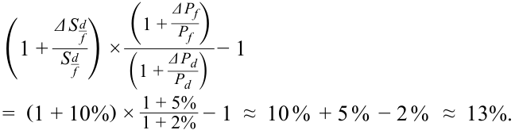
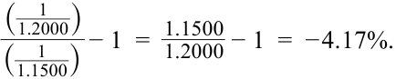

# Tập 2: Kinh tế học (Volume 2: Economics)
## Học phần 7: Dòng vốn và Thị trường Ngoại hối (Learning Module 7: Capital Flows and the FX Market)
### Phần 2/4: Thị trường Ngoại hối và Tỷ giá hối đoái (The Foreign Exchange Market and Exchange Rates) (Trang PDF 224–240)

---

<!-- PDF Page 224 -->

#### **TỔNG QUAN HỌC PHẦN (LEARNING MODULE OVERVIEW)** 

- Thị trường ngoại hối (*foreign exchange market*) là thị trường lớn nhất trên thế giới. 

- Tỷ giá hối đoái giao ngay danh nghĩa (*nominal spot exchange rates*) được yết giá trên thị trường và là dữ liệu đầu vào để các nhà phân tích xác định tỷ giá hối đoái thực (*real exchange rates*) — chỉ số phản ánh mối quan hệ giữa mức giá trong nước và nước ngoài, đồng thời cho biết sức mua tương đối (*relative purchasing power*) giữa các quốc gia. Để theo dõi các biến động tỷ giá hối đoái, việc tính toán phần trăm thay đổi của một đồng tiền so với một đồng tiền khác giúp các chủ thể tham gia thị trường hiểu được các thay đổi về giá và sử dụng các tỷ lệ phần trăm này trong các giao dịch trên thị trường. 

- Các chế độ tỷ giá hối đoái (*exchange rate regimes*) có thể là thả nổi (*floating*) hoặc cố định hoàn toàn (*fully fixed*), và nhiều động lực chính trị cũng như kinh tế khác nhau thúc đẩy các quốc gia sử dụng một trong số các chế độ tỷ giá trung gian (*intermediate regimes*). 

- Tác động của tỷ giá hối đoái và các yếu tố khác lên cán cân thương mại (*trade balance*) của một quốc gia được phản chiếu tương ứng qua tác động của chúng lên dòng vốn (*capital flows*) của quốc gia đó. 

- Mặc dù sự dịch chuyển tự do của dòng vốn giữa các quốc gia mang lại nhiều lợi ích kinh tế nhất, các chính phủ có thể hạn chế dòng vốn vào (*capital inflows*) hoặc dòng vốn ra (*capital outflows*) để giải quyết các mục tiêu chính sách trong nước cũng như các mục tiêu chiến lược hoặc liên quan đến quốc phòng. Những hạn chế này cho phép các chính phủ tránh được tình trạng tháo chạy vốn (*capital flight*) trong những thời kỳ khủng hoảng kinh tế vĩ mô và giới hạn dòng vốn chảy vào vốn có thể làm tổn hại đến năng lực cạnh tranh của các doanh nghiệp trong nước. 

# **<mark>2</mark>** 

## **THỊ TRƯỜNG NGOẠI HỐI VÀ TỶ GIÁ HỐI ĐOÁI (THE FOREIGN EXCHANGE MARKET AND EXCHANGE RATES)** 

*Mô tả thị trường ngoại hối, bao gồm các chức năng và các chủ thể tham gia thị trường, phân biệt giữa tỷ giá hối đoái danh nghĩa và tỷ giá hối đoái thực, đồng thời tính toán và diễn giải phần trăm thay đổi của một đồng tiền so với một đồng tiền khác.*

### **Giới thiệu và Thị trường Ngoại hối (Introduction and the Foreign Exchange Market)** 

Thị trường ngoại hối (*foreign exchange market* – thị trường FX)—thị trường nơi các đồng tiền được giao dịch với nhau—là thị trường lớn nhất thế giới với cách biệt rất xa so với các thị trường khác. Các ước tính hiện tại cho thấy doanh số giao dịch hàng ngày (*daily turnover*) đạt xấp xỉ 6,6 nghìn tỷ USD vào năm 2019. Con số này lớn gấp khoảng 10 đến 15 lần so với doanh số giao dịch hàng ngày trên các thị trường thu nhập cố định (*fixed-income markets*) toàn cầu và lớn gấp khoảng 50 lần so với doanh số giao dịch cổ phiếu (*equities*) toàn cầu. 

Thị trường FX là một thị trường thực sự mang tính toàn cầu, hoạt động 24 giờ một ngày vào mỗi ngày làm việc. Nó bao gồm các chủ thể tham gia thị trường từ mọi múi giờ được kết nối thông qua các mạng truyền thông điện tử (*electronic communications networks*), liên kết những tổ chức lớn như các quỹ đầu tư trị giá hàng tỷ đô la cho đến những cá nhân nhỏ lẻ tự giao dịch cho tài khoản của chính mình—tất cả được kết nối với nhau theo thời gian thực. Thương mại quốc tế sẽ không thể thực hiện được nếu không có hoạt động giao dịch tiền tệ tạo điều kiện cho nó, và các dòng vốn xuyên biên giới (*cross-border capital flows*) kết nối tất cả các thị trường tài chính trên toàn cầu thông qua thị trường FX cũng vậy. 

<!-- PDF Page 225 -->

Những yếu tố này khiến FX trở thành một thị trường trọng yếu mà các nhà đầu tư và các chủ thể tham gia thị trường cần phải hiểu rõ. Nền kinh tế thế giới ngày càng mang bản chất xuyên quốc gia (*transnational*), với cả quy trình sản xuất lẫn các dòng chảy thương mại thường được quyết định bởi các yếu tố toàn cầu nhiều hơn là các cân nhắc trong nước. Tương tự, hiệu quả hoạt động của danh mục đầu tư (*investment portfolio performance*) ngày càng phản ánh các yếu tố quyết định mang tính toàn cầu vì việc định giá trên các thị trường tài chính phản ứng với hàng loạt cơ hội đầu tư hiện có trên toàn thế giới chứ không chỉ ở phạm vi địa phương. Tất cả những yếu tố này đều hội tụ qua, và được phản ánh trong, thị trường FX. Khi các nhà đầu tư từ bỏ “thiên kiến nội địa” (*home bias*) và đầu tư vào ngoại hối, tỷ giá hối đoái—mức giá mà tại đó các khoản đầu tư định danh bằng ngoại tệ được định giá theo đồng nội tệ—trở thành một yếu tố quyết định ngày càng quan trọng đối với hiệu quả hoạt động của danh mục đầu tư. 

Ngay cả những nhà đầu tư tuân thủ một ủy thác danh mục đầu tư (*portfolio mandate*) thuần túy “trong nước” cũng ngày càng chịu ảnh hưởng bởi những gì diễn ra trên thị trường FX. Trước xu thế toàn cầu hóa của nền kinh tế thế giới, hầu hết các công ty lớn đều phụ thuộc rất nhiều vào hoạt động kinh doanh ở nước ngoài của họ (ví dụ, theo một số ước tính, khoảng 30% thu nhập của Chỉ số S&P 500 đến từ bên ngoài Hoa Kỳ). Hầu như tất cả các công ty đều phải đối mặt với một mức độ cạnh tranh nước ngoài nhất định, và việc định giá các tài sản trong nước—cổ phiếu, trái phiếu, bất động sản và các tài sản khác—cũng phụ thuộc vào nhu cầu từ các nhà đầu tư nước ngoài. Tất cả những ảnh hưởng đa dạng này đối với hiệu quả đầu tư đều phản ánh những diễn biến trên thị trường FX. 

#### **_Thị trường FX (The FX Market)_** 

Để hiểu về thị trường FX, cần phải làm quen với một số quy ước cơ bản của thị trường này. Các đồng tiền riêng lẻ thường được gọi bằng các mã gồm ba chữ cái đã được tiêu chuẩn hóa mà thị trường thống nhất thông qua Tổ chức Tiêu chuẩn hóa Quốc tế (*International Organization for Standardization* – ISO). Bảng 1 (*Exhibit 1*) liệt kê một số đồng tiền chính trên toàn cầu và mã nhận diện của chúng. 

**Bảng 1: Mã tiền tệ tiêu chuẩn (Exhibit 1: Standard Currency Codes)** 

|**Mã tiền tệ gồm ba chữ cái (Three-Letter Currency Code)**|**Đồng tiền (Currency)**|
|---|---|
|AUD|Đô la Úc (Australian dollar)|
|BRL|Real Brazil (Brazilian real)|
|CAD|Đô la Canada (Canadian dollar)|
|CHF|Franc Thụy Sĩ (Swiss franc)|
|CNY|Nhân dân tệ Trung Quốc (Chinese yuan)|
|EUR|Euro|
|GBP|Bảng Anh (British pound sterling)|
|HKD|Đô la Hồng Kông (Hong Kong dollar)|
|INR|Rupee Ấn Độ (Indian rupee)|
|JPY|Yên Nhật (Japanese yen)|
|KRW|Won Hàn Quốc (South Korean won)|
|MXN|Peso Mexico (Mexican peso)|
|NOK|Krone Na Uy (Norwegian krone)|
|NZD|Đô la New Zealand (New Zealand dollar)|
|RUB|Rúp Nga (Russian ruble)|
|SEK|Krona Thụy Điển (Swedish krona)|
|SGD|Đô la Singapore (Singapore dollar)|
|USD|Đô la Mỹ (US dollar)|
|ZAR|Rand Nam Phi (South African rand)|

<!-- PDF Page 226 -->

Điều quan trọng là phải hiểu được sự khác biệt giữa việc đề cập đến một _đồng tiền riêng lẻ_ (*individual currency*) và một _tỷ giá hối đoái_ (*exchange rate*). Một người có thể nắm giữ một đồng tiền riêng lẻ (ví dụ: trong một khoản tiền gửi 100 triệu EUR); tuy nhiên, tỷ giá hối đoái lại là giá của một đồng tiền tính theo một đồng tiền khác (ví dụ: tỷ giá hối đoái giữa đồng euro và đồng đô la Mỹ). Một đồng tiền riêng lẻ có thể đứng đơn lẻ, nhưng luôn có hai đồng tiền liên quan trong một tỷ giá hối đoái: giá của một đồng tiền tương đối so với một đồng tiền khác. Tỷ giá hối đoái là số đơn vị của một đồng tiền (được gọi là _đồng tiền định giá_ – *price currency*) mà một đơn vị của một đồng tiền khác (được gọi là _đồng tiền cơ sở_ – *base currency*) có thể mua được. Một cách tương đương để mô tả tỷ giá hối đoái là chi phí của một đơn vị đồng tiền cơ sở tính theo đồng tiền định giá. 

Sự phân biệt giữa các đồng tiền riêng lẻ và tỷ giá hối đoái này rất quan trọng vì, như chúng ta sẽ thấy trong một bài học sau, các mã tiền tệ gồm ba chữ cái này có thể được sử dụng theo cả hai cách. Ví dụ, khi được sử dụng như một tỷ giá hối đoái trên thị trường FX chuyên nghiệp, EUR được hiểu là tỷ giá hối đoái giữa đồng euro và đồng đô la Mỹ. Hãy lưu ý đến ngữ cảnh (hoặc là một đồng tiền hoặc là một tỷ giá hối đoái) mà các mã tiền tệ ba chữ cái này đang được sử dụng. Để tránh nhầm lẫn, bài học này sẽ xác định tỷ giá hối đoái bằng cách sử dụng quy ước “A/B”, đề cập đến số đơn vị của đồng tiền A mà một đơn vị của đồng tiền B có thể mua được. Ví dụ, tỷ giá hối đoái USD/EUR ở mức 1,1700 có nghĩa là 1 euro sẽ mua được 1,1700 đô la Mỹ (tức là 1 euro có giá 1,1700 đô la Mỹ). Trong trường hợp này, đồng euro là đồng tiền cơ sở (*base currency*) và đồng đô la Mỹ là đồng tiền định giá (*price currency*). Sự sụt giảm của tỷ giá hối đoái này có nghĩa là đồng euro có giá thấp hơn hoặc cần ít đô la Mỹ hơn để mua một euro. Nói cách khác, sự sụt giảm của tỷ giá hối đoái này cho thấy đồng đô la Mỹ đang _lên giá_ (*appreciating*) so với đồng euro hoặc, tương đương, đồng euro đang _mất giá_ (*depreciating*) so với đồng đô la Mỹ. 

Các tỷ giá hối đoái này được gọi là tỷ giá hối đoái _danh nghĩa_ (*nominal exchange rates*). Ngược lại, tỷ giá hối đoái _thực_ (*real exchange rates*) là các chỉ số thường được các nhà kinh tế học và các nhà phân tích thị trường khác xây dựng để đánh giá những thay đổi trong sức mua tương đối (*relative purchasing power*) của một đồng tiền so với một đồng tiền khác. Việc tạo ra các chỉ số này đòi hỏi phải điều chỉnh tỷ giá hối đoái danh nghĩa bằng cách sử dụng mức giá (*price levels*) ở mỗi quốc gia của cặp tiền tệ đó (do đó có tên là “tỷ giá hối đoái thực”) để so sánh sức mua tương đối giữa các quốc gia. 

Trong một thế giới của các hàng hóa và dịch vụ đồng nhất (*homogenous goods and services*), và không có các ma sát thị trường (*market frictions*) hay rào cản thương mại (*trade barriers*), sức mua tương đối giữa các quốc gia sẽ có xu hướng cân bằng: Tại sao bạn lại phải trả nhiều hơn, xét theo giá trị thực, ở trong nước cho một “món hàng” nếu bạn có thể nhập khẩu một “món hàng” y hệt từ nước ngoài với mức giá rẻ hơn? Khái niệm cơ bản này là trực giác đằng sau một lý thuyết được gọi là ngang giá sức mua (*purchasing power parity* – PPP), mô tả trạng thái cân bằng dài hạn của tỷ giá hối đoái danh nghĩa. Lý thuyết PPP khẳng định rằng tỷ giá hối đoái danh nghĩa sẽ điều chỉnh sao cho các hàng hóa giống hệt nhau (hoặc các giỏ hàng hóa) sẽ có cùng một mức giá ở các thị trường khác nhau. Hoặc, nói cách khác, sức mua của các đồng tiền khác nhau được cân bằng đối với một giỏ hàng hóa tiêu chuẩn hóa. 

Trên thực tế, các điều kiện cần thiết để thực thi PPP không được thỏa mãn: Hàng hóa và dịch vụ không giống hệt nhau giữa các quốc gia; các quốc gia thường có các giỏ hàng hóa và dịch vụ được sản xuất và tiêu dùng khác nhau; nhiều hàng hóa và dịch vụ không được giao dịch quốc tế; tồn tại các rào cản thương mại và chi phí giao dịch (ví dụ: chi phí vận chuyển và thuế nhập khẩu); và các dòng vốn (*capital flows*) ít nhất cũng quan trọng ngang bằng với các dòng chảy thương mại (*trade flows*) trong việc quyết định tỷ giá hối đoái danh nghĩa. Do đó, tỷ giá hối đoái danh nghĩa thể hiện những sự chệch hướng dai dẳng khỏi mức PPP. Hơn nữa, sức mua tương đối giữa các quốc gia thể hiện một xu hướng yếu ớt, nếu có, tiến tới sự cân bằng trong dài hạn. Một ví dụ đơn giản về việc so sánh xuyên quốc gia đối với sức mua của một hàng hóa tiêu chuẩn hóa là chỉ số Big Mac (*Big Mac index*) do tạp chí _Economist_ công bố, cho thấy mức giá tương đối của chiếc bánh hamburger tiêu chuẩn hóa này ở các quốc gia khác nhau. Chỉ số Big Mac chỉ ra rằng giá bánh hamburger thức ăn nhanh có thể khác biệt rất lớn trên phạm vi quốc tế và sự khác biệt về sức mua này là điển hình đối với hầu hết các hàng hóa và dịch vụ. Do đó, các biến động trong tỷ giá hối đoái thực cung cấp thông tin có ý nghĩa về những thay đổi trong sức mua tương đối giữa các quốc gia. 

<!-- PDF Page 227 -->

Hãy xem xét trường hợp của một cá nhân muốn mua hàng hóa từ nước ngoài. Cá nhân đó sẽ chỉ có thể mua được ít hàng hóa này hơn nếu tỷ giá hối đoái giao ngay danh nghĩa (*nominal spot exchange rate*) của đồng ngoại tệ lên giá hoặc nếu mức giá ở nước ngoài tăng lên. Ngược lại, cá nhân đó có thể mua được nhiều hàng hóa nước ngoài hơn nếu thu nhập trong nước của cá nhân đó tăng lên. (Đối với ví dụ này, chúng ta sẽ giả định rằng những thay đổi trong thu nhập của cá nhân tỷ lệ thuận với những thay đổi trong mức giá trong nước.) Do đó, xét theo sức mua _thực_, tỷ giá hối đoái thực mà một cá nhân phải đối mặt là một hàm đồng biến (*increasing function*) theo tỷ giá hối đoái danh nghĩa (được yết theo số đơn vị đồng nội tệ trên một đơn vị đồng ngoại tệ) và mức giá nước ngoài, đồng thời là một hàm nghịch biến (*decreasing function*) theo mức giá trong nước. Tỷ giá hối đoái thực càng _cao_, cá nhân đó càng mua được _ít_ hàng hóa nước ngoài hơn xét theo giá trị thực, và sức mua tương đối của cá nhân đó sẽ càng _thấp_ so với quốc gia kia. 

Một cách nhìn nhận tương đương về tỷ giá hối đoái thực là nó đại diện cho mức giá tương đối ở quốc gia trong nước và nước ngoài. Về mặt toán học, chúng ta có thể biểu diễn mức giá nước ngoài tính theo đồng nội tệ như sau: 

$$\text{Mức giá nước ngoài tính theo đồng nội tệ} = S_{d/f} \times P_f$$

trong đó $S_{d/f}$ là tỷ giá hối đoái giao ngay (được yết theo số đơn vị đồng nội tệ trên một đơn vị đồng ngoại tệ) và $P_f$ là mức giá nước ngoài được tính theo đồng ngoại tệ. Chúng ta có thể định nghĩa mức giá trong nước, tính theo đồng nội tệ, là $P_d$. Do đó, tỷ lệ giữa mức giá nước ngoài và mức giá trong nước như sau: 

$$\text{Tỷ giá hối đoái thực }(d/f) = \frac{S_{d/f} P_f}{P_d} = S_{d/f} \times \left(\frac{P_f}{P_d}\right)$$

Ví dụ, đối với một người tiêu dùng Anh muốn mua hàng hóa được sản xuất tại Khu vực đồng Euro (*Eurozone*), tỷ giá hối đoái thực (được xác định theo GBP/EUR; lưu ý rằng đồng nội tệ của Vương quốc Anh là đồng tiền định giá, không phải là đồng tiền cơ sở) sẽ là một hàm đồng biến theo tỷ giá hối đoái giao ngay danh nghĩa (GBP/EUR) và mức giá của Khu vực đồng Euro, đồng thời là một hàm nghịch biến theo mức giá của Vương quốc Anh. Điều này được viết dưới dạng công thức như sau: 

<!-- Formula Text: Real exchange rate  GBP _ EUR   =  S  GBP _ EUR  × ( CP I eur _ CP I UK ). -->
$$\text{Real exchange rate}_{\text{GBP/EUR}} = S_{\text{GBP/EUR}} \times \left(\frac{\text{CPI}_{\text{EUR}}}{\text{CPI}_{\text{UK}}}\right)$$

Chúng ta có thể kiểm tra tác động của các biến động trong mức giá trong nước và nước ngoài, cũng như tỷ giá hối đoái giao ngay danh nghĩa, đối với sức mua thực của một cá nhân ở Vương quốc Anh muốn mua hàng hóa của Khu vực đồng Euro. Giả sử rằng tỷ giá hối đoái giao ngay danh nghĩa (GBP/EUR) tăng 10%, mức giá của Khu vực đồng Euro tăng 5%, và mức giá của Vương quốc Anh tăng 2%. Khi đó, sự thay đổi trong tỷ giá hối đoái thực như sau: 

<!-- Formula Text: (1 + Δ S  d _ f _ S  d _ f  ) × (1 + Δ P f _ P f ) _ (1 + Δ P d _ P d ) − 1 =  (1 + 10%) ×  1 + 5% _ 1 + 2%  − 1  ≈  10 %  + 5 %  − 2 %   ≈  13%. -->
$$\frac{\left(1 + \frac{\Delta S_{d/f}}{S_{d/f}}\right) \times \left(1 + \frac{\Delta P_f}{P_f}\right)}{\left(1 + \frac{\Delta P_d}{P_d}\right)} - 1 = (1 + 10\%) \times \frac{1 + 5\%}{1 + 2\%} - 1 \approx 10\% + 5\% - 2\% \approx 13\%$$

Trong trường hợp này, tỷ giá hối đoái thực đối với cá nhân sinh sống tại Vương quốc Anh đã _tăng_ khoảng 13%, nghĩa là giờ đây chi phí để mua hàng hóa của Khu vực đồng Euro _đắt hơn_ xét theo giá trị thực. Hoặc nói cách khác, sức mua thực của cá nhân ở Vương quốc Anh so với hàng hóa của Khu vực đồng Euro đã _giảm_ khoảng 13%. Một cách dễ dàng để ghi nhớ mối quan hệ này là coi tỷ giá hối đoái thực (được biểu thị với đồng nội tệ là đồng tiền định giá) đại diện cho mức giá thực mà bạn phải trả để mua hàng hóa và dịch vụ nước ngoài: Mức giá (tỷ giá hối đoái thực) càng _cao_ thì sức mua tương đối của bạn sẽ càng _thấp_. 

Tỷ giá hối đoái thực của một đồng tiền có thể được xây dựng cho đồng nội tệ so với một đồng ngoại tệ duy nhất hoặc so với một giỏ các đồng ngoại tệ. Trong cả hai trường hợp, các chỉ số tỷ giá hối đoái thực này đều phụ thuộc vào các giả định được đưa ra bởi 

<!-- PDF Page 228 -->

nhà phân tích tạo ra chúng. Một số ngân hàng đầu tư và ngân hàng trung ương tạo ra các thước đo độc quyền về tỷ giá hối đoái thực. Lưu ý rằng tỷ giá hối đoái thực _không_ được yết giá hay giao dịch trên các thị trường FX toàn cầu: Chúng chỉ là các chỉ số do các nhà phân tích tạo ra nhằm hiểu rõ năng lực cạnh tranh quốc tế của một nền kinh tế và sức mua thực của một đồng tiền. 

Trong bối cảnh này, tỷ giá hối đoái thực có thể hữu ích để hiểu các xu hướng trong thương mại quốc tế và dòng vốn, và do đó có thể được xem là một trong những yếu tố ảnh hưởng đến tỷ giá hối đoái giao ngay danh nghĩa. Lấy ví dụ, hãy xem xét tỷ giá hối đoái giữa đồng rupee Ấn Độ và đồng đô la Mỹ. Trong năm 2018, tỷ giá hối đoái danh nghĩa của đồng rupee so với đồng đô la Mỹ (INR/USD) đã tăng xấp xỉ 6,7%—nghĩa là đồng đô la Mỹ đã lên giá so với đồng rupee. Tuy nhiên, tỷ lệ lạm phát hàng năm ở Hoa Kỳ và Ấn Độ lại khác nhau trong năm 2018—xấp xỉ 2,5% đối với Hoa Kỳ và 4,7% đối với Ấn Độ. Điều này có nghĩa là tỷ giá hối đoái thực (tính theo INR/USD) đã mất giá chậm hơn so với tỷ giá hối đoái danh nghĩa INR/USD: 

<!-- Formula Text: (1 + %Δ S  INR _ USD ) × (1 + %Δ P US) ___________ (1 + %Δ P India)  − 1  ≈  + 6.7 %  + 2.5 %  − 4.7 %   ≈  4.5%. -->
$$\frac{(1 + \%\Delta S_{\text{INR/USD}}) \times (1 + \%\Delta P_{\text{US}})}{(1 + \%\Delta P_{\text{India}})} - 1 \approx +6,7\% + 2,5\% - 4,7\% \approx 4,5\%$$

Sự kết hợp giữa một đồng rupee yếu hơn nhiều và tỷ lệ lạm phát cao hơn ở Ấn Độ có nghĩa là tỷ giá hối đoái thực mà Ấn Độ phải đối mặt đang tăng lên, qua đó làm giảm sức mua của Ấn Độ tính theo đồng đô la Mỹ. 

Các biến động trong tỷ giá hối đoái thực có thể có tác động tương tự như các biến động trong tỷ giá hối đoái danh nghĩa xét về mặt ảnh hưởng đến giá cả tương đối và từ đó là các dòng chảy thương mại. Ngay cả khi tỷ giá hối đoái giao ngay danh nghĩa không dịch chuyển, sự chênh lệch về tỷ lệ lạm phát giữa các quốc gia vẫn ảnh hưởng đến năng lực cạnh tranh tương đối của chúng. 

Mặc dù tỷ giá hối đoái thực có thể gây ra một số ảnh hưởng lên các biến động tỷ giá hối đoái danh nghĩa, nhưng chúng chỉ là một trong nhiều yếu tố; có thể rất khó để tách bạch tất cả các mối quan hệ qua lại này trong một thị trường FX phức tạp và năng động. Như đã thảo luận trước đó, PPP là một kim chỉ nam kém hiệu quả trong việc dự báo các biến động tương lai của tỷ giá hối đoái danh nghĩa bởi vì các tỷ giá này có thể chệch hướng khỏi mức cân bằng PPP—và thậm chí tiếp tục đi xa hơn khỏi mức PPP của chúng—trong nhiều năm liền. Do đó, không có gì đáng ngạc nhiên khi tỷ giá hối đoái thực, vốn phản ánh những thay đổi trong sức mua tương đối, lại có lịch sử dự báo kém chính xác đối với các biến động tỷ giá hối đoái danh nghĩa trong tương lai. 

#### **VÍ DỤ 1 (EXAMPLE 1)** 

### **Tỷ giá hối đoái danh nghĩa và tỷ giá hối đoái thực (Nominal and Real Exchange Rates)** 

Một cố vấn đầu tư tại Sydney, Úc, đang gặp gỡ một khách hàng địa phương đang muốn đa dạng hóa danh mục đầu tư trái phiếu trong nước của mình bằng cách bổ sung các khoản đầu tư vào trái phiếu dài hạn, lãi suất cố định được định danh bằng đồng đô la Hồng Kông. Khách hàng này thường xuyên đến thăm Đặc khu Hành chính Hồng Kông (*Hong Kong SAR*), và nhiều khoản chi tiêu hàng năm của bà được tính bằng đồng đô la Hồng Kông. Tuy nhiên, khách hàng lo ngại về rủi ro ngoại tệ (*foreign currency risks*) của các khoản đầu tư ở nước ngoài và liệu tỷ suất sinh lợi đầu tư trên các khoản đầu tư định danh bằng đô la Hồng Kông của bà có duy trì được sức mua của bà hay không—cả ở trong nước (tức là đối với các khoản chi tiêu bằng đô la Úc của bà) và cho các chuyến đi nước ngoài của bà (tức là các khoản chi tiêu bằng đô la Hồng Kông cho các chuyến thăm Đặc khu Hành chính Hồng Kông). Cố vấn đầu tư giải thích tác động của những thay đổi trong tỷ giá hối đoái danh nghĩa và thực cho khách hàng và minh họa lời giải thích này bằng cách đưa ra các phát biểu sau: 

- **Phát biểu 1 (Statement 1):** Với các yếu tố khác không đổi, sự gia tăng của tỷ giá hối đoái danh nghĩa AUD/HKD sẽ dẫn đến sự gia tăng giá trị tính bằng đô la Úc của khoản đầu tư nước ngoài của bà. 

<!-- PDF Page 229 -->

- **Phát biểu 2 (Statement 2):** Với các yếu tố khác không đổi, sự gia tăng của tỷ giá hối đoái danh nghĩa AUD/HKD có nghĩa là sức mua tương đối cho các chuyến đi đến Đặc khu Hành chính Hồng Kông của bà sẽ tăng lên (dựa trên việc thanh toán cho chuyến đi của bà bằng thu nhập từ trái phiếu định danh bằng đô la Hồng Kông của bà). 

- **Phát biểu 3 (Statement 3):** Với các yếu tố khác không đổi, sự gia tăng tỷ lệ lạm phát của Úc sẽ dẫn đến sự gia tăng tỷ giá hối đoái thực (AUD/HKD). Tỷ giá hối đoái thực cao hơn có nghĩa là sức mua tương đối của khoản thu nhập tính bằng đô la Úc của bà cao hơn. 

- **Phát biểu 4 (Statement 4):** Với các yếu tố khác không đổi, sự sụt giảm của tỷ giá hối đoái danh nghĩa (AUD/HKD) sẽ làm giảm tỷ giá hối đoái thực (AUD/HKD) và làm tăng sức mua tương đối của khoản thu nhập tính bằng đô la Úc của bà. 

Để chứng minh tác động của những thay đổi về lạm phát và tỷ giá hối đoái danh nghĩa đối với sức mua tương đối, người cố vấn sử dụng kịch bản sau: “Giả sử rằng tỷ giá hối đoái AUD/HKD tăng 5%, giá hàng hóa và dịch vụ tại Đặc khu Hành chính Hồng Kông tăng 5%, và giá hàng hóa và dịch vụ tại Úc tăng 2%.” 

#### 1. Phát biểu 1 là: 

- **A.** đúng. 

- **B.** sai, vì dựa trên quy ước yết giá, giá trị khoản đầu tư sẽ giảm đi khi tính theo đô la Úc. 

- **C.** sai, vì giá trị danh nghĩa tính bằng đô la Úc của các khoản đầu tư nước ngoài sẽ phụ thuộc vào biến động của tỷ lệ lạm phát tại Úc. 

#### **Lời giải (Solution):** 

**A là đáp án đúng.** Theo quy ước yết giá, sự gia tăng của tỷ giá AUD/HKD có nghĩa là đồng tiền cơ sở (đô la Hồng Kông) đang lên giá (một đô la Hồng Kông sẽ mua được nhiều đô la Úc hơn). Điều này làm tăng giá trị danh nghĩa của các khoản đầu tư định danh bằng đô la Hồng Kông khi được đo lường theo đồng đô la Úc. 

#### 2. Phát biểu 2 là: 

- **A.** đúng. 

- **B.** sai, vì sức mua không bị ảnh hưởng trong trường hợp này. 

- **C.** sai, vì dựa trên quy ước yết giá, sức mua tương đối của khách hàng sẽ giảm xuống. 

#### **Lời giải (Solution):** 

**B là đáp án đúng.** Khi thanh toán các khoản chi tiêu bằng đô la Hồng Kông bằng thu nhập định danh bằng đô la Hồng Kông, giá trị của tỷ giá hối đoái giao ngay AUD/HKD (hoặc bất kỳ tỷ giá hối đoái giao ngay nào khác) sẽ không liên quan. Trên thực tế, đây là một nguyên tắc cơ bản của quản trị rủi ro tiền tệ (*currency risk management*): giảm thiểu mức độ phơi nhiễm rủi ro ngoại hối (*FX risk exposures*) bằng cách định danh tài sản và nợ phải trả (hoặc thu nhập và chi phí) bằng cùng một đồng tiền. 

#### 3. Phát biểu 3 là: 

- **A.** đúng. 

- **B.** chỉ sai đối với tỷ giá hối đoái thực. 

<!-- PDF Page 230 -->

- **C.** sai đối với cả tỷ giá hối đoái thực và sức mua của thu nhập tính bằng đô la Úc. 

#### **Lời giải (Solution):** 

**C là đáp án đúng.** Sự gia tăng tỷ lệ lạm phát của Úc (tức là trong nước) có nghĩa là tỷ giá hối đoái thực (được đo lường theo nội tệ/ngoại tệ, hay AUD/HKD) sẽ giảm xuống chứ không phải tăng lên. Hơn nữa, sự gia tăng của tỷ giá hối đoái thực ($R_{\text{AUD/HKD}}$) sẽ tương đương với việc làm giảm sức mua của khách hàng người Úc: Hàng hóa và dịch vụ định danh bằng đô la Hồng Kông sẽ có chi phí đắt đỏ hơn. 

#### 4. Phát biểu 4 là: 

- **A.** đúng. 

- **B.** sai đối với tỷ giá hối đoái thực. 

- **C.** sai đối với sức mua của thu nhập tính bằng đô la Úc. 

#### **Lời giải (Solution):** 

**A là đáp án đúng.** Khi tỷ giá hối đoái giao ngay AUD/HKD giảm xuống, đồng đô la Hồng Kông đang mất giá so với đồng đô la Úc; hoặc tương đương, đồng đô la Úc đang lên giá so với đồng đô la Hồng Kông. Điều này làm giảm tỷ giá hối đoái thực ($R_{\text{AUD/HKD}}$) và làm tăng sức mua của khách hàng người Úc. 

#### 5. Dựa trên kịch bản của người cố vấn và giả định rằng giá trị tính bằng đô la Hồng Kông của các trái phiếu đô la Hồng Kông không thay đổi, giá trị danh nghĩa tính bằng đô la Úc của các khoản đầu tư bằng đô la Hồng Kông của khách hàng sẽ: 

- **A.** giảm khoảng 5%. 

- **B.** tăng khoảng 5%. 

- **C.** giữ nguyên xấp xỉ như cũ. 

#### **Lời giải (Solution):** 

**B là đáp án đúng.** Khi tỷ giá hối đoái giao ngay AUD/HKD tăng 5%, đồng đô la Hồng Kông đang lên giá so với đồng đô la Úc 5% và, với các yếu tố khác không đổi, giá trị của khoản đầu tư định danh bằng đô la Hồng Kông sẽ tăng 5% khi tính theo đồng đô la Úc. 

#### 6. Dựa trên kịch bản của người cố vấn, sự thay đổi trong sức mua tương đối của khoản thu nhập tính bằng đô la Úc của khách hàng _gần nhất_ với mức: 

- **A.** –8%. 

- **B.** +8%. 

- **C.** +12%. 

#### **Lời giải (Solution):** 

**A là đáp án đúng.** Tỷ giá hối đoái thực ($R_{\text{AUD/HKD}}$) được biểu diễn như sau:

$$R_{\text{AUD/HKD}} = S_{\text{AUD/HKD}} \times \frac{P_{\text{HKD}}}{P_{\text{AUD}}}$$

Thông tin trong kịch bản của người cố vấn có thể được biểu diễn như sau: 

$$\%\Delta R_{\text{AUD/HKD}} \approx \%\Delta S_{\text{AUD/HKD}} + \%\Delta P_{\text{HKD}} - \%\Delta P_{\text{AUD}} \approx +5\% + 5\% - 2\% \approx +8\%$$

Bởi vì tỷ giá hối đoái thực (biểu thị theo AUD/HKD) đã tăng khoảng 8%, nên sức mua thực của nhà đầu tư tại Úc đã giảm khoảng 8%. Điều này có thể thấy từ thực tế là 

<!-- PDF Page 231 -->

đồng đô la Hồng Kông đã lên giá so với đồng đô la Úc xét theo giá trị danh nghĩa, và mức giá tại Đặc khu Hành chính Hồng Kông cũng đã tăng lên. Sự gia tăng chi phí hàng hóa và dịch vụ của Đặc khu Hành chính Hồng Kông (đo bằng đô la Úc) chỉ được bù đắp một phần bởi mức tăng nhỏ (2%) trong thu nhập của nhà đầu tư (được giả định bằng với mức thay đổi trong mức giá của Úc). 

#### **BỘ CÂU HỎI (QUESTION SET)** 

1. Sự sụt giảm của tỷ giá hối đoái thực (được yết theo đồng nội tệ trên mỗi đơn vị ngoại tệ) có _nhiều khả năng nhất_ gắn liền với sự gia tăng của yếu tố nào sau đây? 

   - **A.** Mức giá nước ngoài (*Foreign price level*). 

   - **B.** Mức giá trong nước (*Domestic price level*). 

   - **C.** Tỷ giá hối đoái danh nghĩa (*Nominal exchange rate*). 

#### **Lời giải (Solution):** 

**B là đáp án đúng.** Tỷ giá hối đoái thực (được yết theo đồng nội tệ trên mỗi đơn vị ngoại tệ) được cho bởi công thức sau: 

$$\text{Tỷ giá hối đoái thực }(d/f) = S_{d/f} \times \left(\frac{P_f}{P_d}\right)$$

Sự gia tăng mức giá trong nước ($P_d$) làm _giảm_ tỷ giá hối đoái thực vì nó hàm ý sự _gia tăng_ sức mua tương đối của đồng nội tệ. 

### **Các chủ thể tham gia thị trường (Market Participants)** 

Bây giờ chúng ta chuyển sang tìm hiểu các đối tác (*counterparties*) tham gia vào thị trường FX. Như đã đề cập trước đó, một hệ sinh thái vô cùng đa dạng các chủ thể tham gia thị trường trải rộng về quy mô từ các quỹ đầu tư trị giá hàng tỷ đô la cho đến các cá nhân tự giao dịch cho tài khoản của riêng mình (bao gồm cả khách du lịch nước ngoài đổi tiền tại các quầy ở sân bay). 

Để hiểu rõ các chủ thể tham gia thị trường khác nhau, việc tách họ thành các nhóm rộng là rất hữu ích. Một sự phân biệt rộng rãi là giữa những gì thị trường gọi là _bên mua_ (*buy side*) và _bên bán_ (*sell side*). Bên bán nhìn chung bao gồm các ngân hàng giao dịch FX lớn (chẳng hạn như Citigroup, UBS và Deutsche Bank); bên mua bao gồm các khách hàng sử dụng các ngân hàng này để thực hiện các giao dịch FX (tức là mua các sản phẩm FX) từ các ngân hàng bên bán. 

Bên mua (*buy side*) có thể được chia nhỏ hơn nữa thành một số nhóm sau: 

- _Tài khoản doanh nghiệp (Corporate accounts)_: Các doanh nghiệp thuộc mọi quy mô thực hiện các giao dịch FX trong quá trình mua và bán hàng hóa và dịch vụ xuyên biên giới. Nhiều dòng chảy FX của họ cũng liên quan đến các dòng vốn đầu tư xuyên biên giới—chẳng hạn như các giao dịch mua bán và sáp nhập (*mergers and acquisitions* – M&A) quốc tế, đầu tư vốn của doanh nghiệp vào tài sản nước ngoài và vay vốn bằng ngoại tệ. 

- _Tài khoản tiền thực (Real money accounts)_: Đây là các quỹ đầu tư được quản lý bởi các công ty bảo hiểm, quỹ tương hỗ (*mutual funds*), quỹ hưu trí (*pension funds*), quỹ hiến tặng (*endowments*), quỹ hoán đổi danh mục (*exchange-traded funds* – ETFs) và các nhà đầu tư tổ chức khác. Các tài khoản này được gọi là tiền thực (*real money*) vì chúng thường bị hạn chế trong việc sử dụng đòn bẩy (*leverage*) hoặc các công cụ phái sinh tài chính (*financial derivatives*). Đặc điểm này giúp phân biệt chúng với các tài khoản sử dụng đòn bẩy (được thảo luận tiếp theo), mặc dù nhiều nhà đầu tư tổ chức thường tham gia vào một số hình thức đòn bẩy, trực tiếp thông qua việc sử dụng vốn vay hoặc gián tiếp thông qua việc sử dụng các công cụ phái sinh tài chính. 

<!-- PDF Page 232 -->

- _Tài khoản sử dụng đòn bẩy (Leveraged accounts)_: Nhóm này, thường được gọi là cộng đồng giao dịch chuyên nghiệp (*professional trading community*), bao gồm các quỹ phòng hộ (*hedge funds*), các công ty tự doanh (*proprietary trading shops*), các cố vấn giao dịch hàng hóa (*commodity trading advisers* – CTAs), các nhà giao dịch thuật toán tần suất cao (*high-frequency algorithmic traders*) và các bộ phận tự doanh tại các ngân hàng—và thực chất là hầu hết mọi tài khoản giao dịch chủ động chấp nhận và quản lý rủi ro FX để kiếm lợi nhuận. Cộng đồng giao dịch chuyên nghiệp chiếm một tỷ trọng lớn và ngày càng tăng trong doanh số giao dịch hàng ngày của thị trường FX. Các tài khoản giao dịch chủ động này cũng có phong cách giao dịch hết sức đa dạng. Một số là các quỹ phòng hộ vĩ mô (*macro-hedge funds*) nắm giữ các vị thế FX dài hạn dựa trên quan điểm của họ về các yếu tố kinh tế cơ bản (*underlying economic fundamentals*) của một đồng tiền. Những chủ thể khác là các nhà giao dịch thuật toán tần suất cao sử dụng các chiến lược giao dịch kỹ thuật (*technical trading strategies*) (chẳng hạn như các chiến lược dựa trên đường trung bình động hoặc các mức Fibonacci) và có chu kỳ giao dịch cũng như thời hạn đầu tư đôi khi được đo bằng mili-giây. 

- _Tài khoản cá nhân/nhỏ lẻ (Retail accounts)_: Ví dụ đơn giản nhất về tài khoản nhỏ lẻ là hình ảnh điển hình của một khách du lịch nước ngoài đổi tiền tại quầy giao dịch ở sân bay. Tuy nhiên, khi công nghệ giao dịch điện tử đã làm giảm các rào cản gia nhập vào thị trường FX cũng như chi phí giao dịch FX, đã có một sự bùng nổ lớn trong hoạt động giao dịch đầu cơ của các tài khoản nhỏ lẻ—bao gồm các cá nhân tự giao dịch cho tài khoản của riêng họ cũng như các quỹ phòng hộ nhỏ hơn và các nhà giao dịch chủ động khác. Nhóm này cũng bao gồm các hộ gia đình sử dụng công nghệ giao dịch điện tử để chuyển tiền tiết kiệm của họ sang ngoại tệ (ví dụ: hoạt động này tương đối phổ biến trong các hộ gia đình ở Nhật Bản). Ước tính giao dịch nhỏ lẻ chiếm tới 10% tổng số giao dịch giao ngay (*spot transactions*) ở một số cặp tiền tệ và tỷ trọng này đang ngày càng tăng lên. 

- _Chính phủ (Governments)_: Các thực thể công thuộc mọi loại hình thường có nhu cầu về FX, từ quy mô tương đối nhỏ (ví dụ: duy trì các lãnh sự quán ở nước ngoài) đến quy mô lớn (ví dụ: mua sắm thiết bị quân sự hoặc duy trì các căn cứ quân sự ở nước ngoài). Đôi khi những dòng chảy này thuần túy mang tính chất giao dịch—công việc đơn giản là cần phải được thực hiện—và đôi khi các dòng chảy FX của chính phủ phản ánh, ít nhất là một phần, các mục tiêu chính sách công của chính phủ. Một số hoạt động FX của chính phủ giống với hoạt động của các quỹ đầu tư, mặc dù đôi khi cũng đi kèm với một nhiệm vụ chính sách công. Ở một số quốc gia, các chương trình hưu trí khu vực công và các chương trình bảo hiểm công cộng được điều hành bởi một nhánh của chính phủ. Một ví dụ là quỹ Caisse de dépôt et placement du Québec, được thành lập bởi chính quyền tỉnh Québec ở Canada để quản lý các chương trình hưu trí khu vực công của tỉnh đó. Quỹ Caisse, như cách nó thường được gọi, là một tổ chức tương đối lớn trên thị trường tài chính, với khối tài sản đang quản lý (*assets under management* – AUM) đạt gần 420 tỷ CAD vào cuối năm 2021. Mặc dù quỹ có nhiệm vụ đầu tư các tài sản này để đạt tỷ suất sinh lợi tối ưu, nhưng quỹ cũng được kêu gọi giúp thúc đẩy sự phát triển kinh tế của Québec. Nhiều chính phủ—cả ở cấp liên bang và cấp tỉnh/bang—phát hành nợ bằng ngoại tệ; điều này cũng tạo ra các dòng chảy FX. Các tổ chức siêu quốc gia (*supranational agencies*) như Ngân hàng Thế giới (*World Bank*) và Ngân hàng Phát triển Châu Phi (*African Development Bank*) cũng phát hành nợ bằng nhiều loại tiền tệ khác nhau. 

- _Ngân hàng trung ương (Central banks)_: Các tổ chức này đôi khi can thiệp vào thị trường FX để tác động đến mức độ hoặc xu hướng của tỷ giá hối đoái trong nước. Điều này thường xảy ra khi các ngân hàng trung ương đánh giá đồng nội tệ của họ quá yếu và khi tỷ giá hối đoái đã vượt quá (*overshot*) bất kỳ khái niệm nào về mức cân bằng (ví dụ: do một cuộc tấn công đầu cơ – *speculative attack*) đến mức tỷ giá hối đoái không còn phản ánh các yếu tố kinh tế cơ bản nữa. Ngoài ra, các ngân hàng trung ương cũng can thiệp khi thị trường FX trở nên quá thất thường và rối loạn chức năng đến mức những người dùng cuối (*end-users*) như các doanh nghiệp không thể thực hiện các giao dịch FX cần thiết. Ngược lại, các ngân hàng trung ương đôi khi can thiệp khi họ tin rằng đồng nội tệ của họ đã trở nên quá mạnh, đến 

<!-- PDF Page 233 -->

mức làm suy yếu năng lực cạnh tranh xuất khẩu của quốc gia đó. Ngân hàng Trung ương Nhật Bản (*Bank of Japan*) đã can thiệp chống lại sự tăng giá của đồng yên so với đồng đô la Mỹ vào năm 2004 và một lần nữa vào tháng 3 năm 2011 sau thảm họa động đất và hạt nhân kinh hoàng. Tương tự, vào các năm 2010, 2013 và một lần nữa vào năm 2015, Ngân hàng Quốc gia Thụy Sĩ (*Swiss National Bank*) đã can thiệp chống lại sự tăng giá của đồng franc Thụy Sĩ so với đồng euro bằng cách bán đồng franc Thụy Sĩ theo tỷ giá chéo euro–Thụy Sĩ (CHF/EUR). Các nhà quản lý dự trữ của ngân hàng trung ương (*central bank reserve managers*) là những người tham gia thường xuyên trên thị trường FX để quản lý dự trữ ngoại hối (*FX reserves*) của quốc gia họ. Trong bối cảnh này, họ hành động rất giống các quỹ đầu tư tiền thực—mặc dù nhìn chung mang một nhiệm vụ thận trọng, bảo thủ nhằm bảo vệ giá trị dự trữ FX của quốc gia mình. Dự trữ FX của một số quốc gia là vô cùng khổng lồ, và sự tham gia của ngân hàng trung ương vào thị trường FX đôi khi có thể tạo ra tác động trọng yếu lên tỷ giá hối đoái ngay cả khi các nhà quản lý dự trữ này không can thiệp vì mục đích chính sách công. Tổng dự trữ FX đã đạt gần 13 nghìn tỷ USD vào cuối năm 2021. 

Điều này phần lớn phản ánh sự tăng trưởng nhanh chóng của dự trữ ngoại hối do các ngân hàng trung ương châu Á nắm giữ, bởi vì các quốc gia này thường có thặng dư tài khoản vãng lai (*current account surpluses*) lớn với Hoa Kỳ và các nền kinh tế thị trường phát triển khác. Việc tích lũy dự trữ của các quốc gia xuất khẩu năng lượng ở Trung Đông và các nơi khác cũng là một yếu tố. Tính đến cuối năm 2021, gần 60% dự trữ tiền tệ được phân bổ trên toàn cầu được nắm giữ bằng đồng đô la Mỹ, trong khi chỉ hơn 20% được nắm giữ bằng đồng euro, đồng tiền được nắm giữ rộng rãi thứ hai trong dự trữ FX của các ngân hàng trung ương. 

- _Quỹ đầu tư quốc gia (Sovereign wealth funds – SWFs)_: Nhiều quốc gia có thặng dư tài khoản vãng lai lớn đã chuyển hướng một số dòng vốn quốc tế thu được vào các quỹ SWF thay vì vào dự trữ FX do ngân hàng trung ương quản lý. Mặc dù các quỹ SWF là các thực thể của chính phủ, nhiệm vụ của chúng thường hướng nhiều hơn đến các mục đích đầu tư thuần túy thay vì các mục đích chính sách công. Do đó, các quỹ SWF có thể được coi là tương tự như các tài khoản tiền thực, mặc dù một số quỹ SWF có thể sử dụng các công cụ phái sinh hoặc tham gia vào các chiến lược giao dịch năng động/mạo hiểm (*aggressive trading strategies*). Nhìn chung, người ta hiểu rằng các quỹ SWF sử dụng nguồn lực của mình để giúp thực hiện nhiệm vụ chính sách công của các chủ sở hữu chính phủ của chúng. Các quỹ SWF của nhiều quốc gia có thặng dư tài khoản vãng lai (chẳng hạn như các quốc gia xuất khẩu ở Đông Á (ví dụ: Singapore) hoặc các quốc gia xuất khẩu dầu mỏ (ví dụ: Kuwait)) có quy mô khổng lồ, và các dòng chảy FX của chúng có thể là một yếu tố quyết định quan trọng đối với biến động tỷ giá hối đoái ở hầu hết các cặp tiền tệ chính. 

Bên bán (*sell side*) nhìn chung bao gồm các ngân hàng giao dịch FX (*FX dealing banks*) bán các sản phẩm FX cho bên mua. Có thể đưa ra các sự phân biệt sau đây đối với bên bán: 

- Một tỷ trọng lớn và ngày càng tăng trong doanh số giao dịch FX hàng ngày thuộc về các ngân hàng giao dịch trung tâm tiền tệ (*money center dealing banks*) lớn nhất, chẳng hạn như Deutsche Bank, Citigroup, UBS, HSBC và một vài gã khổng lồ ngân hàng đa quốc gia khác. Việc duy trì lợi thế cạnh tranh trong lĩnh vực FX đòi hỏi những khoản đầu tư chi phí cố định khổng lồ vào công nghệ điện tử kết nối thị trường FX, đồng thời cũng đòi hỏi một tệp khách hàng rộng lớn trên toàn cầu. Do đó, chỉ những ngân hàng cấp một (*first-tier banks*) lớn nhất mới có thể cạnh tranh thành công trong việc cung cấp các báo giá cạnh tranh cho khách hàng trên một phạm vi rộng các sản phẩm FX. Trên thực tế, trong số các ngân hàng giao dịch FX lớn nhất, một tỷ trọng lớn hoạt động kinh doanh của họ được khớp lệnh nội bộ (*crossed internally*), nghĩa là các ngân hàng này có khả năng kết nối người mua và người bán ngay trong chính tệp khách hàng vô cùng đa dạng của họ và không cần phải đưa các dòng chảy FX này ra bên ngoài ngân hàng. 

- Tất cả các ngân hàng khác đều thuộc nhóm cấp hai và cấp ba (*second and third tier*) của bên bán trên thị trường FX. Nhiều định chế tài chính trong số này là các ngân hàng khu vực hoặc địa phương có mối quan hệ kinh doanh phát triển tốt, nhưng họ thiếu tính kinh tế theo quy mô (*economies of scale*), 

<!-- PDF Page 234 -->

tệp khách hàng toàn cầu rộng khắp, hoặc chuyên môn về công nghệ thông tin (CNTT) cần thiết để đưa ra mức định giá cạnh tranh trên một phạm vi rộng các đồng tiền và sản phẩm FX. Trong nhiều trường hợp, đây là các ngân hàng ở các thị trường mới nổi không có các mối liên kết kinh doanh hoặc hạn mức tín dụng (*credit lines*) cần thiết để tự mình tiếp cận thị trường FX trên cơ sở hiệu quả về chi phí. Do đó, các ngân hàng này thường thuê ngoài (*outsource*) các dịch vụ FX bằng cách thiết lập mối quan hệ kinh doanh với các ngân hàng cấp một lớn hơn; nếu không, họ phải phụ thuộc vào thanh khoản sâu và cạnh tranh được cung cấp bởi những chủ thể tham gia thị trường FX lớn nhất. 

Các phân nhóm được trình bày dựa trên các chức năng gắn liền mật thiết với các nhóm được nêu tên. Tuy nhiên, trong một số trường hợp, các chức năng điển hình của một nhóm cũng có thể được đảm nhận hoặc chia sẻ với một nhóm khác. Ví dụ, các ngân hàng bên bán cung cấp báo giá FX. Tuy nhiên, các quỹ phòng hộ và các tổ chức lớn khác có thể tiếp cận thị trường FX chuyên nghiệp với các điều khoản ngang bằng với các ngân hàng giao dịch và thực sự đóng vai trò như những nhà tạo lập thị trường (*market makers*). 

Một trong những ý tưởng quan trọng nhất rút ra từ việc phân loại các chủ thể tham gia thị trường này là có một sự đa dạng vô cùng lớn các chủ thể tham gia thị trường FX, phản ánh một sự pha trộn phức tạp giữa các động cơ và chiến lược giao dịch có thể thay đổi theo thời gian. Hầu hết các chủ thể tham gia thị trường đều phản ánh sự kết hợp giữa động cơ phòng ngừa rủi ro (*hedging*) và đầu cơ (*speculative*) trong việc điều chỉnh mức độ phơi nhiễm rủi ro FX của họ. Trong số các chủ thể tham gia thị trường thuộc khu vực công, động cơ chính sách công cũng có thể là một nhân tố. Sự tương tác năng động, phức tạp của các chủ thể tham gia thị trường FX và các mục tiêu giao dịch của họ khiến cho việc phân tích hoặc dự báo các biến động của tỷ giá FX với bất kỳ độ chính xác nào, hoặc mô tả thị trường FX một cách thỏa đáng bằng những đặc tính đơn giản, trở nên rất khó khăn. 

#### **CÁC THÔNG LỆ TỐT NHẤT TRÊN THỊ TRƯỜNG NGOẠI HỐI (BEST PRACTICES IN FOREIGN EXCHANGE MARKETS)** 

Là một yếu tố quan trọng của thương mại và các dòng vốn xuyên biên giới, đồng thời là một yếu tố quyết định then chốt đối với hiệu quả hoạt động của danh mục đầu tư, tính minh bạch và sự vận hành đúng đắn của thị trường ngoại hối có tầm quan trọng sống còn đối với các chủ thể tham gia thị trường trong việc đáp ứng các mục tiêu và đích đến tài chính của họ. Tuy nhiên, là một thị trường thực sự mang tính toàn cầu, thị trường FX thiếu sự giám sát quản lý của các sở giao dịch trong nước, mặc dù Ngân hàng Thanh toán Quốc tế (*Bank for International Settlements* – BIS) đã đề cập ở trên có giám sát và định kỳ khảo sát hoạt động của thị trường FX trên toàn thế giới. 

Trong một nỗ lực được khởi xướng bởi Ủy ban Thị trường của BIS (*BIS Markets Committee*), Ủy ban Ngoại hối Toàn cầu (*Global Foreign Exchange Committee* – GFXC) đã được thành lập vào năm 2017 bởi các chủ thể tham gia thị trường FX, bao gồm các ngân hàng trung ương, các ngân hàng toàn cầu lớn và các công ty bên mua (*buy-side firms*), nhằm đảm bảo một thị trường FX “vững mạnh, công bằng, thanh khoản, cởi mở và minh bạch một cách phù hợp”, nơi người dùng có thể giao dịch ở các mức giá cạnh tranh bằng cách sử dụng các thông lệ tốt nhất được thiết lập trong Bộ Quy tắc Toàn cầu về Ngoại hối (*FX Global Code*) mang tính tự nguyện. Các thông lệ này giải quyết các nguyên tắc như đạo đức, quản trị, khớp lệnh, chia sẻ thông tin, xác nhận và thanh toán, cũng như quản trị rủi ro và tuân thủ. 

### **Cấu trúc thị trường (Market Composition)** 

Trong phần này, trước tiên chúng ta mô tả các thành phần của thị trường FX, sau đó trình bày một bức tranh tổng quan mô tả về thị trường FX toàn cầu được rút ra từ Khảo sát Ba năm một lần năm 2016 (*2016 Triennial Survey*) do Ngân hàng Thanh toán Quốc tế (BIS) thực hiện. 

Ngoài các giao dịch giao ngay (*spot transactions*), thị trường FX còn bao gồm các giao dịch kỳ hạn (*forward transactions*) và **hoán đổi ngoại hối (*FX swaps*)**. Hợp đồng kỳ hạn (*forwards*) là các giao dịch được thực hiện bằng cách sử dụng tỷ giá hối đoái kỳ hạn (*forward exchange rates*) với việc thanh toán diễn ra vào các ngày trong tương lai đã được thỏa thuận trước, và tỷ giá kỳ hạn có thể được sử dụng để quản lý rủi ro FX. Sự kết hợp giữa giao dịch giao ngay và giao dịch kỳ hạn có thể được sử dụng để tạo ra các hợp đồng hoán đổi ngoại hối (*FX swaps*). Các công cụ này được sử dụng cho mục đích phòng ngừa rủi ro và để huy động ngoại tệ với mức lãi suất ưu đãi hơn, và hoạt động giao dịch của chúng chiếm khối lượng hàng ngày lớn nhất trên thị trường FX. 

<!-- PDF Page 235 -->

BIS là một tổ chức bảo trợ (*umbrella organization*) cho các ngân hàng trung ương trên thế giới. Cứ ba năm một lần, các ngân hàng trung ương tham gia sẽ thực hiện một cuộc khảo sát về thị trường FX trong phạm vi quyền hạn của họ, kết quả của cuộc khảo sát này sẽ được tổng hợp và biên soạn tại BIS. Cuộc khảo sát, được thực hiện vào tháng 4 năm 2016, đưa ra một chỉ báo rộng về quy mô và sự phân bổ hiện tại của các dòng chảy thị trường FX toàn cầu. 

Tính đến tháng 4 năm 2016, BIS ước tính rằng doanh số giao dịch trung bình hàng ngày trên thị trường FX truyền thống (bao gồm các giao dịch giao ngay, kỳ hạn thông thường – *outright forward*, và hoán đổi ngoại hối – *FX swap*) đạt tổng cộng xấp xỉ 5,1 nghìn tỷ USD. Bảng 2 (*Exhibit 2*) cho thấy tỷ lệ phần trăm phân bổ xấp xỉ giữa các loại sản phẩm FX, bao gồm cả các sản phẩm FX truyền thống và các công cụ phái sinh FX giao dịch trên sở (*exchange-traded FX derivatives*). Lưu ý rằng bảng phân bổ tỷ lệ phần trăm này cộng thêm các công cụ phái sinh giao dịch trên sở vào ước tính doanh số trung bình hàng ngày 5,1 nghìn tỷ USD của BIS; các danh mục “Giao ngay” (*Spot*) và “Kỳ hạn thông thường” (*Outright forwards*) chỉ bao gồm các giao dịch không được thực hiện như một phần của giao dịch hoán đổi (*swap transaction*). 

**Bảng 2: Doanh số giao dịch FX theo công cụ (Exhibit 2: FX Turnover by Instrument)** 

|**Công cụ (Instrument)**|**Doanh số FX (FX Turnover) (%)**|
|---|---|
|Giao ngay (*Spot*)|33|
|Kỳ hạn thông thường (*Outright forwards*)|14|
|Hoán đổi (*Swaps*)a|49|
|Quyền chọn ngoại hối (*FX options*)|5|
|**Tổng cộng (Total)**|**100**|

_Ghi chú:_ Hoán đổi (*Swaps*) bao gồm hoán đổi ngoại hối (*FX swaps*) và hoán đổi tiền tệ (*currency swaps*). Một hợp đồng “hoán đổi ngoại hối” (*FX swap*) không giống với một hợp đồng “hoán đổi tiền tệ” (*currency swap*); một hợp đồng hoán đổi tiền tệ thường được sử dụng cho nhiều kỳ và nhiều khoản thanh toán. Tổng có thể không bằng 100% do làm tròn. a _Bao gồm cả hoán đổi ngoại hối và hoán đổi tiền tệ._ 

Cuộc khảo sát cũng cung cấp sự phân tách theo tỷ lệ phần trăm của các dòng chảy trung bình hàng ngày giữa các ngân hàng bên bán (được gọi là thị trường liên ngân hàng – *interbank market*), giữa các ngân hàng và khách hàng tài chính (tất cả các định chế tài chính phi ngân hàng, chẳng hạn như các tài khoản tiền thực và tài khoản đòn bẩy, các quỹ SWF, và các ngân hàng trung ương), và giữa các ngân hàng và khách hàng phi tài chính (chẳng hạn như các doanh nghiệp, tài khoản cá nhân/nhỏ lẻ, và chính phủ). Sự phân tách này được cung cấp trong Bảng 3 (*Exhibit 3*). Cần lưu ý rằng tỷ trọng dòng chảy FX trung bình hàng ngày do các khách hàng tài chính chiếm giữ lớn hơn nhiều so với tỷ trọng của các khách hàng phi tài chính. BIS cũng báo cáo rằng tỷ trọng dòng chảy của khách hàng tài chính đã tăng trưởng nhanh chóng, và vào năm 2010, lần đầu tiên nó đã vượt qua khối lượng giao dịch liên ngân hàng. Điều này nhấn mạnh thực tế rằng chỉ có một phần nhỏ dòng chảy FX hàng ngày là do các doanh nghiệp và cá nhân mua bán hàng hóa và dịch vụ nước ngoài tạo ra. Các quỹ đầu tư khổng lồ và các nhà giao dịch chuyên nghiệp chiếm một tỷ trọng lớn và ngày càng tăng trong hoạt động kinh doanh FX. 

**Bảng 3: Dòng chảy FX theo đối tác (Exhibit 3: FX Flows by Counterparty)** 

|**Đối tác (Counterparty)**|**Dòng chảy FX (FX Flows) (%)**|
|---|---|
|Liên ngân hàng (*Interbank*)|42|
|Khách hàng tài chính (*Financial clients*)|51|
|Khách hàng phi tài chính (*Non-financial clients*)|8|

_Ghi chú:_ Tổng có thể không bằng 100% do làm tròn. 

<!-- PDF Page 236 -->

Cuộc khảo sát năm 2016 của BIS cũng xác định năm cặp tiền tệ hàng đầu xét theo tỷ trọng phần trăm của chúng trong doanh số giao dịch FX toàn cầu trung bình hàng ngày. Những cặp tiền tệ này được thể hiện trong Bảng 4 (*Exhibit 4*). Lưu ý rằng mỗi cặp tiền tệ giao dịch sôi động nhất này đều bao gồm đồng đô la Mỹ (USD). 

**Bảng 4: Doanh số giao dịch FX theo cặp tiền tệ (Exhibit 4: FX Turnover by Currency Pair)** 

|**Cặp tiền tệ (Currency Pair)**|**Tỷ trọng thị trường (Percent of Market) (%)**|
|---|---|
|USD/EUR|23,1|
|JPY/USD|17,8|
|USD/GBP|9,3|
|USD/AUD|5,2|
|CAD/USD|4,3|

Tỷ trọng lớn nhất của hoạt động giao dịch FX toàn cầu diễn ra tại Luân Đôn, theo sau là New York. Điều này có nghĩa là các thị trường FX hoạt động sôi động nhất trong khoảng thời gian từ xấp xỉ 8:00 sáng đến 11:30 sáng theo giờ New York, khi các ngân hàng ở cả hai thành phố đều mở cửa. (Giờ đóng cửa chính thức của Luân Đôn là vào lúc 11:00 sáng theo giờ New York, nhưng các thị trường ở Luân Đôn vẫn duy trì hoạt động tương đối sôi động trong một khoảng thời gian sau đó.) Tokyo là trung tâm giao dịch FX lớn thứ ba. 

#### **VÍ DỤ 2 (EXAMPLE 2)** 

### **Các chủ thể tham gia thị trường và Cấu trúc giao dịch (Market Participants and Composition of Trades)** 

Người cố vấn đầu tư tại Sydney, Úc, đưa ra các phát biểu sau đây với khách hàng của mình khi mô tả một số đặc điểm cơ bản của thị trường FX: 

- **Phát biểu 1 (Statement 1):** “Các giao dịch FX thanh toán giao ngay (*spot settlement*) có khối lượng giao dịch lớn nhất xét về doanh số trung bình hàng ngày bởi vì thị trường FX chủ yếu tập trung vào việc thanh toán các dòng chảy thương mại quốc tế.” 

- **Phát biểu 2 (Statement 2):** “Các chủ thể tham gia thị trường FX quan trọng nhất ở bên mua (*buy side*) là các doanh nghiệp tham gia vào thương mại quốc tế; ở bên bán (*sell side*) là các ngân hàng địa phương phục vụ nhu cầu FX của họ.” 

#### 1. Phát biểu 1 là: 

   - **A.** đúng. 

   - **B.** sai đối với tầm quan trọng của các giao dịch thanh toán giao ngay. 

   - **C.** sai đối với cả tầm quan trọng của các giao dịch thanh toán giao ngay và các dòng chảy thương mại quốc tế. 

#### **Lời giải (Solution):** 

**C là đáp án đúng.** Mặc dù giới truyền thông thường tập trung vào thị trường giao ngay khi thảo luận về FX, nhưng phần lớn khối lượng giao dịch trung bình hàng ngày liên quan đến thị trường hoán đổi ngoại hối (*FX swap market*) khi các chủ thể tham gia thị trường thực hiện đảo nợ/gia hạn (*roll over*) hoặc điều chỉnh các vị thế phòng ngừa rủi ro và đầu cơ hiện có của họ (hoặc tham gia vào hoạt động tài trợ bằng hoán đổi FX). Mặc dù đúng là tất cả các giao dịch thương mại quốc tế cuối cùng đều dẫn đến một số hình thức thanh toán giao ngay, nhưng điều này thường tạo ra rất nhiều hoạt động phòng ngừa rủi ro (và đầu cơ) trước khi thanh toán giao ngay diễn ra. Hơn nữa, một nhóm quan trọng các chủ thể tham gia thị trường FX tham gia vào việc thiết lập các vị thế đầu cơ thuần túy mà không hề có ý định giao/nhận số tiền gốc của các giao dịch. Hầu hết khối lượng giao dịch FX không liên quan đến thương mại quốc tế: Các dòng vốn danh mục đầu tư (*portfolio flows* – sự dịch chuyển vốn xuyên biên giới) và các hoạt động đầu cơ chiếm ưu thế. 

<!-- PDF Page 237 -->

#### 2. Phát biểu 2 là: 

   - **A.** đúng. 

   - **B.** sai đối với các doanh nghiệp tham gia vào thương mại quốc tế. 

   - **C.** sai đối với cả các doanh nghiệp và các ngân hàng địa phương phục vụ nhu cầu thương mại của họ. 

#### **Lời giải (Solution):** 

**C là đáp án đúng.** Các chủ thể tham gia thị trường FX quan trọng nhất xét về doanh số giao dịch trung bình hàng ngày không nằm ở các doanh nghiệp tham gia thương mại quốc tế mà nằm ở các nhà quản lý đầu tư khổng lồ, cả tư nhân (ví dụ: các quỹ hưu trí) và công cộng (ví dụ: các nhà quản lý dự trữ ngân hàng trung ương hoặc các quỹ đầu tư quốc gia). Một lượng doanh số giao dịch hàng ngày lớn và ngày càng tăng cũng đang được tạo ra bởi các nhà giao dịch tần suất cao (*high-frequency traders*), những người sử dụng thuật toán máy tính để tự động thực hiện một số lượng cực lớn các giao dịch đầu cơ (mặc dù quy mô từng lệnh giao dịch riêng lẻ của họ nhìn chung là nhỏ, nhưng khi cộng gộp lại chúng tạo thành các dòng chảy tổng hợp lớn). Ở bên bán, các ngân hàng trung tâm tiền tệ lớn nhất (ví dụ: Deutsche Bank, Citigroup, HSBC, UBS) ngày càng thống trị khối lượng hoạt động giao dịch được định tuyến qua các nhà giao dịch (*dealers*). Các ngân hàng khu vực và địa phương ngày càng bị đẩy ra rìa xét về thị phần của họ trong doanh số giao dịch trung bình hàng ngày trên thị trường FX. 

#### **BỘ CÂU HỎI (QUESTION SET)** 

1. Đối tác nào sau đây có _nhiều khả năng nhất_ được coi là một chủ thể tham gia thị trường FX ở bên bán (*sell-side*)? 

   - **A.** Một tập đoàn lớn đi vay bằng ngoại tệ 

   - **B.** Một quỹ đầu tư quốc gia có ảnh hưởng đến các dòng vốn xuyên biên giới 

   - **C.** Một ngân hàng đa quốc gia giao dịch FX với tệp khách hàng đa dạng của mình 

#### **Lời giải (Solution):** 

**C là đáp án đúng.** Các bên thuộc bên bán (*sell-side*) nhìn chung bao gồm các ngân hàng lớn bán ngoại hối và các công cụ liên quan cho các khách hàng bên mua (*buy-side*). Các ngân hàng này đóng vai trò là các nhà tạo lập thị trường (*market makers*), yết tỷ giá hối đoái mà tại đó họ sẽ mua (giá chào mua – *bid price*) hoặc bán (giá chào bán – *offer price*) đồng tiền cơ sở. 

### **Yết giá tỷ giá hối đoái (Exchange Rate Quotations)** 

Tỷ giá hối đoái biểu thị mức giá tương đối của một đồng tiền tính theo một đồng tiền khác. Mức giá này có thể được biểu diễn theo hai cách: (1) đồng tiền A mua được bao nhiêu đơn vị đồng tiền B; hoặc (2) đồng tiền B mua được bao nhiêu đơn vị đồng tiền A. Tất nhiên, hai mức giá này đơn giản chỉ là nghịch đảo của nhau. 

Để phân biệt giữa hai mức giá này, các chủ thể tham gia thị trường đôi khi phân biệt giữa tỷ giá hối đoái _trực tiếp_ (*direct*) và _gián tiếp_ (*indirect*). Trong quy ước yết giá A/B (trong đó có một số lượng đơn vị nhất định của đồng tiền A trên một đơn vị đồng tiền B), chúng ta gọi đồng tiền A là _đồng tiền định giá_ (*price currency* hoặc *quote currency*); đồng tiền B được gọi là _đồng tiền cơ sở_ (*base currency*). (Lý do cho việc lựa chọn các tên gọi này sẽ trở nên rõ ràng sau.) Đồng tiền cơ sở luôn được đặt ở mức số lượng là một. Một yết giá tiền tệ _trực tiếp_ (*direct currency quote*) lấy quốc gia trong nước làm đồng tiền định giá và quốc gia nước ngoài làm đồng tiền cơ sở. Ví dụ, đối với một nhà giao dịch làm việc tại Paris, đồng nội tệ sẽ là đồng euro (EUR) và đồng ngoại tệ sẽ là đồng bảng Anh (GBP). Đối với nhà giao dịch tại Paris này, một yết giá _trực tiếp_ sẽ là EUR/GBP. Một yết giá tỷ giá hối đoái EUR/GBP = 1,1211 

<!-- PDF Page 238 -->

có nghĩa là 1 GBP có giá 1,1211 EUR. Đối với nhà giao dịch tại Paris này, một yết giá _gián tiếp_ (*indirect quote*) lấy đồng nội tệ—đồng euro—làm đồng tiền cơ sở. Một yết giá gián tiếp GBP/EUR = 0,8920 có nghĩa là 1 EUR có giá 0,8920 GBP. _Yết giá trực tiếp và yết giá gián tiếp chỉ đơn giản là nghịch đảo (reciprocal) của nhau._ 

Thị trường FX chuyên nghiệp không sử dụng quy ước mô tả tỷ giá hối đoái là trực tiếp hay gián tiếp bởi vì việc xác định đồng nội tệ và đồng ngoại tệ phụ thuộc vào vị trí địa lý của một người. Đối với một chủ thể tham gia thị trường ở Luân Đôn, đồng bảng Anh (GBP) là đồng nội tệ và đồng euro (EUR) là đồng ngoại tệ. Đối với một chủ thể tham gia thị trường ở Paris, điều đó sẽ ngược lại. 

Để tránh nhầm lẫn, thị trường FX đã phát triển một bộ các quy ước thị trường (*market conventions*) mà tất cả các chủ thể tham gia thị trường thường tuân thủ khi đưa ra và yêu cầu báo giá FX. Bảng 5 (*Exhibit 5*) trình bày một số quy ước này đối với các đồng tiền chính: mã tiền tệ được sử dụng để lấy báo giá tỷ giá hối đoái, cách thuật ngữ chuyên ngành trên thị trường gọi cặp tiền tệ này, và tỷ lệ thực tế—đồng tiền định giá trên mỗi đơn vị đồng tiền cơ sở—được biểu thị bởi báo giá đó. 

**Bảng 5: Quy ước yết giá tỷ giá hối đoái (Exhibit 5: Exchange Rate Quote Conventions)** 

|**Quy ước yết tỷ giá FX (FX Rate Quote Convention)**|**Quy ước tên gọi (Name Convention)**|**Tỷ lệ thực tế (Actual Ratio) (Đồng tiền định giá / Đồng tiền cơ sở)**|
|---|---|---|
|EUR|Euro|USD/EUR|
|JPY|Dollar–yen|JPY/USD|
|GBP|Sterling|USD/GBP|
|CAD|Dollar–Canada|CAD/USD|
|AUD|Aussie|USD/AUD|
|NZD|Kiwi|USD/NZD|
|CHF|Swiss franc|CHF/USD|
|EURJPY|Euro–yen|JPY/EUR|
|EURGBP|Euro–sterling|GBP/EUR|
|EURCHF|Euro–Swiss|CHF/EUR|
|GBPJPY|Sterling–yen|JPY/GBP|
|EURCAD|Euro–Canada|CAD/EUR|
|CADJPY|Canada–yen|JPY/CAD|

Cần lưu ý một số điểm trong bảng này. Thứ nhất, các mã tiền tệ gồm ba chữ cái ở cột đầu tiên (đối với các báo giá tỷ giá FX) đề cập đến những gì được coi là các tỷ giá hối đoái chính (*major exchange rates*). Hãy nhớ rằng tỷ giá hối đoái là giá của một đồng tiền tính theo một đồng tiền khác: Luôn có hai đồng tiền liên quan trong mức giá đó. Điều này khác với việc đề cập đến một đồng tiền đơn lẻ xét theo bản thân nó. Ví dụ, người ta có thể đề cập đến đồng euro (EUR) như một _đồng tiền_; nhưng nếu chúng ta đề cập đến một _tỷ giá hối đoái_ đồng euro (EUR), thì đó luôn là giá của đồng euro tính theo một đồng tiền khác, trong trường hợp này là đồng đô la Mỹ. Điều này là do trên thị trường FX chuyên nghiệp, mã ba chữ cái EUR luôn được hiểu là đề cập đến tỷ giá hối đoái euro–đô la Mỹ, được yết theo số lượng đô la Mỹ trên mỗi euro (USD/EUR). Thứ hai, các mã tiền tệ gồm sáu chữ cái ở cột đầu tiên đề cập đến một số _tỷ giá chéo_ (*cross-rates*) chính. Chủ đề này sẽ được đề cập trong phần tiếp theo, nhưng nhìn chung đây là các tỷ giá hối đoái thứ cấp và không phổ biến bằng các tỷ giá hối đoái chính. (Lưu ý rằng các mã ba chữ cái luôn biểu thị một tỷ giá hối đoái có liên quan đến đồng đô la Mỹ, nhưng các mã sáu chữ cái thì không.) Thứ ba, khi cả hai đồng tiền được đề cập trong mã hoặc quy ước tên gọi, _đồng tiền cơ sở luôn được nhắc đến trước, ngược lại với thứ tự của tỷ lệ thực tế_ (_đồng tiền định giá/đồng tiền cơ sở_). Do đó, mã cho “Sterling–yen” là “GBPJPY”, nhưng con số thực tế được yết 

<!-- PDF Page 239 -->

là số lượng yên trên mỗi bảng Anh (JPY/GBP). Cũng cần lưu ý rằng _các mã có thể xuất hiện dưới nhiều định dạng khác nhau nhưng tất cả đều có cùng một ý nghĩa._ Ví dụ, GBPJPY có thể xuất hiện dưới dạng GBP:JPY hoặc GBP–JPY. Thứ tư, bất kể chủ thể tham gia thị trường ở đâu, luôn có sự pha trộn giữa các yết giá trực tiếp và gián tiếp trong cách sử dụng thông thường trên thị trường. Ví dụ, một nhà giao dịch tại Toronto, Canada, thường sẽ đề cập đến tỷ giá hối đoái euro–Canada và Canada–yen—một sự pha trộn giữa yết giá trực tiếp (CAD/EUR) và gián tiếp (JPY/CAD) đối với nhà giao dịch tại Canada đó. Không có sự nhất quán tổng thể nào được quan sát thấy trong sự pha trộn giữa các quy ước yết giá trực tiếp và gián tiếp này trên thị trường FX chuyên nghiệp; một chủ thể tham gia thị trường phải làm quen với cách các quy ước được sử dụng. Tuy nhiên, nhìn chung có một hệ thống phân cấp (*hierarchy*) cho các quy ước yết giá. Đối với các báo giá liên quan đến đồng euro, nó đóng vai trò là đồng tiền cơ sở (ví dụ: GBP/EUR). Tiếp theo trong trình tự ưu tiên, đối với các báo giá liên quan đến đồng bảng Anh (nhưng không có đồng euro), nó đóng vai trò là đồng tiền cơ sở (ví dụ: USD/GBP). Cuối cùng, đối với các báo giá liên quan đến đồng đô la Mỹ (nhưng không có GBP hoặc EUR), nó đóng vai trò là đồng tiền cơ sở (ví dụ: CAD/USD). Các trường hợp ngoại lệ trong số các đồng tiền chính là đồng đô la Úc và đô la New Zealand: chúng đóng vai trò là đồng tiền cơ sở khi được yết giá so với đồng đô la Mỹ (tức là USD/AUD, USD/NZD). 

Một khái niệm khác liên quan đến việc yết giá tỷ giá hối đoái trên thị trường FX chuyên nghiệp là _giá hai chiều_ (*two-sided price*). Khi một khách hàng yêu cầu ngân hàng báo giá tỷ giá hối đoái, ngân hàng sẽ cung cấp một “_giá chào mua_” (*bid* – mức giá mà tại đó ngân hàng sẵn sàng mua đồng tiền) và một “_giá chào bán_” (*offer* – mức giá mà tại đó ngân hàng sẵn sàng bán đồng tiền). Nhưng có _hai_ đồng tiền được tham chiếu trong một báo giá tỷ giá hối đoái, vốn luôn là giá của một đồng tiền tương đối so với đồng tiền kia. Vậy, đồng tiền nào đang được mua và đồng tiền nào đang được bán trong báo giá hai chiều này? Trong tình huống này, thuật ngữ chuyên ngành liên quan đến đồng tiền định giá (hoặc đồng tiền yết giá) và đồng tiền cơ sở, đã được giải thích trước đó, trở nên hữu ích. _Mức giá hai chiều do nhà giao dịch (dealer) yết ra là xét theo việc mua/bán đồng tiền cơ sở_. Nó cho thấy số đơn vị của đồng tiền _định giá_ mà khách hàng sẽ nhận được từ nhà giao dịch cho một đơn vị đồng tiền cơ sở (giá chào mua – *bid*) và số đơn vị của đồng tiền định giá mà khách hàng phải bán cho nhà giao dịch để có được một đơn vị đồng tiền cơ sở (giá chào bán – *offer*). Hãy xem xét trường hợp một khách hàng quan tâm đến một giao dịch liên quan đến đồng franc Thụy Sĩ (CHF) và đồng euro (EUR). Như chúng ta đã đọc, quy ước thị trường là yết giá cặp này dưới dạng euro–Swiss (CHF/EUR). Đồng euro là đồng tiền cơ sở, và báo giá (mức giá) hai chiều cho thấy số đơn vị của đồng tiền định giá (CHF) phải trả hoặc sẽ nhận được cho 1 EUR. Ví dụ, một mức giá hai chiều của cặp euro–Swiss (CHF/EUR) có thể trông như sau: 1,1583–1,1585. Khách hàng sẽ nhận được 1,1583 CHF khi bán 1 EUR cho nhà giao dịch và phải trả 1,1585 CHF cho nhà giao dịch để mua 1 EUR. Lưu ý rằng _mức giá được thể hiện theo đồng tiền định giá_ và _giá chào mua luôn thấp hơn giá chào bán_: Ngân hàng mua đồng tiền cơ sở (đồng euro, trong trường hợp này) ở mức giá thấp và bán đồng tiền cơ sở ở mức giá cao. Mua thấp và bán cao mang lại lợi nhuận cho các ngân hàng, và việc nới rộng chênh lệch giá với khách hàng (*spreading clients*)—cố gắng nới rộng chênh lệch giá chào mua/chào bán (*bid/offer spread*)—là cách các nhà giao dịch cố gắng gia tăng biên lợi nhuận của họ. Tuy nhiên, lưu ý rằng các hệ thống giao dịch điện tử hiện đang được sử dụng trên các thị trường FX chuyên nghiệp hoạt động cực kỳ hiệu quả trong việc kết nối người mua và người bán trên toàn cầu. Hơn nữa, sự cạnh tranh trên toàn thế giới để giành lấy khách hàng này đã nén hầu hết các mức chênh lệch giá chào mua/chào bán xuống mức rất hẹp. Để đơn giản hóa, trong phần còn lại của bài đọc này, chúng ta sẽ tập trung vào tỷ giá hối đoái như một con số duy nhất (không có chênh lệch giá chào mua/chào bán). 

Một điểm cuối cùng trong quy ước yết giá tỷ giá hối đoái là hầu hết các tỷ giá hối đoái giao ngay chính thường được yết đến bốn chữ số thập phân. Một ngoại lệ trong số các đồng tiền chính liên quan đến đồng yên, đối với đồng tiền này tỷ giá hối đoái giao ngay thường được yết đến hai chữ số thập phân. (Ví dụ, báo giá USD/EUR sẽ được biểu thị là 1,1701, trong khi báo giá JPY/EUR sẽ được biểu thị là 130,98.) Sự khác biệt liên quan đến đồng yên này xuất phát từ thực tế là số đơn vị yên trên mỗi đơn vị của các đồng tiền khác thường tương đối lớn, và do đó việc kéo dài báo giá tỷ giá hối đoái đến bốn chữ số thập phân được coi là không cần thiết. 

<!-- PDF Page 240 -->

Bất kể quy ước yết giá nào được sử dụng, những thay đổi trong tỷ giá hối đoái đều có thể được biểu thị dưới dạng phần trăm lên giá (*percentage appreciation*) của một đồng tiền so với đồng tiền kia: Người ta chỉ cần cẩn thận trong việc xác định đồng tiền nào là đồng tiền định giá và đồng tiền nào là đồng tiền cơ sở. Ví dụ, giả sử tỷ giá hối đoái của đồng euro (USD/EUR) tăng từ 1,1500 lên 1,2000. Điều này thể hiện mức phần trăm thay đổi (chưa chuẩn hóa theo năm – *unannualized*) như sau: 

<!-- Formula Text: 1.2000 _ 1.1500  − 1  =  4.35 % . -->
$$\frac{1,2000}{1,1500} - 1 = 4,35\%$$

Điều này thể hiện mức lên giá 4,35% của đồng euro so với đồng đô la Mỹ (chứ không phải sự lên giá của đồng đô la Mỹ so với đồng euro) bởi vì tỷ giá hối đoái USD/EUR được biểu thị với đồng đô la Mỹ là đồng tiền định giá. 

Lưu ý rằng sự lên giá này của đồng euro so với đồng đô la Mỹ cũng có thể được biểu thị như sự mất giá (*depreciation*) của đồng đô la Mỹ so với đồng euro; nhưng trong trường hợp này, mức mất giá không bằng 4,35%. Việc nghịch đảo yết giá tỷ giá hối đoái từ USD/EUR sang EUR/USD, để đồng euro bây giờ trở thành đồng tiền định giá, dẫn đến kết quả sau: 

<!-- Formula Text: ( 1 _ 1.2000 ) _ ( 1 _ 1.1500 )  − 1  =   1.1500 _ 1.2000  − 1  =  − 4.17%. -->
$$\frac{(1 / 1,2000)}{(1 / 1,1500)} - 1 = \frac{1,1500}{1,2000} - 1 = -4,17\%$$

Lưu ý rằng mức mất giá của đồng đô la Mỹ không giống, xét theo tỷ lệ phần trăm, với mức lên giá của đồng euro. Về mặt toán học, các tỷ lệ phần trăm này sẽ luôn khác nhau. 

#### **VÍ DỤ 3 (EXAMPLE 3)** 

### **Các quy ước về Tỷ giá hối đoái (Exchange Rate Conventions)** 

Một nhà giao dịch (*dealer*) tại Thành phố New York cung cấp một báo giá tỷ giá hối đoái giao ngay ở mức 18,8590 MXN/USD cho một khách hàng tại Thành phố Mexico. Nghịch đảo của 18,8590 là 0,0530. 

#### 1. Dưới góc độ của khách hàng người Mexico, phát biểu _chính xác nhất_ là: 

   - **A.** yết giá tỷ giá hối đoái trực tiếp bằng 0,0530. 

   - **B.** yết giá tỷ giá hối đoái trực tiếp bằng 18,8590. 

   - **C.** yết giá tỷ giá hối đoái gián tiếp bằng 18,8590. 

#### **Lời giải (Solution):** 

**B là đáp án đúng.** Tỷ giá hối đoái trực tiếp sử dụng đồng nội tệ làm đồng tiền định giá và đồng ngoại tệ làm đồng tiền cơ sở. Đối với báo giá MXN/USD, đồng peso Mexico là đồng tiền định giá; do đó, báo giá trực tiếp đối với khách hàng người Mexico là 18,8590 (cần 18,8590 MXN để mua 1 USD). Một cách khác để hiểu về báo giá tỷ giá hối đoái _trực tiếp_ là nó thể hiện giá của một đơn vị ngoại tệ tính theo đồng tiền của chính bạn. Việc mua một đơn vị ngoại tệ này có thể được coi như một giao dịch mua hàng giống như bất kỳ giao dịch mua nào khác mà bạn có thể thực hiện; hãy coi một đơn vị ngoại tệ chỉ như một món hàng khác mà bạn có thể mua bằng đồng nội tệ của mình. Ví dụ, đối với một người sống ở Canada, một lít sữa có thể có giá khoảng 1,25 CAD vào thời điểm mà 1 USD có giá khoảng 1,30 CAD. Báo giá tiền tệ _trực tiếp_ này sử dụng đồng _nội tệ_ (đồng đô la Canada, trong trường hợp này) làm đồng tiền _định giá_ và đơn giản là đưa ra mức giá của một đơn vị ngoại tệ đang được mua. 

#### 2. Nếu báo giá chào mua/chào bán (*bid/offer quote*) từ nhà giao dịch là 18,8580–18,8600 MXN/USD, thì báo giá chào mua/chào bán tính theo USD/MXN sẽ _gần nhất_ với mức: 

   - **A.** 0,05302–0,05303. 
