# Tập 2: Kinh tế học (Volume 2: Economics)
## Học phần 8: Tính toán Tỷ giá hối đoái (Learning Module 8: Exchange Rate Calculations)
### Phần 1/1: Tính toán Tỷ giá hối đoái (Exchange Rate Calculations) (Trang PDF 261–276)

---

<!-- PDF Page 261 -->

#### H Ọ C P H Ầ N (L E A R N I N G M O D U L E)

# **<mark>8</mark>** 

### **Tính toán Tỷ giá hối đoái (Exchange Rate Calculations)** 

###### **<mark>MỤC TIÊU HỌC TẬP (LEARNING OUTCOMES)</mark>** 

**_Thành thạo – Ứng viên cần có khả năng:_**
- Tính toán và diễn giải tỷ giá chéo tiền tệ (*currency cross-rates*).
- Giải thích mối quan hệ kinh doanh chênh lệch giá (*arbitrage relationship*) giữa tỷ giá hối đoái giao ngay, tỷ giá hối đoái kỳ hạn và lãi suất; tính toán tỷ giá kỳ hạn (*forward rate*) bằng cách sử dụng điểm kỳ hạn (*points*) hoặc theo tỷ lệ phần trăm; và diễn giải mức chiết khấu kỳ hạn (*forward discount*) hoặc phần bù kỳ hạn (*forward premium*).

##### **GIỚI THIỆU (INTRODUCTION)** 

## **<mark>1</mark>** 

Thị trường ngoại hối tạo điều kiện thuận lợi cho các dòng chảy tiền tệ và thương mại quốc tế, và điều quan trọng là phải hiểu cách thức tính toán tỷ giá hối đoái tiền tệ. Các chủ thể tham gia thị trường cũng có thể suy ra các tỷ giá chéo (*cross-rates*) để mở rộng cơ hội giao dịch bằng cách xác định báo giá cho các đồng tiền không được giao dịch trực tiếp với nhau. Việc hiểu rõ khái niệm về các mối quan hệ kinh doanh chênh lệch giá (*arbitrage relationships*) trên thị trường ngoại hối cung cấp một nền tảng để hiểu được mối quan hệ tương hỗ giữa bốn yếu tố đầu vào chính của thị trường. Các tổ chức toàn cầu giao dịch tiền tệ vì nhiều mục đích khác nhau và việc hiểu rõ mối quan hệ giữa các yếu tố thị trường ảnh hưởng đến tỷ giá giao ngay (*spot rates*) và tỷ giá kỳ hạn (*forward rates*) là vô cùng quan trọng. Những sự tương tác này được củng cố thông qua các phép tính trong bài học thứ hai. 

###### **TỔNG QUAN HỌC PHẦN (LEARNING MODULE OVERVIEW)** 

- Một tỷ giá hối đoái giữa hai đồng tiền không được yết giá trực tiếp trên thị trường được gọi là tỷ giá chéo (*cross-rate*) và có thể được tính toán bằng cách sử dụng các yết giá tiền tệ thông thường. 

- Ba yết giá thị trường tiền tệ thông thường có thể được sử dụng cùng với một phép nghịch đảo (*inversion*) để tính toán một tỷ giá chéo. 

- Sự chênh lệch bất hợp lý trong tỷ giá hối đoái có thể tạo ra các cơ hội kinh doanh chênh lệch giá (*arbitrage opportunities*) nhưng chúng rất hiếm khi xảy ra do tính hiệu quả của thị trường. 

- Phần bù (*premium*) của tỷ giá hối đoái kỳ hạn so với tỷ giá giao ngay được yết theo điểm kỳ hạn (*forward points*), còn được gọi là <u>điểm hoán đổi (*swap points*).</u> 

<!-- PDF Page 262 -->

- Tỷ giá kỳ hạn tỷ lệ thuận với tỷ giá giao ngay của tiền tệ, mức chênh lệch lãi suất (*interest rate differential*), và kỳ hạn (*maturity*) của hợp đồng kỳ hạn. 

- Do mối quan hệ tương hỗ giữa bốn biến số này, bất kỳ biến số nào cũng có thể được tính toán bằng cách sử dụng ba biến số còn lại làm dữ liệu đầu vào. 

## **<mark>2</mark>** 

##### **TÍNH TOÁN TỶ GIÁ CHÉO (CROSS-RATE CALCULATIONS)** 

*Tính toán và diễn giải tỷ giá chéo tiền tệ.*

Các đồng tiền toàn cầu được mua, bán và trao đổi trên thị trường ngoại hối (FX). Trong thị trường phi tập trung (*decentralized market*) này, các chủ thể tham gia giao dịch tiền tệ bằng cách sử dụng các tỷ giá hối đoái vốn thường phản ánh một thị trường hiệu quả. Phần này sẽ trình bày việc sử dụng các mối quan hệ tỷ giá hối đoái chéo (*cross-rates*) để tính toán tỷ giá hối đoái giữa hai đồng tiền thông qua một đồng tiền thứ ba. Phần này cũng sẽ giới thiệu các phép tính được sử dụng trên thị trường FX để giao dịch tiền tệ. 

Khi biết hai tỷ giá hối đoái liên quan đến ba đồng tiền, chúng ta có thể suy ngược ra tỷ giá chéo (*cross-rate*). Ví dụ, như chúng ta đã thấy trong bài học trước, quy ước của thị trường FX là yết tỷ giá hối đoái giữa đồng đô la Mỹ và đồng euro dưới dạng euro–dollar (USD/EUR). Thị trường FX cũng yết tỷ giá hối đoái giữa đồng đô la Canada và đồng đô la Mỹ dưới dạng dollar–Canada (CAD/USD). Khi biết hai tỷ giá hối đoái này, có thể suy ra tỷ giá chéo giữa đồng euro và đồng đô la Canada, mà theo quy ước thị trường được yết dưới dạng euro–Canada (CAD/EUR). Phép tính này được trình bày như sau: 

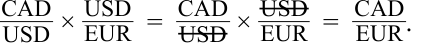

<!-- Formula Text: CAD _ USD  ×  USD _ EUR   =   CAD _ USD  ×  USD _ EUR   =   CAD _ EUR . -->
$$\frac{\text{CAD}}{\text{USD}} \times \frac{\text{USD}}{\text{EUR}} = \frac{\text{CAD}}{\cancel{\text{USD}}} \times \frac{\cancel{\text{USD}}}{\text{EUR}} = \frac{\text{CAD}}{\text{EUR}}$$

Do đó, để có được báo giá euro–Canada (CAD/EUR), chúng ta phải nhân báo giá dollar–Canada (CAD/USD) với báo giá euro–dollar (USD/EUR). Ví dụ, giả sử tỷ giá hối đoái của cặp dollar–Canada là 1,3020 và tỷ giá hối đoái của cặp euro–dollar là 1,1701. Sử dụng các tỷ giá hối đoái giao ngay này, tỷ giá chéo euro–Canada bằng: 

$$1,3020 \times 1,1701 = 1,5235 \text{ CAD trên mỗi EUR}$$

Thị trường FX chuyên nghiệp không sử dụng quy ước yết giá trực tiếp hay gián tiếp bởi vì các quy ước này phụ thuộc vào vị trí địa lý của một người để xác định đồng nội tệ so với đồng ngoại tệ. Thay vào đó, thị trường sử dụng các báo giá tỷ giá trên các cặp tiền tệ thông thường đã được định nghĩa sẵn. Đôi khi, để có được một tỷ giá chéo bằng cách sử dụng một số báo giá tiền tệ, cần phải nghịch đảo (*invert*) một báo giá để có được một đồng tiền trung gian có thể triệt tiêu lẫn nhau trong phương trình nhằm thu được tỷ giá chéo. Ví dụ, để có được báo giá Canada–yen (JPY/CAD), người ta thường sử dụng tỷ giá dollar–Canada (CAD/USD) và tỷ giá dollar–yen (JPY/USD), vốn là các quy ước thị trường. Phép tính Canada–yen này đòi hỏi tỷ giá dollar–Canada (CAD/USD) phải được nghịch đảo thành báo giá Canada–dollar (USD/CAD) để phép tính có thể thực hiện được, như sau: 

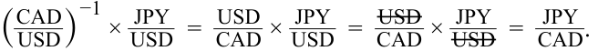

<!-- Formula Text: ( CAD _ USD ) −1 ×  JPY _ USD   =   USD _ CAD  ×  JPY _ USD   =   USD _ CAD  ×  JPY _ USD   =   JPY _ CAD . -->
$$\left(\frac{\text{CAD}}{\text{USD}}\right)^{-1} \times \frac{\text{JPY}}{\text{USD}} = \frac{\text{USD}}{\text{CAD}} \times \frac{\text{JPY}}{\text{USD}} = \frac{\cancel{\text{USD}}}{\text{CAD}} \times \frac{\text{JPY}}{\cancel{\text{USD}}} = \frac{\text{JPY}}{\text{CAD}}$$

Do đó, để có được báo giá Canada–yen (JPY/CAD), trước tiên chúng ta phải nghịch đảo báo giá dollar–Canada (CAD/USD) trước khi nhân với báo giá dollar–yen (JPY/USD). Báo giá thị trường đối với hầu hết các đồng tiền được yết đến bốn chữ số thập phân; tuy nhiên, tỷ giá hối đoái đồng yên Nhật được yết đến hai chữ số thập phân. Ví dụ, giả sử rằng chúng ta có 

<!-- PDF Page 263 -->

tỷ giá hối đoái giao ngay là 1,3020 đối với cặp dollar–Canada (CAD/USD) và 111,94 đối với cặp dollar–yen (JPY/USD). Tỷ giá dollar–Canada 1,3020 khi nghịch đảo sẽ bằng 0,7680; nhân giá trị này với báo giá dollar–yen 111,94 sẽ cho ra báo giá Canada–yen như sau: 

$$0,7680 \times 111,94 = 85,97 \text{ JPY trên mỗi CAD}$$

Các chủ thể tham gia thị trường khi yêu cầu báo giá cho một cặp tiền tệ tỷ giá chéo thường sẽ không cần phải tự mình thực hiện phép tính này: Nhà giao dịch (*dealer*) hoặc nền tảng giao dịch điện tử sẽ cung cấp báo giá trực tiếp cho cặp tiền tệ được chỉ định đó. (Ví dụ, một khách hàng yêu cầu báo giá cặp Canada–yen sẽ nhận được báo giá đó từ nhà giao dịch; khách hàng sẽ không được cung cấp các báo giá dollar–Canada và dollar–yen riêng rẽ để tự làm phép tính.) Các nhà giao dịch cung cấp báo giá thường phải tự mình thực hiện phép tính này chỉ vì các cặp tiền tệ dollar–Canada và dollar–yen thường được giao dịch tại các bàn giao dịch (*trading desks*) khác nhau và liên quan đến các nhà giao dịch khác nhau. Các máy giao dịch điện tử được sử dụng trên cả thị trường liên ngân hàng và thị trường ngân hàng – khách hàng thường cung cấp sẵn phép toán này để tự động tính toán các tỷ giá chéo. 

Bởi vì các chủ thể tham gia thị trường có thể nhận được cả báo giá tỷ giá chéo (ví dụ: Canada–yen) cũng như các báo giá tỷ giá hối đoái cơ sở cấu thành nên nó (ví dụ: dollar–Canada và dollar–yen), các báo giá tỷ giá chéo này phải nhất quán với phương trình nêu trên; nếu không, thị trường sẽ thực hiện kinh doanh chênh lệch giá (*arbitrage*) đối với việc định giá sai đó. Mở rộng ví dụ của chúng ta, chúng ta tính được tỷ giá Canada–yen (JPY/CAD) là 85,97 dựa trên các tỷ giá cơ sở dollar–Canada (CAD/USD) và dollar–yen (JPY/USD) lần lượt là 1,3020 và 111,94. Bây giờ giả sử rằng cùng lúc đó, một nhà giao dịch thiếu nắm bắt thông tin lại yết tỷ giá Canada–yen ở mức 86,20. Đây là một mức giá khác của cặp Canada–yen cho một dịch vụ giống hệt nhau—tức là chuyển đổi đồng yên sang đồng đô la Canada. Do đó, bất kỳ nhà giao dịch nào cũng có thể mua 1 CAD ở mức giá thấp hơn là 85,97 JPY và sau đó quay sang bán 1 CAD ở mức giá 86,20 JPY (hãy nhớ lại cuộc thảo luận trước đây của chúng ta về cách định nghĩa đồng tiền định giá và đồng tiền cơ sở). Khoản lợi nhuận kinh doanh chênh lệch giá phi rủi ro (*riskless arbitrage profit*) là 0,23 JPY trên mỗi 1 CAD. Hoạt động kinh doanh chênh lệch giá này—được gọi là _kinh doanh chênh lệch giá ba bên_ (*triangular arbitrage*, chúng ta dùng từ “ba bên” vì nó liên quan đến ba đồng tiền)—sẽ tiếp diễn cho đến khi sự chênh lệch giá bị loại bỏ hoàn toàn. 

Tuy nhiên, trên thực tế, những sự chênh lệch bất hợp lý trong tỷ giá chéo này hiếm khi xảy ra bởi vì cả các nhà giao dịch là con người lẫn các thuật toán giao dịch tự động đều luôn trong trạng thái cảnh giác cao độ trước bất kỳ sự thiếu hiệu quả nào trong việc định giá. Trên thực tế, và phục vụ cho mục đích của bài học này, chúng ta có thể coi các tỷ giá chéo là hoàn toàn nhất quán với các báo giá tỷ giá hối đoái cơ sở của chúng và có thể giả định rằng khi biết hai tỷ giá hối đoái bất kỳ liên quan đến ba đồng tiền, chúng ta có thể suy ra được tỷ giá chéo thứ ba. 

###### **VÍ DỤ 1 (EXAMPLE 1)** 

###### **Tỷ giá chéo và Phần trăm thay đổi (Cross-Rates and Percentage Changes)** 

Một báo cáo nghiên cứu do một nhà giao dịch (*dealer*) thực hiện bao gồm các báo giá tỷ giá giao ngay sau đây: 

|**Cặp tiền tệ (Currency)**|**Tỷ giá giao ngay (Spot Rate)**|**Tỷ giá giao ngay kỳ vọng sau một năm (Expected Spot Rate in One Year)**|
|---|---|---|
|USD/EUR|1,1701|1,1619|
|CHF/USD|0,9900|0,9866|
|USD/GBP|1,3118|1,3066|

#### 1. Tỷ giá chéo giao ngay CHF/EUR _gần nhất_ với mức: 

- **A.** 0,8461. 

- **B.** 0,8546. 

<!-- PDF Page 264 -->

- **C.** 1,1584. 

#### **Lời giải (Solution):** 

**C là đáp án đúng:**
$$\frac{\text{CHF}}{\text{EUR}} = \frac{\text{USD}}{\text{EUR}} \times \frac{\text{CHF}}{\text{USD}} = 1,1701 \times 0,9900 = 1,1584$$

#### 2. Tỷ giá chéo giao ngay GBP/EUR _gần nhất_ với mức: 

- **A.** 0,8920. 
- **B.** 1,1211. 
- **C.** 1,4653. 

#### **Lời giải (Solution):** 

**A là đáp án đúng:**
$$\frac{\text{GBP}}{\text{EUR}} = \frac{\text{USD}}{\text{EUR}} \times \left(\frac{\text{USD}}{\text{GBP}}\right)^{-1} = \frac{\text{USD}}{\text{EUR}} \times \frac{\text{GBP}}{\text{USD}} = \frac{1,1701}{1,3118} = 0,8920$$

#### 3. Dựa trên báo cáo nghiên cứu, đồng euro được kỳ vọng sẽ lên giá bao nhiêu phần trăm so với đồng đô la Mỹ trong năm tới? 

- **A.** –0,7% 
- **B.** +0,7% 
- **C.** +1,0% 

#### **Lời giải (Solution):** 

**A là đáp án đúng.** Đồng euro là đồng tiền cơ sở trong báo giá USD/EUR, và sự sụt giảm kỳ vọng trong tỷ giá USD/EUR cho thấy đồng euro đang mất giá. Sau một năm nữa, sẽ tốn ít đô la Mỹ hơn để mua một euro. Về mặt toán học:
$$\frac{1,1619}{1,1701} - 1 = -0,7\%$$

#### 4. Dựa trên báo cáo nghiên cứu, đồng đô la Mỹ được kỳ vọng sẽ lên giá bao nhiêu phần trăm so với đồng bảng Anh trong năm tới? 

- **A.** +0,6% 
- **B.** –0,4% 
- **C.** +0,4% 

#### **Lời giải (Solution):** 

**C là đáp án đúng.** Đồng bảng Anh là đồng tiền cơ sở trong báo giá USD/GBP, và sự sụt giảm kỳ vọng trong tỷ giá USD/GBP có nghĩa là đồng bảng Anh được kỳ vọng sẽ mất giá so với đồng đô la Mỹ. Hoặc tương đương, đồng đô la Mỹ được kỳ vọng sẽ lên giá so với đồng bảng Anh. Về mặt toán học:
$$\left(\frac{1,3066}{1,3118}\right)^{-1} - 1 = \frac{1,3118}{1,3066} - 1 = +0,4\%$$

#### 5. Trong năm tới, đồng franc Thụy Sĩ được kỳ vọng sẽ: 

- **A.** mất giá so với đồng bảng Anh. 

- **B.** mất giá so với đồng euro. 

<!-- PDF Page 265 -->

- **C.** lên giá so với đồng bảng Anh, đồng euro và đồng đô la Mỹ. 

#### **Lời giải (Solution):** 

**C là đáp án đúng:** Bởi vì câu hỏi không yêu cầu tính toán độ lớn của mức lên giá hay mất giá, chúng ta có thể sử dụng đồng franc Thụy Sĩ làm đồng tiền định giá hoặc đồng tiền cơ sở. Trong trường hợp này, việc sử dụng đồng franc Thụy Sĩ làm đồng tiền định giá sẽ dễ dàng hơn. Tỷ giá CHF/USD được kỳ vọng sẽ giảm từ 0,9900 xuống 0,9866, vì vậy đồng franc Thụy Sĩ được kỳ vọng sẽ mạnh hơn (tức là nó sẽ lên giá so với đồng đô la Mỹ). Tỷ giá CHF/EUR hiện tại là 1,1584 (xem lời giải câu 1) và được kỳ vọng sẽ ở mức 1,1463 ($= 0,9866 \times 1,1619$), vì vậy đồng franc Thụy Sĩ được kỳ vọng sẽ lên giá so với đồng euro. Tỷ giá CHF/GBP hiện tại là 1,2987 ($= 0,9900 \times 1,3118$) và được kỳ vọng sẽ ở mức 1,2891 ($= 0,9866 \times 1,3066$), vì vậy đồng franc Thụy Sĩ cũng được kỳ vọng sẽ lên giá so với đồng bảng Anh. 

Ngoài ra, chúng ta có thể suy ra câu trả lời này bằng trực giác. Theo báo cáo nghiên cứu, tỷ giá CHF/USD được kỳ vọng sẽ giảm: Nghĩa là đồng đô la Mỹ được kỳ vọng sẽ mất giá so với đồng franc Thụy Sĩ, hoặc nói cách khác, đồng franc Thụy Sĩ được kỳ vọng sẽ lên giá so với đồng đô la Mỹ. Tỷ giá USD/EUR và USD/GBP cũng đang giảm xuống, nghĩa là đồng euro và đồng bảng Anh được kỳ vọng sẽ mất giá so với đồng đô la Mỹ, hoặc nói cách khác, đồng đô la Mỹ được kỳ vọng sẽ lên giá so với đồng euro và đồng bảng Anh. Nếu đồng franc Thụy Sĩ được kỳ vọng sẽ lên giá so với đồng đô la Mỹ và đồng đô la Mỹ được kỳ vọng sẽ lên giá so với cả đồng euro và đồng bảng Anh, thì suy ra rằng đồng franc Thụy Sĩ được kỳ vọng sẽ lên giá so với cả đồng euro và đồng bảng Anh. 

#### 6. Dựa trên báo cáo nghiên cứu, phương án nào sau đây liệt kê ba đồng tiền theo thứ tự từ mạnh nhất đến yếu nhất trong năm tới? 

   - **A.** Đô la Mỹ, bảng Anh, euro 

   - **B.** Đô la Mỹ, euro, bảng Anh 

   - **C.** Euro, đô la Mỹ, bảng Anh 

#### **Lời giải (Solution):** 

**A là đáp án đúng.** Tỷ giá USD/EUR được kỳ vọng sẽ giảm từ 1,1701 xuống 1,1619, trong khi tỷ giá USD/GBP được kỳ vọng sẽ giảm từ 1,3118 xuống 1,3066. Vì vậy, đồng đô la Mỹ được kỳ vọng sẽ mạnh hơn cả đồng euro và đồng bảng Anh. Tỷ giá GBP/EUR hiện tại là 0,8920 [$= (1,3118)^{-1} \times 1,1701$] và được kỳ vọng sẽ ở mức 0,8893 [$= (1,3066)^{-1} \times 1,1619$], vì vậy đồng bảng Anh được kỳ vọng sẽ mạnh hơn đồng euro. 

#### 7. Dựa trên báo cáo nghiên cứu, phương án nào sau đây liệt kê ba đồng tiền theo thứ tự từ lên giá nhiều nhất đến lên giá ít nhất (tính theo tỷ lệ phần trăm) so với đồng đô la Mỹ trong năm tới? 

   - **A.** Bảng Anh, franc Thụy Sĩ, euro 

   - **B.** Franc Thụy Sĩ, bảng Anh, euro 

   - **C.** Euro, franc Thụy Sĩ, bảng Anh 

#### **Lời giải (Solution):** 

**B là đáp án đúng.** Tỷ giá USD/EUR mất giá –0,7% ($= [1,1619 / 1,1701] - 1$), đây là mức mất giá của đồng tiền cơ sở euro so với đồng đô la Mỹ. Tỷ giá USD/GBP giảm –0,4% ($= [1,3066 / 1,3118] - 1$), đây là mức mất giá của đồng bảng Anh so với đồng đô la Mỹ. Nghịch đảo tỷ giá CHF/USD sang quy ước USD/CHF cho thấy 

<!-- PDF Page 266 -->

đồng tiền cơ sở franc Thụy Sĩ lên giá +0,35% so với đồng đô la Mỹ ($= [1,0136 / 1,0101] - 1$). 

## **<mark>3</mark>** 

##### **TÍNH TOÁN TỶ GIÁ KỲ HẠN (FORWARD RATE CALCULATIONS)** 

*Giải thích mối quan hệ kinh doanh chênh lệch giá giữa tỷ giá hối đoái giao ngay, tỷ giá hối đoái kỳ hạn và lãi suất; tính toán tỷ giá kỳ hạn bằng cách sử dụng điểm kỳ hạn hoặc theo tỷ lệ phần trăm; và diễn giải mức chiết khấu kỳ hạn hoặc phần bù kỳ hạn.*

Bài học này tiếp nối cuộc thảo luận trước đó về thị trường FX bằng cách xem xét sự tương tác giữa tỷ giá giao ngay, tỷ giá kỳ hạn, lãi suất và kỳ hạn thanh toán (*maturities*), vốn tồn tại do các mối quan hệ kinh doanh chênh lệch giá (*arbitrage relationships*). Mối quan hệ giữa bốn yếu tố này được duy trì nhờ tính hiệu quả của thị trường, và bất kỳ một yếu tố nào cũng có thể được xác định bằng cách sử dụng ba yếu tố còn lại làm dữ liệu đầu vào. Ngoài ra, bài học này còn trình bày các phương pháp tính toán tỷ giá kỳ hạn theo điểm (*point terms*) và theo tỷ lệ phần trăm (*percentage terms*) cũng như các mức chiết khấu kỳ hạn (*forward discounts*) và phần bù kỳ hạn (*forward premiums*) cho các mối quan hệ tỷ giá này. 

Trên các thị trường FX chuyên nghiệp, tỷ giá hối đoái kỳ hạn thường được yết theo điểm (*points*, đôi khi còn được gọi là “pips”). Điểm kỳ hạn trên một báo giá tỷ giá kỳ hạn đơn giản là phần chênh lệch giữa báo giá tỷ giá hối đoái kỳ hạn và báo giá tỷ giá hối đoái giao ngay, với số điểm được quy đổi tỷ lệ (*scaled*) sao cho chúng có thể liên hệ với chữ số thập phân cuối cùng trong báo giá giao ngay. Khi tỷ giá kỳ hạn cao hơn tỷ giá giao ngay, số điểm mang giá trị dương và đồng tiền cơ sở được gọi là đang giao dịch ở mức _phần bù kỳ hạn_ (*forward premium*). Ngược lại, nếu tỷ giá kỳ hạn thấp hơn tỷ giá giao ngay, số điểm (tỷ giá kỳ hạn trừ đi tỷ giá giao ngay) mang giá trị âm và đồng tiền cơ sở được gọi là đang giao dịch ở mức _chiết khấu kỳ hạn_ (*forward discount*). Tất nhiên, nếu đồng tiền cơ sở đang giao dịch ở mức phần bù kỳ hạn, thì đồng tiền định giá đang giao dịch ở mức chiết khấu kỳ hạn, và ngược lại. 

Điều này có thể được giải thích rõ nhất thông qua một ví dụ. Giả sử tỷ giá hối đoái giao ngay euro–dollar (USD/EUR) là 1,15885 và tỷ giá kỳ hạn một năm là 1,19532. Do đó, tỷ giá kỳ hạn đang giao dịch ở mức phần bù (*premium*) so với tỷ giá giao ngay (tỷ giá kỳ hạn lớn hơn tỷ giá giao ngay) và điểm kỳ hạn một năm được yết là +364,7. Con số +364,7 này xuất phát từ phép tính sau: 

$$1,19532 - 1,15885 = +0,03647$$

Hãy nhớ lại rằng hầu hết các tỷ giá hối đoái không phải đồng yên đều được yết đến bốn chữ số thập phân. Trong trường hợp này, chúng ta sẽ nhân tỷ lệ lên bốn chữ số thập phân (nhân với 10.000) để con số +0,03647 này được biểu diễn thành +364,7 điểm (*points*). Lưu ý rằng các điểm kỳ hạn được quy đổi theo độ lớn của chữ số cuối cùng trong báo giá tỷ giá hối đoái giao ngay—thường là chữ số thập phân thứ tư. Cũng cần lưu ý rằng điểm kỳ hạn thường được yết đến một (hoặc nhiều) chữ số thập phân, nghĩa là tỷ giá kỳ hạn thường sẽ được yết đến năm chữ số thập phân hoặc nhiều hơn. Trường hợp ngoại lệ trong số các đồng tiền chính là đồng yên, vốn thường được yết đến hai chữ số thập phân đối với tỷ giá giao ngay. Ở đây, điểm kỳ hạn được quy đổi lên hai chữ số thập phân—chữ số cuối cùng trong báo giá tỷ giá giao ngay—bằng cách nhân phần chênh lệch giữa tỷ giá kỳ hạn và tỷ giá giao ngay với 100. 

Thông thường, báo giá cho tỷ giá kỳ hạn được hiển thị dưới dạng số điểm kỳ hạn tại mỗi kỳ hạn (*maturity*), tức khoảng thời gian tính từ ngày thanh toán giao ngay đến ngày thanh toán của hợp đồng kỳ hạn. Các điểm kỳ hạn này còn được gọi là _điểm hoán đổi_ (*swap points*) bởi vì một hợp đồng hoán đổi ngoại hối (*FX swap*) bao gồm các giao dịch giao ngay và kỳ hạn diễn ra đồng thời. Trong ví dụ của chúng ta, một nhà giao dịch sẽ nhìn thấy tỷ giá giao ngay và điểm kỳ hạn của cặp tiền tệ euro–dollar (USD/EUR) tương tự như trong Bảng 1 (*Exhibit 1*): 

<!-- PDF Page 267 -->

**Bảng 1: Mẫu báo giá Giao ngay và Kỳ hạn (Exhibit 1: Sample Spot and Forward Quotes)** 

|**Kỳ hạn (Maturity)**|**Tỷ giá giao ngay hoặc Điểm kỳ hạn (Spot Rate or Forward Points)**|
|---|---|
|Giao ngay (*Spot*)|1,15885|
|Một tuần (*One week*)|+5,6|
|Một tháng (*One month*)|+27,1|
|Ba tháng (*Three months*)|+80,9|
|Sáu tháng (*Six months*)|+175,6|
|Mười hai tháng (*Twelve months*)|+364,7|

Lưu ý rằng giá trị tuyệt đối của số điểm kỳ hạn nhìn chung tăng lên theo kỳ hạn. Điều này là do số điểm kỳ hạn tỷ lệ thuận với mức chênh lệch lợi suất (*yield differential*) giữa hai quốc gia (Khu vực đồng Euro và Hoa Kỳ, trong trường hợp này) được tính theo thời gian đáo hạn. Với một mức chênh lệch lãi suất nhất định, thời gian đáo hạn càng dài thì giá trị tuyệt đối của số điểm kỳ hạn càng lớn. Tương tự, với một thời gian đáo hạn nhất định, mức chênh lệch lãi suất càng rộng thì hàm ý giá trị tuyệt đối của số điểm kỳ hạn càng lớn. (Mối quan hệ này sẽ được giải thích và chứng minh chi tiết hơn ở phần sau của bài học này.) 

Để chuyển đổi bất kỳ điểm kỳ hạn được yết nào trong số này thành tỷ giá kỳ hạn, người ta sẽ lấy số điểm chia cho 10.000 (để quy đổi xuống vị trí thập phân thứ tư, vị trí thập phân cuối cùng trong báo giá giao ngay) và sau đó cộng kết quả vào báo giá tỷ giá hối đoái giao ngay. (Như đã đề cập trước đó, tỷ giá hối đoái đối với đồng yên Nhật, chẳng hạn như tỷ giá hối đoái JPY/USD, chỉ được yết đến hai chữ số thập phân, vì vậy điểm kỳ hạn cho cặp tiền tệ dollar–yen được chia cho 100.) Ví dụ, sử dụng dữ liệu trong Bảng 1 cho USD/EUR, tỷ giá kỳ hạn ba tháng trong trường hợp này sẽ như sau: 

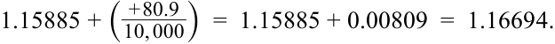

<!-- Formula Text: 1.15885 + ( + 80.9 _ 10, 000 )  =  1.15885 + 0.00809  =  1.16694. -->
$$1,15885 + \left(\frac{+80,9}{10.000}\right) = 1,15885 + 0,00809 = 1,16694$$

Thỉnh thoảng, người ta sẽ thấy tỷ giá kỳ hạn hoặc điểm kỳ hạn được biểu diễn dưới dạng tỷ lệ phần trăm của tỷ giá giao ngay thay vì một con số điểm tuyệt đối. Tiếp tục ví dụ trước, tỷ giá kỳ hạn ba tháng của USD/EUR có thể được biểu diễn như sau: 

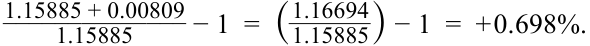

<!-- Formula Text: 1.15885 + 0.00809 ______________ 1.15885 − 1  =  ( 1.16694 _ 1.15885 ) − 1  =  + 0.698%. -->
$$\frac{1,15885 + 0,00809}{1,15885} - 1 = \left(\frac{1,16694}{1,15885}\right) - 1 = +0,698\%$$

Điều này cho thấy rằng có thể sử dụng tỷ giá kỳ hạn hoặc điểm kỳ hạn để tính toán phần trăm chiết khấu (hoặc phần bù) trên thị trường kỳ hạn—trong trường hợp này là +0,698% khi làm tròn đến ba chữ số thập phân. Để chuyển đổi một báo giá giao ngay thành báo giá kỳ hạn khi các điểm kỳ hạn được hiển thị dưới dạng tỷ lệ phần trăm, người ta chỉ cần nhân tỷ giá giao ngay với một cộng với phần trăm phần bù hoặc chiết khấu: 

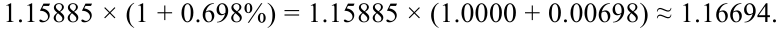

<!-- Formula Text: 1.15885 × (1 + 0.698%) = 1.15885 × (1.0000 + 0.00698) ≈ 1.16694. -->
$$1,15885 \times (1 + 0,698\%) = 1,15885 \times (1,0000 + 0,00698) \approx 1,16694$$

Lưu ý rằng, khi làm tròn đến chữ số thập phân thứ năm, kết quả này bằng với phép tính trước đó của chúng ta. Tuy nhiên, trên các thị trường FX chuyên nghiệp, tỷ giá kỳ hạn thường sẽ được yết theo pips thay vì theo tỷ lệ phần trăm. 

###### **Các mối quan hệ kinh doanh chênh lệch giá (Arbitrage Relationships)** 

Bây giờ chúng ta chuyển sang tìm hiểu sự tương tác giữa tỷ giá giao ngay, tỷ giá kỳ hạn và lãi suất cũng như cách thức suy ra mối quan hệ giữa chúng. Tỷ giá hối đoái kỳ hạn dựa trên một mối quan hệ kinh doanh chênh lệch giá (*arbitrage relationship*) làm cân bằng tỷ suất sinh lợi đầu tư trên hai khoản đầu tư thay thế nhưng tương đương nhau. Hãy xem xét trường hợp một nhà đầu tư có sẵn nguồn vốn để đầu tư. Để đơn giản hóa, chúng ta sẽ giả định rằng một đơn vị đồng nội tệ của nhà đầu tư sẽ được đem đi đầu tư trong một kỳ. Một phương án là đầu tư trong một kỳ ở mức lãi suất phi rủi ro trong nước ($r_d$); vào cuối kỳ, số tiền thu được bằng $(1 + r_d)$. Một phương án đầu tư thay thế khác là chuyển đổi một đơn vị đồng nội tệ này sang ngoại tệ bằng cách sử dụng 

<!-- PDF Page 268 -->

tỷ giá giao ngay $S_{f/d}$ (số đơn vị ngoại tệ trên một đơn vị nội tệ). Số tiền này có thể được đầu tư trong một kỳ ở mức lãi suất phi rủi ro nước ngoài ($r_f$); vào cuối kỳ, nhà đầu tư sẽ có $S_{f/d}(1 + r_f)$ đơn vị ngoại tệ. Số tiền này sau đó phải được chuyển đổi ngược trở lại đồng nội tệ của nhà đầu tư. Nếu tỷ giá hối đoái được sử dụng cho việc chuyển đổi cuối kỳ này đã được ký hợp đồng trước ngay từ đầu kỳ (tức là sử dụng tỷ giá kỳ hạn), nó sẽ loại bỏ mọi rủi ro FX phát sinh từ việc chuyển đổi ở một mức tỷ giá giao ngay chưa biết trước trong tương lai. Theo quy ước tỷ giá hối đoái đã giả định (ngoại tệ/nội tệ – $f/d$), nhà đầu tư sẽ nhận được $(1 / F_{f/d})$ đơn vị đồng nội tệ cho mỗi đơn vị ngoại tệ được bán kỳ hạn. Lưu ý rằng quá trình chuyển đổi nguồn vốn trong nước trên thị trường FX giao ngay, đầu tư ở mức lãi suất phi rủi ro nước ngoài, và sau đó chuyển đổi ngược trở lại đồng nội tệ bằng tỷ giá kỳ hạn được gọi là “tài trợ vốn qua hoán đổi” (*swap financing*). 

Do đó, chúng ta có hai phương án đầu tư thay thế—cả hai đều phi rủi ro bởi vì cả hai đều được đầu tư ở mức lãi suất phi rủi ro và bởi vì mọi rủi ro FX đã được loại bỏ (phòng ngừa – *hedged*) bằng cách sử dụng tỷ giá kỳ hạn. Bởi vì hai khoản đầu tư này có đặc tính rủi ro ngang nhau, chúng phải mang lại cùng một mức tỷ suất sinh lợi (ngang giá lãi suất có phòng ngừa – *covered interest rate parity*). Lưu ý rằng quy ước yết giá tiền tệ đang dùng là số đơn vị ngoại tệ trên một đơn vị nội tệ duy nhất ($f/d$), mối quan hệ này có thể được phát biểu như sau: 

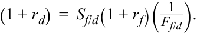

<!-- Formula Text: (1 + r d)  =  S f/d(1 + r f)(  1 _ F f/d ). -->
$$(1 + r_d) = S_{f/d}(1 + r_f)\left(\frac{1}{F_{f/d}}\right)$$

Đây là một mối quan hệ kinh doanh chênh lệch giá bởi vì nó mô tả hai khoản đầu tư thay thế (mỗi khoản nằm ở một vế của dấu bằng) lẽ ra phải có tỷ suất sinh lợi bằng nhau. Nếu chúng không bằng nhau, một cơ hội kinh doanh chênh lệch giá phi rủi ro sẽ tồn tại bởi vì nhà đầu tư có thể bán khống (*sell short* / đi vay) khoản đầu tư có tỷ suất sinh lợi thấp hơn và đem tiền đầu tư vào khoản đầu tư có tỷ suất sinh lợi cao hơn; phần chênh lệch giữa hai tỷ suất sinh lợi là lợi nhuận thuần túy. Chính nhờ mối quan hệ kinh doanh chênh lệch giá này mà mức lãi suất tài trợ trọn gói (*all-in financing rate*) khi sử dụng phương thức tài trợ qua hoán đổi xấp xỉ bằng mức lãi suất trong nước. 

Công thức này có lẽ là cách dễ nhất và trực quan nhất để ghi nhớ công thức tính tỷ giá kỳ hạn bởi vì công thức này dựa trực tiếp vào trực giác cơ sở (mối quan hệ kinh doanh chênh lệch giá của hai khoản đầu tư thay thế nhưng tương đương nhau, mỗi khoản ở một vế của dấu bằng). Ngoài ra, vế phải của phương trình, đại diện cho phương án đầu tư nước ngoài có phòng ngừa rủi ro, được sắp xếp theo đúng trình tự thời gian: (1) chuyển đổi nội tệ sang ngoại tệ; sau đó (2) đầu tư ngoại tệ ở mức lãi suất nước ngoài; và cuối cùng (3) chuyển đổi ngoại tệ ngược trở lại nội tệ. Hãy nhớ lại rằng phương trình này dựa trên quy ước yết giá tỷ giá hối đoái $f/d$. Nếu dữ liệu tỷ giá hối đoái được trình bày dưới dạng $d/f$, người ta có thể nghịch đảo các báo giá này về lại dạng $f/d$ và sử dụng phương trình trên hoặc sử dụng phương trình tương đương sau đây: 

$$(1 + r_d) = \left(\frac{1}{S_{d/f}}\right)(1 + r_f)F_{d/f}$$

Nếu sử dụng phương trình thứ hai này, hãy nhớ rằng tỷ giá hối đoái kỳ hạn và giao ngay hiện đang được yết theo quy ước $d/f$. 

Phương trình kinh doanh chênh lệch giá này có thể được sắp xếp lại tùy theo nhu cầu. Ví dụ, để có công thức tính tỷ giá kỳ hạn, phương trình trước có thể được viết lại như sau: 

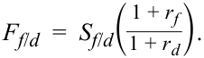

<!-- Formula Text: F f/d  =  S f/d( 1 + r f _ 1 + r d ). -->
$$F_{f/d} = S_{f/d}\left(\frac{1 + r_f}{1 + r_d}\right)$$

Khi biết tỷ giá hối đoái giao ngay cùng với lãi suất phi rủi ro trong nước và nước ngoài, tỷ giá kỳ hạn là giá trị giúp hoàn thiện phương trình này và loại bỏ bất kỳ cơ hội kinh doanh chênh lệch giá nào. Ví dụ, hãy giả sử rằng tỷ giá hối đoái giao ngay ($S_{f/d}$) là 1,6535, lãi suất phi rủi ro kỳ hạn 12 tháng trong nước là 3,50%, và lãi suất phi rủi ro kỳ hạn 12 tháng nước ngoài là 5,00%. Khi đó, tỷ giá kỳ hạn 12 tháng ($F_{f/d}$) phải bằng: 

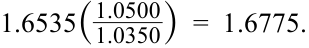

<!-- Formula Text: 1.6535( 1.0500 _ 1.0350 )  =  1.6775. -->
$$1,6535\left(\frac{1,0500}{1,0350}\right) = 1,6775$$

<!-- PDF Page 269 -->

Ngược lại, giả sử rằng với tỷ giá hối đoái giao ngay và lãi suất không đổi, bạn nhận được một báo giá tỷ giá kỳ hạn 12 tháng ($F_{f/d}$) ở mức 1,6900. Bởi vì tỷ giá kỳ hạn bị yết sai này không khớp với phương trình kinh doanh chênh lệch giá, nó sẽ mang lại một cơ hội kinh doanh chênh lệch giá phi rủi ro. Điều này có thể được tính toán bằng cách sử dụng phương trình kinh doanh chênh lệch giá để tính tỷ suất sinh lợi trên hai chiến lược đầu tư thay thế. Tỷ suất sinh lợi của phương pháp chỉ đầu tư trong nước là mức lãi suất phi rủi ro trong nước (3,50%). Ngược lại, tỷ suất sinh lợi của khoản đầu tư nước ngoài có phòng ngừa rủi ro khi đưa tỷ giá kỳ hạn bị yết sai này vào phương trình kinh doanh chênh lệch giá sẽ bằng: 

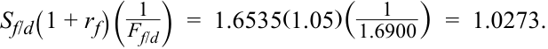

<!-- Formula Text: S f/d(1 + r f)(  1 _ F f/d )  =  1.6535(1.05)( 1 _ 1.6900 )  =  1.0273. -->
$$S_{f/d}(1 + r_f)\left(\frac{1}{F_{f/d}}\right) = 1,6535(1,05)\left(\frac{1}{1,6900}\right) = 1,0273$$

Kết quả này tương ứng với tỷ suất sinh lợi là 2,73%. Do đó, nhà đầu tư có thể kiếm được lợi nhuận kinh doanh chênh lệch giá phi rủi ro bằng cách đi vay ở mức lãi suất phi rủi ro nước ngoài cao hơn, bán ngoại tệ ở tỷ giá hối đoái giao ngay, phòng ngừa rủi ro tiền tệ (mua lại ngoại tệ) ở mức tỷ giá kỳ hạn bị yết sai, đầu tư số tiền thu được ở mức lãi suất phi rủi ro trong nước thấp hơn, và qua đó thu được khoản lợi nhuận 77 điểm cơ bản ($3,50\% - 2,73\%$) trên mỗi đơn vị đồng nội tệ tham gia giao dịch—tất cả mà không cần bất kỳ sự cam kết bỏ vốn tự có ban đầu nào của nhà đầu tư. Bất kỳ cơ hội nào như vậy trên các thị trường tài chính thực tế sẽ nhanh chóng bị triệt tiêu thông qua hoạt động kinh doanh chênh lệch giá (“arbed” away). Trong ví dụ này, nhà đầu tư thực chất đi vay ở mức lãi suất cao hơn trong hai mức lãi suất nhưng vẫn kiếm được lợi nhuận bởi vì đồng ngoại tệ đang bị định giá thấp (*underpriced*) trên thị trường kỳ hạn. 

Phương trình kinh doanh chênh lệch giá cơ sở cũng có thể được sắp xếp lại để biểu thị tỷ giá kỳ hạn dưới dạng tỷ lệ phần trăm của tỷ giá giao ngay: 

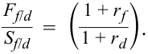

<!-- Formula Text: F f/d _ S f/d   =  ( 1 + r f _ 1 + r d ). -->
$$\frac{F_{f/d}}{S_{f/d}} = \left(\frac{1 + r_f}{1 + r_d}\right)$$

Phương trình này cho thấy rằng, với quy ước yết giá $f/d$, tỷ giá kỳ hạn sẽ cao hơn (giao dịch ở mức phần bù so với) tỷ giá giao ngay nếu lãi suất nước ngoài cao hơn lãi suất trong nước. Tổng quát hơn, và bất kể quy ước yết giá là gì, _đồng tiền có mức lãi suất cao hơn (thấp hơn) sẽ luôn giao dịch ở mức chiết khấu (phần bù) trên thị trường kỳ hạn_. 

Một bối cảnh mà trong đó tỷ giá kỳ hạn được yết dưới dạng tỷ lệ phần trăm của tỷ giá giao ngay xảy ra khi tỷ giá kỳ hạn được diễn giải như tỷ giá giao ngay dự kiến trong tương lai (*expected future spot rates*), như sau: 

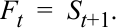

<!-- Formula Text: F t  =  S t+1. -->
$$F_t = E(S_{t+1})$$

Thay thế biểu thức này vào phương trình trước và thực hiện một số biến đổi đại số sẽ dẫn đến kết quả sau: 

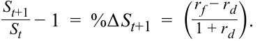

<!-- Formula Text: S t+1 _ S t   − 1  =  %Δ S t+1  =  ( r f − r d _ 1 + r d ). -->
$$\frac{S_{t+1}}{S_t} - 1 = \%\Delta S_{t+1} = \left(\frac{r_f - r_d}{1 + r_d}\right)$$

Điều này cho thấy rằng nếu tỷ giá kỳ hạn được diễn giải như tỷ giá giao ngay kỳ vọng trong tương lai, thì phần trăm thay đổi kỳ vọng của tỷ giá giao ngay sẽ tỷ lệ thuận với mức chênh lệch lãi suất ($r_f - r_d$). 

Việc xem tỷ giá kỳ hạn như tỷ giá giao ngay kỳ vọng trong tương lai có sức hấp dẫn về mặt trực giác. Tuy nhiên, cách diễn giải tỷ giá kỳ hạn này cần được sử dụng một cách thận trọng. Chiều hướng của sự thay đổi kỳ vọng trong tỷ giá giao ngay có phần trái ngược với trực giác thông thường. Với các yếu tố khác không đổi, việc tăng lãi suất trong nước (ví dụ: ngân hàng trung ương thắt chặt chính sách tiền tệ) thông thường sẽ được kỳ vọng dẫn đến sự gia tăng giá trị của đồng nội tệ. Ngược lại, phương trình trên lại chỉ ra rằng, với các yếu tố khác không đổi, mức lãi suất trong nước cao hơn hàm ý tốc độ lên giá kỳ vọng chậm hơn (hoặc mức mất giá kỳ vọng lớn hơn) của đồng nội tệ (hãy nhớ lại rằng phương trình này dựa trên quy ước yết giá $f/d$). 

Quan trọng hơn, dữ liệu lịch sử cho thấy tỷ giá kỳ hạn là những công cụ dự báo kém chính xác đối với tỷ giá giao ngay trong tương lai. Mặc dù nhiều nghiên cứu kinh tế lượng khác nhau gợi ý rằng tỷ giá kỳ hạn có thể là những công cụ dự báo không chệch (*unbiased predictors*) của tỷ giá giao ngay tương lai (tức là chúng không ước tính quá cao hay quá thấp một cách có hệ thống đối với tỷ giá giao ngay tương lai), nhưng đây không phải là thông tin đặc biệt hữu ích bởi vì 

<!-- PDF Page 270 -->

biên độ sai số (*margin of error*) của các dự báo này là quá lớn. Như đã đề cập trong phần Giới thiệu, thị trường FX quá phức tạp và năng động để có thể được nắm bắt chỉ bằng một biến số duy nhất, chẳng hạn như mức chênh lệch lợi suất giữa các quốc gia. Hơn nữa, theo công thức tính tỷ giá kỳ hạn, tỷ giá kỳ hạn được dựa trên lãi suất trong nước và nước ngoài. Điều này có nghĩa là bất kỳ yếu tố nào ảnh hưởng đến mức độ và hình dạng của đường cong lợi suất (*yield curve*) ở thị trường trong nước hoặc nước ngoài cũng sẽ ảnh hưởng đến mối quan hệ giữa tỷ giá hối đoái giao ngay và kỳ hạn. Nói cách khác, thị trường FX không vận hành một cách cô lập mà thay vào đó phản ánh hầu hết mọi yếu tố ảnh hưởng đến các thị trường khác trên toàn cầu; bất kỳ điều gì ảnh hưởng đến kỳ vọng hoặc phần bù rủi ro (*risk premia*) trên các thị trường khác này cũng sẽ vang dội vào tỷ giá hối đoái kỳ hạn. Mặc dù mức chênh lệch lợi suất là một yếu tố mà thị trường có thể xem xét khi hình thành kỳ vọng về tỷ giá hối đoái giao ngay, nhưng nó chỉ là một trong rất nhiều yếu tố. (Nhiều nhà giao dịch nhìn vào xu hướng của chênh lệch lợi suất hơn là mức độ tuyệt đối của chênh lệch đó.) Hơn nữa, rất nhiều nhiễu loạn (*noise*) trên thị trường FX khiến cho hầu như mọi mô hình—dù phức tạp đến đâu—đều trở thành một công cụ dự báo tương đối kém cỏi đối với tỷ giá giao ngay tại bất kỳ thời điểm cụ thể nào trong tương lai. Trên thực tế, các nhà giao dịch FX và các nhà chiến lược thị trường _không_ đặt kỳ vọng tiền tệ hay chiến lược giao dịch của họ chỉ thuần túy dựa vào tỷ giá kỳ hạn. 

Phục vụ cho mục đích của bài học này, _tốt nhất là nên hiểu tỷ giá hối đoái kỳ hạn đơn giản như một sản phẩm của phương trình kinh doanh chênh lệch giá đã nêu ở trên và điểm kỳ hạn là có liên hệ với mức chênh lệch lãi suất (đã được quy đổi theo thời gian) giữa hai quốc gia_. Việc suy diễn quá mức vào tỷ giá kỳ hạn hoặc diễn giải chúng như là “dự báo của thị trường” có thể dẫn đến những hiểu lầm tai hại. 

###### **Chiết khấu kỳ hạn và Phần bù kỳ hạn (Forward Discounts and Premiums)** 

Bây giờ chúng ta tiếp tục cuộc thảo luận về chiết khấu kỳ hạn và phần bù kỳ hạn dựa trên tỷ giá giao ngay và lãi suất, đồng thời bổ sung thêm tác động của kỳ hạn (*maturity*). Để hiểu mối quan hệ giữa kỳ hạn và điểm kỳ hạn, chúng ta cần tổng quát hóa công thức kinh doanh chênh lệch giá của mình một chút. Giả sử thời hạn đầu tư là một phân số, $\tau$, của kỳ mà lãi suất được yết giá (thường là năm). Khi đó, tiền lãi kiếm được trên thị trường trong nước và nước ngoài sẽ lần lượt là $(r_d \tau)$ và $(r_f \tau)$. Thay thế điều này vào mối quan hệ kinh doanh chênh lệch giá của chúng ta và giải phương trình tìm phần chênh lệch giữa tỷ giá hối đoái kỳ hạn và giao ngay sẽ cho ra kết quả sau: 

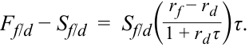

<!-- Formula Text: F f/d − S f/d  =  S f/d( r f − r d _ 1 + r d τ )τ. -->
$$F_{f/d} - S_{f/d} = S_{f/d}\left(\frac{r_f - r_d}{1 + r_d \tau}\right)\tau$$

Phương trình này cho thấy điểm kỳ hạn (đã được quy đổi tỷ lệ thích hợp) tỷ lệ thuận với tỷ giá hối đoái giao ngay và mức chênh lệch lãi suất, đồng thời xấp xỉ (nhưng không hoàn toàn chính xác tuyệt đối) tỷ lệ thuận với kỳ hạn của hợp đồng kỳ hạn. 

Ví dụ, giả sử rằng chúng ta muốn xác định tỷ giá hối đoái kỳ hạn 30 ngày khi biết lãi suất phi rủi ro 30 ngày trong nước là 2,00%/năm, lãi suất phi rủi ro 30 ngày nước ngoài là 3,00%/năm, và tỷ giá hối đoái giao ngay ($S_{f/d}$) là 1,6555. Các tài sản phi rủi ro được sử dụng trong mối quan hệ kinh doanh chênh lệch giá này thường là các khoản tiền gửi ngân hàng được yết giá bằng Lãi suất Chào bán Liên ngân hàng Luân Đôn (*London Interbank Offered Rate* – Libor) cho các đồng tiền có liên quan. Quy ước đếm ngày (*day count convention*) cho các khoản tiền gửi Libor là số ngày thực tế/360 (*actual/360*). Đưa phân số kỳ hạn ($\tau$) và thay dữ liệu vào phương trình tỷ giá kỳ hạn sẽ dẫn đến tỷ giá kỳ hạn 30 ngày như sau: 

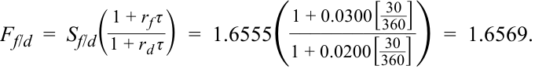

<!-- Formula Text: F f/d  =  S f/d( 1 + r f τ _ 1 + r d τ )  =  1.6555( 1 + 0.0300[ 30 _ 360 ] ____________ 1 + 0.0200[ 30 _ 360 ] )  =  1.6569. -->
$$F_{f/d} = S_{f/d}\left(\frac{1 + r_f \tau}{1 + r_d \tau}\right) = 1,6555\left(\frac{1 + 0,0300\left[\frac{30}{360}\right]}{1 + 0,0200\left[\frac{30}{360}\right]}\right) = 1,6569$$

Điều này có nghĩa là, đối với kỳ hạn 30 ngày, tỷ giá kỳ hạn đang giao dịch ở mức phần bù 14 pips ($1,6569 - 1,6555$). Con số này cũng có thể được tính bằng cách sử dụng công thức điểm hoán đổi đã nêu trước đó: 

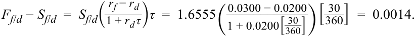

<!-- Formula Text: F f/d − S f/d  =  S f/d( r f − r d _ 1 + r d τ )τ  =  1.6555 ( 0.0300 − 0.0200 ____________ 1 + 0.0200[ 30 _ 360 ] ) [ 30 _ 360 ]  =  0.0014. -->
$$F_{f/d} - S_{f/d} = S_{f/d}\left(\frac{r_f - r_d}{1 + r_d \tau}\right)\tau = 1,6555\left(\frac{0,0300 - 0,0200}{1 + 0,0200\left[\frac{30}{360}\right]}\right)\left[\frac{30}{360}\right] = 0,0014$$

<!-- PDF Page 271 -->

Như có thể thấy rõ từ biểu thức này, giá trị tuyệt đối của số điểm hoán đổi sẽ có liên hệ chặt chẽ với kỳ hạn của hợp đồng kỳ hạn (tức là xấp xỉ tỷ lệ thuận với $\tau = \text{Actual}/360$). Ví dụ, giữ nguyên tỷ giá hối đoái giao ngay và lãi suất, và đặt kỳ hạn của hợp đồng kỳ hạn thành 180 ngày, chúng ta thu được kết quả sau: 

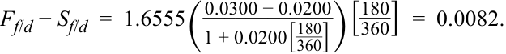

<!-- Formula Text: F f/d − S f/d  =  1.6555 ( 0.0300 − 0.0200 ____________ 1 + 0.0200[ 180 _ 360 ] ) [ 180 _ 360 ]  =  0.0082. -->
$$F_{f/d} - S_{f/d} = 1,6555\left(\frac{0,0300 - 0,0200}{1 + 0,0200\left[\frac{180}{360}\right]}\right)\left[\frac{180}{360}\right] = 0,0082$$

Kết quả này dẫn đến việc tỷ giá kỳ hạn giao dịch ở mức phần bù 82 pips. Sự gia tăng số điểm kỳ hạn xấp xỉ tỷ lệ thuận với sự gia tăng kỳ hạn của hợp đồng (từ 30 ngày lên 180 ngày). Lưu ý rằng mặc dù kỳ hạn của hợp đồng kỳ hạn 180 ngày dài gấp sáu lần so với hợp đồng 30 ngày, nhưng số điểm kỳ hạn không lớn gấp chính xác sáu lần: $6 \times 14 = 84$. 

Tương tự, số điểm kỳ hạn tỷ lệ thuận với mức chênh lệch giữa lãi suất nước ngoài và trong nước ($r_f - r_d$). Ví dụ, tham chiếu theo hợp đồng kỳ hạn 30 ngày ban đầu, hãy đặt lãi suất nước ngoài thành 4,00% trong khi giữ nguyên lãi suất trong nước và tỷ giá hối đoái giao ngay. Điều này làm tăng gấp đôi mức chênh lệch lãi suất ($r_f - r_d$) từ 1,00% lên 2,00%; nó cũng làm tăng gấp đôi điểm kỳ hạn (khi làm tròn đến bốn chữ số thập phân), như sau: 

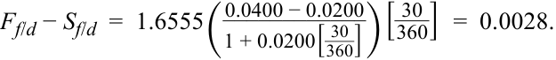

<!-- Formula Text: F f/d − S f/d  =  1.6555 ( 0.0400 − 0.0200 ____________ 1 + 0.0200[ 30 _ 360 ] ) [ 30 _ 360 ]  =  0.0028. -->
$$F_{f/d} - S_{f/d} = 1,6555\left(\frac{0,0400 - 0,0200}{1 + 0,0200\left[\frac{30}{360}\right]}\right)\left[\frac{30}{360}\right] = 0,0028$$

###### **VÍ DỤ 2 (EXAMPLE 2)** 

###### **Tính toán Tỷ giá kỳ hạn (Forward Rate Calculations)** 

Một công ty Pháp gần đây đã hoàn tất một thương vụ bán hàng hóa cho một khách hàng tại Vương quốc Anh và dự kiến sẽ nhận được khoản thanh toán trị giá 50 triệu GBP sau 32 ngày. Giám đốc nguồn vốn (*corporate treasurer*) tại công ty Pháp muốn phòng ngừa rủi ro FX của giao dịch này và nhận được thông tin tỷ giá hối đoái sau đây từ một nhà giao dịch (*dealer*): 

|**Thông tin tỷ giá**|**Giá trị**|
|---|---|
|Tỷ giá giao ngay GBP/EUR (*GBP/EUR spot rate*)|0,8752|
|Điểm kỳ hạn một tháng (*One-month forward points*)|–1,4|

#### 1. Theo thông tin tỷ giá hối đoái trên, giám đốc nguồn vốn có thể phòng ngừa rủi ro FX bằng cách: 

   - **A.** mua euro (bán bảng Anh) ở mức tỷ giá kỳ hạn là 0,87380. 

   - **B.** mua euro (bán bảng Anh) ở mức tỷ giá kỳ hạn là 0,87506. 

   - **C.** bán euro (mua bảng Anh) ở mức tỷ giá kỳ hạn là 0,87506. 

#### **Lời giải (Solution):** 

**B là đáp án đúng.** Công ty Pháp sẽ muốn chuyển đổi đồng bảng Anh sang đồng nội tệ của mình là đồng euro (công ty muốn bán bảng Anh và mua euro). Tỷ giá kỳ hạn sẽ bằng: $0,8752 + (-1,4 / 10.000) = 0,87506$. 

#### 2. Theo thông tin tỷ giá hối đoái trên, cách diễn giải _đúng nhất_ về mức chiết khấu kỳ hạn được hiển thị là: 

   - **A.** đồng euro được kỳ vọng sẽ mất giá trong 30 ngày tới. 

   - **B.** lãi suất kỳ hạn một tháng của Vương quốc Anh cao hơn lãi suất tại Khu vực đồng Euro. 

<!-- PDF Page 272 -->

   - **C.** lãi suất kỳ hạn một tháng của Khu vực đồng Euro cao hơn lãi suất tại Vương quốc Anh. 

#### **Lời giải (Solution):** 

**C là đáp án đúng.** Mức chiết khấu kỳ hạn (*forward discount*) cho biết lãi suất tại quốc gia của đồng tiền cơ sở (Pháp, trong trường hợp này, quốc gia sử dụng đồng euro) cao hơn lãi suất tại quốc gia của đồng tiền định giá (Vương quốc Anh). 

#### 3. Theo thông tin tỷ giá hối đoái trên, nếu tỷ giá kỳ hạn 12 tháng là 0,87295 GBP/EUR, thì điểm kỳ hạn 12 tháng _gần nhất_ với mức: 

   - **A.** –22,5. 

   - **B.** –2,25. 

   - **C.** –0,00225. 

#### **Lời giải (Solution):** 

**A là đáp án đúng.** Số điểm kỳ hạn bằng phần chênh lệch đã được quy đổi tỷ lệ giữa tỷ giá kỳ hạn và tỷ giá giao ngay. Trong trường hợp này: $0,87295 - 0,87520 = -0,00225$. Sau đó nhân số này với 10.000 để chuyển đổi thành số điểm kỳ hạn ($-22,5$). 

#### 4. Nếu một nhà giao dịch thứ hai yết tỷ giá GBP/EUR ở mức chiết khấu kỳ hạn 12 tháng là 0,30% trên cùng một mức tỷ giá giao ngay, thì công ty Pháp có thể: 

   - **A.** giao dịch với bất kỳ nhà giao dịch nào vì hai báo giá kỳ hạn 12 tháng là tương đương nhau. 

   - **B.** khóa chặt một khoản lợi nhuận sau 12 tháng bằng cách mua euro từ nhà giao dịch thứ hai và bán euro cho nhà giao dịch ban đầu. 

   - **C.** khóa chặt một khoản lợi nhuận sau 12 tháng bằng cách mua euro từ nhà giao dịch ban đầu và bán euro cho nhà giao dịch thứ hai. 

#### **Lời giải (Solution):** 

**B là đáp án đúng.** Mức chiết khấu 0,30% có nghĩa là nhà giao dịch thứ hai sẽ bán euro kỳ hạn 12 tháng ở mức tỷ giá $0,8752 \times (1 - 0,0030) = 0,87257$, một mức giá tính trên mỗi euro thấp hơn so với báo giá 0,87295 của nhà giao dịch ban đầu. Việc mua euro ở mức tỷ giá kỳ hạn 12 tháng rẻ hơn (0,87257) và bán cùng một lượng euro đó kỳ hạn 12 tháng ở mức tỷ giá kỳ hạn 12 tháng cao hơn (0,87295) mang lại khoản lợi nhuận là ($0,87295 - 0,87257 = 0,00038\text{ GBP}$) trên mỗi euro giao dịch, sẽ nhận được khi cả hai hợp đồng kỳ hạn đáo hạn và thanh toán sau 12 tháng. 

#### 5. Nếu lãi suất Libor 270 ngày (đã chuẩn hóa theo năm) đối với đồng euro và đồng bảng Anh lần lượt là 1,370% và 1,325%, và tỷ giá hối đoái giao ngay GBP/EUR là 0,8489, thì số điểm kỳ hạn cho tỷ giá kỳ hạn 270 ngày ($F_{\text{GBP/EUR}}$) _gần nhất_ với mức: 

   - **A.** –22,8. 

   - **B.** –3,8. 

   - **C.** –2,8. 

#### **Lời giải (Solution):** 

**C là đáp án đúng**, bởi vì tỷ giá kỳ hạn được tính như sau: 

<!-- PDF Page 273 -->

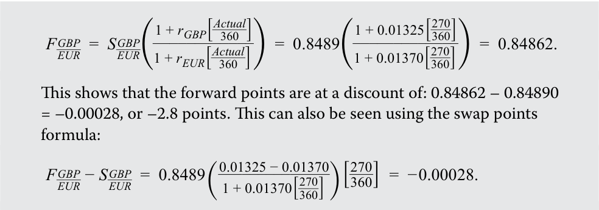

<!-- Formula Text: F  GBP _ EUR   =  S  GBP _ EUR ( 1 + r GBP[ Actual _ 360  ] ____________ 1 + r EUR[ Actual _ 360  ] )  =  0.8489( 1 + 0.01325[ 270 _ 360 ] _____________ 1 + 0.01370[ 270 _ 360 ] )  =  0.84862. This shows that the forward points are at a discount of: 0.84862 – 0.84890 = –0.00028, or –2.8 points. This can also be seen using the swap points formula: F  GBP _ EUR  − S  GBP _ EUR   =  0.8489 ( 0.01325 − 0.01370 ______________ 1 + 0.01370[ 270 _ 360 ] ) [ 270 _ 360 ]  =  − 0.00028. -->
$$F_{\text{GBP/EUR}} = S_{\text{GBP/EUR}}\left(\frac{1 + r_{\text{GBP}}\left[\frac{\text{Actual}}{360}\right]}{1 + r_{\text{EUR}}\left[\frac{\text{Actual}}{360}\right]}\right) = 0,8489\left(\frac{1 + 0,01325\left[\frac{270}{360}\right]}{1 + 0,01370\left[\frac{270}{360}\right]}\right) = 0,84862$$

Kết quả này cho thấy điểm kỳ hạn đang ở mức chiết khấu là:
$$0,84862 - 0,84890 = -0,00028, \text{ hay } -2,8 \text{ điểm (points)}.$$

Điều này cũng có thể thấy bằng cách sử dụng công thức điểm hoán đổi (*swap points*):
$$F_{\text{GBP/EUR}} - S_{\text{GBP/EUR}} = 0,8489\left(\frac{0,01325 - 0,01370}{1 + 0,01370\left[\frac{270}{360}\right]}\right)\left[\frac{270}{360}\right] = -0,00028$$

Phép tính ra –3,8 điểm đã bỏ sót quy ước đếm ngày (270/360), và kết quả –22,8 điểm đã quy đổi sai tỷ lệ thập phân. 

<!-- PDF Page 274 -->

### **CÁC BÀI TẬP THỰC HÀNH (PRACTICE PROBLEMS)** 

#### **Thông tin sau đây liên quan đến câu hỏi 1–2** 

Một nhà giao dịch (*dealer*) cung cấp báo giá tỷ giá giao ngay cho các cặp tiền tệ sau: 

|**Cặp tiền tệ (Currency)**|**Tỷ giá giao ngay (Spot rate)**|
|---|---|
|CNY/HKD|0,8422|
|CNY/ZAR|0,9149|
|CNY/SEK|1,0218|

**1.** Tỷ giá chéo giao ngay ZAR/HKD _gần nhất_ với mức: 

   - **A.** 0,9205. 

   - **B.** 1,0864. 

   - **C.** 1,2978. 

**2.** Một nhà giao dịch khác đang yết tỷ giá chéo ZAR/SEK ở mức 1,1210. Khoản lợi nhuận kinh doanh chênh lệch giá (*arbitrage profit*) có thể kiếm được _gần nhất_ với mức: 

   - **A.** 3.671 ZAR trên mỗi triệu krona Thụy Điển giao dịch. 

   - **B.** 4.200 SEK trên mỗi triệu rand Nam Phi giao dịch. 

   - **C.** 4.200 ZAR trên mỗi triệu krona Thụy Điển giao dịch. 

**3.** Tỷ giá giao ngay BRL/MXN được một nhà giao dịch niêm yết ở mức 0,1378. Tỷ giá kỳ hạn sáu tháng là 0,14193. Điểm kỳ hạn sáu tháng _gần nhất_ với mức: 

   - **A.** –41,3. 

   - **B.** +41,3. 

   - **C.** +299,7. 

**4.** Tỷ giá hối đoái kỳ hạn ba tháng của cặp CAD/USD được một nhà giao dịch niêm yết ở mức 1,0123. Nhà giao dịch này cũng yết điểm kỳ hạn ba tháng dưới dạng tỷ lệ phần trăm ở mức 6,8%. Tỷ giá giao ngay CAD/USD _gần nhất_ với mức: 

   - **A.** 0,9478. 

   - **B.** 1,0550. 

   - **C.** 1,0862. 

**5.** Nếu đồng tiền cơ sở trong một báo giá tỷ giá hối đoái kỳ hạn đang giao dịch ở mức chiết khấu kỳ hạn (*forward discount*), phát biểu nào sau đây là _chính xác nhất_? 

   - **A.** Điểm kỳ hạn sẽ mang giá trị dương. 

<!-- PDF Page 275 -->

   - **B.** Tỷ lệ phần trăm kỳ hạn (*forward percentage*) sẽ mang giá trị âm. 

   - **C.** Đồng tiền cơ sở được kỳ vọng sẽ lên giá so với đồng tiền định giá. 

**6.** Một phần bù kỳ hạn (*forward premium*) cho biết: 

   - **A.** sự gia tăng kỳ vọng trong nhu cầu đối với đồng tiền cơ sở. 

   - **B.** lãi suất của đồng tiền cơ sở cao hơn lãi suất của đồng tiền định giá. 

   - **C.** lãi suất của đồng tiền định giá cao hơn lãi suất của đồng tiền cơ sở. 

**7.** Tỷ giá hối đoái giao ngay JPY/AUD là 82,42, lãi suất đồng yên Nhật là 0,15%, và lãi suất đồng đô la Úc là 4,95%. Nếu lãi suất được yết trên cơ sở một năm có 360 ngày, thì điểm kỳ hạn 90 ngày của cặp JPY/AUD sẽ _gần nhất_ với mức: 

   - **A.** –377,0. 

   - **B.** –97,7. 

   - **C.** 98,9. 

<!-- PDF Page 276 -->

### **LỜI GIẢI (SOLUTIONS)** 

1. **A là đáp án đúng.** Để tính được tỷ giá chéo ZAR/HKD, cần phải lấy nghịch đảo của tỷ giá giao ngay CNY/ZAR và sau đó nhân với tỷ giá hối đoái CNY/HKD: 

   $$\text{ZAR/HKD} = (\text{CNY/ZAR})^{-1} \times (\text{CNY/HKD})$$
   $$= (1 / 0,9149) \times 0,8422 = 0,9205$$

2. **C là đáp án đúng.** Tỷ giá chéo ZAR/SEK từ nhà giao dịch ban đầu là $(1,0218 / 0,9149) = 1,1168$, thấp hơn so với báo giá từ nhà giao dịch thứ hai (1,1210). Để kiếm lợi nhuận kinh doanh chênh lệch giá, một nhà giao dịch tiền tệ sẽ mua đồng krona Thụy Điển (bán đồng rand Nam Phi) từ nhà giao dịch ban đầu và bán đồng krona Thụy Điển (mua đồng rand Nam Phi) cho nhà giao dịch thứ hai. Trên quy mô giao dịch 1 triệu SEK, khoản lợi nhuận sẽ là: 

   $$1.000.000\text{ SEK} \times (1,1210 - 1,1168) = 4.200\text{ ZAR}$$

3. **B là đáp án đúng.** Số điểm kỳ hạn bằng tỷ giá kỳ hạn trừ đi tỷ giá giao ngay, tức là $0,14193 - 0,1378 = 0,00413$, nhân với 10.000: $10.000 \times 0,00413 = +41,3$ điểm (*points*). Theo quy ước, điểm kỳ hạn được quy đổi tỷ lệ sao cho $\pm 1$ điểm kỳ hạn tương ứng với mức thay đổi $\pm 1$ ở chữ số thập phân cuối cùng của tỷ giá hối đoái giao ngay. 

4. **A là đáp án đúng.** Khi biết tỷ giá kỳ hạn và điểm kỳ hạn dưới dạng tỷ lệ phần trăm, ẩn số trong phép tính là tỷ giá giao ngay. Phép tính cụ thể như sau: 

   $$\text{Tỷ giá giao ngay} \times (1 + \text{Điểm kỳ hạn tính theo phần trăm}) = \text{Tỷ giá kỳ hạn}$$
   $$\text{Tỷ giá giao ngay} \times (1 + 0,068) = 1,0123$$
   $$\text{Tỷ giá giao ngay} = \frac{1,0123}{1,068} = 0,9478$$

5. **B là đáp án đúng.** Đồng tiền cơ sở giao dịch ở mức chiết khấu kỳ hạn có nghĩa là 1 đơn vị đồng tiền cơ sở có chi phí giao nhận kỳ hạn thấp hơn so với giao nhận giao ngay (tức là tỷ giá hối đoái kỳ hạn nhỏ hơn tỷ giá hối đoái giao ngay). Điểm kỳ hạn, dù được biểu thị dưới dạng số điểm tuyệt đối hay dưới dạng tỷ lệ phần trăm, đều mang giá trị âm. 

6. **C là đáp án đúng.** Để loại bỏ các cơ hội kinh doanh chênh lệch giá, tỷ giá hối đoái giao ngay ($S$), tỷ giá hối đoái kỳ hạn ($F$), lãi suất của đồng tiền cơ sở ($r_d$), và lãi suất của đồng tiền định giá ($r_f$) phải thỏa mãn phương trình: 

   $$\frac{F_{f/d}}{S_{f/d}} = \left(\frac{1 + r_f \tau}{1 + r_d \tau}\right)$$

   Theo công thức này, đồng tiền cơ sở sẽ giao dịch ở mức phần bù kỳ hạn ($F > S$) khi và chỉ khi lãi suất của đồng tiền định giá cao hơn lãi suất của đồng tiền cơ sở ($r_f > r_d$). 

7. **B là đáp án đúng.** Tỷ giá hối đoái kỳ hạn được cho bởi công thức: 

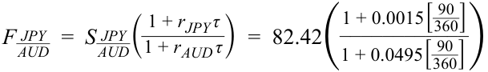

<!-- Formula Text: F  JPY _ AUD   =  S  JPY _ AUD ( 1 + r JPY τ _ 1 + r AUD τ )  =  82.42( 1 + 0.0015[ 90 _ 360 ] ____________ 1 + 0.0495[ 90 _ 360 ] ) -->
$$F_{\text{JPY/AUD}} = S_{\text{JPY/AUD}}\left(\frac{1 + r_{\text{JPY}}\tau}{1 + r_{\text{AUD}}\tau}\right) = 82,42\left(\frac{1 + 0,0015\left[\frac{90}{360}\right]}{1 + 0,0495\left[\frac{90}{360}\right]}\right) = 82,42 \times 0,98815 = 81,443$$

Điểm kỳ hạn được tính như sau: 

$$100 \times (F - S) = 100 \times (81,443 - 82,42) = 100 \times (-0,977) = -97,7$$

Bởi vì tỷ giá hối đoái giao ngay của đồng yên được yết với hai chữ số thập phân, nên điểm kỳ hạn được quy đổi tỷ lệ bằng cách nhân với 100. 
