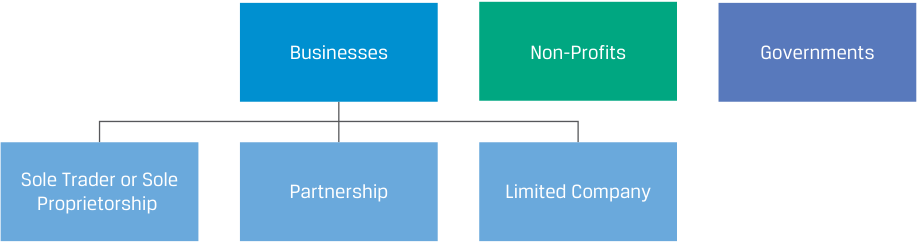
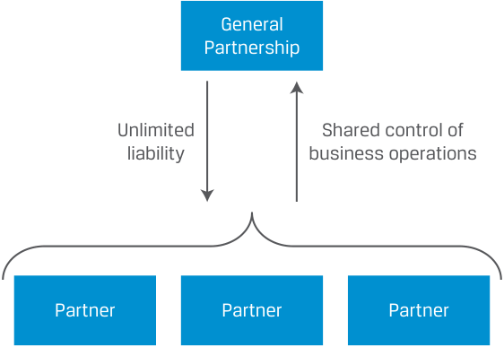
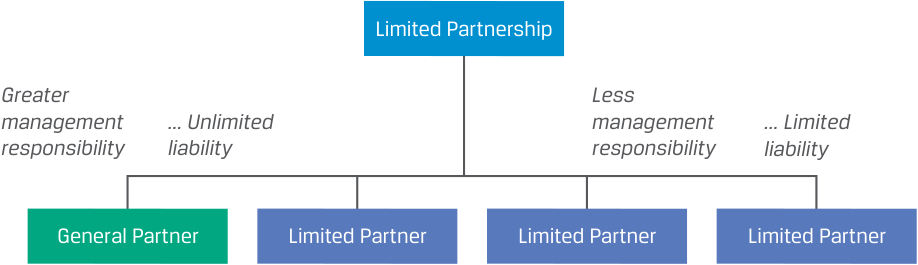
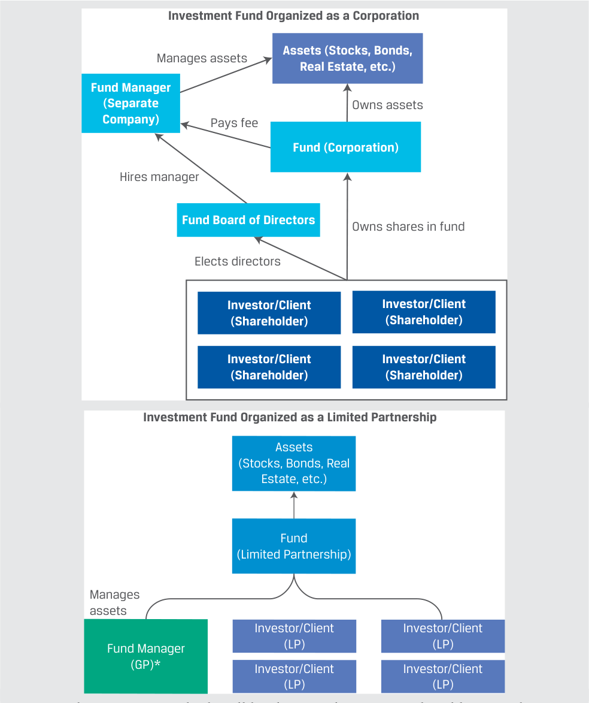
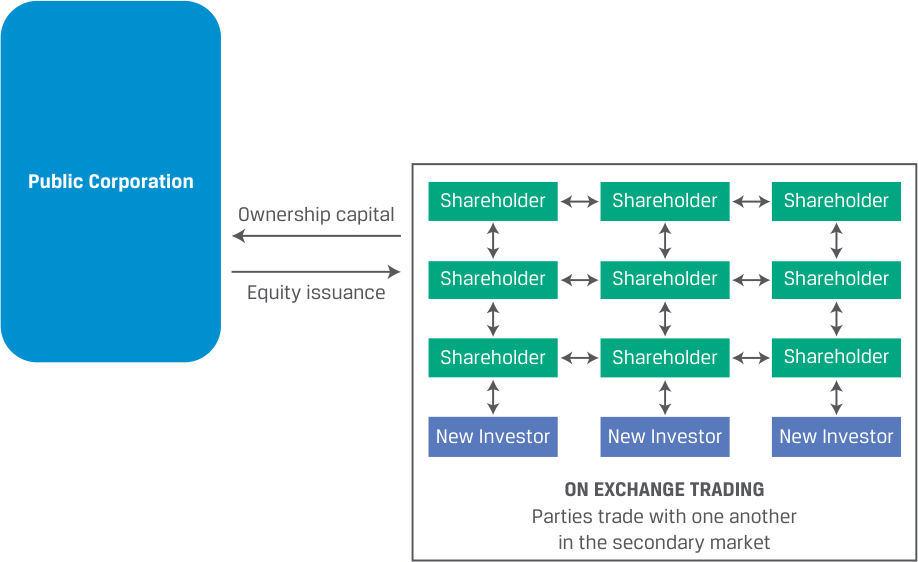
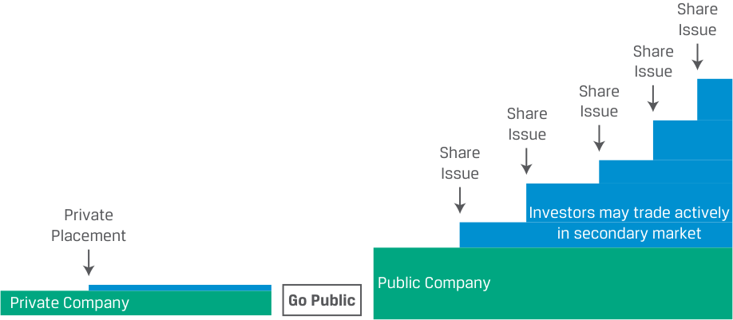
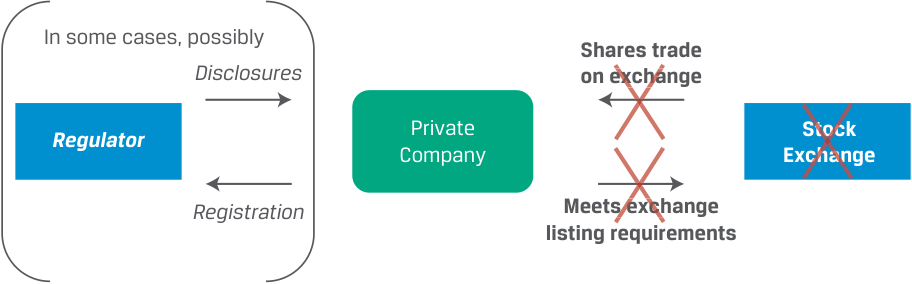
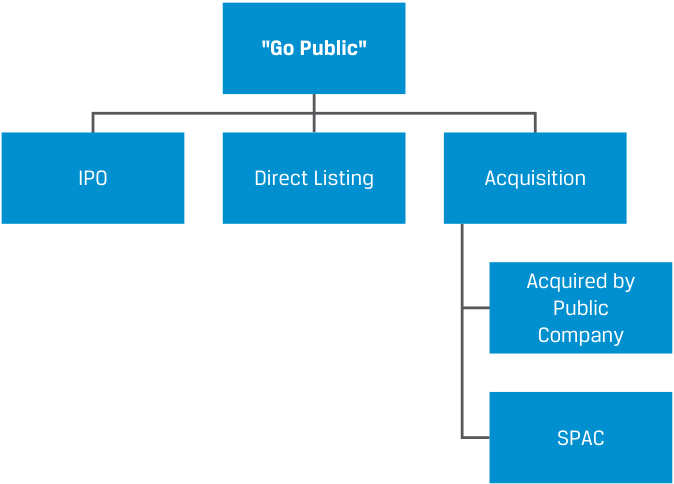
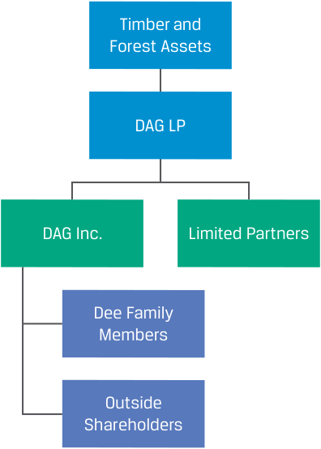

# Tập 3: Tổ chức Phát hành Doanh nghiệp (Corporate Issuers)
## Learning Module 1 Organizational Forms, Corporate Issuer Features, and Ownership (Trang PDF 11–44)

---

# Tập 3: Tổ chức phát hành doanh nghiệp (*Corporate Issuers*)
## Học phần 1: Các hình thức tổ chức doanh nghiệp, đặc điểm của tổ chức phát hành doanh nghiệp và quyền sở hữu (*Organizational Forms, Corporate Issuer Features, and Ownership*)
### Phần 1/3: Giới thiệu (*Introduction*) (Trang PDF 11–22)

---

<!-- PDF Page 11 -->

#### H Ọ C P H Ầ N (*L E A R N I N G M O D U L E*)

# **<mark>1</mark>**

### **Các hình thức tổ chức doanh nghiệp, đặc điểm của tổ chức phát hành doanh nghiệp và quyền sở hữu (*Organizational Forms, Corporate Issuer Features, and Ownership*)**

###### **<mark>MỤC TIÊU HỌC TẬP (*LEARNING OUTCOMES*)</mark>**

###### **_Thành thạo – Ứng viên cần có khả năng:_**

- So sánh các hình thức tổ chức của doanh nghiệp (*compare the organizational forms of businesses*)
- Mô tả các đặc điểm chính của tổ chức phát hành doanh nghiệp (*describe key features of corporate issuers*)
- So sánh các tổ chức phát hành doanh nghiệp thuộc sở hữu đại chúng và sở hữu tư nhân (*compare publicly and privately owned corporate issuers*)

##### **GIỚI THIỆU (*INTRODUCTION*)**

**<mark>1</mark>**

Học phần này giới thiệu chủ đề Tổ chức phát hành doanh nghiệp (*Corporate Issuers*), bao gồm các kiến thức nền tảng về cách thức các công ty cổ phần (*corporations*) được tổ chức và quản trị cũng như cách họ đưa ra các quyết định hoạt động (*operating*), đầu tư (*investing*) và tài trợ (*financing*). Các chuyên gia phân tích tài chính phải có sự hiểu biết vững chắc về các tổ chức phát hành doanh nghiệp bởi vì họ là loại hình tổ chức phát hành lớn nhất trên các thị trường tài chính toàn cầu; nhiều chuyên gia phân tích tập trung hoàn toàn vào việc phân tích và đầu tư vào các công cụ nợ (*debt instruments*) hoặc vốn chủ sở hữu (*equity instruments*) của các tổ chức này. Trong bài học đầu tiên của học phần này, chúng ta mô tả và so sánh các hình thức tổ chức pháp lý của doanh nghiệp (*legal organizational forms of businesses*), nhấn mạnh vào những điểm tương đồng và khác biệt cũng như các hàm ý quan trọng đối với nhà đầu tư. Bài học thứ hai tập trung vào hình thức tổ chức công ty cổ phần (*corporate organizational form*) và các đặc điểm chính của nó, chẳng hạn như sự tách biệt giữa quyền sở hữu và quyền quản lý (*separation of ownership and management*), trách nhiệm hữu hạn của cổ đông (*limited shareholder liability*), khả năng tiếp cận nguồn vốn (*access to financing*) và các vấn đề về thuế (*tax issues*). Trong bài học cuối cùng, chúng ta so sánh các tổ chức phát hành doanh nghiệp tư nhân (*privately held corporate issuers*) và đại chúng (*public corporate issuers*), bao gồm các cơ chế giúp tổ chức phát hành doanh nghiệp niêm yết đại chúng (*go public*) và chuyển thành công ty tư nhân (*taken private*).

###### **TỔNG QUAN HỌC PHẦN (*LEARNING MODULE OVERVIEW*)**

- Doanh nghiệp được tổ chức hợp pháp dưới dạng doanh nghiệp tư nhân (*sole proprietorships*), công ty hợp danh (*partnerships*), hoặc công ty trách nhiệm hữu hạn / công ty cổ phần (*limited companies*), khác nhau ở một số thuộc tính bao gồm tư cách pháp nhân (*legal identity*), mối quan hệ giữa chủ sở hữu và người quản lý (*owner–manager relations*), trách nhiệm pháp lý của chủ sở hữu (*owner liability*), thuế (*taxation*) và khả năng tiếp cận nguồn vốn (*access to financing*). Trên thực tế, các hình thức tổ chức mang tính đặc thù theo từng khu vực pháp lý; trọng tâm của chúng ta là những đặc điểm chung.

- Hình thức công ty trách nhiệm hữu hạn (*limited company*), thường được gọi là công ty cổ phần (*corporation*), mang lại những lợi thế vượt trội so với hai hình thức còn lại bằng cách cải thiện khả năng huy động vốn thông qua trách nhiệm hữu hạn của cổ đông (*limited shareholder liability*), sự tách biệt giữa

<!-- PDF Page 12 -->

quyền sở hữu và quyền quản lý, cùng với ít hạn chế hơn đối với số lượng chủ sở hữu và việc chuyển nhượng quyền sở hữu. Tại hầu hết các khu vực pháp lý, có hai loại hình công ty trách nhiệm hữu hạn: công ty trách nhiệm hữu hạn tư nhân (*private limited companies*) và công ty trách nhiệm hữu hạn đại chúng / công ty cổ phần (*public limited companies*).

- Các công ty trách nhiệm hữu hạn tư nhân (*private limited companies*) thường có một số hạn chế về quyền sở hữu nhưng được áp dụng cơ chế thuế chuyển tiếp (*pass-through taxation*) tương tự như công ty hợp danh. Các công ty trách nhiệm hữu hạn đại chúng (*public limited companies*) không có hạn chế về quyền sở hữu, nhưng thu nhập của chúng có thể bị đánh thuế ở cả cấp độ công ty và cấp độ cổ đông. Mặc dù các công ty trách nhiệm hữu hạn đại chúng không bắt buộc phải trở thành công ty đại chúng niêm yết thông qua việc bán cổ phiếu trên sàn giao dịch, nhưng đây chính là hình thức phù hợp nhất để trở thành một công ty giao dịch đại chúng (*publicly traded company*).

- Cổ đông của công ty cổ phần bầu ra hội đồng quản trị (*board of directors*), và hội đồng quản trị sẽ bổ nhiệm ban điều hành (*executive management*) để vận hành công ty. Cổ đông tạo ra sự thay đổi chủ yếu thông qua khả năng thay thế các thành viên hội đồng quản trị (*directors*).

- Các công ty cổ phần tìm kiếm nguồn tài trợ bên ngoài trên thị trường tài chính, được gọi là các tổ chức phát hành doanh nghiệp (*corporate issuers*), có thể sử dụng thị trường đại chúng (*public markets*) hoặc thị trường tư nhân (*private markets*), và những lựa chọn này có hàm ý quan trọng đối với tính thanh khoản (*liquidity*) và tính minh bạch về giá (*price transparency*) của chứng khoán công ty, cũng như khả năng huy động vốn trong tương lai và mức độ công bố thông tin bắt buộc.

- Các tổ chức phát hành doanh nghiệp có thể thay đổi trạng thái từ công ty tư nhân (*privately held*) sang công ty giao dịch đại chúng (hay “niêm yết” – *listed*) thông qua nhiều cơ chế khác nhau, bao gồm phát hành cổ phiếu lần đầu ra công chúng (*initial public offering* – IPO). Các tổ chức phát hành đang giao dịch đại chúng cũng có thể được chuyển thành công ty tư nhân (*taken private*) thông qua một số cơ chế, bao gồm giao dịch mua lại bằng vốn vay (*leveraged buyout* – LBO).

- Cổ đông của các tổ chức phát hành doanh nghiệp không chỉ bao gồm các nhà đầu tư cá nhân và nhà đầu tư tổ chức (*institutional investors*), chẳng hạn như quỹ hưu trí (*pension funds*) và quỹ tương hỗ (*mutual funds*), mà còn bao gồm cả chính phủ, các tổ chức phi lợi nhuận (*non-profits*) và các công ty cổ phần khác.

###### **TỰ ĐÁNH GIÁ HỌC PHẦN (*LEARNING MODULE SELF-ASSESSMENT*)**

Các câu hỏi ban đầu này nhằm giúp bạn tự đánh giá mức độ hiểu biết hiện tại của mình về chủ đề này.

1. Điền vào hai chỗ trống bên dưới bằng cách sử dụng hai trong bốn thuật ngữ sau:

   - Doanh nghiệp tư nhân (*Sole proprietorship*)
   - Công ty hợp danh thông thường (*General partnership*)
   - Công ty hợp danh hữu hạn (*Limited partnership*)
   - Công ty trách nhiệm hữu hạn đại chúng / Công ty cổ phần (*Public limited company / corporation*)

Một _____________________ có khả năng tiếp cận nguồn vốn lớn nhất, trong khi một _____________________ có khả năng tiếp cận nguồn vốn thấp nhất.

###### **Lời giải:**

Một **công ty trách nhiệm hữu hạn đại chúng / công ty cổ phần (*public limited company / corporation*)** có khả năng tiếp cận nguồn vốn lớn nhất, trong khi một **doanh nghiệp tư nhân (*sole proprietorship*)** có khả năng tiếp cận nguồn vốn thấp nhất. Sự khác biệt chính giữa các hình thức tổ chức doanh nghiệp là khả năng tiếp cận nguồn vốn để tài trợ cho các khoản đầu tư. Doanh nghiệp tư nhân bị giới hạn ở khả năng tự bỏ vốn của cá nhân chủ sở hữu và khả năng vay nợ với tư cách cá nhân của người đó. Ở

<!-- PDF Page 13 -->

phía bên kia của phổ tổ chức, một công ty trách nhiệm hữu hạn đại chúng (*public limited company*) có thể tiếp cận một lượng lớn các nhà đầu tư bên ngoài bằng cách phát hành chứng khoán nợ và/hoặc chứng khoán vốn chủ sở hữu.

2. Hình thức tổ chức nào sau đây quy định trách nhiệm pháp lý của chủ sở hữu đối với các khoản nợ kinh doanh là _thấp nhất_?
   - **A.** Công ty hợp danh thông thường (*General partnership*)
   - **B.** Công ty trách nhiệm hữu hạn tư nhân (*Private limited company*)
   - **C.** Doanh nghiệp tư nhân (*Sole proprietorship*)

###### **Lời giải:**

B là đáp án đúng. Trong cả hai hình thức tổ chức doanh nghiệp tư nhân và công ty hợp danh thông thường, các chủ sở hữu đều phải chịu trách nhiệm cá nhân đối với toàn bộ các khoản nợ mà công ty gánh chịu. Trong một công ty trách nhiệm hữu hạn tư nhân (*private limited company*), trách nhiệm pháp lý của chủ sở hữu (cổ đông) được giới hạn ở giá trị phần vốn góp sở hữu của họ.

3. Quyền biểu quyết (*voting rights*) của cổ đông tại một tổ chức phát hành doanh nghiệp thường đề cập đến điều nào sau đây?
   - **A.** Khả năng công ty cổ phần bỏ phiếu trong các cuộc bầu cử chính trị
   - **B.** Khả năng trực tiếp bầu chọn giám đốc điều hành (CEO) của công ty
   - **C.** Khả năng bầu chọn các thành viên hội đồng quản trị của công ty

###### **Lời giải:**

C là đáp án đúng. Quyền biểu quyết của cổ đông thường cho phép họ bầu các thành viên hội đồng quản trị (*board members*) cũng như bỏ phiếu về các vấn đề khác được quy định trong điều lệ công ty (*company’s charter*). Hội đồng quản trị có trách nhiệm thuê (hoặc giữ lại) giám đốc điều hành (*Chief Executive Officer* – CEO) của công ty; do đó, quyền biểu quyết không trao cho cổ đông khả năng _trực tiếp_ thuê CEO. Mặc dù công ty cổ phần có tư cách là một thực thể pháp lý riêng biệt, tư cách này không mang lại quyền bỏ phiếu trong các cuộc bầu cử chính trị.

4. Hãy giải thích tình huống sau đây phản ánh việc đánh thuế hai lần (*double taxation*) đối với hình thức tổ chức công ty cổ phần như thế nào: Công ty cổ phần nộp thuế suất 21% trên thu nhập trước thuế là 100 triệu USD. Công ty phân phối 10 triệu USD cho các cổ đông. Các cá nhân nộp thuế 20% trên thu nhập từ cổ tức (*dividend income*).

###### **Lời giải:**

Công ty cổ phần nộp 21 triệu USD thuế thu nhập ở cấp độ doanh nghiệp và, tính chung, các cổ đông nộp 2 triệu USD thuế thu nhập cá nhân trên số cổ tức nhận được. Tổng cộng, 23 triệu USD thuế thu nhập đã được nộp trên khoản thu nhập trước thuế 100 triệu USD. Trên thực tế, khoản 10 triệu USD trả dưới dạng cổ tức đã bị đánh thuế hai lần: lần thứ nhất với tư cách là thu nhập doanh nghiệp và lần thứ hai với tư cách là thu nhập cá nhân.

5. Đúng hay Sai: Thuật ngữ “đại chúng” (*public*) đối với một tổ chức phát hành doanh nghiệp đại chúng có nghĩa là công ty đó thuộc sở hữu toàn bộ hoặc một phần của chính phủ.
   - **A.** Đúng
   - **B.** Sai

###### **Lời giải:**

B là đáp án đúng. Phát biểu này sai vì mặc dù một tổ chức phát hành doanh nghiệp đại chúng có thể thuộc sở hữu một phần của chính phủ, nhưng điều kiện này là không bắt buộc. Thuật ngữ “đại chúng” (*public*) chỉ đề cập đến việc chứng khoán vốn chủ sở hữu của công ty được giao dịch trên một sàn giao dịch và do đó công chúng (*the public*) có thể tiếp cận để đầu tư.

<!-- PDF Page 14 -->

6. Điền vào chỗ trống:

Cổ phiếu của một công ty đại chúng có thể được trao đổi trên một ________________, trong khi cổ phiếu của một công ty tư nhân chịu sự thiếu hụt về ________________ giá.

###### **Lời giải:**

Cổ phiếu của một công ty đại chúng có thể được trao đổi trên một **sàn giao dịch chứng khoán (*stock exchange*)**, trong khi cổ phiếu của một công ty tư nhân chịu sự thiếu hụt về **tính minh bạch (*transparency*)** giá.

## **<mark>2</mark>**

##### **CÁC HÌNH THỨC TỔ CHỨC CỦA DOANH NGHIỆP (*ORGANIZATIONAL FORMS OF BUSINESSES*)**

- So sánh các hình thức tổ chức của doanh nghiệp (*compare the organizational forms of businesses*)

Trong hầu hết các nền kinh tế thị trường, có ba loại hình tổ chức chung, mỗi loại có mục đích, các bên liên quan (*stakeholders*) và khung pháp lý điều chỉnh riêng biệt: các tổ chức vì lợi nhuận (*for-profit organizations*), được gọi là **doanh nghiệp (*businesses*)** hoặc **công ty (*companies*)**; các tổ chức phi chính phủ không vì lợi nhuận (*not-for-profit non-governmental organizations*), hay gọi đơn giản là tổ chức phi lợi nhuận (*non-profits*); và chính phủ (*governments*).

Trọng tâm của học phần này và các học phần tiếp theo là các doanh nghiệp, bởi vì các chuyên gia phân tích tài chính là những người tham gia quan trọng trên các thị trường cung cấp nguồn lực tài chính cho doanh nghiệp. Tuy nhiên, các tổ chức phi lợi nhuận và chính phủ thường là những nhà đầu tư vào các doanh nghiệp – nội dung này sẽ được đề cập trong các bài học sau. Chính phủ với tư cách là tổ chức phát hành nợ và các chứng khoán khác được đề cập trong các học phần về Thu nhập cố định (*Fixed Income*).

###### **Các hình thức tổ chức của doanh nghiệp (*Organizational Forms of Businesses*)**

Chủ sở hữu doanh nghiệp lựa chọn một **hình thức tổ chức (*organizational form*)** pháp lý nhằm xác định cách thức phân bổ tỷ suất sinh lợi (*returns*), rủi ro (*risks*), cũng như trách nhiệm sở hữu và vận hành (*ownership and operational responsibilities*). Có ba hình thức chung phổ biến ở hầu hết các khu vực pháp lý.

**Bảng 1 (Exhibit 1): Các hình thức tổ chức của doanh nghiệp (*Organizational Forms of Businesses*)**

<!-- Picture Text: Businesses Non-Profits Governments Sole Trader or Sole Partnership Limited Company Proprietorship  -->

> **Chú thích hình ảnh:** Các loại hình tổ chức bao gồm: Doanh nghiệp (*Businesses*), Tổ chức phi lợi nhuận (*Non-Profits*) và Chính phủ (*Governments*). Trong đó, Doanh nghiệp được chia thành 3 hình thức: Hộ kinh doanh cá thể hoặc Doanh nghiệp tư nhân (*Sole Trader or Sole Proprietorship*), Công ty hợp danh (*Partnership*), và Công ty trách nhiệm hữu hạn / Công ty cổ phần (*Limited Company*).

Các hình thức tổ chức của doanh nghiệp khác nhau ở một số thuộc tính:

- _Tư cách pháp nhân (Legal identity):_ Liệu doanh nghiệp có được pháp luật coi là một thực thể hoặc pháp nhân riêng biệt tách rời khỏi các chủ sở hữu của nó hay không.

- _Mối quan hệ giữa chủ sở hữu và người quản lý (Owner–manager relationship):_ Mối quan hệ giữa (các) chủ sở hữu của doanh nghiệp và những người trực tiếp quản lý doanh nghiệp.

<!-- PDF Page 15 -->

- _Trách nhiệm pháp lý của chủ sở hữu (Owner liability):_ Mức độ mà các chủ sở hữu phải chịu trách nhiệm pháp lý cá nhân đối với các hành vi hoặc khoản nợ do doanh nghiệp thực hiện.

- _Thuế (Taxation):_ Cách thức xử lý lợi nhuận hoặc khoản lỗ của doanh nghiệp cho mục đích tính thuế.

- _Khả năng tiếp cận nguồn vốn (Access to financing):_ Khả năng huy động vốn để tài trợ cho việc mở rộng quy mô và phân tán rủi ro.

Mỗi khu vực pháp lý đều có các phiên bản và biến thể cụ thể riêng về hình thức tổ chức doanh nghiệp, bao gồm cả những tên gọi khác nhau cho chúng. Chúng ta không cố gắng trình bày một cách toàn diện mọi chi tiết đặc thù của từng khu vực pháp lý; thay vào đó, chúng ta cung cấp các thuộc tính chung và phổ biến mà các chuyên gia phân tích cần phải biết để đặt ra những câu hỏi đúng đắn trong quá trình nghiên cứu các cơ hội đầu tư và tình huống kinh doanh cụ thể.

###### **Hộ kinh doanh cá thể hoặc Doanh nghiệp tư nhân (*Sole Trader or Proprietorship*)**

Hình thức tổ chức đơn giản nhất là hộ kinh doanh cá thể hoặc doanh nghiệp tư nhân (*sole trader or proprietorship*), được minh họa trong Bảng 2 (Exhibit 2). Trong một doanh nghiệp tư nhân, chủ sở hữu cung cấp số vốn cần thiết để khởi sự và vận hành doanh nghiệp, đồng thời nắm toàn quyền kiểm soát việc quản lý, cũng như hưởng toàn bộ lợi nhuận tài chính và gánh chịu toàn bộ rủi ro của doanh nghiệp. Ở một số khu vực pháp lý, đây là hình thức mặc định, không yêu cầu đăng ký pháp lý chính thức, và sẽ giải thể khi chủ sở hữu chấm dứt hoạt động kinh doanh hoặc qua đời.

###### **Bảng 2 (Exhibit 2): Hộ kinh doanh cá thể hoặc Doanh nghiệp tư nhân (*Sole Trader or Proprietorship*)**

<!-- Picture Text: Sole Proprietorship Unlimited Individual controls liability business operations Individual  -->

> **Chú thích hình ảnh:** Doanh nghiệp tư nhân (*Sole Proprietorship*) gắn liền với Cá nhân (*Individual*): Cá nhân chịu trách nhiệm vô hạn (*Unlimited liability*) và kiểm soát toàn bộ hoạt động kinh doanh (*Individual controls business operations*).

Một ví dụ về doanh nghiệp tư nhân là doanh nghiệp do gia đình tự làm chủ. Chủ sở hữu cá nhân thường sử dụng tiền tiết kiệm hoặc một khoản vay cá nhân để khởi nghiệp và điều hành các hoạt động hàng ngày, đồng thời nắm toàn quyền kiểm soát quản lý. Chủ sở hữu giữ lại toàn bộ lợi nhuận (*returns/profits*), khoản lợi nhuận này bị đánh thuế như thu nhập cá nhân (*personal income*), và chủ sở hữu phải chịu trách nhiệm cá nhân đối với các khoản lỗ và nghĩa vụ của doanh nghiệp, chẳng hạn như các khoản nợ.

Mặc dù doanh nghiệp tư nhân chiếm _số lượng_ doanh nghiệp lớn nhất trong hầu hết các nền kinh tế thị trường và được các chủ doanh nghiệp nhỏ ưa chuộng vì tính đơn giản và linh hoạt, nhưng sự tăng trưởng của chúng bị hạn chế bởi khả năng tiếp cận nguồn vốn, khả năng gánh chịu rủi ro và việc chỉ có một chủ sở hữu duy nhất.

###### **Công ty hợp danh (*Partnerships*)**

Công ty hợp danh (*partnerships*) cho phép nhiều chủ sở hữu góp chung nguồn lực của họ và cùng chia sẻ rủi ro cũng như lợi nhuận kinh doanh. Có ba loại hình phổ biến ở hầu hết các khu vực pháp lý: công ty hợp danh thông thường (*general partnerships*), công ty hợp danh hữu hạn (*limited partnerships*), và công ty hợp danh trách nhiệm hữu hạn (*limited liability partnerships*).

Một **công ty hợp danh thông thường (*general partnership*)**, được minh họa trong Bảng 3 (Exhibit 3), có từ hai chủ sở hữu trở lên được gọi là các thành viên hợp danh hay **thành viên hợp danh thông thường (*general partners* – GPs)**. Công ty hợp danh thông thường tương tự như doanh nghiệp tư nhân, nhưng có điểm khác biệt quan trọng là cho phép huy động thêm các nguồn lực vào

<!-- PDF Page 16 -->

doanh nghiệp từ những chủ sở hữu bổ sung, đi kèm với việc chia sẻ rủi ro và lợi nhuận kinh doanh. Các công ty hợp danh thường được thành lập và điều chỉnh bởi một thỏa thuận hợp danh bằng văn bản (*written partnership agreement*), trong đó nêu rõ vai trò và trách nhiệm cụ thể của từng thành viên hợp danh cũng như cách thức chia sẻ lợi nhuận, thua lỗ và các nghĩa vụ. Tuy nhiên, một thỏa thuận bằng văn bản là không bắt buộc; công ty hợp danh có thể được hình thành bằng lời nói hoặc ngẫu nhiên thông qua các hành động hợp tác.

**Bảng 3 (Exhibit 3): Công ty hợp danh thông thường (*General Partnership*)**

<!-- Picture Text: General Partnership Unlimited Shared control of liability business operations Partner Partner Partner  -->

> **Chú thích hình ảnh:** Công ty hợp danh thông thường (*General Partnership*) gồm các Thành viên hợp danh (*Partner*): Cùng chịu trách nhiệm vô hạn (*Unlimited liability*) và cùng chia sẻ quyền kiểm soát hoạt động kinh doanh (*Shared control of business operations*).

Các ví dụ về công ty hợp danh thông thường bao gồm các doanh nghiệp dịch vụ, chẳng hạn như các nhà thầu xây dựng, và các liên doanh (*joint ventures*) của nhiều doanh nghiệp. Những doanh nghiệp như vậy có một số lượng nhỏ các thành viên hợp danh thường đóng góp số vốn bằng nhau hoặc tương đương nhau. Các thành viên hợp danh mang đến những chuyên môn bổ trợ cho nhau, chẳng hạn như chuyên môn về phát triển kinh doanh, sự nhạy bén về tài chính, vận hành, hoặc pháp lý/tuân thủ, và họ chia sẻ trách nhiệm trong việc điều hành doanh nghiệp. Toàn bộ lợi nhuận, thua lỗ và rủi ro của doanh nghiệp được các thành viên hợp danh cùng gánh chịu và chia sẻ. Nếu một thành viên hợp danh không có khả năng thanh toán phần nợ doanh nghiệp của mình, các thành viên hợp danh còn lại phải chịu trách nhiệm thanh toán toàn bộ. Tương tự như doanh nghiệp tư nhân, tiềm năng tăng trưởng của mô hình này bị giới hạn bởi khả năng tìm kiếm nguồn vốn và chuyên môn của các thành viên hợp danh cũng như mức độ chấp nhận rủi ro chung của họ, bởi vì các thành viên hợp danh vẫn phải chịu trách nhiệm cá nhân đối với các khoản lỗ và nợ của doanh nghiệp.

Bảng 4 (Exhibit 4) trình bày một loại hình công ty hợp danh được gọi là **công ty hợp danh hữu hạn (*limited partnership*)**, giúp giải quyết một số hạn chế của công ty hợp danh thông thường. Trong một công ty hợp danh hữu hạn, phải có ít nhất một thành viên hợp danh thông thường (*general partner* – GP) chịu trách nhiệm vô hạn (*unlimited liability*) và thường là người trực tiếp quản lý doanh nghiệp. Tuy nhiên, các thành viên hợp danh còn lại, được gọi là **thành viên góp vốn / thành viên hợp danh hữu hạn (*limited partners* – LPs)**, có trách nhiệm hữu hạn (*limited liability*), nghĩa là khoản lỗ tối đa của họ chỉ giới hạn ở quy mô khoản vốn đầu tư của họ vào công ty hợp danh hữu hạn, và họ có thể không nắm giữ bất kỳ trách nhiệm quản lý nào. Với chế độ trách nhiệm hữu hạn, tài sản cá nhân được coi là tách biệt và do đó được bảo vệ khỏi các nghĩa vụ nợ của doanh nghiệp. Tất cả các thành viên đều được hưởng một phần lợi nhuận và chịu một phần lỗ theo quy định trong thỏa thuận hợp danh, trong đó các GP thường nhận được tỷ lệ lớn hơn để đổi lấy việc gánh chịu rủi ro và trách nhiệm pháp lý cá nhân cao hơn. Các thỏa thuận hợp danh được tùy chỉnh và đàm phán bởi các thành viên và có thể rất phức tạp, với nhiều tầng hợp danh có các cơ chế chia sẻ lợi nhuận và thua lỗ khác nhau.

<!-- PDF Page 17 -->

###### **Bảng 4 (Exhibit 4): Công ty hợp danh hữu hạn (*Limited Partnership*)**

<!-- Picture Text: Limited Partnership Greater Less management ... Unlimited management ... Limited responsibility liability responsibility liability General Partner Limited Partner Limited Partner Limited Partner  -->

> **Chú thích hình ảnh:** Công ty hợp danh hữu hạn (*Limited Partnership*) bao gồm: Thành viên hợp danh thông thường (*General Partner* – GP) có trách nhiệm quản lý lớn hơn (*Greater management responsibility*) và chịu trách nhiệm vô hạn (*Unlimited liability*); cùng với các Thành viên góp vốn (*Limited Partner* – LP) có trách nhiệm quản lý ít hơn (*Less management responsibility*) và chịu trách nhiệm hữu hạn (*Limited liability*).

Trong một công ty hợp danh hữu hạn, mặc dù rủi ro và phần thưởng tài chính được chia sẻ, nhưng các nguồn lực như vốn và chuyên môn thường bị giới hạn ở những gì các thành viên có thể đóng góp, và các thành viên góp vốn (LP) thường giao phó trách nhiệm quản lý cho GP – điều này tiềm ẩn rủi ro. Các thỏa thuận hợp danh được thiết kế riêng và thường hạn chế khả năng chuyển nhượng phần vốn sở hữu hoặc hạn chế việc mở rộng ra ngoài một nhóm nhỏ các thành viên. Giống như doanh nghiệp tư nhân, công ty hợp danh thường là **doanh nghiệp chuyển tiếp thuế (*pass-through businesses*)** cho mục đích tính thuế. Các doanh nghiệp chuyển tiếp không bị đánh thuế ở cấp độ thực thể (*entity level*), mà chuyển toàn bộ lợi nhuận hoặc khoản lỗ của chúng sang cho các thành viên hợp danh để chịu thuế thu nhập cá nhân. Thu nhập kinh doanh từ các thực thể này được chuyển tiếp và đánh thuế bất kể thu nhập đó có thực sự được phân phối hay được giữ lại trong công ty hợp danh để tái đầu tư.

Ở một số khu vực pháp lý, có một hình thức công ty hợp danh hữu hạn đặc biệt được gọi là **công ty hợp danh trách nhiệm hữu hạn (*limited liability partnership* – LLP)**, không yêu cầu phải có thành viên hợp danh thông thường (GP) mà thay vào đó bao gồm toàn bộ các thành viên có trách nhiệm hữu hạn, qua đó giải quyết được rủi ro trách nhiệm vô hạn đối với GP. Thay vào đó, tất cả các thành viên hợp danh đều có trách nhiệm hữu hạn, và các thành viên cùng chia sẻ trách nhiệm quản lý, thường bằng cách bầu ra một hoặc nhiều thành viên làm thành viên hợp danh điều hành (*managing partners*). Tại một số khu vực pháp lý, chẳng hạn như Hoa Kỳ, hình thức LLP chỉ được phép áp dụng cho các công ty dịch vụ chuyên nghiệp như luật, kế toán, kỹ thuật và kiến trúc, đồng thời có giới hạn về số lượng thành viên hợp danh cũng như các hạn chế pháp lý đối với việc đầu tư vốn cổ phần.

###### **Công ty trách nhiệm hữu hạn / Công ty cổ phần (*Limited Companies*)**

Cuối cùng, một **công ty trách nhiệm hữu hạn (*limited company*)** có nhiều điểm tương đồng với công ty hợp danh hữu hạn nhưng bao gồm thêm một số đặc điểm cho phép tiếp cận nguồn vốn và chuyên môn lớn hơn để phục vụ tăng trưởng. Ở nhiều khu vực pháp lý, có hai loại công ty trách nhiệm hữu hạn: công ty trách nhiệm hữu hạn tư nhân (*private limited companies*) và công ty trách nhiệm hữu hạn đại chúng / công ty cổ phần (*public limited companies*).

**Công ty trách nhiệm hữu hạn tư nhân (*private limited company*)** tương tự như công ty hợp danh hữu hạn. Tuy nhiên, hình thức này bao gồm chế độ trách nhiệm hữu hạn cho _tất cả_ các chủ sở hữu, cải thiện khả năng chuyển nhượng quyền sở hữu bằng cách chia quyền sở hữu thành các đơn vị gọi là **cổ phần / phần vốn góp (*shares*)** dễ giao dịch hơn, và có sự phân biệt giữa chủ sở hữu và người quản lý. Các chủ sở hữu, được gọi là **cổ đông (*shareholders*)** hoặc thành viên góp vốn (*members*), bầu ra một **hội đồng quản trị (*board of directors*)** để quản lý công ty và phê duyệt bất kỳ khoản phân phối lợi nhuận nào cho chủ sở hữu. Hội đồng quản trị thường bổ nhiệm các nhà quản lý chuyên nghiệp. Công ty trách nhiệm hữu hạn tư nhân được gọi bằng nhiều tên khác nhau ở các khu vực pháp lý khác nhau, bao gồm công ty trách nhiệm hữu hạn (*limited liability company* – LLC) và công ty cổ phần loại S (*S corporation*) tại Hoa Kỳ, G.K. tại Nhật Bản, SARL tại Pháp, GmbH tại Đức, và công ty trách nhiệm hữu hạn tại Trung Quốc.

<!-- PDF Page 18 -->

###### **Bảng 5 (Exhibit 5): Cơ cấu tổ chức của Công ty trách nhiệm hữu hạn / Công ty cổ phần (*Organization of Limited Company*)**

<!-- Picture Text: Shareholder Shareholder Shareholder Shareholder Shareholder Shareholder Shareholder Shareholder Board of Directors CEO CFO Other Executives  -->

> **Chú thích hình ảnh:** Các cổ đông (*Shareholder*) bầu ra Hội đồng quản trị (*Board of Directors*), và Hội đồng quản trị bổ nhiệm Giám đốc điều hành (*CEO*), Giám đốc tài chính (*CFO*) cùng các Giám đốc điều hành khác (*Other Executives*).

Ở nhiều khu vực pháp lý, bao gồm cả Hoa Kỳ, các công ty trách nhiệm hữu hạn tư nhân có giới hạn pháp lý về số lượng chủ sở hữu và yêu cầu biểu quyết khi chuyển nhượng quyền sở hữu, nhưng lại là các doanh nghiệp chuyển tiếp thuế (*pass-through businesses*, tương tự như LP), nghĩa là thuế thu nhập doanh nghiệp chỉ phải nộp ở cấp độ cổ đông chứ không phải ở cấp độ công ty.

Cuối cùng, **công ty trách nhiệm hữu hạn đại chúng (*public limited companies*)**, thường được gọi là **công ty cổ phần (*corporations*)**, tương tự như công ty trách nhiệm hữu hạn tư nhân nhưng ở hầu hết các khu vực pháp lý không phải chịu bất kỳ hạn chế pháp lý nào về số lượng chủ sở hữu hoặc khả năng chuyển nhượng quyền sở hữu, trong khi vẫn giữ nguyên đặc tính trách nhiệm hữu hạn và sự tách biệt giữa quyền sở hữu và quyền quản lý. Vì những lý do này, công ty trách nhiệm hữu hạn đại chúng là hình thức phù hợp nhất cho các công ty muốn niêm yết đại chúng (*go public*) và là hình thức tổ chức thống trị trên toàn cầu xét theo doanh thu và giá trị tài sản. Tuy nhiên, công ty trách nhiệm hữu hạn đại chúng chịu bất lợi ở hầu hết các khu vực pháp lý so với các hình thức tổ chức khác ở một khía cạnh: thuế (*taxation*). Trong khi các hình thức khác chỉ bị đánh thuế trên thu nhập và khoản lỗ kinh doanh ở cấp độ chủ sở hữu (cá nhân), thì các công ty trách nhiệm hữu hạn đại chúng bị đánh thuế ở cấp độ doanh nghiệp và bị đánh thuế _một lần nữa_ ở cấp độ cá nhân nếu lợi nhuận được phân phối cho các cổ đông. Nhưng nếu lợi nhuận được giữ lại và tái đầu tư vào công ty, khoản thuế ở cấp độ cổ đông sẽ không áp dụng, điều này làm cho hình thức tổ chức này phù hợp hơn với các công ty có ý định giữ lại lợi nhuận để tài trợ cho đầu tư.

Các công ty trách nhiệm hữu hạn đại chúng được biết đến với những tên gọi khác nhau ở các khu vực pháp lý khác nhau, bao gồm công ty cổ phần loại C (*C-corporation*) tại Hoa Kỳ, công ty cổ phần (*corporation*) tại Trung Quốc, *Société anonyme* (S.A.) tại Pháp, AG (*Aktiengesellschaft*) tại Đức, và K.K. (*Kabushiki Kaisha*) hay công ty cổ phần tại Nhật Bản. Có vô số ví dụ về loại hình này, bao gồm hầu hết, nếu không muốn nói là tất cả, các tập đoàn đa quốc gia nổi tiếng.

###### **VÍ DỤ 1 (*EXAMPLE 1*)**

###### **Tập đoàn Simon Property (*Simon Property Group*)**

Simon Property Group (“Simon”) là một trong những chủ sở hữu bất động sản bán lẻ lớn nhất thế giới, với khối tài sản trị giá hơn 33 tỷ USD. Tài sản của tập đoàn chủ yếu bao gồm các trung tâm mua sắm tại Hoa Kỳ và một số bất động sản bán lẻ ở châu Âu và châu Á. Simon được tổ chức thành hai tầng (*two layers*), mỗi tầng có một hình thức tổ chức riêng biệt.

<!-- PDF Page 19 -->

<!-- Picture Text: Real Estate Assets 100% Simon Property Group L.P. 87% 13% Simon Property Limited Partners Group Inc. (GP) 8% Founders Other 92% Shareholders  -->

> **Chú thích hình ảnh:** Tài sản bất động sản (*Real Estate Assets*) thuộc sở hữu 100% bởi Simon Property Group L.P. (công ty hợp danh hữu hạn). Trong đó, Simon Property Group Inc. đóng vai trò là Thành viên hợp danh thông thường (GP) sở hữu 87%, còn các Thành viên góp vốn (*Limited Partners*) sở hữu 13%. Bản thân Simon Property Group Inc. (GP) được sở hữu 8% bởi những người sáng lập (*Founders*) và 92% bởi các cổ đông khác (*Other Shareholders*).

Các tài sản bất động sản bán lẻ thuộc sở hữu toàn bộ (100%) của Simon Property Group L.P., một công ty hợp danh hữu hạn (*limited partnership*). Các thành viên hợp danh của nó bao gồm Simon Property Group Inc. – thành viên hợp danh thông thường (*general partner*), và khoảng 200 thành viên góp vốn (*limited partners*). Thành viên hợp danh thông thường có toàn bộ trách nhiệm quản lý và chịu trách nhiệm vô hạn, đồng thời nắm giữ 87% lợi ích sở hữu trong công ty hợp danh.

Điều quan trọng là bản thân thành viên hợp danh thông thường, Simon Property Group Inc., lại là một công ty cổ phần (*corporation*). Công ty này được sở hữu rộng rãi bởi hàng ngàn cổ đông, bao gồm cả gia đình sáng lập nắm giữ 8% cổ phần. Simon Property Group Inc. chỉ có một tài sản duy nhất: phần lợi ích hợp danh của mình trong Simon Property L.P.

Cấu trúc của Simon cho phép đồng đầu tư với các thành viên góp vốn (LP), nắm toàn quyền kiểm soát quản lý và nhận phần lớn thu nhập từ khối tài sản, đồng thời hưởng lợi từ khả năng tiếp cận nguồn vốn rộng rãi; bởi vì mặc dù GP chịu trách nhiệm vô hạn, nhưng _các cổ đông_ của GP lại chỉ chịu trách nhiệm hữu hạn. Các công ty hợp danh được cấu thành từ những thực thể có trách nhiệm hữu hạn, chẳng hạn như các công ty cổ phần, rất phổ biến vì chúng bảo vệ những chủ sở hữu cuối cùng (trong trường hợp này là các cổ đông của Simon Property Group Inc.) khỏi rủi ro kinh doanh nhưng vẫn cho phép chia sẻ lợi nhuận và thua lỗ trong hoạt động kinh doanh cơ sở.

Những điểm khác biệt chính giữa doanh nghiệp tư nhân, công ty hợp danh và công ty trách nhiệm hữu hạn đại chúng hay công ty cổ phần được tóm tắt trong Bảng 6 (Exhibit 6).

**Bảng 6 (Exhibit 6): Đặc điểm của Doanh nghiệp tư nhân, Công ty hợp danh và Công ty cổ phần (*Features of Sole Proprietorships, Partnerships, and Corporations*)**

|**Đặc điểm (*Feature*)**|**Doanh nghiệp tư nhân (*Sole Proprietor*)**|**Công ty hợp danh thông thường (*General Partnership*)**|**Công ty hợp danh hữu hạn (*Limited Partnership*)**|**Công ty cổ phần (*Corporation*)**|
|---|---|---|---|---|
|Tư cách pháp nhân (*Legal Identity*)|Không có tư cách pháp nhân riêng biệt; là sự nối dài của chủ sở hữu|Không có tư cách pháp nhân riêng biệt; là sự nối dài của (các) thành viên hợp danh|Không có tư cách pháp nhân riêng biệt; là sự nối dài của (các) thành viên hợp danh|Thực thể pháp lý riêng biệt (*Separate legal entity*)|
|Mối quan hệ giữa Chủ sở hữu và Người điều hành (*Owner–Operator Relationship*)|Chủ sở hữu trực tiếp điều hành|Các thành viên hợp danh điều hành|GP trực tiếp điều hành|Hội đồng quản trị và ban giám đốc điều hành|
|Trách nhiệm pháp lý của chủ sở hữu (*Owner Liability*)|Trách nhiệm vô hạn của cá nhân chủ sở hữu|Cùng chia sẻ trách nhiệm vô hạn|GP chịu trách nhiệm vô hạn; LP chịu trách nhiệm hữu hạn|Trách nhiệm hữu hạn (*Limited liability*)|

<!-- PDF Page 20 -->

|**Đặc điểm (*Feature*)**|**Doanh nghiệp tư nhân (*Sole Proprietor*)**|**Công ty hợp danh thông thường (*General Partnership*)**|**Công ty hợp danh hữu hạn (*Limited Partnership*)**|**Công ty cổ phần (*Corporation*)**|
|---|---|---|---|---|
|Thuế (*Taxation*)|Chuyển tiếp (*Pass-through*): Lợi nhuận bị đánh thuế như thu nhập cá nhân|Chuyển tiếp (*Pass-through*): Lợi nhuận bị đánh thuế như thu nhập cá nhân|Chuyển tiếp (*Pass-through*): Lợi nhuận bị đánh thuế như thu nhập cá nhân|Thu nhập công ty bị đánh thuế; khoản phân phối (cổ tức) bị đánh thuế như thu nhập cá nhân|
|Khả năng tiếp cận nguồn vốn (*Access to Financing*)|Bị giới hạn bởi khả năng tiếp cận vốn của chủ sở hữu|Bị giới hạn bởi khả năng tiếp cận vốn của các thành viên hợp danh|Bị giới hạn bởi khả năng tiếp cận vốn của GP/LP|Khả năng tiếp cận vốn không giới hạn, tiềm năng kinh doanh không giới hạn|

###### **VÍ DỤ 2 (*EXAMPLE 2*)**

###### **Các quỹ đầu tư được tổ chức như thế nào? (*How Are Investment Funds Organized?*)**

Quỹ đầu tư (*investment funds*) là các quỹ tập hợp vốn do một hoặc nhiều nhà đầu tư đóng góp nhằm mục đích tìm kiếm tỷ suất sinh lợi và quản trị rủi ro. Các quỹ đầu tư cũng giống như các công ty khác trong nền kinh tế thị trường: Họ thuê đội ngũ quản lý chuyên nghiệp để đầu tư vốn, đôi khi kết hợp thêm tiền đi vay, vào các tài sản khác nhau nhằm đạt được các mục tiêu sinh lợi trong phạm vi các ràng buộc về rủi ro. Những điểm khác biệt lớn giữa quỹ đầu tư và các công ty khác bao gồm việc quỹ trực tiếp tuyển dụng rất ít nhân sự, chủ yếu đầu tư vào các công cụ tài chính thay vì tài sản hoạt động (*operating assets*), đa dạng hóa tài sản, và có các mục tiêu cụ thể thay vì mục tiêu chung (ví dụ: vượt qua một tỷ suất sinh lợi chuẩn – *benchmark rate of return*).

Hai hình thức tổ chức phổ biến đối với các quỹ đầu tư là công ty cổ phần (*corporations*) và công ty hợp danh hữu hạn (*limited partnerships*), như được minh họa trong hai sơ đồ dưới đây. Khi được tổ chức dưới dạng một công ty cổ phần, các nhà đầu tư vào quỹ nắm giữ các cổ phiếu đại diện cho phần lợi ích theo tỷ lệ của họ trong tổng khối tài sản cơ sở. Khi được tổ chức dưới dạng một công ty hợp danh hữu hạn, các nhà đầu tư vào quỹ nắm giữ các đơn vị hợp danh (*partnership units*) đại diện cho phần lợi ích theo tỷ lệ của họ trong tổng khối tài sản cơ sở hoặc các lợi ích khác nhau đối với những tài sản cụ thể.

<!-- PDF Page 21 -->

<!-- Picture Text: Investment Fund Organized as a Corporation Assets (Stocks, Bonds, Manages assets Real Estate, etc.) Fund Manager (Separate Owns assets Company) Pays fee Fund (Corporation) Hires manager Fund Board of Directors Owns shares in fund Elects directors Investor/Client Investor/Client (Shareholder) (Shareholder) Investor/Client Investor/Client (Shareholder) (Shareholder) Investment Fund Organized as a Limited Partnership Assets (Stocks, Bonds, Real Estate, etc.) Fund (Limited Partnership) Manages assets Investor/Client Investor/Client Fund Manager (LP) (LP) (GP)* Investor/Client Investor/Client (LP) (LP)  -->

> **Chú thích hình ảnh:**
> - **Sơ đồ 1 – Quỹ đầu tư được tổ chức dưới dạng Công ty cổ phần (*Investment Fund Organized as a Corporation*):** Nhà đầu tư/Khách hàng (Cổ đông – *Shareholder*) sở hữu cổ phần trong quỹ (*Owns shares in fund*) và bầu ra Hội đồng quản trị của Quỹ (*Fund Board of Directors*). Quỹ (Công ty cổ phần – *Fund Corporation*) sở hữu các Tài sản (Cổ phiếu, Trái phiếu, Bất động sản, v.v.), thuê Công ty quản lý quỹ (*Fund Manager – Separate Company*) và trả phí (*Pays fee*) để đơn vị này quản lý tài sản (*Manages assets*).
> - **Sơ đồ 2 – Quỹ đầu tư được tổ chức dưới dạng Công ty hợp danh hữu hạn (*Investment Fund Organized as a Limited Partnership*):** Quỹ (*Fund – Limited Partnership*) nắm giữ các Tài sản (Cổ phiếu, Trái phiếu, Bất động sản, v.v.). Nhà quản lý quỹ đóng vai trò là Thành viên hợp danh thông thường (*Fund Manager – GP\**) trực tiếp quản lý tài sản, còn các Nhà đầu tư/Khách hàng đóng vai trò là Thành viên góp vốn (*Investor/Client – LP*).

\*Trong cấu trúc này – sẽ được thảo luận chi tiết hơn ở phần sau của chương trình học trong các bài học về Đầu tư thay thế (*Alternative Investments*) – các nhà quản lý quỹ thường thành lập một thực thể công ty trách nhiệm hữu hạn tư nhân thuộc sở hữu 100% để đóng vai trò làm GP nhằm bảo vệ nhà quản lý quỹ khỏi trách nhiệm vô hạn.

###### **BỘ CÂU HỎI (*QUESTION SET*)**

1. Xác định hai đặc điểm giúp phân biệt công ty hợp danh thông thường (*general partnership*) với công ty hợp danh hữu hạn (*limited partnership*).

###### **Lời giải:**

- **Mối quan hệ giữa chủ sở hữu và người quản lý (*Owner–manager relationship*):** Việc quản lý một công ty hợp danh thông thường thường được chia sẻ bởi các thành viên hợp danh thông thường, trong khi ở một công ty hợp danh hữu hạn, thành viên hợp danh thông thường (GP) thường thực hiện hầu hết các trách nhiệm quản lý.
- **Trách nhiệm pháp lý của chủ sở hữu đối với các khoản nợ và nghĩa vụ kinh doanh (*Owner liability of business debts and obligations*):** Trong một công ty hợp danh thông thường, các thành viên hợp danh phải chịu trách nhiệm pháp lý cá nhân đối với các khoản nợ kinh doanh và các hành động do công ty thực hiện. Trong một công ty hợp danh hữu hạn, chỉ có thành viên hợp danh thông thường (GP) mới phải đối mặt với trách nhiệm cá nhân; trách nhiệm pháp lý của các thành viên góp vốn (LP) được giới hạn ở khoản đầu tư của họ vào công ty hợp danh.

<!-- PDF Page 22 -->

2. Ghép các thuộc tính kinh doanh sau đây với hình thức tổ chức phù hợp nhất.

| Thuộc tính kinh doanh (*Business Attribute*) | Hình thức tổ chức (*Organizational Form*) |
|---|---|
| A. Nhu cầu vốn lớn (*Significant capital needs*) | 1. Công ty hợp danh trách nhiệm hữu hạn (*Limited liability partnership*) |
| B. Một chủ sở hữu duy nhất, mong muốn sự đơn giản (*Single owner, desires simplicity*) | 2. Công ty cổ phần (*Corporation*) |
| C. Công ty cung cấp các dịch vụ chuyên nghiệp (*Company provides professional services*) | 3. Doanh nghiệp tư nhân (*Sole proprietorship*) |

###### **Lời giải:**

- A. 2. Công ty cổ phần (*Corporation*)
- B. 3. Doanh nghiệp tư nhân (*Sole proprietorship*)
- C. 1. Công ty hợp danh trách nhiệm hữu hạn (*Limited liability partnership*)

Một công ty có nhu cầu vốn lớn sẽ muốn có khả năng tiếp cận nguồn tài trợ rộng rãi. Trong trường hợp đó, hình thức tổ chức công ty cổ phần (*corporate organizational form*) có khả năng là phù hợp nhất.

Đối với một chủ sở hữu duy nhất mong muốn sự đơn giản, doanh nghiệp tư nhân (*sole proprietorship*) là một cơ chế phù hợp. Ở một số khu vực pháp lý, đây là hình thức tổ chức “mặc định” và không yêu cầu đăng ký.

Các công ty dịch vụ chuyên nghiệp, chẳng hạn như một công ty luật, đòi hỏi những người chủ sở hữu phải có bộ kỹ năng chuyên môn để quản lý công ty. Cấu trúc hợp danh là phù hợp, và cấu trúc công ty hợp danh trách nhiệm hữu hạn (*limited liability partnership* – LLP) cho phép các thành viên hợp danh chia sẻ quyền kiểm soát quản lý mà không có bất kỳ thành viên nào phải gánh chịu trách nhiệm vô hạn.

3. Nếu một chủ sở hữu công ty dự kiến có nhu cầu tài trợ vốn rất lớn, hình thức tổ chức nào sau đây là sự lựa chọn _ít phù hợp nhất_?

   - **A.** Công ty cổ phần (*Corporate*)
   - **B.** Công ty hợp danh (*Partnership*)
   - **C.** Doanh nghiệp tư nhân (*Sole proprietorship*)

###### **Lời giải:**

C là đáp án đúng. Một doanh nghiệp tư nhân bị giới hạn về nguồn tài trợ ở số tiền tự có của chủ sở hữu và số tiền mà chủ sở hữu có thể vay với tư cách cá nhân. Một công ty hợp danh mở rộng khả năng tiếp cận nguồn vốn bằng cách bổ sung thêm các chủ sở hữu, phân tán rủi ro và tăng thêm khả năng vay nợ. Hình thức công ty cổ phần mang lại khả năng tiếp cận nguồn tài trợ rộng lớn nhất vì không có giới hạn về số lượng cổ đông và, với chế độ trách nhiệm hữu hạn, các cổ đông cảm thấy yên tâm hơn tương đối khi công ty thực hiện vay nợ.

4. Điền vào chỗ trống trong câu sau:

Trách nhiệm ________________ là một lợi ích của hình thức tổ chức công ty cổ phần, nhưng hình thức này phải đối mặt với một bất lợi tiềm tàng do việc đánh thuế ________________ đối với thu nhập kinh doanh được phân phối.

###### **Lời giải:**

<u>Trách nhiệm **hữu hạn (*Limited*)** là một lợi ích của hình thức tổ chức công ty cổ phần, nhưng</u> hình thức này phải đối mặt với một bất lợi tiềm tàng do việc đánh thuế **hai lần (*double*)** đối với thu nhập kinh doanh được phân phối.

---

# Tập 3: Tổ chức phát hành doanh nghiệp (*Corporate Issuers*)
## Học phần 1: Các hình thức tổ chức doanh nghiệp, đặc điểm của tổ chức phát hành doanh nghiệp và quyền sở hữu (*Organizational Forms, Corporate Issuer Features, and Ownership*)
### Phần 2/3: Các đặc điểm chính của tổ chức phát hành doanh nghiệp (*Key Features of Corporate Issuers*) (Trang PDF 23–28)

---

<!-- PDF Page 23 -->

5. Đúng hay Sai: Các công ty hợp danh (*partnerships*) thường bị đánh thuế ở cấp độ thực thể (*entity level*) thay vì ở cấp độ từng thành viên hợp danh cá nhân (*individual partner level*).

   - **A.** Đúng
   - **B.** Sai

### **Lời giải:**

B là đáp án đúng. Các công ty hợp danh thường là các thực thể chuyển tiếp thuế (*pass-through entities*), nghĩa là thu nhập kinh doanh do công ty hợp danh tạo ra được chuyển tiếp sang cho các thành viên hợp danh theo các điều khoản của thỏa thuận hợp danh, và mỗi thành viên hợp danh sẽ chịu thuế ở cấp độ cá nhân.

# **CÁC ĐẶC ĐIỂM CHÍNH CỦA TỔ CHỨC PHÁT HÀNH DOANH NGHIỆP (*KEY FEATURES OF CORPORATE ISSUERS*)** **<mark>3</mark>**

- Mô tả các đặc điểm chính của tổ chức phát hành doanh nghiệp (*describe key features of corporate issuers*)

Bài học trước đã đề cập đến một số lợi thế của hình thức tổ chức công ty cổ phần (*corporate organizational form*) so với các hình thức khác, chẳng hạn như trách nhiệm hữu hạn của chủ sở hữu, sự tách biệt giữa chủ sở hữu và người quản lý, và khả năng tiếp cận nguồn tài trợ bên ngoài tốt hơn. Trong bài học này, chúng ta sẽ khám phá sâu hơn các đặc điểm của công ty cổ phần. Các công ty cổ phần huy động vốn trên thị trường tài chính, được gọi là **tổ chức phát hành doanh nghiệp (*corporate issuers*)**, là đối tượng thiết yếu mà các chuyên gia phân tích tài chính cần phải hiểu rõ, bởi vì họ huy động nhiều vốn từ các nhà đầu tư hơn cả các chính phủ trên toàn thế giới.

## **Tư cách pháp nhân (*Legal Identity*)**

Công ty cổ phần (*corporation*) là một thực thể pháp lý riêng biệt và tách bạch khỏi các chủ sở hữu của nó, được thành lập thông qua việc nộp điều lệ công ty (*articles of incorporation*) cho cơ quan quản lý có thẩm quyền. Các công ty cổ phần có nhiều quyền và nghĩa vụ tương tự như một cá nhân và có thể tham gia vào các hoạt động tương tự. Ví dụ, một công ty cổ phần có thể giao kết hợp đồng, tuyển dụng nhân viên, khởi kiện và bị kiện, đi vay và cho vay tiền, thực hiện đầu tư và nộp thuế.

Các công ty cổ phần lớn thường có hoạt động kinh doanh tại nhiều khu vực địa lý khác nhau và phải tuân thủ từng khu vực pháp lý quản lý nơi mà:

- công ty được đăng ký thành lập (*incorporated*),
- hoạt động kinh doanh được tiến hành, và
- công ty huy động vốn tài trợ cho chính mình,

và đối với các hoạt động như:

- đăng ký kinh doanh (*registration*),
- báo cáo và công bố thông tin tài chính và phi tài chính (*financial and non-financial reporting and disclosure*), và
- các hoạt động trên thị trường vốn (phát hành, giao dịch, đầu tư).

## **Sự tách biệt giữa Chủ sở hữu và Người quản lý (*Owner–Manager Separation*)**

Một đặc điểm chính của hầu hết các công ty cổ phần là sự tách biệt giữa những người sở hữu doanh nghiệp (các cổ đông – *shareholders*) và những người điều hành doanh nghiệp, được đại diện bởi hội đồng quản trị (*board of directors*) và ban giám đốc (*management*). Trong một công ty cổ phần, các cổ đông phần lớn tách rời khỏi

<!-- PDF Page 24 -->

các hoạt động thường nhật của doanh nghiệp. Thay vào đó, cổ đông bầu ra một hội đồng quản trị và đến lượt mình, hội đồng quản trị sẽ bổ nhiệm ban điều hành cấp cao (*executive-level management*), chẳng hạn như giám đốc điều hành (*chief executive officer* – CEO), người chịu trách nhiệm giải trình về các quyết định đầu tư, tài trợ và hoạt động kinh doanh. Các thành viên hội đồng quản trị và các nhà quản lý có trách nhiệm hàng đầu là hành động vì lợi ích tốt nhất của các cổ đông và, một cách gián tiếp, của tất cả các bên liên quan (*stakeholders*). Sự tách biệt giữa quyền sở hữu và quyền quản lý cho phép công ty cổ phần huy động được nguồn tài trợ từ một tập hợp rộng lớn hơn các nhà đầu tư tiềm năng – những người không cần (hoặc không muốn) tham gia vào công việc quản lý.

Nếu hội đồng quản trị hoặc ban giám đốc không hành động vì lợi ích tốt nhất của cổ đông, cổ đông có thể tạo ra sự thay đổi thông qua việc thực hiện **quyền biểu quyết (*voting rights*)** gắn liền với cổ phiếu của họ — ví dụ, bằng cách bỏ phiếu thay thế hội đồng quản trị — mặc dù việc này có thể mất thời gian. Việc gây ảnh hưởng đến hoạt động kinh doanh hoặc thay đổi hoàn toàn ban giám đốc bằng cách sử dụng hoạt động đối thoại gắn kết (*engagement*) và quyền biểu quyết là một chiến lược được một số nhà đầu tư theo đuổi và sẽ được thảo luận chi tiết trong các bài học sau.

## **Trách nhiệm pháp lý của Chủ sở hữu/Cổ đông (*Owner/Shareholder Liability*)**

Rủi ro được chia sẻ giữa tất cả các cổ đông, những người chỉ chịu trách nhiệm hữu hạn (*limited liability*). Nghĩa là, số tiền tối đa mà các cổ đông có thể mất chính là số tiền họ đã đầu tư vào công ty (tức là giá trị cổ phiếu của họ có thể giảm xuống bằng 0 nhưng không thể âm thêm nữa), và họ không phải chịu trách nhiệm về các khoản nợ của công ty cổ phần trừ khi họ có cam kết bảo lãnh riêng biệt và cụ thể cho các khoản nợ đó.

Các cổ đông cùng chia sẻ rủi ro và lợi nhuận của công ty theo tỷ lệ sở hữu cổ phần của họ, trừ khi điều lệ công ty (*corporate charter*) có quy định khác. Không giống như công ty hợp danh, các đơn vị sở hữu được chia nhỏ thành các cổ phiếu có mệnh giá/quy mô đơn vị nhỏ hơn, cho phép các nhà đầu tư mua hoặc bán quyền sở hữu được đại diện bởi cổ phiếu của họ một cách dễ dàng hơn. Ví dụ, một số tổ chức phát hành có hơn 1 tỷ cổ phiếu đang lưu hành (*shares outstanding*), nghĩa là quyền sở hữu được chia thành những phần cực kỳ nhỏ. Ngoài ra, một số công ty cổ phần phát hành nhiều loại hoặc nhiều hạng cổ phiếu (*classes of shares*) với các đặc điểm rủi ro và tỷ suất sinh lợi khác nhau, sẽ được thảo luận trong một bài học sau. Bảng 7 (Exhibit 7) thể hiện mối quan hệ giữa các chủ sở hữu và công ty cổ phần.

**Bảng 7 (Exhibit 7): Trách nhiệm pháp lý của cổ đông công ty cổ phần (*Corporate Shareholder Liability*)**

<!-- Picture Text: Corporation Voting rights to change Owner Owner Owner operational control Owner Owner Owner Limited liability Owner Owner Owner  -->

> **Chú thích hình ảnh:** Giữa Công ty cổ phần (*Corporation*) và các Chủ sở hữu (*Owner*): Các chủ sở hữu có quyền biểu quyết để thay đổi quyền kiểm soát hoạt động (*Voting rights to change operational control*) và được hưởng chế độ trách nhiệm hữu hạn (*Limited liability*).

## **Tài trợ từ bên ngoài (*External Financing*)**

Sự tách biệt giữa quyền sở hữu và quyền quản lý cho phép các công ty cổ phần tiếp cận nguồn tài trợ bên ngoài (*external financing*) dễ dàng hơn so với các cấu trúc doanh nghiệp khác bởi vì việc mua một cổ phiếu là điều kiện duy nhất để trở thành chủ sở hữu. Mặc dù tốn kém hơn để thành lập và vận hành so với các hình thức khác, hình thức công ty cổ phần thường được ưa chuộng khi nhu cầu vốn

<!-- PDF Page 25 -->

vượt quá mức có thể huy động được bởi một cá nhân hoặc một nhóm nhỏ các thành viên hợp danh. Nguồn tài trợ có thể được cung cấp bởi các cá nhân hoặc bởi các tổ chức, chẳng hạn như quỹ tương hỗ (*mutual funds*), quỹ hưu trí (*pension funds*), ngân hàng, chính phủ, các tổ chức phi lợi nhuận và các công ty cổ phần khác.

Các công ty cổ phần được tài trợ theo hai cách: bằng **vốn chủ sở hữu (*equity*)**, thông qua việc bán cổ phiếu cho nhà đầu tư hoặc tái đầu tư lợi nhuận, và bằng các khoản đi vay, hay **nợ (*debt*)**, dưới hình thức các khoản vay (*loans*), trái phiếu (*bonds*) và hợp đồng thuê (*leases*). Các nhà đầu tư vốn chủ sở hữu (cổ đông) có quyền nhận bất kỳ khoản phân phối lợi nhuận nào, được gọi là **cổ tức (*dividends*)**, trong khi nợ phải được hoàn trả vào một ngày xác định trước trong tương lai kèm theo tiền lãi. Tài trợ bằng vốn chủ sở hữu hoặc nợ có thể được huy động dựa trên một thỏa thuận hợp đồng tư nhân giữa tổ chức phát hành và các nhà đầu tư hoặc dưới hình thức một **chứng khoán (*security*)** – một công cụ được chuẩn hóa có thể giao dịch giữa các nhà đầu tư trên một sàn giao dịch đại chúng, nội dung này sẽ được đề cập trong bài học tiếp theo.

Bảng 8 (Exhibit 8) thể hiện mối quan hệ giữa nợ và vốn chủ sở hữu trên bảng cân đối kế toán (*balance sheet*) của một công ty cổ phần và cách thức chúng liên kết với tài sản của công ty.

**Bảng 8 (Exhibit 8): Bảng cân đối kế toán Tài chính và “Kinh tế” (*Financial and “Economic” Balance Sheet*)**

<!-- Picture Text: Short-Term Cash Obligations Debt and Other Fixed Financial Balance Short-Term Claims Long-Term Obligations Sheet and Assets Obligations Long-Term Equity Assets Claims: Obligations: Suppliers Suppliers Customers Customers Employees Employees Community Community Internal and Internal and Economic External External Balance Governance Governance Sheet  -->

> **Chú thích hình ảnh:**
> - **Bảng cân đối kế toán Tài chính (*Financial Balance Sheet* - phía trên):** Bên trái gồm Tiền mặt (*Cash*), Quyền đòi nợ và Tài sản ngắn hạn (*Short-Term Claims and Assets*), Tài sản dài hạn (*Long-Term Assets*). Bên phải gồm Nghĩa vụ nợ ngắn hạn (*Short-Term Obligations*), Nợ vay và các nghĩa vụ cố định dài hạn khác (*Debt and Other Fixed Long-Term Obligations*), và Vốn chủ sở hữu (*Equity*).
> - **Bảng cân đối kế toán Kinh tế (*Economic Balance Sheet* - mở rộng phía dưới):** Bổ sung thêm bên trái các Quyền lợi/Tài sản vô hình (*Claims*) đối với Nhà cung cấp (*Suppliers*), Khách hàng (*Customers*), Nhân viên (*Employees*), Cộng đồng (*Community*) và Quản trị nội bộ & bên ngoài (*Internal and External Governance*); bên phải bổ sung các Nghĩa vụ tương ứng (*Obligations*) đối với Nhà cung cấp, Khách hàng, Nhân viên, Cộng đồng và Quản trị nội bộ & bên ngoài.

Trong khi bảng cân đối kế toán “tài chính” ở phía trên của Bảng 8 hiển thị các tài sản của tổ chức phát hành (bên trái) và các nguồn tài trợ của nó (bên phải) từ ngắn hạn đến dài hạn được đo lường bằng các thuật ngữ tài chính, thì các tài sản hoặc nợ phải trả vô hình (*intangible*) hoặc khó định lượng khác của doanh nghiệp, chẳng hạn như vốn nhân lực (*human capital*) gắn liền với nhân viên và các mối quan hệ với nhà cung cấp cũng như khách hàng, được đưa vào những gì có thể được gọi là bảng cân đối kế toán “kinh tế” (*“economic” balance sheet*) rộng hơn của tổ chức phát hành.

Tương tự, Bảng 9 (Exhibit 9) trình bày báo cáo kết quả hoạt động kinh doanh (*income statement*) của một tổ chức phát hành và phân biệt giữa thu nhập tài chính hay thu nhập ròng (*net income*) sau khi đã đáp ứng các nghĩa vụ cố định với lợi nhuận “kinh tế” (*“economic” profit*), tức là phần tỷ suất sinh lợi mang lại cho các chủ sở hữu doanh nghiệp vượt lên trên mức mà họ có thể kiếm được ở nơi khác từ các khoản đầu tư khác, được gọi là tỷ suất sinh lợi đòi hỏi trên vốn chủ sở hữu (*required rate of return on equity*).

<!-- PDF Page 26 -->

**Bảng 9 (Exhibit 9): Báo cáo kết quả hoạt động kinh doanh Tài chính và “Kinh tế” (*Financial and “Economic” Income Statement*)**

<!-- Picture Text: Financial Income Gross Statement Income Supplier and Sales Costs Employee Costs Borrowing Costs “Economic” Profit is return in excess of  owners’ required rate of return Taxes Net Income Net Income ÷ > Required Rate of Equity Return Equity Retained Earnings Distributions to Owners  -->

> **Chú thích hình ảnh:** Báo cáo kết quả kinh doanh Tài chính (*Financial Income Statement*): Doanh thu (*Sales*) trừ đi Chi phí nhà cung cấp (*Supplier Costs*) tạo ra Lợi nhuận gộp (*Gross Income*); tiếp tục trừ đi Chi phí nhân viên (*Employee Costs*), Chi phí đi vay (*Borrowing Costs*) và Thuế (*Taxes*) để còn lại Thu nhập ròng (*Net Income*). Thu nhập ròng trên Vốn chủ sở hữu (*Equity*) được phân bổ vào Lợi nhuận giữ lại (*Retained Earnings*) hoặc Phân phối cho chủ sở hữu (*Distributions to Owners*). Lợi nhuận “Kinh tế” (*“Economic” Profit*) xuất hiện khi tỷ suất sinh lợi ($\text{Net Income} \div \text{Equity}$) vượt quá tỷ suất sinh lợi đòi hỏi của chủ sở hữu (*Required Rate of Return*).

## **Thuế (*Taxation*)**

Mặc dù việc đánh thuế đối với các công ty cổ phần có thể rất khác nhau giữa các quốc gia, nhưng xét cho cùng, công ty cổ phần phải chịu sự điều chỉnh của cơ quan thuế và luật thuế quản lý việc báo cáo thuế, nộp thuế và tình trạng thuế của tổ chức phát hành. Ở hầu hết các quốc gia, công ty cổ phần bị đánh thuế trên lợi nhuận của họ. Lợi nhuận chịu thuế (*taxable profits*) thường _không_ giống với lợi nhuận được báo cáo trên báo cáo tài chính, bởi vì luật thuế (*tax codes*) và chuẩn mực kế toán (*accounting standards*) có sự khác biệt.

Ở nhiều quốc gia, cổ đông phải nộp thêm một khoản thuế đối với các khoản phân phối lợi nhuận (cổ tức) được chuyển cho họ. Điều này được gọi là việc **đánh thuế hai lần (*double taxation*)** đối với lợi nhuận của công ty cổ phần. Ở một số quốc gia, cổ đông không phải nộp thuế thu nhập cá nhân đối với cổ tức nếu công ty cổ phần trước đó đã nộp thuế đối với phần lợi nhuận phân phối cho cổ đông, hoặc cổ đông nhận được một khoản khấu trừ thuế cá nhân (*personal tax credit*) tương ứng với phần thuế mà công ty đã nộp theo tỷ lệ sở hữu của họ. Ở những quốc gia khác, các công ty cổ phần hoàn toàn không phải nộp thuế hoặc có thể phải đối mặt với các chế độ thuế khác nhau ngay trong cùng một quốc gia.

<!-- PDF Page 27 -->

### **VÍ DỤ 3 (*EXAMPLE 3*)**

## **Đánh thuế hai lần đối với lợi nhuận công ty cổ phần (*Double Taxation of Corporate Profits*)**

1. Tập đoàn bán lẻ khổng lồ của Pháp Auchan Holding đã tạo ra thu nhập trước thuế là 838 triệu EUR vào năm ngoái và đã nộp thuế thu nhập doanh nghiệp là 264 triệu EUR. Các nhà đầu tư tại Pháp cũng phải nộp mức thuế 30% trên cổ tức nhận được. Nếu Auchan phân phối toàn bộ thu nhập sau thuế của mình cho các nhà đầu tư dưới dạng cổ tức và tất cả các nhà đầu tư của công ty đều ở Pháp, thì tổng thuế suất tính theo tỷ lệ phần trăm trên thu nhập trước thuế của Auchan là bao nhiêu?

### **Lời giải:**

| Chỉ tiêu | Giá trị (triệu EUR) |
|---|---|
| Thu nhập trước thuế (*Pre-Tax Income*) | €838 |
| Thuế thu nhập doanh nghiệp (*Corporate Taxes* – 31,5%) | €264 |
| Thu nhập sau thuế (*After-Tax Income*) | $\text{€838} - \text{€264} = \text{€574}$ |
| Cổ tức được phân phối (*Distributed Dividend*) | €574 |
| Thuế cổ tức của nhà đầu tư (*Investor Dividend Tax* – 30%) | $\text{€574} \times 0,30 = \text{€172,2}$ |
| Tổng thuế suất (*Total Tax Rate*) | $(\text{€264} + \text{€172,2}) / \text{€838} = 52,1\%$ |

Nếu khoản thu nhập sau thuế 574 triệu EUR được chi trả cho các nhà đầu tư dưới dạng cổ tức, các nhà đầu tư sẽ phải nộp 172,2 triệu EUR tiền thuế cá nhân trên số cổ tức nhận được. Tổng số thuế phải nộp sẽ là 436,2 triệu EUR (264 triệu EUR ở cấp độ công ty cộng với 172,2 triệu EUR ở cấp độ cá nhân), dẫn đến tổng thuế suất thực tế là 52,1%.

Bất chấp bất lợi về thuế được minh họa trong ví dụ trên, hình thức công ty cổ phần vẫn giữ được sức hấp dẫn vì một số lý do. Trong khi các cổ đông của công ty cổ phần bị đánh thuế trên các khoản phân phối lợi nhuận, thì chủ doanh nghiệp tư nhân và các thành viên hợp danh thường bị đánh thuế trên toàn bộ lợi nhuận bất kể lợi nhuận đó có được phân phối dưới dạng cổ tức hay không (có một số ngoại lệ cho phép trích lập các quỹ dự trữ lợi nhuận). Sự khác biệt này làm cho cấu trúc công ty cổ phần trở nên hấp dẫn đối với các doanh nghiệp dự kiến tái đầu tư lợi nhuận chưa phân phối, chẳng hạn như để mở rộng công suất phục vụ tăng trưởng. Ngoài ra, tại các khu vực pháp lý nơi thuế suất thuế thu nhập doanh nghiệp thấp hơn thuế suất thuế thu nhập cá nhân, việc “lưu giữ” lợi nhuận lại trong doanh nghiệp có thể mang lại lợi thế.

### **BỘ CÂU HỎI (*QUESTION SET*)**

1. Hãy giải thích tại sao sự tách biệt giữa quyền sở hữu và quyền quản lý lại cho phép các tổ chức phát hành doanh nghiệp có khả năng tiếp cận nguồn vốn lớn hơn.

### **Lời giải:**

Bằng cách tách biệt quyền sở hữu khỏi trách nhiệm quản lý, các công ty cổ phần có thể thu hút một phạm vi rộng lớn các chủ sở hữu, đặc biệt là các cá nhân và tổ chức không muốn tham gia vào công việc quản lý nhưng muốn tham gia với tư cách là nhà đầu tư.

<!-- PDF Page 28 -->

2. Điền vào chỗ trống trong câu sau:

Trách nhiệm hữu hạn của cổ đông đề cập đến thực tế rằng số tiền ________________ mà cổ đông có thể mất từ khoản đầu tư của mình chính là ________________ đã trả để mua cổ phiếu.

### **Lời giải:**

Trách nhiệm hữu hạn của cổ đông đề cập đến thực tế rằng số tiền **tối đa (*maximum*)** mà cổ đông có thể mất từ khoản đầu tư của mình chính là **mức giá (*price*)** đã trả để mua cổ phiếu.

3. Trong tình huống nào sau đây thì việc đánh thuế hai lần (*double taxation*) đối với hình thức tổ chức công ty cổ phần có ảnh hưởng _ít quan trọng nhất_?

   - **A.** Công ty dự kiến chi trả toàn bộ thu nhập sau thuế của mình dưới dạng cổ tức cho cổ đông hàng năm.
   - **B.** Các cổ đông của công ty cư trú tại một khu vực pháp lý về thuế có mức thuế suất cao đối với thu nhập từ cổ tức.
   - **C.** Công ty dự kiến tái đầu tư toàn bộ lợi nhuận sau thuế hàng năm vào việc phát triển hoạt động kinh doanh.

### **Lời giải:**

C là đáp án đúng. Việc tái đầu tư toàn bộ lợi nhuận đồng nghĩa với việc công ty không trả cổ tức cho cổ đông, và do đó, việc đánh thuế hai lần không xảy ra.

A sai. Việc đánh thuế hai lần xảy ra bởi vì thu nhập cổ tức bị đánh thuế ở cả cấp độ công ty và cấp độ cá nhân của cổ đông. Nếu toàn bộ lợi nhuận sau thuế được phân phối hết, cổ đông sẽ bị đánh thuế hai lần trên thu nhập của doanh nghiệp.

B sai vì mức thuế suất cao đối với thu nhập cổ tức mà cổ đông nhận được sẽ là động lực mạnh mẽ thúc đẩy công ty giữ lại lợi nhuận, tìm kiếm các phương thức phân phối lợi nhuận thay thế, hoặc thay đổi hình thức tổ chức.

4. Tham chiếu đến ví dụ về Auchan Holding trong bài học này, hãy tính giá trị bất lợi về thuế (tính bằng đồng euro) mà Auchan phải chịu dưới hình thức công ty cổ phần so với trường hợp công ty được tổ chức dưới dạng một công ty hợp danh hữu hạn (*limited partnership*). Nhắc lại rằng lợi nhuận trước thuế của Auchan là 838 triệu EUR, thuế suất thuế thu nhập doanh nghiệp là 31,5%, thuế suất thuế thu nhập cá nhân là 30%, và toàn bộ lợi nhuận sau thuế đều được phân phối.

### **Lời giải:**

Nếu Auchan được tổ chức dưới dạng một công ty hợp danh hữu hạn, lợi nhuận trước thuế của công ty sẽ được chuyển tiếp (*passed through*) sang cho (các) chủ sở hữu và thuế sẽ chỉ phải nộp ở cấp độ cá nhân. Do đó, tổng số thuế phải nộp sẽ là $251,4\text{ triệu EUR}$ ($= 838\text{ triệu EUR} \times 0,30$), thấp hơn $184,8\text{ triệu EUR}$ ($= 436,2 - 251,4$) so với tổng số thuế phải nộp dưới hình thức tổ chức công ty cổ phần, và khoản thuế $251,4\text{ triệu EUR}$ này sẽ phải nộp bất kể công ty hợp danh có phân phối lợi nhuận cho các thành viên hợp danh hay không.

5. Các tổ chức phát hành doanh nghiệp (*corporate issuers*) có tất cả các đặc điểm sau đây _ngoại trừ_:

   - **A.** Thu nhập doanh nghiệp bị đánh thuế ở cả cấp độ doanh nghiệp và cấp độ cá nhân.
   - **B.** Chủ sở hữu không cần phải tham gia vào việc quản lý công ty.

---

# Tập 3: Tổ chức phát hành doanh nghiệp (*Corporate Issuers*)
## Học phần 1: Các hình thức tổ chức doanh nghiệp, đặc điểm của tổ chức phát hành doanh nghiệp và quyền sở hữu (*Organizational Forms, Corporate Issuer Features, and Ownership*)
### Phần 3/3: Tổ chức phát hành doanh nghiệp thuộc sở hữu đại chúng so với sở hữu tư nhân (*Publicly vs. Privately Owned Corporate Issuers*) (Trang PDF 29–44)

---

<!-- PDF Page 29 -->

   - **C.** Chủ sở hữu của công ty cổ phần không tách biệt về mặt pháp lý với công ty cổ phần.

- **Lời giải:**

C là đáp án đúng. Công ty cổ phần (*corporation*) là một thực thể tách biệt về mặt pháp lý (*legally separate entity*) với các chủ sở hữu của nó.

A sai vì thu nhập của công ty cổ phần bị đánh thuế ở cả cấp độ doanh nghiệp và cấp độ cá nhân trừ khi công ty không trả cổ tức.

B sai vì các cổ đông không bắt buộc phải thực hiện quyền kiểm soát quản lý đối với công ty. Mặc dù trong một số trường hợp, một cổ đông lớn có thể giữ vị trí quản lý cấp cao hoặc tham gia hội đồng quản trị, nhưng hầu hết các cổ đông không đảm nhận trách nhiệm quản lý.

#### **TỔ CHỨC PHÁT HÀNH DOANH NGHIỆP THUỘC SỞ HỮU ĐẠI CHÚNG SO VỚI SỞ HỮU TƯ NHÂN (*PUBLICLY VS. PRIVATELY OWNED CORPORATE ISSUERS*)**

# **<mark>4</mark>**

- So sánh các tổ chức phát hành doanh nghiệp thuộc sở hữu đại chúng và sở hữu tư nhân (*compare publicly and privately owned corporate issuers*)

Đối với các công ty cổ phần, khái niệm “đại chúng” (*“public”*) và “tư nhân” (*“private”*) (hay “niêm yết” – *“listed”* và “chưa niêm yết” – *“unlisted”*) thường được xác định dựa trên việc cổ phiếu của công ty có được niêm yết và có thể giao dịch trên một **sàn giao dịch (*exchange*)** hay không. Hơi dễ gây nhầm lẫn một chút, khái niệm này khác với cuộc thảo luận về công ty trách nhiệm hữu hạn tư nhân (*private limited companies*) và công ty trách nhiệm hữu hạn đại chúng (*public limited companies*) trong bài học trước; hầu hết các công ty đại chúng hay công ty niêm yết đều là công ty trách nhiệm hữu hạn đại chúng (*public limited companies*), nhưng các công ty trách nhiệm hữu hạn đại chúng không có nghĩa vụ bắt buộc phải niêm yết cổ phiếu của mình trên một sàn giao dịch.

###### **Bảng 10 (Exhibit 10): Công ty trách nhiệm hữu hạn thuộc sở hữu đại chúng so với sở hữu tư nhân (*Publicly vs. Privately Owned Limited Companies*)**

<!-- Picture Text: Limited Companies Private Limited Public Limited Companies Companies (e.g. LLC, SARL, (Corporation) GmbH, K.K.) Privately Owned Publicly Owned (listed on an exchange)  -->

> **Chú thích hình ảnh:** Công ty trách nhiệm hữu hạn (*Limited Companies*) bao gồm Công ty trách nhiệm hữu hạn tư nhân (*Private Limited Companies*, ví dụ: LLC, SARL, GmbH, G.K.) và Công ty trách nhiệm hữu hạn đại chúng / Công ty cổ phần (*Public Limited Companies / Corporation*). Công ty trách nhiệm hữu hạn tư nhân thuộc sở hữu tư nhân (*Privately Owned*), trong khi Công ty trách nhiệm hữu hạn đại chúng có thể thuộc sở hữu tư nhân (*Privately Owned*) hoặc thuộc sở hữu đại chúng (*Publicly Owned* – được niêm yết trên một sàn giao dịch).

<!-- PDF Page 30 -->

Một sàn giao dịch, mà đối với cổ phiếu được gọi là **sàn giao dịch chứng khoán (*stock exchange*)**, là một địa điểm thị trường mở dựa trên các quy tắc, nơi các công cụ tài chính được giao dịch với tính minh bạch về giá và khối lượng mà các tổ chức phát hành, nhà đầu tư và các bên trung gian của họ có thể tiếp cận được. Ngoài việc niêm yết trên sàn giao dịch, các đặc điểm chính giúp phân biệt công ty đại chúng và công ty tư nhân bao gồm:

- khả năng chuyển nhượng quyền sở hữu giữa các nhà đầu tư,
- quy trình phát hành cổ phiếu mới, và
- các yêu cầu về đăng ký và công bố thông tin (*registration and disclosure requirements*).

Một **công ty đại chúng / công ty niêm yết (*public / listed company*)** có một phần hoặc toàn bộ cổ phiếu của mình được niêm yết và giao dịch trên một sàn giao dịch. Những cổ phiếu này có thể được nắm giữ rộng rãi hoặc có sự tham gia của một chủ sở hữu đa số / chủ sở hữu nắm quyền kiểm soát (*majority or controlling owner*). Các cổ đông có thể bao gồm các cá nhân, nhân viên công ty, các tổ chức đại diện cho cá nhân (ví dụ: quỹ hưu trí), các công ty cổ phần khác, chính phủ và các tổ chức phi lợi nhuận. Những cổ phiếu được giao dịch tích cực — tức là không bị nắm giữ bởi người nội bộ (*insiders*), nhà đầu tư chiến lược (*strategic investors*) hoặc các nhà tài trợ (*sponsors*) mà được tự do giao dịch hơn trên các sàn giao dịch — được gọi là **cổ phiếu tự do chuyển nhượng (*free float*)** của tổ chức phát hành. Tỷ lệ cổ phiếu tự do chuyển nhượng (*free float*) thường được biểu thị bằng tỷ lệ phần trăm trên tổng số cổ phiếu đang lưu hành (*total shares outstanding*).

###### **VÍ DỤ 4 (*EXAMPLE 4*)**

L’Oréal S.A., công ty mỹ phẩm lớn nhất thế giới, là một *société anonyme* (công ty trách nhiệm hữu hạn đại chúng / công ty cổ phần) của Pháp. Công ty đã trở thành công ty đại chúng kể từ khi niêm yết cổ phiếu trên Thị trường Chứng khoán Paris (nay là Euronext) vào năm 1963. Tính đến ngày 31 tháng 12 năm 2021, L’Oréal có khoảng 535 triệu cổ phiếu đang lưu hành.

Cổ phiếu của L’Oréal phần lớn thuộc sở hữu của bà Francoise Bettencourt Meyers, gia đình bà, và Nestlé (một công ty hàng tiêu dùng niêm yết lớn của Thụy Sĩ), và phần còn lại — lượng cổ phiếu tự do chuyển nhượng (*free float*), chiếm khoảng 44% tổng số cổ phiếu — thuộc sở hữu của các nhà đầu tư tổ chức, nhà đầu tư cá nhân và nhân viên của L’Oréal.

<!-- Picture Text: L'Oreal S.A. Share Ownership as of 31 December 2021 Bettencourt Meyers Family 33% Free Float 44% Nestlé 23%  -->

> **Chú thích hình ảnh:** Cơ cấu sở hữu cổ phiếu của L'Oréal S.A. tính đến ngày 31/12/2021: Gia đình Bettencourt Meyers nắm giữ 33%, Nestlé nắm giữ 23%, và Cổ phiếu tự do chuyển nhượng (*Free Float*) chiếm 44%.

##### **Niêm yết trên sàn giao dịch, Tính thanh khoản và Tính minh bạch về giá (*Exchange Listing, Liquidity, and Price Transparency*)**

Việc niêm yết trên sàn giao dịch cho phép quyền sở hữu được chuyển nhượng dễ dàng hơn bởi vì các nhà đầu tư giao dịch trực tiếp với nhau trên thị trường thứ cấp (*secondary market*) tại sàn giao dịch. Một nhà đầu tư có thể trở thành cổ đông của một công ty đại chúng bằng cách thực hiện một lệnh mua (*buy order*) trong tài khoản môi giới hoặc giảm vị thế sở hữu bằng cách thực hiện một lệnh bán (*sell order*). Giao dịch này có thể được thực hiện ngay lập tức đối với một số lượng cổ phiếu tương đối nhỏ của một cổ phiếu có tính thanh khoản cao, hoặc mất nhiều thời gian hơn đối với số lượng lớn cổ phiếu của một công ty có cổ phiếu ít được giao dịch. Việc niêm yết trên sàn giao dịch mang lại tính minh bạch về giá cổ phiếu (*share price transparency*), cho phép các nhà đầu tư theo dõi giá trị của công ty thay đổi như thế nào.

<!-- PDF Page 31 -->

###### **Bảng 11 (Exhibit 11): Công ty đại chúng — Chuyển nhượng quyền sở hữu cổ phiếu (*Public Companies—Share Ownership Transfer*)**

<!-- Picture Text: Public Corporation Shareholder Shareholder Shareholder Ownership capital Shareholder Shareholder Shareholder Equity issuance Shareholder Shareholder Shareholder New Investor New Investor New Investor ON EXCHANGE TRADING Parties trade with one another in the secondary market  -->

> **Chú thích hình ảnh:** Công ty cổ phần đại chúng (*Public Corporation*) phát hành vốn cổ phần (*Equity issuance*) và nhận vốn sở hữu (*Ownership capital*) từ các Cổ đông (*Shareholder*). Sau đó, thông qua Giao dịch trên sàn (*ON EXCHANGE TRADING*), các cổ đông hiện hữu và các Nhà đầu tư mới (*New Investor*) giao dịch trực tiếp với nhau trên thị trường thứ cấp (*Parties trade with one another in the secondary market*).

Ngược lại, cổ phiếu của một **công ty tư nhân (*private company*)** không được niêm yết (không giao dịch trên sàn giao dịch), do đó không có mức định giá công ty hiển thị rõ ràng hay tính minh bạch về giá cổ phiếu. Điều này khiến việc chuyển nhượng quyền sở hữu giữa các nhà đầu tư trở nên khó khăn hơn rất nhiều so với một công ty đại chúng. Một cổ đông của công ty tư nhân muốn bán cổ phiếu phải tìm được một người mua sẵn lòng mua, và hai bên phải đàm phán mức giá. Ngay cả khi đó, công ty vẫn có thể từ chối việc chuyển nhượng quyền sở hữu. Cổ đông của công ty tư nhân phải kiên nhẫn. Khoản đầu tư của họ thường bị khóa chặt (*locked up*) cho đến khi công ty được một công ty khác mua lại bằng tiền mặt hoặc cổ phiếu, hoặc cho đến khi công ty niêm yết đại chúng (*goes public*).

Tuy nhiên, các công ty tư nhân mang lại những lợi ích có thể vượt trội hơn so với nhược điểm về khả năng chuyển nhượng cổ phiếu bị hạn chế. Thứ nhất, các công ty tư nhân thường có ít cổ đông hơn, nghĩa là các chủ sở hữu nắm quyền kiểm soát và ban giám đốc chỉ phải chịu trách nhiệm giải trình trước ít bên liên quan hơn. Thứ hai, nhiều công ty ở giai đoạn đầu (*early-stage companies*) là công ty tư nhân. Nếu thành công, một nhà đầu tư góp vốn cổ phần vào các công ty này có thể kiếm được tỷ suất sinh lợi cao. Cuối cùng, các công ty tư nhân có rất ít yêu cầu về công bố thông tin (vốn rất tốn kém để tuân thủ), và có ít quy định cũng như chi phí liên quan đến việc huy động vốn trong các giao dịch tư nhân. Mặc dù một số người cho rằng tư cách công ty tư nhân mang lại kết quả hoạt động tốt hơn nhờ sự tập trung nhiều hơn vào dài hạn – trái ngược với việc tập trung vào lợi nhuận hàng quý và các thước đo ngắn hạn khác gắn liền với các công ty niêm yết – nhưng bằng chứng thực nghiệm về chủ nghĩa ngắn hạn (*short-termism*) ở các công ty niêm yết là rất mờ nhạt.$^1$

##### **Phát hành cổ phiếu (*Share Issuance*)**

Các tổ chức phát hành doanh nghiệp có thể phát hành thêm cổ phiếu phổ thông trên thị trường vốn tùy từng thời điểm. Đối với một tổ chức phát hành đại chúng, những cổ phiếu này có thể được giao dịch trên thị trường thứ cấp ngay sau khi chúng được phát hành. Ngược lại, các công ty tư nhân huy động những khoản vốn nhỏ hơn trên thị trường sơ cấp (nợ tư nhân hoặc vốn cổ phần tư nhân) từ ít nhà đầu tư hơn – những người thường có thời gian nắm giữ dài hơn. Bảng 12 (Exhibit 12) và Bảng 13 (Exhibit 13) minh họa sự khác biệt trong việc phát hành cổ phiếu và quy mô tài trợ tương đối giữa công ty đại chúng và công ty tư nhân.

<!-- PDF Page 32 -->

**Bảng 12 (Exhibit 12): Công ty đại chúng: Phát hành cổ phiếu và Khả năng tiếp cận nguồn vốn (*Public Companies: Share Issuance and Financing Access*)**

<!-- Picture Text: Share Issue Share Issue Share Share Issue Issue Share Issue Private Investors may trade actively Placement in secondary market Public Company Private Company Go Public  -->

> **Chú thích hình ảnh:** Một Công ty tư nhân (*Private Company*) huy động vốn qua Phát hành riêng lẻ (*Private Placement*), sau đó Niêm yết đại chúng (*Go Public*) để trở thành Công ty đại chúng (*Public Company*). Khi đã là công ty đại chúng, công ty có thể thực hiện các đợt Phát hành cổ phiếu (*Share Issue*) với quy mô lớn hơn nhiều và các nhà đầu tư có thể giao dịch tích cực trên thị trường thứ cấp (*Investors may trade actively in secondary market*).

**Bảng 13 (Exhibit 13): Công ty tư nhân: Phát hành cổ phiếu và Khả năng tiếp cận nguồn vốn (*Private Companies Share Issuance and Financing Access*)**

<!-- Picture Text: Private Private Private Placement Placement Placement Private Company  -->

> **Chú thích hình ảnh:** Công ty tư nhân (*Private Company*) thực hiện các đợt Phát hành riêng lẻ (*Private Placement*) có quy mô nhỏ hơn qua từng giai đoạn.

Các nhà đầu tư vào công ty tư nhân thường được mời mua cổ phiếu của công ty thông qua một đợt **phát hành riêng lẻ (*private placement*)** với các điều khoản được nêu trong một văn bản pháp lý (các công ty đại chúng cũng có thể thực hiện phát hành riêng lẻ, nhưng phải tuân theo các ràng buộc pháp lý). Nhà đầu tư vào công ty tư nhân có thể chỉ giới hạn ở những nhà đầu tư đủ điều kiện hay còn gọi là **nhà đầu tư đạt chuẩn (*accredited investors*)** hoặc **nhà đầu tư chuyên nghiệp (*sophisticated investors*)**, tức là những người được cơ quan quản lý đánh giá là có đủ năng lực và sự sẵn lòng để gánh chịu rủi ro lớn hơn của một đợt chào bán không ra công chúng.

##### **Các yêu cầu về Đăng ký và Công bố thông tin (*Registration and Disclosure Requirements*)**

Có lẽ thuộc tính định hình rõ nét nhất của các công ty đại chúng là tính minh bạch và công bố thông tin (*transparency and disclosure*). Các công ty đại chúng phải đăng ký với cơ quan quản lý và phải tuân thủ các yêu cầu về tuân thủ và báo cáo. Ví dụ, các công ty có chứng khoán niêm yết trên các sàn giao dịch Hoa Kỳ (ví dụ: NYSE và NASDAQ) phải nộp báo cáo tài chính đã được kiểm toán và các thông tin khác định kỳ hàng quý cho Ủy ban Chứng khoán và Sàn giao dịch Hoa Kỳ (*Securities and Exchange Commission* – SEC); các báo cáo này sau đó được công khai cho công chúng trên hệ thống EDGAR (*Electronic Data Gathering, Analysis, and Retrieval* – Hệ thống Thu thập, Phân tích và Truy xuất Dữ liệu Điện tử) của SEC hoặc trên trang web của công ty. Tại Liên minh Châu Âu (EU), báo cáo tài chính phải được lập theo định dạng điện tử thống nhất ESEF (*European Single Electronic Format*) của EU tại cơ quan đăng ký nước sở tại, ít nhất là định kỳ bán niên (6 tháng một lần). Báo cáo thường niên của các công ty đại chúng thường xuyên dài hơn 100 trang.

Bên cạnh các thông tin định tính và báo cáo tài chính, các công ty đại chúng còn phải công bố những thay đổi lớn trong việc nắm giữ quyền biểu quyết và các thông tin khác có thể ảnh hưởng đến giá chứng khoán, chẳng hạn như các giao dịch cổ phiếu của ban giám đốc và thành viên hội đồng quản trị. Các giao dịch mua và bán cổ phiếu đáng kể của ban giám đốc có thể hàm chứa thông tin quan trọng đối với các nhà đầu tư, chẳng hạn như sự tự tin của ban giám đốc vào việc vượt kỳ vọng hoặc làm dấy lên những câu hỏi về chiến lược kinh doanh của công ty.

<!-- PDF Page 33 -->

Các công ty tư nhân nhìn chung không phải chịu mức độ công bố thông tin theo quy định như vậy, mặc dù nhiều quy tắc vẫn áp dụng cho cả công ty tư nhân lẫn công ty đại chúng (chẳng hạn như các quy định nghiêm cấm gian lận và nghĩa vụ nộp tờ khai thuế thu nhập doanh nghiệp). Mặc dù không bắt buộc, một số công ty tư nhân vẫn công bố các thông tin liên quan trực tiếp cho các chủ sở hữu cũng như các bên cho vay, đặc biệt nếu họ hy vọng có thể huy động thêm vốn tài trợ trong tương lai. Bảng 14 (Exhibit 14) và Bảng 15 (Exhibit 15) so sánh các mối quan hệ thực thể điển hình đối với công ty đại chúng và công ty tư nhân.

###### **Bảng 14 (Exhibit 14): Công ty đại chúng: Các mối quan hệ thực thể điển hình (*Public Companies: Typical Entity Relationships*)**

<!-- Picture Text: Mandated Shares trade disclosures on exchange Stock Regulator Public Company Exchange Registration Meets exchange listing requirements  -->

> **Chú thích hình ảnh:** Giữa Cơ quan quản lý (*Regulator*) và Công ty đại chúng (*Public Company*) có các yêu cầu Công bố thông tin bắt buộc (*Mandated disclosures*) và Đăng ký (*Registration*). Giữa Công ty đại chúng và Sàn giao dịch chứng khoán (*Stock Exchange*), cổ phiếu được giao dịch trên sàn (*Shares trade on exchange*) và công ty phải đáp ứng các yêu cầu niêm yết của sàn (*Meets exchange listing requirements*).

###### **Bảng 15 (Exhibit 15): Công ty tư nhân: Các mối quan hệ thực thể điển hình (*Private Companies: Typical Entity Relationships*)**

<!-- Picture Text: In some cases, possibly Shares trade Disclosures on exchange Private Stock Regulator Company Exchange Registration Meets exchange listing requirements  -->

> **Chú thích hình ảnh:** Đối với Công ty tư nhân (*Private Company*), trong một số trường hợp có thể có (*In some cases, possibly*) việc Công bố thông tin (*Disclosures*) và Đăng ký (*Registration*) với Cơ quan quản lý (*Regulator*); nhưng công ty tư nhân hoàn toàn không giao dịch cổ phiếu trên sàn và không chịu các yêu cầu niêm yết của Sàn giao dịch chứng khoán (*Stock Exchange*).

###### **KIỂM TRA KIẾN THỨC (*KNOWLEDGE CHECK*)**

1. Ghép các đặc điểm công ty tương ứng ở cột bên trái với phân loại mô tả đúng nhất ở cột bên phải (Sở hữu đại chúng – *Publicly held*, Sở hữu tư nhân – *Privately held*, hoặc Cả hai – *Both*).

| Đặc điểm công ty | Phân loại |
|---|---|
| Được niêm yết trên sàn giao dịch (*Exchange listed*) | Sở hữu đại chúng / Sở hữu tư nhân / Cả hai |
| Sự trùng lặp giữa chủ sở hữu và người quản lý (*Owner/manager overlaps*) | Sở hữu đại chúng / Sở hữu tư nhân / Cả hai |
| Được đăng ký chứng khoán (*Registered*) | Sở hữu đại chúng / Sở hữu tư nhân / Cả hai |
| Tính thanh khoản của cổ phiếu (*Share liquidity*) | Sở hữu đại chúng / Sở hữu tư nhân / Cả hai |
| Yêu cầu công bố thông tin phi tài chính (*Non-financial disclosure required*) | Sở hữu đại chúng / Sở hữu tư nhân / Cả hai |
| Mua bán nợ và vốn chủ sở hữu thông qua đàm phán (*Negotiated debt and equity sales*) | Sở hữu đại chúng / Sở hữu tư nhân / Cả hai |

<!-- PDF Page 34 -->

###### **Lời giải:**

| Đặc điểm công ty | Phân loại |
|---|---|
| Được niêm yết trên sàn giao dịch (*Exchange listed*) | Sở hữu đại chúng (*Publicly held*) |
| Sự trùng lặp giữa chủ sở hữu và người quản lý (*Owner/manager overlaps*) | Sở hữu tư nhân (*Privately held*) |
| Được đăng ký chứng khoán (*Registered*) | Sở hữu đại chúng (*Publicly held*) |
| Tính thanh khoản của cổ phiếu (*Share liquidity*) | Sở hữu đại chúng (*Publicly held*) |
| Yêu cầu công bố thông tin phi tài chính (*Non-financial disclosure required*) | Cả hai (*Both*) |
| Mua bán nợ và vốn chủ sở hữu thông qua đàm phán (*Negotiated debt and equity sales*) | Sở hữu tư nhân (*Privately held*) |

Các công ty thuộc sở hữu đại chúng thường được niêm yết trên các sàn giao dịch và bắt buộc phải đăng ký cổ phiếu. Cổ phiếu của chúng thường có tính thanh khoản cao với sự trùng lặp sở hữu rất nhỏ giữa ban giám đốc và các cổ đông. Các công ty này phải thực hiện công bố cả thông tin tài chính và phi tài chính, đồng thời cả nợ và vốn chủ sở hữu của chúng thường được giao dịch trên các sàn giao dịch. Các công ty thuộc sở hữu tư nhân không được niêm yết trên sàn giao dịch và thường không phải chịu các yêu cầu đăng ký chứng khoán. Việc phát hành cổ phiếu ít được phân phối rộng rãi hơn, tạo ra khả năng trùng lặp sở hữu lớn hơn giữa ban giám đốc và các cổ đông. Cổ phiếu của công ty tư nhân kém thanh khoản (*illiquid*). Nhìn chung, các công ty này chỉ bị yêu cầu thực hiện các công bố thông tin phi tài chính. Việc bán vốn chủ sở hữu và nợ của chúng được đàm phán riêng tư giữa những người nội bộ công ty và các nhà cung cấp vốn.

##### **Chuyển đổi từ Tư nhân sang Đại chúng (*Going from Private to Public*)**

Trong ví dụ tiếp theo, chúng ta thảo luận về sự chuyển đổi của một công ty từ công ty tư nhân sang công ty đại chúng.

###### **VÍ DỤ 5 (*EXAMPLE 5*)**

##### **Câu chuyện về Tesla (*The Story of Tesla*)**

Năm 1997, kỹ sư Martin Eberhard và nhà khoa học máy tính Marc Tarpenning đã thành lập một công ty có tên là NuvoMedia để chế tạo thiết bị đọc sách điện tử có tên là Rocket eBook, tiền thân của máy đọc sách Kindle của Amazon. Ba năm sau khi thành lập, NuvoMedia đã được bán với giá 187 triệu USD.

Ngay sau đó, hai doanh nhân này đã thành lập một công ty mới tập trung vào việc chế tạo xe thể thao chạy điện. Họ đặt tên công ty là Tesla Motors để vinh danh nhà phát minh Nikola Tesla, chính thức thành lập một công ty cổ phần (*corporation*) vào năm 2003. Vì đây là một dự án mạo hiểm có rủi ro cao và thâm dụng vốn (*capital-intensive*), họ đã sử dụng một phần khối tài sản mới có được của mình và tìm kiếm những người đồng sáng lập khác có chuyên môn về xe điện cũng như khả năng gây quỹ. Elon Musk, một doanh nhân có cùng tầm nhìn về việc thương mại hóa xe thể thao chạy điện, đã gia nhập đội ngũ, cùng với Ian Wright và J. B. Straubel – giám đốc kỹ thuật (CTO) của công ty.

Ngoài việc đầu tư 6,3 triệu USD vào Tesla trong năm 2004 – giúp ông trở thành cổ đông lớn nhất – Musk còn giúp huy động tiền từ các nhà đầu tư vốn mạo hiểm (*venture capitalists*). Musk trở thành CEO vào năm 2008, năm mà Tesla ra mắt mẫu xe đầu tiên của mình là chiếc Roadster. Năm 2010, Musk dẫn dắt đợt phát hành cổ phiếu lần đầu ra công chúng (*initial public offering* – IPO) của Tesla, huy động được 226 triệu USD. Trong vài năm tiếp theo, Tesla chuyển hướng từ xe thể thao sang xe du lịch chở khách, mở rộng mạnh mẽ quy mô sản xuất và dòng sản phẩm xe của mình, và đến năm 2016, công ty cũng gia nhập thị trường điện mặt trời (*photovoltaics market*). Năm 2017, công ty đổi tên từ Tesla Motors thành Tesla, Inc. để phản ánh sự đa dạng hóa sang lĩnh vực lưu trữ năng lượng. Công ty tiếp tục mở rộng trên phạm vi toàn cầu

<!-- PDF Page 35 -->

hoạt động sản xuất ô tô, phát hành hàng tỷ đô la thông qua ba đợt chào bán cổ phiếu thứ cấp (*secondary equity offerings*) vào năm 2020. Tesla đã chuyển trụ sở chính từ California đến Texas và đạt mức vốn hóa thị trường (*market capitalization*) 1 nghìn tỷ USD vào năm 2021.

Sự phát triển của Tesla, Inc. trong vòng chưa đầy 20 năm tồn tại từ một công ty khởi nghiệp (*startup*) trở thành một trong những doanh nghiệp có vốn hóa thị trường lớn nhất toàn cầu đã được hỗ trợ bởi tính linh hoạt của hình thức tổ chức là một công ty cổ phần (*corporation*). Tesla đã có thể huy động nguồn tài trợ đáng kể từ cả các nhà đầu tư nợ và vốn chủ sở hữu, đồng thời giữ chân các nhân sự chủ chốt, bao gồm cả Musk, bằng chế độ đãi ngộ dựa trên cổ phiếu (*equity-based compensation*).

Các công ty tư nhân có thể trở thành công ty đại chúng (“niêm yết đại chúng” – *“go public”*) theo ba cách: phát hành cổ phiếu lần đầu ra công chúng (IPO), niêm yết trực tiếp (*direct listing*), hoặc thông qua mua lại (*acquisition*).

###### **Bảng 16 (Exhibit 16): Ba cách để các công ty tư nhân niêm yết đại chúng (*Three Ways Private Companies Go Public*)**

<!-- Picture Text: "Go Public" IPO Direct Listing Acquisition Acquired by Public Company SPAC  -->

> **Chú thích hình ảnh:** Niêm yết đại chúng (*“Go Public”*) gồm 3 phương thức: (1) IPO (*Phát hành lần đầu ra công chúng*), (2) Niêm yết trực tiếp (*Direct Listing*), và (3) Mua lại (*Acquisition*) – bao gồm được mua lại bởi một công ty đại chúng (*Acquired by Public Company*) hoặc thông qua một Công ty mua lại có mục đích đặc biệt (*SPAC*).

Tesla Motors đã trở thành một công ty đại chúng bằng cách sử dụng phương thức **phát hành cổ phiếu lần đầu ra công chúng (*initial public offering* – IPO)**. Để hoàn tất một đợt IPO, các công ty phải đáp ứng các yêu cầu niêm yết cụ thể của sàn giao dịch và thường thuê các trung gian tài chính được gọi là ngân hàng đầu tư (*investment banks*) để bảo lãnh phát hành (*underwrite*) việc bán cổ phiếu mới. Tiền thu được từ việc bán cổ phiếu mới sẽ thuộc về công ty cổ phần phát hành, và cổ phiếu của công ty bắt đầu được giao dịch trên một sàn giao dịch.

Các công ty tư nhân cũng có thể niêm yết đại chúng thông qua một phương thức ít phổ biến hơn nhiều được gọi là **niêm yết trực tiếp (*direct listing*)**, khác với IPO ở hai điểm quan trọng. Niêm yết trực tiếp không có sự tham gia của tổ chức bảo lãnh phát hành (*underwriter*) và không có cổ phiếu mới nào được phát hành, vì vậy không có nguồn vốn mới nào được huy động. Thay vào đó, công ty chỉ đơn giản là niêm yết các cổ phiếu hiện hữu trên một sàn giao dịch ở mức giá do thị trường xác định, và cổ phiếu sẽ trở nên sẵn có cho công chúng khi chúng được bán ra bởi các cổ đông hiện hữu. Mặc dù niêm yết trực tiếp, khi so sánh với IPO, có thể diễn ra nhanh hơn và với chi phí thấp hơn, nhưng phương thức này thường chỉ được thực hiện bởi các công ty lớn hơn, đã có vị thế vững chắc với một thương hiệu được công nhận rộng rãi, như trong ví dụ dưới đây.

###### **VÍ DỤ 6 (*EXAMPLE 6*)**

Vào đầu năm 2018, công ty phát nhạc trực tuyến có trụ sở tại Thụy Điển là Spotify Technology SA đã trở thành tổ chức phát hành nước ngoài đầu tiên niêm yết đại chúng thông qua hình thức niêm yết trực tiếp (*direct listing*) trên Sàn giao dịch Chứng khoán New York (NYSE). Được thành lập vào năm 2006, Spotify đã huy động thành công nhiều vòng tài trợ vốn cổ phần từ quỹ đầu tư mạo hiểm (*venture capital equity financing*) và cũng đã huy động nợ trước khi niêm yết đại chúng. Không giống như các công ty tư nhân khác muốn lên sàn, Spotify là một thương hiệu nổi tiếng và là một công ty đã có tên tuổi vững chắc, đã gia nhập thị trường Hoa Kỳ vào năm 2011, với hơn

<!-- PDF Page 36 -->

70 triệu người đăng ký trên toàn cầu và doanh thu hơn 5 tỷ USD trong năm trước đó. Khi công bố việc niêm yết trực tiếp, Spotify cho biết họ chọn con đường này bởi vì công ty có thể niêm yết mà không làm pha loãng (*diluting*) tỷ lệ sở hữu của các cổ đông hiện hữu, mang lại tính thanh khoản cho các cổ đông hiện hữu, và cung cấp quyền tiếp cận bình đẳng cho cả người mua và người bán.

Ngoài ra, một công ty tư nhân có thể trở thành công ty đại chúng thông qua một thương vụ mua lại (*acquisition*). Điều này có thể diễn ra một cách gián tiếp nếu công ty được mua lại bởi một công ty khác vốn đã là công ty đại chúng. Trong những trường hợp như vậy, công ty đi mua lại thường lớn hơn, vì vậy một nhà đầu tư vào thực thể hợp nhất chỉ có mức độ tiếp xúc (*exposure*) tối thiểu đối với công ty tư nhân vừa được mua lại.

Một phương thức khác để niêm yết đại chúng thông qua mua lại là thông qua một **công ty mua lại có mục đích đặc biệt (*special purpose acquisition company* – SPAC)**, đây là một giao dịch tương tự như sáp nhập ngược (*reverse merger*) vốn rất phổ biến vào những năm 1990 và đầu những năm 2000. SPAC là một công ty vỏ bọc (*shell company*), thường được gọi là công ty “séc trắng” (*“blank check” company*), tồn tại duy nhất vì mục đích mua lại một công ty tư nhân chưa xác định vào một thời điểm nào đó trong tương lai. Các SPAC huy động vốn và lên sàn thông qua một đợt IPO. Số tiền thu được sẽ được đưa vào một tài khoản tín thác (*trust account*) và chỉ có thể được giải ngân để hoàn tất một thương vụ mua lại; nếu không, số tiền đó phải được hoàn trả cho các nhà đầu tư. Các SPAC được niêm yết công khai, thường chuyên về một ngành cụ thể và có một khoảng thời gian giới hạn, chẳng hạn như 18 tháng, để mua lại một công ty tư nhân trước khi số tiền thu được phải hoàn trả lại cho nhà đầu tư. Mặc dù các nhà đầu tư vào một SPAC có thể không biết SPAC đó sẽ mua công ty tư nhân nào, nhưng họ có thể có những kỳ vọng dựa trên các giám đốc điều hành tham gia vào SPAC hoặc những bình luận mà các cá nhân này đã đưa ra trên truyền thông.

Một khi SPAC hoàn tất việc mua lại một công ty tư nhân, công ty tư nhân đó sẽ trở thành công ty đại chúng. Các SPAC đang dần thay thế quy trình sáp nhập ngược (*reverse merger*) được sử dụng trước đây để lên sàn – vốn thường sử dụng một công ty niêm yết đang ngừng hoạt động (*dormant listed company*) đã có lịch sử kinh doanh và giao dịch từ trước.

###### **KIỂM TRA KIẾN THỨC (*KNOWLEDGE CHECK*)**

1. Ghép phương thức mà một công ty tư nhân có thể sử dụng để niêm yết đại chúng với thuật ngữ có liên quan mật thiết nhất (chọn từ: “séc trắng” – *“blank check”*, cổ đông hiện hữu – *existing shareholder*, tổ chức bảo lãnh phát hành – *underwriter*).

Phương thức niêm yết đại chúng (*Going Public Method*):

| Phương thức | Thuật ngữ lựa chọn |
|---|---|
| IPO | “séc trắng” (*“blank check”*), cổ đông hiện hữu (*existing shareholder*), tổ chức bảo lãnh phát hành (*underwriter*) |
| Niêm yết trực tiếp (*Direct listing*) | “séc trắng” (*“blank check”*), cổ đông hiện hữu (*existing shareholder*), tổ chức bảo lãnh phát hành (*underwriter*) |
| SPAC | “séc trắng” (*“blank check”*), cổ đông hiện hữu (*existing shareholder*), tổ chức bảo lãnh phát hành (*underwriter*) |

###### **Lời giải:**

| Phương thức | Thuật ngữ tương ứng |
|---|---|
| IPO | tổ chức bảo lãnh phát hành (*underwriter*) |
| Niêm yết trực tiếp (*Direct listing*) | cổ đông hiện hữu (*existing shareholder*) |
| SPAC | “séc trắng” (*“blank check”*) |

Một đợt IPO được hỗ trợ bởi các ngân hàng đầu tư đứng ra bảo lãnh phát hành (*underwrite*), hay đảm bảo cho đợt chào bán. Niêm yết trực tiếp không có sự tham gia của tổ chức bảo lãnh phát hành và không huy động thêm vốn mới. Thay vào đó, công ty chỉ đơn giản là được niêm yết trên một sàn giao dịch, và cổ phiếu được bán ra bởi các cổ đông hiện hữu. SPAC là một công ty vỏ bọc thường được gọi là công ty “séc trắng” (*“blank check” company*) bởi vì nó tồn tại duy nhất vì mục đích mua lại một công ty tư nhân chưa xác định vào một thời điểm nào đó trong tương lai.

<!-- PDF Page 37 -->

2. Đúng hay Sai: Nhà đầu tư đạt chuẩn (*accredited investors*) là những nhà cung cấp vốn được cơ quan quản lý chứng nhận đủ điều kiện để đầu tư vào các công ty đại chúng. Hãy giải thích câu trả lời của bạn.

   - **Lời giải:**

Phát biểu này là **Sai**. Nhà đầu tư đạt chuẩn (*accredited investors*) được các cơ quan quản lý đánh giá là có đủ trình độ chuyên môn để hiểu và gánh chịu những rủi ro đi kèm với việc đầu tư vào các công ty _tư nhân_ (*private companies*), chứ không phải công ty đại chúng.

##### **Chuyển đổi từ Đại chúng sang Tư nhân (*Going from Public to Private*)**

Các công ty đại chúng cũng có thể quyết định chuyển thành công ty tư nhân (*go private*). Quy trình “hủy niêm yết chuyển sang tư nhân” (*“take-private”* hoặc *“go-private”*) bao gồm việc các nhà đầu tư mua lại toàn bộ cổ phiếu đang giao dịch công khai của công ty và hủy niêm yết (*delisting*) công ty khỏi sàn giao dịch. Các nhà đầu tư thường phải trả một mức giá có phần bù (*premium*) cao hơn giá cổ phiếu hiện hành và thường sử dụng nợ vay để tài trợ cho thương vụ mua lại này. Các giao dịch chuyển sang tư nhân được khởi xướng bởi những nhà đầu tư tin rằng có thể thực hiện các hành động nhằm mang lại mức định giá cao hơn so với mức định giá đang được phản ánh qua giá cổ phiếu hiện tại. Việc chuyển sang công ty tư nhân giúp các nhà đầu tư này nắm quyền kiểm soát và đưa công ty ra khỏi tầm ngắm của công chúng, điều này có thể mang lại lợi ích. Những hành động được thực hiện dưới quyền kiểm soát tư nhân lớn hơn này có thể bao gồm việc thay đổi ban giám đốc, bán tài sản, tái cơ cấu (*restructuring*), hoặc hiện thực hóa việc tiết kiệm chi phí được kỳ vọng sẽ vượt qua phần bù giá đã trả và chi phí tài trợ. Một khi các hành động này hoàn tất, các nhà đầu tư có thể đưa công ty niêm yết đại chúng trở lại sau đó vài năm nếu họ có thể đạt được mức định giá mong muốn vào thời điểm đó.

Xu hướng số lượng công ty đại chúng so với công ty tư nhân có thể cung cấp góc nhìn sâu sắc về sự phát triển của thị trường. Ví dụ, nhiều nền kinh tế mới nổi (*emerging economies*) có số lượng công ty đại chúng ngày càng tăng, trong khi điều ngược lại đang diễn ra ở các nền kinh tế phát triển (*developed economies*). Các nền kinh tế mới nổi thường có đặc trưng là tốc độ tăng trưởng cao hơn, quá trình chuyển đổi sang cấu trúc thị trường mở hơn và dòng vốn đầu tư nước ngoài chảy vào. Điều này nhất quán với số lượng ngày càng tăng các công ty niêm yết trên sàn giao dịch chứng khoán nội địa của một nền kinh tế mới nổi.

Sự sụt giảm số lượng các công ty đại chúng niêm yết tại các thị trường phát triển là kết quả của một số yếu tố. Một nguyên nhân là số lượng các thương vụ mua bán và sáp nhập (*mergers and acquisitions* – M&A) cao hơn, làm giảm số lượng các công ty niêm yết độc lập. Một nguyên nhân khác là sự gia tăng của các nguồn vốn tư nhân sẵn có, chẳng hạn như vốn đầu tư mạo hiểm (*venture capital*) và vốn cổ phần tư nhân (*private equity*), cho phép các công ty tiếp cận nguồn vốn cần thiết trong khi tránh được các chi phí phát sinh, gánh nặng quy định pháp lý, sự giám sát của công chúng và chi phí tuân thủ gắn liền với việc niêm yết đại chúng. Một yếu tố khác nữa là nhiều công ty tư nhân đơn giản lựa chọn giữ nguyên tư cách tư nhân bởi vì điều đó giúp duy trì quyền kiểm soát của các chủ sở hữu hiện hữu và ban giám đốc.

##### **Sự đa dạng của các Chủ sở hữu Công ty cổ phần (*The Varieties of Corporate Owners*)**

Công ty cổ phần mang lại sự linh hoạt rất lớn về quyền sở hữu và mục tiêu hoạt động. Như đã thảo luận trước đó, cổ đông không chỉ bao gồm các nhà đầu tư cá nhân và tổ chức mà còn bao gồm các công ty cổ phần khác, chính phủ và các tổ chức phi lợi nhuận – những chủ thể có thể là chủ sở hữu nắm quyền kiểm soát (*controlling owners*).

Chính phủ đôi khi thành lập các công ty cổ phần tách biệt về mặt pháp lý trong khi vẫn duy trì tỷ lệ sở hữu 100% hoặc các mức độ sở hữu khác nhau. Ví dụ, một chính phủ có chủ quyền có thể thành lập một công ty cổ phần thuộc sở hữu nhà nước 100% nhưng vẫn thiết lập cấu trúc hội đồng quản trị và ban giám đốc, cùng với các yêu cầu về tuân thủ và báo cáo, chẳng hạn như việc phát hành báo cáo tài chính đã được kiểm toán. Cấu trúc này mang lại sự minh bạch cao hơn cho người nộp thuế và các nhà đầu tư bên ngoài (chỉ giới hạn ở các nhà đầu tư nợ trong trường hợp này) về việc liệu công ty cổ phần đó có đạt được các mục tiêu đề ra và tạo ra lợi nhuận hay thua lỗ (vốn phải được tài trợ từ ngân sách chính phủ) hay không. Cấu trúc này được sử dụng bởi Dịch vụ Bưu chính Hoa Kỳ

<!-- PDF Page 38 -->

(*United States Postal Service* – USPS), trong khi dịch vụ bưu chính ở một số quốc gia khác, chẳng hạn như Hà Lan (KPN), Vương quốc Anh (Royal Mail) và Đức (Deutsche Post), thuộc sở hữu một phần hoặc toàn bộ của các nhà đầu tư.

Các công ty cổ phần thuộc sở hữu chính phủ tồn tại ở cả các nền kinh tế phát triển và mới nổi, trong một số trường hợp nhằm cung cấp hàng hóa công cộng (*public goods*), chẳng hạn như cơ sở hạ tầng – giúp tạo ra các ngoại ứng tích cực (*positive externalities*), và trong những trường hợp khác nhằm kiếm lợi nhuận trong một ngành công nghiệp trọng điểm trong nước. Ví dụ, các công ty cổ phần thuộc sở hữu chính phủ rất phổ biến ở các nền kinh tế phát triển trong các lĩnh vực hệ thống bưu chính, đường sắt và cơ sở hạ tầng khác như sân bay. Ở các nền kinh tế mới nổi, các doanh nghiệp nhà nước (*state-owned enterprises* – SOEs) hoặc doanh nghiệp do nhà nước kiểm soát thường hoạt động trong một ngành công nghiệp thống trị trong nước, chẳng hạn như hàng hóa cơ bản (*basic commodities*) hoặc năng lượng. Các trung gian tài chính, chẳng hạn như ngân hàng, cũng thường được thành lập ban đầu dưới dạng các định chế của chính phủ tại những thị trường này. Khi nền kinh tế tìm kiếm nguồn vốn nước ngoài và trong nước từ khu vực tư nhân để mở rộng và đa dạng hóa, các công ty của chính phủ thường được chuyển giao dần sang quyền sở hữu của khu vực tư nhân thông qua hình thức IPO, như trong ví dụ dưới đây.

###### **VÍ DỤ 7 (*EXAMPLE 7*)**

##### **Thương vụ IPO của Saudi Aramco (*Saudi Aramco IPO*)**

Gần 50 năm sau khi dầu mỏ lần đầu tiên được phát hiện tại Ả Rập Xê Út, chính phủ nước này đã ban hành sắc lệnh thành lập Công ty Dầu mỏ Ả Rập Xê Út (*Saudi Arabian Oil Company* – Saudi Aramco) để nắm quyền kiểm soát và thực hiện hoạt động sản xuất dầu mỏ và khí đốt tự nhiên trong nước. Để tài trợ một phần cho kế hoạch đa dạng hóa nền kinh tế Ả Rập Xê Út và giảm sự phụ thuộc vào dầu mỏ, chính phủ Ả Rập Xê Út vào năm 2016 đã công bố ý định huy động tới 100 tỷ USD trên các sàn giao dịch toàn cầu bằng cách bán 5% cổ phần của công ty, định giá Saudi Aramco ở mức 2 nghìn tỷ USD. Trước sự trì hoãn của đợt IPO và mức định giá thấp hơn là 1,7 nghìn tỷ USD, vào năm 2019, chính phủ Ả Rập Xê Út đã quyết định thu hẹp kế hoạch của mình, thay vào đó chỉ bán 1,5% cổ phần trên sàn giao dịch chứng khoán nội địa của Ả Rập Xê Út để thu về 25,6 tỷ USD. Mặc dù có quy mô nhỏ hơn dự kiến ban đầu, giao dịch này vẫn là thương vụ IPO lớn nhất tính đến thời điểm đó và tạo ra công ty cổ phần giao dịch đại chúng có giá trị lớn nhất thế giới vào thời điểm ấy.

Trong những trường hợp khác, việc phi điều tiết hóa ngành (*industry deregulation*) và/hoặc thay đổi công nghệ là chất xúc tác cho sự dịch chuyển từ sở hữu chính phủ sang sở hữu của khu vực tư nhân. Ví dụ, ngành viễn thông đã chuyển dịch từ các công ty độc quyền thuộc sở hữu chính phủ ở khắp các nền kinh tế phát triển và kém phát triển vào những năm 1980 sang nhiều công ty cổ phần thuộc khu vực tư nhân với các mức độ sở hữu chính phủ khác nhau như ngày nay. Khả năng tiếp cận nguồn vốn được mở rộng này đã nâng cao đáng kể năng lực đầu tư của ngành vào công nghệ di động đang phát triển nhanh chóng. Trong lĩnh vực phát điện, một sự dịch chuyển tương tự từ chính phủ sang khu vực tư nhân cũng đã diễn ra, dẫn đến sự đa dạng hóa lớn hơn trong sản xuất năng lượng, cũng như gần đây đã thúc đẩy việc đầu tư vào các nguồn năng lượng bền vững và tái tạo, như trong trường hợp của Public Power Corporation S.A.

###### **VÍ DỤ 8 (*EXAMPLE 8*)**

##### **Công ty Điện lực Đại chúng S.A. (*Public Power Corporation S.A.*)**

Công ty điện lực lớn nhất tại Hy Lạp, Public Power Corporation (PPC), được chính phủ Hy Lạp thành lập vào năm 1950 dưới dạng một công ty cổ phần thuộc sở hữu và quản lý của nhà nước. Sau khi Hy Lạp gia nhập EU, PPC đã mất vị thế độc quyền phát điện trong nước. Để đáp ứng Chỉ thị Điện lực Châu Âu (*European Electricity Directive*) về việc tách bạch hoạt động phát điện, truyền tải và phân phối điện, công ty đã thực hiện IPO vào năm 2001 đối với 34% cổ phần của mình và tiếp tục giảm tỷ lệ sở hữu của chính phủ xuống còn 51% thông qua các đợt huy động vốn cổ phần tiếp theo trong vài năm sau đó. Công ty

<!-- PDF Page 39 -->

hiện đang từng bước loại bỏ các nhà máy nhiệt điện than và chuyển sang các nguồn năng lượng tái tạo, và vào năm 2021, công ty đã công bố một đợt tăng vốn cổ phần tiếp theo trị giá 750 triệu EUR kết hợp với việc giảm tỷ lệ sở hữu của chính phủ từ 51% xuống còn 34%.

Cổ đông của các công ty cổ phần cũng thường bao gồm các tổ chức phi lợi nhuận (*non-profits*), chẳng hạn như các quỹ tài trợ (*foundations*) và quỹ hiến tặng (*endowments*), một số tổ chức trong đó đã phát triển tới quy mô rất lớn. Ngoài các mục tiêu tài chính, các tổ chức phi lợi nhuận thường có các trách nhiệm xã hội và phi tài chính khác đối với những người thụ hưởng của họ, như trong ví dụ dưới đây.

###### **VÍ DỤ 9 (*EXAMPLE 9*)**

##### **Quỹ Novo Nordisk và Công ty Novo Nordisk A/S (*Novo Nordisk Foundation and Novo Nordisk A/S*)**

Quỹ Novo Nordisk (*Novo Nordisk Foundation*) có trụ sở tại Đan Mạch là quỹ tư nhân lớn nhất thế giới. Quỹ có mục tiêu kép: vừa cung cấp một nền tảng ổn định cho các hoạt động thương mại và nghiên cứu được thực hiện bởi các công ty nhận đầu tư trực thuộc, vừa hỗ trợ các mục đích khoa học và nhân đạo. Thông qua công ty mẹ nắm giữ vốn (*holding company*) là Novo Holdings A/S, quỹ là cổ đông lớn nhất và nắm quyền kiểm soát công ty dược sinh học vì lợi nhuận đang niêm yết của Đan Mạch là Novo Nordisk A/S.

###### **BỘ CÂU HỎI (*QUESTION SET*)**

1. Một tổ chức phát hành doanh nghiệp có các thuộc tính sau: Công ty không có nhu cầu tài trợ vốn cổ phần mới, nhu cầu nợ của công ty được đáp ứng tốt thông qua hạn mức tín dụng hiện có với một ngân hàng, và công ty có một chủ sở hữu đa số thực hiện quyền kiểm soát quản lý công ty. Tổ chức phát hành doanh nghiệp này có nhiều khả năng là công ty đại chúng hay công ty tư nhân?

   - **A.** Đại chúng (*Public*)
   - **B.** Tư nhân (*Private*)

   - **Lời giải:**

B là đáp án đúng. Việc không có nhu cầu huy động vốn cổ phần mới ngụ ý rằng công ty có ít lý do hơn để niêm yết cổ phiếu trên sàn giao dịch, tương tự như việc công ty có khả năng vận hành hoạt động kinh doanh với hạn mức nợ hiện có theo hợp đồng tín dụng ngân hàng. Việc chủ sở hữu đa số thực hiện quyền kiểm soát quản lý có thể hàm ý tư cách đại chúng hoặc tư nhân, mặc dù khi kết hợp với hai thuộc tính đầu tiên, rất khó có khả năng một công ty như vậy lại là công ty đại chúng.

2. Điều nào sau đây _không_ phản ánh sự khác biệt chính giữa phát hành cổ phiếu lần đầu ra công chúng (IPO) và niêm yết trực tiếp (*direct listing*)?

   - **A.** Việc nhân viên có sở hữu cổ phiếu trong công ty tư nhân đó hay không
   - **B.** Việc có huy động thêm vốn mới hay không
   - **C.** Việc có sử dụng tổ chức bảo lãnh phát hành (*underwriter*) hay không

###### **Lời giải:**

A là đáp án đúng. Một công ty có các cổ đông là nhân viên có thể lên sàn bằng cả phương thức IPO hoặc niêm yết trực tiếp; việc nhân viên sở hữu cổ phiếu không khác biệt theo sự lựa chọn phương thức giao dịch.

C sai. Một đợt IPO sử dụng tổ chức bảo lãnh phát hành để quản lý quy trình và bảo lãnh việc mua cổ phiếu mới, trong khi niêm yết trực tiếp thì không.

<!-- PDF Page 40 -->

B sai. Một đợt IPO huy động vốn mới cho công ty niêm yết bằng cách phát hành cổ phiếu mới ra công chúng, trong khi niêm yết trực tiếp thì không; nó chỉ niêm yết các cổ phiếu hiện hữu.

3. Hãy mô tả hai lợi ích của việc trở thành một công ty đại chúng và hai lý do khiến một tổ chức phát hành có thể thích trở thành công ty tư nhân hơn.

**Lời giải:**

Lợi ích của tư cách công ty đại chúng (*public status*):

- Việc niêm yết đại chúng cho phép công ty tiếp cận nguồn vốn từ một phạm vi nhà đầu tư rộng lớn hơn, do đó giúp các đợt huy động vốn quy mô lớn trở nên khả thi hơn.
- Việc niêm yết đại chúng mang lại tính minh bạch về giá cho các nhà đầu tư và sự dễ dàng trong giao dịch nhờ được niêm yết trên sàn giao dịch chứng khoán. Điều này có thể đặc biệt có lợi nếu nhân viên sở hữu lượng cổ phiếu đáng kể, bởi vì việc niêm yết tạo ra một thị trường giao dịch cho những cổ phiếu này.

Lợi ích của tư cách công ty tư nhân (*private status*):

- Ít yêu cầu công bố thông tin hơn, do đó làm giảm chi phí tuân thủ và có thể mang lại lợi thế cạnh tranh bởi vì thông tin có thể được giữ kín.
- Ít bên liên quan (*stakeholders*) hơn, nhờ đó giúp cải thiện khả năng tiếp cận các kênh giao tiếp.

4. Xác định một lý do chính giải thích tại sao một chính phủ quốc gia lại là cổ đông sở hữu 100% tại một tổ chức phát hành doanh nghiệp, và thảo luận hai yếu tố có thể khiến một chính phủ quốc gia giảm tỷ lệ sở hữu của mình tại một công ty thuộc sở hữu nhà nước.

**Lời giải:**

Một chính phủ quốc gia có thể lựa chọn làm chủ sở hữu 100% của một công ty cung cấp hàng hóa công cộng (*public goods*) cho nền kinh tế quốc dân, chẳng hạn như cơ sở hạ tầng và an toàn công cộng – những lĩnh vực mà tư nhân hoặc sẽ không cung cấp, hoặc sẽ cung cấp một cách thiếu công bằng hay kém hiệu quả. Trong một số trường hợp, một quốc gia có thể sở hữu nguồn tài nguyên thiên nhiên như dầu thô, và chính phủ quốc gia có thể sử dụng một công ty cổ phần thuộc sở hữu nhà nước 100% để khai thác sản xuất và đầu tư lợi nhuận theo những cách mang lại lợi ích cho quốc gia đó.

Hai lý do khả dĩ khiến một quốc gia có thể giảm tỷ lệ sở hữu của mình trong một công ty nhà nước bao gồm: (1) cơ hội thu hút nguồn vốn nước ngoài và đa dạng hóa nền kinh tế của đất nước, chẳng hạn như trường hợp được nêu bật qua ví dụ về Saudi Aramco, và (2) nỗ lực thúc đẩy tư nhân hóa (*privatization*) và phi điều tiết hóa (*deregulation*) nhằm giảm chi phí thông qua cạnh tranh và thúc đẩy đổi mới sáng tạo, như được nêu bật qua các ví dụ về dịch vụ bưu chính.

5. Một công ty đại chúng mua lại một công ty tư nhân. Công ty bị mua lại là công ty đại chúng hay tư nhân sau thương vụ mua lại? Hãy giải thích lý do cho lựa chọn của bạn.

   - **A.** Đại chúng (*Public*)
   - **B.** Tư nhân (*Private*)

   - **Lời giải:**

A là đáp án đúng. Mặc dù công ty bị mua lại sẽ không có cổ phiếu riêng của chính mình, nhưng các cổ đông của công ty đi mua lại giờ đây sở hữu công ty tư nhân trước đây đó, dù tỷ lệ phần trăm tài sản của công ty hợp nhất có nguồn gốc từ

<!-- PDF Page 41 -->

công ty bị mua lại có thể rất nhỏ. Hội đồng quản trị và ban giám đốc của công ty đi mua lại hiện điều hành công ty mới được mua lại này.

<!-- PDF Page 42 -->

## **BÀI TẬP THỰC HÀNH (*PRACTICE PROBLEMS*)**

### **Thông tin sau đây liên quan đến các câu hỏi 1–5**

Dee’s Arbor Group Inc. (DAG Inc.) là một nhà đầu tư quốc tế lớn chuyên đầu tư vào các tài sản gỗ và rừng nằm trên lục địa Bắc Mỹ và Nam Mỹ. DAG Inc. là thành viên hợp danh thông thường (*general partner* – GP) của DAG LP, một công ty hợp danh hữu hạn (*limited partnership*) sở hữu 100% các tài sản gỗ và rừng. DAG LP được kiểm soát bởi DAG Inc. và các thành viên góp vốn (*limited partners* – LPs) của nó; các thành viên góp vốn sở hữu 20% phần vốn trong công ty hợp danh, trong khi DAG Inc. nắm giữ phần vốn đa số còn lại (80%).

Cổ phiếu của DAG Inc. được niêm yết trên các sàn giao dịch chứng khoán tại Hoa Kỳ và Canada. DAG Inc. được tổ chức dưới một hình thức công ty cổ phần đặc biệt hiện có tại khu vực pháp lý của mình, theo đó công ty không phải nộp thuế thu nhập doanh nghiệp miễn là công ty phân phối toàn bộ thu nhập ròng dưới dạng cổ tức cho các cổ đông và tuân thủ các điều kiện khác. Trong năm tài chính hiện tại và các năm trước đó, DAG Inc. đã tuân thủ tất cả các điều kiện này.

Cổ phiếu của DAG Inc. thuộc sở hữu của nhiều thành viên khác nhau trong gia đình họ Dee – những người nắm giữ một số vị trí quản lý cấp cao chủ chốt tại DAG Inc. và DAG LP – và tính chung họ sở hữu 30% cổ phiếu của DAG Inc. Phần cổ phiếu còn lại của DAG Inc. thuộc sở hữu của nhiều nhà đầu tư cá nhân và tổ chức khác nhau, không ai trong số đó sở hữu quá 5%. Sơ đồ dưới đây cho thấy cơ cấu tổ chức của DAG Inc. và DAG LP.

<!-- Picture Text: Timber and Forest Assets DAG LP DAG Inc. Limited Partners Dee Family Members Outside Shareholders  -->

> **Chú thích hình ảnh:** Tài sản Gỗ và Rừng (*Timber and Forest Assets*) thuộc sở hữu 100% của DAG LP. DAG LP được sở hữu bởi DAG Inc. (GP - 80%) và các Thành viên góp vốn (*Limited Partners* - 20%). Đến lượt mình, DAG Inc. được sở hữu bởi các Thành viên Gia đình họ Dee (*Dee Family Members* - 30%) và các Cổ đông bên ngoài (*Outside Shareholders* - 70%).

**1.** Các thành viên gia đình họ Dee thực chất sở hữu bao nhiêu phần trăm tài sản gỗ và rừng trong kịch bản này?

   - **A.** 24%
   - **B.** 30%
   - **C.** 80%

**2.** Phát biểu nào sau đây mô tả đúng nhất việc đánh thuế của DAG Inc. và DAG LP?

   - **A.** DAG LP nộp thuế dựa trên thu nhập trước thuế của mình.

<!-- PDF Page 43 -->

   - **B.** Cổ đông của DAG Inc. nộp thuế dựa trên thu nhập từ cổ tức.
   - **C.** DAG Inc. nộp thuế dựa trên thu nhập trước thuế của mình.

**3.** Phát biểu nào sau đây mô tả đúng nhất về DAG LP và DAG Inc.?

   - **A.** Cả DAG LP lẫn DAG Inc. đều không được quản lý bởi một chủ sở hữu đa số.
   - **B.** DAG Inc. bị giới hạn khả năng huy động vốn mới do yêu cầu chi trả cổ tức đối với hình thức công ty cổ phần của nó.
   - **C.** DAG Inc. phải chịu trách nhiệm vô hạn với tư cách là thành viên hợp danh thông thường, trong khi tư cách là một công ty cổ phần của DAG Inc. hàm ý rằng các cổ đông của công ty chỉ chịu trách nhiệm hữu hạn.

**4.** Đâu là sự khác biệt đáng kể giữa các thành viên góp vốn (*limited partners*) của DAG LP và các cổ đông bên ngoài (*outside shareholders*) của DAG Inc.?

   - **A.** Trách nhiệm quản lý (*Managerial responsibilities*)
   - **B.** Việc đánh thuế đối với thu nhập từ công ty hợp danh (*Taxation of income from the partnership*)
   - **C.** Khả năng biểu quyết và thay thế các thành viên hội đồng quản trị của DAG Inc. (*The ability to vote and replace members of the DAG Inc. board of directors*)

**5.** Lý do nào sau đây sẽ nhất quán nhất với lựa chọn của gia đình họ Dee khi tạo ra cơ cấu tổ chức phức tạp này thay vì chỉ đơn giản tổ chức dưới dạng một công ty hợp danh hữu hạn?

   - **A.** Cấu trúc này mang lại quyền kiểm soát quản lý mà gia đình không cần phải nắm quyền sở hữu đa số, đồng thời vẫn duy trì được chế độ trách nhiệm hữu hạn.
   - **B.** Cấu trúc phức tạp này loại bỏ khả năng bị đánh thuế hai lần.
   - **C.** Cấu trúc phức tạp này tránh được các vấn đề tiềm ẩn liên quan đến việc các nhà đầu tư bên ngoài thực hiện quyền biểu quyết.

<!-- PDF Page 44 -->

## **LỜI GIẢI (*SOLUTIONS*)**

1. **A là đáp án đúng.** Gia đình họ Dee thực chất sở hữu 24% tài sản gỗ và rừng. Họ sở hữu 30% cổ phiếu của DAG Inc. (công ty cổ phần giao dịch đại chúng), và DAG Inc. sở hữu 80% công ty hợp danh hữu hạn (đơn vị sở hữu tài sản): $24\% = 30\% \times 80\%$.

2. **B là đáp án đúng.** DAG Inc. được tổ chức dưới một hình thức công ty cổ phần đặc biệt hiện có tại khu vực pháp lý của mình, theo đó công ty không phải nộp thuế thu nhập doanh nghiệp. DAG LP, với tư cách là một công ty hợp danh hữu hạn, là một thực thể chuyển tiếp thuế (*pass-through entity*). Các cổ đông của DAG Inc. nộp thuế trên thu nhập cổ tức.

   A sai. DAG LP là một công ty hợp danh hữu hạn. Thu nhập của công ty hợp danh được chuyển tiếp sang cho từng thành viên hợp danh, và các thành viên hợp danh nộp thuế ở cấp độ cá nhân.

   C sai. DAG Inc. được tổ chức dưới một hình thức công ty cổ phần đặc biệt hiện có tại khu vực pháp lý của mình, theo đó công ty không phải nộp thuế thu nhập doanh nghiệp.

3. **C là đáp án đúng.** DAG Inc. là thành viên hợp danh thông thường (GP) của DAG LP và do đó chịu trách nhiệm vô hạn trong công ty hợp danh. Tuy nhiên, với tư cách là một công ty cổ phần, các cổ đông của DAG Inc. chỉ chịu trách nhiệm hữu hạn đối với các khoản lỗ và nghĩa vụ của công ty.

   A sai. DAG LP thuộc sở hữu 80% bởi DAG Inc. – thành viên hợp danh thông thường trực tiếp quản lý công ty hợp danh. DAG Inc. thuộc sở hữu 30% bởi gia đình họ Dee – những người nắm giữ một số vị trí quản lý chủ chốt.

   B sai. Với tư cách là một công ty đại chúng, DAG Inc. có thể huy động vốn cổ phần mới bằng cách phát hành cổ phiếu trên sàn giao dịch. Yêu cầu chi trả cổ tức không phải là một giới hạn ràng buộc đối với khả năng huy động vốn của công ty, mà trái lại, có thể là một đặc điểm hấp dẫn đối với các nhà đầu tư tiềm năng.

4. **C là đáp án đúng.** Các thành viên góp vốn (LP) của DAG LP không phải là cổ đông của DAG Inc., vì vậy họ không có quyền biểu quyết trong công ty cổ phần. Ngoài ra, bởi vì các thành viên góp vốn chỉ sở hữu 20% công ty hợp danh, họ cũng hầu như không có khả năng bãi nhiệm DAG Inc. khỏi vị trí thành viên hợp danh thông thường. Ngược lại, các cổ đông bên ngoài sở hữu 70% DAG Inc. và có quyền biểu quyết. Họ có thể sử dụng quyền sở hữu tập thể của mình để tạo ra sự thay đổi trong ban quản lý của DAG Inc.

   A sai. Cả các thành viên góp vốn của DAG LP lẫn các cổ đông bên ngoài của DAG Inc. đều không có trách nhiệm quản lý. Thành viên hợp danh thông thường có trách nhiệm quản lý công ty hợp danh, và hội đồng quản trị của DAG Inc. có trách nhiệm quản lý công ty cổ phần.

   B sai. Do hình thức công ty cổ phần đặc biệt của DAG Inc., cả công ty cổ phần _và_ công ty hợp danh hữu hạn đều là các thực thể chuyển tiếp thuế (*pass-through entities*). Do đó, cả công ty hợp danh lẫn công ty cổ phần đều không phải nộp thuế thu nhập ở cấp độ thực thể, mà cả các thành viên góp vốn và các cổ đông đều phải chịu trách nhiệm nộp thuế thu nhập cá nhân.

5. **A là đáp án đúng.** Gia đình họ Dee có thể kiểm soát hiệu quả việc quản lý khối tài sản gỗ và rừng chỉ với 24% tỷ lệ sở hữu thực tế đối với khối tài sản hợp danh. Nếu gia đình lựa chọn công ty hợp danh hữu hạn làm hình thức tổ chức trực tiếp, nhiều khả năng họ sẽ cần một tỷ lệ sở hữu cao hơn nhiều để nắm quyền kiểm soát quản lý và sẽ phải chịu trách nhiệm cá nhân vô hạn.

   B sai. Vấn đề đánh thuế hai lần không phải là vấn đề trong cấu trúc phức tạp hơn này, và cũng không phải là vấn đề trong cấu trúc công ty hợp danh, bởi vì cả hai đều là thực thể chuyển tiếp thuế.

   C sai. Cấu trúc phức tạp này tiềm ẩn nguy cơ tạo ra các vấn đề bởi sự tồn tại của các cổ đông bên ngoài nắm giữ đa số phiếu biểu quyết.
