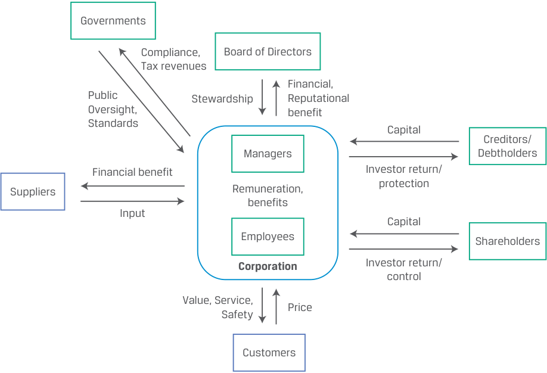
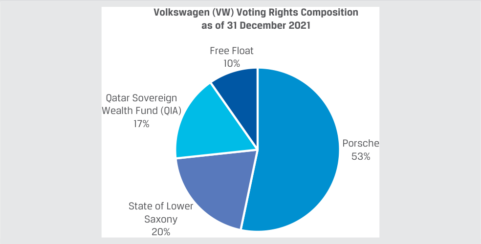

# Tập 3: Tổ chức Phát hành Doanh nghiệp (Corporate Issuers)
## Learning Module 2 Investors and Other Stakeholders (Trang PDF 45–74)

---

# Tập 3: Tổ chức phát hành doanh nghiệp (*Corporate Issuers*)
## Học phần 2: Nhà đầu tư và các bên liên quan khác (*Investors and Other Stakeholders*)
### Phần 1/3: Giới thiệu (*Introduction*) (Trang PDF 45–55)

---

<!-- PDF Page 45 -->

#### H Ọ C P H Ầ N (*L E A R N I N G M O D U L E*)

# **<mark>2</mark>**

### **Nhà đầu tư và các bên liên quan khác (*Investors and Other Stakeholders*)**

###### **<mark>MỤC TIÊU HỌC TẬP (*LEARNING OUTCOMES*)</mark>**

**_Thành thạo – Ứng viên cần có khả năng:_**
- So sánh quyền đòi hỏi tài chính (*financial claims*) và động lực của bên cho vay (*lenders*) và cổ đông (*shareholders*)
- Mô tả các nhóm bên liên quan (*stakeholder groups*) của một công ty và so sánh lợi ích của họ
- Mô tả các yếu tố môi trường, xã hội và quản trị (*environmental, social, and governance* – ESG) của các tổ chức phát hành doanh nghiệp được các nhà đầu tư xem xét

##### **GIỚI THIỆU (*INTRODUCTION*)**

## **<mark>1</mark>**

Các tổ chức phát hành doanh nghiệp (*corporate issuers*) được tài trợ bằng nợ (*debt*) và vốn chủ sở hữu (*equity*). Chứng khoán nợ và chứng khoán vốn chủ sở hữu có hồ sơ rủi ro và tỷ suất sinh lợi (*risk and return profiles*) khác nhau đối với cả tổ chức phát hành lẫn nhà đầu tư. Học phần này thảo luận về những điểm khác biệt đó và các hàm ý của chúng, đồng thời xem xét góc nhìn của một nhóm rộng hơn các bên liên quan (*stakeholders*) ngoài các chủ nợ (*debtholders*) và cổ đông (*shareholders*). Chúng ta sẽ giới thiệu các nhóm này và thảo luận về những xung đột lợi ích tiềm tàng giữa họ. Việc cân bằng lợi ích của các bên liên quan là rất quan trọng, bởi cả tổ chức phát hành và nhà đầu tư ngày càng tích hợp các yếu tố môi trường, xã hội và quản trị (*environmental, social, and governance* – ESG) vào quy trình ra quyết định của mình. Các chuyên gia phân tích đánh giá các yếu tố ESG để nhận định tốt hơn về kết quả hoạt động kỳ vọng trong tương lai và hồ sơ rủi ro của các tổ chức phát hành.

###### **TỔNG QUAN HỌC PHẦN (*LEARNING MODULE OVERVIEW*)**

- Các tổ chức phát hành doanh nghiệp được tài trợ bằng nợ và vốn chủ sở hữu. Nợ (*debt*) là một nguồn tài trợ có thời hạn hữu hạn (*finite length*), và các khoản thanh toán tiền lãi cũng như nợ gốc được cam kết chi trả vào những ngày xác định trước trong tương lai. Chủ nợ (*debtholders*) có quyền đòi hỏi ưu tiên (*priority claim*) cao hơn cổ đông đối với dòng tiền và tài sản của tổ chức phát hành.

- Vốn chủ sở hữu (*equity*) là một nguồn tài trợ vĩnh viễn (*permanent financing*), và không có bất kỳ lời hứa hoàn trả vốn hay phân phối lợi nhuận nào được đưa ra cho các cổ đông. Vốn chủ sở hữu là quyền hưởng phần còn lại (*residual claim*) đối với dòng tiền và tài sản của tổ chức phát hành.

<!-- PDF Page 46 -->

- Dưới góc độ của một tổ chức phát hành, nợ có rủi ro cao hơn vốn chủ sở hữu. Dưới góc độ của một nhà đầu tư, vốn chủ sở hữu có rủi ro cao hơn nợ. Tỷ trọng nợ trong cấu trúc vốn (*capital structure*) của doanh nghiệp ảnh hưởng đến cả tỷ suất sinh lợi tiềm năng lẫn rủi ro của các dòng tiền.

- Xung đột lợi ích (*conflicts of interest*) có thể tồn tại giữa chủ nợ và cổ đông. Khoản thu về (*payoff*) của chủ nợ bị giới hạn ở các khoản thanh toán tiền lãi và nợ gốc đã cam kết, trong khi khoản thu về của cổ đông về mặt lý thuyết là không giới hạn bởi vì sự gia tăng giá trị doanh nghiệp vượt trên giá trị khoản nợ sẽ thuộc về các cổ đông.

- Bên cạnh các nhà đầu tư nợ và vốn chủ sở hữu, các bên liên quan của doanh nghiệp (*corporate stakeholders*) còn bao gồm hội đồng quản trị, các nhà quản lý, nhân viên, khách hàng, nhà cung cấp, chính phủ, xã hội nói chung và môi trường. Lý thuyết các bên liên quan trong quản trị công ty (*stakeholder theory of corporate governance*) mở rộng trọng tâm của việc ra quyết định trong doanh nghiệp ra ngoài phạm vi của lý thuyết cổ đông (*shareholder theory*).

- Các cân nhắc về môi trường, xã hội và quản trị (ESG) đang ngày càng trở nên quan trọng hơn đối với cả các nhà đầu tư và các chuyên gia phân tích. Các yếu tố ESG ảnh hưởng đến giá trị của doanh nghiệp và có thể mang lại cả rủi ro lẫn cơ hội.

###### **TỰ ĐÁNH GIÁ HỌC PHẦN (*LEARNING MODULE SELF-ASSESSMENT*)**

Các câu hỏi ban đầu này nhằm giúp bạn tự đánh giá mức độ hiểu biết hiện tại của mình về học phần này.

Hoàn thành mỗi câu phát biểu bằng cách chọn thuật ngữ thích hợp nhất trong ngoặc đơn.

1. ____________ cung cấp nguồn vốn vĩnh viễn (*permanent capital*) cho các tổ chức phát hành. (chủ nợ – *debtholders*, cổ đông – *shareholders*)

###### **Lời giải:**

<u>**Cổ đông (*Shareholders*)** cung cấp nguồn vốn vĩnh viễn cho các tổ chức phát hành.</u>

   - Chủ nợ (*Debtholders*) là sai. Nợ có kỳ hạn đáo hạn hữu hạn, mặc dù thời điểm đáo hạn đó có thể ở rất xa trong tương lai.

2. ____________ có quyền hưởng phần còn lại (*residual claim*) đối với dòng tiền của doanh nghiệp. (chủ nợ – *debtholders*, cổ đông – *shareholders*)

###### **Lời giải:**

<u>**Cổ đông (*Shareholders*)** có quyền hưởng phần còn lại đối với dòng tiền của doanh nghiệp.</u> Chủ nợ (*Debtholders*) là sai. Chủ nợ có quyền đòi hỏi _ưu tiên_ (*priority claim*) cao hơn cổ đông đối với dòng tiền và tài sản của doanh nghiệp.

3. Lý thuyết cổ đông (*shareholder theory*) trong quản trị công ty _______________ hơn so với lý thuyết các bên liên quan (*stakeholder theory*). (hẹp – *narrower*, rộng – *broader*)

###### **Lời giải:**

Lý thuyết cổ đông trong quản trị công ty **hẹp (*narrower*)** hơn so với lý thuyết các bên liên quan.

Các bên liên quan (*stakeholders*) là các nhóm và cá nhân có lợi ích gắn liền với sự thành công của doanh nghiệp và bao gồm, nhưng không giới hạn ở, các cổ đông.

<!-- PDF Page 47 -->

4. Các cân nhắc về ESG là một mục tiêu rõ ràng trong lý thuyết _____________ về quản trị công ty. (cổ đông – *shareholder*, các bên liên quan – *stakeholder*)

###### **Lời giải:**

Các cân nhắc về ESG là một mục tiêu rõ ràng trong lý thuyết **các bên liên quan (*stakeholder*)** về quản trị công ty.

Lý thuyết các bên liên quan tìm cách cân bằng lợi ích của các cổ đông với lợi ích của một nhóm rộng lớn hơn có liên quan đến các khía cạnh ESG.

5. Tác động ước tính của các yếu tố ESG lên kết quả hoạt động tài chính và diễn biến giá cổ phiếu của các tổ chức phát hành doanh nghiệp đã _________________ theo thời gian. (giảm xuống – *decreased*, giữ nguyên – *remained the same*, tăng lên – *increased*)

###### **Lời giải:**

Tác động ước tính của các yếu tố ESG lên kết quả hoạt động tài chính và diễn biến giá cổ phiếu của các tổ chức phát hành doanh nghiệp đã **tăng lên (*increased*)** theo thời gian. Tác động này là kết quả của sự thay đổi trong thị hiếu của người tiêu dùng và nhà đầu tư, sự gia tăng các quy định pháp lý và thuế liên quan đến các yếu tố ESG, và mối đe dọa ngày càng tăng của biến đổi khí hậu.

6. Các yếu tố ESG ngày càng được các chuyên gia phân tích nhìn nhận là _______________. (có thể định lượng được – *quantifiable*, mang tính định tính – *qualitative*)

###### **Lời giải:**

Các yếu tố ESG ngày càng được các chuyên gia phân tích nhìn nhận là **có thể định lượng được (*quantifiable*)**. Trong lịch sử, các yếu tố ESG từng được coi là các ngoại ứng tiêu cực (*negative externalities*) không có tác động trực tiếp lên báo cáo tài chính của doanh nghiệp. Ngày càng nhiều chuyên gia phân tích đang định lượng hóa tác động của các yếu tố ESG và đưa chúng vào mô hình định giá doanh nghiệp cũng như quy trình ra quyết định đầu tư.

##### **QUYỀN ĐÒI HỎI TÀI CHÍNH CỦA BÊN CHO VAY VÀ CỔ ĐÔNG (*FINANCIAL CLAIMS OF LENDERS AND SHAREHOLDERS*)**

## **<mark>2</mark>**

- So sánh quyền đòi hỏi tài chính và động lực của bên cho vay và cổ đông (*compare the financial claims and motivations of lenders and shareholders*)

###### **Nợ so với Vốn chủ sở hữu (*Debt Versus Equity*)**

Học phần trước đã xác lập rằng các công ty cổ phần tài trợ cho tài sản của mình bằng nợ và vốn chủ sở hữu. Bây giờ chúng ta chuyển sự chú ý sang bản chất của các quyền đòi hỏi (*claims*) này, mối tương quan giữa rủi ro và tỷ suất sinh lợi của chúng đối với cả tổ chức phát hành và nhà đầu tư, cũng như các xung đột lợi ích tiềm tàng có thể phát sinh giữa bên cho vay và cổ đông.

###### **_Quyền đòi hỏi của Nợ và Vốn chủ sở hữu (Debt and Equity Claims)_**

Bảng 1 (Exhibit 1) thể hiện mối quan hệ giữa tài sản của một công ty cổ phần và quyền đòi hỏi của các nhà đầu tư nợ và vốn chủ sở hữu đã tài trợ cho các tài sản đó. Bảng 2 (Exhibit 2) cho thấy tài sản được sử dụng để tạo ra thu nhập nhằm trả lãi cho các chủ nợ, trong khi phần lợi nhuận còn lại được tái đầu tư hoặc phân phối cho các cổ đông.

<!-- PDF Page 48 -->

**Bảng 1 (Exhibit 1): Bảng cân đối kế toán: Tài sản, Nợ và Vốn chủ sở hữu (*Balance Sheet: Assets, Debt, and Equity*)**

<!-- Picture Text: Short-Term Cash Obligations Debt and Other Fixed Financial Balance Short-Term Claims Long-Term Obligations Sheet and Assets Obligations Long-Term Equity Assets Claims: Obligations: Suppliers Suppliers Customers Customers Employees Employees Community Community Internal and Internal and Economic External External Balance Governance Governance Sheet  -->

> **Chú thích hình ảnh:** Bảng cân đối kế toán Tài chính (*Financial Balance Sheet*) và Bảng cân đối kế toán Kinh tế (*Economic Balance Sheet*) minh họa mối liên hệ giữa Tài sản (Tiền mặt, Tài sản ngắn hạn, Tài sản dài hạn, cùng các quyền lợi từ Nhà cung cấp, Khách hàng, Nhân viên, Cộng đồng) và Nguồn vốn/Nghĩa vụ (Nghĩa vụ ngắn hạn, Nợ và các nghĩa vụ cố định dài hạn khác, Vốn chủ sở hữu, cùng các nghĩa vụ với các bên liên quan).

**Bảng 2 (Exhibit 2): Các khoản thanh toán cho Nhà đầu tư Nợ và Vốn chủ sở hữu (*Payments to Debt and Equity Investors*)**

<!-- Picture Text: Use assets to generate revenue Customers to Assets Cost of Goods Sold Suppliers Revenue less Wages and Salaries Employees Interest Payments Debtholders Taxes Government Profit (Net Income) Available to reinvest Retained Discretionary Shareholders Earnings Dividends  -->

> **Chú thích hình ảnh:** Tài sản (*Assets*) được sử dụng để tạo ra doanh thu từ Khách hàng (*Customers*). Doanh thu (*Revenue*) trừ đi Giá vốn hàng bán trả cho Nhà cung cấp (*Cost of Goods Sold – Suppliers*), Tiền lương và tiền công trả cho Nhân viên (*Wages and Salaries – Employees*), Chi phí lãi vay trả cho Chủ nợ (*Interest Payments – Debtholders*), và Thuế nộp cho Chính phủ (*Taxes – Government*) sẽ còn lại Lợi nhuận / Thu nhập ròng (*Profit / Net Income*). Khoản lợi nhuận này có thể được giữ lại để tái đầu tư (*Retained Earnings*) hoặc chi trả Cổ tức tùy ý (*Discretionary Dividends*) cho các Cổ đông (*Shareholders*).

Chủ nợ (*debtholders*), hay bên cho vay (*lenders*), cung cấp nguồn vốn có kỳ hạn đáo hạn _hữu hạn_ (*finite maturity*). Các tổ chức phát hành đồng ý thực hiện các khoản thanh toán tiền lãi đã cam kết và hoàn trả nợ gốc vào những ngày đã được xác định trước. Bên cho vay không có quyền ra quyết định trong nội bộ công ty cổ phần, nhưng các hợp đồng nợ có thể được cấu trúc để bảo vệ bên cho vay bằng cách áp đặt các yêu cầu tài chính và/hoặc quyền đòi hỏi pháp lý đối với một số tài sản nhất định của công ty cổ phần nếu khoản nợ không được hoàn trả theo đúng thỏa thuận. Như được thể hiện trong Bảng 2, các khoản thanh toán tiền lãi được chi trả trước bất kỳ khoản phân phối nào cho các nhà đầu tư vốn chủ sở hữu và là một quyền đòi hỏi ưu tiên (*priority claim*) đối với tài sản và dòng tiền của công ty.

<!-- PDF Page 49 -->

Các nhà đầu tư vốn chủ sở hữu cung cấp nguồn vốn _vĩnh viễn_ (*permanent capital*) cho các tổ chức phát hành; các tổ chức phát hành nhìn chung không cam kết về cổ tức trong tương lai hoặc hoàn trả vốn cho cổ đông. Thay vào đó, vốn chủ sở hữu là một quyền hưởng _phần còn lại_ (*residual claim*) đối với dòng tiền của công ty — bất cứ thứ gì còn sót lại sau khi đã trừ đi các chi phí hoạt động, các khoản đầu tư và các khoản thanh toán nợ. Việc phân phối tiền mặt cho các nhà đầu tư vốn chủ sở hữu hoàn toàn tùy thuộc vào quyết định (*at the discretion*) của hội đồng quản trị. Trái ngược với bên cho vay, các nhà đầu tư vốn chủ sở hữu có quyền biểu quyết (*voting rights*) đối với các vấn đề quan trọng của công ty chẳng hạn như bầu chọn hội đồng quản trị – cơ quan sẽ bổ nhiệm và giám sát ban giám đốc.

Ngoài các khoản thanh toán tiền lãi cho chủ nợ, các quyền đòi hỏi khác phải được đáp ứng trước khi thực hiện bất kỳ khoản phân phối nào cho cổ đông bao gồm các khoản thanh toán cho nhà cung cấp, nhân viên và chính phủ (dưới hình thức thuế). Nếu một doanh nghiệp bị giải thể và tài sản của nó bị thanh lý (*liquidated*), các quyền đòi hỏi ưu tiên này phải được đáp ứng trước khi các nhà đầu tư vốn chủ sở hữu nhận được bất kỳ khoản nào.

Bởi vì nợ là một quyền đòi hỏi ưu tiên, cố định và có thời hạn hữu hạn đối với tài sản và dòng tiền, nên nó là một hình thức tài trợ ít tốn kém hơn đối với các tổ chức phát hành: nó có rủi ro thấp hơn đối với các nhà đầu tư so với vốn chủ sở hữu (mặc dù, như sẽ được thảo luận, việc gia tăng nợ sẽ làm tăng rủi ro cho các nhà đầu tư vốn chủ sở hữu của công ty). Một điểm khác biệt nữa giữa nợ và vốn chủ sở hữu là các khoản thanh toán tiền lãi cho chủ nợ thường được coi là một khoản chi phí được khấu trừ thuế (*tax-deductible expense*), giúp làm giảm thu nhập chịu thuế, trong khi cổ tức trả cho cổ đông thì không được khấu trừ thuế.

###### **KIỂM TRA KIẾN THỨC (*KNOWLEDGE CHECK*)**

1. Xác định xem thuộc tính ở bên trái là đặc điểm của Nợ (*Debt*) hay Vốn chủ sở hữu (*Equity*).

| Thuộc tính | Lựa chọn |
|---|---|
| Nghĩa vụ hoàn trả pháp lý (*Legal repayment obligation*) | Nợ (*Debt*), Vốn chủ sở hữu (*Equity*) |
| Quyền hưởng tài sản còn lại (*Residual asset claim*) | Nợ (*Debt*), Vốn chủ sở hữu (*Equity*) |
| Các khoản thanh toán tùy ý (*Discretionary payments*) | Nợ (*Debt*), Vốn chủ sở hữu (*Equity*) |
| Chi phí được khấu trừ thuế (*Tax-deductible expense*) | Nợ (*Debt*), Vốn chủ sở hữu (*Equity*) |
| Thời hạn hữu hạn (*Finite term*) | Nợ (*Debt*), Vốn chủ sở hữu (*Equity*) |
| Quyền biểu quyết (*Voting rights*) | Nợ (*Debt*), Vốn chủ sở hữu (*Equity*) |

###### **Lời giải:**

| Thuộc tính | Đáp án |
|---|---|
| Nghĩa vụ hoàn trả pháp lý (*Legal repayment obligation*) | Nợ (*Debt*) |
| Quyền hưởng tài sản còn lại (*Residual asset claim*) | Vốn chủ sở hữu (*Equity*) |
| Các khoản thanh toán tùy ý (*Discretionary payments*) | Vốn chủ sở hữu (*Equity*) |
| Chi phí được khấu trừ thuế (*Tax-deductible expense*) | Nợ (*Debt*) |
| Thời hạn hữu hạn (*Finite term*) | Nợ (*Debt*) |
| Quyền biểu quyết (*Voting rights*) | Vốn chủ sở hữu (*Equity*) |

Cho dù được cung cấp dưới hình thức một khoản vay hay một trái phiếu, nợ luôn bao gồm một nghĩa vụ theo hợp đồng với các quyền đòi hỏi ưu tiên về tiền lãi và nợ gốc. Các nhà đầu tư vốn chủ sở hữu nhận được các khoản phân phối tùy ý và có quyền hưởng phần tài sản còn lại. Các khoản thanh toán cổ tức vốn chủ sở hữu không được khấu trừ thuế. Nợ yêu cầu các khoản thanh toán tiền lãi và nợ gốc theo hợp đồng, trong đó chi phí lãi vay được khấu trừ thuế đối với tổ chức phát hành. Nợ có thời hạn hữu hạn và không trao quyền ra quyết định, trong khi vốn chủ sở hữu có thời hạn không giới hạn và bao gồm quyền biểu quyết.

<!-- PDF Page 50 -->

###### **Nợ so với Vốn chủ sở hữu: Rủi ro và Tỷ suất sinh lợi (*Debt Versus Equity: Risk and Return*)**

Như đã xác lập trước đó, quyền đòi hỏi của chủ nợ là cố định và hữu hạn, trong khi các chủ sở hữu vốn cổ phần có quyền đòi hỏi liên tục đối với lợi nhuận hiện tại và tương lai của doanh nghiệp. Mặc dù các doanh nghiệp thường bắt đầu bằng tài trợ vốn chủ sở hữu, những doanh nghiệp có dòng tiền dễ dự báo hơn có thể lựa chọn đi vay thay vì bán thêm cổ phần sở hữu để tài trợ cho tài sản. Sự đánh đổi (*trade-offs*) giữa tài trợ bằng nợ và tài trợ bằng vốn chủ sở hữu đối với cả tổ chức phát hành và nhà đầu tư được thể hiện rõ nhất qua ví dụ sau đây.

###### **VÍ DỤ 1 (*EXAMPLE 1*)**

###### **Tài trợ Bảng cân đối kế toán dựa trên Vốn chủ sở hữu so với dựa trên Nợ (*Equity- versus Debt-Based Balance Sheet Financing*)**

Hãy xét một doanh nghiệp có tài sản được tài trợ hoàn toàn 100% bằng vốn chủ sở hữu và một doanh nghiệp giống hệt nhưng được tài trợ bằng 75% nợ và 25% vốn chủ sở hữu.

<!-- Picture Text: Equity-Financed Debt- and Equity-Financed Cash Cash Debt 75 Other ST Assets Equity Other ST Assets 100 LT Assets LT Assets Equity 25  -->

> **Chú thích hình ảnh:**
> - **Doanh nghiệp tài trợ bằng Vốn chủ sở hữu (*Equity-Financed*):** Tài sản gồm Tiền mặt (*Cash*), Tài sản ngắn hạn khác (*Other ST Assets*) và Tài sản dài hạn (*LT Assets*) được tài trợ 100 bởi Vốn chủ sở hữu (*Equity* = 100).
> - **Doanh nghiệp tài trợ bằng Nợ và Vốn chủ sở hữu (*Debt- and Equity-Financed*):** Cùng quy mô Tài sản nhưng được tài trợ bởi Nợ (*Debt* = 75) và Vốn chủ sở hữu (*Equity* = 25).

Giả sử cả hai doanh nghiệp đều có doanh thu trong kỳ là 100 và chi phí hoạt động (*operating expenses*) là 70. Bỏ qua thuế thu nhập.

1. Nếu chúng ta giả định chi phí lãi vay là 15 trong kỳ, hãy tính thu nhập ròng (*net income*) cho mỗi doanh nghiệp và so sánh tỷ suất sinh lợi trên vốn chủ sở hữu (*returns on equity* – ROE) của chúng trong kỳ. Hãy giải thích tại sao ROE lại cao hơn khi sử dụng tài trợ bằng nợ.

###### **Lời giải:**

Tính thu nhập ròng bằng cách lấy doanh thu trừ đi các chi phí, và chia thu nhập ròng cho tổng vốn chủ sở hữu để tìm tỷ suất sinh lợi trên vốn chủ sở hữu trong một kỳ:

|**Tài trợ bằng Vốn chủ sở hữu (*Equity-Financed*)**||**Tài trợ bằng Nợ và Vốn chủ sở hữu (*Debt- and Equity-Financed*)**||
|---|---|---|---|
|Doanh thu (*Revenue*)|100|Doanh thu (*Revenue*)|100|
|Trừ: Chi phí hoạt động (*Less: Operating Expenses*)|$-70$|Trừ: Chi phí hoạt động (*Less: Operating Expenses*)|$-70$|
|||Trừ: Chi phí lãi vay (*Less: Interest Expense*)|$-15$|
|Thu nhập ròng (*Net Income*)|30|Thu nhập ròng (*Net Income*)|15|
|Tổng Vốn chủ sở hữu (*Total Equity*)|100|Tổng Vốn chủ sở hữu (*Total Equity*)|25|
|**Tỷ suất sinh lợi trên vốn chủ sở hữu (*Return on Equity* – ROE)**|**30%**|**Tỷ suất sinh lợi trên vốn chủ sở hữu (*Return on Equity* – ROE)**|**60%**|

Tỷ suất sinh lợi trên vốn chủ sở hữu (ROE) cao hơn khi sử dụng nợ, bởi vì chi phí lãi vay của nợ thấp hơn tỷ suất sinh lợi trên tài sản (*return on assets* – ROA) của doanh nghiệp. Lãi suất nợ vay $= 15 / 75 = 20\%$ so với tỷ suất sinh lợi trên tài sản $= 30 / 100 = 30\%$.

2. Hãy tính tỷ suất sinh lợi trên vốn chủ sở hữu trong kỳ nếu hai doanh nghiệp có mức tăng doanh thu 20% và mức giảm doanh thu 20% (so với Câu hỏi 1), giả sử các chi phí không thay đổi.

###### **Lời giải:**

Tính thu nhập ròng và tỷ suất sinh lợi trên vốn chủ sở hữu khi doanh thu tăng và giảm như sau:

<!-- PDF Page 51 -->

###### **Doanh thu _Tăng_ 20% (*20% Increase in Revenue*)**

|**Tài trợ bằng Vốn chủ sở hữu (*Equity-Financed*)**||**Tài trợ bằng Nợ và Vốn chủ sở hữu (*Debt- and Equity-Financed*)**||
|---|---|---|---|
|Doanh thu (*Revenue*)|120|Doanh thu (*Revenue*)|120|
|Trừ: Chi phí hoạt động (*Less: Operating Expenses*)|$-70$|Trừ: Chi phí hoạt động (*Less: Operating Expenses*)|$-70$|
|||Trừ: Chi phí lãi vay (*Less: Interest Expense*)|$-15$|
|Thu nhập ròng (*Net Income*)|50|Thu nhập ròng (*Net Income*)|35|
|Tổng Vốn chủ sở hữu (*Total Equity*)|100|Tổng Vốn chủ sở hữu (*Total Equity*)|25|
|**Tỷ suất sinh lợi trên vốn chủ sở hữu (*Return on Equity* – ROE)**|**50%**|**Tỷ suất sinh lợi trên vốn chủ sở hữu (*Return on Equity* – ROE)**|**140%**|

###### **Doanh thu _Giảm_ 20% (*20% Decrease in Revenue*)**

|**Tài trợ bằng Vốn chủ sở hữu (*Equity-Financed*)**||**Tài trợ bằng Nợ và Vốn chủ sở hữu (*Debt- and Equity-Financed*)**||
|---|---|---|---|
|Doanh thu (*Revenue*)|80|Doanh thu (*Revenue*)|80|
|Trừ: Chi phí hoạt động (*Less: Operating Expenses*)|$-70$|Trừ: Chi phí hoạt động (*Less: Operating Expenses*)|$-70$|
|||Trừ: Chi phí lãi vay (*Less: Interest Expense*)|$-15$|
|Thu nhập ròng (*Net Income*)|10|Thu nhập ròng (*Net Income*)|**(5)**|
|Tổng Vốn chủ sở hữu (*Total Equity*)|100|Tổng Vốn chủ sở hữu (*Total Equity*)|25|
|**Tỷ suất sinh lợi trên vốn chủ sở hữu (*Return on Equity* – ROE)**|**10%**|**Tỷ suất sinh lợi trên vốn chủ sở hữu (*Return on Equity* – ROE)**|**(20%)**|

Ví dụ này minh họa cho tỷ suất sinh lợi tiềm năng của cổ đông lớn hơn khi sử dụng tài trợ bằng nợ — nhưng đồng thời rủi ro cũng lớn hơn. Cụ thể, khoản lỗ ròng trong kịch bản bất lợi (*downside case*) đối với tổ chức phát hành được tài trợ bằng nợ và vốn chủ sở hữu làm dấy lên khả năng công ty có thể không đáp ứng được các khoản thanh toán nợ trong tương lai. Độ biến thiên của ROE đối với công ty được tài trợ bằng nợ và vốn chủ sở hữu cao hơn đáng kể so với độ biến thiên của ROE đối với công ty được tài trợ hoàn toàn bằng vốn chủ sở hữu.

Dưới góc độ của tổ chức phát hành, tài trợ bằng nợ ít tốn kém hơn nhưng bao hàm rủi ro lớn hơn so với tài trợ bằng vốn chủ sở hữu, bởi vì nó buộc tổ chức phát hành không chỉ phải cam kết thanh toán tiền lãi và nợ gốc mà còn phải tuân thủ bất kỳ hạn chế nào mà bên cho vay áp đặt trong hợp đồng nợ. Việc sử dụng nhiều nợ hơn trên một lượng tài trợ vốn chủ sở hữu nhất định, được gọi là **đòn bẩy tài chính (*financial leverage*)**, làm tăng khả năng doanh nghiệp có thể không đáp ứng được các nghĩa vụ đã hứa với bên cho vay, dẫn đến phá sản (*bankruptcy*) và có khả năng bị thanh lý (*liquidation*). Doanh nghiệp không phải đối mặt với rủi ro như vậy trong trường hợp tài trợ bằng vốn chủ sở hữu, vì cổ đông không được hứa hẹn bất kỳ khoản phân phối hay hoàn trả vốn nào.

Dưới góc độ của nhà đầu tư, cổ phiếu có rủi ro cao hơn trái phiếu bởi vì cổ đông nắm giữ quyền hưởng phần còn lại (*residual claims*) thay vì quyền đòi hỏi cố định (*fixed claims*) đối với doanh nghiệp. Như được chỉ ra trong Ví dụ 1, lợi nhuận sẵn có để phân phối cho các cổ đông có thể biến động rất lớn, tùy thuộc vào kết quả hoạt động của doanh nghiệp cũng như đòn bẩy tài chính. Nếu một công ty cổ phần thành công, về mặt lý thuyết không có giới hạn nào đối với số tiền mà các chủ sở hữu vốn cổ phần có thể kiếm được từ khoản đầu tư của mình. Nhưng nếu doanh nghiệp hoạt động kém hiệu quả, các chủ sở hữu có thể mất toàn bộ khoản đầu tư của họ nếu doanh nghiệp bị thanh lý và các chủ nợ nắm quyền kiểm soát tài sản. Tuy nhiên, nhờ chế độ trách nhiệm hữu hạn, các cổ đông không thể mất nhiều hơn khoản đầu tư ban đầu của mình.

Mặc dù tài trợ bằng nợ làm tăng thêm rủi ro, những người nắm giữ vốn chủ sở hữu thường ưa thích phương thức này hơn việc tổ chức phát hành huy động thêm vốn chủ sở hữu để tài trợ cho tăng trưởng, bởi vì việc phát hành thêm cổ phiếu sẽ làm giảm tỷ lệ sở hữu phân số trong doanh nghiệp của các cổ đông hiện hữu, hiện tượng này được gọi là **sự pha loãng (*dilution*)**. Nhược điểm của sự pha loãng có thể được bù đắp bởi kỳ vọng rằng doanh nghiệp sẽ tạo ra đủ lợi nhuận tăng thêm để bù lại.

<!-- PDF Page 52 -->

###### **VÍ DỤ 2 (*EXAMPLE 2*)**

###### **Tài trợ một khoản đầu tư bằng Nợ, Vốn chủ sở hữu, hoặc Tiền mặt sẵn có (*Financing an Investment with Debt, Equity, or Cash on Hand*)**

Hãy xét cùng doanh nghiệp được tài trợ bằng vốn chủ sở hữu như trong Ví dụ 1 và các lựa chọn của doanh nghiệp này để tài trợ cho một khoản đầu tư mới vào tài sản dài hạn trị giá 20. Các chi tiết liên quan trong bảng cân đối kế toán ban đầu của doanh nghiệp được trình bày dưới đây. Doanh thu trước khi đầu tư là 100, chi phí là 70 và dự kiến không thay đổi, lãi suất đối với khoản tài trợ nợ mới là 20%, và tỷ suất sinh lợi trên khoản đầu tư mới là 30%. Bỏ qua thuế thu nhập.

###### **Bảng cân đối kế toán ban đầu (*Initial Balance Sheet*)**

| Tài sản (*Assets*) | Giá trị | Nguồn vốn (*Liabilities & Equity*) | Giá trị |
|---|---|---|---|
| Tiền mặt (*Cash*) | 30 | | |
| Tài sản khác (*Other assets*) | 20 | | |
| Tài sản dài hạn (*LT assets*) | 50 | Vốn chủ sở hữu (*Equity*) | 100 |

1. Hãy so sánh tỷ suất sinh lợi trên vốn chủ sở hữu (ROE) của doanh nghiệp nếu doanh nghiệp tài trợ cho khoản đầu tư bằng nợ, phát hành cổ phiếu, hoặc tiền mặt sẵn có. Thảo luận về kết quả so sánh.

###### **Lời giải:**

| **Phát hành cổ phiếu (*Issue Shares*)** | | **Vay nợ (*Borrow*)** | | **Tiền mặt sẵn có (*Cash on Hand*)** | |
|---|---|---|---|---|---|
| Tiền mặt (*Cash*) 30 | | Tiền mặt (*Cash*) 30 | | Tiền mặt (*Cash*) 10 | |
| Tài sản khác (*Other*) 20 | | Tài sản khác (*Other*) 20 | Nợ (*Debt*) 20 | Tài sản khác (*Other*) 20 | |
| Tài sản dài hạn (*LT assets*) 70 | Vốn CSH (*Equity*) 120 | Tài sản dài hạn (*LT assets*) 70 | Vốn CSH (*Equity*) 100 | Tài sản dài hạn (*LT assets*) 70 | Vốn CSH (*Equity*) 100 |

| Chỉ tiêu | **Phát hành cổ phiếu (*Issue Shares*)** | **Vay nợ (*Borrow*)** | **Tiền mặt sẵn có (*Cash on Hand*)** |
|---|---|---|---|
| Doanh thu (*Revenue*) | 106 | 106 | 106 |
| Trừ: Chi phí hoạt động (*Less: Operating Expenses*) | 70 | 70 | 70 |
| Trừ: Lãi vay (*Less: Interest*) | | 4 | |
| Thu nhập ròng (*Net Income*) | 36 | 32 | 36 |
| Vốn chủ sở hữu (*Equity*) | 120 | 100 | 100 |
| **ROE** | **30%** | **32%** | **36%** |

Việc tài trợ cho khoản đầu tư bằng cách phát hành cổ phiếu tạo ra mức ROE thấp nhất do sự pha loãng từ phần vốn chủ sở hữu tăng thêm. Bởi vì khoản đầu tư tạo ra tỷ suất sinh lợi (30%) bằng đúng với mức ROE ban đầu (30%), nên ROE không thay đổi. Tài trợ bằng nợ tạo ra mức ROE cao hơn (32%), bởi vì lãi suất nợ vay (20%) thấp hơn tỷ suất sinh lợi trên khoản đầu tư mới (30%) và không có cổ phiếu mới nào được phát hành, nên vốn chủ sở hữu không tăng lên. Mức ROE cao nhất (36%) được tạo ra bằng cách sử dụng tiền mặt sẵn có, giúp tránh được cả sự gia tăng vốn chủ sở hữu lẫn chi phí lãi vay của khoản nợ mới.

Bảng 3 (Exhibit 3) thể hiện sự bất đối xứng trong khoản thu về của cổ đông (*shareholder payoff asymmetry*) theo thời gian như một hàm số của giá trị doanh nghiệp.

<!-- PDF Page 53 -->

###### **Bảng 3 (Exhibit 3): Giá trị doanh nghiệp và Khoản thu về của Cổ đông (*Firm Value and Shareholder Payoff*)**

<!-- Picture Text: V  <  D : V  >  D : Insolvent Solvent Shareholder Payoff Debt (D) 0 Firm Value (V) Debt  -->

> **Chú thích hình ảnh:** Đồ thị biểu diễn Khoản thu về của cổ đông (*Shareholder Payoff*) theo Giá trị doanh nghiệp (*Firm Value* – $V$). Khi $V < D$ (Mất khả năng thanh toán – *Insolvent*), khoản thu về của cổ đông bằng 0. Khi $V > D$ (Có khả năng thanh toán – *Solvent*), khoản thu về của cổ đông tăng tuyến tính theo phần chênh lệch $V - D$.

Nếu doanh nghiệp có khả năng thanh toán (*solvent*) — nghĩa là giá trị của nó ($V$) vượt quá giá trị khoản nợ của nó ($D$) — thì giá trị thuộc về các cổ đông chính là phần chênh lệch dương giữa giá trị của doanh nghiệp và giá trị khoản nợ ($V - D$). Lợi nhuận tiềm năng phía trên (*upside gains*) dành cho các cổ đông chỉ bị giới hạn bởi giá trị tương lai của doanh nghiệp. Nếu một doanh nghiệp trở nên mất khả năng thanh toán (*insolvent*), với giá trị nợ lớn hơn giá trị tài sản của nó ($V < D$), các cổ đông sẽ mất toàn bộ khoản đầu tư của mình và các chủ nợ sẽ nắm quyền kiểm soát doanh nghiệp.

Bảng 4 (Exhibit 4) thể hiện sự bất đối xứng này dưới góc độ của các chủ nợ (*debtholders*).

**Bảng 4 (Exhibit 4): Giá trị doanh nghiệp và Khoản thu về của Chủ nợ (*Firm Value and Debtholder Payoff*)**

<!-- Picture Text: V  <  D : V  >  D : Insolvent Solvent Debt (D) Debtholder Payoff 0 Firm Value (V) Debt  -->

> **Chú thích hình ảnh:** Đồ thị biểu diễn Khoản thu về của chủ nợ (*Debtholder Payoff*) theo Giá trị doanh nghiệp (*Firm Value* – $V$). Khi $V < D$ (Mất khả năng thanh toán – *Insolvent*), chủ nợ chỉ thu hồi được tối đa bằng giá trị doanh nghiệp $V$. Khi $V > D$ (Có khả năng thanh toán – *Solvent*), khoản thu về của chủ nợ bị chặn trần ở mức cố định bằng Giá trị khoản nợ $D$.

Tỷ suất sinh lợi của bên cho vay bị giới hạn ở các khoản thanh toán tiền lãi và nợ gốc đã cam kết chừng nào doanh nghiệp còn khả năng thanh toán ($V > D$), bất kể kết quả hoạt động và đòn bẩy tài chính của doanh nghiệp ra sao. Ngược lại, nếu giá trị doanh nghiệp giảm xuống thấp hơn giá trị khoản nợ ($V < D$), doanh nghiệp bị tuyên bố mất khả năng thanh toán và các chủ nợ sẽ tìm cách thu hồi vốn của họ từ số tài sản còn lại của doanh nghiệp. Lưu ý rằng nếu chúng ta cộng phần diện tích tô đậm của khoản thu về của cổ đông và khoản thu về của chủ nợ, chúng ta sẽ thu được đường chéo thể hiện tổng giá trị của doanh nghiệp ($V$), bởi vì chủ nợ được nhận các khoản thanh toán đã cam kết còn người nắm giữ vốn chủ sở hữu nhận được phần còn lại.

Trong khi các chủ sở hữu vốn cổ phần tìm cách tối đa hóa giá trị doanh nghiệp (để làm tăng khoản thu về của họ), thì các trái chủ (*bondholders*) lại tìm cách đảm bảo việc hoàn trả nợ gốc và tiền lãi đúng hạn, sao cho công ty tối đa hóa khả năng đáp ứng các nghĩa vụ nợ của mình. Những góc nhìn này được tóm tắt trong Bảng 5 (Exhibit 5).

<!-- PDF Page 54 -->

**Bảng 5 (Exhibit 5): Góc nhìn của Nhà đầu tư: Vốn chủ sở hữu so với Nợ (*Investor Perspectives: Equity versus Debt*)**

|**Thuộc tính (*Attribute*)**|**Vốn chủ sở hữu (*Equity*)**|**Nợ (*Debt*)**|
|---|---|---|
|Kỳ hạn (*Tenor*)|Vô thời hạn (*Indefinite*)|Có kỳ hạn (*Term*, ví dụ: 3 tháng, 10 năm)|
|Tiềm năng sinh lợi (*Return potential*)|Không giới hạn (*Unlimited*)|Bị giới hạn mức trần (*Capped*)|
|Mức lỗ tối đa (*Maximum loss*)|Khoản đầu tư ban đầu (*Initial investment*)|Khoản đầu tư ban đầu (*Initial investment*)|
|Rủi ro đầu tư (*Investment risk*)|Cao hơn (*Higher*)|Thấp hơn (*Lower*)|
|Kết quả mong muốn (*Desired outcome*)|Tối đa hóa giá trị doanh nghiệp (*Maximize firm value*)|Hoàn trả nợ đúng hạn (*Timely repayment*)|

###### **KIỂM TRA KIẾN THỨC (*KNOWLEDGE CHECK*)**

1. Người nắm giữ vốn chủ sở hữu và người nắm giữ nợ của doanh nghiệp chia sẻ cùng một góc nhìn đầu tư liên quan đến:

   - **A.** mức lỗ tối đa (*maximum loss*).
   - **B.** rủi ro đầu tư (*investment risk*).
   - **C.** tiềm năng sinh lợi (*return potential*).

###### **Lời giải:**

A là đáp án đúng. Đối với cả người nắm giữ vốn chủ sở hữu và người nắm giữ nợ, khoản đầu tư ban đầu của họ đại diện cho mức lỗ tối đa có thể xảy ra. Tiềm năng sinh lợi về mặt lý thuyết là không giới hạn đối với người nắm giữ vốn chủ sở hữu, trong khi bị giới hạn mức trần đối với chủ nợ. Người nắm giữ vốn chủ sở hữu phải chịu mức độ rủi ro đầu tư cao hơn, bởi vì họ nắm giữ quyền hưởng phần còn lại đối với dòng tiền của doanh nghiệp – có thứ tự ưu tiên thấp hơn so với quyền đòi hỏi của chủ nợ.

2. **Đúng hay Sai:** Chủ nợ, không giống như người nắm giữ vốn chủ sở hữu, có các khoản lỗ tiềm năng phía dưới (*downside losses*) và lợi nhuận tiềm năng phía trên (*upside gains*) mang tính đối xứng (*symmetric*).

   - **A.** Đúng.
   - **B.** Sai.

###### **Lời giải:**

B là đáp án đúng; phát biểu này là sai. Cả chủ nợ và người nắm giữ vốn chủ sở hữu đều có các khoản thu về tiềm năng mang tính bất đối xứng (*asymmetric potential payoffs*). Đối với chủ nợ, lợi nhuận tiềm năng phía trên bị giới hạn ở các khoản hoàn trả tiền lãi và nợ gốc, bất kể giá trị của doanh nghiệp có tăng cao đến đâu. Ngược lại, nếu giá trị của doanh nghiệp giảm xuống thấp hơn giá trị khoản nợ, chủ nợ có thể mất tới toàn bộ khoản đầu tư ban đầu của mình.

Đối với người nắm giữ vốn chủ sở hữu, giá trị vốn chủ sở hữu được xác định bằng giá trị của doanh nghiệp trừ đi giá trị khoản nợ của nó. Lợi nhuận tiềm năng phía trên dành cho cổ đông chỉ bị giới hạn bởi giá trị tương lai của doanh nghiệp, trong khi khoản lỗ của cổ đông, giống như của chủ nợ, được giới hạn ở khoản đầu tư ban đầu của họ.

###### **Xung đột lợi ích giữa Bên cho vay và Cổ đông (*Conflicts of Interest among Lenders and Shareholders*)**

Mặc dù cả bên cho vay và chủ sở hữu đều được đền bù từ cùng một dòng tiền của doanh nghiệp, nhưng hồ sơ rủi ro và tỷ suất sinh lợi khác nhau của chủ nợ và cổ đông tạo ra những xung đột lợi ích tiềm tàng.

Các cổ đông tìm cách tối đa hóa dòng tiền còn lại (*residual cash flows*), hay lợi nhuận của doanh nghiệp, sau khi các nghĩa vụ khác đã được đáp ứng. Bởi vì những nhà đầu tư này sẽ mất toàn bộ khoản đầu tư của mình trong trường hợp mất khả năng thanh toán nhưng lại có tiềm năng sinh lợi phía trên không giới hạn, nên họ muốn ban giám đốc

<!-- PDF Page 55 -->

theo đuổi các dự án có rủi ro có tính toán lớn hơn và tỷ suất sinh lợi tiềm năng cao hơn trong khi tối đa hóa việc sử dụng tài trợ bằng nợ. Ngoài ra, các cổ đông có thể yêu cầu trả cổ tức tiền mặt cao hơn, điều này có thể làm tăng đòn bẩy tài chính, qua đó làm tăng rủi ro cho các nhà đầu tư nợ. Ví dụ 1 đã minh họa tỷ suất sinh lợi vốn chủ sở hữu tiềm năng lớn hơn gắn liền với việc sử dụng đòn bẩy.

Các trái chủ (*bondholders*) tìm cách tối đa hóa khả năng họ sẽ nhận được các khoản thanh toán tiền lãi và nợ gốc đúng hạn; họ không thu được lợi ích gì từ việc sử dụng đòn bẩy lớn hơn để theo đuổi các dự án có rủi ro cao hơn do lợi nhuận phía trên của họ đã bị giới hạn. Do đó, các trái chủ nhìn chung muốn ban giám đốc đầu tư vào các dự án ít rủi ro hơn nhằm làm tăng mức độ chắc chắn của dòng tiền. Bởi vì họ không có quyền biểu quyết đối với các quyết định của ban giám đốc, các trái chủ tìm cách áp đặt các hạn chế theo hợp đồng (*contractual restrictions*), chẳng hạn như yêu cầu tỷ lệ đảm bảo dòng tiền (*cash flow coverage*) cho các khoản thanh toán nợ và/hoặc giới hạn đòn bẩy tài chính của doanh nghiệp. Những hạn chế này ngăn cản doanh nghiệp thực hiện các hành động có thể mang lại lợi ích cho cổ đông nhưng lại làm giảm khả năng hoàn trả nợ của doanh nghiệp trong tương lai.

###### **BỘ CÂU HỎI (*QUESTION SET*)**

1. Nhóm nào sau đây có quyền hưởng phần còn lại (*residual claim*) đối với dòng tiền của tổ chức phát hành?

   - **A.** Nhân viên (*Employees*)
   - **B.** Chủ nợ (*Debtholders*)
   - **C.** Cổ đông (*Shareholders*)

   - **Lời giải:**

C là đáp án đúng. Cổ đông là những người có quyền hưởng phần còn lại đối với dòng tiền của doanh nghiệp và nhận được các khoản phân phối tùy ý sau khi các quyền đòi hỏi ưu tiên (ví dụ: tiền lương nhân viên, khoản thanh toán cho nhà cung cấp, chi phí lãi vay và thuế) đã được đáp ứng.

2. Công cụ nào nhạy cảm hơn với những thay đổi trong giá trị doanh nghiệp: nợ hay vốn chủ sở hữu? Hãy giải thích câu trả lời của bạn.

###### **Lời giải:**

Vốn chủ sở hữu (*Equity*) nhạy cảm hơn với những thay đổi trong giá trị doanh nghiệp, bởi vì chủ nợ có quyền đòi hỏi cố định và được ưu tiên trong khi người nắm giữ vốn chủ sở hữu có quyền hưởng phần còn lại mà giá trị của nó phụ thuộc vào lợi nhuận tương lai của doanh nghiệp. Một mặt, nếu giá trị doanh nghiệp tăng lên, giá trị phần còn lại sẽ tích lũy cho các cổ đông trong khi các khoản thanh toán cho chủ nợ không thay đổi. Mặt khác, sự sụt giảm giá trị doanh nghiệp sẽ giáng xuống những người nắm giữ vốn chủ sở hữu đầu tiên. Nếu giá trị doanh nghiệp giảm xuống thấp hơn giá trị nợ và doanh nghiệp bị tuyên bố mất khả năng thanh toán, người nắm giữ vốn chủ sở hữu thường không nhận được gì và các chủ nợ sẽ nắm quyền kiểm soát doanh nghiệp và thường tìm cách thanh lý tài sản của doanh nghiệp.

3. Các khoản thanh toán tiền lãi cho chủ nợ là:

   - **A.** các khoản thanh toán phần còn lại (*residual payments*).
   - **B.** tùy thuộc vào quyết định của hội đồng quản trị (*at the discretion of the board*).
   - **C.** được khấu trừ cho mục đích tính thuế thu nhập doanh nghiệp (*deductible for corporate income tax purposes*).

   - **Lời giải:**

C là đáp án đúng. Các khoản thanh toán tiền lãi trên nợ vay được khấu trừ thuế đối với doanh nghiệp.

A sai. Chủ nợ có quyền đòi hỏi ưu tiên đối với dòng tiền của doanh nghiệp cao hơn cổ đông.

B sai. Các khoản thanh toán tiền lãi là nghĩa vụ theo hợp đồng (*contractual*), không phải tùy ý (*discretionary*) như cổ tức của cổ đông.

---

# Tập 3: Tổ chức phát hành doanh nghiệp (*Corporate Issuers*)
## Học phần 2: Nhà đầu tư và các bên liên quan khác (*Investors and Other Stakeholders*)
### Phần 2/3: Các bên liên quan của doanh nghiệp và Quản trị công ty (*Corporate Stakeholders and Governance*) (Trang PDF 56–71)

---

<!-- PDF Page 56 -->

4. Tất cả những điều sau đây đều là đặc điểm của nợ _ngoại trừ_:

   - **A.** trách nhiệm hữu hạn (*limited liability*).
   - **B.** tỷ suất sinh lợi không giới hạn (*unlimited return*).
   - **C.** quyền ưu tiên trong thanh toán (*priority in payment*).

###### **Lời giải:**

B là đáp án đúng. Cổ đông, chứ không phải chủ nợ, mới có tiềm năng hưởng tỷ suất sinh lợi không giới hạn.

A sai. Cả chủ nợ và cổ đông đều có trách nhiệm hữu hạn.
C sai. Chủ nợ có quyền đòi hỏi ưu tiên cao hơn cổ đông đối với dòng tiền của doanh nghiệp.

5. Khi các yếu tố khác không đổi, việc một khu vực pháp lý tăng thuế suất thuế thu nhập doanh nghiệp rất có khả năng sẽ dẫn đến việc các tổ chức phát hành sử dụng tài trợ bằng nợ ____________________ (thấp hơn / cao hơn / giữ nguyên – *lower/higher/the same*).

###### **Lời giải:**

**Cao hơn (*Higher*).** Việc tăng thuế suất thuế thu nhập doanh nghiệp nhiều khả năng sẽ dẫn đến tỷ trọng nợ cao hơn. Các khoản thanh toán tiền lãi trên nợ vay được khấu trừ thuế (*tax deductible*), vì vậy việc tăng thuế suất sẽ làm giảm chi phí tài trợ bằng nợ sau thuế (*after-tax cost of debt financing*) khi các yếu tố khác không đổi, qua đó làm cho việc tài trợ bằng nợ trở nên hấp dẫn hơn tương đối so với tài trợ bằng vốn chủ sở hữu.

# **<mark>3</mark> CÁC BÊN LIÊN QUAN CỦA DOANH NGHIỆP VÀ QUẢN TRỊ CÔNG TY (*CORPORATE STAKEHOLDERS AND GOVERNANCE*)**

- Mô tả các nhóm bên liên quan của một công ty và so sánh lợi ích của họ (*describe a company’s stakeholder groups and compare their interests*)

Bài học trước đã đề cập đến các quyền đòi hỏi, rủi ro và tỷ suất sinh lợi tương đối, cũng như những xung đột tiềm tàng giữa các chủ nợ và cổ đông. Các công ty cổ phần hoạt động trong một hệ sinh thái phức tạp, nơi các bên có lợi ích liên quan là một nhóm rộng lớn hơn nhiều so với chỉ riêng các cổ đông. Các bên này phụ thuộc vào công ty — và công ty cũng phụ thuộc vào họ — để đạt được thành công về kinh tế, mặc dù các mục tiêu ngắn hạn và dài hạn của họ có thể xung đột với nhau. Khả năng của một công ty cổ phần trong việc tối đa hóa tỷ suất sinh lợi cho cổ đông và đáp ứng các nghĩa vụ nợ cũng như các nghĩa vụ khác có thể bị tổn hại hoặc được củng cố bởi hành động của các bên này, được gọi là **các bên liên quan (*stakeholders*)**. Một bên liên quan (*stakeholder*) là bất kỳ cá nhân hoặc nhóm nào có lợi ích gắn liền (*vested interest*) với một công ty. Các chuyên gia phân tích tài chính phải hiểu và kết hợp các nhóm này cùng hành động của họ vào việc đánh giá kết quả hoạt động kỳ vọng và hồ sơ rủi ro của một doanh nghiệp.

Các nhóm bên liên quan chính và vai trò của họ trong một công ty cổ phần bao gồm:

- các nhà đầu tư nợ và vốn chủ sở hữu (*debt and equity investors*);
- hội đồng quản trị (*board of directors*) giám sát các hoạt động của công ty cổ phần;
- các nhà quản lý (*managers*) thực thi chiến lược của hội đồng quản trị và điều hành hoạt động sản xuất kinh doanh;
- nhân viên (*employees*) cung cấp vốn nhân lực (*human capital*) cho các hoạt động của doanh nghiệp;
- khách hàng (*customers*) có nhu cầu tiêu thụ sản phẩm và dịch vụ của công ty;
- nhà cung cấp (*suppliers*) cung cấp nguyên vật liệu thô cùng hàng hóa và dịch vụ không được tự tạo ra trong nội bộ, bao gồm cả các chức năng được thuê ngoài (*outsourced*);
- chính phủ (*governments*) thiết lập các quy tắc và quy định, thu thuế, và cung cấp nhiều loại hàng hóa và dịch vụ công cộng; và

<!-- PDF Page 57 -->

- các cá nhân khác và môi trường tự nhiên (*non-human environment*) bị ảnh hưởng bởi các sản phẩm và quy trình của công ty.

Bảng 6 (Exhibit 6) minh họa các nhóm bên liên quan chính và mô tả sự tham gia của họ đối với công ty cổ phần.

**Bảng 6 (Exhibit 6): Các nhóm bên liên quan chính (*Key Stakeholder Groups*)**

<!-- Picture Text: Governments Compliance, Board of Directors Tax revenues Financial, Public Stewardship Reputational Oversight, benefit Standards Capital Creditors/ Managers Debtholders Financial benefit Investor return/ Suppliers Remuneration, protection benefits Input Capital Employees Shareholders Corporation Investor return/ control Value, Service, Price Safety Customers  -->

> **Chú thích hình ảnh:** Mối quan hệ trao đổi hai chiều giữa Công ty cổ phần (*Corporation*) và các nhóm bên liên quan chính:
> - **Chính phủ (*Governments*):** Cung cấp sự Giám sát công và các Tiêu chuẩn (*Public Oversight, Standards*); nhận lại sự Tuân thủ và Doanh thu thuế (*Compliance, Tax revenues*).
> - **Hội đồng quản trị (*Board of Directors*):** Thực hiện Quản trị ủy thác (*Stewardship*); nhận lại Lợi ích tài chính và danh tiếng (*Financial, Reputational benefit*).
> - **Chủ nợ (*Creditors/Debtholders*):** Cung cấp Vốn (*Capital*); nhận lại Tỷ suất sinh lợi cho nhà đầu tư và sự bảo vệ (*Investor return/protection*).
> - **Cổ đông (*Shareholders*):** Cung cấp Vốn (*Capital*); nhận lại Tỷ suất sinh lợi cho nhà đầu tư và quyền kiểm soát (*Investor return/control*).
> - **Khách hàng (*Customers*):** Thanh toán Giá cả (*Price*); nhận lại Giá trị, Dịch vụ và Sự an toàn (*Value, Service, Safety*).
> - **Nhân viên và Nhà quản lý (*Employees & Managers*):** Cung cấp Đầu vào lao động/quản lý (*Input*); nhận lại Thù lao và các phúc lợi (*Remuneration, benefits*).
> - **Nhà cung cấp (*Suppliers*):** Cung cấp Đầu vào nguyên vật liệu/dịch vụ (*Input*); nhận lại Lợi ích tài chính (*Financial benefit*).

##### **Cổ đông so với Các bên liên quan (*Shareholders versus Stakeholders*)**

Trong một công ty cổ phần điển hình, các cổ đông bầu ra hội đồng quản trị, và hội đồng quản trị thuê các nhà quản lý để phục vụ lợi ích của các cổ đông. Lợi ích của các bên khác — chẳng hạn như chủ nợ, nhân viên, khách hàng và thậm chí cả xã hội — chỉ được xem xét trong chừng mực chúng ảnh hưởng đến giá trị cổ đông (*shareholder value*). Khái niệm này được gọi là **lý thuyết cổ đông trong quản trị công ty (*shareholder theory of corporate governance*)**.

Ngược lại, **lý thuyết các bên liên quan trong quản trị công ty (*stakeholder theory of corporate governance*)** cho rằng quản trị công ty cần xem xét lợi ích của _tất cả_ các bên liên quan, chứ không chỉ riêng lợi ích của các cổ đông. Ví dụ, người ta thường đề xuất rằng các cân nhắc về môi trường, xã hội và quản trị (ESG) phải là một mục tiêu rõ ràng của hội đồng quản trị và ban giám đốc. Cách tiếp cận này làm nảy sinh một số thách thức, bao gồm:

- sự phức tạp của việc cân bằng nhiều mục tiêu cùng lúc;
- việc xác định, đo lường và cân bằng các mục tiêu phi cổ đông (*non-shareholder objectives*);
- việc cạnh tranh trên phạm vi toàn cầu nếu các đối thủ cạnh tranh không phải đối mặt với những ràng buộc tương tự; và
- các chi phí trực tiếp của việc tuân thủ các tiêu chuẩn ESG cao hơn.

<!-- PDF Page 58 -->

###### **LÝ THUYẾT CỔ ĐÔNG SO VỚI LÝ THUYẾT CÁC BÊN LIÊN QUAN TRONG QUẢN TRỊ CÔNG TY (*SHAREHOLDER VERSUS STAKEHOLDER THEORIES OF CORPORATE GOVERNANCE*)**

Lý thuyết cổ đông và lý thuyết các bên liên quan trong quản trị công ty không nhất thiết phải mâu thuẫn với nhau. Trong một bài tiểu luận nổi tiếng năm 1970 ủng hộ lý thuyết cổ đông có tựa đề “Trách nhiệm xã hội của doanh nghiệp là gia tăng lợi nhuận của mình” (*“The Social Responsibility of Business Is to Increase Its Profits”*), nhà kinh tế học Milton Friedman đã lưu ý điều tương tự, đặc biệt nếu ban giám đốc có tầm nhìn dài hạn:

“Rất có thể việc một công ty cổ phần – vốn là nhà tuyển dụng lớn trong một cộng đồng nhỏ – dành các nguồn lực để cung cấp tiện ích cho cộng đồng đó hoặc để cải thiện chính quyền địa phương lại hoàn toàn phù hợp với lợi ích dài hạn của chính công ty đó. Việc đó có thể giúp công ty dễ dàng thu hút được những nhân viên mong muốn hơn, có thể làm giảm quỹ lương hoặc giảm bớt tổn thất từ nạn trộm cắp vặt và phá hoại, hoặc mang lại những tác động đáng giá khác. Hoặc cũng có thể, xét theo các đạo luật về việc khấu trừ [thuế] đối với các khoản đóng góp từ thiện của doanh nghiệp, các cổ đông có thể đóng góp được nhiều hơn cho các tổ chức từ thiện mà họ yêu thích bằng cách để công ty cổ phần thực hiện khoản quyên góp đó thay vì tự mình làm, bởi vì bằng cách đó họ có thể đóng góp một khoản tiền mà nếu không quyên góp thì đằng nào cũng phải nộp dưới dạng thuế thu nhập doanh nghiệp.”$^1$

Tiếp theo, chúng ta chuyển sự chú ý sang việc mô tả các nhóm bên liên quan chính của một công ty cổ phần.

##### **Nhà đầu tư (*Investors*)**

Bài học trước đã phân biệt giữa quyền hưởng phần còn lại (*residual claims*) của cổ đông đối với dòng tiền doanh nghiệp và quyền đòi hỏi cố định, hữu hạn của chủ nợ – vốn có thứ tự ưu tiên thanh toán cao hơn (*senior*) so với quyền đòi hỏi của cổ đông.

Cổ phiếu thường mang lại cho chủ sở hữu một số quyền nhất định, bao gồm độc quyền biểu quyết về các vấn đề quan trọng như thành phần của hội đồng quản trị, các thương vụ sáp nhập và việc thanh lý tài sản. Mặc dù tất cả các chủ nợ thường thiết lập các yêu cầu đối với tổ chức phát hành và quyền của bên cho vay ngay từ khi bắt đầu giao kết hợp đồng nợ, nhưng **chủ nợ tư nhân (*private debtholders*)** và chủ nợ đại chúng (**trái chủ – *bondholders***) có sự khác biệt ở một số điểm.

Các chủ nợ tư nhân, chẳng hạn như ngân hàng và các định chế khác cung cấp các khoản vay, hạn mức tín dụng (*credit facilities*) và hợp đồng thuê tài sản (*leases*), thường nắm giữ khoản đầu tư nợ cho đến khi đáo hạn. Họ thường có quyền tiếp cận trực tiếp với ban giám đốc công ty và các thông tin không công khai (*non-public information*), điều này giúp làm giảm tình trạng bất cân xứng thông tin (*information asymmetry*). Bởi vì một ngân hàng riêng lẻ hoặc một bên cho vay tư nhân có thể là nguồn tài trợ sống còn, đặc biệt đối với một công ty quy mô vừa hoặc nhỏ, nên họ có thể có ảnh hưởng rất lớn đối với công ty. Việc nới lỏng các hạn chế nợ và gia hạn thêm tín dụng — hoặc từ chối làm như vậy — bởi một bên cho vay tư nhân đơn lẻ có thể có tác động lớn hơn rất nhiều đối với các công ty có khả năng tiếp cận thị trường vốn hạn chế so với những công ty có khả năng tiếp cận thị trường nợ rộng rãi.

Các bên cho vay tư nhân cũng có thể có sự đa dạng lớn hơn về khẩu vị rủi ro (*risk appetite*), cách tiếp cận, hành vi và mối quan hệ với bên đi vay. Ví dụ, một bên cho thuê bất động sản thương mại có thể chủ yếu quan tâm đến việc nhận các khoản thanh toán tiền thuê, việc bảo trì bất động sản và liệu họ có thể gia hạn hoặc cho thuê lại tài sản đó với mức giá hấp dẫn hay không. Trong những trường hợp khác, một bên cho vay có thể nắm giữ _cả_ nợ và vốn chủ sở hữu trong một công ty hoặc áp dụng cách tiếp cận giống như vốn chủ sở hữu hơn khi đánh giá doanh nghiệp. Cuối cùng, một số bên cho vay tư nhân chuyên cho các doanh nghiệp vay khi các doanh nghiệp này đang tiến gần đến, hoặc đang ở trong, tình trạng phá sản.

Các trái chủ (*bondholders*), thường là các nhà đầu tư tổ chức và các công ty quản lý tài sản, dựa vào các thông tin công khai như báo cáo tài chính để đưa ra quyết định đầu tư. Những nhà đầu tư này thường có rất ít hoặc không có ảnh hưởng gì đối với hoạt động vận hành của tổ chức phát hành, mà thay vào đó dựa

> 1 Friedman, Milton. “A Friedman Doctrine—The Social Responsibility of Business Is to Increase Its Profits,” _The New York Times_ , 13 September 1970, https://www.nytimes.com/1970/09/13/archives/a-friedman-doctrine-the-social-responsibility-of-business-is-to.html?smid=url-share.

<!-- PDF Page 59 -->

vào các điều khoản của hợp đồng nợ đã được đàm phán lúc phát hành. Mặc dù việc đạt được sự đồng thuận của các trái chủ để thay đổi các điều khoản của một thỏa thuận hiện hành tương đối khó khăn hơn so với các bên cho vay tư nhân, nhưng đôi khi các trái chủ có thể thực thi ảnh hưởng đáng kể nếu một doanh nghiệp đang gặp kiệt quệ tài chính (*financial distress*) buộc phải tái cơ cấu khoản nợ đại chúng đang lưu hành.

##### **Hội đồng quản trị (*Board of Directors*)**

Hội đồng quản trị của một công ty được các cổ đông bầu ra để thúc đẩy lợi ích của cổ đông. Hội đồng quản trị chịu trách nhiệm thuê CEO và giám sát kết quả hoạt động của công ty cũng như của ban giám đốc. Hội đồng quản trị thường bao gồm cả **thành viên hội đồng quản trị nội bộ (*inside directors*)** (bao gồm những người sáng lập cũng như các nhà quản lý hiện tại và trước đây) và **thành viên hội đồng quản trị độc lập (*independent directors*)** (không có mối quan hệ trọng yếu nào với công ty, bao gồm quan hệ lao động, quan hệ gia đình, v.v.) – những người có thể đại diện tốt hơn cho lợi ích của các cổ đông thiểu số (*minority shareholders*). Các sàn giao dịch chứng khoán lớn đều duy trì các tiêu chuẩn quản trị công ty mà các công ty niêm yết phải tuân thủ, và các tiêu chuẩn này thường bao gồm các yêu cầu về tính độc lập của thành viên hội đồng quản trị. Ví dụ, Sàn giao dịch Chứng khoán London yêu cầu ít nhất một nửa số thành viên hội đồng quản trị của các công ty niêm yết phải là thành viên độc lập, và các quy tắc niêm yết của Sàn giao dịch Singapore quy định rằng “phải có một yếu tố mạnh mẽ và độc lập trong hội đồng quản trị” với đa số là các thành viên hội đồng quản trị không điều hành (*non-executive directors*). Bên cạnh tính độc lập, các tiêu chuẩn quản trị công ty cũng thường yêu cầu hội đồng quản trị phải có sự đa dạng về nền tảng xuất thân, chuyên môn và năng lực. Nghĩa vụ của thành viên hội đồng quản trị được quy định bắt buộc bởi luật pháp tùy theo từng khu vực pháp lý, nhưng các thành viên hội đồng quản trị thường được yêu cầu phải thể hiện tiêu chuẩn cao về sự thận trọng (*prudence*), sự cẩn trọng (*care*) và lòng trung thành (*loyalty*) đối với công ty.

Trong khi cấu trúc hội đồng quản trị một tầng (*single-tier board structure*) phổ biến ở Hoa Kỳ và Vương quốc Anh, thì cấu trúc quản trị công ty hai tầng (*two-tier corporate governance structure*) lại phổ biến ở Châu Âu lục địa và được luật pháp quy định bắt buộc ở một số quốc gia (ví dụ: Đức). Theo mô hình hai tầng, một **ban kiểm soát / hội đồng giám sát (*supervisory board*)** riêng biệt được bầu ra để giám sát các hoạt động của hội đồng quản trị / ban điều hành (*board of directors / management board*). Hội đồng giám sát bao gồm các thành viên đại diện cho các bên liên quan của doanh nghiệp, bao gồm cổ đông, nhân viên, công đoàn lao động, công chúng nói chung và, trong một số trường hợp, đại diện chính phủ đối với các doanh nghiệp có vốn sở hữu nhà nước. Trong khi hội đồng quản trị vẫn chịu trách nhiệm về chiến lược và giám sát quản lý trong hệ thống hai tầng, thì hội đồng giám sát có thể bổ nhiệm hoặc miễn nhiệm các thành viên hội đồng quản trị và phải phê duyệt các quyết định được chọn lọc của hội đồng quản trị, cùng với các nhiệm vụ khác.

Mặc dù hầu hết các hội đồng quản trị tổ chức bầu cử đồng thời cho các nhiệm kỳ cụ thể (ví dụ: tất cả các thành viên hội đồng quản trị được bầu hàng năm hoặc hai năm một lần), một số công ty có **hội đồng quản trị bầu cử xen kẽ / lệch pha (*staggered boards*)**, trong đó các thành viên hội đồng quản trị được chia thành các nhóm được bầu riêng rẽ trong các năm liên tiếp nhau. Phải mất vài năm mới có thể thay thế toàn bộ một hội đồng quản trị bầu cử xen kẽ, điều này làm hạn chế khả năng của cổ đông trong việc tạo ra một sự thay đổi lớn về quyền kiểm soát tại công ty. Tuy nhiên, việc bầu cử hội đồng quản trị xen kẽ cho phép duy trì tính liên tục mà không phải liên tục đánh giá lại chiến lược và sự giám sát của các thành viên hội đồng quản trị mới – điều có thể đưa chủ nghĩa ngắn hạn (*short-termism*) vào chiến lược của công ty. Hội đồng quản trị bầu cử xen kẽ rất phổ biến ở Úc và một số quốc gia châu Âu.

##### **Các nhà quản lý (*Managers*)**

Đứng đầu là giám đốc điều hành (CEO), các nhà quản lý chịu trách nhiệm xác định và thực thi chiến lược của công ty cổ phần dưới sự giám sát của hội đồng quản trị, cũng như điều hành các hoạt động thường nhật. Các giám đốc điều hành cấp cao và các nhà quản lý cấp cao khác thường được trả thù lao thông qua một mức lương cơ bản bằng tiền mặt và một khoản tiền thưởng hàng năm thường bao gồm cả tiền mặt và cổ phiếu, cũng như một kế hoạch khuyến khích dựa trên cổ phiếu kéo dài nhiều năm và các phúc lợi khác. Ngoài việc ngăn ngừa tình trạng chảy máu chất xám (*manager attrition*), các cấu trúc đãi ngộ được thiết kế để gắn kết lợi ích của nhà quản lý với lợi ích của các cổ đông và các bên liên quan khác.

<!-- PDF Page 60 -->

##### **Nhân viên (*Employees*)**

Một công ty cổ phần dựa vào sức lao động và kỹ năng, hay **vốn nhân lực (*human capital*)**, của đội ngũ nhân viên để cung cấp hàng hóa và dịch vụ của mình. Đổi lại, nhân viên thường tìm kiếm mức thù lao và phúc lợi cạnh tranh, cơ hội phát triển, sự đảm bảo việc làm (*job security*), và một môi trường làm việc an toàn, lành mạnh. Ở một số ngành công nghiệp và/hoặc quốc gia, người lao động tham gia các công đoàn lao động (*labor unions*) để thương lượng tập thể về tiền lương, phúc lợi, điều kiện làm việc và các vấn đề khác với ban giám đốc. Nhân viên có thể có một khoản đầu tư vốn cổ phần vào chính công ty tuyển dụng họ thông qua các chương trình tham gia dựa trên vốn cổ phần (chẳng hạn như chia sẻ lợi nhuận, mua cổ phiếu ưu đãi, hoặc quyền chọn cổ phiếu) bên cạnh lợi ích tài chính của họ với tư cách là người làm công ăn lương. Đối với hầu hết nhân viên, quyền sở hữu vốn cổ phần chỉ là một thành phần nhỏ trong tổng thu nhập nhưng có thể rất đáng kể trong một số trường hợp.

##### **Khách hàng (*Customers*)**

Khách hàng kỳ vọng sản phẩm hoặc dịch vụ của công ty sẽ thỏa mãn nhu cầu của họ ở một mức giá hợp lý đồng thời đáp ứng các tiêu chuẩn hiện hành về chất lượng và an toàn. Tùy thuộc vào loại sản phẩm hoặc dịch vụ và mối quan hệ của họ với công ty, khách hàng có thể tìm kiếm sự hỗ trợ liên tục, bảo hành sản phẩm và dịch vụ hậu mãi. Mặc dù các khách hàng doanh nghiệp lớn có thể thực thi ảnh hưởng đáng kể đối với một công ty, nhưng lòng trung thành và sự hài lòng của các khách hàng bán lẻ cũng thường có tương quan chặt chẽ với sự tăng trưởng doanh thu và lợi nhuận. Tác động môi trường hoặc xã hội của các sản phẩm đang ngày càng trở nên quan trọng đối với khách hàng. Ví dụ, các chiến dịch tẩy chay thương hiệu (*brand boycotts*) và hành động của cổ đông nhằm phản ứng lại các tác động tiêu cực về môi trường và xã hội, cũng như các tranh cãi liên quan đến sản phẩm, có thể gây ảnh hưởng bất lợi đến doanh số bán hàng và lợi nhuận.

##### **Nhà cung cấp (*Suppliers*)**

Các nhà cung cấp của một công ty bao gồm các nhà cung cấp nguyên vật liệu thô và hàng hóa trung gian cũng như phần mềm và các dịch vụ thuê ngoài như tổng đài chăm sóc khách hàng và dịch vụ tính lương. Các nhà cung cấp thường đồng thời là các chủ nợ ngắn hạn (*short-term creditors*) với mối quan tâm hàng đầu là được thanh toán đúng hạn cho các sản phẩm hoặc dịch vụ đã giao.

Khi một công ty lâm vào tình trạng kiệt quệ tài chính, vị thế tài chính của các nhà cung cấp của nó có thể bị ảnh hưởng cũng như sự sẵn lòng của họ trong việc cấp thêm tín dụng thương mại cho công ty. Tuy nhiên, các nhà cung cấp cũng có lợi ích dài hạn tại các công ty, bởi họ tìm cách xây dựng và duy trì các mối quan hệ cùng có lợi (*mutually beneficial relationships*). Lợi ích của nhà cung cấp đối với sự ổn định dài hạn của một công ty là rất quan trọng khi các sản phẩm mang tính chuyên biệt cao và một hoặc cả hai bên đã đầu tư vào mối quan hệ này thông qua việc thiết kế sản phẩm, đào tạo hoặc tùy chỉnh theo yêu cầu riêng.

##### **Chính phủ (*Governments*)**

Chính phủ tìm cách thúc đẩy lợi ích của các cử tri/công dân của mình và đảm bảo sự thịnh vượng của các nền kinh tế mà họ quản lý. Bởi vì các công ty cổ phần có tác động đáng kể đến sản lượng kinh tế, dòng vốn, việc làm, phúc lợi xã hội và môi trường cùng nhiều yếu tố khác, nên các cơ quan quản lý có lợi ích trong việc đảm bảo rằng các công ty cổ phần tuân thủ luật pháp hiện hành. Hơn nữa, các công ty cổ phần và nhân viên của họ là một nguồn thu thuế chủ yếu.

<!-- PDF Page 61 -->

###### **SỰ PHÁT TRIỂN CỦA CÁC BÊN LIÊN QUAN VÀ QUẢN TRỊ CÔNG TY TẠI VOLKSWAGEN AG (*EVOLUTION OF STAKEHOLDERS AND CORPORATE GOVERNANCE AT VOLKSWAGEN AG*)**

<!-- Picture Text: Volkswagen (VW) Voting Rights Composition as of 31 December 2021 Free Float 10% Qatar Sovereign Wealth Fund (QIA) 17% Porsche 53% State of Lower Saxony 20%  -->

> **Chú thích hình ảnh:** Cơ cấu Quyền biểu quyết của Volkswagen (VW) tính đến ngày 31/12/2021: Porsche nắm giữ 53%, Bang Lower Saxony nắm giữ 20%, Quỹ Đầu tư Quốc gia Qatar (QIA) nắm giữ 17%, và Cổ phiếu tự do chuyển nhượng (*Free Float*) chiếm 10%.

_Nguồn:_ Báo cáo thường niên năm 2021 của Volkswagen AG

Volkswagen AG (VW) thuộc sở hữu hoàn toàn của chính phủ từ năm 1937 cho đến khi công ty phát hành cổ phiếu ra công chúng vào năm 1960. Bang Lower Saxony của Đức, nơi VW là nhà tuyển dụng tư nhân lớn nhất, đã giữ lại 20% tỷ lệ quyền biểu quyết. Một đạo luật của Đức (“Đạo luật Volkswagen”) đã được ban hành khi VW lên sàn, yêu cầu phải có _trên_ 80% số phiếu bầu thì các vấn đề lớn mới được thông qua, qua đó thực chất trao cho bang này quyền phủ quyết (*veto power*).

Đối thủ cạnh tranh trong ngành ô tô Đức là Porsche AG (thuộc sở hữu 100% của gia đình Porsche) đã tìm cách thâu tóm Volkswagen vào năm 2007. Thay vào đó, hai công ty đã sáp nhập trong một thỏa thuận vốn cổ phần đưa gia đình Porsche trở thành cổ đông lớn nhất của VW.

Mặc dù quyền biểu quyết đa số của gia đình Porsche mang lại cho họ quyền lực đối với hội đồng quản trị, nhưng hội đồng giám sát (*supervisory board*) lại được chia đều giữa các đại diện của người lao động và các đại diện của cổ đông. Với 20% cổ phần biểu quyết cùng Đạo luật Volkswagen, chính quyền bang Lower Saxony hợp tác với các đại diện người lao động để thúc đẩy việc giữ chân nhân viên địa phương bằng cách phủ quyết việc đóng cửa các nhà máy trong nước, cắt giảm chi phí và các biện pháp khác gây ảnh hưởng bất lợi đến các nhân viên thuộc công đoàn.

###### **KIỂM TRA KIẾN THỨC (*KNOWLEDGE CHECK*)**

1. Nhóm bên liên quan nào _nhiều khả năng nhất_ sẽ thu được lợi ích lớn nhất từ sự gia tăng đáng kể trong giá trị thị trường của công ty?

   - **A.** Chủ nợ (*Creditors*)
   - **B.** Khách hàng (*Customers*)
   - **C.** Cổ đông (*Shareholders*)

###### **Lời giải:**

C là đáp án đúng. Cổ đông có quyền hưởng phần còn lại đối với công ty, và sự giàu có của họ gắn liền trực tiếp với giá trị thị trường của công ty. A sai vì các chủ nợ thường không được hưởng thêm bất kỳ dòng tiền bổ sung nào (ngoài tiền lãi và hoàn trả nợ gốc) nếu giá trị của công ty tăng lên. B sai vì mặc dù khách hàng có thể quan tâm đến sự ổn định và khả năng tồn tại lâu dài của công ty, nhưng họ không được hưởng lợi trực tiếp từ việc giá trị công ty cao hơn.

<!-- PDF Page 62 -->

###### **BỘ CÂU HỎI (*QUESTION SET*)**

1. Hãy thảo luận ngắn gọn làm thế nào lý thuyết cổ đông và lý thuyết các bên liên quan trong quản trị công ty trên thực tế lại có thể thống nhất (*aligned*) với nhau.

###### **Lời giải:**

Lý thuyết các bên liên quan xem xét việc cân bằng các mục tiêu của cổ đông, chủ nợ và tập hợp rộng lớn hơn các bên liên quan có lợi ích gắn liền với sự thành công của doanh nghiệp. Việc đưa ra các quyết định trong khuôn khổ rộng lớn hơn này có thể hoàn toàn phù hợp với lợi ích tốt nhất của các cổ đông trong dài hạn. Ví dụ, mức lương cao và điều kiện làm việc tốt có thể giúp nhân viên làm việc năng suất hơn và tỷ lệ nghỉ việc của nhân viên thấp hơn, từ đó thúc đẩy lợi nhuận tăng lên.

2. Việc áp dụng lý thuyết các bên liên quan trong quản trị công ty đòi hỏi:

   - **A.** chỉ cần cân bằng nhiều mục tiêu.
   - **B.** chỉ cần đo lường các mục tiêu phi cổ đông.
   - **C.** cả việc cân bằng nhiều mục tiêu lẫn đo lường các mục tiêu phi cổ đông.

###### **Lời giải:**

C là đáp án đúng. Để thực thi lý thuyết các bên liên quan trong quản trị công ty, cần phải vừa đo lường các mục tiêu phi cổ đông vừa cân bằng các mục tiêu của cổ đông và các bên phi cổ đông.

3. Xác định và giải thích một phương pháp giúp gắn kết lợi ích của cổ đông, nhà quản lý và nhân viên.

###### **Lời giải:**

Việc gắn kết lợi ích của nhà quản lý và nhân viên với lợi ích của cổ đông có thể đạt được thông qua chế độ đãi ngộ dựa trên kết quả hoạt động và/hoặc dựa trên cổ phiếu (*performance- and/or share-based compensation*). Cổ đông tìm kiếm sự gia tăng lợi nhuận và giá trị doanh nghiệp, và chế độ đãi ngộ dựa trên kết quả hoạt động — chẳng hạn như tiền thưởng dựa trên lợi nhuận hoặc các thước đo tỷ suất sinh lợi của cổ đông, hoặc chia sẻ lợi nhuận với nhân viên — sẽ gắn kết lợi ích của nhà quản lý và nhân viên với lợi ích của cổ đông. Việc thưởng cổ phiếu hoặc quyền chọn cổ phiếu cho nhân viên và nhà quản lý làm tăng sự gắn kết, bởi khi đó bản thân nhân viên và nhà quản lý cũng trở thành cổ đông.

4. So với các chủ nợ đại chúng (ví dụ: trái chủ), các chủ nợ tư nhân (ví dụ: ngân hàng, bên cho thuê tài sản):

   - **A.** có ít ảnh hưởng hơn đối với ban giám đốc công ty.
   - **B.** có quyền tiếp cận thông tin không công khai về công ty.
   - **C.** ít có khả năng đồng ý với những thay đổi trong hợp đồng nợ hơn.

   - **Lời giải:**

B là đáp án đúng. Các chủ nợ tư nhân, bao gồm ngân hàng và các bên cho vay trực tiếp khác, thường có quyền tiếp cận trực tiếp với ban giám đốc và các thông tin không công khai, điều này giúp làm giảm sự bất cân xứng thông tin.

A sai. Các chủ nợ tư nhân thường có nhiều ảnh hưởng đối với ban giám đốc công ty hơn là các trái chủ.

C sai. Các chủ nợ tư nhân có mối quan hệ gần gũi hơn và được thiết kế riêng biệt (*bespoke*) hơn với bên đi vay so với các trái chủ, và do đó có nhiều khả năng cho phép thực hiện các thay đổi trong hợp đồng nợ hơn, chẳng hạn như thay đổi các điều khoản ràng buộc (*covenants*).

<!-- PDF Page 63 -->

5. Cấu trúc hội đồng quản trị nào sau đây sẽ hạn chế nhiều nhất khả năng của các cổ đông trong việc tạo ra một sự thay đổi lớn trong ban quản lý của doanh nghiệp?

   - **A.** Đa số là thành viên nội bộ, bầu cử xen kẽ (*Majority inside, staggered*)
   - **B.** Đa số là thành viên độc lập, bầu cử xen kẽ (*Majority independent, staggered*)
   - **C.** Đa số là thành viên độc lập, bầu cử không xen kẽ (*Majority independent, non-staggered*)

   - **Lời giải:**

A là đáp án đúng. Một hội đồng quản trị với đa số là các thành viên nội bộ có thể dễ dàng chống lại sự thay đổi từ bên ngoài hơn so với một hội đồng quản trị có đa số thành viên độc lập với ban giám đốc. Ngoài ra, một hội đồng quản trị bầu cử xen kẽ (*staggered board*) sẽ chỉ cho phép bầu lại một phần số thành viên hội đồng quản trị mỗi năm, vì vậy sẽ phải mất vài năm mới có thể thay thế được đa số thành viên hội đồng quản trị.

#### **CÁC CÂN NHẮC VỀ ESG CỦA DOANH NGHIỆP (*CORPORATE ESG CONSIDERATIONS*)**

# **<mark>4</mark>**

- Mô tả các yếu tố môi trường, xã hội và quản trị của các tổ chức phát hành doanh nghiệp được các nhà đầu tư xem xét (*describe environmental, social, and governance factors of corporate issuers considered by investors*)

Các nhà đầu tư nợ và vốn chủ sở hữu ngày càng áp dụng góc nhìn _các bên liên quan_ (*stakeholder perspective*) thay vì góc nhìn thuần túy _cổ đông_ (*shareholder perspective*) bằng cách ưu tiên các yếu tố môi trường, xã hội và quản trị (*environmental, social, and governance* – ESG) khi đưa ra các quyết định đầu tư. Các tổ chức phát hành doanh nghiệp đưa những yếu tố này vào khi thiết lập các mục tiêu chiến lược cũng như trong các quyết định hoạt động, đầu tư và tài trợ của mình.

Bảng 7 (Exhibit 7) tóm tắt các yếu tố ESG chính có tầm quan trọng đối với các nhà đầu tư.

**Bảng 7 (Exhibit 7): Các yếu tố Môi trường, Xã hội và Quản trị (*Environmental, Social, and Governance – ESG Factors*)**

|**Môi trường (*Environmental*)**|**Xã hội (*Social*)**|**Quản trị (*Governance*)**|
|---|---|---|
|**Bảo tồn thế giới tự nhiên (*Conservation of the natural world*)**|**Quan tâm đến con người và các mối quan hệ (*Consideration of people and relationships*)**|**Các tiêu chuẩn điều hành một công ty (*Standards for running a company*)**|
|■ Biến đổi khí hậu (*Climate change*)|■ Sự hài lòng của khách hàng (*Customer satisfaction*)|■ Thành phần hội đồng quản trị (*Board composition*)|
|■ Ô nhiễm không khí và nguồn nước (*Air and water pollution*)|■ Bảo vệ dữ liệu và quyền riêng tư (*Data protection and privacy*)|■ Cấu trúc ủy ban kiểm toán (*Audit committee structure*)|
|■ Đa dạng sinh học (*Biodiversity*)|■ Giới tính và sự đa dạng (*Gender and diversity*)|■ Hối lộ và tham nhũng (*Bribery and corruption*)|
|■ Phá rừng (*Deforestation*)|■ Sự gắn kết của nhân viên (*Employee engagement*)|■ Đãi ngộ ban điều hành (*Executive compensation*)|
|■ Hiệu quả năng lượng (*Energy efficiency*)|■ Quan hệ cộng đồng (*Community relations*)|■ Vận động hành lang (*Lobbying*)|
|■ Quản lý chất thải (*Waste management*)|■ Quyền con người (*Human rights*)|■ Đóng góp chính trị (*Political contributions*)|
|■ Sự khan hiếm nước (*Water scarcity*)|■ Tiêu chuẩn lao động (*Labor standards*)|■ Cơ chế tố giác sai phạm (*Whistleblower schemes*)|

_Nguồn:_ Viện CFA (*CFA Institute*)

Các yếu tố quản trị (*governance factors*) chẳng hạn như quyền biểu quyết của cổ đông, thành phần hội đồng quản trị và thông lệ đãi ngộ được công bố rộng rãi và có thể định lượng được, giúp một chuyên gia phân tích tài chính đánh giá sự lành mạnh trong quản trị của một doanh nghiệp một cách tương đối dễ dàng. Hậu quả của việc quản trị công ty yếu kém từ lâu đã được các chuyên gia phân tích và các cổ đông hiểu rõ. Ngược lại, việc tích hợp các yếu tố _môi trường_ (*environmental*) và _xã hội_ (*social*) vào

<!-- PDF Page 64 -->

quy trình ra quyết định đầu tư đã phát triển chậm hơn. Mặc dù có rất nhiều vấn đề về môi trường và xã hội tồn tại, nhưng việc xác định yếu tố nào trong số này có nhiều khả năng ảnh hưởng đến kết quả hoạt động của công ty nhất, cũng như chúng sẽ ảnh hưởng như thế nào và khi nào, thường ít rõ ràng hơn.

Các cân nhắc về ESG ngày càng có tầm quan trọng vì ba lý do:

**1.** Tác động tài chính trọng yếu (*material financial impact*) của các yếu tố ESG đối với các tổ chức phát hành doanh nghiệp đã tăng lên. Cả cổ đông và chủ nợ đều đã phải gánh chịu những khoản lỗ đáng kể do các thảm họa môi trường, các tranh cãi xã hội và những khiếm khuyết trong quản trị.

**2.** Mối quan tâm đến các tác động môi trường và xã hội của các khoản đầu tư đã gia tăng, đặc biệt là ở nhóm khách hàng trẻ tuổi – những người ngày càng yêu cầu khối tài sản mới tạo dựng hoặc được thừa kế, cũng như các khoản đóng góp hưu trí của họ, phải được quản lý có tính đến các cân nhắc về ESG.

**3.** Khi các bên liên quan là chính phủ tiếp tục ưu tiên các chính sách về biến đổi khí hậu và xã hội, các quy định pháp lý sửa đổi đang buộc các tổ chức phát hành doanh nghiệp phải điều chỉnh thông lệ kinh doanh của mình để đáp ứng các tiêu chí ESG khắt khe hơn.

Các vấn đề môi trường và xã hội, chẳng hạn như biến đổi khí hậu, ô nhiễm không khí và các tác động xã hội từ sản phẩm và dịch vụ của công ty, trong lịch sử từng được coi là **các ngoại ứng tiêu cực (*negative externalities*)**, tức là những chi phí mà công ty và các nhà đầu tư của nó không phải gánh chịu. Nhưng nhận thức ngày càng cao của các bên liên quan cùng các quy định pháp lý chặt chẽ hơn đang buộc các công ty phải nội hóa (*internalize*) các chi phí môi trường và xã hội vào báo cáo kết quả hoạt động kinh doanh của mình, một cách tường minh hoặc ngầm định, trước các nhà đầu tư có trách nhiệm.

Mặc dù các yếu tố ESG trước đây từng được coi là thông tin vô hình hoặc mang tính định tính, nhưng việc cải thiện khả năng nhận diện và phân tích, cũng như việc nâng cao công bố thông tin của doanh nghiệp, đã mang lại những thông tin ngày càng có thể định lượng được.

###### **KIỂM TRA KIẾN THỨC (*KNOWLEDGE CHECK*)**

1. Các cân nhắc về ESG ngày càng trở nên phù hợp và quan trọng vì những lý do nào sau đây (chọn tối đa ba phương án)?

   - **A.** Nhiều người trong thế hệ nhà đầu tư mới đang yêu cầu các chiến lược đầu tư phải tích hợp các yếu tố ESG.
   - **B.** Các vấn đề ESG đang có những tác động trọng yếu hơn đối với định giá của các công ty.
   - **C.** Các vấn đề môi trường và xã hội đang được đối xử như những ngoại ứng tiêu cực.

**Lời giải:** A và B là đáp án đúng.

A đúng. Ngày càng có nhiều người trong thế hệ nhà đầu tư mới yêu cầu tài sản thừa kế hoặc các khoản đóng góp hưu trí của họ phải được quản lý bằng các chiến lược đầu tư có xem xét một cách hệ thống đến các rủi ro ESG trọng yếu, cũng như các tác động tiêu cực về môi trường và xã hội của các khoản đầu tư trong danh mục của họ.

B đúng. Các vấn đề ESG đang có những tác động trọng yếu hơn đối với định giá của các công ty. Nhiều nhà đầu tư đã phải gánh chịu những khoản lỗ lớn do sự quản lý yếu kém của doanh nghiệp đối với các vấn đề ESG, dẫn đến các thảm họa môi trường, tranh cãi xã hội và những khiếm khuyết trong quản trị.

C sai. Các vấn đề môi trường và xã hội ít được coi là các ngoại ứng tiêu cực hơn so với trước đây. Nhận thức ngày càng tăng của các bên liên quan và các quy định mạnh mẽ hơn đang buộc các công ty phải nội hóa các chi phí môi trường và xã hội vào báo cáo kết quả hoạt động kinh doanh của mình, một cách tường minh hoặc ngầm định, đối với các nhà đầu tư có trách nhiệm.

<!-- PDF Page 65 -->

##### **Các yếu tố Môi trường (*Environmental Factors*)**

Tính trọng yếu (*materiality*) của các yếu tố môi trường có thể rất khác nhau giữa các ngành công nghiệp. Một yếu tố ESG là **trọng yếu (*material*)** khi yếu tố đó được cho là có tác động đáng kể đến kết quả hoạt động hoặc mô hình kinh doanh của một công ty. Đối với các doanh nghiệp trong các ngành thâm dụng tài nguyên thiên nhiên (*natural-resource-intensive industries*), các yếu tố môi trường thường có tác động trọng yếu _trực tiếp_ đến hoạt động sản xuất kinh doanh, trong khi ở các trường hợp khác, tác động có thể là trọng yếu nhưng mang bản chất _gián tiếp_. Các yếu tố môi trường thường được các nhà đầu tư coi là trọng yếu bao gồm biến đổi khí hậu, ô nhiễm và chất thải, sử dụng tài nguyên và đất đai, dấu chân sinh thái (*ecological footprint*) và đa dạng sinh học (*biodiversity*).

Các cân nhắc về biến đổi khí hậu thường được định khung dưới dạng **rủi ro vật chất (*physical risks*)** hoặc **rủi ro chuyển đổi (*transition risks*)**. Rủi ro vật chất bao gồm sự hư hại hoặc phá hủy tài sản do thời tiết khắc nghiệt – vốn được dự báo sẽ gia tăng đáng kể về tần suất khi khí hậu thay đổi. Rủi ro vật chất thường có thể được mua bảo hiểm hoặc đa dạng hóa. Rủi ro chuyển đổi là những tổn thất liên quan đến quá trình chuyển đổi sang một nền kinh tế phát thải carbon thấp hơn (*lower-carbon economy*), có thể bắt nguồn từ các quy định pháp lý hoặc sự dịch chuyển trong nhu cầu của người tiêu dùng. Ví dụ, doanh thu của một nhà sản xuất than có thể sụt giảm một cách trọng yếu nếu các khách hàng là công ty điện lực của họ chuyển sang sử dụng các nguồn nhiên liệu phát thải thấp hơn và năng lượng tái tạo. Một trường hợp cụ thể của rủi ro chuyển đổi đối với các công ty năng lượng và các nhà đầu tư của họ là **tài sản bị mắc kẹt (*stranded assets*)**, tức là các tài sản trữ lượng có cường độ phát thải cao có nguy cơ trở nên không còn khả thi về mặt kinh tế, qua đó làm suy giảm giá trị của chúng (ví dụ: ngay cả khi một giếng dầu có thể khai thác dầu từ năm 2029 đến năm 2059, hoạt động sản xuất có thể phải ngừng sớm do các quy định pháp lý hoặc do mức giá không còn hiệu quả kinh tế). Các chuyên gia phân tích có thể gặp khó khăn khi đánh giá rủi ro này đối với các công ty năng lượng, do những bất định về quy định pháp lý và mức giá hòa vốn (*break-even prices*).

Các tác động môi trường bất lợi mang tính trọng yếu có thể phát sinh từ những quyết định dựa trên quản trị yếu kém hoặc sai lầm trong phán đoán. Ví dụ, các vụ tràn dầu, ô nhiễm chất thải công nghiệp và cạn kiệt tài nguyên địa phương có thể bắt nguồn từ các tiêu chuẩn môi trường tồi tệ, vi phạm tiêu chuẩn an toàn, hoặc mô hình kinh doanh thiếu bền vững. Những sự kiện như vậy có thể gây tốn kém rất lớn xét về các khoản tiền phạt của cơ quan quản lý, kiện tụng, chi phí làm sạch môi trường và rủi ro danh tiếng (*reputational risk*).

###### **PHÁT THẢI VÀ CHẤT THẢI VỚI TƯ CÁCH LÀ MỘT RỦI RO MÔI TRƯỜNG (*EMISSIONS AND WASTE AS AN ENVIRONMENTAL RISK*)**

Các vấn đề môi trường như khí thải và chất thải trong lịch sử từng được coi là các ngoại ứng (*externalities*) và do đó không được phản ánh đầy đủ trong báo cáo tài chính của các công ty. Tuy nhiên, với nhận thức ngày càng cao của các bên liên quan, bao gồm cả các cơ quan quản lý, các công ty có thể phải đối mặt với các khoản nợ phải trả về tài chính do gây ô nhiễm, nhiễm độc và phát thải các chất độc hại hoặc gây ung thư, và do đó phải quản lý những rủi ro này. Sự quản lý yếu kém nghiêm trọng đối với những rủi ro này có thể khiến một công ty không những phải chịu các khoản phạt tài chính nặng nề mà còn bị tước vĩnh viễn giấy phép hoạt động (*license to operate*).

Năm 2019, vụ vỡ Đập I của Mỏ Córrego do Feijão tại Brumadinho, Brazil, đã dẫn đến việc tràn hàng triệu tấn bùn thải; 270 sinh mạng đã bị cướp đi và con sông Paraopeba gần đó bị ô nhiễm nặng. Khu mỏ này thuộc sở hữu và vận hành bởi Vale, một tập đoàn khai khoáng đa quốc gia của Brazil. Vale sau đó đã bị cáo buộc che giấu thông tin về sự mất ổn định của con đập trong nhiều năm để tránh làm tổn hại đến danh tiếng của mình. Một số nhân viên của công ty, bao gồm cả cựu CEO, và công ty kiểm toán an toàn của họ là TÜV SÜD, đã bị truy tố về tội giết người và tội phạm môi trường. Vale đã bị chính phủ Brazil phạt hàng triệu đô la và đã đạt được một thỏa thuận vào năm 2021 nhằm khắc phục toàn bộ thiệt hại môi trường và bồi thường 7 tỷ USD cho gia đình các nạn nhân thiệt mạng trong thảm họa.

<!-- PDF Page 66 -->

##### **Các yếu tố Xã hội (*Social Factors*)**

Các yếu tố xã hội thường liên quan đến các thông lệ của một doanh nghiệp đối với, và tác động của chúng lên, đội ngũ nhân viên và vốn nhân lực, khách hàng, cũng như các cộng đồng nơi doanh nghiệp hoạt động. Chế độ đãi ngộ, tỷ lệ thay đổi nhân sự (*turnover*), sức khỏe người lao động, đào tạo và an toàn lao động, tinh thần làm việc của nhân viên (*employee morale*), sự đa dạng của đội ngũ nhân viên, quyền riêng tư dữ liệu khách hàng (*customer data privacy*) và quan hệ cộng đồng đều có thể ảnh hưởng đến khả năng duy trì kết quả hoạt động bền vững trong dài hạn của một công ty. Việc giảm thiểu rủi ro xã hội có thể làm giảm chi phí của công ty thông qua năng suất lao động cao hơn, tỷ lệ nghỉ việc của nhân viên thấp hơn, giảm nguy cơ kiện tụng và giảm rủi ro danh tiếng.

###### **QUYỀN RIÊNG TƯ VÀ BẢO MẬT DỮ LIỆU VỚI TƯ CÁCH LÀ MỘT RỦI RO XÃ HỘI (*DATA PRIVACY AND SECURITY AS A SOCIAL RISK*)**

Quyền riêng tư và bảo mật dữ liệu đề cập đến cách thức các công ty thu thập, sử dụng và bảo mật thông tin định danh cá nhân (*personally identifiable information*) và các siêu dữ liệu (*meta-data*) khác thu thập được từ các cá nhân. Trong một số ngành công nghiệp, chẳng hạn như phần mềm và dịch vụ internet, vấn đề này bao gồm cả việc quản lý các rủi ro liên quan đến yêu cầu từ phía chính phủ có thể dẫn đến việc vi phạm các quyền dân sự và chính trị của người tiêu dùng.

Khi ngày càng có nhiều dịch vụ được cung cấp trực tuyến, người tiêu dùng thường vô tình để lại một dấu chân kỹ thuật số (*digital footprint*) khổng lồ khi sử dụng các dịch vụ đó. Một số thông tin có thể mang bản chất định danh cá nhân, khiến người dùng dễ bị tổn thương trước nạn đánh cắp hoặc lạm dụng dữ liệu. Như được báo cáo trong _Báo cáo Chi phí Rò rỉ Dữ liệu năm 2019 (2019 Cost of a Data Breach Report)_ do IBM và Viện Ponemon công bố, chi phí trung bình của một vụ rò rỉ dữ liệu là 3,9 triệu USD.

Việc quản lý dữ liệu yếu kém cùng các vụ vi phạm quyền riêng tư và bảo mật có thể gây ra những hậu quả nghiêm trọng mang tính trọng yếu đối với cả mô hình kinh doanh lẫn kết quả hoạt động tài chính của một công ty. Ví dụ, các biện pháp an ninh mạng lỏng lẻo tại Equifax, một cơ quan báo cáo tín dụng tiêu dùng có trụ sở tại Hoa Kỳ, đã dẫn đến một vụ rò rỉ dữ liệu và đánh cắp thông tin nhận dạng cũng như dữ liệu tài chính của hơn 140 triệu công dân Hoa Kỳ vào năm 2017. Equifax đã phải gánh chịu hàng trăm triệu đô la chi phí phát sinh từ vụ rò rỉ này và phải đối mặt với vô số vụ kiện tụng cũng như điều tra.

Trong một vụ việc khác, Facebook, một nền tảng truyền thông xã hội hàng đầu có trụ sở tại Hoa Kỳ, đã chia sẻ dữ liệu cá nhân của hơn 80 triệu người dùng với một công ty tư vấn bên thứ ba mà không có sự đồng ý của người dùng. Công ty tư vấn này đã thu thập hồ sơ tâm lý của người dùng và truy cập vào danh bạ của họ để gây ảnh hưởng đến cử tri trong các cuộc bầu cử tại Hoa Kỳ, dẫn đến một trong những khoản tiền phạt lớn nhất của chính phủ Hoa Kỳ (5 tỷ USD) từng được áp đặt trong lĩnh vực công nghệ tính đến thời điểm đó — cũng như sự sụt giảm nghiêm trọng lòng tin của người dùng. Việc Facebook sau đó đổi tên thành Meta Platforms vào cuối năm 2021 được một số chuyên gia phân tích coi là một phương cách để tạo khoảng cách với các vấn đề về quyền riêng tư và các vấn đề xã hội khác của tập đoàn này.

##### **Các yếu tố Quản trị (*Governance Factors*)**

Như đã phác thảo trong một bài học trước, quản trị công ty và quản lý các bên liên quan giải quyết các vấn đề bao gồm:

- cơ cấu sở hữu và cơ cấu biểu quyết của công ty (*company ownership and voting structure*);
- sự phù hợp về kỹ năng và kinh nghiệm của hội đồng quản trị đối với nhu cầu hiện tại và tương lai của công ty;
- sự gắn kết giữa chế độ đãi ngộ ban giám đốc với kết quả hoạt động của công ty;
- sức mạnh quyền cổ đông của công ty so với các doanh nghiệp cùng ngành (*peers*); và
- sự hiệu quả của công ty trong việc quản lý các rủi ro dài hạn và tính bền vững (*sustainability*).

<!-- PDF Page 67 -->

Việc phân tích các lĩnh vực và câu hỏi này — thường được tìm thấy trong các bản tuyên bố ủy quyền (*proxy statements*), báo cáo thường niên (*annual reports*) và báo cáo phát triển bền vững (*sustainability reports*) của các tổ chức phát hành — có thể mang lại những góc nhìn sâu sắc quan trọng về chất lượng của ban giám đốc và các nguồn phát sinh rủi ro. Quản trị công ty sẽ được thảo luận sâu hơn trong học phần tiếp theo.

###### **VỤ BÊ BỐI HỐI LỘ CỦA SIEMENS AG VÀ NHỮNG THAY ĐỔI TRONG QUẢN TRỊ CÔNG TY (*SIEMENS AG BRIBERY SCANDAL AND CORPORATE GOVERNANCE CHANGES*)**

Năm 2006, cảnh sát Đức đã đột kích trụ sở chính của Siemens AG, tập đoàn sản xuất công nghiệp lớn nhất châu Âu, khi các quan chức phanh phui một trong những vụ tham nhũng doanh nghiệp lớn nhất trong lịch sử. Các nhà điều tra của Đức và Hoa Kỳ sau đó đã phát hiện ra rằng việc nhân viên Siemens chi trả tiền hối lộ cho các quan chức chính phủ nước ngoài để giành được doanh số bán hàng và các hợp đồng đã là quy trình vận hành tiêu chuẩn trong nhiều thập kỷ, với tổng số tiền hối lộ vượt quá 1 tỷ EUR (tính từ năm 2001). Trong khi hàng trăm nhân viên của Siemens bị sa thải và tập đoàn phải đối mặt với hơn 3 tỷ EUR tiền phạt, buộc phải hoàn trả lợi nhuận bất chính (*disgorgement of profits*) và các chi phí khác, thì sự thất bại của đội ngũ lãnh đạo đã dẫn đến cuộc cải tổ sâu rộng ở cấp hội đồng quản trị và ban giám đốc cấp cao cũng như việc thiết lập các chính sách quản trị mới.

Chủ tịch của cả hội đồng giám sát (*supervisory board*) và hội đồng quản trị điều hành (*managing board*) đều từ chức, và lần đầu tiên trong lịch sử 160 năm của mình, Siemens đã thuê một CEO từ bên ngoài công ty và hầu hết các nhà quản lý cấp cao đều bị sa thải. Do các hội đồng trước đây bị phát hiện thiếu sự hiểu biết đầy đủ hoặc thiếu sự gắn kết sâu sát với hoạt động kinh doanh, cả hội đồng giám sát mới và hội đồng quản trị điều hành mới đều bao gồm các thành viên có sự am hiểu sâu sắc về các hoạt động vận hành và việc ra quyết định tích cực. Hội đồng quản trị điều hành mới bao gồm CEO, CFO, giám đốc nhân sự (HR), và đại diện từ các đơn vị vận hành chủ chốt cũng như các lĩnh vực quản lý chuỗi cung ứng và phát triển bền vững, pháp lý và tuân thủ. Tập đoàn đã tăng cường sự giám sát và kiểm tra đối với nhiều đơn vị kinh doanh khu vực – những nơi mà quyền tự chủ trước đây đã dẫn đến các vi phạm nghiêm trọng. Cuối cùng, để xây dựng lại lòng tin với các bên liên quan nội bộ và bên ngoài, Siemens đã thiết lập một chính sách chống tham nhũng trên toàn tập đoàn nhằm ngăn chặn, phát hiện và ứng phó với các hành vi vi phạm tuân thủ.

##### **Đánh giá các Rủi ro và Cơ hội liên quan đến ESG (*Evaluating ESG-Related Risks and Opportunities*)**

Hãy nhớ lại từ bài học trước rằng các nhà đầu tư nợ và vốn chủ sở hữu có các quyền đòi hỏi khác nhau đối với cùng một dòng tiền của một công ty cổ phần. Do đó, quy trình nhận diện và đánh giá các yếu tố liên quan đến ESG có ảnh hưởng đến các dòng tiền này là tương tự nhau đối với cả phân tích vốn chủ sở hữu và phân tích tín dụng doanh nghiệp.

Câu hỏi về việc các yếu tố ESG ảnh hưởng đến dòng tiền doanh nghiệp _như thế nào_ và _khi nào_ phụ thuộc vào sự khác biệt trong tác động của chúng lên giá trị quyền đòi hỏi của nợ và của vốn chủ sở hữu.

- Một khi đã được nhận diện, các tác động trọng yếu của các yếu tố ESG trước hết phải được định lượng bằng các thuật ngữ tài chính — nghĩa là, dòng tiền tương lai được chiết khấu của doanh nghiệp bị ảnh hưởng tích cực hay tiêu cực như thế nào bởi các yếu tố này?
- Trong trường hợp xảy ra các sự kiện bất lợi dài hạn nghiêm trọng liên quan đến ESG, các quyền đòi hỏi của vốn chủ sở hữu thường bị ảnh hưởng ngay lập tức và nặng nề không tương xứng, bởi vì chúng đại diện cho quyền hưởng phần còn lại đối với dòng tiền tương lai của công ty. Ví dụ, trong thảm họa vỡ đập của Vale, vụ rò rỉ dữ liệu của Equifax và vụ bê bối hối lộ của Siemens đã nêu ở trên, cả ba doanh nghiệp đều chứng kiến giá cổ phiếu sụt giảm mạnh ngay sau sự kiện.
- Mặc dù các sự kiện bất lợi liên quan đến ESG cũng ảnh hưởng đến giá trị quyền đòi hỏi của các chủ nợ, nhưng những nghĩa vụ cố định, hữu hạn này thường ít bị ảnh hưởng hơn so với cổ phiếu trước các sự kiện như vậy, trừ khi khả năng thanh toán tiền lãi và nợ gốc của doanh nghiệp bị

<!-- PDF Page 68 -->

ảnh hưởng bất lợi. Trong các ví dụ về Vale, Equifax và Siemens, cả ba công ty đều chứng kiến chi phí nợ vay đặc thù của tổ chức phát hành tăng lên, và mỗi công ty đều bị hạ bậc xếp hạng tín nhiệm (*credit rating downgrade*) ngay sau sự kiện bất lợi. Vale đã chứng kiến xếp hạng nợ của mình bị hạ xuống mức đầu cơ (*speculative grade*) trong một thời gian ngắn sau vụ sập đập. Trong những trường hợp cực đoan hơn, các chủ nợ có thể buộc một công ty phải phá sản và gánh chịu những khoản lỗ đáng kể khi thanh lý tài sản.
- Nhìn chung, tác động của các sự kiện bất lợi liên quan đến ESG thường khác nhau tùy thuộc vào kỳ hạn đáo hạn (*maturity*). Ví dụ, một chuyên gia phân tích có thể tin rằng một công ty than có rủi ro dài hạn từ việc tiềm ẩn khả năng phải ghi giảm giá trị tài sản (*asset write-downs*) — tức là các tài sản bị mắc kẹt (*stranded assets*) do những thay đổi về quy định pháp lý hoặc sự dịch chuyển trong nhu cầu — điều này nhiều khả năng sẽ có tác động tiêu cực lớn hơn đối với khoản nợ đáo hạn sau mười năm so với khoản nợ ngắn hạn đáo hạn sau mười hai tháng.

Các chuyên gia phân tích đánh giá các tác động tích cực và/hoặc tiêu cực tiềm tàng của các yếu tố trọng yếu liên quan đến ESG, mà tác động tài chính của chúng được phản ánh trong các báo cáo tài chính và tỷ số tài chính dự phóng của công ty — với các dòng tiền kỳ vọng trong tương lai được chiết khấu ở một mức lãi suất phù hợp và sử dụng phân tích độ nhạy (*sensitivity analysis*) và/hoặc phân tích kịch bản (*scenario analysis*) để cân nhắc các kết quả khác nhau đối với chủ nợ và cổ đông.

Ví dụ, một chuyên gia phân tích có thể tăng mức dự báo chi phí hoạt động của một công ty khách sạn do tác động của tỷ lệ nhân viên nghỉ việc quá cao — làm mất năng suất, giảm sự hài lòng của khách hàng, và làm tăng chi phí tìm kiếm nhân sự, thuê lao động thời vụ và các chương trình đào tạo. Lấy một ví dụ khác, một chuyên gia phân tích có thể lựa chọn giảm lãi suất chiết khấu (*discount rate*) đối với một công ty thực phẩm được kỳ vọng sẽ giành được lợi thế cạnh tranh nhờ chuyển đổi sang một nguồn cung ứng bền vững cho một nguyên liệu chính trong sản phẩm của mình.

###### **BỘ CÂU HỎI (*QUESTION SET*)**

1. Trong lịch sử, các chuyên gia phân tích có thể đánh giá tốt nhất khía cạnh nào sau đây của một công ty?

   - **A.** Các thông lệ xã hội (*social practices*).
   - **B.** Các thông lệ quản trị (*governance practices*).
   - **C.** Các thông lệ môi trường (*environmental practices*).

   - **Lời giải:**

B là đáp án đúng. Các yếu tố quản trị công ty (*corporate governance factors*) đã được các chuyên gia phân tích hiểu rất rõ và có thể định lượng được, bao gồm cả những hậu quả của việc quản trị công ty yếu kém. Ngược lại, việc đưa các yếu tố môi trường và xã hội vào quy trình ra quyết định đầu tư đã phát triển chậm hơn. Kết quả của việc đánh giá tác động của các yếu tố môi trường và xã hội lên kết quả hoạt động của doanh nghiệp thường ít rõ ràng hơn.

2. Trong lịch sử, các vấn đề môi trường và xã hội từng được đối xử như là ______________. Tuy nhiên, chúng đang ngày càng được nhìn nhận là _________________. (các ngoại ứng tiêu cực – *negative externalities*, các chi phí được nội hóa – *internalized costs*).

###### **Lời giải:**

Trong lịch sử, các vấn đề môi trường và xã hội từng được đối xử như là <u>**các ngoại ứng tiêu cực (*negative externalities*)**. Tuy nhiên, chúng đang ngày càng được nhìn nhận là **các chi phí được nội hóa (*internalized costs*)**.</u>

Trước đây người ta thường giả định rằng những hậu quả tiêu cực từ các quyết định tồi tệ của doanh nghiệp không giáng xuống những nhà cung cấp vốn của doanh nghiệp mà giáng xuống xã hội. Ngày nay, các chuyên gia phân tích xem xét những chi phí ngày càng được nội hóa vào công ty này bằng cách ước tính tác động của chúng lên kết quả hoạt động tài chính của doanh nghiệp, tích hợp chúng vào lãi suất chiết khấu và đánh giá rủi ro, cũng như thông qua việc sàng lọc (*screening*) hoặc điều chỉnh quy mô vị thế đầu tư vào các công ty có thông lệ ESG yếu kém.

<!-- PDF Page 69 -->

3. Tài sản bị mắc kẹt (*stranded assets*) đại diện rõ nhất cho _____________. (rủi ro vật chất – *physical risk*, rủi ro chuyển đổi – *transition risk*)

**Lời giải:**

Tài sản bị mắc kẹt đại diện rõ nhất cho **rủi ro chuyển đổi (*transition risk*)**.

Rủi ro chuyển đổi là những tổn thất liên quan đến quá trình chuyển đổi sang một nền kinh tế phát thải carbon thấp hơn. Một giếng dầu có thể trở thành tài sản bị mắc kẹt do các quy định của chính phủ hoặc những thay đổi trong thị hiếu của người tiêu dùng làm ảnh hưởng đến giá dầu hoặc làm suy giảm khả năng của tổ chức phát hành trong việc hiện thực hóa đầy đủ giá trị tài sản. Rủi ro vật chất bao gồm các thiệt hại về tài sản bắt nguồn từ thời tiết cực đoan, vốn được dự báo sẽ gia tăng cả về tần suất lẫn mức độ nghiêm trọng do biến đổi khí hậu.

4. Hãy giải thích tầm quan trọng của tính trọng yếu (*materiality*) của các yếu tố ESG đối với một chuyên gia phân tích tài chính.

**Lời giải:**

Một yếu tố ESG được coi là trọng yếu (*material*) khi nó có tác động đáng kể đến kết quả hoạt động hoặc mô hình kinh doanh của một công ty. Chuyên gia phân tích nỗ lực đánh giá các tác động tích cực hoặc tiêu cực tiềm tàng của các yếu tố trọng yếu liên quan đến ESG — ví dụ, bằng cách đưa chúng vào dòng tiền dự phóng và/hoặc lãi suất chiết khấu của công ty hoặc thông qua quy trình sàng lọc cơ hội đầu tư. Mặc dù một tổ chức phát hành có thể có rất nhiều yếu tố ESG cần xem xét, các chuyên gia phân tích sẽ ưu tiên những yếu tố mang tính trọng yếu do chi phí cơ hội về thời gian của chuyên gia phân tích.

5. Sự hiệu quả của một công ty trong việc quản lý các rủi ro dài hạn và tính bền vững được phân loại đúng nhất là một:

   - **A.** yếu tố xã hội (*social factor*).
   - **B.** yếu tố quản trị (*governance factor*).
   - **C.** yếu tố môi trường (*environmental factor*).

###### **Lời giải:**

B là đáp án đúng. Quản trị công ty và quản lý các bên liên quan giải quyết các vấn đề bao gồm sự hiệu quả của công ty trong việc quản lý các rủi ro dài hạn và tính bền vững. Hiệu quả quản lý có thể được nhận định thông qua việc đánh giá kết quả hoạt động tài chính và phi tài chính của công ty trong dài hạn, kết hợp với việc so sánh với các doanh nghiệp cùng ngành (*industry peers*) để bóc tách các biến số có thể kiểm soát được.

<!-- PDF Page 70 -->

## **BÀI TẬP THỰC HÀNH (*PRACTICE PROBLEMS*)**

### **Thông tin sau đây liên quan đến các câu hỏi 1–3**

Hãy xét một doanh nghiệp có tài sản là 200 được tài trợ hoàn toàn bằng vốn chủ sở hữu và một doanh nghiệp giống hệt được tài trợ bằng 80% nợ và 20% vốn chủ sở hữu. Giả sử cả hai doanh nghiệp đều có doanh thu trong kỳ là 200 và chi phí hoạt động (không kể lãi vay) là 140.

**1.** Nếu chúng ta giả định mức lãi suất là 20% cho kỳ đó, hãy tính thu nhập ròng (*net income*) cho mỗi doanh nghiệp và so sánh tỷ suất sinh lợi trên vốn chủ sở hữu (ROE) của chúng trong kỳ, bỏ qua thuế thu nhập.

**2.** Hãy tính tỷ suất sinh lợi trên vốn chủ sở hữu (ROE) trong kỳ nếu hai doanh nghiệp trải qua mức tăng và giảm doanh thu 20% (so với Câu hỏi 1), giả sử chi phí hoạt động không thay đổi.

**3.** Hãy xét cùng doanh nghiệp được tài trợ hoàn toàn bằng vốn chủ sở hữu như trong Câu hỏi 1 và các lựa chọn của nó để tài trợ cho một khoản đầu tư mới vào tài sản dài hạn (LT assets) trị giá 40. Các chi tiết liên quan trong bảng cân đối kế toán ban đầu của doanh nghiệp được trình bày dưới đây. Doanh thu trước khi đầu tư là 200, chi phí hoạt động là 140 và dự kiến không thay đổi, lãi suất đối với khoản tài trợ nợ mới là 20%, và tỷ suất sinh lợi trên khoản đầu tư mới là 30%. Hãy tính ROE cho doanh nghiệp nếu nó tài trợ cho khoản đầu tư bằng nợ, phát hành cổ phiếu mới, hoặc tiền mặt sẵn có và so sánh các kết quả. Thảo luận về kết quả so sánh.

###### **Bảng cân đối kế toán ban đầu (*Initial Balance Sheet*)**

| Tài sản (*Assets*) | Giá trị | Nguồn vốn (*Liabilities & Equity*) | Giá trị |
|---|---|---|---|
| Tiền mặt (*Cash*) | 60 | | |
| Tài sản khác (*Other assets*) | 40 | | |
| Tài sản dài hạn (*LT assets*) | 100 | Vốn chủ sở hữu (*Equity*) | 200 |

| **Phát hành cổ phiếu (*Share Issuance*)** | | **Phát hành nợ (*Debt Issuance*)** | | **Tiền mặt sẵn có (*Cash on Hand*)** | |
|---|---|---|---|---|---|
| Tiền mặt (*Cash*) 60 | | Tiền mặt (*Cash*) 60 | | Tiền mặt (*Cash*) 20 | |
| Tài sản khác (*Other*) 40 | | Tài sản khác (*Other*) 40 | Nợ (*Debt*) 40 | Tài sản khác (*Other*) 40 | |
| Tài sản dài hạn (*LT assets*) 140 | Vốn CSH (*Equity*) 240 | Tài sản dài hạn (*LT assets*) 140 | Vốn CSH (*Equity*) 200 | Tài sản dài hạn (*LT assets*) 140 | Vốn CSH (*Equity*) 200 |

| Chỉ tiêu | **Phát hành cổ phiếu (*Share Issuance*)** | **Phát hành nợ (*Debt Issuance*)** | **Tiền mặt sẵn có (*Cash on Hand*)** |
|---|---|---|---|
| Doanh thu (*Revenue*) | 212 | 212 | 212 |
| Trừ: Chi phí hoạt động (*Less: Operating Expenses*) | 140 | 140 | 140 |
| Trừ: Lãi vay (*Less: Interest*) | | 8 | |
| Thu nhập ròng (*Net Income*) | 72 | 64 | 72 |
| Tổng Vốn chủ sở hữu (*Total Equity*) | 240 | 200 | 200 |
| **ROE** | **30%** | **32%** | **36%** |

**4.** Một công ty đã phát triển mối quan hệ lâu dài với nhà cung cấp chính của mình. Nhà cung cấp này đã phát triển các hệ thống phức tạp tích hợp với hệ thống của công

<!-- PDF Page 71 -->

ty và có một thỏa thuận nhận thanh toán trong vòng 30 ngày đối với hàng hóa đã giao. Hãy thảo luận về mối quan hệ bên liên quan (*stakeholder relationship*) của nhà cung cấp với doanh nghiệp. Tại sao đòn bẩy tài chính cao lại mâu thuẫn với lợi ích của nhà cung cấp?

**5.** Hãy giải thích tại sao ban giám đốc của một công ty có thể không hành động vì lợi ích tốt nhất của các cổ đông.

---

# Tập 3: Tổ chức phát hành doanh nghiệp (*Corporate Issuers*)
## Học phần 2: Nhà đầu tư và các bên liên quan khác (*Investors and Other Stakeholders*)
### Phần 3/3: Lời giải (*Solutions*) (Trang PDF 72–74)

---

<!-- PDF Page 72 -->

# **LỜI GIẢI (*SOLUTIONS*)**

1. Tính thu nhập ròng (*net income*) bằng cách lấy doanh thu trừ đi các chi phí, và chia thu nhập ròng cho tổng vốn chủ sở hữu để tìm tỷ suất sinh lợi trên vốn chủ sở hữu (*return on equity* – ROE) trong một kỳ:

|**Tài trợ bằng Vốn chủ sở hữu (*Equity-Financed*)**||**Tài trợ bằng Nợ và Vốn chủ sở hữu (*Debt- and Equity-Financed*)**||
|---|---|---|---|
|Doanh thu (*Revenue*)|200|Doanh thu (*Revenue*)|200|
|Trừ: Chi phí hoạt động (*Less: Operating Expenses*)|$-140$|Trừ: Chi phí hoạt động (*Less: Operating Expenses*)|$-140$|
|||Trừ: Chi phí lãi vay\* (*Less: Interest Expense\**)|$-32$|
|Thu nhập ròng (*Net Income*)|60|Thu nhập ròng (*Net Income*)|28|
|Tổng Vốn chủ sở hữu (*Total Equity*)|200|Tổng Vốn chủ sở hữu (*Total Equity*)|40|
|**Tỷ suất sinh lợi trên vốn chủ sở hữu (*Return on Equity*)**|**30%**|**Tỷ suất sinh lợi trên vốn chủ sở hữu (*Return on Equity*)**|**70%**|

\*Chi phí lãi vay với mức tài trợ 80% bằng nợ $= 160 \times 0,20 = 32$.

2.

## **Doanh thu _Tăng_ 20% (*20% Increase in Revenue*)**

|**Tài trợ bằng Vốn chủ sở hữu (*Equity-Financed*)**||**Tài trợ bằng Nợ và Vốn chủ sở hữu (*Debt- and Equity-Financed*)**||
|---|---|---|---|
|Doanh thu (*Revenue*)|240|Doanh thu (*Revenue*)|240|
|Trừ: Chi phí hoạt động (*Less: Operating Expenses*)|$-140$|Trừ: Chi phí hoạt động (*Less: Operating Expenses*)|$-140$|
|||Trừ: Chi phí lãi vay (*Less: Interest Expense*)|$-32$|
|Thu nhập ròng (*Net Income*)|100|Thu nhập ròng (*Net Income*)|68|
|Tổng Vốn chủ sở hữu (*Total Equity*)|200|Tổng Vốn chủ sở hữu (*Total Equity*)|40|
|**Tỷ suất sinh lợi trên vốn chủ sở hữu (*Return on Equity*)**|**50%**|**Tỷ suất sinh lợi trên vốn chủ sở hữu (*Return on Equity*)**|**170%**|

## **Doanh thu _Giảm_ 20% (*20% Decrease in Revenue*)**

|**Tài trợ bằng Vốn chủ sở hữu (*Equity-Financed*)**||**Tài trợ bằng Nợ và Vốn chủ sở hữu (*Debt- and Equity-Financed*)**||
|---|---|---|---|
|Doanh thu (*Revenue*)|160|Doanh thu (*Revenue*)|160|
|Trừ: Chi phí hoạt động (*Less: Operating Expenses*)|$-140$|Trừ: Chi phí hoạt động (*Less: Operating Expenses*)|$-140$|
|||Trừ: Chi phí lãi vay (*Less: Interest Expense*)|$-32$|
|Thu nhập ròng (*Net Income*)|20|Thu nhập ròng (*Net Income*)|**(12)**|
|Tổng Vốn chủ sở hữu (*Total Equity*)|200|Tổng Vốn chủ sở hữu (*Total Equity*)|40|
|**Tỷ suất sinh lợi trên vốn chủ sở hữu (*Return on Equity*)**|**10%**|**Tỷ suất sinh lợi trên vốn chủ sở hữu (*Return on Equity*)**|**(30%)**|

Giống như ví dụ trong bài học, việc sử dụng nợ làm tăng phương sai (độ biến thiên) của tỷ suất sinh lợi trên vốn chủ sở hữu (ROE).

3. Việc tài trợ cho khoản đầu tư bằng cổ phiếu mới tạo ra mức ROE thấp nhất trong số ba phương án tài trợ. Tuy nhiên, bởi vì khoản đầu tư tạo ra tỷ suất sinh lợi bằng

<!-- PDF Page 73 -->

với mức ROE ban đầu (30%), nên ROE không thay đổi so với trường hợp ban đầu. Tài trợ bằng nợ tạo ra mức ROE cao hơn (32%), bởi vì lãi suất nợ vay (20%) thấp hơn tỷ suất sinh lợi trên khoản đầu tư mới (30%) và không có cổ phiếu mới nào được phát hành, giúp tránh được sự pha loãng (*dilution*). Mức ROE cao nhất (36%) được tạo ra bằng cách sử dụng tiền mặt dư thừa sẵn có, giúp tránh được cả sự pha loãng lẫn chi phí lãi vay của nợ.

4. Nhà cung cấp có lợi ích gắn liền rõ ràng với sự thành công và tồn tại của công ty, vì vậy họ được coi là một bên liên quan (*stakeholder*). Nhà cung cấp cấp tín dụng ngắn hạn cho công ty và có lợi ích dài hạn trong sự thành công của công ty bởi vì họ đã đầu tư vào các hệ thống phức tạp được tích hợp chặt chẽ. Đòn bẩy tài chính cao sẽ không phù hợp với lợi ích tốt nhất của nhà cung cấp, bởi vì nó gây ra cả rủi ro ngắn hạn là công ty có thể không có khả năng thanh toán tiền hàng đã giao lẫn rủi ro dài hạn đối với khoản đầu tư đã thực hiện để tích hợp các hệ thống phức tạp của nhà cung cấp với hệ thống của công ty.

5. Các nhà quản lý ở trong một mối quan hệ người ủy thác – người đại diện (*principal-agent relationship*) với các cổ đông của công ty. Các nhà quản lý, dưới sự giám sát của hội đồng quản trị, đóng vai trò là những người đại diện (*agents*) cần phải hành động vì lợi ích tốt nhất của các cổ đông công ty. Tuy nhiên, trong một số trường hợp, các nhà quản lý có thể đặt lợi ích cá nhân của chính họ lên trên lợi ích của cổ đông. Các ví dụ bao gồm sự nỗ lực không đầy đủ (*insufficient effort*), việc tiêu dùng bổng lộc quá mức (*excessive perquisite consumption*, ví dụ: máy bay riêng của công ty, văn phòng xa hoa), và việc không dám chấp nhận các rủi ro thích hợp hoặc không thực hiện các khoản đầu tư nhằm mục đích bảo vệ chiếc ghế công việc của họ. Sự giám sát bởi một hội đồng quản trị có đa số thành viên độc lập và chế độ đãi ngộ nhằm gắn kết lợi ích của nhà quản lý với lợi ích của cổ đông, chẳng hạn như các chương trình đãi ngộ dựa trên kết quả hoạt động và dựa trên vốn cổ phần, là những cơ chế giúp giảm thiểu các xung đột lợi ích này.

<!-- PDF Page 74 -->
