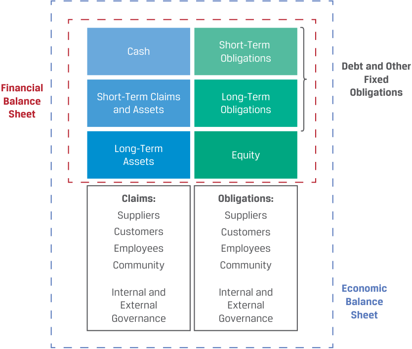
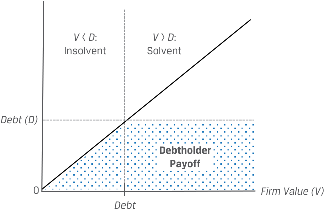

# Tập 3: Tổ chức phát hành doanh nghiệp (*Corporate Issuers*)
## Học phần 2: Nhà đầu tư và các bên liên quan khác (*Investors and Other Stakeholders*)
### Phần 1/3: Giới thiệu (*Introduction*) (Trang PDF 45–55)

---

<!-- PDF Page 45 -->

#### H Ọ C P H Ầ N (*L E A R N I N G M O D U L E*)

# **<mark>2</mark>**

### **Nhà đầu tư và các bên liên quan khác (*Investors and Other Stakeholders*)**

###### **<mark>MỤC TIÊU HỌC TẬP (*LEARNING OUTCOMES*)</mark>**

**_Thành thạo – Ứng viên cần có khả năng:_**
- So sánh quyền đòi hỏi tài chính (*financial claims*) và động lực của bên cho vay (*lenders*) và cổ đông (*shareholders*)
- Mô tả các nhóm bên liên quan (*stakeholder groups*) của một công ty và so sánh lợi ích của họ
- Mô tả các yếu tố môi trường, xã hội và quản trị (*environmental, social, and governance* – ESG) của các tổ chức phát hành doanh nghiệp được các nhà đầu tư xem xét

##### **GIỚI THIỆU (*INTRODUCTION*)**

## **<mark>1</mark>**

Các tổ chức phát hành doanh nghiệp (*corporate issuers*) được tài trợ bằng nợ (*debt*) và vốn chủ sở hữu (*equity*). Chứng khoán nợ và chứng khoán vốn chủ sở hữu có hồ sơ rủi ro và tỷ suất sinh lợi (*risk and return profiles*) khác nhau đối với cả tổ chức phát hành lẫn nhà đầu tư. Học phần này thảo luận về những điểm khác biệt đó và các hàm ý của chúng, đồng thời xem xét góc nhìn của một nhóm rộng hơn các bên liên quan (*stakeholders*) ngoài các chủ nợ (*debtholders*) và cổ đông (*shareholders*). Chúng ta sẽ giới thiệu các nhóm này và thảo luận về những xung đột lợi ích tiềm tàng giữa họ. Việc cân bằng lợi ích của các bên liên quan là rất quan trọng, bởi cả tổ chức phát hành và nhà đầu tư ngày càng tích hợp các yếu tố môi trường, xã hội và quản trị (*environmental, social, and governance* – ESG) vào quy trình ra quyết định của mình. Các chuyên gia phân tích đánh giá các yếu tố ESG để nhận định tốt hơn về kết quả hoạt động kỳ vọng trong tương lai và hồ sơ rủi ro của các tổ chức phát hành.

###### **TỔNG QUAN HỌC PHẦN (*LEARNING MODULE OVERVIEW*)**

- Các tổ chức phát hành doanh nghiệp được tài trợ bằng nợ và vốn chủ sở hữu. Nợ (*debt*) là một nguồn tài trợ có thời hạn hữu hạn (*finite length*), và các khoản thanh toán tiền lãi cũng như nợ gốc được cam kết chi trả vào những ngày xác định trước trong tương lai. Chủ nợ (*debtholders*) có quyền đòi hỏi ưu tiên (*priority claim*) cao hơn cổ đông đối với dòng tiền và tài sản của tổ chức phát hành.

- Vốn chủ sở hữu (*equity*) là một nguồn tài trợ vĩnh viễn (*permanent financing*), và không có bất kỳ lời hứa hoàn trả vốn hay phân phối lợi nhuận nào được đưa ra cho các cổ đông. Vốn chủ sở hữu là quyền hưởng phần còn lại (*residual claim*) đối với dòng tiền và tài sản của tổ chức phát hành.

<!-- PDF Page 46 -->

- Dưới góc độ của một tổ chức phát hành, nợ có rủi ro cao hơn vốn chủ sở hữu. Dưới góc độ của một nhà đầu tư, vốn chủ sở hữu có rủi ro cao hơn nợ. Tỷ trọng nợ trong cấu trúc vốn (*capital structure*) của doanh nghiệp ảnh hưởng đến cả tỷ suất sinh lợi tiềm năng lẫn rủi ro của các dòng tiền.

- Xung đột lợi ích (*conflicts of interest*) có thể tồn tại giữa chủ nợ và cổ đông. Khoản thu về (*payoff*) của chủ nợ bị giới hạn ở các khoản thanh toán tiền lãi và nợ gốc đã cam kết, trong khi khoản thu về của cổ đông về mặt lý thuyết là không giới hạn bởi vì sự gia tăng giá trị doanh nghiệp vượt trên giá trị khoản nợ sẽ thuộc về các cổ đông.

- Bên cạnh các nhà đầu tư nợ và vốn chủ sở hữu, các bên liên quan của doanh nghiệp (*corporate stakeholders*) còn bao gồm hội đồng quản trị, các nhà quản lý, nhân viên, khách hàng, nhà cung cấp, chính phủ, xã hội nói chung và môi trường. Lý thuyết các bên liên quan trong quản trị công ty (*stakeholder theory of corporate governance*) mở rộng trọng tâm của việc ra quyết định trong doanh nghiệp ra ngoài phạm vi của lý thuyết cổ đông (*shareholder theory*).

- Các cân nhắc về môi trường, xã hội và quản trị (ESG) đang ngày càng trở nên quan trọng hơn đối với cả các nhà đầu tư và các chuyên gia phân tích. Các yếu tố ESG ảnh hưởng đến giá trị của doanh nghiệp và có thể mang lại cả rủi ro lẫn cơ hội.

###### **TỰ ĐÁNH GIÁ HỌC PHẦN (*LEARNING MODULE SELF-ASSESSMENT*)**

Các câu hỏi ban đầu này nhằm giúp bạn tự đánh giá mức độ hiểu biết hiện tại của mình về học phần này.

Hoàn thành mỗi câu phát biểu bằng cách chọn thuật ngữ thích hợp nhất trong ngoặc đơn.

1. ____________ cung cấp nguồn vốn vĩnh viễn (*permanent capital*) cho các tổ chức phát hành. (chủ nợ – *debtholders*, cổ đông – *shareholders*)

###### **Lời giải:**

<u>**Cổ đông (*Shareholders*)** cung cấp nguồn vốn vĩnh viễn cho các tổ chức phát hành.</u>

   - Chủ nợ (*Debtholders*) là sai. Nợ có kỳ hạn đáo hạn hữu hạn, mặc dù thời điểm đáo hạn đó có thể ở rất xa trong tương lai.

2. ____________ có quyền hưởng phần còn lại (*residual claim*) đối với dòng tiền của doanh nghiệp. (chủ nợ – *debtholders*, cổ đông – *shareholders*)

###### **Lời giải:**

<u>**Cổ đông (*Shareholders*)** có quyền hưởng phần còn lại đối với dòng tiền của doanh nghiệp.</u> Chủ nợ (*Debtholders*) là sai. Chủ nợ có quyền đòi hỏi _ưu tiên_ (*priority claim*) cao hơn cổ đông đối với dòng tiền và tài sản của doanh nghiệp.

3. Lý thuyết cổ đông (*shareholder theory*) trong quản trị công ty _______________ hơn so với lý thuyết các bên liên quan (*stakeholder theory*). (hẹp – *narrower*, rộng – *broader*)

###### **Lời giải:**

Lý thuyết cổ đông trong quản trị công ty **hẹp (*narrower*)** hơn so với lý thuyết các bên liên quan.

Các bên liên quan (*stakeholders*) là các nhóm và cá nhân có lợi ích gắn liền với sự thành công của doanh nghiệp và bao gồm, nhưng không giới hạn ở, các cổ đông.

<!-- PDF Page 47 -->

4. Các cân nhắc về ESG là một mục tiêu rõ ràng trong lý thuyết _____________ về quản trị công ty. (cổ đông – *shareholder*, các bên liên quan – *stakeholder*)

###### **Lời giải:**

Các cân nhắc về ESG là một mục tiêu rõ ràng trong lý thuyết **các bên liên quan (*stakeholder*)** về quản trị công ty.

Lý thuyết các bên liên quan tìm cách cân bằng lợi ích của các cổ đông với lợi ích của một nhóm rộng lớn hơn có liên quan đến các khía cạnh ESG.

5. Tác động ước tính của các yếu tố ESG lên kết quả hoạt động tài chính và diễn biến giá cổ phiếu của các tổ chức phát hành doanh nghiệp đã _________________ theo thời gian. (giảm xuống – *decreased*, giữ nguyên – *remained the same*, tăng lên – *increased*)

###### **Lời giải:**

Tác động ước tính của các yếu tố ESG lên kết quả hoạt động tài chính và diễn biến giá cổ phiếu của các tổ chức phát hành doanh nghiệp đã **tăng lên (*increased*)** theo thời gian. Tác động này là kết quả của sự thay đổi trong thị hiếu của người tiêu dùng và nhà đầu tư, sự gia tăng các quy định pháp lý và thuế liên quan đến các yếu tố ESG, và mối đe dọa ngày càng tăng của biến đổi khí hậu.

6. Các yếu tố ESG ngày càng được các chuyên gia phân tích nhìn nhận là _______________. (có thể định lượng được – *quantifiable*, mang tính định tính – *qualitative*)

###### **Lời giải:**

Các yếu tố ESG ngày càng được các chuyên gia phân tích nhìn nhận là **có thể định lượng được (*quantifiable*)**. Trong lịch sử, các yếu tố ESG từng được coi là các ngoại ứng tiêu cực (*negative externalities*) không có tác động trực tiếp lên báo cáo tài chính của doanh nghiệp. Ngày càng nhiều chuyên gia phân tích đang định lượng hóa tác động của các yếu tố ESG và đưa chúng vào mô hình định giá doanh nghiệp cũng như quy trình ra quyết định đầu tư.

##### **QUYỀN ĐÒI HỎI TÀI CHÍNH CỦA BÊN CHO VAY VÀ CỔ ĐÔNG (*FINANCIAL CLAIMS OF LENDERS AND SHAREHOLDERS*)**

## **<mark>2</mark>**

- So sánh quyền đòi hỏi tài chính và động lực của bên cho vay và cổ đông (*compare the financial claims and motivations of lenders and shareholders*)

###### **Nợ so với Vốn chủ sở hữu (*Debt Versus Equity*)**

Học phần trước đã xác lập rằng các công ty cổ phần tài trợ cho tài sản của mình bằng nợ và vốn chủ sở hữu. Bây giờ chúng ta chuyển sự chú ý sang bản chất của các quyền đòi hỏi (*claims*) này, mối tương quan giữa rủi ro và tỷ suất sinh lợi của chúng đối với cả tổ chức phát hành và nhà đầu tư, cũng như các xung đột lợi ích tiềm tàng có thể phát sinh giữa bên cho vay và cổ đông.

###### **_Quyền đòi hỏi của Nợ và Vốn chủ sở hữu (Debt and Equity Claims)_**

Bảng 1 (Exhibit 1) thể hiện mối quan hệ giữa tài sản của một công ty cổ phần và quyền đòi hỏi của các nhà đầu tư nợ và vốn chủ sở hữu đã tài trợ cho các tài sản đó. Bảng 2 (Exhibit 2) cho thấy tài sản được sử dụng để tạo ra thu nhập nhằm trả lãi cho các chủ nợ, trong khi phần lợi nhuận còn lại được tái đầu tư hoặc phân phối cho các cổ đông.

<!-- PDF Page 48 -->

**Bảng 1 (Exhibit 1): Bảng cân đối kế toán: Tài sản, Nợ và Vốn chủ sở hữu (*Balance Sheet: Assets, Debt, and Equity*)**

<!-- Picture Text: Short-Term Cash Obligations Debt and Other Fixed Financial Balance Short-Term Claims Long-Term Obligations Sheet and Assets Obligations Long-Term Equity Assets Claims: Obligations: Suppliers Suppliers Customers Customers Employees Employees Community Community Internal and Internal and Economic External External Balance Governance Governance Sheet  -->

> **Chú thích hình ảnh:** Bảng cân đối kế toán Tài chính (*Financial Balance Sheet*) và Bảng cân đối kế toán Kinh tế (*Economic Balance Sheet*) minh họa mối liên hệ giữa Tài sản (Tiền mặt, Tài sản ngắn hạn, Tài sản dài hạn, cùng các quyền lợi từ Nhà cung cấp, Khách hàng, Nhân viên, Cộng đồng) và Nguồn vốn/Nghĩa vụ (Nghĩa vụ ngắn hạn, Nợ và các nghĩa vụ cố định dài hạn khác, Vốn chủ sở hữu, cùng các nghĩa vụ với các bên liên quan).

**Bảng 2 (Exhibit 2): Các khoản thanh toán cho Nhà đầu tư Nợ và Vốn chủ sở hữu (*Payments to Debt and Equity Investors*)**

<!-- Picture Text: Use assets to generate revenue Customers to Assets Cost of Goods Sold Suppliers Revenue less Wages and Salaries Employees Interest Payments Debtholders Taxes Government Profit (Net Income) Available to reinvest Retained Discretionary Shareholders Earnings Dividends  -->

> **Chú thích hình ảnh:** Tài sản (*Assets*) được sử dụng để tạo ra doanh thu từ Khách hàng (*Customers*). Doanh thu (*Revenue*) trừ đi Giá vốn hàng bán trả cho Nhà cung cấp (*Cost of Goods Sold – Suppliers*), Tiền lương và tiền công trả cho Nhân viên (*Wages and Salaries – Employees*), Chi phí lãi vay trả cho Chủ nợ (*Interest Payments – Debtholders*), và Thuế nộp cho Chính phủ (*Taxes – Government*) sẽ còn lại Lợi nhuận / Thu nhập ròng (*Profit / Net Income*). Khoản lợi nhuận này có thể được giữ lại để tái đầu tư (*Retained Earnings*) hoặc chi trả Cổ tức tùy ý (*Discretionary Dividends*) cho các Cổ đông (*Shareholders*).

Chủ nợ (*debtholders*), hay bên cho vay (*lenders*), cung cấp nguồn vốn có kỳ hạn đáo hạn _hữu hạn_ (*finite maturity*). Các tổ chức phát hành đồng ý thực hiện các khoản thanh toán tiền lãi đã cam kết và hoàn trả nợ gốc vào những ngày đã được xác định trước. Bên cho vay không có quyền ra quyết định trong nội bộ công ty cổ phần, nhưng các hợp đồng nợ có thể được cấu trúc để bảo vệ bên cho vay bằng cách áp đặt các yêu cầu tài chính và/hoặc quyền đòi hỏi pháp lý đối với một số tài sản nhất định của công ty cổ phần nếu khoản nợ không được hoàn trả theo đúng thỏa thuận. Như được thể hiện trong Bảng 2, các khoản thanh toán tiền lãi được chi trả trước bất kỳ khoản phân phối nào cho các nhà đầu tư vốn chủ sở hữu và là một quyền đòi hỏi ưu tiên (*priority claim*) đối với tài sản và dòng tiền của công ty.

<!-- PDF Page 49 -->

Các nhà đầu tư vốn chủ sở hữu cung cấp nguồn vốn _vĩnh viễn_ (*permanent capital*) cho các tổ chức phát hành; các tổ chức phát hành nhìn chung không cam kết về cổ tức trong tương lai hoặc hoàn trả vốn cho cổ đông. Thay vào đó, vốn chủ sở hữu là một quyền hưởng _phần còn lại_ (*residual claim*) đối với dòng tiền của công ty — bất cứ thứ gì còn sót lại sau khi đã trừ đi các chi phí hoạt động, các khoản đầu tư và các khoản thanh toán nợ. Việc phân phối tiền mặt cho các nhà đầu tư vốn chủ sở hữu hoàn toàn tùy thuộc vào quyết định (*at the discretion*) của hội đồng quản trị. Trái ngược với bên cho vay, các nhà đầu tư vốn chủ sở hữu có quyền biểu quyết (*voting rights*) đối với các vấn đề quan trọng của công ty chẳng hạn như bầu chọn hội đồng quản trị – cơ quan sẽ bổ nhiệm và giám sát ban giám đốc.

Ngoài các khoản thanh toán tiền lãi cho chủ nợ, các quyền đòi hỏi khác phải được đáp ứng trước khi thực hiện bất kỳ khoản phân phối nào cho cổ đông bao gồm các khoản thanh toán cho nhà cung cấp, nhân viên và chính phủ (dưới hình thức thuế). Nếu một doanh nghiệp bị giải thể và tài sản của nó bị thanh lý (*liquidated*), các quyền đòi hỏi ưu tiên này phải được đáp ứng trước khi các nhà đầu tư vốn chủ sở hữu nhận được bất kỳ khoản nào.

Bởi vì nợ là một quyền đòi hỏi ưu tiên, cố định và có thời hạn hữu hạn đối với tài sản và dòng tiền, nên nó là một hình thức tài trợ ít tốn kém hơn đối với các tổ chức phát hành: nó có rủi ro thấp hơn đối với các nhà đầu tư so với vốn chủ sở hữu (mặc dù, như sẽ được thảo luận, việc gia tăng nợ sẽ làm tăng rủi ro cho các nhà đầu tư vốn chủ sở hữu của công ty). Một điểm khác biệt nữa giữa nợ và vốn chủ sở hữu là các khoản thanh toán tiền lãi cho chủ nợ thường được coi là một khoản chi phí được khấu trừ thuế (*tax-deductible expense*), giúp làm giảm thu nhập chịu thuế, trong khi cổ tức trả cho cổ đông thì không được khấu trừ thuế.

###### **KIỂM TRA KIẾN THỨC (*KNOWLEDGE CHECK*)**

1. Xác định xem thuộc tính ở bên trái là đặc điểm của Nợ (*Debt*) hay Vốn chủ sở hữu (*Equity*).

| Thuộc tính | Lựa chọn |
|---|---|
| Nghĩa vụ hoàn trả pháp lý (*Legal repayment obligation*) | Nợ (*Debt*), Vốn chủ sở hữu (*Equity*) |
| Quyền hưởng tài sản còn lại (*Residual asset claim*) | Nợ (*Debt*), Vốn chủ sở hữu (*Equity*) |
| Các khoản thanh toán tùy ý (*Discretionary payments*) | Nợ (*Debt*), Vốn chủ sở hữu (*Equity*) |
| Chi phí được khấu trừ thuế (*Tax-deductible expense*) | Nợ (*Debt*), Vốn chủ sở hữu (*Equity*) |
| Thời hạn hữu hạn (*Finite term*) | Nợ (*Debt*), Vốn chủ sở hữu (*Equity*) |
| Quyền biểu quyết (*Voting rights*) | Nợ (*Debt*), Vốn chủ sở hữu (*Equity*) |

###### **Lời giải:**

| Thuộc tính | Đáp án |
|---|---|
| Nghĩa vụ hoàn trả pháp lý (*Legal repayment obligation*) | Nợ (*Debt*) |
| Quyền hưởng tài sản còn lại (*Residual asset claim*) | Vốn chủ sở hữu (*Equity*) |
| Các khoản thanh toán tùy ý (*Discretionary payments*) | Vốn chủ sở hữu (*Equity*) |
| Chi phí được khấu trừ thuế (*Tax-deductible expense*) | Nợ (*Debt*) |
| Thời hạn hữu hạn (*Finite term*) | Nợ (*Debt*) |
| Quyền biểu quyết (*Voting rights*) | Vốn chủ sở hữu (*Equity*) |

Cho dù được cung cấp dưới hình thức một khoản vay hay một trái phiếu, nợ luôn bao gồm một nghĩa vụ theo hợp đồng với các quyền đòi hỏi ưu tiên về tiền lãi và nợ gốc. Các nhà đầu tư vốn chủ sở hữu nhận được các khoản phân phối tùy ý và có quyền hưởng phần tài sản còn lại. Các khoản thanh toán cổ tức vốn chủ sở hữu không được khấu trừ thuế. Nợ yêu cầu các khoản thanh toán tiền lãi và nợ gốc theo hợp đồng, trong đó chi phí lãi vay được khấu trừ thuế đối với tổ chức phát hành. Nợ có thời hạn hữu hạn và không trao quyền ra quyết định, trong khi vốn chủ sở hữu có thời hạn không giới hạn và bao gồm quyền biểu quyết.

<!-- PDF Page 50 -->

###### **Nợ so với Vốn chủ sở hữu: Rủi ro và Tỷ suất sinh lợi (*Debt Versus Equity: Risk and Return*)**

Như đã xác lập trước đó, quyền đòi hỏi của chủ nợ là cố định và hữu hạn, trong khi các chủ sở hữu vốn cổ phần có quyền đòi hỏi liên tục đối với lợi nhuận hiện tại và tương lai của doanh nghiệp. Mặc dù các doanh nghiệp thường bắt đầu bằng tài trợ vốn chủ sở hữu, những doanh nghiệp có dòng tiền dễ dự báo hơn có thể lựa chọn đi vay thay vì bán thêm cổ phần sở hữu để tài trợ cho tài sản. Sự đánh đổi (*trade-offs*) giữa tài trợ bằng nợ và tài trợ bằng vốn chủ sở hữu đối với cả tổ chức phát hành và nhà đầu tư được thể hiện rõ nhất qua ví dụ sau đây.

###### **VÍ DỤ 1 (*EXAMPLE 1*)**

###### **Tài trợ Bảng cân đối kế toán dựa trên Vốn chủ sở hữu so với dựa trên Nợ (*Equity- versus Debt-Based Balance Sheet Financing*)**

Hãy xét một doanh nghiệp có tài sản được tài trợ hoàn toàn 100% bằng vốn chủ sở hữu và một doanh nghiệp giống hệt nhưng được tài trợ bằng 75% nợ và 25% vốn chủ sở hữu.

<!-- Picture Text: Equity-Financed Debt- and Equity-Financed Cash Cash Debt 75 Other ST Assets Equity Other ST Assets 100 LT Assets LT Assets Equity 25  -->

> **Chú thích hình ảnh:**
> - **Doanh nghiệp tài trợ bằng Vốn chủ sở hữu (*Equity-Financed*):** Tài sản gồm Tiền mặt (*Cash*), Tài sản ngắn hạn khác (*Other ST Assets*) và Tài sản dài hạn (*LT Assets*) được tài trợ 100 bởi Vốn chủ sở hữu (*Equity* = 100).
> - **Doanh nghiệp tài trợ bằng Nợ và Vốn chủ sở hữu (*Debt- and Equity-Financed*):** Cùng quy mô Tài sản nhưng được tài trợ bởi Nợ (*Debt* = 75) và Vốn chủ sở hữu (*Equity* = 25).

Giả sử cả hai doanh nghiệp đều có doanh thu trong kỳ là 100 và chi phí hoạt động (*operating expenses*) là 70. Bỏ qua thuế thu nhập.

1. Nếu chúng ta giả định chi phí lãi vay là 15 trong kỳ, hãy tính thu nhập ròng (*net income*) cho mỗi doanh nghiệp và so sánh tỷ suất sinh lợi trên vốn chủ sở hữu (*returns on equity* – ROE) của chúng trong kỳ. Hãy giải thích tại sao ROE lại cao hơn khi sử dụng tài trợ bằng nợ.

###### **Lời giải:**

Tính thu nhập ròng bằng cách lấy doanh thu trừ đi các chi phí, và chia thu nhập ròng cho tổng vốn chủ sở hữu để tìm tỷ suất sinh lợi trên vốn chủ sở hữu trong một kỳ:

|**Tài trợ bằng Vốn chủ sở hữu (*Equity-Financed*)**||**Tài trợ bằng Nợ và Vốn chủ sở hữu (*Debt- and Equity-Financed*)**||
|---|---|---|---|
|Doanh thu (*Revenue*)|100|Doanh thu (*Revenue*)|100|
|Trừ: Chi phí hoạt động (*Less: Operating Expenses*)|$-70$|Trừ: Chi phí hoạt động (*Less: Operating Expenses*)|$-70$|
|||Trừ: Chi phí lãi vay (*Less: Interest Expense*)|$-15$|
|Thu nhập ròng (*Net Income*)|30|Thu nhập ròng (*Net Income*)|15|
|Tổng Vốn chủ sở hữu (*Total Equity*)|100|Tổng Vốn chủ sở hữu (*Total Equity*)|25|
|**Tỷ suất sinh lợi trên vốn chủ sở hữu (*Return on Equity* – ROE)**|**30%**|**Tỷ suất sinh lợi trên vốn chủ sở hữu (*Return on Equity* – ROE)**|**60%**|

Tỷ suất sinh lợi trên vốn chủ sở hữu (ROE) cao hơn khi sử dụng nợ, bởi vì chi phí lãi vay của nợ thấp hơn tỷ suất sinh lợi trên tài sản (*return on assets* – ROA) của doanh nghiệp. Lãi suất nợ vay $= 15 / 75 = 20\%$ so với tỷ suất sinh lợi trên tài sản $= 30 / 100 = 30\%$.

2. Hãy tính tỷ suất sinh lợi trên vốn chủ sở hữu trong kỳ nếu hai doanh nghiệp có mức tăng doanh thu 20% và mức giảm doanh thu 20% (so với Câu hỏi 1), giả sử các chi phí không thay đổi.

###### **Lời giải:**

Tính thu nhập ròng và tỷ suất sinh lợi trên vốn chủ sở hữu khi doanh thu tăng và giảm như sau:

<!-- PDF Page 51 -->

###### **Doanh thu _Tăng_ 20% (*20% Increase in Revenue*)**

|**Tài trợ bằng Vốn chủ sở hữu (*Equity-Financed*)**||**Tài trợ bằng Nợ và Vốn chủ sở hữu (*Debt- and Equity-Financed*)**||
|---|---|---|---|
|Doanh thu (*Revenue*)|120|Doanh thu (*Revenue*)|120|
|Trừ: Chi phí hoạt động (*Less: Operating Expenses*)|$-70$|Trừ: Chi phí hoạt động (*Less: Operating Expenses*)|$-70$|
|||Trừ: Chi phí lãi vay (*Less: Interest Expense*)|$-15$|
|Thu nhập ròng (*Net Income*)|50|Thu nhập ròng (*Net Income*)|35|
|Tổng Vốn chủ sở hữu (*Total Equity*)|100|Tổng Vốn chủ sở hữu (*Total Equity*)|25|
|**Tỷ suất sinh lợi trên vốn chủ sở hữu (*Return on Equity* – ROE)**|**50%**|**Tỷ suất sinh lợi trên vốn chủ sở hữu (*Return on Equity* – ROE)**|**140%**|

###### **Doanh thu _Giảm_ 20% (*20% Decrease in Revenue*)**

|**Tài trợ bằng Vốn chủ sở hữu (*Equity-Financed*)**||**Tài trợ bằng Nợ và Vốn chủ sở hữu (*Debt- and Equity-Financed*)**||
|---|---|---|---|
|Doanh thu (*Revenue*)|80|Doanh thu (*Revenue*)|80|
|Trừ: Chi phí hoạt động (*Less: Operating Expenses*)|$-70$|Trừ: Chi phí hoạt động (*Less: Operating Expenses*)|$-70$|
|||Trừ: Chi phí lãi vay (*Less: Interest Expense*)|$-15$|
|Thu nhập ròng (*Net Income*)|10|Thu nhập ròng (*Net Income*)|**(5)**|
|Tổng Vốn chủ sở hữu (*Total Equity*)|100|Tổng Vốn chủ sở hữu (*Total Equity*)|25|
|**Tỷ suất sinh lợi trên vốn chủ sở hữu (*Return on Equity* – ROE)**|**10%**|**Tỷ suất sinh lợi trên vốn chủ sở hữu (*Return on Equity* – ROE)**|**(20%)**|

Ví dụ này minh họa cho tỷ suất sinh lợi tiềm năng của cổ đông lớn hơn khi sử dụng tài trợ bằng nợ — nhưng đồng thời rủi ro cũng lớn hơn. Cụ thể, khoản lỗ ròng trong kịch bản bất lợi (*downside case*) đối với tổ chức phát hành được tài trợ bằng nợ và vốn chủ sở hữu làm dấy lên khả năng công ty có thể không đáp ứng được các khoản thanh toán nợ trong tương lai. Độ biến thiên của ROE đối với công ty được tài trợ bằng nợ và vốn chủ sở hữu cao hơn đáng kể so với độ biến thiên của ROE đối với công ty được tài trợ hoàn toàn bằng vốn chủ sở hữu.

Dưới góc độ của tổ chức phát hành, tài trợ bằng nợ ít tốn kém hơn nhưng bao hàm rủi ro lớn hơn so với tài trợ bằng vốn chủ sở hữu, bởi vì nó buộc tổ chức phát hành không chỉ phải cam kết thanh toán tiền lãi và nợ gốc mà còn phải tuân thủ bất kỳ hạn chế nào mà bên cho vay áp đặt trong hợp đồng nợ. Việc sử dụng nhiều nợ hơn trên một lượng tài trợ vốn chủ sở hữu nhất định, được gọi là **đòn bẩy tài chính (*financial leverage*)**, làm tăng khả năng doanh nghiệp có thể không đáp ứng được các nghĩa vụ đã hứa với bên cho vay, dẫn đến phá sản (*bankruptcy*) và có khả năng bị thanh lý (*liquidation*). Doanh nghiệp không phải đối mặt với rủi ro như vậy trong trường hợp tài trợ bằng vốn chủ sở hữu, vì cổ đông không được hứa hẹn bất kỳ khoản phân phối hay hoàn trả vốn nào.

Dưới góc độ của nhà đầu tư, cổ phiếu có rủi ro cao hơn trái phiếu bởi vì cổ đông nắm giữ quyền hưởng phần còn lại (*residual claims*) thay vì quyền đòi hỏi cố định (*fixed claims*) đối với doanh nghiệp. Như được chỉ ra trong Ví dụ 1, lợi nhuận sẵn có để phân phối cho các cổ đông có thể biến động rất lớn, tùy thuộc vào kết quả hoạt động của doanh nghiệp cũng như đòn bẩy tài chính. Nếu một công ty cổ phần thành công, về mặt lý thuyết không có giới hạn nào đối với số tiền mà các chủ sở hữu vốn cổ phần có thể kiếm được từ khoản đầu tư của mình. Nhưng nếu doanh nghiệp hoạt động kém hiệu quả, các chủ sở hữu có thể mất toàn bộ khoản đầu tư của họ nếu doanh nghiệp bị thanh lý và các chủ nợ nắm quyền kiểm soát tài sản. Tuy nhiên, nhờ chế độ trách nhiệm hữu hạn, các cổ đông không thể mất nhiều hơn khoản đầu tư ban đầu của mình.

Mặc dù tài trợ bằng nợ làm tăng thêm rủi ro, những người nắm giữ vốn chủ sở hữu thường ưa thích phương thức này hơn việc tổ chức phát hành huy động thêm vốn chủ sở hữu để tài trợ cho tăng trưởng, bởi vì việc phát hành thêm cổ phiếu sẽ làm giảm tỷ lệ sở hữu phân số trong doanh nghiệp của các cổ đông hiện hữu, hiện tượng này được gọi là **sự pha loãng (*dilution*)**. Nhược điểm của sự pha loãng có thể được bù đắp bởi kỳ vọng rằng doanh nghiệp sẽ tạo ra đủ lợi nhuận tăng thêm để bù lại.

<!-- PDF Page 52 -->

###### **VÍ DỤ 2 (*EXAMPLE 2*)**

###### **Tài trợ một khoản đầu tư bằng Nợ, Vốn chủ sở hữu, hoặc Tiền mặt sẵn có (*Financing an Investment with Debt, Equity, or Cash on Hand*)**

Hãy xét cùng doanh nghiệp được tài trợ bằng vốn chủ sở hữu như trong Ví dụ 1 và các lựa chọn của doanh nghiệp này để tài trợ cho một khoản đầu tư mới vào tài sản dài hạn trị giá 20. Các chi tiết liên quan trong bảng cân đối kế toán ban đầu của doanh nghiệp được trình bày dưới đây. Doanh thu trước khi đầu tư là 100, chi phí là 70 và dự kiến không thay đổi, lãi suất đối với khoản tài trợ nợ mới là 20%, và tỷ suất sinh lợi trên khoản đầu tư mới là 30%. Bỏ qua thuế thu nhập.

###### **Bảng cân đối kế toán ban đầu (*Initial Balance Sheet*)**

| Tài sản (*Assets*) | Giá trị | Nguồn vốn (*Liabilities & Equity*) | Giá trị |
|---|---|---|---|
| Tiền mặt (*Cash*) | 30 | | |
| Tài sản khác (*Other assets*) | 20 | | |
| Tài sản dài hạn (*LT assets*) | 50 | Vốn chủ sở hữu (*Equity*) | 100 |

1. Hãy so sánh tỷ suất sinh lợi trên vốn chủ sở hữu (ROE) của doanh nghiệp nếu doanh nghiệp tài trợ cho khoản đầu tư bằng nợ, phát hành cổ phiếu, hoặc tiền mặt sẵn có. Thảo luận về kết quả so sánh.

###### **Lời giải:**

| **Phát hành cổ phiếu (*Issue Shares*)** | | **Vay nợ (*Borrow*)** | | **Tiền mặt sẵn có (*Cash on Hand*)** | |
|---|---|---|---|---|---|
| Tiền mặt (*Cash*) 30 | | Tiền mặt (*Cash*) 30 | | Tiền mặt (*Cash*) 10 | |
| Tài sản khác (*Other*) 20 | | Tài sản khác (*Other*) 20 | Nợ (*Debt*) 20 | Tài sản khác (*Other*) 20 | |
| Tài sản dài hạn (*LT assets*) 70 | Vốn CSH (*Equity*) 120 | Tài sản dài hạn (*LT assets*) 70 | Vốn CSH (*Equity*) 100 | Tài sản dài hạn (*LT assets*) 70 | Vốn CSH (*Equity*) 100 |

| Chỉ tiêu | **Phát hành cổ phiếu (*Issue Shares*)** | **Vay nợ (*Borrow*)** | **Tiền mặt sẵn có (*Cash on Hand*)** |
|---|---|---|---|
| Doanh thu (*Revenue*) | 106 | 106 | 106 |
| Trừ: Chi phí hoạt động (*Less: Operating Expenses*) | 70 | 70 | 70 |
| Trừ: Lãi vay (*Less: Interest*) | | 4 | |
| Thu nhập ròng (*Net Income*) | 36 | 32 | 36 |
| Vốn chủ sở hữu (*Equity*) | 120 | 100 | 100 |
| **ROE** | **30%** | **32%** | **36%** |

Việc tài trợ cho khoản đầu tư bằng cách phát hành cổ phiếu tạo ra mức ROE thấp nhất do sự pha loãng từ phần vốn chủ sở hữu tăng thêm. Bởi vì khoản đầu tư tạo ra tỷ suất sinh lợi (30%) bằng đúng với mức ROE ban đầu (30%), nên ROE không thay đổi. Tài trợ bằng nợ tạo ra mức ROE cao hơn (32%), bởi vì lãi suất nợ vay (20%) thấp hơn tỷ suất sinh lợi trên khoản đầu tư mới (30%) và không có cổ phiếu mới nào được phát hành, nên vốn chủ sở hữu không tăng lên. Mức ROE cao nhất (36%) được tạo ra bằng cách sử dụng tiền mặt sẵn có, giúp tránh được cả sự gia tăng vốn chủ sở hữu lẫn chi phí lãi vay của khoản nợ mới.

Bảng 3 (Exhibit 3) thể hiện sự bất đối xứng trong khoản thu về của cổ đông (*shareholder payoff asymmetry*) theo thời gian như một hàm số của giá trị doanh nghiệp.

<!-- PDF Page 53 -->

###### **Bảng 3 (Exhibit 3): Giá trị doanh nghiệp và Khoản thu về của Cổ đông (*Firm Value and Shareholder Payoff*)**

<!-- Picture Text: V  <  D : V  >  D : Insolvent Solvent Shareholder Payoff Debt (D) 0 Firm Value (V) Debt  -->

> **Chú thích hình ảnh:** Đồ thị biểu diễn Khoản thu về của cổ đông (*Shareholder Payoff*) theo Giá trị doanh nghiệp (*Firm Value* – $V$). Khi $V < D$ (Mất khả năng thanh toán – *Insolvent*), khoản thu về của cổ đông bằng 0. Khi $V > D$ (Có khả năng thanh toán – *Solvent*), khoản thu về của cổ đông tăng tuyến tính theo phần chênh lệch $V - D$.

Nếu doanh nghiệp có khả năng thanh toán (*solvent*) — nghĩa là giá trị của nó ($V$) vượt quá giá trị khoản nợ của nó ($D$) — thì giá trị thuộc về các cổ đông chính là phần chênh lệch dương giữa giá trị của doanh nghiệp và giá trị khoản nợ ($V - D$). Lợi nhuận tiềm năng phía trên (*upside gains*) dành cho các cổ đông chỉ bị giới hạn bởi giá trị tương lai của doanh nghiệp. Nếu một doanh nghiệp trở nên mất khả năng thanh toán (*insolvent*), với giá trị nợ lớn hơn giá trị tài sản của nó ($V < D$), các cổ đông sẽ mất toàn bộ khoản đầu tư của mình và các chủ nợ sẽ nắm quyền kiểm soát doanh nghiệp.

Bảng 4 (Exhibit 4) thể hiện sự bất đối xứng này dưới góc độ của các chủ nợ (*debtholders*).

**Bảng 4 (Exhibit 4): Giá trị doanh nghiệp và Khoản thu về của Chủ nợ (*Firm Value and Debtholder Payoff*)**

<!-- Picture Text: V  <  D : V  >  D : Insolvent Solvent Debt (D) Debtholder Payoff 0 Firm Value (V) Debt  -->

> **Chú thích hình ảnh:** Đồ thị biểu diễn Khoản thu về của chủ nợ (*Debtholder Payoff*) theo Giá trị doanh nghiệp (*Firm Value* – $V$). Khi $V < D$ (Mất khả năng thanh toán – *Insolvent*), chủ nợ chỉ thu hồi được tối đa bằng giá trị doanh nghiệp $V$. Khi $V > D$ (Có khả năng thanh toán – *Solvent*), khoản thu về của chủ nợ bị chặn trần ở mức cố định bằng Giá trị khoản nợ $D$.

Tỷ suất sinh lợi của bên cho vay bị giới hạn ở các khoản thanh toán tiền lãi và nợ gốc đã cam kết chừng nào doanh nghiệp còn khả năng thanh toán ($V > D$), bất kể kết quả hoạt động và đòn bẩy tài chính của doanh nghiệp ra sao. Ngược lại, nếu giá trị doanh nghiệp giảm xuống thấp hơn giá trị khoản nợ ($V < D$), doanh nghiệp bị tuyên bố mất khả năng thanh toán và các chủ nợ sẽ tìm cách thu hồi vốn của họ từ số tài sản còn lại của doanh nghiệp. Lưu ý rằng nếu chúng ta cộng phần diện tích tô đậm của khoản thu về của cổ đông và khoản thu về của chủ nợ, chúng ta sẽ thu được đường chéo thể hiện tổng giá trị của doanh nghiệp ($V$), bởi vì chủ nợ được nhận các khoản thanh toán đã cam kết còn người nắm giữ vốn chủ sở hữu nhận được phần còn lại.

Trong khi các chủ sở hữu vốn cổ phần tìm cách tối đa hóa giá trị doanh nghiệp (để làm tăng khoản thu về của họ), thì các trái chủ (*bondholders*) lại tìm cách đảm bảo việc hoàn trả nợ gốc và tiền lãi đúng hạn, sao cho công ty tối đa hóa khả năng đáp ứng các nghĩa vụ nợ của mình. Những góc nhìn này được tóm tắt trong Bảng 5 (Exhibit 5).

<!-- PDF Page 54 -->

**Bảng 5 (Exhibit 5): Góc nhìn của Nhà đầu tư: Vốn chủ sở hữu so với Nợ (*Investor Perspectives: Equity versus Debt*)**

|**Thuộc tính (*Attribute*)**|**Vốn chủ sở hữu (*Equity*)**|**Nợ (*Debt*)**|
|---|---|---|
|Kỳ hạn (*Tenor*)|Vô thời hạn (*Indefinite*)|Có kỳ hạn (*Term*, ví dụ: 3 tháng, 10 năm)|
|Tiềm năng sinh lợi (*Return potential*)|Không giới hạn (*Unlimited*)|Bị giới hạn mức trần (*Capped*)|
|Mức lỗ tối đa (*Maximum loss*)|Khoản đầu tư ban đầu (*Initial investment*)|Khoản đầu tư ban đầu (*Initial investment*)|
|Rủi ro đầu tư (*Investment risk*)|Cao hơn (*Higher*)|Thấp hơn (*Lower*)|
|Kết quả mong muốn (*Desired outcome*)|Tối đa hóa giá trị doanh nghiệp (*Maximize firm value*)|Hoàn trả nợ đúng hạn (*Timely repayment*)|

###### **KIỂM TRA KIẾN THỨC (*KNOWLEDGE CHECK*)**

1. Người nắm giữ vốn chủ sở hữu và người nắm giữ nợ của doanh nghiệp chia sẻ cùng một góc nhìn đầu tư liên quan đến:

   - **A.** mức lỗ tối đa (*maximum loss*).
   - **B.** rủi ro đầu tư (*investment risk*).
   - **C.** tiềm năng sinh lợi (*return potential*).

###### **Lời giải:**

A là đáp án đúng. Đối với cả người nắm giữ vốn chủ sở hữu và người nắm giữ nợ, khoản đầu tư ban đầu của họ đại diện cho mức lỗ tối đa có thể xảy ra. Tiềm năng sinh lợi về mặt lý thuyết là không giới hạn đối với người nắm giữ vốn chủ sở hữu, trong khi bị giới hạn mức trần đối với chủ nợ. Người nắm giữ vốn chủ sở hữu phải chịu mức độ rủi ro đầu tư cao hơn, bởi vì họ nắm giữ quyền hưởng phần còn lại đối với dòng tiền của doanh nghiệp – có thứ tự ưu tiên thấp hơn so với quyền đòi hỏi của chủ nợ.

2. **Đúng hay Sai:** Chủ nợ, không giống như người nắm giữ vốn chủ sở hữu, có các khoản lỗ tiềm năng phía dưới (*downside losses*) và lợi nhuận tiềm năng phía trên (*upside gains*) mang tính đối xứng (*symmetric*).

   - **A.** Đúng.
   - **B.** Sai.

###### **Lời giải:**

B là đáp án đúng; phát biểu này là sai. Cả chủ nợ và người nắm giữ vốn chủ sở hữu đều có các khoản thu về tiềm năng mang tính bất đối xứng (*asymmetric potential payoffs*). Đối với chủ nợ, lợi nhuận tiềm năng phía trên bị giới hạn ở các khoản hoàn trả tiền lãi và nợ gốc, bất kể giá trị của doanh nghiệp có tăng cao đến đâu. Ngược lại, nếu giá trị của doanh nghiệp giảm xuống thấp hơn giá trị khoản nợ, chủ nợ có thể mất tới toàn bộ khoản đầu tư ban đầu của mình.

Đối với người nắm giữ vốn chủ sở hữu, giá trị vốn chủ sở hữu được xác định bằng giá trị của doanh nghiệp trừ đi giá trị khoản nợ của nó. Lợi nhuận tiềm năng phía trên dành cho cổ đông chỉ bị giới hạn bởi giá trị tương lai của doanh nghiệp, trong khi khoản lỗ của cổ đông, giống như của chủ nợ, được giới hạn ở khoản đầu tư ban đầu của họ.

###### **Xung đột lợi ích giữa Bên cho vay và Cổ đông (*Conflicts of Interest among Lenders and Shareholders*)**

Mặc dù cả bên cho vay và chủ sở hữu đều được đền bù từ cùng một dòng tiền của doanh nghiệp, nhưng hồ sơ rủi ro và tỷ suất sinh lợi khác nhau của chủ nợ và cổ đông tạo ra những xung đột lợi ích tiềm tàng.

Các cổ đông tìm cách tối đa hóa dòng tiền còn lại (*residual cash flows*), hay lợi nhuận của doanh nghiệp, sau khi các nghĩa vụ khác đã được đáp ứng. Bởi vì những nhà đầu tư này sẽ mất toàn bộ khoản đầu tư của mình trong trường hợp mất khả năng thanh toán nhưng lại có tiềm năng sinh lợi phía trên không giới hạn, nên họ muốn ban giám đốc

<!-- PDF Page 55 -->

theo đuổi các dự án có rủi ro có tính toán lớn hơn và tỷ suất sinh lợi tiềm năng cao hơn trong khi tối đa hóa việc sử dụng tài trợ bằng nợ. Ngoài ra, các cổ đông có thể yêu cầu trả cổ tức tiền mặt cao hơn, điều này có thể làm tăng đòn bẩy tài chính, qua đó làm tăng rủi ro cho các nhà đầu tư nợ. Ví dụ 1 đã minh họa tỷ suất sinh lợi vốn chủ sở hữu tiềm năng lớn hơn gắn liền với việc sử dụng đòn bẩy.

Các trái chủ (*bondholders*) tìm cách tối đa hóa khả năng họ sẽ nhận được các khoản thanh toán tiền lãi và nợ gốc đúng hạn; họ không thu được lợi ích gì từ việc sử dụng đòn bẩy lớn hơn để theo đuổi các dự án có rủi ro cao hơn do lợi nhuận phía trên của họ đã bị giới hạn. Do đó, các trái chủ nhìn chung muốn ban giám đốc đầu tư vào các dự án ít rủi ro hơn nhằm làm tăng mức độ chắc chắn của dòng tiền. Bởi vì họ không có quyền biểu quyết đối với các quyết định của ban giám đốc, các trái chủ tìm cách áp đặt các hạn chế theo hợp đồng (*contractual restrictions*), chẳng hạn như yêu cầu tỷ lệ đảm bảo dòng tiền (*cash flow coverage*) cho các khoản thanh toán nợ và/hoặc giới hạn đòn bẩy tài chính của doanh nghiệp. Những hạn chế này ngăn cản doanh nghiệp thực hiện các hành động có thể mang lại lợi ích cho cổ đông nhưng lại làm giảm khả năng hoàn trả nợ của doanh nghiệp trong tương lai.

###### **BỘ CÂU HỎI (*QUESTION SET*)**

1. Nhóm nào sau đây có quyền hưởng phần còn lại (*residual claim*) đối với dòng tiền của tổ chức phát hành?

   - **A.** Nhân viên (*Employees*)
   - **B.** Chủ nợ (*Debtholders*)
   - **C.** Cổ đông (*Shareholders*)

   - **Lời giải:**

C là đáp án đúng. Cổ đông là những người có quyền hưởng phần còn lại đối với dòng tiền của doanh nghiệp và nhận được các khoản phân phối tùy ý sau khi các quyền đòi hỏi ưu tiên (ví dụ: tiền lương nhân viên, khoản thanh toán cho nhà cung cấp, chi phí lãi vay và thuế) đã được đáp ứng.

2. Công cụ nào nhạy cảm hơn với những thay đổi trong giá trị doanh nghiệp: nợ hay vốn chủ sở hữu? Hãy giải thích câu trả lời của bạn.

###### **Lời giải:**

Vốn chủ sở hữu (*Equity*) nhạy cảm hơn với những thay đổi trong giá trị doanh nghiệp, bởi vì chủ nợ có quyền đòi hỏi cố định và được ưu tiên trong khi người nắm giữ vốn chủ sở hữu có quyền hưởng phần còn lại mà giá trị của nó phụ thuộc vào lợi nhuận tương lai của doanh nghiệp. Một mặt, nếu giá trị doanh nghiệp tăng lên, giá trị phần còn lại sẽ tích lũy cho các cổ đông trong khi các khoản thanh toán cho chủ nợ không thay đổi. Mặt khác, sự sụt giảm giá trị doanh nghiệp sẽ giáng xuống những người nắm giữ vốn chủ sở hữu đầu tiên. Nếu giá trị doanh nghiệp giảm xuống thấp hơn giá trị nợ và doanh nghiệp bị tuyên bố mất khả năng thanh toán, người nắm giữ vốn chủ sở hữu thường không nhận được gì và các chủ nợ sẽ nắm quyền kiểm soát doanh nghiệp và thường tìm cách thanh lý tài sản của doanh nghiệp.

3. Các khoản thanh toán tiền lãi cho chủ nợ là:

   - **A.** các khoản thanh toán phần còn lại (*residual payments*).
   - **B.** tùy thuộc vào quyết định của hội đồng quản trị (*at the discretion of the board*).
   - **C.** được khấu trừ cho mục đích tính thuế thu nhập doanh nghiệp (*deductible for corporate income tax purposes*).

   - **Lời giải:**

C là đáp án đúng. Các khoản thanh toán tiền lãi trên nợ vay được khấu trừ thuế đối với doanh nghiệp.

A sai. Chủ nợ có quyền đòi hỏi ưu tiên đối với dòng tiền của doanh nghiệp cao hơn cổ đông.

B sai. Các khoản thanh toán tiền lãi là nghĩa vụ theo hợp đồng (*contractual*), không phải tùy ý (*discretionary*) như cổ tức của cổ đông.
