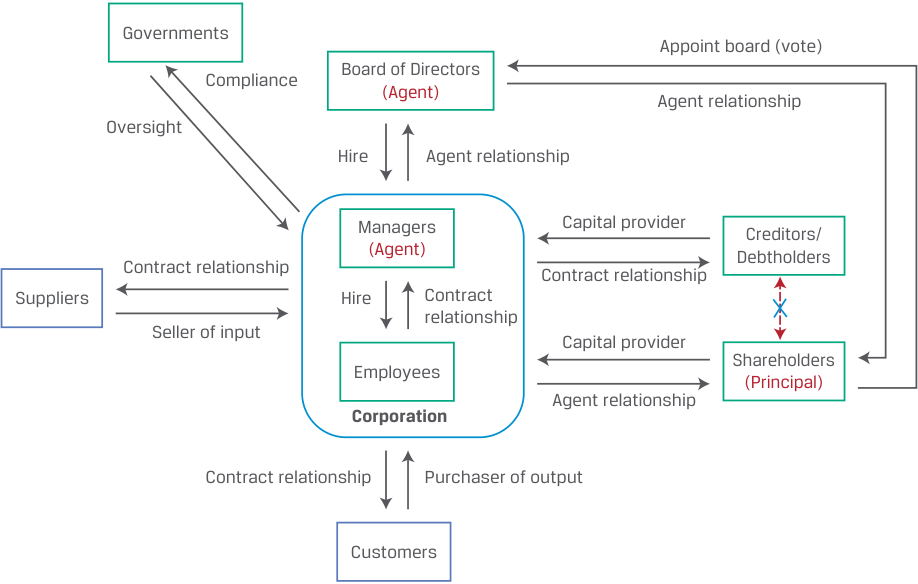

# Tập 3: Tổ chức phát hành doanh nghiệp (*Corporate Issuers*)
## Học phần 3: Quản trị công ty: Xung đột, Cơ chế, Rủi ro và Lợi ích (*Corporate Governance: Conflicts, Mechanisms, Risks, and Benefits*)
### Phần 1/3: Giới thiệu (*Introduction*) (Trang PDF 75–83)

---

<!-- PDF Page 75 -->

#### H Ọ C P H Ầ N (*L E A R N I N G M O D U L E*)

# **<mark>3</mark>**

### **Quản trị công ty: Xung đột, Cơ chế, Rủi ro và Lợi ích (*Corporate Governance: Conflicts, Mechanisms, Risks, and Benefits*)**

###### **<mark>MỤC TIÊU HỌC TẬP (*LEARNING OUTCOMES*)</mark>**

**_Thành thạo – Ứng viên cần có khả năng:_**
- Mô tả mối quan hệ người ủy thác – người đại diện (*principal-agent relationship*) và những xung đột có thể phát sinh giữa các nhóm bên liên quan (*stakeholder groups*)
- Mô tả quản trị công ty (*corporate governance*) và các cơ chế để quản lý mối quan hệ với các bên liên quan cũng như giảm thiểu các rủi ro đi kèm
- Mô tả các rủi ro tiềm tàng của việc quản trị công ty và quản lý các bên liên quan yếu kém, cũng như những lợi ích của việc quản trị công ty và quản lý các bên liên quan hiệu quả

<!-- Picture Text: 1  -->

##### **GIỚI THIỆU (*INTRODUCTION*)**

Công ty cổ phần (*corporations*) là những cấu trúc phức tạp với các bên liên quan (*stakeholders*) nằm ngoài phạm vi chủ sở hữu, bên cho vay và nhà quản lý. Quản trị công ty (*corporate governance*) bao gồm việc thiết lập và duy trì một hệ thống kiểm soát, cân bằng và khuyến khích (*system of checks, balances, and incentives*) nhằm giải quyết các lợi ích xung đột giữa những bên liên quan này. Trong Học phần này, trước hết chúng ta xác định các khía cạnh chính của mối quan hệ giữa các bên này và những xung đột tiềm tàng có thể phát sinh. Trong bài học thứ hai, chúng ta chuyển sang tìm hiểu các cơ chế khác nhau được thiết lập để quản lý những xung đột này, giải quyết tranh chấp và giảm thiểu rủi ro. Cuối cùng, chúng ta làm nổi bật những lợi ích của các chính sách quản trị công ty và quản lý các bên liên quan vững mạnh, cũng như những rủi ro của các chính sách yếu kém và tác động tiềm tàng của chúng lên kết quả hoạt động của doanh nghiệp.

###### **TỔNG QUAN HỌC PHẦN (*LEARNING MODULE OVERVIEW*)**

- Một mối quan hệ người ủy thác – người đại diện (*principal-agent relationship*) được hình thành khi một bên (người ủy thác / chủ sở hữu – *principal*) thuê một bên khác (người đại diện / người thừa hành – *agent*) thực hiện một nhiệm vụ hoặc dịch vụ. Mối quan hệ này có thể tồn tại có hoặc không có hợp đồng. Người đại diện được kỳ vọng sẽ hành động vì lợi ích tốt nhất của người ủy thác.

<!-- PDF Page 76 -->

- Trong nhiều trường hợp, người đại diện nắm giữ nhiều thông tin hơn người ủy thác, và xung đột phát sinh ở những nơi mà lợi ích của người ủy thác và người đại diện khác biệt nhau. Trong một công ty cổ phần, cổ đông là người ủy thác (*principal*) và bầu ra <u>các thành viên hội đồng quản trị (một người đại diện – *agent*), những người này sẽ bổ nhiệm các nhà quản lý (một người đại diện khác – *another agent*)</u> được giao nhiệm vụ tối đa hóa giá trị cổ đông.

- Xét đến hệ sinh thái phức tạp của các bên liên quan trong một công ty cổ phần, quyền hạn, trách nhiệm và quyền lực của từng bên liên quan phải được xem xét khi thiết lập một cấu trúc quản trị phù hợp bằng cách tạo ra sự cân bằng giữa lợi ích của các nhóm này đồng thời đáp ứng các mục tiêu của doanh nghiệp.

- Một cấu trúc quản trị lành mạnh bao gồm các cơ chế nhằm đảm bảo sự tuân thủ các quy tắc và quy định do các cơ quan có thẩm quyền bên ngoài áp đặt, cũng như đáp ứng các yêu cầu đặc thù của các bên liên quan nội bộ. Các cơ chế này bao gồm báo cáo tài chính (*financial reporting*), đại hội đồng cổ đông thường niên và bất thường (*general and extraordinary meetings*), chế độ đãi ngộ (*compensation*), các điều khoản ràng buộc nợ (*debt covenants*), và nhiều cơ chế khác.

- Quản trị công ty yếu kém, các xung đột lợi ích không được quản lý, hoặc việc quản lý các bên liên quan không thỏa đáng có thể đặt doanh nghiệp vào thế bất lợi cạnh tranh. Các thông lệ quản trị vững mạnh và sự cân bằng hợp lý giữa lợi ích của các bên liên quan thường được phản ánh qua năng lực cạnh tranh và hiệu quả hoạt động tăng lên, quy trình kiểm soát tốt hơn, và kết quả hoạt động được cải thiện.

###### **TỰ ĐÁNH GIÁ HỌC PHẦN (*LEARNING MODULE SELF-ASSESSMENT*)**

Các câu hỏi ban đầu này nhằm giúp bạn tự đánh giá mức độ hiểu biết hiện tại của mình về học phần này.

1. Các phát biểu sau đây liên quan đến hệ sinh thái các bên liên quan trong một công ty cổ phần. Hãy hoàn thành mỗi phát biểu bằng cách chọn một trong các thuật ngữ sau: người đại diện (*agent*), người ủy thác (*principal*), theo hợp đồng (*contractual*), người ủy thác – người đại diện (*principal-agent*), người sử dụng lao động – người lao động (*employer-employee*).

Trong một công ty cổ phần, hội đồng quản trị được bầu ra để hành động với tư cách là một ________________.

Trong một công ty cổ phần, cổ đông là một ________________.

Khách hàng có một mối quan hệ ________________ với một tổ chức phát hành doanh nghiệp.

**Lời giải:**

Trong một công ty cổ phần, hội đồng quản trị được bầu ra để hành động với tư cách là một **người đại diện (*agent*)**.
Trong một công ty cổ phần, cổ đông là một **người ủy thác (*principal*)**.

Khách hàng có một mối quan hệ **theo hợp đồng (*contractual*)** với một tổ chức phát hành doanh nghiệp.

2. Xung đột phát sinh ở những nơi mà lợi ích của người ủy thác và người đại diện khác biệt nhau, dẫn đến chi phí đại diện (*agency costs*). Hãy xác định và giải thích một ví dụ về chi phí đại diện đối với một tổ chức phát hành doanh nghiệp.

###### **Lời giải:**

Một ví dụ về chi phí đại diện đối với các công ty đại chúng là chi phí thuê một kiểm toán viên độc lập bên ngoài (*external independent auditor*) để kiểm toán báo cáo tài chính và hệ thống kiểm soát nội bộ. Phí kiểm toán do tổ chức phát hành chi trả – đây là một khoản chi phí do các cổ đông gánh chịu –

<!-- PDF Page 77 -->

nhằm giảm thiểu rủi ro báo cáo tài chính bị sai sót trọng yếu hoặc đi chệch khỏi các nguyên tắc kế toán được chấp nhận chung (*generally accepted accounting principles*).

3. Ghép cơ chế quản lý mối quan hệ hoặc giải quyết tranh chấp với bên liên quan tương ứng:

| Bên liên quan | Cơ chế |
|---|---|
| 1. Cổ đông (*Shareholders*) | A. Ủy ban đặc trách (*Ad hoc committee*) |
| 2. Chủ nợ (*Creditors*) | B. Cuộc chiến ủy quyền (*Proxy contest*) |
| 3. Ban giám đốc (*Management*) | C. Đãi ngộ dựa trên cổ phiếu (*Stock-based compensation*) |

###### **Lời giải:**

   1. **B là đáp án đúng.** Cuộc chiến ủy quyền (*proxy contests*) là một cơ chế để các cổ đông theo đuổi những thay đổi trong quyền kiểm soát công ty.
   2. **A là đáp án đúng.** Khi một công ty đang gặp khó khăn trong việc đáp ứng các nghĩa vụ nợ của mình, một ủy ban đặc trách (*ad hoc committee*) có thể được thành lập bởi một nhóm các trái chủ để tiếp cận công ty với các phương án tiềm năng nhằm tái cơ cấu trái phiếu của họ.
   3. **C là đáp án đúng.** Đãi ngộ dựa trên cổ phiếu (*stock-based compensation*) tìm cách gắn kết lợi ích của ban giám đốc và cổ đông.

4. Một ________________ có thể được triệu tập khi có yêu cầu của một số lượng cổ đông tối thiểu cụ thể, như được quy định chi tiết trong quy chế hoạt động (*bylaws*) hoặc điều lệ (*charter*) của công ty.

###### **Lời giải:**

Một **đại hội đồng cổ đông bất thường (*extraordinary general meeting* – EGM)** có thể được triệu tập khi có yêu cầu của một số lượng cổ đông triệu tập tối thiểu cụ thể, như được quy định chi tiết trong quy chế hoạt động hoặc điều lệ của công ty.

5. Các nghiên cứu đã chỉ ra rằng những cải thiện trong thông lệ quản trị công ty làm ________________ (tăng/giảm) khả năng được ________________ (nâng bậc/hạ bậc) xếp hạng tín nhiệm, điều này có xu hướng làm ________________ (tăng/giảm) chi phí nợ vay.

   - **Lời giải:**

Các nghiên cứu đã chỉ ra rằng những cải thiện trong thông lệ quản trị công ty <u>làm **tăng (*increase*)** khả năng được **nâng bậc (*upgrade*)** xếp hạng tín nhiệm, điều này có xu hướng làm **giảm (*decrease*)**</u> chi phí nợ vay.

6. Các chuyên gia phân tích nên xem xét những loại câu hỏi nào về quản trị công ty và quản lý các bên liên quan của một công ty?

###### **Lời giải:**

Các câu hỏi chính mà các chuyên gia phân tích nên xem xét về quản trị công ty và quản lý các bên liên quan của một công ty bao gồm:

- Cơ cấu sở hữu và cơ cấu biểu quyết của công ty là gì?
- Kỹ năng và kinh nghiệm của các thành viên hội đồng quản trị phù hợp đến mức nào với nhu cầu hiện tại và tương lai của công ty?
- Cấu trúc đãi ngộ và khuyến khích của đội ngũ quản lý gắn kết chặt chẽ đến mức nào với các yếu tố được kỳ vọng sẽ thúc đẩy kết quả tổng thể của công ty?
- Ai là những nhà đầu tư lớn trong công ty?
- Quyền của cổ đông công ty mạnh đến đâu khi so sánh với các doanh nghiệp cùng ngành?

<!-- PDF Page 78 -->

- Ban giám đốc đã hiệu quả như thế nào trong việc áp dụng tầm nhìn dài hạn đối với các rủi ro và tính bền vững?

## **<mark>2</mark>**

##### **XUNG ĐỘT VÀ QUẢN LÝ CÁC BÊN LIÊN QUAN (*STAKEHOLDER CONFLICTS AND MANAGEMENT*)**

- Mô tả mối quan hệ người ủy thác – người đại diện và những xung đột có thể phát sinh giữa các nhóm bên liên quan (*describe the principal-agent relationship and conflicts that may arise between stakeholder groups*)

Một công ty cổ phần là một thực thể pháp lý với một hệ sinh thái phức tạp gồm các bên liên quan. Các mối quan hệ giữa các bên liên quan trong doanh nghiệp bao gồm mối quan hệ theo hợp đồng (*contractual*), mối quan hệ người ủy thác – người đại diện (*principal-agent*), và các mối quan hệ khác như được minh họa trong Bảng 1 (Exhibit 1).

**Bảng 1 (Exhibit 1): Mối quan hệ Người ủy thác – Người đại diện và các mối quan hệ khác (*Principal-Agent and Other Relationships*)**

<!-- Picture Text: Governments Appoint board (vote) Board of Directors Compliance (Agent) Agent relationship Oversight Hire Agent relationship Managers Capital provider Creditors/ (Agent) Debtholders Contract relationship Contract relationship Suppliers Hire Contract relationship Seller of input Capital provider Shareholders Employees (Principal) Agent relationship Corporation Contract relationship Purchaser of output Customers  -->

> **Chú thích hình ảnh:** Hệ sinh thái các mối quan hệ quanh Công ty cổ phần (*Corporation*):
> - **Cổ đông (*Shareholders* – Người ủy thác / *Principal*):** Là nhà cung cấp vốn (*Capital provider*), bầu chọn (bỏ phiếu) Hội đồng quản trị (*Board of Directors* – Người đại diện / *Agent*) theo mối quan hệ đại diện (*Agent relationship*).
> - **Hội đồng quản trị (*Board of Directors* – *Agent*):** Thuê và giám sát các Nhà quản lý (*Managers* – *Agent*) theo mối quan hệ đại diện; các Nhà quản lý thuê Nhân viên (*Employees*) và đại diện cho công ty theo mối quan hệ đại diện.
> - **Chủ nợ (*Creditors/Debtholders*):** Là nhà cung cấp vốn theo mối quan hệ hợp đồng (*Contract relationship*).
> - **Nhà cung cấp (*Suppliers*):** Người bán đầu vào (*Seller of input*) theo mối quan hệ hợp đồng (*Contract relationship*).
> - **Khách hàng (*Customers*):** Người mua đầu ra (*Purchaser of output*) theo mối quan hệ hợp đồng (*Contract relationship*).
> - **Chính phủ (*Governments*):** Thực hiện Giám sát (*Oversight*) và nhận sự Tuân thủ (*Compliance*) từ Công ty cổ phần.

Một **mối quan hệ người ủy thác – người đại diện (*principal-agent relationship*)** (hay quan hệ đại diện – *agency relationship*) được tạo ra khi một bên (người ủy thác – *principal*) thuê một bên khác (người đại diện – *agent*) để thực hiện một nhiệm vụ hoặc dịch vụ, và có thể hiện diện có hoặc không có một hợp đồng điều chỉnh mối quan hệ đó. Người đại diện được kỳ vọng sẽ hành động vì lợi ích tốt nhất của người ủy thác, và mối quan hệ này bao hàm sự tin tưởng cũng như những kỳ vọng về lòng trung thành (*loyalty*) và sự mẫn cán (*diligence*). Trong nhiều trường hợp, người đại diện nắm giữ nhiều thông tin hơn người ủy thác, điều đó có nghĩa là người ủy thác thường không thể trực tiếp xác minh xem liệu người đại diện có đang hành động vì lợi ích tốt nhất của người ủy thác hay không. Xung đột phát sinh ở những nơi mà lợi ích của người ủy thác và người đại diện khác biệt nhau, dẫn đến **chi phí đại diện (*agency costs*)**, có thể là chi phí trực tiếp, chẳng hạn như chi phí thuê các bên giám sát (ví dụ: hội đồng quản trị thuê kiểm toán viên), hoặc chi phí gián tiếp, như phần lợi nhuận bị mất đi và các lợi ích kinh tế của những cơ hội bị bỏ lỡ.

Trong một công ty cổ phần, các cổ đông là người ủy thác (*principal*) và bầu ra các thành viên hội đồng quản trị (một người đại diện – *agent*), những người được kỳ vọng sẽ theo đuổi lợi ích của cổ đông bằng cách thuê các nhà quản lý (một người đại diện khác – *another agent*) nhằm tối đa hóa giá trị cổ đông. Các cổ đông và bên cho vay sẽ yêu cầu tỷ suất sinh lợi và

<!-- PDF Page 79 -->

phần bù rủi ro (*risk premiums*) cao hơn khi phải đối mặt với tình trạng bất cân xứng thông tin lớn hơn do tiềm ẩn khả năng xung đột lợi ích cao hơn. Mối quan hệ người ủy thác – người đại diện và những xung đột tiềm tàng phát sinh ở một số lĩnh vực trong nội bộ các công ty cổ phần.

###### **Mối quan hệ giữa Cổ đông, Thành viên Hội đồng quản trị và Nhà quản lý (*Shareholder, Board Director, and Manager Relationships*)**

Các thành viên hội đồng quản trị và các nhà quản lý có nhiều thông tin về kết quả hoạt động, rủi ro và các cơ hội đầu tư của công ty hơn những người bên ngoài như cổ đông và bên cho vay. Sự bất cân xứng thông tin (*information asymmetry*) này làm giảm khả năng của cổ đông trong việc đánh giá kết quả làm việc của các thành viên hội đồng quản trị và các nhà quản lý, làm suy yếu năng lực của họ trong việc nhận diện và sa thải những người có năng lực yếu kém. Mặc dù tất cả các công ty đều có một mức độ thông tin bất cân xứng nhất định, nhưng tình trạng này thể hiện rõ nét hơn đối với những công ty cạnh tranh trên nhiều thị trường và khu vực địa lý, những công ty bán các sản phẩm phức tạp, và những công ty có tỷ lệ sở hữu của nhà đầu tư tổ chức cũng như tỷ lệ cổ phiếu tự do chuyển nhượng (*free float*) thấp hơn.

Trên thực tế, chế độ đãi ngộ (*compensation*) là công cụ chính được sử dụng để gắn kết lợi ích của ban giám đốc và cổ đông. Mặc dù đãi ngộ dành cho ban giám đốc tìm cách tạo động lực để các nhà quản lý tối đa hóa giá trị cổ đông, nhưng lợi ích của nhà quản lý và cổ đông vẫn có thể khác biệt nhau theo những cách phổ biến sau đây:

- **Nỗ lực không đầy đủ (*Insufficient effort*).** Các nhà quản lý có thể không có khả năng hoặc không sẵn lòng thực hiện các khoản đầu tư, quản lý chi phí một cách thích hợp, hoặc đưa ra những quyết định khó khăn như đóng cửa các mảng kinh doanh không có lãi. Họ có thể thực hiện quá ít việc giám sát nhân viên hoặc thực thi quá ít sự kiểm soát, dẫn đến những rủi ro ngoài ý muốn và các vụ kiện tụng. Cuối cùng, các nhà quản lý có thể dành quá ít thời gian cho vai trò của mình bởi vì họ bận tâm đến các hoạt động chính trị hoặc từ thiện, các khoản đầu tư cá nhân, hoặc phục vụ với tư cách là thành viên hội đồng quản trị hay nhà quản lý của các công ty khác.
- **Khẩu vị rủi ro không phù hợp (*Inappropriate risk appetite*).** Chế độ đãi ngộ bị chi phối quá nhiều bởi việc thưởng cổ phiếu (*stock grants*) và quyền chọn cổ phiếu (*stock options*) có thể thúc đẩy ban giám đốc chấp nhận rủi ro quá mức, bởi vì những người nắm giữ quyền chọn chỉ tham gia hưởng lợi khi giá cổ phiếu biến động tăng. Tương tự, việc sử dụng quá ít hoặc không sử dụng cổ phiếu thưởng và quyền chọn trong các kế hoạch đãi ngộ có thể dẫn đến việc ra quyết định doanh nghiệp quá ngại rủi ro (*unduly risk-averse*) và không có khả năng thu hút nhân tài. Sự lệch pha này có thể đi ngược lại mục tiêu tạo dựng giá trị của công ty hoặc mong muốn của các cổ đông đối với những dự án có rủi ro cao hơn và phần thưởng cao hơn. Bởi vì các nhà đầu tư có thể nắm giữ các danh mục đầu tư đã được đa dạng hóa, họ có thể có mức độ chấp nhận rủi ro (*risk tolerance*) cao hơn so với các nhà quản lý – những người mà danh tiếng và thời gian của họ đều tập trung vào một công ty duy nhất.
- **Xây dựng đế chế (*Empire building*).** Thù lao và vị thế của ban giám đốc thường gắn liền với quy mô kinh doanh (ví dụ: tổng doanh thu, số lượng nhân viên), điều này có thể khuyến khích các nhà quản lý tìm kiếm “sự tăng trưởng vì bản thân sự tăng trưởng” (*“growth for growth’s sake”*), chẳng hạn như thực hiện các thương vụ mua lại không làm tăng giá trị cho cổ đông.
- **Cố thủ vị trí (*Entrenchment*).** Các thành viên hội đồng quản trị và các nhà quản lý đều muốn giữ vững công việc của mình. Các chiến thuật để làm điều đó bao gồm sao chép các đối thủ cạnh tranh và các công ty cùng ngành, né tránh rủi ro, và theo đuổi các giao dịch cũng như các đợt tái cơ cấu phức tạp mà chỉ riêng họ mới có đủ điều kiện phù hợp để quản lý. Các thành viên hội đồng quản trị có thể né tránh việc lên tiếng phản đối ban giám đốc, ngay cả khi việc lên tiếng đó là vì lợi ích của các cổ đông hoặc các bên liên quan khác.
- **Tư lợi cá nhân (*Self-dealing*).** Các nhà quản lý có thể khai thác các nguồn lực của doanh nghiệp để tối đa hóa lợi ích cá nhân, chẳng hạn như hưởng thụ bổng lộc quá mức (*excessive perquisites*: máy bay riêng, thẻ thành viên câu lạc bộ, an ninh cá nhân), hoặc lừa đảo các nhà đầu tư bằng cách biển thủ tài sản (*misappropriating assets*). Tỷ lệ sở hữu của một nhà quản lý trong công ty càng nhỏ, thì chính họ càng ít phải gánh chịu những chi phí này, làm giảm mong muốn tối đa hóa giá trị doanh nghiệp của họ.

<!-- PDF Page 80 -->

###### **KIỂM TRA KIẾN THỨC: MỐI QUAN HỆ GIỮA CỔ ĐÔNG VÀ NHÀ QUẢN LÝ / THÀNH VIÊN HỘI ĐỒNG QUẢN TRỊ (*KNOWLEDGE CHECK: SHAREHOLDER AND MANAGER/DIRECTOR RELATIONSHIPS*)**

1. Một doanh nghiệp xây dựng có cơ hội đầu tư vào một dự án cơ sở hạ tầng có rủi ro cao và phần thưởng cao. Điều nào sau đây có thể là lý do khiến công ty quyết định không theo đuổi dự án này?

   - **A.** Thù lao của các nhà quản lý gắn liền chặt chẽ với quy mô kinh doanh của công ty.
   - **B.** Ban giám đốc nhận được mức thù lao hoàn toàn bằng tiền mặt quá cao.
   - **C.** Ban giám đốc gần đây đã nhận được một khoản thưởng quyền chọn hào phóng bằng cổ phiếu của công ty.

###### **Lời giải:**

B là đáp án đúng. Khi chế độ đãi ngộ — đặc biệt nếu nó quá cao — hoàn toàn bằng tiền mặt, mức độ chấp nhận rủi ro của các nhà quản lý có thể quá thấp, bởi vì họ có xu hướng bảo vệ khoản thu nhập bằng tiền mặt của mình. Ngoài ra, có thể có rất ít lợi ích tăng thêm (*upside*) dành cho họ nếu dự án hoạt động tốt.

A sai, vì nó mô tả hiện tượng “xây dựng đế chế” (*“empire building”*) vốn nhiều khả năng sẽ dẫn đến quyết định phát triển quy mô công ty bằng mọi giá nhằm tìm cách đảm bảo mức thù lao cao hơn.

C sai, vì điều này nhiều khả năng sẽ dẫn đến sự gắn kết lợi ích của các nhà quản lý với lợi ích của các cổ đông.

###### **Mối quan hệ giữa Cổ đông kiểm soát và Cổ đông thiểu số (*Controlling and Minority Shareholder Relationships*)**

Quyền sở hữu công ty cổ phần nhìn chung được phân loại là phân tán (*dispersed*) hoặc tập trung (*concentrated*). Sở hữu phân tán bao gồm nhiều cổ đông, không ai trong số đó có thể thực thi quyền kiểm soát đối với công ty cổ phần. Ngược lại, sở hữu tập trung phản ánh một cổ đông cá nhân hoặc một nhóm cổ đông (được gọi là **các cổ đông kiểm soát – *controlling shareholders***), những người có thể thực thi quyền kiểm soát đối với công ty cổ phần. Nhóm này có thể bao gồm một gia đình, một công ty (hoặc các công ty) khác, hoặc chính phủ.

Mặc dù chúng ta vừa thảo luận về các cổ đông như một nhóm đồng nhất (*homogeneous group*) có chung lợi ích, nhưng trên thực tế các cổ đông thường là một nhóm không đồng nhất (*heterogeneous group*) với những lợi ích khác nhau, chẳng hạn như một gia đình sáng lập có tỷ trọng lớn tài sản của họ nằm ở cổ phiếu công ty và do đó mong muốn ban giám đốc đa dạng hóa công ty để đạt được sự ổn định. Mong muốn này sẽ mâu thuẫn với mong muốn của **các cổ đông thiểu số (*minority shareholders*)** – những người nắm giữ các danh mục đầu tư đã được đa dạng hóa và muốn ban giám đốc tập trung vào việc tối đa hóa giá trị cổ đông, bởi vì bản thân họ có thể tự đa dạng hóa một cách ít tốn kém. Ngược lại, một cổ đông kiểm soát cũng có thể là một cổ đông dài hạn với tầm nhìn nhiều năm hoặc nhiều thập kỷ, trong khi một số cổ đông thiểu số có thể tìm kiếm những khoản lợi nhuận nhanh chóng từ việc cắt giảm chi phí, bán tài sản hoặc mua lại cổ phiếu quỹ (*share repurchases*). Các cổ đông có thể giao tiếp với nhau và hình thành các khối biểu quyết (*voting blocs*) để bảo vệ lợi ích của mình một cách hiệu quả hơn.

Chỉ riêng tỷ lệ phần trăm sở hữu cổ phiếu có thể không nhất thiết phản ánh liệu quyền kiểm soát công ty là phân tán hay tập trung. Sự khác biệt trong các cơ chế biểu quyết của cổ đông, cũng như việc có một **hạng cổ phiếu (*share class*)** với quyền biểu quyết khác biệt, làm phát sinh các mức độ kiểm soát khác nhau giữa các cổ đông. Trái ngược với cấu trúc đơn giản gồm một phiếu bầu cho mỗi cổ phiếu, **cấu trúc cổ phiếu hai hạng (*dual-class structure*)** bao gồm một hạng cổ phiếu (ví dụ: Hạng A – *Class A*) mang một quyền biểu quyết trên mỗi cổ phiếu và được nắm giữ cũng như giao dịch công khai, và một hạng cổ phiếu khác (ví dụ: Hạng B – *Class B*) mang nhiều quyền biểu quyết trên mỗi cổ phiếu và chỉ được nắm giữ độc quyền bởi những người nội bộ công ty hoặc những người sáng lập. Cấu trúc cổ phiếu hai hạng cho phép một số bên liên quan nhất định kiểm soát công ty trên thực tế

<!-- PDF Page 81 -->

ngay cả khi họ không nắm giữ phần lớn số cổ phiếu đang lưu hành. Những bên liên quan này — những người có thể tránh được sự pha loãng quyền biểu quyết nếu cổ phiếu mới được phát hành — kiểm soát các cuộc bầu cử hội đồng quản trị, các quyết định chiến lược và tất cả các vấn đề quan trọng khác. Viện CFA (*CFA Institute*) từ lâu đã lên tiếng phản đối các cấu trúc cổ phiếu hai hạng, bởi vì chúng cho phép một nhóm cổ đông có quyền lực không tương xứng và có khả năng bác bỏ ý chí của đa số vì lợi ích cá nhân của riêng họ. Trong những trường hợp mà cấu trúc cổ phiếu hai hạng là hợp pháp, Viện CFA khuyên các tổ chức phát hành nên công bố rõ ràng những thỏa thuận như vậy và các hàm ý của chúng đối với nhà đầu tư. Để biết thêm về hoạt động vận động chính sách của Viện CFA đối với chủ đề này và các chủ đề quản trị công ty khác, hãy truy cập www.cfainstitute.org/advocacy.

Magna International Inc., một công ty phụ tùng ô tô của Canada, đã khởi đầu với hai hạng cổ phiếu. Cổ phiếu Hạng A có một quyền biểu quyết trên mỗi cổ phiếu, và cổ phiếu Hạng B có tới 500 quyền biểu quyết trên mỗi cổ phiếu. Người sáng lập, ông Frank Stronach, cùng gia đình mình đã có thể kiểm soát 75% quyền biểu quyết trong khi chỉ sở hữu 3% tổng số cổ phiếu nhờ nắm giữ cổ phiếu Hạng B. Các nhà đầu tư đã rất bức xúc trước việc người sáng lập và các thành viên trong gia đình ông bỏ túi hàng triệu đô la phí tư vấn, tiền lương, tiền thưởng và quyền chọn cổ phiếu bất chấp sự suy yếu của giá cổ phiếu. Các cổ đông đã bỏ phiếu thông qua việc chuyển sang cấu trúc cổ phiếu một hạng duy nhất (*single-class share structure*) tại một đại hội đồng cổ đông bất thường, tạo ra một thỏa thuận theo đó ông Stronach sẽ rời khỏi công ty sau khi nhận khoản chi trả 870 triệu CAD trong vòng năm năm.

###### **KIỂM TRA KIẾN THỨC: CẤU TRÚC CỔ PHIẾU HAI HẠNG (*KNOWLEDGE CHECK: DUAL-CLASS SHARE STRUCTURE*)**

1. Phát biểu nào sau đây mô tả _đúng nhất_ về cấu trúc cổ phiếu hai hạng (*dual-class share structures*)?

   - **A.** Cấu trúc cổ phiếu hai hạng có thể dễ dàng được thay đổi theo thời gian.
   - **B.** Những người sáng lập công ty có thể duy trì quyền lực đáng kể đối với tổ chức.
   - **C.** Xung đột lợi ích giữa ban giám đốc và các nhóm bên liên quan ít có khả năng xảy ra hơn so với cấu trúc cổ phiếu một hạng.

###### **Lời giải:**

B là đáp án đúng. Dưới hệ thống cổ phiếu hai hạng, những người sáng lập công ty có thể kiểm soát các cuộc bầu cử hội đồng quản trị, các quyết định chiến lược và các vấn đề quan trọng khác. A sai, bởi vì hệ thống cổ phiếu hai hạng rất khó bị xóa bỏ một khi đã được áp dụng do quyền kiểm soát biểu quyết trong hệ thống hai hạng được nắm giữ độc quyền bởi những người nội bộ công ty hoặc những người sáng lập. C sai, bởi vì xung đột lợi ích giữa ban giám đốc và các bên liên quan có _nhiều_ khả năng xảy ra hơn so với cấu trúc cổ phiếu một hạng do yếu tố kiểm soát tiềm tàng trong hệ thống hai hạng.

###### **Lợi ích của Cổ đông so với Chủ nợ (*Shareholder versus Creditor Interests*)**

Mặc dù có các quyền đòi hỏi tài chính đối với cùng một dòng tiền của công ty cổ phần, nhưng sự khác biệt giữa quyền đòi hỏi của nợ và của vốn chủ sở hữu làm phát sinh những xung đột lợi ích tiềm tàng, như đã phác thảo trong học phần trước. Ví dụ, các chủ nợ với quyền đòi hỏi cố định có xu hướng ngại rủi ro (*risk averse*) và muốn công ty cổ phần thực hiện các hành động nhằm đảm bảo có đủ dòng tiền để đáp ứng các nghĩa vụ nợ của mình. Vì lý do này, các chủ nợ có xu hướng muốn công ty huy động thêm vốn chủ sở hữu và hạn chế các khoản phân phối cho cổ đông. Tuy nhiên, các cổ đông lại có xu hướng ưa thích đòn bẩy lớn hơn và các khoản phân phối cho cổ đông nhiều hơn thay vì phát hành vốn cổ phần gây pha loãng (*dilutive equity issuance*).

Sự xung đột tiềm tàng này càng lớn hơn đối với nợ dài hạn, bởi vì thời gian trôi qua khiến các chủ nợ phải tiếp xúc với những thay đổi trong điều kiện kinh doanh, chiến lược và hành vi của ban giám đốc. Do đó, các chủ nợ dài hạn có nhiều khả năng áp đặt các giới hạn theo hợp đồng đối với đòn bẩy và các khoản phân phối cho cổ đông.

<!-- PDF Page 82 -->

###### **KIỂM TRA KIẾN THỨC: MỐI QUAN HỆ GIỮA CÁC BÊN LIÊN QUAN (*KNOWLEDGE CHECK: STAKEHOLDER RELATIONSHIPS*)**

1. Một cổ đông kiểm soát của Stillcreek Corporation sở hữu 55% cổ phiếu của Stillcreek, và số cổ phiếu còn lại được phân bổ trong một nhóm lớn các cổ đông. Trong tình huống này, xung đột lợi ích có _nhiều khả năng nhất_ sẽ phát sinh giữa:

   - **A.** các cổ đông và các trái chủ.
   - **B.** cổ đông kiểm soát và các nhà quản lý.
   - **C.** cổ đông kiểm soát và các cổ đông thiểu số.

- **Lời giải:**

C là đáp án đúng. Trong cơ cấu sở hữu này, quyền lực của cổ đông kiểm soát có khả năng có sức ảnh hưởng lớn hơn so với các cổ đông thiểu số. Do đó, cổ đông kiểm soát có thể lợi dụng vị thế của mình làm phương hại đến lợi ích của các cổ đông còn lại. A và B sai, bởi vì bản thân cơ cấu sở hữu này ít có khả năng tự tạo ra những xung đột trọng yếu giữa cổ đông và trái chủ hoặc giữa cổ đông và các nhà quản lý.

###### **VÍ DỤ 1 (*EXAMPLE 1*)**

###### **Đòn bẩy và các Bên liên quan khác: KLD Marine Ltd. (*Leverage and Other Stakeholders: KLD Marine Ltd.*)**

KLD Marine Ltd. (KLD) là một nhà sản xuất nhỏ, không vay nợ, chuyên sản xuất thuyền kim loại hàn với doanh số bán hàng trong nước và quốc tế trên một thị trường có tính cạnh tranh cao và mang tính chu kỳ (*cyclical market*). KLD là nhà tuyển dụng chính tại một thị trấn nhỏ, hẻo lánh. Hoạt động bán hàng được thực hiện thông qua một mạng lưới các đại lý, những nơi thường bán ba hoặc bốn thương hiệu thuyền khác nhau. Trong số 50 nhân viên của công ty, khoảng một nửa là thợ hàn nhôm chuyên dụng, số còn lại hầu hết làm việc trong bộ phận bán hàng và quản lý. Nguyên liệu đầu vào mua ngoài chính cho việc sản xuất thuyền của KLD là nhôm tấm. Nhà cung cấp nhôm duy nhất của KLD là một công ty đa quốc gia lớn có nhiều khách hàng. KLD chưa bao giờ trả cổ tức nhưng có khoản lợi nhuận giữ lại (*retained earnings*) đáng kể dùng để tài trợ cho tài sản của công ty. Gần đây, KLD đã quyết định vay nợ thật nhiều để có thể chi trả một khoản cổ tức lớn một lần (*one-time dividend*) cho các cổ đông.

1. Nhóm bên liên quan nào sau đây sẽ bị ảnh hưởng tiêu cực nhất bởi sự gia tăng đòn bẩy này?

   - **A.** Các thợ hàn làm việc cho công ty
   - **B.** Các đại lý của công ty
   - **C.** Nhà cung cấp nhôm cho doanh nghiệp

   - **Lời giải:**

A là đáp án đúng. Với tư cách là nhân viên, các thợ hàn có thể phải đối mặt với việc mất việc làm nếu công ty lâm vào tình trạng kiệt quệ tài chính do việc gia tăng đòn bẩy. Và bởi vì kỹ năng của họ rất chuyên biệt, họ có lẽ sẽ gặp khó khăn trong việc tìm kiếm một công việc khác tại địa phương. Ở một thị trấn nhỏ và hẻo lánh, cơ hội việc làm thường rất hạn chế đối với những người lao động có chuyên môn hẹp.

B sai. Các đại lý có thể bị sụt giảm doanh số nếu KLD thất bại, nhưng nhiều khả năng họ có thể thay thế KLD bằng một thương hiệu cạnh tranh khác.

C sai. Nhà cung cấp nhôm có lẽ sẽ chịu tác động ít nhất, bởi vì đây là một công ty lớn và KLD nhiều khả năng không chiếm một tỷ trọng đáng kể trong doanh số bán hàng của họ.

<!-- PDF Page 83 -->

2. Liệu có khả năng bất kỳ nhóm nào trong số các nhóm này sẽ bị ảnh hưởng tích cực không?

###### **Lời giải:**

Trong mọi trường hợp, các tác động đối với ba nhóm này đều là tiêu cực. Lưu ý rằng nếu chỉ vay nợ ở mức độ vừa phải, những tác động này sẽ không đáng kể.

###### **BỘ CÂU HỎI (*QUESTION SET*)**

1. Nhóm bên liên quan nào sau đây có _nhiều khả năng nhất_ sẽ yêu cầu tỷ suất sinh lợi và phần bù rủi ro cao hơn khi phải đối mặt với sự bất cân xứng thông tin lớn hơn do tiềm ẩn xung đột lợi ích cao hơn?

   - **A.** Các thành viên hội đồng quản trị và các nhà quản lý
   - **B.** Các nhà cung cấp và khách hàng
   - **C.** Các cổ đông và bên cho vay

   - **Lời giải:**

C là đáp án đúng. Sự bất cân xứng thông tin lớn hơn làm tăng rủi ro cho các cổ đông và bên cho vay, những người sẽ tìm cách được đền bù cho việc gánh chịu rủi ro đó thông qua mức giá cổ phiếu hoặc bội số định giá (*multiple*) thấp hơn và mức lợi suất (*yield*) cao hơn đối với các khoản đầu tư nợ.

A sai, bởi vì các thành viên hội đồng quản trị và các nhà quản lý có nhiều thông tin về kết quả hoạt động, rủi ro và các cơ hội đầu tư của công ty hơn những người bên ngoài như cổ đông và bên cho vay.

B sai, bởi vì mặc dù các nhà cung cấp và khách hàng là những người bên ngoài chịu sự bất cân xứng thông tin, nhưng mối quan hệ của họ là theo hợp đồng chứ không dựa trên tỷ suất sinh lợi đầu tư.

2. Một chuyên gia phân tích đang kiểm tra công tác quản trị của một số công ty thuộc phạm vi theo dõi của cô và biết được rằng một trong các CEO tham gia rất sâu vào các hoạt động chính trị và từ thiện. Những hoạt động này có thể dẫn đến sự lệch pha lợi ích nào sau đây giữa ban giám đốc và các cổ đông?

   - **A.** Tư lợi cá nhân (*Self-dealing*)
   - **B.** Cố thủ vị trí (*Entrenchment*)
   - **C.** Nỗ lực không đầy đủ (*Insufficient effort*)

   - **Lời giải:**

C là đáp án đúng. Các hoạt động bên ngoài của vị CEO có thể dẫn đến sự nỗ lực không đầy đủ (*insufficient effort*). Các nhà quản lý có thể dành quá ít thời gian cho vai trò của mình bởi vì họ cam kết tham gia vào các hoạt động chính trị hoặc từ thiện, đầu tư cá nhân, hoặc phục vụ với tư cách là thành viên hội đồng quản trị hay nhà quản lý của các công ty khác.

A và B sai, bởi vì mặc dù cả hai đều là ví dụ về sự lệch pha lợi ích giữa ban giám đốc và cổ đông, nhưng chúng không phải là mối quan ngại chính đối với việc ban giám đốc tham gia vào các hoạt động từ thiện và chính trị – vốn có xu hướng làm phân tâm ban giám đốc hơn là gây ra xung đột lợi ích trực tiếp hoặc một giao dịch đi ngược lại lợi ích của cổ đông.

3. Một cơ cấu sở hữu công ty cổ phần ________________ bao gồm nhiều cổ đông, không ai trong số đó có thể thực thi quyền kiểm soát đối với công ty cổ phần.

###### **Lời giải:**

Một cơ cấu sở hữu công ty cổ phần **phân tán (*dispersed*)** bao gồm nhiều cổ đông, không ai trong số đó có thể thực thi quyền kiểm soát đối với công ty cổ phần.
