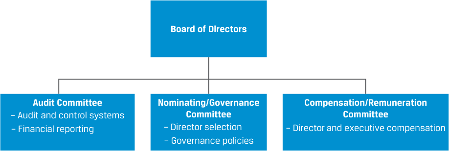

# Tập 3: Tổ chức phát hành doanh nghiệp (*Corporate Issuers*)
## Học phần 3: Quản trị công ty: Xung đột, Cơ chế, Rủi ro và Lợi ích (*Corporate Governance: Conflicts, Mechanisms, Risks, and Benefits*)
### Phần 2/3: Các cơ chế quản trị công ty (*Corporate Governance Mechanisms*) (Trang PDF 84–99)

---

<!-- PDF Page 84 -->

4. Đội ngũ quản lý của một công ty – có chế độ đãi ngộ bao gồm lượng lớn cổ phiếu thưởng và quyền chọn cổ phiếu – đang theo đuổi một thương vụ mua lại lớn được tài trợ bằng nợ vay. Đội ngũ quản lý thảo luận về việc thương vụ mua lại này có thể không phù hợp với lợi ích của tất cả các bên liên quan như thế nào, và có đề xuất rằng họ nên tăng tỷ trọng tài trợ bằng vốn chủ sở hữu cho thương vụ mua lại này. Việc tăng tài trợ bằng vốn chủ sở hữu cho giao dịch này sẽ làm tăng sự ủng hộ của bên liên quan nào?

   - **A.** Chủ nợ (*Debtholders*)
   - **B.** Ban giám đốc (*Management*)
   - **C.** Cổ đông (*Shareholders*)

- **Lời giải:**

A là đáp án đúng. Các chủ nợ với quyền đòi hỏi cố định có xu hướng ngại rủi ro và muốn công ty cổ phần thực hiện các hành động nhằm đảm bảo có đủ dòng tiền để đáp ứng các nghĩa vụ nợ của mình. Vì lý do này, các chủ nợ có xu hướng muốn công ty huy động thêm vốn chủ sở hữu thay vì tăng nợ lên đến mức có thể làm tăng rủi ro vỡ nợ (*default risk*).

B và C sai, bởi vì ban giám đốc đã được gắn kết lợi ích với các cổ đông thông qua cổ phiếu thưởng và quyền chọn cổ phiếu, và các cổ đông có xu hướng ưa thích đòn bẩy lớn hơn thay vì phát hành vốn cổ phần gây pha loãng (*dilutive equity issuance*).

5. Hãy thảo luận về những xung đột tiềm tàng giữa các cổ đông kiểm soát và các cổ đông thiểu số trong một cấu trúc cổ phiếu hai hạng (*dual-class structure*).

#### **Lời giải:**

Cấu trúc cổ phiếu hai hạng cho phép một số bên liên quan thực chất kiểm soát công ty nhờ việc sở hữu một hạng cổ phiếu có quyền biểu quyết vượt trội (*superior voting rights*). Mặc dù các cổ đông thiểu số vẫn có khả năng thay đổi quyền biểu quyết theo hướng có lợi cho mình, nhưng việc làm đó có thể rất khó khăn và tốn kém, như đã được minh họa qua ví dụ về Magna International.

# **<mark>3</mark> CÁC CƠ CHẾ QUẢN TRỊ CÔNG TY (*CORPORATE GOVERNANCE MECHANISMS*)**

- Mô tả quản trị công ty và các cơ chế để quản lý mối quan hệ với các bên liên quan cũng như giảm thiểu các rủi ro đi kèm (*describe corporate governance and mechanisms to manage stakeholder relationships and mitigate associated risks*)

Xét đến hệ sinh thái phức tạp của các bên liên quan trong một công ty cổ phần, quyền hạn, trách nhiệm và quyền lực của từng bên phải được đưa vào xem xét khi thiết lập một cấu trúc quản trị phù hợp bằng cách tạo ra sự cân bằng giữa lợi ích của các nhóm này đồng thời đáp ứng các mục tiêu của doanh nghiệp. Một cấu trúc quản trị lành mạnh tìm cách đảm bảo rằng công ty cổ phần có sẵn các cơ chế không những tạo điều kiện thuận lợi cho việc tuân thủ các quy tắc và quy định do các cơ quan có thẩm quyền bên ngoài áp đặt mà còn đáp ứng các yêu cầu đặc thù của các bên liên quan nội bộ.

<!-- PDF Page 85 -->

### **Báo cáo doanh nghiệp và Tính minh bạch (*Corporate Reporting and Transparency*)**

Báo cáo doanh nghiệp và tính minh bạch (*corporate reporting and transparency*) là nền tảng của quản trị công ty. Nếu không có chúng, các bên liên quan bên ngoài sẽ không thể biết được kết quả hoạt động và vị thế của công ty, và do đó khả năng bảo vệ lợi ích của họ sẽ bị suy yếu nghiêm trọng. Do tầm quan trọng của nó, hoạt động báo cáo được quy định bắt buộc và điều tiết thông qua các biện pháp pháp lý, quy định của cơ quan quản lý và các quy định bán pháp lý (*quasi-regulatory means*, ví dụ: các yêu cầu niêm yết của sàn giao dịch).

Các nhà đầu tư có quyền tiếp cận thông tin tài chính và phi tài chính của một công ty đại chúng thông qua các báo cáo thường niên (*annual reports*), bản tuyên bố ủy quyền (*proxy statements*), các công bố thông tin của công ty, tài liệu quan hệ nhà đầu tư (*investor relations resources*) và các nguồn khác. Hoạt động báo cáo này bao gồm thông tin về hoạt động kinh doanh của công ty, các mục tiêu chiến lược, báo cáo tài chính đã được kiểm toán, cấu trúc quản trị, cơ cấu sở hữu, chính sách thù lao, các giao dịch với các bên liên quan (*related-party transactions*) và các yếu tố rủi ro. Hầu hết các khu vực pháp lý và các sàn giao dịch chứng khoán đều yêu cầu báo cáo tài chính thường niên của các công ty niêm yết phải được kiểm toán (*audited*) — và báo cáo tài chính giữa niên độ (*interim financial statements*) phải được soát xét (*reviewed*) — bởi các kiểm toán viên độc lập bên thứ ba.

Các công ty tư nhân chỉ công bố thông tin ra công chúng trong phạm vi được yêu cầu bởi các quy định pháp lý hoặc trên cơ sở tự nguyện. Tuy nhiên, họ sẽ công bố thông tin một cách bảo mật cho các nhà đầu tư của mình, nhưng nội dung và hình thức của thông tin đó phụ thuộc vào sự đàm phán giữa các bên liên quan thay vì được chuẩn hóa như báo cáo của các công ty đại chúng. Hầu hết các khu vực pháp lý _không_ yêu cầu các công bố thông tin của công ty tư nhân phải được kiểm toán, mặc dù các công ty tư nhân hoàn toàn tự do trong việc thuê kiểm toán – điều có thể giúp cải thiện các điều khoản giao dịch của họ với các nhà đầu tư.

Các nhà đầu tư dựa vào các báo cáo và thông tin doanh nghiệp để:

- đánh giá kết quả hoạt động của công ty cũng như của các thành viên hội đồng quản trị và các nhà quản lý;
- đưa ra các quyết định định giá và đầu tư;
- bỏ phiếu về các vấn đề hoặc thay đổi then chốt của doanh nghiệp; và
- đảm bảo sự tuân thủ các cam kết pháp lý trong các hợp đồng nợ. Bởi vì việc từng trái chủ cá nhân tự theo dõi các yêu cầu trái phiếu này là không khả thi trên thực tế, một trung gian tài chính được gọi là bên nhận ủy thác (*trustee*) sẽ được thuê để báo cáo và quản lý công tác hành chính thanh toán cho các trái chủ.

### **Các cơ chế của Cổ đông (*Shareholder Mechanisms*)**

Với tư cách là những chủ sở hữu hưởng phần còn lại (*residual owners*) của công ty, các cổ đông tìm cách bảo vệ quyền đòi hỏi sở hữu của mình thông qua nhiều cơ chế kiểm soát đối với công ty. Mặc dù không tồn tại một bộ quyền cổ đông tiêu chuẩn chung duy nhất nào, nhưng các nhà đầu tư toàn cầu thường dựa vào các quyền và cơ chế phổ biến được nêu trong các phần dưới đây. Những cơ chế này thường được ghi nhận trong luật chứng khoán và được thực thi bởi các cơ quan quản lý.

#### **_Đại hội đồng cổ đông (Shareholder Meetings)_**

Các cuộc họp đại hội đồng cổ đông — hay **đại hội đồng cổ đông thường niên (*annual general meeting* – AGM)**, thường được tổ chức mỗi năm một lần — cho phép các cổ đông tham gia thảo luận và biểu quyết về các vấn đề và giao dịch không được phân quyền cho hội đồng quản trị. Các vấn đề phổ biến được đệ trình để cổ đông biểu quyết tại AGM bao gồm:

- Bầu cử thành viên hội đồng quản trị (*Board member elections*)
- Bổ nhiệm kiểm toán viên độc lập (*Appointment of independent auditor*)
- Phê duyệt báo cáo tài chính thường niên, cổ tức, và thù lao của thành viên hội đồng quản trị cũng như kiểm toán viên
- Phê duyệt các kế hoạch đãi ngộ dựa trên vốn cổ phần (*equity-based compensation plans*)
- Biểu quyết không mang tính ràng buộc về chế độ đãi ngộ (“tiếng nói về lương thưởng” – *“Say on pay” non-binding votes on compensation plans*)

<!-- PDF Page 86 -->

**Đại hội đồng cổ đông bất thường (*Extraordinary general meetings* – EGMs)** có thể được triệu tập khi có đề xuất về các nghị quyết khác đòi hỏi sự phê duyệt của cổ đông, hoặc khi được yêu cầu bởi một số lượng cổ đông triệu tập tối thiểu xác định (hoặc một tỷ lệ cổ phiếu đang lưu hành nhất định). Các vấn đề được đệ trình để cổ đông biểu quyết tại EGM mang tính đặc thù theo từng sự vụ (*idiosyncratic*) nhưng thường bao gồm:

- Các cuộc bầu cử đặc biệt đối với thành viên hội đồng quản trị, thường do các cổ đông đề xuất
- Sửa đổi quy chế hoạt động (*bylaws*) hoặc điều lệ công ty (*articles of association*)
- Mua bán và sáp nhập (M&A), thâu tóm (*takeovers*) và bán tài sản (*asset sales*)
- Tăng vốn (*Capital increases*)
- Tự nguyện giải thể và thanh lý doanh nghiệp (*Voluntary firm liquidation*)

Các cổ đông không thể trực tiếp tham dự cuộc họp thường ủy quyền cho một bên khác bỏ phiếu thay mặt mình trong quy trình **bỏ phiếu ủy quyền (*proxy voting*)**, thường bằng cách gửi phiếu bầu điện tử hoặc qua đường bưu điện. Bỏ phiếu ủy quyền là hình thức tham gia phổ biến nhất của nhà đầu tư trong các kỳ đại hội đồng cổ đông.

#### **KIỂM TRA KIẾN THỨC (*KNOWLEDGE CHECK*)**

1. Phát biểu nào sau đây về đại hội đồng cổ đông bất thường (EGM) là đúng?

   - **A.** Việc bổ nhiệm kiểm toán viên bên ngoài diễn ra trong kỳ họp EGM.
   - **B.** Công ty cổ phần trình bày tổng quan về kết quả hoạt động của doanh nghiệp tại kỳ họp EGM.
   - **C.** Việc sửa đổi quy chế hoạt động (*bylaws*) của công ty cổ phần thường diễn ra trong kỳ họp EGM.

#### **Lời giải:**

C là đáp án đúng. Việc sửa đổi quy chế hoạt động của công ty thường diễn ra trong một kỳ họp EGM – kỳ họp giải quyết những thay đổi trọng đại đối với công ty, chẳng hạn như sửa đổi quy chế hoạt động. A và B sai, bởi vì việc bổ nhiệm kiểm toán viên bên ngoài và trình bày tổng quan về kết quả hoạt động của công ty thường diễn ra trong kỳ họp thường niên (AGM).

#### **_Hoạt động cổ đông tích cực (Shareholder Activism)_**

**Hoạt động cổ đông tích cực (*Shareholder activism*)** bao gồm các chiến lược của nhà đầu tư nhằm buộc một công ty phải hành động theo một cách thức mong muốn. Động lực chính của các cổ đông tích cực (*shareholder activists*) là làm tăng giá trị cổ đông một cách tương đối nhanh chóng, mặc dù một số hoạt động tích cực liên quan đến các cân nhắc về xã hội, chính trị hoặc môi trường. Các cổ đông tích cực thường gây áp lực buộc ban giám đốc phải hành động bằng cách sử dụng các chiến thuật như phát động các cuộc chiến ủy quyền (*proxy fights*), đề xuất các nghị quyết của cổ đông (*shareholder resolutions*), và công khai các vấn đề gây tranh cãi ra công chúng.

Các quỹ phòng hộ (*hedge funds*) là những chủ thể chiếm ưu thế trong số các cổ đông tích cực. Không giống như hầu hết các nhà đầu tư tổ chức, các quỹ phòng hộ tính phần lớn phí quản lý của mình dựa trên tỷ suất sinh lợi tạo ra (*performance fees*), mang lại cho họ lợi ích sát sườn đáng kể trong sự thành công về tài chính của một chiến dịch cổ đông tích cực. Ngoài ra, các quỹ phòng hộ phải đối mặt với ít hạn chế đầu tư hơn và do đó có thể nắm giữ các vị thế cổ phiếu lớn bằng cách sử dụng vốn vay. Tuy nhiên, các thực thể đầu tư chịu sự quản lý chặt chẽ như các quỹ tương hỗ (*mutual funds*) lại phải tuân thủ các hạn chế đầu tư (ví dụ: giới hạn về quy mô vị thế tối đa, đòn bẩy, và việc sở hữu các chứng khoán đang kiệt quệ tài chính hoặc kém thanh khoản) làm hạn chế những hoạt động này, mặc dù một số quỹ lớn vẫn sử dụng tầm ảnh hưởng của mình để khuyến khích các hành động tích cực từ phía doanh nghiệp.

<!-- PDF Page 87 -->

#### **KIỂM TRA KIẾN THỨC (*KNOWLEDGE CHECK*)**

1. Phát biểu nào sau đây mô tả _đúng nhất_ về các cổ đông tích cực (*shareholder activists*)? Các cổ đông tích cực:
   - **A.** giúp ổn định định hướng chiến lược của công ty.
   - **B.** có rất ít tác động đến các nhà đầu tư dài hạn của công ty.
   - **C.** ít có khả năng làm thay đổi thành phần cơ sở cổ đông của công ty.

#### **Lời giải:**

A là đáp án đúng. Các cổ đông tích cực thường thu hẹp định hướng chiến lược của một công ty để tập trung vào một vài lĩnh vực mà công ty từng làm tốt trong lịch sử, thường bán bớt tài sản và đóng cửa các bộ phận kém hiệu quả trong quá trình đó. B sai, bởi vì các nhà đầu tư dài hạn trong một công ty cần xem xét cách thức các cổ đông tích cực tác động đến công ty, đặc biệt nếu công ty bị tái cơ cấu và ban giám đốc bị thay thế. C sai, bởi vì một cổ đông tích cực _có_ nhiều khả năng làm thay đổi luận điểm đầu tư (*investment thesis*) đối với một công ty theo hướng tái cơ cấu, điều này có thể thúc đẩy sự thay đổi trong cơ sở cổ đông của công ty.

#### **_Kiện tụng của Cổ đông (Shareholder Litigation)_**

Các cổ đông tích cực có thể theo đuổi các chiến thuật bổ sung, chẳng hạn như kiện tụng hoặc khởi kiện pháp lý. Một loại hình nổi bật là **các vụ kiện phái sinh của cổ đông (*shareholder derivative lawsuits*)** (không liên quan đến các hợp đồng công cụ tài chính phái sinh), là các thủ tục tố tụng pháp lý được khởi xướng nhằm chống lại hội đồng quản trị, ban giám đốc và/hoặc các cổ đông kiểm soát bởi một cổ đông được coi là đang hành động thay mặt cho công ty để thay thế cho các thành viên hội đồng quản trị và các giám đốc điều hành – những người đã thất bại trong việc hành động thỏa đáng vì lợi ích của công ty. Ở nhiều quốc gia, luật pháp hạn chế các cổ đông theo đuổi hành động pháp lý bằng cách áp đặt ngưỡng lợi ích sở hữu tối thiểu của cổ đông đối với các vụ kiện như vậy hoặc cấm hoàn toàn chúng.

#### **_Thâu tóm Doanh nghiệp (Corporate Takeovers)_**

Những thay đổi trong quyền kiểm soát công ty thông qua một vụ thâu tóm (*takeover*) bởi các cổ đông hoặc một bên đi mua lại có thể được theo đuổi theo một số cách. Một cơ chế là **cuộc chiến ủy quyền (*proxy contest* hoặc *proxy fight*)**. Trong một cuộc chiến ủy quyền, một nhóm tìm kiếm vị thế kiểm soát trong hội đồng quản trị của công ty sẽ cố gắng thuyết phục các cổ đông bỏ phiếu cho nhóm của mình. Các đội ngũ quản lý cũng có thể bị thay thế thông qua **chào mua công khai (*tender offers*)** và **thâu tóm thù địch (*hostile takeovers*)** – những phương thức tìm cách tiếp quản một công ty thông qua việc giành quyền kiểm soát hội đồng quản trị và từ đó kiểm soát ban giám đốc. Chào mua công khai (*tender offer*) bao gồm một lời mời gửi tới các cổ đông để họ bán trực tiếp phần vốn sở hữu của mình cho một nhóm đang tìm cách giành quyền kiểm soát. Một cuộc tranh giành quyền kiểm soát công ty có thể thu hút các nhà kinh doanh chênh lệch giá (*arbitrageurs*) và các chuyên gia thâu tóm (*takeover specialists*), những người tạo điều kiện thuận lợi cho việc chuyển giao quyền kiểm soát bằng cách mua gom cổ phiếu từ các cổ đông hiện hữu tại công ty mục tiêu và sau đó bán lại cổ phiếu cho bên trả giá cao nhất. Thâu tóm thù địch (*hostile takeover*) là một nỗ lực nhằm mua lại một công ty mà không có sự đồng thuận của ban giám đốc công ty đó.

Việc bảo toàn công việc làm đóng vai trò như một động lực thúc đẩy các thành viên hội đồng quản trị và các nhà quản lý tập trung vào việc tối đa hóa tài sản cho cổ đông. Tuy nhiên, mối đe dọa bị bãi nhiệm cũng có thể mang lại những hàm ý tiêu cực cho các thông lệ quản trị công ty nếu công ty áp dụng các biện pháp chống thâu tóm (*anti-takeover measures*), chẳng hạn như bầu cử hội đồng quản trị xen kẽ (*staggered board elections*) hoặc kế hoạch quyền cổ đông (*shareholder rights plan*, thường được gọi là **viên thuốc độc – *poison pill***), nhằm làm giảm khả năng xảy ra một vụ thâu tóm không mong muốn. Bầu cử hội đồng quản trị xen kẽ có thể làm pha loãng quyền biểu quyết của cổ đông bằng cách ngăn cản các cổ đông thay thế toàn bộ hội đồng quản trị trong bất kỳ cuộc bầu cử đơn lẻ nào. Một

<!-- PDF Page 88 -->

kế hoạch quyền cổ đông (*shareholder rights plan*) cho phép các cổ đông hiện hữu mua thêm cổ phiếu với giá chiết khấu nếu một cổ đông khác mua gom đến một tỷ lệ phần trăm cổ phiếu nhất định của công ty. Những kế hoạch như vậy làm tăng chi phí thâu tóm đối với bất kỳ bên chào mua tiềm năng nào.

### **Các cơ chế của Chủ nợ (*Creditor Mechanisms*)**

Các chủ nợ, bao gồm cả các bên cho vay tư nhân như ngân hàng cũng như các trái chủ đại chúng, có một số cơ chế sẵn có để bảo vệ lợi ích của mình. Quyền của các chủ nợ được xác lập bởi luật pháp và theo các hợp đồng được ký kết với công ty. Luật pháp khác nhau tùy theo từng khu vực pháp lý nhưng thường bao gồm các điều khoản nhằm bảo vệ lợi ích của chủ nợ và cung cấp quyền truy đòi pháp lý (*legal recourse*).

#### **_Khế ước Trái phiếu (Bond Indenture)_**

Quyền của các trái chủ được xác lập thông qua các hợp đồng được ký kết với công ty. **Khế ước trái phiếu (*bond indenture*)** là một hợp đồng pháp lý mô tả cấu trúc của một trái phiếu, các nghĩa vụ của công ty và quyền của các trái chủ. Các điều khoản và điều kiện của các thỏa thuận cho vay hoặc sẽ yêu cầu công ty phải thực hiện một số hành động nhất định (hoặc đáp ứng một số yêu cầu nhất định) hoặc nghiêm cấm một số hành động nhất định (gọi là các điều khoản ràng buộc – *covenants*). Các trái chủ cũng có thể yêu cầu tổ chức phát hành phải thế chấp/cầm cố (*pledge*) một số tài sản nhất định để đảm bảo cho lời hứa hoàn trả các nghĩa vụ nợ của mình.

#### **_Ủy ban Chủ nợ (Creditor Committees)_**

Ở một số quốc gia, các ủy ban chủ nợ chính thức (*official creditor committees*), đặc biệt là dành cho các trái chủ không có tài sản đảm bảo (*unsecured bondholders*), được thành lập ngay khi một công ty nộp đơn xin phá sản. Các ủy ban như vậy được kỳ vọng sẽ đại diện cho các trái chủ trong suốt quá trình tố tụng phá sản và bảo vệ lợi ích của trái chủ trong quá trình tái cơ cấu hoặc thanh lý tài sản.

Khi một công ty đang gặp khó khăn trong việc đáp ứng các nghĩa vụ của mình theo một khế ước trái phiếu, một **ủy ban đặc trách (*ad hoc committee*)** có thể được thành lập bởi một nhóm các trái chủ để tiếp cận công ty với các phương án tiềm năng nhằm tái cơ cấu trái phiếu của họ. Mặc dù các thành viên của một ủy ban đặc trách không đại diện chính thức cho tất cả các trái chủ, nhưng lợi ích của họ thường gắn kết chặt chẽ với lợi ích của nhóm trái chủ rộng lớn hơn.

### **Các cơ chế của Hội đồng quản trị và Ban giám đốc (*Board and Management Mechanisms*)**

Mặc dù hội đồng quản trị giữ vai trò trung tâm trong cấu trúc quản trị của một công ty, các hội đồng quản trị thường xuyên phân quyền các chức năng cụ thể cho các ủy ban (*committees*) bao gồm một nhóm nhỏ các thành viên của hội đồng quản trị. Các ủy ban thuộc hội đồng quản trị xem xét kỹ lưỡng, rà soát, giám sát và theo dõi sát sao các vấn đề thuộc phạm vi nhiệm vụ của mình, vốn có thể đòi hỏi chuyên môn cụ thể hoặc tính độc lập.

Bảng 2 (Exhibit 2) phác thảo ba ủy ban phổ biến nhất thuộc hội đồng quản trị (đôi khi được gọi là “các ủy ban cốt lõi” – *“core committees”*), được khuyến nghị bởi hầu hết các bộ quy tắc quản trị công ty và được quy định bắt buộc bởi một số sàn giao dịch chứng khoán.

<!-- PDF Page 89 -->

**Bảng 2 (Exhibit 2): Các Ủy ban cốt lõi của Hội đồng quản trị và các Chức năng giám sát chính (*Core Board Committees and Key Oversight Functions*)**

<!-- Picture Text: Board of Directors Audit Committee Nominating/Governance Compensation/Remuneration – Audit and control systems Committee Committee – Financial reporting – Director selection – Director and executive compensation – Governance policies  -->

> **Chú thích hình ảnh:** Hội đồng quản trị (*Board of Directors*) có 3 ủy ban cốt lõi:
> - **Ủy ban Kiểm toán (*Audit Committee*):** Hệ thống kiểm toán và kiểm soát (*Audit and control systems*); Báo cáo tài chính (*Financial reporting*).
> - **Ủy ban Đề cử/Quản trị (*Nominating/Governance Committee*):** Lựa chọn thành viên hội đồng quản trị (*Director selection*); Các chính sách quản trị (*Governance policies*).
> - **Ủy ban Đãi ngộ/Thù lao (*Compensation/Remuneration Committee*):** Chế độ đãi ngộ cho thành viên hội đồng quản trị và ban điều hành (*Director and executive compensation*).

Các ủy ban này đưa ra các khuyến nghị và báo cáo cho hội đồng quản trị một cách thường xuyên. Khi thành lập các ủy ban, hội đồng quản trị không ủy thác trách nhiệm tối hậu của mình và cũng không được miễn trừ khỏi các nghĩa vụ của mình. Hội đồng quản trị có trách nhiệm rà soát, chất vấn và đảm bảo nội dung của bất kỳ báo cáo nào do các ủy ban đệ trình lên và đưa ra các quyết định thích hợp.

#### **_Ủy ban Kiểm toán (Audit Committee)_**

Ủy ban kiểm toán (*audit committee*) là ủy ban thuộc hội đồng quản trị được yêu cầu và thiết lập rộng rãi nhất; theo các thông lệ tốt nhất, ủy ban này chỉ nên bao gồm hoàn toàn các thành viên hội đồng quản trị độc lập và có ít nhất một thành viên có chuyên môn về kế toán hoặc quản lý tài chính. Ủy ban kiểm toán giám sát quy trình lập báo cáo tài chính của tổ chức phát hành, bao gồm việc lựa chọn và thực thi đúng đắn các chính sách kế toán theo các chuẩn mực và quy định kế toán nhằm đảm bảo tính trung thực và toàn vẹn (*integrity*) của các báo cáo tài chính. Ủy ban này giám sát chức năng kiểm toán nội bộ (*internal audit function*) và đảm bảo tính độc lập cũng như năng lực của bộ phận này. Ủy ban kiểm toán cũng chịu trách nhiệm khuyến nghị việc bổ nhiệm một kiểm toán viên độc lập bên ngoài (*independent external auditor*) và đề xuất mức thù lao cho kiểm toán viên đó. Ủy ban tương tác và tổ chức các cuộc họp với kiểm toán viên bên ngoài. Ủy ban tiếp nhận báo cáo từ cả kiểm toán viên nội bộ và bên ngoài, đề xuất các hành động khắc phục đối với những vấn đề được nêu bật, và theo dõi việc thực hiện chúng. Trong một số trường hợp, ủy ban kiểm toán cũng có thể giám sát an ninh công nghệ thông tin.

#### **_Ủy ban Đề cử/Quản trị (Nominating/Governance Committee)_**

Ủy ban đề cử, hay ủy ban quản trị (*nominating or governance committee*), cũng thường bao gồm các thành viên độc lập theo đúng các thông lệ tốt nhất. Ủy ban này đánh giá các ứng viên cho vị trí thành viên hội đồng quản trị và nhà quản lý cấp cao, đồng thời giám sát quy trình bầu cử hội đồng quản trị. Ủy ban thiết lập các thủ tục và chính sách đề cử, bao gồm các tiêu chí đối với thành viên hội đồng quản trị, việc tìm kiếm và xác định các ứng viên đủ tiêu chuẩn cho vị trí thành viên hội đồng quản trị, và quy trình bầu cử bởi các cổ đông. Khi thiết kế các chính sách của mình và khi đề cử các ứng viên vào hội đồng quản trị, ủy ban đảm bảo rằng cấu trúc của hội đồng quản trị có sự cân bằng và phù hợp với các nguyên tắc quản trị cũng như các bộ quy tắc hiện hành.

Ủy ban này cũng giám sát việc thiết lập và thực thi các chính sách của công ty, bao gồm:

- bộ quy tắc quản trị công ty (*corporate governance code*);
- điều lệ hoạt động của hội đồng quản trị và các ủy ban trực thuộc (*charter of the board and its committees*);
- bộ quy tắc đạo đức (*code of ethics*); và
- chính sách về xung đột lợi ích (*policy on conflicts of interest*), cùng các chính sách khác.

<!-- PDF Page 90 -->

Ủy ban định kỳ rà soát các chính sách này để cập nhật bất kỳ thay đổi hoặc sự phát triển cần thiết nào. Quan trọng nhất, ủy ban đảm bảo việc thực thi các chính sách quản trị, sự tuân thủ luật pháp và các quy định hiện hành, cũng như theo đuổi các hành động thích hợp nếu phát hiện bất kỳ vấn đề hoặc vi phạm nào. Ví dụ, các chính sách về xung đột lợi ích và giao dịch với các bên liên quan yêu cầu các thành viên hội đồng quản trị và các nhà quản lý phải công bố bất kỳ xung đột lợi ích thực tế hoặc tiềm tàng nào liên quan đến công ty, cũng như bất kỳ lợi ích trọng yếu nào trong một giao dịch có thể ảnh hưởng đến công ty.

#### **_Ủy ban Đãi ngộ/Thù lao (Compensation/Remuneration Committee)_**

Ủy ban đãi ngộ, hay ủy ban thù lao (*compensation or remuneration committee*), xây dựng và đề xuất các chính sách thù lao cho các thành viên hội đồng quản trị và các giám đốc điều hành chủ chốt, thường bao gồm việc thiết lập các tiêu chí đánh giá kết quả hoạt động và đánh giá hiệu quả làm việc của nhà quản lý. Đãi ngộ dành cho ban điều hành (*executive compensation*) thu hút sự chú ý rất lớn của các nhà đầu tư, với trọng tâm là gắn kết lợi ích của nhà quản lý và cổ đông. Luật pháp ở hầu hết các khu vực pháp lý, cũng như các thông lệ tốt nhất, đều yêu cầu tất cả các thành viên của ủy ban đãi ngộ phải là các thành viên hội đồng quản trị độc lập bởi vì ban giám đốc không nên tự đánh giá kết quả hoạt động của chính mình.

Các kế hoạch đãi ngộ thường bao gồm một cấu phần biến đổi (*variable component*) — thường là chia sẻ lợi nhuận, thưởng cổ phiếu hoặc quyền chọn cổ phiếu — phụ thuộc vào kết quả hoạt động của công ty hoặc diễn biến giá cổ phiếu. Tuy nhiên, thù lao dựa trên cổ phiếu sẽ không đạt được mục đích của mình nếu các nhà quản lý có thể gia tăng lợi ích cá nhân của họ bằng cái giá phải trả của công ty trong khi lại hạn chế mức độ tiếp xúc rủi ro của bản thân trước sự suy yếu của giá cổ phiếu. Do đó, các công ty ngày càng thiết kế các kế hoạch khuyến khích nhằm ngăn chặn “chủ nghĩa ngắn hạn” (*“short-termism”*) hoặc việc chấp nhận rủi ro quá mức của các nhà quản lý. Một số kế hoạch khuyến khích bao gồm việc trao cổ phiếu, thay vì quyền chọn, cho các nhà quản lý và hạn chế quyền định đoạt (*vesting*) hoặc việc bán các cổ phiếu đó trong vài năm hoặc cho đến khi nghỉ hưu. Một kế hoạch khuyến khích dài hạn (*long-term incentive plan*) sẽ trì hoãn việc chi trả thù lao, một phần hoặc toàn bộ, cho đến khi đạt được các mục tiêu chiến lược của công ty (thường là các mục tiêu về kết quả hoạt động).

Do quy định của các đạo luật như Đạo luật Dodd-Frank tại Hoa Kỳ hoặc do tự nguyện lựa chọn, các tổ chức phát hành ngày càng tìm kiếm quan điểm của cổ đông về đãi ngộ dành cho ban điều hành bằng cách tiến hành các cuộc bỏ phiếu không mang tính ràng buộc “tiếng nói về lương thưởng” (*“say on pay” votes*) tại kỳ họp AGM. Bằng cách cho phép các cổ đông bày tỏ quan điểm của mình về các vấn đề liên quan đến thù lao, các công ty có thể giới hạn quyền tự quyết của các thành viên hội đồng quản trị trong việc trao mức thù lao quá cao hoặc không thỏa đáng.

#### **_Các Ủy ban Bổ sung (Additional Committees)_**

Các công ty có thể có nhiều ủy ban khác thuộc hội đồng quản trị, thường mang tính đặc thù theo từng ngành công nghiệp. Ủy ban rủi ro (*risk committees*) — rất phổ biến (và ở một số khu vực pháp lý là bắt buộc) trong ngành dịch vụ tài chính — xác định hồ sơ rủi ro (*risk profile*) và khẩu vị rủi ro (*risk appetite*) của công ty, đồng thời đảm bảo rằng công ty có sẵn một hệ thống quản trị rủi ro doanh nghiệp (*enterprise risk management system*), qua đó các rủi ro được nhận diện, đánh giá, giảm thiểu và quản lý một cách thích hợp. Theo đó, ủy ban rủi ro giám sát việc thiết lập chính sách rủi ro và các kế hoạch quản trị rủi ro hàng năm cũng như theo dõi việc thực thi chúng. Các công ty bảo hiểm thường có ủy ban đầu tư (*investment committees*) giúp đảm bảo rằng công ty đã thông qua và tuân thủ các chính sách đầu tư cũng như quản lý vốn hợp lý và thận trọng.

### **Các cơ chế đối với Nhân viên (*Employee Mechanisms*)**

Bằng cách quản lý mối quan hệ với nhân viên, các công ty tìm cách tôn trọng quyền của người lao động và tránh các rủi ro pháp lý hoặc danh tiếng gắn liền với các vấn đề lao động. Quản lý quan hệ nhân viên (đôi khi được gọi là quản trị vốn nhân lực – *human capital management*) giúp các doanh nghiệp thu hút và giữ chân nhân tài, đồng thời đảm bảo rằng nhân viên hoàn thành trách nhiệm của mình và có động lực hành động vì lợi ích tốt nhất của công ty.

Quyền của người lao động trước hết được bảo vệ thông qua luật lao động đặc thù của từng khu vực pháp lý, trong đó xác định các tiêu chuẩn về quyền và nghĩa vụ của người lao động và bao gồm các vấn đề như giờ làm việc, chế độ sau khi chấm dứt hợp đồng lao động, chăm sóc sức khỏe và các chế độ phúc lợi khác, cũng như nghỉ phép có hưởng lương. Ở hầu hết các quốc gia, người lao động có quyền thành lập công đoàn (*unions*). Các công đoàn

<!-- PDF Page 91 -->

bảo vệ quyền lợi thay mặt cho các đoàn viên nhằm gây ảnh hưởng đến một số vấn đề tác động đến người lao động, chẳng hạn như tiền lương và điều kiện làm việc. Mặc dù không phải là thông lệ phổ biến ở nhiều nơi trên thế giới, nhưng tại một số quốc gia, người lao động có đại diện trong hội đồng quản trị — hoặc hội đồng giám sát (*supervisory board*) — của các công ty đáp ứng một số tiêu chí nhất định về quy mô hoặc quyền sở hữu (ví dụ: tại Đức, Áo và Luxembourg).

Ở cấp độ cá nhân, các hợp đồng lao động quy định rõ các quyền và nghĩa vụ khác nhau của người sử dụng lao động và người lao động. Một số công ty có **chương trình sở hữu cổ phần cho người lao động (*employee stock ownership plan* – ESOP)** để giúp giữ chân nhân viên và gắn kết chặt chẽ hơn lợi ích của họ với lợi ích của công ty. Là một phần của chương trình ESOP, công ty thành lập một quỹ bao gồm cổ phiếu và/hoặc tiền mặt, được trao cho nhân viên dựa trên các tiêu chí về thâm niên phục vụ hoặc kết quả làm việc và thường bao gồm các giai đoạn chờ hưởng quyền (*vesting periods*).

### **Các cơ chế đối với Khách hàng và Nhà cung cấp (*Customer and Supplier Mechanisms*)**

Cả khách hàng và nhà cung cấp đều ký kết các thỏa thuận hợp đồng với công ty, trong đó quy định cụ thể các sản phẩm và dịch vụ làm cơ sở cho mối quan hệ, mức giá hoặc phí cùng các điều khoản thanh toán, quyền và nghĩa vụ của mỗi bên, mối quan hệ hậu mãi và bất kỳ cam kết bảo hành nào. Các hợp đồng cũng quy định cụ thể các hành động sẽ được thực hiện và quyền truy đòi sẵn có nếu một trong hai bên vi phạm các điều khoản của hợp đồng.

Khách hàng, chủ sở hữu và các bên liên quan khác ngày càng sử dụng mạng xã hội (*social media*) để lên tiếng hoặc bảo vệ lợi ích của mình hay để tăng cường tầm ảnh hưởng của họ đối với các vấn đề của doanh nghiệp. Ví dụ, sự chú ý tiêu cực của truyền thông có thể gây ảnh hưởng bất lợi đến danh tiếng hoặc nhận thức của công chúng về một công ty hoặc các nhà quản lý và thành viên hội đồng quản trị của công ty đó. Thông qua mạng xã hội, các bên liên quan này có thể phát tán thông tin ngay lập tức với chi phí hoặc nỗ lực rất nhỏ và do đó có khả năng cạnh tranh tốt hơn với ban giám đốc công ty trong việc định hướng tâm lý công chúng.

### **Các cơ chế của Chính phủ (*Government Mechanisms*)**

#### **_Luật pháp và Quy định (Laws and Regulations)_**

Chính phủ và các cơ quan quản lý xây dựng các đạo luật mà các công ty phải tuân theo và giám sát việc tuân thủ các đạo luật đó của các công ty. Những đạo luật như vậy bảo vệ và thực thi các quyền sở hữu tài sản và quyền hợp đồng, bên cạnh việc bảo vệ quyền của một nhóm cụ thể chẳng hạn như người tiêu dùng hoặc bảo vệ môi trường. Các ngành công nghiệp mà dịch vụ, sản phẩm hoặc hoạt động của chúng có nhiều khả năng ảnh hưởng đến công chúng hoặc lợi ích của các bên liên quan thường phải chịu sự điều tiết chặt chẽ hơn. Các ví dụ bao gồm ngành dịch vụ tài chính, chăm sóc sức khỏe, nông nghiệp và thực phẩm, cũng như các ngành được coi là gắn liền với lợi ích quốc gia (ví dụ: quốc phòng).

#### **_Các Bộ quy tắc Quản trị Công ty (Corporate Governance Codes)_**

Nhiều cơ quan quản lý đã thông qua các bộ quy tắc quản trị công ty (*corporate governance codes*) bao gồm các nguyên tắc hướng dẫn dành cho các công ty giao dịch đại chúng. Các bộ quy tắc này yêu cầu các công ty phải công bố việc áp dụng các thông lệ quản trị công ty được khuyến nghị hoặc giải thích lý do tại sao họ không làm như vậy – được gọi là cách tiếp cận “tuân thủ hoặc giải thích” (*“comply or explain” approach*). Ví dụ, tại Nhật Bản, các công ty không có thành viên hội đồng quản trị bên ngoài (*outside directors*) phải giải trình lý do tại sao việc bổ nhiệm các thành viên hội đồng quản trị bên ngoài là không phù hợp. Một số khu vực pháp lý không có bộ quy tắc quản trị công ty quốc gia nhưng sử dụng luật hoặc quy định doanh nghiệp quốc gia (ví dụ: Chile) hoặc các yêu cầu niêm yết của sàn giao dịch chứng khoán (ví dụ: Ấn Độ) để đạt được các mục tiêu tương tự.

Hoa Kỳ không có bộ quy tắc hay đạo luật quản trị công ty quốc gia thống nhất nhưng có các đạo luật chứng khoán quốc gia (ví dụ: Đạo luật Chứng khoán – *Securities Act* và Đạo luật Sarbanes-Oxley) được thực thi bởi một cơ quan quản lý cấp quốc gia (Ủy ban Chứng khoán và Sàn giao dịch Hoa Kỳ – SEC). Các sàn giao dịch chứng khoán Hoa Kỳ có các yêu cầu niêm yết bao gồm rất nhiều điều khoản về quản trị,

<!-- PDF Page 92 -->

chẳng hạn như yêu cầu hội đồng quản trị phải có đa số là thành viên độc lập. Ngoài ra, hầu hết các công ty Hoa Kỳ được đăng ký thành lập tại một tiểu bang duy nhất là Delaware – nơi có luật doanh nghiệp cấp tiểu bang trên thực tế đóng vai trò phục vụ cùng mục đích như một bộ quy tắc quản trị công ty quốc gia.

#### **BỘ CÂU HỎI (*QUESTION SET*)**

1. Cơ chế nào sau đây thường được sử dụng để đại diện cho lợi ích của các chủ nợ?

   - **A.** Ủy ban đặc trách (*Ad hoc committee*)
   - **B.** Viên thuốc độc (*Poison pill*)
   - **C.** Chào mua công khai (*Tender offer*)

#### **Lời giải:**

A là đáp án đúng. Ủy ban đặc trách (*ad hoc committee*) là một nhóm các chủ nợ tiếp cận một tổ chức phát hành đang gặp kiệt quệ tài chính với các phương án để tái cơ cấu nợ.

B sai. Viên thuốc độc (*poison pill*) được sử dụng để bảo vệ các cổ đông, ban giám đốc và hội đồng quản trị khỏi các vụ thâu tóm có khả năng định giá thấp công ty hoặc không được mong muốn.

C sai. Chào mua công khai (*tender offer*) bao gồm một lời mời gửi tới các cổ đông để họ bán trực tiếp phần vốn sở hữu của mình cho một nhóm đang tìm cách giành quyền kiểm soát.

2. Trách nhiệm chính của ủy ban kiểm toán thuộc hội đồng quản trị _không_ bao gồm:

   - **A.** giám sát các chính sách kế toán.
   - **B.** thông qua quy tắc quản trị công ty phù hợp.
   - **C.** khuyến nghị mức thù lao cho kiểm toán viên bên ngoài.

   - **Lời giải:**

B là đáp án đúng. Việc thông qua quy tắc quản trị công ty phù hợp là trách nhiệm của ủy ban quản trị (*governance committee*) của công ty cổ phần.

A và C sai, bởi vì việc giám sát các chính sách kế toán và khuyến nghị mức thù lao cho kiểm toán viên bên ngoài là trách nhiệm của ủy ban kiểm toán.

3. Phát biểu nào sau đây là đúng về hoạt động cổ đông tích cực (*shareholder activism*)?

   - **A.** Các cổ đông tích cực hiếm khi bao gồm các quỹ phòng hộ (*hedge funds*).
   - **B.** Các cơ quan quản lý đóng một vai trò nổi bật trong hoạt động cổ đông tích cực.
   - **C.** Mục tiêu chính của hoạt động cổ đông tích cực là làm gia tăng giá trị cổ đông.

#### **Lời giải:**

C là đáp án đúng. Mặc dù hoạt động cổ đông tích cực có thể liên quan đến các vấn đề xã hội và chính trị, nhưng động lực chính của các cổ đông tích cực là làm gia tăng giá trị cổ đông.

A sai, bởi vì các quỹ phòng hộ thường xuyên đóng vai trò là những cổ đông tích cực.

B sai, bởi vì các cơ quan quản lý đóng vai trò nổi bật trong việc thiết lập tiêu chuẩn (*standard setting*), chứ không phải trong hoạt động cổ đông tích cực.

4. Đúng hay Sai: Các nhà đầu tư nhận được thông tin tương tự nhau về nội dung và hình thức, bao gồm cả các công bố thông tin đã được kiểm toán, từ cả công ty tư nhân và công ty đại chúng.

   - **A.** Đúng

<!-- PDF Page 93 -->

   - **B.** Sai

#### **Lời giải:**

**Sai (*False*).** Các công ty tư nhân công bố thông tin một cách bảo mật cho các nhà đầu tư của mình, nhưng nội dung và hình thức của thông tin đó phụ thuộc vào sự đàm phán thay vì được chuẩn hóa và điều tiết theo quy định như báo cáo của các công ty đại chúng. Hầu hết các khu vực pháp lý không yêu cầu các công bố thông tin của công ty tư nhân phải được kiểm toán, mặc dù họ hoàn toàn tự do trong việc thuê kiểm toán.

5. Hãy giải thích tại sao việc bầu cử hội đồng quản trị xen kẽ (*staggered board elections*) lại làm suy yếu quản trị công ty.

#### **Lời giải:**

Bầu cử hội đồng quản trị xen kẽ có thể làm pha loãng quyền biểu quyết của cổ đông bằng cách ngăn cản các cổ đông thay thế toàn bộ hội đồng quản trị trong bất kỳ cuộc bầu cử đơn lẻ nào. Ví dụ, nếu mỗi năm chỉ bầu lại 25% số thành viên hội đồng quản trị, một cổ đông tích cực có thể phải mất tới ba năm mới thay thế được đa số thành viên hội đồng quản trị.

6. Ủy ban đãi ngộ của một công ty đang tìm cách ngăn chặn việc chấp nhận rủi ro quá mức của các nhà quản lý có _nhiều khả năng nhất_ sẽ thiết kế một kế hoạch đãi ngộ khuyến khích mà theo đó:

   - **A.** cho phép các thành viên hội đồng quản trị và các nhà quản lý có quyền tự quyết lớn hơn đối với mức thù lao của họ.
   - **B.** bao gồm một cấu phần biến đổi gồm các quyền chọn cổ phiếu phụ thuộc vào diễn biến giá cổ phiếu trong ngắn hạn.
   - **C.** trao cổ phiếu, thay vì quyền chọn, với thời gian chờ hưởng quyền (*vest*) kéo dài qua nhiều năm và phải tuân theo các yêu cầu nắm giữ tối thiểu.

#### **Lời giải:**

C là đáp án đúng. Việc trao cổ phiếu, thay vì quyền chọn, có thời gian chờ hưởng quyền kéo dài qua nhiều năm và bắt buộc phải nắm giữ sẽ giúp ngăn chặn “chủ nghĩa ngắn hạn” (*“short-termism”*) hoặc việc chấp nhận rủi ro quá mức của các nhà quản lý.

A sai. Bằng cách cho phép _các cổ đông_ bày tỏ quan điểm của mình về các vấn đề thù lao, các công ty có thể giới hạn quyền tự quyết của các thành viên hội đồng quản trị và các nhà quản lý trong việc tự trao cho mình mức thù lao quá cao (hoặc không thỏa đáng), do đó không cho phép các nhà quản lý có quyền tự quyết lớn hơn đối với tiền lương của chính họ.

B sai, bởi vì một cấu phần biến đổi bao gồm các quyền chọn cổ phiếu phụ thuộc vào diễn biến giá cổ phiếu trong ngắn hạn có thể khuyến khích việc chấp nhận rủi ro quá mức của các nhà quản lý. Thù lao dựa trên cổ phiếu sẽ không phục vụ đúng mục đích của nó nếu các nhà quản lý có thể gia tăng lợi ích cá nhân của họ bằng cái giá phải trả của công ty trong khi lại hạn chế mức độ tiếp xúc rủi ro của mình trước kết quả hoạt động yếu kém của cổ phiếu.

## **CÁC RỦI RO VÀ LỢI ÍCH CỦA QUẢN TRỊ CÔNG TY (*CORPORATE GOVERNANCE RISKS AND BENEFITS*)**

<!-- Picture Text: 4  -->

- Mô tả các rủi ro tiềm tàng của việc quản trị công ty và quản lý các bên liên quan yếu kém, cũng như những lợi ích của việc quản trị công ty và quản lý các bên liên quan hiệu quả (*describe potential risks of poor corporate governance and stakeholder management and benefits of effective corporate governance and stakeholder management*)

Quản trị công ty và quản lý các bên liên quan đóng một vai trò sống còn trong sự thành công hay thất bại của các công ty cổ phần. Quản trị công ty yếu kém, các xung đột lợi ích không được quản lý, và/hoặc các cơ chế quản lý bên liên quan không thỏa đáng có thể đặt các doanh nghiệp

<!-- PDF Page 94 -->

vào thế bất lợi cạnh tranh so với các công ty cùng ngành. Ngược lại, các thông lệ quản trị vững mạnh và sự cân bằng hợp lý giữa lợi ích của các bên liên quan thường được phản ánh qua năng lực cạnh tranh và hiệu quả hoạt động tăng lên, các quy trình kiểm soát tốt hơn, và kết quả hoạt động được cải thiện. Vai trò của quản trị công ty và các cơ chế liên quan trong việc giảm thiểu rủi ro vượt ra ngoài phạm vi hoạt động sản xuất kinh doanh để bao hàm cả các rủi ro pháp lý, quy định, danh tiếng và tài chính.

### **Rủi ro và Lợi ích về Hoạt động (*Operational Risks and Benefits*)**

Các công ty cổ phần có hệ thống kiểm soát yếu kém, việc ra quyết định thiếu hiệu quả, hoặc việc giám sát kém hiệu năng thường phải đối mặt với những kết quả bất lợi liên quan đến hoạt động vận hành, kết quả kinh doanh và giá trị của mình. Khi thiếu vắng các biện pháp kiểm soát thỏa đáng, một nhóm bên liên quan có thể trục lợi bằng cái giá phải trả của các nhóm khác. Ví dụ, khi thông tin sẵn có đối với các nhà quản lý vượt trội hơn so với thông tin mà hội đồng quản trị hoặc các cổ đông nhận được, khi các thủ tục kiểm toán yếu kém, hoặc thiếu sự giám sát, các nhà quản lý có thể đưa ra các quyết định chỉ thuần túy vì lợi ích của riêng họ. Ví dụ sau đây minh họa mức độ gian lận và quản lý yếu kém có thể xảy ra khi quản trị công ty không thỏa đáng.

#### **SỰ TRỖI DẬY VÀ SỤP ĐỔ CỦA THERANOS INC. (*THE RISE AND FALL OF THERANOS INC.*)**

Được thành lập vào năm 2003, Theranos đã huy động được hơn 700 triệu USD từ các quỹ đầu tư mạo hiểm và các nhà đầu tư tư nhân, và được định giá ở mức 10 tỷ USD vào năm 2014. Công ty cùng người sáng lập kiêm CEO của mình, bà Elizabeth Holmes, đã tìm cách cách mạng hóa ngành chăm sóc sức khỏe bằng công nghệ đột phá giúp nhận diện nhanh chóng và ít tốn kém vô số tình trạng bệnh lý bằng một xét nghiệm chỉ dựa trên một giọt máu duy nhất. Hội đồng quản trị của công ty quy tụ nhiều thành viên nổi tiếng và có tầm ảnh hưởng lớn trong suốt lịch sử hoạt động của mình, bao gồm các cựu Ngoại trưởng Hoa Kỳ và cựu giám đốc Trung tâm Kiểm soát và Phòng ngừa Dịch bệnh Hoa Kỳ (CDC).

Năm 2015, những câu hỏi nghi vấn bắt đầu nổi lên công khai xoay quanh công nghệ xét nghiệm máu của công ty. Những người tố giác sai phạm (*whistleblowers*) đã đứng ra bày tỏ mối quan ngại về các thông lệ đáng ngờ, và sự thật dần sáng tỏ rằng công nghệ này bị lỗi và kết quả xét nghiệm máu đã bị làm giả. Năm 2018, công ty, CEO Holmes và Giám đốc vận hành (COO) Ramesh Balwani đã bị Ủy ban Chứng khoán và Sàn giao dịch Hoa Kỳ (SEC) truy tố về tội “lừa đảo quy mô lớn” (*“massive fraud”*) và công ty đã phải ngừng hoạt động, dẫn đến khoản lỗ mất trắng toàn bộ vốn đối với các cổ đông cũng như những tổn thất cho các bên liên quan khác. Bà Holmes đã bị kết tội với bốn tội danh lừa đảo vào năm 2022.

Các cuộc điều tra sau đó đã phanh phui nhiều thất bại trong quản trị công ty tại Theranos liên quan đến thành phần hội đồng quản trị và sự giám sát không thỏa đáng, bao gồm những điểm sau đây:

- Mặc dù hội đồng quản trị bao gồm những cá nhân rất thành đạt và nổi tiếng, nhưng hầu hết đều có rất ít hoặc không có kiến thức gì về công nghệ y tế.
- Do thiếu chuyên môn về công nghệ y tế, lẽ ra hội đồng quản trị phải thuê một chuyên gia độc lập để thẩm định công nghệ đổi mới của Theranos, nhưng họ đã không làm như vậy. Một chuyên gia cũng sẽ thông báo cho hội đồng quản trị biết về việc Theranos thiếu vắng các công bố khoa học được bình duyệt (*peer-reviewed publications*) – một điều hết sức bất thường trong ngành này.
- Hội đồng quản trị đã thất bại trong việc nêu lên những quan ngại không chỉ về xung đột lợi ích liên quan đến mối quan hệ tình cảm lãng mạn giữa bà Holmes và ông Balwani mà còn về vai trò lãnh đạo của ông này mặc dù ông thiếu kinh nghiệm trong ngành liên quan.

<!-- PDF Page 95 -->

- Hội đồng quản trị đã bác bỏ các cáo buộc gian lận do những người tố giác nêu ra và giữ im lặng ngay cả sau khi những người tố giác bị sa thải ngay sau khi đưa ra cáo buộc.
- Cuối cùng, Theranos đã vận hành mà không bổ nhiệm nhân sự vào các vị trí quản lý chủ chốt như Giám đốc tài chính (CFO) và Giám đốc tuân thủ toàn cầu (*global compliance officer*), cùng các vị trí khác.

Các thông lệ quản trị vững mạnh bao gồm sự rà soát kỹ lưỡng và kiểm soát thích hợp ở tất cả các cấp độ trong doanh nghiệp. Những cơ chế này cho phép giảm thiểu các yếu tố rủi ro như gian lận, hoặc ít nhất là nhận diện và kiểm soát chúng ngay từ những giai đoạn đầu. Các biện pháp kiểm soát được tăng cường khi có sự giám sát của một ủy ban kiểm toán độc lập hoạt động hiệu quả. Bằng cách có sẵn các quy trình giám sát sự tuân thủ các chính sách và quy định nội bộ cũng như bên ngoài, và quy trình báo cáo bất kỳ hành vi vi phạm nào, một doanh nghiệp có thể giảm thiểu rủi ro phải đối mặt với sự chất vấn của cơ quan quản lý hoặc các thủ tục tố tụng pháp lý cùng các chi phí liên quan.

Ngoài ra, các thủ tục chính thức để xử lý các xung đột lợi ích và các giao dịch với bên liên quan (*related-party transactions*) giúp đảm bảo giao dịch công bằng và tránh những chi phí ẩn gắn liền với sự đối xử ưu ái hoặc thiếu công bằng thiên vị cho một bên có liên quan.

Quản trị hiệu quả cũng làm rõ việc phân quyền (*delegation of authority*) và các tuyến báo cáo (*reporting lines*) trong toàn công ty, đảm bảo rằng nhân viên có sự hiểu biết rõ ràng về trách nhiệm tương ứng của mình. Bên cạnh đó, các chức năng quản trị, rủi ro và tuân thủ (*governance, risk, and compliance* – GRC) trong tổ chức phối hợp chặt chẽ với nhau để gắn kết các lợi ích. Những sắp xếp này giúp cải thiện quy trình ra quyết định và mang lại cho các nhà quản lý sự linh hoạt để ứng phó với các cơ hội và thách thức trong một môi trường luôn thay đổi.

Kiểm toán viên nội bộ và các cơ chế kiểm soát nội bộ khác như bộ phận tuân thủ và bộ phận pháp lý là một trụ cột quan trọng không kém của cấu trúc tổ chức và quản trị, bởi vì chúng hướng tới việc đảm bảo rằng các quyết định và hoạt động được giám sát và kiểm soát đúng đắn nhằm ngăn ngừa rủi ro và hành vi sai trái. Những cơ chế này giúp cải thiện hiệu quả hoạt động (*operational efficiency*) của công ty. Tương tự, khi hội đồng quản trị xác định rõ hồ sơ rủi ro của doanh nghiệp, thiết lập định hướng chiến lược và giám sát việc thực thi, thì các quyết định quản lý và hoạt động của doanh nghiệp sẽ được gắn kết tốt hơn với lợi ích của cổ đông, mở đường cho các kết quả hoạt động tốt hơn.

### **Rủi ro và Lợi ích về Pháp lý, Quy định và Danh tiếng (*Legal, Regulatory, and Reputational Risks and Benefits*)**

Những điểm yếu về tuân thủ trong việc thực thi các yêu cầu của cơ quan quản lý hoặc sự thiếu vắng các thông lệ báo cáo thích hợp có thể khiến một công ty phải đối mặt với các rủi ro pháp lý, quy định hoặc danh tiếng. Trong những trường hợp như vậy, công ty có thể bị điều tra bởi chính phủ hoặc các cơ quan quản lý vì vi phạm luật pháp hiện hành. Một công ty cũng có thể dễ bị tổn thương trước các vụ kiện do cổ đông, nhân viên, chủ nợ hoặc các bên khác đệ trình vì vi phạm các thỏa thuận hợp đồng hoặc quy chế công ty hay vì xâm phạm quyền hợp pháp của các bên liên quan. Các xung đột lợi ích được quản lý không đúng cách hoặc những thất bại trong quản trị có thể gây tổn hại đến danh tiếng của một công ty, và các chi phí đi kèm của nó có thể rất lớn. Những rủi ro như vậy đặc biệt gay gắt đối với các công ty niêm yết đại chúng vốn chịu sự săm soi kỹ lưỡng của các nhà đầu tư, các chuyên gia phân tích và các thành viên thị trường khác, như trong ví dụ dưới đây.

#### **VOLKSWAGEN AG VÀ VỤ BÊ BỐI KHÍ THẢI DIESELGATE (*VOLKSWAGEN AG AND DIESELGATE*)**

Năm 2014, một nghiên cứu độc lập đã tiết lộ rằng một số mẫu ô tô chạy dầu diesel của Volkswagen (VW) có lượng khí thải cao bất thường vượt quá giới hạn pháp lý. VW đã khăng khăng trong suốt một năm rằng lượng khí thải vượt mức đó là do các điều kiện kỹ thuật trước khi phải thừa nhận với Cơ quan Bảo vệ Môi trường Hoa Kỳ (EPA) vào năm 2015 rằng hãng đã cố tình thao túng kết quả kiểm tra khí thải bằng cách sử dụng phần mềm bất hợp pháp. Phần mềm

<!-- PDF Page 96 -->

gian lận khí thải này đã được cài đặt trên tới 11 triệu chiếc xe Volkswagen và Audi trên toàn thế giới, trong đó có 500.000 chiếc được bán tại Hoa Kỳ. Hành động pháp lý đã được thực hiện bởi chính phủ các nước tại Hoa Kỳ, EU và nhiều nơi khác.

Việc liệu các giám đốc điều hành cấp cao của công ty có biết về phần mềm bất hợp pháp này hay không vẫn còn bỏ ngỏ. Tuy nhiên, danh tiếng của Volkswagen đã bị tổn hại nghiêm trọng giữa những mối quan ngại về tính độc lập của hội đồng quản trị, sự quản trị và giám sát thích hợp đối với những nhân viên đã cài đặt phần mềm đó, và sự vi phạm trắng trợn các tiêu chuẩn chất lượng không khí tại các cộng đồng nơi những chiếc xe được bán ra. Trong khi các hành động pháp lý vẫn tiếp diễn nhằm vào công ty, ban giám đốc và một số nhân viên, tác động của vụ bê bối này bao gồm:

- Giá cổ phiếu của VW ngay lập tức bốc hơi hơn một phần ba trong những ngày ngay sau khi vụ bê bối được công bố.
- CEO của VW là ông Martin Winterkorn đã từ chức vào năm 2015 và bị truy tố hình sự tại Hoa Kỳ và Đức với các tội danh gian lận và âm mưu lừa đảo.
- Volkswagen AG đã phải gánh chịu hơn 32 tỷ EUR (37,7 tỷ USD) chi phí thu hồi xe, tiền phạt và chi phí pháp lý.
- Các vụ kiện đang tiếp diễn của cổ đông đòi bồi thường đối với ban giám đốc và các thành viên hội đồng quản trị với tổng số tiền thiệt hại bổ sung lên tới hàng tỷ euro.

Ví dụ này minh họa tầm quan trọng của việc danh tiếng công ty phải được xây dựng dựa trên nền tảng quản trị vững mạnh và khả năng bảo vệ lợi ích của các bên liên quan, bao gồm khách hàng, các cơ quan chính phủ và xét cho cùng, trong trường hợp của Volkswagen, là các cổ đông. Nhân viên, chủ nợ, khách hàng và nhà cung cấp thường tìm cách xây dựng và duy trì các mối quan hệ lâu dài với những công ty có tiếng là tôn trọng quyền lợi của các thành viên và các bên liên quan. Một danh tiếng như vậy có thể nâng cao khả năng của công ty trong việc thu hút nhân tài, đảm bảo nguồn vốn, cải thiện doanh số bán hàng và đạt được các điều khoản tốt hơn với các nhà cung cấp. Ngoài ra, việc giáo dục và đào tạo về đạo đức cho các bên liên quan chủ chốt giúp hỗ trợ các thông lệ quản trị vững mạnh. Quản trị hiệu quả cho phép một công ty giảm thiểu rủi ro, các xung đột lợi ích ngầm và các vấn đề đại diện, đồng thời duy trì hoạt động sản xuất kinh doanh ổn định.

### **Rủi ro và Lợi ích về Tài chính (*Financial Risks and Benefits*)**

Quản trị công ty yếu kém, bao gồm việc quản lý lỏng lẻo lợi ích của các chủ nợ, có thể ảnh hưởng đến vị thế tài chính của một công ty và cản trở khả năng thực hiện các nghĩa vụ nợ của nó. Sự gia tăng khả năng vỡ nợ của doanh nghiệp gây ra những hậu quả vượt xa phạm vi chủ nợ và cổ đông, lan rộng tới các nhà quản lý, nhân viên, nhà cung cấp, và thậm chí cả xã hội và môi trường.

Các cơ chế sắp xếp quản trị tìm cách quản lý xung đột lợi ích của chủ nợ sẽ hạn chế những hành động của doanh nghiệp có thể cản trở khả năng hoàn trả nợ của công ty và do đó làm giảm rủi ro vỡ nợ (*default risk*). Rủi ro vỡ nợ cũng được giảm thiểu nhờ sự vận hành đúng đắn của hệ thống kiểm toán, tính minh bạch và việc báo cáo lợi nhuận tốt hơn, cùng việc kiểm soát sự bất cân xứng thông tin giữa công ty và các nhà cung cấp vốn. Rủi ro vỡ nợ thấp hơn gắn liền với chi phí nợ vay (*cost of debt*) thấp hơn, bởi vì các chủ nợ thường yêu cầu một tỷ suất sinh lợi thấp hơn khi nguồn vốn của họ được đảm bảo tốt hơn và quyền lợi của họ được bảo vệ.

Các thông lệ quản trị tại các cuộc họp đại hội đồng cổ đông, cũng như các cơ chế nội bộ doanh nghiệp như hội đồng quản trị và các ủy ban trực thuộc, mang lại cho các nhà đầu tư sự đảm bảo lớn hơn rằng nguồn vốn của họ được quản lý tốt. Những cơ chế này giúp đảm bảo với các nhà đầu tư rằng quyền tham gia thảo luận, bỏ phiếu về các vấn đề quan trọng và được hưởng sự đối xử công bằng, bình đẳng của họ luôn được bảo vệ. Niềm tin của nhà đầu tư và uy tín của công ty trên thị trường cũng được nâng cao nhờ việc công bố kịp thời và thích hợp các thông tin trọng yếu liên quan đến các hoạt động vận hành, tài chính và quản trị. Sự minh bạch

<!-- PDF Page 97 -->

được cải thiện, tính toàn vẹn của quy trình lập báo cáo tài chính và hoạt động kiểm toán độc lập thúc đẩy lòng tin của các cổ đông và những người tham gia thị trường vào cả chất lượng lợi nhuận được báo cáo của doanh nghiệp lẫn sự trình bày trung thực, hợp lý vị thế tài chính của nó. Những biện pháp kiểm soát này làm giảm nhận thức rủi ro của nhà đầu tư đối với các doanh nghiệp được quản trị tốt và, do đó, làm giảm tỷ suất sinh lợi đòi hỏi (*required return*) trên nguồn vốn đầu tư vào các doanh nghiệp như vậy. Kết quả là, quản trị tốt làm tăng sức hấp dẫn của doanh nghiệp đối với các nhà đầu tư, cải thiện mức định giá và diễn biến giá cổ phiếu, đồng thời làm giảm chi phí vốn chủ sở hữu (*cost of equity*).$^1$ Các nghiên cứu đã chỉ ra những điều sau đây:

- Các thông lệ quản trị công ty được cải thiện làm tăng khả năng được nâng bậc xếp hạng tín nhiệm (*credit rating upgrade*) từ mức đầu cơ (*speculative grade*) lên mức đầu tư (*investment grade*), qua đó làm giảm chi phí nợ vay.$^2$
- Các công ty niêm yết có ủy ban kiểm toán giàu kinh nghiệm và sở hữu chuyên môn tài chính có xu hướng đạt kết quả hoạt động thị trường mạnh mẽ hơn trong suốt thời kỳ khủng hoảng.$^3$
- Sự đa dạng và tính độc lập của hội đồng quản trị dường như là những yếu tố then chốt trong định giá doanh nghiệp.$^4$

Các câu hỏi chính mà các chuyên gia phân tích nên xem xét về quản trị công ty và quản lý các bên liên quan của một công ty bao gồm:

- Cơ cấu sở hữu và cơ cấu biểu quyết của công ty là gì?
- Kỹ năng và kinh nghiệm của các thành viên hội đồng quản trị có phù hợp với nhu cầu hiện tại và tương lai của công ty không?
- Cấu trúc đãi ngộ và khuyến khích của đội ngũ quản lý gắn kết chặt chẽ đến mức nào với các yếu tố được kỳ vọng sẽ thúc đẩy kết quả tổng thể của công ty?
- Ai là những nhà đầu tư lớn trong công ty?
- Quyền của cổ đông công ty mạnh đến đâu khi so sánh với các doanh nghiệp cùng ngành?
- Công ty hoạt động hiệu quả như thế nào trong việc quản lý các rủi ro dài hạn và tính bền vững?

Một sự phân tích đối với các lĩnh vực và câu hỏi này — mà các bản tuyên bố ủy quyền, báo cáo thường niên và báo cáo phát triển bền vững của công ty là điểm khởi đầu tốt — có thể mang lại những góc nhìn sâu sắc quan trọng về chất lượng của ban giám đốc và các nguồn phát sinh rủi ro tiềm tàng.

#### **BỘ CÂU HỎI (*QUESTION SET*)**

1. Điều nào sau đây _không_ phải là một lợi ích của cấu trúc quản trị công ty hiệu quả?

   - **A.** Kết quả hoạt động kinh doanh có thể được cải thiện.
   - **B.** Chi phí nợ vay của công ty cổ phần có thể giảm xuống.
   - **C.** Các quyết định và hoạt động của doanh nghiệp đòi hỏi ít sự kiểm soát hơn.

   - **Lời giải:**

C là đáp án đúng. Một lợi ích của cấu trúc quản trị công ty hiệu quả là cho phép thực hiện sự rà soát và kiểm soát thỏa đáng đối với các hoạt động kinh doanh.

> 1 Paul A. Gompers, Joy L. Ishii, and Andrew Metrick, “Corporate Governance and Equity Prices,” _Quarterly Journal of Economics_ 118, no. 1 (February 2003): 107–55; có tại SSRN: https://ssrn.com/abstract=278920 hoặc http://dx.doi.org/10.2139/ssrn.278920.
> 2 Sanjeev Bhojraj and Partha Sengupta, “Effect of Corporate Governance on Bond Ratings and Yields: The Role of Institutional Investors and Outside Directors,” _Journal of Business_ 76, no. 3 (2003): 455–75; có tại JSTOR: https://doi.org/10.1086/344114 (truy cập ngày 28 tháng 5 năm 2022).
> 3 H. Aldamen, K. Duncan, S. Kelly, R. McNamara, and S. Nagel, “Audit Committee Characteristics and Firm Performance during the Global Financial Crisis,” _Accounting & Finance_ 52, no. 4 (December 2012): 971–1000.
> 4 D. A. Carter, B. J. Simkins, and W. G. Simpson, “Corporate Governance, Board Diversity, and Firm Value,” _Financial Review_ 38, no. 1 (February 2003): 33–53; có tại https://doi.org/10.1111/1540-6288.00034.

<!-- PDF Page 98 -->

A sai, bởi vì hiệu quả hoạt động được cải thiện thực sự là một lợi ích của cấu trúc quản trị công ty hiệu quả.

B sai, bởi vì một cấu trúc quản trị hiệu quả có thể làm giảm rủi ro tín dụng cảm nhận của các nhà đầu tư đối với một công ty cổ phần, qua đó có khả năng làm giảm chi phí nợ vay của công ty cổ phần đó.

2. Một chuyên gia phân tích đầu tư nhiều khả năng sẽ quan ngại _nhất_ về một kế hoạch đãi ngộ dành cho ban điều hành mà:

   - **A.** thay đổi mỗi năm.
   - **B.** nhất quán với các kế hoạch đãi ngộ của các đối thủ cạnh tranh của công ty.
   - **C.** chỉ dựa trên tiền mặt, không có cấu phần vốn cổ phần.

   - **Lời giải:**

C là đáp án đúng. Nếu một kế hoạch thù lao dành cho ban điều hành chỉ chi trả bằng tiền mặt, lợi ích của ban giám đốc và các nhà đầu tư (cũng như các bên liên quan khác) có thể bị lệch pha. Một kế hoạch đãi ngộ dựa trên vốn cổ phần thường được sử dụng để gắn kết lợi ích của ban giám đốc với lợi ích của các cổ đông.

A sai, bởi vì một kế hoạch thay đổi theo thời gian thường ít gây quan ngại hơn cho chuyên gia phân tích so với một kế hoạch cố định không thay đổi.

B sai, bởi vì một chuyên gia phân tích nhiều khả năng sẽ cảm thấy quan ngại nếu các giám đốc điều hành của công ty được trả thù lao quá thấp hoặc quá cao so với các đối thủ cạnh tranh.

3. Các lợi ích của quản trị công ty hiệu quả bao gồm tất cả những điều sau đây _ngoại trừ_:

   - **A.** tránh được hoàn toàn gian lận (*avoidance of fraud*).
   - **B.** niềm tin của nhà đầu tư cao hơn (*higher investor confidence*).
   - **C.** giảm chi phí vốn chủ sở hữu (*reduced cost of equity*).

#### **Lời giải:**

A là đáp án đúng. Quản trị công ty hiệu quả cho phép giảm thiểu (*mitigation*), chứ không phải tránh được hoàn toàn (*avoidance*), các yếu tố rủi ro như gian lận, hoặc ít nhất là giúp nhận diện và kiểm soát chúng ngay từ những giai đoạn đầu.

B và C sai, vì cả hai đều là những lợi ích của quản trị công ty hiệu quả.

4. Đồng nghiệp của bạn cho rằng quản trị và các biện pháp kiểm soát mang tính quan liêu bàn giấy và làm chậm quá trình ra quyết định cũng như tạo dựng giá trị tại các công ty. Hãy thảo luận về ý kiến này.

#### **Lời giải:**

Các thông lệ quản trị vững mạnh và sự cân bằng hợp lý giữa lợi ích của các bên liên quan thường được phản ánh qua năng lực cạnh tranh và hiệu quả hoạt động tăng lên, các quy trình kiểm soát tốt hơn, và kết quả hoạt động được cải thiện. Các nghiên cứu đã chỉ ra rằng các công ty niêm yết có ủy ban kiểm toán giàu kinh nghiệm và sở hữu chuyên môn tài chính có xu hướng đạt kết quả hoạt động thị trường mạnh mẽ hơn trong thời kỳ khủng hoảng, đồng thời tính độc lập và sự đa dạng của hội đồng quản trị dường như là những yếu tố then chốt trong việc định giá doanh nghiệp — đặc biệt là đối với các đợt phát hành cổ phiếu lần đầu ra công chúng (IPO) — và đóng vai trò quan trọng trong việc tạo dựng cũng như bảo vệ giá trị cho các doanh nghiệp.

Tuy nhiên, quản trị và các biện pháp kiểm soát có thể trở nên kém hiệu quả và làm chậm quá trình ra quyết định khi quy mô hội đồng quản trị quá lớn, có quá nhiều tầng nấc quản lý, các nhà quản lý thiếu kinh nghiệm phù hợp với vai trò của mình, hoặc các biện pháp kiểm soát chỉ bao gồm cách tiếp cận đánh dấu cho có lệ (*check-the-box approach*) mà không tạo ra được những thông tin thiết thực và có thể hành động được.

<!-- PDF Page 99 -->

5. Đúng hay Sai: Chừng nào người lao động không được đại diện bởi các công đoàn lao động hoặc các thỏa ước lao động tập thể (*collective bargaining agreements*), thì ban giám đốc và hội đồng quản trị có thể phớt lờ quan hệ lao động.

   - **A.** Đúng
   - **B.** Sai

#### **Lời giải:**

**Sai (*False*).** Đối với nhiều công ty, nhân viên (vốn nhân lực – *human capital*) là một yếu tố đầu vào sống còn cho sự thành công và là hạng mục chi phí lớn nhất. Quan hệ lao động luôn quan trọng bất kể nhân viên có được đại diện bởi công đoàn lao động hay thỏa ước lao động tập thể hay không, bởi vì chất lượng công việc của họ ảnh hưởng trực tiếp đến trải nghiệm của khách hàng cũng như chất lượng sản phẩm hoặc dịch vụ. Tình trạng chảy máu nhân sự (*employee attrition*), sụt giảm năng suất, nhu cầu phải đào tạo lại nhiều lần, và các thông lệ tồi tệ bị bàn tán trên báo chí hoặc mạng xã hội đều rất tốn kém và có thể dẫn đến hành động can thiệp từ cơ quan quản lý. Những công ty xây dựng và duy trì mối quan hệ tích cực, lâu dài với nhân viên có thể phát triển được lợi thế cạnh tranh bền vững.
