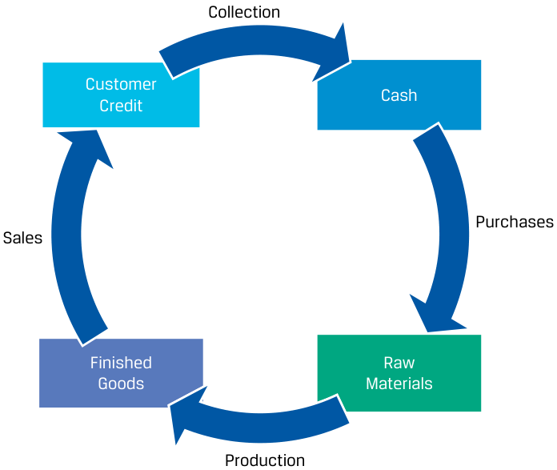
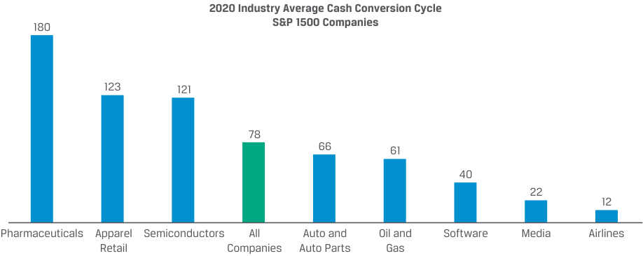
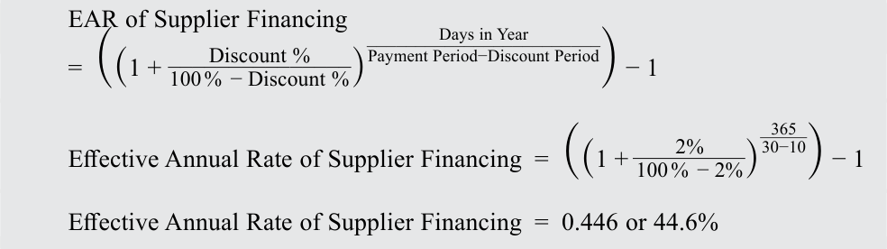
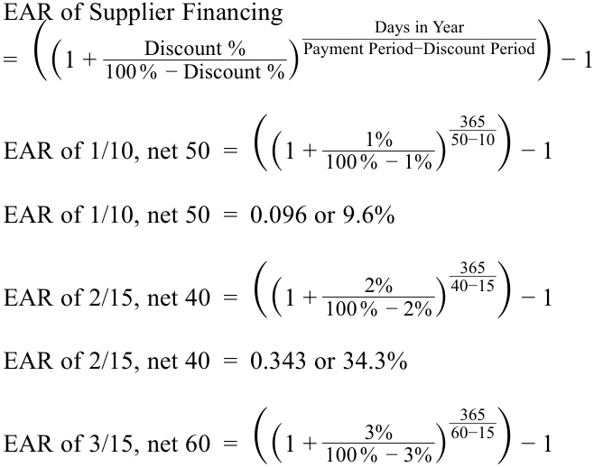
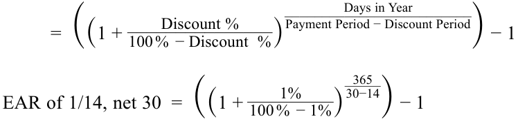
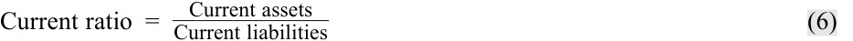
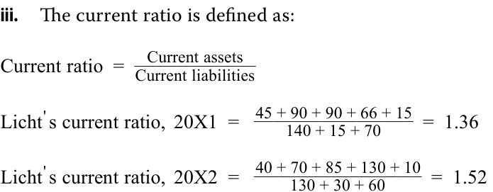

# Tập 3: Tổ chức Phát hành Doanh nghiệp (Corporate Issuers)
## Learning Module 4 Working Capital and Liquidity (Trang PDF 105–142)

---

# Tập 3: Tổ chức phát hành doanh nghiệp (Corporate Issuers)
## Học phần 4: Vốn lưu động và Thanh khoản (Working Capital and Liquidity)
### Phần 1/3: Giới thiệu và Chu kỳ chuyển đổi tiền mặt (PDF Trang 105–119)

---

<!-- PDF Page 105 -->

# H Ọ C P H Ầ N **<mark>4</mark>**

### **Vốn lưu động và Thanh khoản (Working Capital and Liquidity)**

##### **<mark>KẾT QUẢ HỌC TẬP (LEARNING OUTCOMES)</mark>**

|**_Mức độ thành thạo_**|**_Ứng viên cần có khả năng:_**|
|---|---|
||giải thích chu kỳ chuyển đổi tiền mặt (*cash conversion cycle*) và so sánh chu kỳ chuyển đổi tiền mặt của các tổ chức phát hành|
||giải thích thanh khoản (*liquidity*) và so sánh mức độ thanh khoản của các tổ chức phát hành|
||mô tả mục tiêu của các tổ chức phát hành và so sánh các phương pháp quản trị vốn lưu động (*working capital*) và thanh khoản|

---

#### **GIỚI THIỆU (INTRODUCTION)**

## **<mark>1</mark>**

Các bài học trước đã giới thiệu bảng cân đối kế toán (*balance sheet*) của các tổ chức phát hành doanh nghiệp (*corporate issuers*), bao gồm các tài sản (*assets*) được tài trợ bởi nợ phải trả (*liabilities* – bao gồm cả nợ vay) và vốn chủ sở hữu (*equity*). Học phần này đề cập đến việc phân tích các tài sản và nợ phải trả *ngắn hạn* (*short-term assets and liabilities*) – những khoản mục dẫn đến dòng tiền vào hoặc dòng tiền ra trong vòng một năm. Sự vận động của các tài sản và nợ phải trả này chủ yếu được quyết định bởi các điều khoản thanh toán và giao hàng của tổ chức phát hành với khách hàng và nhà cung cấp của mình. Các học phần tiếp theo sẽ đề cập đến các tài sản, nợ phải trả *dài hạn* (*long-term*) và nguồn tài trợ vốn chủ sở hữu của các tổ chức phát hành. Tài sản và nợ phải trả ngắn hạn là yếu tố quyết định then chốt đến khả năng tạo ra dòng tiền cho các nhà đầu tư của tổ chức phát hành, và sự lệch pha giữa thời điểm đáo hạn cũng như tính thanh khoản của tài sản và nợ phải trả có thể gây ra những hậu quả thảm khốc cho doanh nghiệp. Vì những lý do này và các lý do khác, các nhà phân tích luôn xem xét kỹ lưỡng khả năng chuyển đổi tiền mặt và tính thanh khoản của các tổ chức phát hành.

###### **TỔNG QUAN HỌC PHẦN (LEARNING MODULE OVERVIEW)**

- Các tổ chức phát hành đầu tư tiền mặt để tạo ra doanh thu và lợi nhuận. **Chu kỳ chuyển đổi tiền mặt (*cash conversion cycle* – CCC)** là khoảng thời gian tính từ lúc thanh toán cho nhà cung cấp đến khi thu được tiền mặt từ khách hàng.

- Chu kỳ chuyển đổi tiền mặt được đo lường bằng tổng của số ngày tồn kho bình quân (*days of inventory on hand* – DOH) và số ngày thu tiền bán hàng bình quân (*days sales outstanding* – DSO), trừ đi số ngày phải trả nhà cung cấp bình quân (*days payable outstanding* – DPO). Chu kỳ chuyển đổi tiền mặt ngắn có nghĩa là tổ chức phát hành chuyển đổi khoản đầu tư vào hàng tồn kho thành tiền mặt nhanh chóng, trong khi chu kỳ chuyển đổi tiền mặt dài có nghĩa là tổ chức phát hành chuyển đổi các khoản đầu tư hàng tồn kho thành tiền mặt chậm.

<!-- PDF Page 106 -->

- Việc thu tiền mặt từ khách hàng sớm hơn, trì hoãn thanh toán cho nhà cung cấp và giảm mức hàng tồn kho tương ứng với doanh thu sẽ giúp cải thiện chu kỳ chuyển đổi tiền mặt của tổ chức phát hành.

- **Vốn lưu động (*working capital*)** được định nghĩa là tài sản ngắn hạn của tổ chức phát hành trừ đi nợ phải trả ngắn hạn. **Vốn lưu động ròng (*net working capital* – NWC)** điều chỉnh loại trừ các tài khoản phi hoạt động (*non-operating accounts*) như tiền mặt (*cash*), chứng khoán khả mại (*marketable securities*) và nợ vay ngắn hạn (*short-term debt*). Tỷ số vốn lưu động ròng trên doanh thu (*net working capital to sales*) có mối liên hệ chặt chẽ với chu kỳ chuyển đổi tiền mặt của tổ chức phát hành: chu kỳ chuyển đổi tiền mặt dài gắn liền với tỷ số vốn lưu động ròng trên doanh thu cao hơn, trong khi chu kỳ chuyển đổi tiền mặt ngắn gắn liền với tỷ số vốn lưu động ròng trên doanh thu thấp hơn.

- Tính thanh khoản (*liquidity*) của một tổ chức phát hành chủ yếu được quyết định bởi quy mô tương đối và tính thanh khoản của các tài sản và nợ phải trả ngắn hạn, mà những yếu tố này lại được quyết định bởi mô hình kinh doanh của tổ chức phát hành đó. Nguồn thanh khoản sơ cấp (*primary source of liquidity*) trong dài hạn đối với hầu hết các tổ chức phát hành là dòng tiền từ hoạt động kinh doanh (*cash flow from operations* – CFO). Các nguồn thanh khoản thứ cấp (*secondary sources of liquidity*) thường được sử dụng trong các cuộc khủng hoảng và gây ra chi phí đáng kể, chẳng hạn như phát hành cổ phiếu (*issuing equity*), đàm phán lại hợp đồng (*renegotiating contracts*), bán tài sản (*selling assets*) và nộp đơn xin bảo hộ phá sản (*filing for bankruptcy protection*).

- **Các lực cản thanh khoản (*drags on liquidity*)** và **các lực kéo thanh khoản (*pulls on liquidity*)** ảnh hưởng đến tình hình thanh khoản của tổ chức phát hành. Lực cản thanh khoản làm giảm dòng tiền vào và bao gồm các vấn đề như khoản phải thu không thu hồi được (*uncollectible receivables*) và hàng tồn kho lỗi thời (*obsolete inventory*). Lực kéo thanh khoản là sự đẩy nhanh dòng tiền ra hoặc sự gián đoạn trong nguồn tín dụng.

- Các tổ chức phát hành có thể áp dụng cách tiếp cận thận trọng (*conservative*), ôn hòa (*moderate*), hoặc mạo hiểm/tích cực (*aggressive*) đối với quản trị vốn lưu động, và các cách tiếp cận này khác nhau ở lượng vốn lưu động nắm giữ trên bảng cân đối kế toán cũng như mức độ phụ thuộc vào nguồn tài trợ bên ngoài và cơ cấu giữa nguồn tài trợ ngắn hạn và dài hạn.

###### **TỰ ĐÁNH GIÁ HỌC PHẦN (LEARNING MODULE SELF-ASSESSMENT)**

Các câu hỏi ban đầu này nhằm giúp bạn đánh giá mức độ hiểu biết hiện tại của mình về học phần này.

1. Hành động hoặc sự kiện nào sau đây có khả năng cao nhất làm giảm chu kỳ chuyển đổi tiền mặt (*cash conversion cycle*) của một tổ chức phát hành?

   - **A.** Mua chứng khoán khả mại ngắn hạn bằng tiền mặt sẵn có

   - **B.** Chiết khấu cho khách hàng nếu nhận được thanh toán trong vòng 10 ngày

   - **C.** Doanh số bán một số mặt hàng bị chậm lại do sự thay đổi thị hiếu về kiểu dáng

   - **Lời giải:**

B là đáp án đúng. Khoản chiết khấu thanh toán sớm (*prompt-payment discount*) nhiều khả năng sẽ làm giảm số ngày thu tiền bán hàng bình quân (DSO) và từ đó làm giảm chu kỳ chuyển đổi tiền mặt của tổ chức phát hành.

A không đúng, vì việc tăng chứng khoán khả mại bằng cách giảm tiền mặt không ảnh hưởng đến chu kỳ chuyển đổi tiền mặt của tổ chức phát hành.

C không đúng, vì việc doanh số bán một số mặt hàng bị chậm lại nhiều khả năng sẽ làm tăng số ngày tồn kho bình quân (DOH) và từ đó làm tăng chu kỳ chuyển đổi tiền mặt của tổ chức phát hành.

2. Hành động nào sau đây có khả năng cao nhất làm tăng tính thanh khoản (*liquidity*) của một tổ chức phát hành?

   - **A.** Từ bỏ khoản chiết khấu thanh toán sớm của nhà cung cấp

   - **B.** Nới lỏng điều khoản cho khách hàng bằng cách kéo dài thời hạn thanh toán

<!-- PDF Page 107 -->

   - **C.** Mua chứng khoán khả mại ngắn hạn bằng tiền mặt sẵn có

   - **Lời giải:**

A là đáp án đúng. Từ bỏ khoản chiết khấu tức là đang sử dụng nguồn tài trợ của nhà cung cấp và sẽ dẫn đến việc tổ chức phát hành kéo dài thời gian thanh toán các khoản phải trả người bán (*accounts payable*), giúp giảm bớt áp lực rút cạn thanh khoản trong ngắn hạn. Hành động này làm giảm (cải thiện) nhu cầu tiền mặt tức thời của tổ chức phát hành (lưu ý trong bản gốc tiếng Anh ghi: *"This action increases the issuer's cash conversion cycle"* – xét theo công thức chuẩn thì kéo dài DPO sẽ làm giảm CCC, nhưng ý chính ở đây là giữ lại tiền mặt lâu hơn để tăng thanh khoản ngắn hạn).

B không đúng, vì bằng cách nới lỏng các điều khoản tín dụng, khách hàng sẽ mất nhiều thời gian hơn để thanh toán, do đó hành động này làm tăng chu kỳ chuyển đổi tiền mặt.

C không đúng, vì chứng khoán khả mại nhìn chung có tính thanh khoản *kém hơn* tiền mặt, nên hành động này sẽ làm giảm tính thanh khoản. Ngay cả khi chứng khoán khả mại có tính thanh khoản ngang bằng tiền mặt (ví dụ: tín phiếu Kho bạc ngắn hạn), hành động này cũng sẽ không làm thay đổi đáng kể tính thanh khoản.

3. Tập đoàn Plough báo cáo các khoản mục sau đây trên hai bảng cân đối kế toán gần nhất của mình (đơn vị: triệu):

||**Kết thúc năm tài chính** **31 tháng 12 năm 20X2**|**Kết thúc năm tài chính** **31 tháng 12 năm 20X1**|
|---|---|---|
|Tiền mặt (*Cash*)|10|15|
|Chứng khoán khả mại ngắn hạn (*Short-term marketable securities*)|20|15|
|Khoản phải thu khách hàng (*Accounts receivable*)|100|80|
|Hàng tồn kho (*Inventory*)|200|150|
|Chi phí trả trước (*Prepaid expenses*)|5|5|
|Khoản phải trả người bán (*Accounts payable*)|100|120|
|Chi phí phải trả (*Accrued expenses*)|50|60|

Dựa trên tỷ số tiền mặt (*cash ratio*), công ty đã:

- **A.** trở nên kém thanh khoản hơn.

- **B.** trở nên có tính thanh khoản cao hơn.

- **C.** không thay đổi về tính thanh khoản.

###### **Lời giải:**

B là đáp án đúng. Tỷ số tiền mặt (*cash ratio*) tại hai thời điểm kết thúc năm tài chính là:

<!-- Formula Text: Cash ratio, 20X1 =  15 + 15 _ 120 + 60  =  30 _ 180   =  0.1667 Cash ratio, 20X2 =  10 + 20 _ 100 + 50  =  30 _ 150   =  0.20 -->

$$\text{Cash ratio, 20X1} = \frac{15 + 15}{120 + 60} = \frac{30}{180} = 0.1667$$

$$\text{Cash ratio, 20X2} = \frac{10 + 20}{100 + 50} = \frac{30}{150} = 0.20$$

Tỷ số tiền mặt đã tăng từ $0.1667$ lên $0.20$, cho thấy sự gia tăng về tính thanh khoản.

4. Sự kiện hoặc hoạt động nào sau đây có khả năng cao nhất là một lực cản thanh khoản (*drag on liquidity*)?

   - **A.** Hàng tồn kho bị lỗi thời (*obsolete*)

   - **B.** <u>Thanh toán cho nhà cung cấp sớm hơn</u>

<!-- PDF Page 108 -->

   - **C.** Chiết khấu cho khách hàng thanh toán trong vòng 10 ngày

   - **Lời giải:**

A là đáp án đúng. Khi hàng tồn kho trở nên lỗi thời, việc bán hàng trở nên khó khăn hơn và mức hàng tồn kho tăng lên. Sự kiện này là một lực cản thanh khoản (*drag on liquidity*), bởi vì nó làm chậm dòng tiền vào.

B không đúng, vì việc thanh toán cho nhà cung cấp sớm hơn là một lực kéo thanh khoản (*pull on liquidity*).

C không đúng, vì việc đưa ra chiết khấu thanh toán sớm nhiều khả năng sẽ giúp thu tiền mặt sớm hơn, qua đó cải thiện tính thanh khoản.

5. Hành động nào sau đây cung cấp một nguồn thanh khoản thứ cấp (*secondary source of liquidity*)?

   - **A.** Phát hành chứng khoán vốn chủ sở hữu (*equity securities*)

   - **B.** Thu hồi các khoản phải thu khách hàng (*accounts receivable*)

   - **C.** Tận dụng nguồn tài trợ của nhà cung cấp và thanh toán vào ngày đáo hạn ròng, ngày thứ 40

###### **Lời giải:**

A là đáp án đúng. Các nguồn thanh khoản sơ cấp (*primary sources of liquidity*) bao gồm tiền mặt sẵn có, các khoản đi vay và dòng tiền từ hoạt động kinh doanh. Các nguồn thanh khoản thứ cấp tạo ra tiền mặt với chi phí cao hơn khi các nguồn sơ cấp không đủ đáp ứng, chẳng hạn như phát hành cổ phiếu.

B không đúng, vì việc thu hồi các khoản phải thu khách hàng là nguồn thanh khoản sơ cấp.

C không đúng, vì tín dụng thương mại từ nhà cung cấp (*supplier financing*) là nguồn thanh khoản sơ cấp.

6. Phân loại mỗi hành động sau đây thành cách tiếp cận thận trọng (*conservative*) hoặc mạo hiểm (*aggressive*) đối với quản trị vốn lưu động:

|**Hành động**|**Thận trọng (*Conservative*)**|**Mạo hiểm (*Aggressive*)**|
|---|---|---|
|Tối thiểu hóa mức hàng tồn kho (*Minimize inventory levels*)|||
|Phụ thuộc nhiều hơn vào tài trợ bằng nợ dài hạn và vốn chủ sở hữu (*Greater reliance on long-term debt and equity financing*)|||
|Mức tài sản ngắn hạn thấp hơn (*Lower level of short-term assets*)|||
|Phụ thuộc nhiều hơn vào nợ ngắn hạn (*Greater reliance on short-term debt*)|||

###### **Lời giải:**

|**Hành động**|**Thận trọng (*Conservative*)**|**Mạo hiểm (*Aggressive*)**|
|---|---|---|
|Tối thiểu hóa mức hàng tồn kho (*Minimize inventory levels*)||✓|
|Phụ thuộc nhiều hơn vào tài trợ bằng nợ dài hạn và vốn chủ sở hữu (*Greater reliance on long-term debt and equity financing*)|✓||
|Mức tài sản ngắn hạn thấp hơn (*Lower level of short-term assets*)||✓|
|Phụ thuộc nhiều hơn vào nợ ngắn hạn (*Greater reliance on short-term debt*)||✓|

<!-- PDF Page 109 -->

#### **CHU KỲ CHUYỂN ĐỔI TIỀN MẶT (CASH CONVERSION CYCLE)**

## **<mark>2</mark>**

**Mục tiêu học tập (LOS):** Giải thích chu kỳ chuyển đổi tiền mặt và so sánh chu kỳ chuyển đổi tiền mặt của các tổ chức phát hành.

Hoạt động kinh doanh của một công ty thường bao gồm nhiều bước nối tiếp nhau. Đối với một công ty sản xuất và bán hàng hóa vật chất, hoạt động của công ty bao gồm việc mua nguyên vật liệu, sản xuất hàng tồn kho, bán sản phẩm cho khách hàng và thu tiền mặt. Những hoạt động này được gọi là **chu kỳ hoạt động kinh doanh (*operating cycle*)** của tổ chức phát hành và diễn ra một hoặc nhiều lần trong một năm, như được minh họa trong Bảng 1 (Exhibit 1).

**Bảng 1: Chu kỳ hoạt động kinh doanh (Exhibit 1: Operating Cycle)**

<!-- Picture Text: Collection Customer Cash Credit Purchases Sales Finished Raw Goods Materials Production  -->

> **Chú thích hình ảnh:** Sơ đồ vòng tròn minh họa Chu kỳ hoạt động kinh doanh (*Operating Cycle*): Mua hàng (*Purchases*) $\rightarrow$ Nguyên vật liệu thô (*Raw Materials*) $\rightarrow$ Sản xuất (*Production*) $\rightarrow$ Thành phẩm (*Finished Goods*) $\rightarrow$ Bán hàng (*Sales*) $\rightarrow$ Tín dụng khách hàng / Khoản phải thu (*Customer Credit*) $\rightarrow$ Thu tiền (*Collection*) $\rightarrow$ Tiền mặt (*Cash*) $\rightarrow$ quay lại Mua hàng (*Purchases*).

Những hoạt động này dẫn đến các dòng tiền ra và dòng tiền vào thường *không* diễn ra cùng thời điểm với hoạt động đó. Ví dụ, nguyên vật liệu được doanh nghiệp mua và nhận về nhưng có thể chưa được thanh toán bằng tiền mặt cho đến nhiều tuần hoặc nhiều tháng sau. Hàng hóa được bán cho khách hàng, nhưng tiền mặt có thể chưa thu về được cho đến nhiều tuần hoặc nhiều tháng sau. Cuối cùng, hàng tồn kho có thể mất thời gian để sản xuất hoặc sẵn sàng để bán, chẳng hạn như trong ngành rượu mạnh, nơi một sản phẩm ủ lâu năm như rượu whisky có thể mất nhiều năm trước khi sẵn sàng được bán cho khách hàng.

Các dòng tiền vào tương lai trong chu kỳ hoạt động kinh doanh được ghi nhận là tài sản ngắn hạn (*short-term assets*) trên bảng cân đối kế toán của tổ chức phát hành, trong khi các dòng tiền ra tương lai trong chu kỳ hoạt động kinh doanh được ghi nhận là nợ phải trả ngắn hạn (*short-term liabilities*). Báo cáo tài chính của các tổ chức phát hành thường sử dụng các thuật ngữ và định nghĩa tương ứng trong Bảng 2 (Exhibit 2) cho các loại dòng tiền vào và dòng tiền ra tương lai khác nhau.

<!-- PDF Page 110 -->

**Bảng 2: Một số Tài sản và Nợ phải trả ngắn hạn tiêu biểu (Exhibit 2: Selected Short-Term Assets and Liabilities)**

|**Tài sản ngắn hạn (*Short-Term Asset*)**|**Ý nghĩa (*Meaning*)**|
|---|---|
|Khoản phải thu khách hàng (*Accounts receivable*)|Các khoản tiền sẽ thu được từ khách hàng cho các sản phẩm hoặc dịch vụ đã bán|
|Hàng tồn kho (*Inventory*)|Chi phí của các sản phẩm được sản xuất hoặc được mua để bán|
|**Nợ phải trả ngắn hạn (*Short-Term Liability*)**|**Ý nghĩa (*Meaning*)**|
|Khoản phải trả người bán (*Accounts payable*)|Các khoản tiền nợ nhà cung cấp cho các sản phẩm hoặc dịch vụ đã nhận|

Các tài sản và nợ phải trả ngắn hạn này được ghi nhận (*recognized*) dựa trên việc thực hiện hoặc phát sinh của một hoạt động và được dừng ghi nhận (*derecognized*) khi dòng tiền vào hoặc dòng tiền ra thực sự diễn ra, như được minh họa trong Bảng 3 (Exhibit 3).

**Bảng 3: Tiêu chí ghi nhận một số Tài sản và Nợ phải trả ngắn hạn (Exhibit 3: Selected Short-Term Assets and Liabilities Recognition Criteria)**

|**Tài sản ngắn hạn (*Short-Term Asset*)**|**Được ghi nhận khi... (*Recognized When...*)**|**Được dừng ghi nhận khi... (*Derecognized When...*)**|
|---|---|---|
|Khoản phải thu khách hàng (*Accounts receivable*)|Sản phẩm hoặc dịch vụ được bán chịu (bán tín dụng) cho khách hàng|Nhận được tiền mặt từ khách hàng|
|Hàng tồn kho (*Inventory*)|Tổ chức phát hành nắm quyền sở hữu đối với nguyên vật liệu, hàng hóa, vật tư, v.v.|Sản phẩm được bán cho khách hàng|
|**Nợ phải trả ngắn hạn (*Short-Term Liability*)**|**Được ghi nhận khi... (*Recognized When...*)**|**Được dừng ghi nhận khi... (*Derecognized When...*)**|
|Khoản phải trả người bán (*Accounts payable*)|Sản phẩm hoặc dịch vụ đã được nhận, và tổ chức phát hành hoãn thanh toán cho nhà cung cấp|Tiền mặt được thanh toán cho nhà cung cấp|

Chúng ta có thể sử dụng thời gian duy trì trung bình của từng tài khoản ngắn hạn này để xây dựng một trục thời gian cho chu kỳ hoạt động kinh doanh của công ty. Khoảng thời gian mà các khoản phải trả người bán, hàng tồn kho và các khoản phải thu khách hàng tồn đọng trên bảng cân đối kế toán lần lượt được gọi là **số ngày phải trả nhà cung cấp bình quân (*days payable outstanding* – DPO)**, **số ngày tồn kho bình quân (*days of inventory on hand* – DOH)** và **số ngày thu tiền bán hàng bình quân (*days sales outstanding* – DSO)**. Việc tính toán các đại lượng này, được gọi là **các tỷ số hoạt động (*activity ratios*)**, sẽ được thảo luận chi tiết hơn ở phần sau của chương trình học. Một đại lượng quan trọng từ trục thời gian này đối với các nhà phân tích là **chu kỳ chuyển đổi tiền mặt (*cash conversion cycle* – CCC)**: khoảng thời gian từ lúc tổ chức phát hành thanh toán cho nhà cung cấp đến khi nhận được tiền mặt từ khách hàng (tức là khoảng thời gian giữa thời điểm dừng ghi nhận khoản phải trả người bán và thời điểm dừng ghi nhận khoản phải thu khách hàng). Về mặt công thức, chu kỳ chuyển đổi tiền mặt (tính bằng ngày) được biểu diễn trong Phương trình 1 như sau:

$$\text{Cash conversion cycle} = \text{Days of inventory on hand} + \text{Days sales outstanding} - \text{Days payable outstanding} \tag{1}$$

*(Chu kỳ chuyển đổi tiền mặt = Số ngày tồn kho bình quân + Số ngày thu tiền bán hàng bình quân $-$ Số ngày phải trả nhà cung cấp bình quân)*

Bảng 4 (Exhibit 4) mô tả chu kỳ chuyển đổi tiền mặt trên một trục thời gian nằm trong chu kỳ hoạt động kinh doanh rộng hơn.

<!-- PDF Page 111 -->

**Bảng 4: Chu kỳ chuyển đổi tiền mặt (Exhibit 4: The Cash Conversion Cycle)**

<!-- Picture Text: Cash Payment Inventory Sold to Suppliers to Customers Receive Inventory Receive Cash from Suppliers from Customers Days of Inventory on Hand (DOH) Days Sales Outstanding (DSO) Days Payable Outstanding (DPO) Cash Conversion Cycle = DOH + DSO – DPO Cash Out Cash In  -->

> **Chú thích hình ảnh:** Trục thời gian minh họa Chu kỳ chuyển đổi tiền mặt (*Cash Conversion Cycle*):
> - Mốc 1: Nhận hàng tồn kho từ nhà cung cấp (*Receive Inventory from Suppliers*)
> - Mốc 2: Thanh toán tiền mặt cho nhà cung cấp (*Cash Payment to Suppliers* – Dòng tiền ra *Cash Out*). Khoảng cách từ Mốc 1 đến Mốc 2 là Số ngày phải trả nhà cung cấp bình quân (*Days Payable Outstanding* – DPO).
> - Mốc 3: Bán hàng tồn kho cho khách hàng (*Inventory Sold to Customers*). Khoảng cách từ Mốc 1 đến Mốc 3 là Số ngày tồn kho bình quân (*Days of Inventory on Hand* – DOH).
> - Mốc 4: Nhận tiền mặt từ khách hàng (*Receive Cash from Customers* – Dòng tiền vào *Cash In*). Khoảng cách từ Mốc 3 đến Mốc 4 là Số ngày thu tiền bán hàng bình quân (*Days Sales Outstanding* – DSO).
> - Khoảng cách từ Mốc 2 (*Cash Out*) đến Mốc 4 (*Cash In*) chính là Chu kỳ chuyển đổi tiền mặt: $\text{Cash Conversion Cycle} = \text{DOH} + \text{DSO} - \text{DPO}$.

Chu kỳ chuyển đổi tiền mặt là số ngày cần thiết để một công ty chuyển đổi khoản đầu tư vào hàng tồn kho thành tiền mặt thu về từ khách hàng. Do đó, chu kỳ chuyển đổi tiền mặt càng dài thì công ty càng cần nguồn tài trợ trong thời gian dài hơn để thanh toán các hóa đơn của mình, chẳng hạn như tiền lương nhân viên, bởi vì công ty vẫn chưa nhận được tiền mặt từ khách hàng. Năm 2020, một công ty niêm yết trung bình tại Hoa Kỳ có chu kỳ chuyển đổi tiền mặt là 78 ngày, mặc dù có sự khác biệt đáng kể giữa các ngành, như thể hiện trong Bảng 5 (Exhibit 5). Các nhà sản xuất dược phẩm có xu hướng có chu kỳ chuyển đổi tiền mặt tương đối dài vì họ duy trì một lượng lớn hàng tồn kho dược phẩm. Các hãng hàng không – một ngành kinh doanh dịch vụ với lượng hàng tồn kho tối thiểu và phần lớn doanh thu được khách hàng trả trước bằng tiền mặt hoặc thẻ tín dụng – có xu hướng có chu kỳ chuyển đổi tiền mặt ngắn.

**Bảng 5: Chu kỳ chuyển đổi tiền mặt trung bình các ngành thuộc S&P 1500 năm 2020 (Exhibit 5: 2020 S&P 1500 Industry Average Cash Conversion Cycles)**

<!-- Picture Text: 2020 Industry Average Cash Conversion Cycle 180 S&P 1500 Companies 123 121 78 66 61 40 22 12 Pharmaceuticals Apparel Semiconductors All Auto and Oil and Software Media Airlines Retail Companies Auto Parts Gas  -->

> **Chú thích hình ảnh:** Biểu đồ cột Chu kỳ chuyển đổi tiền mặt trung bình các ngành năm 2020 của các công ty thuộc S&P 1500 (tính bằng ngày): Dược phẩm (*Pharmaceuticals*): 180; Bán lẻ trang phục (*Apparel Retail*): 123; Chất bán dẫn (*Semiconductors*): 121; Tất cả các công ty (*All Companies*): 78; Ô tô và Phụ tùng ô tô (*Auto and Auto Parts*): 66; Dầu khí (*Oil and Gas*): 61; Phần mềm (*Software*): 40; Truyền thông (*Media*): 22; Hàng không (*Airlines*): 12.

Nguồn: Chỉ số Vốn lưu động JPMorgan 2021 (*JPMorgan Working Capital Index 2021*). Phân tích của các tác giả.

Kịch bản lý tưởng là một chu kỳ chuyển đổi tiền mặt ngắn hoặc thậm chí âm, nghĩa là tiền mặt đầu tư vào hàng tồn kho được thu hồi nhanh chóng để tái đầu tư cho các chu kỳ tiếp theo. Chu kỳ chuyển đổi tiền mặt âm có thể bắt nguồn từ việc nhận được tiền mặt từ khách hàng trước – trong một số trường hợp là *rất lâu* trước khi – thanh toán cho nhà cung cấp. Kịch bản này tạo ra lượng tiền mặt có thể được sử dụng ở những nơi khác, làm giảm nhu cầu tìm kiếm các nguồn tài trợ thay thế để tài trợ cho hoạt động kinh doanh.

<!-- PDF Page 112 -->

###### **CHU KỲ CHUYỂN ĐỔI TIỀN MẶT ÂM CỦA INDITEX (INDITEX’S NEGATIVE CASH CONVERSION CYCLE)**

Industria de Diseño Textil, S.A., được biết đến với tên gọi Inditex, là một công ty thiết kế, sản xuất và bán lẻ trang phục được niêm yết trên các sở giao dịch chứng khoán Madrid, Barcelona, Bilbao và Valencia. Thương hiệu lớn nhất của tập đoàn là ZARA, chuyên về thời trang nhanh (*fast fashion*).

Inditex có một mô hình kinh doanh độc đáo trong ngành trang phục, trong đó công ty tận dụng chuỗi cung ứng tích hợp theo chiều dọc (*vertically integrated supply chain*) để thiết kế, sản xuất và bán nhiều lô hàng tồn kho giới hạn, cho phép công ty bắt kịp và định hướng thị hiếu thời trang luôn thay đổi của khách hàng. Inditex bán các mặt hàng may sẵn (*off-the-rack items*) trực tiếp cho khách hàng (những người thanh toán bằng tiền mặt hoặc thẻ tín dụng), tránh tích trữ hàng tồn kho để giảm thiểu rủi ro lỗi mốt thời trang, và tìm nguồn nguyên vật liệu thô từ một số lượng lớn các nhà cung cấp mà công ty có vị thế đàm phán đáng kể về điều khoản thanh toán. Kết quả là Inditex có chu kỳ chuyển đổi tiền mặt âm, như được trình bày trong bảng dưới đây.

|**(đơn vị: triệu EUR)**|**2021**|**2020**|
|---|---|---|
|Khoản phải thu khách hàng (*Accounts receivable*)|842|715|
|Hàng tồn kho (*Inventories*)|3,042|2,321|
|Khoản phải trả người bán (*Accounts payable*)|6,199|4,659|
|Doanh thu (*Sales*)|27,716|20,402|
|Giá vốn hàng bán (*Cost of goods sold*)|11,902|9,013|
|Số ngày thu tiền bán hàng bình quân (*Days sales outstanding*)|11|13|
|Số ngày tồn kho bình quân (*Days of inventory on hand*)|93|94|
|Số ngày phải trả nhà cung cấp bình quân (*Days payable outstanding*)|190|189|
|Chu kỳ chuyển đổi tiền mặt (*Cash conversion cycle*)|−86|−82|

Các tổ chức phát hành có thể rút ngắn chu kỳ chuyển đổi tiền mặt theo nhiều cách, bao gồm:

- **Giảm số ngày tồn kho bình quân (*days of inventory on hand* – DOH)** bằng cách ngừng kinh doanh các sản phẩm hoặc dòng sản phẩm có nhu cầu thấp hoặc ngách, đàm phán với nhà cung cấp để giao hàng thường xuyên hơn nhằm thiết lập mức tồn kho “vừa đúng lúc” (*“just in time”* – JIT), và sử dụng phân tích dữ liệu (*data analytics*) để cải thiện dự báo nhu cầu khách hàng cũng như hợp lý hóa mức dự trữ hàng tồn kho.

- **Giảm số ngày thu tiền bán hàng bình quân (*days sales outstanding* – DSO)** bằng cách đưa ra chiết khấu thanh toán sớm cho khách hàng, áp dụng phí trả chậm, thắt chặt các tiêu chuẩn tín dụng, yêu cầu đặt cọc trả trước hoặc đẩy nhanh tiến độ thanh toán trả góp, và làm việc với các công ty thu hồi nợ bên thứ ba.

- **Tăng số ngày phải trả nhà cung cấp bình quân (*days payable outstanding* – DPO)** bằng cách đàm phán các hợp đồng nhà cung cấp với thời hạn dài hơn. Cách tiếp cận này có thể khả thi thông qua việc thiết lập các nhà cung cấp ưu tiên – mua với khối lượng lớn hơn để đổi lấy các điều khoản tốt hơn. Tuy nhiên, điều này có thể dẫn đến việc nhà cung cấp tính giá cao hơn hoặc yêu cầu đặt cọc. Khả năng kéo dài số ngày phải trả nhà cung cấp bình quân phụ thuộc rất lớn vào tương quan quyền lực thương lượng giữa công ty và các nhà cung cấp của mình. Nếu một công ty chỉ có thể mua một linh kiện quan trọng từ một nhà cung cấp duy nhất mà nhà cung cấp đó lại bán cho nhiều bên khác, công ty có thể không có khả năng đàm phán các điều khoản tốt hơn.

Mặc dù việc kéo dài số ngày phải trả nhà cung cấp bình quân có thể cải thiện chu kỳ chuyển đổi tiền mặt, các nhà cung cấp thường đưa ra mức chiết khấu cho việc thanh toán sớm, chẳng hạn như yêu cầu thanh toán trong 30 ngày nhưng chiết khấu 2% nếu nhận được thanh toán trong vòng 10 ngày. Nếu một công ty từ bỏ khoản chiết khấu này để thanh toán vào ngày thứ 30, công ty đó đang ngầm vay nợ từ

<!-- PDF Page 113 -->

nhà cung cấp trong $30 - 10 = 20$ ngày với chi phí chính là khoản chiết khấu bị từ bỏ (*forgone discount*). Một chiến lược hợp lý là vay từ bên thứ ba (ví dụ: ngân hàng) với mức lãi suất tương đối thấp, thanh toán sớm cho nhà cung cấp để nhận chiết khấu thanh toán sớm, và sau đó hoàn trả khoản vay cho ngân hàng. Chiến lược như vậy giúp tránh được chi phí cao của nguồn tài trợ từ nhà cung cấp nhưng vẫn bảo toàn được tiền mặt, như được minh họa trong ví dụ sau đây.

###### **VÍ DỤ 1 (EXAMPLE 1)**

##### **Tập đoàn Keown – Tài trợ nội bộ so với Tài trợ bên ngoài (Keown Corporation—Internal versus External Financing)**

Tập đoàn Keown là một nhà sản xuất ván chèo đứng (*paddleboards*) thiết kế riêng có tên tuổi, hoạt động tại thị trường Bắc Mỹ. Keown vận hành nhà máy sản xuất riêng tại Canada và bán ván chèo độc quyền thông qua trang web của mình để tránh chi phí thuê mặt bằng bán lẻ.

Phần lớn doanh thu của Keown diễn ra trong mùa hè ở Bắc Mỹ từ tháng 5 đến tháng 8. Khách hàng của Keown kỳ vọng đơn hàng được thực hiện ngay lập tức, vì vậy công ty phải duy trì lượng hàng tồn kho đáng kể khi bắt đầu mùa hè nếu không muốn có nguy cơ mất doanh số vào tay đối thủ cạnh tranh. Do tính chất mùa vụ của hoạt động kinh doanh, Keown đặc biệt chú trọng vào việc đáp ứng nhu cầu của khách hàng.

Vì Keown thiếu lượng tiền mặt cần thiết để thanh toán cho các nhà cung cấp trong vòng 10 ngày, Giám đốc Tài chính (CFO) phải quyết định xem có nên vay ngân hàng với lãi suất thực năm (*effective annual rate* – EAR) là 7.7% để hưởng chiết khấu thanh toán sớm do nhà cung cấp nguyên vật liệu đưa ra hay thanh toán sau 30 ngày. Điều khoản từ nhà cung cấp là `2/10, net 30`.

1. Keown nên sử dụng khoản vay ngân hàng và thanh toán cho nhà cung cấp trong vòng 10 ngày để nhận mức chiết khấu 2%, hay đơn giản là từ bỏ khoản chiết khấu và thanh toán cho nhà cung cấp sau 30 ngày?

###### **Lời giải:**

Để so sánh chi phí tương đối của khoản vay ngân hàng với chi phí của tín dụng thương mại (*trade credit*), chúng ta có thể tính lãi suất thực năm (EAR) của khoản tín dụng thương mại. Về bản chất, chúng ta đang tính lãi suất của một khoản vay mà chi phí lãi vay là khoản chiết khấu bị từ bỏ và kỳ hạn vay là khoảng thời gian tăng thêm mà Keown được phép trì hoãn thanh toán; trong trường hợp này là $30 - 10 = 20$ ngày.

<!-- Formula Text: EAR of Supplier Financing =  ((1 + Discount % _______________ 100 %  − Discount % ) Days in Year ________________________ Payment Period−Discount Period ) − 1 Effective Annual Rate of Supplier Financing  =  ((1 + 2% _ 100 %  − 2% ) 365 _ 30−10 ) − 1 Effective Annual Rate of Supplier Financing  =  0.446 or 44.6% -->

$$\text{EAR of Supplier Financing} = \left(1 + \frac{\text{Discount \%}}{100\% - \text{Discount \%}}\right)^{\frac{\text{Days in Year}}{\text{Payment Period} - \text{Discount Period}}} - 1$$

$$\text{Effective Annual Rate of Supplier Financing} = \left(1 + \frac{2\%}{100\% - 2\%}\right)^{\frac{365}{30 - 10}} - 1$$

$$\text{Effective Annual Rate of Supplier Financing} = 0.446 \text{ hay } 44.6\%$$

Vì lãi suất thực năm 44.6% của nguồn tài trợ từ nhà cung cấp cao hơn đáng kể so với mức lãi suất 7.7% của khoản vay ngân hàng, Keown nên vay từ ngân hàng của mình. Bằng cách đó, công ty vẫn có thể bảo toàn tiền mặt nhưng chỉ phải trả mức lãi suất thấp hơn rất nhiều cho khoản tài trợ.

Chu kỳ chuyển đổi tiền mặt dài có thể phản ánh đặc điểm của ngành hoặc mô hình kinh doanh, nhưng một chu kỳ dài hơn so với các đối thủ cạnh tranh và kéo dài thêm theo thời gian là mối quan tâm đặc biệt đối với các nhà phân tích. Chu kỳ dài hơn có thể là tín hiệu cho thấy nhu cầu của khách hàng đang xấu đi, sức khỏe tài chính hoặc chất lượng tín dụng của khách hàng đang suy giảm, hoặc công ty đang đánh mất quyền lực đàm phán với các nhà cung cấp.

<!-- PDF Page 114 -->

###### **VÍ DỤ 2 (EXAMPLE 2)**

##### **Chu kỳ chuyển đổi tiền mặt của các nhà bán lẻ chiết khấu Hoa Kỳ (Cash Conversion for US Discount Retailers)**

Hãy xem xét các tỷ số hoạt động sau đây của các nhà bán lẻ chiết khấu lớn tại Hoa Kỳ gồm Walmart Inc., Target Corporation, Costco Wholesale Corporation, The TJX Companies và Ross Stores cho năm dương lịch 2021, như được trình bày dưới đây.

||**Walmart**|**Target**|**Costco**|**TJX**|**Ross**|
|---|---|---|---|---|---|
|Số ngày thu tiền bán hàng bình quân (*Days sales outstanding*)|5|2|3|7|2|
|Số ngày tồn kho bình quân (*Days of inventory on hand*)|48|68|29|63|61|
|Số ngày phải trả nhà cung cấp bình quân (*Days payable outstanding*)|47|75|34|47|63|

1. Công ty nào có chu kỳ chuyển đổi tiền mặt ngắn nhất? Dài nhất?

###### **Lời giải:**

   - $\text{Cash conversion cycle} = \text{DSO} + \text{DOH} - \text{DPO}$
   - Chu kỳ chuyển đổi tiền mặt của Walmart $= 5\text{ ngày} + 48\text{ ngày} - 47\text{ ngày} = 6\text{ ngày}$
   - Chu kỳ chuyển đổi tiền mặt của Target $= 2\text{ ngày} + 68\text{ ngày} - 75\text{ ngày} = -5\text{ ngày}$
   - Chu kỳ chuyển đổi tiền mặt của Costco $= 3\text{ ngày} + 29\text{ ngày} - 34\text{ ngày} = -2\text{ ngày}$
   - Chu kỳ chuyển đổi tiền mặt của TJX $= 7\text{ ngày} + 63\text{ ngày} - 47\text{ ngày} = 23\text{ ngày}$
   - Chu kỳ chuyển đổi tiền mặt của Ross $= 2\text{ ngày} + 61\text{ ngày} - 63\text{ ngày} = 0\text{ ngày}$

   - Target có chu kỳ chuyển đổi tiền mặt ngắn nhất ($-5$ ngày) trong số năm công ty (và TJX có chu kỳ dài nhất là $23$ ngày).

2. Các công ty này chấp nhận thanh toán từ khách hàng tại điểm bán hàng (*point of sale*) bằng tiền mặt hoặc thẻ ghi nợ hay thẻ tín dụng. Thực tế này có phù hợp với các tỷ số hoạt động được trình bày không?

###### **Lời giải:**

Có, bởi vì số ngày thu tiền bán hàng bình quân (DSO) rất nhỏ. Các khoản thanh toán bằng thẻ ghi nợ và thẻ tín dụng thường được tất toán trong vài ngày, và giao dịch bán hàng thu tiền mặt được tất toán ngay lập tức.

3. Khi kiểm tra báo cáo thường niên, bạn nhận thấy khoảng 54% doanh thu của Costco là thực phẩm hoặc các mặt hàng liên quan đến thực phẩm, một tỷ lệ lớn hơn so với các công ty khác vốn bán tỷ lệ lớn hơn các mặt hàng trang phục và phi thực phẩm. Thực tế này có phù hợp với các tỷ số hoạt động được trình bày không?

###### **Lời giải:**

Có. Các công ty như Costco bán hàng hóa dễ hư hỏng (*perishable goods*) có xu hướng có số ngày tồn kho bình quân (DOH) thấp hơn, bởi vì hàng tồn kho phải được bán sớm ngay sau khi nhận từ nhà cung cấp nếu không sẽ bị hỏng.

Ngoài chu kỳ chuyển đổi tiền mặt, một thước đo khác mà các nhà phân tích sử dụng để đánh giá hiệu quả hoạt động kinh doanh là lượng **vốn lưu động (*working capital*)** được doanh nghiệp sử dụng, đặc biệt là quy mô của nó so với doanh thu để có thể so sánh qua thời gian và giữa các doanh nghiệp với nhau. Có một số định nghĩa về vốn lưu động trong thực tiễn. Chúng ta phân biệt giữa **tổng vốn lưu động (*total working capital*)**, được định nghĩa chính thức trong Phương trình 2 như một thước đo rộng, và **vốn lưu động ròng (*net working capital* – NWC)**, được định nghĩa trong Phương trình 3 như một thước đo loại trừ các khoản mục ít liên quan đến chu kỳ chuyển đổi tiền mặt hoặc hoạt động kinh doanh cốt lõi, chẳng hạn như tiền mặt, chứng khoán khả mại và nợ vay ngắn hạn.

<!-- PDF Page 115 -->

$$\begin{aligned}
&\text{Current assets (Tài sản ngắn hạn)} \\
&\underline{\text{Minus: Current liabilities (Trừ: Nợ phải trả ngắn hạn)}} \\
&\text{Total Working Capital (Tổng vốn lưu động)}
\end{aligned} \tag{2}$$

$$\begin{aligned}
&\text{Current assets, excluding cash and marketable securities (Tài sản ngắn hạn, không bao gồm tiền mặt và chứng khoán khả mại)} \\
&\underline{\text{Minus: Current liabilities, excluding short-term and current debt (Trừ: Nợ phải trả ngắn hạn, không bao gồm nợ vay ngắn hạn và nợ đến hạn)}} \\
&\text{Net Working Capital (Vốn lưu động ròng)}
\end{aligned} \tag{3}$$

Để kiểm soát yếu tố quy mô và đảm bảo khả năng so sánh giữa các doanh nghiệp, tổng vốn lưu động hoặc vốn lưu động ròng thường được biểu thị dưới dạng tỷ lệ phần trăm của doanh thu hàng năm (*percentage of annual sales*).

Hãy xem xét thông tin về Licht Vernieuwend N.V. cho năm tài chính kết thúc vào ngày 31 tháng 12 năm 20X2, như được trình bày trong Bảng 6 (Exhibit 6). Tổng vốn lưu động là chênh lệch giữa tài sản ngắn hạn trị giá 335 triệu EUR và nợ phải trả ngắn hạn trị giá 220 triệu EUR, tức là 115 triệu EUR. Vốn lưu động ròng loại trừ tiền mặt, chứng khoán khả mại và các khoản vay ngân hàng ngắn hạn khỏi phép tính, mang lại mức vốn lưu động ròng là $225\text{ triệu EUR} - 160\text{ triệu EUR} = 65\text{ triệu EUR}$.

**Bảng 6: Tổng vốn lưu động và Vốn lưu động ròng trích xuất từ Bảng cân đối kế toán của Licht Vernieuwend N.V. cho năm kết thúc ngày 31 tháng 12 năm 20X2 (Exhibit 6)**

|**Khoản mục (đơn vị: triệu EUR)**|**Tổng vốn lưu động (*Total WC*)**|**Vốn lưu động ròng (*Net WC*)**|
|---|---|---|
|Tiền mặt (*Cash*)|40||
|Chứng khoán khả mại (*Marketable securities*)|70||
|Khoản phải thu khách hàng (*Accounts receivable*)|85|85|
|Hàng tồn kho (*Inventory*)|130|130|
|Chi phí trả trước (*Prepaid accounts*)|10|10|
|**Tổng tài sản ngắn hạn (*Total*)**|**335**|**225**|
|Khoản phải trả người bán (*Accounts payable*)|130|130|
|Chi phí phải trả (*Accrued expenses*)|30|30|
|Vay ngân hàng ngắn hạn (*Short-term bank loan*)|60||
|**Tổng nợ phải trả ngắn hạn (*Total*)**|**220**|**160**|
|**Tổng vốn lưu động (*Total working capital*)**|**115**||
|**Vốn lưu động ròng (*Net working capital*)**||**65**|

Chu kỳ chuyển đổi tiền mặt và tỷ số vốn lưu động trên doanh thu có mối liên hệ qua lại với nhau. Vì các khoản phải thu và hàng tồn kho thường là các thành phần lớn của tài sản ngắn hạn và các khoản phải trả người bán là thành phần lớn của nợ phải trả ngắn hạn, nên một chu kỳ chuyển đổi tiền mặt ngắn gắn liền với tỷ số vốn lưu động trên doanh thu thấp và ngược lại.

###### **CHU KỲ CHUYỂN ĐỔI TIỀN MẶT ÂM VÀ VỐN LƯU ĐỘNG CỦA INDITEX (INDITEX’S NEGATIVE CASH CONVERSION CYCLE AND WORKING CAPITAL)**

Tiếp tục ví dụ trước đó, nhờ mô hình kinh doanh của Inditex – bao gồm việc khách hàng thanh toán ngay cho các sản phẩm trang phục may sẵn, các lô hàng tồn kho giới hạn với vòng quay nhanh, và một số lượng lớn các nhà cung cấp mà công ty có vị thế đàm phán – Inditex không chỉ có chu kỳ chuyển đổi tiền mặt âm mà còn có vốn lưu động ròng âm và tỷ số vốn lưu động ròng trên doanh thu âm, như được trình bày trong bảng dưới đây.

<!-- PDF Page 116 -->

|**(đơn vị: triệu EUR)**|**2021**|**2020**|
|---|---|---|
|Khoản phải thu khách hàng (*Accounts receivable*)|842|715|
|Hàng tồn kho (*Inventories*)|3,042|2,321|
|Khoản phải trả người bán (*Accounts payable*)|6,199|4,659|
|Vốn lưu động ròng (*Net working capital*)|−2,315|−1,623|
|Tỷ lệ % trên doanh thu (*As a % of sales*)|−8.4%|−8.0%|
|Doanh thu (*Sales*)|27,716|20,402|
|Giá vốn hàng bán (*Cost of goods sold*)|11,902|9,013|
|Số ngày thu tiền bán hàng bình quân (*Days sales outstanding*)|11|13|
|Số ngày tồn kho bình quân (*Days of inventory on hand*)|93|94|
|Số ngày phải trả nhà cung cấp bình quân (*Days payable outstanding*)|190|189|
|Chu kỳ chuyển đổi tiền mặt (*Cash conversion cycle*)|−86|−82|

Tỷ số vốn lưu động trên doanh thu cao có thể là kết quả của đặc thù ngành, chẳng hạn như trong ngành rượu mạnh, nơi hàng tồn kho phải được ủ trong nhiều năm trước khi bán cho khách hàng, hoặc trong ngành dược phẩm, nơi các công ty nắm giữ một lượng lớn hàng tồn kho, đôi khi là để tuân thủ các quy định pháp lý. Ngoài những trường hợp cần thiết như minh họa trong Ví dụ 1, hoặc các trường hợp tuân thủ quy định, các tổ chức phát hành nhìn chung sẽ có lợi hơn khi nắm giữ ít vốn lưu động hơn và sử dụng vốn vào nơi khác cho các dự án có tỷ suất sinh lợi cao hơn hoặc hoàn trả vốn cho các nhà đầu tư.

###### **BỘ CÂU HỎI (QUESTION SET)**

1. Phân loại mỗi hành động sau đây của một tổ chức phát hành dựa trên tác động có khả năng xảy ra đối với chu kỳ chuyển đổi tiền mặt của tổ chức đó:

|**Hành động (*Action*)**|**Rút ngắn (*Shorten*)**|**Kéo dài (*Lengthen*)**|
|---|---|---|
|Đưa ra mức chiết khấu lớn hơn cho khách hàng đối với các khoản thanh toán nhận được trước ngày đến hạn (*Offering larger discounts to its customers for payments received before the due date*)|||
|Thanh toán cho nhà cung cấp sớm hơn (*Paying suppliers sooner*)|||
|Giảm sự phụ thuộc vào phương pháp tồn kho vừa đúng lúc (JIT) đồng thời tăng lượng tồn kho an toàn (*Lowering reliance on just-in-time inventory methods while increasing safety stocks of inventory*)|||
|Đàm phán thời hạn thanh toán dài hơn với các nhà cung cấp (*Negotiating longer payment periods with its suppliers*)|||
|Thắt chặt tiêu chuẩn tín dụng đối với khách hàng (*Tightening credit standards for its customers*)|||

###### **Lời giải:**

<!-- PDF Page 117 -->

|**Hành động (*Action*)**|**Rút ngắn (*Shorten*)**|**Kéo dài (*Lengthen*)**|
|---|---|---|
|Đưa ra mức chiết khấu lớn hơn cho khách hàng đối với các khoản thanh toán nhận được trước ngày đến hạn|✓||
|Thanh toán cho nhà cung cấp sớm hơn||✓|
|Giảm sự phụ thuộc vào phương pháp tồn kho vừa đúng lúc (JIT) đồng thời tăng lượng tồn kho an toàn||✓|
|Đàm phán thời hạn thanh toán dài hơn với các nhà cung cấp|✓||
|Thắt chặt tiêu chuẩn tín dụng đối với khách hàng|✓||

2. Xác định tổ chức phát hành có chu kỳ chuyển đổi tiền mặt dài nhất và giải thích tác động của độ dài chu kỳ đó đối với tổ chức phát hành này so với các tổ chức phát hành khác.

||**Tổ chức phát hành A**|**Tổ chức phát hành B**|**Tổ chức phát hành C**|
|---|---|---|---|
|Số ngày tồn kho bình quân (*Days of inventory on hand*)|20|35|15|
|Số ngày phải trả nhà cung cấp bình quân (*Days payable outstanding*)|15|10|5|
|Số ngày thu tiền bán hàng bình quân (*Days sales outstanding*)|30|25|30|

###### **Lời giải:**

Sử dụng công thức:

$$\text{Cash conversion cycle} = \text{Days of inventory on hand} + \text{Days sales outstanding} - \text{Days payable outstanding}$$

||**Tổ chức phát hành A**|**Tổ chức phát hành B**|**Tổ chức phát hành C**|
|---|---|---|---|
|Số ngày tồn kho bình quân (*Days of inventory on hand*)|20|35|15|
|Cộng: Số ngày thu tiền bán hàng bình quân (*Plus: Days sales outstanding*)|30|25|30|
|Trừ: Số ngày phải trả nhà cung cấp bình quân (*Minus: Days payable outstanding*)|15|10|5|
|**Chu kỳ chuyển đổi tiền mặt (*Cash conversion cycle*)**|**35**|**50**|**40**|

Tổ chức phát hành B có chu kỳ chuyển đổi tiền mặt dài nhất, 50 ngày. Do có chu kỳ dài nhất, Tổ chức phát hành B phụ thuộc nhiều hơn vào các nguồn tài trợ thay thế để hỗ trợ hoạt động kinh doanh của mình so với các tổ chức phát hành khác.

3. Giả sử số ngày thu tiền bán hàng bình quân (DSO) và số ngày tồn kho bình quân (DOH) không đổi, một tổ chức phát hành đang cần dòng tiền quyết định từ bỏ khoản chiết khấu do nhà cung cấp đưa ra cho các khoản thanh toán trong vòng 10 ngày và chọn thanh toán vào ngày đến hạn sau 30 ngày thì đang:

   - **A.** rút ngắn chu kỳ chuyển đổi tiền mặt của mình.

   - **B.** kéo dài chu kỳ chuyển đổi tiền mặt của mình.

   - **C.** không làm ảnh hưởng đến chu kỳ chuyển đổi tiền mặt của mình.

###### **Lời giải:**

A là đáp án đúng. Tổ chức phát hành sử dụng nguồn tài trợ của nhà cung cấp bằng cách trì hoãn thanh toán sẽ làm tăng số ngày phải trả nhà cung cấp bình quân (DPO) và do đó rút ngắn chu kỳ chuyển đổi tiền mặt của mình. Tổ chức phát hành đang làm giảm nhu cầu thanh khoản bằng cách tận dụng nguồn tài trợ của nhà cung cấp với chi phí là khoản chiết khấu bị từ bỏ.

<!-- PDF Page 118 -->

4. Một tổ chức phát hành có dòng tiền hạn chế đang quyết định xem điều khoản tín dụng của nhà cung cấp nào có chi phí thấp nhất. Điều khoản tín dụng nào sau đây được các nhà cung cấp đưa ra cho tổ chức phát hành có mức lãi suất thực (*effective interest rate*) *thấp nhất*?

   - **A.** `1/10, net 50`

   - **B.** `2/15, net 40`

   - **C.** `3/15, net 60`

   - **Lời giải:**

A là đáp án đúng. Chi phí tài trợ ngầm định (*implicit financing cost*) mà tổ chức phát hành phải đối mặt khi từ bỏ khoản chiết khấu do nhà cung cấp đưa ra được tính dựa trên mức chiết khấu bị từ bỏ và độ dài của thời gian thanh toán vượt quá thời hạn chiết khấu; điều khoản `1/10, net 50` sẽ cho phép tổ chức phát hành vay trong $50 - 10 = 40$ ngày với chi phí chỉ bằng 1% giá mua (khoản chiết khấu bị từ bỏ). Các phép tính chi phí tài trợ cho từng bộ điều khoản tín dụng, được biểu thị dưới dạng lãi suất thực năm (EAR), như sau:

<!-- Formula Text: EAR of Supplier Financing =  ((1 + Discount % _______________ 100 %  − Discount % ) Days in Year ________________________ Payment Period−Discount Period ) − 1 EAR of 1/10, net 50  =  ((1 + 1% _ 100 %  − 1% ) 365 _ 50−10 ) − 1 EAR of 1/10, net 50  =  0.096 or 9.6% EAR of 2/15, net 40  =  ((1 + 2% _ 100 %  − 2% ) 365 _ 40−15 ) − 1 EAR of 2/15, net 40  =  0.343 or 34.3% EAR of 3/15, net 60  =  ((1 + 3% _ 100 %  − 3% ) 365 _ 60−15 ) − 1 -->

$$\text{EAR of Supplier Financing} = \left(1 + \frac{\text{Discount \%}}{100\% - \text{Discount \%}}\right)^{\frac{\text{Days in Year}}{\text{Payment Period} - \text{Discount Period}}} - 1$$

$$\text{EAR of 1/10, net 50} = \left(1 + \frac{1\%}{100\% - 1\%}\right)^{\frac{365}{50 - 10}} - 1 = 0.096 \text{ hay } 9.6\%$$

$$\text{EAR of 2/15, net 40} = \left(1 + \frac{2\%}{100\% - 2\%}\right)^{\frac{365}{40 - 15}} - 1 = 0.343 \text{ hay } 34.3\%$$

$$\text{EAR of 3/15, net 60} = \left(1 + \frac{3\%}{100\% - 3\%}\right)^{\frac{365}{60 - 15}} - 1 = 0.280 \text{ hay } 28.0\%$$

5. Một tổ chức phát hành đang so sánh một khoản vay ngân hàng có lãi suất 15% với việc tận dụng điều khoản `1/14, net 30` của nhà cung cấp bằng cách thanh toán vào ngày thứ 14. Quyết định tốt nhất xét về chi phí tài trợ thấp hơn là:

   - **A.** từ bỏ chiết khấu và sử dụng nguồn tài trợ của nhà cung cấp để thanh toán vào ngày thứ 30.

   - **B.** vay từ ngân hàng để tận dụng các điều khoản tín dụng thương mại.

   - **C.** sử dụng một trong hai phương án vì chi phí vay ngân hàng và chi phí tín dụng thương mại là như nhau.

###### **Lời giải:**

B là đáp án đúng.

Chi phí tín dụng thương mại của nhà cung cấp, được biểu thị dưới dạng lãi suất thực năm (EAR), là 25.769%, cao hơn mức lãi suất 15% của khoản vay ngân hàng.

###### Lãi suất thực năm của nguồn tài trợ từ nhà cung cấp (EAR of Supplier Financing)

<!-- Formula Text: =  ((1 + Discount % _______________ 100 %  − Discount  % ) Days in Year _________________________ Payment Period − Discount Period ) − 1 EAR of 1/14, net 30  =  ((1 + 1% _ 100 %  − 1% ) 365 _ 30−14 ) − 1 -->

$$\text{EAR of Supplier Financing} = \left(1 + \frac{\text{Discount \%}}{100\% - \text{Discount \%}}\right)^{\frac{\text{Days in Year}}{\text{Payment Period} - \text{Discount Period}}} - 1$$

$$\text{EAR of 1/14, net 30} = \left(1 + \frac{1\%}{100\% - 1\%}\right)^{\frac{365}{30 - 14}} - 1$$

<!-- PDF Page 119 -->

$$\text{EAR of 1/14, net 30} = 0.25769 \text{ hay } 25.769\%$$

A và C không đúng, vì lãi suất vay ngân hàng 15% thấp hơn lãi suất thực năm 25.769% của khoản tín dụng thương mại từ nhà cung cấp.

6. Hãy xem xét bảng cân đối kế toán sau đây của một tổ chức phát hành:

|**Khoản mục**|**Giá trị**|
|---|---|
|Tiền mặt (*Cash*)|100|
|Chứng khoán khả mại (*Marketable securities*)|20|
|Khoản phải thu khách hàng (*Accounts receivable*)|600|
|Hàng tồn kho (*Inventory*)|800|
|Chi phí trả trước (*Prepaid expenses*)|30|
|Bất động sản, nhà xưởng và thiết bị (*Property, plant, and equipment*)|10,000|
|Tài sản vô hình (*Intangibles*)|500|
|**Tổng tài sản (*Total assets*)**|**12,050**|
|Khoản phải trả người bán (*Accounts payable*)|980|
|Chi phí phải trả (*Accrued expenses*)|70|
|Nợ ngắn hạn (*Short-term debt*)|1,000|
|Nợ dài hạn (*Long-term debt*)|2,000|
|Vốn chủ sở hữu (*Shareholders’ equity*)|8,000|
|**Tổng nợ phải trả và vốn chủ sở hữu (*Total liabilities and equity*)**|**12,050**|

7. Vốn lưu động ròng (*net working capital*) của tổ chức phát hành *gần nhất* với mức:

- **A.** −500.
- **B.** 380.
- **C.** 500.

###### **Lời giải:**

B là đáp án đúng. Vốn lưu động ròng (*net working capital*) được định nghĩa là:

$$\begin{aligned}
&\text{Current assets, excluding cash and marketable securities (Tài sản ngắn hạn, không bao gồm tiền mặt và chứng khoán khả mại)} \\
&\underline{\text{Minus: Current liabilities, excluding short-term and current debt (Trừ: Nợ phải trả ngắn hạn, không bao gồm nợ vay ngắn hạn và nợ đến hạn)}} \\
&\text{Net Working Capital (Vốn lưu động ròng)}
\end{aligned}$$

Tài sản ngắn hạn, không bao gồm tiền mặt và chứng khoán khả mại:

|**Khoản mục**|**Giá trị**|
|---|---|
|Khoản phải thu khách hàng (*Accounts receivable*)|600|
|Hàng tồn kho (*Inventory*)|800|
|Chi phí trả trước (*Prepaid expenses*)|30|
|**Tổng cộng (*Sum*)**|**1,430**|

Nợ phải trả ngắn hạn, không bao gồm nợ vay ngắn hạn và nợ đến hạn:

|**Khoản mục**|**Giá trị**|
|---|---|
|Khoản phải trả người bán (*Accounts payable*)|980|
|Chi phí phải trả (*Accrued expenses*)|70|
|**Tổng cộng (*Sum*)**|**1,050**|
|**Vốn lưu động ròng (*Net working capital*)**|**380**|

A không đúng, vì tiền mặt, chứng khoán khả mại và nợ ngắn hạn bị đưa nhầm vào phép tính, dẫn đến việc tính ra tổng vốn lưu động (*total working capital*) thay vì vốn lưu động ròng (*net working capital*: $(100 + 20 + 1,430) - (1,050 + 1,000) = -500$).

---

# Tập 3: Tổ chức phát hành doanh nghiệp (Corporate Issuers)
## Học phần 4: Vốn lưu động và Thanh khoản (Working Capital and Liquidity)
### Phần 2/3: Thanh khoản (Liquidity) (PDF Trang 120–130)

---

<!-- PDF Page 120 -->

C không đúng, vì tiền mặt và chứng khoán khả mại bị đưa nhầm vào phép tính ($380 + 100 + 20 = 500$).

# **<mark>3</mark>**

## **THANH KHOẢN (LIQUIDITY)**

**Mục tiêu học tập (LOS):** Giải thích thanh khoản và so sánh mức độ thanh khoản của các tổ chức phát hành.

**Tính thanh khoản (*liquidity*)** đối với từng tài sản hoặc khoản nợ phải trả riêng lẻ là mức độ gần với tiền mặt (*nearness to cash*) hoặc gần với thời điểm tất toán (*nearness to settlement*) của nó. Tiền mặt bản thân đã là tiền mặt, vì vậy nó là tài sản có tính thanh khoản cao nhất, trong khi hàng tồn kho có thể khiến tổ chức phát hành mất nhiều thời gian để bán và cuối cùng mới thu được tiền mặt từ khách hàng nên kém thanh khoản hơn tiền mặt. Tương tự, các khoản phải trả người bán đến hạn thanh toán cho nhà cung cấp trong 5 ngày tới có tính thanh khoản (mức độ cấp bách cần tất toán) cao hơn so với khoản thanh toán tiền thuê đến hạn vào tháng sau. Các tổ chức phát hành trình bày tài sản và nợ phải trả trên bảng cân đối kế toán theo thứ tự tính thanh khoản giảm dần (*descending order of liquidity*). Các tài sản và nợ phải trả không dự kiến chuyển đổi thành tiền mặt hoặc tất toán trong vòng 12 tháng được trình bày là tài sản và nợ phải trả dài hạn (*long-term assets and liabilities*). Bảng 7 (Exhibit 7) mô tả tính thanh khoản tương đối của các tài sản và nợ phải trả ngắn hạn.

**Bảng 7: Tính thanh khoản tương đối của các Tài sản và Nợ phải trả ngắn hạn (Exhibit 7: Relative Liquidity of Short-Term Assets and Liabilities)**

<!-- Picture Text: More Liquid Accrued Cash Payroll Short-Term Accounts Investments Payable Accounts Lease Payment Receivable Next Month Short-Term Inventory Debt Less Liquid  -->

> **Chú thích hình ảnh:** Sơ đồ so sánh tính thanh khoản từ Thanh khoản cao hơn (*More Liquid* – phía trên) xuống Kém thanh khoản hơn (*Less Liquid* – phía dưới):
> - Cột Tài sản ngắn hạn (bên trái): Tiền mặt (*Cash*) $\rightarrow$ Đầu tư ngắn hạn (*Short-Term Investments*) $\rightarrow$ Khoản phải thu khách hàng (*Accounts Receivable*) $\rightarrow$ Hàng tồn kho (*Inventory*).
> - Cột Nợ phải trả ngắn hạn (bên phải): Lương phải trả tích lũy (*Accrued Payroll*) $\rightarrow$ Khoản phải trả người bán (*Accounts Payable*) $\rightarrow$ Khoản thanh toán tiền thuê tháng tới (*Lease Payment Next Month*) $\rightarrow$ Nợ vay ngắn hạn (*Short-Term Debt*).

Tính thanh khoản đối với một *tổ chức phát hành* đề cập đến khả năng đáp ứng các khoản nợ phải trả ngắn hạn của tổ chức đó. Nó được quyết định bởi quy mô và tính thanh khoản của các tài sản và nợ phải trả ngắn hạn, mà những yếu tố này lại được quyết định bởi mô hình kinh doanh và chu kỳ chuyển đổi tiền mặt của tổ chức phát hành. Ví dụ, nếu một tổ chức phát hành có tổng nợ phải trả ngắn hạn là 20 và tiền mặt là 100, thì tổ chức đó có tính thanh khoản rất cao và sẽ không gặp vấn đề gì trong việc thanh toán các khoản nợ ngắn hạn. Nếu điều ngược lại xảy ra và công ty chỉ có 20 tiền mặt nhưng có tới 100 nợ phải trả ngắn hạn, công ty sẽ phải tìm kiếm các nguồn thanh khoản khác để đáp ứng các khoản nợ ngắn hạn của mình.

<!-- PDF Page 121 -->

### **Các nguồn thanh khoản sơ cấp (Primary Liquidity Sources)**

Các nguồn thanh khoản sơ cấp (*primary sources of liquidity*) đại diện cho lượng tiền mặt dễ tiếp cận nhất hiện có của công ty và bao gồm:

- *Tiền mặt và chứng khoán khả mại sẵn có (Cash and marketable securities on hand)*, là tiền mặt có sẵn trong tài khoản ngân hàng hoặc được nắm giữ dưới dạng tiền tệ hoặc các chứng khoán có thể bán nhanh chóng mà không bị sụt giảm đáng kể về giá trị.

- *Các khoản đi vay (Borrowings)*, từ ngân hàng, trái chủ, hoặc tín dụng thương mại của nhà cung cấp (*suppliers’ trade credit*). Mặc dù nguồn này có thể mang lại tiền mặt để tất toán các nghĩa vụ sắp đến hạn, nhưng nó lại tạo ra một nghĩa vụ khác cần phải được hoàn trả trong tương lai.

- *Dòng tiền từ hoạt động kinh doanh (Cash flow from the business)*, mặc dù cần thời gian để tạo ra, nhưng là một nguồn thanh khoản dồi dào đối với các doanh nghiệp có lãi. Ví dụ, nếu một doanh nghiệp có một khoản nợ 40 đến hạn sau sáu tháng nhưng dự kiến tạo ra 100 tiền mặt từ hoạt động kinh doanh trong sáu tháng tới, doanh nghiệp đó sẽ không phải sử dụng đến tiền mặt sẵn có hoặc đi vay để tất toán khoản nợ này. Tuy nhiên, các doanh nghiệp đang ở giai đoạn tăng trưởng ban đầu hoặc đang chịu lỗ ròng có thể không tạo ra đủ dòng tiền để đáp ứng các khoản nợ phải trả.

Mặc dù tiền mặt, chứng khoán sẵn có và các khoản đi vay là nguồn thanh khoản quan trọng trong ngắn hạn, dòng tiền từ hoạt động kinh doanh của tổ chức phát hành mới là nguồn thanh khoản sơ cấp trong dài hạn. Vì lý do đó, các nhà phân tích tài chính theo dõi chặt chẽ thông tin này bằng cách sử dụng một báo cáo tài chính do tổ chức phát hành công bố được gọi là **báo cáo lưu chuyển tiền tệ (*statement of cash flows*)**, với các yếu tố cơ bản được thể hiện trong Bảng 8 (Exhibit 8).

**Bảng 8: Báo cáo lưu chuyển tiền tệ của một doanh nghiệp (Exhibit 8: Statement of Cash Flows for a Firm)**

<!-- Picture Text: Balance Sheet (t = 0) Balance Sheet (t = 1) Cash0 ST Debt0 Cash1 ST Debt1 Other ST Other ST Assets0 LT Debt0 Assets1 LT Debt1 LT Assets0 Equity0 LT Assets1 Equity1 Income Statement (1) Cash Flow Statement (1) Revenue Operating Income Asset changes Cost of over period LT Asset Use Goods Sold Depreciation LT Asset Use Depreciation Taxes Operating ∆ Other ST Income Assets Debt ∆ LT Assets Service Taxes Free Cash Flow Net Income Distributions Retained Earnings  -->

> **Chú thích hình ảnh:** Sơ đồ liên kết giữa Bảng cân đối kế toán tại $t = 0$ (*Balance Sheet $t = 0$*) và $t = 1$ (*Balance Sheet $t = 1$*) thông qua Báo cáo kết quả hoạt động kinh doanh (*Income Statement*) và Báo cáo lưu chuyển tiền tệ (*Cash Flow Statement*):
> - Báo cáo kết quả hoạt động kinh doanh: Doanh thu (*Revenue*) trừ Giá vốn hàng bán (*Cost of Goods Sold*) và Khấu hao sử dụng tài sản dài hạn (*LT Asset Use Depreciation*) $\rightarrow$ Lợi nhuận hoạt động (*Operating Income*) trừ Trả nợ/Lãi vay (*Debt Service*) và Thuế (*Taxes*) $\rightarrow$ Lợi nhuận ròng (*Net Income*) chia thành Phân phối cổ tức (*Distributions*) và Lợi nhuận giữ lại (*Retained Earnings*).
> - Báo cáo lưu chuyển tiền tệ: Lợi nhuận hoạt động (*Operating Income*) cộng lại Khấu hao (*LT Asset Use Depreciation*), trừ Thuế (*Taxes*), điều chỉnh Thay đổi tài sản ngắn hạn khác ($\Delta$ *Other ST Assets*) và Thay đổi tài sản dài hạn ($\Delta$ *LT Assets*) $\rightarrow$ tạo ra Dòng tiền tự do (*Free Cash Flow*).

<!-- PDF Page 122 -->

Có một số thước đo dòng tiền mà các nhà phân tích sử dụng hoặc tính toán từ báo cáo lưu chuyển tiền tệ. **Dòng tiền từ hoạt động kinh doanh (*cash flow from operations* – CFO)** là thước đo lợi nhuận bằng tiền trong một kỳ đối với các hoạt động kinh doanh chính của tổ chức phát hành, được tính như sau:

$$\begin{aligned}
&\text{Cash received from customers (Tiền mặt thu từ khách hàng)} \\
&\text{Plus: Interest and dividends received on financial investments (Cộng: Tiền lãi và cổ tức nhận được từ các khoản đầu tư tài chính)} \\
&\text{Minus: Cash paid to employees and suppliers (Trừ: Tiền mặt trả cho người lao động và nhà cung cấp)} \\
&\text{Minus: Taxes paid to governments (Trừ: Thuế nộp cho chính phủ)} \\
&\underline{\text{Minus: Interest paid to lenders (Trừ: Tiền lãi trả cho người cho vay)}} \\
&\text{Cash flows from operations (Dòng tiền từ hoạt động kinh doanh)}
\end{aligned} \tag{4}$$

Tuy nhiên, thước đo này không tính đến các khoản đầu tư vốn (*capital investments* – sẽ được đề cập trong học phần tiếp theo) mà các tổ chức phát hành thực hiện để cải thiện hoạt động hoặc mở rộng quy mô. Do đó, các nhà phân tích tính toán thêm một thước đo bổ sung được gọi là **dòng tiền tự do (*free cash flow* – FCF)** có tính đến yếu tố này:

$$\begin{aligned}
&\text{Cash flows from operations (Dòng tiền từ hoạt động kinh doanh)} \\
&\underline{\text{Minus: Investments in long-term assets (Trừ: Đầu tư vào tài sản dài hạn)}} \\
&\text{Free cash flow (Dòng tiền tự do)}
\end{aligned} \tag{5}$$

Một thước đo thay thế của dòng tiền tự do sẽ cộng ngược lại phần tiền lãi đã trả cho người cho vay để tính toán dòng tiền sẵn có cho cả nhà đầu tư nợ (chủ nợ) và nhà đầu tư vốn chủ sở hữu (cổ đông) (*Free Cash Flow to the Firm – FCFF*). Chủ đề quan trọng này sẽ được trình bày chi tiết hơn ở phần sau của chương trình học.

### **Các nguồn thanh khoản thứ cấp (Secondary Liquidity Sources)**

Mặc dù các nguồn thanh khoản sơ cấp được ưu tiên hơn và ít có khả năng ảnh hưởng đến hoạt động kinh doanh liên tục của doanh nghiệp, đôi khi doanh nghiệp vẫn buộc phải sử dụng đến nguồn thứ cấp. Các nguồn thanh khoản thứ cấp (*secondary sources of liquidity*) bao gồm:

- *Tạm ngừng hoặc cắt giảm cổ tức (Suspending or reducing dividends)* chi trả cho cổ đông.

- *Trì hoãn hoặc cắt giảm chi tiêu vốn (Delaying or reducing capital expenditures)*, giúp bảo toàn tiền mặt trong ngắn hạn nhưng có thể dẫn đến việc bỏ lỡ các cơ hội và làm suy giảm giá trị dài hạn.

- *Phát hành vốn chủ sở hữu (Issuing equity)*, bằng cách phát hành cổ phiếu trên thị trường đại chúng hoặc phát hành riêng lẻ cho các nhà đầu tư được lựa chọn. Mặc dù việc phát hành cổ phiếu mang lại tiền mặt, nhưng nó đi kèm với cái giá phải trả là sự pha loãng (*dilution*) quyền lợi của các cổ đông hiện hữu.

- *Đàm phán lại các điều khoản hợp đồng (Renegotiating contract terms)*, chẳng hạn như tái cấp vốn (*refinancing*) nợ ngắn hạn thành nợ dài hạn; xin nhượng bộ về tiền lãi, tiền thuê mặt bằng và/hoặc các khoản thanh toán thuê tài sản; tái cơ cấu các giao ước nợ (*debt covenants*); và đàm phán lại các điều khoản thanh toán hoặc giao hàng với khách hàng và nhà cung cấp.

- *Bán tài sản (Selling assets)*, phụ thuộc vào mức độ mà các tài sản ngắn hạn và/hoặc dài hạn có thể được thanh lý và chuyển đổi thành tiền mặt mà không bị tổn thất lớn về giá trị.

- *Nộp đơn xin bảo hộ phá sản (Filing for bankruptcy protection)* và tái tổ chức để tiếp tục hoạt động trong khi tái cơ cấu các hợp đồng nợ và có thể bán bớt tài sản.

Việc sử dụng các nguồn thanh khoản thứ cấp thường phát đi tín hiệu cho thấy sức khỏe tài chính của công ty đang suy giảm, khi công ty tìm cách gia tăng vị thế tiền mặt với mức giá tương đối đắt đỏ hoặc gây bất lợi cho các chủ nợ và cổ đông hiện hữu, người lao động của công ty cũng như các bên liên quan khác (*stakeholders*). Ví dụ, vào giai đoạn đầu của đại dịch COVID-19, các hãng hàng không đã huy động vốn để củng cố vị thế tiền mặt khi doanh thu sụt giảm nghiêm trọng: Lufthansa đã huy động 600 triệu EUR thông qua đợt chào bán trái phiếu chuyển đổi (*convertible bond offering*), Singapore Airlines đã huy động 8.8 tỷ SGD thông qua đợt phát hành quyền mua cổ phần (*rights issue*), và Delta Airlines đã hoãn 500 triệu USD chi tiêu vốn (*capital expenditures*).

<!-- PDF Page 123 -->

Ví dụ 3 cho thấy số tiền thu ròng (*net proceeds*) từ các nguồn thanh khoản sơ cấp và thứ cấp đối với một tổ chức phát hành đang trong cuộc khủng hoảng thanh khoản. Ví dụ này cũng cho thấy **chi phí thanh lý (*liquidation costs*)** mà công ty phải gánh chịu khi sử dụng các nguồn đó để huy động vốn. Những chi phí này có thể bao gồm các khoản phí và hoa hồng liên quan đến việc bán tài sản cũng như bất kỳ khoản chiết khấu giảm giá trị tài sản nào do vấn đề kém thanh khoản.

#### **VÍ DỤ 3 (EXAMPLE 3)**

### **Ước tính Chi phí thanh khoản của Tập đoàn Keown (Estimating Keown Corporation’s Cost of Liquidity)**

1. Tập đoàn Keown đang đối mặt với một cuộc khủng hoảng thanh khoản. Với tư cách là một nhà phân tích, bạn đã xác định bốn hành động tiềm năng mà Keown có thể thực hiện để huy động vốn. Ước tính của bạn về giá trị hợp lý (*fair value*) đối với các tài sản của Keown và chi phí thanh lý được trình bày dưới đây.

|**Nguồn vốn (*Source of Funds*)**|**Giá trị hợp lý (triệu CAD)**|**Chi phí thanh lý (%)**|
|---|---|---|
|Bán chứng khoán khả mại ngắn hạn (*Sell short-term marketable securities*)|10|0|
|Bán một số hàng tồn kho và khoản phải thu chọn lọc (*Sell select inventories and receivables*)|20|10|
|Bán bất động sản dư thừa (*Sell excess real estate property*)|50|15|
|Bán một công ty con của doanh nghiệp (*Sell a subsidiary of the firm*)|30|20|

Chi phí thanh lý bao gồm các khoản phí và hoa hồng để bán tài sản cũng như bất kỳ sự sụt giảm giá trị nào do tính kém thanh khoản của tài sản đó. Trong trường hợp này, chi phí thanh lý đối với chứng khoán khả mại bằng không.

Sau khi trừ đi chi phí thanh lý, Keown có thể huy động được bao nhiêu thanh khoản nếu sử dụng cả bốn nguồn vốn, và tổng chi phí thanh lý của Keown là bao nhiêu?

- **A.** 110 triệu, 9.5 triệu

- **B.** 94.5 triệu, 15.5 triệu

- **C.** 125.5 triệu, 15.5 triệu

#### **Lời giải:**

Tổng số tiền gộp và số tiền ròng thanh khoản huy động được tóm tắt trong bảng sau:

|**Nguồn vốn (*Source of Funds*)**|**Giá trị hợp lý (triệu CAD)**|**Chi phí thanh lý (%)**|**Chi phí thanh lý (triệu CAD)**|**Tiền thu ròng (*Net Proceeds*) (triệu CAD)**|
|---|---|---|---|---|
|Chứng khoán khả mại (*Marketable securities*)|10|0|0|10|
|Hàng tồn kho và khoản phải thu (*Inventories and receivables*)|20|10|2|18|
|Bất động sản (*Real estate property*)|50|15|7.5|42.5|
|Công ty con của doanh nghiệp (*Subsidiary of the firm*)|30|20|6|24|
|**Tổng cộng (*Total*)**|||15.5|94.5|

B là đáp án đúng. Tổng số tiền thu ròng (*net proceeds*) từ việc bán tài sản là 94.5 triệu CAD, và tổng chi phí thanh lý phát sinh là 15.5 triệu CAD.

<!-- PDF Page 124 -->

### **Các yếu tố ảnh hưởng đến thanh khoản: Lực cản và Lực kéo (Factors Affecting Liquidity: Drags and Pulls)**

Chu kỳ chuyển đổi tiền mặt của công ty có tác động đáng kể đến vị thế thanh khoản của công ty đó. Hai cách phân loại cho các lực tác động tiêu cực lên thanh khoản của doanh nghiệp là lực cản (*drags*) và lực kéo (*pulls*) đối với thanh khoản. **Lực cản thanh khoản (*drag on liquidity*)** xảy ra khi các dòng tiền vào bị trễ hạn, tạo ra sự thiếu hụt do lượng vốn khả dụng sụt giảm. Ngược lại, **lực kéo thanh khoản (*pull on liquidity*)** liên quan đến sự đẩy nhanh của các dòng tiền ra hoặc tình huống mà khả năng tiếp cận tín dụng thương mại bị hạn chế, buộc các công ty phải chi xuất tiền trước khi nhận được tiền thu từ việc bán hàng để bù đắp cho khoản nợ phải trả đó.

Các lực cản chính đối với dòng tiền thu vào liên quan đến áp lực từ quản trị tín dụng và sự suy giảm chất lượng của các tài sản khác, bao gồm:

- *Các khoản phải thu chưa thu hồi được (Uncollected receivables).* Các khoản phải thu từ khách hàng tồn đọng càng lâu thì nguy cơ không thu hồi được càng lớn. Như chúng ta sẽ thấy trong bài học tiếp theo, lực cản này thường được đo lường bằng số ngày bình quân mà các khoản phải thu tồn đọng cũng như tỷ lệ nợ quá hạn thanh toán của khách hàng trên tổng các khoản phải thu.

- *Hàng tồn kho lỗi thời (Obsolete inventory).* Nếu hàng tồn kho thành phẩm bị lưu giữ trong thời gian dài, đó có thể là dấu hiệu cho thấy mặt hàng đó không còn được khách hàng ưa chuộng hoặc chỉ có thể bán được với mức giá chiết khấu.

- *Hạn chế đi vay (Borrowing constraints).* Nếu các điều kiện tín dụng thắt chặt do điều kiện kinh tế bất lợi, nợ ngắn hạn sẽ trở nên đắt đỏ hơn hoặc không thể tiếp cận được.

Trong nhiều trường hợp, lực cản thanh khoản có thể được giảm thiểu bằng cách thực thi nghiêm ngặt hơn các thông lệ tín dụng và thu hồi nợ, nhưng cách tiếp cận này cũng có thể làm giảm doanh thu nếu khách hàng không sẵn lòng hoặc không có khả năng mua hàng khi bị yêu cầu thanh toán ngay bằng tiền mặt.

Việc quản lý các dòng tiền ra cũng có tầm quan trọng ngang bằng. Nếu các nhà cung cấp và người bán hàng khác đưa ra các điều khoản tín dụng có sức mạnh thị trường lớn hơn doanh nghiệp hoặc tin rằng vị thế tài chính của doanh nghiệp đang yếu kém, họ có thể yêu cầu các điều khoản thanh toán gây căng thẳng cho thanh khoản của công ty. Các lực kéo thanh khoản (*pulls on liquidity*) chính bao gồm:

- *Thanh toán sớm (Making payments early).* Bằng cách thanh toán cho nhà cung cấp, người lao động hoặc các bên khác trước ngày đến hạn mà không nhận được lợi ích tài chính nào, các công ty đã tự từ bỏ quyền sử dụng nguồn vốn đó. Quản lý thanh toán hiệu quả có nghĩa là *không* thực hiện thanh toán sớm khi không có lợi ích đi kèm.

- *Giảm hạn mức tín dụng (Reduced credit limits).* Nếu một công ty có lịch sử thanh toán trễ hạn, các nhà cung cấp có thể cắt giảm hạn mức tín dụng thương mại dành cho doanh nghiệp bất kỳ lúc nào.

- *Giới hạn đối với các hạn mức tín dụng ngắn hạn (Limits on short-term lines of credit).* Nếu ngân hàng của công ty giới hạn việc cho vay đối với công ty, công ty có thể phải đối mặt với những ràng buộc về thanh khoản. Việc hạn chế hạn mức tín dụng có thể do chính phủ quy định, do biến động thị trường, hoặc đơn giản là do đặc thù riêng của từng công ty.

- *Vị thế thanh khoản thấp (Low liquidity positions).* Nhiều công ty phải đối mặt với tình trạng thiếu hụt thanh khoản mãn tính, thường là do điều kiện ngành hoặc vị thế tài chính yếu kém. Lực kéo này có thể trở nên trầm trọng hơn bởi cách tiếp cận mạo hiểm (*aggressive approach*) trong quản trị vốn lưu động.

Ví dụ sau đây đề cập đến những thay đổi ảnh hưởng đến vị thế thanh khoản của Tập đoàn Keown.

#### **VÍ DỤ 4 (EXAMPLE 4)**

### **Lực cản và Lực kéo đối với Thanh khoản của Tập đoàn Keown (Drags and Pulls on Keown Corporation’s Liquidity)**

1. Tập đoàn Keown đang gặp phải những thách thức về thanh khoản. Với tư cách là một nhà phân tích, bạn ghi nhận ba xu hướng gần đây liên quan đến vốn lưu động của Keown:

   **1.** Sự gia tăng số ngày thu tiền bán hàng bình quân (DSO) là một lực cản đối với thanh khoản.

   **2.** Sự gia tăng số ngày tồn kho bình quân (DOH) là một lực cản đối với thanh khoản.

<!-- PDF Page 125 -->

   **3.** Sự gia tăng hạn mức tín dụng từ những người cho vay là một lực kéo đối với thanh khoản.

Xu hướng nào *không* góp phần gây ra những thách thức về thanh khoản của doanh nghiệp?

- **A.** Sự thay đổi trong số ngày thu tiền bán hàng bình quân

- **B.** Sự thay đổi trong số ngày tồn kho bình quân

- **C.** Sự thay đổi trong hạn mức tín dụng

#### **Lời giải:**

C là đáp án đúng. Việc tăng hạn mức tín dụng không phải là một lực kéo đối với thanh khoản mà trên thực tế là điều ngược lại: nó cung cấp thêm thanh khoản.

A không đúng, vì sự gia tăng số ngày thu tiền bán hàng bình quân (DSO) là một lực cản đối với thanh khoản do nó dẫn đến dòng tiền vào chậm hơn hoặc bị trì hoãn. B không đúng, vì số ngày tồn kho bình quân (DOH) cao hơn là một lực cản đối với thanh khoản do nó kéo dài chu kỳ chuyển đổi tiền mặt.

### **Đo lường và Đánh giá Thanh khoản (Measuring and Evaluating Liquidity)**

Công ty càng kém thanh khoản thì rủi ro gặp phải kiệt quệ tài chính (*financial distress*) càng lớn nếu điều kiện kinh doanh thay đổi theo chiều hướng bất lợi. Các nhà phân tích tài chính đặc biệt quan tâm đến các thước đo phổ biến nhằm định lượng và theo dõi những thay đổi trong thanh khoản của doanh nghiệp theo thời gian cũng như để so sánh mức độ thanh khoản giữa các tổ chức phát hành. Để so sánh các doanh nghiệp có quy mô khác nhau với các nguồn và cách thức sử dụng thanh khoản khác nhau, các *tỷ số* tài chính (*financial ratios*) thường xuyên được sử dụng. Việc đánh giá thanh khoản bằng các tỷ số tài chính thường bao gồm cả **các tỷ số thanh khoản (*liquidity ratios*)** và các tỷ số hoạt động (*activity ratios*) đã được giới thiệu trước đó trong Ví dụ 2. Bảng 9 (Exhibit 9) tóm tắt ba tỷ số thanh khoản được sử dụng phổ biến nhất.

**Bảng 9: Các tỷ số thanh khoản chủ yếu (Exhibit 9: Key Liquidity Ratios)**

<!-- Picture Text: Current Ratio Quick Ratio Cash Ratio Cash Cash ST Marketable ST Marketable Securities Securities Current Assets Accounts Accounts Receivable Receivable Inventory Inventory Current Current Current Liabilities Liabilities Liabilities  -->

> **Chú thích hình ảnh:** Sơ đồ so sánh cấu trúc tử số và mẫu số của 3 tỷ số thanh khoản:
> - **Tỷ số hiện hành (*Current Ratio*)**: Tử số gồm toàn bộ Tài sản ngắn hạn (*Current Assets*: Tiền mặt + Chứng khoán khả mại ngắn hạn + Khoản phải thu + Hàng tồn kho) chia cho Nợ phải trả ngắn hạn (*Current Liabilities*).
> - **Tỷ số thanh toán nhanh (*Quick Ratio*)**: Tử số gồm Tiền mặt (*Cash*) + Chứng khoán khả mại ngắn hạn (*ST Marketable Securities*) + Khoản phải thu (*Accounts Receivable*) [loại trừ Hàng tồn kho *Inventory*] chia cho Nợ phải trả ngắn hạn (*Current Liabilities*).
> - **Tỷ số tiền mặt (*Cash Ratio*)**: Tử số chỉ gồm Tiền mặt (*Cash*) + Chứng khoán khả mại ngắn hạn (*ST Marketable Securities*) [loại trừ cả Khoản phải thu và Hàng tồn kho] chia cho Nợ phải trả ngắn hạn (*Current Liabilities*).

<!-- PDF Page 126 -->

Các tỷ số thanh khoản đo lường khả năng của một doanh nghiệp trong việc đáp ứng các nghĩa vụ nợ ngắn hạn từ các tài sản ngắn hạn hiện có. Thước đo thanh khoản rộng nhất là **tỷ số hiện hành (*current ratio*)**, hay tỷ số giữa tài sản ngắn hạn trên nợ phải trả ngắn hạn:

<!-- Formula Text: Current ratio  =    Current assets _____________ Current liabilities (6) -->

$$\text{Current ratio} = \frac{\text{Current assets}}{\text{Current liabilities}} \tag{6}$$

Hãy nhớ lại từ bài học trước rằng chúng ta đã định nghĩa tổng vốn lưu động (*total working capital*) là *chênh lệch* giữa tài sản ngắn hạn và nợ phải trả ngắn hạn. Do đó, một doanh nghiệp có tổng vốn lưu động dương sẽ có tỷ số hiện hành lớn hơn 1, với tỷ số hiện hành cao hơn thể hiện tính thanh khoản cao hơn theo thước đo tổng hợp bao gồm tất cả các tài sản ngắn hạn này.

Tỷ số rộng này thường được xem xét cùng với hai thước đo thanh khoản hẹp hơn, vốn loại trừ các tài sản ngắn hạn kém thanh khoản hơn. Hãy nhớ lại rằng, không giống như tiền mặt hoặc chứng khoán khả mại ngắn hạn, hàng tồn kho và các khoản phải thu ít có khả năng chuyển đổi nhanh chóng thành tiền mặt hơn. **Tỷ số thanh toán nhanh (*quick ratio*)** là tỷ số giữa tài sản ngắn hạn trên nợ phải trả ngắn hạn nhưng loại trừ hàng tồn kho:

<!-- Formula Text: Quick ratio  =   Cash + Short-term marketable instruments + Receivables ________________________________________ Current liabilities (7) -->

$$\text{Quick ratio} = \frac{\text{Cash} + \text{Short-term marketable instruments} + \text{Receivables}}{\text{Current liabilities}} \tag{7}$$

Do đó, một doanh nghiệp có khả năng đáp ứng các nghĩa vụ ngắn hạn *mà không cần* thanh lý hàng tồn kho sẽ có tỷ số thanh toán nhanh lớn hơn 1. Tuy nhiên, kịch bản này đòi hỏi doanh nghiệp phải thu hồi được toàn bộ các khoản phải thu mà không gặp sự chậm trễ hay tình trạng khách hàng nợ quá hạn. **Tỷ số tiền mặt (*cash ratio*)** so sánh tiền mặt và chứng khoán khả mại ngắn hạn với nợ phải trả ngắn hạn và là thước đo thận trọng nhất (*most conservative*) trong số các thước đo này:

<!-- Formula Text: Cash ratio  =   Cash + Short-term marketable instruments ______________________________ Current liabilities (8) -->

$$\text{Cash ratio} = \frac{\text{Cash} + \text{Short-term marketable instruments}}{\text{Current liabilities}} \tag{8}$$

Tỷ số tiền mặt bằng hoặc lớn hơn 1 cho biết doanh nghiệp có thể đáp ứng tất cả các nghĩa vụ ngắn hạn của mình mà không cần phải chờ bán hàng tồn kho hay thu hồi các khoản phải thu.

#### **KIỂM TRA KIẾN THỨC (KNOWLEDGE CHECK)**

Hãy xem xét thông tin bảng cân đối kế toán sau đây của Licht Vernieuwend N.V. cho năm tài chính 20X2 và năm trước đó, 20X1:

|**_(đơn vị: triệu EUR)_**|**20X2**|**20X1**|
|---|---|---|
|Tiền mặt (*Cash*)|40|45|
|Chứng khoán khả mại (*Marketable securities*)|70|90|
|Khoản phải thu khách hàng (*Accounts receivable*)|85|90|
|Hàng tồn kho (*Inventory*)|130|66|
|Chi phí trả trước (*Prepaid accounts*)|10|15|
|Bất động sản, nhà xưởng và thiết bị ròng (*Net plant, property, and equipment*)|1,000|950|
|Tài sản vô hình (*Intangibles*)|90|75|
|**Tổng tài sản (*Total assets*)**|**1,425**|**1,331**|
|Khoản phải trả người bán (*Accounts payable*)|130|140|
|Chi phí phải trả (*Accrued expenses*)|30|15|
|Vay ngân hàng ngắn hạn (*Short-term bank loan*)|60|70|
|Nợ dài hạn (*Long-term debt*)|400|400|
|Vốn chủ sở hữu (*Equity*)|805|706|
|**Tổng nợ phải trả và vốn chủ sở hữu (*Total liabilities and equity*)**|**1,425**|**1,331**|

<!-- PDF Page 127 -->

1. Vốn lưu động ròng (*net working capital*) có thay đổi từ năm 20X1 sang năm 20X2 không? Nếu có, động lực chính của sự thay đổi đó là gì?

#### **Lời giải:**

Vốn lưu động ròng được định nghĩa là:

$$\begin{aligned}
&\text{Current assets, excluding cash and marketable securities (Tài sản ngắn hạn, không bao gồm tiền mặt và chứng khoán khả mại)} \\
&\underline{\text{Minus: Current liabilities, excluding short-term and current debt (Trừ: Nợ phải trả ngắn hạn, không bao gồm nợ vay ngắn hạn và nợ đến hạn)}} \\
&\text{Net Working Capital (Vốn lưu động ròng)}
\end{aligned}$$

Vốn lưu động ròng của Licht Vernieuwend N.V. trong mỗi năm bằng:

|**_(đơn vị: triệu EUR)_**|**20X2**|**20X1**|
|---|---|---|
|Khoản phải thu khách hàng (*Accounts receivable*)|85|90|
|Cộng: Hàng tồn kho (*Plus: Inventory*)|130|66|
|Cộng: Chi phí trả trước (*Plus: Prepaid accounts*)|10|15|
|Trừ: Khoản phải trả người bán (*Minus: Accounts payable*)|(130)|(140)|
|Trừ: Chi phí phải trả (*Minus: Accrued expenses*)|(30)|(15)|
|**Vốn lưu động ròng (*Net working capital*)**|**65**|**16**|

Vốn lưu động ròng của Licht Vernieuwend N.V. đã tăng từ 16 triệu EUR năm 20X1 lên 65 triệu EUR năm 20X2, chủ yếu do khoản đầu tư vào hàng tồn kho tăng từ 66 triệu EUR lên 130 triệu EUR.

2. Tính thanh khoản có thay đổi từ năm 20X1 sang năm 20X2 không nếu xét dựa trên:

   - **i.** tỷ số tiền mặt (*cash ratio*)?

   - **ii.** tỷ số thanh toán nhanh (*quick ratio*)?

   - **iii.** tỷ số hiện hành (*current ratio*)?

#### **Lời giải:**

- **i.** Tỷ số tiền mặt (*cash ratio*) được định nghĩa là:

<!-- Formula Text: Cash ratio  =   Cash + Short-term marketable instruments ______________________________ Current liabilities Licht ' s cash ratio,  20X1  = 45 + 90 _ 140 + 15 + 70   =  0.60 Licht ' s cash ratio,  20X2  = 40 + 70 _ 130 + 30 + 60   =  0.50 -->

$$\text{Cash ratio} = \frac{\text{Cash} + \text{Short-term marketable instruments}}{\text{Current liabilities}}$$

$$\text{Licht's cash ratio, 20X1} = \frac{45 + 90}{140 + 15 + 70} = 0.60$$

$$\text{Licht's cash ratio, 20X2} = \frac{40 + 70}{130 + 30 + 60} = 0.50$$

Dựa trên tỷ số tiền mặt, tính thanh khoản của Licht Vernieuwend N.V. đã sụt giảm từ năm 20X1 sang năm 20X2.

- **ii.** Tỷ số thanh toán nhanh (*quick ratio*) được định nghĩa là:

$$\text{Quick ratio} = \frac{\text{Cash} + \text{Short-term marketable instruments} + \text{Receivables}}{\text{Current liabilities}}$$

$$\text{Licht's quick ratio, 20X1} = \frac{45 + 90 + 90}{140 + 15 + 70} = 1.00$$

$$\text{Licht's quick ratio, 20X2} = \frac{40 + 70 + 85}{130 + 30 + 60} = 0.89$$

Dựa trên tỷ số thanh toán nhanh, tính thanh khoản của Licht Vernieuwend N.V. đã sụt giảm từ năm 20X1 sang năm 20X2.

<!-- PDF Page 128 -->

<!-- Formula Text: iii. The current ratio is defined as: Current ratio  =    Current assets _____________ Current liabilities Licht ' s current ratio,  20X1  =    45 + 90 + 90 + 66 + 15 _________________ 140 + 15 + 70 =  1.36 Licht ' s current ratio,  20X2  =    40 + 70 + 85 + 130 + 10 _________________ 130 + 30 + 60 =  1.52 -->

- **iii.** Tỷ số hiện hành (*current ratio*) được định nghĩa là:

$$\text{Current ratio} = \frac{\text{Current assets}}{\text{Current liabilities}}$$

$$\text{Licht's current ratio, 20X1} = \frac{45 + 90 + 90 + 66 + 15}{140 + 15 + 70} = 1.36$$

$$\text{Licht's current ratio, 20X2} = \frac{40 + 70 + 85 + 130 + 10}{130 + 30 + 60} = 1.52$$

Dựa trên tỷ số hiện hành, tính thanh khoản của Licht Vernieuwend N.V. đã tăng từ năm 20X1 sang năm 20X2.

3. Với những thay đổi trong các tỷ số thanh khoản ở Câu hỏi 2, tổ chức phát hành đã trở nên có tính thanh khoản cao hơn hay kém thanh khoản hơn nếu xét dựa trên tỷ số thanh khoản thận trọng nhất (*most conservative liquidity ratio*)?

#### **Lời giải:**

Tỷ số thanh khoản thận trọng nhất là tỷ số tiền mặt (*cash ratio*), vì nó đo lường khả năng của một tổ chức phát hành trong việc tất toán các nghĩa vụ sắp đến hạn chỉ bằng cách sử dụng các tài sản có tính thanh khoản cao nhất: tiền mặt và các công cụ khả mại ngắn hạn. Dựa trên tỷ số tiền mặt, tính thanh khoản của Licht Vernieuwend N.V. đã sụt giảm từ năm 20X1 sang năm 20X2.

#### **BỘ CÂU HỎI (QUESTION SET)**

1. Phân loại mỗi hiện tượng/hành động sau đây thành lực cản thanh khoản (*drag on liquidity*) hoặc lực kéo thanh khoản (*pull on liquidity*):

|**Hành động (*Action*)**|**Lực cản (*Drag*)**|**Lực kéo (*Pull*)**|
|---|---|---|
|Khách hàng trì hoãn thanh toán (*Customers delaying payments*)|||
|Hàng tồn kho trở nên lỗi thời (*Inventory becoming obsolete*)|||
|Thanh toán cho nhà cung cấp trước ngày đến hạn mà không có ưu đãi chiết khấu (*Paying suppliers before due dates without a discount incentive*)|||
|Người cho vay cắt giảm hạn mức tín dụng (*Lender reducing a line of credit*)|||
|Nhà cung cấp cắt giảm tín dụng thương mại (*Vendors reducing trade credits*)|||

#### **Lời giải:**

|**Hành động (*Action*)**|**Lực cản (*Drag*)**|**Lực kéo (*Pull*)**|
|---|---|---|
|Khách hàng trì hoãn thanh toán (*Customers delaying payments*)|✓||
|Hàng tồn kho trở nên lỗi thời (*Inventory becoming obsolete*)|✓||
|Thanh toán cho nhà cung cấp trước ngày đến hạn mà không có ưu đãi chiết khấu (*Paying suppliers before due dates without a discount incentive*)||✓|
|Người cho vay cắt giảm hạn mức tín dụng (*Lender reducing a line of credit*)||✓|
|Nhà cung cấp cắt giảm tín dụng thương mại (*Vendors reducing trade credits*)||✓|

<!-- PDF Page 129 -->

2. Hãy xem xét các thông tin sau đây từ Báo cáo lưu chuyển tiền tệ của Tập đoàn Lucor:

|**Khoản mục**|**Giá trị**|
|---|---|
|Lợi nhuận ròng (*Net income*)|1,000|
|Dòng tiền từ hoạt động kinh doanh (*Cash flow from operations*)|1,400|
|Dòng tiền từ hoạt động đầu tư (*Cash flow from investing*)|(700)|
|Đầu tư vào tài sản dài hạn (*Investment in long-term assets*)|(800)|
|Dòng tiền từ hoạt động tài chính (*Cash flow from financing*)|500|
|Vốn thu từ phát hành nợ (*Funds from debt issue*)|600|
|**Tổng dòng tiền ròng trong kỳ (*Total net cash flow for the period*)**|**1,200**|

Dòng tiền tự do (*free cash flow*) của Lucor trong kỳ này *gần nhất* với mức:

- **A.** 200.
- **B.** 600.
- **C.** 700.

#### **Lời giải:**

B là đáp án đúng. Dòng tiền tự do (*free cash flow*) là chênh lệch giữa dòng tiền từ hoạt động kinh doanh và khoản đầu tư vào tài sản dài hạn, hay:

$$\text{Free cash flow} = 1,400 - 800 = 600$$

3. Một tổ chức phát hành đang đối mặt với cuộc khủng hoảng thanh khoản. Dựa trên các ước tính này, hãy hoàn thành bảng sau:

||**Giá trị hợp lý (triệu USD)**|**Chi phí thanh lý (% giá trị hợp lý)**|**Chi phí thanh lý (triệu USD)**|**Tiền thu ròng (triệu USD)**|
|---|---|---|---|---|
|Bán một nhà máy sản xuất (*Selling a production plant*)|1,000|20|||
|Bán chứng khoán khả mại ngắn hạn (*Selling short-term marketable securities*)|100|0|||
|Bán các khoản phải thu (*Selling receivables*)|900|10|||
|Bán hàng tồn kho (*Selling inventory*)|600|12|||
|**Tổng cộng (*Total*)**|||||

#### **Lời giải:**

<!-- PDF Page 130 -->

||**(1) Giá trị hợp lý (triệu USD)**|**(2) Chi phí thanh lý (% giá trị hợp lý)**|**(3) Chi phí thanh lý (triệu USD)**|**(4) Tiền thu ròng (triệu USD)**|
|---|---|---|---|---|
|Bán một nhà máy sản xuất (*Selling a production plant*)|1,000|20|200|800|
|Bán chứng khoán khả mại ngắn hạn (*Selling short-term marketable securities*)|100|0|0|100|
|Bán các khoản phải thu (*Selling receivables*)|900|10|90|810|
|Bán hàng tồn kho (*Selling inventory*)|600|12|72|528|
|**Tổng cộng (*Total*)**||||**2,238**|

Chi phí thanh lý ở cột (3) là kết quả của việc nhân các mục ở cột (1) và cột (2). Tiền thu ròng (*net proceeds*) ở cột (4) là kết quả của việc lấy giá trị hợp lý ở cột (1) trừ đi chi phí thanh lý. Tổng tiền thu ròng là tổng số tiền thu ròng từ từng nguồn ở cột (4).

4. Xếp hạng các tỷ số sau đây từ nhỏ nhất (hạng 1) đến lớn nhất (hạng 3) đối với một công ty có hàng tồn kho, các khoản phải thu khách hàng và các khoản phải trả người bán (đều lớn hơn 0):

|**Tỷ số (*Ratio*)**|**Xếp hạng (*Rank*)**|
|---|---|
|Tỷ số tiền mặt (*Cash ratio*)||
|Tỷ số hiện hành (*Current ratio*)||
|Tỷ số thanh toán nhanh (*Quick ratio*)||

#### **Lời giải:**

Mẫu số đều giống nhau cho mỗi tỷ số này (nợ phải trả ngắn hạn – *current liabilities*), do đó sự khác biệt giữa các tỷ số này đến từ tử số. Trong trường hợp tỷ số tiền mặt (*cash ratio*), tử số chỉ đơn giản là tiền mặt và chứng khoán khả mại ngắn hạn. Trong trường hợp tỷ số thanh toán nhanh (*quick ratio*), các khoản phải thu được cộng thêm vào tiền mặt và chứng khoán khả mại ngắn hạn ở tử số. Cuối cùng, tỷ số hiện hành (*current ratio*) có toàn bộ tài sản ngắn hạn ở tử số.

|**Tỷ số (*Ratio*)**|**Xếp hạng (*Rank*)**|
|---|---|
|Tỷ số tiền mặt (*Cash ratio*)|1|
|Tỷ số hiện hành (*Current ratio*)|3|
|Tỷ số thanh toán nhanh (*Quick ratio*)|2|

5. Một tổ chức phát hành có các tài sản ngắn hạn và nợ phải trả ngắn hạn sau đây trên bảng cân đối kế toán:

|**Khoản mục**|**Giá trị**|
|---|---|
|Tiền mặt (*Cash*)|200|
|Chứng khoán khả mại (*Marketable securities*)|40|
|Khoản phải thu khách hàng (*Accounts receivable*)|600|
|Hàng tồn kho (*Inventory*)|800|
|Chi phí trả trước (*Prepaid expenses*)|60|
|Khoản phải trả người bán (*Accounts payable*)|500|

---

# Tập 3: Tổ chức phát hành doanh nghiệp (Corporate Issuers)
## Học phần 4: Vốn lưu động và Thanh khoản (Working Capital and Liquidity)
### Phần 3/3: Quản trị Vốn lưu động và Thanh khoản (PDF Trang 131–142)

---

<!-- PDF Page 131 -->

|Chi phí phải trả (*Accrued expenses*)|50|
|---|---|
|Nợ ngắn hạn (*Short-term debt*)|600|

Tỷ số tiền mặt (*cash ratio*) và tỷ số thanh toán nhanh (*quick ratio*) của tổ chức phát hành lần lượt *gần nhất* với mức:

- **A.** 0.2087; 0.7304.
- **B.** 0.4363; 1.5273.
- **C.** 0.5455; 1.6364.

#### **Lời giải cho câu 5:**

A là đáp án đúng. Tỷ số tiền mặt là:

$$\text{Cash ratio} = \frac{200 + 40}{500 + 50 + 600} = \frac{240}{1,150} = 0.2087$$

Tỷ số thanh toán nhanh là:

$$\text{Quick ratio} = \frac{200 + 40 + 600}{500 + 50 + 600} = \frac{840}{1,150} = 0.7304$$

---

### **QUẢN TRỊ VỐN LƯU ĐỘNG VÀ THANH KHOẢN (MANAGING WORKING CAPITAL AND LIQUIDITY)**

# **<mark>4</mark>**

**Mục tiêu học tập (LOS):** Mô tả mục tiêu của các tổ chức phát hành và so sánh các phương pháp quản trị vốn lưu động và thanh khoản.

Mục tiêu hàng đầu của việc quản trị vốn lưu động và thanh khoản là tối đa hóa giá trị doanh nghiệp đồng thời duy trì khả năng tiếp cận sẵn sàng các nguồn vốn cần thiết cho hoạt động kinh doanh hàng ngày và thực hiện các nghĩa vụ đối với chủ nợ. Thông thường, việc đạt được mục tiêu này bao gồm rút ngắn chu kỳ chuyển đổi tiền mặt, ước tính lượng thanh khoản cần thiết và tối thiểu hóa bất kỳ lượng tiền dư thừa nào để có thể đầu tư tiền mặt vào những nơi khác có các dự án mang lại tỷ suất sinh lợi cao hơn hoặc hoàn trả cho cổ đông.

Giới hạn thực tế của việc quản trị vốn lưu động và thanh khoản phụ thuộc vào mô hình kinh doanh của doanh nghiệp. Ví dụ, một số loại hình sản xuất có thể liên quan đến quá trình chuyển đổi đầu vào thành thành phẩm phức tạp và kéo dài hơn, đòi hỏi phải nắm giữ hàng tồn kho trong nhiều tuần hoặc nhiều tháng. Tuy nhiên, một nhà phân phối các mặt hàng ít phức tạp hơn có thể chỉ có vài ngày tồn kho bình quân. Một số doanh nghiệp trong cùng một ngành lại đòi hỏi đầu tư nhiều hơn vào hàng tồn kho và các khoản phải thu so với các doanh nghiệp khác. Ví dụ, các doanh nghiệp bán lẻ có nhiều địa điểm bán hàng nơi thành phẩm có sẵn để mua ngay, cũng như những doanh nghiệp bán chịu cho khách hàng thay vì thu tiền ngay lập tức, sẽ cần nhiều vốn lưu động hơn (dưới dạng hàng tồn kho và/hoặc các khoản phải thu khách hàng). Ngược lại, các doanh nghiệp dịch vụ và phần mềm có thể có nhu cầu vốn lưu động thấp hơn rất nhiều, vì họ không có hàng tồn kho và có thể nhận được thanh toán trả trước từ khách hàng.

#### **Quản trị Vốn lưu động (Working Capital Management)**

Các doanh nghiệp ước tính nhu cầu vốn lưu động bằng cách trước tiên xác định nhu cầu vốn lưu động tối ưu trong mối tương quan với doanh thu, và sau đó dự báo các mức vốn lưu động tương lai dựa trên dự báo doanh thu của họ. Khi làm như vậy, các doanh nghiệp thường phân biệt giữa một bên là mức cơ sở của hàng tồn kho, nhân sự và các khoản phải thu vốn là các tài sản ngắn hạn *thường xuyên* (*permanent current assets*) và tương đối ổn định theo thời gian, với một bên là phần hàng tồn kho và nhân công

<!-- PDF Page 132 -->

bổ sung cần thiết trong giai đoạn sản xuất và bán hàng cao điểm theo mùa của công ty hoặc trong giai đoạn tăng trưởng – những khoản mục được coi là tài sản ngắn hạn *biến đổi/tạm thời* (*variable current assets*). Trong quá trình này, các nhà quản lý cũng cân nhắc giữa chi phí và lợi ích của các chính sách quản trị hàng tồn kho và khoản phải thu khác nhau. Ví dụ, mức hàng tồn kho cao hơn có thể làm giảm khả năng thiếu hụt hàng do rủi ro từ nhà cung cấp hoặc nhu cầu tăng đột biến không lường trước, nhưng cũng có thể làm tăng rủi ro lỗi thời (*obsolescence risk*) của lượng hàng tồn kho hiện có. Mặc dù các chính sách tín dụng bán hàng nới lỏng hơn làm tăng các khoản phải thu có thể giúp thúc đẩy doanh số hoặc tăng trưởng doanh thu, nhưng chúng cũng có thể dẫn đến chi phí lập hóa đơn cao hơn và tình trạng khách hàng chậm thanh toán gia tăng theo thời gian.

Các công ty áp dụng các cách tiếp cận khác nhau đối với cả *quy mô* của tài sản ngắn hạn lẫn *cơ cấu* nguồn tài trợ được sử dụng để hỗ trợ các tài sản đó. Bảng 10 (Exhibit 10) phác thảo ba cách tiếp cận khác nhau đối với quản trị vốn lưu động, từ chi phí cao nhất (tức là mức tài sản ngắn hạn cao hơn được tài trợ trên cơ sở dài hạn hơn) đến chi phí thấp nhất (ít tài sản hơn được tài trợ trên cơ sở ngắn hạn hơn) cho một mức doanh thu nhất định.

**Bảng 10: Các cách tiếp cận Quản trị và Tài trợ Vốn lưu động (Exhibit 10: Working Capital Management and Funding Approaches)**

<!-- Picture Text: Moderate Conservative “Matched” Aggressive Larger short-term asset Moderate short-term asset Smaller short-term asset position versus sales position versus sales position versus sales Greater reliance on long-term Match funding: Greater reliance on short- debt and equity Fund permanent assets long-term term liabilities Fund variable assets short-term Current AssetsPermanent Long-Term Current AssetsPermanent Debt and EquityLong-Term Current AssetsPermanent Debt and EquityLong-Term Debt and Equity Variable Short-Term Variable Short-Term Current Assets Liabilities Variable Short-Term Current Assets Liabilities Current Assets Liabilities  -->

> **Chú thích hình ảnh:** Ba cách tiếp cận quản trị và tài trợ vốn lưu động:
> 1. **Thận trọng (*Conservative*)**: Vị thế tài sản ngắn hạn lớn hơn so với doanh thu (*Larger short-term asset position versus sales*); Phụ thuộc nhiều hơn vào nợ dài hạn và vốn chủ sở hữu (*Greater reliance on long-term debt and equity*) – tài trợ cho toàn bộ Tài sản ngắn hạn thường xuyên (*Permanent Current Assets*) và một phần Tài sản ngắn hạn biến đổi (*Variable Current Assets*), phần còn lại tài trợ bằng Nợ ngắn hạn (*Short-Term Liabilities*).
> 2. **Ôn hòa / “Khớp kỳ hạn” (*Moderate “Matched”*)**: Vị thế tài sản ngắn hạn vừa phải so với doanh thu (*Moderate short-term asset position versus sales*); Tài trợ khớp kỳ hạn (*Match funding*): Tài trợ tài sản thường xuyên bằng nguồn dài hạn (*Fund permanent assets long-term*) và tài trợ tài sản biến đổi bằng nguồn ngắn hạn (*Fund variable assets short-term*).
> 3. **Mạo hiểm / Tích cực (*Aggressive*)**: Vị thế tài sản ngắn hạn nhỏ hơn so với doanh thu (*Smaller short-term asset position versus sales*); Phụ thuộc nhiều hơn vào nợ ngắn hạn (*Greater reliance on short-term liabilities*) – dùng Nợ ngắn hạn tài trợ cho toàn bộ Tài sản ngắn hạn biến đổi và một phần Tài sản ngắn hạn thường xuyên.

Cách tiếp cận thận trọng (*conservative approach*) đối với quản trị vốn lưu động bao gồm việc nắm giữ nhiều tiền mặt, khoản phải thu và hàng tồn kho hơn so với doanh thu, cùng với sự phụ thuộc nhiều hơn vào các nguồn tài trợ dài hạn. Mặc dù chiến lược này mang lại cho doanh nghiệp sự linh hoạt tài chính lớn nhất để đáp ứng các nhu cầu của mình, nhưng nó cũng thường là chiến lược tốn kém nhất. Những ưu điểm và nhược điểm của cách tiếp cận vốn lưu động thận trọng được nêu trong Bảng 11 (Exhibit 11).

**Bảng 11: Cách tiếp cận Vốn lưu động Thận trọng: Ưu và Nhược điểm (Exhibit 11: Conservative Working Capital Approach: Pros and Cons)**

|**Ưu điểm (*Pros*)**|**Nhược điểm (*Cons*)**|
|---|---|
|Nguồn tài trợ ổn định, dài hạn giúp tránh được rủi ro tái tục/đảo nợ (*rollover risk*) gắn liền với nợ ngắn hạn|Nợ dài hạn thường có mức lãi suất cao hơn|
|Chi phí tài trợ được biết trước ngay từ đầu|Chi phí vốn chủ sở hữu (*cost of equity*) cao|
|Đảm bảo chắc chắn có đủ vốn lưu động cần thiết để mua lượng hàng tồn kho cần dùng|Nguồn tài trợ thường xuyên/dài hạn làm mất đi cơ hội chỉ đi vay khi thực sự có nhu cầu|
|Thời hạn thanh toán kéo dài giúp giảm nhu cầu tiền mặt ngắn hạn dành cho việc trả nợ (*debt service*)|Thường mất nhiều thời gian chuẩn bị (*lead time*) hơn để thiết lập vị thế tài trợ|
|Tính linh hoạt cao hơn trong các giai đoạn thị trường gián đoạn nhờ có thể được bù đắp bởi vị thế tiền mặt hoặc chứng khoán khả mại lớn hơn|Nợ dài hạn có thể đi kèm nhiều điều khoản hạn chế (*restrictions/covenants*) hơn đối với hoạt động kinh doanh|

<!-- PDF Page 133 -->

Các doanh nghiệp trong giai đoạn tăng trưởng sớm (*early-growth phase*) có nhiều khả năng cân nhắc cách tiếp cận thận trọng do khả năng tiếp cận nợ ngắn hạn còn hạn chế. Các công ty đã có tên tuổi vững chắc hơn với biên lợi nhuận cao hơn theo đuổi chính sách như vậy cũng có thể chuyển phần chi phí tài trợ cao hơn này sang cho khách hàng. Các doanh nghiệp có thể chọn theo đuổi chiến lược vốn lưu động thận trọng vì một số lý do khác:

- Giảm nhu cầu phải tiếp cận thị trường vốn trong những thời điểm thị trường căng thẳng (*market stress*)

- Kỳ vọng lãi suất sẽ đi ngang hoặc tăng lên

- Ưu tiên sự ổn định của dòng tiền hơn là chịu rủi ro đảo nợ (*rollover risk*) của nợ ngắn hạn

- Lợi ích của sự chắc chắn cao hơn và khả năng tiếp cận nguồn vốn dài hạn ổn định hơn được đánh giá là đủ để bù đắp cho chi phí tài trợ cao hơn đi kèm

Ngược lại, cách tiếp cận vốn lưu động mạo hiểm (*aggressive working capital approach*) tìm cách tối thiểu hóa lượng tiền mặt dư thừa, các khoản phải thu và hàng tồn kho so với doanh thu, đồng thời phụ thuộc nhiều hơn vào nguồn tài trợ ngắn hạn để đáp ứng các nhu cầu vốn lưu động biến đổi và một phần nhu cầu vốn lưu động thường xuyên. Với ít nguồn lực cam kết hơn để hỗ trợ tài sản ngắn hạn, doanh nghiệp đã đánh đổi việc giảm bớt sự linh hoạt tài chính trong ngắn hạn để lấy tỷ suất sinh lợi cao hơn cho các nhà đầu tư.

Những ưu điểm và nhược điểm của chiến lược vốn lưu động mạo hiểm được nêu trong Bảng 12 (Exhibit 12).

**Bảng 12: Cách tiếp cận Vốn lưu động Mạo hiểm: Ưu và Nhược điểm (Exhibit 12: Aggressive Working Capital Approach: Pros and Cons)**

|**Ưu điểm (*Pros*)**|**Nhược điểm (*Cons*)**|
|---|---|
|Chi phí tài trợ thấp hơn|Chi phí lãi vay có thể biến động khi lãi suất tài trợ ngắn hạn thay đổi|
|Tính linh hoạt chỉ đi vay khi cần thiết giúp làm giảm tổng chi phí lãi vay|Có thể dẫn đến nhu cầu tiền mặt ngắn hạn cao hơn để đáp ứng các khoản nợ đến hạn|
|Nợ ngắn hạn thường có ít điều khoản hạn chế hơn đối với hoạt động kinh doanh|Rủi ro đảo nợ (*rollover risk*) của nợ ngắn hạn làm tăng rủi ro phá sản, đặc biệt là trong các giai đoạn thị trường gián đoạn|
|Tính linh hoạt để tái cấp vốn (*refinance*) nếu lãi suất giảm|Có thể phải dựa vào nguồn tín dụng thương mại đắt đỏ hơn, thắt chặt tín dụng khách hàng, hoặc bán các khoản phải thu nếu không thể tái cấp vốn với các điều khoản thuận lợi|

Các doanh nghiệp trong các ngành có biên lợi nhuận thấp hơn có thể cân nhắc theo đuổi chính sách vốn lưu động mạo hiểm hơn để giành lợi thế chi phí so với các đối thủ cạnh tranh. Mặc dù sự phụ thuộc nhiều hơn vào nguồn tài trợ ngắn hạn giúp giảm chi phí nợ vay so với cách tiếp cận thận trọng, doanh nghiệp cũng phải đối mặt với mức độ phơi nhiễm lớn hơn trước rủi ro đảo nợ (*debt rollover risk*) trong những thời điểm thị trường căng thẳng. Rủi ro này đã ảnh hưởng đến nhiều doanh nghiệp trong cuộc khủng hoảng tài chính 2008–2009 và vào đầu năm 2020 trong giai đoạn đầu của đại dịch COVID-19.

Các doanh nghiệp lựa chọn chính sách vốn lưu động mạo hiểm có thể làm như vậy vì một hoặc nhiều lý do bổ sung sau đây:

- Có khả năng dự báo doanh thu và nhu cầu tiền mặt trong tương lai với độ chính xác cao

- Kỳ vọng lãi suất ổn định hoặc giảm xuống

- Kỳ vọng rằng doanh nghiệp sẽ rút ngắn được chu kỳ chuyển đổi tiền mặt của mình (tức là rút ngắn kỳ thu tiền khoản phải thu và kỳ luân chuyển hàng tồn kho, đồng thời kéo dài kỳ thanh toán khoản phải trả người bán)

- Có khả năng thanh lý nhanh hàng tồn kho và tối thiểu hóa các khoản phải thu khách hàng

<!-- PDF Page 134 -->

Cách tiếp cận vốn lưu động ôn hòa (*moderate working capital approach*) tạo ra sự cân bằng giữa việc sử dụng nguồn tài trợ dài hạn cho các nhu cầu tài sản ngắn hạn mang tính thường xuyên hơn và nợ ngắn hạn cho các nhu cầu biến đổi. Vì các nhu cầu ổn định, có thể dự đoán được sẽ được đáp ứng bằng nguồn tài trợ dài hạn và các nhu cầu theo mùa vụ hoặc theo đà tăng trưởng ít dự đoán được hơn sẽ được đáp ứng bằng các nguồn lực ngắn hạn, phương pháp này thường được gọi là cách tiếp cận “khớp kỳ hạn” (*“matched” approach*).

Những ưu điểm và nhược điểm của chiến lược vốn lưu động ôn hòa được nêu trong Bảng 13 (Exhibit 13).

**Bảng 13: Cách tiếp cận Vốn lưu động Ôn hòa: Ưu và Nhược điểm (Exhibit 13: Moderate Working Capital Approach: Pros and Cons)**

|**Ưu điểm (*Pros*)**|**Nhược điểm (*Cons*)**|
|---|---|
|Chi phí tài trợ thấp hơn so với cách tiếp cận thận trọng; rủi ro thấp hơn so với cách tiếp cận mạo hiểm|Khả năng tiếp cận nguồn vốn ngắn hạn có thể bị hạn chế đối với các nhu cầu theo mùa vụ hoặc tăng trưởng|
|Tính linh hoạt để tăng nguồn tài trợ cho các yêu cầu theo mùa vụ hoặc tăng trưởng khi cần thiết|Chi phí nợ ngắn hạn cho các nhu cầu biến đổi không chắc chắn trong các giai đoạn thị trường gián đoạn|
|Đa dạng hóa các nguồn tài trợ, với cách tiếp cận kỷ luật hơn trong quản trị bảng cân đối kế toán|Có thể phải dựa vào tín dụng thương mại đắt đỏ hơn để đáp ứng các nhu cầu theo mùa vụ hoặc tăng trưởng nếu không thể tái cấp vốn với các điều khoản thuận lợi|

Theo cách tiếp cận ôn hòa, các doanh nghiệp chịu chi phí tài trợ thấp hơn so với chính sách thận trọng hơn, cùng với rủi ro tái cấp vốn (*refinancing risk*) thấp hơn so với chiến lược vốn lưu động mạo hiểm hơn. Mặc dù các doanh nghiệp này cũng có thể theo đuổi các biện pháp nhằm giảm vốn lưu động và rút ngắn chu kỳ chuyển đổi tiền mặt, việc sử dụng nợ dài hạn và vốn chủ sở hữu để hỗ trợ các nhu cầu thường xuyên cho phép họ thực hiện những thay đổi đó một cách từ từ hơn. Các lý do khác khiến một doanh nghiệp có thể theo đuổi cách tiếp cận ôn hòa đối với quản trị vốn lưu động bao gồm:

- Có khả năng dự báo chính xác nhu cầu tài sản ngắn hạn cơ sở, nhưng ít chắc chắn hơn đối với các nhu cầu biến đổi

- Giảm chi phí tài trợ so với cách tiếp cận thận trọng, đi kèm với rủi ro đảo nợ thấp hơn và sự linh hoạt tài chính lớn hơn so với cách tiếp cận mạo hiểm hơn

- Nhằm cân bằng giữa việc sử dụng nguồn tài trợ ngắn hạn ít tốn kém hơn với sự ổn định và chắc chắn của nguồn vốn lưu động thường xuyên được hỗ trợ bởi nguồn tài trợ dài hạn

Sự tương tác giữa chiến lược bán hàng của doanh nghiệp và cách tiếp cận vốn lưu động của nó là một yếu tố quan trọng cần xem xét đối với các nhà phân tích tài chính. Ví dụ, việc cấp thêm tín dụng, hoặc đưa ra các điều khoản tín dụng hào phóng hơn cho khách hàng nhằm thúc đẩy doanh thu cũng sẽ làm tăng vốn lưu động. Ngoài sự gia tăng trong các khoản phải thu khách hàng, doanh nghiệp rất có thể phải đối mặt với tình trạng khách hàng chậm thanh toán gia tăng, mà cả hai điều này đều đòi hỏi thêm nguồn tài trợ. Chi phí tăng thêm cho việc giám sát, lập hóa đơn và thu hồi các khoản phải thu trong một khoảng thời gian dài hơn, cũng như chi phí đi vay cao hơn, phải được đặt lên bàn cân so sánh với phần lợi nhuận tăng thêm được tạo ra theo chiến lược mới.

Quản trị thanh khoản hiệu quả là một chức năng tài chính cốt lõi đối với hầu hết các doanh nghiệp. Ngay cả những công ty có lãi cũng có thể gặp khó khăn tài chính nếu không đảm bảo có đủ thanh khoản để đáp ứng các khoản nợ phải trả ngắn hạn.

<!-- PDF Page 135 -->

##### **VÍ DỤ 5 (EXAMPLE 5)**

#### **Những thay đổi đối với Chính sách Tín dụng của Tập đoàn Keown (Changes to Keown Corporation’s Credit Policy)**

1. Tập đoàn Keown đang cân nhắc tăng hạn mức tín dụng cấp cho các khách hàng mới vì giám đốc bán hàng tin rằng việc làm đó sẽ giúp tăng doanh thu. Tác động dự kiến đối với nhu cầu tài trợ ngắn hạn của Keown sẽ là gì nếu thay đổi này được thực hiện?

   - **A.** Công ty sẽ giảm mức hàng tồn kho của mình.

   - **B.** Công ty nhiều khả năng sẽ thu tiền nhanh hơn, làm giảm các khoản phải thu.

   - **C.** Công ty sẽ có nhu cầu vốn lưu động tăng lên.

   - **D.** Công ty có thể thanh toán cho nhà cung cấp sớm hơn, làm giảm các khoản phải trả người bán.

   - **E.** Công ty sẽ không thấy bất kỳ sự thay đổi nào trong nhu cầu vốn lưu động do sự thay đổi này.

##### **Lời giải:**

C là đáp án đúng. Công ty nhiều khả năng sẽ cần thêm nguồn tài trợ ngắn hạn để hỗ trợ cho sự gia tăng dự kiến của lượng hàng tồn kho và các khoản phải thu khách hàng cần thiết bắt nguồn từ sự gia tăng doanh thu.

#### **Thanh khoản và Tài trợ ngắn hạn (Liquidity and Short-Term Funding)**

Như đã mô tả trong bài học trước, thanh khoản liên quan đến khả năng tương đối của một doanh nghiệp trong việc chuyển đổi các nguồn lực thành tiền mặt để đáp ứng các nghĩa vụ trước mắt. Đối với hầu hết các doanh nghiệp, khả năng này bao gồm việc sử dụng số dư tiền mặt hiện có, dòng tiền từ hoạt động kinh doanh hoặc các khoản đi vay. Các doanh nghiệp có thể tối đa hóa sự linh hoạt tài chính bằng cách xây dựng một chiến lược tài trợ ngắn hạn và thường xuyên đánh giá các phương án sẵn có để tự tài trợ cho mình. Các công ty không tìm hiểu đầy đủ các lựa chọn sẵn có hoặc không tận dụng được việc tiết kiệm chi phí từ các hình thức tài trợ hiện có sẽ dễ phải đối mặt với chi phí tài trợ cao hơn hoặc thậm chí là kiệt quệ tài chính (*financial distress*), rơi vào tình cảnh không thể vay vốn từ bất kỳ nguồn nào.

Một chiến lược tài trợ ngắn hạn thận trọng và khôn ngoan (khi nào nên vay và vay dưới hình thức nào) giúp đạt được một số mục tiêu, bao gồm:

- Duy trì các nguồn tín dụng đầy đủ và đa dạng để tài trợ cho các nhu cầu tiền mặt *thường xuyên/liên tục* (*ongoing cash needs*). Mặc dù nhiều doanh nghiệp có một nguồn tài trợ ngắn hạn chính, chẳng hạn như tín dụng thương mại và các hạn mức tín dụng ngân hàng (*credit facilities*), về mặt lý tưởng, một công ty nên đảm bảo có sẵn các nguồn tài trợ bổ sung để giảm sự phụ thuộc vào một người cho vay hoặc một loại hình tài trợ duy nhất.

- Đảm bảo năng lực tài trợ đầy đủ để xử lý các nhu cầu tiền mặt *thay đổi* (*changing cash needs*) của doanh nghiệp. Mục tiêu này có thể bao gồm việc đáp ứng các nhu cầu cao điểm theo mùa vụ hoặc tăng trưởng theo kế hoạch.

- Xác nhận rằng các mức lãi suất tài trợ được chào, cũng như các điều khoản và điều kiện đi kèm, có tính cạnh tranh và hiểu rõ cách thức các mức lãi suất này có thể thay đổi dưới các điều kiện thị trường vốn và kinh tế khác nhau.

- Đảm bảo rằng cả chi phí tài trợ ngầm định (*implicit* – ví dụ: chi phí tài trợ từ nhà cung cấp đã thảo luận trước đó) và chi phí tài trợ hiện hữu (*explicit*) đều được tính đến khi tính toán chi phí đi vay thực tế (*effective cost of borrowing*) của công ty.

<!-- PDF Page 136 -->

Ngành nghề, quy mô, vị trí địa lý và các yếu tố khác của doanh nghiệp cũng có thể ảnh hưởng đến cách tiếp cận tài trợ ngắn hạn của doanh nghiệp theo những cách sau:

- *Quy mô (Size).* Quy mô của công ty là yếu tố quyết định quan trọng đối với các phương án tài trợ sẵn có. Ví dụ, một doanh nghiệp tư nhân nhỏ có thể bị giới hạn ở các khoản ứng trước tín dụng ngắn hạn từ một ngân hàng duy nhất, trong khi các doanh nghiệp rất lớn có thể tiếp cận thị trường thu nhập cố định ngắn hạn (*short-term fixed-income markets*) cùng nhiều nguồn khác. Nhiều phương án tài trợ đòi hỏi quy mô tối thiểu hoặc có chi phí cố định lớn, khiến chúng trở nên quá đắt đỏ hoặc không thể tiếp cận được đối với các công ty vừa và nhỏ.

- *Mức độ tín nhiệm (Creditworthiness).* Mức độ tín nhiệm của doanh nghiệp không chỉ quyết định việc khoản vay có được người cho vay phê duyệt hay không và mức lãi suất doanh nghiệp phải trả là bao nhiêu, mà còn quyết định xem khoản vay có chứa các điều khoản và điều kiện hạn chế hoạt động của doanh nghiệp hay không. Ví dụ, người cho vay có thể áp đặt các điều kiện vay vốn đối với một doanh nghiệp có mức độ tín nhiệm thấp hơn nhằm hạn chế khả năng bán hoặc sử dụng tài sản của doanh nghiệp đó cho các mục đích khác nhau. Chủ đề này sẽ được đề cập chi tiết hơn trong các học phần sau.

- *Các cân nhắc về pháp lý (Legal considerations).* Một số doanh nghiệp ở các thị trường mới nổi hoặc thị trường cận biên (*emerging or frontier markets*) với hệ thống pháp luật chưa được định hình hoàn chỉnh có thể có ít phương án tài trợ hơn từ các định chế tài chính trung gian hoặc thị trường tài chính so với các doanh nghiệp ở các nền kinh tế phát triển. Do đó, họ có thể phụ thuộc nhiều hơn vào tín dụng thương mại từ các nhà cung cấp.

- *Các cân nhắc về quy định quản lý (Regulatory considerations).* Một số ngành ở các thị trường phát triển chịu sự quản lý rất chặt chẽ. Các doanh nghiệp trong những ngành này, chẳng hạn như các công ty tiện ích công cộng (*utilities*) hoặc ngân hàng, có thể bị giới hạn về cả mức trần được phép vay cũng như loại hình đi vay mà họ có thể tiếp cận. Trong những trường hợp khác, họ lại có thể tiếp cận các nguồn tài trợ ngắn hạn đặc thù mà các doanh nghiệp khác không có được. Ví dụ, các định chế tài chính có thể vay và cho vay dự trữ ngân hàng trung ương (*central bank reserves*) lẫn nhau và cũng có thể trực tiếp tiếp cận nguồn vốn từ ngân hàng trung ương. Việc tài trợ vốn của các định chế tài chính sẽ được đề cập chi tiết ở phần sau của chương trình học.

- *Tài sản cơ sở (Underlying assets).* Tùy thuộc vào mô hình kinh doanh, các công ty có thể sở hữu các tài sản, chẳng hạn như hàng tồn kho, được coi là hấp dẫn để làm tài sản thế chấp (*collateral*) cho các khoản tài trợ ngắn hạn có bảo đảm (*secured short-term funding*).

Đối với các doanh nghiệp thuộc bất kỳ quy mô, ngành nghề hay vị trí địa lý nào, việc lập kế hoạch phù hợp sẽ cho phép công ty quản lý nhu cầu nợ ngắn hạn của mình hiệu quả hơn. Ví dụ, việc dự báo các vị thế tiền mặt qua một chu kỳ chuyển đổi tiền mặt và xa hơn nữa có thể giúp các doanh nghiệp giảm thiểu khả năng rơi vào kiệt quệ tài chính trong những điều kiện thị trường bất lợi. Việc khớp thời điểm đáo hạn của các khoản nợ với các khoản thu tiền mặt dự kiến và giãn cách thời điểm đáo hạn nợ theo thời gian (*spacing debt maturities out over time*) cũng có thể giúp giảm rủi ro tài trợ ngắn hạn.

##### **KIỂM TRA KIẾN THỨC: ĐÁNH GIÁ CÁC LỰA CHỌN TÀI TRỢ NGẮN HẠN (KNOWLEDGE CHECK: EVALUATING SHORT-TERM FINANCING CHOICES)**

1. Một công ty nên xem xét những yếu tố nào sau đây khi đánh giá các lựa chọn tài trợ ngắn hạn?

   - **A.** Chi phí của nguồn vốn đi vay

   - **B.** Sự linh hoạt do nguồn vốn đó mang lại

   - **C.** Mức độ dễ dàng khi tiếp cận nguồn vốn

   - **D.** Các ràng buộc về pháp lý hoặc quy định quản lý có thể ưu tiên nguồn này hơn nguồn khác

<!-- PDF Page 137 -->

   - **E.** Tất cả các câu trên

   - **Lời giải:**

E là đáp án đúng. Chi phí vốn đối với một công ty là yếu tố hiển nhiên nhất cần xem xét, nhưng công ty có thể chọn đi vay với mức chi phí cao hơn một chút sau khi đã cân nhắc tất cả các yếu tố khác.

##### **KIỂM TRA KIẾN THỨC: ĐÁP ỨNG NHU CẦU TÀI TRỢ NGẮN HẠN CỦA TẬP ĐOÀN KEOWN (KNOWLEDGE CHECK: MEETING KEOWN CORPORATION’S SHORT-TERM FINANCING NEEDS)**

1. Tập đoàn Keown có các khoản phải trả người bán trị giá 2 triệu CAD với điều khoản `2/10, net 30` và các khoản phải thu khách hàng trị giá 2 triệu CAD. Ngoài ra, công ty đang nắm giữ 5 triệu CAD chứng khoán khả mại. Keown đang có nhu cầu ngắn hạn 200,000 CAD để trả lương cho nhân viên. Lựa chọn nào sau đây là hợp lý nhất để huy động 200,000 CAD?

   - **A.** Công ty nên phát hành nợ dài hạn.

   - **B.** Công ty nên phát hành cổ phiếu phổ thông.

   - **C.** Công ty nên trì hoãn thanh toán các khoản phải trả người bán và từ bỏ mức chiết khấu 2%.

   - **D.** Công ty nên bán các khoản phải thu khách hàng với mức chiết khấu 10%.

   - **E.** Công ty nên bán chứng khoán khả mại với chi phí môi giới 0.5% (bỏ qua thuế lãi vốn).

##### **Lời giải:**

E là đáp án đúng.

Các phương án để huy động 200,000 CAD được tóm tắt trong bảng sau.

|**Nguồn vốn (*Source of Funds*)**|**Hành động (*Action*)**|**Chi phí thanh lý (%)**|**Chi phí thanh lý (CAD)**|
|---|---|---|---|
|C. Khoản phải trả người bán (`2/10, net 30`)|Trì hoãn thanh toán 200,000 CAD và từ bỏ chiết khấu 2%|2.0|4,000|
|D. Khoản phải thu khách hàng|Bán giá trị 222,222 CAD với mức chiết khấu 10% để thu về 200,000 CAD|10.0|22,222|
|E. Chứng khoán khả mại|Bán giá trị 200,000 CAD|0.5|1,000|

Việc chọn phương án C liên quan đến việc từ bỏ khoản chiết khấu 2%, tính trên 200,000 CAD sẽ tương đương với mức chi phí là 4,000 CAD. Để thu ròng 200,000 CAD bằng phương án D, công ty sẽ phải bán 222,222 CAD các khoản phải thu với chi phí là 22,222 CAD. Phương án E rõ ràng là lựa chọn tốt nhất. Chứng khoán khả mại có tính thanh khoản cao và có thể dễ dàng bán theo giá thị trường, trừ đi khoản phí môi giới tương đối nhỏ là 1,000 CAD.

<!-- PDF Page 138 -->

##### **BỘ CÂU HỎI (QUESTION SET)**

1. Phân loại mỗi đặc điểm sau đây theo các cách tiếp cận quản trị vốn lưu động:

<!-- Picture Text: Conservative Aggressive Greater level of inventory relative to sales Greater reliance on long-term financing Greater level of cash on hand Greater level of marketable securities Greater reliance on short-term bank loans  -->

|Đặc điểm|Thận trọng (*Conservative*)|Mạo hiểm (*Aggressive*)|
|---|---|---|
|Mức hàng tồn kho lớn hơn so với doanh thu (*Greater level of inventory relative to sales*)|||
|Phụ thuộc nhiều hơn vào tài trợ dài hạn (*Greater reliance on long-term financing*)|||
|Mức tiền mặt sẵn có lớn hơn (*Greater level of cash on hand*)|||
|Mức chứng khoán khả mại lớn hơn (*Greater level of marketable securities*)|||
|Phụ thuộc nhiều hơn vào các khoản vay ngân hàng ngắn hạn (*Greater reliance on short-term bank loans*)|||

##### **Lời giải:**

<!-- Picture Text: Conservative Aggressive Greater level of inventory relative to ✓ sales Greater reliance on long-term financing ✓ Greater level of cash on hand ✓ Greater level of marketable securities ✓ Greater reliance on short-term bank ✓ loans  -->

|Đặc điểm|Thận trọng (*Conservative*)|Mạo hiểm (*Aggressive*)|
|---|---|---|
|Mức hàng tồn kho lớn hơn so với doanh thu (*Greater level of inventory relative to sales*)|✓||
|Phụ thuộc nhiều hơn vào tài trợ dài hạn (*Greater reliance on long-term financing*)|✓||
|Mức tiền mặt sẵn có lớn hơn (*Greater level of cash on hand*)|✓||
|Mức chứng khoán khả mại lớn hơn (*Greater level of marketable securities*)|✓||
|Phụ thuộc nhiều hơn vào các khoản vay ngân hàng ngắn hạn (*Greater reliance on short-term bank loans*)||✓|

2. Một công ty có 30 triệu USD các khoản phải trả người bán, trong đó công ty có thể trì hoãn thanh toán đến ngày thứ 14, từ bỏ mức chiết khấu 2% mà công ty sẽ nhận được nếu thanh toán trong vòng 10 ngày. Chi phí thanh lý (*liquidation cost*) tính bằng triệu USD *gần nhất* với mức:

   - **A.** 0.6.

   - **B.** 6.1.

   - **C.** 8.4.

   - **Lời giải:**

A là đáp án đúng. Chi phí thanh lý là khoản chiết khấu 2% bị từ bỏ áp dụng trên giá trị 30 triệu USD của các khoản phải trả người bán.

$$\text{Liquidation cost} = \text{USD } 30\text{ million} \times 0.02 = \text{USD } 0.6\text{ million}$$

B và C không đúng, vì chúng đại diện cho mức lãi suất thực năm (EAR) của khoản tiền lãi bị từ bỏ áp dụng vào giá trị của các khoản phải trả người bán.

3. Một công ty đã thay đổi điều khoản tín dụng dành cho khách hàng từ `1/10, net 30` thành `1/15, net 30`. Tác động có khả năng xảy ra nhất của sự thay đổi này là:

   - **A.** sự gia tăng trong các khoản phải thu khách hàng.

   - **B.** không có sự thay đổi trong các khoản phải thu khách hàng.

   - **C.** sự sụt giảm trong các khoản phải thu khách hàng.

   - **Lời giải:**

A là đáp án đúng. Công ty đã kéo dài thời gian hưởng chiết khấu thêm 5 ngày và không thay đổi mức chiết khấu tính theo tỷ lệ phần trăm của giá bán (1%).

<!-- PDF Page 139 -->

Các điều khoản tín dụng hào phóng hơn cho khách hàng nhiều khả năng sẽ làm tăng các khoản phải thu khách hàng, bởi vì khách hàng sẽ mất nhiều thời gian hơn để thanh toán ngay cả khi họ tận dụng chiết khấu. Ngoài ra, các điều khoản tín dụng hấp dẫn hơn có thể dẫn đến sự gia tăng các khoản phải thu do doanh thu tăng lên.

B và C không đúng, vì thời hạn chiết khấu hào phóng hơn sẽ dẫn đến các khoản phải thu khách hàng tăng lên khi khách hàng mất nhiều thời gian hơn để thanh toán nếu họ tận dụng khoản chiết khấu.

4. Việc thay đổi chính sách khoản phải thu khách hàng theo hướng cấp tín dụng cho những khách hàng có mức độ tín nhiệm thấp hơn sẽ có khả năng cao nhất dẫn đến:

   - **A.** một lực kéo đối với thanh khoản (*a pull on liquidity*).
   - **B.** một lực cản đối với thanh khoản (*a drag on liquidity*).
   - **C.** không có tác động đến thanh khoản.

##### **Lời giải:**

B là đáp án đúng. Bằng cách cấp tín dụng cho những khách hàng có mức độ tín nhiệm thấp hơn, công ty có khả năng gặp phải nhiều tài khoản quá hạn hoặc không thể thu hồi được hơn và làm tăng số ngày thu tiền bán hàng bình quân (DSO), dẫn đến một lực cản đối với thanh khoản (*drag on liquidity*).

A không đúng, vì một lực kéo đối với thanh khoản sẽ bắt nguồn từ việc đẩy nhanh dòng tiền ra. Trong trường hợp này, sự thay đổi chính sách tín dụng của công ty có tác động làm chậm dòng tiền vào.

C không đúng, vì sự thay đổi trong chính sách khoản phải thu của công ty nhiều khả năng sẽ làm tăng nhu cầu vốn lưu động do có các khoản phải thu khách hàng cao hơn.

5. Tập đoàn Lucor đang tìm cách gia tăng thanh khoản và đang đánh giá hai hành động tiềm năng:

|Phương án|Mô tả|
|---|---|
|Phương án 1|Bán các khoản phải thu khách hàng cho một định chế tài chính trung gian với mức chiết khấu 5% so với giá trị ghi sổ (*carrying value*)|
|Phương án 2|Đẩy nhanh việc thanh toán cho các nhà cung cấp để nhận mức chiết khấu 5%|

Phương án nào sẽ đạt được mục tiêu của Lucor?

   - **A.** Phương án 1
   - **B.** Phương án 2
   - **C.** Cả hai đều không, vì cả hai đều làm phát sinh chi phí thanh lý

##### **Lời giải:**

A là đáp án đúng. Phương án 1 sẽ làm tăng thanh khoản bằng cách chuyển đổi một tài sản kém thanh khoản hơn (các khoản phải thu khách hàng) thành tiền mặt ngay lập tức, mặc dù phải chịu một khoản chi phí.

B không đúng, vì Phương án 2 sẽ làm giảm thanh khoản do đẩy nhanh các dòng tiền ra.

C không đúng, vì Phương án 2 sẽ làm giảm thanh khoản do đẩy nhanh các dòng tiền ra và không làm phát sinh chi phí thanh lý tài sản.

<!-- PDF Page 140 -->

## **CÂU HỎI THỰC HÀNH (PRACTICE PROBLEMS)**

**1.** Một tổ chức phát hành thay đổi điều khoản tín dụng dành cho khách hàng từ `2/10, net 30` thành `2/10, net 40` sẽ có khả năng cao nhất gặp phải:

   - **A.** một lực kéo đối với thanh khoản (*a pull on its liquidity*).

   - **B.** một lực cản đối với thanh khoản (*a drag on its liquidity*).

   - **C.** không có sự thay đổi nào đối với thanh khoản.

**2.** Yếu tố nào sau đây có khả năng cao nhất làm *giảm* chu kỳ chuyển đổi tiền mặt (*cash conversion cycle*) của một tổ chức phát hành? Sự gia tăng trong:

   - **A.** số ngày thu tiền bán hàng bình quân (*days sales outstanding*).

   - **B.** số ngày tồn kho bình quân (*days of inventory on hand*).

   - **C.** số ngày phải trả nhà cung cấp bình quân (*days payable outstanding*).

**3.** Một nhà phân tích thu thập thông tin bảng cân đối kế toán cho năm tài chính gần nhất của ba tổ chức phát hành.

||**Tổ chức phát hành A**|**Tổ chức phát hành B**|**Tổ chức phát hành C**|
|---|---|---|---|
|Tiền mặt (*Cash*)|100|120|50|
|Chứng khoán khả mại (*Marketable securities*)|20|10|20|
|Khoản phải thu khách hàng (*Accounts receivable*)|300|300|200|
|Hàng tồn kho (*Inventory*)|500|600|300|
|Chi phí trả trước (*Prepaid expenses*)|50|0|10|
|Khoản phải trả người bán (*Accounts payable*)|400|500|300|
|Chi phí phải trả (*Accrued expenses*)|40|20|0|

Tổ chức phát hành nào có tính thanh khoản cao nhất dựa trên tỷ số thanh toán nhanh (*quick ratio*)?

   - **A.** Tổ chức phát hành A

   - **B.** Tổ chức phát hành B

   - **C.** Tổ chức phát hành C

**4.** Một nhà phân tích đang đánh giá tính thanh khoản của một tổ chức phát hành và tính ra chu kỳ chuyển đổi tiền mặt âm (*negative cash conversion cycle*) cho tổ chức phát hành đó trong năm tài chính gần nhất. Kết quả này là:

   - **A.** không khả thi.

   - **B.** có thể xảy ra, bởi vì tổ chức phát hành có đủ tiền mặt và chứng khoán khả mại sẵn có để hỗ trợ các nhu cầu ngắn hạn.

   - **C.** có thể xảy ra, bởi vì khoản đầu tư vào hàng tồn kho được thu hồi nhanh chóng và tổ chức phát hành tận dụng được nguồn tài trợ từ nhà cung cấp (*vendor financing*).

**5.** Một tổ chức phát hành đã loại bỏ khoản chiết khấu thanh toán sớm mà trước đây từng dành cho khách hàng. Hành động này nhiều khả năng nhất sẽ:

   - **A.** làm tăng tính thanh khoản của tổ chức phát hành.

<!-- PDF Page 141 -->

   - **B.** làm giảm tính thanh khoản của tổ chức phát hành.

   - **C.** không ảnh hưởng đến tính thanh khoản của tổ chức phát hành.

<!-- PDF Page 142 -->

## **LỜI GIẢI (SOLUTIONS)**

1. B là đáp án đúng. Bằng cách kéo dài thời hạn thanh toán ròng (*net period*), tổ chức phát hành nhiều khả năng sẽ thấy các khoản phải thu khách hàng tăng lên, kéo dài chu kỳ chuyển đổi tiền mặt và tạo ra một lực cản đối với thanh khoản (*drag on liquidity*).

A không đúng, vì sự thay đổi này sẽ làm chậm các khoản thanh toán từ khách hàng (dòng tiền vào) chứ không phải tạo ra lực kéo đối với thanh khoản xét về mặt dòng tiền ra. C không đúng, vì việc kéo dài thời hạn thanh toán ròng sẽ làm chậm các khoản thanh toán từ khách hàng và tạo ra lực cản đối với thanh khoản.

2. C là đáp án đúng. Việc tăng số ngày phải trả nhà cung cấp bình quân (DPO) sẽ làm giảm chu kỳ chuyển đổi tiền mặt, bởi vì các khoản thanh toán cho nhà cung cấp được trì hoãn. Số ngày phải trả nhà cung cấp bình quân được trừ đi khỏi tổng của số ngày thu tiền bán hàng bình quân và số ngày tồn kho bình quân khi tính chu kỳ chuyển đổi tiền mặt.

A không đúng, vì sự gia tăng số ngày thu tiền bán hàng bình quân (DSO) sẽ làm tăng chu kỳ chuyển đổi tiền mặt của tổ chức phát hành.

B không đúng, vì sự gia tăng số ngày tồn kho bình quân (DOH) sẽ làm tăng chu kỳ chuyển đổi tiền mặt của tổ chức phát hành.

3. A là đáp án đúng. Tỷ số thanh toán nhanh (*quick ratio*) được định nghĩa là:

$$\text{Quick ratio} = \frac{\text{Cash} + \text{Short-term marketable instruments} + \text{Receivables}}{\text{Current liabilities}}$$

Tỷ số thanh toán nhanh của từng tổ chức phát hành là:

$$\text{Issuer A quick ratio} = \frac{100 + 20 + 300}{400 + 40} = \frac{420}{440} = 0.9545$$

$$\text{Issuer B quick ratio} = \frac{120 + 10 + 300}{500 + 20} = \frac{430}{520} = 0.8269$$

$$\text{Issuer C quick ratio} = \frac{50 + 20 + 200}{300 + 0} = \frac{270}{300} = 0.9000$$

4. C là đáp án đúng. Nếu số ngày tồn kho bình quân (DOH) thấp, kỳ thu tiền các khoản phải thu (DSO) ngắn, và tổ chức phát hành tận dụng được nguồn tài trợ từ các nhà cung cấp (DPO cao), thì chu kỳ chuyển đổi tiền mặt âm là một kết quả hoàn toàn có thể xảy ra.

A không đúng, vì các tổ chức phát hành có thể có chu kỳ chuyển đổi tiền mặt âm nếu số ngày phải trả nhà cung cấp bình quân lớn hơn tổng của số ngày tồn kho bình quân và số ngày thu tiền bán hàng bình quân.

B không đúng, vì lượng tiền mặt và chứng khoán khả mại sẵn có không ảnh hưởng đến chu kỳ chuyển đổi tiền mặt của công ty.

5. B là đáp án đúng, vì việc loại bỏ khoản chiết khấu nhiều khả năng sẽ dẫn đến việc khách hàng thanh toán muộn hơn do không còn động lực để thanh toán sớm khi không có chiết khấu. Khi khách hàng thanh toán muộn hơn, hành động này trở thành một lực cản đối với thanh khoản (*drag on liquidity*). A và C không đúng, vì việc khách hàng có xu hướng thanh toán muộn hơn sẽ làm giảm tính thanh khoản của tổ chức phát hành.
