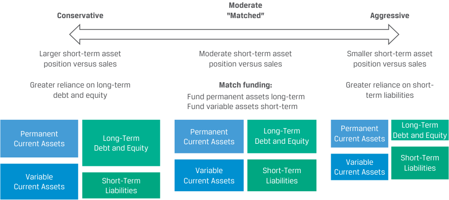
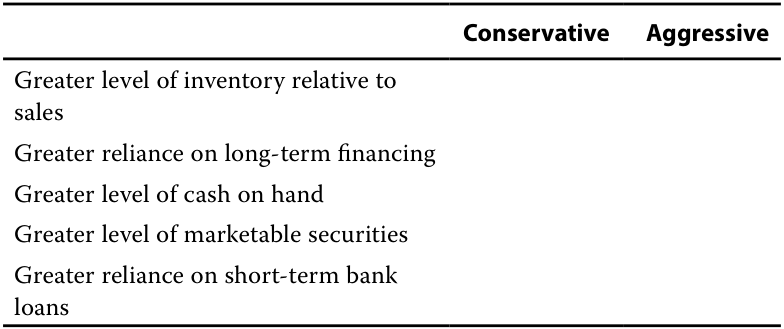

# Tập 3: Tổ chức phát hành doanh nghiệp (Corporate Issuers)
## Học phần 4: Vốn lưu động và Thanh khoản (Working Capital and Liquidity)
### Phần 3/3: Quản trị Vốn lưu động và Thanh khoản (PDF Trang 131–142)

---

<!-- PDF Page 131 -->

|Chi phí phải trả (*Accrued expenses*)|50|
|---|---|
|Nợ ngắn hạn (*Short-term debt*)|600|

Tỷ số tiền mặt (*cash ratio*) và tỷ số thanh toán nhanh (*quick ratio*) của tổ chức phát hành lần lượt *gần nhất* với mức:

- **A.** 0.2087; 0.7304.
- **B.** 0.4363; 1.5273.
- **C.** 0.5455; 1.6364.

#### **Lời giải cho câu 5:**

A là đáp án đúng. Tỷ số tiền mặt là:

$$\text{Cash ratio} = \frac{200 + 40}{500 + 50 + 600} = \frac{240}{1,150} = 0.2087$$

Tỷ số thanh toán nhanh là:

$$\text{Quick ratio} = \frac{200 + 40 + 600}{500 + 50 + 600} = \frac{840}{1,150} = 0.7304$$

---

### **QUẢN TRỊ VỐN LƯU ĐỘNG VÀ THANH KHOẢN (MANAGING WORKING CAPITAL AND LIQUIDITY)**

# **<mark>4</mark>**

**Mục tiêu học tập (LOS):** Mô tả mục tiêu của các tổ chức phát hành và so sánh các phương pháp quản trị vốn lưu động và thanh khoản.

Mục tiêu hàng đầu của việc quản trị vốn lưu động và thanh khoản là tối đa hóa giá trị doanh nghiệp đồng thời duy trì khả năng tiếp cận sẵn sàng các nguồn vốn cần thiết cho hoạt động kinh doanh hàng ngày và thực hiện các nghĩa vụ đối với chủ nợ. Thông thường, việc đạt được mục tiêu này bao gồm rút ngắn chu kỳ chuyển đổi tiền mặt, ước tính lượng thanh khoản cần thiết và tối thiểu hóa bất kỳ lượng tiền dư thừa nào để có thể đầu tư tiền mặt vào những nơi khác có các dự án mang lại tỷ suất sinh lợi cao hơn hoặc hoàn trả cho cổ đông.

Giới hạn thực tế của việc quản trị vốn lưu động và thanh khoản phụ thuộc vào mô hình kinh doanh của doanh nghiệp. Ví dụ, một số loại hình sản xuất có thể liên quan đến quá trình chuyển đổi đầu vào thành thành phẩm phức tạp và kéo dài hơn, đòi hỏi phải nắm giữ hàng tồn kho trong nhiều tuần hoặc nhiều tháng. Tuy nhiên, một nhà phân phối các mặt hàng ít phức tạp hơn có thể chỉ có vài ngày tồn kho bình quân. Một số doanh nghiệp trong cùng một ngành lại đòi hỏi đầu tư nhiều hơn vào hàng tồn kho và các khoản phải thu so với các doanh nghiệp khác. Ví dụ, các doanh nghiệp bán lẻ có nhiều địa điểm bán hàng nơi thành phẩm có sẵn để mua ngay, cũng như những doanh nghiệp bán chịu cho khách hàng thay vì thu tiền ngay lập tức, sẽ cần nhiều vốn lưu động hơn (dưới dạng hàng tồn kho và/hoặc các khoản phải thu khách hàng). Ngược lại, các doanh nghiệp dịch vụ và phần mềm có thể có nhu cầu vốn lưu động thấp hơn rất nhiều, vì họ không có hàng tồn kho và có thể nhận được thanh toán trả trước từ khách hàng.

#### **Quản trị Vốn lưu động (Working Capital Management)**

Các doanh nghiệp ước tính nhu cầu vốn lưu động bằng cách trước tiên xác định nhu cầu vốn lưu động tối ưu trong mối tương quan với doanh thu, và sau đó dự báo các mức vốn lưu động tương lai dựa trên dự báo doanh thu của họ. Khi làm như vậy, các doanh nghiệp thường phân biệt giữa một bên là mức cơ sở của hàng tồn kho, nhân sự và các khoản phải thu vốn là các tài sản ngắn hạn *thường xuyên* (*permanent current assets*) và tương đối ổn định theo thời gian, với một bên là phần hàng tồn kho và nhân công

<!-- PDF Page 132 -->

bổ sung cần thiết trong giai đoạn sản xuất và bán hàng cao điểm theo mùa của công ty hoặc trong giai đoạn tăng trưởng – những khoản mục được coi là tài sản ngắn hạn *biến đổi/tạm thời* (*variable current assets*). Trong quá trình này, các nhà quản lý cũng cân nhắc giữa chi phí và lợi ích của các chính sách quản trị hàng tồn kho và khoản phải thu khác nhau. Ví dụ, mức hàng tồn kho cao hơn có thể làm giảm khả năng thiếu hụt hàng do rủi ro từ nhà cung cấp hoặc nhu cầu tăng đột biến không lường trước, nhưng cũng có thể làm tăng rủi ro lỗi thời (*obsolescence risk*) của lượng hàng tồn kho hiện có. Mặc dù các chính sách tín dụng bán hàng nới lỏng hơn làm tăng các khoản phải thu có thể giúp thúc đẩy doanh số hoặc tăng trưởng doanh thu, nhưng chúng cũng có thể dẫn đến chi phí lập hóa đơn cao hơn và tình trạng khách hàng chậm thanh toán gia tăng theo thời gian.

Các công ty áp dụng các cách tiếp cận khác nhau đối với cả *quy mô* của tài sản ngắn hạn lẫn *cơ cấu* nguồn tài trợ được sử dụng để hỗ trợ các tài sản đó. Bảng 10 (Exhibit 10) phác thảo ba cách tiếp cận khác nhau đối với quản trị vốn lưu động, từ chi phí cao nhất (tức là mức tài sản ngắn hạn cao hơn được tài trợ trên cơ sở dài hạn hơn) đến chi phí thấp nhất (ít tài sản hơn được tài trợ trên cơ sở ngắn hạn hơn) cho một mức doanh thu nhất định.

**Bảng 10: Các cách tiếp cận Quản trị và Tài trợ Vốn lưu động (Exhibit 10: Working Capital Management and Funding Approaches)**

<!-- Picture Text: Moderate Conservative “Matched” Aggressive Larger short-term asset Moderate short-term asset Smaller short-term asset position versus sales position versus sales position versus sales Greater reliance on long-term Match funding: Greater reliance on short- debt and equity Fund permanent assets long-term term liabilities Fund variable assets short-term Current AssetsPermanent Long-Term Current AssetsPermanent Debt and EquityLong-Term Current AssetsPermanent Debt and EquityLong-Term Debt and Equity Variable Short-Term Variable Short-Term Current Assets Liabilities Variable Short-Term Current Assets Liabilities Current Assets Liabilities  -->

> **Chú thích hình ảnh:** Ba cách tiếp cận quản trị và tài trợ vốn lưu động:
> 1. **Thận trọng (*Conservative*)**: Vị thế tài sản ngắn hạn lớn hơn so với doanh thu (*Larger short-term asset position versus sales*); Phụ thuộc nhiều hơn vào nợ dài hạn và vốn chủ sở hữu (*Greater reliance on long-term debt and equity*) – tài trợ cho toàn bộ Tài sản ngắn hạn thường xuyên (*Permanent Current Assets*) và một phần Tài sản ngắn hạn biến đổi (*Variable Current Assets*), phần còn lại tài trợ bằng Nợ ngắn hạn (*Short-Term Liabilities*).
> 2. **Ôn hòa / “Khớp kỳ hạn” (*Moderate “Matched”*)**: Vị thế tài sản ngắn hạn vừa phải so với doanh thu (*Moderate short-term asset position versus sales*); Tài trợ khớp kỳ hạn (*Match funding*): Tài trợ tài sản thường xuyên bằng nguồn dài hạn (*Fund permanent assets long-term*) và tài trợ tài sản biến đổi bằng nguồn ngắn hạn (*Fund variable assets short-term*).
> 3. **Mạo hiểm / Tích cực (*Aggressive*)**: Vị thế tài sản ngắn hạn nhỏ hơn so với doanh thu (*Smaller short-term asset position versus sales*); Phụ thuộc nhiều hơn vào nợ ngắn hạn (*Greater reliance on short-term liabilities*) – dùng Nợ ngắn hạn tài trợ cho toàn bộ Tài sản ngắn hạn biến đổi và một phần Tài sản ngắn hạn thường xuyên.

Cách tiếp cận thận trọng (*conservative approach*) đối với quản trị vốn lưu động bao gồm việc nắm giữ nhiều tiền mặt, khoản phải thu và hàng tồn kho hơn so với doanh thu, cùng với sự phụ thuộc nhiều hơn vào các nguồn tài trợ dài hạn. Mặc dù chiến lược này mang lại cho doanh nghiệp sự linh hoạt tài chính lớn nhất để đáp ứng các nhu cầu của mình, nhưng nó cũng thường là chiến lược tốn kém nhất. Những ưu điểm và nhược điểm của cách tiếp cận vốn lưu động thận trọng được nêu trong Bảng 11 (Exhibit 11).

**Bảng 11: Cách tiếp cận Vốn lưu động Thận trọng: Ưu và Nhược điểm (Exhibit 11: Conservative Working Capital Approach: Pros and Cons)**

|**Ưu điểm (*Pros*)**|**Nhược điểm (*Cons*)**|
|---|---|
|Nguồn tài trợ ổn định, dài hạn giúp tránh được rủi ro tái tục/đảo nợ (*rollover risk*) gắn liền với nợ ngắn hạn|Nợ dài hạn thường có mức lãi suất cao hơn|
|Chi phí tài trợ được biết trước ngay từ đầu|Chi phí vốn chủ sở hữu (*cost of equity*) cao|
|Đảm bảo chắc chắn có đủ vốn lưu động cần thiết để mua lượng hàng tồn kho cần dùng|Nguồn tài trợ thường xuyên/dài hạn làm mất đi cơ hội chỉ đi vay khi thực sự có nhu cầu|
|Thời hạn thanh toán kéo dài giúp giảm nhu cầu tiền mặt ngắn hạn dành cho việc trả nợ (*debt service*)|Thường mất nhiều thời gian chuẩn bị (*lead time*) hơn để thiết lập vị thế tài trợ|
|Tính linh hoạt cao hơn trong các giai đoạn thị trường gián đoạn nhờ có thể được bù đắp bởi vị thế tiền mặt hoặc chứng khoán khả mại lớn hơn|Nợ dài hạn có thể đi kèm nhiều điều khoản hạn chế (*restrictions/covenants*) hơn đối với hoạt động kinh doanh|

<!-- PDF Page 133 -->

Các doanh nghiệp trong giai đoạn tăng trưởng sớm (*early-growth phase*) có nhiều khả năng cân nhắc cách tiếp cận thận trọng do khả năng tiếp cận nợ ngắn hạn còn hạn chế. Các công ty đã có tên tuổi vững chắc hơn với biên lợi nhuận cao hơn theo đuổi chính sách như vậy cũng có thể chuyển phần chi phí tài trợ cao hơn này sang cho khách hàng. Các doanh nghiệp có thể chọn theo đuổi chiến lược vốn lưu động thận trọng vì một số lý do khác:

- Giảm nhu cầu phải tiếp cận thị trường vốn trong những thời điểm thị trường căng thẳng (*market stress*)

- Kỳ vọng lãi suất sẽ đi ngang hoặc tăng lên

- Ưu tiên sự ổn định của dòng tiền hơn là chịu rủi ro đảo nợ (*rollover risk*) của nợ ngắn hạn

- Lợi ích của sự chắc chắn cao hơn và khả năng tiếp cận nguồn vốn dài hạn ổn định hơn được đánh giá là đủ để bù đắp cho chi phí tài trợ cao hơn đi kèm

Ngược lại, cách tiếp cận vốn lưu động mạo hiểm (*aggressive working capital approach*) tìm cách tối thiểu hóa lượng tiền mặt dư thừa, các khoản phải thu và hàng tồn kho so với doanh thu, đồng thời phụ thuộc nhiều hơn vào nguồn tài trợ ngắn hạn để đáp ứng các nhu cầu vốn lưu động biến đổi và một phần nhu cầu vốn lưu động thường xuyên. Với ít nguồn lực cam kết hơn để hỗ trợ tài sản ngắn hạn, doanh nghiệp đã đánh đổi việc giảm bớt sự linh hoạt tài chính trong ngắn hạn để lấy tỷ suất sinh lợi cao hơn cho các nhà đầu tư.

Những ưu điểm và nhược điểm của chiến lược vốn lưu động mạo hiểm được nêu trong Bảng 12 (Exhibit 12).

**Bảng 12: Cách tiếp cận Vốn lưu động Mạo hiểm: Ưu và Nhược điểm (Exhibit 12: Aggressive Working Capital Approach: Pros and Cons)**

|**Ưu điểm (*Pros*)**|**Nhược điểm (*Cons*)**|
|---|---|
|Chi phí tài trợ thấp hơn|Chi phí lãi vay có thể biến động khi lãi suất tài trợ ngắn hạn thay đổi|
|Tính linh hoạt chỉ đi vay khi cần thiết giúp làm giảm tổng chi phí lãi vay|Có thể dẫn đến nhu cầu tiền mặt ngắn hạn cao hơn để đáp ứng các khoản nợ đến hạn|
|Nợ ngắn hạn thường có ít điều khoản hạn chế hơn đối với hoạt động kinh doanh|Rủi ro đảo nợ (*rollover risk*) của nợ ngắn hạn làm tăng rủi ro phá sản, đặc biệt là trong các giai đoạn thị trường gián đoạn|
|Tính linh hoạt để tái cấp vốn (*refinance*) nếu lãi suất giảm|Có thể phải dựa vào nguồn tín dụng thương mại đắt đỏ hơn, thắt chặt tín dụng khách hàng, hoặc bán các khoản phải thu nếu không thể tái cấp vốn với các điều khoản thuận lợi|

Các doanh nghiệp trong các ngành có biên lợi nhuận thấp hơn có thể cân nhắc theo đuổi chính sách vốn lưu động mạo hiểm hơn để giành lợi thế chi phí so với các đối thủ cạnh tranh. Mặc dù sự phụ thuộc nhiều hơn vào nguồn tài trợ ngắn hạn giúp giảm chi phí nợ vay so với cách tiếp cận thận trọng, doanh nghiệp cũng phải đối mặt với mức độ phơi nhiễm lớn hơn trước rủi ro đảo nợ (*debt rollover risk*) trong những thời điểm thị trường căng thẳng. Rủi ro này đã ảnh hưởng đến nhiều doanh nghiệp trong cuộc khủng hoảng tài chính 2008–2009 và vào đầu năm 2020 trong giai đoạn đầu của đại dịch COVID-19.

Các doanh nghiệp lựa chọn chính sách vốn lưu động mạo hiểm có thể làm như vậy vì một hoặc nhiều lý do bổ sung sau đây:

- Có khả năng dự báo doanh thu và nhu cầu tiền mặt trong tương lai với độ chính xác cao

- Kỳ vọng lãi suất ổn định hoặc giảm xuống

- Kỳ vọng rằng doanh nghiệp sẽ rút ngắn được chu kỳ chuyển đổi tiền mặt của mình (tức là rút ngắn kỳ thu tiền khoản phải thu và kỳ luân chuyển hàng tồn kho, đồng thời kéo dài kỳ thanh toán khoản phải trả người bán)

- Có khả năng thanh lý nhanh hàng tồn kho và tối thiểu hóa các khoản phải thu khách hàng

<!-- PDF Page 134 -->

Cách tiếp cận vốn lưu động ôn hòa (*moderate working capital approach*) tạo ra sự cân bằng giữa việc sử dụng nguồn tài trợ dài hạn cho các nhu cầu tài sản ngắn hạn mang tính thường xuyên hơn và nợ ngắn hạn cho các nhu cầu biến đổi. Vì các nhu cầu ổn định, có thể dự đoán được sẽ được đáp ứng bằng nguồn tài trợ dài hạn và các nhu cầu theo mùa vụ hoặc theo đà tăng trưởng ít dự đoán được hơn sẽ được đáp ứng bằng các nguồn lực ngắn hạn, phương pháp này thường được gọi là cách tiếp cận “khớp kỳ hạn” (*“matched” approach*).

Những ưu điểm và nhược điểm của chiến lược vốn lưu động ôn hòa được nêu trong Bảng 13 (Exhibit 13).

**Bảng 13: Cách tiếp cận Vốn lưu động Ôn hòa: Ưu và Nhược điểm (Exhibit 13: Moderate Working Capital Approach: Pros and Cons)**

|**Ưu điểm (*Pros*)**|**Nhược điểm (*Cons*)**|
|---|---|
|Chi phí tài trợ thấp hơn so với cách tiếp cận thận trọng; rủi ro thấp hơn so với cách tiếp cận mạo hiểm|Khả năng tiếp cận nguồn vốn ngắn hạn có thể bị hạn chế đối với các nhu cầu theo mùa vụ hoặc tăng trưởng|
|Tính linh hoạt để tăng nguồn tài trợ cho các yêu cầu theo mùa vụ hoặc tăng trưởng khi cần thiết|Chi phí nợ ngắn hạn cho các nhu cầu biến đổi không chắc chắn trong các giai đoạn thị trường gián đoạn|
|Đa dạng hóa các nguồn tài trợ, với cách tiếp cận kỷ luật hơn trong quản trị bảng cân đối kế toán|Có thể phải dựa vào tín dụng thương mại đắt đỏ hơn để đáp ứng các nhu cầu theo mùa vụ hoặc tăng trưởng nếu không thể tái cấp vốn với các điều khoản thuận lợi|

Theo cách tiếp cận ôn hòa, các doanh nghiệp chịu chi phí tài trợ thấp hơn so với chính sách thận trọng hơn, cùng với rủi ro tái cấp vốn (*refinancing risk*) thấp hơn so với chiến lược vốn lưu động mạo hiểm hơn. Mặc dù các doanh nghiệp này cũng có thể theo đuổi các biện pháp nhằm giảm vốn lưu động và rút ngắn chu kỳ chuyển đổi tiền mặt, việc sử dụng nợ dài hạn và vốn chủ sở hữu để hỗ trợ các nhu cầu thường xuyên cho phép họ thực hiện những thay đổi đó một cách từ từ hơn. Các lý do khác khiến một doanh nghiệp có thể theo đuổi cách tiếp cận ôn hòa đối với quản trị vốn lưu động bao gồm:

- Có khả năng dự báo chính xác nhu cầu tài sản ngắn hạn cơ sở, nhưng ít chắc chắn hơn đối với các nhu cầu biến đổi

- Giảm chi phí tài trợ so với cách tiếp cận thận trọng, đi kèm với rủi ro đảo nợ thấp hơn và sự linh hoạt tài chính lớn hơn so với cách tiếp cận mạo hiểm hơn

- Nhằm cân bằng giữa việc sử dụng nguồn tài trợ ngắn hạn ít tốn kém hơn với sự ổn định và chắc chắn của nguồn vốn lưu động thường xuyên được hỗ trợ bởi nguồn tài trợ dài hạn

Sự tương tác giữa chiến lược bán hàng của doanh nghiệp và cách tiếp cận vốn lưu động của nó là một yếu tố quan trọng cần xem xét đối với các nhà phân tích tài chính. Ví dụ, việc cấp thêm tín dụng, hoặc đưa ra các điều khoản tín dụng hào phóng hơn cho khách hàng nhằm thúc đẩy doanh thu cũng sẽ làm tăng vốn lưu động. Ngoài sự gia tăng trong các khoản phải thu khách hàng, doanh nghiệp rất có thể phải đối mặt với tình trạng khách hàng chậm thanh toán gia tăng, mà cả hai điều này đều đòi hỏi thêm nguồn tài trợ. Chi phí tăng thêm cho việc giám sát, lập hóa đơn và thu hồi các khoản phải thu trong một khoảng thời gian dài hơn, cũng như chi phí đi vay cao hơn, phải được đặt lên bàn cân so sánh với phần lợi nhuận tăng thêm được tạo ra theo chiến lược mới.

Quản trị thanh khoản hiệu quả là một chức năng tài chính cốt lõi đối với hầu hết các doanh nghiệp. Ngay cả những công ty có lãi cũng có thể gặp khó khăn tài chính nếu không đảm bảo có đủ thanh khoản để đáp ứng các khoản nợ phải trả ngắn hạn.

<!-- PDF Page 135 -->

##### **VÍ DỤ 5 (EXAMPLE 5)**

#### **Những thay đổi đối với Chính sách Tín dụng của Tập đoàn Keown (Changes to Keown Corporation’s Credit Policy)**

1. Tập đoàn Keown đang cân nhắc tăng hạn mức tín dụng cấp cho các khách hàng mới vì giám đốc bán hàng tin rằng việc làm đó sẽ giúp tăng doanh thu. Tác động dự kiến đối với nhu cầu tài trợ ngắn hạn của Keown sẽ là gì nếu thay đổi này được thực hiện?

   - **A.** Công ty sẽ giảm mức hàng tồn kho của mình.

   - **B.** Công ty nhiều khả năng sẽ thu tiền nhanh hơn, làm giảm các khoản phải thu.

   - **C.** Công ty sẽ có nhu cầu vốn lưu động tăng lên.

   - **D.** Công ty có thể thanh toán cho nhà cung cấp sớm hơn, làm giảm các khoản phải trả người bán.

   - **E.** Công ty sẽ không thấy bất kỳ sự thay đổi nào trong nhu cầu vốn lưu động do sự thay đổi này.

##### **Lời giải:**

C là đáp án đúng. Công ty nhiều khả năng sẽ cần thêm nguồn tài trợ ngắn hạn để hỗ trợ cho sự gia tăng dự kiến của lượng hàng tồn kho và các khoản phải thu khách hàng cần thiết bắt nguồn từ sự gia tăng doanh thu.

#### **Thanh khoản và Tài trợ ngắn hạn (Liquidity and Short-Term Funding)**

Như đã mô tả trong bài học trước, thanh khoản liên quan đến khả năng tương đối của một doanh nghiệp trong việc chuyển đổi các nguồn lực thành tiền mặt để đáp ứng các nghĩa vụ trước mắt. Đối với hầu hết các doanh nghiệp, khả năng này bao gồm việc sử dụng số dư tiền mặt hiện có, dòng tiền từ hoạt động kinh doanh hoặc các khoản đi vay. Các doanh nghiệp có thể tối đa hóa sự linh hoạt tài chính bằng cách xây dựng một chiến lược tài trợ ngắn hạn và thường xuyên đánh giá các phương án sẵn có để tự tài trợ cho mình. Các công ty không tìm hiểu đầy đủ các lựa chọn sẵn có hoặc không tận dụng được việc tiết kiệm chi phí từ các hình thức tài trợ hiện có sẽ dễ phải đối mặt với chi phí tài trợ cao hơn hoặc thậm chí là kiệt quệ tài chính (*financial distress*), rơi vào tình cảnh không thể vay vốn từ bất kỳ nguồn nào.

Một chiến lược tài trợ ngắn hạn thận trọng và khôn ngoan (khi nào nên vay và vay dưới hình thức nào) giúp đạt được một số mục tiêu, bao gồm:

- Duy trì các nguồn tín dụng đầy đủ và đa dạng để tài trợ cho các nhu cầu tiền mặt *thường xuyên/liên tục* (*ongoing cash needs*). Mặc dù nhiều doanh nghiệp có một nguồn tài trợ ngắn hạn chính, chẳng hạn như tín dụng thương mại và các hạn mức tín dụng ngân hàng (*credit facilities*), về mặt lý tưởng, một công ty nên đảm bảo có sẵn các nguồn tài trợ bổ sung để giảm sự phụ thuộc vào một người cho vay hoặc một loại hình tài trợ duy nhất.

- Đảm bảo năng lực tài trợ đầy đủ để xử lý các nhu cầu tiền mặt *thay đổi* (*changing cash needs*) của doanh nghiệp. Mục tiêu này có thể bao gồm việc đáp ứng các nhu cầu cao điểm theo mùa vụ hoặc tăng trưởng theo kế hoạch.

- Xác nhận rằng các mức lãi suất tài trợ được chào, cũng như các điều khoản và điều kiện đi kèm, có tính cạnh tranh và hiểu rõ cách thức các mức lãi suất này có thể thay đổi dưới các điều kiện thị trường vốn và kinh tế khác nhau.

- Đảm bảo rằng cả chi phí tài trợ ngầm định (*implicit* – ví dụ: chi phí tài trợ từ nhà cung cấp đã thảo luận trước đó) và chi phí tài trợ hiện hữu (*explicit*) đều được tính đến khi tính toán chi phí đi vay thực tế (*effective cost of borrowing*) của công ty.

<!-- PDF Page 136 -->

Ngành nghề, quy mô, vị trí địa lý và các yếu tố khác của doanh nghiệp cũng có thể ảnh hưởng đến cách tiếp cận tài trợ ngắn hạn của doanh nghiệp theo những cách sau:

- *Quy mô (Size).* Quy mô của công ty là yếu tố quyết định quan trọng đối với các phương án tài trợ sẵn có. Ví dụ, một doanh nghiệp tư nhân nhỏ có thể bị giới hạn ở các khoản ứng trước tín dụng ngắn hạn từ một ngân hàng duy nhất, trong khi các doanh nghiệp rất lớn có thể tiếp cận thị trường thu nhập cố định ngắn hạn (*short-term fixed-income markets*) cùng nhiều nguồn khác. Nhiều phương án tài trợ đòi hỏi quy mô tối thiểu hoặc có chi phí cố định lớn, khiến chúng trở nên quá đắt đỏ hoặc không thể tiếp cận được đối với các công ty vừa và nhỏ.

- *Mức độ tín nhiệm (Creditworthiness).* Mức độ tín nhiệm của doanh nghiệp không chỉ quyết định việc khoản vay có được người cho vay phê duyệt hay không và mức lãi suất doanh nghiệp phải trả là bao nhiêu, mà còn quyết định xem khoản vay có chứa các điều khoản và điều kiện hạn chế hoạt động của doanh nghiệp hay không. Ví dụ, người cho vay có thể áp đặt các điều kiện vay vốn đối với một doanh nghiệp có mức độ tín nhiệm thấp hơn nhằm hạn chế khả năng bán hoặc sử dụng tài sản của doanh nghiệp đó cho các mục đích khác nhau. Chủ đề này sẽ được đề cập chi tiết hơn trong các học phần sau.

- *Các cân nhắc về pháp lý (Legal considerations).* Một số doanh nghiệp ở các thị trường mới nổi hoặc thị trường cận biên (*emerging or frontier markets*) với hệ thống pháp luật chưa được định hình hoàn chỉnh có thể có ít phương án tài trợ hơn từ các định chế tài chính trung gian hoặc thị trường tài chính so với các doanh nghiệp ở các nền kinh tế phát triển. Do đó, họ có thể phụ thuộc nhiều hơn vào tín dụng thương mại từ các nhà cung cấp.

- *Các cân nhắc về quy định quản lý (Regulatory considerations).* Một số ngành ở các thị trường phát triển chịu sự quản lý rất chặt chẽ. Các doanh nghiệp trong những ngành này, chẳng hạn như các công ty tiện ích công cộng (*utilities*) hoặc ngân hàng, có thể bị giới hạn về cả mức trần được phép vay cũng như loại hình đi vay mà họ có thể tiếp cận. Trong những trường hợp khác, họ lại có thể tiếp cận các nguồn tài trợ ngắn hạn đặc thù mà các doanh nghiệp khác không có được. Ví dụ, các định chế tài chính có thể vay và cho vay dự trữ ngân hàng trung ương (*central bank reserves*) lẫn nhau và cũng có thể trực tiếp tiếp cận nguồn vốn từ ngân hàng trung ương. Việc tài trợ vốn của các định chế tài chính sẽ được đề cập chi tiết ở phần sau của chương trình học.

- *Tài sản cơ sở (Underlying assets).* Tùy thuộc vào mô hình kinh doanh, các công ty có thể sở hữu các tài sản, chẳng hạn như hàng tồn kho, được coi là hấp dẫn để làm tài sản thế chấp (*collateral*) cho các khoản tài trợ ngắn hạn có bảo đảm (*secured short-term funding*).

Đối với các doanh nghiệp thuộc bất kỳ quy mô, ngành nghề hay vị trí địa lý nào, việc lập kế hoạch phù hợp sẽ cho phép công ty quản lý nhu cầu nợ ngắn hạn của mình hiệu quả hơn. Ví dụ, việc dự báo các vị thế tiền mặt qua một chu kỳ chuyển đổi tiền mặt và xa hơn nữa có thể giúp các doanh nghiệp giảm thiểu khả năng rơi vào kiệt quệ tài chính trong những điều kiện thị trường bất lợi. Việc khớp thời điểm đáo hạn của các khoản nợ với các khoản thu tiền mặt dự kiến và giãn cách thời điểm đáo hạn nợ theo thời gian (*spacing debt maturities out over time*) cũng có thể giúp giảm rủi ro tài trợ ngắn hạn.

##### **KIỂM TRA KIẾN THỨC: ĐÁNH GIÁ CÁC LỰA CHỌN TÀI TRỢ NGẮN HẠN (KNOWLEDGE CHECK: EVALUATING SHORT-TERM FINANCING CHOICES)**

1. Một công ty nên xem xét những yếu tố nào sau đây khi đánh giá các lựa chọn tài trợ ngắn hạn?

   - **A.** Chi phí của nguồn vốn đi vay

   - **B.** Sự linh hoạt do nguồn vốn đó mang lại

   - **C.** Mức độ dễ dàng khi tiếp cận nguồn vốn

   - **D.** Các ràng buộc về pháp lý hoặc quy định quản lý có thể ưu tiên nguồn này hơn nguồn khác

<!-- PDF Page 137 -->

   - **E.** Tất cả các câu trên

   - **Lời giải:**

E là đáp án đúng. Chi phí vốn đối với một công ty là yếu tố hiển nhiên nhất cần xem xét, nhưng công ty có thể chọn đi vay với mức chi phí cao hơn một chút sau khi đã cân nhắc tất cả các yếu tố khác.

##### **KIỂM TRA KIẾN THỨC: ĐÁP ỨNG NHU CẦU TÀI TRỢ NGẮN HẠN CỦA TẬP ĐOÀN KEOWN (KNOWLEDGE CHECK: MEETING KEOWN CORPORATION’S SHORT-TERM FINANCING NEEDS)**

1. Tập đoàn Keown có các khoản phải trả người bán trị giá 2 triệu CAD với điều khoản `2/10, net 30` và các khoản phải thu khách hàng trị giá 2 triệu CAD. Ngoài ra, công ty đang nắm giữ 5 triệu CAD chứng khoán khả mại. Keown đang có nhu cầu ngắn hạn 200,000 CAD để trả lương cho nhân viên. Lựa chọn nào sau đây là hợp lý nhất để huy động 200,000 CAD?

   - **A.** Công ty nên phát hành nợ dài hạn.

   - **B.** Công ty nên phát hành cổ phiếu phổ thông.

   - **C.** Công ty nên trì hoãn thanh toán các khoản phải trả người bán và từ bỏ mức chiết khấu 2%.

   - **D.** Công ty nên bán các khoản phải thu khách hàng với mức chiết khấu 10%.

   - **E.** Công ty nên bán chứng khoán khả mại với chi phí môi giới 0.5% (bỏ qua thuế lãi vốn).

##### **Lời giải:**

E là đáp án đúng.

Các phương án để huy động 200,000 CAD được tóm tắt trong bảng sau.

|**Nguồn vốn (*Source of Funds*)**|**Hành động (*Action*)**|**Chi phí thanh lý (%)**|**Chi phí thanh lý (CAD)**|
|---|---|---|---|
|C. Khoản phải trả người bán (`2/10, net 30`)|Trì hoãn thanh toán 200,000 CAD và từ bỏ chiết khấu 2%|2.0|4,000|
|D. Khoản phải thu khách hàng|Bán giá trị 222,222 CAD với mức chiết khấu 10% để thu về 200,000 CAD|10.0|22,222|
|E. Chứng khoán khả mại|Bán giá trị 200,000 CAD|0.5|1,000|

Việc chọn phương án C liên quan đến việc từ bỏ khoản chiết khấu 2%, tính trên 200,000 CAD sẽ tương đương với mức chi phí là 4,000 CAD. Để thu ròng 200,000 CAD bằng phương án D, công ty sẽ phải bán 222,222 CAD các khoản phải thu với chi phí là 22,222 CAD. Phương án E rõ ràng là lựa chọn tốt nhất. Chứng khoán khả mại có tính thanh khoản cao và có thể dễ dàng bán theo giá thị trường, trừ đi khoản phí môi giới tương đối nhỏ là 1,000 CAD.

<!-- PDF Page 138 -->

##### **BỘ CÂU HỎI (QUESTION SET)**

1. Phân loại mỗi đặc điểm sau đây theo các cách tiếp cận quản trị vốn lưu động:

<!-- Picture Text: Conservative Aggressive Greater level of inventory relative to sales Greater reliance on long-term financing Greater level of cash on hand Greater level of marketable securities Greater reliance on short-term bank loans  -->

|Đặc điểm|Thận trọng (*Conservative*)|Mạo hiểm (*Aggressive*)|
|---|---|---|
|Mức hàng tồn kho lớn hơn so với doanh thu (*Greater level of inventory relative to sales*)|||
|Phụ thuộc nhiều hơn vào tài trợ dài hạn (*Greater reliance on long-term financing*)|||
|Mức tiền mặt sẵn có lớn hơn (*Greater level of cash on hand*)|||
|Mức chứng khoán khả mại lớn hơn (*Greater level of marketable securities*)|||
|Phụ thuộc nhiều hơn vào các khoản vay ngân hàng ngắn hạn (*Greater reliance on short-term bank loans*)|||

##### **Lời giải:**

<!-- Picture Text: Conservative Aggressive Greater level of inventory relative to ✓ sales Greater reliance on long-term financing ✓ Greater level of cash on hand ✓ Greater level of marketable securities ✓ Greater reliance on short-term bank ✓ loans  -->

|Đặc điểm|Thận trọng (*Conservative*)|Mạo hiểm (*Aggressive*)|
|---|---|---|
|Mức hàng tồn kho lớn hơn so với doanh thu (*Greater level of inventory relative to sales*)|✓||
|Phụ thuộc nhiều hơn vào tài trợ dài hạn (*Greater reliance on long-term financing*)|✓||
|Mức tiền mặt sẵn có lớn hơn (*Greater level of cash on hand*)|✓||
|Mức chứng khoán khả mại lớn hơn (*Greater level of marketable securities*)|✓||
|Phụ thuộc nhiều hơn vào các khoản vay ngân hàng ngắn hạn (*Greater reliance on short-term bank loans*)||✓|

2. Một công ty có 30 triệu USD các khoản phải trả người bán, trong đó công ty có thể trì hoãn thanh toán đến ngày thứ 14, từ bỏ mức chiết khấu 2% mà công ty sẽ nhận được nếu thanh toán trong vòng 10 ngày. Chi phí thanh lý (*liquidation cost*) tính bằng triệu USD *gần nhất* với mức:

   - **A.** 0.6.

   - **B.** 6.1.

   - **C.** 8.4.

   - **Lời giải:**

A là đáp án đúng. Chi phí thanh lý là khoản chiết khấu 2% bị từ bỏ áp dụng trên giá trị 30 triệu USD của các khoản phải trả người bán.

$$\text{Liquidation cost} = \text{USD } 30\text{ million} \times 0.02 = \text{USD } 0.6\text{ million}$$

B và C không đúng, vì chúng đại diện cho mức lãi suất thực năm (EAR) của khoản tiền lãi bị từ bỏ áp dụng vào giá trị của các khoản phải trả người bán.

3. Một công ty đã thay đổi điều khoản tín dụng dành cho khách hàng từ `1/10, net 30` thành `1/15, net 30`. Tác động có khả năng xảy ra nhất của sự thay đổi này là:

   - **A.** sự gia tăng trong các khoản phải thu khách hàng.

   - **B.** không có sự thay đổi trong các khoản phải thu khách hàng.

   - **C.** sự sụt giảm trong các khoản phải thu khách hàng.

   - **Lời giải:**

A là đáp án đúng. Công ty đã kéo dài thời gian hưởng chiết khấu thêm 5 ngày và không thay đổi mức chiết khấu tính theo tỷ lệ phần trăm của giá bán (1%).

<!-- PDF Page 139 -->

Các điều khoản tín dụng hào phóng hơn cho khách hàng nhiều khả năng sẽ làm tăng các khoản phải thu khách hàng, bởi vì khách hàng sẽ mất nhiều thời gian hơn để thanh toán ngay cả khi họ tận dụng chiết khấu. Ngoài ra, các điều khoản tín dụng hấp dẫn hơn có thể dẫn đến sự gia tăng các khoản phải thu do doanh thu tăng lên.

B và C không đúng, vì thời hạn chiết khấu hào phóng hơn sẽ dẫn đến các khoản phải thu khách hàng tăng lên khi khách hàng mất nhiều thời gian hơn để thanh toán nếu họ tận dụng khoản chiết khấu.

4. Việc thay đổi chính sách khoản phải thu khách hàng theo hướng cấp tín dụng cho những khách hàng có mức độ tín nhiệm thấp hơn sẽ có khả năng cao nhất dẫn đến:

   - **A.** một lực kéo đối với thanh khoản (*a pull on liquidity*).
   - **B.** một lực cản đối với thanh khoản (*a drag on liquidity*).
   - **C.** không có tác động đến thanh khoản.

##### **Lời giải:**

B là đáp án đúng. Bằng cách cấp tín dụng cho những khách hàng có mức độ tín nhiệm thấp hơn, công ty có khả năng gặp phải nhiều tài khoản quá hạn hoặc không thể thu hồi được hơn và làm tăng số ngày thu tiền bán hàng bình quân (DSO), dẫn đến một lực cản đối với thanh khoản (*drag on liquidity*).

A không đúng, vì một lực kéo đối với thanh khoản sẽ bắt nguồn từ việc đẩy nhanh dòng tiền ra. Trong trường hợp này, sự thay đổi chính sách tín dụng của công ty có tác động làm chậm dòng tiền vào.

C không đúng, vì sự thay đổi trong chính sách khoản phải thu của công ty nhiều khả năng sẽ làm tăng nhu cầu vốn lưu động do có các khoản phải thu khách hàng cao hơn.

5. Tập đoàn Lucor đang tìm cách gia tăng thanh khoản và đang đánh giá hai hành động tiềm năng:

|Phương án|Mô tả|
|---|---|
|Phương án 1|Bán các khoản phải thu khách hàng cho một định chế tài chính trung gian với mức chiết khấu 5% so với giá trị ghi sổ (*carrying value*)|
|Phương án 2|Đẩy nhanh việc thanh toán cho các nhà cung cấp để nhận mức chiết khấu 5%|

Phương án nào sẽ đạt được mục tiêu của Lucor?

   - **A.** Phương án 1
   - **B.** Phương án 2
   - **C.** Cả hai đều không, vì cả hai đều làm phát sinh chi phí thanh lý

##### **Lời giải:**

A là đáp án đúng. Phương án 1 sẽ làm tăng thanh khoản bằng cách chuyển đổi một tài sản kém thanh khoản hơn (các khoản phải thu khách hàng) thành tiền mặt ngay lập tức, mặc dù phải chịu một khoản chi phí.

B không đúng, vì Phương án 2 sẽ làm giảm thanh khoản do đẩy nhanh các dòng tiền ra.

C không đúng, vì Phương án 2 sẽ làm giảm thanh khoản do đẩy nhanh các dòng tiền ra và không làm phát sinh chi phí thanh lý tài sản.

<!-- PDF Page 140 -->

## **CÂU HỎI THỰC HÀNH (PRACTICE PROBLEMS)**

**1.** Một tổ chức phát hành thay đổi điều khoản tín dụng dành cho khách hàng từ `2/10, net 30` thành `2/10, net 40` sẽ có khả năng cao nhất gặp phải:

   - **A.** một lực kéo đối với thanh khoản (*a pull on its liquidity*).

   - **B.** một lực cản đối với thanh khoản (*a drag on its liquidity*).

   - **C.** không có sự thay đổi nào đối với thanh khoản.

**2.** Yếu tố nào sau đây có khả năng cao nhất làm *giảm* chu kỳ chuyển đổi tiền mặt (*cash conversion cycle*) của một tổ chức phát hành? Sự gia tăng trong:

   - **A.** số ngày thu tiền bán hàng bình quân (*days sales outstanding*).

   - **B.** số ngày tồn kho bình quân (*days of inventory on hand*).

   - **C.** số ngày phải trả nhà cung cấp bình quân (*days payable outstanding*).

**3.** Một nhà phân tích thu thập thông tin bảng cân đối kế toán cho năm tài chính gần nhất của ba tổ chức phát hành.

||**Tổ chức phát hành A**|**Tổ chức phát hành B**|**Tổ chức phát hành C**|
|---|---|---|---|
|Tiền mặt (*Cash*)|100|120|50|
|Chứng khoán khả mại (*Marketable securities*)|20|10|20|
|Khoản phải thu khách hàng (*Accounts receivable*)|300|300|200|
|Hàng tồn kho (*Inventory*)|500|600|300|
|Chi phí trả trước (*Prepaid expenses*)|50|0|10|
|Khoản phải trả người bán (*Accounts payable*)|400|500|300|
|Chi phí phải trả (*Accrued expenses*)|40|20|0|

Tổ chức phát hành nào có tính thanh khoản cao nhất dựa trên tỷ số thanh toán nhanh (*quick ratio*)?

   - **A.** Tổ chức phát hành A

   - **B.** Tổ chức phát hành B

   - **C.** Tổ chức phát hành C

**4.** Một nhà phân tích đang đánh giá tính thanh khoản của một tổ chức phát hành và tính ra chu kỳ chuyển đổi tiền mặt âm (*negative cash conversion cycle*) cho tổ chức phát hành đó trong năm tài chính gần nhất. Kết quả này là:

   - **A.** không khả thi.

   - **B.** có thể xảy ra, bởi vì tổ chức phát hành có đủ tiền mặt và chứng khoán khả mại sẵn có để hỗ trợ các nhu cầu ngắn hạn.

   - **C.** có thể xảy ra, bởi vì khoản đầu tư vào hàng tồn kho được thu hồi nhanh chóng và tổ chức phát hành tận dụng được nguồn tài trợ từ nhà cung cấp (*vendor financing*).

**5.** Một tổ chức phát hành đã loại bỏ khoản chiết khấu thanh toán sớm mà trước đây từng dành cho khách hàng. Hành động này nhiều khả năng nhất sẽ:

   - **A.** làm tăng tính thanh khoản của tổ chức phát hành.

<!-- PDF Page 141 -->

   - **B.** làm giảm tính thanh khoản của tổ chức phát hành.

   - **C.** không ảnh hưởng đến tính thanh khoản của tổ chức phát hành.

<!-- PDF Page 142 -->

## **LỜI GIẢI (SOLUTIONS)**

1. B là đáp án đúng. Bằng cách kéo dài thời hạn thanh toán ròng (*net period*), tổ chức phát hành nhiều khả năng sẽ thấy các khoản phải thu khách hàng tăng lên, kéo dài chu kỳ chuyển đổi tiền mặt và tạo ra một lực cản đối với thanh khoản (*drag on liquidity*).

A không đúng, vì sự thay đổi này sẽ làm chậm các khoản thanh toán từ khách hàng (dòng tiền vào) chứ không phải tạo ra lực kéo đối với thanh khoản xét về mặt dòng tiền ra. C không đúng, vì việc kéo dài thời hạn thanh toán ròng sẽ làm chậm các khoản thanh toán từ khách hàng và tạo ra lực cản đối với thanh khoản.

2. C là đáp án đúng. Việc tăng số ngày phải trả nhà cung cấp bình quân (DPO) sẽ làm giảm chu kỳ chuyển đổi tiền mặt, bởi vì các khoản thanh toán cho nhà cung cấp được trì hoãn. Số ngày phải trả nhà cung cấp bình quân được trừ đi khỏi tổng của số ngày thu tiền bán hàng bình quân và số ngày tồn kho bình quân khi tính chu kỳ chuyển đổi tiền mặt.

A không đúng, vì sự gia tăng số ngày thu tiền bán hàng bình quân (DSO) sẽ làm tăng chu kỳ chuyển đổi tiền mặt của tổ chức phát hành.

B không đúng, vì sự gia tăng số ngày tồn kho bình quân (DOH) sẽ làm tăng chu kỳ chuyển đổi tiền mặt của tổ chức phát hành.

3. A là đáp án đúng. Tỷ số thanh toán nhanh (*quick ratio*) được định nghĩa là:

$$\text{Quick ratio} = \frac{\text{Cash} + \text{Short-term marketable instruments} + \text{Receivables}}{\text{Current liabilities}}$$

Tỷ số thanh toán nhanh của từng tổ chức phát hành là:

$$\text{Issuer A quick ratio} = \frac{100 + 20 + 300}{400 + 40} = \frac{420}{440} = 0.9545$$

$$\text{Issuer B quick ratio} = \frac{120 + 10 + 300}{500 + 20} = \frac{430}{520} = 0.8269$$

$$\text{Issuer C quick ratio} = \frac{50 + 20 + 200}{300 + 0} = \frac{270}{300} = 0.9000$$

4. C là đáp án đúng. Nếu số ngày tồn kho bình quân (DOH) thấp, kỳ thu tiền các khoản phải thu (DSO) ngắn, và tổ chức phát hành tận dụng được nguồn tài trợ từ các nhà cung cấp (DPO cao), thì chu kỳ chuyển đổi tiền mặt âm là một kết quả hoàn toàn có thể xảy ra.

A không đúng, vì các tổ chức phát hành có thể có chu kỳ chuyển đổi tiền mặt âm nếu số ngày phải trả nhà cung cấp bình quân lớn hơn tổng của số ngày tồn kho bình quân và số ngày thu tiền bán hàng bình quân.

B không đúng, vì lượng tiền mặt và chứng khoán khả mại sẵn có không ảnh hưởng đến chu kỳ chuyển đổi tiền mặt của công ty.

5. B là đáp án đúng, vì việc loại bỏ khoản chiết khấu nhiều khả năng sẽ dẫn đến việc khách hàng thanh toán muộn hơn do không còn động lực để thanh toán sớm khi không có chiết khấu. Khi khách hàng thanh toán muộn hơn, hành động này trở thành một lực cản đối với thanh khoản (*drag on liquidity*). A và C không đúng, vì việc khách hàng có xu hướng thanh toán muộn hơn sẽ làm giảm tính thanh khoản của tổ chức phát hành.
