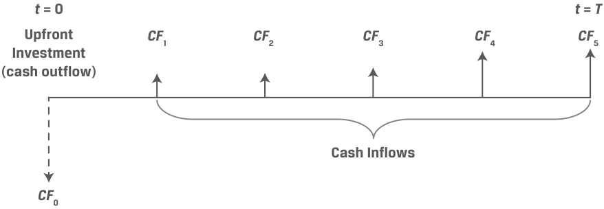
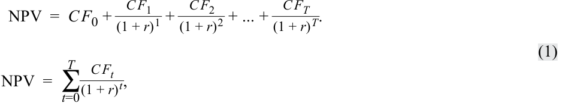
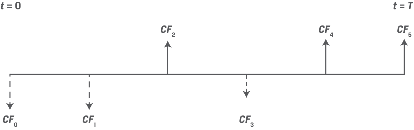
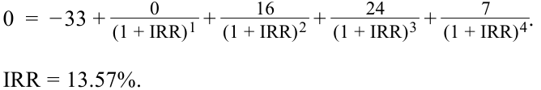

# Tập 3: Tổ chức phát hành doanh nghiệp (Corporate Issuers)
## Học phần 5: Đầu tư vốn và Phân bổ vốn (Capital Investments and Capital Allocation)
### Phần 2/3: Phân bổ vốn (Capital Allocation) (PDF Trang 154–165)

---

<!-- PDF Page 154 -->

# **<mark>3</mark>**

## **PHÂN BỔ VỐN (CAPITAL ALLOCATION)**

**Mục tiêu học tập (LOS):** Mô tả quy trình phân bổ vốn, tính toán giá trị hiện tại ròng (*net present value* – NPV), tỷ suất hoàn vốn nội bộ (*internal rate of return* – IRR), và tỷ suất sinh lợi trên vốn đầu tư (*return on invested capital* – ROIC), đồng thời đối chiếu việc sử dụng chúng trong phân bổ vốn.

**Phân bổ vốn (*capital allocation*)** là quy trình được ban giám đốc và hội đồng quản trị của doanh nghiệp sử dụng để đưa ra các quyết định đầu tư vốn và hoàn trả vốn. Ban giám đốc tìm cách mang lại mức tỷ suất sinh lợi đã điều chỉnh rủi ro (*risk-adjusted returns*) cao hơn mức mà các nhà đầu tư có thể kiếm được từ các khoản đầu tư có rủi ro tương đương ở nơi khác. Quy trình này về cơ bản tương tự như quy trình được các nhà đầu tư và nhà phân tích sử dụng khi xây dựng danh mục quản lý đầu tư nhưng diễn ra ở mức độ chi tiết sâu sát hơn. Thay vì chỉ đầu tư vào toàn bộ các công ty, các tổ chức phát hành đầu tư vào từng dự án cụ thể và sử dụng lượng thông tin độc quyền, không công khai đáng kể.

Các nhà đầu tư và nhà phân tích phải đánh giá xem liệu một tổ chức phát hành có quản lý nguồn vốn một cách khôn ngoan trong dài hạn hay không. Để đưa ra nhận định đó, các nhà phân tích cần đánh giá quy trình phân bổ vốn của tổ chức phát hành và sự tuân thủ các nguyên tắc nền tảng (*first principles*) của tổ chức đó, và quan trọng nhất là đánh giá thành tích lịch sử (*historical track record*) về phân bổ vốn của tổ chức phát hành. Các bước chung trong quy trình phân bổ vốn được trình bày trong Bảng 3 (Exhibit 3).

**Bảng 3: Các bước trong Quy trình Phân bổ vốn (Exhibit 3: Steps in the Capital Allocation Process)**

<!-- Picture Text: 2. Investment Analysis 1. Idea 3. Planning and Generation Prioritization 4. Monitoring and Post-Investment Review  -->

> **Chú thích hình ảnh:** Chu trình 4 bước trong Quy trình Phân bổ vốn (*Capital Allocation Process*):
> 1. Hình thành ý tưởng (*Idea Generation*) $\rightarrow$ 2. Phân tích đầu tư (*Investment Analysis*) $\rightarrow$ 3. Lập kế hoạch và Xếp thứ tự ưu tiên (*Planning and Prioritization*) $\rightarrow$ 4. Giám sát và Đánh giá hậu đầu tư (*Monitoring and Post-Investment Review*).

- *Hình thành ý tưởng (Idea generation):* Mặc dù các ý tưởng có thể bắt nguồn từ bất kỳ đâu, điều quan trọng là ban giám đốc phải có sự hiểu biết sâu sắc về môi trường cạnh tranh nơi khoản đầu tư tiềm năng tọa lạc, cũng như các hoạt động hiện tại, năng lực và vị thế cạnh tranh của doanh nghiệp. Thông thường, các ý tưởng đến từ các nhà quản lý trực tiếp tham gia vào hoạt động kinh doanh và liên quan đến việc mở rộng quy mô cũng như phạm vi của các hoạt động hiện có hoặc các mảng kinh doanh lân cận. Các nhà điều hành cũng có thể thuê các chuyên gia tư vấn bên ngoài để xin lời khuyên về việc hình thành ý tưởng. Như sẽ thảo luận ở phần sau, chi tiêu vốn có xu hướng tương quan cao từ năm này sang năm khác, cho thấy các ý tưởng và kế hoạch của kỳ trước có sức nặng rất lớn.

- *Phân tích đầu tư (Investment analysis):* Tiếp sau bước hình thành các ý tưởng đầu tư, các nhà quản lý dự báo quy mô, thời điểm, thời lượng và mức độ biến động của các dòng tiền kỳ vọng từ khoản đầu tư để ước tính xem liệu khoản đầu tư đó có phải là cách sử dụng vốn khôn ngoan hay không.

- *Lập kế hoạch và xếp thứ tự ưu tiên (Planning and prioritization):* Ban giám đốc lựa chọn và xếp thứ tự ưu tiên cho các cơ hội đầu tư sinh lời mà khi được xem xét tổng thể cùng nhau sẽ làm gia tăng giá trị nhiều nhất trên cơ sở tỷ suất sinh lợi đã điều chỉnh rủi ro. Chỉ những ứng viên đầu tư

<!-- PDF Page 155 -->

được ước tính tạo ra tỷ suất sinh lợi lớn hơn chi phí cơ hội của các nhà đầu tư (tỷ suất sinh lợi mà họ có thể kiếm được ở nơi khác từ các hoạt động có rủi ro tương đương) mới nên được theo đuổi. Ngoài ra, một số dự án có vẻ hấp dẫn khi xét riêng lẻ nhưng lại có thể kém khả quan hơn khi được đặt trong bối cảnh của các hoạt động hiện có, các dự án được đề xuất khác, hoặc những ràng buộc về nguồn tài trợ.

Khi các cơ hội đầu tư tạo ra giá trị đã cạn kiệt, các nhà quản lý nên hoàn trả bất kỳ phần vốn còn lại nào cho các cổ đông. Bằng cách này, các cổ đông có thể tái phân bổ nguồn vốn đó vào nơi khác để kiếm được mức tỷ suất sinh lợi yêu cầu của họ.

- *Giám sát và đánh giá hậu đầu tư (Monitoring and post-investment review):* Bước này bao gồm việc giám sát hiệu quả hoạt động của khoản đầu tư và các hoạt động liên quan so với các dự phóng ban đầu và, thông thường, thực hiện các điều chỉnh chẳng hạn như tăng hoặc giảm mức độ đầu tư (sẽ được thảo luận ở phần sau dưới dạng các quyền chọn thực – *real options*). Bước này rất quan trọng vì một số lý do. Thứ nhất, nó giúp xác thực các giả định đã được đưa ra trong quy trình phân bổ vốn, làm lộ diện những sai sót mang tính hệ thống, chẳng hạn như các dự báo quá lạc quan. Thứ hai, nó giúp thực thi tính kỷ luật trong hoạt động kinh doanh bằng cách hướng sự chú ý của ban giám đốc vào việc đưa hiệu quả hoạt động thực tế đi đúng quỹ đạo dự phóng. Cuối cùng, nó có thể sản sinh ra các ý tưởng cho những khoản đầu tư trong tương lai. Các nhà quản lý nên tìm cách đầu tư vào các lĩnh vực sinh lời và thu hẹp quy mô hoặc thanh lý tài sản ở những lĩnh vực tạo ra tỷ suất sinh lợi dưới mức tối ưu hoặc có thể mang lại giá trị lớn hơn cho các doanh nghiệp khác.

Hai trong số các công cụ phân tích được sử dụng rộng rãi nhất trong bước phân tích đầu tư là **giá trị hiện tại ròng (*net present value* – NPV)** và **tỷ suất hoàn vốn nội bộ (*internal rate of return* – IRR)**. Đây là những ứng dụng của khái niệm giá trị thời gian của tiền (*time-value-of-money*). Mặc dù một nhà phân tích đầu tư độc lập không có quyền tiếp cận thông tin chi tiết từng dự án được ban giám đốc sử dụng trong các phép tính này, nhà phân tích vẫn cần hiểu rõ cơ sở lý luận đằng sau chúng, những điểm mạnh và những hạn chế của chúng trong thực tiễn (ngoài ra, các công cụ này cũng được sử dụng ở những nơi khác trong quản lý đầu tư, sẽ được đề cập ở phần sau của chương trình học). Các nhà phân tích có quyền tiếp cận các báo cáo tài chính hợp nhất có độ tổng hợp cao, thứ mà họ có thể sử dụng để tính toán và phân tích **tỷ suất sinh lợi trên vốn đầu tư (*return on invested capital* – ROIC)** – một thước đo tỷ suất sinh lợi *tổng hợp (aggregate)* hữu ích thay vì ở cấp độ *từng dự án (project)*.

### **Giá trị hiện tại ròng (Net Present Value – NPV)**

NPV của một khoản đầu tư là giá trị hiện tại (tính bằng đơn vị tiền tệ) của các dòng tiền vào kỳ vọng trong tương lai trừ đi chi phí của khoản đầu tư (hoặc các dòng tiền *ra*), như được thể hiện trong Bảng 4 (Exhibit 4).

**Bảng 4: Giá trị hiện tại ròng của một Khoản đầu tư vốn (Exhibit 4: Net Present Value of a Capital Investment)**

<!-- Picture Text: t  = 0 t  =  T Upfront CF 1 CF 2 CF 3 CF 4 CF 5 Investment (cash outflow) Cash Inflows CF 0  -->

> **Chú thích hình ảnh:** Trục thời gian dòng tiền của một khoản đầu tư vốn thông thường: Tại $t = 0$, khoản đầu tư trả trước ban đầu (*Upfront Investment – cash outflow*) là dòng tiền ra $CF_0 < 0$; tiếp theo từ $t = 1$ đến $t = T$ là các dòng tiền vào (*Cash Inflows*) $CF_1, CF_2, CF_3, CF_4, CF_5 > 0$.

Bảng 4 thể hiện trường hợp đơn giản trong đó một khoản đầu tư duy nhất ($CF_0 < 0$) diễn ra tại thời điểm bắt đầu, theo sau là các dòng tiền vào. Chúng ta có thể tính NPV bằng cách sử dụng Phương trình 1:

<!-- PDF Page 156 -->

<!-- Formula Text: NPV  =  C F 0 + C F 1 _ (1 + r) 1  + C F 2 _ (1 + r) 2  + ... + C F T _ (1 + r) T . NPV  =  ∑ t=0 T C F t _ (1 + r) t , (1) -->

$$\text{NPV} = CF_0 + \frac{CF_1}{(1 + r)^1} + \frac{CF_2}{(1 + r)^2} + \dots + \frac{CF_T}{(1 + r)^T}$$

$$\text{NPV} = \sum_{t=0}^{T} \frac{CF_t}{(1 + r)^t} \tag{1}$$

trong đó:

- $CF_t =$ Dòng tiền sau thuế tại thời điểm $t$ (*After-tax cash flow at time $t$*)
- $r =$ Tỷ suất sinh lợi yêu cầu (*Required rate of return*) – mức tỷ suất sinh lợi mà các nhà đầu tư của tổ chức phát hành doanh nghiệp có thể kiếm được từ một khoản đầu tư có mức độ rủi ro tương tự

Phép tính này được minh họa trong ví dụ sau đây.

#### **VÍ DỤ 4 (EXAMPLE 4)**

### **Tính NPV của Tập đoàn Gerhardt (Gerhardt Corporation NPV)**

1. Giả sử Tập đoàn Gerhardt đang cân nhắc một khoản đầu tư vốn trị giá 50 triệu EUR ngày hôm nay, dự kiến mang lại dòng tiền sau thuế là 16 triệu EUR mỗi năm trong 4 năm tới cộng với 20 triệu EUR nữa vào Năm thứ 5. Nếu tỷ suất sinh lợi yêu cầu là 10%, NPV của khoản đầu tư này là bao nhiêu?

#### **Lời giải:**

Sử dụng Phương trình 1, chúng ta có thể tính NPV như sau:

<!-- Formula Text: NPV  =  C F 0 + C F 1 _ (1 + r) 1  + C F 2 _ (1 + r) 2  + ... + C F T _ (1 + r) T . NPV  =  − 50 + 16 _ (1 + 0.10) 1  + 16 _ (1 + 0.10) 2  + 16 _ (1 + 0.10) 3  + 16 _ (1 + 0.10) 4  + 20 _ (1 + 0.10) 5 . -->

$$\text{NPV} = CF_0 + \frac{CF_1}{(1 + r)^1} + \frac{CF_2}{(1 + r)^2} + \dots + \frac{CF_T}{(1 + r)^T}$$

$$\text{NPV} = -50 + \frac{16}{(1 + 0.10)^1} + \frac{16}{(1 + 0.10)^2} + \frac{16}{(1 + 0.10)^3} + \frac{16}{(1 + 0.10)^4} + \frac{20}{(1 + 0.10)^5}$$

$$\text{NPV} = -50 + 63.136 = 13.136\text{ (triệu EUR)}$$

Vì khoản đầu tư này có thể được thực hiện ngày hôm nay với chi phí 50 triệu EUR, công ty đánh đổi 50 triệu EUR ngày hôm nay để lấy một khoản đầu tư có giá trị hiện tại là 63.136 triệu EUR. Khoản đầu tư này làm tăng giá trị hiện tại của tài sản doanh nghiệp thêm một khoản ròng là 13.136 triệu EUR.

Bài toán này cũng có thể được giải trong Microsoft Excel hoặc Google Sheets bằng cách sử dụng hàm NPV:

`=NPV(rate,value1,value2,…)`

trong đó:

- `rate` = Tỷ suất sinh lợi yêu cầu (*Required rate of return*)
- `value(s)` = Các dòng tiền sau thuế (*After-tax cash flows*)

Lưu ý rằng hàm `NPV` trong bảng tính sử dụng $t = 1$ cho dòng tiền đầu tiên chứ không phải $t = 0$, và giả định các dòng tiền cách đều nhau theo thời gian. Do đó, các dòng tiền tại $t = 0$ (trong trường hợp này là $-50$) cần được trừ đi hoặc cộng thêm bên ngoài hàm `NPV`. Cú pháp đúng ở đây là:

`= NPV(0.10, 16, 16, 16, 16, 20) – 50 = 13.136`

<!-- PDF Page 157 -->

Bởi vì NPV là số tiền mà tài sản của các nhà đầu tư tăng thêm từ một khoản đầu tư, quy tắc ra quyết định theo NPV (*NPV decision rule*) như sau:

|Quyết định|Điều kiện|
|---|---|
|Đầu tư nếu (*Invest if*)|$\text{NPV} \ge 0$|
|Không đầu tư nếu (*Do not invest if*)|$\text{NPV} < 0$|

Các khoản đầu tư có NPV dương làm tăng tài sản của các cổ đông, trong khi NPV âm làm giảm tài sản. Trong trường hợp hiếm hoi khi NPV bằng 0, một dự án vẫn có thể được chấp nhận bởi vì nó đáp ứng vừa đủ tỷ suất sinh lợi yêu cầu. Tuy nhiên, vì phân tích NPV dựa trên các dòng tiền tương lai ước tính, một dự án có NPV bằng 0 sẽ không chừa lại bất kỳ biên độ an toàn nào cho sai số (*leaves no room for error*). Mặc dù quy tắc ra quyết định rất rõ ràng, NPV thường chỉ là một yếu tố trong phân bổ vốn. Có thể có các dự án cạnh tranh nhau, các cân nhắc về yếu tố vô hình, v.v., cùng tác động vào quyết định. Do đó, $\text{NPV} \ge 0$ có thể được xem là điều kiện *cần (necessary)* nhưng chưa *đủ (sufficient)* để thực hiện một khoản đầu tư.

Nhiều khoản đầu tư có hình mẫu dòng tiền không thông thường (*unconventional cash flow patterns*), trong đó các dòng tiền ra có thể xảy ra không chỉ tại thời điểm bắt đầu mà còn vào các ngày trong tương lai, như trong Bảng 5 (Exhibit 5). Một ví dụ cho trường hợp này là khoản đầu tư bổ sung thêm công suất ở giai đoạn sau.

**Bảng 5: Hình mẫu dòng tiền không thông thường (Exhibit 5: Unconventional Cash Flow Patterns)**

<!-- Picture Text: t  = 0 t  =  T CF 2 CF 4 CF 5 CF 0 CF 1 CF 3  -->

> **Chú thích hình ảnh:** Trục thời gian minh họa dòng tiền không thông thường (*Unconventional Cash Flows*): Dòng tiền đổi dấu nhiều lần và không cách đều nhau, trong đó $CF_0 < 0, CF_1 < 0, CF_2 > 0, CF_3 < 0, CF_4 > 0, CF_5 > 0$.

Việc phân tích các loại hình đầu tư này được xử lý tốt nhất bằng phần mềm bảng tính, chẳng hạn như Microsoft Excel và Google Sheets, tính thủ công từng kỳ, hoặc sử dụng hàm `XNPV` – hàm này không giống như hàm `NPV` ở chỗ nó *không* giả định các kỳ cách đều nhau và cho phép người dùng chỉ định thời điểm cụ thể của từng dòng tiền. Khái niệm này được minh họa trong ví dụ sau đây.

#### **VÍ DỤ 5 (EXAMPLE 5)**

### **Tính NPV của Tập đoàn Gerhardt – Phần II (Gerhardt Corporation NPV II)**

Giả sử Tập đoàn Gerhardt đang cân nhắc một khoản đầu tư vốn trị giá 50 triệu EUR ngày hôm nay với lịch trình dòng tiền ước tính trong 5 năm tới như sau (tất cả số tiền tính bằng triệu EUR).

|**_t_**|**0**|**1**|**1.5**|**2**|**3**|**4**|**5**|
|---|---|---|---|---|---|---|---|
|**Dòng tiền (*Cash flow*)**|–50|10|–5|13|16|19|23|

1. Nếu tỷ suất sinh lợi yêu cầu là 10%, NPV của khoản đầu tư này là bao nhiêu và Gerhardt có nên thực hiện khoản đầu tư này không?

#### **Lời giải:**

Sử dụng Phương trình 1, chúng ta có thể tính NPV như sau:

<!-- PDF Page 158 -->

<!-- Formula Text: NPV  =  C F 0 + C F 1 _ (1 + r) 1  + C F 2 _ (1 + r) 2  + ... + C F T _ (1 + r) T . NPV  =  − 50 + 10 _ (1 + 0.10) 1  + − 5 _ (1 + 0.10) 1.5  + 13 _ (1 + 0.10) 2  + 16 _ (1 + 0.10) 3  + 19 _ (1 + 0.10) 4 + 23 _ (1 + 0.10) 5 . NPV  =  4.78. -->

$$\text{NPV} = CF_0 + \frac{CF_1}{(1 + r)^1} + \frac{CF_2}{(1 + r)^2} + \dots + \frac{CF_T}{(1 + r)^T}$$

$$\text{NPV} = -50 + \frac{10}{(1 + 0.10)^1} + \frac{-5}{(1 + 0.10)^{1.5}} + \frac{13}{(1 + 0.10)^2} + \frac{16}{(1 + 0.10)^3} + \frac{19}{(1 + 0.10)^4} + \frac{23}{(1 + 0.10)^5}$$

$$\text{NPV} = 4.78\text{ (triệu EUR)}$$

Vì $\text{NPV} \ge 0$, Gerhardt nên thực hiện khoản đầu tư này. Bài toán này cũng có thể được giải trong Microsoft Excel hoặc Google Sheets bằng cách sử dụng hàm `XNPV`. Cú pháp hàm `XNPV` như sau:

`=XNPV(rate,values,dates)`

trong đó:

- `rate` = Tỷ suất sinh lợi yêu cầu (*Required rate of return*)
- `values` = Các dòng tiền sau thuế tại mỗi ngày (*After-tax cash flows at each date*)
- `dates` = Ngày của từng dòng tiền sau thuế (đối với một bài toán không có ngày tháng chính xác như thế này, ngày tháng có thể được chọn tùy ý; điều quan trọng là khoảng cách giữa chúng phải chính xác theo số năm)

Hàm này được thiết lập rõ ràng nhất bằng cách tham chiếu đến các mảng dòng tiền và ngày tháng được sắp xếp thẳng hàng trên bảng tính, như minh họa dưới đây:

### **Tỷ suất hoàn vốn nội bộ (Internal Rate of Return – IRR)**

**Tỷ suất hoàn vốn nội bộ (*internal rate of return* – IRR)** là mức lãi suất chiết khấu làm cho giá trị hiện tại ròng (NPV) của một khoản đầu tư bằng 0, như được thể hiện trong Phương trình 2:

<!-- Formula Text: ∑ t=0 T C F t _ (1 + IRR) t   =  0. (2) -->

$$\sum_{t=0}^{T} \frac{CF_t}{(1 + \text{IRR})^t} = 0 \tag{2}$$

Hãy lưu ý sự tương đồng của công thức tính IRR với Phương trình 1, trong đó Phương trình 1 có $r$ (tỷ suất sinh lợi yêu cầu) ở mẫu số thay vì $\text{IRR}$.

#### **VÍ DỤ 6 (EXAMPLE 6)**

### **Tính IRR của Tập đoàn Gerhardt (Gerhardt Corporation IRR)**

1. Giả sử Tập đoàn Gerhardt đang cân nhắc một khoản đầu tư vốn trị giá 50 triệu EUR ngày hôm nay, dự kiến mang lại dòng tiền sau thuế là 16 triệu EUR mỗi năm trong 4 năm tới cộng với 20 triệu EUR nữa vào Năm thứ 5. IRR của khoản đầu tư này là bao nhiêu?

#### **Lời giải:**

Hãy nhớ lại từ Phương trình 1 rằng NPV là:

<!-- PDF Page 159 -->

<!-- Formula Text: NPV  =  C F 0 + C F 1 _ (1 + r) 1  + C F 2 _ (1 + r) 2  + C F T _ (1 + r) T -->

$$\text{NPV} = CF_0 + \frac{CF_1}{(1 + r)^1} + \frac{CF_2}{(1 + r)^2} + \dots + \frac{CF_T}{(1 + r)^T}$$

IRR là mức lãi suất chiết khấu $r$ làm cho NPV bằng 0. Nói cách khác:

<!-- Formula Text: NPV=C F 0 + C F 1 _ (1 + r) 1  + C F 2 _ (1 + r) 2  + C F T _ (1 + r) T 0  =  − 50 + 16 _ (1 + IRR) 1  + 16 _ (1 + IRR) 2  + 16 _ (1 + IRR) 3  + 16 _ (1 + IRR) 4  + 20 _ (1 + IRR) 5 Besides trial and error, the IRR function in Microsoft Excel and Google Sheets is a straightforward approach to solving this problem. The IRR func- tion syntax is -->

$$\text{NPV} = CF_0 + \frac{CF_1}{(1 + r)^1} + \frac{CF_2}{(1 + r)^2} + \dots + \frac{CF_T}{(1 + r)^T}$$

$$0 = -50 + \frac{16}{(1 + \text{IRR})^1} + \frac{16}{(1 + \text{IRR})^2} + \frac{16}{(1 + \text{IRR})^3} + \frac{16}{(1 + \text{IRR})^4} + \frac{20}{(1 + \text{IRR})^5}$$

Ngoài phương pháp thử và sai (*trial and error*), hàm `IRR` trong Microsoft Excel và Google Sheets là cách tiếp cận trực tiếp để giải bài toán này. Cú pháp của hàm `IRR` là:

`=IRR(values,[guess])`

trong đó:

- `values` = Các dòng tiền sau thuế (*After-tax cash flows*)
- `[guess]` = Giá trị dự đoán ban đầu tùy chọn do người dùng chỉ định cho IRR (mặc định là 10%)

Điều quan trọng cần lưu ý là, giống như hàm `NPV`, hàm `IRR` giả định rằng các dòng tiền được nhận hoặc thanh toán vào cuối mỗi kỳ và các kỳ cách đều nhau. Tuy nhiên, không giống như hàm `NPV`, hàm `IRR` không giả định dòng tiền đầu tiên ở tại $t = 1$ (mà bắt đầu ngay từ $t = 0$), vì vậy đối số đưa vào hàm ở đây chỉ đơn giản là:

`= IRR (–50, 16, 16, 16, 16, 20)`

`= 0.1952`, hay `19.52%`.

Quy tắc ra quyết định theo IRR (*IRR decision rule*) là đầu tư nếu IRR *vượt quá* tỷ suất sinh lợi yêu cầu ($r$) đối với khoản đầu tư vốn:

|Quyết định|Điều kiện|
|---|---|
|Đầu tư nếu (*Invest if*)|$\text{IRR} \ge r$|
|Không đầu tư nếu (*Do not invest if*)|$\text{IRR} < r$|

Vì lý do này, tỷ suất sinh lợi yêu cầu thường được gọi là **tỷ suất sinh lợi ngưỡng (*hurdle rate*)**. Nếu IRR bằng $r$, dự án *về mặt lý thuyết* là có thể chấp nhận được bởi vì nó đáp ứng được tỷ suất sinh lợi yêu cầu với mức NPV bằng 0. Vì mức IRR 19.52% trong ví dụ của chúng ta vượt quá tỷ suất sinh lợi ngưỡng 10%, Gerhardt nên đầu tư.

Một thuộc tính quan trọng của IRR là nó sẽ chỉ bằng với tỷ suất sinh lợi (nhân học/kép) thực tế của nhà đầu tư trên khoản đầu tư đó nếu các dòng tiền giữa kỳ (*interim cash flows*) được tái đầu tư tại chính mức lãi suất IRR; nếu lãi suất tái đầu tư trên thực tế thấp hơn, tỷ suất sinh lợi của khoản đầu tư sẽ thấp hơn IRR và ngược lại. Ngược lại, phép tính NPV giả định rằng các dòng tiền giữa kỳ được tái đầu tư tại mức $r$, tức tỷ suất sinh lợi yêu cầu – điều này thường sát với thực tế kinh tế hơn. Lãi suất tái đầu tư và những hệ quả của nó sẽ được khám phá sâu hơn ở phần sau của chương trình học trong các bài học về chứng khoán thu nhập cố định (*fixed-income*).

Đối với một khoản đầu tư mà các giả định về dòng tiền cuối kỳ, cách đều nhau không còn phù hợp, hàm `XIRR` trong Microsoft Excel và Google Sheets là công cụ thích hợp, như trong ví dụ sau đây.

<!-- PDF Page 160 -->

#### **VÍ DỤ 7 (EXAMPLE 7)**

### **Tính IRR của Tập đoàn Gerhardt – Phần III (Gerhardt Corporation IRR III)**

1. Giả sử Tập đoàn Gerhardt đang cân nhắc một khoản đầu tư vốn trị giá 50 triệu EUR ngày hôm nay với lịch trình dòng tiền ước tính trong 5 năm tới như sau (tất cả số tiền tính bằng triệu EUR).

|**_t_**|**0**|**1**|**2**|**2.5**|**3**|**4**|**5**|
|---|---|---|---|---|---|---|---|
|**Dòng tiền (*Cash flow*)**|–50|0|1|3|16|20|25|

IRR của khoản đầu tư này là bao nhiêu, và Gerhardt có nên thực hiện khoản đầu tư này không nếu tỷ suất sinh lợi yêu cầu của công ty là 10%?

#### **Lời giải:**

Bài toán này có thể được giải trong Microsoft Excel hoặc Google Sheets bằng cách sử dụng hàm `XIRR`. Cú pháp của hàm `XIRR` như sau:

`=XIRR(values,dates,[guess])`

trong đó:

- `values` = Các dòng tiền sau thuế tại mỗi ngày (*After-tax cash flows at each date*)
- `dates` = Ngày của từng dòng tiền sau thuế (đối với một bài toán không có ngày tháng chính xác như thế này, ngày tháng có thể được chọn tùy ý; điều quan trọng là khoảng cách giữa chúng phải chính xác)
- `[guess]` = Giá trị dự đoán ban đầu tùy chọn do người dùng chỉ định cho IRR (mặc định là 10%)

Hàm này được thiết lập rõ ràng nhất bằng cách tham chiếu đến các mảng dòng tiền và ngày tháng được sắp xếp thẳng hàng trên bảng tính, như minh họa dưới đây:

IRR bằng 6.76%, thấp hơn mức tỷ suất sinh lợi yêu cầu 10% của Gerhardt, vì vậy công ty không nên đầu tư vào dự án này.

Một hạn chế quan trọng của IRR là hiện tượng **đa trị IRR (*multiple IRRs*)** sẽ tồn tại nếu dấu của dòng tiền ($+/-$) đổi dấu nhiều hơn một lần. Chúng ta có thể minh họa điều này bằng ví dụ đơn giản sau đây:

|**Thời điểm (*Time*)**|**0**|**1**|**2**|
|---|---|---|---|
|**Dòng tiền (*Cash flow*)**|−1,000|5,000|−6,000|

IRR của khoản đầu tư này thỏa mãn phương trình sau:

$$-1,000 + \frac{5,000}{(1 + \text{IRR})^1} + \frac{-6,000}{(1 + \text{IRR})^2} = 0$$

Có hai giá trị của IRR cùng thỏa mãn phương trình trên: 100% và 200%, rõ ràng là khác nhau rất xa. Trong những trường hợp như vậy, khi dấu của dòng tiền thay đổi nhiều hơn một lần, cần sử dụng NPV thay vì IRR. Máy tính tài chính và phần mềm bảng tính thường sẽ trả về một nghiệm IRR duy nhất gây hiểu lầm, mặc định lấy giá trị thấp nhất.

<!-- PDF Page 161 -->

#### **NÊN SỬ DỤNG CHỈ TIÊU NÀO: NPV HAY IRR? (WHICH TO USE: NPV OR IRR?)**

Mặc dù các tiêu chí NPV và IRR thường chỉ ra cùng một quyết định đầu tư, nhưng trong trường hợp các dự án đầu tư loại trừ lẫn nhau (*mutually exclusive investment projects*), một công ty có thể phải đối mặt với sự lựa chọn giữa một dự án có NPV lớn hơn và một dự án khác có IRR cao hơn. Nếu công ty chỉ có thể đầu tư vào một dự án duy nhất, công ty nên chọn dự án nào?

Lựa chọn đúng đắn là dự án có **NPV cao hơn**. Trong khi NPV cho thấy mức gia tăng tài sản của doanh nghiệp tính bằng đơn vị tiền tệ từ một khoản đầu tư vốn, thì IRR chỉ đơn thuần cho biết tỷ suất sinh lợi theo tỷ lệ phần trăm của dự án (với giả định tái đầu tư tại mức IRR) chứ không phản ánh quy mô của dự án hay khoảng thời gian mà mức IRR đó được tạo ra.

Nhiều người làm thực tế nhận thấy IRR dễ sử dụng hơn NPV. Ví dụ, nếu tỷ suất sinh lợi yêu cầu là 10%, một dự án có IRR trên 10% là đáng mong muốn, trong khi một con số NPV tính bằng tiền tệ có thể khó diễn giải hơn bởi vì con số đó cần được đặt trong bối cảnh quy mô của doanh nghiệp. Xét về mặt thực tiễn, một khi doanh nghiệp đã có dữ liệu để tính NPV thì việc tính luôn cả IRR là rất đơn giản. Tuy nhiên, tiêu chí phù hợp nhất và vững chắc nhất về mặt lý thuyết vẫn là NPV.

### **Tỷ suất sinh lợi trên vốn đầu tư (Return on Invested Capital – ROIC)**

Các nhà phân tích đầu tư độc lập không có thông tin cần thiết để tính toán hoặc kiểm toán các phép tính NPV hay IRR dự án của ban giám đốc. Các nhà phân tích nghiên cứu các công ty niêm yết chỉ có báo cáo tài chính hợp nhất và đôi khi là thông tin ở cấp độ phân khúc (*segment-level information*) – tất cả đều có độ tổng hợp rất cao và bao gồm các dòng tiền gắn liền với nhiều dự án khác nhau. **Tỷ suất sinh lợi trên vốn đầu tư (*return on invested capital* – ROIC)**, còn được gọi là **tỷ suất sinh lợi trên vốn sử dụng (*return on capital employed* – ROCE)**, là một thước đo khả năng sinh lời tính trên tổng số vốn mà ban giám đốc đã đầu tư, được thể hiện ở Phương trình 3. Thông thường, một thước đo lợi nhuận hoạt động sau thuế hàng năm được sử dụng, do đó ROIC được đo lường *theo năm (per year)*.

<!-- Formula Text: ROIC  = After‐ tax operating profit t ___________________ Average invested capital   = (1 − Tax rate) × Operating profit t _____________________________ Average total LT liabilities and equity t−1,t . (3) -->

$$\text{ROIC} = \frac{\text{After-tax operating profit}_t}{\text{Average invested capital}} = \frac{(1 - \text{Tax rate}) \times \text{Operating profit}_t}{\text{Average total LT liabilities and equity}_{t-1, t}} \tag{3}$$

Mẫu số là thước đo tổng đầu tư *vốn* dài hạn, vì vậy vốn lưu động ngắn hạn (nợ ngắn hạn) không được tính gộp vào mẫu số này (xét theo góc độ nguồn vốn dài hạn). Từ góc độ bảng cân đối kế toán, vốn đầu tư (*invested capital*) bao gồm các khoản mục nằm trong khung màu đỏ dưới đây:

<!-- Picture Text: Uses of Capital Sources of Capital Short-Term Cash Liabilities Short-Term Long-Term Assets Liabilities Invested Capital Long-Term Ownership Assets Capital (Equity)  -->

> **Chú thích hình ảnh:** Bảng cân đối kế toán minh họa Vốn đầu tư (*Invested Capital*):
> - Cột Sử dụng vốn (*Uses of Capital* – Tài sản): Tiền mặt (*Cash*), Tài sản ngắn hạn (*Short-Term Assets*), Tài sản dài hạn (*Long-Term Assets*).
> - Cột Nguồn vốn (*Sources of Capital* – Nợ & Vốn chủ sở hữu): Nợ phải trả ngắn hạn (*Short-Term Liabilities*), và phần nằm trong khung đỏ là **Vốn đầu tư (*Invested Capital*)** bao gồm: Nợ phải trả dài hạn (*Long-Term Liabilities*) + Vốn chủ sở hữu (*Ownership Capital / Equity*).

#### **VÍ DỤ 8 (EXAMPLE 8)**

### **Tỷ suất sinh lợi trên vốn đầu tư (Return on Invested Capital)**

Giả sử một tổ chức phát hành doanh nghiệp báo cáo lợi nhuận hoạt động sau thuế (*after-tax operating profits*) Năm thứ 2 là 24,395 và thông tin bảng cân đối kế toán như sau.

<!-- PDF Page 162 -->

|**Tài sản (*Assets*):**|**Cuối Năm 1 (*End of Year 1*)**|**Cuối Năm 2 (*End of Year 2*)**|
|---|---|---|
|Tiền mặt (*Cash*)|4,364|6,802|
|Tài sản ngắn hạn (*Short-term assets*)|40,529|52,352|
|Tài sản dài hạn (*Long-term assets*)|287,857|279,769|
|**Tổng tài sản (*Total assets*)**|**332,750**|**338,923**|
|**Nợ phải trả và Vốn chủ sở hữu (*Liabilities and Equity*):**|**Cuối Năm 1 (*End of Year 1*)**|**Cuối Năm 2 (*End of Year 2*)**|
|Khoản phải trả người bán (*Accounts payable*)|35,221|50,766|
|Nợ ngắn hạn (*Short-term debt*)|21,142|5,877|
|Nợ dài hạn (*Long-term debt*)|112,257|106,597|
|Vốn cổ phần (*Share capital*)|15,688|15,688|
|Lợi nhuận giữ lại (*Retained earnings*)|148,442|159,995|
|**Tổng nợ phải trả và vốn chủ sở hữu (*Total liabilities and equity*)**|**332,750**|**338,923**|

1. Tính ROIC cho Năm thứ 2.

#### **Lời giải:**

$$\text{ROIC} = \frac{\text{After-tax operating profit}_t}{\text{Average LT liabilities and equity capital}_{t-1, t}}$$

$$\text{ROIC} = \frac{24,395}{\frac{(112,257 + 15,688 + 148,442) + (106,597 + 15,688 + 159,995)}{2}}$$

$$\text{ROIC} = \frac{24,395}{279,333.5} = 8.73\%$$

2. Nếu một nhà đầu tư có tỷ suất sinh lợi yêu cầu là 10%, công ty này có phải là một ứng viên đầu tư đầy hứa hẹn không?

#### **Lời giải:**

Không. Mặc dù công ty có lãi, nhưng ROIC của công ty (8.73%) thấp hơn tỷ suất sinh lợi yêu cầu của nhà đầu tư (10%), vì vậy nhà đầu tư nên tìm kiếm cơ hội đầu tư ở nơi khác. Tuy nhiên, đây mới chỉ là một năm lịch sử đơn lẻ, và nhà đầu tư sẽ phải xem xét thêm vô số yếu tố khác.

ROIC có một số lợi ích thực tiễn:

- Không giống như NPV và IRR của dự án, ROIC có thể được tính toán bằng dữ liệu sẵn có đối với các nhà phân tích đầu tư độc lập.

- Không giống như các thước đo như lợi nhuận hoạt động (*operating profit*) hay biên lợi nhuận hoạt động (*operating profit margin* – lợi nhuận hoạt động tính theo tỷ lệ phần trăm của doanh thu), ROIC tính đến lượng vốn cần thiết để tạo ra tỷ suất sinh lợi. Mối quan hệ giữa biên lợi nhuận hoạt động và ROIC có thể được minh họa bằng cách phân rã (*decomposing*) ROIC như sau:

$$\text{ROIC} = \frac{\text{After-tax operating profit}}{\text{Average invested capital}}$$

$$\text{ROIC} = \frac{\text{After-tax operating profit}}{\text{Sales}} \times \frac{\text{Sales}}{\text{Average invested capital}}$$

<!-- PDF Page 163 -->

Số hạng bên trái là biên lợi nhuận hoạt động sau thuế (*after-tax operating profit margin*), và số hạng bên phải là thước đo vòng quay vốn đầu tư hay vòng quay tài sản (*capital or asset turnover*) – cho biết mỗi đồng vốn đầu tư của công ty tạo ra được bao nhiêu đồng doanh thu hàng năm. Do đó, có hai con đường dẫn đến mức ROIC cao hoặc tăng trưởng: biên lợi nhuận (*profit margin*) và vòng quay vốn (*turnover*). Một công ty có biên lợi nhuận cao vẫn có thể có ROIC thấp nếu vòng quay vốn thấp, và một công ty có biên lợi nhuận thấp vẫn có thể kiếm được mức ROIC hấp dẫn nếu vòng quay vốn cao.

- Trong khi các thước đo NPV và IRR cho phép so sánh từng dự án riêng lẻ trong nội bộ doanh nghiệp, ROIC là một thước đo tổng hợp dùng để đánh giá khả năng tạo ra giá trị của doanh nghiệp trên *tất cả* các khoản đầu tư của mình. Điều này rất quan trọng bởi vì các nhà đầu tư nhìn chung không thể đầu tư vào từng dự án riêng lẻ mà chỉ có thể đầu tư vào tổng thể công ty (tồn tại một số ngoại lệ, chẳng hạn như hợp đồng thuê tài sản và chứng khoán đảm bảo bằng tài sản – *asset-backed securities*, sẽ được thảo luận sau trong các học phần thu nhập cố định).

- ROIC có thể được đem so sánh với tỷ suất sinh lợi yêu cầu của các nhà đầu tư. Nếu ROIC của một tổ chức phát hành lớn hơn tỷ suất sinh lợi yêu cầu của các nhà đầu tư theo thời gian, tổ chức phát hành đó đang tạo ra giá trị (*creating value*) cho các nhà đầu tư. Ngược lại, nếu ROIC thấp hơn tỷ suất sinh lợi yêu cầu, đó là chỉ báo cho thấy các nhà đầu tư lẽ ra đã có lợi hơn nếu đầu tư vào nơi khác; tổ chức phát hành nên thực hiện các hành động nhằm cải thiện vòng quay vốn hoặc biên lợi nhuận, thanh lý các khoản đầu tư ở những lĩnh vực kém hiệu quả, hoàn trả vốn cho nhà đầu tư, hoặc tìm kiếm các lĩnh vực đầu tư thay thế có tỷ suất sinh lợi cao hơn.

- Vì ROIC đo lường tỷ suất sinh lợi mà một tổ chức phát hành kiếm được từ việc đầu tư cả nguồn vốn nợ vay lẫn vốn chủ sở hữu, nó cần được so sánh với mức tỷ suất sinh lợi yêu cầu dành cho cả các nhà đầu tư nợ *và* các nhà đầu tư vốn chủ sở hữu. Như đã thảo luận trong các bài học trước, vốn chủ sở hữu rủi ro hơn nợ vay và do đó có tỷ suất sinh lợi yêu cầu cao hơn, nên nếu chỉ sử dụng tỷ suất sinh lợi yêu cầu của các nhà đầu tư vốn chủ sở hữu thì sẽ dẫn đến việc ước tính quá cao mức chi phí vốn. Trong học phần tiếp theo, chúng ta sẽ tính toán mức tỷ suất sinh lợi yêu cầu hỗn hợp (*blended required rate of return* – tức WACC) như một phần của cuộc thảo luận rộng hơn về tài trợ vốn.

ROIC cũng có những hạn chế và nhược điểm:

- ROIC, không giống như NPV và IRR, là một thước đo dựa trên số liệu kế toán (*accounting measure*), chứ không phải dựa trên dòng tiền (*cash-based*). Lợi nhuận hoạt động và dòng tiền có thể khác biệt đáng kể do nguyên tắc ghi nhận một số khoản mục và sự chênh lệch giữa khấu hao với chi tiêu vốn thực tế.

- ROIC mang tính nhìn lại quá khứ (*backward looking*) và có thể biến động mạnh từ năm này sang năm khác tùy thuộc vào hoạt động đầu tư và điều kiện kinh doanh, vì vậy việc xem xét các xu hướng và tốc độ thay đổi là rất thiết yếu. Các khoản đầu tư sinh lời đôi khi có thể mất nhiều năm mới bắt đầu tạo ra mức tỷ suất sinh lợi cạnh tranh.

- Là một thước đo có độ tổng hợp cao, ROIC có thể che khuất (*mask*) các mảng hoạt động đang sinh lời cao hoặc đang thua lỗ của tổ chức phát hành.

Các nhà phân tích cũng cần lưu ý rằng có ít sự đồng thuận hơn về cách thức đo lường ROIC so với các thước đo như biên lợi nhuận hoạt động, đặc biệt là ở phần mẫu số. Ví dụ, nhiều người làm thực tế trừ đi một phần hoặc toàn bộ tài sản vô hình và lượng tiền mặt “dư thừa” (*“excess” cash*) khỏi mẫu số, đồng thời có thể loại trừ một số khoản nợ phải trả dài hạn nhất định, chẳng hạn như nợ quỹ hưu trí và thuế thu nhập hoãn lại phải trả vốn không được coi là “vốn đầu tư” (*“invested capital”*). Các vấn đề tính toán bổ sung khác, sẽ được đề cập ở phần sau của chương trình học, bao gồm cách xử lý các chi phí “không thường xuyên” (*“non-recurring” expenses*), tài sản thuê (*leased assets*) và lợi ích của cổ đông không kiểm soát (*non-controlling interests*).

<!-- PDF Page 164 -->

#### **BỘ CÂU HỎI (QUESTION SET)**

1. Đúng hay Sai: Trong bước lập kế hoạch và xếp thứ tự ưu tiên của quy trình phân bổ vốn, ban giám đốc của doanh nghiệp nên chấp nhận bất kỳ dự án đầu tư nào có NPV ước tính dương.

#### **Lời giải:**

Sai (*False*). Một số dự án có vẻ hấp dẫn khi xét riêng lẻ nhưng có thể trở nên kém khả quan hơn khi được xem xét trong bối cảnh của các hoạt động hiện tại, các dự án được đề xuất khác, các yếu tố ESG, hoặc những ràng buộc về nguồn tài trợ.

2. Bước nào trong quy trình phân bổ vốn *có khả năng cao nhất* liên quan đến việc tính toán NPV và IRR?

   - **A.** Hình thành ý tưởng (*Idea generation*)

   - **B.** Phân tích đầu tư (*Investment analysis*)

   - **C.** Lập kế hoạch và xếp thứ tự ưu tiên (*Planning and prioritization*)

   - **Lời giải:**

B là đáp án đúng. Bước phân tích đầu tư bao gồm việc dự báo quy mô, thời điểm, thời lượng và mức độ biến động của các dòng tiền kỳ vọng từ khoản đầu tư và sau đó sử dụng NPV và IRR để xác định xem liệu khoản đầu tư đó có phải là cách sử dụng vốn khôn ngoan hay không.

A không đúng vì trong bước hình thành ý tưởng, ban giám đốc thu thập các ý tưởng và chọn ra những ý tưởng hứa hẹn nhất để phân tích sâu hơn. Tuy nhiên, trong giai đoạn đầu này, chưa có dự báo hay phân tích khả năng sinh lời nào liên quan đến NPV hay IRR được thực hiện.

C không đúng vì trong bước lập kế hoạch và xếp thứ tự ưu tiên, ban giám đốc lựa chọn và xếp thứ tự ưu tiên cho các cơ hội đầu tư sinh lời mà khi được xem xét cùng nhau sẽ làm gia tăng giá trị nhiều nhất trên cơ sở tỷ suất sinh lợi đã điều chỉnh rủi ro. Bước này diễn ra sau khi đã phân tích NPV và IRR.

3. Mối quan hệ nào sau đây là đúng?

   - **A.** Nếu $\text{IRR} > \text{Tỷ suất sinh lợi yêu cầu}$, thì $\text{NPV} < 0$.

   - **B.** Nếu $\text{IRR} = \text{Tỷ suất sinh lợi yêu cầu}$, thì $\text{NPV} = 0$.

   - **C.** $\text{Tỷ suất sinh lợi yêu cầu} = \text{Lãi suất phi rủi ro}$.

#### **Lời giải:**

B là đáp án đúng. IRR chính là mức tỷ suất sinh lợi yêu cầu (lãi suất chiết khấu) làm cho NPV của khoản đầu tư bằng 0.

A không đúng vì IRR là mức tỷ suất sinh lợi yêu cầu mà tại đó $\text{NPV} = 0$. Nếu IRR lớn hơn tỷ suất sinh lợi yêu cầu, thì NPV của các dòng tiền được chiết khấu ở mức tỷ suất sinh lợi yêu cầu sẽ lớn hơn 0, chứ không phải nhỏ hơn 0.

C không đúng vì khi tính NPV, các dòng tiền kỳ vọng phải được chiết khấu ở mức tỷ suất sinh lợi yêu cầu để phản ánh chi phí cơ hội của nhà đầu tư đối với các dự án có rủi ro tương đương, chứ không phải ở mức lãi suất bỏ qua yếu tố rủi ro.

4. Một công ty đang cân nhắc thực hiện một dự án đầu tư vốn mới dự kiến có chi phí là 33 triệu USD. Dự phóng dòng tiền sau thuế cho

<!-- PDF Page 165 -->

4 năm tới được trình bày dưới đây. Hãy tính NPV và IRR với giả định tỷ suất sinh lợi yêu cầu là 7.5%.

|**Năm (*Year*)**|**1**|**2**|**3**|**4**|
|---|---|---|---|---|
|**Dòng tiền (*Cash flow*)**|0|16|24|7|

#### **Lời giải:**

Để tính NPV, chúng ta sử dụng phương trình sau:

<!-- Formula Text: NPV  =  C F 0 + C F 1 _ (1 + r) 1  + C F 2 _ (1 + r) 2  + ... + C F T _ (1 + r) T . NPV  =  − 33 + 0 _ (1 + 0.075) 1  + 16 _ (1 + 0.075) 2  + 24 _ (1 + 0.075) 3  + 7 _ (1 + 0.075) 4 .. -->

$$\text{NPV} = CF_0 + \frac{CF_1}{(1 + r)^1} + \frac{CF_2}{(1 + r)^2} + \dots + \frac{CF_T}{(1 + r)^T}$$

$$\text{NPV} = -33 + \frac{0}{(1 + 0.075)^1} + \frac{16}{(1 + 0.075)^2} + \frac{24}{(1 + 0.075)^3} + \frac{7}{(1 + 0.075)^4}$$

$$\text{NPV} = \$5.41\text{ million (triệu USD)}$$

Sử dụng cùng phương trình trên, chúng ta cũng có thể giải tìm IRR bằng cách cho $\text{NPV} = 0$:

<!-- Formula Text: 0  =  − 33 + 0 _ (1 + IRR) 1  + 16 _ (1 + IRR) 2  + 24 _ (1 + IRR) 3  + 7 _ (1 + IRR) 4 . IRR = 13.57%. -->

$$0 = -33 + \frac{0}{(1 + \text{IRR})^1} + \frac{16}{(1 + \text{IRR})^2} + \frac{24}{(1 + \text{IRR})^3} + \frac{7}{(1 + \text{IRR})^4}$$

$$\text{IRR} = 13.57\%$$

5. Dựa trên thông tin dưới đây, hãy tính ROIC cho năm 20X2. Các giá trị trong mỗi cột là số liệu tại thời điểm cuối kỳ. Giả sử lợi nhuận hoạt động (*operating profit*) là 3,890 và thuế suất là 17% trong Năm 20X2.

##### **Bảng cân đối kế toán (Balance Sheet)**

|**Tài sản (*Assets*):**|**20X1**|**20X2**|
|---|---|---|
|Tiền mặt (*Cash*)|490|700|
|Tài sản ngắn hạn (*Short-term assets*)|10,520|11,790|
|Tài sản dài hạn (*Long-term assets*)|22,400|23,740|
|**Tổng tài sản (*Total assets*)**|**33,410**|**36,230**|
|**Nợ phải trả và vốn chủ sở hữu (*Liabilities and equity*):**|||
|Khoản phải trả người bán (*Accounts payable*)|5,970|6,620|
|Nợ ngắn hạn (*Short-term debt*)|2,470|2,840|
|Nợ dài hạn (*Long-term debt*)|9,880|10,550|
|Vốn cổ phần (*Share capital*)|15,090|16,220|
|**Tổng nợ phải trả và vốn chủ sở hữu (*Total liabilities and equity*)**|**33,410**|**36,230**|

#### **Lời giải:**

ROIC có thể được tính bằng công thức sau:

$$\text{ROIC} = \frac{(1 - \text{Tax rate}) \times \text{Operating profit}_t}{\text{Average LT liabilities and equity}_{t-1, t}}$$

$$\text{ROIC} = \frac{(1 - 0.17) \times 3,890}{(9,880 + 15,090 + 10,550 + 16,220) / 2}$$

$$\text{ROIC} = \frac{3,228.7}{25,870} = 12.48\%$$
