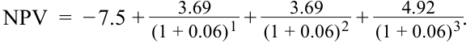
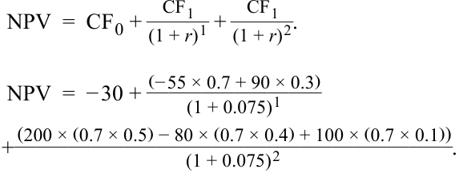
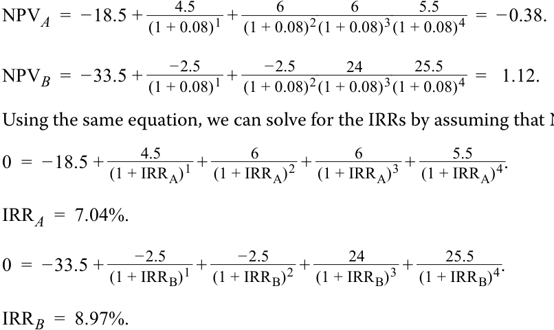

# Tập 3: Tổ chức phát hành doanh nghiệp (Corporate Issuers)
## Học phần 5: Đầu tư vốn và Phân bổ vốn (Capital Investments and Capital Allocation)
### Phần 3/3: Các nguyên tắc và Sai lầm trong Phân bổ vốn & Quyền chọn thực (PDF Trang 166–180)

---

<!-- PDF Page 166 -->

6. Hoàn thành các câu sau đây bằng cách điền vào chỗ trống sử dụng các thuật ngữ dưới đây. Lưu ý rằng mỗi thuật ngữ có thể được sử dụng nhiều hơn một lần.

- vốn chủ sở hữu (*equity*)
- biên lợi nhuận (*profit margin*)
- vòng quay tài sản (*asset turnover*)
- nợ phải trả dài hạn (*long-term liabilities*)
- vốn đầu tư bình quân (*average invested capital*)

ROIC có thể được gia tăng bằng cách tăng ______ hoặc ______. Một công ty có ______ cao vẫn có thể kiếm được mức ROIC thấp nếu ______ thấp, và một công ty có ______ thấp vẫn có thể kiếm được mức ROIC cao nếu ______ cao.

###### **Lời giải:**

ROIC có thể được gia tăng bằng cách tăng *<u>biên lợi nhuận (profit margin)</u>* hoặc *<u>vòng quay tài sản (asset turnover)</u>*. Một công ty có *<u>biên lợi nhuận (profit margin)</u>* cao vẫn có thể kiếm được mức ROIC thấp nếu *<u>vòng quay tài sản (asset turnover)</u>* thấp, và một công ty có *<u>biên lợi nhuận (profit margin)</u>* thấp vẫn có thể kiếm được mức ROIC cao nếu *<u>vòng quay tài sản (asset turnover)</u>* cao.

7. Giải thích tại sao một công ty thuộc sở hữu nhà nước (*government-owned company*) có thể có tỷ suất sinh lợi yêu cầu thấp so với một công ty công nghệ nhỏ.

###### **Lời giải:**

Tỷ suất sinh lợi yêu cầu (*required rate of return*) là mức lãi suất chiết khấu mà các nhà đầu tư đòi hỏi dựa trên mức độ rủi ro của dự án hoặc công ty và mức tỷ suất sinh lợi hiện có từ các khoản đầu tư khác có rủi ro tương đương. Khi xem xét rủi ro kinh doanh của cả hai công ty, một công ty thuộc sở hữu nhà nước có thể được nhìn nhận là một tổ chức phát hành có rủi ro thấp hơn so với một công ty công nghệ nhỏ. Do đó, các nhà đầu tư sẽ đòi hỏi mức đền bù cho rủi ro thấp hơn.

---

# **<mark>4</mark> CÁC NGUYÊN TẮC VÀ SAI LẦM TRONG PHÂN BỔ VỐN (CAPITAL ALLOCATION PRINCIPLES AND PITFALLS)**

**Mục tiêu học tập (LOS):** Mô tả các nguyên tắc phân bổ vốn và những sai lầm phổ biến trong phân bổ vốn.

<!-- PDF Page 167 -->

##### **Các nguyên tắc phân bổ vốn (Capital Allocation Principles)**

Mặc dù các công cụ phân tích và tiêu chí ra quyết định đầu tư được giới thiệu trong bài học trước mang tính định lượng và rõ ràng, vẫn có khoảng trống đáng kể cho những sai sót và nhận định sai lầm. Để cải thiện quy trình ra quyết định, cần tuân thủ các nguyên tắc cốt lõi khi sử dụng những công cụ này.

- *Dòng tiền sau thuế (After-tax cash flows):* Các nhà quản lý nên đánh giá các quyết định phân bổ vốn dựa trên dòng tiền sau thuế thay vì các thước đo dựa trên lợi nhuận hoặc kế toán khác. Các nhà quản lý phải phản ánh tác động của thuế lên các dòng tiền kỳ vọng của dự án, cụ thể là lợi ích lá chắn thuế (*tax benefits*) thu được từ các khoản khấu trừ phi tiền mặt, chẳng hạn như khấu hao tài sản hữu hình (*depreciation*) và phân bổ tài sản vô hình (*amortization*).

- *Chỉ tính dòng tiền tăng thêm nhưng phải xem xét trên phạm vi rộng (Incremental cash flows only but examine broadly):* Phân tích phân bổ vốn phải bỏ qua **chi phí chìm (*sunk costs*)**, tức là những chi phí đã phát sinh rồi (hoặc đã được xóa sổ), và chỉ đưa vào các dòng tiền tăng thêm (*incremental cash flows*) gắn liền với việc thực hiện khoản đầu tư mới so với việc không thực hiện nó. Tuy nhiên, các khoản đầu tư vốn thường có tác động lên phần còn lại của doanh nghiệp (*ngoại ứng – externalities*), có thể là tích cực hoặc tiêu cực. Tác động tích cực có thể bao gồm việc tiết kiệm chi phí trong các hoạt động kinh doanh bắt nguồn trực tiếp từ việc thực hiện khoản đầu tư, trong khi tác động tiêu cực có thể là sự sụt giảm doanh thu từ một sản phẩm tương tự hiện có (*ăn mòn doanh thu – cannibalization*). Cả hai đều là các dòng tiền tăng thêm, vì vậy chúng phải được đưa vào phân tích.

- *Thời điểm của các dòng tiền (Timing of cash flows):* Thời điểm dự báo, thời lượng, mức độ biến động và sự thay đổi theo các chiều hướng có thể xảy ra của các dòng tiền kỳ vọng phải được xem xét đối với một khoản đầu tư vốn. Hãy lưu ý cách thức NPV và IRR có thể thay đổi khi các dòng tiền được dịch chuyển từ kỳ này sang kỳ khác.

##### **Những sai lầm phổ biến trong phân bổ vốn (Capital Allocation Pitfalls)**

Mặc dù đã tuân thủ các nguyên tắc trên, việc phân bổ vốn vẫn đầy thách thức đối với hầu hết các doanh nghiệp. Chúng ta chia những sai lầm phổ biến trong phân bổ vốn thành **các sai lầm nhận thức (*cognitive errors*)** và **các thiên lệch hành vi (*behavioral biases*)**. Các sai lầm nhận thức bao gồm các lỗi tính toán và những sai sót kỹ thuật khác, trong khi các thiên lệch hành vi bao gồm những sai lầm trong phán đoán và các điểm mù tâm lý (*blind spots*).

###### **_Các sai lầm nhận thức trong phân bổ vốn (Cognitive Errors in Capital Allocation)_**

- *Sai số dự báo nội bộ (Internal forecasting errors):* Ban giám đốc có thể mắc sai sót trong các dự báo của mình, điều mà các nhà phân tích bên ngoài có thể rất khó hoặc không thể nhận diện được. Tuy nhiên, nếu đủ lớn, việc phân tích không chính xác hoặc khiếm khuyết cuối cùng sẽ tự bộc lộ qua các khoản đầu tư thất bại hoặc hoạt động kém hiệu quả. Các sai số dự báo bao gồm việc nhập sai dữ liệu đầu vào về chi phí hoặc tỷ suất sinh lợi yêu cầu. Ví dụ, các chi phí quản lý chung (*overhead costs*) như thời gian của ban giám đốc, hỗ trợ công nghệ thông tin, hệ thống tài chính, có thể rất khó ước tính. Cuối cùng, các công ty thường quên không kết hợp phản ứng của các đối thủ cạnh tranh vào bản phân tích một khoản đầu tư dự kiến.

- *Bỏ qua chi phí của nguồn tài trợ nội bộ (Ignoring costs of internal financing):* Nguồn tài trợ chính cho các khoản đầu tư của các tổ chức phát hành doanh nghiệp lớn là dòng tiền từ hoạt động kinh doanh (tức là không phải đi vay hay phát hành thêm cổ phiếu). Nhiều đội ngũ quản lý hành xử như thể những nguồn vốn tự tạo từ nội bộ này là “miễn phí” (*“free”*) nhưng khan hiếm, và phân bổ chúng theo một ngân sách gắn chặt với con số của kỳ trước. Tuy nhiên, nguồn tài trợ bên ngoài từ việc phát hành nợ hoặc vốn chủ sở hữu lại được đối xử khác hẳn: Nó ít được sử dụng hơn, thường chỉ dành cho các khoản đầu tư lớn hơn như mua lại doanh nghiệp (*acquisitions*), và bị coi là “đắt đỏ” (*“expensive”*). Đây là một tư duy logic sai lầm. Nguồn vốn tự tạo từ nội bộ, chẳng hạn như dòng tiền từ hoạt động kinh doanh, *chính là* nguồn tài trợ vốn chủ sở hữu (*equity financing*) bởi vì nó hoàn toàn có thể được hoàn trả cho các nhà đầu tư vốn chủ sở hữu dưới dạng cổ tức. Mặc dù nó không được huy động trực tiếp từ các nhà đầu tư vốn chủ sở hữu

<!-- PDF Page 168 -->

thông qua việc phát hành cổ phiếu mới, nhưng nó được giữ lại từ phần thuộc về họ, và do đó vẫn làm phát sinh chi phí cơ hội của họ. Bất kể nguồn tài trợ là gì, ban giám đốc đều phải sử dụng mức tỷ suất sinh lợi yêu cầu đã điều chỉnh rủi ro phù hợp để đánh giá các khoản đầu tư vốn; những dự án được tài trợ bằng nguồn vốn tạo ra từ nội bộ không nghiễm nhiên được hưởng mức $r$ thấp hơn.

Sai lầm này rất khó phát hiện và tách biệt khỏi các sai lầm cũng như thiên lệch khác, nhưng các nhà phân tích nên tìm hiểu về quy trình phân bổ vốn của ban giám đốc và cách thức mà nguồn tài trợ ảnh hưởng đến các quyết định đầu tư. Nếu một công ty có tâm lý ngại huy động vốn bên ngoài và ngại hoàn trả vốn cho cổ đông, ban giám đốc có khả năng đang bị ảnh hưởng bởi sai lầm này.

- *Xử lý không nhất quán hoặc bỏ qua lạm phát (Inconsistent treatment of, or ignoring, inflation):* Lạm phát ảnh hưởng đến việc phân bổ vốn theo nhiều cách. Thứ nhất là việc phân tích đầu tư được thực hiện theo giá trị danh nghĩa (*nominal terms*) hay giá trị thực (*real terms*). Dòng tiền danh nghĩa bao gồm cả tác động của lạm phát, trong khi dòng tiền thực được điều chỉnh giảm xuống để loại bỏ tác động của lạm phát (hoặc điều chỉnh tăng lên để loại bỏ tác động của giảm phát). Các công ty có thể thực hiện phân tích theo giá trị danh nghĩa hoặc giá trị thực, nhưng cách tiếp cận đối với dòng tiền và lãi suất chiết khấu phải nhất quán với nhau. Nghĩa là, dòng tiền danh nghĩa phải được chiết khấu ở mức lãi suất chiết khấu danh nghĩa, và dòng tiền thực phải được chiết khấu ở mức lãi suất thực.

Phân tích đầu tư luôn hàm chứa, một cách rõ ràng hoặc ngầm định, các kỳ vọng về lạm phát – yếu tố có lẽ không tác động đồng đều lên tất cả đơn giá bán và đơn giá chi phí. Ví dụ, giá dầu tăng rõ ràng có lợi cho các nhà sản xuất dầu mỏ vì họ bán được sản phẩm với giá cao hơn. Tuy nhiên, giá dầu tăng trong khoảng thời gian dài hơn có thể đi kèm với chi phí sản xuất và chi phí vốn tăng lên, làm xói mòn một phần lợi ích đó. Thứ hai, nhiều công ty dầu khí cũng sở hữu cả mảng kinh doanh lọc dầu và hóa chất, nơi dầu thô lại là nguyên liệu đầu vào chính. Khả năng sinh lời của các mảng kinh doanh đó có xu hướng sụt giảm khi giá dầu thô tăng. Nếu lạm phát thực tế khác với lạm phát kỳ vọng, dòng tiền sau thuế sẽ tốt hơn hoặc xấu hơn dự kiến tùy thuộc vào cách thức mà giá bán đầu ra hoặc chi phí đầu vào cụ thể bị ảnh hưởng.

###### **_Các thiên lệch hành vi trong phân bổ vốn (Behavioral Biases in Capital Allocation)_**

- *Tính ỳ / Quán tính (Inertia):* Trong một nghiên cứu trên hơn 1,600 công ty niêm yết tại Hoa Kỳ, các nhà nghiên cứu từ McKinsey đã phát hiện ra hệ số tương quan lên tới $0.92$ giữa mức độ đầu tư vốn vào một phân khúc hoặc đơn vị kinh doanh từ năm này sang năm tiếp theo.$^1$ Đây là kết quả của việc ban giám đốc neo (*anchoring*) ngân sách đầu tư vốn vào các con số của năm trước. Các nhà phân tích nhận diện thiên lệch này bằng cách kiểm tra mức độ đầu tư vốn tổng thể, theo phân khúc, hoặc theo dòng sản phẩm kinh doanh (nếu được công bố), và đem so sánh với năm trước cũng như với tỷ suất sinh lợi trên vốn đầu tư (ROIC). Nếu mức đầu tư vốn mỗi năm giữ nguyên hoặc tăng lên bất chấp tỷ suất sinh lợi trên vốn đầu tư đang sụt giảm, nhà phân tích cần đặt câu hỏi về cơ sở hợp lý cho khoản đầu tư vốn của tổ chức phát hành và liệu ban giám đốc có nên cân nhắc các mục đích sử dụng vốn thay thế khác hay không.

- *Đặt quyết định đầu tư dựa trên các thước đo kế toán, chẳng hạn như EPS (Basing investment decisions on accounting measures, such as EPS):* Các nhà quản lý thường có động cơ làm tăng các thước đo kế toán, chẳng hạn như thu nhập trên mỗi cổ phần (EPS), lợi nhuận ròng (*net income*), hoặc tỷ suất sinh lợi trên vốn chủ sở hữu (ROE). Nhiều khoản đầu tư vốn, ngay cả những khoản có NPV cao, có thể làm giảm thay vì làm tăng các kết quả kế toán này trong ngắn hạn, trong khi việc cắt giảm chi phí và mua lại cổ phiếu, ngược lại, có thể mang lại tác động tích cực tức thời lên các thước đo như vậy. Việc quá chú trọng vào các con số kế toán ngắn hạn có thể khiến công ty lựa chọn những khoản đầu tư không phục vụ lợi ích dài hạn của các cổ đông. Các nhà phân tích có thể quan sát hành vi này trước hết bằng cách kiểm tra các động lực tài chính trực tiếp của ban giám đốc dựa trên cấu trúc và thành phần gói thù lao của họ.

<!-- PDF Page 169 -->

Thứ hai, các nhà phân tích có thể so sánh mức chi tiêu vốn với mức lịch sử và mức của các công ty cùng ngành để đánh giá xem liệu ban giám đốc có đang ưu tiên các thước đo kế toán ngắn hạn hay không. Tuy nhiên, cần lưu ý rằng mức đầu tư vốn thấp hơn cũng có thể là dấu hiệu của việc hạn chế các cơ hội đầu tư sinh lời, và trong trường hợp đó thì việc phân bổ vốn sang các mục đích sử dụng thay thế (như trả cổ tức/mua lại cổ phiếu) lại là một quyết định khôn ngoan.

- *Thiên lệch dự án cưng (Pet project bias):* Các dự án nhận được sự ưu ái đặc biệt, hay cái gọi là **các dự án cưng (*pet projects*)** của lãnh đạo, đôi khi được lựa chọn mà không trải qua quá trình phân tích phân bổ vốn kỹ lưỡng. Trong những trường hợp khác, việc phân tích vẫn được thực hiện nhưng các dự phóng quá lạc quan lại được sử dụng để thổi phồng khả năng sinh lời của dự án cưng đó. Việc nhận diện các dự án cưng là rất khó khăn, bởi vì các báo cáo tài chính thường được tổng hợp và những dự án như vậy có thể không vượt qua ngưỡng trọng yếu (*threshold of materiality*) để phải thuyết minh riêng. Thay vào đó, các nhà phân tích nên đánh giá cơ cấu quản trị doanh nghiệp (*corporate governance structure*) để tìm kiếm các dấu hiệu cảnh báo làm tăng nguy cơ phân bổ vốn sai lệch: các công ty bị kiểm soát hoặc có mức độ tập trung sở hữu đáng kể vào một cá nhân hay một nhóm duy nhất, sự giám sát yếu kém của hội đồng quản trị, và chế độ thù lao cho ban điều hành không gắn liền với lợi ích của các bên liên quan.

- *Không xem xét các phương án đầu tư thay thế hoặc các kịch bản thay thế (Failure to consider investment alternatives or alternative scenarios):* Mặc dù việc hình thành ý tưởng đầu tư là bước đầu tiên trong quy trình phân bổ vốn, nhiều phương án thay thế khả thi thậm chí không bao giờ được xem xét tại một số công ty. Các doanh nghiệp cũng thường không xem xét đến các kết quả đầu ra khác nhau – những yếu tố có thể và nên được kết hợp thông qua phân tích điểm hòa vốn (*breakeven*), phân tích kịch bản (*scenario*) và phân tích mô phỏng (*simulation analyses*). Sai lầm này có thể bắt nguồn từ kinh nghiệm đầu tư vốn hạn chế, chẳng hạn như chưa từng thực hiện thoái vốn (*divestitures*) hay mua lại (*acquisitions*), hoặc chưa từng trải qua một khoản đầu tư thất bại nào. Mặc dù thất bại rõ ràng là điều không mong muốn, nhưng việc hoàn toàn không có thất bại nào theo thời gian có thể phản ánh một đội ngũ quản lý đang quá sợ rủi ro và không chấp nhận đủ mức rủi ro cần thiết.

###### **BỘ CÂU HỎI (QUESTION SET)**

1. Đúng hay Sai: Các dự án đầu tư được tài trợ bằng nguồn vốn tự tạo từ nội bộ (ví dụ: dòng tiền từ hoạt động kinh doanh) nên được đánh giá bằng cách sử dụng tỷ suất sinh lợi yêu cầu thấp hơn so với các dự án được tài trợ bằng phát hành nợ hoặc cổ phiếu.

###### **Lời giải:**

Sai (*False*). Việc bỏ qua chi phí của nguồn tài trợ nội bộ là một sai lầm nhận thức phổ biến. Nguồn vốn tự tạo từ nội bộ, chẳng hạn như dòng tiền từ hoạt động kinh doanh, chính là nguồn tài trợ vốn chủ sở hữu bởi vì nó có thể được hoàn trả cho các nhà đầu tư vốn chủ sở hữu dưới dạng cổ tức hoặc mua lại cổ phiếu. Mặc dù nguồn vốn tự tạo từ nội bộ không được huy động trực tiếp từ các nhà đầu tư vốn chủ sở hữu bằng cách phát hành cổ phiếu mới, nhưng nó bị giữ lại từ phần thuộc về họ, do đó vẫn làm phát sinh chi phí cơ hội của họ. Bất kể nguồn tài trợ là gì, ban giám đốc đều phải sử dụng mức tỷ suất sinh lợi yêu cầu đã điều chỉnh rủi ro phù hợp để đánh giá các khoản đầu tư vốn.

2. Alexandra Tolonen, một nhà phân tích đầu tư, lập các dự báo cho việc mở rộng một nhà máy sản xuất pin ô tô và muốn xem xét tác động của việc giá lithium carbonate tăng lên. Tolonen điều chỉnh giảm các dòng tiền sau thuế trong tương lai để loại bỏ tác động của mức tăng giá lithium carbonate dự kiến là 5%

<!-- PDF Page 170 -->

và sử dụng lãi suất chiết khấu thực (*real discount rates*) để tính NPV của dự án. Vào năm thứ hai của dự án, giá lithium carbonate thực tế đã tăng 10%.

Đúng hay Sai: Với việc Tolonen đã sử dụng các dòng tiền và lãi suất chiết khấu đã điều chỉnh lạm phát, sự gia tăng giá lithium carbonate sẽ không ảnh hưởng đến khả năng sinh lời của dự án.

###### **Lời giải:**

Sai (*False*). Mặc dù Tolonen đã nhất quán trong việc sử dụng dòng tiền thực và lãi suất thực khi lập dự báo, thực tế này không làm cho dự án miễn nhiễm trước những biến động của lạm phát. Nếu lạm phát thực tế khác với lạm phát kỳ vọng (10% so với 5%), dòng tiền sau thuế sẽ tốt hơn hoặc xấu hơn so với dự kiến, tùy thuộc vào cách thức mà các chi phí đầu vào cụ thể bị ảnh hưởng.

3. Một nhà phân tích đang phân tích công ty XYZ và đã thu thập dữ liệu về vốn đầu tư hàng năm và ROIC cho từng phân khúc trong số ba phân khúc kinh doanh của XYZ.

||**Chi tiêu vốn (*Capital Expenditures*) (triệu USD)**|||**ROIC**|||
|---|---|---|---|---|---|---|
|**Phân khúc (*Segment*)**|**20X0**|**20X1**|**20X2**|**20X0**|**20X1**|**20X2**|
|**A**|264|282|303|7.50%|7.10%|6.80%|
|**B**|297|318|340|10.00%|8.90%|7.10%|
|**C**|211|226|242|6.90%|7.80%|9.00%|

Dựa trên thông tin được cung cấp, ban giám đốc của XYZ *có khả năng cao nhất* đang mắc phải thiên lệch nào sau đây?

- **A.** Tính ỳ / Quán tính (*Inertia*)

- **B.** Chi phí chìm (*Sunk cost*)

- **C.** Dự án cưng (*Pet project*)

###### **Lời giải:**

A là đáp án đúng. Tính ỳ (*inertia*) có thể được nhận diện bằng cách kiểm tra mức độ đầu tư vốn tổng thể, theo phân khúc, hoặc theo dòng sản phẩm kinh doanh (nếu được công bố), và đem so sánh với năm trước cũng như với tỷ suất sinh lợi trên vốn đầu tư. Nếu mức đầu tư vốn mỗi năm giữ nguyên hoặc tăng lên bất chấp tỷ suất sinh lợi trên vốn đầu tư đang giảm xuống, nhà phân tích cần đặt câu hỏi về cơ sở hợp lý cho khoản đầu tư vốn của tổ chức phát hành và liệu ban giám đốc có nên cân nhắc các mục đích sử dụng khác hay không. Trong trường hợp của XYZ, chúng ta có thể quan sát thấy đối với phân khúc A và B, ROIC đang giảm dần qua các năm, nhưng cả hai phân khúc này vẫn nhận được mức phân bổ vốn cao hơn qua từng năm (đều tăng khoảng 6.8%–7%/năm ở cả 3 phân khúc).

B không đúng vì chi phí chìm liên quan đến quy trình phân bổ vốn khi xác định khả năng sinh lời của một dự án tiềm năng. Chi phí chìm, hay những chi phí đã phát sinh rồi, cần được bỏ qua khi đánh giá các dự án tiềm năng.

C không đúng vì không có thông tin chi tiết về từng dự án đầu tư riêng lẻ do ban giám đốc XYZ thực hiện. Việc nhận diện các dự án cưng từ bên ngoài doanh nghiệp là rất khó khăn, bởi vì các báo cáo tài chính được tổng hợp và những dự án như vậy có thể không vượt qua ngưỡng trọng yếu.

4. Bradshaw, một nhà phân tích tài chính, lập dự báo về các dòng tiền gộp (trước thuế) kỳ vọng trong tương lai cho một dự án đầu tư. Bradshaw cũng dự báo mức khấu hao tương lai liên quan đến dự án đó và giả định tỷ suất sinh lợi yêu cầu là 6%. Dựa trên thông tin được cung cấp và mức thuế suất 18%, hãy tính

<!-- PDF Page 171 -->

NPV của dự án. Tại khu vực pháp lý này, chi phí khấu hao không được phép khấu trừ thuế (*not deductible for taxes*).

||**Dự báo Dòng tiền và Khấu hao (*Cash Flow and Depreciation Forecast*)**||||
|---|---|---|---|---|
|**Thời điểm (*Time*)**|**0**|**1**|**2**|**3**|
|**Dòng tiền gộp trước thuế (*Gross cash flow*)**|–7.50|4.50|4.50|6.00|
|**Khấu hao (*Depreciation*)**|0.00|–1.00|–1.00|–1.00|

###### **Lời giải:**

Để tính NPV cho dự án này, trước tiên Bradshaw cần tính các dòng tiền sau thuế và chỉ xem xét khấu hao ở mức độ mà nó được khấu trừ thuế và làm giảm thuế, bởi vì khấu hao là chi phí phi tiền mặt. Do tại khu vực pháp lý này khấu hao không được khấu trừ thuế, các dòng tiền sau thuế có thể được tính bằng cách áp dụng công thức sau cho tất cả các dòng tiền sẽ nhận được trong tương lai:

$$\text{After-tax cash flow}_t = \text{Gross cash flow}_t \times (1 - \text{Tax rate})$$

||**Dự báo Dòng tiền sau thuế (*After-Tax Cash Flow Forecast*)**||||
|---|---|---|---|---|
|**Thời điểm (*Time*)**|**0**|**1**|**2**|**3**|
|**Dòng tiền sau thuế (*After-tax cash flow*)**|–7.50|3.69|3.69|4.92|

*(Giải thích: Tại $t = 1, 2$: $4.50 \times (1 - 0.18) = 3.69$; tại $t = 3$: $6.00 \times (1 - 0.18) = 4.92$).*

Phép tính NPV như sau:

<!-- Formula Text: NPV  =  − 7.5 + 3.69 _ (1 + 0.06) 1  + 3.69 _ (1 + 0.06) 2  + 4.92 _ (1 + 0.06) 3 . -->

$$\text{NPV} = -7.5 + \frac{3.69}{(1 + 0.06)^1} + \frac{3.69}{(1 + 0.06)^2} + \frac{4.92}{(1 + 0.06)^3}$$

$$\text{NPV} = 3.396$$

5. Giải thích tại sao một số nhà quản lý có thể từ chối các dự án làm tăng đáng kể giá trị cho cổ đông (tức là có NPV cao).

###### **Lời giải:**

Các nhà quản lý có thể có động cơ làm tăng các thước đo khả năng sinh lời kế toán, chẳng hạn như thu nhập trên mỗi cổ phần (EPS), lợi nhuận ròng, hoặc tỷ suất sinh lợi trên vốn chủ sở hữu (ROE). Nhiều khoản đầu tư vốn, ngay cả những khoản có NPV cao, có thể làm giảm thay vì làm tăng các thước đo này trong ngắn hạn, trong khi việc cắt giảm chi phí và mua lại cổ phiếu, ngược lại, có thể mang lại tác động tích cực lên các thước đo như vậy. Nếu động cơ này đủ mạnh, ban giám đốc có thể từ bỏ các dự án có NPV cao để ưu tiên các hành động làm tăng thu nhập trên mỗi cổ phần (EPS) trong ngắn hạn.

---

#### **QUYỀN CHỌN THỰC (REAL OPTIONS)**

# **<mark>5</mark>**

**Mục tiêu học tập (LOS):** Mô tả các loại quyền chọn thực liên quan đến đầu tư vốn.

Quy trình phân bổ vốn được mô tả trước đó ngụ ý rằng các doanh nghiệp đưa ra tất cả các quyết định đầu tư vốn cho một dự án ngay tại thời điểm khởi đầu, và duy trì một hướng hành động duy nhất trong suốt vòng đời của dự án. Trong thực tiễn, các doanh nghiệp thường có các lựa chọn thay thế, được gọi là **các quyền chọn thực (*real options*)**, có thể làm thay đổi giá trị của các khoản đầu tư vốn. Nghĩa là, một số quyết định đầu tư vốn trên thực tế là một chuỗi các quyết định nối tiếp nhau; một số được đưa ra ngày hôm nay, trong khi

<!-- PDF Page 172 -->

những quyết định khác có thể được hoãn lại và sẽ dựa trên các sự kiện kinh tế hoặc thông tin trong tương lai. Tương tự như các quyền chọn tài chính (*financial options*), chẳng hạn như các công cụ phái sinh, quyền chọn thực trao cho doanh nghiệp quyền, nhưng không phải nghĩa vụ, thực hiện một hành động trong tương lai. Một công ty chỉ nên theo đuổi (hoặc **thực hiện quyền – *exercise***) một quyền chọn thực nếu nó làm gia tăng giá trị.

Cũng giống như giá trị của một quyền chọn tài chính phụ thuộc vào giá trị tương lai của một tài sản cơ sở, các quyền chọn thực phụ thuộc vào các sự kiện tương lai đối với công ty. Quyền chọn thực mang lại sự linh hoạt cho các công ty, có thể làm tăng đáng kể NPV của các khoản đầu tư vốn dưới một hoặc nhiều hình thức sau đây:

- *Quyền chọn thời điểm (Timing option):* Thay vì đầu tư ngay bây giờ, công ty có thể chọn trì hoãn quyết định đầu tư của mình. Khi làm như vậy, các công ty từ bỏ tỷ suất sinh lợi trong ngắn hạn và hy vọng thu thập được thông tin tốt hơn cho NPV của các dự án được lựa chọn. Các khoản đầu tư có thể được sắp xếp theo trình tự thời gian, sao cho việc đầu tư vào một dự án hôm nay sẽ tạo ra quyền chọn để thực hiện các khoản đầu tư tiếp theo trong tương lai.

- *Quyền chọn quy mô (Sizing option):* **Quyền chọn từ bỏ (*abandonment option*)** cho phép công ty từ bỏ khoản đầu tư sau khi nó đã được triển khai nếu kết quả tài chính gây thất vọng. Tại một ngày nào đó trong tương lai, nếu dòng tiền thu được từ việc từ bỏ/thanh lý khoản đầu tư vượt quá giá trị hiện tại của các dòng tiền từ việc tiếp tục duy trì khoản đầu tư đó, công ty nên thực hiện quyền chọn từ bỏ. Ngược lại, nếu công ty có thể thực hiện thêm các khoản đầu tư bổ sung khi kết quả tài chính trong tương lai khả quan, công ty có một **quyền chọn tăng trưởng (*growth option*)**, hay **quyền chọn mở rộng (*expansion option*)**.

- *Quyền chọn linh hoạt (Flexibility option):* Các công ty cũng có thể hưởng lợi từ sự linh hoạt trong vận hành ngoài việc từ bỏ hoặc mở rộng sau khi khoản đầu tư đã hoàn tất. Ví dụ, giả sử một doanh nghiệp nhận thấy nhu cầu đối với một sản phẩm hoặc dịch vụ vượt quá công suất. Ban giám đốc có thể thực hiện **quyền chọn định giá (*price-setting option*)**. Bằng cách tăng giá bán, công ty có thể hưởng lợi từ phần cầu vượt cung, điều mà công ty không thể làm được thông qua việc tăng sản lượng. Hoặc một cách khác, doanh nghiệp có thể cân nhắc **các quyền chọn linh hoạt trong sản xuất (*production flexibility options*)** để thay đổi sản lượng khi nhu cầu khác với dự báo. Ví dụ, doanh nghiệp có thể tăng làm thêm giờ (*overtime*) hoặc bổ sung thêm ca làm việc (*extra shifts*) để tăng sản lượng trên một mức công suất cố định cho trước.

- *Quyền chọn cơ bản (Fundamental option):* Toàn bộ giá trị của một khoản đầu tư có thể phụ thuộc vào các yếu tố nằm ngoài tầm kiểm soát của doanh nghiệp, chẳng hạn như giá của một loại hàng hóa cơ bản (*commodity*). Ví dụ, giá trị của một giếng dầu hoặc khoản đầu tư nhà máy lọc dầu phụ thuộc vào giá dầu. Giá trị của một mỏ vàng phụ thuộc vào giá vàng. Nếu giá dầu ở mức thấp, công ty nhiều khả năng sẽ chọn không khoan giếng. Nếu giá dầu ở mức cao, công ty sẽ tiến hành khoan. Nhiều dự án nghiên cứu và phát triển (R&D) cũng rất giống với những quyền chọn như vậy.

Các doanh nghiệp sử dụng một số cách tiếp cận khi đánh giá các khoản đầu tư vốn có những đặc điểm này, chẳng hạn như:

**1.** *Phân tích đầu tư không xét đến quyền chọn (Investment analysis without considering options):* Nếu NPV đã dương ngay cả khi chưa xét đến các quyền chọn thực và dự án lại có các quyền chọn thực có thể làm tăng thêm giá trị hiện tại ròng của nó, thì mức NPV cơ sở đó đại diện cho mức sinh lợi *tối thiểu* và doanh nghiệp nên thực hiện khoản đầu tư.

**2.** *Tính NPV có bao gồm quyền chọn thực (Calculation of NPV with real options):* Theo cách tiếp cận này, doanh nghiệp tính NPV của dự án dựa trên các dòng tiền kỳ vọng cơ sở, sau đó trừ đi chi phí tăng thêm để có được quyền chọn thực và cộng thêm giá trị gắn liền với quyền chọn đó, như được thể hiện trong Phương trình 4:

$$\text{Project NPV} = \text{NPV (without options)} - \text{Option cost} + \text{Option value} \tag{4}$$

*(NPV của dự án = NPV khi không có quyền chọn $-$ Chi phí quyền chọn $+$ Giá trị quyền chọn).*

<!-- PDF Page 173 -->

**3.** *Cây quyết định và các mô hình định giá quyền chọn (Decision trees and option pricing models):* Một trong hai cách tiếp cận này có thể được sử dụng bởi các doanh nghiệp đang tìm cách đánh giá giá trị của một khoản đầu tư vốn liên quan đến các quyết định tuần tự trong tương lai và các kết quả đầu ra thay thế cho một khoản đầu tư nhất định. Các mô hình này thường gán một xác suất và thời điểm dự kiến cho các kết quả trong tương lai, từ đó được sử dụng để tính NPV của dự án.

Để tính toán tỷ suất sinh lợi của các khoản đầu tư vốn có hoặc không có quyền chọn thực, các doanh nghiệp thường phải giả định một mức xác suất kỳ vọng cho các sự kiện trong tương lai. Ví dụ sau đây cung cấp một minh họa sử dụng cây quyết định (*decision tree*) để đánh giá giá trị của một khoản đầu tư vốn khi có và không có quyền chọn thực.

###### **VÍ DỤ 9 (EXAMPLE 9)**

##### **Phân bổ vốn của Tập đoàn Gerhardt sử dụng Cây quyết định (Gerhardt Corporation Capital Allocation Using a Decision Tree)**

Giả sử Tập đoàn Gerhardt đang cân nhắc khoản chi đầu tư vốn 500 triệu EUR vào một cơ sở sản xuất để chế tạo một sản phẩm mới. Gerhardt gán 60% xác suất cho việc ra mắt sản phẩm thành công, dự kiến sẽ mang về 750 triệu EUR sau một năm. Đội ngũ tài chính của Gerhardt cũng đã tiến hành phân tích các mục đích sử dụng thay thế đối với cơ sở sản xuất này, tóm tắt thời điểm và xác suất của các dòng tiền gắn với từng quyền chọn thực trong cây quyết định dưới đây.

**Cây quyết định của Tập đoàn Gerhardt (Gerhardt Corporation Decision Tree)**

<!-- Picture Text: Time t  = 0 t  = 1 t  = 2 €750 Successful Product Launch (60%) €600 CF 0 = –€500 Alternative Product Launch Gerhardt Builds (30%) New Facility €0 €400 Sale of Facility Product Failure to Another Firm (40%) (30%) €0 Facility Abandoned (40%)  -->

> **Chú thích hình ảnh:** Cây quyết định của Tập đoàn Gerhardt qua các mốc thời gian $t = 0, t = 1, t = 2$:
> - Tại $t = 0$: Gerhardt xây dựng cơ sở sản xuất mới (*Gerhardt Builds New Facility*), dòng tiền $CF_0 = -\text{€500}$ triệu.
> - Tại $t = 1$: Có 2 nhánh xảy ra:
>   - Nhánh 1 (60% xác suất): Ra mắt sản phẩm thành công (*Successful Product Launch*) $\rightarrow$ thu về $\text{€750}$ triệu.
>   - Nhánh 2 (40% xác suất): Sản phẩm thất bại (*Product Failure*) $\rightarrow$ thu về $\text{€0}$ tại $t = 1$, nhưng dẫn đến 3 lựa chọn (quyền chọn thực) tại $t = 2$:
>     - Nhánh 2a (30% xác suất có điều kiện): Ra mắt sản phẩm thay thế (*Alternative Product Launch*) $\rightarrow$ thu về $\text{€600}$ triệu tại $t = 2$.
>     - Nhánh 2b (30% xác suất có điều kiện): Bán cơ sở sản xuất cho doanh nghiệp khác (*Sale of Facility to Another Firm*) $\rightarrow$ thu về $\text{€400}$ triệu tại $t = 2$.
>     - Nhánh 2c (40% xác suất có điều kiện): Từ bỏ cơ sở sản xuất (*Facility Abandoned*) $\rightarrow$ thu về $\text{€0}$ tại $t = 2$.

1. Tính NPV của dự án Gerhardt *khi không có* quyền chọn thực, sử dụng tỷ suất sinh lợi yêu cầu ($r$) là 10%.

###### **Lời giải:**

NPV khi không có quyền chọn thực sử dụng Phương trình 1 và dòng tiền bình quân gia quyền theo xác suất nếu sản phẩm được ra mắt thành công (60%) và 40% xác suất dòng tiền vào tương lai bằng 0:

<!-- PDF Page 174 -->

$$\text{NPV} = CF_0 + \frac{CF_1}{(1 + r)^1}$$

$$\text{NPV} = -500 + \frac{0.6 \times 750 + 0.4 \times 0}{1.10} = -500 + 409.09 = -\text{€90.91\text{ (triệu)}}$$

Bởi vì $\text{NPV} = -\text{€90.91}$ triệu, Gerhardt không nên theo đuổi dự án này dựa trên quy tắc ra quyết định theo NPV.

2. Tính NPV của dự án được đề xuất của Gerhardt *khi có* các quyền chọn thực và tỷ suất sinh lợi yêu cầu là 10%.

###### **Lời giải:**

Tính NPV có bao gồm quyền chọn thực bằng cách sử dụng Phương trình 1 và các dòng tiền gia quyền theo xác suất trong các kỳ tương lai:

$$\text{NPV} = CF_0 + \frac{CF_1}{(1 + r)^1} + \frac{CF_2}{(1 + r)^2}$$

$$\text{NPV} = -500 + \frac{0.6 \times 750}{(1.10)^1} + \frac{[(0.4 \times 0.3) \times 600] + [(0.4 \times 0.3) \times 400]}{(1.10)^2}$$

$$\text{NPV} = -500 + 409.09 + \frac{72 + 48}{1.21} = -500 + 409.09 + 99.17 = \text{€8.26\text{ (triệu)}}$$

NPV *khi có* các quyền chọn thực bằng $\text{€8.26}$ triệu, ngụ ý rằng dựa trên quy tắc ra quyết định theo NPV, Gerhardt nên đầu tư vào cơ sở sản xuất mới này nếu tính đến các mục đích sử dụng thay thế trong tương lai. Lưu ý rằng phép tính dòng tiền cho kỳ thứ hai được dựa trên xác suất có điều kiện (*conditional probabilities*) của các kết quả cụ thể. Nghĩa là, trong trường hợp cả việc ra mắt sản phẩm thay thế có thể xảy ra lẫn việc bán cơ sở sản xuất cho doanh nghiệp khác, mức xác suất 30% của mỗi kết quả loại trừ lẫn nhau này *với điều kiện* sản phẩm thất bại ở Kỳ 1 (40%) làm cho xác suất đồng thời/có điều kiện tính từ $t=0$ của mỗi sự kiện bằng $12\%$ ($= 0.4 \times 0.3$).

Như ví dụ trên cho thấy, việc đưa các quyền chọn thực vào quy trình phân bổ vốn nhằm kết hợp các kịch bản khác nhau liên quan đến các sự kiện nội bộ và bên ngoài cũng như tác động kỳ vọng của chúng lên dòng tiền sau thuế trong tương lai có thể làm thay đổi đáng kể kết quả đánh giá một khoản đầu tư.

###### **BỘ CÂU HỎI (QUESTION SET)**

1. Phát biểu nào sau đây về quyền chọn thực (*real options*) là đúng?

   - **A.** Việc sử dụng các mô hình định giá quyền chọn giúp ước tính giá trị của quyền chọn với độ chính xác cao nhất.

   - **B.** Quyền chọn thực cho phép các công ty từ bỏ một dự án đầu tư nếu khả năng sinh lời của nó kém.

   - **C.** Quyền chọn thực sẽ cho phép một nhà máy lọc dầu phòng ngừa rủi ro (*hedge*) giá dầu thô tương lai cần thiết cho sản xuất.

###### **Lời giải:**

B là đáp án đúng. Quyền chọn từ bỏ (*abandonment option*) là một loại quyền chọn thực, cho phép công ty từ bỏ khoản đầu tư sau khi nó đã được triển khai.

A không đúng vì mặc dù quyền chọn thực có thể được định giá bằng các mô hình định giá quyền chọn, các ước tính này đòi hỏi nhiều thông số đầu vào không thể quan sát trực tiếp được (*unobservable inputs*), chẳng hạn như xác suất của các sự kiện và thời điểm xảy ra của chúng. Sự phức tạp không nhất thiết làm tăng độ chính xác.

C không đúng vì quyền chọn thực mang lại cho các công ty sự linh hoạt liên quan đến các quyết định hoạt động trong tương lai; tuy nhiên, chúng không cho phép phòng ngừa rủi ro biến động giá hàng hóa. Rủi ro biến động giá dầu thô có thể được phòng ngừa bằng các quyền chọn tài chính (*financial options*), chứ không phải quyền chọn thực.

<!-- PDF Page 175 -->

2. ScolarCorp đang lên kế hoạch cho một chiến dịch nghiên cứu thị trường nhằm đánh giá mức độ quan tâm đối với một loại sản phẩm mới. Nếu mức độ quan tâm đến sản phẩm mới cao, công ty sẽ cần nâng cấp nhà máy sản xuất hiện có để phục vụ việc sản xuất sản phẩm. Ngược lại, nếu mức độ quan tâm thấp, ScolarCorp sẽ bán nhà máy với giá 90 triệu USD. Tỷ suất sinh lợi yêu cầu cho dự án là 7.5%. Một nhà phân tích của ScolarCorp đã tóm tắt thời điểm và xác suất của các dòng tiền gắn với từng phương án sử dụng thay thế trong cây quyết định dưới đây.

<!-- Picture Text: Time t  = 0 t  = 1 t  = 2 +$200 –$55 Product Launch Successful Plant Upgrade (50%) (70%) –$80 CF 0 = –$30 Product Launch Market Research Fail (40%) +$90 Plant Sale (30%) +$100 Plant Sale (10%)  -->

> **Chú thích hình ảnh:** Cây quyết định của ScolarCorp:
> - Tại $t = 0$: Nghiên cứu thị trường (*Market Research*), dòng tiền $CF_0 = -\$30$ triệu.
> - Tại $t = 1$:
>   - Nhánh 1 (70% xác suất): Nâng cấp nhà máy (*Plant Upgrade*) tốn $-\$55$ triệu, dẫn tới tại $t = 2$:
>     - Ra mắt sản phẩm thành công (*Product Launch Successful* – 50%): $+\$200$ triệu.
>     - Ra mắt sản phẩm thất bại (*Product Launch Fail* – 40%): $-\$80$ triệu.
>     - Bán nhà máy (*Plant Sale* – 10%): $+\$100$ triệu.
>   - Nhánh 2 (30% xác suất): Bán nhà máy ngay tại $t = 1$ (*Plant Sale*): $+\$90$ triệu.

Dựa trên cây quyết định, hãy ghép nối các yếu tố sau đây với tác động tương ứng lên giá trị của dự án vốn (giá trị quyền chọn):

- Chi phí nghiên cứu thị trường tăng (*Increase in market research cost*)
- Chi phí nghiên cứu thị trường giảm (*Decrease in market research cost*)
- Giá bán nhà máy tăng (*Increase in plant sale price*)
- Giá bán nhà máy giảm (*Decrease in plant sale price*)
- Tỷ suất sinh lợi yêu cầu tăng (*Increasing required rate of return*)
- Tỷ suất sinh lợi yêu cầu giảm (*Decreasing required rate of return*)

**Làm tăng Giá trị dự án (Increases Project Value) / Làm giảm Giá trị dự án (Decreases Project Value)**

###### **Lời giải:**

|**Làm tăng Giá trị dự án (*Increases Project Value*)**|**Làm giảm Giá trị dự án (*Decreases Project Value*)**|
|---|---|
|Chi phí nghiên cứu thị trường giảm (*Decrease in market research cost*)|Chi phí nghiên cứu thị trường tăng (*Increase in market research cost*)|
|Giá bán nhà máy tăng (*Increase in plant sale price*)|Giá bán nhà máy giảm (*Decrease in plant sale price*)|
|Tỷ suất sinh lợi yêu cầu giảm (*Decreasing required rate of return*)|Tỷ suất sinh lợi yêu cầu tăng (*Increasing required rate of return*)|

Việc tính toán NPV của dự án, khi xem xét tất cả các phương án thay thế và xác suất của chúng, có thể được thực hiện như sau:

<!-- PDF Page 176 -->

<!-- Formula Text: NPV  =  CF 0 + CF 1 _ (1 + r) 1  + CF 1 _ (1 + r) 2 . NPV  =  − 30 +  (− 55 × 0.7 + 90 × 0.3) ________________ (1 + 0.075) 1 +  (200 × (0.7 × 0.5) − 80 × (0.7 × 0.4) + 100 × (0.7 × 0.1)) ________________________________________ (1 + 0.075) 2 . -->

$$\text{NPV} = CF_0 + \frac{CF_1}{(1 + r)^1} + \frac{CF_2}{(1 + r)^2}$$

$$\text{NPV} = -30 + \frac{-55 \times 0.7 + 90 \times 0.3}{(1 + 0.075)^1} + \frac{200 \times (0.7 \times 0.5) - 80 \times (0.7 \times 0.4) + 100 \times (0.7 \times 0.1)}{(1 + 0.075)^2}$$

<!-- Formula Text: NPV = $6.549. -->

$$\text{NPV} = \$6.549\text{ (triệu USD)}$$

- **Tác động của việc tăng chi phí nghiên cứu thị trường (*Impact of increase in market research cost*):**
  Nếu chi phí nghiên cứu thị trường tăng lên, ví dụ tăng thêm 10 (lên mức $-40$), NPV của toàn bộ dự án sẽ giảm đi đúng một lượng tương ứng. Do khoản chi ban đầu diễn ra tại $t = 0$, nó không cần phải chiết khấu.

- **Tác động của việc tăng giá bán nhà máy (*Impact of increase in plant sale price*):**
  Nếu giá bán nhà máy tăng lên (dù ở Năm 1 hay Năm 2), NPV của toàn bộ dự án sẽ tăng lên một lượng nhỏ hơn mức tăng danh nghĩa đó, bởi vì dòng tiền tương ứng cần phải được điều chỉnh theo xác suất và chiết khấu về $t = 0$.

- **Tác động của việc tăng tỷ suất sinh lợi yêu cầu (*Impact of increase in required rate of return*):**
  Sự gia tăng tỷ suất sinh lợi yêu cầu sẽ làm giảm NPV của toàn bộ dự án, bởi vì nó được dùng ở mẫu số để chiết khấu các dòng tiền tương lai.

3. Công ty XYZ đang cân nhắc mở rộng trung tâm phân phối của mình tại nước ngoài. Chính quyền địa phương đang xây dựng một quy định môi trường mới nhằm đưa ra các khoản trợ cấp và ưu đãi giảm thuế cho các khoản đầu tư liên quan đến năng lượng tái tạo. Một khi đạo luật mới được thông qua, XYZ có thể nâng cấp trung tâm phân phối với chi phí thấp hơn. Nếu công ty quyết định chờ quy định mới có hiệu lực, công ty sẽ phải gánh chịu các chi phí liên quan đến việc trì hoãn dự án là 1.8 triệu USD. Đội ngũ tài chính của XYZ ước tính rằng nếu công ty chờ đợi, NPV của dự án sẽ là 9.7 triệu USD, so với mức giá trị hiện tại (nếu không có quyền chọn chờ đợi) là 8.9 triệu USD. Hãy tính giá trị quyền chọn (*option value*).

###### **Lời giải:**

Để xác định giá trị quyền chọn, chúng ta cần so sánh giá trị dự án khi có và không có quyền chọn, đồng thời tính đến chi phí của quyền chọn.

- $\text{Project NPV (with option)} = \$9.7\text{ million}$ (NPV dự án khi có quyền chọn)
- $\text{Project NPV (without option)} = \$8.9\text{ million}$ (NPV dự án khi không có quyền chọn)
- $\text{Option cost} = \$1.8\text{ million}$ (Chi phí quyền chọn)

$$\text{Project NPV (with option)} = \text{Project NPV (without option)} - \text{Option cost} + \text{Option value}$$

$$\$9.7\text{ million} = \$8.9\text{ million} - \$1.8\text{ million} + \text{Option value}$$

$$\text{Option value} = \$2.6\text{ million (triệu USD)}$$

<!-- PDF Page 177 -->

## **CÂU HỎI THỰC HÀNH (PRACTICE PROBLEMS)**

### **Thông tin sau đây liên quan đến các câu hỏi từ 1 đến 5**

Larissa Soroka, một nhà phân tích tại công ty ABC, được yêu cầu lập dự báo dòng tiền cho hai dự án đầu tư loại trừ lẫn nhau (*mutually exclusive investment projects*) liên quan đến các sản phẩm mới. Ban giám đốc của ABC yêu cầu Soroka đưa vào cả chi phí nghiên cứu thị trường vừa mới hoàn thành gần đây cũng như khoản sụt giảm doanh thu tiềm năng từ các sản phẩm hiện có có thể xảy ra nếu một trong hai dự án được thực hiện. Soroka trình bày bản dự báo trong Bảng 1 (Exhibit 1) và được yêu cầu tính IRR và NPV cho cả hai dự án. Các nhà đầu tư vào ABC có tỷ suất sinh lợi yêu cầu là 8%.

###### **Bảng 1 (Exhibit 1)**

||**Dự báo Dòng tiền cho Dự án A và B (*Cash Flow Forecast for Projects A and B*)**|||||
|---|---|---|---|---|---|
|**Thời điểm (*Time*)**|**0**|**1**|**2**|**3**|**4**|
|**Dự án A (*Project A*)**|(18.5)|4.5|6.0|6.0|5.5|
|**Dự án B (*Project B*)**|(33.5)|(2.5)|(1.0)|24.0|25.5|

Ban giám đốc của ABC yêu cầu Soroka xem xét trong bản dự báo của mình tác động của sự chậm trễ 6 tháng đối với tất cả các dòng tiền trong tương lai và ước tính tác động của sự kiện đó lên IRR và NPV.

Sau khi xem xét bản dự báo, ban giám đốc của ABC yêu cầu Soroka ước tính ROIC của ABC cho năm 20X2. ABC đã kiếm được lợi nhuận hoạt động (*operating profit*) là $\$8,830$, có mức thuế suất thực tế (*effective tax rate*) là 22%, và báo cáo bảng cân đối kế toán trong Bảng 2 (Exhibit 2).

###### **Bảng 2 (Exhibit 2): Bảng cân đối kế toán của ABC (giá trị cuối kỳ)**

|**Tài sản (*Assets*):**|**20X1**|**20X2**|
|---|---|---|
|Tiền mặt (*Cash*)|1,600|1,720|
|Tài sản ngắn hạn (*Short-term assets*)|30,450|29,910|
|Tài sản dài hạn (*Long-term assets*)|60,250|62,060|
|**Tổng tài sản (*Total assets*)**|**92,300**|**93,690**|
|**Nợ phải trả và vốn chủ sở hữu (*Liabilities and equity*):**|**20X1**|**20X2**|
|Khoản phải trả người bán (*Accounts payable*)|12,930|11,620|
|Nợ ngắn hạn (*Short-term debt*)|8,030|8,390|
|Nợ dài hạn (*Long-term debt*)|25,040|25,910|
|Vốn cổ phần (*Share capital*)|39,800|40,990|

<!-- PDF Page 178 -->

|**Nợ phải trả và vốn chủ sở hữu (*Liabilities and equity*):**|**20X1**|**20X2**|
|---|---|---|
|Lợi nhuận giữ lại (*Retained earnings*)|6,500|6,780|
|**Tổng nợ phải trả và vốn chủ sở hữu (*Total liabilities and equity*)**|**92,300**|**93,690**|

Ban giám đốc của ABC có mục tiêu ROIC tối thiểu là 9.2% và yêu cầu Soroka đưa ra khuyến nghị về các dự án này.

**1.** Khi lập dự báo dòng tiền cho cả hai dự án, Soroka nên tính gộp:
   - **A.** chỉ riêng chi phí nghiên cứu thị trường.
   - **B.** chỉ riêng khoản sụt giảm doanh thu từ các sản phẩm hiện có.
   - **C.** cả chi phí nghiên cứu thị trường lẫn khoản sụt giảm doanh thu từ các sản phẩm hiện có.

**2.** Liên quan đến Dự án A và Dự án B, phát biểu nào sau đây là đúng?
   - **A.** Cả hai dự án đều nên được đầu tư theo quy tắc ra quyết định IRR.
   - **B.** Cả hai dự án đều nên được đầu tư theo quy tắc ra quyết định NPV.
   - **C.** Chỉ có Dự án B nên được đầu tư theo quy tắc ra quyết định IRR.

**3.** Tác động *có khả năng xảy ra nhất* từ sự thay đổi thời điểm dòng tiền được Soroka xem xét là:
   - **A.** cả IRR và NPV đều sẽ giảm.
   - **B.** cả IRR và NPV đều giữ nguyên không đổi.
   - **C.** chỉ có IRR giảm nhưng NPV sẽ tăng.

**4.** Dựa trên bảng cân đối kế toán của ABC được trình bày trong Bảng 2, Soroka sẽ tính được:
   - **A.** vốn đầu tư bình quân là $\$72,510$ và ROIC là 9.50%.
   - **B.** vốn đầu tư bình quân là $\$80,720$ và ROIC là 10.94%.
   - **C.** vốn đầu tư bình quân là $\$92,995$ và ROIC là 9.50%.

**5.** Xét đến tiêu chí đầu tư dựa trên ROIC của ban giám đốc ABC cùng với IRR và NPV của cả hai dự án, Soroka nên khuyến nghị:
   - **A.** từ chối cả hai dự án A và B.
   - **B.** chỉ đầu tư vào Dự án B bởi vì nó có NPV cao hơn.
   - **C.** chỉ đầu tư vào Dự án A bởi vì nó có dòng tiền dương trong cả 4 năm.

<!-- PDF Page 179 -->

## **LỜI GIẢI (SOLUTIONS)**

1. B là đáp án đúng. Phân tích phân bổ vốn chỉ nên bao gồm các dòng tiền tăng thêm (*incremental cash flows*) gắn liền với một khoản đầu tư mới. Khoản sụt giảm doanh thu từ các sản phẩm hiện có là một tác động tiêu cực tăng thêm (*cannibalization*) cần phải được đưa vào phân tích. Chi phí nghiên cứu thị trường trong trường hợp này là một chi phí chìm (*sunk cost*) bởi vì cuộc nghiên cứu đã được hoàn thành rồi và do đó không làm thay đổi các ước tính dòng tiền tương lai, bất kể ABC có thực hiện một trong hai dự án này hay không thực hiện dự án nào cả.

2. C là đáp án đúng. Quy tắc ra quyết định theo IRR là đầu tư nếu IRR vượt quá tỷ suất sinh lợi yêu cầu hay tỷ suất sinh lợi ngưỡng (*hurdle rate*). IRR của Dự án B là 8.97%, vượt quá tỷ suất sinh lợi yêu cầu 8%; tuy nhiên, IRR của Dự án A là 7.04%, thấp hơn tỷ suất sinh lợi yêu cầu 8%.

NPV của cả hai dự án có thể được tính như sau:

<!-- Formula Text: NPV A  =  − 18.5 + 4.5 _ (1 + 0.08) 1  + 6 _ (1 + 0.08) 2 6 _ (1 + 0.08) 3 5.5 _ (1 + 0.08) 4   =  − 0.38. NPV B  =  − 33.5 + − 2.5 _ (1 + 0.08) 1  + − 2.5 _ (1 + 0.08) 2 24 _ (1 + 0.08) 3 25.5 _ (1 + 0.08) 4   =   1.12. Using the same equation, we can solve for the IRRs by assuming that N 0  =  − 18.5 + 4.5 _ (1 + IRR A) 1  + 6 _ (1 + IRR A) 2  + 6 _ (1 + IRR A) 3  + 5.5 _ (1 + IRR A) 4 . IRR A  =  7.04%. 0  =  − 33.5 + − 2.5 _ (1 + IRR B) 1  + − 2.5 _ (1 + IRR B) 2  + 24 _ (1 + IRR B) 3  + 25.5 _ (1 + IRR B) 4 . IRR B  =  8.97%. -->

$$\text{NPV}_A = -18.5 + \frac{4.5}{(1 + 0.08)^1} + \frac{6}{(1 + 0.08)^2} + \frac{6}{(1 + 0.08)^3} + \frac{5.5}{(1 + 0.08)^4} = -0.38$$

$$\text{NPV}_B = -33.5 + \frac{-2.5}{(1 + 0.08)^1} + \frac{-1.0}{(1 + 0.08)^2} + \frac{24}{(1 + 0.08)^3} + \frac{25.5}{(1 + 0.08)^4} = 1.12$$

*(Lưu ý: Trong hình công thức gốc của sách CFA viết nhầm số hạng năm 2 của Dự án B là $-2.5$, nhưng kết quả $\text{NPV}_B = 1.12$ và $\text{IRR}_B = 8.97\%$ được tính đúng theo số liệu bảng đề bài là $-1.0$ ở năm 2).*

Sử dụng cùng phương trình trên, chúng ta có thể giải tìm IRR bằng cách cho $\text{NPV} = 0$:

$$0 = -18.5 + \frac{4.5}{(1 + \text{IRR}_A)^1} + \frac{6}{(1 + \text{IRR}_A)^2} + \frac{6}{(1 + \text{IRR}_A)^3} + \frac{5.5}{(1 + \text{IRR}_A)^4} \implies \text{IRR}_A = 7.04\%$$

$$0 = -33.5 + \frac{-2.5}{(1 + \text{IRR}_B)^1} + \frac{-1.0}{(1 + \text{IRR}_B)^2} + \frac{24}{(1 + \text{IRR}_B)^3} + \frac{25.5}{(1 + \text{IRR}_B)^4} \implies \text{IRR}_B = 8.97\%$$

A không đúng vì IRR của Dự án B là 8.97%, vượt quá tỷ suất sinh lợi yêu cầu 8%; tuy nhiên, IRR của Dự án A là 7.04%, thấp hơn tỷ suất sinh lợi yêu cầu 8%. Do đó, chỉ có Dự án B đáp ứng quy tắc ra quyết định theo IRR. B không đúng vì quy tắc ra quyết định theo NPV là đầu tư nếu NPV lớn hơn 0. NPV của Dự án B là 1.12 triệu USD, trong khi NPV của Dự án A là $-0.38$ triệu USD. Do đó, chỉ có Dự án B đáp ứng quy tắc ra quyết định theo NPV.

3. A là đáp án đúng. Thời điểm dự báo của dòng tiền là một yếu tố quan trọng ảnh hưởng đến cả IRR lẫn NPV của hai dự án. Trong trường hợp tất cả các dòng tiền tương lai từ cả hai dự án bị trễ hạn 6 tháng, kết quả sẽ là mức IRR thấp hơn và mức NPV thấp hơn. Do tất cả các dòng tiền tương lai đều nhận được muộn hơn 6 tháng, giá trị hiện tại của chúng giảm xuống; do đó, NPV và IRR của toàn bộ dự án cũng giảm theo. B không đúng vì khi dòng tiền từ các dự án đầu tư bị trì hoãn 6 tháng, NPV và IRR của cả hai dự án sẽ giảm chứ không giữ nguyên. C không đúng vì khi dòng tiền từ các dự án đầu tư bị trì hoãn 6 tháng, cả NPV và IRR của dự án đều sẽ giảm.

4. A là đáp án đúng. Để tính ROIC, chúng ta có thể sử dụng công thức sau:

$$\text{ROIC} = \frac{(1 - \text{Tax rate}) \times \text{Operating profit}_t}{\text{Average invested capital}_{t-1, t}}$$

trong đó:

<!-- PDF Page 180 -->

$$\text{Average invested capital}_{t-1, t} = \frac{(\text{LT Debt} + \text{Equity})_{\text{20X1}} + (\text{LT Debt} + \text{Equity})_{\text{20X2}}}{2}$$

<!-- Formula Text: [(25, 040 + 39, 800 + 6, 500 ) + (25, 910 + 40, 990 + 6, 780)] -->

$$\text{Average invested capital}_{t-1, t} = \frac{(25,040 + 39,800 + 6,500) + (25,910 + 40,990 + 6,780)}{2}$$

$$\text{Average invested capital}_{t-1, t} = \$72,510$$

$$\text{ROIC} = \frac{(1 - 0.22) \times 8,830}{72,510} = \frac{6,887.4}{72,510} = 9.50\%$$

5. A là đáp án đúng. Ban giám đốc của ABC đặt mục tiêu đạt mức ROIC tối thiểu trên 9.20%, nhưng IRR của cả hai dự án (7.04% và 8.97%) đều không đáp ứng được tiêu chí đầu tư này. Mặc dù Dự án B có NPV dương, nhưng nếu nó được thực hiện, nó sẽ kéo giảm mức ROIC chung của công ty (vốn đang ở mức 9.50% và mục tiêu là $\ge 9.20\%$). B không đúng vì mặc dù NPV của Dự án B là 1.12 triệu USD (làm tăng giá trị của ABC cho các cổ đông), nhưng IRR của nó là 8.97%, thấp hơn mức ROIC mục tiêu 9.20%. Do đó, nếu Dự án B được thực hiện, nó sẽ làm giảm ROIC của ABC.

C không đúng vì IRR của Dự án A thấp hơn mức ROIC mục tiêu 9.2% của ban giám đốc ABC. Ngoài ra, NPV của Dự án A còn âm ($-0.38$ triệu USD), nên nó làm giảm giá trị cổ đông của ABC.
