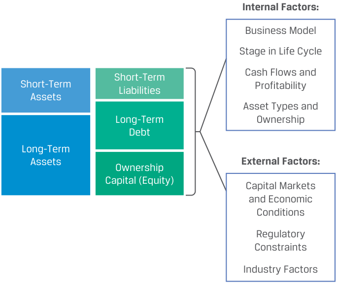
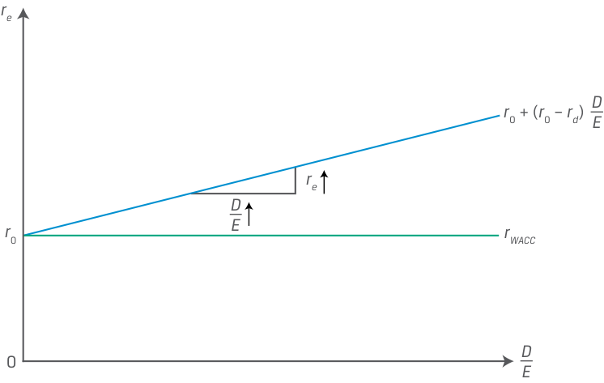
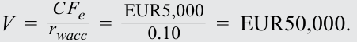
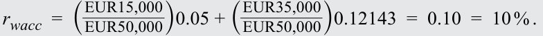
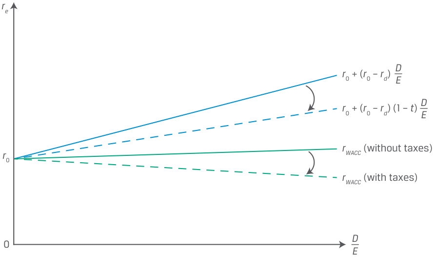

# Tập 3: Tổ chức Phát hành Doanh nghiệp (Corporate Issuers)
## Learning Module 6 Capital Structure (Trang PDF 181–220)

---

# Tập 3: Tổ chức Phát hành Doanh nghiệp (*Corporate Issuers*)
## Học phần 6: Cấu trúc Vốn (*Capital Structure*)
### Phần 1/4: Giới thiệu (*Introduction*) (Trang PDF 181–187)

---

<!-- PDF Page 181 -->

#### H Ọ C P H Ầ N 

# **<mark>6</mark>** 

### **Cấu trúc Vốn (*Capital Structure*)** 

###### **<mark>MỤC TIÊU HỌC TẬP (*LEARNING OUTCOMES*)</mark>** 

**_Thành thạo — Ứng viên cần có khả năng:_**
- tính toán và diễn giải chi phí sử dụng vốn bình quân gia quyền (*weighted-average cost of capital* – WACC) của một công ty
- giải thích các yếu tố ảnh hưởng đến cấu trúc vốn (*capital structure*) và chi phí sử dụng vốn bình quân gia quyền (*weighted-average cost of capital*)
- giải thích các định đề của Modigliani–Miller (*Modigliani–Miller propositions*) về cấu trúc vốn
- mô tả cấu trúc vốn tối ưu (*optimal capital structure*) và cấu trúc vốn mục tiêu (*target capital structure*)

##### **GIỚI THIỆU (*INTRODUCTION*)** 

## **<mark>1</mark>** 

Các bài học trước đã đề cập đến các hoạt động ngắn hạn và các quyết định đầu tư vốn dài hạn của một doanh nghiệp. Bây giờ chúng ta chuyển sang phần cuối cùng của bảng cân đối kế toán: tài trợ bằng nợ dài hạn và vốn chủ sở hữu, được gọi là cấu trúc vốn (*capital structure*) của doanh nghiệp. Bài học đầu tiên giới thiệu mục tiêu cơ bản của hầu hết các nhà quản lý khi lựa chọn cấu trúc vốn: tối thiểu hóa chi phí sử dụng vốn bình quân gia quyền (*weighted-average cost of capital* – WACC) của doanh nghiệp. Bài học thứ hai xem xét các yếu tố nội tại và bên ngoài ảnh hưởng đến sự lựa chọn của doanh nghiệp—và sự sẵn lòng cung cấp vốn của các nhà đầu tư—giữa tài trợ bằng nợ so với vốn chủ sở hữu. Mặc dù cấu trúc vốn có vẻ là một quyết định quan trọng đối với hội đồng quản trị và các nhà quản lý, nhưng chính giá trị hiện tại của các dòng tiền trong tương lai (*present value of future cash flows*), chứ không phải cấu trúc vốn của doanh nghiệp, mới là yếu tố chủ yếu quyết định giá trị của một doanh nghiệp—một góc nhìn sâu sắc trọng tâm trong công trình nghiên cứu có tầm ảnh hưởng lớn của Franco Modigliani và Merton Miller. Trong bài học thứ ba, chúng ta khám phá các giả định đơn giản hóa được Modigliani và Miller sử dụng để chứng minh sự không liên quan của cấu trúc vốn (*irrelevance of capital structure*) đối với giá trị doanh nghiệp, và sau đó chúng ta nới lỏng các giả định này để chỉ ra tác động của cả thuế và chi phí kiệt quệ tài chính (*cost of financial distress*). Trong bài học cuối cùng, chúng ta thảo luận về cấu trúc vốn tối ưu (*optimal capital structure*) và cấu trúc vốn mục tiêu (*target capital structure*) đối với các tổ chức phát hành. 

###### **TỔNG QUAN HỌC PHẦN (*LEARNING MODULE OVERVIEW*)** 

- Chi phí sử dụng vốn (*cost of capital*) của một tổ chức phát hành bao gồm chi phí nợ (*cost of debt*) và chi phí vốn chủ sở hữu (*cost of equity*), được định nghĩa là tỷ suất sinh lợi yêu cầu (*required rates of return*) của các nhà đầu tư đối với nguồn tài trợ bằng nợ và vốn chủ sở hữu. Chi phí sử dụng vốn của tổ chức phát hành được 

<!-- PDF Page 182 -->

ước tính bằng cách sử dụng mức bình quân gia quyền của chi phí nợ và chi phí vốn chủ sở hữu, sử dụng giá trị thị trường hiện tại (*current market value*) hoặc tỷ trọng mục tiêu của ban quản lý (*management’s target weights*) cho từng loại hình tài trợ làm trọng số. 

- Các tổ chức phát hành nhìn chung hướng tới việc tối thiểu hóa chi phí sử dụng vốn bình quân gia quyền (WACC) của mình và khớp thời lượng (*duration*) của tài sản với nguồn tài trợ của họ. Cấu trúc vốn mục tiêu của ban quản lý thường được nêu bằng giá trị sổ sách (*book values*) hoặc gián tiếp thông qua các tỷ số đòn bẩy tài chính (*financial leverage ratios*), chẳng hạn như tỷ số tối đa giữa nợ hoặc nợ ròng trên EBITDA (*debt or net debt to EBITDA*) hoặc mức xếp hạng tín nhiệm tối thiểu (*minimum credit rating*). 

- Mặc dù ban quản lý có một số ảnh hưởng nhất định, nhưng tổng quy mô và loại hình tài trợ cần thiết hoặc các trọng số trong phép tính WACC thường phụ thuộc vào mô hình kinh doanh (*business model*) của tổ chức phát hành (ví dụ: thâm dụng vốn (*capital intensive*) hay ít thâm dụng vốn (*capital light*)) và vào giai đoạn trong vòng đời của công ty (*company’s life cycle stage*). 

- Chi phí thành phần của nợ và vốn chủ sở hữu được quyết định bởi các yếu tố từ trên xuống (*top-down factors*), chẳng hạn như điều kiện thị trường tài chính và điều kiện ngành, và bởi các yếu tố đặc thù của tổ chức phát hành (*issuer-specific factors*), bao gồm sự ổn định của doanh thu cũng như đòn bẩy hoạt động (*operating leverage*) và đòn bẩy tài chính (*financial leverage*). 

- Modigliani và Miller (MM) đã chỉ ra rằng, dưới một tập hợp các giả định khắt khe bao gồm giả định không có thuế, cấu trúc vốn của tổ chức phát hành không liên quan (*irrelevant*) đến giá trị doanh nghiệp. MM đã nới lỏng các giả định bằng cách xem xét thuế thu nhập doanh nghiệp, tình trạng kiệt quệ tài chính (*financial distress*), và chi phí phá sản (*bankruptcy costs*), đồng thời chỉ ra rằng cấu trúc vốn thực sự có ý nghĩa quan trọng đối với giá trị doanh nghiệp, mặc dù ít hơn rất nhiều so với các dòng tiền tương lai của tổ chức phát hành. 

- Theo lý thuyết đánh đổi tĩnh về cấu trúc vốn (*static trade-off theory of capital structure*) của MM, cấu trúc vốn tối ưu (*optimal capital structure*) xảy ra tại điểm mà lợi ích thuế của nợ (*tax benefit of debt*) bằng với chi phí kiệt quệ tài chính (*financial distress costs*) gắn liền với nợ. 

- Lý thuyết trật tự phân hạng về cấu trúc vốn (*pecking order theory of capital structure*) là một lý thuyết thay thế cho lý thuyết tĩnh và cho rằng doanh nghiệp sẽ sử dụng nguồn tài trợ nội bộ (*internal financing*) nhiều nhất có thể. Nếu cần tài trợ bên ngoài (*external financing*), doanh nghiệp sẽ ưu tiên nợ tư nhân (*private debt*) hơn nợ đại chúng (*public debt*) và sẽ hạn chế sử dụng tài trợ bằng vốn chủ sở hữu nếu có thể. 

###### **TỰ ĐÁNH GIÁ HỌC PHẦN (*LEARNING MODULE SELF-ASSESSMENT*)** 

Những câu hỏi ban đầu này nhằm giúp bạn tự đánh giá mức độ hiểu biết hiện tại của mình về học phần này. 

1. Khi tính toán WACC, chi phí vốn chủ sở hữu cao hơn chi phí nợ vì: 

   - **A.** chi phí nợ được ấn định bởi ban quản lý. 

   - **B.** các khoản phân phối cho cổ đông được khấu trừ thuế. 

   - **C.** các nhà đầu tư nợ chịu ít rủi ro hơn các nhà đầu tư vốn chủ sở hữu. 

   - **Lời giải:** 

C là đáp án đúng. Nợ ít rủi ro hơn vốn chủ sở hữu vì nợ có quyền đòi hỏi ưu tiên theo hợp đồng (*priority, contractual claim*) đối với dòng tiền của doanh nghiệp. Ngoài ra, một số khoản nợ còn được đảm bảo bằng tài sản cơ sở (*secured with an underlying asset*). Ngược lại, vốn chủ sở hữu là quyền đòi hỏi phần còn lại (*residual claim*). 

A không đúng vì chi phí nợ của một tổ chức phát hành, giống như chi phí vốn chủ sở hữu, được xác định bởi những người tham gia thị trường tài chính. 

B không đúng vì nhìn chung, các khoản phân phối cho cổ đông, chẳng hạn như cổ tức, không được khấu trừ thuế trong khi chi phí lãi vay (*interest expense*) được khấu trừ thuế tại nhiều khu vực pháp lý. 

<!-- PDF Page 183 -->

2. Nutry, Inc. có cấu trúc vốn gồm 30% nợ và 70% vốn chủ sở hữu, và chi phí lãi vay được khấu trừ thuế. Các nhà đầu tư nợ yêu cầu tỷ suất sinh lợi trước thuế là 5%, và tỷ suất sinh lợi yêu cầu của các nhà đầu tư vốn chủ sở hữu là 10%. Nếu thuế suất thuế thu nhập doanh nghiệp biên (*marginal corporate tax rate*) là 20%, thì WACC gần nhất với mức:
   - **A.** 5.9%.
   - **B.** 8.2%.
   - **C.** 8.5%. 

**Lời giải:** 

B là đáp án đúng. WACC của Nutry được tính như sau: 
$$\text{WACC} = (\text{Tỷ trọng nợ} \times \text{Chi phí nợ}) + (\text{Tỷ trọng vốn chủ sở hữu} \times \text{Chi phí vốn chủ sở hữu}) = (0.3)(5\%)(1 - 0.2) + (0.70)(10\%) = 8.2\%$$

Do đó, WACC của Nutry là 8.2%. Chi phí nợ được tính trên cơ sở sau thuế (*after-tax basis*) vì chi phí lãi vay được khấu trừ thuế tại khu vực pháp lý của Nutry. 

3. Cấu trúc vốn tối ưu được xác định tại điểm mà lợi ích của lá chắn thuế từ nợ (*debt tax shield*) được bù trừ bởi chi phí kiệt quệ tài chính theo:
   - **A.** lý thuyết trật tự phân hạng (*pecking order theory*).
   - **B.** giả thuyết dòng tiền tự do (*free cash flow hypothesis*).
   - **C.** lý thuyết đánh đổi tĩnh về cấu trúc vốn (*static trade-off theory of capital structure*). 

**Lời giải:** 

C là đáp án đúng. Lý thuyết đánh đổi tĩnh về cấu trúc vốn kết hợp cả tác động làm tăng giá trị của lá chắn thuế và tác động làm giảm giá trị của chi phí kiệt quệ tài chính. Tại mức nợ tối ưu, chi phí kiệt quệ tài chính bằng với lợi ích thuế của nợ. 

Lý thuyết trật tự phân hạng phát biểu rằng các doanh nghiệp sử dụng nguồn vốn tạo ra từ nội bộ trước tiên vì không có chi phí phát hành (*flotation costs*) hay tín hiệu tiêu cực (*negative signals*). Nếu cần thêm vốn, các doanh nghiệp sẽ phát hành nợ và chỉ phát hành vốn chủ sở hữu như một phương án cuối cùng. Không có cấu trúc vốn tối ưu trong lý thuyết này. Giả thuyết dòng tiền tự do lập luận rằng mức nợ cao hơn sẽ rèn luyện tính kỷ luật cho các nhà quản lý bằng cách buộc họ phải quản lý công ty một cách hiệu quả và sử dụng tiền mặt một cách khôn ngoan để công ty có thể thực hiện các khoản thanh toán gốc và lãi vay. 

4. Đúng hay Sai: Các nhà quản lý không thể ước tính chính xác cấu trúc vốn tối ưu, nhưng họ thường thiết lập một cấu trúc vốn mục tiêu. Cấu trúc vốn thực tế của một tổ chức phát hành có thể khác với mục tiêu dựa trên các điều kiện kinh doanh và thị trường tài chính. 

   - **A.** Đúng (*True*) 

   - **B.** Sai (*False*) 

   - **Lời giải:** 

A là đáp án đúng. Vì ban quản lý không thể ước tính cấu trúc vốn tối ưu trên thực tế, nên thay vào đó họ đặt ra một cấu trúc vốn mục tiêu (*target capital structure*). Cấu trúc vốn thực tế có thể chệch khỏi mục tiêu vì một số lý do. Thứ nhất, doanh nghiệp có thể phát hành nợ với mức lãi suất thuận lợi, vì vậy ban quản lý tận dụng các cơ hội này. Thứ hai, giá trị thị trường thay đổi của nợ và vốn chủ sở hữu của doanh nghiệp có thể khiến cấu trúc vốn thực tế của doanh nghiệp khác với mục tiêu. Chi phí giao dịch (*transaction costs*) khiến việc liên tục điều chỉnh theo giá trị thị trường đang thay đổi trở nên tốn kém. 

<!-- PDF Page 184 -->

5. Quy mô và loại hình tài trợ cần thiết hoặc các trọng số trong phép tính WACC phụ thuộc vào yếu tố nào của tổ chức phát hành: 

   - **A.** mô hình kinh doanh (*business model*). 

   - **B.** đòn bẩy tài chính (*financial leverage*). 

   - **C.** tỷ trọng chi phí cố định trên tổng chi phí (*proportion of fixed cost to total costs*). 

   - **Lời giải:** 

A là đáp án đúng. Quy mô và loại hình tài trợ cần thiết hoặc các trọng số trong phép tính WACC phụ thuộc vào mô hình kinh doanh và giai đoạn trong vòng đời của công ty. Một số doanh nghiệp đòi hỏi số lượng lớn tài sản và mang tính thâm dụng vốn (*capital intensive*). Các mô hình kinh doanh khác đòi hỏi ít tài sản hơn và ít thâm dụng vốn (*capital light*). 

B và C không đúng vì tỷ trọng chi phí cố định trên tổng chi phí (đòn bẩy hoạt động – *operating leverage*) và đòn bẩy tài chính (*financial leverage*) là các yếu tố đặc thù của tổ chức phát hành có ảnh hưởng đến chi phí thành phần của nợ và vốn chủ sở hữu. 

6. Theo Modigliani và Miller (MM), nếu giả định không có thuế và không có chi phí kiệt quệ tài chính, cùng với các giả định khác, thì giá trị của công ty: 

   - **A.** được quyết định bởi cấu trúc vốn của nó. 

   - **B.** chỉ được quyết định bởi các dòng tiền kỳ vọng trong tương lai của nó. 

   - **C.** được thiết lập sao cho giá trị của công ty có vay nợ lớn hơn giá trị của công ty không vay nợ. 

###### **Lời giải:** 

B là đáp án đúng. MM đã chỉ ra rằng dưới một tập hợp các giả định khắt khe, bao gồm mức thuế bằng không, giá trị của doanh nghiệp không bị ảnh hưởng bởi cơ cấu tài trợ hay cấu trúc vốn của nó. Chính dòng tiền của doanh nghiệp mới là yếu tố quyết định chính đối với giá trị. Nếu giá trị thị trường của công ty không bị ảnh hưởng bởi cơ cấu tài trợ của nó, thì giá trị của doanh nghiệp có vay nợ (*levered firm*) bằng với giá trị của doanh nghiệp không vay nợ (*unlevered firm*). 

## **<mark>2</mark>** 

##### **CHI PHÍ SỬ DỤNG VỐN (*THE COST OF CAPITAL*)** 

**Mục tiêu học tập:** tính toán và diễn giải chi phí sử dụng vốn bình quân gia quyền (*weighted-average cost of capital*) của một công ty 

Như đã thảo luận trong các bài học trước, các tổ chức phát hành thực hiện các khoản đầu tư vốn được kỳ vọng sẽ mang lại tỷ suất sinh lợi trên vốn đầu tư (*return on investment*) lớn hơn tỷ suất sinh lợi yêu cầu (*required rate of return*). Tỷ suất sinh lợi yêu cầu của một _tổ chức phát hành_ đối với các khoản đầu tư vốn của mình bắt nguồn từ tỷ suất sinh lợi yêu cầu của các _nhà đầu tư_, được điều chỉnh theo những rủi ro cụ thể của dự án. Nếu tổ chức phát hành đã cạn kiệt các cơ hội dự án có NPV dương (*positive-NPV project opportunities*), họ nên hoàn trả vốn cho các nhà đầu tư để họ có thể đầu tư vào nơi khác và kiếm được tỷ suất sinh lợi yêu cầu của mình. Việc không làm như vậy sẽ làm hủy hoại giá trị của các nhà đầu tư. 

Đối với một tổ chức phát hành, tỷ suất sinh lợi yêu cầu của họ còn được gọi là **chi phí sử dụng vốn (*cost of capital*)**. Vì các tổ chức phát hành sử dụng cả nợ và vốn chủ sở hữu, nên chi phí sử dụng vốn bao gồm **chi phí nợ (*cost of debt*)** và **chi phí vốn chủ sở hữu (*cost of equity*)**. Như đã mô tả trong các bài học trước, nợ ít rủi ro hơn vốn chủ sở hữu đối với các nhà đầu tư vì đó là một quyền đòi hỏi cố định, được ưu tiên (*priority, fixed claim*) đối với dòng tiền của doanh nghiệp, trong khi vốn chủ sở hữu là quyền đòi hỏi phần còn lại (*residual claim*) với thời hạn không xác định. Ngoài ra, nợ đôi khi được đảm bảo bằng một tài sản cơ sở (*underlying asset*) mà sẽ được chuyển giao cho chủ nợ trong trường hợp 

<!-- PDF Page 185 -->

vỡ nợ (*default*), giúp giảm thiểu hơn nữa rủi ro cho nhà đầu tư nợ. Do đó, các nhà đầu tư nợ có tỷ suất sinh lợi yêu cầu thấp hơn các nhà đầu tư vốn chủ sở hữu vì họ chịu ít rủi ro hơn; nói cách khác, chi phí nợ của một tổ chức phát hành thấp hơn chi phí tài trợ bằng vốn chủ sở hữu của họ. 

**Chi phí sử dụng vốn bình quân gia quyền (*weighted-average cost of capital* – WACC)** của một tổ chức phát hành kết hợp chi phí nợ và chi phí vốn chủ sở hữu để thu được một mức chi phí sử dụng vốn duy nhất. WACC, sau khi điều chỉnh cho bất kỳ rủi ro đặc thù nào của dự án, chính là mức lãi suất mà các tổ chức phát hành sử dụng làm $r$ trong phân tích NPV và làm tỷ suất sinh lợi ngưỡng (*hurdle rate*) cho phân tích IRR. 

Phép tính WACC được thể hiện trong Phương trình 1: 

$$\text{WACC} = (\text{Chi phí nợ} \times \text{Tỷ trọng nợ}) + (\text{Chi phí vốn chủ sở hữu} \times \text{Tỷ trọng vốn chủ sở hữu}) \tag{1}$$

Việc ước tính từng thành phần của Phương trình 1 sẽ được trình bày chi tiết hơn rất nhiều trong các bài học về thu nhập cố định (*fixed income*) và vốn chủ sở hữu (*equity*) ở phần sau của chương trình học. Hiện tại, hãy lưu ý những nhận xét sau đây. 

- Chi phí nợ (*cost of debt*) đối với một tổ chức phát hành là tỷ suất sinh lợi yêu cầu của các nhà đầu tư nợ đối với nguồn tài trợ bằng nợ. Lãi suất của các khoản vay không có tài sản đảm bảo (*unsecured loans*) và trái phiếu hiện hành thường là một điểm khởi đầu tốt. Tuy nhiên, nếu chúng ta muốn một thước đo hướng tới tương lai (*forward-looking measure*), nghĩa là lãi suất đối với khoản nợ _mới_ được huy động để tài trợ cho một dự án mới, thay vào đó chúng ta có thể xem xét mức lãi suất mà các công ty có vị thế tương tự gần đây đã đi vay. Ngoài ra, tại các khu vực pháp lý nơi chi phí lãi vay được khấu trừ thuế, chúng ta giảm chi phí nợ danh nghĩa bằng cách nhân với $(1 - \text{Thuế suất})$ để có được mức chi phí sau thuế (*after-tax amount*). 

- Tỷ trọng của nợ và vốn chủ sở hữu (*weightings of debt and equity*) là tỷ lệ giá trị thị trường (*market value proportions*) của chúng hoặc tỷ trọng mục tiêu (*target weights*) do ban quản lý cung cấp, thường dựa trên cơ sở giá trị sổ sách (*book value basis*). Tỷ trọng giá trị thị trường được sử dụng phổ biến hơn vì giá trị sổ sách phản ánh giá lịch sử của nợ và vốn chủ sở hữu, trong khi chi phí cơ hội của các nhà đầu tư dựa trên giá thị trường hiện tại của nợ và vốn chủ sở hữu. 

- Chi phí vốn chủ sở hữu (*cost of equity*) đối với một tổ chức phát hành là tỷ suất sinh lợi yêu cầu của các nhà đầu tư vốn chủ sở hữu. Không giống như chi phí nợ, chúng ta không có một mức lãi suất lịch sử để quan sát làm điểm khởi đầu. Chúng ta biết rằng chi phí vốn chủ sở hữu cao hơn chi phí nợ vì mức độ rủi ro của vốn chủ sở hữu và vì các khoản phân phối cho cổ đông không được khấu trừ thuế. 

Một cách tiếp cận đơn giản hóa là chỉ cần quan sát tỷ suất sinh lợi lịch sử của cổ phiếu nói chung—vì có lẽ các nhà đầu tư vốn chủ sở hữu đang kỳ vọng một tỷ suất sinh lợi tương tự trong tương lai—và điều chỉnh mức lãi suất đó theo các yếu tố đặc thù của công ty mà chúng ta sẽ thảo luận trong bài học tiếp theo, chẳng hạn như mức độ ổn định của dòng tiền công ty. 

Một chỉ số cổ phiếu thị trường rộng lớn hoạt động lâu đời đã tăng trưởng với tốc độ tăng trưởng kép hàng năm (*compound annual growth rate* – CAGR) là 10% từ năm 1928 đến năm 2021, vì vậy 10% là một ước tính khởi đầu cho chi phí vốn chủ sở hữu mà chúng ta sẽ sử dụng cho các bài học này. Tỷ suất sinh lợi kỳ vọng và yêu cầu đối với các nhà đầu tư vốn chủ sở hữu là những chủ đề phong phú sẽ được thảo luận chi tiết hơn ở phần sau của chương trình học. 

- Nếu một tổ chức phát hành có thêm các loại hình tài trợ khác với các đặc điểm rủi ro và sinh lợi khác với nợ và vốn chủ sở hữu—ví dụ: cổ phiếu ưu đãi (*preferred stock*) và lợi ích của cổ đông không kiểm soát (*non-controlling interests*)—thì chi phí sau thuế bình quân gia quyền của nguồn tài trợ đó cũng cần được cộng thêm vào Phương trình 1. 

<!-- PDF Page 186 -->

###### **KIỂM TRA KIẾN THỨC: TÍNH TOÁN WACC (*KNOWLEDGE CHECK: COMPUTING WACC*)** 

1. Giả sử rằng Tập đoàn ABC được tài trợ bằng 40% nợ và 60% vốn chủ sở hữu. Cũng giả sử rằng chi phí lãi vay được khấu trừ thuế. Tập đoàn ABC mong muốn duy trì các tỷ lệ này khi huy động vốn mới. 

Tỷ suất sinh lợi yêu cầu của các nhà đầu tư nợ của ABC, được đo lường trước thuế, là 4%, và tỷ suất sinh lợi yêu cầu của các nhà đầu tư vốn chủ sở hữu là 10%. Nếu thuế suất biên (*marginal tax rate*) của công ty là 23%, thì chi phí sử dụng vốn bình quân gia quyền của ABC là bao nhiêu? 

**Lời giải:** 

Chi phí sử dụng vốn bình quân gia quyền của ABC là 7.23%: 

$$\text{WACC} = [(1 - \text{Thuế suất}) \times \text{Chi phí nợ trước thuế} \times \text{Tỷ trọng nợ}] + (\text{Chi phí vốn chủ sở hữu} \times \text{Tỷ trọng vốn chủ sở hữu})$$

$$\text{WACC} = [0.04 \times (1 - 0.23) \times 0.40] + (0.10 \times 0.60)$$

$$\text{WACC} = 7.23\%$$

###### **THẢO LUẬN (*DISCUSSION*)** 

Nếu ban quản lý của ABC duy trì cơ cấu tài trợ hiện tại của công ty (40% nợ, 60% vốn chủ sở hữu), điều gì sẽ xảy ra với chi phí sử dụng vốn bình quân gia quyền của ABC nếu chi phí nợ của công ty giảm 1%? Nếu chi phí vốn chủ sở hữu tăng 1%? Điều gì sẽ xảy ra nếu thuế suất của công ty thay đổi? Hãy viết câu trả lời của bạn lên bảng thảo luận của bài học này trên hệ thống LES. 

Như đã chứng minh trong học phần trước, các khoản đầu tư vốn làm tăng giá trị doanh nghiệp nếu tỷ suất sinh lợi của chúng vượt quá tỷ suất sinh lợi yêu cầu. Học phần trước tập trung vào tỷ suất sinh lợi trên vốn đầu tư như là động lực chính tạo ra giá trị, nhưng cũng rõ ràng rằng một mức tỷ suất sinh lợi yêu cầu thấp hơn cũng sẽ làm tăng NPV, hoặc ít nhất là tạo ra một ngưỡng thấp hơn cho các khoản đầu tư tạo ra giá trị (*value-creative investments*). Điều này hình thành cơ sở cho một trong những mục tiêu phổ biến nhất của các nhà quản lý trong các quyết định về **cấu trúc vốn (*capital structure*)**—tức cơ cấu tài trợ giữa nợ và vốn chủ sở hữu: Hãy chọn bất kỳ cấu trúc nào dẫn đến WACC thấp nhất. Tuy nhiên, chi phí nợ và chi phí vốn chủ sở hữu không phải do ban quản lý lựa chọn mà thay vào đó được xác định trên thị trường tài chính bởi các nhà đầu tư, vì vậy đây là một nỗ lực mang tính động và không hề đơn giản. Mục tiêu thứ hai của ban quản lý khi lựa chọn cấu trúc vốn là, ở những nơi có thể và mang tính kinh tế, làm khớp tính thanh khoản (*liquidity*) hoặc khung thời gian (*time horizon*) của nguồn vốn với tính thanh khoản hoặc khung thời gian của các khoản đầu tư vốn. 

###### **BỘ CÂU HỎI (*QUESTION SET*)** 

1. Tập đoàn XYZ có cấu trúc vốn gồm 30% nợ và 70% vốn chủ sở hữu, và chi phí lãi vay được khấu trừ thuế. Các nhà đầu tư nợ yêu cầu tỷ suất sinh lợi trước thuế là 6%, và tỷ suất sinh lợi yêu cầu của các nhà đầu tư vốn chủ sở hữu là 12%. Nếu thuế suất thuế thu nhập doanh nghiệp biên tăng từ 20% lên 25%, thì mức thay đổi trong WACC gần nhất với: 

   - **A.** –0.09%. 

   - **B.** 0.09%. 

<!-- PDF Page 187 -->

   - **C.** 0.30%.

**Lời giải:**

A là đáp án đúng. WACC của XYZ tại mức thuế suất 20% được tính như sau: 
$$\text{WACC} = (\text{Tỷ trọng nợ} \times \text{Chi phí nợ}) + (\text{Tỷ trọng vốn chủ sở hữu} \times \text{Chi phí vốn chủ sở hữu}) = (0.3)(6\%)(1 - 0.2) + (0.70)(12\%) = 9.84\%$$
WACC của XYZ tại mức thuế suất 25% được tính như sau: 
$$\text{WACC} = (0.3)(6\%)(1 - 0.25) + (0.70)(12\%) = 9.75\%$$
Do đó, WACC giảm 0.09% khi chi phí nợ sau thuế giảm từ 4.8% xuống 4.5%. 

2. Đúng hay Sai: Vì chi phí nợ và chi phí vốn chủ sở hữu được kiểm soát bởi doanh nghiệp, các nhà quản lý có thể hạ thấp chi phí sử dụng vốn cho doanh nghiệp bằng cách giảm chi phí nợ và chi phí vốn chủ sở hữu được sử dụng trong quy trình phân bổ vốn (*capital allocation process*) của họ.
   - **A.** Đúng (*True*)
   - **B.** Sai (*False*)

**Lời giải:**

B là đáp án đúng. Phát biểu này sai vì chi phí nợ và chi phí vốn chủ sở hữu không phải do ban quản lý lựa chọn mà được xác định trên thị trường tài chính bởi các nhà đầu tư, mặc dù chúng chịu ảnh hưởng bởi các hành động của ban quản lý.

**Câu hỏi 3 và 4 liên quan đến thông tin sau đây:**
Công ty X có các khoản mục sau ở phần bên phải của bảng cân đối kế toán (nguồn vốn):
- Trái phiếu (*Bonds*): $\$400,000$
- Cổ phiếu phổ thông (*Common stock* – 40,000 cổ phiếu): $\$600,000$
- Tổng nợ phải trả và vốn chủ sở hữu (*Total liabilities and equity*): $\$1,000,000$

Giá cổ phiếu của Công ty X hiện tại là $\$20$ mỗi cổ phiếu. Tỷ suất sinh lợi yêu cầu trước thuế đối với nợ là 5%, và tỷ suất sinh lợi yêu cầu đối với vốn chủ sở hữu là 10%.

3. Khi tính toán WACC cho Công ty X, tỷ trọng nợ sử dụng giá trị sổ sách (*book values*) cho các thành phần trên bảng cân đối kế toán có khả năng sẽ ________________ so với tỷ trọng nợ sử dụng giá trị thị trường (*market values*) cho các thành phần trên bảng cân đối kế toán.
   - **A.** thấp hơn (*lower*)
   - **B.** bằng nhau (*the same*)
   - **C.** cao hơn (*higher*)

**Lời giải:**

C là đáp án đúng. Tỷ trọng theo giá trị sổ sách được tính như sau:
$$W_d = \$400,000 / \$1,000,000 = 0.40$$
$$W_e = \$600,000 / \$1,000,000 = 0.60$$
Giá trị thị trường của vốn chủ sở hữu bằng $\$20 \times 40,000 \text{ cổ phiếu} = \$800,000$. Tỷ trọng theo giá trị thị trường được tính như sau:
$$W_d = \$400,000 / \$1,200,000 = 0.33$$

---

# Tập 3: Tổ chức Phát hành Doanh nghiệp (*Corporate Issuers*)
## Học phần 6: Cấu trúc Vốn (*Capital Structure*)
### Phần 2/4: Các Yếu tố Ảnh hưởng đến Cấu trúc Vốn (*Factors Affecting Capital Structure*) (Trang PDF 188–198)

---

<!-- PDF Page 188 -->

$$W_e = \$800,000 / \$1,200,000 = 0.67$$

Do đó, tỷ trọng giá trị sổ sách của nợ (0.40) cao hơn tỷ trọng giá trị thị trường (0.33). 

4. Nếu thuế suất thuế thu nhập doanh nghiệp biên là 20% và giá cổ phiếu tăng lên $\$25$, thì WACC của Công ty X gần nhất với mức: 

   - **A.** 7.60%. 

   - **B.** 8.26%. 

   - **C.** 8.55%. 

**Lời giải:** 

B là đáp án đúng. 

Tỷ trọng giá trị sổ sách được tính như sau: 

$$W_d = \$400,000 / \$1,000,000 = 0.40$$

$$W_e = \$600,000 / \$1,000,000 = 0.60$$

Giá trị thị trường của vốn chủ sở hữu bằng $\$25 \times 40,000 \text{ cổ phiếu} = \$1,000,000$. Tỷ trọng giá trị thị trường được tính như sau: 

$$W_d = \$400,000 / \$1,400,000 = 0.29$$

$$W_e = \$1,000,000 / \$1,400,000 = 0.71$$

Các trọng số phù hợp cho phép tính WACC là tỷ trọng thị trường. WACC của Công ty X, sử dụng tỷ trọng thị trường, được tính như sau: 

$$\text{WACC} = (\text{tỷ trọng nợ} \times \text{chi phí nợ}) + (\text{tỷ trọng vốn chủ sở hữu} \times \text{chi phí vốn chủ sở hữu})$$

$$= (0.29)(5\%)(1 - 0.2) + (0.71)(10\%) = 8.26\%$$

5. Điền vào chỗ trống bằng cách sử dụng hai thuật ngữ sau: 

   - cao hơn (*higher*) 

   - thấp hơn (*lower*) 

Giá trị cổ đông được gia tăng nhờ tỷ suất sinh lợi trên vốn đầu tư ________________ và một cấu trúc vốn dẫn đến WACC ________________.

**Lời giải:** 

Giá trị cổ đông được gia tăng nhờ tỷ suất sinh lợi trên vốn đầu tư _<u>cao hơn (*higher*)</u>_ và một cấu trúc vốn dẫn đến WACC _<u>thấp hơn (*lower*)</u>_. 

# **<mark>3</mark>** 

## **CÁC YẾU TỐ ẢNH HƯỞNG ĐẾN CẤU TRÚC VỐN (*FACTORS AFFECTING CAPITAL STRUCTURE*)** 

**Mục tiêu học tập:** giải thích các yếu tố ảnh hưởng đến cấu trúc vốn (*capital structure*) và chi phí sử dụng vốn bình quân gia quyền (*weighted-average cost of capital*) 

<!-- PDF Page 189 -->

Các tổ chức phát hành mong muốn một cấu trúc vốn giúp tối thiểu hóa chi phí sử dụng vốn bình quân gia quyền (WACC) và nhìn chung khớp với thời lượng (*duration*) của tài sản. Tổng quy mô và loại hình tài trợ cần thiết thường được quyết định bởi mô hình kinh doanh (*business model*) của tổ chức phát hành và vị trí của doanh nghiệp trong vòng đời doanh nghiệp (*corporate life cycle*). Chi phí nợ và chi phí vốn chủ sở hữu được xác định trên thị trường tài chính bởi các yếu tố từ trên xuống (*top-down factors*) ảnh hưởng đến thị trường nợ và vốn chủ sở hữu nói chung, cũng như các đánh giá của nhà đầu tư về các yếu tố rủi ro đặc thù của tổ chức phát hành (*issuer-specific risk factors*), như được tóm tắt trong Minh họa 1. 

**Minh họa 1: Các Yếu tố Ảnh hưởng đến Cấu trúc Vốn (*Exhibit 1: Factors Affecting Capital Structure*)** 

> **Chú thích hình ảnh:**
> - **Bảng cân đối kế toán:** Tài sản Ngắn hạn (*Short-Term Assets*), Tài sản Dài hạn (*Long-Term Assets*); Nợ phải trả Ngắn hạn (*Short-Term Liabilities*), Nợ Dài hạn (*Long-Term Debt*), Vốn Chủ sở hữu (*Ownership Capital / Equity*).
> - **Các Yếu tố Nội tại (*Internal Factors*):** Mô hình Kinh doanh (*Business Model*), Giai đoạn trong Vòng đời (*Stage in Life Cycle*), Dòng tiền và Khả năng Sinh lời (*Cash Flows and Profitability*), Loại Tài sản và Quyền Sở hữu (*Asset Types and Ownership*).
> - **Các Yếu tố Bên ngoài (*External Factors*):** Thị trường Vốn và Điều kiện Kinh tế (*Capital Markets and Economic Conditions*), Các Ràng buộc Pháp lý (*Regulatory Constraints*), Các Yếu tố Ngành (*Industry Factors*).

### **Các Yếu tố Quyết định Quy mô và Loại hình Tài trợ Cần thiết (*Determinants of the Amount and Type of Financing Needed*)** 

Tổng quy mô và loại hình tài trợ cần thiết (do đó là các trọng số trong phép tính WACC) nhìn chung phụ thuộc vào mô hình kinh doanh của tổ chức phát hành và vị trí của nó trong vòng đời doanh nghiệp. 

#### **_Các Doanh nghiệp Thâm dụng Vốn (*Capital-Intensive Businesses*)_** 

Một số doanh nghiệp đòi hỏi rất nhiều tài sản—ví dụ, các doanh nghiệp trong ngành tiện ích (*utilities*); giao thông vận tải (*transportation*); bất động sản (*real estate*); một số loại hình sản xuất chế tạo, chẳng hạn như chất bán dẫn (*semiconductors*); và khai thác tài nguyên thiên nhiên (*natural resource production*). Những doanh nghiệp này được gọi là **các doanh nghiệp thâm dụng vốn (*capital-intensive businesses*)**. Nhu cầu về lượng lớn tài sản này thể hiện rõ qua vòng quay tổng tài sản thấp (*low asset turnover* — tỷ số doanh thu trên tổng tài sản thấp), tỷ số chi tiêu vốn trên doanh thu cao (*high capital expenditures to sales*), và tỷ số vốn lưu động ròng trên doanh thu cao (*high net-working-capital-to-sales ratios*). 

Mặc dù nhiều doanh nghiệp trước đây từng được tích hợp theo chiều dọc (*vertically integrated*) và thâm dụng vốn nhiều hơn, nhưng nhiều doanh nghiệp đã tách thành nhiều công ty chuyên biệt, trong đó mảng kinh doanh thâm dụng vốn được tách biệt khỏi mảng kinh doanh thương hiệu tiếp xúc trực tiếp với khách hàng hoặc dịch vụ. Khi đó, các doanh nghiệp này có mối quan hệ hợp đồng (*contractual relations*) thay vì quan hệ sở hữu (*ownership relations*). Ví dụ, Hilton Worldwide, một trong những công ty khách sạn lớn nhất thế giới, vận hành gần như toàn bộ số phòng khách sạn của mình thông qua các thỏa thuận nhượng quyền thương mại (*franchise agreements*) hoặc hợp đồng quản lý dài hạn, còn bản thân các khách sạn thuộc quyền sở hữu của các bên khác. Tương tự, NVIDIA thiết kế và thử nghiệm các sản phẩm của mình nhưng không trực tiếp sản xuất tấm bán dẫn (*semiconductor wafers*); thay vào đó, hoạt động thâm dụng vốn này được thực hiện bởi Công ty Cổ phần Sản xuất Chất bán dẫn Đài Loan (TSMC – *Taiwan Semiconductor Manufacturing Company Limited*) và Công ty Điện tử Samsung (*Samsung Electronics Co. Ltd.*). 

<!-- PDF Page 190 -->

#### **VÍ DỤ 1 (*EXAMPLE 1*)** 

### **Thuê Tài sản như một Hình thức Tài trợ bằng Nợ (*Leases as Debt Financing*)** 

Nhiều mô hình kinh doanh đòi hỏi các tài sản hữu hình và có tính thay thế tương đương (*fungible and tangible assets*), chẳng hạn như: 

- văn phòng làm việc (*office space*), 

- trung tâm dữ liệu (*data centers*), 

- các thiết bị CNTT (*IT devices*), chẳng hạn như máy tính cá nhân (PC), điện thoại và máy tính bảng, 

- máy bay (*aircraft*), và 

- ô tô (*automobiles*). 

Mặc dù các công ty có thể mua những tài sản này bằng tiền mặt hoặc vay tiền mặt để mua chúng, nhưng một cách tiếp cận phổ biến hơn là thuê chúng từ một bên cho thuê (*lessor*), chẳng hạn như ngân hàng hoặc công ty cho thuê tài sản chuyên biệt—ví dụ: AerCap Holdings N.V., công ty cho các hãng hàng không thuê hơn 1,000 máy bay. 

Hợp đồng thuê (*lease*) giống như một khoản vay, nhưng thay vì nhận tiền mặt để đổi lấy các khoản thanh toán gốc và lãi, bên đi vay (bên thuê – *lessee*) nhận một tài sản để đổi lấy các khoản thanh toán tiền thuê (*lease payments*). Ngầm định trong hợp đồng thuê là một mức lãi suất thường thấp hơn nhiều so với mức lãi suất mà bên thuê sẽ phải chịu nếu vay tiền mặt, bởi vì tài sản thuê đóng vai trò là tài sản thế chấp (*collateral*) và vì bên cho thuê thường là các công ty lớn có khả năng vay vốn với chi phí rẻ. 

Một cách tiếp cận tương tự khác để tài trợ cho các tài sản hữu hình và có tính thay thế tương đương là thông qua nợ có tài sản đảm bảo (*secured debt*). Bằng cách sử dụng tài sản làm tài sản thế chấp cho một khoản vay hoặc trái phiếu, tổ chức phát hành có thể đạt được mức chi phí nợ thấp hơn rất nhiều so với hình thức không có tài sản đảm bảo (*unsecured basis*). Điều này đúng với một tòa nhà văn phòng ở trung tâm thành phố nhưng có lẽ không đúng với một nhà máy chuyên dụng cao ở vùng sâu vùng xa hoặc một tài sản tiêu hao có ít giá trị đối với các nhà đầu tư khi làm tài sản thế chấp. 

Cấu trúc vốn của một số doanh nghiệp có thể được quản lý bởi chính phủ. Ví dụ, các ngân hàng phải tuân thủ các tiêu chuẩn vốn pháp định (*regulatory capital standards*) bằng cách duy trì một tỷ lệ phần trăm vốn chủ sở hữu nhất định trên tổng tài sản. Tương tự, sự giám sát quản lý đối với các công ty tiện ích công cộng bởi chính quyền địa phương có thể ảnh hưởng đến cấu trúc vốn của họ thông qua các quy tắc và quy định liên quan đến việc ấn định giá/biểu phí (*setting pricing/rates*). Điều này nhìn chung làm tăng WACC vì nó dẫn đến việc phải sử dụng nhiều nguồn tài trợ bằng vốn chủ sở hữu hơn. 

#### **_Các Doanh nghiệp “Ít Thâm dụng Vốn” (“Capital-Light” Businesses)_** 

Một số mô hình kinh doanh—đáng chú ý là trong lĩnh vực công nghệ, cũng như các doanh nghiệp dịch vụ đã tách bỏ các mảng kinh doanh thâm dụng vốn—có nhu cầu vốn thấp (tức là vòng quay tài sản cố định cao và/hoặc tỷ số chi tiêu vốn trên doanh thu thấp), được gọi là **các doanh nghiệp ít thâm dụng vốn (*capital-light businesses*)**, hay các doanh nghiệp nhẹ về tài sản (*asset-light businesses*). Tài sản của họ có thể chủ yếu bao gồm tiền mặt dư thừa và một số tài sản vô hình (*intangibles*). Điều này phản ánh một số yếu tố: 

- Họ chỉ đơn giản là vận hành một mạng lưới cho những bên khác sở hữu tài sản và do đó không cần tìm kiếm nguồn tài trợ cho các tài sản đó từ thị trường tài chính. Ví dụ, Uber và Airbnb lần lượt vận hành các mạng lưới chia sẻ xe và lưu trú toàn cầu, kết nối các tài xế và chủ nhà (những người sở hữu tài sản ô tô và bất động sản) với hành khách và khách lưu trú. Các công ty này thu hoa hồng và phí từ người dùng mạng lưới. 

- Công ty có thể thu tiền trả trước của khách hàng cho các dịch vụ hoặc có chu kỳ chuyển đổi tiền mặt (*cash conversion cycle*) rất ngắn hoặc âm, do đó loại bỏ nhu cầu tài trợ bên ngoài cho vốn lưu động. 

<!-- PDF Page 191 -->

- Công ty có thể trả thù lao cho nhân viên và ban quản lý chủ yếu bằng cổ phiếu, điều mà nhân viên và ban quản lý vui vẻ chấp nhận dựa trên giá cổ phiếu đang tăng, một lần nữa loại bỏ nhu cầu về tiền mặt. Về mặt kỹ thuật, đây là một hình thức tài trợ bằng vốn chủ sở hữu, nhưng đến từ nhân viên thay vì từ các thị trường tài chính chính thức. 

- Nếu công ty có lãi ngay từ giai đoạn đầu và ít thâm dụng vốn, công ty có thể không cần huy động nguồn tài trợ bên ngoài đáng kể trừ khi ban quản lý có ý định mở rộng nhanh chóng. 

#### **_Vòng đời Doanh nghiệp (*Corporate Life Cycle*)_** 

Bên cạnh việc mô hình kinh doanh quyết định quy mô tài trợ cần thiết, một yếu tố lớn quyết định loại hình tài trợ (nợ so với vốn chủ sở hữu) được sử dụng là dựa vào giai đoạn trong vòng đời của công ty (*company’s life cycle stage*). Thay vì có một cấu trúc vốn tĩnh, hầu hết các doanh nghiệp đều có cấu trúc vốn thay đổi theo thời gian. Khuôn khổ trong Minh họa 2 mô tả mối quan hệ giữa giai đoạn trong vòng đời của một công ty, đặc điểm dòng tiền và khả năng gánh chịu nợ của công ty đó. 

**Minh họa 2: Cấu trúc Vốn và Vòng đời Công ty (*Exhibit 2: Capital Structure and Company Life Cycle*)** 

> **Chú thích hình ảnh:**
> - **Các giai đoạn:** Khởi nghiệp (*Startup*) $\rightarrow$ Tăng trưởng (*Growth*) $\rightarrow$ Trưởng thành (*Mature*) theo Thời gian (*Time*).
> - **Đường cong:** Doanh thu (*Revenue* — luôn dương và tăng dần trước khi đi ngang ở giai đoạn trưởng thành) và Dòng tiền (*Cash Flow* — âm ở giai đoạn Khởi nghiệp, tăng dần qua mức 0 ở giai đoạn Tăng trưởng, và dương ổn định ở giai đoạn Trưởng thành).

|**Đặc điểm / Giai đoạn (*Feature / Phase*)**|**Khởi nghiệp (*Startup*)**|**Tăng trưởng (*Growth*)**|**Trưởng thành (*Mature*)**|
|---|---|---|---|
|Tăng trưởng Doanh thu (*Revenue Growth*)|Bước đầu (*Initial*)|Đang tăng (*Rising*)|Chậm lại (*Slowing*)|
|Dòng tiền Tự do (*Free Cash Flow*)|Âm (*Negative*)|Đang tăng (*Rising*)|Ổn định (*Stable*)|
|Rủi ro Kinh doanh (*Business Risk*)|Cao (*High*)|Trung bình (*Medium*)|Thấp (*Low*)|
|Khả năng Tiếp cận Nợ (*Debt Availability*)|Rất ít hoặc Không có (*Little or None*)|Đang tăng (*Rising*)|Cao (*High*)|
|Loại hình Nợ (*Debt Type*)|Nợ chuyển đổi (*Convertible*)|Nợ có đảm bảo (*Secured*)|Nợ không có đảm bảo (*Unsecured*)|

Khi các công ty trưởng thành, rủi ro kinh doanh thường giảm xuống và dòng tiền của doanh nghiệp chuyển sang dương và ổn định, cho phép sử dụng nhiều nguồn tài trợ bằng nợ hơn với các điều khoản tốt hơn và chi phí thấp hơn. Lưu ý rằng khuôn khổ này xem xét dòng tiền tự do (*free cash flow*), tức là dòng tiền sau khi đã trừ đi chi đầu tư vốn (*capital investment*). Các doanh nghiệp có lãi, tăng trưởng cao vẫn có thể có dòng tiền tự do âm khi tính đến các khoản đầu tư lớn hơn. Mặc dù các giai đoạn vòng đời của một công ty thường phản ánh các giai đoạn của toàn ngành, nhưng cả các công ty khởi nghiệp và công ty đang tăng trưởng vẫn thường được tìm thấy trong các ngành đã trưởng thành. Các ví dụ bao gồm ngành nhà hàng và may mặc, với các ý tưởng, mô hình và xu hướng thời trang mới xuất hiện thường xuyên, cũng như sự đột phá dựa trên công nghệ (*technology-driven disruption*) trong các ngành truyền thống lâu đời, chẳng hạn như quảng cáo (TikTok và Douyin), bán lẻ (Shopify), và ô tô (Tesla và BYD). 

<!-- PDF Page 192 -->

#### **Giai đoạn Đầu / Khởi nghiệp (*Early Stage/Startup*)** 

- Ở giai đoạn đầu đời, một công ty cần nguồn vốn để phát triển và ra mắt sản phẩm hoặc dịch vụ đầu tiên của mình. Doanh thu bằng không hoặc rất nhỏ, và rủi ro thất bại kinh doanh ở mức cao. Triển vọng không chắc chắn và dòng tiền tự do âm khiến hầu hết các công ty khởi nghiệp tìm kiếm nguồn tài trợ bằng vốn chủ sở hữu thay vì nợ. Nhiều sở giao dịch chứng khoán có các yêu cầu tối thiểu về quy mô và lợi nhuận cũng như các yêu cầu pháp lý tốn kém, vì vậy nguồn tài trợ bằng vốn chủ sở hữu cho các công ty khởi nghiệp thường được huy động từ những người sáng lập (*founders*), nhân viên (*employees*) và các nhà đầu tư vốn mạo hiểm (*venture capital investors*) thay vì thông qua phát hành cổ phiếu lần đầu ra công chúng (IPO). 

- Ở giai đoạn đầu này, các loại hình tài trợ bằng nợ duy nhất có thể tiếp cận được là thuê tài sản (*leases*) và nợ chuyển đổi (*convertible debt*). Tài sản thuê phổ biến bao gồm bất động sản văn phòng hoặc bán lẻ có thể được thuê với chi phí thấp. Thứ hai, trong một số trường hợp, các công ty khởi nghiệp có thể huy động được **nợ chuyển đổi (*convertible debt*)**, tức là khoản nợ trao cho các nhà đầu tư quyền chuyển đổi khoản nợ đó thành vốn chủ sở hữu trong tương lai tại một mức giá định trước, đồng thời thường hoãn thanh toán lãi vay cho đến khi đáo hạn. Nợ chuyển đổi và các công cụ khác kết hợp các đặc điểm của nợ và vốn chủ sở hữu sẽ được trình bày ở phần sau của chương trình học. 

#### **Giai đoạn Tăng trưởng (*Growth*)** 

- Khi một công ty bước ra khỏi giai đoạn khởi nghiệp, nhu cầu sản phẩm có thể mang lại doanh thu ngày càng tăng và tốc độ tăng trưởng nhanh hơn, nhưng cần phải đầu tư thêm để hỗ trợ tăng trưởng và xây dựng quy mô (*build scale*). Điều này bao gồm chi phí bán hàng và tiếp thị, chi tiêu vốn liên quan đến tăng trưởng và vốn lưu động. Dòng tiền tự do có khả năng vẫn còn âm, nhưng khả năng dự báo (*visibility*) đang được cải thiện khi doanh nghiệp thiết lập được tệp khách hàng và nhà cung cấp của mình. 

- Khi rủi ro kinh doanh giảm xuống và dòng tiền tự do được cải thiện, doanh nghiệp trở nên hấp dẫn hơn đối với những người cho vay. Nhiều công ty tăng trưởng sử dụng nợ một cách thận trọng để bảo toàn sự linh hoạt trong hoạt động và tài chính (*operational and financial flexibility*) cũng như giảm thiểu rủi ro kiệt quệ tài chính (*risk of financial distress*). Vốn chủ sở hữu vẫn là nguồn tài trợ chiếm ưu thế. 

#### **Giai đoạn Trưởng thành (*Mature Phase*)** 

- Khi một doanh nghiệp đạt đến độ trưởng thành, tốc độ tăng trưởng doanh thu chậm lại nhưng cũng trở nên dễ dự đoán hơn. Một doanh nghiệp trưởng thành thường tạo ra dòng tiền tự do dương và đáng tin cậy, đồng thời có khả năng đã sở hữu một tệp khách hàng và nhà cung cấp vững chắc. Chi tiêu đầu tư liên quan đến tăng trưởng thường giảm hoặc tăng chậm lại. Dòng tiền tự do ổn định cho phép công ty vay vốn với chi phí rẻ hơn, điều thường hấp dẫn hơn so với vốn chủ sở hữu có chi phí cao hơn. 

- Trên thực tế, các công ty đại chúng lớn, đã trưởng thành thường sử dụng một lượng nợ đáng kể trong cấu trúc vốn của mình, mặc dù nhiều công ty tìm cách duy trì mức xếp hạng tín nhiệm hạng đầu tư (*investment-grade credit rating*) để bảo toàn sự linh hoạt tài chính tối đa và tối thiểu hóa chi phí nợ. Các công ty trưởng thành có thể lựa chọn phân phối vốn cho các cổ đông bằng cách tăng cổ tức hoặc mua lại cổ phiếu (*repurchasing shares*). 

### **Các Yếu tố Quyết định Chi phí Nợ và Chi phí Vốn chủ sở hữu (*Determinants of the Costs of Debt and Equity*)** 

Chi phí nợ và chi phí vốn chủ sở hữu được xác định trên thị trường tài chính bởi các yếu tố từ trên xuống (*top-down factors*) ảnh hưởng đến thị trường nợ và vốn chủ sở hữu nói chung, cũng như các đánh giá của nhà đầu tư về các yếu tố đặc thù của tổ chức phát hành (*issuer-specific factors*). Mặc dù chi phí nợ thấp hơn chi phí vốn chủ sở hữu, nhưng những chi phí này chịu ảnh hưởng bởi cùng các yếu tố rủi ro và do đó có xu hướng biến động cùng chiều vì chúng đều là các quyền đòi hỏi trên cùng những dòng tiền đó. 
<!-- PDF Page 193 -->

#### **_Các Yếu tố Từ trên xuống (*Top-Down Factors*)_** 

Các yếu tố từ trên xuống ảnh hưởng đến chi phí sử dụng vốn bao gồm các điều kiện thị trường tài chính và các điều kiện ngành. 

Các điều kiện kinh tế có thể ảnh hưởng đáng kể đến tỷ suất sinh lợi kỳ vọng của các nhà đầu tư nợ và vốn chủ sở hữu, dù là trên thị trường tư nhân (*private markets*) hay thị trường đại chúng (*public markets*). Các nhà đầu tư nợ có thể đầu tư gần như phi rủi ro vào nợ chính phủ có chủ quyền (*sovereign government debt*) và sẽ đòi hỏi một mức chênh lệch lãi suất (*spread*) cao hơn mức đó để bù đắp cho việc gánh chịu các rủi ro đặc thù của tổ chức phát hành. Các yếu tố kinh tế vĩ mô và đặc thù quốc gia (tăng trưởng thực, lạm phát, chính sách tiền tệ và biến động tỷ giá hối đoái) có thể làm tăng cả lãi suất nợ chính phủ và chênh lệch tín dụng (*credit spreads*) giữa các tổ chức phát hành. Khi rủi ro suy thoái (*recession risk*) tăng lên, các nhà đầu tư nợ có thể tính mức chênh lệch lãi suất cao hơn nhiều đối với bên đi vay do khả năng vỡ nợ ngày càng tăng. Tác động này thường rõ rệt hơn ở các doanh nghiệp trong các lĩnh vực có tính chu kỳ (*cyclical sectors*), chẳng hạn như khai khoáng, vật liệu hoặc công nghiệp, nơi doanh thu và dòng tiền biến động mạnh qua chu kỳ kinh tế. Điều tương tự cũng đúng đối với các nhà đầu tư vốn chủ sở hữu; các công ty lý tưởng nhất là muốn vay nợ khi lãi suất thấp, và muốn phát hành vốn chủ sở hữu khi giá cổ phiếu cao. Điều này có xu hướng diễn ra theo cùng các điều kiện như khi chênh lệch tín dụng ở mức thấp. 

Ngành mà doanh nghiệp hoạt động cũng có khả năng có tác động đáng kể. Mức độ nhạy cảm với các yếu tố kinh tế nhìn chung dựa trên các sản phẩm hoặc dịch vụ mà tổ chức phát hành bán. Ví dụ, giá dầu cao hơn có thể dẫn đến chênh lệch tín dụng thấp hơn và sự sẵn lòng lớn hơn của nhà đầu tư trong việc tăng đòn bẩy tài chính đối với các nhà sản xuất dầu mỏ, trong khi điều ngược lại có thể xảy ra đối với các hãng hàng không, nơi nhiên liệu là một khoản chi phí đáng kể. 

#### **_Các Yếu tố Đặc thù của Tổ chức Phát hành (*Issuer-Specific Factors*)_** 

Các nhà đầu tư nợ và vốn chủ sở hữu xem xét hồ sơ rủi ro và sinh lợi của một tổ chức phát hành và điều chỉnh tỷ suất sinh lợi yêu cầu của họ so với lãi suất cơ sở (*base rates*) hoặc mức bình quân chung bằng cách đánh giá các yếu tố rủi ro, bao gồm những yếu tố sau: 

**1.** Rủi ro doanh thu (*Sales risks*) 

**2.** Rủi ro khả năng sinh lời / đòn bẩy hoạt động (*Profitability risks / operating leverage*) 

**3.** Đòn bẩy tài chính và khả năng thanh toán lãi vay (*Financial leverage and interest coverage*) 

**4.** Tài sản thế chấp / loại tài sản thuộc sở hữu của doanh nghiệp (*Collateral/type of assets owned by the firm*). 

Với các yếu tố khác không đổi (*all else equal*), các nhà đầu tư có niềm tin lớn hơn vào các doanh nghiệp có doanh thu ổn định, dễ dự đoán và đang tăng trưởng, và do đó sẽ cung cấp nguồn tài trợ với chi phí thấp hơn cho các loại hình doanh nghiệp này. Điều này nhìn chung là kết quả của quy mô cũng như các đặc điểm của sản phẩm và dịch vụ của doanh nghiệp. Ví dụ, các doanh nghiệp lâu đời trong ngành viễn thông hoặc phần mềm có các dòng chảy tiền mặt ổn định từ doanh thu định kỳ dựa trên thuê bao (*recurring subscription-based revenues*) đến từ nhiều khách hàng, vì vậy không có một khách hàng đơn lẻ nào chiếm quá một phần nhỏ trong tổng doanh thu. Ngược lại, các ngành như sản xuất ô tô và thiết bị xây dựng có dòng tiền biến động mạnh hơn và rất nhạy cảm với các điều kiện kinh tế, làm tăng rủi ro vỡ nợ nếu điều kiện kinh doanh xấu đi. 

Bên cạnh sự ổn định của doanh thu, sự ổn định của biên lợi nhuận (*stability of profit margins*) cũng là một yếu tố quan trọng, được quyết định bởi tỷ trọng chi phí cố định so với chi phí biến đổi của một công ty. Điều này thường được đo lường bằng cách sử dụng **đòn bẩy hoạt động (*operating leverage*)** của doanh nghiệp, hay tỷ trọng chi phí cố định trên tổng chi phí của nó: 

$$\text{Đòn bẩy hoạt động (Operating leverage)} = \frac{\text{Chi phí cố định (Fixed costs)}}{\text{Tổng chi phí (Total costs)}} \tag{2}$$

Các công ty có đòn bẩy hoạt động cao hơn sẽ trải qua mức thay đổi lớn hơn về dòng tiền và khả năng sinh lời ứng với một mức thay đổi nhất định trong doanh thu so với các doanh nghiệp có đòn bẩy hoạt động thấp, như được minh họa trong ví dụ sau đây. 

<!-- PDF Page 194 -->

#### **KIỂM TRA KIẾN THỨC: CHI PHÍ CỐ ĐỊNH SO VỚI CHI PHÍ BIẾN ĐỔI VÀ KHẢ NĂNG SINH LỜI CỦA DOANH NGHIỆP (*KNOWLEDGE CHECK: FIXED VS. VARIABLE COST AND FIRM PROFITABILITY*)** 

Hãy xem xét hai công ty được tài trợ hoàn toàn bằng vốn chủ sở hữu. Mỗi doanh nghiệp có doanh thu là 100 trong một kỳ nhất định và chi phí là 70. 

   - Công ty thứ nhất (Doanh nghiệp $FC+$) có chi phí cố định ($FC$) là 50 và chi phí biến đổi ($VC$) bằng 20% doanh thu, tức là 20. 

   - Công ty thứ hai (Doanh nghiệp $FC-$) có chi phí cố định là 20 và chi phí biến đổi bằng 50% doanh thu. 

1. Tính lợi nhuận ($\text{doanh thu} - \text{tổng chi phí}$) cho mỗi doanh nghiệp, và so sánh tỷ suất sinh lợi trên vốn chủ sở hữu ($\text{lợi nhuận} / \text{tổng vốn chủ sở hữu}$) của chúng. 

#### **Lời giải:** 

Giải tìm lợi nhuận bằng cách lấy doanh thu trừ đi chi phí cố định ($FC$) và chi phí biến đổi, sau đó lấy lợi nhuận chia cho tổng vốn chủ sở hữu để tính tỷ suất sinh lợi trên vốn chủ sở hữu (ROE) trong một kỳ: 

|**Doanh nghiệp $FC+$** **(Chủ yếu là Chi phí Cố định — *Primarily Fixed Cost*)**||**Doanh nghiệp $FC-$** **(Chủ yếu là Chi phí Biến đổi — *Primarily Variable Cost*)**||
|---|---|---|---|
|Doanh thu (*Revenue*)|100|Doanh thu (*Revenue*)|100|
|Trừ: Chi phí cố định (*Less: Fixed Costs*)|–50|Trừ: Chi phí cố định (*Less: Fixed Costs*)|–20|
|Chi phí biến đổi (20%) (*Variable Cost*)|–20|Chi phí biến đổi (50%) (*Variable Cost*)|–50|
|Lợi nhuận (*Profit*)|30|Lợi nhuận (*Profit*)|30|
|Tổng Vốn chủ sở hữu (*Total Equity*)|100|Tổng Vốn chủ sở hữu (*Total Equity*)|100|
|**Tỷ suất sinh lợi trên Vốn chủ sở hữu (*Return on Equity*)**|**30%**|**Tỷ suất sinh lợi trên Vốn chủ sở hữu (*Return on Equity*)**|**30%**|

2. Tính tỷ suất sinh lợi trên vốn chủ sở hữu (ROE) cho mỗi doanh nghiệp nếu cả hai doanh nghiệp đều có mức tăng doanh thu 25%.

#### **Lời giải:** 

|**Doanh nghiệp $FC+$** **(Chủ yếu là Chi phí Cố định)**|**Doanh thu Giảm 25% (*25% Sales Decline*)**|**Trường hợp Cơ sở (*Base Case*)**|**Doanh thu Tăng 25% (*25% Sales Rise*)**|
|---|---|---|---|
|Doanh thu (*Revenue*)|75|100|125|
|Trừ: Chi phí cố định (*Less: Fixed Costs*)|50|50|50|
|Chi phí biến đổi (20%) (*Variable Cost*)|15|20|25|
|Lợi nhuận (*Profit*)|10|30|50|
|Tổng Vốn chủ sở hữu (*Total Equity*)|100|100|100|
|**Tỷ suất sinh lợi trên Vốn chủ sở hữu (*Return on Equity*)**|**10%**|**30%**|**50%**|

|**Doanh nghiệp $FC-$** **(Chủ yếu là Chi phí Biến đổi)**|**Doanh thu Giảm 25% (*25% Sales Decline*)**|**Trường hợp Cơ sở (*Base Case*)**|**Doanh thu Tăng 25% (*25% Sales Rise*)**|
|---|---|---|---|
|Doanh thu (*Revenue*)|75|100|125|
|Trừ: Chi phí cố định (*Less: Fixed Costs*)|20|20|20|
|Chi phí biến đổi (50%) (*Variable Cost*)|37.5|50|62.5|
|Lợi nhuận (*Profit*)|17.5|30|42.5|

<!-- PDF Page 195 -->

|**Doanh nghiệp $FC-$** **(Chủ yếu là Chi phí Biến đổi)**|**Doanh thu Giảm 25% (*25% Sales Decline*)**|**Trường hợp Cơ sở (*Base Case*)**|**Doanh thu Tăng 25% (*25% Sales Rise*)**|
|---|---|---|---|
|Tổng Vốn chủ sở hữu (*Total Equity*)|100|100|100|
|**Tỷ suất sinh lợi trên Vốn chủ sở hữu (*Return on Equity*)**|**18%**|**30%**|**43%**|

3. Tính ROE cho mỗi doanh nghiệp nếu cả hai doanh nghiệp đều trải qua mức giảm doanh thu 25%. 

#### **Lời giải:** 

|**Doanh nghiệp $FC+$** **(Chủ yếu là Chi phí Cố định)**|**Doanh thu Giảm 25% (*25% Sales Decline*)**|**Trường hợp Cơ sở (*Base Case*)**|**Doanh thu Tăng 25% (*25% Sales Rise*)**|
|---|---|---|---|
|Doanh thu (*Revenue*)|75|100|125|
|Trừ: Chi phí cố định (*Less: Fixed Costs*)|50|50|50|
|Chi phí biến đổi (20%) (*Variable Cost*)|15|20|25|
|Lợi nhuận (*Profit*)|10|30|50|
|Tổng Vốn chủ sở hữu (*Total Equity*)|100|100|100|
|**Tỷ suất sinh lợi trên Vốn chủ sở hữu (*Return on Equity*)**|**10%**|**30%**|**50%**|

|**Doanh nghiệp $FC-$** **(Chủ yếu là Chi phí Biến đổi)**|**Doanh thu Giảm 25% (*25% Sales Decline*)**|**Trường hợp Cơ sở (*Base Case*)**|**Doanh thu Tăng 25% (*25% Sales Rise*)**|
|---|---|---|---|
|Doanh thu (*Revenue*)|75|100|125|
|Trừ: Chi phí cố định (*Less: Fixed Costs*)|20|20|20|
|Chi phí biến đổi (50%) (*Variable Cost*)|37.5|50|62.5|
|Lợi nhuận (*Profit*)|17.5|30|42.5|
|Tổng Vốn chủ sở hữu (*Total Equity*)|100|100|100|
|**Tỷ suất sinh lợi trên Vốn chủ sở hữu (*Return on Equity*)**|**18%**|**30%**|**43%**|

4. Các nhà đầu tư nợ có thể sẵn lòng cấp tín dụng với chi phí nợ thấp hơn cho doanh nghiệp nào? Giải thích câu trả lời của bạn. 

#### **Lời giải:** 

Dựa trên thông tin được cung cấp, các nhà đầu tư nợ có thể sẵn lòng cấp tín dụng với chi phí nợ thấp hơn cho Doanh nghiệp $FC-$ bởi vì lợi nhuận và khả năng sinh lời của doanh nghiệp này ổn định hơn, đặc biệt là trong kịch bản bất lợi (*downside case*) khi doanh thu sụt giảm 25%. Sự ổn định về lợi nhuận của doanh nghiệp khiến nó có nhiều khả năng thực hiện được các khoản thanh toán gốc và lãi đã cam kết hơn so với Doanh nghiệp $FC+$ ngay cả khi doanh thu sụt giảm. Sự ổn định của lợi nhuận bắt nguồn từ tỷ lệ phần trăm chi phí biến đổi cao hơn; nói cách khác, doanh nghiệp này có đòn bẩy hoạt động thấp hơn. 

Trên thực tế, ngoài những yếu tố khác, các nhà đầu tư nợ sẽ đánh giá sự ổn định của doanh thu và xây dựng triển vọng tăng trưởng doanh thu cho cả hai doanh nghiệp. Mặc dù Doanh nghiệp $FC-$ có đòn bẩy hoạt động thấp hơn, nhưng nó có thể có rủi ro doanh thu (*sales risk*) lớn hơn so với Doanh nghiệp $FC+$. 

Đòn bẩy tài chính (*financial leverage*) và khả năng thanh toán lãi vay (*interest coverage*) là những yếu tố cần cân nhắc quan trọng bởi vì một công ty vốn đã có mức nợ đáng kể sẽ ít có khả năng gánh chịu thêm _nợ tăng thêm_ (*incremental debt*) do công ty đã phải cam kết thực hiện các khoản thanh toán gốc và lãi hiện hữu. Ngoài ra, đối với các nhà đầu tư vốn chủ sở hữu, mức nợ cao có nghĩa là có những quyền đòi hỏi ưu tiên (*priority claims*) đáng kể xếp trước họ. Đòn bẩy tài chính, đã được trình bày trong bài học trước, thường được đo lường 

<!-- PDF Page 196 -->

bằng cách sử dụng tỷ số giữa tổng nợ (*total debt*) hoặc nợ ròng sau khi trừ tiền mặt và chứng khoán khả mại (*debt net of cash and marketable securities*) trên một thước đo lợi nhuận, chẳng hạn như thu nhập hoạt động (*operating income*), hoặc trên tổng vốn chủ sở hữu (*total equity*). Hệ số thanh toán lãi vay (*interest coverage*) đo lường khả năng của một tổ chức phát hành trong việc thực hiện các khoản thanh toán lãi vay từ lợi nhuận kinh doanh cốt lõi của mình: 

$$\text{Hệ số thanh toán lãi vay (Interest coverage)} = \frac{\text{Lợi nhuận trước lãi vay và thuế (Profit before interest and taxes)}}{\text{Chi phí lãi vay (Interest expense)}} \tag{3}$$

#### **KIỂM TRA KIẾN THỨC: ĐÒN BẨY TÀI CHÍNH VÀ KHẢ NĂNG SINH LỜI CỦA DOANH NGHIỆP (*KNOWLEDGE CHECK: FINANCIAL LEVERAGE AND FIRM PROFITABILITY*)** 

Hãy xem xét hai công ty đều có tổng tài sản là 100. 

   - Doanh nghiệp A được tài trợ bằng 80 vốn chủ sở hữu và 20 nợ, trong khi Doanh nghiệp B được tài trợ bằng 40 vốn chủ sở hữu và 60 nợ. 

   - Mỗi doanh nghiệp có doanh thu là 100 trong một kỳ nhất định và chi phí ngoài lãi vay (*non-interest expenses*) là 70. Doanh nghiệp A có chi phí lãi vay là 2, trong khi Doanh nghiệp B có chi phí lãi vay là 9. Bỏ qua thuế thu nhập doanh nghiệp. 

1. Tính lợi nhuận, hệ số thanh toán lãi vay, và ROE cho mỗi doanh nghiệp.

#### **Lời giải:** 

|**Doanh nghiệp A** **(Đa số là Vốn chủ sở hữu — *Majority Equity*)**||**Doanh nghiệp B** **(Đa số là Nợ — *Majority Debt*)**||
|---|---|---|---|
|Doanh thu (*Revenue*)|100|Doanh thu (*Revenue*)|100|
|Trừ: Chi phí hoạt động (*Less: Operating expenses*)|–70|Trừ: Chi phí hoạt động (*Less: Operating expenses*)|–70|
|Thu nhập hoạt động (*Operating income*)|30|Thu nhập hoạt động (*Operating income*)|30|
|Trừ: Chi phí lãi vay (*Less: Interest expense*)|–2|Trừ: Chi phí lãi vay (*Less: Interest expense*)|–9|
|**Hệ số thanh toán lãi vay (*Interest coverage*)**|**15**|**Hệ số thanh toán lãi vay (*Interest coverage*)**|**3.3**|
|**Lợi nhuận (*Profit*)**|**28**|**Lợi nhuận (*Profit*)**|**21**|
|Tổng Vốn chủ sở hữu (*Total Equity*)|80|Tổng Vốn chủ sở hữu (*Total Equity*)|40|
|**Tỷ suất sinh lợi trên Vốn chủ sở hữu (*Return on Equity*)**|**35%**|**Tỷ suất sinh lợi trên Vốn chủ sở hữu (*Return on Equity*)**|**53%**|

2. Tính ROE và hệ số thanh toán lãi vay cho mỗi doanh nghiệp nếu cả hai đều có mức tăng 25% trong thu nhập hoạt động. 

#### **Lời giải:** 

|**Doanh nghiệp A (Đa số là Vốn chủ sở hữu)**|**Thu nhập Hoạt động Giảm 25% (*25% OI Decline*)**|**Trường hợp Cơ sở (*Base Case*)**|**Thu nhập Hoạt động Tăng 25% (*25% OI Rise*)**|
|---|---|---|---|
|Thu nhập hoạt động (*Operating income*)|22.5|30|37.5|
|Trừ: Chi phí lãi vay (*Less: Interest expense*)|–2|–2|–2|
|**Hệ số thanh toán lãi vay (*Interest coverage*)**|**11**|**15**|**19**|
|Lợi nhuận (*Profit*)|20.5|28|35.5|
|Tổng Vốn chủ sở hữu (*Total Equity*)|80|80|80|
|**Tỷ suất sinh lợi trên Vốn chủ sở hữu (*Return on Equity*)**|**26%**|**35%**|**44%**|

|**Doanh nghiệp B (Đa số là Nợ)**|**Thu nhập Hoạt động Giảm 25% (*25% OI Decline*)**|**Trường hợp Cơ sở (*Base Case*)**|**Thu nhập Hoạt động Tăng 25% (*25% OI Rise*)**|
|---|---|---|---|
|Thu nhập hoạt động (*Operating income*)|22.5|30|37.5|
|Trừ: Chi phí lãi vay (*Less: Interest expense*)|–9|–9|–9|
|**Hệ số thanh toán lãi vay (*Interest coverage*)**|**2.5**|**3.3**|**4.2**|

<!-- PDF Page 197 -->

|**Doanh nghiệp B (Đa số là Nợ)**|**Thu nhập Hoạt động Giảm 25% (*25% OI Decline*)**|**Trường hợp Cơ sở (*Base Case*)**|**Thu nhập Hoạt động Tăng 25% (*25% OI Rise*)**|
|---|---|---|---|
|Lợi nhuận (*Profit*)|13.5|21|28.5|
|Tổng Vốn chủ sở hữu (*Total Equity*)|40|40|40|
|**Tỷ suất sinh lợi trên Vốn chủ sở hữu (*Return on Equity*)**|**34%**|**53%**|**71%**|

3. Tính ROE và hệ số thanh toán lãi vay cho mỗi doanh nghiệp nếu cả hai đều trải qua mức giảm 25% trong thu nhập hoạt động. 

#### **Lời giải:** 

|**Doanh nghiệp A (Đa số là Vốn chủ sở hữu)**|**Thu nhập Hoạt động Giảm 25% (*25% OI Decline*)**|**Trường hợp Cơ sở (*Base Case*)**|**Thu nhập Hoạt động Tăng 25% (*25% OI Rise*)**|
|---|---|---|---|
|Thu nhập hoạt động (*Operating income*)|22.5|30|37.5|
|Trừ: Chi phí lãi vay (*Less: Interest expense*)|–2|–2|–2|
|**Hệ số thanh toán lãi vay (*Interest coverage*)**|**11**|**15**|**19**|
|Lợi nhuận (*Profit*)|20.5|28|35.5|
|Tổng Vốn chủ sở hữu (*Total Equity*)|80|80|80|
|**Tỷ suất sinh lợi trên Vốn chủ sở hữu (*Return on Equity*)**|**26%**|**35%**|**44%**|

|**Doanh nghiệp B (Đa số là Nợ)**|**Thu nhập Hoạt động Giảm 25% (*25% OI Decline*)**|**Trường hợp Cơ sở (*Base Case*)**|**Thu nhập Hoạt động Tăng 25% (*25% OI Rise*)**|
|---|---|---|---|
|Thu nhập hoạt động (*Operating income*)|22.5|30|37.5|
|Trừ: Chi phí lãi vay (*Less: Interest expense*)|–9|–9|–9|
|**Hệ số thanh toán lãi vay (*Interest coverage*)**|**2.5**|**3.3**|**4.2**|
|Lợi nhuận (*Profit*)|13.5|21|28.5|
|Tổng Vốn chủ sở hữu (*Total Equity*)|40|40|40|
|**Tỷ suất sinh lợi trên Vốn chủ sở hữu (*Return on Equity*)**|**34%**|**53%**|**71%**|

4. Các nhà đầu tư có thể yêu cầu tỷ suất sinh lợi đối với nợ và vốn chủ sở hữu thấp hơn cho doanh nghiệp nào? Giải thích câu trả lời của bạn. 

#### **Lời giải:** 

Doanh nghiệp A, đơn vị được tài trợ chủ yếu bằng vốn chủ sở hữu. Mặc dù Doanh nghiệp B có khả năng sinh lời (ROE) lớn hơn trong trường hợp cơ sở và tiềm năng tăng giá (*upside*) cao hơn cho các nhà đầu tư vốn chủ sở hữu nếu thu nhập hoạt động tăng lên, nhưng nó có biên độ kết quả rộng hơn rất nhiều do đòn bẩy cao hơn đáng kể. Ngay cả trong kịch bản bất lợi (*downside case*), hệ số thanh toán lãi vay của Doanh nghiệp A vẫn trên 10; do đó, doanh nghiệp này có thể chịu đựng được mức sụt giảm $>90\%$ trong thu nhập hoạt động trước khi khả năng thanh toán lãi vay thực sự bị đe dọa nghiêm trọng. 

Trên thực tế, ngoài những yếu tố khác, các nhà đầu tư sẽ đánh giá sự ổn định của doanh thu và đòn bẩy hoạt động khi xây dựng triển vọng cho cả hai doanh nghiệp. Vì vậy, mặc dù Doanh nghiệp A có đòn bẩy tài chính thấp hơn và hệ số thanh toán lãi vay cao hơn, nhưng nó có thể có đòn bẩy hoạt động lớn hơn và rủi ro doanh thu cao hơn so với Doanh nghiệp B. 

<!-- PDF Page 198 -->

Cuối cùng, các tài sản cơ sở (*underlying assets*) gắn liền với mô hình kinh doanh của một doanh nghiệp cũng là một yếu tố cần cân nhắc quan trọng. Nhìn chung, các tài sản hỗ trợ việc sử dụng nhiều nợ hơn bao gồm những tài sản được coi là tài sản thế chấp mạnh (*strong collateral*), tạo ra tiền mặt, hoặc có tính thay thế tương đương (*fungible*) hoặc thanh khoản cao (*liquid*), chẳng hạn như bất động sản, ô tô, máy bay và các khoản phải thu từ những khách hàng có uy tín tín dụng tốt (*creditworthy customers*). Nợ có tài sản đảm bảo (*secured debt*) và thuê tài sản (*leases*) sẽ được trình bày chi tiết ở phần sau của chương trình học. 

#### **BỘ CÂU HỎI (*QUESTION SET*)** 

1. Hãy ghép từng giai đoạn trong vòng đời công ty sau đây với loại hình nợ tương ứng: 

|**Giai đoạn trong vòng đời công ty (*Phase of company life cycle*)**|**Loại hình nợ có khả năng nhất (*Likely debt type*)**|
|---|---|
|A. Khởi nghiệp (*Startup*)|i. Nợ không có đảm bảo (*Unsecured*)|
|B. Tăng trưởng (*Growth*)|ii. Nợ chuyển đổi (*Convertible*)|
|C. Trưởng thành (*Mature*)|iii. Nợ có đảm bảo (*Secured*)|

#### **Lời giải:** 

   - **A. ii. Nợ chuyển đổi (*Convertible*):** Ở những giai đoạn đầu của vòng đời doanh nghiệp, các loại hình nợ duy nhất có thể tiếp cận là thuê tài sản và nợ chuyển đổi. 

   - **B. iii. Nợ có đảm bảo (*Secured*):** Rủi ro kinh doanh giảm xuống và dòng tiền tự do được cải thiện trong giai đoạn tăng trưởng nhưng nhiều khả năng vẫn còn âm, vì vậy tài trợ bằng nợ có tài sản đảm bảo là có khả năng xảy ra nhất. 

   - **C. i. Nợ không có đảm bảo (*Unsecured*):** Dòng tiền tự do lúc này đã dương và có thể dự đoán được. Doanh nghiệp có khả năng sử dụng một lượng nợ đáng kể, bao gồm cả nợ không có tài sản đảm bảo. 

2. Chi phí nợ và chi phí vốn chủ sở hữu có khả năng sẽ cao hơn đối với một doanh nghiệp có: 

   - **A.** tăng trưởng doanh thu ổn định (*stable revenue growth*). 

   - **B.** đòn bẩy hoạt động cao (*high operating leverage*). 

   - **C.** hệ số thanh toán lãi vay cao (*high interest coverage*). 

#### **Lời giải:** 

B là đáp án đúng. Đòn bẩy hoạt động là tỷ trọng chi phí cố định trên tổng chi phí của doanh nghiệp và đo lường sự ổn định của lợi nhuận. Các doanh nghiệp có đòn bẩy hoạt động cao sẽ trải qua mức thay đổi lớn hơn về lợi nhuận hoạt động ứng với một mức thay đổi nhất định trong doanh thu. Do đó, các doanh nghiệp có đòn bẩy hoạt động cao sẽ rủi ro hơn và có khả năng chịu chi phí nợ và chi phí vốn chủ sở hữu cao hơn. 

A và C không đúng. Tăng trưởng doanh thu ổn định và hệ số thanh toán lãi vay cao cho thấy hồ sơ rủi ro của doanh nghiệp thấp hơn và chi phí nợ cũng như chi phí vốn chủ sở hữu thấp hơn. Hệ số thanh toán lãi vay cao cho thấy doanh nghiệp có đòn bẩy tài chính thấp hơn và ít rủi ro hơn. 

Jason Jayman, một nhà phân tích tài chính, đang chuẩn bị báo cáo về hai công ty. Newtech là một công ty ở giai đoạn đầu (*early-stage company*) với cấu trúc chi phí hoạt động chủ yếu là chi phí biến đổi, và tài sản của công ty phần lớn là tiền mặt và tài sản vô hình. Oldtech là một công ty đã trưởng thành (*mature company*) với chi phí cố định cao, vòng quay vốn thấp và tỷ số chi tiêu vốn trên doanh thu cao. Jayman kỳ vọng tăng trưởng GDP sẽ chậm lại trong năm tới, điều này sẽ làm giảm tốc độ tăng trưởng doanh thu của cả hai công ty. 

3. Newtech có khả năng sẽ tài trợ cho hoạt động bằng cách phát hành: 

   - **A.** nợ không có tài sản đảm bảo (*unsecured debt*). 

   - **B.** vốn chủ sở hữu thông qua phát hành cổ phiếu lần đầu ra công chúng (IPO). 

---

# Tập 3: Tổ chức Phát hành Doanh nghiệp (*Corporate Issuers*)
## Học phần 6: Cấu trúc Vốn (*Capital Structure*)
### Phần 3/4: Các Định đề Cấu trúc Vốn của Modigliani–Miller (*Modigliani–Miller Capital Structure Propositions*) (Trang PDF 199–208)

---

<!-- PDF Page 199 -->

   - **C.** vốn chủ sở hữu được huy động từ những người sáng lập và nhân viên.

#### **Lời giải:**

C là đáp án đúng. Newtech đang ở những giai đoạn đầu của vòng đời doanh nghiệp. Nguồn tài trợ bằng vốn chủ sở hữu cho các doanh nghiệp giai đoạn đầu được huy động từ những người sáng lập (*founders*), nhân viên thông qua thù lao bằng cổ phiếu (*share-based compensation*), và vốn mạo hiểm (*venture capital*). Nhìn chung, các nguồn tài trợ bằng nợ duy nhất có sẵn cho các doanh nghiệp này là thuê tài sản (*leases*) và nợ chuyển đổi (*convertible debt*). Tài trợ bằng vốn chủ sở hữu thông qua phát hành cổ phiếu lần đầu ra công chúng (IPO) là khó có khả năng xảy ra do hầu hết các sở giao dịch chứng khoán đều có các yêu cầu tối thiểu về quy mô và khả năng sinh lời.

4. Với dự báo về các điều kiện kinh doanh đang xấu đi, công ty nào sẽ trải qua mức thay đổi lớn hơn về dòng tiền và khả năng sinh lời?
   - **A.** Newtech
   - **B.** Không có sự khác biệt
   - **C.** Oldtech

#### **Lời giải:**

C là đáp án đúng. Khi tốc độ tăng trưởng doanh thu chậm lại, Oldtech có khả năng sẽ trải qua mức thay đổi lớn hơn về dòng tiền và khả năng sinh lời. Mặc dù đang ở giai đoạn trưởng thành của vòng đời doanh nghiệp—giai đoạn mà người ta thường kỳ vọng lợi nhuận ổn định—nhưng Oldtech lại có đòn bẩy hoạt động (*operating leverage*) cao do mức độ chi phí cố định cao. Điều này sẽ dẫn đến sự thay đổi lớn hơn về lợi nhuận ứng với một mức thay đổi nhất định của doanh thu. Ngược lại, chi phí của Newtech là chi phí biến đổi, với đòn bẩy hoạt động thấp.

5. Mô hình kinh doanh được Oldtech sử dụng có thể được mô tả đúng nhất là:
   - **A.** ít thâm dụng vốn (*capital light*).
   - **B.** thâm dụng vốn (*capital intensive*).
   - **C.** mối quan hệ hợp đồng thay vì quan hệ sở hữu (*contractual rather than ownership relationships*).

#### **Lời giải:** 

B là đáp án đúng. Mô hình kinh doanh của Oldtech có thể được mô tả đúng nhất là thâm dụng vốn (*capital intensive*) do chi phí cố định cao, vòng quay vốn thấp (*low capital turnover*), và tỷ số chi tiêu vốn trên doanh thu (*capital-expenditure-to-sales ratio*) cao. Doanh nghiệp này đòi hỏi rất nhiều tài sản và có nhu cầu tài trợ đáng kể. Newtech là doanh nghiệp ít thâm dụng vốn (*capital light*) vì phần lớn chi phí của công ty là chi phí biến đổi và tài sản chủ yếu là tiền mặt và tài sản vô hình. 

# **CÁC ĐỊNH ĐỀ CẤU TRÚC VỐN CỦA MODIGLIANI–MILLER (*MODIGLIANI–MILLER CAPITAL STRUCTURE PROPOSITIONS*)** 

> **Chú thích hình ảnh:** Phần 4 (*Section 4*)

**Mục tiêu học tập:** giải thích các định đề của Modigliani–Miller (*Modigliani–Miller propositions*) về cấu trúc vốn 

Trong một bài báo kinh điển năm 1958, hai nhà kinh tế học đoạt giải Nobel là Franco Modigliani và Merton Miller đã lập luận rằng dưới những giả định nhất định, sự lựa chọn cấu trúc vốn của một công ty không ảnh hưởng (hay nói cách khác là “không liên quan” – *irrelevant* trong việc xác định) đến giá trị của công ty đó, trong đó giá trị doanh nghiệp bằng giá trị hiện tại của các dòng tiền tương lai kỳ vọng của doanh nghiệp, được chiết khấu theo chi phí sử dụng vốn bình quân gia quyền (WACC). Tóm lại, các nhà quản lý _không thể_ thay đổi giá trị của một công ty chỉ bằng cách thay đổi cấu trúc vốn của nó. Các giả định được Modigliani và Miller (MM) sử dụng được trình bày trong Minh họa 3. 

<!-- PDF Page 200 -->

**Minh họa 3: Các Giả định của Modigliani–Miller (*Exhibit 3: Modigliani–Miller Assumptions*)** 

> **Chú thích hình ảnh:**
> 1. **Kỳ vọng đồng nhất (*Homogeneous expectations*):** Các nhà đầu tư có cùng quan điểm về dòng tiền kỳ vọng của một khoản đầu tư nhất định.
> 2. **Thị trường vốn hoàn hảo (*Perfect capital markets*):** Không có chi phí giao dịch, không có thuế, không có chi phí phá sản. Mọi người đều có cùng thông tin như nhau.
> 3. **Lãi suất phi rủi ro (*Risk-free rate*):** Các nhà đầu tư có thể đi vay và cho vay ở mức lãi suất phi rủi ro.
> 4. **Không có chi phí đại diện (*No agency costs*):** Các nhà quản lý luôn hành động nhằm tối đa hóa tài sản của cổ đông.
> 5. **Các quyết định độc lập (*Independent decisions*):** Các quyết định tài trợ và quyết định đầu tư hoàn toàn độc lập với nhau.

Sau đó, Modigliani và Miller đã nới lỏng các giả định của họ để chỉ ra cách thức mà thuế và chi phí kiệt quệ tài chính (*financial distress costs*) _thực sự_ dẫn đến việc cấu trúc vốn có tác động đến giá trị doanh nghiệp, mặc dù tương đối khiêm tốn trên thực tế. Mặc dù các giả định của họ không hoàn toàn đúng trong thực tiễn—điều này cuối cùng làm thay đổi kết luận ban đầu của MM về sự không liên quan của cấu trúc vốn—nhưng khuôn khổ lý thuyết của họ vẫn là một điểm khởi đầu phổ biến khi xem xét việc sử dụng nợ trong cấu trúc vốn của một công ty. Điều rõ ràng là chính các dòng tiền tương lai của doanh nghiệp mới là động lực chính tạo ra giá trị, chứ không phải cấu trúc vốn. 

## **Sự Không Liên quan của Cấu trúc Vốn (Định đề I của MM Không có Thuế — *MM Proposition I without Taxes*)** 

Modigliani và Miller đã chứng minh rằng việc thay đổi cấu trúc vốn không ảnh hưởng đến giá trị doanh nghiệp dựa trên việc các nhà đầu tư có thể tự tạo ra bất kỳ cấu trúc vốn nào họ muốn cho một công ty bằng cách tự mình đi vay và cho vay bên cạnh việc sở hữu cổ phiếu của doanh nghiệp đó. Lập luận đòn bẩy “tự tạo” (*“homemade” leverage*) này dựa trên giả định rằng các nhà đầu tư có thể cho vay và đi vay ở mức lãi suất phi rủi ro. 

Ví dụ, giả sử một công ty có cấu trúc vốn bao gồm 50% nợ và 50% vốn chủ sở hữu và một nhà đầu tư cá nhân lại muốn cấu trúc vốn của công ty là 70% nợ và 30% vốn chủ sở hữu. Nhà đầu tư này có thể vay tiền để tài trợ cho việc mua cổ phiếu của mình sao cho quyền sở hữu của cô ấy đối với tài sản của công ty phản ánh mức tài trợ 70% bằng nợ mà cô ấy ưa thích. Hành động này sẽ tương đương với việc mua cổ phiếu ký quỹ (*buying stock on margin*) và sẽ không có tác động nào đến dòng tiền hoạt động kỳ vọng của công ty hay giá trị công ty. 

Modigliani và Miller đã sử dụng khái niệm kinh doanh chênh lệch giá (*arbitrage*) để chứng minh quan điểm của họ: Nếu giá trị của một công ty không vay nợ (*unlevered company* — tức là công ty không có bất kỳ khoản nợ nào) không bằng với giá trị của một công ty có vay nợ (*levered company*), các nhà đầu tư có thể kiếm được lợi nhuận chênh lệch giá phi rủi ro (*riskless arbitrage profit*) mà không tốn chi phí bằng cách bán cổ phiếu của công ty được định giá cao (*overvalued company*) và sử dụng số tiền thu được để mua cổ phiếu của công ty bị định giá thấp (*undervalued company*), buộc giá trị của chúng phải trở nên bằng nhau. Do đó, giá trị của một doanh nghiệp không được quyết định bởi cách thức doanh nghiệp đó tự tài trợ mà thay vào đó được quyết định bởi các dòng tiền kỳ vọng trong tương lai của nó. Kết luận của họ được tóm tắt dưới đây. 

<!-- PDF Page 201 -->

### **ĐỊNH ĐỀ I CỦA MM KHÔNG CÓ THUẾ (*MM PROPOSITION I WITHOUT TAXES*)** 

Nếu giá trị thị trường của một công ty không bị ảnh hưởng bởi cấu trúc vốn của công ty đó, thì những điều sau đây là đúng: 

**1.** Giá trị của công ty có vay nợ ($V_L$) bằng với giá trị của công ty không vay nợ ($V_U$), hay $V_L = V_U$. 

**2.** Giá trị của một công ty chỉ được quyết định bởi các dòng tiền kỳ vọng trong tương lai của nó (chứ không phải bởi mức độ sử dụng tương đối giữa vốn nợ so với vốn chủ sở hữu). 

**3.** Trong trường hợp không có thuế, chi phí sử dụng vốn bình quân gia quyền (WACC) không bị ảnh hưởng bởi cấu trúc vốn. 

## **Đòn bẩy Tài chính Cao hơn Làm Tăng Chi phí Vốn chủ sở hữu (Định đề II của MM Không có Thuế — *MM Proposition II without Taxes*)** 

Nợ có chi phí thấp hơn vốn chủ sở hữu vì các chủ nợ có quyền đòi hỏi ưu tiên (*priority claim*). Do đó, người ta có thể kỳ vọng WACC của một công ty sẽ _giảm xuống_ bằng cách tăng tỷ trọng nợ trong cấu trúc vốn của nó. Tuy nhiên, việc gia tăng đòn bẩy tài chính làm tăng rủi ro, bởi vì nhiều nợ hơn làm tăng xác suất phá sản (*probability of bankruptcy*). Kết quả là, các nhà đầu tư vốn chủ sở hữu sẽ đòi hỏi tỷ suất sinh lợi trên vốn chủ sở hữu cao hơn để bù đắp cho sự gia tăng rủi ro đó. 

Định đề II của MM không có thuế cho chúng ta biết rằng việc bổ sung bất kỳ lượng vốn nợ chi phí thấp nào vào cấu trúc vốn cũng luôn bị bù trừ hoàn hảo bởi sự gia tăng trong chi phí vốn chủ sở hữu, dẫn đến _không_ có sự thay đổi nào trong WACC của công ty. Định đề II của MM giải thích tại sao các nhà đầu tư yêu cầu tỷ suất sinh lợi cao hơn đối với vốn chủ sở hữu có vay nợ (*levered equity*); tỷ suất sinh lợi yêu cầu của họ phải tương xứng với mức rủi ro gia tăng từ đòn bẩy. Cụ thể, Định đề II của MM không có thuế hàm ý rằng chi phí vốn chủ sở hữu của một doanh nghiệp là một hàm tuyến tính theo tỷ số nợ trên vốn chủ sở hữu ($D/E$) của doanh nghiệp đó: 

$$r_e = r_0 + (r_0 - r_d)\frac{D}{E} \tag{4}$$

trong đó $r_e$ là chi phí vốn chủ sở hữu (*cost of equity*), $r_0$ là chi phí sử dụng vốn của một công ty _chỉ_ được tài trợ bằng vốn chủ sở hữu, $r_d$ là chi phí nợ (*cost of debt*), $D$ là giá trị thị trường của nợ (*market value of debt*), và $E$ là giá trị thị trường của vốn chủ sở hữu (*market value of equity*). Minh họa 4 thể hiện mối quan hệ này. 

### **Minh họa 4: Chi phí Vốn chủ sở hữu như một Hàm số của Tỷ số Nợ trên Vốn chủ sở hữu (*Exhibit 4: Equity Cost as a Function of the Debt-to-Equity Ratio*)** 

> **Chú thích hình ảnh:**
> - **Trục tung:** Chi phí sử dụng vốn ($r_e, r_0, r_{\text{WACC}}$).
> - **Trục hoành:** Tỷ số Nợ trên Vốn chủ sở hữu ($\frac{D}{E}$).
> - **Đường biểu diễn:** Đường $r_{\text{WACC}}$ nằm ngang tại mức $r_0$; đường chi phí vốn chủ sở hữu $r_e = r_0 + (r_0 - r_d)\frac{D}{E}$ dốc lên tuyến tính theo tỷ số $\frac{D}{E}$ bắt đầu từ tung độ gốc $r_0$.

<!-- PDF Page 202 -->

Lưu ý rằng $r_e$ tăng lên theo tỷ số nợ trên vốn chủ sở hữu với tung độ gốc (*intercept*) bằng $r_0$ và hệ số góc (*slope*) bằng đại lượng $(r_0 - r_d)$, trong khi WACC ($r_{\text{WACC}}$) không thay đổi khi mức nợ thay đổi. 

Do những thay đổi về cấu trúc vốn không ảnh hưởng đến dòng chảy tiền mặt trong tương lai của công ty và chi phí sử dụng vốn bình quân gia quyền của công ty vẫn không đổi đối với bất kỳ cấu trúc vốn nào được lựa chọn, nên không có sự thay đổi nào trong giá trị của công ty. Lưu ý rằng Modigliani và Miller không giả định loại bỏ khả năng phá sản mà chỉ đơn giản giả định rằng việc phá sản xảy ra với chi phí bằng không (*zero cost*). 

### **ĐỊNH ĐỀ II CỦA MM KHÔNG CÓ THUẾ (*MM PROPOSITION II WITHOUT TAXES*)** 

Nếu chi phí vốn chủ sở hữu được giả định là một hàm tuyến tính theo tỷ số nợ trên vốn chủ sở hữu của công ty, thì những điều sau đây là đúng: 

**1.** Đòn bẩy cao hơn làm tăng chi phí vốn chủ sở hữu nhưng không làm thay đổi giá trị doanh nghiệp hay WACC. 

**2.** Sự gia tăng trong chi phí vốn chủ sở hữu phải bù trừ chính xác cho việc sử dụng nhiều nợ có chi phí thấp hơn. 

### **VÍ DỤ 2 (*EXAMPLE 2*)** 

## **Chi phí Vốn chủ sở hữu của Tập đoàn Gerhardt (*Gerhardt Corporation Cost of Equity*)** 

Giả sử rằng Tập đoàn Gerhardt có cấu trúc vốn hoàn toàn bằng vốn chủ sở hữu (*all-equity capital structure*). Gerhardt có dòng tiền hàng năm kỳ vọng (hay $CF_e$) là $\text{EUR}5,000$ và chi phí vốn chủ sở hữu là 10%, đây cũng chính là WACC của công ty vì vốn chủ sở hữu là nguồn vốn duy nhất của doanh nghiệp. Để đơn giản, chúng ta giả định rằng tất cả các dòng tiền đều là vĩnh viễn (*perpetual*). Do đó, giá trị của Gerhardt bằng: 

$$V = \frac{CF_e}{r_{\text{wacc}}} = \frac{\text{EUR}5,000}{0.10} = \text{EUR}50,000$$

Bây giờ giả sử rằng Gerhardt có kế hoạch phát hành $\text{EUR}15,000$ nợ với chi phí 5% và sử dụng số tiền thu được để mua lại và giảm lượng vốn chủ sở hữu đang lưu hành đi $\text{EUR}15,000$. Hành động này giữ cho tổng vốn đầu tư không đổi ở mức $\text{EUR}50,000$. 

Theo Định đề I của MM, $V_L = V_U$, giá trị của Gerhardt phải giữ nguyên ở mức $\text{EUR}50,000$ sau khi thay đổi cấu trúc vốn. Theo Định đề II của MM, sau khi thay đổi cấu trúc vốn, chi phí vốn chủ sở hữu của Gerhardt—hiện có $\text{EUR}15,000$ vốn nợ và $\text{EUR}35,000$ vốn chủ sở hữu—tăng lên mức 12.143%: 

$$r_e = 0.10 + (0.10 - 0.05)\frac{\text{EUR}15,000}{\text{EUR}35,000} \approx 0.12143 = 12.143\%$$

Để chứng minh rằng giá trị doanh nghiệp của Gerhardt không thay đổi dưới cấu trúc vốn mới, chúng ta phải chỉ ra rằng WACC của công ty vẫn không đổi ở mức 10%. Với chi phí vốn chủ sở hữu mới, WACC của Gerhardt hiện được tính như sau: 

$$r_{\text{wacc}} = \left(\frac{\text{EUR}15,000}{\text{EUR}50,000}\right)0.05 + \left(\frac{\text{EUR}35,000}{\text{EUR}50,000}\right)0.12143 = 0.10 = 10\%$$

WACC của Gerhardt vẫn là 10%, bởi vì việc chuyển sang khoản nợ có chi phí thấp hơn đã bị bù trừ hoàn hảo bởi sự gia tăng trong chi phí vốn chủ sở hữu. Do đó, nhất quán với Định đề I của MM, giá trị của doanh nghiệp vẫn không thay đổi ở mức $\text{EUR}50,000$. Hơn nữa, giá trị của Gerhardt phải bằng tổng giá trị hiện tại của 

<!-- PDF Page 203 -->

các dòng tiền dành cho chủ nợ ($CF_d$) và cổ đông ($CF_e$). Với khoản nợ $\text{EUR}15,000$ có chi phí 5% ($r_d$), Gerhardt thực hiện các khoản thanh toán cho chủ nợ và cổ đông như sau: 

$$CF_d = D \times r_d \implies \text{EUR}750 = \text{EUR}15,000 \times 5\%$$
$$\text{Khoản này để lại } \text{EUR}5,000 - \text{EUR}750 = \text{EUR}4,250 \text{ còn lại cho các cổ đông } (CF_e).$$
$$\text{Do đó, tổng giá trị của công ty cũng có thể được biểu diễn là:}$$
$$V = D + E$$
$$V = \frac{CF_d}{r_d} + \frac{CF_e}{r_e}$$
$$V = \frac{\text{EUR}750}{0.05} + \frac{\text{EUR}4,250}{0.12143} = \text{EUR}50,000$$

## **Giá trị Doanh nghiệp khi Có Thuế (Định đề I của MM Có Thuế — *MM Proposition I with Taxes*)** 

Tại hầu hết các khu vực pháp lý, chi phí lãi vay được khấu trừ khỏi thu nhập của công ty cho mục đích tính thuế. Nói cách khác, nợ tạo ra một lá chắn thuế (*tax shield*) cho các công ty đang tạo ra lợi nhuận, và số tiền tiết kiệm được từ thuế sẽ làm gia tăng giá trị của công ty. Tạm thời bỏ qua các yếu tố khác, chẳng hạn như chi phí kiệt quệ tài chính và phá sản, chúng ta hãy khám phá hai định đề của MM khi nới lỏng giả định không có thuế thu nhập doanh nghiệp. Giá trị của công ty tăng lên khi mức độ nợ tăng lên, và chi phí nợ thực tế được giảm bớt bằng mức lợi ích thuế: 

$$\text{Chi phí nợ sau thuế} = \text{Chi phí nợ trước thuế} \times (1 - \text{Thuế suất biên})$$

Định đề I của Modigliani và Miller khi có thuế thu nhập doanh nghiệp phát biểu rằng khi có sự hiện diện của thuế thu nhập doanh nghiệp (nhưng không có thuế thu nhập cá nhân), giá trị của công ty có vay nợ lớn hơn giá trị của công ty tài trợ hoàn toàn bằng vốn chủ sở hữu một lượng bằng thuế suất nhân với giá trị của khoản nợ ($tD$), được định nghĩa là giá trị hiện tại của **lá chắn thuế từ nợ (*debt tax shield*)**: 

$$V_L = V_U + tD \tag{5}$$

trong đó $t$ là thuế suất biên (*marginal tax rate*) và $tD$ là giá trị hiện tại của lá chắn thuế từ nợ (*present value of the debt tax shield*). Khi có thuế thu nhập doanh nghiệp, một công ty có lãi có thể gia tăng giá trị của mình bằng cách sử dụng nguồn tài trợ bằng nợ, như được thể hiện trong Minh họa 5. 

<!-- PDF Page 204 -->

**Minh họa 5: Giá trị Doanh nghiệp khi Có Thuế Thu nhập Doanh nghiệp và Nợ (*Exhibit 5: Firm Value with Corporate Taxes and Debt*)** 

> **Chú thích hình ảnh:**
> - **Trục tung:** Giá trị doanh nghiệp ($V$).
> - **Trục hoành:** Nợ ($D$).
> - **Đường biểu diễn:** Đường nằm ngang biểu diễn giá trị doanh nghiệp không vay nợ $V_U$ (*no debt*). Đường dốc lên biểu diễn giá trị doanh nghiệp có vay nợ $V_L = V_U + tD$, trong đó khoảng cách thẳng đứng giữa hai đường là Giá trị hiện tại của lá chắn thuế từ nợ (*PV of tax shield on debt*).

Như đã lưu ý trong Định đề I có thuế thu nhập doanh nghiệp, sự gia tăng trong giá trị doanh nghiệp, $V$, hoàn toàn là nhờ vào lá chắn thuế. Nếu đẩy đến mức cực đoan (phi thực tế), Phương trình 5 dự đoán một cấu trúc vốn tối đa hóa giá trị là 100% nợ. 

### **ĐỊNH ĐỀ I CỦA MM CÓ THUẾ THU NHẬP DOANH NGHIỆP (*MM PROPOSITION I WITH CORPORATE TAXES*)** 

Nếu giá trị thị trường của một công ty có vay nợ bằng giá trị của một công ty không vay nợ cộng với giá trị của lá chắn thuế từ nợ, thì những điều sau đây là đúng: 

**1.** Khi có sự hiện diện của thuế, một công ty có lãi có thể làm tăng giá trị của mình ($V$) bằng cách sử dụng nợ. 

**2.** Thuế suất càng cao, lợi ích của việc sử dụng nợ trong cấu trúc vốn càng lớn. 

## **Chi phí Sử dụng Vốn (Định đề II của MM Có Thuế — *MM Proposition II with Taxes*)** 

Nếu giá trị của công ty tăng lên khi sử dụng nhiều nợ hơn, thì WACC của công ty phải giảm xuống khi sử dụng nhiều nợ hơn. Nghĩa là, trong các định đề trước đó khi không có thuế thu nhập doanh nghiệp, chi phí nợ thấp hơn đã bị bù trừ hoàn toàn bởi sự gia tăng trong chi phí vốn chủ sở hữu. Giờ đây, khi có sự hiện diện của thuế thu nhập doanh nghiệp, chi phí nợ còn được hạ thấp hơn nữa nhờ lợi ích thuế đến mức chi phí nợ thấp hơn vượt trội hơn sự gia tăng trong chi phí vốn chủ sở hữu và dẫn đến một mức WACC thấp hơn. 

Để chứng minh ý tưởng này, chúng ta hãy bắt đầu với chi phí vốn chủ sở hữu đã được điều chỉnh theo Định đề II của MM khi có thuế thu nhập doanh nghiệp: 

$$r_e = r_0 + (r_0 - r_d)(1 - t)\frac{D}{E} \tag{6}$$

Hãy chú ý rằng điểm khác biệt duy nhất giữa Phương trình 6 và Phương trình 4 (Định đề II của MM không có thuế) là sự hiện diện của thừa số $(1 - t)$. Khi $t$ bằng không, hai phương trình hoàn toàn giống hệt nhau. Khi $t$ khác không, thừa số $(1 - t)$ nhỏ hơn 1 và có tác dụng làm giảm chi phí vốn chủ sở hữu có vay nợ (*cost of levered equity*). Chi phí vốn chủ sở hữu vẫn tăng lên khi công ty tăng lượng nợ trong cấu trúc vốn của mình, nhưng nó tăng với tốc độ chậm hơn so với trường hợp không có thuế, như được thể hiện trong Minh họa 6. 

<!-- PDF Page 205 -->

### **Minh họa 6: Chi phí Vốn chủ sở hữu, Tỷ số Nợ trên Vốn chủ sở hữu, và WACC khi Có Thuế (*Exhibit 6: Equity Cost, Debt-to-Equity Ratio, and WACC with Taxes*)** 

> **Chú thích hình ảnh:**
> - **Trục tung:** Chi phí sử dụng vốn ($r_e, r_0, r_{\text{WACC}}$).
> - **Trục hoành:** Tỷ số Nợ trên Vốn chủ sở hữu ($\frac{D}{E}$).
> - **Đường biểu diễn:**
>   - Đường $r_e$ không có thuế: $r_0 + (r_0 - r_d)\frac{D}{E}$ (dốc lên cao hơn).
>   - Đường $r_e$ có thuế: $r_0 + (r_0 - r_d)(1 - t)\frac{D}{E}$ (dốc lên chậm hơn).
>   - Đường $r_{\text{WACC}}$ không có thuế (*without taxes*): nằm ngang tại mức $r_0$.
>   - Đường $r_{\text{WACC}}$ có thuế (*with taxes*): dốc xuống khi tỷ số $\frac{D}{E}$ tăng.

Hệ quả là, khi nợ tăng lên, $r_{\text{WACC}}$ của công ty giảm xuống và giá trị của công ty tăng lên. Kết quả này hàm ý rằng khi có thuế (và không có chi phí kiệt quệ tài chính hay chi phí phá sản), việc tài trợ bằng nợ mang lại lợi thế rất lớn. Nếu đẩy đến mức cực đoan, kết quả này cũng gợi ý rằng cấu trúc vốn tối ưu của một công ty là 100% nợ—một kết luận trái ngược với thực tế và là hệ quả trực tiếp từ các giả định khắt khe của Modigliani và Miller. 

### **ĐỊNH ĐỀ II CỦA MM CÓ THUẾ THU NHẬP DOANH NGHIỆP (*MM PROPOSITION II WITH CORPORATE TAXES*)** 

Nếu chi phí vốn chủ sở hữu là một hàm tuyến tính theo tỷ số nợ trên vốn chủ sở hữu của công ty có điều chỉnh theo thuế suất, thì những điều sau đây là đúng: 

**1.** Khi có sự hiện diện của thuế, chi phí vốn chủ sở hữu tăng lên khi công ty sử dụng nhiều nợ hơn nhưng với tốc độ chậm hơn so với trường hợp không có thuế. 

**2.** Khi mức độ sử dụng nợ của công ty tăng lên, WACC của công ty giảm xuống và giá trị của công ty tăng lên. 

**3.** Khi có sự hiện diện của thuế (nhưng không có chi phí kiệt quệ tài chính hay chi phí phá sản), việc sử dụng nợ sẽ làm gia tăng giá trị và, ở mức cực đoan, cấu trúc 100% nợ là tối ưu. 

### **VÍ DỤ 3 (*EXAMPLE 3*)** 

## **Tập đoàn Gerhardt khi Có Thuế Thu nhập Doanh nghiệp (*Gerhardt Corporation under Corporate Taxes*)** 

Hãy nhớ lại từ ví dụ trước rằng dòng tiền hàng năm dành cho các cổ đông của Gerhardt là $\text{EUR}5,000$ và chi phí vốn chủ sở hữu (cũng là WACC) là 10%. Giống như trước, Gerhardt đang có kế hoạch phát hành $\text{EUR}15,000$ nợ với lãi suất 5% để mua lại một lượng vốn chủ sở hữu tương đương. Tuy nhiên, bây giờ hãy giả sử rằng Gerhardt nộp thuế thu nhập doanh nghiệp ở mức thuế suất 25%. 

Vì công ty hiện tại không có nợ, nên dòng tiền sau thuế hiện là $\text{EUR}5,000(1 - 0.25)$, hay $\text{EUR}3,750$. Vì các dòng tiền được giả định là vĩnh viễn, nên giá trị của công ty là $\text{EUR}37,500$ ($= \text{EUR}3,750 / 0.10$), thấp hơn đáng kể so với mức $\text{EUR}50,000$ khi không có thuế thu nhập doanh nghiệp. 

<!-- PDF Page 206 -->

Bây giờ, giả sử Gerhardt tiến hành phát hành $\text{EUR}15,000$ nợ và sử dụng số tiền thu được để mua lại cổ phiếu. Theo Định đề I của MM có thuế thu nhập doanh nghiệp (tức Phương trình 5), giá trị của công ty là: 

$$V_L = V_U + tD = \text{EUR}37,500 + 0.25(\text{EUR}15,000) = \text{EUR}41,250$$

Tổng giá trị công ty hiện tại là $\text{EUR}41,250$, bao gồm khoản nợ $\text{EUR}15,000$ và vốn chủ sở hữu $\text{EUR}26,250$ ($= \text{EUR}41,250 - \text{EUR}15,000$). 

Theo Định đề II của MM có thuế thu nhập doanh nghiệp (Phương trình 6), chi phí vốn chủ sở hữu mới của Gerhardt là: 

$$r_e = 0.10 + (0.10 - 0.05)(1 - 0.25)\frac{\text{EUR}15,000}{\text{EUR}26,250} = 0.12143 = 12.143\%$$
$$\text{Sử dụng chi phí vốn chủ sở hữu mới này, chúng ta có thể tính WACC mới:}$$
$$r_{\text{wacc}} = \frac{\text{EUR}15,000}{\text{EUR}41,250}(0.05)(1 - 0.25) + \frac{\text{EUR}26,250}{\text{EUR}41,250}(0.12143) = 0.09091 = 9.091\%$$

Không giống như ví dụ trước, nơi WACC của Gerhardt không thay đổi khi thay đổi cấu trúc vốn, WACC của Gerhardt trong ví dụ này đã giảm từ 10% xuống 9.091%. Sự sụt giảm trong WACC này đã dẫn đến sự gia tăng giá trị công ty lên mức $\text{EUR}41,250$: 

$$V_L = \frac{CF_e(1 - t)}{\text{WACC}} = \frac{\text{EUR}5,000(1 - 0.25)}{0.09091} \approx \text{EUR}41,250$$
$$\text{Như đã chỉ ra trong ví dụ trước, giá trị của công ty cũng phải bằng giá trị hiện tại của các dòng tiền dành cho chủ nợ và cổ đông:}$$
$$V_L = D + E = \frac{r_d D}{r_d} + \frac{(CF_e - r_d D)(1 - t)}{r_e}$$
$$V = \frac{\text{EUR}750}{0.05} + \frac{(\text{EUR}5,000 - \text{EUR}750)(1 - 0.25)}{0.12143} \approx \text{EUR}41,250$$

Tất nhiên, trong thế giới thực, thuế không phải là yếu tố duy nhất ảnh hưởng đến giá trị của một công ty có vay nợ. Phân tích sẽ trở nên phức tạp hơn khi chúng ta xem xét chi phí kiệt quệ tài chính (*costs of financial distress*), cùng với những yếu tố thực tiễn khác. 

## **Chi phí Kiệt quệ Tài chính (*Cost of Financial Distress*)** 

Kiệt quệ tài chính (*financial distress*) đề cập đến sự gia tăng mức độ bất định liên quan đến khả năng đáp ứng các nghĩa vụ nợ của một công ty do năng lực tạo thu nhập suy giảm hoặc do thua lỗ thực tế hiện tại. Đòn bẩy hoạt động và đòn bẩy tài chính có thể khuếch đại lợi nhuận nhưng cũng làm gia tăng các khoản lỗ và khả năng xảy ra kiệt quệ tài chính. Ngay cả trước khi nộp đơn xin phá sản, các công ty đang trong tình trạng kiệt quệ tài chính có thể đánh mất khách hàng, chủ nợ, nhà cung cấp và nhân viên. 

Chi phí trực tiếp của kiệt quệ tài chính (*direct costs of financial distress*) là các khoản chi phí bằng tiền mặt gắn liền với việc phá sản, chẳng hạn như phí pháp lý và hành chính, trong khi chi phí gián tiếp (*indirect costs*) bao gồm các cơ hội kinh doanh và đầu tư bị bỏ lỡ, rủi ro danh tiếng (*reputational risk*), và các chi phí phát sinh từ xung đột lợi ích giữa người quản lý và chủ nợ, hay chi phí đại diện của nợ (*agency costs of debt*), khi doanh nghiệp ở gần hoặc đang trong tình trạng phá sản. 

Chi phí kiệt quệ tài chính thấp hơn đối với các doanh nghiệp có tài sản sở hữu một thị trường thứ cấp sẵn có (*ready secondary market*). Các hãng hàng không, công ty vận tải biển và một số nhà sản xuất có các tài sản hữu hình có thể dễ dàng bán đi. Các doanh nghiệp công nghệ, dược phẩm và công nghệ thông tin, cũng như các doanh nghiệp trong lĩnh vực dịch vụ, thường thiếu những tài sản như vậy và có chi phí gắn liền với kiệt quệ tài chính cao hơn. Xác suất xảy ra kiệt quệ tài chính và phá sản tăng lên khi có nhiều nợ hơn trong cấu trúc vốn, rủi ro doanh thu và đòn bẩy hoạt động cao hơn, và tính thanh khoản thấp hơn. Nhiệm vụ tối ưu hóa cấu trúc vốn của doanh nghiệp bằng cách tính đến những yếu tố này và các yếu tố khác là chủ đề của bài học tiếp theo. 

<!-- PDF Page 207 -->

### **VÍ DỤ 4 (*EXAMPLE 4*)** 

## **Chi phí Kiệt quệ Tài chính (*The Costs of Financial Distress*)** 

Tập đoàn Rite Aid (*Rite Aid Corporation*), được niêm yết trên sàn NYSE, vận hành hơn 2,000 hiệu thuốc bán lẻ tại Hoa Kỳ. Công ty có một bảng cân đối kế toán sử dụng đòn bẩy rất cao, với tỷ số nợ ròng trên lợi nhuận hàng năm trước lãi vay, thuế, khấu hao và phân bổ (Net Debt/EBITDA) vượt mức 5.0 trong nhiều năm. Trong đại dịch COVID-19, công ty đã hoạt động tốt, vượt kỳ vọng lợi nhuận phần lớn nhờ vào doanh thu xét nghiệm và tiêm chủng vắc-xin COVID-19 sôi động. Tuy nhiên, khi đại dịch bước sang năm thứ ba, doanh thu từ vắc-xin và xét nghiệm bắt đầu sụt giảm, và các vấn đề khác, chẳng hạn như việc giảm giá thanh toán từ các công ty bảo hiểm và áp lực tiền lương, lại tăng tốc. Do đòn bẩy tài chính cao, việc các nhà phân tích cắt giảm ước tính lợi nhuận sau đó đã dẫn đến sự sụt giảm mạnh về giá nợ và cổ phiếu của Rite Aid: Trong năm tháng đầu năm 2022, giá trái phiếu không có tài sản đảm bảo đáo hạn ngày 15/02/2027 của công ty đã giảm từ 94 xuống 60 và giá cổ phiếu giảm từ $\$15$ xuống $\$6$ mỗi cổ phiếu. Đến tháng 5 năm 2022, chi phí nợ của Rite Aid đã vượt quá 20%. 

Vào tháng 4 năm 2022, một nhà phân tích cổ phiếu đã hạ giá trị hợp lý ước tính (*estimated fair value*) của cổ phiếu Rite Aid từ $\$16$ xuống $\$1$ và cảnh báo rằng cổ phiếu này trên thực tế có thể trở nên vô giá trị (*worthless*). Theo nhà phân tích này, công ty phải đối mặt với $\$200\text{ triệu}$ chi phí lãi vay mỗi năm và thêm $\$225\text{ triệu}$ mỗi năm cho chi tiêu vốn duy trì (*maintenance capital expenditures*). Nhà phân tích ước tính rằng trong năm tài chính tiếp theo, công ty sẽ chỉ đạt được $\$370\text{ triệu}$ lợi nhuận trước lãi vay, thuế, khấu hao và khấu hao tài sản vô hình (EBITDA), đồng thời cảnh báo rằng công ty phải đối mặt với những thách thức đáng kể trong việc tăng trưởng vượt qua con số đó. Các khoản lỗ ròng tiếp diễn sẽ khiến cổ phiếu trở nên vô giá trị và nhiều khả năng buộc công ty phải tái cơ cấu các nghĩa vụ nợ với các trái chủ. 

Trong cuộc gọi công bố kết quả kinh doanh hàng quý, ban quản lý vẫn tỏ ra lạc quan, nhưng dự định đóng cửa 145 cửa hàng hoạt động kém hiệu quả để giảm chi phí và cắt giảm thêm chi phí quản lý doanh nghiệp nhằm cải thiện khả năng sinh lời. 

### **BỘ CÂU HỎI (*QUESTION SET*)** 

1. Quan điểm cho rằng tài trợ bằng nợ mang lại lợi thế rất lớn và cấu trúc vốn tối ưu là 100% nợ nhất quán với: 

   - **A.** MM không có thuế (*MM without taxes*). 

   - **B.** MM có thuế và chi phí kiệt quệ tài chính (*MM with taxes and financial distress costs*). 

   - **C.** MM có thuế và không có chi phí kiệt quệ tài chính (*MM with taxes and no financial distress cost*). 

   - **Lời giải:** 

C là đáp án đúng. Mô hình MM có thuế và không có chi phí kiệt quệ tài chính dẫn đến kết luận rằng cấu trúc vốn tối ưu là 100% nợ. Điều này là do luật thuế ưu ái tài trợ bằng nợ hơn tài trợ bằng vốn chủ sở hữu vì chi phí lãi vay của nguồn tài trợ bằng nợ được khấu trừ thuế. Nếu bỏ qua chi phí kiệt quệ tài chính, giá trị của công ty sẽ tăng lên khi mức nợ tăng lên. Giá trị của doanh nghiệp có vay nợ ($V_L$) lớn hơn giá trị của doanh nghiệp không vay nợ ($V_U$) một lượng bằng thuế suất nhân với mức nợ ($tD$). 

2. Đúng hay Sai: Điều rõ ràng rút ra từ mô hình MM là động lực chính tạo ra giá trị doanh nghiệp là cấu trúc vốn. 

   - **A.** Đúng (*True*) 

<!-- PDF Page 208 -->

   - **B.** Sai (*False*)

### **Lời giải:** 

B là đáp án đúng. Phát biểu này sai vì chính các dòng tiền trong tương lai mới là động lực chính tạo ra giá trị. Dưới một tập hợp các giả định khắt khe, kết luận của MM về sự không liên quan của cấu trúc vốn được thiết lập. Khi nới lỏng các giả định này, MM đã chỉ ra rằng cấu trúc vốn thực sự có tác động đến giá trị, nhưng nó chỉ có tác động khiêm tốn so với các dòng tiền trong tương lai. 

3. Định đề II của MM không có thuế khác với Định đề I của MM không có thuế vì nó kết luận rằng: 

   - **A.** WACC không bị ảnh hưởng bởi cấu trúc vốn. 

   - **B.** giá trị của doanh nghiệp có vay nợ bằng với giá trị của doanh nghiệp không vay nợ. 

   - **C.** đòn bẩy cao hơn làm tăng chi phí vốn chủ sở hữu, điều này bù trừ chính xác cho chi phí nợ thấp hơn. 

### **Lời giải:** 

C là đáp án đúng. Định đề II của MM không có thuế khác với Định đề I của MM không có thuế ở chỗ chi phí vốn chủ sở hữu sẽ tăng lên theo đòn bẩy và bù trừ hoàn toàn cho chi phí nợ thấp hơn. Nợ có chi phí thấp hơn so với vốn chủ sở hữu vì các chủ nợ có quyền đòi hỏi ưu tiên đối với dòng tiền của doanh nghiệp. Vì vậy, người ta có thể kỳ vọng WACC sẽ giảm xuống khi có nhiều nợ hơn. Định đề II của MM không có thuế lập luận rằng chi phí vốn chủ sở hữu là một hàm tuyến tính theo tỷ số nợ trên vốn chủ sở hữu. Việc bổ sung thêm nợ chi phí thấp vào cấu trúc vốn sẽ làm tăng tỷ số nợ trên vốn chủ sở hữu và làm tăng chi phí vốn chủ sở hữu, bù trừ cho chi phí nợ thấp hơn. Kết quả là, WACC của doanh nghiệp không thay đổi. 

Công ty Y có WACC khi không vay nợ (*unlevered WACC*) là 10%. Công ty có chi phí nợ bằng 5.5% và tỷ số nợ trên vốn chủ sở hữu là 0.75. Thuế suất thuế thu nhập doanh nghiệp là 25%. 

4. Điền vào chỗ trống: Chi phí vốn chủ sở hữu của Công ty Y sẽ là _____________ nếu công ty không nộp thuế thu nhập doanh nghiệp và _____________ nếu công ty nộp thuế thu nhập doanh nghiệp. 

### **Lời giải:** 

Chi phí vốn chủ sở hữu của Công ty Y sẽ là 13.37% (hoặc 13.375%) nếu công ty không nộp thuế thu nhập doanh nghiệp và 12.53% nếu công ty nộp thuế thu nhập doanh nghiệp. 

Chi phí vốn chủ sở hữu là một hàm tuyến tính theo tỷ số nợ trên vốn chủ sở hữu của công ty và khi không có thuế được tính như sau: 

$$r_e = r_0 + (r_0 - r_d)\frac{D}{E}$$

$$= 10\% + (10\% - 5.5\%)(0.75) = 13.37\% \text{ (chính xác là } 13.375\%)$$

Chi phí vốn chủ sở hữu khi có thuế được tính như sau: 

$$r_e = r_0 + (r_0 - r_d)(1 - t)\frac{D}{E}$$

$$= 10\% + (10\% - 5.5\%)(1 - 0.25)(0.75) = 12.53\%$$

5. Nếu Công ty Y là một doanh nghiệp được tài trợ hoàn toàn bằng vốn chủ sở hữu, thì chi phí vốn chủ sở hữu của công ty sẽ ________ WACC của nó. 

   - **A.** lớn hơn (*greater than*) 

   - **B.** bằng với (*equal to*) 

---

# Tập 3: Tổ chức Phát hành Doanh nghiệp (*Corporate Issuers*)
## Học phần 6: Cấu trúc Vốn (*Capital Structure*)
### Phần 4/4: Cấu trúc Vốn Tối ưu (*Optimal Capital Structure*) (Trang PDF 209–220)

---

<!-- PDF Page 209 -->

   - **C.** thấp hơn (*lower than*)

#### **Lời giải:** 

B là đáp án đúng. Vì Công ty Y là một doanh nghiệp không vay nợ (*unlevered firm*) và không có nợ trong cấu trúc vốn của mình, nên chi phí vốn chủ sở hữu sẽ bằng với WACC. Vì tỷ trọng của nợ bằng không, công thức WACC đơn giản là: 

$$\text{WACC} = \text{Tỷ trọng vốn chủ sở hữu} \times \text{Chi phí vốn chủ sở hữu}$$

#### **CẤU TRÚC VỐN TỐI ƯU (*OPTIMAL CAPITAL STRUCTURE*)** 

# **<mark>5</mark>** 

**Mục tiêu học tập:** mô tả cấu trúc vốn tối ưu (*optimal capital structure*) và cấu trúc vốn mục tiêu (*target capital structure*) 

Mặc dù các định đề của Modigliani–Miller cung cấp một khuôn khổ ban đầu cho các quyết định về cấu trúc vốn, nhưng các nhà quản lý của một công ty khi đối mặt với các lựa chọn cấu trúc vốn phải giải quyết các sự đánh đổi (*trade-offs*) đồng thời kết hợp những yếu tố đã được nêu trong các bài học trước. Ví dụ, hãy xem xét một kịch bản phù hợp với thế giới thực hơn bao gồm _cả_ thuế thu nhập doanh nghiệp và chi phí phá sản/kiệt quệ tài chính. Tác động làm tăng giá trị của lá chắn thuế (*tax shield*) từ đòn bẩy bị bù trừ bởi tác động làm giảm giá trị của giá trị hiện tại của các chi phí kiệt quệ tài chính hoặc phá sản kỳ vọng (hoặc có trọng số xác suất – *probability-weighted*). Chúng ta có thể thể hiện sự đánh đổi này bằng cách kết hợp chi phí kiệt quệ tài chính hoặc phá sản tiềm ẩn vào giá trị của một doanh nghiệp có vay nợ: 

$$V_L = V_U + tD - PV(\text{Chi phí kiệt quệ tài chính}) \tag{7}$$

Phương trình 7 biểu diễn điều đôi khi được gọi là **lý thuyết đánh đổi tĩnh về cấu trúc vốn (*static trade-off theory of capital structure*)**, được minh họa trong Minh họa 7. 

<!-- PDF Page 210 -->

**Minh họa 7: Lý thuyết Đánh đổi Tĩnh về Cấu trúc Vốn (*Exhibit 7: Static Trade-Off Theory of Capital Structure*)** 

> **Chú thích hình ảnh:**
> - **Trục tung:** Giá trị doanh nghiệp ($V$).
> - **Trục hoành:** Nợ ($D$), với điểm $D^*$ là Mức nợ tối ưu (*Optimal amount of debt*).
> - **Các đường biểu diễn:**
>   - Đường ngang dưới cùng: $V_U$ (không vay nợ – *no debt*).
>   - Đường thẳng dốc lên: $V_L = V_U + tD$ (bao gồm Giá trị hiện tại của lá chắn thuế từ nợ – *PV of tax shield on debt*).
>   - Đường cong thực tế: $V = \text{Giá trị doanh nghiệp thực tế}$ (*Actual firm value*), đạt Giá trị doanh nghiệp tối đa (*Maximum firm value*) tại mức nợ $D^*$, sau đó đi xuống khi Giá trị hiện tại của chi phí kiệt quệ tài chính (*PV of financial distress costs*) tăng mạnh.

$V_U$ đại diện cho giá trị của một doanh nghiệp không vay nợ hoặc tài trợ hoàn toàn bằng vốn chủ sở hữu. Khi nợ được bổ sung vào cấu trúc vốn, giá trị doanh nghiệp có vay nợ mới được suy ra từ Phương trình 7. Ở mức nợ thấp, lợi ích thuế của nợ thường vượt trội hơn các chi phí kiệt quệ tài chính tiềm ẩn, dẫn đến giá trị doanh nghiệp cao hơn. Tuy nhiên, khi nợ tăng lên, giá trị hiện tại của chi phí kiệt quệ tài chính kỳ vọng bắt đầu tăng lên và bù trừ cho lợi ích thuế của nợ, với mức nợ tối ưu $D^*$ nằm tại điểm mà lợi ích biên của lá chắn thuế (*marginal benefit of the tax shield*) bằng với chi phí biên của kiệt quệ tài chính kỳ vọng (*marginal cost of expected financial distress*). Vượt qua điểm này, đòn bẩy lớn hơn sẽ làm giảm giá trị doanh nghiệp, vì giá trị hiện tại gia tăng của chi phí kiệt quệ tài chính kỳ vọng vượt quá lợi ích thuế biên. Mức nợ tương ứng với $D^*$, giúp tối đa hóa giá trị doanh nghiệp, và mức vốn chủ sở hữu đi kèm được gọi là **cấu trúc vốn tối ưu (*optimal capital structure*)**. 

Các nhà quản lý không thể ước tính chính xác $D^*$ trên thực tế mà thay vào đó thiết lập một **cấu trúc vốn mục tiêu (*target capital structure*)** dựa trên hai yếu tố cần cân nhắc này, cũng như các yếu tố nội tại và bên ngoài đã được nêu trong các bài học trước. Có một số lý do giải thích tại sao cấu trúc vốn thực tế của một doanh nghiệp có thể khác với mục tiêu của nó. Ví dụ, ban quản lý có thể khai thác các cơ hội ngắn hạn ở một nguồn tài trợ cụ thể. Chẳng hạn, một công ty có khả năng phát hành nợ với mức lãi suất hấp dẫn có thể vay nhiều hơn kế hoạch để đáp ứng nhu cầu mạnh mẽ của các nhà đầu tư. Ngoài ra, giá trị thị trường thay đổi của các chứng khoán nợ và vốn chủ sở hữu của công ty có thể khiến cấu trúc vốn thực tế của doanh nghiệp chệch khỏi mục tiêu. Chi phí giao dịch (*transaction costs*) và quy mô giao dịch tối thiểu (*minimum deal sizes*) khiến các doanh nghiệp không thực tế nếu liên tục điều chỉnh cấu trúc vốn theo một con số cụ thể. Kết quả là, các nhà quản lý doanh nghiệp thường đặt ra một khoảng cấu trúc vốn tối ưu (*optimal capital range*): ví dụ: 30%–50% nợ thay vì 40%. 

Mặc dù các phép tính WACC cũng như tỷ trọng nợ và vốn chủ sở hữu trước đây được thực hiện bằng giá trị _thị trường_ (*market value*) của vốn chủ sở hữu và nợ, nhưng cấu trúc vốn mục tiêu thường được biểu thị bằng giá trị _sổ sách_ (*book value*) của vốn chủ sở hữu và nợ vì những lý do sau đây: 

**1.** _Giá trị thị trường có thể biến động mạnh và hiếm khi tác động đến mức độ vay nợ phù hợp._ Ngược lại, một công ty có giá cổ phiếu đã tăng nhanh chóng có thể tận dụng điều này bằng cách huy động vốn chủ sở hữu thay vì nợ để duy trì một tỷ số nợ trên vốn chủ sở hữu nhất định. 

<!-- PDF Page 211 -->

**2.** _Đối với ban quản lý, mối quan tâm hàng đầu là quy mô và các loại vốn được đầu tư_ bởi _công ty, chứ không phải được đầu tư_ vào _công ty._ Góc nhìn này bao gồm cách thức tài trợ cho vốn lưu động và các dự án đầu tư vốn. Nó khác với góc nhìn của một cổ đông đã mua cổ phiếu ở mức giá thị trường hiện hành nhằm tìm kiếm tỷ suất sinh lợi trên khoản đầu tư đó. 

**3.** _Chính sách cấu trúc vốn được điều chỉnh phù hợp với các thước đo được sử dụng bởi các bên thứ ba._ Vì những người cho vay, các nhà đầu tư nợ và các tổ chức xếp hạng tín nhiệm (*rating agencies*) nhìn chung tập trung vào giá trị sổ sách của nợ và vốn chủ sở hữu cho các thước đo tính toán của họ, nên các nhà quản lý doanh nghiệp tính đến thực tế này khi xác định chính sách cấu trúc vốn của mình. 

Mặc dù việc cấu trúc vốn mục tiêu được biểu thị theo giá trị sổ sách là điều phổ biến, nhưng các nhà quản lý vẫn theo dõi sát sao giá cả và lãi suất thị trường đối với vốn chủ sở hữu và khoản nợ đang lưu hành của họ để đánh giá thời điểm cần huy động vốn cũng như quy mô và loại hình vốn cần huy động. 

##### **Tỷ trọng Mục tiêu và WACC (*Target Weights and WACC*)** 

Trong bài học đầu tiên, khi tính toán WACC, chúng ta đã sử dụng giá trị thị trường hiện tại của nợ và vốn chủ sở hữu để tính các trọng số. Một cách tiếp cận thay thế là sử dụng cấu trúc vốn mục tiêu, đặc biệt nếu ban quản lý có công bố thông tin này. Các nhà phân tích độc lập không biết về mục tiêu của doanh nghiệp có thể ước tính nó bằng một trong số các phương pháp sau: 

**1.** Giả định cấu trúc vốn hiện tại của công ty, theo tỷ trọng giá trị thị trường của các thành phần, đại diện cho cấu trúc vốn mục tiêu của công ty. 

**2.** Xem xét các xu hướng cấu trúc vốn hoặc các tuyên bố của ban quản lý liên quan đến chính sách cấu trúc vốn để suy ra cấu trúc vốn mục tiêu của công ty. 

**3.** Sử dụng mức trung bình cấu trúc vốn của các công ty tương đồng (*comparable companies*) làm mục tiêu. 

Lưu ý rằng một cách đơn giản để chuyển đổi tỷ số nợ trên vốn chủ sở hữu ($D/E$) thành tỷ trọng—tức là $D/(D + E)$—là lấy $D/E$ chia cho $1 + D/E$. 

###### **KIỂM TRA KIẾN THỨC: ƯỚC TÍNH TỶ TRỌNG VỐN CHO TẬP ĐOÀN GERHARDT (*KNOWLEDGE CHECK: ESTIMATING PROPORTIONS OF CAPITAL FOR GERHARDT CORPORATION*)** 

Một nhà phân tích tài chính tìm cách ước tính chi phí sử dụng vốn bình quân gia quyền của Tập đoàn Gerhardt bằng cách sử dụng các thông tin sau: 

- Giá trị thị trường của nợ: $\text{EUR}50\text{ triệu}$ 

- Giá trị thị trường của vốn chủ sở hữu: $\text{EUR}60\text{ triệu}$ 

Các đối thủ cạnh tranh chính và cấu trúc vốn của họ (tính bằng triệu): 

|**Đối thủ cạnh tranh (*Competitor*)**|**Giá trị Thị trường của Nợ (*Market Value of Debt*)**|**Giá trị Thị trường của Vốn chủ sở hữu (*Market Value of Equity*)**|
|---|---|---|
|A|$\text{EUR}25$|$\text{EUR}50$|
|B|$\text{EUR}101$|$\text{EUR}190$|
|C|$\text{GBP}40$|$\text{GBP}60$|

1. Tính tỷ trọng nợ và vốn chủ sở hữu cho phân tích WACC bằng cách sử dụng cấu trúc vốn hiện tại của Gerhardt. 

**Lời giải:** Cấu trúc vốn hiện tại: 

$$w_d = \frac{€50\text{ triệu}}{€50\text{ triệu} + €60\text{ triệu}} = 0.4545$$

$$w_e = \frac{€60\text{ triệu}}{€50\text{ triệu} + €60\text{ triệu}} = 0.5454$$

<!-- PDF Page 212 -->

2. Tính tỷ trọng nợ và vốn chủ sở hữu cho phân tích WACC bằng cách sử dụng cấu trúc vốn của các đối thủ cạnh tranh của Gerhardt. 

###### **Lời giải:** 

Cấu trúc vốn của các đối thủ cạnh tranh: 

$$w_d = \frac{\left(\frac{€25}{€25 + €50}\right) + \left(\frac{€101}{€101 + €190}\right) + \left(\frac{£40}{£40 + £60}\right)}{3} = 0.3601$$

$$w_e = \frac{\left(\frac{€50}{€25 + €50}\right) + \left(\frac{€190}{€101 + €190}\right) + \left(\frac{£60}{£40 + £60}\right)}{3} = 0.6399$$

3. Tính tỷ trọng nợ và vốn chủ sở hữu cho phân tích WACC nếu Gerhardt thông báo rằng tỷ số nợ trên vốn chủ sở hữu ở mức 0.7 phản ánh cấu trúc vốn mục tiêu của công ty. 

###### **Lời giải:** 

Tỷ số nợ trên vốn chủ sở hữu ở mức 0.7 đại diện cho tỷ trọng nợ là $0.7 / 1.7 = 0.4118$, do đó $w_d = 0.4118$ và $w_e = 1 - 0.4118 = 0.5882$. Đây sẽ là các trọng số được ưu tiên sử dụng trong phép tính chi phí sử dụng vốn. 

##### **Lý thuyết Trật tự Phân hạng và Chi phí Đại diện (*Pecking Order Theory and Agency Costs*)** 

Các nhà đầu tư và các tổ chức phát hành có **thông tin bất cân xứng (*asymmetric information*)**. Ban quản lý của tổ chức phát hành có quyền tiếp cận nhiều thông tin hơn về hoạt động kinh doanh và triển vọng của công ty so với những thông tin được công bố rộng rãi ra công chúng, và các nhà quản lý có khả năng sử dụng thông tin này để mang lại lợi thế cho họ khi tìm kiếm nguồn tài trợ. Các nhà đầu tư nợ và vốn chủ sở hữu đòi hỏi tỷ suất sinh lợi cao hơn từ các công ty có mức độ bất cân xứng thông tin cao hơn vì họ có thể lo ngại rằng các chứng khoán mới bị định giá quá cao (*overpriced*); nghĩa là, một công ty sẽ hoặc phát hành vốn chủ sở hữu khi cổ phiếu của họ đang đắt hoặc phát hành nợ mới khi mức độ uy tín tín dụng (*creditworthiness*) của doanh nghiệp sắp sửa xấu đi. 

Vì các nhà đầu tư thường theo dõi sát sao hành vi của người quản lý để có cái nhìn sâu sắc về triển vọng của công ty, nên các nhà quản lý phải cân nhắc xem hành động của họ có thể phát đi tín hiệu (*signal*) gì cho những người bên ngoài. Mô hình phát tín hiệu của cấu trúc vốn (*signaling model of capital structure*) gợi ý một hệ thống phân cấp (hay trật tự phân hạng – *pecking order*) của các phương thức tài trợ cho các khoản đầu tư mới. 

**Lý thuyết trật tự phân hạng (*pecking order theory*)**, được phát triển bởi Stewart C. Myers và Nicholas S. Majluf vào năm 1984, cho rằng các nhà quản lý dành sự ưu tiên hàng đầu cho các phương thức tài trợ có hàm lượng thông tin tiềm ẩn ít nhất (nguồn vốn tạo ra từ nội bộ – *internally generated funds*) và dành sự ưu tiên cuối cùng cho các phương thức có hàm lượng thông tin tiềm ẩn nhiều nhất (chào bán cổ phiếu ra công chúng – *public equity offerings*). Việc chào bán cổ phiếu ra công chúng thường làm dấy lên sự hoài nghi trong giới đầu tư bởi vì những chủ sở hữu hiện hữu dường như sẽ ít có khả năng muốn chia sẻ quyền sở hữu của một công ty đang có triển vọng tương lai mạnh mẽ. Kết quả là, các nhà quản lý ưu tiên nguồn tài trợ nội bộ (*internal financing*), và nếu cần tài trợ bên ngoài (*external financing*), họ ưu tiên nợ tư nhân (*private debt*) hơn nợ đại chúng (*public debt*) và ít ưu tiên phát hành vốn chủ sở hữu nhất. 

Một hàm ý khác từ công trình của Myers và Majluf là các tổ chức phát hành có xu hướng phát hành vốn chủ sở hữu khi ban quản lý tin rằng cổ phiếu đang được định giá quá cao (*overvalued*) và miễn cưỡng phát hành vốn chủ sở hữu nếu họ tin rằng cổ phiếu đang bị định giá thấp (*undervalued*), thay vào đó có khả năng lựa chọn mua lại cổ phiếu (*repurchase shares*). Do đó, việc phát hành thêm vốn chủ sở hữu, thường là để tài trợ cho một thương vụ mua lại (*acquisition*), thường được các nhà đầu tư diễn giải như một tín hiệu tiêu cực (*negative signal*). Việc phát hành nợ buộc công ty phải cam kết thực hiện các khoản thanh toán gốc và lãi trong tương lai, điều này (cùng với cổ tức định kỳ) có thể được diễn giải như một dấu hiệu về sự tự tin của ban quản lý vào khả năng thực hiện các khoản thanh toán đó trong tương lai của công ty. Những tín hiệu này được coi là quá tốn kém khiến các công ty hoạt động kém hiệu quả không đủ khả năng chi trả. 

Mặt khác, tín hiệu của việc phát hành vốn chủ sở hữu ở đáy của trật tự phân hạng còn chứa đựng những manh mối khác. Ví dụ, nếu chi phí sử dụng vốn của công ty tăng lên sau một đợt phát hành vốn chủ sở hữu, chúng ta có thể diễn giải tác động này như một dấu hiệu cho thấy ban quản lý đang cần vốn vượt quá những nguồn vốn có chi phí rẻ; nói cách khác, đây là một tín hiệu tiêu cực liên quan đến 

<!-- PDF Page 213 -->

triển vọng của công ty. Các nhà quản lý có thể ngần ngại phát hành vốn chủ sở hữu mới khi họ tin rằng cổ phiếu của công ty đang bị định giá thấp, bởi vì họ muốn tránh phát đi tín hiệu rằng họ tin cổ phiếu đang bị định giá quá cao và cũng để tránh chi phí cũng như công sức liên quan đến việc phát hành vốn chủ sở hữu mới. 

Chi phí đại diện (*agency costs*) đã được giới thiệu trong một bài học trước như là những chi phí tăng thêm phát sinh từ xung đột lợi ích giữa người quản lý, cổ đông và trái chủ. Trong trường hợp các quyết định về cấu trúc vốn, khoản tiết kiệm trong chi phí đại diện của vốn chủ sở hữu (*agency costs of equity*) có thể phát sinh khi tăng cường sử dụng nợ. Tương tự, một công ty càng sử dụng nhiều đòn bẩy tài chính, các nhà quản lý càng có ít sự tự do hơn trong việc vay thêm nợ hoặc chi tiêu tiền mặt một cách thiếu khôn ngoan. Đây là nền tảng cho **giả thuyết dòng tiền tự do (*free cash flow hypothesis*)** của Michael Jensen (1986): Mức nợ cao hơn rèn luyện tính kỷ luật cho các nhà quản lý bằng cách buộc họ phải quản lý công ty một cách hiệu quả và sử dụng tiền mặt một cách khôn ngoan để công ty có thể thực hiện các khoản thanh toán gốc và lãi vay. 

###### **VÍ DỤ 5 (*EXAMPLE 5*)** 

##### **Chi phí Đại diện, Thông tin Bất cân xứng và Phát tín hiệu (*Agency Costs, Asymmetric Information, and Signaling*)** 

CLP AG, một công ty dược sinh học nhỏ được niêm yết, đang tiến hành thử nghiệm lâm sàng một loại thuốc của mình—vốn đã được phê duyệt để điều trị chứng rối loạn tự miễn dịch—để sử dụng trong một ứng dụng mới không nằm trong mục đích ban đầu: điều trị một loại nhiễm trùng do vi-rút. Ban quản lý hy vọng ứng dụng mới này của thuốc sẽ mang lại sự gia tăng lớn về doanh thu và giá trị của công ty. Công ty có lợi nhuận ổn định và không có nợ (*debt free*). Các sự kiện sau đây diễn ra: 

- Vào tháng 7, ban quản lý nhận được thông báo từ các nhà nghiên cứu thử nghiệm lâm sàng rằng kết quả có vẻ đầy hứa hẹn. Dự đoán rằng có thể phải mở rộng quy mô sản xuất một cách nhanh chóng, công ty đã đàm phán và công bố tăng mạnh hạn mức tín dụng (*credit line*) của mình. 

- Vào tháng 8, CLP công bố kết quả thử nghiệm thành công thông qua thông cáo báo chí công khai. Cổ phiếu CLP tăng 35%. 

Hãy giải thích thông tin bất cân xứng và việc phát tín hiệu được thể hiện ở đây như thế nào. 

1. Thông tin bất cân xứng (*Asymmetric information*) 

###### **Lời giải:** 

Thông tin bất cân xứng được thể hiện qua việc ban quản lý biết về kết quả thử nghiệm tích cực vào tháng 7, trước khi chúng được công bố rộng rãi ra công chúng vào tháng 8. Việc phát tín hiệu (*signaling*) được thể hiện qua thông báo của công ty vào tháng 7 rằng họ đang tăng hạn mức tín dụng. Thông báo này có thể được hiểu một cách hợp lý như một tín hiệu về sự tự tin của ban quản lý rằng kết quả thử nghiệm sẽ tích cực và công ty sẽ cần mở rộng công suất sản xuất. Điều này đúng bất kể việc phát tín hiệu đó có chủ ý hay không. 

###### **BỘ CÂU HỎI (*QUESTION SET*)** 

1. Đúng hay Sai: Theo lý thuyết trật tự phân hạng, doanh nghiệp không có cấu trúc vốn tối ưu và cấu trúc vốn của một doanh nghiệp phản ánh nhu cầu lịch sử của doanh nghiệp đó đối với nguồn tài trợ bên ngoài. 

   - **A.** Đúng (*True*) 

<!-- PDF Page 214 -->

   - **B.** Sai (*False*)

###### **Lời giải:** 

A là đáp án đúng. Lý thuyết trật tự phân hạng dựa trên thông tin bất cân xứng được nắm giữ bởi các nhà đầu tư và các tổ chức phát hành cùng ý tưởng rằng các nhà quản lý cân nhắc xem hành động của họ có thể phát đi tín hiệu gì cho các nhà đầu tư. Mô hình phát tín hiệu gợi ý một hệ thống phân cấp trong các phương thức tài trợ cho doanh nghiệp. Nguồn vốn nội bộ được sử dụng trước tiên, sau đó đến nợ, và cuối cùng, một cách miễn cưỡng, các doanh nghiệp mới sử dụng vốn chủ sở hữu. Không có cấu trúc vốn tối ưu, và cấu trúc vốn của một doanh nghiệp phản ánh nhu cầu lịch sử của nó đối với nguồn tài trợ bên ngoài. 

2. Công ty Z thông báo rằng tỷ số nợ trên vốn chủ sở hữu ở mức 1.2 là nhất quán với cấu trúc vốn mục tiêu của công ty. Với giá trị này, tỷ trọng của vốn chủ sở hữu trong phép tính WACC là: 

   - **A.** 45%. 

   - **B.** 55%. 

   - **C.** 83%. 

###### **Lời giải:** 

A là đáp án đúng. Một cách đơn giản để chuyển đổi tỷ số nợ trên vốn chủ sở hữu ($D/E$) thành tỷ trọng—tức là $D/(D + E)$—là lấy $D/E$ chia cho $1 + D/E$. Do đó, tỷ số nợ trên vốn chủ sở hữu ở mức 1.2 đại diện cho tỷ trọng nợ là $1.2 / 2.2 = 0.5455$, vì vậy $w_d = 0.5455$ và $w_e = 1 - 0.5455 = 0.4545$. Như vậy, tỷ trọng của vốn chủ sở hữu trong phép tính WACC là 45%. 

3. Hãy ghép từng khái niệm ở bên trái với lý thuyết/giả thuyết cấu trúc vốn tương ứng ở bên phải: 

|**Các khái niệm (*Concepts*)**|**Lý thuyết / Giả thuyết Cấu trúc Vốn (*Capital Structure Theory/Hypothesis*)**|
|---|---|
|1. Cấu trúc vốn tối ưu (*Optimal capital structure*)|A. Giả thuyết dòng tiền tự do (*Free cash flow hypothesis*)|
|2. Chi phí đại diện (*Agency costs*)|B. Lý thuyết trật tự phân hạng (*Pecking order theory*)|
|3. Thông tin bất cân xứng (*Asymmetric information*)|C. Lý thuyết đánh đổi tĩnh về cấu trúc vốn (*Static trade-off theory of capital structure*)|

###### **Lời giải:** 

   - **1. C.** Lý thuyết đánh đổi tĩnh về cấu trúc vốn xác định cấu trúc vốn tối ưu. 

   - **2. A.** Giả thuyết dòng tiền tự do dựa trên chi phí đại diện và ý tưởng rằng mức nợ cao hơn sẽ áp đặt kỷ luật lên các nhà quản lý để tránh các khoản bổng lộc (*perks*) và các thương vụ mua lại không tạo ra giá trị (*non-value-adding acquisitions*). 

   - **3. B.** Lý thuyết trật tự phân hạng dựa trên thông tin bất cân xứng được nắm giữ bởi các nhà đầu tư và các tổ chức phát hành cùng vai trò quan trọng của việc phát tín hiệu (*signaling*). 

4. Tác động làm giảm giá trị của tình trạng kiệt quệ tài chính hoặc phá sản sẽ tăng lên nếu doanh nghiệp có: 

   - **A.** rủi ro kinh doanh cao hơn (*higher business risk*). 

   - **B.** đòn bẩy hoạt động và đòn bẩy tài chính thấp hơn (*lower operating and financial leverage*). 

   - **C.** các tài sản có thị trường thứ cấp sẵn có (*assets with a ready secondary market*). 

###### **Lời giải:** 

A là đáp án đúng. Xác suất và chi phí kiệt quệ tài chính tăng lên đối với các doanh nghiệp có rủi ro kinh doanh cao hơn và nhiều nợ hơn trong cấu trúc vốn. Ngược lại, chi phí kiệt quệ tài chính thấp hơn đối với các doanh nghiệp có đòn bẩy hoạt động và đòn bẩy tài chính thấp hơn 

<!-- PDF Page 215 -->

và đối với các doanh nghiệp có tài sản sở hữu thị trường thứ cấp và có thể dễ dàng bán đi.

5. Đúng hay Sai: Cấu trúc vốn mục tiêu nên được ước tính bằng cách sử dụng giá trị thị trường của vốn chủ sở hữu và nợ khi tính toán WACC.
   - **A.** Đúng (*True*)
   - **B.** Sai (*False*)

###### **Lời giải:**

B là đáp án đúng. Cấu trúc vốn mục tiêu thường được ước tính bằng cách sử dụng giá trị sổ sách (*book values*) bởi vì giá trị thị trường có thể biến động đáng kể và ít có khả năng tác động đến năng lực vay nợ (*borrowing capacity*). Các tổ chức phát hành thường sẽ hướng tới một mức xếp hạng tín nhiệm nhất định, chẳng hạn như hạng đầu tư (*investment grade*), vốn chịu ảnh hưởng mạnh mẽ bởi mức độ nợ (theo giá trị sổ sách) của tổ chức phát hành so với dòng tiền.

<!-- PDF Page 216 -->

## **CÁC BÀI TẬP THỰC HÀNH (*PRACTICE PROBLEMS*)** 

### **Thông tin sau đây liên quan đến các câu hỏi từ 1 đến 4** 

Một nhà phân tích tài chính đang đánh giá cấu trúc vốn cho Boulder, Inc. Boulder, Inc. là một doanh nghiệp không vay nợ (*unleveraged firm*) có trụ sở tại Hoa Kỳ với dòng tiền không đổi (vĩnh viễn) là $\$6\text{ triệu}$ mỗi năm trước thuế. Doanh nghiệp có giá trị thị trường là $\$45\text{ triệu}$ và thuế suất thuế thu nhập doanh nghiệp là 30%. Boulder có kế hoạch phát hành $\$15\text{ triệu}$ nợ để mua lại và hủy một lượng vốn chủ sở hữu tương đương. Khoản nợ này sẽ có chi phí là 5.5%. 

Nhà phân tích tài chính lưu ý rằng lợi thế lá chắn thuế của nợ bị bù trừ do rủi ro kiệt quệ tài chính. Ông ước tính giá trị hiện tại của chi phí kiệt quệ tài chính ở các mức nợ khác nhau như sau: 

|**Giá trị của Nợ (*Value of Debt*)**|**Giá trị Hiện tại của Chi phí Kiệt quệ Tài chính (*Present Value of Cost of Distress*)**|
|---|---|
|$\$5\text{ triệu}$|$\$0.1\text{ triệu}$|
|$\$10\text{ triệu}$|$\$0.2\text{ triệu}$|
|$\$15\text{ triệu}$|$\$0.5\text{ triệu}$|
|$\$20\text{ triệu}$|$\$1.5\text{ triệu}$|
|$\$25\text{ triệu}$|$\$6.0\text{ triệu}$|
|$\$30\text{ triệu}$|$\$12.0\text{ triệu}$|

**1.** WACC của doanh nghiệp không vay nợ, trước đợt phát hành nợ, gần nhất với mức: 

   - **A.** 4.00%. 

   - **B.** 9.33%. 

   - **C.** 13.33%. 

**2.** Việc sử dụng $\$15\text{ triệu}$ tài trợ bằng nợ làm tăng giá trị của Boulder thêm ____________ so với giá trị khi không vay nợ của công ty. Bỏ qua chi phí kiệt quệ tài chính. 

   - **A.** $\$4.5\text{ triệu}$ 

   - **B.** $\$10.5\text{ triệu}$ 

   - **C.** $\$15\text{ triệu}$ 

**3.** Nếu tính cả giá trị hiện tại của chi phí kiệt quệ tài chính, giá trị của Boulder gần nhất với mức: 

   - **A.** $\$49\text{ triệu}$. 

   - **B.** $\$55\text{ triệu}$. 

   - **C.** $\$59.5\text{ triệu}$. 

**4.** Mức nợ giúp tối đa hóa giá trị của Boulder Inc. gần nhất với mức:
   - **A.** $\$15\text{ triệu}$. 

<!-- PDF Page 217 -->

   - **B.** $\$20\text{ triệu}$. 

   - **C.** $\$30\text{ triệu}$. 

**5.** Một nhà phân tích tài chính đang đánh giá cấu trúc vốn cho Plover, Inc., một doanh nghiệp không vay nợ có trụ sở tại châu Âu với dòng tiền không đổi (vĩnh viễn) là $\text{EUR}10.0\text{ triệu}$ mỗi năm trước thuế. Doanh nghiệp có giá trị thị trường là $\text{EUR}100.0\text{ triệu}$ và thuế suất thuế thu nhập doanh nghiệp là 20%. Plover có kế hoạch phát hành $\text{EUR}35.0\text{ triệu}$ nợ để mua lại và hủy một lượng vốn chủ sở hữu tương đương, do đó quy mô của doanh nghiệp sẽ không thay đổi. Khoản nợ này sẽ có chi phí là 4.5%. Giả sử chi phí kiệt quệ tài chính gần bằng không. 

   - Sau khi phát hành nợ và thay đổi cấu trúc vốn, WACC của Plover gần nhất với mức: 

   - **A.** 5.47%. 

   - **B.** 7.48%. 

   - **C.** 8.82%. 

<!-- PDF Page 218 -->

## **LỜI GIẢI (*SOLUTIONS*)** 

1. B là đáp án đúng. Dòng tiền sau thuế của công ty là $\$6\text{ triệu} \times (1 - 0.30) = \$4.2\text{ triệu}$. Vì các dòng tiền được giả định là vĩnh viễn, nên WACC được tính như sau: 

$$r_{\text{WACC}} = \frac{CF(1 - t)}{V} = \frac{\$4.2}{\$45} = 9.33\%$$

Vì đây là doanh nghiệp tài trợ hoàn toàn bằng vốn chủ sở hữu, nên chi phí vốn chủ sở hữu bằng với WACC. 

2. A là đáp án đúng. Theo Định đề I của MM có thuế thu nhập doanh nghiệp, giá trị của công ty có vay nợ lớn hơn giá trị của công ty không vay nợ một lượng bằng thuế suất nhân với giá trị của khoản nợ ($tD$), được định nghĩa là giá trị hiện tại của lá chắn thuế từ nợ. 

$$V_L = V_U + tD = \$45\text{ triệu} + 0.30(\$15\text{ triệu}) = \$49.5\text{ triệu}$$

Do đó, việc sử dụng tài trợ bằng nợ sẽ làm tăng giá trị của Boulder thêm $\$4.5\text{ triệu}$ so với doanh nghiệp khi không vay nợ. Lưu ý rằng giá trị của doanh nghiệp tăng liên tục khi nợ bổ sung được thêm vào cấu trúc vốn, và cấu trúc vốn tối ưu là 100% nợ. 

3. A là đáp án đúng. Khi tính cả chi phí kiệt quệ tài chính, khi nợ được thêm vào cấu trúc vốn, giá trị có vay nợ của doanh nghiệp được cho bởi: 

$$V_L = V_U + tD - PV(\text{Chi phí kiệt quệ tài chính})$$

Giá trị có vay nợ của Boulder khi được tài trợ bằng $\$15\text{ triệu}$ nợ là: 

$$V_L = \$45\text{ triệu} + 0.30(\$15\text{ triệu}) - \$0.5\text{ triệu} = \$49\text{ triệu}$$

4. B là đáp án đúng. Khi tính cả chi phí kiệt quệ tài chính, khi nợ được thêm vào cấu trúc vốn, giá trị có vay nợ của doanh nghiệp được cho bởi: 

   - $V_L = V_U + tD - PV(\text{Chi phí kiệt quệ tài chính})$. 

Bảng dưới đây trình bày các phép tính giá trị có vay nợ của Boulder ở các mức nợ khác nhau, tính bằng triệu đô la ($\$ \text{ millions}$). 

|**$D$**|**$PV(\text{Chi phí kiệt quệ tài chính})$**|**$V_L = V_U + tD - PV(\text{Chi phí kiệt quệ tài chính})$**|
|---|---|---|
|5|0.1|$V_L = 45 + 0.3(5) - 0.1 \implies V_L = 46.4$|
|10|0.2|$V_L = 45 + 0.3(10) - 0.2 \implies V_L = 47.8$|
|15|0.5|$V_L = 45 + 0.3(15) - 0.5 \implies V_L = 49$|
|20|1.5|$V_L = 45 + 0.3(20) - 1.5 \implies V_L = 49.5$|
|25|6.0|$V_L = 45 + 0.3(25) - 6.0 \implies V_L = 46.5$|
|30|12.0|$V_L = 45 + 0.3(30) - 12.0 \implies V_L = 42$|

Do đó, mức nợ tối ưu là $\$20\text{ triệu}$, giúp tối đa hóa giá trị của Boulder ở mức $\$49.5\text{ triệu}$. Vượt quá mức nợ $\$20\text{ triệu}$, đòn bẩy lớn hơn sẽ 

<!-- PDF Page 219 -->

làm giảm giá trị doanh nghiệp bởi vì giá trị hiện tại của chi phí kiệt quệ tài chính lớn hơn phần lợi ích thuế bù đắp. 

5. B là đáp án đúng. Các phép tính để xác định WACC như sau: Dòng tiền sau thuế của công ty là $\text{EUR}10.0\text{ triệu}(1 - 0.20) = \text{EUR}8.0\text{ triệu}$. Vì các dòng tiền được giả định là vĩnh viễn, nên WACC của doanh nghiệp khi không vay nợ được tính như sau: 

$$r_{\text{WACC}} = \frac{CF(1 - t)}{V} = \frac{\text{EUR}8.0\text{ triệu}}{\text{EUR}100.0\text{ triệu}} = 8.0\%$$

Giá trị thị trường của Plover khi có tài trợ bằng nợ là $\text{EUR}107\text{ triệu}$: 

$$V_L = V_U + tD = \text{EUR}100.0\text{ triệu} + 0.20(\text{EUR}35.0\text{ triệu}) = \text{EUR}107.0\text{ triệu}$$

Để tìm chi phí vốn chủ sở hữu, trước tiên chúng ta cần tìm giá trị thị trường của vốn chủ sở hữu: 

$$V_L = D + E, \text{ trong đó } D \text{ và } E \text{ lần lượt là giá trị thị trường của nợ và vốn chủ sở hữu.}$$

$$E = \text{EUR}107.0\text{ triệu} - \text{EUR}35.0\text{ triệu} = \text{EUR}72.0\text{ triệu}$$

Chi phí vốn chủ sở hữu được cho bởi: 

$$r_e = r_0 + (r_0 - r_d)(1 - t)\frac{D}{E}$$

$$= 8.0\% + (8.0\% - 4.5\%)(0.80)\left(\frac{\text{EUR}35.0\text{ triệu}}{\text{EUR}72.0\text{ triệu}}\right) = 9.36\%$$

WACC của Plover được tính như sau: 

$$\text{WACC} = (\text{Tỷ trọng nợ} \times \text{Chi phí nợ}) + (\text{Tỷ trọng vốn chủ sở hữu} \times \text{Chi phí vốn chủ sở hữu})$$

$$= \left(\frac{\text{EUR}35\text{ triệu}}{\text{EUR}107.0\text{ triệu}}\right)(4.5\%)(1 - 0.2) + \left(\frac{\text{EUR}72.0\text{ triệu}}{\text{EUR}107.0\text{ triệu}}\right)(9.36\%)$$

$$= 7.48\%, \text{ thấp hơn mức } 8.0\% \text{ của doanh nghiệp khi không vay nợ.}$$

<!-- PDF Page 220 -->
