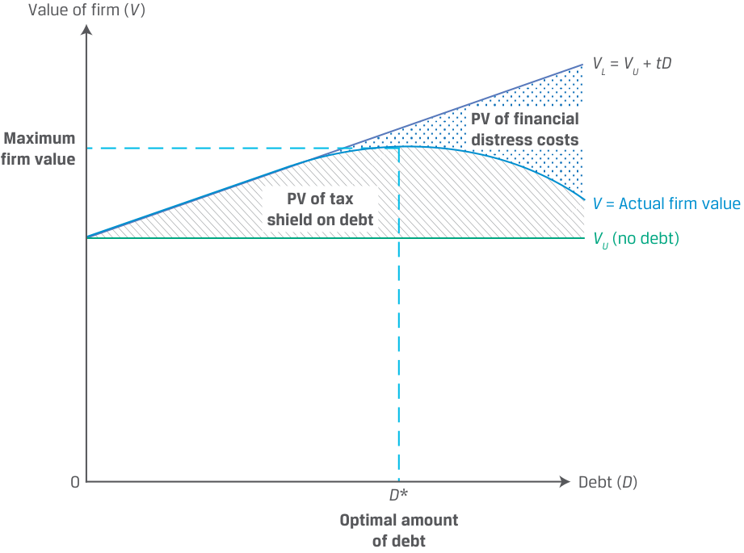

# Tập 3: Tổ chức Phát hành Doanh nghiệp (*Corporate Issuers*)
## Học phần 6: Cấu trúc Vốn (*Capital Structure*)
### Phần 4/4: Cấu trúc Vốn Tối ưu (*Optimal Capital Structure*) (Trang PDF 209–220)

---

<!-- PDF Page 209 -->

   - **C.** thấp hơn (*lower than*)

#### **Lời giải:** 

B là đáp án đúng. Vì Công ty Y là một doanh nghiệp không vay nợ (*unlevered firm*) và không có nợ trong cấu trúc vốn của mình, nên chi phí vốn chủ sở hữu sẽ bằng với WACC. Vì tỷ trọng của nợ bằng không, công thức WACC đơn giản là: 

$$\text{WACC} = \text{Tỷ trọng vốn chủ sở hữu} \times \text{Chi phí vốn chủ sở hữu}$$

#### **CẤU TRÚC VỐN TỐI ƯU (*OPTIMAL CAPITAL STRUCTURE*)** 

# **<mark>5</mark>** 

**Mục tiêu học tập:** mô tả cấu trúc vốn tối ưu (*optimal capital structure*) và cấu trúc vốn mục tiêu (*target capital structure*) 

Mặc dù các định đề của Modigliani–Miller cung cấp một khuôn khổ ban đầu cho các quyết định về cấu trúc vốn, nhưng các nhà quản lý của một công ty khi đối mặt với các lựa chọn cấu trúc vốn phải giải quyết các sự đánh đổi (*trade-offs*) đồng thời kết hợp những yếu tố đã được nêu trong các bài học trước. Ví dụ, hãy xem xét một kịch bản phù hợp với thế giới thực hơn bao gồm _cả_ thuế thu nhập doanh nghiệp và chi phí phá sản/kiệt quệ tài chính. Tác động làm tăng giá trị của lá chắn thuế (*tax shield*) từ đòn bẩy bị bù trừ bởi tác động làm giảm giá trị của giá trị hiện tại của các chi phí kiệt quệ tài chính hoặc phá sản kỳ vọng (hoặc có trọng số xác suất – *probability-weighted*). Chúng ta có thể thể hiện sự đánh đổi này bằng cách kết hợp chi phí kiệt quệ tài chính hoặc phá sản tiềm ẩn vào giá trị của một doanh nghiệp có vay nợ: 

$$V_L = V_U + tD - PV(\text{Chi phí kiệt quệ tài chính}) \tag{7}$$

Phương trình 7 biểu diễn điều đôi khi được gọi là **lý thuyết đánh đổi tĩnh về cấu trúc vốn (*static trade-off theory of capital structure*)**, được minh họa trong Minh họa 7. 

<!-- PDF Page 210 -->

**Minh họa 7: Lý thuyết Đánh đổi Tĩnh về Cấu trúc Vốn (*Exhibit 7: Static Trade-Off Theory of Capital Structure*)** 

> **Chú thích hình ảnh:**
> - **Trục tung:** Giá trị doanh nghiệp ($V$).
> - **Trục hoành:** Nợ ($D$), với điểm $D^*$ là Mức nợ tối ưu (*Optimal amount of debt*).
> - **Các đường biểu diễn:**
>   - Đường ngang dưới cùng: $V_U$ (không vay nợ – *no debt*).
>   - Đường thẳng dốc lên: $V_L = V_U + tD$ (bao gồm Giá trị hiện tại của lá chắn thuế từ nợ – *PV of tax shield on debt*).
>   - Đường cong thực tế: $V = \text{Giá trị doanh nghiệp thực tế}$ (*Actual firm value*), đạt Giá trị doanh nghiệp tối đa (*Maximum firm value*) tại mức nợ $D^*$, sau đó đi xuống khi Giá trị hiện tại của chi phí kiệt quệ tài chính (*PV of financial distress costs*) tăng mạnh.

$V_U$ đại diện cho giá trị của một doanh nghiệp không vay nợ hoặc tài trợ hoàn toàn bằng vốn chủ sở hữu. Khi nợ được bổ sung vào cấu trúc vốn, giá trị doanh nghiệp có vay nợ mới được suy ra từ Phương trình 7. Ở mức nợ thấp, lợi ích thuế của nợ thường vượt trội hơn các chi phí kiệt quệ tài chính tiềm ẩn, dẫn đến giá trị doanh nghiệp cao hơn. Tuy nhiên, khi nợ tăng lên, giá trị hiện tại của chi phí kiệt quệ tài chính kỳ vọng bắt đầu tăng lên và bù trừ cho lợi ích thuế của nợ, với mức nợ tối ưu $D^*$ nằm tại điểm mà lợi ích biên của lá chắn thuế (*marginal benefit of the tax shield*) bằng với chi phí biên của kiệt quệ tài chính kỳ vọng (*marginal cost of expected financial distress*). Vượt qua điểm này, đòn bẩy lớn hơn sẽ làm giảm giá trị doanh nghiệp, vì giá trị hiện tại gia tăng của chi phí kiệt quệ tài chính kỳ vọng vượt quá lợi ích thuế biên. Mức nợ tương ứng với $D^*$, giúp tối đa hóa giá trị doanh nghiệp, và mức vốn chủ sở hữu đi kèm được gọi là **cấu trúc vốn tối ưu (*optimal capital structure*)**. 

Các nhà quản lý không thể ước tính chính xác $D^*$ trên thực tế mà thay vào đó thiết lập một **cấu trúc vốn mục tiêu (*target capital structure*)** dựa trên hai yếu tố cần cân nhắc này, cũng như các yếu tố nội tại và bên ngoài đã được nêu trong các bài học trước. Có một số lý do giải thích tại sao cấu trúc vốn thực tế của một doanh nghiệp có thể khác với mục tiêu của nó. Ví dụ, ban quản lý có thể khai thác các cơ hội ngắn hạn ở một nguồn tài trợ cụ thể. Chẳng hạn, một công ty có khả năng phát hành nợ với mức lãi suất hấp dẫn có thể vay nhiều hơn kế hoạch để đáp ứng nhu cầu mạnh mẽ của các nhà đầu tư. Ngoài ra, giá trị thị trường thay đổi của các chứng khoán nợ và vốn chủ sở hữu của công ty có thể khiến cấu trúc vốn thực tế của doanh nghiệp chệch khỏi mục tiêu. Chi phí giao dịch (*transaction costs*) và quy mô giao dịch tối thiểu (*minimum deal sizes*) khiến các doanh nghiệp không thực tế nếu liên tục điều chỉnh cấu trúc vốn theo một con số cụ thể. Kết quả là, các nhà quản lý doanh nghiệp thường đặt ra một khoảng cấu trúc vốn tối ưu (*optimal capital range*): ví dụ: 30%–50% nợ thay vì 40%. 

Mặc dù các phép tính WACC cũng như tỷ trọng nợ và vốn chủ sở hữu trước đây được thực hiện bằng giá trị _thị trường_ (*market value*) của vốn chủ sở hữu và nợ, nhưng cấu trúc vốn mục tiêu thường được biểu thị bằng giá trị _sổ sách_ (*book value*) của vốn chủ sở hữu và nợ vì những lý do sau đây: 

**1.** _Giá trị thị trường có thể biến động mạnh và hiếm khi tác động đến mức độ vay nợ phù hợp._ Ngược lại, một công ty có giá cổ phiếu đã tăng nhanh chóng có thể tận dụng điều này bằng cách huy động vốn chủ sở hữu thay vì nợ để duy trì một tỷ số nợ trên vốn chủ sở hữu nhất định. 

<!-- PDF Page 211 -->

**2.** _Đối với ban quản lý, mối quan tâm hàng đầu là quy mô và các loại vốn được đầu tư_ bởi _công ty, chứ không phải được đầu tư_ vào _công ty._ Góc nhìn này bao gồm cách thức tài trợ cho vốn lưu động và các dự án đầu tư vốn. Nó khác với góc nhìn của một cổ đông đã mua cổ phiếu ở mức giá thị trường hiện hành nhằm tìm kiếm tỷ suất sinh lợi trên khoản đầu tư đó. 

**3.** _Chính sách cấu trúc vốn được điều chỉnh phù hợp với các thước đo được sử dụng bởi các bên thứ ba._ Vì những người cho vay, các nhà đầu tư nợ và các tổ chức xếp hạng tín nhiệm (*rating agencies*) nhìn chung tập trung vào giá trị sổ sách của nợ và vốn chủ sở hữu cho các thước đo tính toán của họ, nên các nhà quản lý doanh nghiệp tính đến thực tế này khi xác định chính sách cấu trúc vốn của mình. 

Mặc dù việc cấu trúc vốn mục tiêu được biểu thị theo giá trị sổ sách là điều phổ biến, nhưng các nhà quản lý vẫn theo dõi sát sao giá cả và lãi suất thị trường đối với vốn chủ sở hữu và khoản nợ đang lưu hành của họ để đánh giá thời điểm cần huy động vốn cũng như quy mô và loại hình vốn cần huy động. 

##### **Tỷ trọng Mục tiêu và WACC (*Target Weights and WACC*)** 

Trong bài học đầu tiên, khi tính toán WACC, chúng ta đã sử dụng giá trị thị trường hiện tại của nợ và vốn chủ sở hữu để tính các trọng số. Một cách tiếp cận thay thế là sử dụng cấu trúc vốn mục tiêu, đặc biệt nếu ban quản lý có công bố thông tin này. Các nhà phân tích độc lập không biết về mục tiêu của doanh nghiệp có thể ước tính nó bằng một trong số các phương pháp sau: 

**1.** Giả định cấu trúc vốn hiện tại của công ty, theo tỷ trọng giá trị thị trường của các thành phần, đại diện cho cấu trúc vốn mục tiêu của công ty. 

**2.** Xem xét các xu hướng cấu trúc vốn hoặc các tuyên bố của ban quản lý liên quan đến chính sách cấu trúc vốn để suy ra cấu trúc vốn mục tiêu của công ty. 

**3.** Sử dụng mức trung bình cấu trúc vốn của các công ty tương đồng (*comparable companies*) làm mục tiêu. 

Lưu ý rằng một cách đơn giản để chuyển đổi tỷ số nợ trên vốn chủ sở hữu ($D/E$) thành tỷ trọng—tức là $D/(D + E)$—là lấy $D/E$ chia cho $1 + D/E$. 

###### **KIỂM TRA KIẾN THỨC: ƯỚC TÍNH TỶ TRỌNG VỐN CHO TẬP ĐOÀN GERHARDT (*KNOWLEDGE CHECK: ESTIMATING PROPORTIONS OF CAPITAL FOR GERHARDT CORPORATION*)** 

Một nhà phân tích tài chính tìm cách ước tính chi phí sử dụng vốn bình quân gia quyền của Tập đoàn Gerhardt bằng cách sử dụng các thông tin sau: 

- Giá trị thị trường của nợ: $\text{EUR}50\text{ triệu}$ 

- Giá trị thị trường của vốn chủ sở hữu: $\text{EUR}60\text{ triệu}$ 

Các đối thủ cạnh tranh chính và cấu trúc vốn của họ (tính bằng triệu): 

|**Đối thủ cạnh tranh (*Competitor*)**|**Giá trị Thị trường của Nợ (*Market Value of Debt*)**|**Giá trị Thị trường của Vốn chủ sở hữu (*Market Value of Equity*)**|
|---|---|---|
|A|$\text{EUR}25$|$\text{EUR}50$|
|B|$\text{EUR}101$|$\text{EUR}190$|
|C|$\text{GBP}40$|$\text{GBP}60$|

1. Tính tỷ trọng nợ và vốn chủ sở hữu cho phân tích WACC bằng cách sử dụng cấu trúc vốn hiện tại của Gerhardt. 

**Lời giải:** Cấu trúc vốn hiện tại: 

$$w_d = \frac{€50\text{ triệu}}{€50\text{ triệu} + €60\text{ triệu}} = 0.4545$$

$$w_e = \frac{€60\text{ triệu}}{€50\text{ triệu} + €60\text{ triệu}} = 0.5454$$

<!-- PDF Page 212 -->

2. Tính tỷ trọng nợ và vốn chủ sở hữu cho phân tích WACC bằng cách sử dụng cấu trúc vốn của các đối thủ cạnh tranh của Gerhardt. 

###### **Lời giải:** 

Cấu trúc vốn của các đối thủ cạnh tranh: 

$$w_d = \frac{\left(\frac{€25}{€25 + €50}\right) + \left(\frac{€101}{€101 + €190}\right) + \left(\frac{£40}{£40 + £60}\right)}{3} = 0.3601$$

$$w_e = \frac{\left(\frac{€50}{€25 + €50}\right) + \left(\frac{€190}{€101 + €190}\right) + \left(\frac{£60}{£40 + £60}\right)}{3} = 0.6399$$

3. Tính tỷ trọng nợ và vốn chủ sở hữu cho phân tích WACC nếu Gerhardt thông báo rằng tỷ số nợ trên vốn chủ sở hữu ở mức 0.7 phản ánh cấu trúc vốn mục tiêu của công ty. 

###### **Lời giải:** 

Tỷ số nợ trên vốn chủ sở hữu ở mức 0.7 đại diện cho tỷ trọng nợ là $0.7 / 1.7 = 0.4118$, do đó $w_d = 0.4118$ và $w_e = 1 - 0.4118 = 0.5882$. Đây sẽ là các trọng số được ưu tiên sử dụng trong phép tính chi phí sử dụng vốn. 

##### **Lý thuyết Trật tự Phân hạng và Chi phí Đại diện (*Pecking Order Theory and Agency Costs*)** 

Các nhà đầu tư và các tổ chức phát hành có **thông tin bất cân xứng (*asymmetric information*)**. Ban quản lý của tổ chức phát hành có quyền tiếp cận nhiều thông tin hơn về hoạt động kinh doanh và triển vọng của công ty so với những thông tin được công bố rộng rãi ra công chúng, và các nhà quản lý có khả năng sử dụng thông tin này để mang lại lợi thế cho họ khi tìm kiếm nguồn tài trợ. Các nhà đầu tư nợ và vốn chủ sở hữu đòi hỏi tỷ suất sinh lợi cao hơn từ các công ty có mức độ bất cân xứng thông tin cao hơn vì họ có thể lo ngại rằng các chứng khoán mới bị định giá quá cao (*overpriced*); nghĩa là, một công ty sẽ hoặc phát hành vốn chủ sở hữu khi cổ phiếu của họ đang đắt hoặc phát hành nợ mới khi mức độ uy tín tín dụng (*creditworthiness*) của doanh nghiệp sắp sửa xấu đi. 

Vì các nhà đầu tư thường theo dõi sát sao hành vi của người quản lý để có cái nhìn sâu sắc về triển vọng của công ty, nên các nhà quản lý phải cân nhắc xem hành động của họ có thể phát đi tín hiệu (*signal*) gì cho những người bên ngoài. Mô hình phát tín hiệu của cấu trúc vốn (*signaling model of capital structure*) gợi ý một hệ thống phân cấp (hay trật tự phân hạng – *pecking order*) của các phương thức tài trợ cho các khoản đầu tư mới. 

**Lý thuyết trật tự phân hạng (*pecking order theory*)**, được phát triển bởi Stewart C. Myers và Nicholas S. Majluf vào năm 1984, cho rằng các nhà quản lý dành sự ưu tiên hàng đầu cho các phương thức tài trợ có hàm lượng thông tin tiềm ẩn ít nhất (nguồn vốn tạo ra từ nội bộ – *internally generated funds*) và dành sự ưu tiên cuối cùng cho các phương thức có hàm lượng thông tin tiềm ẩn nhiều nhất (chào bán cổ phiếu ra công chúng – *public equity offerings*). Việc chào bán cổ phiếu ra công chúng thường làm dấy lên sự hoài nghi trong giới đầu tư bởi vì những chủ sở hữu hiện hữu dường như sẽ ít có khả năng muốn chia sẻ quyền sở hữu của một công ty đang có triển vọng tương lai mạnh mẽ. Kết quả là, các nhà quản lý ưu tiên nguồn tài trợ nội bộ (*internal financing*), và nếu cần tài trợ bên ngoài (*external financing*), họ ưu tiên nợ tư nhân (*private debt*) hơn nợ đại chúng (*public debt*) và ít ưu tiên phát hành vốn chủ sở hữu nhất. 

Một hàm ý khác từ công trình của Myers và Majluf là các tổ chức phát hành có xu hướng phát hành vốn chủ sở hữu khi ban quản lý tin rằng cổ phiếu đang được định giá quá cao (*overvalued*) và miễn cưỡng phát hành vốn chủ sở hữu nếu họ tin rằng cổ phiếu đang bị định giá thấp (*undervalued*), thay vào đó có khả năng lựa chọn mua lại cổ phiếu (*repurchase shares*). Do đó, việc phát hành thêm vốn chủ sở hữu, thường là để tài trợ cho một thương vụ mua lại (*acquisition*), thường được các nhà đầu tư diễn giải như một tín hiệu tiêu cực (*negative signal*). Việc phát hành nợ buộc công ty phải cam kết thực hiện các khoản thanh toán gốc và lãi trong tương lai, điều này (cùng với cổ tức định kỳ) có thể được diễn giải như một dấu hiệu về sự tự tin của ban quản lý vào khả năng thực hiện các khoản thanh toán đó trong tương lai của công ty. Những tín hiệu này được coi là quá tốn kém khiến các công ty hoạt động kém hiệu quả không đủ khả năng chi trả. 

Mặt khác, tín hiệu của việc phát hành vốn chủ sở hữu ở đáy của trật tự phân hạng còn chứa đựng những manh mối khác. Ví dụ, nếu chi phí sử dụng vốn của công ty tăng lên sau một đợt phát hành vốn chủ sở hữu, chúng ta có thể diễn giải tác động này như một dấu hiệu cho thấy ban quản lý đang cần vốn vượt quá những nguồn vốn có chi phí rẻ; nói cách khác, đây là một tín hiệu tiêu cực liên quan đến 

<!-- PDF Page 213 -->

triển vọng của công ty. Các nhà quản lý có thể ngần ngại phát hành vốn chủ sở hữu mới khi họ tin rằng cổ phiếu của công ty đang bị định giá thấp, bởi vì họ muốn tránh phát đi tín hiệu rằng họ tin cổ phiếu đang bị định giá quá cao và cũng để tránh chi phí cũng như công sức liên quan đến việc phát hành vốn chủ sở hữu mới. 

Chi phí đại diện (*agency costs*) đã được giới thiệu trong một bài học trước như là những chi phí tăng thêm phát sinh từ xung đột lợi ích giữa người quản lý, cổ đông và trái chủ. Trong trường hợp các quyết định về cấu trúc vốn, khoản tiết kiệm trong chi phí đại diện của vốn chủ sở hữu (*agency costs of equity*) có thể phát sinh khi tăng cường sử dụng nợ. Tương tự, một công ty càng sử dụng nhiều đòn bẩy tài chính, các nhà quản lý càng có ít sự tự do hơn trong việc vay thêm nợ hoặc chi tiêu tiền mặt một cách thiếu khôn ngoan. Đây là nền tảng cho **giả thuyết dòng tiền tự do (*free cash flow hypothesis*)** của Michael Jensen (1986): Mức nợ cao hơn rèn luyện tính kỷ luật cho các nhà quản lý bằng cách buộc họ phải quản lý công ty một cách hiệu quả và sử dụng tiền mặt một cách khôn ngoan để công ty có thể thực hiện các khoản thanh toán gốc và lãi vay. 

###### **VÍ DỤ 5 (*EXAMPLE 5*)** 

##### **Chi phí Đại diện, Thông tin Bất cân xứng và Phát tín hiệu (*Agency Costs, Asymmetric Information, and Signaling*)** 

CLP AG, một công ty dược sinh học nhỏ được niêm yết, đang tiến hành thử nghiệm lâm sàng một loại thuốc của mình—vốn đã được phê duyệt để điều trị chứng rối loạn tự miễn dịch—để sử dụng trong một ứng dụng mới không nằm trong mục đích ban đầu: điều trị một loại nhiễm trùng do vi-rút. Ban quản lý hy vọng ứng dụng mới này của thuốc sẽ mang lại sự gia tăng lớn về doanh thu và giá trị của công ty. Công ty có lợi nhuận ổn định và không có nợ (*debt free*). Các sự kiện sau đây diễn ra: 

- Vào tháng 7, ban quản lý nhận được thông báo từ các nhà nghiên cứu thử nghiệm lâm sàng rằng kết quả có vẻ đầy hứa hẹn. Dự đoán rằng có thể phải mở rộng quy mô sản xuất một cách nhanh chóng, công ty đã đàm phán và công bố tăng mạnh hạn mức tín dụng (*credit line*) của mình. 

- Vào tháng 8, CLP công bố kết quả thử nghiệm thành công thông qua thông cáo báo chí công khai. Cổ phiếu CLP tăng 35%. 

Hãy giải thích thông tin bất cân xứng và việc phát tín hiệu được thể hiện ở đây như thế nào. 

1. Thông tin bất cân xứng (*Asymmetric information*) 

###### **Lời giải:** 

Thông tin bất cân xứng được thể hiện qua việc ban quản lý biết về kết quả thử nghiệm tích cực vào tháng 7, trước khi chúng được công bố rộng rãi ra công chúng vào tháng 8. Việc phát tín hiệu (*signaling*) được thể hiện qua thông báo của công ty vào tháng 7 rằng họ đang tăng hạn mức tín dụng. Thông báo này có thể được hiểu một cách hợp lý như một tín hiệu về sự tự tin của ban quản lý rằng kết quả thử nghiệm sẽ tích cực và công ty sẽ cần mở rộng công suất sản xuất. Điều này đúng bất kể việc phát tín hiệu đó có chủ ý hay không. 

###### **BỘ CÂU HỎI (*QUESTION SET*)** 

1. Đúng hay Sai: Theo lý thuyết trật tự phân hạng, doanh nghiệp không có cấu trúc vốn tối ưu và cấu trúc vốn của một doanh nghiệp phản ánh nhu cầu lịch sử của doanh nghiệp đó đối với nguồn tài trợ bên ngoài. 

   - **A.** Đúng (*True*) 

<!-- PDF Page 214 -->

   - **B.** Sai (*False*)

###### **Lời giải:** 

A là đáp án đúng. Lý thuyết trật tự phân hạng dựa trên thông tin bất cân xứng được nắm giữ bởi các nhà đầu tư và các tổ chức phát hành cùng ý tưởng rằng các nhà quản lý cân nhắc xem hành động của họ có thể phát đi tín hiệu gì cho các nhà đầu tư. Mô hình phát tín hiệu gợi ý một hệ thống phân cấp trong các phương thức tài trợ cho doanh nghiệp. Nguồn vốn nội bộ được sử dụng trước tiên, sau đó đến nợ, và cuối cùng, một cách miễn cưỡng, các doanh nghiệp mới sử dụng vốn chủ sở hữu. Không có cấu trúc vốn tối ưu, và cấu trúc vốn của một doanh nghiệp phản ánh nhu cầu lịch sử của nó đối với nguồn tài trợ bên ngoài. 

2. Công ty Z thông báo rằng tỷ số nợ trên vốn chủ sở hữu ở mức 1.2 là nhất quán với cấu trúc vốn mục tiêu của công ty. Với giá trị này, tỷ trọng của vốn chủ sở hữu trong phép tính WACC là: 

   - **A.** 45%. 

   - **B.** 55%. 

   - **C.** 83%. 

###### **Lời giải:** 

A là đáp án đúng. Một cách đơn giản để chuyển đổi tỷ số nợ trên vốn chủ sở hữu ($D/E$) thành tỷ trọng—tức là $D/(D + E)$—là lấy $D/E$ chia cho $1 + D/E$. Do đó, tỷ số nợ trên vốn chủ sở hữu ở mức 1.2 đại diện cho tỷ trọng nợ là $1.2 / 2.2 = 0.5455$, vì vậy $w_d = 0.5455$ và $w_e = 1 - 0.5455 = 0.4545$. Như vậy, tỷ trọng của vốn chủ sở hữu trong phép tính WACC là 45%. 

3. Hãy ghép từng khái niệm ở bên trái với lý thuyết/giả thuyết cấu trúc vốn tương ứng ở bên phải: 

|**Các khái niệm (*Concepts*)**|**Lý thuyết / Giả thuyết Cấu trúc Vốn (*Capital Structure Theory/Hypothesis*)**|
|---|---|
|1. Cấu trúc vốn tối ưu (*Optimal capital structure*)|A. Giả thuyết dòng tiền tự do (*Free cash flow hypothesis*)|
|2. Chi phí đại diện (*Agency costs*)|B. Lý thuyết trật tự phân hạng (*Pecking order theory*)|
|3. Thông tin bất cân xứng (*Asymmetric information*)|C. Lý thuyết đánh đổi tĩnh về cấu trúc vốn (*Static trade-off theory of capital structure*)|

###### **Lời giải:** 

   - **1. C.** Lý thuyết đánh đổi tĩnh về cấu trúc vốn xác định cấu trúc vốn tối ưu. 

   - **2. A.** Giả thuyết dòng tiền tự do dựa trên chi phí đại diện và ý tưởng rằng mức nợ cao hơn sẽ áp đặt kỷ luật lên các nhà quản lý để tránh các khoản bổng lộc (*perks*) và các thương vụ mua lại không tạo ra giá trị (*non-value-adding acquisitions*). 

   - **3. B.** Lý thuyết trật tự phân hạng dựa trên thông tin bất cân xứng được nắm giữ bởi các nhà đầu tư và các tổ chức phát hành cùng vai trò quan trọng của việc phát tín hiệu (*signaling*). 

4. Tác động làm giảm giá trị của tình trạng kiệt quệ tài chính hoặc phá sản sẽ tăng lên nếu doanh nghiệp có: 

   - **A.** rủi ro kinh doanh cao hơn (*higher business risk*). 

   - **B.** đòn bẩy hoạt động và đòn bẩy tài chính thấp hơn (*lower operating and financial leverage*). 

   - **C.** các tài sản có thị trường thứ cấp sẵn có (*assets with a ready secondary market*). 

###### **Lời giải:** 

A là đáp án đúng. Xác suất và chi phí kiệt quệ tài chính tăng lên đối với các doanh nghiệp có rủi ro kinh doanh cao hơn và nhiều nợ hơn trong cấu trúc vốn. Ngược lại, chi phí kiệt quệ tài chính thấp hơn đối với các doanh nghiệp có đòn bẩy hoạt động và đòn bẩy tài chính thấp hơn 

<!-- PDF Page 215 -->

và đối với các doanh nghiệp có tài sản sở hữu thị trường thứ cấp và có thể dễ dàng bán đi.

5. Đúng hay Sai: Cấu trúc vốn mục tiêu nên được ước tính bằng cách sử dụng giá trị thị trường của vốn chủ sở hữu và nợ khi tính toán WACC.
   - **A.** Đúng (*True*)
   - **B.** Sai (*False*)

###### **Lời giải:**

B là đáp án đúng. Cấu trúc vốn mục tiêu thường được ước tính bằng cách sử dụng giá trị sổ sách (*book values*) bởi vì giá trị thị trường có thể biến động đáng kể và ít có khả năng tác động đến năng lực vay nợ (*borrowing capacity*). Các tổ chức phát hành thường sẽ hướng tới một mức xếp hạng tín nhiệm nhất định, chẳng hạn như hạng đầu tư (*investment grade*), vốn chịu ảnh hưởng mạnh mẽ bởi mức độ nợ (theo giá trị sổ sách) của tổ chức phát hành so với dòng tiền.

<!-- PDF Page 216 -->

## **CÁC BÀI TẬP THỰC HÀNH (*PRACTICE PROBLEMS*)** 

### **Thông tin sau đây liên quan đến các câu hỏi từ 1 đến 4** 

Một nhà phân tích tài chính đang đánh giá cấu trúc vốn cho Boulder, Inc. Boulder, Inc. là một doanh nghiệp không vay nợ (*unleveraged firm*) có trụ sở tại Hoa Kỳ với dòng tiền không đổi (vĩnh viễn) là $\$6\text{ triệu}$ mỗi năm trước thuế. Doanh nghiệp có giá trị thị trường là $\$45\text{ triệu}$ và thuế suất thuế thu nhập doanh nghiệp là 30%. Boulder có kế hoạch phát hành $\$15\text{ triệu}$ nợ để mua lại và hủy một lượng vốn chủ sở hữu tương đương. Khoản nợ này sẽ có chi phí là 5.5%. 

Nhà phân tích tài chính lưu ý rằng lợi thế lá chắn thuế của nợ bị bù trừ do rủi ro kiệt quệ tài chính. Ông ước tính giá trị hiện tại của chi phí kiệt quệ tài chính ở các mức nợ khác nhau như sau: 

|**Giá trị của Nợ (*Value of Debt*)**|**Giá trị Hiện tại của Chi phí Kiệt quệ Tài chính (*Present Value of Cost of Distress*)**|
|---|---|
|$\$5\text{ triệu}$|$\$0.1\text{ triệu}$|
|$\$10\text{ triệu}$|$\$0.2\text{ triệu}$|
|$\$15\text{ triệu}$|$\$0.5\text{ triệu}$|
|$\$20\text{ triệu}$|$\$1.5\text{ triệu}$|
|$\$25\text{ triệu}$|$\$6.0\text{ triệu}$|
|$\$30\text{ triệu}$|$\$12.0\text{ triệu}$|

**1.** WACC của doanh nghiệp không vay nợ, trước đợt phát hành nợ, gần nhất với mức: 

   - **A.** 4.00%. 

   - **B.** 9.33%. 

   - **C.** 13.33%. 

**2.** Việc sử dụng $\$15\text{ triệu}$ tài trợ bằng nợ làm tăng giá trị của Boulder thêm ____________ so với giá trị khi không vay nợ của công ty. Bỏ qua chi phí kiệt quệ tài chính. 

   - **A.** $\$4.5\text{ triệu}$ 

   - **B.** $\$10.5\text{ triệu}$ 

   - **C.** $\$15\text{ triệu}$ 

**3.** Nếu tính cả giá trị hiện tại của chi phí kiệt quệ tài chính, giá trị của Boulder gần nhất với mức: 

   - **A.** $\$49\text{ triệu}$. 

   - **B.** $\$55\text{ triệu}$. 

   - **C.** $\$59.5\text{ triệu}$. 

**4.** Mức nợ giúp tối đa hóa giá trị của Boulder Inc. gần nhất với mức:
   - **A.** $\$15\text{ triệu}$. 

<!-- PDF Page 217 -->

   - **B.** $\$20\text{ triệu}$. 

   - **C.** $\$30\text{ triệu}$. 

**5.** Một nhà phân tích tài chính đang đánh giá cấu trúc vốn cho Plover, Inc., một doanh nghiệp không vay nợ có trụ sở tại châu Âu với dòng tiền không đổi (vĩnh viễn) là $\text{EUR}10.0\text{ triệu}$ mỗi năm trước thuế. Doanh nghiệp có giá trị thị trường là $\text{EUR}100.0\text{ triệu}$ và thuế suất thuế thu nhập doanh nghiệp là 20%. Plover có kế hoạch phát hành $\text{EUR}35.0\text{ triệu}$ nợ để mua lại và hủy một lượng vốn chủ sở hữu tương đương, do đó quy mô của doanh nghiệp sẽ không thay đổi. Khoản nợ này sẽ có chi phí là 4.5%. Giả sử chi phí kiệt quệ tài chính gần bằng không. 

   - Sau khi phát hành nợ và thay đổi cấu trúc vốn, WACC của Plover gần nhất với mức: 

   - **A.** 5.47%. 

   - **B.** 7.48%. 

   - **C.** 8.82%. 

<!-- PDF Page 218 -->

## **LỜI GIẢI (*SOLUTIONS*)** 

1. B là đáp án đúng. Dòng tiền sau thuế của công ty là $\$6\text{ triệu} \times (1 - 0.30) = \$4.2\text{ triệu}$. Vì các dòng tiền được giả định là vĩnh viễn, nên WACC được tính như sau: 

$$r_{\text{WACC}} = \frac{CF(1 - t)}{V} = \frac{\$4.2}{\$45} = 9.33\%$$

Vì đây là doanh nghiệp tài trợ hoàn toàn bằng vốn chủ sở hữu, nên chi phí vốn chủ sở hữu bằng với WACC. 

2. A là đáp án đúng. Theo Định đề I của MM có thuế thu nhập doanh nghiệp, giá trị của công ty có vay nợ lớn hơn giá trị của công ty không vay nợ một lượng bằng thuế suất nhân với giá trị của khoản nợ ($tD$), được định nghĩa là giá trị hiện tại của lá chắn thuế từ nợ. 

$$V_L = V_U + tD = \$45\text{ triệu} + 0.30(\$15\text{ triệu}) = \$49.5\text{ triệu}$$

Do đó, việc sử dụng tài trợ bằng nợ sẽ làm tăng giá trị của Boulder thêm $\$4.5\text{ triệu}$ so với doanh nghiệp khi không vay nợ. Lưu ý rằng giá trị của doanh nghiệp tăng liên tục khi nợ bổ sung được thêm vào cấu trúc vốn, và cấu trúc vốn tối ưu là 100% nợ. 

3. A là đáp án đúng. Khi tính cả chi phí kiệt quệ tài chính, khi nợ được thêm vào cấu trúc vốn, giá trị có vay nợ của doanh nghiệp được cho bởi: 

$$V_L = V_U + tD - PV(\text{Chi phí kiệt quệ tài chính})$$

Giá trị có vay nợ của Boulder khi được tài trợ bằng $\$15\text{ triệu}$ nợ là: 

$$V_L = \$45\text{ triệu} + 0.30(\$15\text{ triệu}) - \$0.5\text{ triệu} = \$49\text{ triệu}$$

4. B là đáp án đúng. Khi tính cả chi phí kiệt quệ tài chính, khi nợ được thêm vào cấu trúc vốn, giá trị có vay nợ của doanh nghiệp được cho bởi: 

   - $V_L = V_U + tD - PV(\text{Chi phí kiệt quệ tài chính})$. 

Bảng dưới đây trình bày các phép tính giá trị có vay nợ của Boulder ở các mức nợ khác nhau, tính bằng triệu đô la ($\$ \text{ millions}$). 

|**$D$**|**$PV(\text{Chi phí kiệt quệ tài chính})$**|**$V_L = V_U + tD - PV(\text{Chi phí kiệt quệ tài chính})$**|
|---|---|---|
|5|0.1|$V_L = 45 + 0.3(5) - 0.1 \implies V_L = 46.4$|
|10|0.2|$V_L = 45 + 0.3(10) - 0.2 \implies V_L = 47.8$|
|15|0.5|$V_L = 45 + 0.3(15) - 0.5 \implies V_L = 49$|
|20|1.5|$V_L = 45 + 0.3(20) - 1.5 \implies V_L = 49.5$|
|25|6.0|$V_L = 45 + 0.3(25) - 6.0 \implies V_L = 46.5$|
|30|12.0|$V_L = 45 + 0.3(30) - 12.0 \implies V_L = 42$|

Do đó, mức nợ tối ưu là $\$20\text{ triệu}$, giúp tối đa hóa giá trị của Boulder ở mức $\$49.5\text{ triệu}$. Vượt quá mức nợ $\$20\text{ triệu}$, đòn bẩy lớn hơn sẽ 

<!-- PDF Page 219 -->

làm giảm giá trị doanh nghiệp bởi vì giá trị hiện tại của chi phí kiệt quệ tài chính lớn hơn phần lợi ích thuế bù đắp. 

5. B là đáp án đúng. Các phép tính để xác định WACC như sau: Dòng tiền sau thuế của công ty là $\text{EUR}10.0\text{ triệu}(1 - 0.20) = \text{EUR}8.0\text{ triệu}$. Vì các dòng tiền được giả định là vĩnh viễn, nên WACC của doanh nghiệp khi không vay nợ được tính như sau: 

$$r_{\text{WACC}} = \frac{CF(1 - t)}{V} = \frac{\text{EUR}8.0\text{ triệu}}{\text{EUR}100.0\text{ triệu}} = 8.0\%$$

Giá trị thị trường của Plover khi có tài trợ bằng nợ là $\text{EUR}107\text{ triệu}$: 

$$V_L = V_U + tD = \text{EUR}100.0\text{ triệu} + 0.20(\text{EUR}35.0\text{ triệu}) = \text{EUR}107.0\text{ triệu}$$

Để tìm chi phí vốn chủ sở hữu, trước tiên chúng ta cần tìm giá trị thị trường của vốn chủ sở hữu: 

$$V_L = D + E, \text{ trong đó } D \text{ và } E \text{ lần lượt là giá trị thị trường của nợ và vốn chủ sở hữu.}$$

$$E = \text{EUR}107.0\text{ triệu} - \text{EUR}35.0\text{ triệu} = \text{EUR}72.0\text{ triệu}$$

Chi phí vốn chủ sở hữu được cho bởi: 

$$r_e = r_0 + (r_0 - r_d)(1 - t)\frac{D}{E}$$

$$= 8.0\% + (8.0\% - 4.5\%)(0.80)\left(\frac{\text{EUR}35.0\text{ triệu}}{\text{EUR}72.0\text{ triệu}}\right) = 9.36\%$$

WACC của Plover được tính như sau: 

$$\text{WACC} = (\text{Tỷ trọng nợ} \times \text{Chi phí nợ}) + (\text{Tỷ trọng vốn chủ sở hữu} \times \text{Chi phí vốn chủ sở hữu})$$

$$= \left(\frac{\text{EUR}35\text{ triệu}}{\text{EUR}107.0\text{ triệu}}\right)(4.5\%)(1 - 0.2) + \left(\frac{\text{EUR}72.0\text{ triệu}}{\text{EUR}107.0\text{ triệu}}\right)(9.36\%)$$

$$= 7.48\%, \text{ thấp hơn mức } 8.0\% \text{ của doanh nghiệp khi không vay nợ.}$$

<!-- PDF Page 220 -->
