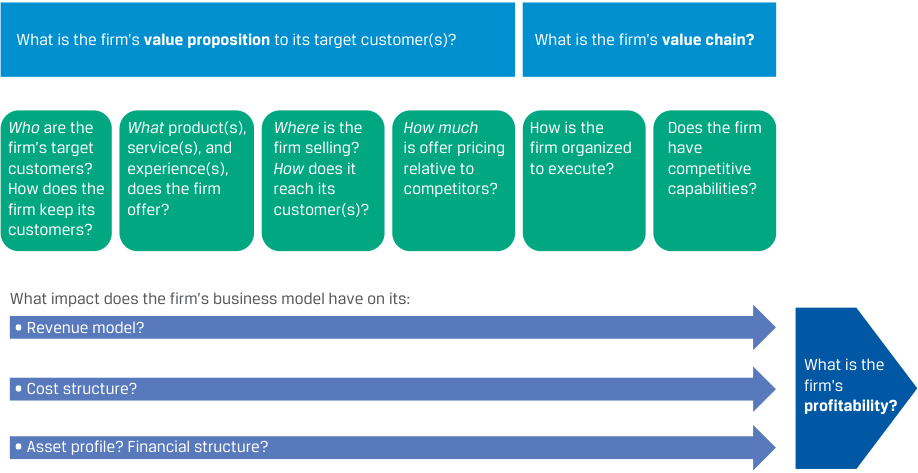
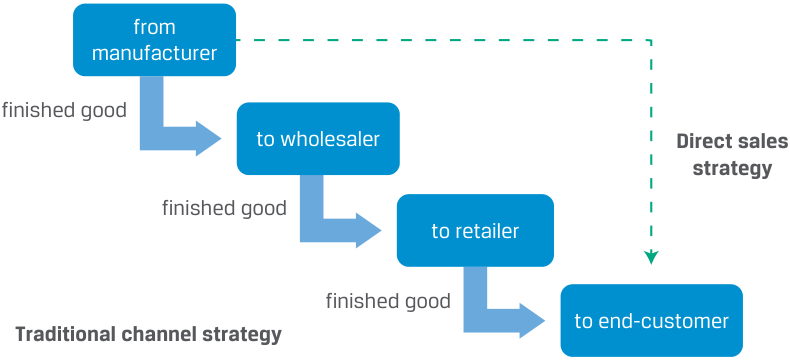
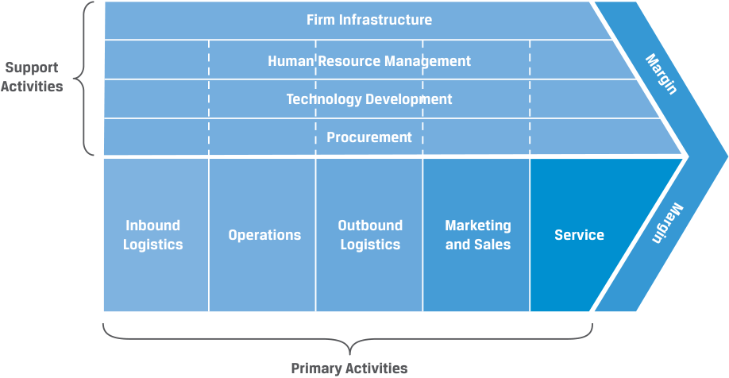
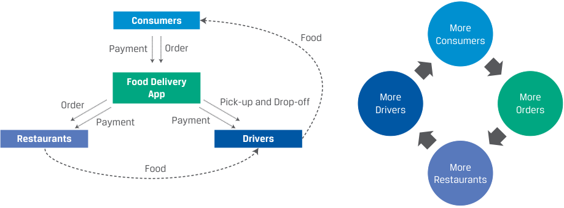

# Tập 3: Tổ chức Phát hành Doanh nghiệp (Corporate Issuers)
## Learning Module 7 Business Models (Trang PDF 221–250)

---

# Tập 3: Tổ chức Phát hành Doanh nghiệp (*Corporate Issuers*)
## Học phần 7: Các Mô hình Kinh doanh (*Business Models*)
### Phần 1/3: Giới thiệu (*Introduction*) (Trang PDF 221–222)

---

<!-- PDF Page 221 -->

#### H Ọ C P H Ầ N 

# **<mark>7</mark>** 

### **Các Mô hình Kinh doanh (*Business Models*)** 

###### **<mark>MỤC TIÊU HỌC TẬP (*LEARNING OUTCOMES*)</mark>** 

**_Thành thạo — Ứng viên cần có khả năng:_**
- mô tả các đặc điểm chính của các mô hình kinh doanh (*key features of business models*)
- mô tả các loại hình mô hình kinh doanh khác nhau (*various types of business models*)

##### **GIỚI THIỆU (*INTRODUCTION*)** 

## **<mark>1</mark>** 

Một mô hình kinh doanh (*business model*) được mô tả rõ ràng giúp nhà phân tích hiểu được một doanh nghiệp: chiến lược, hoạt động, thị trường mục tiêu (*target markets*), khách hàng chính, nhà cung cấp, và suy cho cùng là triển vọng, rủi ro và hồ sơ tài chính (*financial profile*) của doanh nghiệp đó. Nhiều doanh nghiệp có các mô hình kinh doanh truyền thống (*conventional business models*) dễ hiểu và đã tồn tại từ lâu, chẳng hạn như các nhà sản xuất và các nhà bán lẻ. Tuy nhiên, nhiều mô hình kinh doanh lại phức tạp, mới lạ, hoặc là sự kết hợp của nhiều mô hình. Đổi mới công nghệ, đặc biệt là số hóa (*digitalization*), đã tạo điều kiện cho sự đổi mới mô hình kinh doanh mạnh mẽ trong những thập kỷ qua. Các nhà phân tích cần tự xây dựng sự hiểu biết của riêng mình về mô hình kinh doanh của một tổ chức phát hành để làm cơ sở cho việc đánh giá triển vọng và rủi ro; các nhà phân tích không nên chỉ dựa vào mô tả của ban quản lý về mô hình kinh doanh của công ty họ. 

###### **TỔNG QUAN HỌC PHẦN (*LEARNING MODULE OVERVIEW*)** 

- Một mô hình kinh doanh giải quyết bốn phần chính của một doanh nghiệp: khách hàng (yếu tố “ai” – *the “who”*), các sản phẩm và dịch vụ cung ứng của doanh nghiệp (yếu tố “cái gì” và thường là “tại sao” – *the “what” and often the “why”*), các kênh tiếp cận khách hàng (yếu tố “ở đâu” – *the “where”*), và định giá (yếu tố “bao nhiêu tiền” – *the “how much”*). 

- Mô hình định giá (*pricing model*) mô tả số tiền khách hàng được lập hóa đơn thanh toán cho các đơn vị sản phẩm hoặc dịch vụ. Tuyên bố giá trị (*value proposition*) của một doanh nghiệp đề cập đến các thuộc tính sản phẩm khiến khách hàng mua sản phẩm đó thay vì sản phẩm của các đối thủ cạnh tranh. Chuỗi giá trị (*value chain*) của một doanh nghiệp đề cập đến cách thức một doanh nghiệp cấu trúc các hệ thống và quy trình của mình để tạo ra giá trị cho khách hàng. 

- Các mô hình kinh doanh truyền thống (*conventional business models*) rất phổ biến và đã được thiết lập từ lâu, trong khi các mô hình kinh doanh phi truyền thống (*unconventional business models*) dựa trên những đổi mới sáng tạo hoặc các sự kết hợp và biến thể đặc thù theo ngành của các mô hình truyền thống. 

<!-- PDF Page 222 -->

- Công nghệ số (*digital technology*) có ảnh hưởng đặc biệt lớn đối với việc đổi mới mô hình kinh doanh thông qua việc tạo ra các sản phẩm mới, các kênh phân phối mới, các phương thức giao tiếp và trao đổi thông tin mới, cũng như các phương pháp mới để xử lý các giao dịch tài chính. 

###### **TỰ ĐÁNH GIÁ HỌC PHẦN (*LEARNING MODULE SELF-ASSESSMENT*)** 

Những câu hỏi ban đầu này nhằm giúp bạn tự đánh giá mức độ hiểu biết hiện tại của mình về học phần này. 

1. ________________ đề cập đến việc phân loại đặc điểm các nhóm khách hàng mà một doanh nghiệp có thể phục vụ theo các thuộc tính như địa lý, nhân khẩu học, hành vi, sở thích, thu nhập, mức độ yêu thích công nghệ và hình ảnh bản thân (*self-image*). 

   - **A.** Thiết lập kênh phân phối (*Channeling*) 

   - **B.** Phân khúc khách hàng (*Segmenting*) 

   - **C.** Bán hàng trực tiếp (*Direct selling*) 

###### **Lời giải:** 

B là đáp án đúng. Các công ty thường xác định và nhóm các khách hàng tiềm năng hoặc hiện tại thành các phân khúc (*segments*) dựa trên các thuộc tính hữu ích cho việc bán hàng, tiếp thị và thiết kế sản phẩm. 

2. Mục tiêu của ________________ là tối đa hóa lợi nhuận trong các tình huống mà những khách hàng khác nhau có mức độ sẵn lòng hoặc khả năng chi trả khác nhau. 

   - **A.** kinh tế học đơn vị (*unit economics*) 

   - **B.** phân biệt giá (*price discrimination*) 

   - **C.** tách biệt chức năng (*functional separation*) 

   - **Lời giải:** 

B là đáp án đúng. Các doanh nghiệp có thể định giá các sản phẩm và dịch vụ giống nhau hoặc tương tự nhau ở các mức khác nhau theo phân khúc khách hàng, khối lượng mua, mùa vụ, thời điểm trong ngày, kênh phân phối, v.v., dựa trên sở thích cảm nhận của khách hàng nhằm mở rộng thị trường mục tiêu có thể tiếp cận (*addressable market*) của họ. 

3. Các công ty bán hàng trên những thị trường có nhiều đối thủ cạnh tranh và có ít hoặc không có sự khác biệt hóa sản phẩm (*product differentiation*) thường là ____________; ngược lại, các công ty bán các sản phẩm có sự khác biệt hóa với ít đối thủ cạnh tranh có xu hướng có ____________. 

   - **A.** huy động vốn/nguồn lực từ cộng đồng (*crowdsourcing*); bán theo gói (*bundling*) 

   - **B.** người chấp nhận giá (*price takers*); quyền lực định giá (*pricing power*) 

   - **C.** đa kênh hợp nhất (*omnichannel*); bán hàng trực tiếp (*direct sales*) 

###### **Lời giải:** 

B là đáp án đúng. Các thị trường có nhiều đối thủ cạnh tranh và các sản phẩm đồng nhất (*homogeneous products*) được đặc trưng bởi cấu trúc thị trường cạnh tranh hoàn hảo hoặc gần như hoàn hảo, với giá cả được quyết định bởi cung và cầu thị trường. 

4. Hai ví dụ về mô hình định giá cho các sản phẩm phức tạp là ____________, đề cập đến việc khuyến khích hoặc yêu cầu mua nhiều sản phẩm hoặc dịch vụ cùng lúc, và ____________, kết hợp một mức giá thấp cho lần mua hàng hóa lâu bền (*durable good*) ban đầu với mức giá có biên lợi nhuận cao cho các vật tư tiêu hao (*consumables*) đi kèm. 

   - **A.** bán theo gói (*bundling*); dao cạo và lưỡi dao cạo (*razor, razorblade*) 

---

# Tập 3: Tổ chức Phát hành Doanh nghiệp (*Corporate Issuers*)
## Học phần 7: Các Mô hình Kinh doanh (*Business Models*)
### Phần 2/3: Xác định Mô hình Kinh doanh (*Defining the Business Model*) (Trang PDF 223–237)

---

<!-- PDF Page 223 -->

   - **B.** sở hữu theo phần (*fractional ownership*); thuê bao định kỳ (*subscriptions*) 

   - **C.** tích hợp theo chiều ngang (*horizontal integration*); hiệu ứng mạng lưới (*network effects*) 

   - **Lời giải:** 

A là đáp án đúng. Các công ty thường bán theo gói (*bundle*) các sản phẩm và dịch vụ bổ trợ cho nhau bằng cách đưa ra mức chiết khấu khi mua kết hợp so với tổng giá của từng sản phẩm riêng lẻ, chẳng hạn như một sản phẩm kèm theo gói sửa chữa/bảo trì. Mô hình dao cạo và lưỡi dao cạo (*razor, razorblade model*), được đặt tên theo mô hình kinh doanh bán dao cạo kèm lưỡi dao cạo dùng một lần của Gillette, kết hợp một hàng hóa lâu bền (*durable good*) được bán gần với giá vốn cùng các vật tư tiêu hao (*consumables*) có biên lợi nhuận cao, có thể mang tính độc quyền (*proprietary*), cần thiết để sử dụng hàng hóa lâu bền đó. Các ví dụ khác bao gồm máy pha cà phê Nespresso và Keurig, máy in và hộp mực/mực in, cũng như các thiết bị chẩn đoán và thuốc thử (*reagents*). 

5. ____________ đề cập đến sự gia tăng giá trị của một mạng lưới đối với người dùng khi có thêm nhiều người dùng tham gia. 

   - **A.** “Chuỗi giá trị” (*“Value chain”*) 

   - **B.** “Hiệu ứng mạng lưới” (*“Network effects”*) 

   - **C.** “Tuyên bố giá trị” (*“Value proposition”*) 

   - **Lời giải:** 

B là đáp án đúng. Một mạng lưới trong đó những người tham gia tương tác hoặc giao dịch với nhau sẽ tăng thêm giá trị khi có thêm nhiều người tham gia. Ví dụ về các công ty hoặc dịch vụ có hiệu ứng mạng lưới bao gồm các sở giao dịch công cụ tài chính, mạng lưới thanh toán, mạng xã hội, cùng mạng điện thoại và các mạng truyền thông khác. Hiệu ứng mạng lưới có thể là một rào cản gia nhập ngành mạnh mẽ đối với các đối thủ mới (*new industry entrants*). 

6. ____________ liên quan đến các cộng đồng người dùng cho phép sự hợp tác tự nguyện giữa những người sử dụng một sản phẩm với mức độ điều phối và giám sát nhìn chung là nhỏ từ đơn vị chủ quản hoặc vận hành cộng đồng. 

   - **A.** Nhượng quyền thương mại (*Franchising*) 

   - **B.** Huy động nguồn lực từ cộng đồng (*Crowdsourcing*) 

   - **C.** Chương trình khách hàng thân thiết (*A loyalty program*) 

   - **Lời giải:** 

B là đáp án đúng. Hiểu một cách tổng quát, huy động nguồn lực từ cộng đồng (*crowdsourcing*) có nghĩa là thu thập sự đóng góp từ nhiều bên. Nhiều mô hình kinh doanh kỹ thuật số kết hợp hoặc tận dụng hình thức huy động nguồn lực từ cộng đồng như một đặc điểm định hình của họ, theo đó công ty tạo ra một dịch vụ để người dùng tự xây dựng nội dung, trong khi công ty chỉ đơn giản là tạo ra các quy tắc và điều phối sự đóng góp của người dùng. Các ví dụ phổ biến bao gồm mạng xã hội, đánh giá sản phẩm (*product reviews*), phần mềm mã nguồn mở (*open source software*) và các trang Wiki. 

# **XÁC ĐỊNH MÔ HÌNH KINH DOANH (*DEFINING THE BUSINESS MODEL*)** 

> **Chú thích hình ảnh:** Phần 2 (*Section 2*)

**Mục tiêu học tập:** mô tả các đặc điểm chính của các mô hình kinh doanh (*key features of business models*) 

Các doanh nghiệp mới thành công có thể dựa trên một sản phẩm hoặc công nghệ mới, nhưng có rất nhiều câu chuyện thành công dựa trên những sản phẩm hoặc dịch vụ quen thuộc kết hợp với một **mô hình kinh doanh (*business model*)** mới. Ví dụ, IKEA đã kết hợp thành công các khái niệm kinh doanh hiện có—đồ nội thất tự lắp ráp chi phí thấp, thiết kế hiện đại vùng Scandinavia và bán lẻ quy mô lớn (*big box retailing*)—theo một 

<!-- PDF Page 224 -->

cách thức độc đáo và thành công. Tương tự, Google không phát minh ra công cụ tìm kiếm trực tuyến nhưng đã tìm ra cách cải thiện độ chính xác của kết quả tìm kiếm và tạo ra doanh thu thông qua quảng cáo dựa trên dữ liệu tìm kiếm của người dùng. 

Thông thường, các mô hình kinh doanh thành công không mới cũng không độc đáo mà đã được chứng minh qua thực tế (*proven*). Nhiều doanh nghiệp, chẳng hạn như các nhà bán buôn, nhà bán lẻ, công ty luật, nhà thầu xây dựng, ngân hàng và công ty bảo hiểm, có các mô hình kinh doanh truyền thống (*conventional business models*). Sự thành công của các doanh nghiệp này không phụ thuộc vào việc đổi mới mô hình kinh doanh mà dựa vào khả năng thực thi vượt trội (*superior execution*), kỹ năng, công nghệ độc quyền, thương hiệu mạnh, lợi thế kinh tế theo quy mô (*scale*), lợi thế kinh tế theo phạm vi (*scope economies*), hoặc các yếu tố khác. 

Mặc dù không có định nghĩa chính xác nào được chấp nhận rộng rãi về mô hình kinh doanh, nhưng đó là một sự mô tả về cách thức một doanh nghiệp vận hành và bao gồm những nội dung sau: 

- Tệp khách hàng của doanh nghiệp (“ai?” – *“who?”*) 

- Sản phẩm hoặc dịch vụ mà doanh nghiệp cung cấp cho khách hàng (“cái gì?” và thường là “tại sao?” – *“what?” and often “why?”*) 

- Doanh nghiệp bán hàng ở đâu và các sản phẩm cũng như dịch vụ của doanh nghiệp tiếp cận khách hàng bằng cách nào (“ở đâu?” – *“where?”*) 

- Chiến lược định giá (“bao nhiêu tiền?” – *“how much?”*) 

- Các tài sản, đối tác và nhà cung cấp chính yếu mà doanh nghiệp cần có (“như thế nào?” – *“how?”*) 

Một mô hình kinh doanh cần cung cấp đủ chi tiết để các yếu tố và mối quan hệ cơ bản được thể hiện rõ ràng, mà không cung cấp quá nhiều chi tiết đến mức trở thành một bản kế hoạch kinh doanh (*business plan*). Một mô hình kinh doanh rõ ràng cần có các yếu tố được bao gồm trong Minh họa 1. 

### **Minh họa 1: Mô hình Kinh doanh (*Exhibit 1: Business Model*)** 

> **Chú thích hình ảnh:**
> - **Tuyên bố giá trị (*Value proposition*) của doanh nghiệp đối với (các) khách hàng mục tiêu là gì?**
>   - **Ai (*Who*)** là khách hàng mục tiêu của doanh nghiệp? Doanh nghiệp giữ chân khách hàng bằng cách nào?
>   - Doanh nghiệp cung cấp (các) sản phẩm, dịch vụ và trải nghiệm **Gì (*What*)**?
>   - Doanh nghiệp bán hàng **Ở đâu (*Where*)**? Doanh nghiệp tiếp cận khách hàng **Như thế nào (*How*)**?
>   - Định giá chào bán là **Bao nhiêu (*How much*)** so với các đối thủ cạnh tranh?
> - **Chuỗi giá trị (*Value chain*) của doanh nghiệp là gì?**
>   - Doanh nghiệp được tổ chức như thế nào để thực thi?
>   - Doanh nghiệp có các năng lực cạnh tranh (*competitive capabilities*) hay không?
> - **Mô hình kinh doanh của doanh nghiệp có tác động gì đến:** Mô hình doanh thu (*Revenue model*)? Cấu trúc chi phí (*Cost structure*)? Hồ sơ tài sản (*Asset profile*)? Cấu trúc tài chính (*Financial structure*)? $\rightarrow$ **Khả năng sinh lời (*Profitability*) của doanh nghiệp là gì?**

## **Các Đặc điểm của Mô hình Kinh doanh (*Business Model Features*)** 

Thông tin cần thiết để xác định mô hình kinh doanh của các tổ chức phát hành doanh nghiệp đại chúng thường được cung cấp trong các báo cáo thường niên và các bài thuyết trình; ban quản lý thậm chí có thể đưa ra mô tả của riêng mình về mô hình kinh doanh của tổ chức phát hành. Phần mở đầu trong báo cáo thường niên của Tesla cung cấp một ví dụ điển hình. 

<!-- PDF Page 225 -->

### **VÍ DỤ 1 (*EXAMPLE 1*)** 

## **Mô tả của Ban Quản lý Tesla về Hoạt động Kinh doanh của Công ty (*Tesla Management’s Description of its Business*)** 

“Chúng tôi thiết kế, phát triển, sản xuất, bán và cho thuê các phương tiện chạy hoàn toàn bằng điện hiệu suất cao cùng các hệ thống phát và lưu trữ năng lượng, đồng thời cung cấp các dịch vụ liên quan đến sản phẩm của chúng tôi. Nhìn chung, chúng tôi bán sản phẩm trực tiếp cho khách hàng, bao gồm thông qua trang web và các địa điểm bán lẻ của mình. Chúng tôi cũng tiếp tục phát triển cơ sở hạ tầng tiếp xúc trực tiếp với khách hàng thông qua mạng lưới toàn cầu gồm các trung tâm dịch vụ phương tiện, kỹ thuật viên Dịch vụ Lưu động (*Mobile Service technicians*), xưởng đồng sơn (*body shops*), các trạm sạc siêu tốc (*Supercharger stations*) và các điểm sạc tại điểm đến (*Destination Chargers*) nhằm đẩy nhanh việc áp dụng rộng rãi các sản phẩm của chúng tôi. Chúng tôi chú trọng đến hiệu suất, kiểu dáng hấp dẫn và sự an toàn của người dùng cũng như lực lượng lao động trong quá trình thiết kế và sản xuất sản phẩm, đồng thời tiếp tục phát triển công nghệ tự lái hoàn toàn (*full self-driving technology*) để cải thiện độ an toàn. Chúng tôi cũng nỗ lực hạ thấp chi phí sở hữu (*cost of ownership*) cho khách hàng thông qua những nỗ lực không ngừng nhằm giảm chi phí sản xuất và bằng cách cung cấp các dịch vụ tài chính và dịch vụ khác được thiết kế riêng cho sản phẩm của chúng tôi. Sứ mệnh đẩy nhanh quá trình chuyển đổi của thế giới sang năng lượng bền vững, chuyên môn kỹ thuật, mô hình kinh doanh tích hợp theo chiều dọc (*vertically integrated business model*) và sự tập trung vào trải nghiệm người dùng tạo nên sự khác biệt của chúng tôi so với các công ty khác.” 

Chúng ta có thể xác định hai yếu tố của mô hình kinh doanh từ đoạn văn này. 

_Cái gì (What)_: “các phương tiện chạy hoàn toàn bằng điện hiệu suất cao cùng các hệ thống phát và lưu trữ năng lượng, đồng thời cung cấp các dịch vụ liên quan đến sản phẩm của chúng tôi” và “chú trọng đến hiệu suất, kiểu dáng hấp dẫn và . . . sự an toàn . . . đồng thời tiếp tục phát triển công nghệ tự lái hoàn toàn.” 

_Ở đâu (Where)_: “bán sản phẩm trực tiếp cho khách hàng, bao gồm thông qua trang web và các địa điểm bán lẻ của mình. Chúng tôi cũng tiếp tục phát triển cơ sở hạ tầng tiếp xúc trực tiếp với khách hàng thông qua mạng lưới toàn cầu gồm các trung tâm dịch vụ phương tiện, kỹ thuật viên Dịch vụ Lưu động, xưởng đồng sơn, các trạm sạc siêu tốc và các điểm sạc tại điểm đến.” 

Trong đoạn trích dẫn từ Tesla, công ty mô tả các sản phẩm và thuộc tính của chúng; các địa điểm nơi công ty bán sản phẩm, được gọi là các kênh bán hàng (*sales channels*) hay đơn giản là **các kênh phân phối (*channels*)**; và sự chú trọng của công ty vào đổi mới sáng tạo. Các nhà phân tích sử dụng mô hình kinh doanh để bắt đầu đánh giá mức độ hiệu quả mà mô hình đó đã được triển khai, triển vọng thành công trong tương lai của công ty, cũng như hiểu rõ các hàm ý của nó đối với mức độ tiếp xúc với rủi ro và cơ hội. Ban quản lý có thể thay đổi mô hình kinh doanh của tổ chức phát hành hoặc ra mắt các mảng kinh doanh mới với các mô hình riêng biệt trong cùng một công ty, vì vậy đây phải là một quá trình phân tích liên tục. 

Chúng ta hãy khám phá sâu hơn các đặc điểm của một mô hình kinh doanh. 

### **_Khách hàng và Thị trường (“Ai” — “Who”)_** 

Một mô hình kinh doanh cần xác định được khách hàng mục tiêu: 

- Có những nhóm, hay phân khúc (*segments*), khách hàng cụ thể nào được phục vụ hay không? 

- Khách hàng là các doanh nghiệp khác (mô hình doanh nghiệp với doanh nghiệp – *business-to-business* hay *B2B model*) hay là người tiêu dùng cá nhân (mô hình doanh nghiệp với người tiêu dùng – *business-to-consumer* hay *B2C model*)? 

- Những khu vực địa lý nào sẽ được phục vụ? 

Mô tả của ban quản lý Tesla không đề cập đến việc công ty đang nhắm tới những phân khúc khách hàng nào, rất có thể là vì mục tiêu của công ty đang dịch chuyển dần sang thị trường đại chúng (*mass market*) với các mẫu xe có chi phí thấp hơn và giá bán thấp hơn. Đối với một nhà phân tích, kiểu suy luận này có thể định hướng các dữ liệu đầu vào cho các mô hình tài chính, chẳng hạn như dự báo sản lượng và giá bán. 

<!-- PDF Page 226 -->

Trên các thị trường tiêu dùng, việc nghĩ đến các phân khúc nhân khẩu học (*demographic segments*), chẳng hạn như các gia đình sống ở vùng ngoại ô có thu nhập cao, là điều phổ biến. Trong nhiều trường hợp, việc phân khúc còn hẹp hơn nữa và mang tính đặc thù đối với danh mục sản phẩm hoặc dịch vụ—chẳng hạn như “những người giàu có tiên phong đón nhận công nghệ (*affluent early adopters of technology*) có nhà ở hỗ trợ sạc điện tại các quốc gia có trợ cấp xe điện (EV).” 

Các cơ hội kinh doanh thường xuất hiện bởi vì các doanh nghiệp lâu đời có thể không phục vụ hiệu quả—hoặc thậm chí không nhận ra—một số phân khúc khách hàng tiềm năng nhất định. Đồng thời, những lựa chọn được đưa ra liên quan đến khách hàng mục tiêu của doanh nghiệp có thể mang lại những yếu tố cần cân nhắc hoặc rủi ro liên quan khác cho doanh nghiệp, chẳng hạn như rào cản gia nhập ngành cao (*high barriers to entry*), những thay đổi trong (các) phân khúc khách hàng, hoặc sự cạnh tranh gay gắt hơn. 

### **VÍ DỤ 2 (*EXAMPLE 2*)** 

## **Phân khúc Khách hàng (*Segmenting Customers*)** 

Khách hàng có thể được phân loại hoặc phân khúc theo nhiều cách, bao gồm theo địa lý, nhân khẩu học, thời điểm theo mùa vụ hoặc giai đoạn trong vòng đời, và hành vi. Các phương pháp phân tích thị trường tinh vi (*sophisticated market analytics*) có thể được sử dụng trong việc **phân khúc khách hàng (*segmenting*)** để chia nhỏ hơn nữa thành các thị trường đồng nhất (*homogeneous markets*) có quy mô nhỏ hơn. Những phân tích như vậy giúp các công ty như Tesla phát triển sản phẩm và tiếp thị chúng một cách hiệu quả. 

Tesla đã định vị sản phẩm của mình là “công nghệ mới cho năng lượng sạch” và chuyển mình từ một công ty chỉ sản xuất những chiếc xe thể thao chạy điện đắt tiền, cao cấp sang một công ty định nghĩa hình mẫu của một chiếc xe điện thực dụng, hấp dẫn. Bằng cách nhắm mục tiêu đến những người tiêu dùng thuộc tầng lớp trung lưu và thượng lưu giàu khát vọng—những người không chỉ hướng tới hành vi tìm kiếm địa vị xã hội (*status-seeking behavior*) mà còn muốn được nhìn nhận là thân thiện với môi trường, cấp tiến về mặt xã hội và môi trường, đồng thời có ý thức về chi phí—Tesla đã mở rộng thị trường khách hàng của mình. 

Tesla và các công ty khác có thể đi sâu phân tích đến tận cấp độ mã bưu chính (*postal code level*) của khách hàng và phân khúc khách hàng dựa trên nhóm xã hội, giai đoạn cuộc đời và mức độ giàu có của họ. Điều này cho phép các công ty xác định các nhóm khách hàng có chung đặc điểm (*customer cohorts*) qua các vùng địa lý và kết hợp họ thành những thị trường đồng nhất lớn hơn, dễ tiếp cận và thâm nhập hơn bằng cách sử dụng quảng cáo kỹ thuật số có mục tiêu (*targeted digital advertising*). 

### **_Sản phẩm hoặc Dịch vụ Cung ứng (“Cái gì” và Thường là “Tại sao” — “What” and Often “Why”)_** 

Mô hình kinh doanh cần xác định sản phẩm hoặc dịch vụ nào mà doanh nghiệp cung cấp và sản phẩm/dịch vụ đó khác biệt như thế nào (nếu có) so với sản phẩm/dịch vụ của đối thủ cạnh tranh bằng cách tham chiếu đến nhu cầu của khách hàng mục tiêu. Điều này giúp nhà phân tích xác định thị trường có thể tiếp cận (*addressable market*) của doanh nghiệp và hiểu rõ các cơ hội cũng như rủi ro chính yếu. Ví dụ, có thể có rủi ro cao về việc bị bắt chước (*imitation*) hoặc bị thay thế (*substitution*). Việc hiểu lý do tại sao khách hàng mua sản phẩm hoặc dịch vụ, hay “công việc” (*“job”*) mà khách hàng đang “thuê” (*“hiring”*) sản phẩm hoặc dịch vụ đó thực hiện, có thể giúp các nhà phân tích xác định các đối thủ cạnh tranh hiện tại và tiềm năng. Mặc dù xe tải và đường sắt có vẻ không giống những đối thủ cạnh tranh, nhưng cả hai đều đáp ứng cùng một nhu cầu của khách hàng: vận chuyển hàng hóa. Một phân tích sâu sắc hơn sẽ xác định những loại khách hàng nào và trong những kịch bản nào khách hàng sẽ chọn vận tải bằng xe tải thay vì đường sắt (cũng như vận tải hàng không và đường biển). 

Nhìn chung, khách hàng doanh nghiệp (*business customers*) có những nhu cầu trực diện, rõ ràng (ví dụ: vận chuyển hàng hóa), là những người mua chuyên nghiệp, tinh tường (*sophisticated buyers*), và có động lực kiếm lợi nhuận. Khách hàng cá nhân (*consumer customers*) có những nhu cầu đa dạng mà có thể không thể định lượng được. Một số người tiêu dùng mua bất kỳ chiếc xe nào tiết kiệm nhất xét trên cơ sở chi phí trên mỗi dặm, trong khi những người khác lại tìm mua những chiếc xe có tính thẩm mỹ cao, hiệu suất cao hoặc lượng khí thải thấp. Một số sản phẩm nhất định có thể thỏa mãn những nhu cầu này, và các công ty có thể sử dụng quảng cáo, khuyến mãi và việc lồng ghép sản phẩm trên các phương tiện truyền thông (*product placement in media*) để tạo ra những nhu cầu này ngay từ đầu. 

<!-- PDF Page 227 -->

Đối với Tesla, ban quản lý mô tả các sản phẩm của mình khá chính xác: “các phương tiện chạy hoàn toàn bằng điện hiệu suất cao cùng các hệ thống phát và lưu trữ năng lượng.” Tuy nhiên, một số công ty sẽ sử dụng những thuật ngữ quá rộng khi mô tả sản phẩm/dịch vụ và thị trường có thể tiếp cận của họ, phóng đại sự khác biệt hóa, hoặc nhắc đến các nền tảng và mạng lưới mà trên thực tế có thể phát triển rất yếu ớt—tất cả chỉ nhằm thuyết phục các nhà đầu tư rằng bất kỳ ai cũng có thể trở thành khách hàng và thổi phồng giá trị của doanh nghiệp. Điều quan trọng là các nhà phân tích phải xem xét kỹ lưỡng các khẳng định của ban quản lý và bổ sung chúng bằng các nghiên cứu độc lập. 

### **VÍ DỤ 3 (*EXAMPLE 3*)** 

## **Sự Tiến hóa của Mô hình Kinh doanh: Netflix (*Business Model Evolution: Netflix*)** 

Sự tiến hóa của Netflix kể từ khi thành lập vào năm 1997 là một ví dụ điển hình về cách thức yếu tố “cái gì” (*the “what”*) tiến hóa theo thời gian. Công ty khởi đầu là một doanh nghiệp cho thuê đĩa DVD qua đường bưu điện vào năm 1998, khi ngành kinh doanh cho thuê phim tại nhà đang bị thống trị bởi các cửa hàng cho thuê truyền thống (*brick-and-mortar rental stores*) và chỉ có 2% số hộ gia đình tại Hoa Kỳ sở hữu đầu phát DVD. Netflix đã tạo ra và vận hành một trang web để khách hàng lựa chọn các đĩa DVD muốn thuê và giao chúng qua đường bưu điện. Sau đó, công ty đã giới thiệu mô hình thuê bao định kỳ (*subscription model*), nơi khách hàng có thể thuê nhiều đĩa DVD cùng một lúc với một khoản phí cố định hàng tháng. Dịch vụ mới này đã làm đảo lộn (*disrupted*) toàn bộ ngành công nghiệp cho thuê băng đĩa hình. 

Đối thủ trực tiếp của Netflix vào thời điểm đó là Blockbuster, nhưng Blockbuster đã mất nhiều năm mới cung cấp được dịch vụ tương tự như Netflix. Đến thời điểm đó, Netflix đã ra mắt một mô hình kinh doanh mới: nền tảng phát video trực tuyến (*online-streaming video platform*) dựa trên thuê bao, và bắt đầu giảm dần sự chú trọng vào mảng kinh doanh cho thuê đĩa DVD. Thông qua việc đầu tư đáng kể vào nội dung video và cải thiện công nghệ truyền phát trực tuyến, Netflix đã phát triển lên tới hàng triệu thuê bao hàng tháng. Phí thuê bao hàng tháng thấp hơn đáng kể so với phí dịch vụ truyền hình cáp hàng tháng, mặc dù Netflix đã tăng giá đáng kể theo thời gian. Netflix đã tạo sự khác biệt cho nền tảng của mình bằng cách sản xuất nội dung độc quyền (*exclusive content*). Blockbuster đã nộp đơn xin phá sản vào năm 2010 và ngừng hoạt động vào năm 2014. 

### **_Các Kênh Phân phối (“Ở đâu” — “Where”)_** 

Chiến lược kênh phân phối (*channel strategy*) của một doanh nghiệp đề cập đến việc doanh nghiệp đang bán sản phẩm/dịch vụ của mình “ở đâu”; nghĩa là, doanh nghiệp tiếp cận khách hàng bằng cách nào? Chiến lược kênh phân phối thường bao gồm hai chức năng chính: bán các sản phẩm và dịch vụ của doanh nghiệp (“bán hàng và tiếp thị” – *“sales and marketing”*) và giao chúng đến tay khách hàng (“phân phối” hoặc “hậu cần/logistics” – *“distribution” or “logistics”*). 

Khi đánh giá chiến lược kênh phân phối của một doanh nghiệp, điều quan trọng là phải phân biệt giữa những chức năng nào doanh nghiệp có thể tự thực hiện trong nội bộ và những chức năng nào được thực hiện tốt hơn bởi các đối tác chiến lược và nhà cung cấp. Ví dụ, nhiều công ty phần mềm doanh nghiệp không trực tiếp cài đặt phần mềm của họ lên hệ thống của khách hàng. Thay vào đó, khách hàng thuê một công ty tư vấn bên thứ ba, đơn vị thường cung cấp thêm các dịch vụ hỗ trợ thường xuyên. Minh họa 2 cung cấp các ví dụ về các chức năng, tài sản và các doanh nghiệp có thể là một phần trong chiến lược kênh phân phối của một công ty. 

<!-- PDF Page 228 -->

**Minh họa 2: Chiến lược Kênh Phân phối: Chức năng so với Tài sản so với Doanh nghiệp (*Exhibit 2: Channel Strategy: Functions vs. Assets vs. Firms*)** 

> **Chú thích hình ảnh:**
> - **Chiến lược Kênh Phân phối (*Channel Strategy*):**
>   - **Chức năng (*Function*):** bán hàng/trưng bày (*selling/display*), xử lý thắc mắc (*handling inquiries*), xử lý đơn hàng (*order processing*), phân phối vật lý (*physical distribution*), dịch vụ hậu mãi (*after-sale service*).
>   - **Tài sản (*Assets*):** kho bãi (*warehouses*), cửa hàng bán lẻ (*retail stores*), đội ngũ bán hàng (*sales force*), trang web thương mại điện tử (*e-commerce website*).
>   - **Doanh nghiệp (*Firms*):** nhà bán lẻ (*retailers*), nhà bán buôn (*wholesalers*), đại lý (*agents*), bên nhận quyền thương mại (*franchisees*).

Đối với các công ty bán sản phẩm vật lý, chiến lược kênh phân phối truyền thống thường được phản ánh qua dòng chảy hàng tồn kho qua một chuỗi các bên trung gian (*intermediaries*) trước khi đến tay khách hàng cuối cùng. Các doanh nghiệp ở mỗi giai đoạn có cơ sở vật chất riêng của mình, và sản phẩm được mua rồi bán lại bởi các bên trung gian ở mỗi giai đoạn cho đến khi được bán cho khách hàng cuối cùng. 

Tuy nhiên, một số công ty sử dụng chiến lược **bán hàng trực tiếp (*direct sales*)**, bán thẳng cho khách hàng cuối cùng. Bán hàng trực tiếp là một chiến lược kênh phân phối phổ biến và lâu đời đối với các sản phẩm hoặc dịch vụ phức tạp hoặc có biên lợi nhuận cao, chẳng hạn như thiết bị y tế, thiết bị công nghiệp và hàng xa xỉ (*luxury goods*). Chiến lược này phổ biến trong các mô hình B2B nơi tập hợp các khách hàng tiềm năng tương đối nhỏ và dễ tiếp cận. Trong lịch sử, bán hàng trực tiếp đòi hỏi một khoản đầu tư đáng kể vào đội ngũ nhân viên bán hàng, nhưng điều này ngày càng được thay thế hoặc bổ sung bằng các năng lực bán hàng kỹ thuật số (*digital sales capabilities*). Minh họa 3 đối chiếu sự tương tác của chiến lược kênh phân phối truyền thống với chiến lược bán hàng trực tiếp. 

**Minh họa 3: Chiến lược Kênh Phân phối Truyền thống (Sản phẩm) so với Chiến lược Bán hàng Trực tiếp (*Exhibit 3: Traditional Channel Strategy (Product) vs. Direct Sales Strategy*)** 

> **Chú thích hình ảnh:**
> - **Chiến lược kênh truyền thống (*Traditional channel strategy*):** Từ nhà sản xuất (*from manufacturer*) $\rightarrow$ thành phẩm đến nhà bán buôn (*finished good to wholesaler*) $\rightarrow$ thành phẩm đến nhà bán lẻ (*finished good to retailer*) $\rightarrow$ thành phẩm đến khách hàng cuối cùng (*finished good to end-customer*).
> - **Chiến lược bán hàng trực tiếp (*Direct sales strategy*):** Từ nhà sản xuất chuyển thẳng đến khách hàng cuối cùng (*end-customer*).

Thông thường, các kênh phân phối được sử dụng kết hợp với nhau. Chiến lược được gọi là **đa kênh hợp nhất (*omnichannel*)**, phổ biến đối với ngành may mặc và hàng tiêu dùng đóng gói (*consumer packaged goods*), dựa vào cả kênh kỹ thuật số và kênh vật lý để hoàn tất một giao dịch bán hàng. Ví dụ, một khách hàng có thể đặt mua một món hàng trực tuyến và nhận hàng tại cửa hàng hoặc chọn một món hàng tại cửa hàng và yêu cầu giao hàng tận nơi. 

<!-- PDF Page 229 -->

### **VÍ DỤ 4 (*EXAMPLE 4*)** 

## **Adidas** 

Adidas là thương hiệu đồ thể thao lớn thứ hai thế giới và kết hợp bốn kênh để phân phối sản phẩm của mình: cửa hàng bán lẻ tự sở hữu (*retail shops*), cửa hàng nhượng quyền (*franchise outlets*), mảng kinh doanh bán buôn (*wholesale business*), và kênh thương mại điện tử của riêng hãng (*own e-commerce*). Đoạn trích sau đây từ báo cáo thường niên của hãng tóm tắt chiến lược kênh phân phối này: 

“Với hơn 2,500 cửa hàng bán lẻ tự sở hữu, hơn 15,000 cửa hàng nhượng quyền đơn thương hiệu (*mono-branded franchise stores*) và hơn 150,000 điểm bán buôn (*wholesale doors*), chúng tôi sở hữu một mạng lưới điểm chạm người tiêu dùng (*consumer touchpoints*) vô song trong ngành. Ngoài ra, thông qua kênh thương mại điện tử của riêng mình—cửa hàng đơn lẻ lớn nhất của chúng tôi phục vụ người tiêu dùng tại hơn 40 quốc gia—chúng tôi đang tận dụng một khuôn khổ toàn cầu nhất quán.” 

_Nguồn:_ Báo cáo Thường niên 2019 của Adidas AG (`https://report.adidas-group.com/2019/en/group-management-report-our-company/corporate-strategy/sales-and-distribution-strategy.html`) 

Các kênh phân phối được một doanh nghiệp sử dụng là những yếu tố trọng yếu quyết định doanh thu và hành vi chi phí (*cost behavior*), khả năng sinh lời, cũng như mức độ nhạy cảm trước các yếu tố rủi ro nội tại và bên ngoài. Các công ty áp dụng chiến lược bán hàng trực tiếp có lợi thế về mối quan hệ gắn bó chặt chẽ với khách hàng và không gặp rủi ro sản phẩm của mình bị trưng bày cạnh sản phẩm của các đối thủ cạnh tranh trên cùng một kệ hàng. Tuy nhiên, bán hàng trực tiếp làm phát sinh chi phí đáng kể, mà một phần quan trọng trong đó là tiền lương và phúc lợi cố định. 

Cách thức chiến lược kênh phân phối của một doanh nghiệp khác biệt so với chiến lược của các đối thủ cạnh tranh là một yếu tố quan trọng cần xem xét. Ví dụ, Tesla nhắc đến chiến lược bán hàng trực tiếp của mình, vốn khác biệt so với các đối thủ cạnh tranh tại Hoa Kỳ (những hãng bán xe cho các đại lý nhận quyền – *franchised dealers*). Sự khác biệt này sẽ ảnh hưởng đến khả năng so sánh kết quả tài chính giữa Tesla và các nhà sản xuất ô tô Hoa Kỳ. 

### **_Định giá (“Bao nhiêu tiền” — “How Much”)_** 

Một mô hình kinh doanh cần cung cấp đủ chi tiết về việc định giá để tính logic của hoạt động kinh doanh được rõ ràng. 

- Doanh nghiệp định giá cao hơn (*at a premium*), ngang bằng (*at parity*), hay chiết khấu thấp hơn (*at a discount*) so với các đối thủ cạnh tranh? 

- Giá bán và chi phí tương quan với nhau như thế nào? 

- Mức định giá của doanh nghiệp được lý giải hợp lý như thế nào trong mô hình kinh doanh của họ? 

Các công ty bán hàng trên những thị trường có nhiều đối thủ cạnh tranh và có ít hoặc không có sự khác biệt hóa sản phẩm là những người chấp nhận giá (*price takers*), chỉ đơn giản nhận mức giá thị trường được quyết định bởi cung và cầu; họ được gọi là **các nhà sản xuất hàng hóa cơ bản (*commodity producers*)**. Ví dụ về **hàng hóa cơ bản/đồng nhất (*commodities*)** bao gồm dầu khí, dược phẩm đã hết hạn bằng sáng chế, và nhiều loại khoản vay. Các công ty bán hàng trên những thị trường có ít đối thủ cạnh tranh hoặc có **các sản phẩm khác biệt hóa cao (*highly differentiated products*)** tận hưởng nhiều **quyền lực định giá (*pricing power*)** hơn, tức là khả năng duy trì mức giá cao hơn chi phí hoặc tăng giá mà không tác động tiêu cực đến nhu cầu của khách hàng. Một doanh nghiệp không có quyền lực định giá nhiều khả năng sẽ theo đuổi chiến lược dẫn đầu về chi phí (*cost leadership strategy*), tìm cách trở thành nhà sản xuất có chi phí thấp nhất, chẳng hạn như các nhà bán lẻ chiết khấu Costco và Lidl cùng hãng hàng không giá rẻ Ryanair. 

Các công ty tính mức giá cao (*premium prices*) có thể biện minh cho việc làm đó bằng cách nhấn mạnh vào khoản tiết kiệm chi phí cho khách hàng ở những khía cạnh khác hoặc bằng cách bổ sung thêm các dịch vụ với mức giá giảm (hoặc miễn phí). Ví dụ, mặc dù các phương tiện của Tesla được định giá ở phân khúc cao cấp, nhưng báo cáo thường niên của hãng lại tham chiếu đến tổng chi phí sở hữu (*total cost of ownership*) thấp hơn—đề cập đến tổng hợp các chi phí trực tiếp và gián tiếp gắn liền với việc sở hữu một tài sản trong suốt vòng đời của nó. Sau khi tính đến các khoản trợ cấp của chính phủ và chi phí sạc điện thấp hơn so với xăng dầu, mức giá trở nên cạnh tranh hơn (mặc dù có rủi ro là các khoản trợ cấp sẽ giảm bớt hoặc chấm dứt trong 

<!-- PDF Page 230 -->

tương lai). Tuyên bố giá trị (*value proposition*) này—việc giảm tổng chi phí sở hữu thông qua một sự kết hợp nào đó giữa năng lực sản phẩm, độ tin cậy, sự dễ dàng trong bảo trì và vận hành, đào tạo, v.v.—rất phổ biến đối với các mô hình kinh doanh trong nhiều lĩnh vực. 

Tuy nhiên, trong một số trường hợp, các công ty không cần “biện minh” cho việc định giá cao mà thay vào đó xây dựng những thương hiệu mạnh và nét độc đáo riêng biệt (*distinctiveness*) mà khách hàng trân trọng. Mặc dù một phần mức giá của Tesla có thể được lý giải dựa trên tổng chi phí sở hữu thấp hơn, nhưng phần lớn trong đó là nhờ vào tính thẩm mỹ, hiệu suất và các đặc điểm vô hình được khách hàng đánh giá cao do công ty và hoạt động quảng cáo của công ty tạo ra. Điều tương tự cũng đúng đối với hầu hết các hàng hóa và dịch vụ cao cấp và xa xỉ. 

## **Các Mô hình Định giá và Doanh thu (*Pricing and Revenue Models*)** 

Mô hình định giá (*pricing model*) mô tả số tiền khách hàng được lập hóa đơn thanh toán cho các đơn vị sản phẩm hoặc dịch vụ. Có rất nhiều mô hình bởi vì có nhiều cách để xác định một đơn vị sản phẩm hoặc dịch vụ, và các mức giá khác nhau có thể được thiết lập, được gọi là **phân biệt giá (*price discrimination*)**, dựa trên các yếu tố như chất lượng hoặc cấp độ (*grade*), số lượng đơn vị bán ra, kênh phân phối, quy mô và loại hình khách hàng, cũng như chi phí đơn vị. Mục tiêu của phân biệt giá là tối đa hóa lợi nhuận trong một tình huống mà những khách hàng khác nhau có mức độ sẵn lòng chi trả (*willingness to pay*) khác nhau. Việc phục vụ một số phân khúc khách hàng nhất định, chẳng hạn như những người mua số lượng lớn, cũng có thể ít tốn kém chi phí hơn. 

Thay vì thay đổi giá niêm yết (*list or published prices*), các công ty thường triển khai các chiến lược định giá bằng cách sử dụng chiết khấu linh hoạt (*variable discounting*), khuyến mãi (*promotions*) và bán theo gói (*bundles*). Ví dụ, một khách hàng có thể được hưởng mức chiết khấu mà những khách hàng khác không được nhận, và các công ty có thể điều chỉnh giá bằng cách thay đổi mức độ hào phóng của các chương trình khuyến mãi thay vì thay đổi giá niêm yết. Mức giá đã được điều chỉnh cho những khoản này thường được gọi là giá ròng (*net prices*). 

Các mô hình định giá phổ biến bao gồm: 

- **Định giá theo bậc (*Tiered pricing*)**: Tính các mức giá khác nhau cho những người mua khác nhau, thường dựa trên khối lượng mua nhưng cũng dựa trên các tính năng của sản phẩm (ví dụ: phiên bản tiêu chuẩn so với phiên bản cao cấp của các phương tiện giao thông). 

- **Định giá động (*Dynamic pricing*)**: Tính các mức giá khác nhau vào những thời điểm khác nhau và cho các loại khách hàng khác nhau tùy thuộc vào các biến số như mức cung sẵn có và nhu cầu. Các ví dụ cụ thể bao gồm định giá theo mùa (*seasonal pricing*) đối với các khách sạn, nơi giá có thể cao vào mùa hè đối với các bất động sản ven biển và thấp vào mùa đông, và định giá giờ cao điểm (*surge pricing*) của các công ty chia sẻ chuyến đi như Uber và Lyft, trong đó giá được tăng lên trong những khoảng thời gian có nhu cầu cao đột biến. 

- **Định giá dựa trên giá trị (*Value-based pricing*)**: Ấn định giá dựa trên giá trị mà khách hàng nhận được, thường liên quan đến việc ước tính chi phí cơ hội. Cách tiếp cận này thường được áp dụng trong ngành dược phẩm, nơi ví dụ như giá của một loại thuốc mới giúp giảm 33% nguy cơ đột quỵ sẽ phản ánh khoản tiết kiệm từ việc tránh phải nhập viện và tử vong. Cách tiếp cận như vậy dẫn đến các mức giá khác nhau cho các loại thuốc khác nhau vì thuốc có hiệu quả và loại bệnh điều trị khác nhau, đồng thời chi phí nhập viện, dịch vụ bác sĩ, v.v. có thể tránh được nhờ sử dụng thuốc cũng khác nhau tùy theo từng quốc gia. 

- **Mô hình đấu giá / đấu giá ngược (*Auction/reverse auction models*)**: Các mô hình này thiết lập giá thông qua một quy trình đấu thầu (*bidding process*). Công nghệ số cho phép quy trình này được tự động hóa, giúp các mô hình này trở nên khả thi trong những danh mục mới (ví dụ: Google và Baidu đối với quảng cáo kỹ thuật số và eBay đối với hàng hóa tiêu dùng). 

Một số mô hình định giá được sử dụng bởi các doanh nghiệp bán nhiều sản phẩm hoặc các sản phẩm phức tạp: 

- **Bán theo gói (*Bundling*)** đề cập đến việc kết hợp nhiều sản phẩm hoặc dịch vụ sao cho khách hàng được khuyến khích hoặc bắt buộc phải mua chúng cùng nhau. Bán theo gói có thể mang lại hiệu quả cao, đặc biệt đối với các sản phẩm mang tính bổ trợ (*complementary*) và có 

<!-- PDF Page 231 -->

biên lợi nhuận tăng thêm (*incremental profit margins*) cao cũng như chi phí tiếp thị cao so với chi phí của bản thân sản phẩm. Các ví dụ bao gồm dịch vụ điện thoại, truyền hình cáp và internet hoặc phần mềm ứng dụng kèm theo dung lượng lưu trữ trên đám mây. 

- **Định giá kiểu dao cạo và lưỡi dao cạo (*Razor, razorblade pricing*)** kết hợp một mức giá thấp cho lần mua thiết bị ban đầu (ví dụ: dao cạo, máy in, máy chơi game, thiết bị chẩn đoán) với mức giá có biên lợi nhuận cao cho các vật tư tiêu hao được mua lặp lại (*repeat-purchase consumables*) gắn liền với thiết bị đó (lưỡi dao cạo, mực máy in, trò chơi, thuốc thử). Thông thường, các công ty thiết kế thiết bị để chỉ hoạt động với các vật tư tiêu hao độc quyền (*proprietary consumables*) của họ. Việc các công ty khác bán các vật tư tiêu hao thông thường (*generic consumables*) có thể khiến mô hình định giá này không còn sinh lời. 

- **Định giá tiện ích bổ sung (*Add-on pricing*)** áp dụng khi một khách hàng mua thêm các dịch vụ hoặc tính năng sản phẩm tùy chọn, tại thời điểm mua hàng hoặc trong quá trình sử dụng sản phẩm. Một chiến lược phổ biến là tìm cách định giá có lãi cao cho tiện ích bổ sung khi khách hàng đã “bị ràng buộc” (*“captive”*) sau khi quyết định mua ban đầu đã được đưa ra, chẳng hạn như các giao dịch mua nội dung và tính năng trong trò chơi (*in-game*) hoặc trong ứng dụng (*in-app*). Tuy nhiên, các doanh nghiệp đẩy chiến lược này đi quá xa có thể làm tổn hại đến thiện cảm của khách hàng (*customer goodwill*) và danh tiếng của chính họ. 

Các doanh nghiệp tìm cách mở rộng sự hiện diện của mình một cách nhanh chóng có thể lựa chọn một cách tiếp cận trong đó họ sử dụng **định giá thâm nhập (*penetration pricing*)**, tức là sẵn lòng chiết khấu giá để xây dựng quy mô và thị phần, dù phải đánh đổi bằng biên lợi nhuận. Nó có thể được coi như một khoản chi phí tiếp thị thực sự để thu hút khách hàng (*acquire customers*). Các ví dụ bao gồm các nhà cung cấp dịch vụ điện thoại di động giảm giá điện thoại thông minh và Amazon giảm giá máy tính bảng, máy đọc sách điện tử và loa tích hợp trợ lý ảo Alexa. Tuy nhiên, định giá thâm nhập có thể gây tranh cãi nếu được thực hiện trong một thời gian dài, bởi vì các cơ quan quản lý có thể coi thông lệ này là không công bằng hoặc phản cạnh tranh (*anti-competitive*) và các nhà đầu tư có thể đặt câu hỏi khi nào hoặc liệu công ty có đạt được khả năng sinh lời hay không. 

Đối với các doanh nghiệp kỹ thuật số, việc phát triển tệp người dùng (*user base*) thường là một mục tiêu sống còn, vì chi phí tăng thêm gắn liền với thêm một thuê bao khách hàng thường rất nhỏ và lợi ích mang lại có thể vô cùng lớn, bao gồm việc quảng bá truyền miệng (*word of mouth*) và, tiềm năng hơn, là các hiệu ứng mạng lưới (*network effects*). Việc dùng thử và chấp nhận sử dụng (*trial and adoption*) có thể được khuyến khích thông qua các chiến lược định giá bao gồm: 

- Cách định giá trong **mô hình kinh doanh miễn phí kết hợp trả phí (*freemium business model*)** cho phép khách hàng sử dụng ở một mức độ hoặc tính năng nhất định mà không mất phí hoặc có kèm quảng cáo, ví dụ như đối với nội dung tin tức, ứng dụng phần mềm hoặc trò chơi. Mô hình này được sử dụng rộng rãi trong các dịch vụ kỹ thuật số có hiệu ứng mạng lưới khi công ty đang tìm cách mở rộng quy mô (*scale up*). 

- **Mô hình kinh doanh doanh thu ẩn (*hidden revenue business model*)** cung cấp dịch vụ cho người dùng miễn phí và tạo ra doanh thu từ nguồn khác. Đây là một đặc điểm phổ biến của cả các mô hình kinh doanh truyền thống lẫn kỹ thuật số trong lĩnh vực truyền thông, với nội dung “miễn phí” và quảng cáo trả tiền. Các ví dụ cũng có thể được tìm thấy trên các sàn giao dịch trực tuyến (*online marketplaces*), nơi người bán trả phí còn người mua thì không, và các dịch vụ tài chính với thẻ ghi nợ, tài khoản thanh toán và giao dịch chứng khoán có vẻ như miễn phí. 

Một số mô hình kinh doanh tạo ra giá trị bằng cách cung cấp một giải pháp thay thế cho quyền sở hữu và cho phép sử dụng sản phẩm mà không cần mua tài sản hoặc sản phẩm đó. Sự đơn giản của việc lập hóa đơn và thanh toán điện tử cùng giá trị mà các doanh nghiệp và nhà đầu tư đặt vào các dòng doanh thu định kỳ, có thể dự đoán được (*predictable, recurring revenue streams*) đã thúc đẩy sự ra đời của các mô hình định giá thuê bao định kỳ (*subscription pricing models*) trong những lĩnh vực mới. 

- Các gói thuê bao (*Subscriptions*) cung cấp sản phẩm hoặc dịch vụ—hoặc quyền truy cập vào chúng—để đổi lấy các khoản phí định kỳ (*recurring fees*). Theo truyền thống, mô hình thuê bao gắn liền với lĩnh vực truyền thông và tiện ích công cộng (*utilities*). Tuy nhiên, các mô hình thuê bao đã được mở rộng sang nhiều lĩnh vực, đáng chú ý là phần mềm ứng dụng và cơ sở hạ tầng điện toán đám mây 

<!-- PDF Page 232 -->

(*cloud computing infrastructure*). Phí thuê bao có thể cố định, được chiết khấu theo các chương trình khuyến mãi, phân bậc theo tính năng, hoặc dựa trên mức độ sử dụng của khách hàng (*customer usage*), chẳng hạn như trong ngành tiện ích công cộng, xử lý thanh toán và điện toán đám mây. 

- Cho thuê tài sản (*leasing*), cấp phép (*licensing*) và nhượng quyền thương mại (*franchising*), mặc dù đều khác nhau, nhưng tất cả đều giống như các gói thuê bao chỉ khác ở chỗ chúng liên quan đến việc chuyển giao tài sản hoặc quyền tiếp cận tài sản thay vì một sản phẩm. Cho thuê tài sản thường được sử dụng khi tài sản là bất động sản hoặc một tài sản vật lý khác, cấp phép dùng cho tài sản trí tuệ (*intellectual property*), và **nhượng quyền thương mại (*franchising*)** là một hình thức cấp phép toàn diện hơn, trong đó bên nhượng quyền (*franchisor*) thường trao cho bên nhận quyền (*franchisee*) quyền bán hoặc phân phối sản phẩm hoặc dịch vụ của mình trong một lãnh thổ xác định và được nhận hỗ trợ tiếp thị cũng như các hỗ trợ khác. Chi tiết cụ thể về những hình thức mô hình doanh thu định kỳ quan trọng nhưng phức tạp này sẽ được trình bày kỹ hơn trong các bài học sau. 

## **Tuyên bố Giá trị (Ai + Cái gì + Ở đâu + Bao nhiêu tiền — *The Value Proposition: Who + What + Where + How Much*)** 

**Tuyên bố giá trị (*value proposition*)** đề cập đến các thuộc tính sản phẩm hoặc dịch vụ được khách hàng trân trọng, thúc đẩy họ mua sản phẩm và ưu tiên sản phẩm/dịch vụ của một doanh nghiệp hơn so với của các đối thủ cạnh tranh, xét trên mức giá tương đối. Những thuộc tính này rất đa dạng và liên quan đến các yếu tố như sau: 

- Bản thân sản phẩm và dịch vụ—năng lực, hiệu suất, tính năng và kiểu dáng của nó 

- Dịch vụ và sự hỗ trợ đằng sau sản phẩm và dịch vụ—cho dù đó là dịch vụ khách hàng “tương tác cao” (*“high-touch”*) hay “tương tác thấp” (*“low-touch”*), tùy thuộc vào yêu cầu của khách hàng và loại sản phẩm hoặc dịch vụ, khả năng tiếp cận dịch vụ sửa chữa, phụ tùng thay thế, v.v. 

- Quy trình bán hàng (ví dụ: sự thuận tiện khi mua hàng, chính sách đổi trả dễ dàng không phiền hà) 

- Mức định giá so với các đối thủ cạnh tranh 

Việc xây dựng một tuyên bố giá trị thuyết phục đòi hỏi ban quản lý phải cân nhắc kỹ lưỡng những yếu tố này. Chẳng hạn, tuyên bố giá trị của Tesla vượt ra ngoài phạm vi giao thông vận tải: Nó nhấn mạnh những lợi ích của hệ thống truyền động điện, không phát thải (*zero emissions*), và hiệu suất cao với khả năng tăng tốc mạnh mẽ và êm ái, cũng như sự tinh vi về công nghệ, bao gồm khả năng tự lái và các cải tiến khác thông qua việc nâng cấp phần mềm liên tục. Ngoài ra, một phần quan trọng trong tuyên bố giá trị của Tesla là mạng lưới trạm sạc tốc độ cao độc quyền của hãng. Việc xây dựng mạng lưới này tại nhiều quốc gia là một công việc đồ sộ đối với Tesla, nhưng làm như vậy có thể mang lại lợi thế cạnh tranh trước những đối thủ mới gia nhập thị trường. Cuối cùng, Tesla đã tạo dựng được lòng trung thành đáng kể của khách hàng từ tính thẩm mỹ của các mẫu xe, cá tính của người sáng lập, và hoạt động tiếp thị truyền miệng từ khách hàng cũng như những người có tầm ảnh hưởng trực tuyến (*online influencers*). 

### **VÍ DỤ 5 (*EXAMPLE 5*)** 

## **Mô hình Kinh doanh của HD Tools (*HD Tools Business Model*)** 

Doanh nghiệp giả định HD Tools chuyên bán dụng cụ sửa chữa. Công ty đang xem xét hai mô hình kinh doanh, A và B. Các yếu tố của mỗi mô hình được trình bày trong bảng sau đây. 

|**Yếu tố**|**Mô hình Kinh doanh A (*Business Model A*)**|**Mô hình Kinh doanh B (*Business Model B*)**|
|---|---|---|
|Phân khúc khách hàng (*Customer segment*)|■ Người sống trong căn hộ chung cư và chủ nhà mới (*Apartment dwellers and new homeowners*)|■ Người tự sửa chữa tại nhà / thợ chuyên nghiệp (*Do-it-yourself/professional trades*)|
|Sản phẩm (*Products*)|■ Bộ dụng cụ đơn giản, giá rẻ (*Simple, low-priced kit of tools*)|■ Đầy đủ các loại dụng cụ chất lượng cao để mua lẻ từng món (*A full assortment of high-quality tools for individual purchase*)|

<!-- PDF Page 233 -->

|**Yếu tố**|**Mô hình Kinh doanh A (*Business Model A*)**|**Mô hình Kinh doanh B (*Business Model B*)**|
|---|---|---|
|Kênh phân phối (*Channel*)|■ Họ không mua sắm tại các cửa hàng vật liệu sửa chữa nhà cửa và có khả năng sẽ mua một bộ dụng cụ trực tuyến hoặc từ một nhà bán lẻ đại chúng (*mass retailer*).|■ Họ thường xuyên lui tới các cửa hàng vật liệu sửa chữa nhà cửa lớn và các nhà phân phối thương mại chuyên dụng (*specialty trade distributors*).|
|Hồ sơ và nhu cầu khách hàng (*Customer profile, need*)|■ Họ có thể không biết mình cần những dụng cụ gì và có thể chưa có dụng cụ nào ban đầu. ■ Sử dụng không thường xuyên để thực hiện các sửa chữa hàng ngày.|■ Thời gian của họ rất quý giá. ■ Họ hiểu biết và có thể phân biệt giữa các dụng cụ và thương hiệu. ■ Yêu cầu chất lượng cao, tần suất sử dụng nhiều (*Heavy-use, high-quality requirement*).|
|Định giá tương đối (*Relative pricing*)|■ Mức giá thấp và phải chăng (*Low and affordable price point*)|■ Dụng cụ được định giá ở phân khúc cao cấp (*Premium priced tools*)|
|Giá trị đối với khách hàng (*Customer value*)|■ Một bộ dụng cụ duy nhất chứa nhiều dụng cụ mà họ có khả năng cần dùng. ■ Hộp dụng cụ đơn giản và nhỏ gọn phù hợp với không gian lưu trữ hạn chế.|■ Sẵn sàng trả mức giá cao (*premium*) cho một dụng cụ mà họ tin tưởng rằng sẽ bền bỉ và hoạt động hiệu quả.|
|Kỳ vọng dịch vụ (*Service expectations*)|■ Hỗ trợ hậu mãi không quá quan trọng, miễn là có chính sách đổi trả chấp nhận được.|■ Hỗ trợ hậu mãi không quá quan trọng, nhưng ưu tiên tương tác với đội ngũ nhân viên am hiểu chuyên môn. ■ Sự sẵn có của sản phẩm là yếu tố quan trọng.|

Mỗi mô hình kinh doanh này đều hợp lý đối với phân khúc khách hàng tương ứng của nó. Cả hai đều đòi hỏi việc phân phối tới các tệp khách hàng khác biệt nhau. Tuy nhiên, Mô hình A (bộ dụng cụ giá rẻ) có tiềm năng được thiết lập ở quy mô nhỏ hơn trên môi trường trực tuyến hoặc bằng cách giành được vị trí trên kệ hàng tại một vài nhà bán lẻ lớn. 

Với Mô hình A, thách thức sẽ là phải có chi phí sản phẩm đủ thấp để tạo ra mức biên lợi nhuận chấp nhận được cho doanh nghiệp. Sự khác biệt hóa so với các nhà cung cấp bộ dụng cụ khác cũng có thể đạt được thông qua các đánh giá trực tuyến tốt hơn từ khách hàng, tính thẩm mỹ của sản phẩm, sự lựa chọn dụng cụ hợp lý hơn, hoặc có lẽ là một tính năng bổ sung không được các đối thủ cạnh tranh cung cấp—ví dụ, bằng cách bán kèm (*bundling*) với một bộ các ốc vít, chốt cài thông dụng, nhằm tối đa hóa sự thuận tiện cho khách hàng ở một mức giá thấp. 

Với Mô hình B, yếu tố mang tính quyết định hơn nhiều khả năng sẽ là chất lượng sản phẩm, giá cả và hệ thống phân phối. Thị trường chuyên nghiệp đòi hỏi những dụng cụ có chất lượng cao đã được kiểm chứng rõ ràng để khách hàng của họ—những người vốn am hiểu chuyên môn—lựa chọn chúng thay vì các thương hiệu đối thủ lâu đời. Điều này có thể khó khăn đối với một thương hiệu mới như HD. Tuy nhiên, HD có thể vượt qua điều này bằng những tuyên bố khách quan về chất lượng vật liệu được sử dụng để chế tạo dụng cụ, độ cứng cáp và độ bền của chúng, chế độ bảo hành trọn đời (*lifetime warranty*) và chính sách đổi trả hào phóng, hoạt động tiếp thị nhắm vào giới thợ chuyên nghiệp, cũng như hợp tác với các nhà bán lẻ chuyên dụng để quảng bá sản phẩm. 

Các doanh nghiệp có thể bị hạn chế trong tuyên bố giá trị của mình bởi các quy định pháp lý, bởi những khách hàng ưu tiên giá cả lên trên tất cả các yếu tố khác, hoặc do doanh nghiệp bán một sản phẩm hàng hóa cơ bản (*commodity product*) với biên lợi nhuận mỏng. 

## **Tổ chức Doanh nghiệp và Năng lực (*Business Organization and Capabilities*)** 

Việc đánh giá mô hình kinh doanh của một doanh nghiệp đòi hỏi phải xem xét không chỉ tuyên bố giá trị mà còn cả việc doanh nghiệp được cấu trúc “như thế nào” (*“how”*) để chuyển giao giá trị đó. Cụ thể, doanh nghiệp cần những nguồn lực lao động và vốn, các mối quan hệ, tài sản trí tuệ, cùng các năng lực và tài sản nào khác để thực thi mô hình kinh doanh của mình, và liệu doanh nghiệp sẽ cần trực tiếp sở hữu chúng hay có thể ký hợp đồng thuê ngoài (*contracted for*). Nếu một doanh nghiệp phụ thuộc vào các doanh nghiệp khác về các yếu tố đầu vào thiết yếu, những mối quan hệ nhà cung cấp đó có thể trở thành các yếu tố then chốt trong chiến lược của doanh nghiệp và là một rủi ro tiềm ẩn. 

<!-- PDF Page 234 -->

### **VÍ DỤ 6 (*EXAMPLE 6*)** 

## **Vừa là Nhà cung cấp Chính vừa là Đối thủ Cạnh tranh (*Both a Key Supplier and Competitor*)** 

Netflix, công ty giải trí kỹ thuật số, bán dịch vụ phát video trực tuyến thông qua trang web và các ứng dụng di động của mình. Mặc dù công ty tự sản xuất và mua bản quyền nội dung, nhưng công ty phụ thuộc vào các dịch vụ được cung cấp bởi các nhà cung cấp dịch vụ internet (ISP), chẳng hạn như các công ty viễn thông băng thông rộng và không dây, để tiếp cận khách hàng. Ngoài ra, Netflix phụ thuộc vào các công ty cơ sở hạ tầng kỹ thuật số để cho phép truyền tải nội dung đến hơn 200 triệu thuê bao trên toàn cầu bất cứ khi nào và bất cứ nơi đâu họ muốn. Một công ty cơ sở hạ tầng kỹ thuật số như vậy là Amazon, đơn vị mà thông qua dịch vụ phát trực tuyến Prime Video của mình, cũng đồng thời là một đối thủ cạnh tranh đáng kể của Netflix. 

Trong báo cáo thường niên của mình, Netflix đã lưu ý nội dung sau đây dưới mục các yếu tố rủi ro (*risk factors*): 

“Amazon Web Services (“AWS”) cung cấp một nền tảng cơ sở hạ tầng điện toán phân tán cho các hoạt động kinh doanh, hay thường được gọi là dịch vụ điện toán “đám mây” (*“cloud” computing service*). Chúng tôi đã thiết kế kiến trúc phần mềm và hệ thống máy tính của mình để tận dụng khả năng xử lý dữ liệu, lưu trữ và các dịch vụ khác do AWS cung cấp. Hiện tại, chúng tôi vận hành đại đa số hoạt động điện toán của mình trên AWS. Với thực tế này, cùng với việc chúng tôi không thể dễ dàng chuyển đổi các hoạt động trên AWS sang một nhà cung cấp đám mây khác, bất kỳ sự gián đoạn hoặc can thiệp nào đối với việc chúng tôi sử dụng AWS đều sẽ tác động đến hoạt động của chúng tôi và công việc kinh doanh của chúng tôi sẽ bị ảnh hưởng bất lợi. Mặc dù mảng bán lẻ của Amazon cạnh tranh với chúng tôi, nhưng chúng tôi không tin rằng Amazon sẽ sử dụng hoạt động của AWS theo cách thức nhằm giành lợi thế cạnh tranh chống lại dịch vụ của chúng tôi, mặc dù nếu họ làm như vậy, điều đó có thể gây tổn hại cho hoạt động kinh doanh của chúng tôi.” 

Ngành kinh doanh ô tô theo truyền thống được tổ chức với việc các nhà sản xuất ô tô được cung ứng bởi các mạng lưới nhà sản xuất phụ tùng (*parts manufacturers*). Các nhà sản xuất phụ tùng có thể cung cấp những linh kiện rất cụ thể, chẳng hạn như lốp xe, hoặc các cụm lắp ráp hoàn chỉnh, chẳng hạn như động cơ. Nhìn chung có một mối quan hệ rất chặt chẽ giữa các nhà sản xuất ô tô và các nhà cung cấp của họ bởi vì các phụ tùng hoặc cụm lắp ráp thường được thiết kế riêng (*custom designed*) cho một mẫu xe cụ thể. Khi nhà cung cấp tham gia ngay từ giai đoạn thiết kế và xuyên suốt giai đoạn sản xuất, điều đó sẽ cải thiện chất lượng và khả năng tương thích vận hành (*interoperability*), mặc dù tính đặc thù của phụ tùng làm tăng sự phụ thuộc vào các nhà sản xuất đơn lẻ và rủi ro gián đoạn nguồn cung (*supply interruptions*). Chẳng hạn, sau đại dịch COVID-19, tình trạng thiếu hụt nguồn cung của một số đầu vào chất bán dẫn đã dẫn đến sự gián đoạn nguồn cung nghiêm trọng và làm mất doanh thu của các nhà sản xuất ô tô. Trong một số trường hợp, các nhà sản xuất ô tô thuê ngoài hoàn toàn việc sản xuất phương tiện, như trong trường hợp Porsche thuê ngoài cho Valmet và Magna Steyr. 

Mô hình kinh doanh của Tesla thì khác bởi vì hãng nhấn mạnh vào sự tích hợp theo chiều dọc (*vertical integration*), với việc tự phát triển và sản xuất nội bộ (*in-house*) các linh kiện chủ chốt, chẳng hạn như pin và phần mềm/thiết bị điện tử. Điều này đòi hỏi nguồn vốn và nỗ lực lớn lao và do đó là một sự lựa chọn khác thường đối với một công ty mới nhưng lại nhất quán với chiến lược công nghệ độc quyền của Tesla. 

Khía cạnh “như thế nào” (*“how”*) của một mô hình kinh doanh còn được gọi là **chuỗi giá trị (*value chain*)** của doanh nghiệp—tức là các hệ thống và quy trình trong một doanh nghiệp nhằm tạo ra giá trị cho khách hàng của mình. Chuỗi giá trị chỉ bao gồm những chức năng được thực hiện bởi một doanh nghiệp đơn lẻ, bao gồm cả các chức năng được khách hàng đánh giá cao nhưng có thể không liên quan đến việc biến đổi vật lý hoặc xử lý sản phẩm. Lưu ý rằng chuỗi giá trị của một doanh nghiệp khác với **chuỗi cung ứng (*supply chain*)** của nó, vốn đề cập đến trình tự các quy trình liên quan đến việc tạo ra một sản phẩm, cả bên trong và bên ngoài doanh nghiệp. Một chuỗi cung ứng bao gồm tất cả các bước liên quan đến việc sản xuất và giao một sản phẩm vật lý đến tay khách hàng cuối cùng, bất kể các bước đó 

<!-- PDF Page 235 -->

có được thực hiện bởi một doanh nghiệp đơn lẻ hay không. Đối với các doanh nghiệp nơi tiếp thị và bán hàng là các chức năng sống còn về mặt chiến lược, “tuyên bố giá trị” bao gồm các kênh được sử dụng để tiếp cận khách hàng và giá trị mà doanh nghiệp có thể chuyển giao thông qua các chức năng bán hàng và dịch vụ. Phân tích chuỗi giá trị (*value chain analysis*) tạo ra mối liên kết giữa tuyên bố giá trị của doanh nghiệp dành cho khách hàng và khả năng sinh lời của doanh nghiệp đó, như Minh họa 4 cho thấy, và được Porter đưa ra khái niệm lần đầu tiên vào năm 1985. 

### **Minh họa 4: Các Thành phần Chuỗi Giá trị Doanh nghiệp: Các Hoạt động Hỗ trợ và Hoạt động Chính (*Exhibit 4: Business Value Chain Components: Support and Primary Activities*)** 

> **Chú thích hình ảnh:**
> - **Các Hoạt động Hỗ trợ (*Support Activities*):**
>   - Cơ sở hạ tầng doanh nghiệp (*Firm Infrastructure*)
>   - Quản trị nguồn nhân lực (*Human Resource Management*)
>   - Phát triển công nghệ (*Technology Development*)
>   - Thu mua (*Procurement*)
> - **Các Hoạt động Chính (*Primary Activities*):** Hậu cần đầu vào (*Inbound Logistics*) $\rightarrow$ Vận hành (*Operations*) $\rightarrow$ Hậu cần đầu ra (*Outbound Logistics*) $\rightarrow$ Tiếp thị và Bán hàng (*Marketing and Sales*) $\rightarrow$ Dịch vụ (*Service*).
> - **Đầu ra cuối cùng:** Biên lợi nhuận (*Margin*).

Những hoạt động này là cốt lõi đối với mỗi doanh nghiệp, và mức độ cũng như tầm quan trọng mà mỗi vai trò này nắm giữ trong các hoạt động hàng ngày của doanh nghiệp phụ thuộc vào quy mô của doanh nghiệp và các hoạt động của nó. Ngoài ra, bốn hoạt động “hỗ trợ” (*“support” activities*) chính của doanh nghiệp bao gồm thu mua (*procurement*), quản trị nguồn nhân lực (*human resource management*), phát triển công nghệ (*technology development*), và cơ sở hạ tầng doanh nghiệp (*firm infrastructure*). Điều này cung cấp một điểm khởi đầu hữu ích để đánh giá chuỗi giá trị của một công ty, mặc dù những tiến bộ vượt bậc trong công nghệ số đã thay đổi căn bản cách thức thực hiện một số chức năng này tại nhiều doanh nghiệp. Khi phân tích chuỗi giá trị, từng thành phần cần được đánh giá bằng cách trước tiên xác định các hoạt động cụ thể được thực hiện bởi doanh nghiệp, sau đó ước tính giá trị gia tăng và chi phí gắn liền với từng hoạt động, và cuối cùng xác định các cơ hội để tạo dựng lợi thế cạnh tranh. 

Cuối cùng, một mô hình kinh doanh cần cho thấy doanh nghiệp kỳ vọng tạo ra lợi nhuận bằng cách nào. Nghĩa là, làm thế nào và tại sao giá bán và sản lượng không chỉ bù đắp mà còn vượt quá chi phí biến đổi và chi phí cố định ở hiện tại hoặc trong tương lai ở một quy mô lớn hơn. Một nhà phân tích sẽ muốn kiểm tra biên lợi nhuận (*margins*), điểm hòa vốn (*break-even points*), và **kinh tế học đơn vị (*unit economics*)**—biểu thị doanh thu và chi phí trên cơ sở mỗi đơn vị sản phẩm/khách hàng (*per-unit basis*). Ví dụ, Amazon Web Services và mô hình kinh doanh cơ sở hạ tầng đám mây dựa trên _sự sụt giảm theo thời gian_ của cả chi phí đơn vị và giá bán đơn vị khi khối lượng tăng lên và công nghệ được cải thiện. Điều này được kỳ vọng sẽ tạo ra một vòng lặp tích cực (*virtuous cycle*): Giá thấp hơn cho phép các nhà cung cấp điện toán đám mây mở rộng khách hàng và mức độ sử dụng, từ đó làm giảm chi phí vì phần lớn chi phí là cố định; trên thực tế, chi phí đơn vị giảm nhanh hơn giá bán, vì vậy lợi nhuận tăng lên. Nhìn chung, đây là một rào cản đáng kể đối với sự cạnh tranh, bởi vì một đối thủ mới gia nhập nếu định giá ngang bằng với mức giá hiện hành sẽ phải chịu thua lỗ do họ không có lợi thế kinh tế theo quy mô để có mức chi phí thấp. 

Tóm lại, một mô hình kinh doanh trả lời một số câu hỏi then chốt: 

- Doanh nghiệp đang bán cái gì? (*What is the firm selling?*) 

- Bán cho ai? (*To whom?*) 

- Với giá bao nhiêu? (*For how much?*) 

<!-- PDF Page 236 -->

- Công ty sẽ thực thi như thế nào? (*How is the company going to execute?*) 

- Chi phí là bao nhiêu, và chi phí sẽ biến động như thế nào khi quy mô và các điều kiện thay đổi? (*How much does it cost, and how will costs behave as size and conditions change?*) 

### **BỘ CÂU HỎI (*QUESTION SET*)** 

Một nhà phân tích đang đánh giá hai công ty sản xuất xe đạp: Winston Bikes và Carbondash. 

Winston Bikes sản xuất những chiếc xe đạp giá rẻ cho thị trường đại chúng (*mass-market bicycles*) và bán chúng thông qua nhiều nhà bán lẻ vật lý khác nhau. Công ty sử dụng công nghệ robot mới nhất để thực hiện việc sản xuất của mình, và thuê thiết bị robot theo một thỏa thuận mà qua đó công ty có thể dễ dàng tăng hoặc giảm số lượng thiết bị sử dụng. Công ty sử dụng các thiết kế truyền thống, lâu đời, phổ biến và đơn giản, đồng thời sử dụng các vật liệu rẻ tiền và sẵn có rộng rãi. 

Carbondash sản xuất thủ công những chiếc xe đạp cao cấp, chất lượng cao và phức tạp. Các kỹ thuật viên của hãng được đào tạo bài bản qua thời gian dài và làm việc theo các hợp đồng lao động dài hạn. Hãng sử dụng các thiết kế phi truyền thống, tinh vi và có độ chính xác cao. Hãng sản xuất khung xe bằng một biến thể sợi carbon độc quyền và chuyên biệt cao được pha trộn với một kim loại đất hiếm chỉ có tại một mỏ duy nhất trên thế giới. Mọi thứ đều được đo đạc riêng và căn chỉnh vừa vặn cho từng người lái bởi những nhân viên bán hàng được đào tạo bài bản tại các cửa hàng bán lẻ đặt ở những vị trí vật lý đắt đỏ, danh giá. Hãng phục vụ một tệp khách hàng trung thành và tương đối ít nhạy cảm với giá (*insensitive to price*). 

1. Nếu một sự thay đổi đột ngột trong nhu cầu thị trường xảy ra, công ty nào sẽ có khả năng ứng phó tốt hơn? 

### **Lời giải hướng dẫn (*Guideline solution*):** 

Nếu có một sự thay đổi đột ngột trong nhu cầu thị trường, dù là nhu cầu tăng hay giảm, Winston Bikes rất có khả năng sẽ ứng phó tốt hơn Carbondash. Nhờ các thỏa thuận thuê linh hoạt đối với robot sản xuất, Winston Bikes có thể dễ dàng mở rộng hoặc thu hẹp quy mô sản xuất để đáp ứng những thay đổi của nhu cầu thị trường. Tuy nhiên, Carbondash lại phụ thuộc nặng nề vào sức lao động con người có tay nghề cao. Hãng không thể mở rộng quy mô nhanh chóng vì các kỹ thuật viên đòi hỏi thời gian đào tạo dài, và cũng không thể thu hẹp quy mô dễ dàng vì các hợp đồng lao động dài hạn. 

2. Tại sao rủi ro gián đoạn nhà cung cấp (*supplier disruption*) đối với Winston Bikes có thể thấp hơn so với Carbondash? 

### **Lời giải hướng dẫn (*Guideline solution*):** 

Carbondash phải đối mặt với rủi ro gián đoạn nhà cung cấp cao hơn vì hãng chỉ lấy nguồn cung vật liệu duy nhất từ một công ty (*single-sources*), sử dụng thiết kế độc quyền đòi hỏi các kỹ thuật sản xuất chuyên biệt, và sử dụng một thành phần đặc biệt chỉ có sẵn từ một nguồn duy nhất trên thế giới. Ngược lại, Winston Bikes sử dụng nhiều nhà cung cấp và có các thiết kế đơn giản cùng vật liệu sẵn có rộng rãi mà nhiều nhà cung cấp có thể sử dụng được. 

3. Tại sao rủi ro tăng chi phí nguyên vật liệu đối với Carbondash có thể thấp hơn so với Winston Bikes? 

### **Lời giải hướng dẫn (*Guideline solution*):** 

Winston Bikes là một doanh nghiệp chi phí thấp, cạnh tranh bằng giá và có biên lợi nhuận mỏng (*thin margins*). Đây là một doanh nghiệp chấp nhận giá (*price taker*) và do đó không thể tăng giá bán mà không phải chịu sự sụt giảm doanh thu. Biên lợi nhuận mỏng có nghĩa là hãng không thể hấp thụ các mức tăng chi phí 

<!-- PDF Page 237 -->

mà vẫn duy trì được khả năng sinh lời. Ngược lại, Carbondash dựa vào sự khác biệt hóa sản phẩm và có một tệp khách hàng trung thành ít nhạy cảm với giá hơn. Bởi vì biên lợi nhuận của hãng cao hơn, hãng có khả năng hấp thụ tốt hơn sự gia tăng trong chi phí nguyên vật liệu, và bởi vì tệp khách hàng của hãng trung thành và ít nhạy cảm với giá, hãng có thể tăng giá bán mà không gây tác động bất lợi đáng kể đến doanh thu của mình. 

4. Công ty nào sẽ có nhiều khả năng nhất: 

   - **a.** có quy mô lớn hơn? 

   - **b.** có mức giá cao hơn? 

   - **c.** có chi phí cao hơn? 

### **Lời giải hướng dẫn cho câu a:** 

Winston Bikes rất có khả năng sẽ lớn hơn Carbondash, ít nhất là xét về số lượng đơn vị bán ra (*units sold*). Winston Bikes hoạt động với biên lợi nhuận mỏng và do đó phải có sản lượng cao để tạo ra đủ lợi nhuận nhằm tồn tại. Ngược lại, Carbondash nhiều khả năng là một nhà sản xuất giá cao, sản lượng thấp. Winston Bikes có hệ thống phân phối rộng khắp, giúp đưa sản phẩm của hãng tiếp cận nhiều khách hàng hơn. Carbondash sử dụng hình thức bán hàng trực tiếp tại các cửa hàng vật lý thông qua nhân viên bán hàng để tạo dựng mối quan hệ. 

### **Lời giải hướng dẫn cho câu b:** 

Carbondash rất có khả năng sẽ có mức giá cao hơn. Hãng theo đuổi chiến lược khác biệt hóa sản phẩm (*product differentiation strategy*), và nhắm mục tiêu vào một tệp khách hàng tương đối không nhạy cảm với giá. Winston Bikes cạnh tranh bằng giá và do đó phải có mức giá thấp. 

### **Lời giải hướng dẫn cho câu c:** 

Carbondash rất có khả năng có chi phí trên mỗi đơn vị (*costs per unit*) cao hơn do toàn bộ sức lao động con người tham gia xuyên suốt quá trình sản xuất và bán hàng. Những chiếc xe đạp được lắp ráp bằng tay và được bán bằng hình thức bán hàng trực tiếp tại các cửa hàng của riêng hãng với đội ngũ nhân viên bán hàng riêng. Winston Bikes sử dụng phần mềm và công nghệ sản xuất bằng robot mới nhất nhằm giữ chi phí ở mức thấp nhất có thể, đồng thời sử dụng các kênh phân phối mà qua đó hãng không cần phải trả tiền cho cửa hàng hay nhân viên bán hàng. 

5. Một nhà phân tích có buổi họp với đội ngũ quản lý của Tập đoàn Luggo, những người đang mô tả về hoạt động kinh doanh của họ. Vị CEO đưa ra tuyên bố sau: 

“Luggo chế tạo các phụ tùng cao cấp để cố định bánh xe vào ô tô và xe tải. Chúng tôi tạo sự khác biệt so với các đối thủ cạnh tranh bằng cách sử dụng các thiết kế cao cấp và chế tạo sản phẩm từ loại titan tốt nhất nhằm đảm bảo độ bền chắc và trọng lượng nhẹ. Chúng tôi phân phối sản phẩm thông qua các nhà bán buôn cung cấp cho các cửa hàng bán lẻ vật lý, và chúng tôi định giá ngang bằng với thị trường (*at parity with the market*).” 

Những phần nào của mô hình kinh doanh mà vị CEO đã không mô tả? 

### **Lời giải hướng dẫn (*Guideline solution*):** 

Vị CEO đã không mô tả về khách hàng của doanh nghiệp. Đây là một trong những thuộc tính then chốt của một mô hình kinh doanh và mô tả cách thức doanh nghiệp phân khúc tệp khách hàng của mình cũng như những phân khúc nào mà doanh nghiệp đang nhắm mục tiêu bằng các sản phẩm của mình. Khách hàng có thể được phân khúc theo nhiều cách, bao gồm theo địa lý, nhân khẩu học, thời điểm theo mùa vụ hoặc giai đoạn trong vòng đời, hành vi, nhóm xã hội và mức độ giàu có. Việc phân khúc khách hàng (*segmenting*) cho phép các công ty xác định các nhóm khách hàng có chung đặc điểm qua các vùng địa lý và kết hợp họ thành những thị trường đồng nhất lớn hơn, dễ tiếp cận 

---

# Tập 3: Tổ chức Phát hành Doanh nghiệp (*Corporate Issuers*)
## Học phần 7: Các Mô hình Kinh doanh (*Business Models*)
### Phần 3/3: Các Loại hình Mô hình Kinh doanh (*Business Model Types*) (Trang PDF 238–250)

---

<!-- PDF Page 238 -->

và thâm nhập bằng cách sử dụng hoạt động tiếp thị có mục tiêu (*targeted marketing*). Các cơ hội kinh doanh thường xuất hiện bởi vì các doanh nghiệp lâu đời có thể không phục vụ hiệu quả—hoặc thậm chí không nhận ra—các phân khúc khách hàng. 

# **<mark>3</mark>** 

#### **CÁC LOẠI HÌNH MÔ HÌNH KINH DOANH (*BUSINESS MODEL TYPES*)** 

**Mục tiêu học tập:** mô tả các loại hình mô hình kinh doanh khác nhau (*various types of business models*) 

##### **Các Mô hình Kinh doanh Truyền thống (*Conventional Business Models*)** 

Một số mô hình kinh doanh rất phổ biến và đã tồn tại trong một thời gian dài. Khi đứng độc lập hoặc kết hợp với nhau, các mô hình truyền thống này cấu thành nên hầu hết các mô hình kinh doanh trên thực tế và do đó rất thiết yếu để các nhà phân tích hiểu rõ. Chúng ta mô tả ngắn gọn tám mô hình truyền thống trong Minh họa 5 (trên trang tiếp theo) bằng cách sử dụng khuôn khổ ở bài học trước. Trên thực tế, mỗi lĩnh vực ngành nghề có xu hướng có phiên bản riêng của các mô hình truyền thống này, với những đặc điểm cụ thể, chẳng hạn như “nhà sản xuất trang phục thể thao.” 

##### **Các Biến thể của Mô hình Kinh doanh (*Business Model Variations*)** 

Mặc dù các mô hình kinh doanh truyền thống là đủ để mô tả nhiều công ty, nhưng vẫn có rất nhiều mô hình khác trên thực tế. Hầu hết trong số đó chỉ đơn giản là sự kết hợp của các mô hình truyền thống hoặc các biến thể đặc thù theo ngành. 

- Các nhà sản xuất nhãn hiệu riêng (*private label*) hoặc **các nhà sản xuất theo hợp đồng (*contract manufacturers*)** chuyên sản xuất hàng hóa để các bên khác tiếp thị. Đây là một thỏa thuận phổ biến, đặc biệt đối với hoạt động sản xuất ở nước ngoài (*offshore production*). Ví dụ, Apple và NVIDIA không trực tiếp sản xuất các sản phẩm mang thương hiệu của riêng mình mà thay vào đó ký hợp đồng với nhiều nhà sản xuất theo hợp đồng chuyên biệt tại châu Á. Apple và NVIDIA quản lý một mạng lưới các mối quan hệ phức tạp, đồng thời chuyên môn hóa vào R&D, thiết kế sản phẩm, cũng như bán hàng và tiếp thị. 

- **Các nhà bán lại gia tăng giá trị (*Value added resellers* – VAR)** không chỉ phân phối một sản phẩm mà còn xử lý các khía cạnh phức tạp hơn của việc lắp đặt, tùy chỉnh, dịch vụ hoặc hỗ trợ sản phẩm. Hình thức này phổ biến đối với các sản phẩm phức tạp, thâm dụng dịch vụ, chẳng hạn như máy móc xây dựng, phần cứng CNTT và phần mềm doanh nghiệp (*enterprise software*). 

- **Các thỏa thuận cấp phép (*Licensing arrangements*)** trong đó một công ty sẽ sản xuất một sản phẩm sử dụng tên thương hiệu của người khác để đổi lấy phí bản quyền (*royalty*): Điều này phổ biến trong ngành đồ chơi và may mặc, ví dụ, khi các nhà sản xuất có thể trả tiền để có quyền sử dụng tên của một nhân vật điện ảnh nổi tiếng, một đội thể thao, hoặc một thương hiệu đã trở nên phổ biến trong một danh mục liên quan, chẳng hạn như đồ dùng thể thao. 

- Các mô hình nhượng quyền thương mại (*franchise models*) trong đó bên nhận quyền (*franchisees*) có mối quan hệ độc quyền và được quy định chặt chẽ với bên nhượng quyền (*franchisor*) để hoạt động dưới một thương hiệu cụ thể với các sản phẩm và quy trình độc quyền. Nhà hàng, nhà bán lẻ và đại lý ô tô là những loại hình nhượng quyền phổ biến. Bên nhượng quyền thu phí bản quyền (*royalty*) tính trên doanh thu của bên nhận quyền. Bên nhượng quyền chịu trách nhiệm phát triển sản phẩm và quảng cáo, và thường thu một khoản phí bổ sung từ các bên nhận quyền cho các hoạt động này. 

<!-- PDF Page 239 -->

**Minh họa 5: Tám Mô hình Kinh doanh Truyền thống (*Exhibit 5: Conventional Business Models*)**

|**Mô hình Truyền thống (*Conventional Model*)**|**Khách hàng (*Customers*)**|**Sản phẩm (*Products*)**|**Kênh phân phối (*Channel*)**|**Định giá (*Pricing*)**|**Đầu vào Chính yếu Cần thiết (*Key Inputs Required*)**|**Ví dụ (*Example*)**|
|---|---|---|---|---|---|---|
|**Nhà sản xuất Tài nguyên Thiên nhiên (*Natural Resource Producer*)**|■ Các nhà máy lọc/chế biến (*Refiners*) ■ Các nhà phân phối (*Distributors*)|■ Tài nguyên thiên nhiên có thể sử dụng và nguyên vật liệu thô (*Usable natural resources and raw material*)|■ Hợp đồng với nhà máy lọc/chế biến hoặc nhà phân phối, dựa trên giá giao ngay hoặc giá kỳ hạn (*spot or forward prices*)|■ Giá thị trường giao ngay hoặc kỳ hạn trong các hợp đồng (*Spot or forward market prices in contracts*)|■ Quyền khai thác tài nguyên thiên nhiên có hiệu quả kinh tế sinh lời (*Rights to natural resources with profitable economics*) ■ Chuyên môn kỹ thuật (*Technical expertise*)|■ Total Energies, một nhà sản xuất dầu khí của Pháp|
|**Nhà sản xuất Chế tạo (*Manufacturer*)**|■ Các nhà phân phối (*Distributors*) ■ Người dùng cuối (trực tiếp) (*End-users - direct*)|■ Thành phẩm (*Finished goods*)|■ Các nhà phân phối (*Distributors*) ■ Nhân viên bán hàng trực tiếp hoặc kênh kỹ thuật số (*Direct salespeople or digital*)|■ Giá trên mỗi sản phẩm bán ra (*Price per product sold*) ■ Thuê bao định kỳ (*Subscription*)|■ Nguyên vật liệu thô (*Raw materials*) ■ Thương hiệu (*Brands*) ■ Chuyên môn sáng tạo và kỹ thuật (*Creative and technical expertise*)|■ L’Oréal SA, một công ty mỹ phẩm và làm đẹp của Pháp|
|**Nhà phân phối (*Distributor*)**|■ Các nhà bán lẻ (*Retailers*)|■ Vận chuyển và lưu kho (*Transportation and storage*)|■ Các nhà bán lẻ (*Retailers*) ■ Nhân viên bán hàng trực tiếp hoặc kênh kỹ thuật số|■ Chênh lệch giữa giá mua và giá bán (*Spread on purchase price vs. sales price*) ■ Phí giao hàng hoặc phí dịch vụ (*Delivery or service fee*)|■ Tài sản vận tải (*Transportation assets*) ■ Danh mục sản phẩm đa dạng (*Selection of products*)|■ McKesson, một nhà phân phối dược phẩm và vật tư y tế của Hoa Kỳ|
|**Nhà bán lẻ (*Retailer*)**|■ Người dùng cuối (*End-users*)|■ Thành phẩm (*Finished goods*) ■ Trải nghiệm khách hàng (*Customer experience*)|■ Các cửa hàng (*Stores*) ■ Nhân viên bán hàng (*Salespeople*) ■ Kênh kỹ thuật số (*Digital*)|■ Mức cộng thêm vào giá vốn trên sản phẩm bán ra (*Mark-up on products sold*) ■ Phí dịch vụ thành viên (*Member service fees*)|■ Danh mục sản phẩm (*Selection of product*) ■ Cửa hàng vật lý hoặc cửa hàng kỹ thuật số (*Physical or digital storefront*)|■ JD.com, một công ty thương mại điện tử bên thứ nhất (*first-party e-commerce*) của Trung Quốc|
|**Nhà môi giới (*Broker*)**|■ Người mua và người bán (*Buyers and sellers*)|■ Kết nối người mua và người bán (*Connecting buyers and sellers*)|■ Kênh kỹ thuật số (*Digital*)|■ Hoa hồng (*Commissions*) ■ Phí niêm yết/đăng tin (*Listing fees*)|■ Số lượng lớn cả người mua và người bán (*Large numbers of both buyers and sellers*) ■ Nền tảng kỹ thuật số (*Digital platform*)|■ Pinduoduo, một nền tảng thương mại điện tử của Trung Quốc dành cho các thương nhân bên thứ ba|
|**Ngân hàng (*Bank*)**|■ Người đi vay (*Borrowers*)|■ Các khoản cho vay (*Loans*) ■ Các hợp đồng cho thuê tài chính (*Leases*)|■ Kênh kỹ thuật số (*Digital*) ■ Chi nhánh, Cán bộ tín dụng (*Branches, Loan officers*)|■ Chênh lệch lãi suất cho vay và cho thuê cao hơn lãi suất huy động vốn (*Loan and lease interest rate spread over interest rate paid for funding*)|■ Tiền gửi và các nguồn huy động vốn khác (*Deposits and other sources of funding*) ■ Mối quan hệ với khách hàng vay (*Borrower relationships*)|■ HSBC, một công ty dịch vụ tài chính toàn cầu có trụ sở tại Vương quốc Anh|

<!-- PDF Page 240 -->

<!-- PDF Page 241 -->

##### **Đổi mới Mô hình Kinh doanh (*Business Model Innovation*)** 

Hầu hết các cuộc thảo luận về mô hình kinh doanh đều tập trung vào sự đổi mới sáng tạo: làm thế nào các mô hình kinh doanh mới có thể được giới thiệu hoặc điều chỉnh cho phù hợp với các thị trường hiện có. Mặc dù không bắt buộc phải đi kèm, nhưng đổi mới mô hình kinh doanh thường được kết hợp với đổi mới công nghệ và được tiên phong bởi những người mới gia nhập thị trường (*new market entrants*) thay vì các doanh nghiệp lâu đời trong ngành (*industry incumbents*). 

Minh họa 6 xác định một số trường hợp lịch sử về đổi mới mô hình kinh doanh trong các ngành khác nhau. Hãy chú ý cách thức sự đổi mới sáng tạo trở thành thông lệ truyền thống (*convention*) theo thời gian. 

**Minh họa 6: Các Ví dụ Lịch sử về Đổi mới Mô hình Kinh doanh (*Exhibit 6: Business Model Innovation Historical Examples*)** 

|**Ngành (*Industry*)**|**Đổi mới Mô hình Kinh doanh (*Business Model Innovation*)**|**Các Đặc điểm Đổi mới (*Innovative Features*)**|
|---|---|---|
|Hàng không (*Airlines*)|■ Các hãng hàng không giá rẻ và siêu rẻ (*Low-cost and ultra-low-cost airlines*)|■ Khách hàng: du lịch giải trí, thị trường đại chúng (*leisure, mass market*) ■ Sản phẩm: Các chuyến bay thẳng điểm-tới-điểm (*Point-to-point flights*) ■ Giá thấp (*Low prices*) ■ Không có dịch vụ rườm rà, chi phí thấp (*No frills, low costs*) ■ Kênh phân phối: bán hàng trực tiếp, kỹ thuật số (*direct, digital sales*)|
|Phần mềm (*Software*)|■ Phần mềm như một dịch vụ (*Software as a service* – SaaS)|■ Giá: phí hàng tháng thay vì phí cấp phép trả trước (*monthly fees rather than upfront license*) ■ Khách hàng: rộng hơn, nhờ vào cách định giá (*broader, owing to pricing*)|
|Bán lẻ (*Retailing*)|■ Bán lẻ chiết khấu (*Discount retailing*) ■ Thương mại điện tử (*E-commerce*) ■ Sàn giao dịch kỹ thuật số (*Digital marketplaces*)|■ Giá cả (*Prices*) ■ Sự lựa chọn sản phẩm (*Product selection*) ■ Kênh phân phối (*Channel*)|
|Môi giới chứng khoán (*Securities brokerage*)|■ Các công ty môi giới chiết khấu (*Discount brokers*)|■ Khách hàng: cá nhân (*individuals*) ■ Hoa hồng thấp hoặc miễn phí (*Low or free commissions*) ■ Không có dịch vụ phụ trợ hoặc nghiên cứu, chi phí thấp (*No extra services or research, low costs*) ■ Kênh phân phối: bán hàng trực tiếp, kỹ thuật số (*direct, digital sales*)|

Công nghệ số đã tạo ra nhiều sản phẩm mới, chẳng hạn như video phát trực tuyến (*streaming video*), quảng cáo kỹ thuật số, mạng xã hội và các ứng dụng hẹn hò, đồng thời tạo điều kiện cho nhiều đổi mới mô hình kinh doanh, chẳng hạn như các sàn giao dịch kỹ thuật số (*digital marketplaces*). Mặc dù đổi mới mô hình kinh doanh trên quy mô lớn không bắt đầu từ công nghệ số, nhưng sự tiến bộ nhanh chóng và không giới hạn của công nghệ số đã thay đổi sâu sắc cách thức các doanh nghiệp vận hành bằng cách cắt giảm triệt để chi phí giao tiếp, trao đổi thông tin và giao dịch tài chính. Điều này có một số hàm ý trực tiếp đối với nhiều doanh nghiệp: 

- Vị trí địa lý ít quan trọng hơn (*Location matters less*). Truyền thông kỹ thuật số và thương mại điện tử cho phép khách hàng mua sắm dễ dàng hơn từ những doanh nghiệp không có sự hiện diện vật lý tại địa phương. 

- Thuê ngoài dễ dàng hơn (*Outsourcing is easier*), vì những lý do tương tự. 

- Tiếp thị kỹ thuật số (*Digital marketing*) giúp việc tiếp cận các nhóm khách hàng rất cụ thể trở nên dễ dàng và hiệu quả về mặt chi phí, bất kể vị trí địa lý, đồng thời tương tác sâu sắc hơn với họ so với những gì có thể làm được bằng quảng cáo truyền thống. 

- Hiệu ứng mạng lưới (*Network effects*), được thảo luận tiếp theo, đã trở nên mạnh mẽ hơn và dễ tiếp cận hơn đối với nhiều doanh nghiệp hơn. 

<!-- PDF Page 242 -->

##### **Hiệu ứng Mạng lưới và Mô hình Kinh doanh Nền tảng (*Network Effects and Platform Business Models*)** 

**Hiệu ứng mạng lưới (*Network effects*)** đề cập đến sự gia tăng giá trị của một mạng lưới đối với người dùng khi có thêm nhiều người dùng tham gia. Nhiều doanh nghiệp dựa trên internet được xây dựng trên hiệu ứng mạng lưới; ví dụ, nền tảng nhắn tin và thanh toán WeChat của Trung Quốc có giá trị đối với người dùng phần lớn là vì nó được sử dụng bởi rất nhiều người.Một khi đạt được số lượng người dùng đủ cao, nó cũng trở nên khả dụng đối với những người dùng cận biên (*marginal users*), làm tăng thêm tốc độ tăng trưởng người dùng. Các trang rao vặt trực tuyến (*online classifieds*), mạng xã hội và dịch vụ chia sẻ chuyến đi là những ví dụ khác. Hiệu ứng mạng lưới tận dụng cả lợi thế kinh tế theo quy mô (*economies of scale*) và lợi thế kinh tế theo phạm vi (*economies of scope*). Hiệu ứng mạng lưới cũng phát huy tác dụng trong nhiều ngành kinh doanh lâu đời có từ trước thời kỳ internet, chẳng hạn như dịch vụ điện thoại, hệ thống thanh toán bao gồm thẻ tín dụng, và cơ sở hạ tầng tài chính như các sở giao dịch chứng khoán. Trong tất cả các doanh nghiệp này, chỉ số đo lường then chốt (*key metric*) là số lượng người dùng và tốc độ tăng trưởng người dùng. 

Hiệu ứng mạng lưới “một phía” (*“One-sided” network effects*) áp dụng trong các mạng lưới nơi chỉ có một _loại_ người dùng mang lại giá trị cho những người dùng khác: ví dụ, dịch vụ điện thoại và hệ thống thanh toán ngang hàng (*peer-to-peer payment systems*), chẳng hạn như Venmo, một ứng dụng di động thuộc sở hữu của PayPal cho phép người dùng dễ dàng chuyển, gửi và rút tiền. Sự kết nối giữa những người dùng là yếu tố tối quan trọng, nhưng chỉ có một loại người dùng. Tùy thuộc vào quy mô và mức độ kết nối của mạng lưới, chi phí biên để thu hút thêm mỗi người dùng bổ sung (*marginal cost of acquiring each additional user*) thấp hơn doanh thu tạo ra từ việc bổ sung người dùng đó vào mạng lưới. 

Trong một số trường hợp, các mạng lưới được cấu thành từ hai hoặc nhiều _loại_ người dùng, có thể được mô tả là mạng lưới “hai phía” (*“two-sided”*) hoặc “đa phía” (*“multi-sided”*), chẳng hạn như người mua và người bán trên một sàn giao dịch trực tuyến. Ví dụ điển hình cho các nền tảng đa phía này bao gồm các mạng lưới thẻ tín dụng và thẻ ghi nợ, chẳng hạn như Visa và China UnionPay, bao gồm cả người dùng là đơn vị chấp nhận thẻ (*merchants*) và chủ thẻ (*cardholders*). Các ví dụ khác bao gồm các sàn giao dịch kỹ thuật số như Airbnb, bao gồm cả chủ nhà (*hosts*) và khách lưu trú (*guests*). Khi các mạng lưới đa phía này phát triển—nhiều người dùng tham gia dịch vụ hơn, thu hút nhiều thương nhân hơn, và ngược lại thu hút thêm nhiều người dùng hơn nữa—những doanh nghiệp này có thể tăng trưởng theo cấp số nhân (*grow exponentially*). Sự phát triển của các dịch vụ giao đồ ăn kết nối các nhà hàng, tài xế độc lập và khách hàng, đồng thời đã tiến hóa thông qua nhiều hiệu ứng mạng lưới phụ thuộc lẫn nhau. Khi mỗi nhóm trong ba nhóm này phát triển, đến lượt mình họ lại làm tăng quy mô tổng thể của mạng lưới, như Minh họa 7 cho thấy. Hiệu ứng mạng lưới tạo ra các rào cản gia nhập ngành mạnh mẽ và là một dạng lợi thế cạnh tranh. 

**Minh họa 7: Đa Hiệu ứng Mạng lưới đối với các Nền tảng Đa phía (*Exhibit 7: Multiple Network Effects for Multi-Sided Platforms*)** 

> **Chú thích hình ảnh:**
> - **Trung tâm:** Ứng dụng Giao Đồ ăn (*Food Delivery App*).
> - **Ba nhóm người dùng tương tác:**
>   1. **Người tiêu dùng (*Consumers*):** Đặt hàng (*Order*) & Thanh toán (*Payment*) qua ứng dụng $\rightarrow$ Nhận Đồ ăn (*Food*) từ Tài xế.
>   2. **Nhà hàng (*Restaurants*):** Nhận Đơn hàng (*Order*) & Thanh toán (*Payment*) từ ứng dụng $\rightarrow$ Giao Đồ ăn (*Food*) cho Tài xế.
>   3. **Tài xế (*Drivers*):** Nhận thông tin Nhận và Giao hàng (*Pick-up and Drop-off*) cùng Thanh toán (*Payment*) từ ứng dụng.
> - **Vòng lặp hiệu ứng mạng lưới:** Nhiều Người tiêu dùng hơn (*More Consumers*) $\rightarrow$ Nhiều Đơn hàng hơn (*More Orders*) $\rightarrow$ Nhiều Tài xế hơn (*More Drivers*) $\rightarrow$ Nhiều Nhà hàng hơn (*More Restaurants*) $\rightarrow$ thu hút thêm Nhiều Người tiêu dùng hơn.

Các mô hình kinh doanh mạng lưới thường bao gồm hình thức **huy động nguồn lực từ cộng đồng (*crowdsourcing*)**, nơi người dùng đóng góp trực tiếp vào một sản phẩm hoặc dịch vụ. Các ví dụ bao gồm mạng xã hội như TikTok/Douyin và Reddit; phần mềm mã nguồn mở; các trang tổng hợp tri thức (*knowledge aggregators*) như Wikipedia; cùng các đánh giá và phản hồi của khách hàng trên Yelp, Amazon và TripAdvisor. Những doanh nghiệp này tạo điều kiện cho các “cộng đồng người dùng” (*“user communities”*) cho phép sự hợp tác tự nguyện giữa những người sử dụng sản phẩm với một mức độ điều phối và giám sát nhỏ từ phía công ty. 

<!-- PDF Page 243 -->

###### **VÍ DỤ 7 (*EXAMPLE 7*)** 

##### **Sự Tiến hóa của Mô hình Kinh doanh trong Ngành Khách sạn và Du lịch (*Business Model Evolution in the Hotel and Travel Industry*)** 

Ngành công nghiệp khách sạn cung cấp một minh họa điển hình về sự tiến hóa của mô hình kinh doanh theo thời gian và sự xuất hiện của các mô hình kinh doanh khác nhau, với các đặc điểm tài chính đa dạng. Cho đến thế kỷ 20, sự tiến hóa của mô hình kinh doanh diễn ra chậm chạp. Để đáp ứng quy mô ngày càng tăng và sự chuyên môn hóa được đòi hỏi bởi một thị trường đang phát triển, các khách sạn trở nên lớn hơn và nhiều hơn về số lượng nhưng có rất ít sự thay đổi trong mô hình kinh doanh cơ bản. Thế kỷ 20 đã mang lại những thay đổi lớn đối với các mô hình kinh doanh trong ngành này. Mô hình kinh doanh khách sạn đơn lẻ (*single-property hotel business*) vẫn là một mô hình kinh doanh phù hợp, do tính độc đáo vốn có của một số bất động sản khách sạn nhất định. 

Tuy nhiên, với một tệp khách hàng lớn hơn nhiều và có tính di động cao, các nhà điều hành khách sạn đã nhìn thấy cơ hội, cùng nhu cầu phục vụ thị trường du lịch công tác (*corporate travel market*) đang phát triển, tăng quy mô và phạm vi hiện diện của doanh nghiệp, đồng thời mang lại sự thuận tiện và tính nhất quán cho khách hàng, qua đó nâng cao hiệu quả hoạt động. Một số ví dụ cụ thể được nêu dưới đây. 

|**Tác động (*Impact*)**|**Mô tả**|**Ví dụ (*Example*)**|
|---|---|---|
|**Quy mô (*Scale*)**|Các chuỗi và thương hiệu khách sạn lớn trên toàn cầu với nhiều địa điểm phục vụ những khách hàng có tính di động cao thuộc nhiều phân khúc thị trường.|Intercontinental Hotels & Resorts có hơn 15 thương hiệu tại khoảng 6,000 địa điểm. Các thương hiệu trải dài từ cơ bản đến sang trọng và lưu trú dài ngày (*extended stay*).|
|**Chuyên môn hóa (*Specialization*)**|Các doanh nghiệp lưu trú chuyên biệt để phục vụ các phân khúc thị trường cụ thể.|Khách sạn nghỉ dưỡng (*resort hotels*), gói kỳ nghỉ trọn gói (vé máy bay + chỗ ở + bữa ăn), sòng bạc, chỗ ở theo tuần/tháng (dành cho các giám đốc điều hành đi công tác xa).|
|**Nhượng quyền thương mại (*Franchising*)**|Áp dụng cách tiếp cận nhượng quyền thương mại vào kinh doanh khách sạn.|Hầu hết các bất động sản của Hilton Hotels không thuộc sở hữu hoặc được thuê bởi Hilton mà được vận hành bởi các bên nhận quyền thương mại (*franchisees*) có trả phí.|
|**Tách biệt chức năng (*Functional separation*)**|Các doanh nghiệp chuyên biệt xử lý các chức năng như xây dựng thương hiệu và tiếp thị, sở hữu bất động sản, quản lý và phát triển dự án.|Các quỹ tín thác đầu tư bất động sản (REIT) và quyền sở hữu bất động sản: Các công ty khách sạn lớn nhất hiếm khi sở hữu tất cả các khách sạn của họ; một số công ty không sở hữu khách sạn nào. Host Hotels & Resorts, quỹ REIT khách sạn lớn nhất thế giới, sở hữu gần 100 bất động sản khách sạn và là chủ sở hữu bên thứ ba lớn nhất đối với các khách sạn mang thương hiệu Marriott và Hyatt.|
|**Sở hữu theo phần (*Fractionalized ownership*)**|Sở hữu theo phần dưới hình thức chia sẻ kỳ nghỉ (*time-sharing*), tạo ra một danh mục lưu trú mới nằm giữa khách sạn và ngôi nhà nghỉ dưỡng.|Wyndham Destinations là công ty sở hữu kỳ nghỉ lớn nhất. Công ty phát triển, bán và quản lý các bất động sản chia sẻ kỳ nghỉ dưới tên nhiều câu lạc bộ sở hữu kỳ nghỉ khác nhau.|
|**Chương trình khách hàng thân thiết (*Loyalty programs*)**|Sự ra đời của các chương trình nhằm gia tăng lòng trung thành với thương hiệu trong nhóm những người đi du lịch thường xuyên, mang lại giá trị cao.|Các chương trình khách hàng thân thiết của khách sạn lần đầu tiên được giới thiệu bởi Holiday Inn và Marriott vào năm 1983.|

Quá trình chuyển đổi số (*digital transformation*) của các mô hình kinh doanh cũng đã tác động đến ngành kinh doanh khách sạn. Để tăng hiệu quả trong việc tiếp thị và phân phối các dịch vụ khách sạn và liên quan đến du lịch, Đại lý Du lịch Trực tuyến (*Online Travel Agency* – OTA) đã giảm bớt sự phức tạp của việc lập kế hoạch và đặt chỗ du lịch. Ở cả hình thức truyền thống lẫn trực tuyến, ngành kinh doanh đại lý du lịch đều là một mạng lưới hai phía (*two-sided network*). 

Giống như một đại lý du lịch truyền thống, OTA hỗ trợ du khách trong việc tìm hiểu và lập kế hoạch, so sánh giá cả, đặt phòng và hậu cần. Đối với các khách sạn, OTA mang lại sự tiếp cận khách hàng (*exposure*), khách hàng tiềm năng (*leads*), lượt đặt phòng, thông tin khách hàng, phản hồi và thông tin tình báo cạnh tranh (*competitive intelligence*). Việc tự động hóa các chức năng này và cung cấp chúng dưới dạng một dịch vụ trên nền tảng web đã cải thiện đáng kể sự thuận tiện, tốc độ và hiệu quả đến mức mô hình kinh doanh đã được chuyển đổi hoàn toàn, làm dịch chuyển mối quan hệ và cán cân quyền lực giữa các đại lý và khách hàng khách sạn của họ. Trên thực tế, thông qua hiệu ứng mạng lưới, 

<!-- PDF Page 244 -->

OTA đã loại bỏ vai trò trung gian (*disintermediated*) của mô hình đại lý du lịch truyền thống và buộc các đại lý còn lại phải chuyên môn hóa. Các ví dụ về những mô hình kinh doanh OTA khác nhau được trình bày dưới đây. 

|**Mô hình Kinh doanh OTA (*OTA Business Model*)**|**Mô tả (*Description*)**|**Ví dụ (*Examples*)**|
|---|---|---|
|Các trang tổng hợp so sánh giá (*Price-comparison “aggregators”*)|Các doanh nghiệp dựa trên mạng lưới này cung cấp cho người mua và người bán trong cộng đồng khách sạn và du lịch các dịch vụ so sánh giá và đặt chỗ liên quan đến du lịch.|Booking.com, Expedia, Ctrip, eDreams|
|Huy động nguồn lực từ cộng đồng (*Crowdsourcing*)|Các doanh nghiệp nền tảng này cung cấp các đánh giá và thông tin do cộng đồng đóng góp về các khách sạn và dịch vụ du lịch khác.|TripAdvisor.com|
|Dịch vụ chia sẻ nhà ở / cho thuê ngắn hạn (*Home sharing/short-term rental service*)|Các doanh nghiệp nền tảng này đã thách thức và làm đảo lộn mô hình khách sạn truyền thống bằng cách cung cấp nhiều loại chỗ ở tạm thời, thường mang tính độc đáo.|Airbnb; Vrbo (được mua lại vào năm 2006 bởi HomeAway, và sau đó HomeAway được mua lại bởi Expedia vào năm 2015)|

Các nhà điều hành khách sạn đã phản ứng lại những thách thức này bằng cách đầu tư vào trang web của riêng họ, dữ liệu khách hàng và năng lực đặt phòng trực tiếp hoặc bán trực tiếp cho nhiều trang web khác nhau. Một số chuỗi khách sạn truyền thống—vốn trong lịch sử luôn đề cao tính nhất quán và đồng bộ—đã ra mắt những gì được gọi là các thương hiệu mềm (*soft brands*), tức là những khách sạn hoạt động dưới tên riêng của chúng nhưng có mức độ tự chủ cao hơn cho nhà điều hành địa phương. Hơn nữa, họ đã tạo ra các giải pháp khách sạn lai (*hybrid hotel solutions*), chẳng hạn như căn hộ khách sạn (*condo-hotels* — các căn hộ chung cư nằm trong một khách sạn thuộc quyền sử dụng của chủ sở hữu nhưng được khách sạn cho thuê trong thời gian chủ sở hữu không dùng đến). 

###### **BỘ CÂU HỎI (*QUESTION SET*)** 

Bynta là một công ty mới gia nhập ngành bán lẻ quần áo. Công ty đang cạnh tranh với Ocean Hill Inc., một doanh nghiệp lâu đời trong ngành sử dụng mô hình kinh doanh truyền thống. 

1. Những thuộc tính nào của một mô hình kinh doanh bán lẻ truyền thống mà Bynta và Ocean Hill Inc. có khả năng sẽ có điểm chung? 

###### **Lời giải:** 

Bốn thành phần chính của khuôn khổ mô hình kinh doanh là khách hàng, sản phẩm, kênh phân phối và định giá. Bynta và Ocean Hill Inc. có khả năng sẽ giống nhau ở chỗ khách hàng của họ sẽ là người dùng cuối của sản phẩm, sản phẩm của họ sẽ là thành phẩm (*finished goods*), và việc định giá của họ sẽ dựa trên mức cộng thêm vào giá vốn (*markup*) trên các sản phẩm bán ra. 

2. Điều gì rất có khả năng sẽ làm nên sự khác biệt của Bynta so với Ocean Hill Inc.?

###### **Lời giải:** 

Bynta có thể tạo sự khác biệt so với Ocean Hill Inc. bằng cách sử dụng công nghệ số để giảm chi phí giao tiếp, trao đổi thông tin và giao dịch tài chính. Với công nghệ số, vị trí địa lý ít quan trọng hơn bởi vì thương mại điện tử cho phép mua sắm và thanh toán mà không cần đến một cửa hàng vật lý (*physical storefront*). 

Việc thuê ngoài cho các nhà sản xuất nhãn hiệu riêng hoặc nhà sản xuất theo hợp đồng (*contract manufacturers*) cũng trở nên dễ dàng hơn nhờ công nghệ số và sẽ cho phép Bynta tập trung nhiều hơn vào thiết kế sản phẩm, bán hàng và tiếp thị. 

<!-- PDF Page 245 -->

Việc phân khúc khách hàng được cải thiện cũng được hỗ trợ bởi công nghệ số, cho phép tạo ra các phân khúc hẹp hơn và mang tính đặc thù đối với các danh mục sản phẩm của Bynta. Công nghệ số trong tiếp thị sẽ giúp Bynta tiếp cận các phân khúc khách hàng rất cụ thể một cách dễ dàng hơn và hiệu quả hơn về mặt chi phí, bất kể vị trí địa lý, đồng thời tương tác sâu sắc hơn với họ so với những gì có thể làm được bằng quảng cáo truyền thống. Các phương pháp phân tích thị trường tinh vi có thể được sử dụng để chia nhỏ thành các thị trường đồng nhất có quy mô nhỏ hơn. Điều này sẽ cho phép Bynta xác định các nhóm khách hàng có chung đặc điểm qua các vùng địa lý và kết hợp họ thành những thị trường đồng nhất lớn hơn, dễ tiếp cận và thâm nhập hơn bằng cách sử dụng quảng cáo kỹ thuật số có mục tiêu. 

Bynta cũng có thể hưởng lợi từ hiệu ứng mạng lưới (*network effects*) và huy động nguồn lực từ cộng đồng (*crowdsourcing*) bằng cách tạo điều kiện cho các cộng đồng người dùng cho phép sự hợp tác tự nguyện giữa các khách hàng của mình. 

3. Khi có sự gia tăng giá của nguyên vật liệu thô/hàng hóa cơ bản (*raw materials/commodities*), sự khác biệt về tác động lên doanh thu/lợi nhuận đối với các nhà sản xuất tài nguyên (*producers*) so với các nhà sản xuất chế tạo (*manufacturers*) so với các nhà phân phối và nhà bán lẻ (*distributors and retailers*) là gì? 

###### **Lời giải:** 

Một chuỗi cung ứng (*supply chain*) bao gồm tất cả các bước liên quan đến việc sản xuất và giao một sản phẩm vật lý đến tay khách hàng cuối cùng, bất kể các bước đó có được thực hiện bởi một doanh nghiệp đơn lẻ hay không. Các doanh nghiệp khác nhau ở những điểm khác nhau trong chuỗi cung ứng có thể tìm cách giảm thiểu tác động của việc tăng giá nguyên vật liệu thô/hàng hóa cơ bản theo những cách khác nhau. Một số doanh nghiệp có thể cố gắng ổn định doanh thu bằng cách ký kết các hợp đồng khách hàng dài hạn hoặc hợp đồng phòng ngừa rủi ro (*hedging contracts*). 

Mặc dù các công cụ này thường sẵn có đối với các doanh nghiệp ở đầu chuỗi cung ứng—nơi có các thị trường phát triển lâu đời cho các hợp đồng nguyên vật liệu thô—nhưng điều này ít khả thi hơn khi đi sâu xuống phía dưới chuỗi cung ứng. Ví dụ, các nhà sản xuất bán tài nguyên thiên nhiên hoặc hàng hóa cơ bản và các nhà sản xuất chế tạo mua chúng có thể tham gia vào các hợp đồng phái sinh (*derivative contracts*) trên thị trường kỳ hạn (*forward markets*) để đảm bảo mức giá ổn định hơn cho các sản phẩm họ bán hoặc các yếu tố đầu vào chính mà họ cần. 

Đi sâu hơn xuống chuỗi cung ứng, các nhà phân phối và nhà bán lẻ có thể ký kết các hợp đồng dài hạn để đảm bảo mức giá ổn định, mặc dù họ ít có khả năng tiếp cận được các hợp đồng phái sinh có cấu trúc và tính thanh khoản cao. Giai đoạn sản xuất chế tạo của chuỗi cung ứng tạo ra những sản phẩm có mức độ khác biệt hóa quá cao nên không thể hỗ trợ các thị trường phái sinh rộng lớn như đối với hàng hóa cơ bản. 

Một rủi ro là nếu một doanh nghiệp khóa cố định (*locks in*) mức giá bán cho sản phẩm của mình trong khi không khóa cố định mức giá mua cho các yếu tố đầu vào nguyên vật liệu thô chính yếu, doanh nghiệp đó sẽ phải đối mặt với rủi ro thua lỗ lớn nếu chi phí nguyên vật liệu thô tăng lên trên thị trường giao ngay (*spot market*). 

Một số doanh nghiệp có thể tìm cách tối thiểu hóa chi phí hoạt động cố định—ví dụ, thông qua việc thuê ngoài (*outsourcing*) hoặc ký các hợp đồng linh hoạt với người lao động và nhà cung cấp. 

Các doanh nghiệp có doanh thu/lợi nhuận có thể bị tác động bởi những biến động của giá nguyên vật liệu cũng có thể sử dụng các chính sách cấu trúc vốn thận trọng hơn, với tương đối ít nợ và do đó có các nghĩa vụ tài trợ cố định nhỏ hơn so với những doanh nghiệp ít nhạy cảm hơn với những biến động như vậy. 

**Câu hỏi 4 và 5 mở rộng dựa trên ví dụ trước đó về sự tiến hóa của mô hình kinh doanh trong ngành khách sạn và du lịch.** 

<!-- PDF Page 246 -->

4. Mô tả sự khác biệt về các đặc điểm giữa mô hình kinh doanh khách sạn và mô hình kinh doanh chia sẻ nhà ở (*home-sharing business model*). 

###### **Lời giải:** 

Nhiều khách sạn sử dụng mô hình nhượng quyền thương mại (*franchise model*) trong đó các bên nhận quyền (*franchisees*) có một mối quan hệ độc quyền và được quy định chặt chẽ với bên nhượng quyền (*franchisor*) để hoạt động dưới một thương hiệu cụ thể với các sản phẩm và quy trình độc quyền. Bên nhượng quyền thu phí bản quyền (*royalty*) tính trên doanh thu của bên nhận quyền. 

Chia sẻ nhà ở (*homesharing*) tuân theo mô hình kinh doanh Đại lý Du lịch Trực tuyến (OTA) và đã thách thức cũng như làm đảo lộn mô hình khách sạn truyền thống bằng cách cho phép các chủ nhà (*homeowners and hosts*) cung cấp nhiều loại chỗ ở tạm thời, thường mang tính độc đáo. 

5. Giải thích tại sao lại có ít công ty OTA hơn rất nhiều so với các công ty khách sạn. 

###### **Lời giải:** 

Một lý do giải thích tại sao có thể có ít công ty OTA hơn rất nhiều so với các công ty khách sạn là vì các công ty OTA là những đơn vị tổng hợp (*aggregators*) được hưởng lợi từ hiệu ứng mạng lưới (*network effects*) nhiều hơn hẳn so với các công ty khách sạn. “Hiệu ứng mạng lưới” đề cập đến sự gia tăng theo cấp số nhân về giá trị đối với người dùng của một mạng lưới khi số lượng người dùng của mạng lưới đó tăng lên. Một mạng lưới lớn có giá trị đối với người dùng phần lớn là vì nó được sử dụng bởi rất nhiều người. Khi có thêm nhiều người dùng tham gia mạng lưới, nhiều đơn vị kinh doanh (*merchants*) bị thu hút vào mạng lưới hơn, và điều này ngược lại thu hút thêm nhiều người dùng hơn nữa. Do đó, có ít công ty OTA hơn và mỗi công ty thu hút rất nhiều người dùng. 

Các mô hình kinh doanh mạng lưới cũng thường bao gồm hình thức huy động nguồn lực từ cộng đồng (*crowdsourcing*), nơi người dùng đóng góp trực tiếp vào một sản phẩm hoặc dịch vụ. Những doanh nghiệp này tạo điều kiện cho các “cộng đồng người dùng” cho phép sự hợp tác tự nguyện giữa những người sử dụng sản phẩm thông qua các đánh giá và phản hồi của khách hàng, đồng thời chỉ đòi hỏi một mức độ điều phối và giám sát nhỏ từ phía công ty. 

<!-- PDF Page 247 -->

## **CÁC BÀI TẬP THỰC HÀNH (*PRACTICE PROBLEMS*)** 

**1.** Trình tự các quy trình liên quan đến việc tạo ra một sản phẩm, cả bên trong và bên ngoài doanh nghiệp, bao gồm tất cả các bước liên quan đến việc sản xuất một sản phẩm vật lý và giao nó đến tay khách hàng cuối cùng, bất kể các bước đó có được thực hiện bởi một doanh nghiệp đơn lẻ hay không, được gọi là: 

   - **A.** chuỗi giá trị (*value chain*). 

   - **B.** chuỗi cung ứng (*supply chain*). 

   - **C.** mô hình kinh doanh (*business model*). 

### **Thông tin sau đây liên quan đến các câu hỏi từ 2 đến 5** 

Một nhà phân tích đang xem xét các bài thuyết trình dành cho nhà đầu tư từ đội ngũ quản lý của hai công ty có mô hình kinh doanh phi truyền thống: HealthyPet và DiaSera. HealthyPet là một công ty bảo hiểm y tế cho thú cưng có cách tiếp cận khác biệt trong một ngành kinh doanh bị thống trị bởi các công ty bảo hiểm tài sản và thiệt hại (*property & casualty insurers*) lâu đời—những đơn vị coi bảo hiểm thú cưng chỉ là một mảng kinh doanh ngách (*niche business*) so với các dòng bảo hiểm doanh nghiệp, nhà ở và ô tô. HealthyPet nhắm mục tiêu vào phân khúc chủ nuôi thú cưng là những người làm việc chuyên nghiệp bận rộn, sống ở thành thị, trẻ tuổi và có thu nhập cao. Công ty bán theo gói (*bundles*) chương trình bảo hiểm cho những người nuôi nhiều thú cưng, bao gồm cả các loài thú cưng ngoại lai độc lạ (*exotic pets*) mà các công ty bảo hiểm lâu đời thường miễn cưỡng bảo hiểm. Các công ty lâu đời trong ngành bán các hợp đồng bảo hiểm hoàn trả cho chủ nuôi thú cưng một tỷ lệ phần trăm chi phí bác sĩ thú y và chi phí y tế khác phát sinh, kèm theo các điều kiện hạn chế và mức giới hạn. Tuy nhiên, HealthyPet lại thanh toán trực tiếp cho các bác sĩ thú y đối với các khoản chi phí y tế cho thú cưng. Công ty có một mạng lưới các bác sĩ thú y ưu tiên mà họ giới thiệu và đàm phán được mức giá thấp hơn, nhưng người mua bảo hiểm phải chịu tương đối ít sự hạn chế. Công ty bán bảo hiểm thông qua sự giới thiệu của bác sĩ thú y (*veterinarian referrals*) và các cửa hàng thú cưng cao cấp (*boutique pet stores*) để duy trì hình ảnh độc quyền và danh giá, đồng thời duy trì một cửa hàng trực tuyến để mang lại sự thuận tiện cho khách hàng. Công ty tránh kênh bán lẻ thị trường đại chúng để bảo vệ hình ảnh của mình. Công ty tính phí bảo hiểm hàng tháng cao hơn các đối thủ cạnh tranh bởi vì đây là một sản phẩm tốt hơn. Cách định giá này cho đến nay vẫn hiệu quả bởi vì HealthyPet có một thương hiệu mạnh và nét độc đáo riêng biệt mà khách hàng của họ đánh giá cao. 

DiaSera thiết kế, chế tạo và bán một thiết bị y tế cung cấp insulin cho những người mắc bệnh tiểu đường phụ thuộc insulin, được gọi là máy bơm insulin (*insulin pump*). Máy bơm của DiaSera khác biệt so với máy bơm của các đối thủ cạnh tranh về mặt thiết kế và vận hành; nó nhỏ hơn nhiều và có tính thẩm mỹ cao hơn so với máy bơm của các đối thủ cạnh tranh. Đó là một thiết bị nhỏ, duy nhất được dán lên da của người dùng, trong khi máy bơm của các đối thủ cạnh tranh bao gồm các bộ điều khiển cầm tay riêng biệt được nối với một thiết bị truyền dịch trên da người dùng bằng dây ống. 

Máy bơm insulin được sử dụng chủ yếu bởi những người mắc bệnh tiểu đường Tuýp 1 (*Type 1 diabetes*), đây là một thị trường nhỏ hơn có nhu cầu y tế phức tạp, bao gồm việc kiểm soát chặt chẽ lượng insulin. Thị trường máy bơm insulin rất phức tạp, với một số đối thủ cạnh tranh; các sản phẩm bổ trợ (*complement products*), chẳng hạn như thiết bị theo dõi insulin; và một giải pháp thay thế (*substitute*) rẻ tiền: sử dụng nhiều mũi tiêm insulin hàng ngày. 

DiaSera đang tìm cách mở rộng phạm vi tiếp cận khách hàng của mình để bao gồm cả những bệnh nhân tiểu đường Tuýp 2 (*Type 2 diabetics*) đang phải tiêm nhiều mũi insulin hàng ngày, đây là một thị trường có quy mô gấp nhiều lần quy mô của thị trường bệnh nhân tiểu đường Tuýp 1. Sản phẩm máy bơm của DiaSera được định giá cao hơn một chút (*at a small premium*) so với các đối thủ cạnh tranh. Ban quản lý cho biết nhờ lợi thế kinh tế theo quy mô đáng kể trong sản xuất, chi phí đơn vị sẽ giảm mạnh khi tệp khách hàng tăng lên và, 

<!-- PDF Page 248 -->

ngay cả khi giữ nguyên mức giá bán, biên lợi nhuận sẽ tăng lên đáng kể. Bên cạnh thiết kế sản phẩm khác biệt, công ty còn cung cấp dịch vụ chăm sóc khách hàng tận tình từ các y tá được đào tạo bài bản cả trước và sau khi bán hàng. Quyền tiếp cận dịch vụ khách hàng luôn sẵn sàng 24/7 và không phát sinh thêm bất kỳ chi phí nào cho khách hàng. DiaSera thực hiện bán hàng trực tiếp cho khách hàng và tiếp thị tới cả khách hàng lẫn các bác sĩ, bởi vì khách hàng phải nhận được đơn kê của bác sĩ cho máy bơm trước khi mua. Sản phẩm được vận chuyển trực tiếp đến tận nhà của khách hàng. 

**2.** Hoàn thành bảng các đặc điểm mô hình kinh doanh cho HealthyPet:
- Khách hàng (*Customers*)
- Sản phẩm (*Products*)
- Kênh phân phối (*Channels*)
- Chiến lược định giá (*Pricing strategy*)

**3.** Hoàn thành bảng các đặc điểm mô hình kinh doanh cho DiaSera:
- Khách hàng (*Customers*)
- Sản phẩm (*Products*)
- Kênh phân phối (*Channels*)
- Chiến lược định giá (*Pricing strategy*)

**4.** Thảo luận về các rủi ro, cơ hội và câu hỏi chính yếu liên quan đến mô hình kinh doanh của HealthyPet. 

**5.** Thảo luận về các rủi ro, cơ hội và câu hỏi chính yếu liên quan đến mô hình kinh doanh của DiaSera. 

<!-- PDF Page 249 -->

## **LỜI GIẢI (*SOLUTIONS*)** 

1. B là đáp án đúng. Chuỗi cung ứng (*supply chain*) của một công ty là mạng lưới hoặc hệ thống bên trong và bên ngoài công ty tham gia vào việc sản xuất một sản phẩm hoặc dịch vụ và giao nó đến tay người dùng cuối. 

A không đúng vì _chuỗi giá trị (value chain)_ đề cập đến các hệ thống và quy trình bên trong một doanh nghiệp nhằm tạo ra giá trị cho khách hàng của mình. Đó là khía cạnh “như thế nào” (*“how”*) của một mô hình kinh doanh. 

C không đúng vì mô hình kinh doanh (*business model*) là sự mô tả về cách thức một doanh nghiệp vận hành. Nó bao gồm các mô tả về tệp khách hàng cốt lõi, sản phẩm hoặc dịch vụ mà doanh nghiệp cung cấp, các nguồn lực và tài sản chính mà doanh nghiệp sử dụng, cùng các đối tác và nhà cung cấp chính của doanh nghiệp. 

###### **2.**

|**Yếu tố**|**HealthyPet**|
|---|---|
|**Khách hàng (*Customers*)**|• Những chủ nuôi thú cưng làm việc chuyên nghiệp bận rộn, sống ở thành thị, trẻ tuổi, có thu nhập cao • Sở hữu nhiều thú cưng và thú cưng ngoại lai độc lạ (*exotic pets*)|
|**Sản phẩm (*Products*)**|• Hợp đồng bảo hiểm cho thú cưng bị ốm hoặc bị thương • Mang lại sự an tâm (*peace of mind*) cho khách hàng • Xử lý thanh toán hóa đơn trực tiếp với các bác sĩ thú y|
|**Kênh phân phối (*Channels*)**|• Sự giới thiệu của bác sĩ thú y (*Veterinarian referrals*) • Các cửa hàng thú cưng cao cấp (*Boutique pet stores*), cửa hàng trực tuyến (*online storefront*)|
|**Chiến lược định giá (*Pricing strategy*)**|• Định giá cao cấp (*Premium pricing*) bởi vì đây là một sản phẩm cao cấp • Phí bảo hiểm hàng tháng, tương tự như thuê bao định kỳ (*subscription*)|

###### **3.**

|**Yếu tố**|**DiaSera**|
|---|---|
|**Khách hàng (*Customers*)**|• Những bệnh nhân tiểu đường cần insulin • Đang mở rộng tệp khách hàng để bao gồm cả những bệnh nhân tiểu đường Tuýp 2 đang phải tiêm nhiều mũi insulin hàng ngày|
|**Sản phẩm (*Products*)**|• Máy bơm insulin khác biệt hóa dành cho bệnh nhân tiểu đường • Dịch vụ khách hàng tận tình qua điện thoại từ các chuyên gia được đào tạo bài bản cả trước và sau khi bán hàng • Thị trường phức tạp với các sản phẩm bổ trợ (*complements*) và sản phẩm thay thế (*substitutes*)|
|**Kênh phân phối (*Channels*)**|• Bán hàng trực tiếp (*Direct sales*) cho khách hàng • Duy trì mối quan hệ gắn bó chặt chẽ với khách hàng • Sản phẩm được vận chuyển trực tiếp đến khách hàng|
|**Chiến lược định giá (*Pricing strategy*)**|• Bán theo gói (*Bundling*) • Định giá cao cấp (*Premium pricing*) bởi vì đây là một sản phẩm cao cấp và đi kèm dịch vụ|

4. Có một số rủi ro rõ ràng đối với mô hình kinh doanh của HealthyPet. Không rõ liệu sản phẩm/dịch vụ của họ có đủ khác biệt để xây dựng một tệp khách hàng đủ lớn nhằm mang lại sự đa dạng hóa mà một công ty bảo hiểm phụ thuộc vào hay không (bảo hiểm đòi hỏi một tập hợp lớn người mua bảo hiểm sao cho có đủ phí bảo hiểm để bù đắp các khoản tổn thất). Công ty có thể gặp phải vấn đề lựa chọn bất lợi (*adverse selection problem*) khi bảo hiểm cho các loài thú cưng ngoại lai bởi vì việc bảo hiểm cho chúng có thể không mang lại hiệu quả kinh tế, như được minh chứng bởi sự miễn cưỡng bảo hiểm cho chúng của các công ty lâu đời. Cuối cùng, nếu mô hình của công ty thành công, công ty có khả năng sẽ phải đối mặt với sự cạnh tranh dưới hình thức những kẻ bắt chước (*imitators*), có thể đến từ chính các công ty bảo hiểm lâu đời vì họ hoàn toàn có khả năng sao chép mô hình thanh toán trực tiếp cho bác sĩ thú y. HealthyPet có thể nhìn thấy cơ hội trong việc xây dựng một tệp khách hàng trung thành và một mạng lưới các bác sĩ thú y trung thành. Hình ảnh danh giá, dịch vụ cao cấp và việc không cần phải 

<!-- PDF Page 250 -->

lo lắng khi thú cưng bị ốm có thể thu hút nhiều chủ nuôi thú cưng. Các câu hỏi đặt ra bao gồm mức độ khó khăn để các công ty bảo hiểm khác sao chép mô hình kinh doanh này, cách thức HealthyPet dự định thiết lập mối quan hệ với các bác sĩ thú y cũng như số lượng bác sĩ thú y mà họ hiện có và cần có là bao nhiêu, và liệu mối quan hệ với các bác sĩ thú y có thể mang tính độc quyền (*exclusive*) hay không. Cũng cần đặt câu hỏi liệu sự giới thiệu của bác sĩ thú y và các cửa hàng thú cưng cao cấp có mang lại một dòng khách hàng mới đủ lớn để hỗ trợ hoạt động kinh doanh hay không, hay thay vào đó HealthyPet sẽ cần phải đầu tư vào các chiến dịch quảng cáo lớn nhắm trực tiếp tới người tiêu dùng. 

5. Một rủi ro lớn là sự thiếu tương thích có thể xảy ra giữa chiến lược định giá của DiaSera và sự chú trọng của công ty vào dịch vụ khách hàng. Sản phẩm chỉ được định giá cao hơn một chút so với mức ngang bằng với các đối thủ cạnh tranh nhưng lại hướng tới việc cung cấp dịch vụ khách hàng tốt hơn đáng kể bằng cách sử dụng các chuyên gia được đào tạo bài bản. Nếu sự tăng trưởng khách hàng và doanh thu gây thất vọng hoặc mất nhiều thời gian hơn dự kiến, thì lợi thế kinh tế theo quy mô trong sản xuất cũng sẽ như vậy, có khả năng đe dọa đến khả năng sinh lời hoặc buộc ban quản lý phải tăng giá. Một rủi ro lớn thứ hai là việc nhắm mục tiêu vào những bệnh nhân tiểu đường Tuýp 2—những người mà trong lịch sử vốn không sử dụng máy bơm insulin. Mặc dù máy bơm insulin của DiaSera có vẻ thuận tiện hơn so với việc tiêm nhiều mũi insulin hàng ngày, nhưng nó đắt hơn và đòi hỏi khách hàng phải trải qua một quy trình kê đơn, mua hàng và dịch vụ có khả năng phức tạp. Ban quản lý DiaSera cần thảo luận về các yếu tố then chốt mang lại cho họ sự tự tin vào chiến lược này—chẳng hạn như một phân khúc khách hàng trong thị trường Tuýp 2 đã từng thử dùng máy bơm trước đây, những bệnh nhân trẻ tuổi hơn và có nhiều khả năng dùng thử một sản phẩm mới hơn—đồng thời thiết lập mối quan hệ với các bác sĩ chủ chốt có thể khuyên dùng sản phẩm cho bệnh nhân. 

Những cơ hội lớn rõ ràng là việc giành thêm thị phần trong mảng bệnh tiểu đường Tuýp 1 từ các sản phẩm kém ưu việt hơn của đối thủ cạnh tranh và cơ hội thị trường mới gồm những bệnh nhân tiểu đường Tuýp 2 cần tiêm nhiều mũi hàng ngày. Nếu các đối thủ cạnh tranh chưa phân khúc thị trường để nhắm mục tiêu rõ ràng vào nhóm khách hàng này, DiaSera có thể hiện thực hóa được một lợi thế cạnh tranh. 

Các câu hỏi chính yếu bao gồm thông tin chi tiết về chiến lược sản xuất của công ty, chẳng hạn như ước tính chi phí đơn vị hoặc biên lợi nhuận gộp ở các mức sản lượng khác nhau, mức độ kinh nghiệm của ban quản lý và nhân viên sản xuất trong bối cảnh này, mức độ sở hữu của công ty đối với các nguồn lực sản xuất, và liệu có những nhà cung cấp chính yếu nào mà công ty đang phụ thuộc vào hay không. Ngoài ra, nhà phân tích sẽ phải xây dựng triển vọng về mức độ thâm nhập thị trường và doanh thu dựa trên việc phân khúc khách hàng, dữ liệu lịch sử, các đợt ra mắt sản phẩm tiền lệ, và những kỳ vọng thực tế về nhu cầu của khách hàng ở mức giá hiện tại. Cuối cùng, các chi tiết bổ sung về số lượng chuyên viên dịch vụ cần thiết trên mỗi số lượng khách hàng nhất định và với mức chi phí bao nhiêu sẽ là yếu tố thiết yếu để lập mô hình chi phí hoạt động (*modeling operating costs*). 
