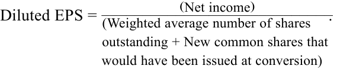

# Tập 4: Phân tích Báo cáo Tài chính (Financial Statement Analysis)
## Học phần 2: Phân tích Báo cáo Kết quả Hoạt động Kinh doanh (Analyzing Income Statements)
### Phần 3/4: Các Khoản mục Không thường xuyên và Thu nhập trên mỗi Cổ phần – EPS (Trang PDF 75–89)

---

<!-- PDF Page 75 -->

## **CÁC KHOẢN MỤC KHÔNG THƯỜNG XUYÊN (NON-RECURRING ITEMS)** 

# **<mark>4</mark>** 

mô tả phương pháp hạch toán báo cáo tài chính và phân tích các khoản mục không thường xuyên (*non-recurring items* - bao gồm hoạt động bị chấm dứt [*discontinued operations*], các khoản mục bất thường hoặc không thường xuyên [*unusual or infrequent items*]) và những thay đổi trong chính sách kế toán (*changes in accounting policies*)

Từ báo cáo kết quả hoạt động kinh doanh của một công ty, chúng ta có thể thấy lợi nhuận của công ty đó trong năm vừa kết thúc và năm trước đó. Nhìn về phía trước, câu hỏi đặt ra là: Công ty sẽ kiếm được bao nhiêu vào năm tới và trong những năm tiếp theo sau đó?

Để đánh giá lợi nhuận tương lai của một công ty, việc tách biệt những khoản mục thu nhập và chi phí của các năm trước có khả năng sẽ tiếp diễn trong tương lai (*recurring*) ra khỏi những khoản mục ít có khả năng tiếp diễn (*non-recurring*) là rất hữu ích. Một số khoản mục từ những năm trước rõ ràng không được kỳ vọng sẽ tiếp diễn trong các kỳ tương lai và được thuyết minh tách biệt trên báo cáo kết quả hoạt động kinh doanh của công ty. Chuẩn mực IFRS mô tả những cân nhắc được đưa vào quyết định trình bày thông tin ngoài những gì được quy định rõ ràng bởi một chuẩn mực. Cả IFRS và US GAAP đều quy định cụ thể rằng kết quả của **các hoạt động bị chấm dứt (*discontinued operations*)** phải được báo cáo tách biệt khỏi **các hoạt động kinh doanh liên tục (*continuing operations*)**. Các khoản mục khác có thể được báo cáo tách biệt trên báo cáo kết quả hoạt động kinh doanh của một công ty, chẳng hạn như các khoản mục bất thường (*unusual items*), các khoản mục xảy ra không thường xuyên (*items that occur infrequently*), tác động do những thay đổi kế toán (*accounting changes*), và thu nhập ngoài hoạt động kinh doanh (*non-operating income*), đòi hỏi nhà phân tích phải đưa ra một số xét đoán chuyên môn.

### **Các Khoản mục Bất thường hoặc Không thường xuyên (Unusual or Infrequent Items)** 

IFRS yêu cầu rằng các khoản mục thu nhập hoặc chi phí mang tính trọng yếu (*material*) hoặc thích hợp cho việc hiểu rõ kết quả hoạt động tài chính của đơn vị phải được thuyết minh tách biệt. Các khoản mục bất thường hoặc không thường xuyên nhiều khả năng sẽ đáp ứng các tiêu chí này. Theo US GAAP, các khoản mục trọng yếu có tính chất bất thường (*unusual*) hoặc không thường xuyên (*infrequent*), hoặc có cả hai tính chất này (kể từ các kỳ báo cáo bắt đầu sau ngày 15 tháng 12 năm 2015, US GAAP đã xóa bỏ khái niệm "khoản mục đặc biệt – *extraordinary items*"), đều được trình bày như một phần trong hoạt động kinh doanh liên tục (*continuing operations*) của công ty nhưng được trình bày thành dòng riêng biệt. Ví dụ, chi phí tái cấu trúc (*restructuring charges*), chẳng hạn như chi phí đóng cửa nhà máy và chi phí chấm dứt hợp đồng lao động với nhân viên, được coi là một phần trong các hoạt động thông thường của công ty. Lấy một ví dụ khác, các khoản lãi và lỗ phát sinh khi một công ty bán một tài sản hoặc một phần mảng kinh doanh với giá cao hơn hoặc thấp hơn giá trị ghi sổ của nó cũng được thuyết minh tách biệt trên báo cáo kết quả hoạt động kinh doanh. Các giao dịch bán tài sản này vẫn được coi là thuộc hoạt động kinh doanh thông thường.

Việc làm nổi bật bản chất bất thường hoặc không thường xuyên của các khoản mục này hỗ trợ nhà phân tích trong việc phán đoán khả năng các khoản mục như vậy sẽ tái diễn trong tương lai. Điều này đáp ứng tiêu chí của IFRS về việc thuyết minh các khoản mục có liên quan đến việc hiểu rõ kết quả hoạt động tài chính của một đơn vị. Trong Bảng 8 (Exhibit 8), báo cáo kết quả hoạt động kinh doanh của Danone hiển thị một con số cho “Thu nhập hoạt động thường xuyên (*Recurring operating income*)” theo sau là một khoản mục dòng riêng biệt cho “Thu nhập (chi phí) hoạt động khác (*other operating income [expense]*)”, khoản mục không được tính vào làm một cấu phần của thu nhập thường xuyên. Bảng 9 (Exhibit 9) trình bày một trích đoạn từ thuyết minh bổ sung của Danone về khoản tiền không thường xuyên này.

**Bảng 8: Báo cáo Kết quả Hoạt động Kinh doanh của Danone (Exhibit 8: Danone Income Statement)** 

**Báo cáo Kết quả Hoạt động Kinh doanh Hợp nhất của Groupe Danone (Tính bằng Triệu Euro) [Trích đoạn]** 

|Khoản mục|**Năm Kết thúc Ngày 31 tháng 12**||
|---|---|---|
||**2016**|**2017**|
|**Doanh thu (*Sales*)**|**$21.944$**|**$24.677$**|
|Giá vốn hàng bán (*Cost of goods sold*)|$(10.744)$|$(12.459)$|

<!-- PDF Page 76 -->

|**Báo cáo Kết quả Hoạt động Kinh doanh Hợp nhất của Groupe Danone (Tính bằng Triệu Euro) [Trích đoạn] (tiếp theo)**|||
|---|---|---|
|Khoản mục|**Năm Kết thúc Ngày 31 tháng 12**||
||**2016**|**2017**|
|Chi phí bán hàng (*Selling expense*)|$(5.562)$|$(5.890)$|
|Chi phí chung và quản lý doanh nghiệp (*General and administrative expense*)|$(2.004)$|$(2.225)$|
|Chi phí nghiên cứu và phát triển (*Research and development expense*)|$(333)$|$(342)$|
|Thu nhập (chi phí) khác (*Other income/expense*)|$(278)$|$(219)$|
|**Thu nhập hoạt động thường xuyên (*Recurring operating income*)**|**$3.022$**|**$3.543$**|
|Thu nhập (chi phí) hoạt động khác (*Other operating income/expense*)|$(99)$|$192$|
|**Thu nhập hoạt động (*Operating income*)**|**$2.923$**|**$3.734$**|
|Thu nhập lãi trên các khoản tương đương tiền và đầu tư ngắn hạn (*Interest income on cash equivalents and short-term investments*)|$130$|$151$|
|Chi phí lãi vay (*Interest expense*)|$(276)$|$(414)$|
|Chi phí nợ ròng (*Cost of net debt*)|$(146)$|$(263)$|
|Thu nhập tài chính khác (*Other financial income*)|$67$|$137$|
|Chi phí tài chính khác (*Other financial expense*)|$(214)$|$(312)$|
|**Thu nhập trước thuế (*Income before tax*)**|**$2.630$**|**$3.296$**|
|Chi phí thuế thu nhập (*Income tax expense*)|$(804)$|$(842)$|
|**Lợi nhuận ròng từ các công ty hợp nhất toàn bộ (*Net income from fully consolidated companies*)**|**$1.826$**|**$2.454$**|
|Phần chia lợi nhuận từ các công ty liên kết (*Share of profit of associates*)|$1$|$109$|
|**Lợi nhuận ròng (*Net income*)**|**$1.827$**|**$2.563$**|
|**Lợi nhuận ròng – Phần thuộc về Tập đoàn (*Net income – Group share*)**|**$1.720$**|**$2.453$**|
|Lợi nhuận ròng – Lợi ích cổ đông không kiểm soát (*Net income – Non-controlling interests*)|$107$|$110$|

#### **Bảng 9: Làm nổi bật Bản chất Không thường xuyên của các Khoản mục — Trích đoạn từ thuyết minh báo cáo tài chính năm 2017 của Groupe Danone** 

THUYẾT MINH SỐ 6. Các Sự kiện và Giao dịch Nằm ngoài Hoạt động Thông thường của Tập đoàn [Trích đoạn]

Thu nhập (chi phí) hoạt động khác (*Other operating income [expense]*) được định nghĩa theo Khuyến nghị số 2013-03 của Ủy ban Kế toán Quốc gia Pháp (CNC) liên quan đến định dạng của báo cáo tài chính hợp nhất được lập theo các chuẩn mực kế toán quốc tế, và bao gồm các khoản mục trọng yếu mà, do bản chất ngoại lệ (*exceptional nature*) của chúng, không thể được xem là vốn có đối với các hoạt động hiện hành của Danone. Các khoản này chủ yếu bao gồm lãi và lỗ vốn từ việc thanh lý các công ty được hợp nhất toàn bộ, chi phí suy giảm giá trị lợi thế thương mại (*impairment charges on goodwill*), các chi phí trọng yếu liên quan đến tái cấu trúc chiến lược và các giao dịch tăng trưởng bên ngoài (M&A) lớn, cùng các chi phí phát sinh hoặc ước tính liên quan đến các cuộc khủng hoảng lớn và các vụ kiện tụng lớn. Hơn nữa, liên quan đến chuẩn mực IFRS 3 Sửa đổi và IAS 27 Sửa đổi, Danone cũng phân loại vào mục Thu nhập (chi phí) hoạt động khác: (i) chi phí mua lại (*acquisition costs*) liên quan đến các giao dịch hợp nhất kinh doanh, (ii) lãi hoặc lỗ đánh giá lại được hạch toán sau khi mất quyền kiểm soát, và (iii) những thay đổi trong các khoản thanh toán trả thêm theo kết quả hoạt động (*earn-outs*) liên quan đến hợp nhất kinh doanh phát sinh sau ngày mua.

Trong năm 2017, khoản Thu nhập hoạt động khác ròng trị giá $192\text{ triệu EUR}$ chủ yếu bao gồm các khoản mục sau đây:

<!-- PDF Page 77 -->

|**_(Triệu Euro)_**|**Thu nhập (Chi phí) Liên quan**|
|---|---|
|Lãi vốn từ việc thanh lý công ty Stonyfield (*Capital gain on disposal of Stonyfield*)|$628$|
|Tiền bồi thường nhận được sau phán quyết của tòa trọng tài Singapore trong vụ kiện Fonterra|$105$|
|Rủi ro lãnh thổ, chủ yếu tại một số quốc gia trong khu vực ALMA|$(148)$|
|Các chi phí liên quan đến quá trình tích hợp công ty WhiteWave|$(118)$|
|Suy giảm giá trị của một số tài sản vô hình tại các đơn vị báo cáo mảng Nước uống và Dinh dưỡng Chuyên biệt|$(115)$|

_Phần còn lại của bảng đã được lược bớt_ 

Trong Bảng 9, Danone cung cấp thông tin chi tiết về các khoản mục được coi là các khoản mục “ngoại lệ (*exceptional*)” và không “vốn có (*inherent*)” đối với hoạt động hiện tại của công ty. Các khoản mục ngoại lệ này bao gồm lãi từ thanh lý tài sản, tiền thu được từ một vụ kiện pháp lý, chi phí tích hợp một thương vụ mua lại, và suy giảm giá trị tài sản vô hình, cùng các khoản mục khác. Nhìn chung, khi dự báo kết quả hoạt động trong tương lai, nhà phân tích sẽ đánh giá xem liệu các khoản mục được báo cáo đó có khả năng tái diễn hay không cũng như những hàm ý có thể có đối với lợi nhuận tương lai. Nhìn chung, lời khuyên là không nên đơn thuần nhắm mắt bỏ qua tất cả các khoản mục bất thường.

### **Các Hoạt động Bị chấm dứt (Discontinued Operations)** 

Khi một công ty thanh lý hoặc thiết lập một kế hoạch chắc chắn để thanh lý một trong các bộ phận hoạt động cấu phần của mình và sẽ không còn bất kỳ sự tham gia nào nữa vào hoạt động đó sau khi thanh lý, báo cáo kết quả hoạt động kinh doanh sẽ báo cáo tách biệt tác động của việc thanh lý này như một **hoạt động “bị chấm dứt” (*“discontinued” operation*)** theo cả IFRS và US GAAP. Các chuẩn mực tài chính đưa ra nhiều tiêu chí khác nhau để báo cáo tách biệt tác động này, mà nhìn chung là bộ phận bị chấm dứt đó phải có thể tách rời được cả về mặt vật lý/tài sản lẫn về mặt vận hành (*separable both physically and operationally*).

Kết quả của các hoạt động bị chấm dứt được trình bày trên cơ sở **đã trừ thuế (*net basis* / *net of tax*)** ở phần cuối của báo cáo kết quả hoạt động kinh doanh, bao gồm cả số liệu tính trên mỗi cổ phần. Các phần còn lại của báo cáo kết quả hoạt động kinh doanh (ví dụ: doanh thu, giá vốn hàng bán, EPS từ các mảng kinh doanh còn lại) là kết quả của **các hoạt động kinh doanh liên tục (*continuing operations*)** và được thuyết minh rõ như vậy. Tài sản và nợ phải trả liên quan đến các hoạt động bị chấm dứt được gộp lại và ghi nhận trên bảng cân đối kế toán là nắm giữ để bán (*held for sale*). Cách trình bày này cho phép nhà phân tích đánh giá rõ ràng các hoạt động kinh doanh liên tục đối chiếu với các hoạt động bị chấm dứt.

Bởi vì hoạt động bị chấm dứt sẽ không còn mang lại lợi nhuận (hoặc dòng tiền) cho công ty một khi việc bán hoặc thanh lý hoàn tất, nhà phân tích có thể loại bỏ hoàn toàn các hoạt động bị chấm dứt khi xây dựng các kỳ vọng về kết quả hoạt động tài chính trong tương lai của công ty sau một ngày nhất định.

### **Những Thay đổi trong Chính sách Kế toán (Changes in Accounting Policy)** 

Đôi khi, các cơ quan thiết lập chuẩn mực ban hành các chuẩn mực mới yêu cầu các công ty phải thay đổi chính sách kế toán. Tùy thuộc vào quy định chuyển tiếp của chuẩn mực đó, các công ty có thể được phép áp dụng các chuẩn mực mới theo hướng **phi hồi tố (*prospectively* — áp dụng trong tương lai)** hoặc **hồi tố (*retrospectively* — điều chỉnh hồi tố lại các báo cáo tài chính quá khứ như thể chuẩn mực mới đã tồn tại từ trước)**. Trong các trường hợp khác, những thay đổi trong chính sách kế toán (ví dụ: chuyển từ một phương pháp tính giá hàng tồn kho được chấp nhận này sang một phương pháp được chấp nhận khác) 

<!-- PDF Page 78 -->

được ban điều hành tự nguyện thực hiện vì nhiều lý do khác nhau, chẳng hạn như nhằm cung cấp sự phản ánh tốt hơn về kết quả hoạt động của công ty. Những thay đổi trong chính sách kế toán được báo cáo thông qua **áp dụng hồi tố (*retrospective application*)**1 trừ khi việc thực hiện điều đó là bất khả thi trên thực tế (*impractical*).

_Áp dụng hồi tố (Retrospective application)_ có nghĩa là các báo cáo tài chính cho tất cả các năm tài chính được hiển thị trong báo cáo tài chính của một công ty đều được trình bày lại (*restated*) như thể nguyên tắc kế toán mới được thông qua đã được sử dụng xuyên suốt toàn bộ các kỳ đó. Phần thuyết minh báo cáo tài chính sẽ mô tả sự thay đổi và giải thích lý do chính đáng cho sự thay đổi đó. Bởi vì những thay đổi trong nguyên tắc kế toán được áp dụng hồi tố, các báo cáo tài chính xuất hiện bên trong cùng một báo cáo tài chính có thể so sánh tương đương với nhau qua các năm.

Ví dụ 7 trình bày một trích đoạn từ Biểu mẫu 10-K của Tập đoàn Microsoft cho năm tài chính kết thúc vào ngày 30 tháng 6 năm 2018 mô tả một sự thay đổi trong nguyên tắc kế toán bắt nguồn từ chuẩn mực ghi nhận doanh thu mới. Microsoft đã chọn áp dụng chuẩn mực mới từ ngày 1 tháng 7 năm 2017, sớm hơn so với ngày bắt buộc áp dụng. Microsoft cũng đã chọn sử dụng “phương pháp hồi tố toàn phần (*full retrospective method*)”, phương pháp yêu cầu các công ty phải điều chỉnh lại (*restate*) kết quả của các kỳ trước. Trên báo cáo kết quả hoạt động kinh doanh của công ty, cả hai năm 2016 và 2017 đều được trình bày như thể chuẩn mực mới đã được sử dụng xuyên suốt trong cả hai năm. Trong phần thuyết minh báo cáo tài chính của mình, Microsoft công bố tác động của chuẩn mực mới.

#### **VÍ DỤ 7 (EXAMPLE 7)** 

### **Tập đoàn Microsoft — Trích đoạn từ Thuyết minh Báo cáo Tài chính (Microsoft Corporation—Excerpt from Footnotes to the Financial Statements)** 

Tác động đáng kể nhất của chuẩn mực [ghi nhận doanh thu mới] liên quan đến việc hạch toán doanh thu cấp phép bản quyền phần mềm của chúng tôi. Cụ thể, đối với hệ điều hành Windows 10, chúng tôi ghi nhận doanh thu chủ yếu tại thời điểm lập hóa đơn và giao hàng thay vì phân bổ theo tỷ lệ thời gian trong suốt vòng đời của thiết bị có liên quan. Đối với một số gói đăng ký phần mềm thương mại nhiều năm bao gồm cả giấy phép phần mềm tách biệt và dịch vụ Đảm bảo Phần mềm (SA), chúng tôi ghi nhận doanh thu giấy phép ngay tại thời điểm thực thi hợp đồng thay vì trải dài trong suốt thời gian đăng ký thuê bao. Do tính phức tạp của một số hợp đồng đăng ký giấy phép thương mại của chúng tôi, phương pháp ghi nhận doanh thu thực tế theo yêu cầu của chuẩn mực phụ thuộc vào các điều khoản cụ thể của từng hợp đồng và trong một số trường hợp có thể khác với việc ghi nhận tại thời điểm lập hóa đơn. Việc ghi nhận doanh thu liên quan đến phần cứng, các dịch vụ đám mây (chẳng hạn như Office 365), LinkedIn và các dịch vụ chuyên nghiệp của chúng tôi về cơ bản vẫn không thay đổi. Hãy tham khảo mục Tác động đối với Kết quả Đã Báo cáo Trước đây dưới đây để biết tác động của việc áp dụng chuẩn mực lên báo cáo tài chính hợp nhất của chúng tôi.

**Bảng 10: Tác động đối với Kết quả Đã Báo cáo Trước đây của Microsoft (Exhibit 10: Microsoft Impacts to Previously Reported Results)** 

|**(Triệu đô la Mỹ, ngoại trừ các số liệu trên mỗi cổ phần)**|**Theo Báo cáo Trước đây (As Previously Reported)**|**Điều chỉnh theo Chuẩn mực Doanh thu Mới (New Revenue Standard Adjustment)**|**Sau khi Điều chỉnh Hồi tố (As Restated)**|
|---|---|---|---|
|**Báo cáo Kết quả Hoạt động Kinh doanh (Income Statements)**||||
|**Năm Kết thúc Ngày 30 tháng 6 năm 2017**||||
|Doanh thu (*Revenue*)|$89.950$|$6.621$|$96.571$|
|Dự phòng thuế thu nhập (*Provision for income taxes*)|$1.945$|$2.467$|$4.412$|
|Lợi nhuận ròng (*Net income*)|$21.204$|$4.285$|$25.489$|
|Thu nhập trên mỗi cổ phần suy giảm (*Diluted EPS*)|$2,71$|$0,54$|$3,25$|

<!-- PDF Page 79 -->

|**(Triệu đô la Mỹ, ngoại trừ các số liệu trên mỗi cổ phần)**|**Theo Báo cáo Trước đây (As Previously Reported)**|**Điều chỉnh theo Chuẩn mực Doanh thu Mới (New Revenue Standard Adjustment)**|**Sau khi Điều chỉnh Hồi tố (As Restated)**|
|---|---|---|---|
|**Năm Kết thúc Ngày 30 tháng 6 năm 2016**||||
|Doanh thu (*Revenue*)|$85.320$|$5.834$|$91.154$|
|Dự phòng thuế thu nhập (*Provision for income taxes*)|$2.953$|$2.147$|$5.100$|
|Lợi nhuận ròng (*Net income*)|$16.798$|$3.741$|$20.539$|
|Thu nhập trên mỗi cổ phần suy giảm (*Diluted EPS*)|$2,10$|$0,46$|$2,56$|

1. Dựa trên Bảng 10, hãy mô tả xem kết quả của Microsoft trông có vẻ tốt hơn hay kém đi dưới chuẩn mực ghi nhận doanh thu mới.

#### **Lời giải:** 

Kết quả của Microsoft trông có vẻ tốt hơn dưới chuẩn mực ghi nhận doanh thu mới. Doanh thu và lợi nhuận ròng đều cao hơn dưới chuẩn mực mới. Biên lợi nhuận ròng (*net profit margin*) cũng cao hơn dưới chuẩn mực mới. Đối với năm 2017, biên lợi nhuận ròng là $26,4\%$ ($= 25.489 / 96.571$) dưới chuẩn mực mới so với mức $23,6\%$ ($= 21.204 / 89.950$) dưới chuẩn mực cũ. Doanh thu được báo cáo cũng tăng trưởng nhanh hơn dưới chuẩn mực mới. Tốc độ tăng trưởng doanh thu dưới chuẩn mực mới là $5,9\%$ ($= [96.571 / 91.154] - 1$) so với mức $5,4\%$ ($= [89.950 / 85.320] - 1$) dưới chuẩn mực cũ.

Cách trình bày của Microsoft về tác động của quy định ghi nhận doanh thu mới cho phép nhà phân tích xác định rõ tác động của sự thay đổi trong chuẩn mực kế toán.

Lưu ý rằng chuẩn mực ghi nhận doanh thu mới cũng cung cấp cho các công ty quyền lựa chọn sử dụng phương pháp áp dụng “hồi tố có sửa đổi (*modified retrospective*)”. Theo phương pháp hồi tố có sửa đổi, các công ty không bắt buộc phải trình bày lại các báo cáo tài chính đã báo cáo trước đó. Thay vào đó, họ điều chỉnh số dư đầu kỳ của lợi nhuận giữ lại (*opening balances of retained earnings* — và các tài khoản có liên quan khác) đối với tác động lũy kế của chuẩn mực mới.

Trái ngược với những thay đổi trong chính sách kế toán (chẳng hạn như việc có hạch toán chi phí quyền chọn cổ phiếu của nhân viên vào chi phí hay không), các công ty đôi khi thực hiện _những thay đổi trong ước tính kế toán (changes in accounting estimates)_ (chẳng hạn như thay đổi thời gian sử dụng hữu ích ước tính của một tài sản trích khấu hao). Những thay đổi trong ước tính kế toán được xử lý theo hướng **phi hồi tố (*prospectively*)**, với việc sự thay đổi chỉ ảnh hưởng đến báo cáo tài chính của kỳ thay đổi và các kỳ tương lai. Không có bất kỳ sự điều chỉnh nào được thực hiện đối với các báo cáo của các kỳ trước, và khoản điều chỉnh không được hiển thị thành dòng riêng trên bề mặt của báo cáo kết quả hoạt động kinh doanh. Những thay đổi trọng yếu trong ước tính phải được thuyết minh trong phần thuyết minh báo cáo tài chính. Bảng 11 (Exhibit 11) cung cấp một trích đoạn từ Biểu mẫu 10-K hàng năm của Catalent Inc., một công ty công nghệ sinh học có trụ sở tại Hoa Kỳ, minh họa cho một sự thay đổi trong ước tính kế toán.

#### **Bảng 11: Thay đổi trong Ước tính Kế toán — Trích đoạn từ Biểu mẫu 10-K của Catalent** 

Catalent Inc. công bố một sự thay đổi trong phương pháp mà công ty sử dụng để tính toán chi phí hàng năm liên quan đến các chương trình hưu trí phúc lợi xác định (*defined benefit pension plans*) của mình. Thay vì sử dụng một mức lãi suất chiết khấu bình quân gia quyền duy nhất trong các phép tính, công ty sẽ sử dụng các mức lãi suất giao ngay (*spot rates*) áp dụng riêng cho từng dòng tiền dự phóng.

<!-- PDF Page 80 -->

### **Các Chương trình Hậu Hưu trí và Lương hưu (Post-Retirement and Pension Plans)** 

Việc đo lường các nghĩa vụ phúc lợi có liên quan và chi phí phúc lợi định kỳ ròng được ghi nhận hàng năm dựa trên các phép tính toán bảo hiểm (*actuarial computations*), vốn đòi hỏi sự xét đoán của ban điều hành đối với một số giả định nhất định. Các giả định này bao gồm lãi suất chiết khấu được sử dụng trong việc tính toán giá trị hiện tại của các nghĩa vụ phúc lợi và chi phí phúc lợi định kỳ ròng...

Có hiệu lực từ ngày 30 tháng 6 năm 2016, phương pháp tiếp cận được sử dụng để ước tính cấu phần chi phí phục vụ (*service cost*) và chi phí lãi (*interest cost*) của chi phí phúc lợi định kỳ ròng đối với các chương trình phúc lợi đã được thay đổi nhằm cung cấp sự đo lường chuẩn xác hơn về chi phí phục vụ và chi phí lãi. Trong lịch sử, Công ty ước tính các cấu phần phục vụ và lãi này bằng cách sử dụng một mức lãi suất chiết khấu bình quân gia quyền duy nhất được suy ra từ đường cong lợi suất (*yield curve*) dùng để đo lường nghĩa vụ phúc lợi vào đầu kỳ. Trong tương lai, Công ty đã chọn sử dụng phương pháp tiếp cận chiết khấu từng dòng tiền kỳ vọng riêng lẻ bằng cách sử dụng các mức lãi suất giao ngay (*spot rates*) thích hợp được suy ra từ đường cong lợi suất trong suốt giai đoạn dòng tiền dự phóng. Công ty đã hạch toán sự thay đổi này như một sự thay đổi trong ước tính kế toán không thể tách rời khỏi một sự thay đổi trong nguyên tắc kế toán và theo đó đã hạch toán nó theo hướng phi hồi tố (*prospectively*).

Một sự điều chỉnh có thể xảy ra khác là _sửa chữa một sai sót của kỳ trước (correction of an error for a prior period)_ (ví dụ: sai sót trong báo cáo tài chính đã phát hành cho một năm trước đó). Việc này không thể được xử lý bằng cách đơn thuần điều chỉnh báo cáo kết quả hoạt động kinh doanh của kỳ hiện tại. Việc sửa chữa sai sót của một kỳ trước được xử lý bằng cách **điều chỉnh hồi tố / trình bày lại (*restating*)** các báo cáo tài chính (bao gồm bảng cân đối kế toán, báo cáo biến động vốn chủ sở hữu, và báo cáo lưu chuyển tiền tệ) cho các kỳ trước được trình bày so sánh trong bộ báo cáo tài chính hiện tại. Lưu ý rằng các thuyết minh chi tiết về sai sót này là bắt buộc. Các thuyết minh này cần được kiểm tra cẩn thận bởi vì chúng có thể làm bộc lộ những điểm yếu kém trong hệ thống kế toán và kiểm soát tài chính nội bộ của công ty.

### **Những Thay đổi về Phạm vi Hợp nhất và Tỷ giá Hối đoái (Changes in Scope and Exchange Rates)** 

Khi một tổ chức phát hành mua lại lợi ích kiểm soát (*controlling interest*) trong một công ty khác, tổ chức đó sẽ hợp nhất báo cáo tài chính của công ty mục tiêu kể từ ngày hoàn tất giao dịch (*closing date*). Tùy thuộc vào quy mô của công ty mục tiêu tương quan so với bên mua, một thương vụ mua lại có thể làm ảnh hưởng trọng yếu đến khả năng so sánh của kết quả và tình hình tài chính của bên mua so với các kỳ trước. Ngoài ra, những biến động về tỷ giá hối đoái (*changes in exchange rates*) thường ảnh hưởng đến báo cáo kết quả hoạt động kinh doanh của các công ty đa quốc gia (ví dụ: đồng tiền chức năng [*functional currency*] của công ty con mạnh lên so với đồng tiền báo cáo [*reporting currency*] của công ty mẹ sẽ làm tăng doanh thu được báo cáo sau quy đổi, trong khi đồng tiền chức năng suy yếu đi so với đồng tiền báo cáo sẽ làm giảm doanh thu được báo cáo). Đáng tiếc là các chuẩn mực kế toán _không_ bắt buộc các tổ chức phát hành phải thuyết minh tác động của những thay đổi về phạm vi hợp nhất (*scope changes*) hoặc thay đổi tỷ giá hối đoái trên các báo cáo tài chính chính thức hoặc trong từng khoản mục riêng lẻ, mặc dù hầu hết các tổ chức phát hành đều tự nguyện công bố thông tin tóm tắt hữu ích (chẳng hạn như tốc độ tăng trưởng doanh thu và EPS loại trừ tác động thay đổi phạm vi hợp nhất và tỷ giá hối đoái — tức tăng trưởng hữu cơ theo tỷ giá cố định) trong báo cáo của ban điều hành hoặc ở các tài liệu khác.

Các hàm ý trên báo cáo tài chính của những thay đổi về phạm vi hợp nhất và tỷ giá hối đoái sẽ được thảo luận chi tiết ở phần sau của chương trình học.

<!-- PDF Page 81 -->

## **THU NHẬP TRÊN MỖI CỔ PHẦN (EARNINGS PER SHARE – EPS)** 

# **<mark>5</mark>** 

mô tả cách thức tính toán thu nhập trên mỗi cổ phần (*earnings per share* – EPS) cũng như tính toán và diễn giải EPS cơ bản (*basic EPS*) và EPS suy giảm/pha loãng (*diluted EPS*) của một công ty đối với các công ty có cấu trúc vốn đơn giản và phức tạp, bao gồm cả những công ty có chứng khoán chống pha loãng (*antidilutive securities*)

Một chỉ số trên báo cáo kết quả hoạt động kinh doanh có tầm quan trọng đặc biệt đối với các nhà đầu tư cổ phiếu là **thu nhập trên mỗi cổ phần (*earnings per share* – EPS)**. Chuẩn mực IFRS yêu cầu trình bày EPS ngay trên bề mặt của báo cáo kết quả hoạt động kinh doanh đối với lợi nhuận hoặc lỗ ròng (*net income*) và lợi nhuận hoặc lỗ từ các hoạt động kinh doanh liên tục (*continuing operations*), và cách trình bày tương tự cũng được yêu cầu theo US GAAP. Bài học này phác thảo các phép tính cho EPS và giải thích cách thức tính toán khác nhau như thế nào giữa một cấu trúc vốn đơn giản và một cấu trúc vốn phức tạp.

### **Cấu trúc Vốn Đơn giản đối chiếu với Cấu trúc Vốn Phức tạp (Simple versus Complex Capital Structure)** 

Nguồn vốn của một công ty được cấu thành từ vốn chủ sở hữu và nợ. Một số loại vốn chủ sở hữu có quyền ưu tiên hơn so với những loại khác, và một số khoản nợ (cùng các công cụ khác) có thể được chuyển đổi thành vốn chủ sở hữu phổ thông. Theo IFRS, loại vốn chủ sở hữu mà EPS được tính toán và trình bày cho nó được gọi là cổ phần phổ thông (*ordinary shares*). **Cổ phần phổ thông (*Ordinary shares*)** là những cổ phần vốn chủ sở hữu có thứ tự ưu tiên thanh toán thấp hơn (*subordinate*) tất cả các loại vốn chủ sở hữu khác. Các cổ đông phổ thông về cơ bản là những người chủ sở hữu đích thực của công ty — những người nắm giữ vốn chủ sở hữu được thanh toán sau cùng khi thanh lý giải thể công ty và là những người hưởng lợi nhiều nhất khi công ty ăn nên làm ra. Theo US GAAP, phần vốn chủ sở hữu phổ thông này được gọi là **cổ phiếu phổ thông (*common stock*)** hoặc **cổ phần phổ thông (*common shares*)**, phản ánh cách dùng từ ngữ tại Hoa Kỳ. Các thuật ngữ “ordinary shares”, “common stock” và “common shares” được sử dụng thay thế cho nhau trong phần thảo luận dưới đây.

Khi một công ty đã phát hành bất kỳ công cụ tài chính nào có khả năng chuyển đổi tiềm tàng thành cổ phiếu phổ thông, công ty đó được gọi là có **cấu trúc vốn phức tạp (*complex capital structure*)**. Các ví dụ về những công cụ tài chính có khả năng chuyển đổi tiềm tàng thành cổ phiếu phổ thông bao gồm trái phiếu chuyển đổi (*convertible bonds*), cổ phiếu ưu đãi chuyển đổi (*convertible preferred stock*), quyền chọn cổ phiếu của người lao động (*employee stock options*), và chứng quyền (*warrants* — chứng quyền về bản chất là một quyền chọn mua cổ phiếu dài hạn do chính công ty phát hành; người nắm giữ chứng quyền có quyền nhưng không có nghĩa vụ mua các cổ phần mới phát hành ở mức giá thực hiện). Nếu cấu trúc vốn của một công ty không bao gồm các công cụ tài chính có khả năng chuyển đổi tiềm tàng như vậy, công ty đó được gọi là có **cấu trúc vốn đơn giản (*simple capital structure*)**.

Sự phân biệt giữa cấu trúc vốn đơn giản và cấu trúc vốn phức tạp có liên quan mật thiết đến việc tính toán EPS bởi vì các công cụ tài chính có khả năng chuyển đổi tiềm tàng thành cổ phiếu phổ thông có thể, do hệ quả của việc chuyển đổi hoặc thực hiện quyền, làm pha loãng/suy giảm (*dilute* — tức là làm giảm) EPS. Thông tin về sự pha loãng tiềm tàng như vậy rất có giá trị đối với các cổ đông hiện tại và tiềm năng của công ty; do đó, các chuẩn mực kế toán yêu cầu các công ty phải thuyết minh xem EPS của họ sẽ là bao nhiêu nếu tất cả các công cụ tài chính gây pha loãng đều được chuyển đổi thành cổ phiếu phổ thông. Mức EPS sẽ xảy ra nếu tất cả các công cụ tài chính gây pha loãng đều được chuyển đổi được gọi là **EPS suy giảm / EPS pha loãng (*diluted EPS*)**. Ngược lại, **EPS cơ bản (*basic EPS*)** được tính toán bằng cách chỉ sử dụng phần lợi nhuận được báo cáo dành cho các cổ đông phổ thông của công ty mẹ và số lượng cổ phần phổ thông đang lưu hành bình quân gia quyền thực tế.

Các công ty bắt buộc phải báo cáo cả EPS cơ bản và EPS suy giảm cũng như các con số tương ứng cho hoạt động kinh doanh liên tục. Bảng 12 (Exhibit 12) cho thấy các con số trên mỗi cổ phần được AB InBev báo cáo ở cuối báo cáo kết quả hoạt động kinh doanh của mình. EPS cơ bản (“trước pha loãng”) của công ty là $4,06\text{ USD}$, và EPS suy giảm (“sau pha loãng”) là $3,98\text{ USD}$ cho năm 2017. Ngoài ra, giống như cách báo cáo kết quả hoạt động kinh doanh của AB InBev trình bày thu nhập từ hoạt động kinh doanh liên tục tách biệt khỏi tổng thu nhập, EPS từ hoạt động kinh doanh liên tục cũng được trình bày tách biệt khỏi tổng EPS. Đối với năm 2017, EPS cơ bản và EPS suy giảm từ hoạt động kinh doanh liên tục lần lượt là $4,04\text{ USD}$ và $3,96\text{ USD}$. Xét trên tất cả các thước đo, 

<!-- PDF Page 82 -->

EPS của AB InBev trong năm 2017 cao hơn rất nhiều so với năm 2016. Một nhà phân tích sẽ tìm cách hiểu rõ những nguyên nhân cơ sở đằng sau những thay đổi trong EPS, một chủ đề mà chúng ta sẽ giải quyết sau phần giải thích về các phép tính của cả EPS cơ bản và EPS suy giảm.

**Bảng 12: Thu nhập trên mỗi Cổ phần của AB InBev (USD) (Exhibit 12: AB InBev’s Earnings per Share [USD])** 

|Khoản mục|**12 Tháng Kết thúc Ngày 31 tháng 12**|||
|---|---|---|---|
||**2017**|**2016**|**2015**|
|Thu nhập trên mỗi cổ phần cơ bản (*Basic earnings per share*)|$4,06$|$0,72$|$5,05$|
|Thu nhập trên mỗi cổ phần suy giảm (*Diluted earnings per share*)|$3,98$|$0,71$|$4,96$|
|Thu nhập trên mỗi cổ phần cơ bản từ hoạt động kinh doanh liên tục (*Basic earnings per share from continuing operations*)|$4,04$|$0,69$|$5,05$|
|Thu nhập trên mỗi cổ phần suy giảm từ hoạt động kinh doanh liên tục (*Diluted earnings per share from continuing operations*)|$3,96$|$0,68$|$4,96$|

### **EPS Cơ bản (Basic EPS)** 

**EPS cơ bản (*Basic EPS*)** là số tiền thu nhập dành cho các cổ đông phổ thông chia cho số lượng cổ phần phổ thông đang lưu hành bình quân gia quyền (*weighted average number of common shares outstanding*) trong một kỳ. Số tiền thu nhập dành cho các cổ đông phổ thông là phần lợi nhuận ròng (*net income*) còn lại sau khi cổ tức ưu đãi (*preferred dividends*, nếu có) đã được thanh toán/tuyên bố. Do đó, công thức tính EPS cơ bản như sau:

<!-- Formula Text: Net income − Preferred dividends __________________________________ Basic EPS = Weighted average number of shares outstanding. -->
$$\text{Basic EPS} = \frac{\text{Net income} - \text{Preferred dividends}}{\text{Weighted average number of shares outstanding}}$$

Số lượng cổ phần đang lưu hành bình quân gia quyền là phép tính trọng số thời gian (*time weighting*) của số lượng cổ phần phổ thông đang lưu hành. Ví dụ, giả sử một công ty bắt đầu năm với $2.000.000$ cổ phần phổ thông đang lưu hành và mua lại làm cổ phiếu quỹ (*repurchased*) $100.000$ cổ phần phổ thông vào ngày 1 tháng 7. Số lượng cổ phần phổ thông đang lưu hành bình quân gia quyền sẽ là tổng của $2.000.000\text{ cổ phần} \times \frac{1}{2}\text{ năm} + 1.900.000\text{ cổ phần} \times \frac{1}{2}\text{ năm}$, hay $1.950.000$ cổ phần. Vì vậy, công ty sẽ sử dụng $1.950.000$ cổ phần làm số lượng cổ phần bình quân gia quyền khi tính toán EPS cơ bản của mình.

Nếu số lượng cổ phần phổ thông tăng lên do hệ quả của việc trả cổ tức bằng cổ phiếu (*stock dividend*) hoặc chia tách cổ phiếu (*stock split*), phép tính EPS sẽ phản ánh sự thay đổi này **hồi tố ngược về thời điểm đầu kỳ (*retroactively to the beginning of the period*)** (áp dụng cho toàn bộ các cổ phần lưu hành trước thời điểm chia tách/cổ tức cổ phiếu).

Các Ví dụ 8, 9 và 10 minh họa việc tính toán EPS cơ bản.

#### **VÍ DỤ 8 (EXAMPLE 8)** 

### **Tính toán EPS Cơ bản (1) (A Basic EPS Calculation [1])** 

1. Cho năm kết thúc ngày 31 tháng 12 năm 2018, Công ty Shopalot có lợi nhuận ròng là $1.950.000\text{ USD}$. Công ty có $1.500.000$ cổ phần phổ thông đang lưu hành xuyên suốt năm, không có cổ phiếu ưu đãi, và không có các công cụ tài chính chuyển đổi. EPS cơ bản của Shopalot là bao nhiêu?

**Lời giải:** 

EPS cơ bản của Shopalot là **$1,30\text{ USD}$** ($1.950.000\text{ USD}$ chia cho $1.500.000$ cổ phần).

<!-- PDF Page 83 -->

#### **VÍ DỤ 9 (EXAMPLE 9)** 

### **Tính toán EPS Cơ bản (2) (A Basic EPS Calculation [2])** 

Cho năm kết thúc ngày 31 tháng 12 năm 2018, Angler Products có lợi nhuận ròng là $2.500.000\text{ USD}$. Công ty đã tuyên bố và chi trả $200.000\text{ USD}$ cổ tức cho cổ phiếu ưu đãi. Công ty cũng có thông tin về số lượng cổ phần phổ thông được trình bày trong Bảng 13 (Exhibit 13):

#### **Bảng 13: Số lượng Cổ phần Phổ thông của Angler (Exhibit 13: Angler’s Common Stock Shares)** 

|Sự kiện|Số lượng cổ phần|
|---|---|
|Số cổ phần đang lưu hành vào ngày 1 tháng 1 năm 2018|$1.000.000$|
|Số cổ phần phát hành mới vào ngày 1 tháng 4 năm 2018|$200.000$|
|Số cổ phần mua lại (cổ phiếu quỹ – *treasury shares*) vào ngày 1 tháng 10 năm 2018|$(100.000)$|
|Số cổ phần đang lưu hành vào ngày 31 tháng 12 năm 2018|$1.100.000$|

1. Số lượng cổ phần đang lưu hành bình quân gia quyền của công ty là bao nhiêu?

   - **Lời giải:** 

Số lượng cổ phần đang lưu hành bình quân gia quyền được xác định bởi khoảng thời gian mà mỗi mức số lượng cổ phần lưu hành trong năm:

|Giai đoạn và phép tính|Số cổ phần theo trọng số thời gian|
|---|---|
|$1.000.000 \times (3\text{ tháng} / 12\text{ tháng}) =$|$250.000$|
|$1.200.000 \times (6\text{ tháng} / 12\text{ tháng}) =$|$600.000$|
|$1.100.000 \times (3\text{ tháng} / 12\text{ tháng}) =$|$275.000$|
|**Số lượng cổ phần đang lưu hành bình quân gia quyền**|**$1.125.000$**|

2. EPS cơ bản của công ty là bao nhiêu?

#### **Lời giải:** 

$$\text{Basic EPS} = \frac{\text{Net income} - \text{Preferred dividends}}{\text{Weighted average number of shares}} = \frac{\text{USD } 2.500.000 - \text{USD } 200.000}{1.125.000} = \text{USD } 2,04$$

#### **VÍ DỤ 10 (EXAMPLE 10)** 

### **Tính toán EPS Cơ bản (3) (A Basic EPS Calculation [3])** 

1. Giả sử các dữ kiện giống hệt như Ví dụ 9 ngoại trừ việc vào ngày 1 tháng 12 năm 2018, một đợt chia tách cổ phiếu theo tỷ lệ 2 đổi 1 (*2-for-1 stock split*) đã công bố trước đó bắt đầu có hiệu lực. Mỗi cổ đông trong danh sách chốt quyền nhận được 2 cổ phần để đổi lấy mỗi 1 cổ phần hiện tại mà người đó đang sở hữu. EPS cơ bản của công ty là bao nhiêu?

#### **Lời giải:** 

Nhằm mục đích tính toán EPS, việc chia tách cổ phiếu được xử lý như thể nó đã diễn ra ngay từ đầu kỳ (và điều chỉnh cho tất cả các sự kiện trước ngày chia tách). Do đó, số lượng cổ phần bình quân gia quyền sẽ tăng gấp đôi thành $2.250.000$ ($= 1.125.000 \times 2$), và EPS cơ bản sẽ giảm một nửa xuống còn **$1,02\text{ USD}$** ($= [\text{USD } 2.500.000 - \text{USD } 200.000] / 2.250.000$).

<!-- PDF Page 84 -->

### **EPS Suy giảm: Phương pháp Giả định Chuyển đổi (Diluted EPS: The If-Converted Method)** 

Nếu một công ty có cấu trúc vốn đơn giản (nói cách khác, cấu trúc vốn không bao gồm bất kỳ công cụ tài chính có khả năng gây pha loãng tiềm tàng nào), thì EPS cơ bản của công ty sẽ bằng với EPS suy giảm của nó. Tuy nhiên, nếu một công ty có các công cụ tài chính có khả năng gây pha loãng tiềm tàng, EPS suy giảm của nó có thể khác với EPS cơ bản. Theo định nghĩa, **EPS suy giảm (*Diluted EPS*) luôn bằng hoặc nhỏ hơn EPS cơ bản**. Các phần tiếp theo mô tả tác động của ba loại công cụ tài chính có khả năng gây pha loãng tiềm tàng lên EPS suy giảm: cổ phiếu ưu đãi chuyển đổi (*convertible preferred*), nợ chuyển đổi (*convertible debt*), và quyền chọn cổ phiếu của người lao động (*employee stock options*). Phần cuối cùng giải thích tại sao không phải tất cả các công cụ tài chính có khả năng chuyển đổi tiềm tàng đều thực sự dẫn đến sự chênh lệch giữa EPS cơ bản và EPS suy giảm.

### **EPS Suy giảm Khi Công ty Có Cổ phiếu Ưu đãi Chuyển đổi Đang Lưu hành (Diluted EPS When a Company Has Convertible Preferred Stock Outstanding)** 

Khi một công ty có cổ phiếu ưu đãi chuyển đổi đang lưu hành, EPS suy giảm được tính toán bằng cách sử dụng **phương pháp giả định chuyển đổi (*if-converted method*)**. Phương pháp giả định chuyển đổi dựa trên việc tính xem EPS sẽ là bao nhiêu nếu các chứng khoán ưu đãi chuyển đổi đó đã được chuyển đổi ngay vào thời điểm đầu kỳ (hoặc tại thời điểm phát hành nếu phát hành trong kỳ). Nói cách khác, phương pháp này tính toán xem tác động sẽ là gì nếu các cổ phần ưu đãi chuyển đổi đã chuyển đổi vào đầu kỳ. Nếu các cổ phần chuyển đổi này đã được chuyển đổi, sẽ có hai tác động đồng thời xảy ra:
- Thứ nhất, các chứng khoán ưu đãi chuyển đổi sẽ không còn lưu hành nữa; thay vào đó, sẽ có thêm các cổ phiếu phổ thông bổ sung đang lưu hành. Do đó, theo phương pháp giả định chuyển đổi, số lượng cổ phần phổ thông đang lưu hành bình quân gia quyền ở mẫu số sẽ cao hơn so với trong phép tính EPS cơ bản.
- Thứ hai, nếu việc chuyển đổi như vậy đã diễn ra, công ty sẽ không phải trả cổ tức ưu đãi. Do đó, theo phương pháp giả định chuyển đổi, lợi nhuận ròng dành cho các cổ đông phổ thông ở tử số sẽ cao hơn so với trong phép tính EPS cơ bản (tức không còn trừ đi cổ tức ưu đãi của số cổ phần đã chuyển đổi).

EPS suy giảm sử dụng phương pháp giả định chuyển đổi đối với cổ phiếu ưu đãi chuyển đổi bằng lợi nhuận ròng chia cho tổng của số lượng cổ phần đang lưu hành bình quân gia quyền từ phép tính EPS cơ bản cộng với số lượng cổ phần phổ thông bổ sung sẽ được phát hành khi chuyển đổi cổ phiếu ưu đãi. Do đó, công thức tính EPS suy giảm sử dụng phương pháp giả định chuyển đổi đối với cổ phiếu ưu đãi như sau:

<!-- Formula Text: Diluted EPS = (Net income) ____________________________ (Weighted average number of shares outstanding + New common shares that would have been issued at conversion) . -->
$$\text{Diluted EPS} = \frac{\text{Net income}}{\text{Weighted average number of shares outstanding} + \text{New common shares that would have been issued at conversion}}$$

Một phép tính EPS suy giảm sử dụng phương pháp giả định chuyển đổi đối với cổ phiếu ưu đãi được cung cấp trong Ví dụ 11.

#### **VÍ DỤ 11 (EXAMPLE 11)** 

### **Tính toán EPS Suy giảm Sử dụng Phương pháp Giả định Chuyển đổi đối với Cổ phiếu Ưu đãi (A Diluted EPS Calculation Using the If-Converted Method for Preferred Stock)** 

1. Cho năm kết thúc ngày 31 tháng 12 năm 2018, Công ty Tiện ích Bright-Warm (giả định) có lợi nhuận ròng là $1.750.000\text{ USD}$. Công ty có bình quân $500.000$ cổ phần phổ thông đang lưu hành, $20.000$ cổ phần ưu đãi chuyển đổi, và không có chứng khoán có khả năng gây pha loãng tiềm tàng nào khác. Mỗi cổ phần ưu đãi trả mức cổ tức là $10\text{ USD}$ mỗi cổ phần, và mỗi cổ phần ưu đãi có thể chuyển đổi thành $5$ 

<!-- PDF Page 85 -->

cổ phần phổ thông của công ty. Hãy tính EPS cơ bản và EPS suy giảm của công ty.

#### **Lời giải:** 

Nếu $20.000$ cổ phần ưu đãi chuyển đổi đều được chuyển đổi thành $5$ cổ phần phổ thông của công ty cho mỗi cổ phần ưu đãi, công ty sẽ có thêm $100.000$ cổ phần phổ thông ($5$ cổ phần phổ thông nhân với $20.000$ cổ phần ưu đãi). Nếu việc chuyển đổi đã diễn ra, công ty sẽ không phải trả khoản cổ tức ưu đãi trị giá $200.000\text{ USD}$ ($10\text{ USD}$ mỗi cổ phần nhân với $20.000$ cổ phần ưu đãi). Như trình bày trong Bảng 14 (Exhibit 14), EPS cơ bản của công ty là **$3,10\text{ USD}$** và EPS suy giảm của công ty là **$2,92\text{ USD}$**.

#### **Bảng 14: Tính toán EPS Suy giảm cho Công ty Tiện ích Bright-Warm Sử dụng Phương pháp Giả định Chuyển đổi: Trường hợp Cổ phiếu Ưu đãi** 

|Khoản mục|**EPS Cơ bản (Basic EPS)**|**EPS Suy giảm Sử dụng Phương pháp Giả định Chuyển đổi (Diluted EPS Using If-Converted Method)**|
|---|---|---|
|Lợi nhuận ròng (*Net income*)|$\text{USD } 1.750.000$|$\text{USD } 1.750.000$|
|Cổ tức ưu đãi (*Preferred dividend*)|$-200.000$|$0$|
|**Tử số (*Numerator*)**|**$\text{USD } 1.550.000$**|**$\text{USD } 1.750.000$**|
|Số lượng cổ phần đang lưu hành bình quân gia quyền (*Weighted average number of shares outstanding*)|$500.000$|$500.000$|
|Số cổ phần phát hành thêm nếu cổ phiếu ưu đãi được chuyển đổi (*Additional shares issued if preferred converted*)|$0$|$100.000$|
|**Mẫu số (*Denominator*)**|**$500.000$**|**$600.000$**|
|**EPS**|**$\text{USD } 3,10$**|**$\text{USD } 2,92$**|

### **EPS Suy giảm Khi Công ty Có Nợ Chuyển đổi Đang Lưu hành (Diluted EPS When a Company Has Convertible Debt Outstanding)** 

Khi một công ty có nợ chuyển đổi (*convertible debt*) đang lưu hành, phép tính EPS suy giảm cũng sử dụng **phương pháp giả định chuyển đổi (*if-converted method*)**. EPS suy giảm được tính toán như thể khoản nợ chuyển đổi đó đã được chuyển đổi vào đầu kỳ. Nếu khoản nợ chuyển đổi đã được chuyển đổi, các chứng khoán nợ đó sẽ không còn lưu hành nữa; thay vào đó, sẽ có thêm các cổ phần phổ thông bổ sung đang lưu hành ở mẫu số. Ngoài ra, nếu việc chuyển đổi như vậy đã diễn ra, công ty sẽ không phải trả tiền lãi vay cho khoản nợ chuyển đổi đó, vì vậy lợi nhuận ròng dành cho các cổ đông phổ thông ở tử số sẽ tăng thêm một khoản bằng **chi phí lãi vay sau thuế (*after-tax amount of interest expense* $= \text{Interest} \times [1 - \text{Tax rate}]$)** của khoản nợ được chuyển đổi.

Do đó, công thức tính EPS suy giảm sử dụng phương pháp giả định chuyển đổi đối với nợ chuyển đổi như sau:

$$\text{Diluted EPS} = \frac{\text{Net income} + \text{After-tax interest on convertible debt} - \text{Preferred dividends}}{\text{Weighted average number of shares outstanding} + \text{Additional common shares that would have been issued at conversion}}$$

Một phép tính EPS suy giảm sử dụng phương pháp giả định chuyển đổi đối với nợ chuyển đổi được cung cấp trong Ví dụ 12.

<!-- PDF Page 86 -->

#### **VÍ DỤ 12 (EXAMPLE 12)** 

### **Tính toán EPS Suy giảm Sử dụng Phương pháp Giả định Chuyển đổi đối với Nợ Chuyển đổi (A Diluted EPS Calculation Using the If-Converted Method for Convertible Debt)** 

1. Công ty Oppnox (giả định) đã báo cáo lợi nhuận ròng là $750.000\text{ USD}$ cho năm kết thúc vào ngày 31 tháng 12 năm 2018. Công ty có số lượng cổ phần phổ thông đang lưu hành bình quân gia quyền là $690.000$ cổ phần. Ngoài ra, công ty chỉ có một chứng khoán có khả năng gây pha loãng tiềm tàng duy nhất: $50.000\text{ USD}$ mệnh giá trái phiếu chuyển đổi lãi suất $6\%$, có thể chuyển đổi thành tổng cộng $10.000$ cổ phần phổ thông. Giả sử mức thuế suất là $30\%$, hãy tính EPS cơ bản và EPS suy giảm của Oppnox.

#### **Lời giải:** 

Nếu các chứng khoán nợ này đã được chuyển đổi, chứng khoán nợ sẽ không còn lưu hành nữa và thay vào đó, sẽ có thêm $10.000$ cổ phần phổ thông đang lưu hành. Ngoài ra, nếu các chứng khoán nợ đã được chuyển đổi, công ty sẽ không phải trả tiền lãi vay là $3.000\text{ USD}$ ($= 50.000\text{ USD} \times 6\%$) cho khoản nợ đó, vì vậy lợi nhuận ròng dành cho các cổ đông phổ thông sẽ tăng thêm $2.100\text{ USD}$ ($= \text{USD } 3.000 \times [1 - 0,30]$) trên cơ sở sau thuế. Bảng 15 (Exhibit 15) minh họa phép tính EPS suy giảm sử dụng phương pháp giả định chuyển đổi đối với nợ chuyển đổi.

#### **Bảng 15: Tính toán EPS Suy giảm cho Công ty Oppnox Sử dụng Phương pháp Giả định Chuyển đổi: Trường hợp Trái phiếu Chuyển đổi** 

|Khoản mục|**EPS Cơ bản (Basic EPS)**|**EPS Suy giảm Sử dụng Phương pháp Giả định Chuyển đổi (Diluted EPS Using If-Converted Method)**|
|---|---|---|
|Lợi nhuận ròng (*Net income*)|$\text{USD } 750.000$|$\text{USD } 750.000$|
|Chi phí lãi vay sau thuế tiết kiệm được (*After-tax cost of interest*)||$2.100$|
|**Tử số (*Numerator*)**|**$\text{USD } 750.000$**|**$\text{USD } 752.100$**|
|Số lượng cổ phần đang lưu hành bình quân gia quyền|$690.000$|$690.000$|
|Số cổ phần phát hành thêm nếu chuyển đổi (*If converted*)|$0$|$10.000$|
|**Mẫu số (*Denominator*)**|**$690.000$**|**$700.000$**|
|**EPS**|**$\text{USD } 1,09$**|**$\text{USD } 1,07$**|

### **EPS Suy giảm: Phương pháp Cổ phiếu Quỹ (Diluted EPS: The Treasury Stock Method)** 

Khi một công ty có các quyền chọn cổ phiếu (*stock options*), chứng quyền (*warrants*), hoặc các công cụ tương đương đang lưu hành, EPS suy giảm được tính toán như thể các công cụ tài chính đó đã được thực hiện quyền (*exercised*) và công ty đã sử dụng toàn bộ số tiền thu được từ việc thực hiện quyền đó để mua lại (*repurchase*) nhiều cổ phần phổ thông nhất có thể ở **mức giá thị trường bình quân (*average market price*)** của cổ phiếu phổ thông trong suốt kỳ đó. Do đó, số lượng cổ phần đang lưu hành bình quân gia quyền để tính EPS suy giảm được cộng tăng thêm một lượng bằng số cổ phần sẽ được phát hành khi thực hiện quyền trừ đi số cổ phần sẽ được mua lại bằng số tiền thu được. Phương pháp này được gọi là **phương pháp cổ phiếu quỹ (*treasury stock method*)** theo US GAAP bởi vì các công ty thường nắm giữ các cổ phần mua lại dưới dạng cổ phiếu quỹ. Cùng một phương pháp tính toán như vậy cũng được sử dụng theo IFRS nhưng không được đặt tên là phương pháp cổ phiếu quỹ.

<!-- PDF Page 87 -->

Để tính toán EPS suy giảm bằng phương pháp này, việc giả định thực hiện các công cụ tài chính này sẽ có các tác động sau:

- Công ty được giả định là nhận được tiền mặt khi người nắm giữ thực hiện quyền và, để đổi lại, phát hành các cổ phần mới.

- Công ty được giả định là sử dụng số tiền mặt thu được đó để mua lại các cổ phần trên thị trường ở mức giá thị trường bình quân gia quyền trong kỳ.

Do hệ quả của hai tác động này, số lượng cổ phần đang lưu hành sẽ chỉ tăng thêm bằng **số lượng cổ phần phát hành tăng thêm ròng (*incremental number of shares issued*)** (chênh lệch giữa số lượng cổ phần phát hành cho người nắm giữ quyền chọn và số lượng cổ phần được giả định là công ty mua lại được trên thị trường). Để tính toán EPS suy giảm, số lượng cổ phần tăng thêm ròng này được tính trọng số dựa trên khoảng thời gian mà công cụ tài chính đó lưu hành trong năm. Nếu công cụ tài chính đã được phát hành trước đầu năm, số lượng cổ phần đang lưu hành bình quân gia quyền sẽ tăng thêm đúng bằng số lượng cổ phần tăng thêm ròng đó. Nếu các công cụ tài chính được phát hành trong năm, thì các cổ phần tăng thêm ròng sẽ được nhân với trọng số thời gian mà các công cụ tài chính đó lưu hành trong năm.

Việc giả định thực hiện các công cụ tài chính này sẽ không làm ảnh hưởng đến lợi nhuận ròng. Do đó, để tính toán EPS, **không có sự thay đổi nào được thực hiện đối với tử số (*numerator*)**. Công thức tính EPS suy giảm sử dụng phương pháp cổ phiếu quỹ (cùng phương pháp sử dụng theo IFRS nhưng không đặt tên) đối với các quyền chọn như sau:

$$\text{Diluted EPS} = \frac{\text{Net income} - \text{Preferred dividends}}{\left[\text{Weighted average number of shares outstanding} + \left(\text{New shares issued at option exercise} - \text{Shares purchased with cash received}\right) \times \left(\text{Proportion of year outstanding}\right)\right]}$$

Một phép tính EPS suy giảm sử dụng phương pháp cổ phiếu quỹ đối với các quyền chọn được cung cấp trong Ví dụ 13.

#### **VÍ DỤ 13 (EXAMPLE 13)** 

### **Tính toán EPS Suy giảm Sử dụng Phương pháp Cổ phiếu Quỹ đối với Quyền chọn (A Diluted EPS Calculation Using the Treasury Stock Method for Options)** 

1. Công ty Hihotech (giả định) đã báo cáo lợi nhuận ròng là $2,3\text{ triệu USD}$ cho năm kết thúc vào ngày 30 tháng 6 năm 2018 và có số lượng cổ phần phổ thông đang lưu hành bình quân gia quyền là $800.000$ cổ phần. Vào đầu năm tài chính, công ty có $30.000$ quyền chọn đang lưu hành với mức giá thực hiện (*exercise price*) là $35\text{ USD}$. Không có công cụ tài chính có khả năng gây pha loãng tiềm tàng nào khác đang lưu hành. Trong suốt năm tài chính, giá thị trường của cổ phiếu công ty đạt mức bình quân là $55\text{ USD}$ mỗi cổ phần. Hãy tính EPS cơ bản và EPS suy giảm của công ty.

#### **Lời giải:** 

Sử dụng phương pháp cổ phiếu quỹ, trước tiên chúng ta tính được rằng công ty sẽ nhận được $1.050.000\text{ USD}$ ($35\text{ USD}$ cho mỗi quyền chọn trong số $30.000$ quyền chọn được thực hiện) nếu tất cả các quyền chọn đều được thực hiện (vì giá thị trường bình quân $\$55 > \text{giá thực hiện } \$35$, quyền chọn đang ở trạng thái có lãi – *in the money*). Các quyền chọn sẽ không còn lưu hành nữa; thay vào đó, $30.000$ cổ phần phổ thông mới sẽ được phát hành ra lưu hành. Theo phương pháp cổ phiếu quỹ, chúng ta giả định rằng các cổ phần sẽ được mua lại bằng số tiền mặt nhận được khi thực hiện quyền chọn. Ở mức giá thị trường bình quân là $55\text{ USD}$ mỗi cổ phần, với số tiền thu được $1.050.000\text{ USD}$ từ việc thực hiện quyền chọn, công ty có thể mua lại được $19.091$ cổ phần ($= 1.050.000 / 55$). Do đó, 

<!-- PDF Page 88 -->

số lượng cổ phần phát hành tăng thêm ròng (*incremental number of shares issued*) là $10.909$ cổ phần (được tính bằng $30.000$ trừ đi $19.091$). Đối với phép tính EPS suy giảm, không có sự thay đổi nào được thực hiện đối với tử số. Như trình bày trong Bảng 16 (Exhibit 16), EPS cơ bản của công ty là **$2,88\text{ USD}$** và EPS suy giảm là **$2,84\text{ USD}$**.

**Bảng 16: Tính toán EPS Suy giảm cho Công ty Hihotech Sử dụng Phương pháp Cổ phiếu Quỹ: Trường hợp Quyền chọn Cổ phiếu** 

|Khoản mục|**EPS Cơ bản (Basic EPS)**|**EPS Suy giảm Sử dụng Phương pháp Cổ phiếu Quỹ (Diluted EPS Using Treasury Stock Method)**|
|---|---|---|
|Lợi nhuận ròng (*Net income*)|$\text{USD } 2.300.000$|$\text{USD } 2.300.000$|
|**Tử số (*Numerator*)**|**$\text{USD } 2.300.000$**|**$\text{USD } 2.300.000$**|
|Số lượng cổ phần đang lưu hành bình quân gia quyền|$800.000$|$800.000$|
|Số cổ phần tăng thêm nếu thực hiện quyền (*If converted/exercised*)|$0$|$10.909$|
|**Mẫu số (*Denominator*)**|**$800.000$**|**$810.909$**|
|**EPS**|**$\text{USD } 2,88$**|**$\text{USD } 2,84$**|

Như đã lưu ý, chuẩn mực IFRS yêu cầu một phép tính tương tự nhưng không gọi nó là “phương pháp cổ phiếu quỹ”. Công ty được yêu cầu xem xét rằng bất kỳ khoản tiền thu được giả định nào đều được nhận từ việc phát hành các cổ phần mới ở mức giá thị trường bình quân trong kỳ. Những cổ phần mới “suy diễn (*inferred*)” định giá theo thị trường này sẽ không được tính vào trong phép tính EPS suy giảm, mà phần chênh lệch vượt trội giữa tổng số cổ phần mới sẽ được phát hành theo hợp đồng quyền chọn trừ đi số cổ phần suy diễn theo giá thị trường đó (tức phần cổ phần phát hành "miễn phí" không thu được tiền tương ứng theo giá thị trường) sẽ được cộng vào số lượng cổ phần đang lưu hành bình quân gia quyền. Kết quả cuối cùng hoàn toàn giống hệt như phương pháp cổ phiếu quỹ, như được trình bày trong Ví dụ 14.

#### **VÍ DỤ 14 (EXAMPLE 14)** 

### **EPS Suy giảm đối với Quyền chọn theo Chuẩn mực IFRS (Diluted EPS for Options under IFRS)** 

1. Giả sử các dữ kiện giống hệt như đã cho trong Ví dụ 13, hãy tính số lượng cổ phần đang lưu hành bình quân gia quyền để tính EPS suy giảm theo chuẩn mực IFRS.

   - **Lời giải:** 

Nếu các quyền chọn đã được thực hiện, công ty sẽ nhận được $1.050.000\text{ USD}$. Nếu số tiền này nhận được từ việc phát hành các cổ phần mới theo mức giá thị trường bình quân là $55\text{ USD}$ mỗi cổ phần, thì công ty sẽ chỉ cần phát hành $19.091$ cổ phần. IFRS gọi $19.091$ cổ phần mà công ty sẽ phát hành theo giá thị trường này là **các cổ phần suy diễn (*inferred shares*)**. Số lượng cổ phần thực tế phát hành theo quyền chọn ($30.000$) trừ đi số lượng cổ phần suy diễn ($19.091$) bằng $10.909$ cổ phần (phần cổ phần phát hành không thu tiền). Con số này được cộng vào số lượng cổ phần đang lưu hành bình quân gia quyền là $800.000$ để có được tổng số cổ phần pha loãng là $810.909$ cổ phần. Lưu ý rằng đây chính là kết quả giống hệt như kết quả thu được theo US GAAP; nó chỉ được diễn giải theo một cách thức khác mà thôi.

<!-- PDF Page 89 -->

### **Các Vấn đề Khác đối với EPS Suy giảm và Những Thay đổi trong EPS (Other Issues with Diluted EPS and Changes in EPS)** 

Có khả năng một số chứng khoán có thể chuyển đổi tiềm tàng lại mang tính chất **chống pha loãng (*antidilutive*)** (tức là việc đưa chúng vào trong phép tính sẽ dẫn đến một mức EPS *cao hơn* so với EPS cơ bản của công ty). Theo cả IFRS và US GAAP, **các chứng khoán chống pha loãng (*antidilutive securities*) không được đưa vào trong phép tính EPS suy giảm**. EPS suy giảm phải phản ánh mức độ pha loãng tiềm tàng tối đa từ việc chuyển đổi hoặc thực hiện các công cụ tài chính có khả năng gây pha loãng tiềm tàng. EPS suy giảm sẽ luôn nhỏ hơn hoặc bằng EPS cơ bản. Ví dụ 15 cung cấp một minh họa về một chứng khoán chống pha loãng.

#### **VÍ DỤ 15 (EXAMPLE 15)** 

### **Một Chứng khoán Chống pha loãng (An Antidilutive Security)** 

1. Cho năm kết thúc ngày 31 tháng 12 năm 2018, Công ty Tiện ích Dim-Cool (giả định) có lợi nhuận ròng là $1.750.000\text{ USD}$. Công ty có bình quân $500.000$ cổ phần phổ thông đang lưu hành, $20.000$ cổ phần ưu đãi chuyển đổi, và không có chứng khoán có khả năng gây pha loãng tiềm tàng nào khác. Mỗi cổ phần ưu đãi trả mức cổ tức là $10\text{ USD}$ mỗi cổ phần, và mỗi cổ phần ưu đãi có thể chuyển đổi thành **$3$ cổ phần** phổ thông của công ty. EPS cơ bản và EPS suy giảm của công ty là bao nhiêu?

#### **Lời giải:** 

Nếu $20.000$ cổ phần ưu đãi chuyển đổi đều được chuyển đổi thành $3$ cổ phần phổ thông của công ty cho mỗi cổ phần ưu đãi, công ty sẽ có thêm $60.000$ cổ phần phổ thông ($3$ cổ phần phổ thông nhân với $20.000$ cổ phần ưu đãi). Nếu việc chuyển đổi đã diễn ra, công ty sẽ không phải trả khoản cổ tức ưu đãi là $200.000\text{ USD}$ ($10\text{ USD}$ mỗi cổ phần nhân với $20.000$ cổ phần ưu đãi). Tác động của việc sử dụng phương pháp giả định chuyển đổi sẽ tạo ra mức EPS là **$3,13\text{ USD}$**, như được trình bày trong Bảng 17 (Exhibit 17). Bởi vì con số này lớn hơn mức EPS cơ bản của công ty là **$3,10\text{ USD}$** (hay nói cách khác, cổ tức ưu đãi tiết kiệm được trên mỗi cổ phần phổ thông phát hành thêm là $\$200.000 / 60.000 = \$3,33 > \text{Basic EPS } \$3,10$), các chứng khoán này được gọi là **chống pha loãng (*antidilutive*)** và tác động từ việc chuyển đổi chúng sẽ **không** được đưa vào trong EPS suy giảm. Do đó, EPS suy giảm được báo cáo sẽ bằng đúng với EPS cơ bản (tức là **$3,10\text{ USD}$**).

#### **Bảng 17: Phép tính đối với một Chứng khoán Chống pha loãng (Exhibit 17: Calculation for an Antidilutive Security)** 

|Khoản mục|**EPS Cơ bản (Basic EPS)**|**EPS Suy giảm Sử dụng Phương pháp Giả định Chuyển đổi (Diluted EPS Using If-Converted Method)**|
|---|---|---|
|Lợi nhuận ròng (*Net income*)|$\text{USD } 1.750.000$|$\text{USD } 1.750.000$|
|Cổ tức ưu đãi (*Preferred dividend*)|$-200.000$|$0$|
|**Tử số (*Numerator*)**|**$\text{USD } 1.550.000$**|**$\text{USD } 1.750.000$**|
|Số lượng cổ phần đang lưu hành bình quân gia quyền|$500.000$|$500.000$|
|Số cổ phần phát hành thêm nếu chuyển đổi (*If converted*)|$0$|$60.000$|

---
> **Chú thích cuối trang (Footnotes):**
> 1. Các chuẩn mực IFRS đôi khi sử dụng thuật ngữ “điều chỉnh hồi tố (*restatement*)” chỉ để đề cập đến việc sửa chữa các sai sót và sử dụng thuật ngữ “áp dụng hồi tố (*retrospective application*)” để đề cập đến những thay đổi trong nguyên tắc kế toán. Trong thực tiễn, hai thuật ngữ này thường được sử dụng thay thế cho nhau.
