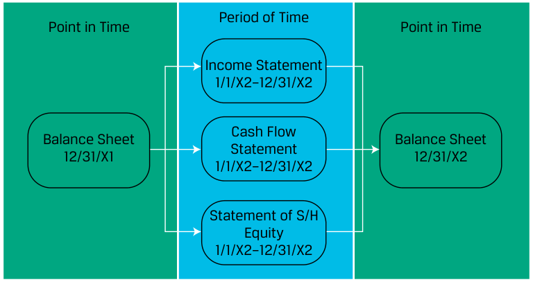

# Tập 4: Phân tích Báo cáo Tài chính (Volume 4: Financial Statement Analysis)
## Học phần 4: Phân tích Báo cáo Lưu chuyển Tiền tệ I (Learning Module 4: Analyzing Statements of Cash Flows I)
### Phần 1/3: Giới thiệu (Introduction) (Trang PDF 135–148)

---

<!-- PDF Page 135 -->

#### H Ọ C P H Ầ N (L E A R N I N G M O D U L E)

# **<mark>4</mark>** 

### **Phân tích Báo cáo Lưu chuyển Tiền tệ I (Analyzing Statements of Cash Flows I)** 

**Tác giả: Elaine Henry, PhD, CFA, Thomas R Robinson, PhD, CFA, CAIA, J. Hennie van Greuning, DCom, CFA, và Michael A Broihahn, CPA, CIA, CFA.** 

_Elaine Henry, PhD, CFA, công tác tại Học viện Công nghệ Stevens (Hoa Kỳ). Thomas R. Robinson, PhD, CFA, CAIA, công tác tại Robinson Global Investment Management LLC, (Hoa Kỳ). J. Hennie van Greuning, DCom, CFA, công tác tại BIBD (Brunei). Michael A. Broihahn, CPA, CIA, CFA, công tác tại Đại học Barry (Hoa Kỳ)._ 

###### **<mark>KẾT QUẢ HỌC TẬP (LEARNING OUTCOMES)</mark>** 

|**_Mức độ thành thạo_**|**_Ứng viên cần có khả năng:_**|
|---|---|
||mô tả cách thức báo cáo lưu chuyển tiền tệ (*cash flow statement*) liên kết với báo cáo kết quả hoạt động kinh doanh (*income statement*) và bảng cân đối kế toán (*balance sheet*)|
||mô tả các bước lập báo cáo lưu chuyển tiền tệ theo phương pháp trực tiếp (*direct method*) và gián tiếp (*indirect method*), bao gồm cách tính toán các dòng tiền bằng dữ liệu từ báo cáo kết quả hoạt động kinh doanh và bảng cân đối kế toán|
||trình bày cách chuyển đổi các dòng tiền từ phương pháp gián tiếp sang phương pháp trực tiếp|
||đối chiếu các báo cáo lưu chuyển tiền tệ được lập theo Chuẩn mực Báo cáo Tài chính Quốc tế (IFRS) và các nguyên tắc kế toán được chấp nhận chung của Hoa Kỳ (US GAAP)|

Hai cơ quan ban hành chuẩn mực kế toán lớn gồm: 1) Hội đồng Chuẩn mực Kế toán Quốc tế (IASB), cơ quan thiết lập các Chuẩn mực Báo cáo Tài chính Quốc tế (IFRS) và 2) Hội đồng Chuẩn mực Kế toán Tài chính (FASB), cơ quan thiết lập US GAAP. Xuyên suốt học phần này, cả hai bộ chuẩn mực đều được tham chiếu và nhiều quy định, dù không phải tất cả, trong hai bộ quy tắc kế toán này được xác định. Lưu ý: những thay đổi trong chuẩn mực kế toán cũng như các phán quyết và/hoặc công bố mới được ban hành sau thời điểm xuất bản học phần này có thể khiến một số thông tin trở nên lỗi thời.

<!-- PDF Page 136 -->

## **<mark>1</mark>** 

##### **GIỚI THIỆU (INTRODUCTION)** 

Báo cáo lưu chuyển tiền tệ (*statement of cash flows*) cung cấp thông tin quan trọng về các khoản thu tiền và chi tiền của một công ty trong một kỳ kế toán, giúp đối chiếu các tài khoản tiền giữa các ngày lập bảng cân đối kế toán. Mặc dù báo cáo kết quả hoạt động kinh doanh cung cấp các thước đo tương tự trên cơ sở dồn tích (*accrual basis*), nhưng dòng tiền và thời điểm phát sinh của chúng đóng vai trò tối quan trọng đối với việc định giá bởi vì các khoản thanh toán cho nhà đầu tư được thực hiện bằng tiền mặt. Các nhà đầu tư cũng sử dụng báo cáo lưu chuyển tiền tệ để đánh giá tính thanh khoản (*liquidity*), khả năng thanh toán dài hạn (*solvency*) và sự linh hoạt tài chính (*financial flexibility*) của công ty. Trong học phần này, chúng ta thảo luận về các thành phần của báo cáo lưu chuyển tiền tệ và mối liên kết của nó với các báo cáo tài chính khác.

###### **TỔNG QUAN HỌC PHẦN (LEARNING MODULE OVERVIEW)** 

- Hiểu được mối quan hệ qua lại giữa bảng cân đối kế toán, báo cáo kết quả hoạt động kinh doanh và báo cáo lưu chuyển tiền tệ không chỉ hữu ích trong việc đánh giá sức khỏe tài chính của công ty mà còn giúp phát hiện các bất thường về kế toán (*accounting irregularities*).

- Báo cáo kết quả hoạt động kinh doanh và báo cáo lưu chuyển tiền tệ cung cấp những liên kết then chốt giữa phần tài sản ngắn hạn và nợ phải trả ngắn hạn của bảng cân đối kế toán.

- Các công ty có thể sử dụng phương pháp trực tiếp (*direct method*) hoặc phương pháp gián tiếp (*indirect method*) để báo cáo dòng tiền từ hoạt động kinh doanh (*operating cash flow*) của mình:
  - Phương pháp trực tiếp công bố các dòng tiền vào từ hoạt động kinh doanh theo nguồn thu (ví dụ: tiền thu từ khách hàng, tiền thu từ thu nhập đầu tư) và các dòng tiền ra từ hoạt động kinh doanh theo mục đích chi (ví dụ: tiền trả cho nhà cung cấp, tiền trả lãi vay) trong phần hoạt động kinh doanh của báo cáo lưu chuyển tiền tệ.
  - Phương pháp gián tiếp đối chiếu lợi nhuận ròng (*net income*) với dòng tiền từ hoạt động kinh doanh bằng cách điều chỉnh lợi nhuận ròng cho tất cả các khoản mục phi tiền tệ (*non-cash items*) và những thay đổi ròng trong các tài khoản vốn lưu động (*working capital accounts*).

- Mặc dù phương pháp gián tiếp phổ biến nhất, một chuyên viên phân tích có thể muốn xem xét dòng tiền hoạt động kinh doanh theo định dạng trực tiếp để đánh giá xu hướng trong các khoản thu và chi tiền mặt, chẳng hạn như tiền thu từ khách hàng hoặc tiền trả cho nhà cung cấp.

- Lưu chuyển tiền tệ từ hoạt động kinh doanh được báo cáo theo phương pháp gián tiếp nhìn chung có thể được chuyển đổi sang dạng xấp xỉ của định dạng trực tiếp bằng cách tuân theo một quy trình ba bước đơn giản.

- Lưu chuyển tiền tệ từ hoạt động đầu tư (*investing activities*) và từ hoạt động tài trợ (*financing activities*) đều được báo cáo bằng phương pháp trực tiếp, bất kể phương pháp nào được sử dụng để báo cáo lưu chuyển tiền tệ từ hoạt động kinh doanh.

- So với US GAAP, Chuẩn mực Báo cáo Tài chính Quốc tế (IFRS) cho phép sự linh hoạt cao hơn trong việc phân loại các khoản mục vào hoạt động kinh doanh, đầu tư hoặc tài trợ, chẳng hạn như tiền lãi đã trả hoặc đã nhận và cổ tức đã trả hoặc đã nhận, cũng như trong cách phân loại chi phí thuế thu nhập.

<!-- PDF Page 137 -->

##### **CÁC LIÊN KẾT GIỮA CÁC BÁO CÁO TÀI CHÍNH (LINKAGES BETWEEN THE FINANCIAL STATEMENTS)** 

## **<mark>2</mark>** 

mô tả cách thức báo cáo lưu chuyển tiền tệ liên kết với báo cáo kết quả hoạt động kinh doanh và bảng cân đối kế toán

###### **Các Báo cáo Tài chính Chính (Primary Financial Statements)** 

Hãy nhớ lại rằng bốn báo cáo tài chính chính có mối quan hệ qua lại với nhau và mỗi báo cáo cung cấp thông tin cụ thể cho các chuyên viên phân tích về một đơn vị. Các báo cáo tài chính chính bao gồm:

**1.** Bảng cân đối kế toán (*Balance Sheet*)—hiển thị vị thế tài chính của một đơn vị _tại một thời điểm_ (*at a point in time*), báo cáo số dư của các tài khoản “vĩnh viễn” (*permanent*) hay tài khoản “thời điểm” (*stock*) cho biết tài sản của đơn vị và cách thức các tài sản đó được tài trợ.

**2.** Báo cáo kết quả hoạt động kinh doanh (*Income Statement*)—cung cấp thông tin về hiệu quả hoạt động tài chính của một công ty giữa các ngày lập bảng cân đối kế toán. Báo cáo kết quả hoạt động kinh doanh được cấu thành từ các tài khoản doanh thu (*revenue*), chi phí (*expense*), thu nhập khác/lãi (*gain*) và chi phí khác/lỗ (*loss*). Trái ngược với bảng cân đối kế toán, báo cáo kết quả hoạt động kinh doanh là một báo cáo “thời kỳ” hay “dòng chảy” (*flow statement*) vì nó nắm bắt hoạt động tạo thu nhập giữa hai ngày lập bảng cân đối kế toán. Báo cáo kết quả hoạt động kinh doanh được lập theo IFRS hoặc US GAAP dựa trên kế toán dồn tích (*accrual accounting*), vì vậy chúng không nhất thiết phản ánh các dòng tiền vào và dòng tiền ra.

**3.** Báo cáo lưu chuyển tiền tệ (*Statement of Cash Flows*)—báo cáo sự thay đổi trong tiền, các khoản tương đương tiền (*cash equivalents*) và tiền bị giới hạn sử dụng (*restricted cash*) của một đơn vị giữa các ngày lập bảng cân đối kế toán. Báo cáo này phân loại các dòng tiền vào và dòng tiền ra trong kỳ thành hoạt động kinh doanh (*operating*), hoạt động đầu tư (*investing*) hoặc hoạt động tài trợ (*financing*). Bởi vì báo cáo lưu chuyển tiền tệ báo cáo hiệu quả hoạt động trong một khoảng thời gian, nó cũng là một báo cáo “dòng chảy” (*flow statement*), giống như báo cáo kết quả hoạt động kinh doanh.

**4.** Báo cáo thay đổi vốn chủ sở hữu (*Statement of Shareholders’ Equity*)—cung cấp thông tin về cách thức vốn chủ sở hữu của công ty đã thay đổi giữa các ngày lập bảng cân đối kế toán. Báo cáo này xác định các thành phần trọng yếu của vốn chủ sở hữu được báo cáo trên bảng cân đối kế toán (ví dụ: cổ phiếu phổ thông và lợi nhuận giữ lại) và các hoạt động đã diễn ra trong kỳ có tác động đến các tài khoản này (ví dụ: phát hành cổ phiếu, lãi hoặc lỗ ròng). Giống như báo cáo kết quả hoạt động kinh doanh và báo cáo lưu chuyển tiền tệ, báo cáo thay đổi vốn chủ sở hữu cũng là một báo cáo “dòng chảy”.

###### **Mối quan hệ giữa các Báo cáo Tài chính (Relationship between Financial Statements)** 

Như được minh họa trong Bảng 1, báo cáo kết quả hoạt động kinh doanh, báo cáo lưu chuyển tiền tệ và báo cáo thay đổi vốn chủ sở hữu liên kết bảng cân đối kế toán từ kỳ này sang kỳ tiếp theo.

<!-- PDF Page 138 -->

**Bảng 1: Mối quan hệ giữa các Báo cáo Tài chính (Exhibit 1: Relationship between the Financial Statements)** 

<!-- Picture Text: Period of Time Point in Time Point in Time Income Statement 1/1/X2–12/31/X2 Cash Flow Balance Sheet Balance Sheet Statement 12/31/X1 12/31/X2 1/1/X2–12/31/X2 Statement of S/H Equity 1/1/X2–12/31/X2  -->

> **Chú thích hình ảnh:**
> - **Thời điểm (*Point in Time*):** Bảng cân đối kế toán ngày 31/12/X1 (*Balance Sheet 12/31/X1*) và Bảng cân đối kế toán ngày 31/12/X2 (*Balance Sheet 12/31/X2*).
> - **Khoảng thời gian / Thời kỳ (*Period of Time* – từ 1/1/X2 đến 31/12/X2):** Báo cáo kết quả hoạt động kinh doanh (*Income Statement*), Báo cáo lưu chuyển tiền tệ (*Cash Flow Statement*), và Báo cáo thay đổi vốn chủ sở hữu (*Statement of S/H Equity*) kết nối hai bảng cân đối kế toán tại hai thời điểm.

Ví dụ, số dư tiền đầu kỳ và cuối kỳ được hiển thị trên bảng cân đối kế toán năm 20X1 và 20X2 của công ty, và phần cuối của báo cáo lưu chuyển tiền tệ năm 20X2 đối chiếu tiền năm 20X1 với tiền năm 20X2. Mối quan hệ này, được phát biểu dưới dạng tổng quát, như hiển thị trong Bảng 2.

**Bảng 2: Số dư Đầu kỳ và Cuối kỳ (Exhibit 2: Beginning and Ending Balances)** 

|**Bảng cân đối kế toán tại ngày 31 tháng 12 năm 20X1**|**Báo cáo lưu chuyển tiền tệ cho Năm kết thúc ngày 31 tháng 12 năm 20X2**|**Bảng cân đối kế toán tại ngày 31 tháng 12 năm 20X2**|
|---|---|---|
|**Tiền đầu kỳ** **(tại ngày cuối năm 31 tháng 12 năm 20X1)**|Cộng: Các dòng tiền vào (từ hoạt động kinh doanh, đầu tư và tài trợ) Trừ: Các dòng tiền ra (cho hoạt động kinh doanh, đầu tư và tài trợ)|**Tiền cuối kỳ** **(tại ngày cuối năm 31 tháng 12 năm 20X2)**|

Bảng 3 bổ sung chi tiết cụ thể hơn cho Bảng 1, lần theo các mối liên kết cụ thể xuyên suốt bốn báo cáo tài chính.

<!-- PDF Page 139 -->

**Bảng 3: Sự tương tác của các Tài khoản Báo cáo Tài chính (Exhibit 3: Interaction of Financial Statement Accounts)** 

<!-- Picture Text: Cash Flow Statement 1/2/X2–12/31/X2 Beginning Cash +/– Operating CF +/– Investing CF +/– Financing CF Ending Cash Income Statement 1/2/X2–12/31/X2 Revenue Balance Sheet* –Cost of Goods Sold Balance Sheet 12/31/X1 Gross Margin 12/31/X2 –Selling, G & A Expense Beginning Cash Operating Income Ending Cash Beginning Retainer –Interest Expense Ending Retained Earnings Earnings Taxable Income –Taxes Net Income Statement of S/H Equity 1/2/X2–12/31/X2 Beginning Retained Earnings +Net Income – Dividends Ending Retained Earnings  -->

> **Chú thích hình ảnh:**
> - **Bảng cân đối kế toán 31/12/X1 (*Balance Sheet 12/31/X1*):** Tiền đầu kỳ (*Beginning Cash*), Lợi nhuận giữ lại đầu kỳ (*Beginning Retained Earnings*).
> - **Báo cáo lưu chuyển tiền tệ (*Cash Flow Statement* 1/2/X2–12/31/X2):** Tiền đầu kỳ $\pm$ Dòng tiền hoạt động kinh doanh (*Operating CF*) $\pm$ Dòng tiền đầu tư (*Investing CF*) $\pm$ Dòng tiền tài trợ (*Financing CF*) $=$ Tiền cuối kỳ (*Ending Cash*).
> - **Báo cáo kết quả hoạt động kinh doanh (*Income Statement* 1/2/X2–12/31/X2):** Doanh thu (*Revenue*) $-$ Giá vốn hàng bán (*Cost of Goods Sold*) $=$ Lợi nhuận gộp (*Gross Margin*) $-$ Chi phí bán hàng, quản lý & hành chính (*Selling, G&A Expense*) $=$ Lợi nhuận hoạt động (*Operating Income*) $-$ Chi phí lãi vay (*Interest Expense*) $=$ Thu nhập chịu thuế (*Taxable Income*) $-$ Thuế (*Taxes*) $=$ Lợi nhuận ròng (*Net Income*).
> - **Báo cáo thay đổi vốn chủ sở hữu (*Statement of S/H Equity* 1/2/X2–12/31/X2):** Lợi nhuận giữ lại đầu kỳ $+$ Lợi nhuận ròng $-$ Cổ tức (*Dividends*) $=$ Lợi nhuận giữ lại cuối kỳ (*Ending Retained Earnings*).
> - **Bảng cân đối kế toán 31/12/X2 (*Balance Sheet 12/31/X2*):** Nhận số dư Tiền cuối kỳ và Lợi nhuận giữ lại cuối kỳ.

Ví dụ, báo cáo thay đổi vốn chủ sở hữu năm 20X2 đối chiếu các tài khoản vốn chủ sở hữu được báo cáo trên bảng cân đối kế toán năm 20X1 với các tài khoản vốn chủ sở hữu được báo cáo trên bảng cân đối kế toán năm 20X2, bao gồm các khoản cộng thêm (hoặc trừ đi) phát sinh từ lãi hoặc lỗ ròng được báo cáo trên báo cáo kết quả hoạt động kinh doanh và cổ tức đã trả vốn cũng được báo cáo trên báo cáo lưu chuyển tiền tệ nếu được chi trả bằng tiền mặt.

###### **Các Liên kết giữa Tài sản Ngắn hạn và Nợ phải trả Ngắn hạn (Linkages Between Current Assets and Current Liabilities)** 

Báo cáo kết quả hoạt động kinh doanh và báo cáo lưu chuyển tiền tệ cũng cung cấp các mối liên kết then chốt giữa phần tài sản ngắn hạn và nợ phải trả ngắn hạn của bảng cân đối kế toán. Sự khác biệt giữa việc ghi nhận theo kế toán dồn tích và kế toán tiền mặt đối với các hoạt động kinh doanh dẫn đến sự gia tăng hoặc sụt giảm ở một tài sản ngắn hạn hoặc nợ phải trả ngắn hạn trên bảng cân đối kế toán. Ví dụ, doanh thu theo cơ sở dồn tích vượt quá số tiền thu được sẽ đi kèm với sự gia tăng trong khoản phải thu khách hàng (*accounts receivable*). Nếu chi phí được báo cáo theo kế toán dồn tích thấp hơn số tiền thực tế đã chi trả, kết quả thường sẽ là sự sụt giảm trong khoản phải trả người bán (*accounts payable*) hoặc một tài khoản nợ phải trả dồn tích (*accrued liability*) khác. Cuối cùng, trong những tình huống mà một công ty được thanh toán trước cho việc cung cấp dịch vụ hoặc giao sản phẩm trong tương lai, công ty sẽ ghi nhận số tiền nhận được là một tài sản, nhưng đồng thời cũng phải ghi nhận một khoản nợ phải trả cho nghĩa vụ phải cung cấp dịch vụ hoặc giao sản phẩm trong tương lai của mình, thường được gọi là doanh thu hoãn lại (*deferred revenue*). Tài khoản nợ phải trả doanh thu hoãn lại sẽ được dừng ghi nhận (*derecognized*) khi ghi nhận doanh thu vào lúc đơn vị hoàn thành các nghĩa vụ thực hiện (*performance obligations*) của mình.

Nếu một chuyên viên phân tích biết số dư khoản phải thu khách hàng đầu kỳ, doanh thu, và tiền thu được từ khách hàng, họ có thể tính được số dư khoản phải thu khách hàng cuối kỳ, bởi vì các tài khoản này có mối liên kết như hiển thị trong Bảng 4.

<!-- PDF Page 140 -->

###### **Bảng 4: Khoản phải thu Khách hàng Cuối kỳ (Exhibit 4: Ending Accounts Receivable)** 

|**Bảng cân đối kế toán đầu kỳ tại ngày 31 tháng 12 năm 20X1**|**Báo cáo kết quả hoạt động kinh doanh cho Năm kết thúc ngày 31 tháng 12 năm 20X2**|**Báo cáo lưu chuyển tiền tệ cho Năm kết thúc ngày 31 tháng 12 năm 20X2**|**Bảng cân đối kế toán cuối kỳ tại ngày 31 tháng 12 năm 20X2**|
|---|---|---|---|
|Khoản phải thu khách hàng đầu kỳ (*Beginning accounts receivable*)|Cộng: Doanh thu (*Plus: Revenues*)|Trừ: Tiền thu được từ khách hàng (*Minus: Cash collected from customers*)|Bằng: Khoản phải thu khách hàng cuối kỳ (*Equals: Ending accounts receivable*)|

Việc hiểu rõ mối quan hệ qua lại giữa bảng cân đối kế toán, báo cáo kết quả hoạt động kinh doanh và báo cáo lưu chuyển tiền tệ không chỉ hữu ích trong việc đánh giá sức khỏe tài chính của công ty mà còn giúp phát hiện các bất thường về kế toán. Hãy nhớ lại ví dụ minh họa cực đoan về một công ty giả định thực hiện bán hàng chịu mà không quan tâm đến khả năng thu hồi tiền trong tương lai và do đó báo cáo doanh số bán hàng khả quan cùng lợi nhuận đáng kể trên báo cáo kết quả hoạt động kinh doanh nhưng lại thiếu hụt dòng tiền vào. Một khuôn mẫu như vậy sẽ xảy ra nếu một công ty ghi nhận doanh thu không đúng quy định.

Ví dụ 1–Ví dụ 4 minh họa cách thức các giao dịch kinh doanh phổ biến ảnh hưởng đến bảng cân đối kế toán, báo cáo kết quả hoạt động kinh doanh và báo cáo lưu chuyển tiền tệ của một công ty. Hãy chú ý cách mà cả ba báo cáo tài chính đều cần thiết để hạch toán đầy đủ các giao dịch.

###### **VÍ DỤ 1 (EXAMPLE 1)** 

###### **Tác động của việc Mua và Bán Hàng tồn kho lên Báo cáo Tài chính (Inventory Purchase and Sale Impact on Financial Statements)** 

Giả sử công ty giả định ABC, một nhà bán lẻ, mua 100 USD hàng tồn kho vào ngày 1 tháng 1 năm 20X1 theo hình thức mua chịu với khoản thanh toán đến hạn trả cho nhà cung cấp trong vòng 30 ngày. Vào ngày 1 tháng 2, ABC bán sản phẩm cho Khách hàng X với giá 150 USD với thời hạn thanh toán trước ngày 16 tháng 2 năm 20X1. Khách hàng X thanh toán tiền hàng vào ngày 15 tháng 2 năm 20X1.

Chuỗi giao dịch này sẽ ảnh hưởng đến các báo cáo tài chính của ABC như hiển thị trong Bảng 5.

###### **Bảng 5: Các Báo cáo Tài chính của ABC (Exhibit 5: ABC’s Financial Statements)** 

|**Ngày**|**Bảng cân đối kế toán (*Balance Sheet*)**|**Báo cáo kết quả hoạt động kinh doanh (*Income Statement*)**|**Báo cáo lưu chuyển tiền tệ (*Statement of Cash Flows*)**|
|---|---|---|---|
|1 tháng 1|Hàng tồn kho (tài sản) tăng thêm 100 USD Khoản phải trả người bán (nợ phải trả) tăng thêm 100 USD|Không áp dụng (N/A)|Không áp dụng (N/A)|
|30 tháng 1|Tiền mặt (tài sản) giảm đi 100 USD Khoản phải trả người bán (nợ phải trả) giảm đi 100 USD|Không áp dụng (N/A)|Dòng tiền từ hoạt động kinh doanh giảm đi 100 USD|
|1 tháng 2|Khoản phải thu khách hàng (tài sản) tăng thêm 150 USD Hàng tồn kho (tài sản) giảm đi 100 USD|Doanh thu tăng thêm 150 USD Giá vốn hàng bán tăng thêm 100 USD|Không áp dụng (N/A)|
|15 tháng 2|Tiền mặt (tài sản) tăng thêm 150 USD Khoản phải thu khách hàng (tài sản) giảm đi 150 USD|Không áp dụng (N/A)|Dòng tiền từ hoạt động kinh doanh tăng thêm 150 USD|

Lưu ý rằng báo cáo lưu chuyển tiền tệ chỉ bị ảnh hưởng khi công ty chi trả hoặc nhận tiền mặt, điều này khác với việc ghi nhận trên báo cáo kết quả hoạt động kinh doanh.

<!-- PDF Page 141 -->

###### **VÍ DỤ 2 (EXAMPLE 2)** 

###### **Tác động của Khấu hao lên Báo cáo Tài chính (Depreciation Impact on Financial Statements)** 

Vào ngày 1 tháng 1, công ty giả định Notion Ltd, một công ty sản xuất, sở hữu 100 USD thiết bị được sử dụng trong quá trình sản xuất một sản phẩm bán cho các khách hàng bán buôn. Thiết bị này có thời gian sử dụng 10 năm và không có giá trị thanh lý thu hồi (*salvage value*). Notion sử dụng phương pháp khấu hao đường thẳng, vì vậy chi phí khấu hao hàng năm là 10 USD. Vào ngày 1 tháng 7, Notion Ltd. thực hiện một khoản đầu tư vốn mới cho một thiết bị khác với giá mua là 200 USD và chi phí khấu hao hàng năm là 50 USD. Notion Ltd. thanh toán tiền thiết bị bằng tiền mặt ngay khi nhận hàng. Chi phí khấu hao được ghi nhận vào cuối năm tài chính. Tác động lên các báo cáo tài chính của Notion Ltd. được tóm tắt trong Bảng 6.

**Bảng 6: Báo cáo Tài chính của Notion Ltd. (Exhibit 6: Notion Ltd. Financial Statement)** 

|**Ngày**|**Bảng cân đối kế toán (*Balance Sheet*)**|**Báo cáo kết quả hoạt động kinh doanh (*Income Statement*)**|**Báo cáo lưu chuyển tiền tệ (*Statement of Cash Flows*)**|
|---|---|---|---|
|1 tháng 1|Thiết bị (tài sản) trị giá 100 USD|Không áp dụng (N/A)|Không áp dụng (N/A)|
|1 tháng 7|Thiết bị (tài sản) tăng thêm 200 USD Tiền mặt (tài sản) giảm đi 200 USD|Không áp dụng (N/A)|Dòng tiền từ hoạt động đầu tư giảm đi 200 USD|
|31 tháng 12|Khấu hao lũy kế (tài sản điều chỉnh giảm – *contra asset*) tăng thêm 35 USD|Chi phí khấu hao tăng thêm 35 USD|Không áp dụng (N/A)|

###### **VÍ DỤ 3 (EXAMPLE 3)** 

###### **Tác động của Hoạt động Đi vay lên Báo cáo Tài chính (Borrowing Impact on Financial Statements)** 

Vào ngày 31 tháng 3, Công ty giả định Geneva vay 500 USD từ Ngân hàng Stockholm (cũng là giả định). Các điều khoản của khoản vay quy định tiền lãi tính dồn tích ở mức 10 phần trăm và khoản thanh toán lãi sẽ đến hạn cùng với tiền gốc khi khoản vay đáo hạn vào ngày 30 tháng 9. Theo đó, Geneva sẽ phải trả 525 USD cho Ngân hàng Stockholm vào ngày 30 tháng 9, bao gồm 500 USD tiền gốc vay và 25 USD tiền lãi ($\text{khoản vay } 500\text{ USD} \times 10\% \times \frac{1}{2}\text{ năm}$). Tác động lên các báo cáo tài chính của Geneva được tóm tắt trong Bảng 7.

<!-- PDF Page 142 -->

**Bảng 7: Báo cáo Tài chính của Geneva (Exhibit 7: Geneva Financial Statement)** 

|**Ngày**|**Bảng cân đối kế toán (*Balance Sheet*)**|**Báo cáo kết quả hoạt động kinh doanh (*Income Statement*)**|**Báo cáo lưu chuyển tiền tệ (*Statement of Cash Flows*)**|
|---|---|---|---|
|31 tháng 3|Tiền mặt (tài sản) tăng thêm 500 USD Khoản vay phải trả (nợ phải trả) tăng thêm 500 USD|Không áp dụng (N/A)|Dòng tiền từ hoạt động tài trợ tăng thêm 500 USD|
|30 tháng 9|Tiền mặt (tài sản) giảm đi 525 USD Khoản vay phải trả (nợ phải trả) giảm đi 500 USD|Chi phí lãi vay tăng thêm 25 USD|Dòng tiền từ hoạt động tài trợ hoặc hoạt động kinh doanh giảm đi 25 USD Dòng tiền từ hoạt động tài trợ giảm đi 500 USD|

###### **VÍ DỤ 4 (EXAMPLE 4)** 

###### **Tác động của việc Mua Thiết bị lên Báo cáo Tài chính (Equipment Purchase Impact on Financial Statements)** 

Giả sử Công ty Mountain, một nhà sản xuất giả định, đồng ý sản xuất một thiết bị đặt làm riêng cho Cirrus Corp. (một công ty giả định khác) trong vòng hai tháng với giá bán là 1.000 USD. Vào ngày 1 tháng 10, Cirrus trả trước cho Mountain một khoản tiền đặt cọc là 300 USD và đồng ý thanh toán phần còn lại 700 USD khi thiết bị được giao vào ngày 30 tháng 11. Công ty Mountain ghi nhận doanh thu hoãn lại (*deferred revenue*) khi nhận được 300 USD vào ngày 1 tháng 10, khoản này sẽ được dừng ghi nhận khi Mountain hoàn thành nghĩa vụ của mình và bàn giao thiết bị. Tác động lên báo cáo tài chính của Công ty Mountain được tóm tắt trong Bảng 8.

**Bảng 8: Báo cáo Tài chính của Công ty Mountain (Exhibit 8: Mountain Company Financial Statement)** 

|**Ngày**|**Bảng cân đối kế toán (*Balance Sheet*)**|**Báo cáo kết quả hoạt động kinh doanh (*Income Statement*)**|**Báo cáo lưu chuyển tiền tệ (*Statement of Cash Flows*)**|
|---|---|---|---|
|1 tháng 10|Tiền mặt (tài sản) tăng thêm 300 USD Doanh thu hoãn lại (nợ phải trả) tăng thêm 300 USD|Không áp dụng (N/A)|Dòng tiền từ hoạt động kinh doanh tăng thêm 300 USD|
|30 tháng 11 (bản gốc ghi 30 September)|Tiền mặt (tài sản) tăng thêm 700 USD Doanh thu hoãn lại (nợ phải trả) giảm đi 300 USD|Doanh thu tăng thêm 1.000 USD|Dòng tiền từ hoạt động kinh doanh tăng thêm 700 USD|

<!-- PDF Page 143 -->

##### **PHƯƠNG PHÁP TRỰC TIẾP ĐỐI VỚI LƯU CHUYỂN TIỀN TỆ TỪ HOẠT ĐỘNG KINH DOANH (THE DIRECT METHOD FOR CASH FLOWS FROM OPERATING ACTIVITIES)** 

## **<mark>3</mark>** 

mô tả các bước lập báo cáo lưu chuyển tiền tệ theo phương pháp trực tiếp và gián tiếp, bao gồm cách tính toán các dòng tiền bằng dữ liệu từ báo cáo kết quả hoạt động kinh doanh và bảng cân đối kế toán

Bước đầu tiên trong việc lập báo cáo lưu chuyển tiền tệ là xác định lưu chuyển tiền tệ từ hoạt động kinh doanh, vốn có thể được trình bày bằng phương pháp trực tiếp hoặc gián tiếp. Phương pháp trực tiếp sử dụng các nhóm chính của tổng tiền thu vào và tổng tiền chi ra (*gross cash receipts and payments*), còn phương pháp gián tiếp đối chiếu lợi nhuận ròng với dòng tiền ròng. Lưu chuyển tiền tệ từ hoạt động đầu tư và từ hoạt động tài trợ là hoàn toàn giống nhau bất kể phương pháp trực tiếp hay gián tiếp được sử dụng để trình bày dòng tiền từ hoạt động kinh doanh.

- Các công ty thường chỉ thuyết minh thông tin dòng tiền từ hoạt động kinh doanh theo phương pháp gián tiếp, nhưng việc hiểu được cách thức tổng hợp thông tin dòng tiền sẽ giúp bạn bóc tách một báo cáo gián tiếp và cấu trúc lại nó để xấp xỉ một báo cáo lưu chuyển tiền tệ trực tiếp, điều này—mặc dù không hoàn toàn chính xác tuyệt đối—nhưng có thể rất hữu ích. Bài học này trình bày cách lập gần đúng một báo cáo lưu chuyển tiền tệ theo phương pháp trực tiếp bằng cách sử dụng báo cáo kết quả hoạt động kinh doanh và bảng cân đối kế toán so sánh của Tập đoàn Acme (một công ty bán lẻ giả định) được hiển thị trong Bảng 9 và Bảng 10.

###### **Bảng 9: Báo cáo Kết quả Hoạt động Kinh doanh của Tập đoàn Acme cho Năm Kết thúc Ngày 31 tháng 12 năm 2018 (Exhibit 9: Acme Corporation Income Statement Year Ended 31 December 2018)** 

|Khoản mục|Chi tiết|Tổng cộng|
|---|---|---|
|Doanh thu thuần (*Revenue, net*)||USD23.598|
|Giá vốn hàng bán (*Cost of goods sold*)||11.456|
|Lợi nhuận gộp (*Gross profit*)||12.142|
|Chi phí tiền lương và tiền công (*Salary and wage expense*)|USD4.123||
|Chi phí khấu hao (*Depreciation expense*)|1.052||
|Chi phí hoạt động khác (*Other operating expenses*)|3.577||
|Tổng chi phí hoạt động (*Total operating expenses*)||8.752|
|Lợi nhuận hoạt động (*Operating profit*)||3.390|
|Doanh thu (chi phí) khác (*Other revenues (expenses)*):|||
|Lãi từ thanh lý thiết bị (*Gain on sale of equipment*)|205||
|Chi phí lãi vay (*Interest expense*)|(246)|(41)|
|Lợi nhuận trước thuế (*Income before tax*)||3.349|
|Chi phí thuế thu nhập (*Income tax expense*)||1.139|
|Lợi nhuận ròng (*Net income*)||USD2.210|

###### **Bảng 10: Bảng Cân đối Kế toán So sánh của Tập đoàn Acme tại Ngày 31 tháng 12 năm 2018 và 2017 (Exhibit 10: Acme Corporation Comparative Balance Sheets 31 December 2018 and 2017)** 

|**Khoản mục**|**2018**|**2017**|**Thay đổi ròng (*Net Change*)**|
|---|---|---|---|
|Tiền mặt (*Cash*)|USD1.011|USD1.163|USD(152)|

<!-- PDF Page 144 -->

|**Khoản mục**|**2018**|**2017**|**Thay đổi ròng (*Net Change*)**|
|---|---|---|---|
|Khoản phải thu khách hàng (*Accounts receivable*)|1.012|957|55|
|Hàng tồn kho (*Inventory*)|3.984|3.277|707|
|Chi phí trả trước (*Prepaid expenses*)|155|178|(23)|
|Tổng tài sản ngắn hạn (*Total current assets*)|6.162|5.575|587|
|Đất đai (*Land*)|510|510|—|
|Nhà cửa và vật kiến trúc (*Buildings*)|3.680|3.680|—|
|Thiết bị (*Equipment*)*|8.798|8.555|243|
|Trừ: khấu hao lũy kế (*Less: accumulated depreciation*)|(3.443)|(2.891)|(552)|
|Tổng tài sản dài hạn (*Total long-term assets*)|9.545|9.854|(309)|
|Tổng tài sản (*Total assets*)|USD15.707|USD15.429|USD278|
|Khoản phải trả người bán (*Accounts payable*)|USD3.588|USD3.325|USD263|
|Lương và tiền công phải trả (*Salary and wage payable*)|85|75|10|
|Lãi vay phải trả (*Interest payable*)|62|74|(12)|
|Thuế thu nhập phải nộp (*Income tax payable*)|55|50|5|
|Nợ phải trả dồn tích khác (*Other accrued liabilities*)|1.126|1.104|22|
|Tổng nợ phải trả ngắn hạn (*Total current liabilities*)|4.916|4.628|288|
|Nợ dài hạn (*Long-term debt*)|3.075|3.575|(500)|
|Cổ phiếu phổ thông (*Common stock*)|3.750|4.350|(600)|
|Lợi nhuận giữ lại (*Retained earnings*)|3.966|2.876|1.090|
|Tổng nợ phải trả và vốn chủ sở hữu (*Total liabilities and equity*)|USD15.707|USD15.429|USD278|

_* Trong năm 2018, Acme đã mua thiết bị mới với tổng nguyên giá là $1.300. Không có khoản mục nào tác động đến lợi nhuận giữ lại ngoài lợi nhuận ròng và cổ tức._

###### **Hoạt động Kinh doanh: Phương pháp Trực tiếp (Operating Activities: Direct Method)** 

Trước tiên chúng ta xác định số tiền mặt mà Acme đã thu được từ khách hàng của mình (đôi khi được gọi là “thu tiền bán hàng” – *cash collections*), tiếp theo là số tiền mặt đã trả cho các nhà cung cấp và cho người lao động, cũng như số tiền mặt đã trả cho các chi phí hoạt động khác, tiền lãi vay và thuế thu nhập.

###### **_Tiền Thu từ Khách hàng (Cash Received From Customers)_** 

Báo cáo kết quả hoạt động kinh doanh của Acme đã báo cáo doanh thu là 23.598 USD cho năm kết thúc vào ngày 31 tháng 12 năm 2018. Để xác định số tiền mặt thu được gần đúng từ khách hàng của mình, cần phải điều chỉnh số tiền doanh thu này theo mức thay đổi ròng của khoản phải thu khách hàng trong năm. Nếu khoản phải thu khách hàng tăng lên trong năm, doanh thu trên cơ sở dồn tích sẽ cao hơn số tiền thu được từ khách hàng, và ngược lại. Đối với Tập đoàn Acme, khoản phải thu khách hàng đã tăng thêm 55 USD, vì vậy tiền thu từ khách hàng là 23.543 USD, như hiển thị trong Bảng 11.

**Bảng 11: Tiền Thu từ Khách hàng (Exhibit 11: Cash Received from Customers)** 

|Khoản mục|Số tiền|
|---|---|
|Doanh thu (*Revenue*)|USD23.598|
|Trừ: Tăng khoản phải thu khách hàng (*Less: Increase in accounts receivable*)|(USD55)|
|Tiền thu từ khách hàng (*Cash received from customers*)|**USD23.543**|

<!-- PDF Page 145 -->

Tiền thu từ khách hàng ảnh hưởng đến tài khoản phải thu khách hàng như hiển thị trong Bảng 12.

###### **Bảng 12: Tác động lên Khoản phải thu Khách hàng, Cách 1 (Exhibit 12: Effect on Accounts Receivable, 1)** 

|Khoản mục|Số tiền|
|---|---|
|Khoản phải thu khách hàng đầu kỳ (*Beginning accounts receivable*)|957|
|Cộng doanh thu (*Plus revenue*)|23.598|
|Trừ tiền thu từ khách hàng (*Minus cash collected from customers*)|**(23.543)**|
|Khoản phải thu khách hàng cuối kỳ (*Ending accounts receivable*)|USD1.012|

Thông tin về tài khoản phải thu khách hàng cũng có thể được trình bày như hiển thị trong Bảng 13.

**Bảng 13: Tác động lên Khoản phải thu Khách hàng, Cách 2 (Exhibit 13: Effect on Accounts Receivable, 2)** 

|Khoản mục|Số tiền|
|---|---|
|Khoản phải thu khách hàng đầu kỳ (*Beginning accounts receivable*)|USD957|
|Cộng doanh thu (*Plus revenue*)|23.598|
|Trừ khoản phải thu khách hàng cuối kỳ (*Minus ending accounts receivable*)|(1.012)|
|Tiền thu từ khách hàng (*Cash collected from customers*)|**USD23.543**|

Acme không có bất kỳ khoản doanh thu hoãn lại hay doanh thu chưa thực hiện nào. Nếu có, sẽ cần thực hiện điều chỉnh bổ sung để tính ra số tiền thu từ khách hàng (sự sụt giảm doanh thu hoãn lại sẽ là một khoản điều chỉnh âm và ngược lại).

###### **VÍ DỤ 5 (EXAMPLE 5)** 

###### **Tính Tiền Thu từ Khách hàng (Computing Cash Received from Customers)** 

1. Blue Bayou, một công ty quảng cáo giả định, đã báo cáo doanh thu là 50 triệu USD, tổng chi phí là 35 triệu USD và lợi nhuận ròng là 15 triệu USD trong năm gần nhất. Nếu khoản phải thu khách hàng giảm 12 triệu USD, công ty đã thu được bao nhiêu tiền mặt từ khách hàng?

   - **A.** 38 triệu USD

   - **B.** 50 triệu USD

   - **C.** 62 triệu USD

   - **Lời giải:** 

C là đáp án đúng. Doanh thu 50 triệu USD cộng với mức giảm khoản phải thu khách hàng 12 triệu USD bằng 62 triệu USD tiền mặt thu từ khách hàng. Sự sụt giảm trong khoản phải thu khách hàng có nghĩa là công ty đã thu về bằng tiền mặt nhiều hơn số tiền doanh thu mà công ty đã báo cáo.

###### **_Tiền Trả cho Nhà cung cấp (Cash Paid to Suppliers)_** 

Đối với Acme, số tiền mặt đã trả cho các nhà cung cấp là 11.900 USD, được xác định như hiển thị trong Bảng 14.

<!-- PDF Page 146 -->

**Bảng 14: Tiền Trả cho Nhà cung cấp (Exhibit 14: Cash Paid to Suppliers)** 

|Khoản mục|Số tiền|
|---|---|
|Giá vốn hàng bán (*Cost of goods sold*)|USD11.456|
|Cộng: Tăng hàng tồn kho (*Plus: Increase in inventory*)|707|
|Bằng tiền mua hàng từ nhà cung cấp (*Equals purchases from suppliers*)|USD12.163|
|Trừ: Tăng khoản phải trả người bán (*Less: Increase in accounts payable*)|(263)|
|Tiền trả cho nhà cung cấp (*Cash paid to suppliers*)|**USD11.900**|

Có hai phần trong phép tính này: lượng hàng tồn kho đã mua và số tiền đã trả cho lượng hàng đó. Để xác định lượng mua hàng từ các nhà cung cấp (*purchases from suppliers*), giá vốn hàng bán được điều chỉnh theo mức thay đổi của hàng tồn kho. Nếu hàng tồn kho tăng lên trong năm, thì lượng mua hàng trong năm đã vượt quá giá vốn hàng bán, và ngược lại. Acme đã báo cáo giá vốn hàng bán là 11.456 USD cho năm kết thúc vào ngày 31 tháng 12 năm 2018. Đối với Tập đoàn Acme, hàng tồn kho đã tăng thêm 707 USD, vì vậy lượng mua hàng từ các nhà cung cấp là 12.163 USD. Lượng mua hàng từ nhà cung cấp ảnh hưởng đến tài khoản hàng tồn kho như hiển thị trong Bảng 15.

**Bảng 15: Tác động lên Hàng tồn kho (Exhibit 15: Effect on Inventory)** 

|Khoản mục|Số tiền|
|---|---|
|Hàng tồn kho đầu kỳ (*Beginning inventory*)|USD3.277|
|Cộng mua hàng trong kỳ (*Plus purchases*)|12.163|
|Trừ giá vốn hàng bán (*Minus cost of goods sold*)|(11.456)|
|Hàng tồn kho cuối kỳ (*Ending inventory*)|USD3.984|

Acme đã mua 12.163 USD hàng tồn kho từ các nhà cung cấp trong năm 2018, nhưng đây có phải là số tiền mặt mà Acme đã trả cho các nhà cung cấp của mình trong năm hay không? Không nhất thiết. Acme có thể vẫn chưa thanh toán hết cho tất cả các giao dịch mua hàng này và có thể vẫn còn nợ một phần các giao dịch mua hàng được thực hiện trong năm nay. Nói cách khác, Acme có thể đã trả ít tiền mặt hơn cho các nhà cung cấp so với giá trị mua hàng của năm nay, trong trường hợp đó khoản nợ phải trả (phải trả người bán) của Acme sẽ tăng lên bằng đúng phần chênh lệch. Ngược lại, Acme có thể đã trả cho các nhà cung cấp nhiều hơn cả giá trị mua hàng của năm nay, trong trường hợp đó khoản phải trả người bán của Acme sẽ giảm xuống.

Do đó, một khi đã xác định được giá trị mua hàng, số tiền mặt trả cho nhà cung cấp có thể được tính bằng cách điều chỉnh giá trị mua hàng theo mức thay đổi của khoản phải trả người bán. Nếu công ty thực hiện tất cả các giao dịch mua hàng bằng tiền mặt, thì khoản phải trả người bán sẽ không thay đổi và dòng tiền ra sẽ bằng đúng giá trị mua hàng. Nếu khoản phải trả người bán tăng lên trong năm, thì giá trị mua hàng trên cơ sở dồn tích sẽ cao hơn so với trên cơ sở tiền mặt, và ngược lại. Trong ví dụ này, Acme đã mua hàng nhiều hơn số tiền hãng đã trả bằng tiền mặt, vì vậy số dư trong khoản phải trả người bán đã tăng lên. Đối với Acme, tiền trả cho nhà cung cấp là 11.900 USD, được xác định như hiển thị trong Bảng 16.

**Bảng 16: Tiền Trả cho Nhà cung cấp (Exhibit 16: Cash Paid to Suppliers)** 

|Khoản mục|Số tiền|
|---|---|
|Mua hàng từ nhà cung cấp (*Purchases from suppliers*)|USD12.163|
|Trừ: Tăng khoản phải trả người bán (*Less: Increase in accounts payable*)|(263)|
|Tiền trả cho nhà cung cấp (*Cash paid to suppliers*)|**USD11.900**|

Số tiền mặt trả cho nhà cung cấp được phản ánh trong tài khoản phải trả người bán, như hiển thị trong Bảng 17.

<!-- PDF Page 147 -->

###### **Bảng 17: Tiền Trả cho Nhà cung cấp (Exhibit 17: Cash Paid to Suppliers)** 

|Khoản mục|Số tiền|
|---|---|
|Khoản phải trả người bán đầu kỳ (*Beginning accounts payable*)|USD3.325|
|Cộng mua hàng trong kỳ (*Plus purchases*)|12.163|
|Trừ tiền trả cho nhà cung cấp (*Minus cash paid to suppliers*)|**(11.900)**|
|Khoản phải trả người bán cuối kỳ (*Ending accounts payable*)|USD3.588|

###### **VÍ DỤ 6 (EXAMPLE 6)** 

###### **Tính Tiền Trả cho Nhà cung cấp (Computing Cash Paid to Suppliers)** 

1. Orange Beverages Plc., một nhà sản xuất đồ uống nhiệt đới giả định, đã báo cáo giá vốn hàng bán trong năm là 100 triệu USD. Tổng tài sản tăng thêm 55 triệu USD, nhưng hàng tồn kho giảm 6 triệu USD. Tổng nợ phải trả tăng thêm 45 triệu USD, nhưng khoản phải trả người bán giảm 2 triệu USD. Công ty đã trả bao nhiêu tiền mặt cho các nhà cung cấp của mình trong năm?

   - **A.** 96 triệu USD

   - **B.** 104 triệu USD

   - **C.** 108 triệu USD

###### **Lời giải:** 

A là đáp án đúng. Giá vốn hàng bán 100 triệu USD trừ đi mức giảm hàng tồn kho 6 triệu USD bằng giá trị mua hàng từ các nhà cung cấp là 94 triệu USD. Sự sụt giảm trong khoản phải trả người bán 2 triệu USD có nghĩa là công ty đã trả 96 triệu USD bằng tiền mặt (94 triệu USD cộng 2 triệu USD).

###### **_Tiền Trả cho Người lao động (Cash Paid to Employees)_** 

Để xác định số tiền mặt đã trả cho người lao động, cần phải điều chỉnh chi phí tiền lương và tiền công theo mức thay đổi ròng của khoản lương và tiền công phải trả trong năm. Nếu lương và tiền công phải trả tăng lên trong năm, thì chi phí tiền lương và tiền công trên cơ sở dồn tích sẽ cao hơn số tiền mặt đã trả cho chi phí này, và ngược lại. Đối với Acme, lương và tiền công phải trả đã tăng thêm 10 USD, vì vậy tiền trả cho lương và tiền công là 4.113 USD, như hiển thị trong Bảng 18.

###### **Bảng 18: Tiền lương và Tiền công (Exhibit 18: Salary and Wages)** 

|Khoản mục|Số tiền|
|---|---|
|Chi phí tiền lương và tiền công (*Salary and wages expense*)|USD4.123|
|Trừ: Tăng lương và tiền công phải trả (*Less: Increase in salary and wages payable*)|(10)|
|Tiền trả cho người lao động (*Cash paid to employees*)|**USD4.113**|

Số tiền mặt đã trả cho người lao động được phản ánh trong tài khoản lương và tiền công phải trả, như hiển thị trong Bảng 19.

###### **Bảng 19: Tiền Trả cho Người lao động (Exhibit 19: Cash Paid to Employees)** 

|Khoản mục|Số tiền|
|---|---|
|Lương và tiền công phải trả đầu kỳ (*Beginning salary and wages payable*)|USD75|
|Cộng chi phí tiền lương và tiền công (*Plus salary and wages expense*)|4.123|

<!-- PDF Page 148 -->

|Khoản mục|Số tiền|
|---|---|
|Trừ tiền trả cho người lao động (*Minus cash paid to employees*)|**(4.113)**|
|Lương và tiền công phải trả cuối kỳ (*Ending salary and wages payable*)|USD85|

###### **_Tiền Trả cho Chi phí Hoạt động Khác (Cash Paid for Other Operating Expenses)_** 

Để xác định số tiền mặt đã trả cho các chi phí hoạt động khác, cần phải điều chỉnh số tiền chi phí hoạt động khác trên báo cáo kết quả hoạt động kinh doanh theo những thay đổi ròng trong chi phí trả trước (*prepaid expenses*) và nợ phải trả chi phí dồn tích (*accrued expense liabilities*) trong năm. Nếu chi phí trả trước tăng lên trong năm, chi phí hoạt động khác trên cơ sở tiền mặt sẽ cao hơn so với trên cơ sở dồn tích, và ngược lại. Tương tự, nếu nợ phải trả chi phí dồn tích tăng lên trong năm, chi phí hoạt động khác trên cơ sở tiền mặt sẽ thấp hơn so với trên cơ sở dồn tích, và ngược lại. Đối với Tập đoàn Acme, số tiền mặt đã trả cho chi phí hoạt động trong năm 2018 là 3.532 USD, như hiển thị trong Bảng 20.

**Bảng 20: Tiền Trả cho Chi phí Hoạt động (Exhibit 20: Cash Paid for Operating Expenses)** 

|Khoản mục|Số tiền|
|---|---|
|Chi phí hoạt động khác (*Other operating expenses*)|USD3.577|
|Trừ: Giảm chi phí trả trước (*Less: Decrease in prepaid expenses*)|(23)|
|Trừ: Tăng nợ phải trả dồn tích khác (*Less: Increase in other accrued liabilities*)|(22)|
|Tiền trả cho chi phí hoạt động khác (*Cash paid for other operating expenses*)|**USD3.532**|

###### **VÍ DỤ 7 (EXAMPLE 7)** 

###### **Tính Tiền Trả cho Chi phí Hoạt động Khác (Computing Cash Paid for Other Operating Expenses)** 

1. Black Ice, một nhà sản xuất trang phục thể thao giả định, đã báo cáo chi phí hoạt động khác là 30 triệu USD. Chi phí bảo hiểm trả trước tăng thêm 4 triệu USD, và tiền điện nước phải trả dồn tích giảm đi 7 triệu USD. Bảo hiểm và điện nước là hai thành phần duy nhất của chi phí hoạt động khác. Công ty đã trả bao nhiêu tiền mặt cho các chi phí hoạt động khác?

   - **A.** 19 triệu USD

   - **B.** 33 triệu USD

   - **C.** 41 triệu USD

   - **Lời giải:** 

C là đáp án đúng. Chi phí hoạt động khác 30 triệu USD cộng với mức tăng chi phí bảo hiểm trả trước 4 triệu USD cộng với mức giảm tiền điện nước phải trả dồn tích 7 triệu USD bằng 41 triệu USD.

###### **_Tiền Trả Lãi vay (Cash Paid for Interest)_** 

Số tiền mặt trả lãi vay được tính vào dòng tiền từ hoạt động kinh doanh theo US GAAP và có thể được tính vào dòng tiền từ hoạt động kinh doanh hoặc dòng tiền từ hoạt động tài trợ theo IFRS. Để xác định số tiền mặt đã trả cho lãi vay, cần phải điều chỉnh chi phí lãi vay theo mức thay đổi ròng của lãi vay phải trả trong năm. Nếu lãi vay phải trả tăng lên trong năm, thì chi phí lãi vay trên cơ sở dồn tích sẽ cao hơn số tiền mặt đã trả cho lãi vay, và ngược lại. Đối với Tập đoàn Acme, lãi vay phải trả đã giảm 12 USD, và số tiền mặt đã trả cho lãi vay là 258 USD, như hiển thị trong Bảng 21.
