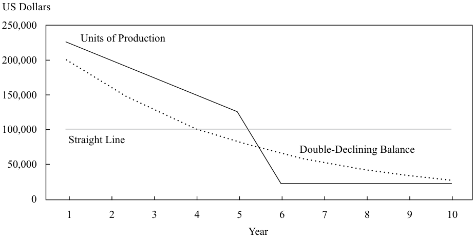
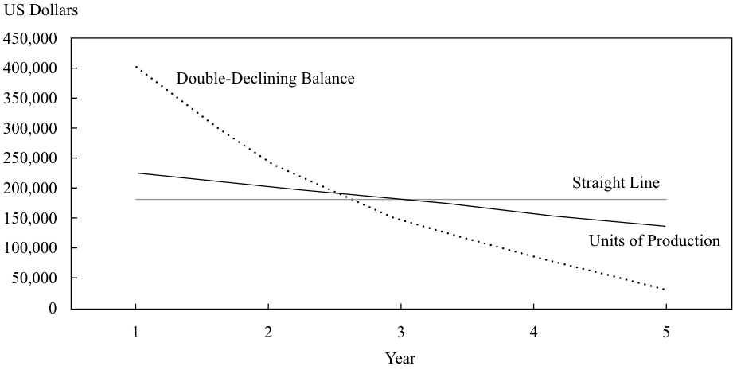

# Tập 4: Phân tích Báo cáo Tài chính (Financial Statement Analysis)
## Learning Module 10 Financial Reporting Quality (Trang PDF 323–392)

---

# Tập 4: Phân tích Báo cáo Tài chính (Volume 4: Financial Statement Analysis)
## Học phần 10: Chất lượng Báo cáo Tài chính (Learning Module 10: Financial Reporting Quality)
### Phần 1/6: Giới thiệu (Introduction) (Trang PDF 323–338)

---

<!-- PDF Page 323 -->

#### H Ọ C P H Ầ N (L E A R N I N G M O D U L E)

# **<mark>10</mark>** 

### **Chất lượng Báo cáo Tài chính (Financial Reporting Quality)** 

**bởi Jack T. Ciesielski, CPA, CFA, Elaine Henry, PhD, CFA, và Thomas I. Selling, PhD, CPA.** 

_Jack T. Ciesielski, CPA, CFA, làm việc tại R.G. Associates, Inc., cựu nhà xuất bản của The Analyst’s Accounting Observer (Hoa Kỳ). Elaine Henry, PhD, CFA, làm việc tại Học viện Công nghệ Stevens (Stevens Institute of Technology, Hoa Kỳ). Thomas I. Selling, PhD, CPA, làm việc tại Trường Kinh doanh Cox, Đại học Giám lý Phương Nam (Cox School of Business, Southern Methodist University, Hoa Kỳ)._ 

###### **<mark>MỤC TIÊU HỌC TẬP (LEARNING OUTCOMES)</mark>** 

|**_Mức độ thành thạo (Mastery)_**|**_Ứng viên cần có khả năng (The candidate should be able to):_**|
|---|---|
||so sánh chất lượng báo cáo tài chính (*financial reporting quality*) với chất lượng kết quả được báo cáo (*quality of reported results* – bao gồm chất lượng lợi nhuận, dòng tiền và các khoản mục trên bảng cân đối kế toán)|
||mô tả một dải phổ (*spectrum*) để đánh giá chất lượng báo cáo tài chính|
||giải thích sự khác biệt giữa kế toán thận trọng (*conservative accounting*) và kế toán tích cực/hiếu chiến (*aggressive accounting*)|
||mô tả các động cơ (*motivations*) có thể khiến ban giám đốc phát hành các báo cáo tài chính không có chất lượng cao và các điều kiện tạo thuận lợi cho việc phát hành các báo cáo tài chính chất lượng thấp, hoặc thậm chí là gian lận (*fraudulent*)|
||mô tả các cơ chế kỷ luật (*mechanisms that discipline*) đối với chất lượng báo cáo tài chính và những hạn chế tiềm tàng của các cơ chế đó|
||mô tả các lựa chọn trình bày (*presentation choices*), bao gồm các thước đo phi chuẩn mực kế toán (*non-GAAP measures*), có thể được sử dụng để gây ảnh hưởng đến ý kiến của nhà phân tích|
||mô tả các phương pháp kế toán (các lựa chọn và ước tính – *choices and estimates*) có thể được sử dụng để điều chỉnh lợi nhuận (*manage earnings*), dòng tiền và các khoản mục trên bảng cân đối kế toán|
||mô tả các dấu hiệu cảnh báo kế toán (*accounting warning signs*) và các phương pháp phát hiện hành vi thao túng thông tin (*manipulation of information*) trong các báo cáo tài chính|

Hai tổ chức ban hành chuẩn mực kế toán lớn gồm: 1) Hội đồng Chuẩn mực Kế toán Quốc tế (*International Accounting Standards Board* – IASB), đơn vị thiết lập các Chuẩn mực Báo cáo Tài chính Quốc tế (*International Financial Reporting Standards* – IFRS) và 2) Hội đồng Chuẩn mực Kế toán Tài chính (*Financial Accounting Standards Board* – FASB), đơn vị thiết lập các Nguyên tắc Kế toán được Chấp nhận Chung của Hoa Kỳ (*US GAAP*). Xuyên suốt học phần này, cả hai bộ chuẩn mực đều được đề cập và nhiều, dù không phải tất cả, các quy tắc kế toán thuộc hai bộ chuẩn mực này được xác định. Lưu ý: những thay đổi trong chuẩn mực kế toán cũng như các phán quyết và/hoặc công bố mới được ban hành sau khi xuất bản học phần này có thể khiến một số thông tin trở nên lỗi thời. 

<!-- PDF Page 324 -->

## **<mark>1</mark>** 

##### **GIỚI THIỆU (INTRODUCTION)** 

Chất lượng báo cáo tài chính (*financial reporting quality*) khác nhau giữa các công ty. Khả năng đánh giá chất lượng báo cáo tài chính của một công ty là một kỹ năng quan trọng đối với các nhà phân tích. Các dấu hiệu của báo cáo tài chính chất lượng thấp có thể thúc đẩy nhà phân tích duy trì sự hoài nghi cao độ khi đọc các báo cáo của công ty, xem xét kỹ lưỡng các thuyết minh khi thực hiện phân tích báo cáo tài chính, và kết hợp các điều chỉnh phù hợp trong việc đánh giá kết quả hoạt động trong quá khứ cũng như dự báo kết quả hoạt động trong tương lai. 

###### **TỔNG QUAN HỌC PHẦN (LEARNING MODULE OVERVIEW)** 

- Chất lượng báo cáo tài chính có thể được hình dung như trải dài trên một dải liên tục (*continuum*). Báo cáo có chất lượng cao nhất chứa đựng thông tin thích hợp (*relevant*), chính xác (*correct*), đầy đủ (*complete*), và không thiên lệch (*unbiased*), trong khi báo cáo có chất lượng thấp nhất chứa đựng thông tin không chỉ thiên lệch hoặc không đầy đủ mà còn có thể là hoàn toàn bịa đặt (*pure fabrication*). 

- Chất lượng báo cáo (*reporting quality*), trọng tâm của học phần này, đề cập đến chất lượng của thông tin được công bố. Báo cáo chất lượng cao phản ánh thực tế kinh tế (*economic reality*) của các hoạt động của công ty trong kỳ báo cáo và tình hình tài chính của công ty vào cuối kỳ. 

- Chất lượng kết quả (*results quality* – thường được gọi là chất lượng lợi nhuận hay *earnings quality*) đề cập đến lợi nhuận và tiền mặt được tạo ra từ các hoạt động kinh tế thực tế của công ty và tình hình tài chính dẫn đến từ đó, so với kỳ vọng về kết quả hoạt động tài chính hiện tại và tương lai. Lợi nhuận có chất lượng có thể được coi là bền vững hơn (*more sustainable*), cung cấp một nền tảng vững chắc cho các dự báo. 

- Một khía cạnh của chất lượng báo cáo tài chính là mức độ mà các lựa chọn kế toán mang tính thận trọng (*conservative*) hay tích cực/hiếu chiến (*aggressive*). “Tích cực/hiếu chiến” (*aggressive*) thường đề cập đến các lựa chọn nhằm mục đích nâng cao kết quả hoạt động và vị thế tài chính được báo cáo của công ty bằng cách thổi phồng mức doanh thu, lợi nhuận, và/hoặc dòng tiền từ hoạt động kinh doanh được báo cáo trong kỳ; hoặc bằng cách làm giảm chi phí trong kỳ và/hoặc mức nợ được báo cáo trên bảng cân đối kế toán. 

- Sự thận trọng (*conservatism*) trong các báo cáo tài chính có thể xuất phát từ (1) các chuẩn mực kế toán yêu cầu cụ thể việc xử lý thận trọng đối với một giao dịch hoặc sự kiện hoặc (2) các xét đoán của các nhà quản lý khi áp dụng các chuẩn mực kế toán dẫn đến kết quả thận trọng. 

- Các nhà quản lý có thể có động cơ phát hành các báo cáo tài chính kém chất lượng để che giấu kết quả hoạt động yếu kém, thúc đẩy giá cổ phiếu của công ty, làm tăng thù lao cá nhân, và/hoặc tránh vi phạm các giao ước nợ (*debt covenants*). 

- Các điều kiện tạo thuận lợi cho việc phát hành các báo cáo tài chính chất lượng thấp bao gồm một môi trường văn hóa dẫn đến việc công bố thông tin tài chính ít hơn hoặc kém minh bạch hơn, sự đồng nhất giữa kế toán và thuế (*book/tax conformity*) làm dịch chuyển trọng tâm sang tuân thủ pháp lý thay vì trình bày hợp lý (*fair presentation*), và quy định quản lý thị trường vốn còn hạn chế. 

- Các cơ chế kỷ luật chất lượng báo cáo tài chính bao gồm thị trường vốn mở và các động lực để các công ty tối thiểu hóa chi phí vốn (*cost of capital*), các kiểm toán viên độc lập (*independent auditors*), các điều khoản hợp đồng được thiết kế riêng để <u>trừng phạt hành vi báo cáo sai lệch, và sự thực thi của các cơ quan quản lý.</u> 

<!-- PDF Page 325 -->

- Lợi nhuận chiếu lệ (*pro forma earnings* – cũng thường được gọi là lợi nhuận phi GAAP hoặc phi IFRS) điều chỉnh lợi nhuận được báo cáo trên báo cáo kết quả hoạt động kinh doanh. Lợi nhuận chiếu lệ loại trừ các khoản mục tiêu cực là một dấu hiệu đặc trưng của các lựa chọn trình bày tích cực/hiếu chiến (*aggressive presentation choices*). 

- ■ Các công ty được yêu cầu phải thực hiện các thuyết minh bổ sung khi trình bày bất kỳ thước đo phi GAAP (*non-GAAP*) hoặc phi IFRS (*non-IFRS*) nào. 

- ■ Sự linh hoạt đáng kể của các nhà quản lý trong việc lựa chọn các chính sách kế toán của công ty họ và trong việc xây dựng các ước tính tạo ra cơ hội cho kế toán tích cực/hiếu chiến (*aggressive accounting*). 

- ■ Ví dụ về các lựa chọn kế toán ảnh hưởng đến lợi nhuận và bảng cân đối kế toán bao gồm các giả định về dòng chi phí hàng tồn kho (*inventory cost flow assumptions*), ước tính các khoản phải thu khó đòi (*uncollectible accounts receivable*), khả năng thu hồi ước tính của tài sản thuế thu nhập hoãn lại (*deferred tax assets*), phương pháp khấu hao (*depreciation method*), giá trị thanh lý ước tính của tài sản khấu hao (*estimated salvage value*), và thời gian sử dụng hữu ích ước tính của tài sản khấu hao (*estimated useful life*). 

- ■ Dòng tiền từ hoạt động kinh doanh (*cash flow from operations* – CFO) là một thước đo quan trọng đối với các nhà đầu tư, có thể được cải thiện thông qua các lựa chọn hoạt động của ban giám đốc, chẳng hạn như kéo dài các khoản phải trả người bán (*stretching accounts payable*), và có khả năng thông qua các lựa chọn phân loại (*classification choices*). 

##### **TỔNG QUAN KHÁI NIỆM (CONCEPTUAL OVERVIEW)** 

**<mark>2</mark>** 

so sánh chất lượng báo cáo tài chính với chất lượng kết quả được báo cáo (bao gồm chất lượng lợi nhuận, dòng tiền và các khoản mục trên bảng cân đối kế toán) 

Lý tưởng nhất là các nhà phân tích luôn có quyền tiếp cận với các báo cáo tài chính dựa trên các chuẩn mực báo cáo tài chính vững chắc, chẳng hạn như các chuẩn mực từ Hội đồng Chuẩn mực Kế toán Quốc tế (IASB) và Hội đồng Chuẩn mực Kế toán Tài chính (FASB), và không bị thao túng. Nhưng trên thực tế, chất lượng của các báo cáo tài chính có thể rất khác nhau. Báo cáo tài chính chất lượng cao cung cấp thông tin hữu ích cho các nhà phân tích trong việc đánh giá kết quả hoạt động và triển vọng của một công ty. Báo cáo tài chính chất lượng thấp chứa đựng thông tin không chính xác, gây hiểu lầm hoặc không đầy đủ. 

Những sai sót cực đoan về chất lượng báo cáo tài chính đã làm nảy sinh các vụ bê bối chấn động, dẫn đến không chỉ thua lỗ cho nhà đầu tư mà còn làm suy giảm niềm tin vào hệ thống tài chính. Những người sử dụng báo cáo tài chính có khả năng đánh giá chính xác chất lượng báo cáo tài chính đã có vị thế tốt hơn để tránh thua lỗ. Những sai sót này minh họa cho những thách thức mà các nhà phân tích phải đối mặt cũng như những chi phí tiềm tàng của việc không nhận ra các thông lệ dẫn đến báo cáo tài chính gây hiểu lầm hoặc không chính xác.1 Các ví dụ về báo cáo sai lệch có thể cung cấp cho nhà phân tích cái nhìn sâu sắc về các tín hiệu khác nhau có thể chỉ ra các báo cáo tài chính kém chất lượng. 

Học phần này giải quyết _chất lượng báo cáo tài chính_ (*financial reporting quality*), đề cập đến chất lượng của thông tin trong các báo cáo tài chính, bao gồm cả các thuyết minh trong phần ghi chú (*notes*). Báo cáo chất lượng cao cung cấp thông tin hữu ích cho việc ra quyết định (*decision-useful information*), vừa thích hợp (*relevant*) vừa trình bày trung thực (*faithfully represents*) thực tế kinh tế của các hoạt động của công ty trong kỳ báo cáo cũng như tình hình tài chính của công ty vào cuối kỳ. Một thuộc tính chất lượng riêng biệt nhưng có mối liên hệ chặt chẽ với nhau 

> 1 Trong học phần này, các ví dụ về báo cáo tài chính gây hiểu lầm hoặc không chính xác đã xảy ra trong những năm trước— _không phải_ vì hiện tại không có các ví dụ về báo cáo tài chính đáng ngờ, mà bởi vì trong các ví dụ lịch sử đó, việc báo cáo sai lệch đã được kết luận một cách dứt khoát. 

<!-- PDF Page 326 -->

là _chất lượng của kết quả được báo cáo_ (*quality of reported results*) hay _chất lượng lợi nhuận_ (*earnings quality*), đề cập đến lợi nhuận và tiền mặt được tạo ra từ các hoạt động kinh tế thực tế của công ty và tình hình tài chính dẫn đến từ đó. Thuật ngữ “chất lượng lợi nhuận” (*earnings quality*) được sử dụng phổ biến trong thực tiễn và sẽ được sử dụng theo nghĩa rộng để bao hàm chất lượng của lợi nhuận, dòng tiền, hoặc các khoản mục trên bảng cân đối kế toán. Lợi nhuận chất lượng cao xuất phát từ các hoạt động mà một công ty có nhiều khả năng sẽ duy trì được trong tương lai và mang lại tỷ suất sinh lợi thỏa đáng trên khoản đầu tư của công ty. Các khái niệm về chất lượng lợi nhuận và chất lượng báo cáo tài chính có mối liên hệ chặt chẽ với nhau vì việc đánh giá chính xác chất lượng lợi nhuận chỉ có thể thực hiện được khi có một mức độ chất lượng báo cáo tài chính cơ bản nào đó. Vượt qua mức cơ bản này, khi chất lượng báo cáo tăng lên, khả năng của người sử dụng báo cáo tài chính trong việc đánh giá chính xác chất lượng lợi nhuận và xây dựng kỳ vọng về kết quả hoạt động trong tương lai cũng tăng lên. 

Sau khi cung cấp một cái nhìn tổng quan về mặt khái niệm đối với chất lượng báo cáo, học phần này thảo luận về các động cơ có thể gây ra, và các điều kiện có thể cho phép, ban giám đốc phát hành các báo cáo tài chính không có chất lượng cao cùng các cơ chế nhằm tạo ra kỷ luật đối với chất lượng báo cáo tài chính. Chúng tôi cũng mô tả các lựa chọn của ban giám đốc có thể ảnh hưởng đến chất lượng báo cáo tài chính—các lựa chọn trình bày, phương pháp kế toán, và các ước tính—cũng như các dấu hiệu cảnh báo về báo cáo tài chính kém chất lượng. 

###### **Tổng quan Khái niệm (Conceptual Overview)** 

Chất lượng báo cáo tài chính và chất lượng kết quả hay chất lượng lợi nhuận là các thuộc tính chất lượng có mối liên hệ chặt chẽ với nhau. Bảng minh họa 1 (Exhibit 1) minh họa mối liên hệ qua lại này và các hàm ý của nó. 

**Bảng minh họa 1: Mối quan hệ giữa Chất lượng Báo cáo Tài chính và Chất lượng Lợi nhuận (Exhibit 1: Relationships between Financial Reporting Quality and Earnings Quality)** 

|||**Chất lượng Báo cáo Tài chính (Financial Reporting Quality)**||
|---|---|---|---|
|||**Thấp (Low)**|**Cao (High)**|
|**Chất lượng** **Lợi nhuận (Kết quả)** **[Earnings (Results) Quality]**|**Cao (High)**|Chất lượng báo cáo tài chính THẤP cản trở việc đánh giá chất lượng lợi nhuận và cản trở việc định giá.|Chất lượng báo cáo tài chính CAO cho phép đánh giá. Chất lượng lợi nhuận CAO làm tăng giá trị công ty.|
||**Thấp (Low)**|Chất lượng báo cáo tài chính THẤP cản trở việc đánh giá chất lượng lợi nhuận và cản trở việc định giá.|Chất lượng báo cáo tài chính CAO cho phép đánh giá. Chất lượng lợi nhuận THẤP làm giảm giá trị công ty.|

Như được thể hiện trong Bảng minh họa 1, nếu chất lượng báo cáo tài chính thấp, thông tin được cung cấp sẽ có rất ít giá trị sử dụng trong việc đánh giá kết quả hoạt động của công ty, và do đó ít hữu ích trong việc đưa ra các quyết định đầu tư và các quyết định khác. 

Chất lượng báo cáo tài chính khác nhau giữa các công ty. Các báo cáo chất lượng cao chứa đựng thông tin thích hợp (*relevant*), đầy đủ (*complete*), trung lập (*neutral*), và không có sai sót (*free from error*). Các báo cáo chất lượng thấp nhất chứa đựng thông tin hoàn toàn bịa đặt (*pure fabrication*). Chất lượng lợi nhuận (kết quả) có thể dao động từ mức cao và bền vững đến mức thấp và không bền vững. Những người cung cấp nguồn lực ưa thích lợi nhuận cao và bền vững. Kết hợp hai thước đo chất lượng—báo cáo tài chính và lợi nhuận—chất lượng tổng thể của các báo cáo tài chính từ góc độ người sử dụng có thể được hình dung như trải dài trên một dải liên tục từ cao nhất đến thấp nhất. Bảng minh họa 2 (Exhibit 2) trình bày một dải phổ chất lượng (*quality spectrum*) cung cấp cơ sở để đánh giá các báo cáo có chất lượng tốt hơn so với kém hơn. Dải phổ này trải dài từ các báo cáo có chất lượng báo cáo tài chính cao và phản ánh chất lượng lợi nhuận cao, bền vững cho đến các báo cáo không hữu ích do chất lượng báo cáo tài chính kém. 

<!-- PDF Page 327 -->

###### **Bảng minh họa 2: Dải phổ Chất lượng của các Báo cáo Tài chính (Exhibit 2: Quality Spectrum of Financial Reports)** 

> **Chú thích hình ảnh (Dải phổ chất lượng - Quality Spectrum từ cao xuống thấp):**
> 1. **Tuân thủ GAAP, hữu ích cho việc ra quyết định, bền vững và tỷ suất sinh lợi thỏa đáng** (*GAAP, decision-useful, sustainable, and adequate returns*)
> 2. **Tuân thủ GAAP, hữu ích cho việc ra quyết định, nhưng có bền vững không? “Chất lượng lợi nhuận” thấp** (*GAAP, decision-useful, but sustainable? Low “earnings quality”*)
> 3. **Trong phạm vi GAAP, nhưng có các lựa chọn thiên lệch** (*Within GAAP, but biased choices*)
> 4. **Trong phạm vi GAAP, nhưng có “điều chỉnh/quản trị lợi nhuận”** (*Within GAAP, but “earnings management” (EM)*):
>    - Điều chỉnh lợi nhuận thực (*Real EM*)
>    - Điều chỉnh lợi nhuận kế toán (*Accounting EM*)
> 5. **Kế toán không tuân thủ chuẩn mực** (*Non-compliant Accounting*)
> 6. **Các giao dịch giả mạo/hư cấu** (*Fictitious transactions*)

##### **BÁO CÁO TÀI CHÍNH TUÂN THỦ GAAP, HỮU ÍCH CHO VIỆC RA QUYẾT ĐỊNH (GAAP, DECISION USEFUL FINANCIAL REPORTING)** 

## **<mark>3</mark>** 

mô tả một dải phổ để đánh giá chất lượng báo cáo tài chính 

Ở phía trên cùng của dải phổ, được gắn nhãn trong Bảng minh họa 2 là “Tuân thủ GAAP, hữu ích cho việc ra quyết định, bền vững và tỷ suất sinh lợi thỏa đáng” (*GAAP, decision-useful, sustainable, and adequate returns*), là các báo cáo chất lượng cao cung cấp thông tin hữu ích về lợi nhuận chất lượng cao. 

- Các báo cáo tài chính chất lượng cao tuân thủ các nguyên tắc kế toán được chấp nhận chung (*generally accepted accounting principles* – GAAP) của khu vực pháp lý, chẳng hạn như Chuẩn mực Báo cáo Tài chính Quốc tế (IFRS), US GAAP, hoặc GAAP của quốc gia sở tại khác. Bảng minh họa sử dụng thuật ngữ GAAP để chỉ chung các chuẩn mực kế toán được chấp nhận tại khu vực pháp lý của một công ty. 

- Ngoài việc tuân thủ GAAP, các báo cáo tài chính chất lượng cao còn mang các đặc điểm của thông tin hữu ích cho việc ra quyết định, chẳng hạn như những đặc điểm được định nghĩa trong _Khuôn khổ Khái niệm_ (*Conceptual Framework*).2 Hãy nhớ lại rằng các đặc điểm nền tảng (*fundamental characteristics*) của thông tin hữu ích là tính thích hợp (*relevance*) và sự trình bày trung thực (*faithful representation*). Thông tin thích hợp được định nghĩa là thông tin có thể ảnh hưởng đến một quyết định và bao hàm khái niệm trọng yếu (*materiality*). (Thông tin được coi là trọng yếu nếu 

> 2 Các đặc điểm của thông tin hữu ích cho việc ra quyết định là giống hệt nhau theo IFRS và US GAAP. Vào tháng 9 năm 2010, IASB đã thông qua _Khuôn khổ Khái niệm cho Báo cáo Tài chính_ (*Conceptual Framework for Financial Reporting*) thay thế cho _Khuôn khổ cho việc Lập và Trình bày Báo cáo Tài chính_ (*Framework for the Preparation and Presentation of Financial Statements*) (1989). _Khuôn khổ Khái niệm_ thể hiện sự hoàn thành một phần của dự án hội tụ chung giữa IASB và FASB về một khuôn khổ cập nhật. _Khuôn khổ Khái niệm_ (2010) bao gồm hai chương được cập nhật: “Mục tiêu của Báo cáo Tài chính” (*The Objective of Financial Reporting*) và “Các Đặc điểm Định tính của Thông tin Tài chính Hữu ích” (*Qualitative Characteristics of Useful Financial Information*). Phần tài liệu còn lại trong _Khuôn khổ Khái niệm_ được lấy từ _Khuôn khổ_ (1989) và sẽ được cập nhật khi dự án hoàn tất. Cũng vào tháng 9 năm 2010, FASB đã ban hành Tuyên bố Khái niệm số 8 (*Concepts Statement 8*), “Khuôn khổ Khái niệm cho Báo cáo Tài chính,” để thay thế Tuyên bố Khái niệm số 1 và số 2. 

<!-- PDF Page 328 -->

“việc bỏ sót hoặc trình bày sai lệch thông tin đó có thể ảnh hưởng đến các quyết định mà người sử dụng đưa ra trên cơ sở thông tin tài chính của một đơn vị báo cáo cụ thể.”3) Sự trình bày trung thực các sự kiện kinh tế là phải đầy đủ (*complete*), trung lập (*neutral*), và không có sai sót (*free from error*). 

_Khuôn khổ Khái niệm_ cũng liệt kê các đặc điểm bổ trợ (*enhancing characteristics*) của thông tin hữu ích: khả năng so sánh (*comparability*), khả năng kiểm chứng (*verifiability*), tính kịp thời (*timeliness*), và khả năng hiểu được (*understandability*). Tất nhiên, các đặc điểm mong muốn đối với thông tin tài chính đòi hỏi sự đánh đổi (*trade-offs*). Ví dụ, các báo cáo tài chính phải cân bằng giữa mục tiêu cung cấp thông tin được tạo ra đủ nhanh để kịp thời và do đó thích hợp, nhưng không quá nhanh đến mức xảy ra sai sót. Các báo cáo tài chính phải cân bằng giữa mục tiêu cung cấp thông tin đầy đủ nhưng không quá chi tiết đến mức bao gồm cả những thông tin không trọng yếu. Thông tin chất lượng cao có được khi những sự đánh đổi này và các sự đánh đổi khác được thực hiện một cách khéo léo, không thiên lệch. 

- Lợi nhuận chất lượng cao chỉ ra một mức tỷ suất sinh lợi trên vốn đầu tư (*return on investment*) thỏa đáng và bắt nguồn từ các hoạt động mà một công ty có nhiều khả năng sẽ duy trì được trong tương lai. Một mức tỷ suất sinh lợi trên vốn đầu tư thỏa đáng phải vượt quá chi phí của khoản đầu tư và đồng thời bằng hoặc vượt quá tỷ suất sinh lợi kỳ vọng. Các hoạt động bền vững và lợi nhuận bền vững là những hoạt động và lợi nhuận dự kiến sẽ lặp lại trong tương lai. Lợi nhuận bền vững mang lại tỷ suất sinh lợi trên vốn đầu tư cao góp phần làm tăng định giá của một công ty và các chứng khoán của công ty đó. 

###### **Tuân thủ GAAP, Hữu ích cho việc Ra quyết định, nhưng Có bền vững không? (GAAP, Decision-Useful, but Sustainable?)** 

Mức độ tiếp theo bên dưới trong Bảng minh họa 2, “Tuân thủ GAAP, hữu ích cho việc ra quyết định, nhưng có bền vững không?” (*GAAP, decision-useful, but sustainable?*) đề cập đến các trường hợp trong đó báo cáo chất lượng cao cung cấp thông tin hữu ích, nhưng thông tin đó phản ánh kết quả hoặc lợi nhuận không bền vững (chất lượng lợi nhuận thấp hơn). Lợi nhuận có thể không bền vững bởi vì công ty không thể kỳ vọng lợi nhuận tạo ra cùng một mức tỷ suất sinh lợi trên vốn đầu tư trong tương lai hoặc bởi vì lợi nhuận, mặc dù có thể lặp lại, sẽ không tạo ra đủ tỷ suất sinh lợi trên vốn đầu tư để duy trì công ty. Chất lượng lợi nhuận đều thấp trong cả hai trường hợp. Báo cáo vẫn có thể có chất lượng cao ngay cả khi thực tế kinh tế đang được mô tả không có chất lượng cao. Ví dụ, hãy xem xét một công ty tạo ra một khoản lỗ, hoặc lợi nhuận không mang lại tỷ suất sinh lợi thỏa đáng trên vốn đầu tư, hoặc lợi nhuận bắt nguồn từ các hoạt động không thường xuyên (*non-recurring activities*). Thực tế kinh tế tương đối không mong muốn đó tuy nhiên vẫn có thể được mô tả trong báo cáo tài chính cung cấp thông tin chất lượng cao, hữu ích cho việc ra quyết định. 

Bảng minh họa 3 (Exhibit 3) trình bày một đoạn trích từ kết quả quý đầu tiên của năm tài chính 2014 của Tập đoàn Ô tô Toyota (*Toyota Motor Corporation*), một công ty ô tô Nhật Bản. Như được nhấn mạnh bởi một bài báo trên tờ _Wall Street Journal_,4 công ty đã bán được ít xe hơn nhưng lại báo cáo mức tăng 88% trong lợi nhuận hoạt động (*operating profits*) so với năm trước, chủ yếu là do sự thay đổi của tỷ giá hối đoái. Đồng yên yếu hơn đã mang lại lợi ích cho Toyota cả vì công ty sản xuất nhiều xe hơi hơn tại Nhật Bản (so với các đối thủ cạnh tranh) và vì công ty bán một số lượng đáng kể xe hơi bên ngoài Nhật Bản. Sự suy yếu của tỷ giá hối đoái là một nguồn lợi nhuận kém bền vững hơn so với việc sản xuất và bán xe hơi. Tóm lại, ví dụ này là một trường hợp báo cáo tài chính chất lượng cao đi kèm với chất lượng lợi nhuận thấp hơn. 

###### **Bảng minh họa 3: Đoạn trích từ Kết quả Tài chính Hợp nhất của Tập đoàn Ô tô Toyota cho Quý 1 Năm tài chính 2014 Kết thúc vào ngày 30 tháng 6 năm 2013 (Exhibit 3: Excerpt from Toyota Motor Corporation’s Consolidated Financial Results for FY2014 First Quarter Ending 30 June 2013)** 

Doanh số bán xe hợp nhất tính theo chiếc tại Nhật Bản và ở nước ngoài đã giảm 37 nghìn chiếc, tương đương 1,6%, xuống còn 2.232 nghìn chiếc trong quý 1 năm tài chính 2014 (ba tháng kết thúc vào ngày 30 tháng 6 năm 2013) so với quý 1 năm tài chính 2013 (ba tháng kết thúc vào ngày 30 tháng 6 năm 2012). Doanh số bán xe tính theo chiếc tại Nhật Bản giảm 51 nghìn chiếc, 

> 3 Văn bản từ các khuôn khổ khái niệm được tham chiếu trong Chú thích 4 (Note 2). 

> 4 Back Aaron 2013. “Toyota, What a Difference the Yen Makes.” _Wall Street Journal_ (4 tháng 8 năm 2013). 

<!-- PDF Page 329 -->

tương đương 8,8%, xuống còn 526 nghìn chiếc trong quý 1 năm tài chính 2014 so với quý 1 năm tài chính 2013. Trong khi đó, doanh số bán xe tính theo chiếc ở nước ngoài tăng 14 nghìn chiếc, tương đương 0,8%, lên 1.706 nghìn chiếc trong quý 1 năm tài chính 2014 so với quý 1 năm tài chính 2013. 

Về kết quả hoạt động kinh doanh, doanh thu thuần (*net revenues*) tăng 753,7 tỷ yên, tương đương 13,7%, lên 6.255,3 tỷ yên trong quý 1 năm tài chính 2014 so với quý 1 năm tài chính 2013, và thu nhập hoạt động (*operating income*) tăng 310,2 tỷ yên, tương đương 87,9%, lên 663,3 tỷ yên trong quý 1 năm tài chính 2014 so với quý 1 năm tài chính 2013. Các yếu tố đóng góp vào sự gia tăng thu nhập hoạt động là tác động của những thay đổi về tỷ giá hối đoái ở mức 260,0 tỷ yên, các nỗ lực cắt giảm chi phí ở mức 70,0 tỷ yên, các nỗ lực tiếp thị ở mức 30,0 tỷ yên và các yếu tố khác ở mức 10,2 tỷ yên. Mặt khác, các yếu tố làm giảm thu nhập hoạt động là sự gia tăng chi phí và các khoản khác ở mức 60,0 tỷ yên. _Nguồn:_ Back Aaron 2013. “Toyota, What a Difference the Yen Makes.” _Wall Street Journal_ (4 tháng 8 năm 2013). 

##### **CÁC LỰA CHỌN KẾ TOÁN THIÊN LỆCH (BIASED ACCOUNTING CHOICES)** 

## **<mark>4</mark>** 

mô tả một dải phổ để đánh giá chất lượng báo cáo tài chính 

Mức độ tiếp theo bên dưới trong dải phổ được hiển thị ở Bảng minh họa 2 là “Trong phạm vi GAAP, nhưng có các lựa chọn thiên lệch” (*Within GAAP, but biased choices*). Các lựa chọn thiên lệch dẫn đến các báo cáo tài chính không trình bày trung thực bản chất kinh tế (*economic substance*) của những gì đang được báo cáo. Vấn đề với sự thiên lệch trong báo cáo tài chính, cũng giống như các khiếm khuyết khác về chất lượng báo cáo, là nó cản trở khả năng của nhà đầu tư trong việc đánh giá chính xác kết quả hoạt động trong quá khứ của công ty, dự báo chính xác kết quả hoạt động trong tương lai, và do đó định giá công ty một cách hợp lý. 

Các lựa chọn được coi là “tích cực/hiếu chiến” (*aggressive*) nếu chúng làm tăng kết quả hoạt động và vị thế tài chính được báo cáo của một công ty trong kỳ đang xem xét. Lựa chọn đó có thể làm tăng mức doanh thu, lợi nhuận, hoặc dòng tiền từ hoạt động kinh doanh được báo cáo cho kỳ đó, hoặc làm giảm chi phí, hoặc làm giảm mức nợ được báo cáo trên bảng cân đối kế toán. Các lựa chọn tích cực/hiếu chiến có thể dẫn đến sự sụt giảm trong kết quả hoạt động và vị thế tài chính được báo cáo của công ty trong các kỳ sau đó. Ngược lại, các lựa chọn được coi là “thận trọng” (*conservative*) nếu chúng làm giảm kết quả hoạt động và vị thế tài chính của một công ty trong kỳ báo cáo. Điều này có thể bao gồm việc làm giảm doanh thu, lợi nhuận, hoặc dòng tiền từ hoạt động kinh doanh được báo cáo hoặc làm tăng chi phí, hoặc ghi nhận mức nợ cao hơn trên bảng cân đối kế toán. Các lựa chọn thận trọng có thể dẫn đến sự gia tăng trong kết quả hoạt động và vị thế tài chính được báo cáo của công ty trong các kỳ sau đó. 

Một loại thiên lệch khác là việc phản ánh thấp hơn mức biến động của lợi nhuận, được gọi là làm mượt lợi nhuận (*earnings smoothing*). Làm mượt lợi nhuận có thể xuất phát từ các lựa chọn thận trọng nhằm báo cáo thấp lợi nhuận trong những kỳ mà hoạt động của công ty đang diễn ra tốt đẹp, tích lũy các khoản dự trữ (thường là ẩn – *hidden reserves*) cho phép thực hiện các lựa chọn tích cực/hiếu chiến trong những kỳ mà hoạt động của công ty đang gặp khó khăn. 

Các lựa chọn thiên lệch có thể được thực hiện không chỉ trong bối cảnh của các số liệu được báo cáo mà còn trong bối cảnh cách thức thông tin được trình bày. Ví dụ, các công ty có thể công bố thông tin một cách minh bạch, tạo điều kiện thuận lợi cho việc phân tích, hoặc họ có thể công bố thông tin theo cách nhằm che khuất những thông tin bất lợi hoặc nhấn mạnh những thông tin có lợi. 

<!-- PDF Page 330 -->

###### **VÍ DỤ 1 (EXAMPLE 1)** 

###### **Chất lượng của các Báo cáo Tài chính (Quality of Financial Reports)** 

PACCAR Inc. thiết kế, sản xuất và phân phối xe tải cùng các phụ tùng thay thế liên quan được bán trên toàn thế giới dưới các thương hiệu Kenworth, Peterbilt và DAF. Năm 2013, Ủy ban Chứng khoán và Giao dịch Hoa Kỳ (US SEC) đã cáo buộc PACCAR vì nhiều thiếu sót kế toán khác nhau đã “làm mờ đục báo cáo tài chính của họ đối với các nhà đầu tư giữa cuộc khủng hoảng tài chính.” Đơn khiếu nại của SEC trích dẫn báo cáo bộ phận (*segment reporting*) năm 2009 của công ty. Bảng minh họa 4 (Exhibit 4) trình bày một đoạn trích từ thuyết minh báo cáo tài chính của PACCAR và một đoạn trích từ phần thảo luận và phân tích của ban giám đốc (*management discussion and analysis* – MD&A) trong báo cáo thường niên của PACCAR. 

###### **Bảng minh họa 4: Báo cáo Tài chính và Báo cáo Thường niên năm 2009 của PACCAR (Exhibit 4: PACCAR’S 2009 Financial Statements and Annual Report)** 

###### **A. Đoạn trích từ Thuyết minh (Excerpt from Notes)** 

###### S. THÔNG TIN BỘ PHẬN VÀ CÁC THÔNG TIN LIÊN QUAN (SEGMENT AND RELATED INFORMATION) 

PACCAR hoạt động trong hai bộ phận chính: Xe tải (*Truck*) và Dịch vụ Tài chính (*Financial Services*). 

Bộ phận Xe tải bao gồm việc sản xuất xe tải và phân phối các phụ tùng thay thế liên quan, cả hai đều được bán thông qua mạng lưới các đại lý độc lập. . . . Bộ phận Dịch vụ Tài chính bao gồm các sản phẩm và dịch vụ tài trợ và cho thuê được cung cấp cho khách hàng mua xe tải và các đại lý … Được bao gồm trong mục Tất cả các Bộ phận Khác (*All Other*) là mảng kinh doanh sản xuất tời công nghiệp của PACCAR. Cũng nằm trong danh mục này là doanh thu, thu nhập và chi phí khác không thể phân bổ cho một bộ phận phải báo cáo, bao gồm một phần chi phí quản lý doanh nghiệp (*corporate expense*). 

###### **Thu nhập Trước thuế theo Bộ phận Kinh doanh (Pre-tax Income by Business Segment) (triệu USD)** 

||**2009**|**2008**|**2007**|
|---|---|---|---|
|Xe tải (Truck)|USD25,9|USD1.156,5|USD1.352,8|
|Tất cả các bộ phận khác (All other)|42,2|6,0|32,0|
||68,1|1.162,5|1.384,8|
|Dịch vụ tài chính (Financial services)|84,6|216,9|284,1|
|Thu nhập đầu tư (Investment income)|22,3|84,6|95,4|
||USD175,0|USD1.464,0|USD1.764,3|

###### **B. Đoạn trích từ MD&A (Excerpt from MD&A)** 

Doanh số thuần và doanh thu cùng lợi nhuận gộp (*gross margins*) cho các đơn vị xe tải và phụ tùng thay thế được cung cấp dưới đây. Lợi nhuận gộp của phụ tùng thay thế bao gồm doanh thu và chi phí trực tiếp, nhưng loại trừ một số chi phí của bộ phận xe tải. 

||**2009**|**2008**|**Thay đổi (Change) (%)**|
|---|---|---|---|
|**Doanh số thuần và Doanh thu (Net Sales and Revenues)**||||
|Xe tải (Trucks)|USD5.103,30|USD11.281,30|−55|
|Phụ tùng thay thế (Aftermarket parts)|1.890,70|2.266,10|−17|
||USD6.994,00|USD13.547,40|−48|
|**Lợi nhuận gộp (Gross Margin)**||||
|Xe tải (Trucks)|−USD46,6|USD1.141,70|−104|

<!-- PDF Page 331 -->

||**2009**|**2008**|**Thay đổi (Change) (%)**|
|---|---|---|---|
|Phụ tùng thay thế (Aftermarket parts)|625,7|795,20|−21|
||USD579,1|USD1.936,90|−70|

1. Dựa trên dữ liệu bộ phận được trích từ thuyết minh báo cáo tài chính, bộ phận xe tải của PACCAR có sinh lời trong năm 2009 không? 

###### **Lời giải (Solution):** 

Có, dữ liệu bộ phận được trình bày trong thuyết minh báo cáo tài chính chỉ ra rằng bộ phận xe tải đã kiếm được 25,9 triệu USD trong năm 2009. 

2. Dựa trên dữ liệu về lợi nhuận gộp của xe tải được trình bày trong MD&A, bộ phận xe tải của PACCAR có sinh lời trong năm 2009 không? 

###### **Lời giải (Solution):** 

Không, dữ liệu bộ phận được trình bày trong MD&A chỉ ra rằng bộ phận xe tải có lợi nhuận gộp âm. 

3. Sự khác biệt chính giữa cách trình bày trong thuyết minh và cách trình bày trong MD&A là gì? 

###### **Lời giải (Solution):** 

Sự khác biệt chính giữa cách trình bày trong thuyết minh và cách trình bày trong MD&A là mảng kinh doanh phụ tùng thay thế được gộp chung với mảng kinh doanh xe tải trong thuyết minh nhưng lại được tách riêng trong MD&A. Mặc dù dữ liệu không hoàn toàn có thể so sánh được trong hai phần công bố thông tin (vì thuyết minh hiển thị thu nhập trước thuế và MD&A hiển thị lợi nhuận gộp), hai phần công bố thông tin này trình bày một bức tranh khác nhau về lợi nhuận từ việc bán xe tải của PACCAR. 

4. Đơn khiếu nại của SEC nêu rõ rằng “PACCAR đã không báo cáo kết quả hoạt động của mảng kinh doanh phụ tùng thay thế tách biệt với mảng kinh doanh bán xe tải theo quy định về báo cáo bộ phận, những quy định được đặt ra nhằm đảm bảo rằng các nhà đầu tư có được cùng một cái nhìn sâu sắc về công ty như các giám đốc điều hành của công ty đó.” Tình huống của PACCAR là một ví dụ về các vấn đề liên quan đến chất lượng báo cáo tài chính, chất lượng lợi nhuận, hay cả hai? 

###### **Lời giải (Solution):** 

Tình huống của PACCAR dường như là một ví dụ về các vấn đề liên quan đến cả chất lượng báo cáo tài chính lẫn chất lượng lợi nhuận. Sự sụt giảm đáng kể trong doanh số bán xe tải và lợi nhuận gộp âm phản ánh chất lượng lợi nhuận kém. Việc không công bố thông tin bộ phận rõ ràng là một trường hợp của chất lượng báo cáo tài chính kém. 

Mặc dù các lựa chọn tồn tại trong phạm vi GAAP để trình bày một bức tranh kinh tế mong muốn, báo cáo phi GAAP (*non-GAAP reporting*) còn bổ sung thêm một khía cạnh khác thuộc quyền tự quyết của ban giám đốc. Việc báo cáo phi GAAP đối với các thước đo tài chính không tuân thủ các nguyên tắc kế toán được chấp nhận chung, chẳng hạn như US GAAP và IFRS, bao gồm cả các thước đo tài chính (*financial metrics*) và các thước đo hoạt động (*operating metrics*).5 Các thước đo tài chính phi GAAP liên quan trực tiếp đến các báo cáo tài chính. Một thước đo tài chính phi GAAP phổ biến là “lợi nhuận phi GAAP” (*non-GAAP earnings*), được tạo ra bởi các công ty “điều chỉnh lợi nhuận tuân thủ chuẩn mực để _loại trừ các khoản mục_ 

<!-- PDF Page 332 -->

_bắt buộc_ theo chuẩn mực kế toán hoặc để _bao gồm các khoản mục không được phép_ theo chuẩn mực kế toán” (Ciesielski và Henry, 2017). Ngược lại, các thước đo hoạt động phi GAAP không liên quan trực tiếp đến các báo cáo tài chính và bao gồm các thước đo thường mang tính đặc thù ngành, chẳng hạn như số lượng thuê bao (*subscriber numbers*), người dùng hoạt động (*active users*), và tỷ lệ lấp đầy (*occupancy rates*). 

Báo cáo tài chính phi GAAP đã trở nên ngày càng phổ biến, đặt ra những thách thức cho các nhà phân tích. Một thách thức quan trọng là báo cáo tài chính phi GAAP làm giảm khả năng so sánh (*comparability*) giữa các báo cáo tài chính. Ví dụ, các điều chỉnh mà các công ty thực hiện để tạo ra lợi nhuận phi GAAP nhìn chung mang tính tùy biến (*ad hoc*) và do đó khác nhau đáng kể. Khi đánh giá các thước đo phi GAAP, các nhà đầu tư phải quyết định mức độ mà các điều chỉnh cụ thể nên được đưa vào phân tích và dự báo của họ.6 

Một thách thức khác nảy sinh từ sự khác biệt trong thuật ngữ. Lợi nhuận phi GAAP đôi khi được gọi là lợi nhuận cơ sở (*underlying earnings*), lợi nhuận điều chỉnh (*adjusted earnings*), lợi nhuận thường xuyên (*recurring earnings*), lợi nhuận cốt lõi (*core earnings*), hoặc tương tự. Bảng minh họa 5 (Exhibit 5) cung cấp một ví dụ từ Jaguar Land Rover Automotive plc (JLR), một công ty con của Tata Motors Ltd. Công ty lập các báo cáo tài chính của mình theo IFRS. Bảng minh họa này là một đoạn trích từ báo cáo thường niên năm 2016/17 của JLR và sử dụng thuật ngữ “các thước đo kết quả hoạt động thay thế” (*alternative performance measures* – APMs). Bảng minh họa 6 (Exhibit 6) được lấy từ Mẫu 6-K (*Form 6-K*) của Tata Motors Ltd. nộp cho SEC Hoa Kỳ, chứa thông tin bổ sung liên quan đến JLR và sử dụng thuật ngữ “Các Thước đo Tài chính phi IFRS” (*non-IFRS Financial Measures*). Thông tin trong hai bảng minh họa về cơ bản là giống hệt nhau, nhưng thuật ngữ và định dạng lại khác nhau.

###### **Bảng minh họa 5: Đoạn trích từ Báo cáo Thường niên năm 2016/17 của JLR: Chú thích 3 (Exhibit 5: Excerpt from JLR’s 2016/17 Annual Report: Footnote 3)** 

###### **3) CÁC THƯỚC ĐO KẾT QUẢ HOẠT ĐỘNG THAY THẾ (ALTERNATIVE PERFORMANCE MEASURES)** 

Nhiều công ty sử dụng các thước đo kết quả hoạt động thay thế (*alternative performance measures* – APMs) để cung cấp thông tin bổ sung hữu ích cho người sử dụng báo cáo tài chính của họ, kể một câu chuyện rõ ràng hơn về cách thức hoạt động kinh doanh đã diễn ra trong kỳ. . . . Các thước đo này loại trừ một số khoản mục nhất định được bao gồm trong các thước đo theo luật định tương đương…. 

Bảng đối chiếu giữa các thước đo kết quả hoạt động thay thế này và các thước đo được báo cáo theo luật định được trình bày dưới đây. 

|**Năm tài chính kết thúc ngày 31 tháng 3 năm 2017 (Fiscal year ended 31 March 2017)**|**Triệu GBP (GBP millions)**|
|---|---|
|**EBITDA**|**2.955**|
|Khấu hao tài sản hữu hình và phân bổ tài sản vô hình (Depreciation and amortization)|–1.656|
|Phần lãi/(lỗ) từ các khoản đầu tư được hạch toán theo phương pháp vốn chủ sở hữu (Share of profit/(loss) of equity accounted investments)|159|
|**EBIT**|**1.458**|
|(Lỗ)/lãi ngoại hối từ các công cụ phái sinh (Foreign exchange (loss)/gain on derivatives)|–11|
|Lãi/(lỗ) chưa thực hiện từ hàng hóa (Unrealised gain/(loss) on commodities)|148|
|Lỗ ngoại hối từ các khoản vay (Foreign exchange loss on loans)|–101|
|Thu nhập tài chính (Finance income)|33|
|Chi phí tài chính (thuần) (Finance expense (net))|–68|
|**Khoản mục ngoại lệ (Exceptional item)**|**151**|
|**Lợi nhuận trước thuế (Profit before tax)**|**1.610**|

> 6 Một cuộc khảo sát về lợi nhuận phi GAAP trong nhóm S&P 500 được trình bày trong nghiên cứu của Ciesielski và Henry (2017). Một số nhà quan sát thậm chí còn khuyến nghị rằng các nhà đầu tư nên chuyển sự tập trung của họ từ lợi nhuận của một công ty sang “các tài sản chiến lược” (*strategic assets*) của công ty đó và sự đóng góp của những tài sản này vào lợi thế cạnh tranh của công ty (Gu và Lev, 2017). 

<!-- PDF Page 333 -->

###### **Bảng minh họa 6: Đoạn trích từ Mẫu 6-K nộp cho SEC của Tata Motors Ltd. (Exhibit 6: Excerpt from Tata Motors Ltd. SEC Form 6-K)** 

###### **Các Thước đo Tài chính Phi IFRS (Non-IFRS Financial Measures)** 

Báo cáo này bao gồm các tham chiếu đến một số thước đo phi IFRS nhất định, bao gồm EBITDA, EBIT . . . [Các thước đo này] và các tỷ số liên quan không nên được xem xét một cách biệt lập và không phải là các thước đo về kết quả hoạt động tài chính hoặc thanh khoản của JLR theo IFRS và không nên được coi là một sự thay thế cho lãi hoặc lỗ trong kỳ hoặc bất kỳ thước đo kết quả hoạt động nào khác được tính toán theo IFRS hoặc như một sự thay thế cho dòng tiền từ hoạt động kinh doanh, đầu tư hoặc tài trợ hay bất kỳ thước đo nào khác về thanh khoản của JLR được tính toán theo IFRS. . . . Ngoài ra, EBITDA, EBIT… như được định nghĩa, có thể không so sánh được với các thước đo có tên gọi tương tự khác được sử dụng bởi các công ty khác. 

###### **Thông tin Bổ sung trong Mẫu 6-K Liên quan đến Mảng Kinh doanh Jaguar và Land Rover của Tata Motors Limited (Form 6-K Supplemental Information Regarding the Jaguar and Land Rover Business of Tata Motors Limited)** 

Bảng đối chiếu EBIT và EBITDA của JLR với khoản mục lợi nhuận trong kỳ như sau: 

|**Năm tài chính kết thúc ngày 31 tháng 3 năm 2017 (Fiscal year ended 31 March 2017)**|**Triệu GBP (GBP millions)**|
|---|---|
|Lợi nhuận trong kỳ (Profit for the period)|1.272|
|Cộng lại thuế thu nhập (Add back taxation)|338|
|Cộng/(trừ) lại chi phí/(khoản ghi có) ngoại lệ (Add/(less) back exceptional charge/(credit))|–151|
|Cộng lại/(trừ) (lãi)/lỗ ngoại hối – hoạt động tài trợ (Add back/(less) foreign exchange (gains)/loss – financing)|101|
|Cộng lại/(trừ) (lãi)/lỗ ngoại hối – công cụ phái sinh (Add back/(less) foreign exchange (gains)/loss – derivatives)|11|
|Cộng lại/(trừ) lỗ/(lãi) hàng hóa chưa thực hiện – công cụ phái sinh chưa thực hiện (Add back/(less) unrealized commodity losses/(gains) – unrealized derivatives)|–148|
|Trừ thu nhập tài chính (Less finance income)|–33|
|Cộng lại chi phí tài chính (thuần) (Add back finance expense (net))|68|
|**EBIT**|**1.458**|
|Cộng lại khấu hao tài sản hữu hình và phân bổ tài sản vô hình (Add back depreciation and amortization)|1.656|
|Cộng/(trừ) lại phần lỗ/(lãi) từ các đơn vị nhận đầu tư được hạch toán theo phương pháp vốn chủ sở hữu (Add/(less) back share of loss/(profit) from equity accounted investees)|–159|
|**EBITDA**|**2.955**|

Việc ban giám đốc nhấn mạnh vào các thước đo tài chính phi GAAP để đánh lạc hướng sự chú ý khỏi các kết quả tài chính theo GAAP kém mong muốn hơn là một ví dụ về lựa chọn trình bày tích cực/hiếu chiến (*aggressive presentation choice*). Kể từ năm 2003, nếu một công ty sử dụng một thước đo tài chính phi GAAP7 trong hồ sơ nộp cho SEC, công ty đó bắt buộc phải hiển thị thước đo GAAP có thể so sánh trực tiếp nhất với mức độ nổi bật ngang nhau (*equal prominence*) và cung cấp một bảng đối chiếu (*reconciliation*) giữa thước đo phi GAAP và thước đo GAAP tương đương. Nói cách khác, một công ty không được phép làm nổi bật hơn một thước đo tài chính phi GAAP trong hồ sơ nộp cho SEC. 

Tương tự, Tuyên bố Thực hành IFRS “Bình luận của Ban giám đốc” (*IFRS Practice Statement “Management Commentary”*), ban hành tháng 12 năm 2010, yêu cầu các thuyết minh khi các thước đo phi IFRS được đưa vào báo cáo tài chính: 

Nếu thông tin từ các báo cáo tài chính đã được điều chỉnh để đưa vào phần bình luận của ban giám đốc, thực tế đó cần phải được công bố. Nếu các thước đo kết quả hoạt động tài chính không được yêu cầu hoặc định nghĩa bởi IFRS được đưa vào 

> 7 Các tổ chức phát hành tư nhân nước ngoài (*non-domestic private issuers*) có thể nộp báo cáo tài chính được lập theo IFRS mà không cần đối chiếu với US GAAP. SEC công nhận cả US GAAP và IFRS là GAAP. 

<!-- PDF Page 334 -->

trong phần bình luận của ban giám đốc, các thước đo đó cần phải được định nghĩa và giải thích, bao gồm cả lời giải thích về sự thích hợp của thước đo đó đối với người sử dụng. Khi các thước đo kết quả hoạt động tài chính được suy ra hoặc trích xuất từ các báo cáo tài chính, các thước đo đó cần phải được đối chiếu với các thước đo được trình bày trong các báo cáo tài chính đã được lập theo đúng IFRS. (trang 17) 

Bảng đối chiếu giữa các thước đo được báo cáo (*as-reported measures* – các thước đo tài chính theo GAAP được trình bày trong báo cáo tài chính) và các thước đo đã điều chỉnh (*as-adjusted measures* – các thước đo tài chính phi GAAP được trình bày ở những nơi khác ngoài báo cáo tài chính) có thể cung cấp thông tin quan trọng. 

Cơ quan Chứng khoán và Thị trường Châu Âu (*European Securities and Markets Authority* – ESMA) đã công bố các hướng dẫn vào tháng 10 năm 2015 (_Hướng dẫn của ESMA về các Thước đo Kết quả Hoạt động Thay thế_ – _ESMA Guidelines on Alternative Performance Measures_) bao gồm các điểm như định nghĩa về APM, đối chiếu với GAAP, giải thích về sự thích hợp của các thước đo, và tính nhất quán theo thời gian. Chúng ta sẽ thảo luận chi tiết hơn về ESMA ở phần sau của học phần này. 

###### **VÍ DỤ 2 (EXAMPLE 2)** 

###### **Trình bày các Thước đo Tài chính Phi GAAP (Presentation of Non-GAAP Financial Measures)** 

Convatec Group PLC (Convatec), một nhà sản xuất các sản phẩm y tế toàn cầu, đã huy động được 1,8 tỷ USD thông qua đợt phát hành cổ phiếu lần đầu ra công chúng (IPO) trên Sở Giao dịch Chứng khoán Luân Đôn vào năm 2016. Công ty đã được các công ty vốn cổ phần tư nhân (*private equity firms*) mua lại từ Bristol-Myers Squibb vào năm 2008 với giá 4,1 tỷ USD. Bảng minh họa 7 (Exhibit 7) trình bày các đoạn trích từ hồ sơ pháp lý của công ty tại Sở Giao dịch Chứng khoán Luân Đôn công bố kết quả cả năm 2016. 

###### **Bảng minh họa 7: Đoạn trích từ Thông cáo Báo chí của Convatec về Kết quả Cả năm 2016 (Exhibit 7: Excerpt from Convatec’s Press Release for Full Year 2016 Results)** 

###### **A. Kết quả mạnh mẽ, thực hiện đúng chiến lược (Strong results, delivering on strategy)** 

###### Đánh giá của CEO (CEO Review) 

Ở mức tiền tệ không đổi (*constant currency*), doanh thu tăng 4% lên 1.688 triệu USD và EBITDA điều chỉnh (*adjusted EBITDA*) đạt 508 triệu USD, tăng 6,5% ở mức tiền tệ không đổi. . . 

[Chú thích cuối trang] Tăng trưởng theo tiền tệ không đổi ‘CER’ (*Constant currency growth*) được tính bằng cách trình bày lại kết quả năm 2016 bằng tỷ giá hối đoái năm 2015 cho kỳ liên quan. 

###### **Báo cáo Kết quả Hoạt động Kinh doanh Hợp nhất cho năm kết thúc ngày 31 tháng 12 năm 2016 (Consolidated Statement of Profit or Loss for the year ended 31 December 2016) (triệu USD)** 

||**2016**|**2015**|
|---|---|---|
|Doanh thu (Revenue)|1.688,3|1.650,4|
|Giá vốn hàng bán (Cost of goods sold)|–821,0|–799,9|
|Lợi nhuận gộp (Gross profit)|867,3|850,5|
|Chi phí bán hàng và phân phối (Selling and distribution expenses)|–357,0|–346,7|
|Chi phí quản lý chung và hành chính (General and administrative expenses)|–318,2|–233,1|
|Chi phí nghiên cứu và phát triển (Research and development expenses)|–38,1|–40,3|
|Lợi nhuận hoạt động (Operating profit)|154,0|230,4|
|Chi phí tài chính (Finance costs)|–271,4|–303,6|
|Chi phí khác, thuần (Other expense, net)|–8,4|–37,1|
|Lỗ trước thuế thu nhập (Loss before income taxes)|–125,8|–110,3|

<!-- PDF Page 335 -->

||**2016**|**2015**|
|---|---|---|
|(Chi phí) lợi ích thuế thu nhập (Income tax (expense) benefit)|–77,0|16,9|
|Lỗ ròng (Net loss)|–202,8|–93,4|

###### **B. Thông tin Tài chính Phi IFRS (Non-IFRS Financial Information)** 

Thông cáo này chứa một số thước đo tài chính không được định nghĩa hoặc ghi nhận theo IFRS. Các thước đo này được gọi là các thước đo "Điều chỉnh" (*"Adjusted" measures*). . . . Các thước đo này không phải là các phép đo về kết quả hoạt động tài chính hoặc thanh khoản theo IFRS và không nên thay thế các thước đo về thanh khoản hoặc lợi nhuận hoạt động được tính toán theo IFRS. 

###### **C. Bảng đối chiếu với lợi nhuận điều chỉnh (Reconciliation to adjusted earnings)** 

|**2016**|**Báo cáo (Reported)**|**(a)**|**(b)**|**(c)**|**(d)**|**(e)**|**(f)**|**(g)**|**Điều chỉnh (Adjusted)**|
|---|---|---|---|---|---|---|---|---|---|
|Doanh thu (Revenue) ⁝|1.688,3|—|—|—|—|—|—|—|1.688,3|
|**Lợi nhuận hoạt động (Operating profit)** |**154,0**|**155,1**|**30,9**|**11,7**|**0,8**|**—**|**90,2**|**29,5**|**472,2**|
|⁝ (Lỗ) lợi nhuận trước thuế thu nhập ((Loss) profit before income taxes)|–125,8|155,1|30,9|11,7|0,8|37,6|90,2|29,5|230,0|
|Chi phí thuế thu nhập (Income tax expense)(h)|–77,0||||||||–51,2|
|(Lỗ) lợi nhuận ròng (Net (loss) profit)|–202,8||||||||178,8|

_(a) Thể hiện một khoản điều chỉnh nhằm loại trừ (i) chi phí phân bổ liên quan đến mua lại (*acquisition-related amortisation expense*) ... (ii) khấu hao nhanh (*accelerated depreciation*) ... liên quan đến việc đóng cửa một số cơ sở sản xuất nhất định, và (iii) chi phí suy giảm giá trị (*impairment charges*) và xóa sổ tài sản (*assets write offs*) liên quan đến bất động sản, nhà xưởng và thiết bị cùng tài sản vô hình ...._ 

_(b) Thể hiện chi phí tái cấu trúc (*restructuring costs*) và các chi phí liên quan khác ..._ 

_(c) Thể hiện chi phí khắc phục (*remediation costs*) bao gồm chi phí tuân thủ quy định liên quan đến các hoạt động của FDA, chi phí nâng cấp CNTT, và phí dịch vụ chuyên nghiệp gắn liền với các hoạt động được thực hiện liên quan đến chức năng tuân thủ của Tập đoàn và để củng cố môi trường kiểm soát trong bộ phận tài chính._ 

_(d) Thể hiện các chi phí chủ yếu liên quan đến (i) các hoạt động phát triển doanh nghiệp và (ii) việc dàn xếp các vụ kiện tụng liên quan đến bằng sáng chế kéo dài nhiều năm trong quá trình hoạt động thông thường vào năm 2015 ...._ 

_(e) Thể hiện các khoản điều chỉnh nhằm loại trừ (i) khoản lỗ do tất toán nợ (*loss on extinguishment of debt*) và xóa sổ phí tài trợ hoãn lại … và (ii) các giao dịch liên quan đến ngoại hối._ 

_(f) Thể hiện một khoản điều chỉnh nhằm loại trừ (i) chi phí thù lao dựa trên cổ phiếu (*share-based compensation expense*) ... phát sinh từ các khoản cấp vốn chủ sở hữu cho nhân viên trước IPO và (ii) các chi phí liên quan đến cơ cấu sở hữu trước IPO, bao gồm phí quản lý trả cho Nordic Capital và Avista (tham khảo Thuyết minh 6 Giao dịch với các Bên liên quan để biết thêm thông tin)._ 

_(g) Thể hiện các chi phí liên quan đến IPO, chủ yếu là phí tư vấn._ 

_(h) Chi phí/lợi ích thuế thu nhập điều chỉnh là (chi phí) lợi ích thuế thu nhập sau khi trừ đi các khoản điều chỉnh thuế._ 

###### **D. EBITDA Điều chỉnh (Adjusted EBITDA)** 

EBITDA Điều chỉnh được định nghĩa là EBIT Điều chỉnh (*Adjusted EBIT*) . . . được điều chỉnh thêm để loại trừ (i) phân bổ phần mềm và R&D, (ii) khấu hao và (iii) thù lao dựa trên cổ phiếu sau IPO. 

Bảng sau đây đối chiếu EBIT Điều chỉnh của Tập đoàn với EBITDA Điều chỉnh. 

<!-- PDF Page 336 -->

||**2016 (triệu USD)**|
|---|---|
|EBIT Điều chỉnh (Adjusted EBIT)|472,2|
|Phân bổ phần mềm và R&D (Software and R&D amortization)|6,7|
|Khấu hao (Depreciation)|27,9|
|Thù lao dựa trên cổ phiếu sau IPO (Post-IPO share-based compensation)|0,8|
|EBITDA Điều chỉnh (Adjusted EBITDA)|507,6|

1. Dựa trên thông tin được cung cấp trong Bảng minh họa 7, hãy giải thích sự khác biệt giữa hai công bố thông tin sau đây có trong thông cáo báo chí của Convatec: 

   - **A.** Đánh giá của CEO về kết quả năm 2016 nêu rằng doanh thu đã tăng 4% lên 1.688 triệu USD. 

   - **B.** Báo cáo Kết quả Hoạt động Kinh doanh Hợp nhất của Convatec cho thấy doanh thu năm 2016 là 1.688,3 triệu USD và doanh thu năm 2015 là 1.650,4 triệu USD. 

   - **Lời giải (Solution):** 

Số tiền doanh thu được báo cáo trên báo cáo kết quả hoạt động kinh doanh của công ty tuân thủ Chuẩn mực Báo cáo Tài chính Quốc tế (IFRS). Sử dụng các số liệu từ báo cáo kết quả hoạt động kinh doanh, tổng doanh thu của công ty đã tăng 2,3% ($= \text{USD } 1.688,3 / \text{USD } 1.650,4 - 1$). Tốc độ tăng trưởng doanh thu 4% trong phần đánh giá của CEO là một thước đo phi IFRS, được tính trên cơ sở “tiền tệ không đổi” (*constant currency*), mà chú thích cuối trang mô tả là một phép so sánh sử dụng doanh thu năm 2016 được trình bày lại theo tỷ giá hối đoái năm 2015. 

2. Dựa trên thông tin được cung cấp, hãy giải thích sự khác biệt giữa hai công bố thông tin sau đây có trong thông cáo lợi nhuận của Convatec: 

   - **A.** Đánh giá của CEO về kết quả năm 2016 nêu rằng EBITDA điều chỉnh là 508 triệu USD, tăng 6,5% ở mức tiền tệ không đổi. 

   - **B.** Báo cáo Kết quả Hoạt động Kinh doanh Hợp nhất của Convatec cho thấy lỗ ròng năm 2016 là 202,8 triệu USD và lỗ ròng năm 2015 là 93,4 triệu USD. 

   - **Lời giải (Solution):** 

Các số tiền được báo cáo trên báo cáo kết quả hoạt động kinh doanh của công ty tuân thủ IFRS. Sử dụng các số liệu từ báo cáo kết quả hoạt động kinh doanh, công ty đã báo cáo một khoản lỗ trong năm 2016 là 202,8 triệu USD, lớn hơn gấp đôi so với khoản lỗ 93,4 triệu USD được báo cáo trong năm 2015. Cũng tham chiếu báo cáo kết quả hoạt động kinh doanh, công ty đã báo cáo lợi nhuận hoạt động năm 2016 (được gọi ở nơi khác là EBIT) là 154,0 triệu USD, giảm 33,2% so với mức lợi nhuận hoạt động 230,4 triệu USD được báo cáo trong năm 2015 (bản gốc ghi 2016). 

Ngược lại, con số EBITDA điều chỉnh được làm nổi bật trong Đánh giá của CEO vừa không được định nghĩa vừa không được ghi nhận theo IFRS. Đó là một thước đo phi IFRS. Để tạo ra EBITDA điều chỉnh, trước tiên công ty bắt đầu với EBIT (được gọi là Lợi nhuận hoạt động trong các đoạn trích II và III) ở mức 154,0 triệu USD và tạo ra EBIT điều chỉnh (472,2 triệu USD) bằng cách cộng lại tám khoản chi phí khác nhau mà IFRS yêu cầu công ty phải ghi nhận. Các khoản điều chỉnh này được liệt kê bên dưới bảng đối chiếu dạng bảng đầu tiên trong các mục từ (a) đến (g). Sau khi xây dựng EBIT Điều chỉnh, công ty tạo ra EBITDA điều chỉnh (507,6 triệu USD) bằng cách cộng lại thêm ba khoản chi phí khác nhau mà IFRS yêu cầu công ty phải ghi nhận. Nhìn chung, có ba điểm khác biệt chính giữa Công bố A và B: (1) Quan trọng nhất, công bố A đề cập đến một thước đo phi IFRS thay vì một thước đo tuân thủ 

<!-- PDF Page 337 -->

IFRS; (2) Công bố A đề cập đến lợi nhuận hoạt động (vốn mang giá trị dương), thay vì thu nhập ròng (vốn mang giá trị âm); và (3) Công bố A làm nổi bật một kết quả kinh tế tích cực—tức là một sự gia tăng, trên cơ sở đã điều chỉnh theo tiền tệ. Nhà phân tích cần nhận thức được các cách thức thay thế mà qua đó các thông báo lợi nhuận có thể vẽ nên một bức tranh tích cực về kết quả của các công ty. 

Thông thường, chất lượng báo cáo kém xảy ra đồng thời với chất lượng lợi nhuận kém; ví dụ, các lựa chọn kế toán tích cực/hiếu chiến được thực hiện nhằm che khuất kết quả hoạt động yếu kém. Tất nhiên, cũng có khả năng chất lượng báo cáo kém xảy ra đi kèm với lợi nhuận chất lượng cao. Mặc dù một công ty có kết quả hoạt động tốt sẽ không cần đến các lựa chọn kế toán tích cực/hiếu chiến để che khuất kết quả hoạt động kém, công ty đó tuy nhiên vẫn có thể tạo ra các báo cáo chất lượng kém vì những lý do khác. Một công ty có kết quả hoạt động tốt có thể không tạo ra được các báo cáo chất lượng cao do hệ thống nội bộ không đầy đủ. 

Một kịch bản khác trong đó chất lượng báo cáo kém có thể xảy ra đồng thời với lợi nhuận chất lượng cao là việc một công ty có kết quả hoạt động tốt có thể cố tình lập các báo cáo dựa trên các lựa chọn kế toán “thận trọng” (*conservative*) thay vì tích cực/hiếu chiến (*aggressive*)—tức là các lựa chọn làm cho kết quả hoạt động hiện tại trông có vẻ tệ hơn. Một động cơ có thể là để tránh sự chú ý chính trị không mong muốn. Một động cơ khác có thể nảy sinh trong một kỳ mà ban giám đốc đã vượt mục tiêu trước khi kết thúc kỳ và do đó thực hiện các lựa chọn kế toán thận trọng nhằm trì hoãn việc báo cáo lợi nhuận sang kỳ tiếp theo (được gọi là các khoản dự trữ ẩn – *hidden reserves*). Những động cơ tương tự cũng có thể góp phần dẫn đến các lựa chọn kế toán tạo ra vẻ bề ngoài rằng quỹ đạo của các kết quả trong tương lai sẽ trông hấp dẫn hơn. Ví dụ, một công ty có thể đưa ra các lựa chọn nhằm đẩy nhanh việc ghi nhận các khoản lỗ trong năm đầu tiên của một thương vụ mua lại hoặc năm đầu tiên trong nhiệm kỳ của một CEO mới để quỹ đạo của các kết quả trong tương lai sẽ trông hấp dẫn hơn. 

Nhìn chung, báo cáo tài chính _không thiên lệch_ (*unbiased*) là tối ưu. Tuy nhiên, một số nhà đầu tư có thể ưa thích các lựa chọn thận trọng hơn là các lựa chọn tích cực/hiếu chiến, bởi vì một sự bất ngờ tích cực dễ chấp nhận hơn một sự bất ngờ tiêu cực. Báo cáo thiên lệch, dù là thận trọng hay tích cực/hiếu chiến, đều ảnh hưởng bất lợi đến khả năng đánh giá công ty của người sử dụng. 

Dải phổ chất lượng xem xét tình huống trực quan hơn, trong đó nền tảng kinh tế kém hơn mong muốn là động cơ trung tâm dẫn đến chất lượng báo cáo kém. Ngoài ra, cần phải có một mức độ chất lượng báo cáo nhất định để có thể đánh giá chất lượng lợi nhuận. Do đó, khi đi xuống phía dưới của dải phổ, các khái niệm về chất lượng báo cáo và chất lượng lợi nhuận ngày càng trở nên khó phân biệt hơn. 

###### **Trong phạm vi GAAP, nhưng có “Quản trị Lợi nhuận” (Within GAAP, but “Earnings Management”)** 

Mức độ tiếp theo bên dưới trên dải phổ được hiển thị trong Bảng minh họa 2 được gắn nhãn “Trong phạm vi GAAP, nhưng có ‘quản trị lợi nhuận’” (*Within GAAP, but ‘earnings management’*). Thuật ngữ “quản trị lợi nhuận” (hay điều chỉnh lợi nhuận – *earnings management*) được định nghĩa là việc đưa ra các lựa chọn có chủ đích nhằm tạo ra các báo cáo tài chính thiên lệch.8 Sự phân biệt giữa quản trị lợi nhuận và các lựa chọn thiên lệch là rất tinh tế và chủ yếu nằm ở vấn đề ý định (*intent*). Quản trị lợi nhuận thể hiện “các hành động có chủ ý nhằm gây ảnh hưởng đến lợi nhuận được báo cáo và cách diễn giải chúng” (Ronen và Yaari, 2008). Lợi nhuận có thể được “quản trị” theo hướng đi lên (tăng lên) bằng cách thực hiện các hành động _thực tế_ (*real actions*), chẳng hạn như trì hoãn chi phí nghiên cứu và phát triển (R&D) sang kỳ báo cáo tiếp theo. Ngoài ra, lợi nhuận có thể được làm tăng lên bằng các lựa chọn _kế toán_ (*accounting choices*), chẳng hạn như thay đổi các ước tính kế toán. Ví dụ, mức 

> 8 Nhiều định nghĩa khác nhau đã xuất hiện trong các nghiên cứu học thuật. Gần nhất với cuộc thảo luận này là nghiên cứu của Schipper (1989), trong đó sử dụng thuật ngữ “quản trị lợi nhuận” (*earnings management*) với ý nghĩa là “‘quản trị việc công bố thông tin’ (*disclosure management*) theo nghĩa là một sự can thiệp có mục đích vào quy trình báo cáo tài chính ra bên ngoài, với ý định thu được một số lợi ích cá nhân (trái ngược với, chẳng hạn như, chỉ đơn thuần tạo điều kiện cho sự vận hành trung lập của quy trình).” 

<!-- PDF Page 338 -->

ước tính hàng bán bị trả lại (*estimated product returns*), chi phí nợ xấu (*bad debt expense*), hoặc sự suy giảm giá trị tài sản (*asset impairment*) có thể được điều chỉnh giảm xuống để tạo ra lợi nhuận cao hơn. Bởi vì rất khó để xác định ý định, chúng tôi xếp quản trị lợi nhuận vào trong phần thảo luận về các lựa chọn thiên lệch. 

## **<mark>5</mark>** 

##### **CÁC SAI LỆCH KHỎI GAAP (DEPARTURES FROM GAAP)** 

mô tả một dải phổ để đánh giá chất lượng báo cáo tài chính 

Các mức độ tiếp theo bên dưới trên dải phổ được hiển thị trong Bảng minh họa 2 đánh dấu các sai lệch khỏi GAAP (*departures from GAAP*). Báo cáo tài chính đi chệch khỏi GAAP nhìn chung có thể được coi là có chất lượng thấp. Trong những tình huống như vậy, chất lượng lợi nhuận có khả năng rất khó hoặc không thể đánh giá được bởi vì không thể thực hiện các phép so sánh với các kỳ trước đó và/hoặc với các đơn vị khác. Một ví dụ về kế toán không đúng đắn là Enron (các vấn đề kế toán bị phanh phui vào năm 2001), công ty đã sử dụng không phù hợp các cấu trúc ngoại bảng (*off-balance-sheet structures*) và các giao dịch phức tạp khác dẫn đến việc báo cáo thấp đáng kể mức nợ nần cũng như phóng đại lợi nhuận và dòng tiền từ hoạt động kinh doanh. Một ví dụ khét tiếng khác về kế toán không đúng đắn là WorldCom (các vấn đề kế toán bị phát hiện vào năm 2002), một công ty mà bằng cách vốn hóa không đúng đắn một số khoản chi tiêu nhất định đã làm giảm đáng kể chi phí của mình và do đó phóng đại lợi nhuận. New Century Financial (công ty có các vấn đề kế toán bị phanh phui vào năm 2007) đã phát hành hàng tỷ đô la các khoản thế chấp dưới chuẩn (*subprime mortgages*) và trích lập dự phòng không đúng đắn chỉ ở mức tối thiểu cho các khoản lỗ mua lại khoản vay (*loan repurchase losses*). Mỗi công ty trong số này sau đó đều đã nộp đơn xin phá sản. 

Vào những năm 1980, Polly Peck International (PPI) đã báo cáo các khoản lỗ tiền tệ, phát sinh trong quá trình hoạt động bình thường, trực tiếp qua vốn chủ sở hữu thay vì trong báo cáo lãi lỗ của mình. Vào những năm 1990, Sunbeam đã báo cáo không đúng đắn doanh thu từ các giao dịch bán hàng “lập hóa đơn và giữ hàng” (*“bill-and-hold” sales*) và đồng thời thao túng thời điểm ghi nhận chi phí trong một nỗ lực nhằm mô tả sai lệch kết quả hoạt động xuất sắc của vị giám đốc điều hành mới lúc bấy giờ. 

Ở dưới cùng của dải phổ chất lượng, các báo cáo bịa đặt (*fabricated reports*) mô tả các sự kiện hư cấu (*fictitious events*), hoặc để đánh lừa các nhà đầu tư bằng cách trình bày sai lệch kết quả hoạt động của công ty hoặc để che giấu hành vi biển thủ gian lận tài sản của công ty. Các ví dụ về báo cáo gian lận đáng tiếc là rất dễ tìm thấy, mặc dù chúng không nhất thiết dễ nhận diện vào thời điểm xảy ra. Vào những năm 1970, Equity Funding Corp. đã tạo ra doanh thu hư cấu và thậm chí cả những chủ hợp đồng bảo hiểm hư cấu. Vào những năm 1980, Crazy Eddie’s đã báo cáo hàng tồn kho hư cấu cũng như doanh thu hư cấu được hỗ trợ bởi các hóa đơn giả. Năm 2004, Parmalat đã báo cáo số dư ngân hàng hư cấu. 

###### **VÍ DỤ 3 (EXAMPLE 3)** 

###### **Dải phổ Đánh giá Chất lượng của các Báo cáo Tài chính (Spectrum for Assessing Quality of Financial Reports)** 

Jake Lake, một nhà phân tích tài chính, đã xác định được một số khoản mục trong các báo cáo tài chính của một số công ty (giả định). Hãy mô tả từng khoản mục này trong bối cảnh của dải phổ chất lượng báo cáo tài chính. 

1. Lợi nhuận năm 2018 của Công ty ABC tổng cộng là 233 triệu USD, bao gồm khoản lãi 100 triệu USD từ việc bán một trong những bộ phận kém sinh lời hơn của công ty. Lợi nhuận của ABC trong ba năm trước đó tổng cộng lần lượt là 120 triệu USD, 107 triệu USD và 111 triệu USD. Các báo cáo tài chính của công ty cực kỳ rõ ràng và chi tiết, 

---

# Tập 4: Phân tích Báo cáo Tài chính (Volume 4: Financial Statement Analysis)
## Học phần 10: Chất lượng Báo cáo Tài chính (Learning Module 10: Financial Reporting Quality)
### Phần 2/6: Phân biệt giữa Kế toán Thận trọng và Kế toán Tích cực/Hiếu chiến (Differentiate between Conservative and Aggressive Accounting) (Trang PDF 339–351)

---

<!-- PDF Page 339 -->

và thông báo lợi nhuận của công ty làm nổi bật bản chất một lần (*one-time nature*) của khoản lãi 100 triệu USD này. 

#### **Lời giải (Solution):** 

Chất lượng tổng lợi nhuận năm 2018 của ABC có thể được xem là thấp bởi vì gần một nửa lợi nhuận bắt nguồn từ một hoạt động không bền vững (*non-sustainable activity*), cụ thể là việc bán một bộ phận. Chất lượng lợi nhuận trong năm 2018 của ABC từ các hoạt động liên tục (*continuing operations*) có thể cao bởi vì các số liệu khá nhất quán qua từng năm, mặc dù nhà phân tích sẽ thực hiện phân tích sâu hơn để xác nhận chất lượng lợi nhuận. Nhìn chung, người sử dụng báo cáo tài chính nên nhìn xa hơn con số thu nhập ròng cuối cùng (*bottom-line net income*). Mô tả được cung cấp cho thấy chất lượng báo cáo của công ty là cao; các báo cáo rõ ràng và chi tiết, đồng thời bản chất một lần của khoản lãi 100 triệu USD được làm nổi bật. 

2. Công ty DEF công bố rằng, vào năm 2018, công ty đã thay đổi thời gian khấu hao (*depreciable life*) của thiết bị từ 3 năm lên 15 năm. Thiết bị chiếm một thành phần đáng kể trong tài sản của công ty. Các thuyết minh của công ty chỉ ra rằng sự thay đổi này được phép theo các chuẩn mực kế toán tại khu vực pháp lý của mình, nhưng công ty chỉ đưa ra lời giải thích hạn chế về sự thay đổi đó. 

#### **Lời giải (Solution):** 

Lựa chọn kế toán của DEF dường như nằm trong phạm vi các chuẩn mực kế toán cho phép, nhưng tác động của nó là làm giảm đáng kể chi phí khấu hao và do đó làm tăng lợi nhuận trong năm. Chất lượng của lợi nhuận được báo cáo là đáng nghi ngờ. Mặc dù mức lợi nhuận mới có thể duy trì được, nhưng những mức tăng lợi nhuận tương tự cho các kỳ trong tương lai có thể không đạt được, bởi vì việc làm tăng lợi nhuận chỉ bằng cách thay đổi các ước tính kế toán có khả năng là không bền vững. Ngoài ra, mô tả được cung cấp cho thấy chất lượng báo cáo của công ty là thấp vì công ty chỉ đưa ra lời giải thích hạn chế cho sự thay đổi này. 

3. Chi tiêu cho R&D của Công ty GHI trong năm năm qua vào khoảng 3% doanh thu. Năm 2018, công ty đã cắt giảm đáng kể chi tiêu cho R&D. Nếu không cắt giảm chi tiêu R&D, công ty đã phải báo cáo một khoản lỗ. Không có lời giải thích nào được công bố. 

#### **Lời giải (Solution):** 

Lựa chọn hoạt động của GHI nhằm cắt giảm R&D có thể phản ánh hành vi quản trị lợi nhuận thực tế (*real earnings management*) bởi vì sự thay đổi này đã giúp công ty tránh phải báo cáo một khoản lỗ. Ngoài ra, mô tả được cung cấp cho thấy chất lượng báo cáo của công ty là thấp vì công ty không đưa ra lời giải thích cho sự thay đổi này. 

## **PHÂN BIỆT GIỮA KẾ TOÁN THẬN TRỌNG VÀ KẾ TOÁN TÍCH CỰC/HIẾU CHIẾN (DIFFERENTIATE BETWEEN CONSERVATIVE AND AGGRESSIVE ACCOUNTING)** 

**<mark>6</mark>** 

giải thích sự khác biệt giữa kế toán thận trọng và kế toán tích cực/hiếu chiến 

<!-- PDF Page 340 -->

Bài học này quay trở lại với những hàm ý của các lựa chọn kế toán thận trọng (*conservative*) và tích cực/hiếu chiến (*aggressive*). Như đã đề cập trước đó, báo cáo tài chính _không thiên lệch_ (*unbiased*) là lý tưởng nhất. Nhưng một số nhà đầu tư có thể ưa thích hoặc được cho là ưa thích các lựa chọn kế toán thận trọng hơn là tích cực/hiếu chiến, bởi vì một sự bất ngờ tích cực là có thể chấp nhận được. Ngược lại, ban giám đốc có thể thực hiện, hoặc được cho là thực hiện, các lựa chọn kế toán tích cực/hiếu chiến bởi vì chúng làm tăng kết quả hoạt động và vị thế tài chính được báo cáo của công ty. 

Các lựa chọn kế toán tích cực/hiếu chiến trong kỳ đang xem xét có thể làm giảm kết quả hoạt động và vị thế tài chính được báo cáo của công ty trong các kỳ sau đó, điều này tạo ra vấn đề về tính bền vững (*sustainability issue*). Các lựa chọn thận trọng thường không tạo ra vấn đề về tính bền vững bởi vì chúng làm giảm kết quả hoạt động và vị thế tài chính được báo cáo của công ty, và có thể làm tăng chúng trong các kỳ sau đó. Tuy nhiên, xét về mặt thiết lập các kỳ vọng cho tương lai, báo cáo tài chính thích hợp và trình bày trung thực là hữu ích nhất. 

Một giả định phổ biến là các báo cáo tài chính thường bị thiên lệch theo hướng đi lên (*biased upward*), nhưng điều đó không phải lúc nào cũng đúng. Mặc dù các chuẩn mực kế toán lý tưởng nhất là thúc đẩy báo cáo tài chính không thiên lệch, một số chuẩn mực kế toán có thể yêu cầu cụ thể việc xử lý thận trọng đối với một giao dịch hoặc một sự kiện. Ngoài ra, các nhà quản lý có thể chọn cách tiếp cận thận trọng khi áp dụng các chuẩn mực. Điều quan trọng là nhà phân tích phải xem xét khả năng có các lựa chọn thận trọng và tác động của chúng. 

Ở mức độ cực đoan nhất, sự thận trọng tuân theo các thông lệ kế toán “không dự tính trước bất kỳ khoản lãi nào, nhưng dự tính trước tất cả các khoản lỗ” (*“anticipate no profit, but anticipate all losses”*) (Bliss, 1924). Nhưng nhìn chung, sự thận trọng có nghĩa là doanh thu có thể được ghi nhận một khi một khoản phải thu có thể kiểm chứng và có hiệu lực thi hành về mặt pháp lý đã được tạo ra và các khoản lỗ chưa cần phải được ghi nhận cho đến khi “có nhiều khả năng” (*probable*) là một khoản lỗ thực tế sẽ phát sinh. Sự thận trọng không phải là một khái niệm tuyệt đối mà được đặc trưng bởi các mức độ, chẳng hạn như “xu hướng của kế toán viên đòi hỏi mức độ kiểm chứng (*verification*) cao hơn để ghi nhận tin tốt thành các khoản lãi so với việc ghi nhận tin xấu thành các khoản lỗ” (Basu, 1997). Từ góc độ này, “sự kiểm chứng” (ví dụ: sự tồn tại vật chất của hàng tồn kho, bằng chứng về các chi phí đã phát sinh hoặc sẽ phát sinh, hoặc việc xác lập các quyền và nghĩa vụ trên cơ sở pháp lý) thúc đẩy mức độ thận trọng. Đối với việc ghi nhận doanh thu, một mức độ kiểm chứng cao hơn sẽ được yêu cầu so với việc ghi nhận chi phí. 

### **Sự thận trọng trong các Chuẩn mực Kế toán (Conservatism in Accounting Standards)** 

_Khuôn khổ Khái niệm_ (*Conceptual Framework*) ủng hộ tính trung lập (*neutrality*) của thông tin: “Một sự mô tả trung lập là không có sự thiên lệch trong việc lựa chọn hoặc trình bày thông tin tài chính.”9 Tính trung lập—không có sự thiên lệch đi lên hoặc đi xuống—được coi là một đặc điểm mong muốn của báo cáo tài chính. Sự thận trọng mâu thuẫn trực tiếp với đặc điểm trung lập bởi vì bản chất bất đối xứng (*asymmetric nature*) của sự thận trọng dẫn đến sự thiên lệch trong việc đo lường tài sản và nợ phải trả—và cuối cùng là lợi nhuận. 

Bất chấp những nỗ lực nhằm ủng hộ tính trung lập trong báo cáo tài chính, nhiều chuẩn mực thiên lệch theo hướng thận trọng vẫn còn tồn tại. Các chuẩn mực giữa các khu vực pháp lý có thể khác nhau về mức độ thận trọng được lồng ghép bên trong chúng. Nhà phân tích cần nhận thức được những hàm ý của các chuẩn mực kế toán đối với các báo cáo tài chính. 

<!-- PDF Page 341 -->

Một ví dụ là cách xử lý khác nhau của IFRS và US GAAP đối với sự suy giảm giá trị của tài sản dài hạn (*impairment of long-lived assets*).10 Cả IFRS và US GAAP đều quy định một quy trình phân tích suy giảm giá trị bắt đầu bằng việc đánh giá xem liệu các sự kiện gần đây có chỉ ra rằng lợi ích kinh tế từ một tài sản hoặc một nhóm tài sản dài hạn có thể thấp hơn (các) giá trị ghi sổ (*carrying amount*) của nó hay không. Tuy nhiên, kể từ thời điểm đó trở đi, hai chế độ kế toán này có sự phân kỳ: 

- Theo IFRS, nếu “giá trị có thể thu hồi” (*recoverable amount* – mức cao hơn giữa giá trị hợp lý trừ chi phí bán và giá trị sử dụng) thấp hơn giá trị ghi sổ, thì một khoản chi phí suy giảm giá trị (*impairment charge*) sẽ được ghi nhận. 

- Theo US GAAP, chi phí suy giảm giá trị sẽ chỉ được ghi nhận khi tổng các dòng tiền tương lai chưa chiết khấu (*undiscounted future cash flows*) dự kiến thu được từ (các) tài sản thấp hơn (các) giá trị ghi sổ. Nếu các dòng tiền tương lai chưa chiết khấu thấp hơn giá trị ghi sổ, tài sản sẽ được ghi giảm xuống mức giá trị hợp lý (*fair value*). 

Để minh họa sự khác biệt trong áp dụng, giả sử một nhà máy là đơn vị kế toán đủ điều kiện để kiểm tra suy giảm giá trị. Giá trị ghi sổ của nó là 10.000.000 USD; “giá trị hợp lý” và “giá trị có thể thu hồi” đều là 6.000.000 USD; và tổng các dòng tiền ròng tương lai chưa chiết khấu gắn liền với nhà máy là 10.000.000 USD. Theo IFRS, một khoản chi phí suy giảm giá trị 4.000.000 USD sẽ được ghi nhận; tuy nhiên, theo US GAAP, sẽ không có khoản chi phí suy giảm giá trị nào được ghi nhận. 

Do đó, xét trên bề mặt, IFRS sẽ được coi là thận trọng hơn US GAAP bởi vì các khoản lỗ suy giảm giá trị thông thường sẽ được ghi nhận sớm hơn theo IFRS so với theo US GAAP. Nhưng, nếu phân tích sâu hơn một bước nữa, một sự khái quát hóa rộng rãi như vậy có thể không còn đúng. Ví dụ, nếu một tài sản bị suy giảm giá trị theo cả IFRS và US GAAP, và giá trị sử dụng (*value in use*) của tài sản vượt quá giá trị hợp lý của nó, khoản lỗ suy giảm giá trị theo US GAAP sẽ lớn hơn. Ngoài ra, IFRS cho phép ghi nhận sự phục hồi (*recoveries*) của giá trị có thể thu hồi trong các kỳ tiếp theo nếu có bằng chứng chỉ ra rằng giá trị có thể thu hồi sau đó đã tăng lên. Ngược lại, US GAAP nghiêm cấm việc ghi tăng (*write-up*) trở lại một tài sản sau khi chi phí suy giảm giá trị đã được ghi nhận; US GAAP sẽ chỉ ghi nhận giá trị tăng thêm của tài sản khi tài sản đó cuối cùng được bán đi. 

Các ví dụ phổ biến về sự thận trọng trong các chuẩn mực kế toán bao gồm: 

- _Chi phí nghiên cứu (Research costs)_. Bởi vì lợi ích tương lai của chi phí nghiên cứu là không chắc chắn tại thời điểm chi phí phát sinh, cả US GAAP và IFRS đều yêu cầu hạch toán ngay vào chi phí (*immediate expensing*) thay vì vốn hóa (*capitalization*). 

- _Các khoản lỗ kiện tụng (Litigation losses)_. Khi “có nhiều khả năng” (*probable*) rằng một khoản chi phí sẽ phát sinh, cả US GAAP và IFRS đều yêu cầu ghi nhận chi phí, mặc dù nghĩa vụ pháp lý có thể chưa phát sinh cho đến một ngày trong tương lai. 

- _Các khoản có thể thu hồi từ bảo hiểm (Insurance recoverables)_. Nhìn chung, một công ty nhận được khoản thanh toán cho một yêu cầu bồi thường bảo hiểm không được ghi nhận một khoản phải thu cho đến khi công ty bảo hiểm thừa nhận tính hợp lệ của số tiền yêu cầu bồi thường đó. 

Watts (2003) đã tổng hợp các nghiên cứu thực nghiệm về sự thận trọng và xác định bốn lợi ích tiềm tàng sau đây của sự thận trọng: 

- Với thông tin bất đối xứng (*asymmetrical information*), sự thận trọng có thể bảo vệ các bên ký kết hợp đồng có ít thông tin hơn và chịu rủi ro lớn hơn. Sự bảo vệ này là cần thiết bởi vì bên ký kết hợp đồng có thể ở thế bất lợi. Ví dụ, các tập đoàn tiếp cận thị trường nợ có trách nhiệm hữu hạn (*limited liability*), và do đó người cho vay có quyền truy đòi hạn chế (*limited recourse*) để thu hồi các khoản lỗ của họ từ các cổ đông. Như một ví dụ 

<!-- PDF Page 342 -->

khác, các giám đốc điều hành nhận tiền thưởng dựa trên lợi nhuận có thể không phải chịu việc bị “thu hồi lại” (*clawed back*) các khoản tiền thưởng đó nếu lợi nhuận sau đó bị phát hiện là đã bị phóng đại. 

- Sự thận trọng làm giảm khả năng xảy ra kiện tụng và, theo đó, làm giảm chi phí kiện tụng. Hiếm khi, nếu có, một công ty bị kiện vì đã báo cáo thấp tin tốt hoặc phóng đại tin xấu. 

- Các quy tắc thận trọng có thể bảo vệ lợi ích của các nhà quản lý và các chính trị gia bằng cách làm giảm khả năng họ bị quy lỗi nếu các công ty phóng đại lợi nhuận hoặc tài sản. 

- Tại nhiều khu vực pháp lý về thuế, các quy tắc báo cáo tài chính và báo cáo thuế được liên kết với nhau. Ví dụ, tại Đức và Nhật Bản, chỉ những khoản khấu trừ được tính vào thu nhập báo cáo mới được phép khấu trừ vào thu nhập chịu thuế. Do đó, các công ty có thể làm giảm giá trị hiện tại của các khoản nộp thuế của mình bằng cách lựa chọn các chính sách kế toán thận trọng cho một số loại sự kiện nhất định. 

Các nhà phân tích cần xem xét các thiên lệch thận trọng và tích cực/hiếu chiến có thể xảy ra cùng các hệ quả của chúng khi kiểm tra các báo cáo tài chính. Các báo cáo tài chính kỳ hiện tại có thể không thiên lệch, thiên lệch đi lên thông qua các lựa chọn kế toán tích cực/hiếu chiến, thiên lệch đi xuống thông qua các lựa chọn kế toán thận trọng, hoặc thiên lệch thông qua sự kết hợp của cả các lựa chọn kế toán thận trọng và tích cực/hiếu chiến. 

### **Sự thiên lệch trong việc Áp dụng các Chuẩn mực Kế toán (Bias in the Application of Accounting Standards)** 

Bất kỳ việc áp dụng các chuẩn mực kế toán nào, bất kể chuẩn mực đó có trung lập hay không, thường đòi hỏi một lượng xét đoán (*judgment*) đáng kể. Việc mô tả sự áp dụng một chuẩn mực kế toán là thận trọng hay tích cực/hiếu chiến thiên về vấn đề ý định hơn là định nghĩa. 

Việc phân tích cẩn thận các thuyết minh, sự kiện và hoàn cảnh sẽ góp phần đưa ra suy luận chính xác về ý định. Ban giám đốc tìm cách thao túng lợi nhuận có thể có cái nhìn dài hạn hơn bằng cách hy sinh khả năng sinh lời ngắn hạn để đảm bảo lợi nhuận cao hơn trong các kỳ sau đó. Một ví dụ về kế toán thiên lệch dưới vỏ bọc của sự thận trọng là cái gọi là chi phí tái cấu trúc “tắm lớn” (*big bath restructuring charge* – ghi nhận lỗ lớn một lần). Cả US GAAP và IFRS đều quy định việc trích lập dự phòng (*accrual*) cho các chi phí tương lai gắn liền với hoạt động tái cấu trúc, và các chi phí này thường gắn liền cũng như được trình bày cùng với sự suy giảm giá trị tài sản. Nhưng trong một số trường hợp, các công ty sử dụng các khoản dự phòng kế toán để ước tính các khoản lỗ “lớn” trong kỳ đang xem xét để kết quả hoạt động trong các kỳ tương lai sẽ trông có vẻ tốt hơn. Sau khi quan sát thấy nhiều trường hợp thông lệ thao túng vào cuối những năm 1990, trong đó các công ty Hoa Kỳ tạo ra cơ hội để báo cáo lợi nhuận cao hơn trong các kỳ tương lai không gắn liền với kết quả hoạt động trong các kỳ đó, nhân viên SEC đã ban hành các quy tắc thu hẹp các trường hợp mà theo đó chi phí có thể được phân loại là một phần của sự kiện tái cấu trúc “không thường xuyên” (*non-recurring*) và tăng cường tính minh bạch xoay quanh các chi phí tái cấu trúc và suy giảm giá trị tài sản.11 

Một biểu hiện tương tự của kế toán “tắm lớn” (*big bath accounting*) thường được gọi là “kế toán dự trữ hũ bánh quy” (*cookie jar reserve accounting*). Cả US GAAP và IFRS đều yêu cầu trích lập các ước tính về việc không thanh toán các khoản vay trong tương lai. Trong bài phát biểu năm 1998 mang tên “Trò chơi của những Con số” (*“The Numbers Game”*), Chủ tịch SEC Arthur Levitt đã bày tỏ mối quan ngại chung rằng các tập đoàn đang phóng đại các khoản dự phòng tổn thất cho vay và các hình thức dự phòng tổn thất khác nhằm mục đích làm mượt thu nhập theo thời gian.12 Năm 2003, SEC đã ban hành hướng dẫn diễn giải về cơ bản yêu cầu một công ty phải cung cấp một mục riêng trong phần thảo luận và phân tích của ban giám đốc (MD&A) có tiêu đề “Các Ước tính Kế toán Quan trọng” (*“Critical_ 

> 11 SEC, “Restructuring and Impairment Charges,” Staff Accounting Bulletin (SAB) No. 100 (1999), www.sec.gov/interps/account/sab100.htm. 

> 12 Arthur Levitt, “The Numbers Game,” Bài phát biểu tại Trung tâm Luật và Kinh doanh thuộc Đại học New York (NYU Center for Law and Business) (28 tháng 9 năm 1998), www.sec.gov/news/speech/speecharchive/1998/spch220.txt. 

<!-- PDF Page 343 -->

_Accounting Estimates”*).13 Nếu tác động của các ước tính chủ quan và xét đoán về các vấn đề có độ không chắc chắn cao là trọng yếu đối với các bên liên quan (nhà đầu tư, khách hàng, nhà cung cấp và những người sử dụng báo cáo tài chính khác), thì các thuyết minh về bản chất và mức độ phơi nhiễm với sự không chắc chắn của chúng phải được thực hiện trong MD&A. Yêu cầu này bổ sung cho các thuyết minh bắt buộc trong phần ghi chú của báo cáo tài chính. 

## **BỐI CẢNH ĐÁNH GIÁ CHẤT LƯỢNG BÁO CÁO TÀI CHÍNH (CONTEXT FOR ASSESSING FINANCIAL REPORTING QUALITY)** 

# **<mark>7</mark>** 

mô tả các động cơ có thể khiến ban giám đốc phát hành các báo cáo tài chính không có chất lượng cao và các điều kiện tạo thuận lợi cho việc phát hành các báo cáo tài chính chất lượng thấp, hoặc thậm chí là gian lận 

Trong việc đánh giá chất lượng báo cáo tài chính, sẽ rất hữu ích khi xem xét liệu các nhà quản lý của một công ty có thể có động cơ phát hành các báo cáo tài chính không có chất lượng cao hay không. Nếu tồn tại động cơ, nhà phân tích nên xem xét liệu môi trường báo cáo có tạo thuận lợi cho việc báo cáo sai lệch của các nhà quản lý hay không. Điều quan trọng là phải xem xét các cơ chế bên trong môi trường báo cáo giúp kỷ luật chất lượng báo cáo tài chính, chẳng hạn như chế độ quản lý pháp lý (*regulatory regime*). 

### **Các Động cơ (Motivations)** 

Các nhà quản lý có thể có động cơ phát hành các báo cáo tài chính không có chất lượng cao để che giấu kết quả hoạt động yếu kém, chẳng hạn như mất thị phần hoặc khả năng sinh lời thấp hơn so với các đối thủ cạnh tranh. Như Lewis (2012) đã nêu, “Một doanh nghiệp đang gặp các vấn đề về kết quả hoạt động, đặc biệt là những vấn đề mà doanh nghiệp coi là tạm thời (*transient*), có thể thúc đẩy một phản ứng làm thổi phồng các con số lợi nhuận hiện tại để đổi lấy lợi nhuận tương lai thấp hơn.” 

- Ngay cả khi không có nhu cầu che giấu kết quả hoạt động yếu kém, các nhà quản lý thường xuyên có các động lực để đạt hoặc vượt kỳ vọng của thị trường (*meet or beat market expectations*) như được phản ánh trong dự báo của các nhà phân tích hoặc dự báo của chính ban giám đốc. Việc vượt dự báo có thể làm tăng giá cổ phiếu, dù chỉ là tạm thời. Thêm vào đó, việc vượt dự báo có thể làm tăng thù lao của ban giám đốc vốn được gắn với sự gia tăng giá cổ phiếu hoặc với lợi nhuận được báo cáo. Graham, Harvey và Rajgopal (2005) nhận thấy rằng các giám đốc tài chính (CFO) mà họ khảo sát coi lợi nhuận là thước đo tài chính quan trọng nhất đối với thị trường tài chính. Việc đạt được (hoặc vượt qua) các mốc chuẩn cụ thể (*benchmarks*), bao gồm lợi nhuận năm trước và dự báo của các nhà phân tích, là rất quan trọng. Các tác giả đã kiểm tra nhiều động cơ khác nhau giải thích tại sao các nhà quản lý có thể “thực hiện quyền tự quyết kế toán (*accounting discretion*) để đạt được một mục tiêu lợi nhuận mong muốn nào đó.” Các động cơ để đạt được các mốc chuẩn lợi nhuận bao gồm các tác động trên thị trường cổ phiếu (*equity market effects* – ví dụ: xây dựng uy tín với những người tham gia thị trường và tác động tích cực đến giá cổ phiếu) và các tác động thương mại (*trade effects* – ví dụ: nâng cao danh tiếng với khách hàng và nhà cung cấp). Các tác động trên thị trường cổ phiếu là những động lực mạnh mẽ nhất, nhưng các tác động thương mại cũng rất quan trọng, đặc biệt là đối với các công ty nhỏ hơn. 

> 13 SEC, “Commission Guidance Regarding Management’s Discussion and Analysis of Financial Condition and Results of Operations,” Financial Reporting Release (FRR) No. 72 (2003), www.sec.gov/rules/interp/33-8350.htm. 

<!-- PDF Page 344 -->

- Mối quan tâm về sự nghiệp (*career concerns*) và thù lao khuyến khích (*incentive compensation*) có thể thúc đẩy các lựa chọn kế toán. Ví dụ, các nhà quản lý có thể lo ngại rằng việc làm việc cho một công ty hoạt động kém hiệu quả sẽ hạn chế cơ hội nghề nghiệp trong tương lai của họ hoặc rằng họ sẽ không nhận được khoản tiền thưởng dựa trên việc vượt một mục tiêu lợi nhuận cụ thể. Trong cả hai trường hợp, ban giám đốc có thể có động cơ thực hiện các lựa chọn kế toán để làm tăng lợi nhuận. Trong một kỳ có kết quả hoạt động hơi kém, một nhà quản lý có thể đẩy nhanh hoặc thổi phồng doanh thu hoặc trì hoãn hay báo cáo thấp chi phí. Ngược lại, trong một kỳ có kết quả hoạt động mạnh mẽ, một nhà quản lý có thể trì hoãn việc ghi nhận doanh thu hoặc đẩy nhanh việc ghi nhận chi phí để làm tăng xác suất vượt mục tiêu của kỳ tiếp theo (tức là “để dành” (*bank*) một phần lợi nhuận cho kỳ tiếp theo). Các nhà quản lý được khảo sát chỉ ra mối quan tâm lớn hơn đối với các hệ lụy về sự nghiệp của các kết quả được báo cáo so với các hệ lụy về thù lao khuyến khích. 

Việc tránh vi phạm các giao ước nợ (*avoiding debt covenant violations*) có thể thúc đẩy các nhà quản lý thổi phồng lợi nhuận. Cuộc khảo sát của Graham, Harvey và Rajgopal chỉ ra rằng việc tránh vi phạm giao ước trái phiếu là quan trọng đối với các công ty có đòn bẩy cao và không có lãi nhưng nhìn chung lại tương đối không quan trọng. 

### **Các Điều kiện Tạo thuận lợi cho việc Phát hành các Báo cáo Tài chính Chất lượng Thấp (Conditions Conducive to Issuing Low-Quality Financial Reports)** 

Như đã thảo luận, những sai lệch khỏi cách trình bày trung lập về kết quả tài chính có thể được thúc đẩy bởi các lựa chọn của ban giám đốc hoặc bởi các chuẩn mực báo cáo tài chính của một khu vực pháp lý. Cuối cùng, quyết định phát hành các báo cáo tài chính chất lượng thấp, hoặc thậm chí là gian lận, được đưa ra bởi một cá nhân hoặc các cá nhân. Tại sao các cá nhân lại đưa ra những lựa chọn như vậy không phải lúc nào cũng rõ ràng ngay lập tức. Ví dụ, tại sao vị CEO mới được bổ nhiệm của Sunbeam, người đã có giá trị tài sản ròng hơn 100 triệu USD, lại thực hiện hành vi gian lận kế toán bằng cách báo cáo không đúng đắn doanh thu từ các giao dịch bán hàng “lập hóa đơn và giữ hàng” (*“bill-and-hold” sales*) và thao túng thời điểm ghi nhận chi phí, thay vì thừa nhận kết quả tài chính thấp hơn kỳ vọng? 

Thông thường, có ba điều kiện tồn tại khi các báo cáo tài chính chất lượng thấp được phát hành: cơ hội (*opportunity*), áp lực hoặc động cơ (*pressure or motivation*), và sự hợp thức hóa/tự biện minh (*rationalization*)—đôi khi được gọi là **tam giác gian lận** (**fraud triangle**). Cơ hội có thể là kết quả của các điều kiện nội bộ, chẳng hạn như hệ thống kiểm soát nội bộ (*internal controls*) yếu kém hoặc một hội đồng quản trị không hiệu quả, hoặc các điều kiện bên ngoài, chẳng hạn như các chuẩn mực kế toán tạo phạm vi cho các lựa chọn khác biệt hoặc hậu quả tối thiểu cho một lựa chọn không phù hợp. Động cơ có thể xuất phát từ áp lực phải đáp ứng một số tiêu chí vì lý do cá nhân, chẳng hạn như tiền thưởng, hoặc lý do doanh nghiệp, chẳng hạn như mối lo ngại về việc huy động vốn trong tương lai. Sự hợp thức hóa là quan trọng bởi vì nếu một người ra quyết định lo ngại về một lựa chọn, người đó cần phải có khả năng tự biện minh cho lựa chọn đó với chính bản thân mình. 

Cựu CFO của Enron, Andrew Fastow, phát biểu tại Hội nghị Chống Gian lận Thường niên của Hiệp hội các Nhà Kiểm tra Gian lận được Chứng nhận (*Association of Certified Fraud Examiners*) năm 2013, đã chỉ ra rằng vào thời điểm đó ông biết mình đang làm điều gì đó sai trái nhưng đã tuân theo quy trình để biện minh cho quyết định của mình (Pavlo, 2013). Ông đã đảm bảo có được sự phê duyệt của ban giám đốc và hội đồng quản trị, cũng như các ý kiến pháp lý và kế toán, đồng thời đưa vào các thuyết minh phù hợp. Động lực và văn hóa doanh nghiệp lúc đó là tạo ra lợi nhuận thay vì tập trung vào giá trị dài hạn. Rõ ràng, như được phản ánh qua bản án tù của ông, ông đã làm một việc không chỉ sai trái mà còn bất hợp pháp.

<!-- PDF Page 345 -->

## **CÁC CƠ CHẾ KỶ LUẬT CHẤT LƯỢNG BÁO CÁO TÀI CHÍNH (MECHANISMS THAT DISCIPLINE FINANCIAL REPORTING QUALITY)** 

# **<mark>8</mark>** 

mô tả các cơ chế kỷ luật chất lượng báo cáo tài chính và những hạn chế tiềm tàng của các cơ chế đó 

Thị trường có thể kỷ luật chất lượng báo cáo tài chính kém. Các công ty và các quốc gia cạnh tranh để thu hút vốn, và chi phí vốn (*cost of capital*) là một hàm số của rủi ro cảm nhận (*perceived risk*)—bao gồm cả rủi ro rằng các báo cáo tài chính của một công ty sẽ làm sai lệch kỳ vọng của các nhà đầu tư. Do đó, khi không có các động lực kinh tế xung đột khác, một công ty tìm cách tối thiểu hóa chi phí vốn dài hạn của mình nên hướng tới việc cung cấp các báo cáo tài chính chất lượng cao. Ngoài thị trường, các cơ chế khác giúp kỷ luật chất lượng báo cáo tài chính bao gồm các cơ quan quản lý thị trường (*market regulatory authorities*), các kiểm toán viên (*auditors*), và các hợp đồng tư nhân (*private contracts*). 

### **Các Cơ quan Quản lý Thị trường (Market Regulatory Authorities)** 

Các công ty tìm cách tối thiểu hóa chi phí vốn nên tối đa hóa chất lượng báo cáo, nhưng như đã thảo luận trước đó, các động lực xung đột thường xuyên tồn tại. Vì lý do này, các quy định quốc gia, cùng các cơ quan quản lý thiết lập và thực thi các quy tắc, có thể đóng một vai trò quan trọng đối với chất lượng báo cáo tài chính. Nhiều cơ quan quản lý chứng khoán trên thế giới là thành viên của Tổ chức Quốc tế các Ủy ban Chứng khoán (*International Organization of Securities Commissions* – IOSCO). IOSCO được công nhận là “tổ chức thiết lập chuẩn mực toàn cầu cho lĩnh vực chứng khoán” mặc dù tổ chức này không thực sự thiết lập các chuẩn mực mà thay vào đó thiết lập các mục tiêu và nguyên tắc để định hướng quy định quản lý chứng khoán và thị trường vốn. Thành viên của IOSCO bao gồm hơn 120 cơ quan quản lý chứng khoán và 80 thành viên tham gia thị trường chứng khoán khác, chẳng hạn như các sở giao dịch chứng khoán.14 

Một thành viên của IOSCO là Cơ quan Chứng khoán và Thị trường Châu Âu (*European Securities and Markets Authority* – ESMA), một cơ quan độc lập của EU với sứ mệnh “tăng cường bảo vệ các nhà đầu tư và củng cố các thị trường tài chính ổn định và vận hành tốt tại Liên minh Châu Âu.”15 ESMA tổ chức các hoạt động thực thi báo cáo tài chính thông qua một diễn đàn bao gồm các cơ quan thực thi Châu Âu từ các quốc gia thuộc Khu vực Kinh tế Châu Âu (*European Economic Area*). Các hoạt động giám sát và thực thi trực tiếp được thực hiện ở cấp quốc gia. Ví dụ, Cơ quan Quản lý Tài chính (*Financial Conduct Authority* – FCA) là thành viên IOSCO chịu trách nhiệm chính đối với việc quản lý chứng khoán tại Vương quốc Anh. ESMA báo cáo rằng các cơ quan thực thi Châu Âu đã kiểm tra báo cáo tài chính giữa niên độ hoặc thường niên của 1.141 tổ chức phát hành trong năm 2017, qua đó dẫn đến các hành động thực thi đối với 328 tổ chức phát hành với các kết quả sau: 12 trường hợp bị yêu cầu phát hành lại báo cáo tài chính, 71 trường hợp bị yêu cầu công bố thông báo đính chính công khai, và 245 trường hợp bị yêu cầu thực hiện đính chính trong các báo cáo tài chính tương lai.16 

Một thành viên khác của IOSCO là cơ quan quản lý của Hoa Kỳ, Ủy ban Chứng khoán và Giao dịch (*Securities and Exchange Commission* – SEC). SEC chịu trách nhiệm giám sát khoảng 9.100 công ty đại chúng Hoa Kỳ (cùng với các cố vấn đầu tư, công ty môi giới/kinh doanh chứng khoán, sở giao dịch chứng khoán và các đơn vị khác) và xem xét các bản công bố thông tin của các công ty này ít nhất ba năm một lần với mục tiêu cải thiện thông tin cung cấp cho các nhà đầu tư 

> 14 Truy cập www.iosco.org để biết thêm thông tin. 

> 15 Văn bản từ tuyên bố sứ mệnh của ESMA trên trang web của họ: www.esma.europa.eu. 

> 16 ESMA, “Enforcement and Regulatory Activities of Accounting Enforcers in 2017,” ESMA32-63-424, European Securities and Markets Authority (3 tháng 4 năm 2018), www.esma.europa.eu. 

<!-- PDF Page 346 -->

và có khả năng phát hiện các hành vi vi phạm luật chứng khoán có thể xảy ra.17 Năm 2017, SEC báo cáo rằng cơ quan này đã đệ trình tổng cộng 754 hành động thực thi và 446 hành động thực thi độc lập, khoảng 20% trong số đó liên quan đến báo cáo của tổ chức phát hành hoặc kế toán và kiểm toán.18 

Ví dụ về các cơ quan quản lý tại Châu Á bao gồm Cơ quan Dịch vụ Tài chính (*Financial Services Agency*) tại Nhật Bản, Ủy ban Quản lý Chứng khoán Trung Quốc (*China Securities Regulatory Commission*), và Hội đồng Chứng khoán và Giao dịch Ấn Độ (*Securities and Exchange Board of India*). Ví dụ về các cơ quan quản lý tại Nam Mỹ bao gồm Ủy ban Chứng khoán Quốc gia (*Comisión Nacional de Valores*) tại Argentina, Ủy ban Chứng khoán (*Comissão de Valores Mobiliários*) tại Brazil, và Ủy ban Thị trường Tài chính (*Comisión para el Mercado Financiero*) tại Chile. Danh sách đầy đủ các thành viên IOSCO có thể được tìm thấy trên trang web của tổ chức này. 

Các đặc điểm điển hình của một chế độ quản lý pháp lý ảnh hưởng trực tiếp nhất đến chất lượng báo cáo tài chính bao gồm: 

- _Các yêu cầu đăng ký (Registration requirements)_. Các cơ quan quản lý thị trường thường yêu cầu các công ty giao dịch đại chúng phải đăng ký chứng khoán trước khi chào bán chứng khoán ra công chúng. Một tài liệu đăng ký thường chứa các báo cáo tài chính hiện tại, thông tin thích hợp khác về rủi ro và triển vọng của công ty phát hành chứng khoán, và thông tin về các chứng khoán đang được chào bán. 

- _Các yêu cầu công bố thông tin (Disclosure requirements)_. Các cơ quan quản lý thị trường thường yêu cầu các công ty giao dịch đại chúng phải lập các báo cáo định kỳ công khai, bao gồm báo cáo tài chính và bình luận của ban giám đốc. Các tổ chức ban hành chuẩn mực, chẳng hạn như IASB và FASB, thường là các tổ chức tự quản thuộc khu vực tư nhân với các thành viên hội đồng là những kế toán viên, kiểm toán viên, người sử dụng báo cáo tài chính và các học giả giàu kinh nghiệm. Các cơ quan quản lý, chẳng hạn như Cơ quan Quản lý Kế toán và Doanh nghiệp (*Accounting and Corporate Regulatory Authority*) tại Singapore, Ủy ban Chứng khoán và Giao dịch (*Securities and Exchange Commission*) tại Hoa Kỳ, Ủy ban Chứng khoán và Giao dịch tại Brazil, và Hội đồng Báo cáo Tài chính (*Financial Reporting Council*) tại Vương quốc Anh, có thẩm quyền pháp lý để thực thi các yêu cầu báo cáo tài chính và thực hiện các kiểm soát khác đối với các đơn vị tham gia vào thị trường vốn trong khu vực pháp lý của họ. Nói cách khác, _nhìn chung_, các tổ chức ban hành chuẩn mực thiết lập các chuẩn mực, còn các cơ quan quản lý công nhận và thực thi các chuẩn mực đó. Nếu không có sự công nhận các chuẩn mực từ các cơ quan quản lý, các tổ chức ban hành chuẩn mực thuộc khu vực tư nhân sẽ không có thẩm quyền. Các cơ quan quản lý thường giữ thẩm quyền pháp lý để thiết lập các chuẩn mực báo cáo tài chính trong khu vực pháp lý của họ và có thể bác bỏ quyết định của các tổ chức ban hành chuẩn mực thuộc khu vực tư nhân. 

- _Các yêu cầu kiểm toán (Auditing requirements)_. Các cơ quan quản lý thị trường thường yêu cầu các báo cáo tài chính của các công ty phải đi kèm với một ý kiến kiểm toán (*audit opinion*) xác nhận rằng các báo cáo tài chính tuân thủ bộ chuẩn mực kế toán có liên quan. Một số cơ quan quản lý, chẳng hạn như SEC tại Hoa Kỳ, yêu cầu thêm một ý kiến kiểm toán xác nhận tính hiệu quả của hệ thống kiểm soát nội bộ đối với báo cáo tài chính (*internal controls over financial reporting*) của công ty. 

- _Các bình luận của ban giám đốc (Management commentaries)_. Các quy định thường yêu cầu báo cáo tài chính của các công ty giao dịch đại chúng phải bao gồm các tuyên bố của ban giám đốc. Ví dụ, FCA tại Vương quốc Anh yêu cầu một báo cáo của ban giám đốc chứa đựng “(1) một đánh giá hợp lý về hoạt động kinh doanh của tổ chức phát hành; và (2) một bản mô tả về các rủi ro và sự không chắc chắn chính mà tổ chức phát hành phải đối mặt” (Sổ tay Hướng dẫn Công bố Thông tin và Quy tắc Minh bạch – *Disclosure Guidance and Transparency Rules sourcebook*). 

> 17 SEC, “FY2013 Congressional Justification,” Securities and Exchange Commission (Tháng 2 năm 2012), www.sec.gov/about/secfy13congbudgjust.pdf. 

> 18 SEC, Báo cáo Thường niên của Ban Thực thi thuộc Ủy ban Chứng khoán và Giao dịch, “A Look Back at Fiscal Year 2017,” www.sec.gov/report. 

<!-- PDF Page 347 -->

- _Các tuyên bố trách nhiệm (Responsibility statements)_. Các quy định thường yêu cầu một tuyên bố từ người hoặc những người chịu trách nhiệm về hồ sơ nộp của công ty. Những tuyên bố như vậy yêu cầu các cá nhân có trách nhiệm phải công khai thừa nhận trách nhiệm và xác nhận tính chính xác của các báo cáo tài chính. Một số cơ quan quản lý, chẳng hạn như SEC tại Hoa Kỳ, yêu cầu các chứng nhận chính thức (*formal certifications*) đi kèm với các hình phạt pháp lý cụ thể đối với các chứng nhận sai sự thật. 

- _Việc rà soát hồ sơ nộp của cơ quan quản lý (Regulatory review of filings)_. Các cơ quan quản lý thường thực hiện một quy trình rà soát để đảm bảo rằng các quy tắc đã được tuân thủ. Quy trình rà soát thường bao gồm tất cả các hồ sơ đăng ký lần đầu và một mẫu các báo cáo tài chính định kỳ tiếp theo. 

- _Các cơ chế thực thi (Enforcement mechanisms)_. Các cơ quan quản lý được trao nhiều quyền hạn khác nhau để thực thi các quy tắc thị trường chứng khoán. Các quyền hạn đó có thể bao gồm phạt tiền, đình chỉ hoặc cấm vĩnh viễn các thành viên tham gia thị trường, và khởi tố hình sự. Các thông báo công khai về các hành động kỷ luật cũng là một loại cơ chế thực thi. 

Tóm lại, các cơ quan quản lý thị trường đóng vai trò trung tâm trong việc khuyến khích báo cáo tài chính chất lượng cao. 

### **Các Kiểm toán viên (Auditors)** 

Như đã lưu ý, các cơ quan quản lý thường yêu cầu báo cáo tài chính của các công ty giao dịch đại chúng phải được kiểm toán bởi một kiểm toán viên độc lập (*independent auditor*). Các công ty tư nhân cũng xin ý kiến kiểm toán cho các báo cáo tài chính của mình, hoặc là tự nguyện hoặc vì báo cáo kiểm toán được yêu cầu bởi một bên bên ngoài, chẳng hạn như những người cung cấp vốn nợ hoặc vốn cổ phần. 

Các ý kiến kiểm toán cung cấp cho người sử dụng báo cáo tài chính một sự đảm bảo nhất định rằng thông tin tuân thủ bộ chuẩn mực kế toán có liên quan và trình bày hợp lý thông tin của công ty. Bảng minh họa 8, Bảng minh họa 9, Bảng minh họa 10 và Bảng minh họa 11 cung cấp các đoạn trích từ báo cáo của kiểm toán viên độc lập lần lượt cho GlaxoSmithKline plc, Alibaba Group Holding Limited, Apple Inc., và Tata Motors Limited. Đối với mỗi công ty, kiểm toán viên đã đưa ra một ý kiến chấp nhận toàn phần (*unqualified opinion*) đối với các báo cáo tài chính, chỉ ra rằng các báo cáo tài chính trình bày hợp lý kết quả hoạt động của công ty theo đúng các chuẩn mực có liên quan. (Lưu ý: Thuật ngữ “ý kiến chấp nhận toàn phần” (*unqualified opinion*) có nghĩa là ý kiến đó không bao gồm bất kỳ điểm ngoại trừ hay lưu ý nào; thuật ngữ này đồng nghĩa với thuật ngữ ít trang trọng hơn là “ý kiến sạch” (*clean opinion*). Ý kiến chấp nhận toàn phần là loại ý kiến phổ biến nhất được ban hành.) Các khoản mục khác trong các báo cáo kiểm toán phản ánh các yêu cầu cụ thể của chế độ quản lý pháp lý đối với công ty đó. Ví dụ, báo cáo kiểm toán của GlaxoSmithKline dài chín trang và bao gồm các ý kiến về báo cáo tài chính của công ty cũng như Báo cáo Chiến lược (*Strategic Report*) và Báo cáo của Hội đồng Quản trị (*Directors’ Report*). Báo cáo kiểm toán này cũng bao gồm các thuyết minh về “Các vấn đề kiểm toán trọng yếu” (*“Key audit matters”*), theo các Chuẩn mực Kiểm toán Quốc tế (*International Standards on Auditing* – ISAs) do Hội đồng Chuẩn mực Kiểm toán và Đảm bảo Quốc tế (*International Auditing and Assurance Standards Board* – IAASB) ban hành năm 2015 và có hiệu lực cho các kỳ kết thúc vào hoặc sau ngày 15 tháng 12 năm 2016. 

Các đoạn trích cho Alibaba, Apple và Tata Motors thể hiện ý kiến của các kiểm toán viên về báo cáo tài chính của các công ty và thêm vào đó là các ý kiến do SEC yêu cầu về tính hiệu quả của hệ thống kiểm soát nội bộ của các công ty bởi vì các công ty này được niêm yết tại Hoa Kỳ. Đối với Alibaba, một báo cáo duy nhất bao gồm cả hai ý kiến chấp nhận toàn phần: (1) các báo cáo tài chính trình bày hợp lý vị thế tài chính, kết quả hoạt động kinh doanh và dòng tiền . . . phù hợp với US GAAP; và (2) công ty đã duy trì kiểm soát hiệu quả đối với báo cáo tài chính. Đối với Apple, báo cáo thứ nhất bao gồm ý kiến chấp nhận toàn phần về báo cáo tài chính, và báo cáo thứ hai bao gồm ý kiến chấp nhận toàn phần về hệ thống kiểm soát nội bộ hiệu quả của công ty. Đối với Tata Motors, báo cáo thứ nhất bao gồm ý kiến chấp nhận toàn phần rằng các báo cáo tài chính trình bày hợp lý vị thế và kết quả của công ty theo đúng IFRS. (SEC cho phép các công ty ngoài Hoa Kỳ báo cáo bằng cách sử dụng US GAAP, IFRS do IASB ban hành, hoặc 

<!-- PDF Page 348 -->

GAAP của quốc gia sở tại.) Tuy nhiên, báo cáo thứ hai bao gồm một ý kiến _không chấp nhận (trái ngược)_ (*adverse opinion*) về tính hiệu quả của hệ thống kiểm soát nội bộ của công ty: “Theo ý kiến của chúng tôi, do tác động của điểm yếu trọng yếu (*material weakness*) . . . công ty đã không duy trì được hệ thống kiểm soát nội bộ hiệu quả.” Báo cáo giải thích rằng điểm yếu trọng yếu liên quan đến việc một bên thứ ba truy cập không phù hợp vào hệ thống của công ty. Báo cáo nêu thêm rằng mặc dù điểm yếu trọng yếu dẫn đến hệ thống kiểm soát nội bộ không hiệu quả, nó không ảnh hưởng đến ý kiến kiểm toán đối với các báo cáo tài chính. Ở một nơi khác trong báo cáo thường niên của Tata Motors (không hiển thị trong đoạn trích), công ty công bố rằng điểm yếu này không dẫn đến sai sót trọng yếu (*misstatement*) và công ty đã thực hiện các biện pháp khắc phục. 

#### **Bảng minh họa 8: Đoạn trích từ Ý kiến Kiểm toán của PricewaterhouseCoopers LLP từ Báo cáo Thường niên năm 2017** **_(trang 149–157)_ của GlaxoSmithKline plc (Exhibit 8: Excerpt from Audit Opinion of PricewaterhouseCoopers LLP from the 2017 Annual Report _(pages 149–157)_ of GlaxoSmithKline plc)** 

Theo ý kiến của chúng tôi, các báo cáo tài chính của Tập đoàn GlaxoSmithKline (“các báo cáo tài chính”): 

- đưa ra một cái nhìn trung thực và hợp lý (*true and fair view*) về tình hình hoạt động của Tập đoàn tại ngày 31 tháng 12 năm 2017 cũng như về lợi nhuận và dòng tiền của Tập đoàn cho năm kết thúc vào ngày đó; 

- đã được lập một cách đúng đắn theo các Chuẩn mực Báo cáo Tài chính Quốc tế (“IFRS”) như được thông qua bởi Liên minh Châu Âu; và 

- đã được lập theo đúng các yêu cầu của Đạo luật Công ty năm 2006 (*Companies Act 2006*) và Điều 4 của Quy định IAS (*Article 4 of the IAS Regulation*). 

Theo ý kiến của chúng tôi, các báo cáo tài chính của Tập đoàn đã được lập một cách đúng đắn theo các chuẩn mực IFRS do IASB ban hành. 

#### **Các vấn đề kiểm toán trọng yếu (Key audit matters)** 

Các vấn đề kiểm toán trọng yếu là những vấn đề mà, theo xét đoán chuyên môn của các kiểm toán viên, có tầm quan trọng lớn nhất trong cuộc kiểm toán các báo cáo tài chính của kỳ hiện tại và bao gồm các rủi ro có sai sót trọng yếu (dù do gian lận hay không) được đánh giá là quan trọng nhất được xác định bởi các kiểm toán viên, bao gồm những vấn đề có tác động lớn nhất đến: chiến lược kiểm toán tổng thể; việc phân bổ các nguồn lực trong cuộc kiểm toán; và việc chỉ đạo các nỗ lực của nhóm kiểm toán. Những vấn đề này, và bất kỳ nhận xét nào chúng tôi đưa ra về kết quả của các thủ tục kiểm toán đối với chúng, đã được giải quyết trong bối cảnh cuộc kiểm toán của chúng tôi đối với các báo cáo tài chính xét trên tổng thể, và trong việc hình thành ý kiến của chúng tôi về các báo cáo tài chính đó, và chúng tôi không đưa ra một ý kiến riêng biệt về những vấn đề này. Đây không phải là một danh sách đầy đủ tất cả các rủi ro được xác định bởi cuộc kiểm toán của chúng tôi. 

Theo ý kiến của chúng tôi, dựa trên công việc được thực hiện trong quá trình kiểm toán, thông tin được đưa ra trong Báo cáo Chiến lược và Báo cáo của Hội đồng Quản trị cho năm kết thúc ngày 31 tháng 12 năm 2017 là nhất quán với các báo cáo tài chính và đã được lập theo đúng các yêu cầu pháp lý hiện hành. 

#### **Bảng minh họa 9: Đoạn trích từ Ý kiến Kiểm toán của PricewaterhouseCoopers Hồng Kông, SAR từ Báo cáo Thường niên** **_(Mẫu 20-F nộp cho SEC, trang F-2 và F-3)_ của Alibaba Group Holding Limited cho năm kết thúc ngày 31 tháng 3 năm 2018 (Exhibit 9: Excerpt from Audit Opinion of PricewaterhouseCoopers Hong Kong, SAR from the Annual Report _(SEC Form 20-F, pages F-2 and F-3)_ of Alibaba Group Holding Limited for the year ended 31 March 2018)** 

Theo ý kiến của chúng tôi, các báo cáo tài chính hợp nhất được đề cập ở trên trình bày hợp lý, trên mọi khía cạnh trọng yếu, vị thế tài chính của Công ty tại ngày 31 tháng 3 năm 2017 và 2018, cũng như kết quả hoạt động kinh doanh và dòng tiền của họ cho 

<!-- PDF Page 349 -->

mỗi năm trong giai đoạn ba năm kết thúc vào ngày 31 tháng 3 năm 2018 phù hợp với các nguyên tắc kế toán được chấp nhận chung tại Hợp chúng quốc Hoa Kỳ (*US GAAP*). Cũng theo ý kiến của chúng tôi, Công ty đã duy trì, trên mọi khía cạnh trọng yếu, hệ thống kiểm soát nội bộ hiệu quả đối với báo cáo tài chính tại ngày 31 tháng 3 năm 2018, dựa trên các tiêu chí được thiết lập trong Kiểm soát Nội bộ — Khuôn khổ Tích hợp (2013) (*Internal Control — Integrated Framework (2013)*) do COSO ban hành. 

#### **Bảng minh họa 10: Đoạn trích từ Ý kiến Kiểm toán của Ernst & Young từ Báo cáo Thường niên (** **_Mẫu 10-K nộp cho SEC, trang 70 và 71_ ) của Apple Inc. cho năm kết thúc ngày 30 tháng 9 năm 2017 (Exhibit 10: Excerpt from Audit Opinion of Ernst & Young from the Annual Report (_SEC Form 10-K, pages 70 and 71_) of Apple Inc. for the year ended 30 September 2017)** 

_[Từ Ý kiến về Báo cáo Tài chính (From the Financial Statement Opinion)]_ 

Chúng tôi đã kiểm toán các bảng cân đối kế toán hợp nhất đính kèm của Apple Inc. tại ngày 30 tháng 9 năm 2017 và ngày 24 tháng 9 năm 2016, cùng các báo cáo hợp nhất có liên quan về kết quả hoạt động kinh doanh, thu nhập toàn diện, vốn chủ sở hữu của cổ đông và dòng tiền cho mỗi năm trong giai đoạn ba năm kết thúc vào ngày 30 tháng 9 năm 2017. 

Theo ý kiến của chúng tôi, các báo cáo tài chính được đề cập ở trên trình bày hợp lý, trên mọi khía cạnh trọng yếu, vị thế tài chính hợp nhất của Apple Inc. tại ngày 30 tháng 9 năm 2017 và ngày 24 tháng 9 năm 2016, cũng như kết quả hoạt động kinh doanh hợp nhất và dòng tiền của công ty cho mỗi năm trong giai đoạn ba năm kết thúc vào ngày 30 tháng 9 năm 2017, phù hợp với các nguyên tắc kế toán được chấp nhận chung của Hoa Kỳ (*U.S. GAAP*). 

Chúng tôi cũng đã kiểm toán, theo các chuẩn mực của Ủy ban Giám sát Kế toán Công ty Đại chúng (Hoa Kỳ) (*Public Company Accounting Oversight Board* – PCAOB), hệ thống kiểm soát nội bộ đối với báo cáo tài chính của Apple Inc. tại ngày 30 tháng 9 năm 2017, dựa trên các tiêu chí được thiết lập trong Kiểm soát Nội bộ – Khuôn khổ Tích hợp do Ủy ban các Tổ chức Tài trợ của Ủy ban Treadway (*Committee of Sponsoring Organizations of the Treadway Commission* – khuôn khổ 2013) ban hành và báo cáo của chúng tôi đề ngày 3 tháng 11 năm 2017 đã bày tỏ một ý kiến chấp nhận toàn phần về hệ thống đó. 

_[Từ Ý kiến về Kiểm soát Nội bộ (From the Internal Controls Opinion)]_ 

Chúng tôi đã kiểm toán hệ thống kiểm soát nội bộ đối với báo cáo tài chính của Apple Inc. tại ngày 30 tháng 9 năm 2017, dựa trên các tiêu chí được thiết lập trong Kiểm soát Nội bộ – Khuôn khổ Tích hợp do Ủy ban các Tổ chức Tài trợ của Ủy ban Treadway (khuôn khổ 2013) ban hành (“các tiêu chí COSO”). 

Theo ý kiến của chúng tôi, Apple Inc. đã duy trì, trên mọi khía cạnh trọng yếu, hệ thống kiểm soát nội bộ hiệu quả đối với báo cáo tài chính tại ngày 30 tháng 9 năm 2017, dựa trên các tiêu chí COSO. 

Chúng tôi cũng đã kiểm toán, theo các chuẩn mực của Ủy ban Giám sát Kế toán Công ty Đại chúng (Hoa Kỳ), các báo cáo tài chính hợp nhất năm 2017 của Apple Inc. và báo cáo của chúng tôi đề ngày 3 tháng 11 năm 2017 đã bày tỏ một ý kiến chấp nhận toàn phần về các báo cáo đó. 

#### **Bảng minh họa 11: Đoạn trích từ Ý kiến Kiểm toán của KPMG Mumbai, Ấn Độ từ Báo cáo Thường niên (** **_Mẫu 20-F nộp cho SEC, trang F2 đến F4_ ) của Tata Motors Limited cho năm kết thúc ngày 31 tháng 3 năm 2018 (Exhibit 11: Excerpt from Audit Opinion of KPMG Mumbai, India from the Annual Report (_SEC Form 20-F, pages F2 to F4_) of Tata Motors Limited for the year ended 31 March 2018)** 

#### **Ý kiến về các Báo cáo Tài chính Hợp nhất (Opinion on the Consolidated Financial Statements)** 

Chúng tôi đã kiểm toán bảng cân đối kế toán hợp nhất đính kèm của Tata Motors Limited và các công ty con (“Công ty”) tại ngày 31 tháng 3 năm 2018, báo cáo kết quả hoạt động kinh doanh hợp nhất, báo cáo thu nhập toàn diện, báo cáo 

<!-- PDF Page 350 -->

lưu chuyển tiền tệ, và báo cáo thay đổi vốn chủ sở hữu có liên quan cho năm kết thúc ngày 31 tháng 3 năm 2018, cùng các thuyết minh có liên quan và phụ lục báo cáo tài chính số 1 (gọi chung là các báo cáo tài chính hợp nhất). 

Theo ý kiến của chúng tôi, các báo cáo tài chính hợp nhất trình bày hợp lý, trên mọi khía cạnh trọng yếu, vị thế tài chính của Công ty tại ngày 31 tháng 3 năm 2018, cũng như kết quả hoạt động kinh doanh và dòng tiền của công ty cho năm kết thúc ngày 31 tháng 3 năm 2018, phù hợp với các Chuẩn mực Báo cáo Tài chính Quốc tế do Hội đồng Chuẩn mực Kế toán Quốc tế ban hành (“IFRS”). 

Chúng tôi cũng đã kiểm toán, theo các chuẩn mực của Ủy ban Giám sát Kế toán Công ty Đại chúng (Hoa Kỳ) (PCAOB), hệ thống kiểm soát nội bộ đối với báo cáo tài chính của Công ty tại ngày 31 tháng 3 năm 2018, dựa trên các tiêu chí được thiết lập trong Kiểm soát Nội bộ – Khuôn khổ Tích hợp (2013) do Ủy ban các Tổ chức Tài trợ của Ủy ban Treadway ban hành, và báo cáo của chúng tôi đề ngày 31 tháng 7 năm 2018 đã bày tỏ một ý kiến không chấp nhận (trái ngược) (*adverse opinion*) về tính hiệu quả của hệ thống kiểm soát nội bộ đối với báo cáo tài chính của Công ty. 

#### **Ý kiến về Kiểm soát Nội bộ Đối với Báo cáo Tài chính (Opinion on Internal Control Over Financial Reporting)** 

Chúng tôi đã kiểm toán hệ thống kiểm soát nội bộ đối với báo cáo tài chính của Tata Motors Limited và các công ty con (Công ty) tại ngày 31 tháng 3 năm 2018, dựa trên các tiêu chí được thiết lập trong Kiểm soát Nội bộ – Khuôn khổ Tích hợp (2013) do Ủy ban các Tổ chức Tài trợ của Ủy ban Treadway ban hành. Theo ý kiến của chúng tôi, do tác động của điểm yếu trọng yếu được mô tả dưới đây đối với việc đạt được các mục tiêu của các tiêu chí kiểm soát, Công ty đã không duy trì được hệ thống kiểm soát nội bộ hiệu quả đối với báo cáo tài chính tại ngày 31 tháng 3 năm 2018, dựa trên các tiêu chí được thiết lập trong _Kiểm soát Nội bộ – Khuôn khổ Tích hợp (2013)_ do Ủy ban các Tổ chức Tài trợ của Ủy ban Treadway ban hành. 

Một điểm yếu trọng yếu (*material weakness*) là một sự thiếu hụt, hoặc một sự kết hợp của các thiếu hụt, trong hệ thống kiểm soát nội bộ đối với báo cáo tài chính, đến mức có một khả năng hợp lý rằng một sai sót trọng yếu trong báo cáo tài chính thường niên hoặc giữa niên độ của công ty sẽ không được ngăn chặn hoặc phát hiện một cách kịp thời. Một điểm yếu trọng yếu liên quan đến các hạn chế truy cập hệ thống không phù hợp tại một nhà cung cấp dịch vụ hậu cần bên thứ ba đã được xác định và đưa vào đánh giá của ban giám đốc. Điểm yếu trọng yếu này đã được xem xét trong việc xác định bản chất, thời gian và phạm vi của các thử nghiệm kiểm toán được áp dụng trong cuộc kiểm toán của chúng tôi đối với các báo cáo tài chính hợp nhất năm 2018, và báo cáo này không ảnh hưởng đến báo cáo của chúng tôi về các báo cáo tài chính hợp nhất đó. 

Mặc dù các ý kiến kiểm toán tạo ra tính kỷ luật đối với chất lượng báo cáo tài chính, những hạn chế cố hữu (*inherent limitations*) vẫn tồn tại. Thứ nhất, một ý kiến kiểm toán dựa trên việc rà soát thông tin do công ty lập ra. Nếu một công ty cố tình có ý định đánh lừa kiểm toán viên của mình, việc rà soát thông tin có thể không phát hiện ra các sai sót. Thứ hai, một cuộc kiểm toán dựa trên việc lấy mẫu (*sampling*), và mẫu được chọn có thể không tiết lộ các sai sót. Thứ ba, một “khoảng cách kỳ vọng” (*expectations gap*) có thể tồn tại giữa vai trò của kiểm toán viên và kỳ vọng của công chúng đối với các kiểm toán viên. Một cuộc kiểm toán thường không nhằm mục đích phát hiện gian lận; nó nhằm mục đích cung cấp sự đảm bảo rằng các báo cáo tài chính được trình bày hợp lý. Cuối cùng, công ty được kiểm toán trả phí kiểm toán, thường được xác lập thông qua một quy trình cạnh tranh. Tình huống này có thể tạo cho kiểm toán viên một động lực để tỏ ra khoan nhượng đối với công ty đang được kiểm toán, đặc biệt nếu công ty kiểm toán đó cung cấp các dịch vụ bổ sung cho công ty khách hàng. 

<!-- PDF Page 351 -->

### **Hợp đồng Tư nhân (Private Contracting)** 

Các khía cạnh của các hợp đồng tư nhân, chẳng hạn như các thỏa thuận vay (*loan agreements*) hoặc các hợp đồng đầu tư (*investment contracts*), cũng có thể đóng vai trò là các cơ chế để kỷ luật chất lượng báo cáo tài chính kém. Nhiều bên có thỏa thuận hợp đồng với một công ty có động lực để giám sát kết quả hoạt động của công ty đó và đảm bảo rằng các báo cáo tài chính của công ty có chất lượng cao. Ví dụ, các thỏa thuận vay thường chứa đựng các giao ước khoản vay (*loan covenants*), tạo ra các yêu cầu báo cáo tài chính được thiết kế riêng có tính ràng buộc pháp lý đối với tổ chức phát hành. Như đã lưu ý trước đó, việc tránh vi phạm giao ước nợ là một động cơ tiềm tàng khiến các nhà quản lý thổi phồng lợi nhuận. Như một ví dụ khác, một hợp đồng đầu tư có thể chứa các điều khoản trao cho các nhà đầu tư quyền chọn thu hồi toàn bộ hoặc một phần khoản đầu tư của họ nếu một số ngưỡng kích hoạt tài chính (*financial triggers*) nhất định xảy ra. Những điều khoản như vậy có thể thúc đẩy các nhà quản lý của bên nhận đầu tư thao túng các kết quả được báo cáo nhằm tránh các ngưỡng kích hoạt tài chính đó. 

Bởi vì các báo cáo tài chính do các bên nhận đầu tư hoặc bên đi vay lập ra ảnh hưởng trực tiếp đến các kết quả theo hợp đồng—tiềm ẩn khả năng tạo ra động cơ báo cáo sai lệch—các nhà đầu tư và người cho vay có động cơ giám sát các báo cáo tài chính và đảm bảo rằng chúng có chất lượng cao. 

#### **VÍ DỤ 4 (EXAMPLE 4)** 

### **Thao túng Báo cáo Tài chính: Các Động cơ và Cơ chế Kỷ luật (Financial Reporting Manipulation: Motivations and Disciplining Mechanisms)** 

Đối với mỗi kịch bản trong hai kịch bản sau đây, hãy xác định (1) các yếu tố có thể thúc đẩy các nhà quản lý của công ty thao túng các số liệu tài chính được báo cáo và (2) các cơ chế có thể áp dụng nhằm kỷ luật chất lượng báo cáo tài chính kém. 

1. Công ty ABC là một công ty tư nhân. Ngân hàng NTBig đã cấp một khoản vay cho Công ty ABC. ABC được yêu cầu phải duy trì tỷ số thanh toán lãi vay (*interest coverage ratio*) tối thiểu là 2,0. Trong các báo cáo tài chính gần đây nhất của mình, ABC đã báo cáo lợi nhuận trước lãi vay và thuế (EBIT) là 1.200 USD và chi phí lãi vay là 600 USD. Trong phần thuyết minh của báo cáo, công ty công bố rằng họ đã thay đổi thời gian sử dụng hữu ích ước tính của bất động sản, nhà xưởng và thiết bị trong năm. Khấu hao đã thấp hơn khoảng 150 USD do sự thay đổi ước tính này. 

#### **Lời giải (Solution):** 

Nhu cầu duy trì tỷ số thanh toán lãi vay tối thiểu ở mức 2,0 có thể thúc đẩy các nhà quản lý của ABC thao túng các số liệu tài chính được báo cáo. Tỷ số thanh toán lãi vay của công ty dựa trên các số liệu được báo cáo bằng đúng 2,0. Nếu các nhà quản lý của ABC không thay đổi thời gian sử dụng hữu ích ước tính của bất động sản, nhà xưởng và thiết bị, tỷ số thanh toán lãi vay đã giảm xuống dưới mức yêu cầu. 

|EBIT, theo báo cáo (as reported)|USD1.200|
|---|---|
|Tác động lên chi phí khấu hao của các giả định thay đổi về thời gian sử dụng hữu ích (Impact on depreciation expense of changed assumptions about useful life)|150|
|EBIT, sau điều chỉnh (as adjusted)|USD1.050|
|Chi phí lãi vay (Interest expense)|USD600|
|Tỷ số thanh toán lãi vay, theo báo cáo (Coverage ratio, as reported)|2,00|
|Tỷ số thanh toán lãi vay, sau điều chỉnh (Coverage ratio, as adjusted)|1,75|

_Các cơ chế kỷ luật tiềm tàng bao gồm các kiểm toán viên, những người sẽ đánh giá tính hợp lý_ 

---

# Tập 4: Phân tích Báo cáo Tài chính (Volume 4: Financial Statement Analysis)
## Học phần 10: Chất lượng Báo cáo Tài chính (Learning Module 10: Financial Reporting Quality)
### Phần 3/6: Phát hiện các Vấn đề về Chất lượng Báo cáo Tài chính: Giới thiệu và Các Lựa chọn Trình bày (Detection of Financial Reporting Quality Issues: Introduction and Presentation Choices) (Trang PDF 352–358)

---

<!-- PDF Page 352 -->

_của các ước tính về thời gian khấu hao. Ngoài ra, những người cho vay sẽ xem xét kỹ lưỡng sự thay đổi ước tính này bởi vì công ty chỉ vừa đủ đạt được tỷ số thanh toán lãi vay tối thiểu và sẽ không đạt được mức tối thiểu đó nếu không có sự thay đổi trong ước tính kế toán._ 

2. Công ty DEF là một công ty giao dịch đại chúng. Trong quý gần đây nhất, mức trung bình trong dự báo của các nhà phân tích cho lợi nhuận trên mỗi cổ phiếu (EPS) là 2,50 USD. Trong thông báo lợi nhuận hàng quý của mình, DEF đã báo cáo thu nhập ròng là 3.458.780 USD. Số lượng cổ phiếu phổ thông đang lưu hành là 1.378.000. Sản phẩm chính của DEF là một thiết bị phần cứng bao gồm hợp đồng dịch vụ miễn phí hai năm trong giá bán. Dựa trên các ước tính của ban giám đốc, công ty phân bổ một phần doanh thu cho thiết bị phần cứng (được ghi nhận ngay lập tức), và một phần cho hợp đồng dịch vụ (được hoãn lại và ghi nhận trong suốt hai năm của hợp đồng). Dựa trên các thuyết minh, một tỷ lệ phần trăm doanh thu cao hơn đã được phân bổ cho phần cứng so với trong quá khứ, với tác động sau thuế ước tính lên thu nhập ròng là 27.000 USD. 

#### **Lời giải (Solution):** 

Mong muốn đạt hoặc vượt mức trung bình trong dự báo của các nhà phân tích về lợi nhuận trên mỗi cổ phiếu (EPS) có thể thúc đẩy các nhà quản lý của Công ty DEF thao túng các số liệu tài chính được báo cáo. Như được minh họa trong các phép tính sau đây, tác động của việc phân bổ một phần doanh thu lớn hơn cho phần cứng đã giúp công ty vượt dự báo lợi nhuận trên mỗi cổ phiếu của các nhà phân tích thêm 0,01 USD. 

|Thu nhập ròng, theo báo cáo (Net income, as reported)|USD3.458.780|
|---|---|
|Tác động lên lợi nhuận gộp của việc thay đổi ghi nhận doanh thu, sau thuế (Impact on gross profit of changed revenue recognition, net of tax)|27.000|
|Thu nhập ròng, sau điều chỉnh (Net income, as adjusted)|USD3.431.780|
|Số lượng cổ phiếu bình quân gia quyền (Weighted average number of shares)|1.378.000|
|Lợi nhuận trên mỗi cổ phiếu, theo báo cáo (Earnings per share, as reported)|USD2,51|
|Lợi nhuận trên mỗi cổ phiếu, sau điều chỉnh (Earnings per share, as adjusted)|USD2,49|

_Các cơ chế kỷ luật tiềm tàng bao gồm các kiểm toán viên, các cơ quan quản lý thị trường, các nhà phân tích tài chính, và các nhà báo tài chính._ 

# **<mark>9</mark>** 

## **PHÁT HIỆN CÁC VẤN ĐỀ VỀ CHẤT LƯỢNG BÁO CÁO TÀI CHÍNH: GIỚI THIỆU VÀ CÁC LỰA CHỌN TRÌNH BÀY (DETECTION OF FINANCIAL REPORTING QUALITY ISSUES: INTRODUCTION AND PRESENTATION CHOICES)** 

mô tả các lựa chọn trình bày, bao gồm các thước đo phi chuẩn mực kế toán (non-GAAP), có thể được sử dụng để gây ảnh hưởng đến ý kiến của nhà phân tích 

Các lựa chọn trong việc áp dụng các chuẩn mực kế toán là vô cùng phong phú, đó có lẽ là một lý do tại sao các tài liệu và văn bản kế toán lại đồ sộ đến vậy. Làm phức tạp thêm vấn đề, việc đo lường thường phụ thuộc vào các ước tính về các hiện tượng kinh tế. Hai ước tính có thể đều hợp lý, nhưng chúng có thể có những tác động khác nhau đáng kể lên các báo cáo tài chính của công ty. Như đã thảo luận trước đó, việc lựa chọn một ước tính cụ thể 

<!-- PDF Page 353 -->

có thể phụ thuộc vào động cơ của các nhà quản lý thuộc công ty báo cáo. Với nhiều lựa chọn sẵn có, và sự linh hoạt cố hữu của các ước tính trong quy trình kế toán, các nhà quản lý có nhiều công cụ để điều chỉnh và đáp ứng kỳ vọng của các nhà phân tích thông qua báo cáo tài chính. 

Việc hiểu rõ các lựa chọn mà các công ty đưa ra trong báo cáo tài chính là nền tảng để đánh giá chất lượng tổng thể—cả chất lượng báo cáo tài chính và chất lượng lợi nhuận—của các báo cáo được tạo ra. Các lựa chọn tồn tại cả trong cách thức thông tin được trình bày (chất lượng báo cáo tài chính) và trong cách thức các kết quả tài chính được tính toán (chất lượng lợi nhuận). Các lựa chọn trong cách trình bày (chất lượng báo cáo tài chính) có thể minh bạch đối với các nhà đầu tư. Tuy nhiên, các lựa chọn trong việc tính toán các kết quả tài chính (chất lượng lợi nhuận) lại khó nhận biết hơn bởi vì chúng có thể được lồng ghép sâu bên trong việc xây dựng các kết quả tài chính được báo cáo. 

Sự sẵn có của các lựa chọn kế toán cho phép các nhà quản lý tác động đến việc báo cáo các kết quả tài chính. Một số lựa chọn làm tăng kết quả hoạt động và vị thế tài chính trong kỳ báo cáo (các lựa chọn tích cực/hiếu chiến – *aggressive choices*), và những lựa chọn khác làm tăng chúng trong các kỳ sau đó (các lựa chọn thận trọng – *conservative choices*). Một nhà quản lý muốn làm tăng kết quả hoạt động và vị thế tài chính trong kỳ báo cáo có thể: 

- ghi nhận doanh thu sớm (*recognize revenue prematurely*); 

- sử dụng các giao dịch không thường xuyên để làm tăng lợi nhuận (*use non-recurring transactions to increase profits*); 

- trì hoãn chi phí sang các kỳ sau (*defer expenses to later periods*); 

- đo lường và báo cáo tài sản ở các giá trị cao hơn (*measure and report assets at higher values*); và/hoặc 

- đo lường và báo cáo nợ phải trả ở các giá trị thấp hơn (*measure and report liabilities at lower values*). 

- Một nhà quản lý muốn làm tăng kết quả hoạt động và vị thế tài chính trong một kỳ sau đó có thể: 

- trì hoãn thu nhập hiện tại sang một kỳ sau đó (để dành thu nhập cho “những ngày mưa bão” – *save income for a “rainy day”*); và/hoặc 

- ghi nhận các chi phí tương lai vào kỳ hiện tại, tạo tiền đề để cải thiện kết quả hoạt động trong tương lai. 

Bài học này mô tả một số lựa chọn tiềm năng đối với cách thức trình bày thông tin và cách thức ghi nhận, đo lường cũng như báo cáo các yếu tố kế toán [tài sản, nợ phải trả, vốn chủ sở hữu, doanh thu và thu nhập khác (thu nhập), cùng chi phí và tổn thất]. Ngoài các lựa chọn trong phạm vi GAAP, các công ty có thể lập các báo cáo gian lận (*fraudulent reports*). Ví dụ, các báo cáo này có thể bao gồm doanh thu hoặc tài sản không tồn tại. Các bài học sau sẽ thảo luận về các dấu hiệu cảnh báo (*warning signs*) có thể chỉ ra các báo cáo tài chính kém chất lượng. 

### **Các Lựa chọn Trình bày (Presentation Choices)** 

Sự bùng nổ công nghệ vào những năm 1990 và bong bóng internet vào đầu những năm 2000 nổi bật với những công ty, được các nhà đầu tư ưa chuộng, thường có chung một đặc điểm: Họ không thể tạo ra đủ lợi nhuận hiện tại để biện minh cho giá cổ phiếu của mình bằng cách sử dụng các phương pháp định giá theo tỷ số giá trên thu nhập (P/E) truyền thống. Nhiều nhà đầu tư đã chọn cách giải thích những sự bất thường rõ ràng này bằng cách hợp thức hóa rằng sự tập trung cũ kỹ vào lợi nhuận và các phương pháp định giá truyền thống không còn áp dụng được cho những công ty như vậy nữa. Những thước đo mới lạ để xác định kết quả hoạt động kinh doanh đã xuất hiện. Các nhà điều hành trang web nói về số lượng “nhãn cầu/lượt xem” (*“eyeballs”*) mà họ đã thu hút được trong một quý, hoặc “độ bám dính” (*“stickiness”*) của các trang web của họ đối với lượt truy cập của người lướt web. Nhiều phiên bản khác nhau của “lợi nhuận chiếu lệ” (*“pro forma earnings”*)—tức là “các thước đo lợi nhuận phi GAAP”—đã trở thành một món ăn quen thuộc trong báo cáo tài chính của thời kỳ đó. 

Nhiều công ty công nghệ là những người thực hành điêu luyện việc báo cáo chiếu lệ, nhưng họ không phải là những người đầu tiên sử dụng nó. Vào đầu những năm 1990, việc thu hẹp quy mô (*downsizing*) của các công ty lớn là một sự kiện phổ biến, và các khoản chi phí tái cấu trúc khổng lồ đã làm lu mờ kết quả hoạt động kinh doanh tại nhiều công ty lâu đời. Ví dụ, khi học cách 

<!-- PDF Page 354 -->

đối phó trong một thế giới đón nhận máy tính cá nhân thay vì máy tính lớn (*mainframe computing*), International Business Machines (IBM) đã báo cáo các khoản chi phí tái cấu trúc khổng lồ vào các năm 1991, 1992 và 1993: lần lượt là 3,7 tỷ USD, 11,6 tỷ USD và 8,9 tỷ USD. IBM không phải là trường hợp duy nhất. Sears đã chịu 2,7 tỷ USD chi phí tái cấu trúc vào năm 1993, và AT&T đã báo cáo chi phí tái cấu trúc 7,7 tỷ USD vào năm 1995. Những sự kiện này không hề cá biệt; chi phí tái cấu trúc là một sự kiện báo cáo hàng quý tiêu chuẩn. Để chống lại những nhận thức cho rằng hoạt động của họ đang gặp bế tắc, và được cho là để hỗ trợ các nhà đầu tư trong việc đánh giá kết quả hoạt động kinh doanh, các công ty thường làm đẹp (*sanitized*) các thông cáo lợi nhuận bằng cách loại trừ chi phí tái cấu trúc trong các thước đo chiếu lệ về kết quả hoạt động tài chính. 

Các nguyên tắc kế toán cho việc báo cáo hợp nhất kinh doanh (*business combinations*) cũng đóng một vai trò trong việc thúc đẩy sự phổ biến của lợi nhuận chiếu lệ. Trước năm 2001, việc một công ty mua lại một công ty khác thường dẫn đến chi phí phân bổ lợi thế thương mại (*goodwill amortization charges*) khiến cho các báo cáo lợi nhuận tiếp theo trông có vẻ yếu kém. Làm phức tạp thêm vấn đề, có hai phương pháp kế toán để ghi nhận các thương vụ mua lại: phương pháp gộp lợi ích (*pooling-of-interests*) và phương pháp mua (*purchase method*). Cách xử lý gộp lợi ích hiện đã bị xóa bỏ từng rất khó để các công ty đạt được do có nhiều tiêu chí hạn chế đối với việc sử dụng nó, nhưng nó lại được khao khát rất nhiều bởi vì nó không dẫn đến chi phí phân bổ lợi thế thương mại. Trong thời kỳ bùng nổ công nghệ, các thương vụ mua lại diễn ra phổ biến và nhiều thương vụ được báo cáo theo phương pháp mua, dẫn đến hệ quả là việc phân bổ lợi thế thương mại đã kéo tụt lợi nhuận trong thời gian dài tới 40 năm theo các quy tắc hiện hành lúc bấy giờ. Các công ty tích cực thâu tóm báo cáo theo chuẩn mực kế toán mua cảm thấy mình ở thế bất lợi về mặt báo cáo so với các công ty có thể áp dụng phương pháp gộp lợi ích. Họ đã phản ứng bằng cách trình bày lợi nhuận đã được điều chỉnh loại trừ phần phân bổ tài sản vô hình và lợi thế thương mại. 

Bởi vì các nhà đầu tư cố gắng thực hiện các phép so sánh liên công ty trên một cơ sở nhất quán, lợi nhuận trước lãi vay, thuế, khấu hao tài sản hữu hình và phân bổ tài sản vô hình (EBITDA) đã trở thành một thước đo kết quả hoạt động cực kỳ phổ biến. EBITDA được nhìn nhận rộng rãi là giúp loại bỏ các tín hiệu báo cáo gây nhiễu (*noisy reporting signals*). Sự nhiễu loạn đó có thể được đưa vào bởi các phương pháp kế toán khác nhau giữa các công ty đối với khấu hao tài sản hữu hình, phân bổ tài sản vô hình, và chi phí tái cấu trúc. Các công ty có thể tự xây dựng và báo cáo phiên bản EBITDA của riêng mình, đôi khi gọi nó là “EBITDA điều chỉnh” (*“adjusted EBITDA”*), bằng cách bổ sung thêm vào danh sách các khoản mục cần loại trừ khỏi thu nhập ròng. Các khoản mục mà các nhà phân tích có thể bắt gặp bao gồm: 

- các khoản thanh toán tiền thuê cho thuê hoạt động (*operating leases*), dẫn đến chỉ số EBITDAR (lợi nhuận trước lãi vay, thuế, khấu hao, phân bổ và tiền thuê); 

- thù lao dựa trên vốn chủ sở hữu (*equity-based compensation*), thường được biện minh trên cơ sở rằng đó là một khoản chi phí không bằng tiền (*non-cash expense*); 

- các chi phí liên quan đến mua lại (*acquisition-related charges*); 

- chi phí suy giảm giá trị đối với lợi thế thương mại hoặc các tài sản vô hình khác; 

- chi phí suy giảm giá trị đối với tài sản dài hạn; 

- chi phí kiện tụng; và 

- lỗ/lãi từ việc tất toán nợ (*debt extinguishments*). 

Trong số các động lực khác cho sự lan rộng của các thước đo lợi nhuận phi GAAP là các giao ước khoản vay (*loan covenants*). Những người cho vay có thể đưa ra các yêu cầu đối với công ty đi vay đòi hỏi phải đạt được và duy trì các tiêu chí kết quả hoạt động sử dụng thu nhập ròng theo GAAP làm điểm khởi đầu nhưng đi đến một thước đo phù hợp với người cho vay. Công ty có thể sử dụng thước đo này làm thước đo phi GAAP ưa thích của mình trong các thông cáo lợi nhuận và cả khi mô tả tình hình thanh khoản hoặc khả năng thanh toán của mình trong phần bình luận của ban giám đốc (được gọi là phần thảo luận và phân tích của ban giám đốc – MD&A tại Hoa Kỳ). 

Như đã đề cập trước đó, nếu một công ty sử dụng một thước đo tài chính phi GAAP trong hồ sơ nộp cho SEC, công ty đó phải hiển thị thước đo GAAP có thể so sánh trực tiếp nhất với mức độ nổi bật ngang nhau và cung cấp bảng đối chiếu giữa hai thước đo. Ban giám đốc phải giải thích tại sao họ 

<!-- PDF Page 355 -->

tin rằng thước đo tài chính phi GAAP cung cấp thông tin hữu ích liên quan đến tình hình tài chính và hoạt động của công ty. Ban giám đốc cũng phải công bố các mục đích bổ sung, nếu trọng yếu, mà họ sử dụng các thước đo tài chính phi GAAP đó. Tương tự, IFRS yêu cầu phải có định nghĩa và giải thích cho bất kỳ thước đo phi IFRS nào được đưa vào báo cáo tài chính, bao gồm cả lý do tại sao thước đo đó có tiềm năng thích hợp đối với người sử dụng. Ban giám đốc phải cung cấp các bảng đối chiếu giữa các thước đo phi IFRS với các thước đo IFRS. Mối lo ngại ở đây là ban giám đốc có thể sử dụng các thước đo phi GAAP để làm xao nhãng sự chú ý khỏi các thước đo GAAP. 

SEC có chủ đích rằng định nghĩa về các thước đo tài chính phi GAAP sẽ bao quát tất cả các thước đo có tác dụng mô tả một trong hai điều sau: 

- một thước đo về kết quả hoạt động khác với thước đo được trình bày trong các báo cáo tài chính, chẳng hạn như thu nhập hoặc lỗ trước thuế hay thu nhập hoặc lỗ ròng, như được tính toán theo GAAP; hoặc 

- một thước đo về thanh khoản khác với dòng tiền hoặc dòng tiền từ hoạt động kinh doanh được tính toán theo GAAP.19 

SEC nghiêm cấm việc loại trừ các khoản chi phí hoặc nợ phải trả đòi hỏi phải thanh toán bằng tiền mặt ra khỏi bất kỳ thước đo thanh khoản phi GAAP nào, ngoại trừ EBIT và EBITDA. Cũng bị nghiêm cấm là việc tính toán một thước đo kết quả hoạt động phi GAAP nhằm mục đích loại bỏ hoặc làm mượt các khoản mục được gắn nhãn là không thường xuyên (*non-recurring*), ít khi xảy ra (*infrequent*), hoặc bất thường (*unusual*) khi các khoản mục đó rất có khả năng sẽ xảy ra lần nữa. SEC coi khoảng thời gian trong vòng hai năm trước hoặc sau ngày báo cáo là khung thời gian thích hợp để xem xét liệu một khoản chi phí hoặc khoản lãi có phải là một khoản mục thường xuyên hay không. Ví dụ 5 mô tả một trường hợp lạm dụng và báo cáo sai lệch các thước đo phi GAAP. 

#### **VÍ DỤ 5 (EXAMPLE 5)** 

### **Lạm dụng và Báo cáo Sai lệch các Thước đo Phi GAAP (Misuse and Misreporting of Non-GAAP Measures)** 

Groupon là một doanh nghiệp bán hàng giảm giá trực tuyến. Trong bản tuyên bố đăng ký S-1 (*S-1 registration statement*) ban đầu của công ty vào năm 2011, CEO lúc bấy giờ là Andrew Mason đã đưa ra cho các nhà đầu tư tiềm năng một lời cảnh báo trước trong một mục có tiêu đề “Chúng tôi không tự đo lường bản thân theo những cách thông thường” (*“We don’t measure ourselves in conventional ways”*), trong đó mô tả thước đo thu nhập hoạt động bộ phận hợp nhất điều chỉnh (*adjusted consolidated segment operating income* – adjusted CSOI) của Groupon. Bảng minh họa 12 (Exhibit 12) cung cấp các đoạn trích từ một mục có tiêu đề “Các Thước đo Tài chính Phi GAAP” (*“Non-GAAP Financial Measures”*), đưa ra lời giải thích chi tiết hơn. Bảng minh họa 13 (Exhibit 13), cũng từ bản tuyên bố đăng ký ban đầu, cho thấy bảng đối chiếu CSOI với thước đo US GAAP có thể so sánh nhất. Trong quá trình rà soát của mình, SEC đã giữ quan điểm rằng chi phí tiếp thị trực tuyến (*online marketing expenses*) là một chi phí kinh doanh thường xuyên. Groupon đã phản hồi rằng chi phí tiếp thị tương tự như chi phí thu hút khách hàng (*acquisition costs*), không phải là chi phí thường xuyên, và rằng “chúng tôi sẽ giảm tốc độ tiếp thị nhanh như khi chúng tôi đẩy mạnh nó, làm giảm phần thu hút khách hàng trong chi phí tiếp thị của chúng tôi” khi thời gian trôi qua.20 

Cuối cùng, và sau rất nhiều dư luận tiêu cực, Groupon đã thay đổi thước đo phi GAAP của mình. Bảng minh họa 14 (Exhibit 14) cho thấy một đoạn trích từ bản cáo bạch chính thức (*final prospectus*) được nộp vào tháng 11, sau đợt rà soát của SEC. Hãy sử dụng ba bảng minh họa để trả lời các câu hỏi theo sau. 

#### **Bảng minh họa 12: “Các Thước đo Tài chính Phi GAAP” của Groupon (Exhibit 12: Groupon’s “Non-GAAP Financial Measures”)** 

#### **Các thuyết minh từ Hồ sơ nộp S-1 tháng 6 (Disclosures from June S-1 Filing)** 

19 SEC, “Final Rule: Conditions for Use of Non-GAAP Financial Measures,” Securities and Exchange Commission, www.sec.gov/rules/final/33-8176.htm. 

20 Thư từ trao đổi giữa Groupon và SEC, được nộp trên hệ thống EDGAR vào ngày 16 tháng 9 năm 2011. 

<!-- PDF Page 356 -->

CSOI Điều chỉnh (*Adjusted CSOI*) là thu nhập hoạt động của hai bộ phận của chúng tôi, Bắc Mỹ và Quốc tế, được điều chỉnh cho chi phí tiếp thị trực tuyến, các chi phí liên quan đến mua lại và chi phí thù lao dựa trên cổ phiếu. Chi phí tiếp thị trực tuyến chủ yếu thể hiện chi phí để thu hút người đăng ký mới và được quyết định bởi mức độ tăng trưởng mà chúng tôi muốn theo đuổi. Các chi phí liên quan đến mua lại là các khoản mục không bằng tiền, không thường xuyên liên quan đến một số thương vụ mua lại nhất định của chúng tôi. Chi phí thù lao dựa trên cổ phiếu là một khoản mục không bằng tiền. Chúng tôi coi CSOI Điều chỉnh là một thước đo quan trọng về kết quả hoạt động kinh doanh của chúng tôi vì nó loại trừ các chi phí không bằng tiền hoặc không phản ánh chi phí hoạt động trong tương lai. Chúng tôi tin rằng điều quan trọng là phải xem CSOI Điều chỉnh như một sự bổ sung cho toàn bộ các báo cáo kết quả hoạt động kinh doanh hợp nhất của chúng tôi. 

Việc chúng tôi sử dụng CSOI Điều chỉnh có những hạn chế khi làm một công cụ phân tích, và bạn không nên xem xét thước đo này một cách biệt lập hoặc như một sự thay thế cho việc phân tích kết quả của chúng tôi như được báo cáo theo GAAP. Một số hạn chế này là: 

- CSOI Điều chỉnh không phản ánh các khoản đầu tư bằng tiền mặt đáng kể mà hiện tại chúng tôi đang thực hiện để thu hút những người đăng ký mới; 

- CSOI Điều chỉnh không phản ánh tác động pha loãng tiềm tàng của việc phát hành thù lao dựa trên vốn chủ sở hữu cho đội ngũ quản lý và nhân viên của chúng tôi hoặc liên quan đến các thương vụ mua lại; 

- CSOI Điều chỉnh không phản ánh bất kỳ chi phí lãi vay nào hoặc các nhu cầu tiền mặt cần thiết để thanh toán lãi vay hoặc nợ gốc cho bất kỳ khoản nợ nào mà chúng tôi có thể gánh chịu; 

- CSOI Điều chỉnh không phản ánh bất kỳ khoản lãi và lỗ ngoại hối nào; 

- CSOI Điều chỉnh không phản ánh bất kỳ khoản nộp thuế nào mà chúng tôi có thể thực hiện, vốn sẽ thể hiện một sự sụt giảm trong lượng tiền mặt sẵn có cho chúng tôi; 

- CSOI Điều chỉnh không phản ánh những thay đổi trong, hoặc các nhu cầu tiền mặt cho, nhu cầu vốn lưu động của chúng tôi; và 

- Các công ty khác, bao gồm các công ty trong ngành của chúng tôi, có thể tính toán CSOI Điều chỉnh theo cách khác hoặc có thể sử dụng các thước đo tài chính khác để đánh giá khả năng sinh lời của họ, điều này làm giảm tính hữu ích của nó khi làm một thước đo so sánh. 

Vì những hạn chế này, CSOI Điều chỉnh không nên được coi là một thước đo về lượng tiền mặt tùy ý (*discretionary cash*) sẵn có cho chúng tôi để đầu tư vào sự tăng trưởng của doanh nghiệp. Khi đánh giá kết quả hoạt động của chúng tôi, bạn nên xem xét CSOI Điều chỉnh bên cạnh các thước đo kết quả hoạt động tài chính khác, bao gồm các thước đo dòng tiền khác nhau, lỗ ròng và các kết quả theo GAAP khác của chúng tôi. 

#### **Bảng minh họa 13: CSOI Điều chỉnh của Groupon (Exhibit 13: Groupon’s Adjusted CSOI)** 

#### **Đoạn trích từ Hồ sơ nộp S-1 tháng 6 (Excerpt from June S-1 Filing)** 

Sau đây là bảng đối chiếu CSOI với thước đo US GAAP có thể so sánh nhất, “lỗ từ hoạt động kinh doanh” (*“loss from operations”*), cho các năm kết thúc vào ngày 31 tháng 12 năm 2008, 2009 và 2010 cùng ba tháng kết thúc vào ngày 31 tháng 3 năm 2010 và 2011: 

<!-- PDF Page 357 -->

|**(đơn vị: nghìn USD)**|**Năm Kết thúc Ngày 31 Tháng 12 (Year Ended 31 December)**|||**Ba Tháng Kết thúc Ngày 31 Tháng 3 (Three Months Ended 31 March)**||
|---|---|---|---|---|---|
||**2008**|**2009**|**2010**|**2010**|**2011**|
|(Lỗ) Thu nhập từ hoạt động kinh doanh ((Loss) Income from operations)|(1.632)|(1.077)|(420.344)|8.571|(117.148)|
|**Các khoản điều chỉnh (Adjustments):**||||||
|Tiếp thị trực tuyến (Online marketing)|162|4.446|241.546|3.904|179.903|
|Thù lao dựa trên cổ phiếu (Stock-based compensation)|24|115|36.168|116|18.864|
|**Liên quan đến mua lại (Acquisition-related)**|—|—|**203.183**|—|—|
|**Tổng các khoản điều chỉnh (Total adjustments)**|186|4.561|480.897|4.020|198.767|
|CSOI Điều chỉnh (Adjusted CSOI)|(1.446)|3.484|60.553|12.591|81.619|

#### **Bảng minh họa 14: CSOI của Groupon (Exhibit 14: Groupon’s CSOI)** 

**Đoạn trích từ Hồ sơ nộp S-1 Đã sửa đổi (Excerpt from Revised S-1 Filing)** 

Sau đây là bảng đối chiếu CSOI với thước đo US GAAP có thể so sánh nhất, “lỗ từ hoạt động kinh doanh,” cho các năm kết thúc vào ngày 31 tháng 12 năm 2008, 2009 và 2010 cùng chín tháng kết thúc vào ngày 30 tháng 9 năm 2010 và 2011: 

|**(đơn vị: nghìn USD)**|**Năm Kết thúc Ngày 31 Tháng 12 (Year Ended 31 December)**|||**Chín Tháng Kết thúc Ngày 30 Tháng 9 (Nine Months Ended 30 September)**||
|---|---|---|---|---|---|
||**2008**|**2009**|**2010**|**2010**|**2011**|
|Lỗ từ hoạt động kinh doanh (Loss from operations)|(1.632)|(1.077)|(420.344)|(84.215)|(218.414)|
|**Các khoản điều chỉnh (Adjustments):**||||||
|Thù lao dựa trên cổ phiếu (Stock-based compensation)|24|115|36.168|8.739|60.922|
|Liên quan đến mua lại (Acquisition-related)|—|—|203.183|37.844|(4.793)|
|**Tổng các khoản điều chỉnh (Total adjustments)**|24|115|239.351|46.583|56.129|
|CSOI|(1.608)|(962)|(180.993)|(37.632)|(162.285)|

1. Groupon đã đưa vào những lời cảnh báo nào cùng với phần mô tả về thước đo CSOI điều chỉnh của mình? 

#### **Lời giải (Solution):** 

Groupon đã cảnh báo rằng thước đo CSOI điều chỉnh không nên được xem xét một cách biệt lập, không nên được coi là một sự thay thế cho việc phân tích sử dụng các kết quả theo GAAP, và “không nên được coi là một thước đo về dòng tiền tùy ý.” Công ty liệt kê nhiều hạn chế, chủ yếu dẫn chiếu các khoản mục mà CSOI điều chỉnh không phản ánh. 

<!-- PDF Page 358 -->

2. Groupon loại trừ “tiếp thị trực tuyến” khỏi CSOI điều chỉnh. Việc loại trừ chi phí này so sánh như thế nào với các giới hạn của SEC đối với các thước đo kết quả hoạt động phi GAAP? 

#### **Lời giải (Solution):** 

SEC quy định rằng các thước đo phi GAAP không được loại bỏ các khoản mục được gắn nhãn là không thường xuyên, ít khi xảy ra, hoặc bất thường khi các khoản mục đó rất có khả năng sẽ xảy ra lần nữa. Bởi vì chi phí tiếp thị trực tuyến đã xảy ra trong mọi kỳ được báo cáo và có khả năng sẽ xảy ra lần nữa, việc loại trừ khoản mục này dường như trái với các yêu cầu của SEC. 

3. Trong quý đầu tiên của năm 2011, tác động của việc loại trừ chi phí tiếp thị trực tuyến đối với việc tính toán CSOI điều chỉnh là gì? 

#### **Lời giải (Solution):** 

Như được thể hiện trong Bảng minh họa 13, trong quý đầu tiên của năm 2011, việc loại trừ chi phí tiếp thị trực tuyến đã đủ để xoay chuyển công ty từ mức lỗ ròng theo báo cáo US GAAP sang có lãi—ít nhất là có lãi như được định nghĩa bởi CSOI điều chỉnh. Sử dụng CSOI điều chỉnh làm thước đo kết quả hoạt động, công ty đã cho thấy kết quả của _quý_ đầu tiên năm 2011 cao hơn 35% so với toàn bộ _năm_ trước đó. 

4. Đối với năm 2010, kết quả theo thước đo phi GAAP đã sửa đổi so sánh như thế nào với thước đo được báo cáo ban đầu? 

#### **Lời giải (Solution):** 

Như được thể hiện trong Bảng minh họa 14, thước đo đã sửa đổi hiện được gọi là CSOI và không còn đề cập đến CSOI điều chỉnh nữa. Đối với năm 2010, kết quả theo thước đo phi GAAP đã sửa đổi, có bao gồm chi phí tiếp thị trực tuyến, cho thấy một khoản lỗ là 180.993.000 USD thay vì một khoản lãi là 60.553.000 USD. 

Trong Ví dụ 5, Groupon đã thay đổi báo cáo của mình và sửa lại thước đo phi GAAP mà SEC đã xác định là gây hiểu lầm. Trong các trường hợp khác, SEC đã theo đuổi các hành động thực thi chống lại các công ty vì đã báo cáo thông tin phi GAAP gây hiểu lầm. Một hành động như vậy đã được đưa ra vào năm 2009 chống lại SafeNet Inc., trong đó SEC cáo buộc công ty đã phân loại không đúng đắn các chi phí hoạt động thông thường thành không thường xuyên. Điều này liên quan đến việc sáp nhập một công ty được mua lại và việc loại trừ các chi phí đó khỏi lợi nhuận phi GAAP để vượt các mục tiêu lợi nhuận. Một hành động thứ hai đã được SEC đưa ra vào năm 2017 chống lại MDC Partners Inc. (MDCA) vì việc đối chiếu không đúng đắn một thước đo phi GAAP và vì đã hiển thị không đúng đắn thước đo phi GAAP với mức độ nổi bật lớn hơn trong các thông cáo lợi nhuận của mình. Vụ việc được đưa ra sau khi công ty đồng ý tuân theo các quy tắc nhưng sau đó lại không thực hiện, như được chứng minh bằng nhận xét trong hành động của SEC: “Mặc dù đã đồng ý tuân thủ các quy tắc công bố thước đo tài chính phi GAAP trong thư từ trao đổi vào tháng 12 năm 2012 với Ban Tài chính Doanh nghiệp (*Division of Corporation Finance*) [của SEC], MDCA vẫn tiếp tục vi phạm các quy tắc đó trong sáu quý.” Bảng minh họa 15 (Exhibit 15) trình bày dòng tiêu đề chính và các tiêu đề phụ cho một trong những thông báo lợi nhuận của MDC Partners vốn là đối tượng của hành động thực thi này. 

#### **Bảng minh họa 15: Đoạn trích từ Thông cáo Báo chí của MDC Partners Inc. (Exhibit 15: Excerpt from MDC Partners Inc. Press Release)** 

Đoạn trích này cho thấy dòng tiêu đề chính, các tiêu đề phụ và câu mở đầu trong thông cáo báo chí của công ty công bố lợi nhuận định kỳ. 

---

# Tập 4: Phân tích Báo cáo Tài chính (Volume 4: Financial Statement Analysis)
## Học phần 10: Chất lượng Báo cáo Tài chính (Learning Module 10: Financial Reporting Quality)
### Phần 4/6: Các Lựa chọn và Ước tính Kế toán (Accounting Choices and Estimates) (Trang PDF 359–373)

---

<!-- PDF Page 359 -->

#### **Mẫu 8-K nộp cho SEC ngày 24 tháng 4 năm 2014 (SEC Form 8-K filed 24 April 2014)** 

#### **MDC PARTNERS INC. BÁO CÁO KẾT QUẢ KỶ LỤC CHO BA THÁNG KẾT THÚC NGÀY 31 THÁNG 3 NĂM 2014 (MDC PARTNERS INC. REPORTS RECORD RESULTS FOR THE THREE MONTHS ENDED MARCH 31, 2014)** 

TĂNG TRƯỞNG DOANH THU HỮU CƠ ĐẠT 8,3%, TĂNG TRƯỞNG EBITDA ĐẠT 18,1% VÀ BIÊN LỢI NHUẬN CẢI THIỆN 90 ĐIỂM CƠ BẢN (ORGANIC REVENUE GROWTH OF 8.3%, EBITDA GROWTH OF 18.1% AND 90 BASIS POINTS OF MARGIN IMPROVEMENT) 

TĂNG TRƯỞNG DÒNG TIỀN TỰ DO ĐẠT 34,0% (FREE CASH FLOW GROWTH OF 34.0%) 

ĐỊNH HƯỚNG NĂM 2014 TĂNG LÊN HÀM Ý TĂNG TRƯỞNG EBITDA SO VỚI CÙNG KỲ NĂM TRƯỚC TỪ +13,5% ĐẾN +16,1%, BIÊN LỢI NHUẬN CẢI THIỆN TỪ 60 ĐẾN 70 ĐIỂM CƠ BẢN, VÀ TĂNG TRƯỞNG DÒNG TIỀN TỰ DO TỪ +15,8% ĐẾN +20,2% (INCREASED 2014 GUIDANCE IMPLIES YEAR-OVER-YEAR EBITDA GROWTH OF +13.5% TO +16.1%, MARGIN IMPROVEMENT OF 60 TO 70 BASIS POINTS, AND FREE CASH FLOW GROWTH OF +15.8% TO +20.2%) 

#### **ĐIỂM NHẤN QUÝ ĐẦU TIÊN (FIRST QUARTER HIGHLIGHTS)** 

- Doanh thu tăng lên 292,6 triệu USD từ mức 265,6 triệu USD, tăng 10,1% 

- Doanh thu hữu cơ (*Organic revenue*) tăng 8,3% 

- EBITDA tăng lên 36,4 triệu USD từ mức 30,8 triệu USD, tăng 18,1% 

- Biên EBITDA (*EBITDA margin*) tăng 90 điểm cơ bản lên 12,5% từ mức 11,6% 

- Dòng tiền Tự do (*Free Cash Flow*) tăng lên 20,6 triệu USD từ mức 15,4 triệu USD, tăng 34,0% 

- Các hợp đồng Kinh doanh Mới Thuần (*Net New Business wins*) đạt tổng cộng 24,4 triệu USD 

**NEW YORK, NY (Ngày 24 tháng 4 năm 2014)** – MDC Partners Inc. (NASDAQ: MDCA; TSX: MDZ.A) hôm nay đã công bố kết quả tài chính cho ba tháng kết thúc ngày 31 tháng 3 năm 2014. 

Nhìn chung, ban giám đốc có thể chọn xây dựng các thước đo tài chính phi GAAP không chỉ để giúp các nhà đầu tư hiểu rõ hơn về kết quả hoạt động của công ty mà còn để vẽ nên một bức tranh tâng bốc hơn về kết quả hoạt động của mình. Trong một số trường hợp, ban giám đốc có thể cố gắng trình bày các thước đo phi GAAP theo cách làm chệch hướng sự chú ý khỏi thông tin tài chính tuân thủ chuẩn mực mà họ bắt buộc phải trình bày. 

## **CÁC LỰA CHỌN VÀ ƯỚC TÍNH KẾ TOÁN (ACCOUNTING CHOICES AND ESTIMATES)** 

**<mark>10</mark>** 

mô tả các phương pháp kế toán (các lựa chọn và ước tính) có thể được sử dụng để điều chỉnh lợi nhuận, dòng tiền và các khoản mục trên bảng cân đối kế toán 

Các chính sách và lựa chọn kế toán của ban giám đốc không nhất thiết phải liên quan đến các chuẩn mực kế toán phức tạp. Một điều đơn giản như các điều khoản giao hàng (*shipping terms*) đối với hàng hóa giao cho khách hàng cũng có thể có tác động sâu sắc đến thời điểm ghi nhận doanh thu. Vào ngày cuối cùng của quý đầu tiên, giả sử một công ty vận chuyển 10.000 USD hàng hóa cho một khách hàng theo điều khoản “giao lên tàu tại điểm đi” (*free on board (FOB) shipping point*), và hàng đến nơi vào ngày hôm sau. Điều khoản giao hàng này có nghĩa là khách hàng nhận quyền sở hữu đối với hàng hóa, và chịu rủi ro mất mát, tại thời điểm hàng hóa rời khỏi bến bốc hàng của người bán. Trừ khi có bất kỳ vấn đề nào về khả năng thu hồi 

<!-- PDF Page 360 -->

của khoản phải thu, hoặc khả năng hàng bị trả lại, người bán sẽ có thể ghi nhận doanh thu từ giao dịch bán hàng cùng với khoản lợi nhuận liên quan. Doanh thu và lợi nhuận đó sẽ được ghi nhận trong quý đầu tiên của năm. Nếu thời điểm mà quyền sở hữu hàng hóa chuyển giao cho khách hàng được đổi thành “FOB tại điểm đến” (*“FOB destination”*), thì mô hình doanh thu sẽ hoàn toàn khác. Theo các điều khoản này, quyền sở hữu—và rủi ro mất mát—chuyển giao cho khách hàng khi hàng hóa đến đích, tức là địa chỉ của khách hàng. Người bán không thể ghi nhận giao dịch bán hàng và lợi nhuận cho đến khi lô hàng đến nơi vào ngày hôm sau, tức là thời điểm bắt đầu một kỳ kế toán mới. 

Một sự thay đổi đơn giản trong các điều khoản giao hàng có thể tạo ra sự khác biệt giữa việc có doanh thu và lợi nhuận trong kỳ báo cáo hoặc việc trì hoãn chúng sang kỳ tiếp theo. Các điều khoản giao hàng cũng có thể ảnh hưởng đến hành vi của ban giám đốc. Để “làm đẹp các con số” (*“make the numbers”*), các nhà quản lý có thể đẩy sản phẩm ra khỏi cửa sớm theo các thỏa thuận FOB tại điểm đi nhằm phản ánh càng nhiều doanh thu càng tốt trong kỳ báo cáo. Ngược lại, trong trường hợp có quá nhiều đơn đặt hàng, công ty có thể gặp rủi ro vượt quá mức ước tính đồng thuận của các nhà phân tích với một biên độ lớn. Ban giám đốc có thể không thoải mái với tình huống này bởi vì các nhà đầu tư có thể ngoại suy quá mức từ một kỳ báo cáo mà trong đó kỳ vọng đã bị vượt qua. Ban giám đốc có thể muốn ngăn các nhà đầu tư trở nên quá lạc quan và, nếu có thể, trì hoãn việc ghi nhận doanh thu sang quý tiếp theo. Kết quả này có thể đạt được bằng cách thực hiện các đơn đặt hàng của khách hàng thông qua việc bắt đầu giao hàng vào ngày cuối cùng của quý, với các điều khoản giao hàng được thiết lập là FOB tại điểm đến. Bằng cách làm như vậy, quyền sở hữu sẽ được chuyển giao trong kỳ kế toán tiếp theo. Một khả năng khác trong kịch bản này là nếu khách hàng khăng khăng đòi điều khoản FOB tại điểm đi, công ty bán hàng có thể chỉ cần trì hoãn việc vận chuyển cho đến sau khi kết thúc quý. 

Minh họa này cũng làm nổi bật một sự phân biệt khó khăn mà các nhà đầu tư phải thực hiện. Một công ty có thể sử dụng kế toán như một công cụ để thúc đẩy mạnh mẽ tăng trưởng lợi nhuận—như trong ví dụ về việc giao hàng sớm theo điều khoản FOB tại điểm đi—nhưng công ty cũng có thể đang điều chỉnh mạnh mẽ dòng chảy kinh doanh bằng cách chùng xuống trong việc giao hàng khi việc kinh doanh đang “quá tốt,” như trong ví dụ thứ hai. Trong cả hai trường hợp, một kết quả mong muốn của ban giám đốc đều đạt được bằng một sự thay đổi đơn giản trong điều khoản giao hàng. Tuy nhiên, nhiều nhà đầu tư có thể có xu hướng nói rằng ví dụ thứ hai là một kiểu quản trị lợi nhuận thận trọng và chấp nhận nó, mặc dù nó che giấu một cách giả tạo hoạt động kinh tế thực tế đã diễn ra vào thời điểm đó. 

### **Cách thức các Lựa chọn và Ước tính Kế toán Ảnh hưởng đến Lợi nhuận và Bảng Cân đối Kế toán (How Accounting Choices and Estimates Affect Earnings and Balance Sheets)** 

Các giả định về dòng chi phí hàng tồn kho (*inventory cost flows*) cung cấp một ví dụ khác về cách các lựa chọn kế toán có thể ảnh hưởng đến báo cáo tài chính. Các công ty có thể giả định rằng các giao dịch mua các mặt hàng tồn kho của họ được bán cho khách hàng trên cơ sở nhập trước, xuất trước (*first-in, first-out* – FIFO), với kết quả là hàng tồn kho còn lại phản ánh các chi phí gần đây nhất. Ngoài ra, họ có thể giả định rằng các giao dịch mua các mặt hàng tồn kho của họ được bán cho khách hàng trên cơ sở bình quân gia quyền (*weighted-average cost*). Ví dụ 6 làm rõ quan điểm rằng chỉ riêng việc lựa chọn một giả định dòng chi phí cũng có thể ảnh hưởng đến khả năng sinh lời. 

##### **VÍ DỤ 6 (EXAMPLE 6)** 

### **Tác động của Giả định Dòng Chi phí (Effect of Cost Flow Assumption)** 

Một công ty bắt đầu hoạt động mà không có hàng tồn kho vào đầu năm tài chính và thực hiện mua một mặt hàng để bán lại năm lần trong kỳ với mức giá ngày càng tăng. Mỗi lần mua đều có cùng số lượng đơn vị hàng hóa. Các lần mua, cùng với giá vốn hàng sẵn có để bán (*cost of goods available for sale*), xuất hiện trong bảng sau đây. Lưu ý rằng đơn giá mỗi đơn vị đã tăng 140% vào cuối kỳ. 

<!-- PDF Page 361 -->

||**Số đơn vị (Units)**|**Đơn giá (Price)**|**Chi phí (Cost)**|
|---|---|---|---|
|Lần mua 1 (Purchase 1)|5|USD100|USD500|
|Lần mua 2 (Purchase 2)|5|150|750|
|Lần mua 3 (Purchase 3)|5|180|900|
|Lần mua 4 (Purchase 4)|5|200|1.000|
|Lần mua 5 (Purchase 5)|5|240|1.200|
|Giá vốn hàng sẵn có để bán (Cost of goods available for sale)|||USD4.350|

Trong kỳ, công ty bán tất cả số hàng hóa đã mua ngoại trừ năm đơn vị với giá 250 USD mỗi đơn vị. Mặc dù hàng tồn kho cuối kỳ bao gồm năm đơn vị, chi phí gắn liền với những đơn vị đó có thể rất khác nhau. 

1. Hàng tồn kho cuối kỳ và giá vốn hàng bán là bao nhiêu nếu công ty sử dụng phương pháp tính giá hàng tồn kho FIFO? 

##### **Lời giải (Solution):** 

Hàng tồn kho cuối kỳ và giá vốn hàng bán nếu công ty sử dụng phương pháp tính giá hàng tồn kho FIFO lần lượt là 1.200 USD và 3.150 USD. 

2. Hàng tồn kho cuối kỳ và giá vốn hàng bán là bao nhiêu nếu công ty sử dụng phương pháp tính giá hàng tồn kho bình quân gia quyền? 

##### **Lời giải (Solution):** 

Hàng tồn kho cuối kỳ và giá vốn hàng bán nếu công ty sử dụng phương pháp tính giá hàng tồn kho bình quân gia quyền lần lượt là 870 USD và 3.480 USD. 

3. Hãy so sánh giá vốn hàng bán và lợi nhuận gộp được tính theo hai phương pháp. 

##### **Lời giải (Solution):** 

Bảng sau đây cho thấy cách thức lựa chọn các phương pháp tính giá hàng tồn kho—FIFO so với bình quân gia quyền—ảnh hưởng đến giá vốn hàng bán và lợi nhuận gộp. 

|**Giả định Dòng Chi phí (Cost Flow Assumption)**|**FIFO**|**Bình quân Gia quyền (Weighted Average)**|
|---|---|---|
|Giá vốn hàng sẵn có để bán (Cost of goods available for sale)|USD4.350|USD4.350|
|Hàng tồn kho cuối kỳ (5 đơn vị) (Ending inventory (5 units))|(1.200)|(870)|
|Giá vốn hàng bán (Cost of goods sold)|USD3.150|USD3.480|
|Doanh thu bán hàng (Sales)|USD5.000|USD5.000|
|Giá vốn hàng bán (Cost of goods sold)|3.150|3.480|
|Lợi nhuận gộp (Gross profit)|USD1.850|USD1.520|
|Biên lợi nhuận gộp (Gross profit margin)|37,0%|30,4%|

_Lưu ý:_ Giá vốn hàng tồn kho bình quân được tính bằng Giá vốn hàng sẵn có để bán / Số đơn vị đã mua $= \$4.350 / 25 = \$174$. Có năm đơn vị trong hàng tồn kho cuối kỳ, mang lại giá trị hàng tồn kho là $\$870$. 

Tùy thuộc vào giả định dòng chi phí nào mà công ty sử dụng, hàng tồn kho cuối kỳ sẽ là 870 USD (theo phương pháp bình quân gia quyền) hoặc 1.200 USD (theo FIFO). Việc lựa chọn phương pháp dẫn đến khoản chênh lệch 330 USD trong lợi nhuận gộp và 6,6% trong biên lợi nhuận gộp. 

<!-- PDF Page 362 -->

Ví dụ trước đã được đơn giản hóa và đẩy lên mức cực đoan nhằm mục đích làm rõ nội dung minh họa, nhưng quan điểm rút ra là rất quan trọng: Sự lựa chọn của ban giám đốc giữa các giả định và phương pháp hàng tồn kho được chấp nhận có ảnh hưởng đến lợi nhuận. Việc lựa chọn một phương pháp tính giá hàng tồn kho là một quyết định về mặt chính sách, và các công ty không thể tùy tiện chuyển đổi từ phương pháp này sang phương pháp khác. Tuy nhiên, sự lựa chọn đó thực sự có ý nghĩa đối với khả năng sinh lời, và nó cũng có ý nghĩa đối với bảng cân đối kế toán. 

Trong các thời kỳ giá cả thay đổi, giả định chi phí FIFO sẽ cung cấp một bức tranh cập nhật hơn về giá trị hàng tồn kho cuối kỳ, bởi vì các giao dịch mua gần đây nhất sẽ còn lưu lại trong hàng tồn kho. Bảng cân đối kế toán sẽ thích hợp hơn đối với các nhà đầu tư. Tuy nhiên, theo giả định chi phí bình quân gia quyền, bảng cân đối kế toán sẽ hiển thị một sự pha trộn giữa chi phí cũ và chi phí mới. Trong các thời kỳ lạm phát, giá trị của hàng tồn kho sẽ bị phản ánh thấp hơn thực tế (*understated*): Công ty sẽ không thể bổ sung lại hàng tồn kho của mình ở mức giá trị được hiển thị. Đồng thời, phương pháp tính giá hàng tồn kho bình quân gia quyền đảm bảo rằng các chi phí cập nhật hơn được thể hiện trong giá vốn hàng bán, làm cho báo cáo kết quả hoạt động kinh doanh thích hợp hơn so với theo giả định FIFO. Những sự đánh đổi luôn tồn tại, và các nhà đầu tư cần nhận thức được cách thức các lựa chọn kế toán ảnh hưởng đến các báo cáo tài chính. Báo cáo tài chính chất lượng cao cung cấp cho người sử dụng đầy đủ thông tin để đánh giá tác động của các lựa chọn kế toán. 

Các ước tính có mặt ở khắp mọi nơi trong báo cáo tài chính do việc sử dụng kế toán dồn tích (*accrual accounting*), vốn cố gắng thể hiện tác động của tất cả các sự kiện kinh tế lên một công ty trong một kỳ cụ thể. Kế toán dồn tích đối lập với kế toán trên cơ sở tiền mặt (*cash basis accounting*), vốn chỉ thể hiện các giao dịch bằng tiền mặt do một công ty thực hiện. Mặc dù có mức độ chắc chắn cao khi chỉ báo cáo các giao dịch bằng tiền mặt, rất nhiều thông tin lại bị ẩn giấu. Chẳng hạn, một công ty có doanh thu đang tăng trưởng và thực hiện phần lớn doanh số bán hàng theo hình thức bán chịu (*on credit*) sẽ báo cáo thấp doanh thu của mình cho mỗi kỳ nếu công ty chỉ báo cáo các giao dịch bằng tiền mặt. Trên cơ sở dồn tích, doanh thu phản ánh tất cả các giao dịch đã xảy ra, bất kể chúng được giao dịch trên cơ sở tiền mặt hay cơ sở cấp tín dụng. Các ước tính tham gia vào quy trình này bởi vì một số sự thật liên quan đến các sự kiện xảy ra trong một kỳ cụ thể có thể vẫn chưa được biết rõ. Các ước tính có thể dựa trên cơ sở thực tế vững chắc và được áp dụng để trình bày một bức tranh đầy đủ về các sự kiện ảnh hưởng đến công ty, hoặc chúng có thể là các công cụ của ban giám đốc nhằm đạt được một bức tranh tài chính mong muốn. 

Để minh họa cách các ước tính có thể ảnh hưởng đến báo cáo tài chính, hãy xem xét các giao dịch bán hàng trả chậm (bán chịu). Một công ty bán chịu 1.000.000 USD hàng hóa và ghi nhận giao dịch bán hàng ngay trước thời điểm cuối năm. Theo kế toán dồn tích, số tiền đó được đưa vào doanh thu và các khoản phải thu khách hàng (*accounts receivable*). Các nhà quản lý của công ty biết từ kinh nghiệm rằng họ sẽ không bao giờ thu hồi được từng đồng đô la của các khoản phải thu khách hàng đó. Kinh nghiệm trong quá khứ là, trung bình, chỉ có 97% các khoản phải thu khách hàng là thu hồi được. Công ty sẽ ước tính một số tiền của các khoản phải thu không thể thu hồi (*uncollectible accounts*) tại thời điểm giao dịch bán hàng xảy ra và ghi nhận một khoản chi phí các khoản phải thu khó đòi là 30.000 USD, làm giảm lợi nhuận. Vế bên kia của bút toán sẽ là thiết lập một khoản dự phòng phải thu khó đòi (*allowance for uncollectible accounts*) trị giá 30.000 USD. Khoản dự phòng này sẽ là một tài khoản điều chỉnh giảm tài sản (*contra asset account*), được trình bày như một khoản bù trừ với các khoản phải thu khách hàng. Các khoản phải thu khách hàng, sau khi trừ đi dự phòng phải thu khó đòi, sẽ được trình bày ở mức 970.000 USD, tức là số tiền mặt mà công ty cuối cùng kỳ vọng sẽ nhận được. Nếu kế toán trên cơ sở tiền mặt được sử dụng, sẽ không có doanh thu hay khoản phải thu khách hàng nào được báo cáo mặc dù giao dịch bán hàng hóa đã diễn ra. Kế toán dồn tích, chứa đựng các ước tính về các sự kiện tương lai, cung cấp một bức tranh đầy đủ hơn nhiều về những gì đã diễn ra trong kỳ so với kế toán thuần túy trên cơ sở tiền mặt. 

Tuy nhiên, kế toán dồn tích lại đặt ra những cám dỗ cho các nhà quản lý trong việc điều chỉnh các con số, thay vì điều hành hoạt động kinh doanh. Giả sử các nhà quản lý của một công ty nhận ra rằng công ty sẽ không đạt được mức ước tính đồng thuận của các nhà phân tích trong một quý cụ thể, và hơn nữa, khoản tiền thưởng của họ lại phụ thuộc vào việc đạt được các mục tiêu lợi nhuận đã định. Bằng cách đưa ra các điều khoản thanh toán đặc biệt, hoặc chiết khấu, các nhà quản lý có thể xúi giục khách hàng nhận giao các sản phẩm mà thông thường họ sẽ không đặt mua, để công ty có thể vận chuyển sản phẩm theo điều khoản FOB tại điểm đi và ghi nhận doanh thu trong quý hiện tại. Họ thậm chí có thể táo bạo đến mức vận chuyển hàng hóa theo các điều khoản đó ngay cả khi khách hàng 

<!-- PDF Page 363 -->

không đặt mua chúng, với hy vọng rằng khách hàng sẽ giữ lại chúng hoặc, trong trường hợp tệ nhất, trả lại chúng trong kỳ kế toán tiếp theo. Mục tiêu của họ sẽ là chuyển sản phẩm ra khỏi khuôn viên tài sản của công ty với điều khoản FOB tại điểm đi. 

Để cải thiện hơn nữa lợi nhuận nhằm đáp ứng các ước tính đồng thuận, các nhà quản lý của công ty có thể điều chỉnh lại ước tính của họ về các khoản phải thu khó đòi. Lịch sử thu hồi nợ của công ty cho thấy tỷ lệ không thu hồi được điển hình là 3% doanh thu, nhưng các nhà quản lý có thể hợp thức hóa việc sử dụng tỷ lệ không thu hồi được ở mức 2%. Sự thay đổi này sẽ làm giảm khoản dự phòng phải thu khó đòi và chi phí được báo cáo trong kỳ. Các nhà quản lý có thể biện minh cho việc cắt giảm này trên cơ sở rằng các giao dịch bán hàng diễn ra tại một khu vực của đất nước đang có triển vọng kinh tế được cải thiện, hoặc rằng lịch sử thu hồi nợ của công ty đã bị thiên lệch do bao gồm cả một giai đoạn suy thoái kinh tế kéo dài. Dù lời biện minh là gì đi nữa, sẽ rất khó để chứng minh rằng ước tính mới là hoàn toàn đúng hay sai cho đến khi thời gian trôi qua. Bởi vì bằng chứng về độ tin cậy của các ước tính hiếm khi có sẵn tại thời điểm ước tính được ghi nhận, các nhà quản lý có sẵn một phương tiện để thao túng lợi nhuận theo ý muốn của họ. 

ConAgra Foods Inc. cung cấp một ví dụ về cách thức khoản dự phòng phải thu khó đòi có thể bị thao túng để quản trị lợi nhuận.21 Một công ty con, có tên là United Agri-Products (UAP), đã tham gia vào một số thông lệ kế toán không đúng đắn, một trong số đó là việc báo cáo thấp chi phí các khoản phải thu khó đòi trong nhiều năm. Bảng minh họa 16 (Exhibit 16) trình bày một đoạn trích từ Thông cáo Thực thi Kế toán và Kiểm toán (*Accounting and Auditing Enforcement Release*) của SEC. 

##### **Bảng minh họa 16: Thông cáo Thực thi Kế toán và Kiểm toán của SEC Liên quan đến United Agri-Products (Exhibit 16: SEC’s Accounting and Auditing Enforcement Release Regarding United Agri-Products)** 

Nhìn chung, chính sách của UAP yêu cầu rằng các tài khoản quá hạn từ 90 ngày đến một năm phải được trích lập dự phòng ở mức 50%, và các tài khoản quá hạn trên một năm phải được trích lập dự phòng ở mức 100%. 

… Trong năm tài chính 1999 và tiếp tục kéo dài qua năm tài chính 2000, UAP đã gặp phải các vấn đề nợ xấu đáng kể. Trong năm tài chính 2000, một số cựu giám đốc điều hành cấp cao của UAP đã được thông báo rằng UAP cần phải ghi nhận thêm 50 triệu USD chi phí nợ xấu. Một số cựu giám đốc điều hành cấp cao của UAP đã nhận thức được rằng trong năm tài chính 1999, quy mô nợ xấu tại một số công ty hoạt động độc lập (IOC) đã đủ lớn đến mức có thể tác động tiêu cực đến khả năng đạt được các mục tiêu PBT (lợi nhuận trước thuế) của các IOC đó. Ngoài ra, ngay trước khi kết thúc năm tài chính 2000 của UAP, cựu COO (giám đốc vận hành) của UAP, trước sự chứng kiến của các nhân viên UAP khác, đã ra lệnh cắt giảm quỹ dự phòng nợ xấu của UAP đi 7 triệu USD nhằm hỗ trợ Công ty đạt được mục tiêu PBT cho năm tài chính đó. 

… Vào cuối năm tài chính 2000, các cựu giám đốc điều hành cấp cao của UAP đã báo cáo các kết quả tài chính cho ConAgra mà họ biết, hoặc đã bất cẩn khi không biết, là đã phóng đại thu nhập trước thuế thu nhập của UAP bởi vì UAP đã không ghi nhận đủ chi phí nợ xấu. Hành vi sai trái liên quan đến chi phí nợ xấu đã khiến ConAgra phóng đại thu nhập trước thuế thu nhập được báo cáo của mình thêm 7 triệu USD, tương đương 1,13%, trong năm tài chính 2000. Ở cấp độ bộ phận Sản phẩm Nông nghiệp (*Agricultural Products*), hành vi sai trái này đã khiến lợi nhuận hoạt động được báo cáo của bộ phận đó bị phóng đại thêm 5,05%. 

Tài sản thuế thu nhập hoãn lại (*Deferred-tax assets*) cung cấp một ví dụ tương tự về các lựa chọn trong ước tính làm ảnh hưởng đến kết quả lợi nhuận. Tài sản thuế thu nhập hoãn lại có thể phát sinh khi một công ty báo cáo một khoản lỗ hoạt động ròng (*net operating loss*) theo các quy tắc kế toán thuế. Một công ty có thể ghi nhận một tài sản thuế thu nhập hoãn lại dựa trên kỳ vọng rằng các khoản lỗ trong kỳ báo cáo sẽ bù trừ với lợi nhuận dự kiến trong tương lai 

> 21 Accounting and Auditing Enforcement Release No. 2542, “SEC v. James Charles Blue, Randy Cook, and Victor Campbell,” Tòa án Quận Hoa Kỳ tại Quận Colorado (United States District Court for the District of Colorado), Civ. Action No. 07-CV-00095 REB-MEH (17 tháng 1 năm 2007). 

<!-- PDF Page 364 -->

và làm giảm nghĩa vụ thuế thu nhập tương lai của công ty. Các chuẩn mực kế toán yêu cầu tài sản thuế thu nhập hoãn lại phải được ghi giảm thông qua một “khoản dự phòng giảm giá” (*“valuation allowance”*) để tính đến khả năng công ty sẽ không thể tạo ra đủ lợi nhuận nhằm sử dụng hết tất cả các lợi ích thuế hiện có.22 

Giả sử một công ty lỗ 1 tỷ EUR vào năm 2012, tạo ra một khoản lỗ hoạt động ròng có cùng số tiền cho mục đích tính thuế. Thuế suất thuế thu nhập của công ty là 25%, và công ty sẽ có thể áp dụng khoản lỗ hoạt động ròng này vào thu nhập chịu thuế của mình trong 10 năm tiếp theo. Khoản lỗ hoạt động ròng dẫn đến một tài sản thuế thu nhập hoãn lại có giá trị danh nghĩa là 250 triệu EUR ($25\% \times 1.000.000.000\text{ EUR}$). Việc ghi nhận ban đầu sẽ dẫn đến một tài sản thuế thu nhập hoãn lại là 250 triệu EUR và một khoản ghi có (*credit* – làm giảm) vào chi phí thuế thu nhập hoãn lại là 250 triệu EUR. Công ty phải giải quyết câu hỏi liệu 250 triệu EUR này có bao giờ được áp dụng toàn bộ vào thu nhập tương lai hay không. Công ty có thể đang phải đối mặt với sự cạnh tranh ngày càng tăng và các hoàn cảnh khác đã dẫn đến khoản lỗ 1 tỷ EUR đó, và có thể sẽ là không hợp lý nếu giả định rằng công ty sẽ có thu nhập chịu thuế để áp dụng khoản lỗ này vào. Trên thực tế, các nhà quản lý của công ty có thể tin rằng chỉ hợp lý khi giả định công ty sẽ tồn tại được trong năm năm, và với khả năng sinh lời cận biên (*marginal profitability*). Do đó, tài sản thuế thu nhập hoãn lại 250 triệu EUR sẽ bị phóng đại nếu không có khoản dự phòng giảm giá nào được ghi nhận để bù trừ với nó. 

Các nhà quản lý tin rằng chỉ có 100 triệu EUR trong số các khoản lỗ hoạt động ròng thực sự sẽ được áp dụng vào thu nhập chịu thuế của công ty. Niềm tin đó hàm ý rằng chỉ có 25 triệu EUR lợi ích thuế sẽ thực sự được hiện thực hóa. Tài sản thuế thu nhập hoãn lại được báo cáo trên bảng cân đối kế toán không được vượt quá số tiền này. Công ty nên ghi nhận một khoản dự phòng giảm giá trị giá 225 triệu EUR, khoản này sẽ bù trừ với số dư tài sản thuế thu nhập hoãn lại 250 triệu EUR, dẫn đến số dư tài sản thuế thu nhập hoãn lại ròng là 25 triệu EUR. Đồng thời cũng sẽ có một khoản ghi nhận 225 triệu EUR vào dự phòng chi phí thuế thu nhập hoãn lại. Điều quan trọng cần hiểu là khoản dự phòng giảm giá cần phải được điều chỉnh lại bất cứ khi nào các sự kiện và hoàn cảnh thay đổi. 

Giá trị cuối cùng của tài sản thuế thu nhập hoãn lại được thúc đẩy bởi triển vọng của ban giám đốc về tương lai—và triển vọng đó có thể bị ảnh hưởng bởi các yếu tố khác. Nếu công ty cần duy trì sự tuân thủ với các giao ước nợ và cần từng đồng euro giá trị có thể được biện minh bởi triển vọng đó, các nhà quản lý của công ty có thể có cái nhìn lạc quan hơn về tương lai và giữ cho khoản dự phòng giảm giá ở mức thấp một cách giả tạo (nói cách khác, giữ cho tài sản thuế thu nhập hoãn lại ròng ở mức cao). 

PowerLinx Inc. cung cấp một ví dụ về cách thức sự lạc quan quá mức về khả năng thu hồi của một tài sản thuế thu nhập hoãn lại có thể dẫn đến các báo cáo tài chính bị trình bày sai lệch. PowerLinx là một nhà sản xuất máy quay video an ninh, máy ảnh dưới nước và phụ kiện. Bên cạnh việc báo cáo gian lận 90% doanh thu năm tài chính 2000 của mình, PowerLinx còn gặp vấn đề với việc định giá tài sản thuế thu nhập hoãn lại. Bảng minh họa 17 (Exhibit 17) cung cấp một đoạn trích từ Thông cáo Thực thi Kế toán và Kiểm toán của SEC với phần nhấn mạnh được thêm vào.23 

##### **Bảng minh họa 17: Thông cáo Thực thi Kế toán và Kiểm toán của SEC Liên quan đến PowerLinx (Exhibit 17: SEC’s Accounting and Auditing Enforcement Release Regarding PowerLinx)** 

PowerLinx đã ghi nhận không đúng đắn trên bảng cân đối kế toán năm tài chính 2000 của mình một tài sản thuế thu nhập hoãn lại trị giá 1.439.322 USD mà không có bất kỳ khoản dự phòng giảm giá nào. Tài sản thuế này là trọng yếu, chiếm gần bốn mươi phần trăm trong tổng tài sản 3.841.944 USD của PowerLinx. PowerLinx cũng đã ghi nhận các tài sản thuế thu nhập hoãn lại lần lượt là 180.613 USD, 72.907 USD và 44.921 USD trong các báo cáo tài chính cho ba quý đầu năm 2000. 

> 22 Xem Hệ thống hóa Chuẩn mực Kế toán (*Accounting Standards Codification* – ASC) 740-10-30-16 đến 25, _Thiết lập Dự phòng Giảm giá cho Tài sản Thuế Thu nhập Hoãn lại_ (_Establishment of a Valuation Allowance for Deferred Tax Assets_). 

> 23 Accounting and Auditing Enforcement Release No. 2448, “In the Matter of Douglas R. Bauer, Respondent,” SEC (27 tháng 6 năm 2006), www.sec.gov/litigation/admin/2006/34-54049.pdf. 

<!-- PDF Page 365 -->

PowerLinx không có cơ sở thích hợp để ghi nhận các tài sản thuế thu nhập hoãn lại này. Công ty đã tích lũy các khoản lỗ đáng kể trong năm 2000 và không có cơ sở hoạt động lịch sử nào để từ đó kết luận rằng công ty sẽ có lãi trong những năm tương lai. Doanh số bán máy ảnh dưới nước đã sụt giảm đáng kể và công ty đã dành phần lớn nguồn lực của mình để phát triển sản phẩm SecureView. Cơ sở duy nhất cho “kỳ vọng” về khả năng sinh lời trong tương lai của PowerLinx là lượng đơn hàng tồn đọng (*backlog*) được cho là trị giá 9 triệu USD của SecureView, mà ban giám đốc giả định sẽ tạo ra thu nhập chịu thuế; tuy nhiên, lượng đơn hàng tồn đọng được cho là này, vốn có từ trước khi tuyển dụng Bauer, không phản ánh nhu cầu thực tế đối với máy quay SecureView và, do đó, không phải là một chỉ báo hợp lý hoặc đáng tin cậy về khả năng sinh lời trong tương lai. 

Một ví dụ khác về kết quả tài chính bị trình bày sai lệch do phản ánh không đúng đắn khả năng thu hồi của một tài sản thuế thu nhập hoãn lại đã xảy ra với Hampton Roads Bankshares Inc. (HRBS), một ngân hàng thương mại có chất lượng danh mục cho vay đang suy giảm và các khoản lỗ tương ứng trong những năm sau cuộc khủng hoảng tài chính. Công ty đã báo cáo một tài sản thuế thu nhập hoãn lại liên quan đến các khoản lỗ cho vay của mình; tuy nhiên, công ty đã không thiết lập một khoản dự phòng giảm giá đối với tài sản thuế thu nhập hoãn lại đó. Quyết định này dựa trên các dự phóng đáng ngờ chỉ ra rằng công ty sẽ kiếm được khoản thu nhập chịu thuế tương lai cần thiết “để sử dụng toàn bộ [tài sản thuế thu nhập hoãn lại] DTA trong suốt thời kỳ chuyển lỗ được áp dụng.”24 Theo thời gian, ngày càng rõ ràng rằng các dự phóng lợi nhuận là không thực tế, và cuối cùng công ty đã phải trình bày lại (*restated*) kết quả tài chính của mình để đưa vào một khoản dự phòng giảm giá đối với gần như toàn bộ tài sản thuế thu nhập hoãn lại. Bảng minh họa 18 (Exhibit 18) trình bày một đoạn trích từ Mẫu 10-Q/A sửa đổi của công ty có chứa phần trình bày lại này. 

##### **Bảng minh họa 18: Đoạn trích từ Mẫu 10-Q/A của Hampton Roads Bankshares, Inc. nộp ngày 13 tháng 8 năm 2010 (Exhibit 18: Excerpt from Hampton Roads Bankshares, Inc. Form 10-Q/A filed August 13, 2010)** 

#### **THUYẾT MINH B – TRÌNH BÀY LẠI CÁC BÁO CÁO TÀI CHÍNH HỢP NHẤT (NOTE B – RESTATEMENT OF CONSOLIDATED FINANCIAL STATEMENTS)** 

Sau khi nộp báo cáo thường niên của Công ty theo Mẫu 10-K cho năm kết thúc ngày 31 tháng 12 năm 2009 và Mẫu 10-Q cho ba tháng kết thúc ngày 31 tháng 3 năm 2010, Công ty đã xác định rằng một khoản dự phòng giảm giá đối với các tài sản thuế thu nhập hoãn lại của mình cần phải được ghi nhận tại ngày 31 tháng 12 năm 2009. Công ty đã quyết định thiết lập một khoản dự phòng giảm giá đối với tài sản thuế thu nhập hoãn lại bởi vì không chắc chắn khi nào công ty sẽ hiện thực hóa được tài sản này. 

Theo đó, bảng cân đối kế toán hợp nhất ngày 31 tháng 12 năm 2009 và các báo cáo tài chính hợp nhất ngày 31 tháng 3 năm 2010 đã được trình bày lại để hạch toán cho quyết định này. Tác động của sự thay đổi này trong các báo cáo tài chính hợp nhất như sau (đơn vị: nghìn, ngoại trừ số tiền trên mỗi cổ phiếu). 

#### **Bảng Cân đối Kế toán Hợp nhất tại ngày 31 tháng 3 năm 2010 (Consolidated Balance Sheet at 31 March 2010)** 

||**Theo Báo cáo (As Reported)**|**Điều chỉnh (Adjustment)**|**Theo Trình bày lại (As Restated)**|
|---|---|---|---|
|Tài sản thuế thu nhập hoãn lại, ròng (Deferred tax assets, net)|USD70.323|USD(70.323)|—|
|Tổng tài sản (Total assets)|3.016.470|(70.323)|USD2.946.147|
|Thâm hụt lợi nhuận giữ lại (Retained earnings deficit)|(158.621)|(70.323)|(228.944)|
|Tổng vốn chủ sở hữu của cổ đông (Total shareholder’s equity)|156.509|(70.323)|86.186|
|Tổng nợ phải trả và vốn chủ sở hữu của cổ đông (Total liabilities and shareholders’ equity)|3.016.470|(70.323)|2.946.147|

<!-- PDF Page 366 -->

**Bảng Cân đối Kế toán Hợp nhất tại ngày 31 tháng 12 năm 2009 (Consolidated Balance Sheet at 31 December 2009)** 

||**Theo Báo cáo (As Reported)**|**Điều chỉnh (Adjustment)**|**Theo Trình bày lại (As Restated)**|
|---|---|---|---|
|Tài sản thuế thu nhập hoãn lại, ròng (Deferred tax assets, net)|USD56.380|USD(55.983)|USD397|
|Tổng tài sản (Total assets)|2.975.559|(55.983)|2.919.576|
|Thâm hụt lợi nhuận giữ lại (Retained earnings deficit)|(132.465)|(55.983)|(188.488)|
|Tổng vốn chủ sở hữu của cổ đông (Total shareholder’s equity)|180.996|(55.983)|125.013|
|Tổng nợ phải trả và vốn chủ sở hữu của cổ đông (Total liabilities and shareholders’ equity)|2.975.559|(55.983)|2.919.576|

Một ví dụ khác về cách các lựa chọn và ước tính có thể ảnh hưởng đến kết quả được báo cáo nằm ở việc lựa chọn phương pháp khấu hao (*depreciation method*) để phân bổ nguyên giá của tài sản dài hạn vào các kỳ kế toán sau khi mua chúng. Các nhà quản lý của một công ty có thể chọn khấu hao tài sản dài hạn (1) trên cơ sở đường thẳng (*straight-line basis*), với mỗi năm chịu cùng một mức chi phí khấu hao; (2) sử dụng phương pháp khấu hao nhanh (*accelerated method*), với việc ghi nhận chi phí khấu hao lớn hơn trong giai đoạn đầu của vòng đời tài sản; hoặc (3) sử dụng phương pháp khấu hao theo mức độ hoạt động (*activity-based depreciation method*), phân bổ chi phí khấu hao dựa trên số đơn vị sử dụng hoặc sản xuất (*units of use or production*). Chi phí khấu hao còn bị ảnh hưởng bởi một tập hợp các lựa chọn và ước tính khác liên quan đến giá trị thanh lý (*salvage value*) của các tài sản đang được khấu hao. Giá trị thanh lý bằng không sẽ luôn làm tăng chi phí khấu hao theo bất kỳ phương pháp nào so với việc lựa chọn một giá trị thanh lý khác không. 

Giả sử một công ty đầu tư 1.000.000 USD vào thiết bị sản xuất và kỳ vọng thiết bị này có thời gian sử dụng kinh tế hữu ích là 10 năm. Trong suốt thời gian sử dụng dự kiến của mình, thiết bị sẽ sản xuất ra 400.000 đơn vị sản phẩm, tương đương 2,50 USD chi phí khấu hao trên mỗi đơn vị được sản xuất. Khi được thanh lý vào cuối thời gian sử dụng dự kiến, các nhà quản lý của công ty kỳ vọng sẽ không thu hồi được giá trị nào từ thiết bị này. Bảng minh họa 19 (Exhibit 19) cho thấy sự khác biệt trong ba phương pháp khấu hao thay thế: phương pháp đường thẳng, phương pháp khấu hao nhanh trên cơ sở số dư giảm dần kép (*double-declining balance*), và phương pháp số lượng sản phẩm (*units-of-production*), với giả định không có giá trị thanh lý vào cuối vòng đời của thiết bị.

**Bảng minh họa 19: Các Phương pháp Khấu hao Thay thế (Exhibit 19: Alternative Methods of Depreciation)** 

||**Phương pháp Đường thẳng (Straight-Line Method)**|**Phương pháp Số dư Giảm dần Kép (Double-Declining Balance Method)**|||**Phương pháp Số lượng Sản phẩm (Units-of-Production Method)**|||
|---|---|---|---|---|---|---|---|
|**Năm (Year)**|**Chi phí Khấu hao (Depreciation Expense)**|**Số dư (Balance)**|**Tỷ lệ Số dư Giảm dần (Declining Balance Rate)**|**Chi phí Khấu hao (Depreciation Expense)**|**Số đơn vị Sản xuất (Units Produced)**|**Mức Khấu hao/Đơn vị (Depreciation Rate/Unit)**|**Chi phí Khấu hao (Depreciation Expense)**|
|1|USD100.000|USD1.000.000|20%|USD200.000|90.000|USD2,50|USD225.000|
|2|100.000|800.000|20%|160.000|80.000|USD2,50|200.000|
|3|100.000|640.000|20%|128.000|70.000|USD2,50|175.000|
|4|100.000|512.000|20%|102.400|60.000|USD2,50|150.000|
|5|100.000|409.600|20%|81.920|50.000|USD2,50|125.000|
|6|100.000|327.680|20%|65.536|10.000|USD2,50|25.000|
|7|100.000|262.144|20%|52.429|10.000|USD2,50|25.000|
|8|100.000|209.715|20%|41.943|10.000|USD2,50|25.000|
|9|100.000|167.772|20%|33.554|10.000|USD2,50|25.000|
|10|100.000|134.218|20%|26.844|10.000|USD2,50|25.000|
|Tổng cộng (Total)|USD1.000.000|||USD892.626|400.000||USD1.000.000|

<!-- PDF Page 367 -->

Phương pháp đường thẳng phân bổ nguyên giá của thiết bị đồng đều cho tất cả 10 năm trong vòng đời của thiết bị. Phương pháp số dư giảm dần kép sẽ có mức phân bổ chi phí cao hơn vào những năm đầu trong vòng đời của thiết bị. Đúng như tên gọi của nó, chi phí khấu hao sẽ giảm dần trong mỗi năm tiếp theo bởi vì nó dựa trên một tỷ lệ cố định được áp dụng cho một số dư giảm dần. Tỷ lệ được sử dụng gấp đôi tỷ lệ đường thẳng, nhưng nó cũng có thể là bất kỳ tỷ lệ nào khác mà các nhà quản lý của công ty tin rằng đại diện cho cách thức khấu hao thiết bị thực tế diễn ra. Lưu ý rằng phương pháp số dư giảm dần kép cũng dẫn đến việc khấu hao không hết hoàn toàn cỗ máy vào cuối 10 năm; một số dư trị giá 107.374 USD ($= \text{USD } 1.000.000 - \text{USD } 892.626$) vẫn còn lại vào cuối thời gian sử dụng dự kiến, điều này sẽ dẫn đến một khoản lỗ khi thanh lý/loại bỏ thiết bị nếu kỳ vọng của công ty về giá trị thanh lý bằng không hóa ra là chính xác. Một số công ty có thể chọn khấu hao thiết bị về mức giá trị thanh lý dự kiến của nó, bằng không trong trường hợp này, vào năm sử dụng cuối cùng. Một số công ty có thể sử dụng chính sách chuyển sang khấu hao đường thẳng sau nửa chặng đường vòng đời của các tài sản khấu hao nhằm khấu hao hết hoàn toàn chúng. Mô hình cụ thể đó tình cờ được thể hiện trong ví dụ về phương pháp số lượng sản phẩm, trong đó thiết bị được sử dụng nhiều nhất trong phần đầu của thời gian sử dụng hữu ích, và sau đó chững lại ở mức sử dụng ít hơn nhiều trong nửa sau của thời gian sử dụng dự kiến. 

Bảng minh họa 20 (Exhibit 20) cho thấy các mô hình phân bổ chi phí khác nhau của các phương pháp trong cùng một thời gian sử dụng. Mỗi phương pháp sẽ ảnh hưởng đến lợi nhuận theo cách khác nhau. 

**Bảng minh họa 20: Các Mô hình Phân bổ Chi phí của các Phương pháp Khấu hao Khác nhau (Exhibit 20: Expense Allocation Patterns of Different Depreciation Methods)** 

> **Chú thích hình ảnh:**
> - **Trục tung:** Đô la Mỹ (*US Dollars*) từ `0` đến `250.000`
> - **Trục hoành:** Năm (*Year*) từ `1` đến `10`
> - **Các đường biểu diễn:**
>   - Số lượng sản phẩm (*Units of Production*)
>   - Đường thẳng (*Straight Line*)
>   - Số dư giảm dần kép (*Double-Declining Balance*)

Các nhà quản lý của công ty có thể biện minh cho bất kỳ phương pháp nào trong số này. Mỗi phương pháp đều có thể trình bày hợp lý cách thức thiết bị sẽ được tiêu dùng trong suốt thời gian sử dụng kinh tế dự kiến của nó, vốn là một ước tính chủ quan. Việc lựa chọn các phương pháp và thời gian sử dụng có thể ảnh hưởng sâu sắc đến thu nhập được báo cáo. Những lựa chọn này không được chứng minh là đúng hay sai cho đến tận tương lai xa—nhưng các nhà quản lý phải ước tính tác động của chúng ngay ở hiện tại. 

Bảng minh họa 21 (Exhibit 21) cho thấy tác động của ba phương pháp khác nhau lên lợi nhuận hoạt động và biên lợi nhuận hoạt động, giả định rằng sản lượng đầu ra của thiết bị tạo ra doanh thu 500.000 USD mỗi năm và phát sinh 200.000 USD chi phí hoạt động bằng tiền mặt, để lại 300.000 USD lợi nhuận hoạt động trước chi phí khấu hao. 

<!-- PDF Page 368 -->

**Bảng minh họa 21: Tác động của các Phương pháp Khấu hao lên Lợi nhuận Hoạt động (Exhibit 21: Effects of Depreciation Methods on Operating Profit)** 

|||**Đường thẳng (Straight Line)**||
|---|---|---|---|
|**Năm (Year)**|**Khấu hao (Depreciation)**|**Lợi nhuận Hoạt động (Operating Profit)**|**Biên Lợi nhuận Hoạt động (Operating Profit Margin)**|
|1|USD100.000|USD200.000|40,0%|
|2|100.000|200.000|40,0%|
|3|100.000|200.000|40,0%|
|4|100.000|200.000|40,0%|
|5|100.000|200.000|40,0%|
|6|100.000|200.000|40,0%|
|7|100.000|200.000|40,0%|
|8|100.000|200.000|40,0%|
|9|100.000|200.000|40,0%|
|10|100.000|200.000|40,0%|

|||**Số dư Giảm dần Kép (Double-Declining Balance)**||
|---|---|---|---|
|**Năm (Year)**|**Khấu hao (Depreciation)**|**Lợi nhuận Hoạt động (Operating Profit)**|**Biên Lợi nhuận Hoạt động (Operating Profit Margin)**|
|1|USD200.000|USD100.000|20,0%|
|2|160.000|140.000|28,0%|
|3|128.000|172.000|34,4%|
|4|102.400|197.600|39,5%|
|5|81.920|218.080|43,6%|
|6|65.536|234.464|46,9%|
|7|52.429|247.571|49,5%|
|8|41.943|258.057|51,6%|
|9|33.554|266.446|53,3%|
|10|134.218*|165.782|33,2%|

|||**Số lượng Sản phẩm (Units of Production)**||
|---|---|---|---|
|**Năm (Year)**|**Khấu hao (Depreciation)**|**Lợi nhuận Hoạt động (Operating Profit)**|**Biên Lợi nhuận Hoạt động (Operating Profit Margin)**|
|1|USD225.000|USD75.000|15,0%|
|2|200.000|100.000|20,0%|
|3|175.000|125.000|25,0%|
|4|150.000|150.000|30,0%|
|5|125.000|175.000|35,0%|
|6|25.000|275.000|55,0%|
|7|25.000|275.000|55,0%|
|8|25.000|275.000|55,0%|
|9|25.000|275.000|55,0%|
|10|25.000|275.000|55,0%|

_* Bao gồm 107.374 USD giá trị cơ sở chưa khấu hao, được xử lý như chi phí khấu hao vào năm phục vụ cuối cùng._ 

Phương pháp đường thẳng cho thấy biên lợi nhuận hoạt động nhất quán, còn hai phương pháp kia cho thấy các mức độ tăng dần khác nhau của biên lợi nhuận hoạt động khi chi phí khấu hao giảm dần theo thời gian. 

<!-- PDF Page 369 -->

Bảng minh họa 21 cho thấy sự khác biệt giữa các phương pháp thay thế, nhưng thậm chí còn có thể có nhiều sự biến thiên chi phí khấu hao hơn nữa bằng cách thay đổi thời gian sử dụng ước tính và các giả định về giá trị thanh lý. Chẳng hạn, hãy thay đổi giả định thời gian sử dụng dự kiến thành 5 năm thay vì 10 năm và thêm vào kỳ vọng rằng thiết bị sẽ có giá trị thanh lý bằng 10% vào cuối thời gian sử dụng dự kiến của nó. Bảng minh họa 22 (Exhibit 22) cho thấy các phép tính khấu hao đã điều chỉnh lại. Lưu ý rằng theo phương pháp số dư giảm dần kép, tỷ lệ khấu hao được áp dụng cho nguyên giá gộp (*gross cost*), không giống như hai phương pháp kia. Phương pháp đường thẳng và phương pháp số lượng sản phẩm trừ đi giá trị thanh lý khỏi nguyên giá trước khi tính toán chi phí khấu hao. Cũng lưu ý rằng giả định về việc sử dụng thiết bị được điều chỉnh lại sao cho thiết bị chỉ được khấu hao về đến mức giá trị thanh lý 100.000 USD vào cuối thời gian sử dụng ước tính của nó. Tổng mức khấu hao theo mỗi phương pháp là 900.000 USD. 

##### **Bảng minh họa 22: Các Phép tính Khấu hao cho Từng Phương pháp trong Kịch bản Thay đổi (Exhibit 22: Depreciation Calculations for Each Method in Changed Scenario)** 

||**Phương pháp Đường thẳng (Straight-Line Method)**|**Phương pháp Số dư Giảm dần Kép (Double-Declining Balance Method)**|||**Phương pháp Số lượng Sản phẩm (Units-of-Production Method)**|||
|---|---|---|---|---|---|---|---|
|**Năm (Year)**|**Chi phí Khấu hao (Depreciation Expense)**|**Số dư (Balance)**|**Tỷ lệ Số dư Giảm dần (Declining Balance Rate)****1**|**Chi phí Khấu hao (Depreciation Expense)**|**Số đơn vị Sản xuất (Units Produced)**|**Mức Khấu hao/Đơn vị (Depreciation Rate/Unit)**|**Chi phí Khấu hao (Depreciation Expense)**|
|1|**USD180.000**|USD1.000.000|40%|**USD400.000**|100.000|USD2,25|**USD225.000**|
|2|**180.000**|600.000|40%|**240.000**|90.000|USD2,25|**202.500**|
|3|**180.000**|360.000|40%|**144.000**|80.000|USD2,25|**180.000**|
|4|**180.000**|216.000|40%|**86.400**|70.000|USD2,25|**157.500**|
|5|**180.000**|129.600|40%|29.6002|60.000|USD2,25|**135.000**|
|Tổng cộng (Total)|**USD900.000**|||**USD900.000**|400.000||**USD900.000**|

1 _Tỷ lệ số dư giảm dần 40% (bản gốc chú thích nhầm 20% từ bảng trước: với thời gian sử dụng 5 năm tương đương tỷ lệ khấu hao hàng năm 20%, nhân với 2 = 40% – Declining balance rate of 20% calculated as 10-year life being equivalent to 10% annual depreciation rate, multiplied by 2 = 20%)._ 

2 _Khấu hao được tính là 29.600 USD thay vì $40\% \times 129.600\text{ USD}$. Việc áp dụng máy móc tỷ lệ số dư giảm dần sẽ dẫn đến 51.840 USD chi phí, điều này sẽ làm khấu hao tài sản xuống dưới mức giá trị thanh lý._ 

Bảng minh họa 23 (Exhibit 23) cho thấy các mô hình phân bổ chi phí khác nhau của các phương pháp trong suốt thời gian sử dụng dự kiến năm năm, và giả định giá trị thanh lý 10%. Mặc dù mỗi phương pháp khác biệt rõ rệt về thời điểm phân bổ chi phí theo thời gian, sự biến thiên ít rõ nét hơn so với thời gian sử dụng dài hơn được dùng trong ví dụ trước. 

<!-- PDF Page 370 -->

**Bảng minh họa 23: Các Mô hình Phân bổ Chi phí của các Phương pháp Khấu hao trong Kịch bản Thay đổi (Exhibit 23: Expense Allocation Patterns of Depreciation Methods in Changed Scenario)** 

> **Chú thích hình ảnh:**
> - **Trục tung:** Đô la Mỹ (*US Dollars*) từ `0` đến `450.000`
> - **Trục hoành:** Năm (*Year*) từ `1` đến `5`
> - **Các đường biểu diễn:**
>   - Số dư giảm dần kép (*Double-Declining Balance*)
>   - Đường thẳng (*Straight Line*)
>   - Số lượng sản phẩm (*Units of Production*)

Một trong những ví dụ rõ ràng nhất về cách thức các lựa chọn ảnh hưởng đến cả bảng cân đối kế toán và báo cáo kết quả hoạt động kinh doanh có thể được tìm thấy trong các thông lệ vốn hóa (*capitalization practices*). Khi phân loại một khoản thanh toán đã thực hiện, ban giám đốc phải xác định xem liệu khoản thanh toán đó sẽ chỉ mang lại lợi ích cho kỳ hiện tại—khiến nó trở thành một khoản chi phí (*expense*)—hay liệu nó sẽ mang lại lợi ích cho các kỳ tương lai, dẫn đến việc phân loại thành một khoản chi phí được vốn hóa thành tài sản (*capitalized as an asset*). Xét đoán này của ban giám đốc hàm chứa một dự báo ngầm định về cách thức khoản mục mua được bằng khoản thanh toán đó sẽ được sử dụng, hoặc không được sử dụng, trong tương lai. 

Xét đoán đó có thể bị thiên lệch bởi tác động mạnh mẽ mà một chính sách vốn hóa có thể gây ra đối với lợi nhuận. Mọi khoản tiền được vốn hóa trên bảng cân đối kế toán thành một tòa nhà, một mặt hàng tồn kho, một khoản chi phí trả trước/hoãn lại (*deferred cost*), hoặc bất kỳ “tài sản khác” nào đều là một khoản tiền chưa được ghi nhận làm chi phí trong kỳ báo cáo. 

Một ví dụ thực tế có thể được tìm thấy trong trường hợp của WorldCom Inc., một tập đoàn viễn thông đã phát triển nhanh chóng vào cuối những năm 1990. Phần lớn báo cáo tài chính của WorldCom cuối cùng bị phát hiện là gian lận. Một phần quan trọng của việc báo cáo sai lệch tập trung vào cách xử lý của công ty đối với thứ được gọi trong ngành viễn thông là “chi phí đường truyền” (*“line costs”*). Đây là chi phí truyền tải một cuộc gọi thoại hoặc truyền dữ liệu từ điểm bắt đầu đến điểm kết thúc của nó, và chúng đại diện cho khoản chi phí lớn nhất của WorldCom. CFO của WorldCom đã quyết định vốn hóa các chi phí như vậy thay vì xử lý chúng như một chi phí hoạt động. Hệ quả là, từ quý 2 năm 1999 đến hết quý 1 năm 2002, WorldCom đã làm tăng thu nhập hoạt động của mình thêm 7 tỷ USD. Trong ba trên năm quý diễn ra việc vốn hóa chi phí đường truyền không đúng đắn, lẽ ra WorldCom đã phải ghi nhận các khoản lỗ trước thuế thay vì có lãi.25 

Tương tự, các thương vụ mua lại (*acquisitions*) là một lĩnh vực mà các nhà quản lý phải thực hiện xét đoán. Việc phân bổ giá mua (*allocation of the purchase price*) phải được thực hiện cho tất cả các tài sản khác nhau được mua lại dựa trên giá trị hợp lý của chúng, và các giá trị hợp lý đó không phải lúc nào cũng có thể kiểm chứng một cách khách quan. Ban giám đốc có thể phải tự đưa ra ước tính của riêng mình về giá trị hợp lý cho các tài sản được mua lại, và họ có thể thiên lệch theo hướng ước tính thấp giá trị của các tài sản phải khấu hao nhằm ép giảm chi phí khấu hao trong tương lai. Một lợi ích khác của việc giữ cho giá trị tài sản khấu hao ở mức thấp là phần giá mua không thể phân bổ cho các tài sản cụ thể sẽ được phân loại thành lợi thế thương mại (*goodwill*), vốn vừa không bị khấu hao vừa không bị phân bổ trong các kỳ báo cáo tương lai. 

> 25 Xem Báo cáo Điều tra của Ủy ban Điều tra Đặc biệt thuộc Hội đồng Quản trị của WorldCom, Inc., bởi Dennis R. Beresford, Nicholas deB. Katzenbach, và C.B. Rogers, Jr., (31 tháng 3 năm 2003), trang 9–11, www.sec.gov/Archives/edgar/data/723527/000093176303001862/dex991.htm. 

<!-- PDF Page 371 -->

Bản thân việc báo cáo lợi thế thương mại cũng có những lựa chọn riêng. Mặc dù lợi thế thương mại không có tác động lên lợi nhuận tương lai khi không bị suy giảm giá trị, việc kiểm tra hàng năm đối với giá trị hợp lý của nó có thể tiết lộ rằng phần giá trả vượt quá giá trị hợp lý của tài sản có thể không thu hồi được, điều này cần dẫn đến việc ghi giảm (*write-down*) lợi thế thương mại. Quy trình ước tính giá trị hợp lý của lợi thế thương mại có thể phụ thuộc rất nhiều vào các dự phóng về kết quả hoạt động trong tương lai. Những dự phóng đó có thể bị thiên lệch theo hướng đi lên nhằm tránh việc phải ghi giảm lợi thế thương mại. 

## **CÁC LỰA CHỌN KẾ TOÁN ẢNH HƯỞNG ĐẾN BÁO CÁO LƯU CHUYỂN TIỀN TỆ (ACCOUNTING CHOICES THAT AFFECT THE CASH FLOW STATEMENT)** 

# **<mark>11</mark>** 

mô tả các phương pháp kế toán (các lựa chọn và ước tính) có thể được sử dụng để điều chỉnh lợi nhuận, dòng tiền và các khoản mục trên bảng cân đối kế toán 

Báo cáo lưu chuyển tiền tệ bao gồm ba phần: phần hoạt động kinh doanh (*operating section*), thể hiện lượng tiền được tạo ra hoặc được sử dụng bởi hoạt động kinh doanh; phần hoạt động đầu tư (*investing section*), thể hiện lượng tiền được sử dụng cho các khoản đầu tư hoặc được thu về từ việc thanh lý chúng; và phần hoạt động tài trợ (*financing section*), thể hiện các giao dịch thuộc về hoạt động tài trợ. 

Phần hoạt động kinh doanh được các nhà đầu tư xem xét rất kỹ lưỡng. Nhiều người trong số họ coi nó là một phép kiểm tra thực tế (*reality check*) đối với lợi nhuận được báo cáo, trên cơ sở rằng lợi nhuận chỉ thuộc về kế toán dồn tích và không được hỗ trợ bởi dòng tiền thực tế có thể chỉ ra sự thao túng lợi nhuận. Những nhà đầu tư như vậy tin rằng các số tiền được hiển thị cho lượng tiền tạo ra từ hoạt động kinh doanh được cách ly khỏi sự thao túng của ban giám đốc tốt hơn so với báo cáo kết quả hoạt động kinh doanh. Tuy nhiên, lượng tiền tạo ra từ hoạt động kinh doanh vẫn có thể bị điều chỉnh ở một mức độ nhất định. 

Phần hoạt động kinh doanh của báo cáo lưu chuyển tiền tệ có thể được trình bày theo phương pháp trực tiếp (*direct method*) hoặc phương pháp gián tiếp (*indirect method*). Theo phương pháp trực tiếp, “các đơn vị được khuyến khích báo cáo các nhóm chính của tổng tiền thu vào và tổng tiền chi ra cùng tổng số học của chúng—dòng tiền ròng từ hoạt động kinh doanh.”26 Trên thực tế, các công ty hiếm khi sử dụng phương pháp trực tiếp. Thay vào đó, họ sử dụng phương pháp gián tiếp, thể hiện bảng đối chiếu từ thu nhập ròng sang lượng tiền thu được từ hoạt động kinh doanh. Bảng đối chiếu này thể hiện các khoản mục không bằng tiền ảnh hưởng đến thu nhập ròng cùng với những thay đổi trong các tài khoản vốn lưu động ảnh hưởng đến tiền từ hoạt động kinh doanh. Bảng minh họa 24 (Exhibit 24) cung cấp một ví dụ về phương pháp trình bày gián tiếp. 

**Bảng minh họa 24: Phương pháp Trình bày Gián tiếp (Exhibit 24: Indirect Presentation Method)** 

|**Dòng tiền từ Hoạt động Kinh doanh (Cash Flows from Operating Activities) (triệu USD)**|**2018**|
|---|---|
|Thu nhập ròng (Net income)|USD3.000|
|_Các khoản điều chỉnh để đối chiếu thu nhập ròng với tiền ròng thu được từ hoạt động kinh doanh (Adjustments to reconcile net income to net cash provided by operating activities):_||
|Dự phòng phải thu khó đòi (Provision for doubtful receivables)|10|
|Dự phòng khấu hao tài sản hữu hình và phân bổ tài sản vô hình (Provision for depreciation and amortization)|1.000|
|Chi phí suy giảm giá trị lợi thế thương mại (Goodwill impairment charges)|35|
|Chi phí thù lao dựa trên cổ phiếu (Share-based compensation expense)|100|

<!-- PDF Page 372 -->

|**Dòng tiền từ Hoạt động Kinh doanh (Cash Flows from Operating Activities) (triệu USD)**|**2018**|
|---|---|
|Dự phòng thuế thu nhập hoãn lại (Provision for deferred income taxes)|200|
|_Thay đổi trong tài sản và nợ phải trả (Changes in assets and liabilities):_||
|Phải thu thương mại, thương phiếu phải thu và phải thu tài trợ liên quan đến bán hàng (Trade, notes, and financing receivables related to sales)|(2.000)|
|Hàng tồn kho (Inventories)|(1.500)|
|Phải trả người bán (Accounts payable)|1.200|
|Thuế thu nhập dồn tích phải nộp/phải thu (Accrued income taxes payable/receivable)|(80)|
|Phúc lợi hưu trí (Retirement benefits)|90|
|Khác (Other)|(250)|
|Tiền ròng thu được từ hoạt động kinh doanh (Net cash provided by operating activities)|USD1.805|

Cho dù phương pháp gián tiếp hay phương pháp trực tiếp được sử dụng, vẫn tồn tại những lựa chọn đơn giản để các nhà quản lý cải thiện _vẻ bề ngoài_ của dòng tiền thu được từ hoạt động kinh doanh mà không thực sự cải thiện nó. Một lựa chọn như vậy nằm trong lĩnh vực quản lý các khoản phải trả người bán (*accounts payable management*), được tô đậm trong Bảng minh họa 24. Giả sử số dư các khoản phải trả người bán là 5.200 triệu USD vào cuối kỳ, tăng 1.200 triệu USD so với số dư cuối năm trước đó là 4.000 triệu USD. Mức tăng 1.200 triệu USD trong các khoản phải trả người bán tương ứng với chi phí hoặc tài sản tăng lên nhưng chưa đòi hỏi phải chi tiền mặt. Nếu các nhà quản lý của công ty trì hoãn thêm việc thanh toán cho các chủ nợ 500 triệu USD cho đến ngày _sau_ ngày lập bảng cân đối kế toán, họ đã có thể làm tăng lượng tiền thu được từ hoạt động kinh doanh thêm 500 triệu USD. Nếu các nhà quản lý tin rằng tiền tạo ra từ hoạt động kinh doanh là một thước đo trọng tâm đối với các nhà đầu tư, họ có thể gây ấn tượng với các nhà đầu tư bằng dòng tiền mạnh mẽ một cách giả tạo chỉ bằng cách kéo dài thời hạn tín dụng của các khoản phải trả người bán (*stretching the accounts payable credit period*). 

Điều gì có thể cảnh báo cho các nhà đầu tư về những mánh khóe như vậy? Họ cần phải kiểm tra cấu thành của phần hoạt động kinh doanh trong báo cáo lưu chuyển tiền tệ—nếu họ không làm vậy, thì _không có gì_ sẽ cảnh báo họ cả. Việc nghiên cứu những thay đổi trong vốn lưu động có thể tiết lộ những mô hình bất thường có khả năng chỉ ra sự thao túng đối với lượng tiền thu được từ hoạt động kinh doanh. 

Một thông lệ khác có thể dẫn dắt nhà đầu tư đặt câu hỏi về chất lượng của lượng tiền thu được từ hoạt động kinh doanh là so sánh khả năng tạo tiền của công ty với mức toàn ngành hoặc với kết quả tạo tiền từ hoạt động kinh doanh của một hoặc nhiều đối thủ cạnh tranh tương tự. Kết quả tạo tiền (*cash generation performance*) có thể được đo lường theo một số cách. Một cách là so sánh mối quan hệ giữa tiền tạo ra từ hoạt động kinh doanh và thu nhập ròng. Tiền tạo ra từ hoạt động kinh doanh vượt quá thu nhập ròng biểu thị chất lượng lợi nhuận tốt hơn, trong khi tình trạng thu nhập ròng vượt quá tiền tạo ra từ hoạt động kinh doanh một cách kinh niên nên là một nguyên nhân gây lo ngại; nó có thể báo hiệu việc sử dụng các phương pháp kế toán chỉ để nâng thu nhập ròng lên thay vì mô tả thực tế tài chính. Một cách khác để đo lường kết quả tạo tiền là so sánh tiền tạo ra từ hoạt động kinh doanh với nghĩa vụ trả nợ (*debt service*), chi tiêu vốn (*capital expenditures*), và cổ tức (nếu có). Khi có một sự chênh lệch lớn giữa kết quả tạo tiền của công ty và của các mốc chuẩn so sánh, các nhà đầu tư nên tìm kiếm một lời giải thích và kiểm tra cẩn thận những thay đổi trong các tài khoản vốn lưu động. 

Bởi vì các nhà đầu tư có thể tập trung vào dòng tiền từ hoạt động kinh doanh như một thước đo quan trọng, các nhà quản lý có thể viện đến việc điều chỉnh các tài khoản vốn lưu động như đã mô tả nhằm trình bày bức tranh thuận lợi nhất. Nhưng điều này cũng có thể được thực hiện theo những cách khác. Một công ty có thể phân loại sai (*misclassify*) các khoản sử dụng tiền cho hoạt động kinh doanh sang phần hoạt động đầu tư hoặc hoạt động tài trợ của báo cáo lưu chuyển tiền tệ, qua đó làm đẹp vẻ bề ngoài của lượng tiền tạo ra từ hoạt động kinh doanh. 

Dynegy Inc. cung cấp một ví dụ về việc thao túng dòng tiền từ hoạt động kinh doanh thông qua việc xây dựng hợp đồng khéo léo và sự hỗ trợ từ một thực thể có mục đích đặc biệt chưa hợp nhất (*unconsolidated special purpose entity*) có tên là ABG Gas Supply LLC (ABG). Vào tháng 4 năm 2001, Dynegy đã ký kết một hợp đồng mua khí đốt tự nhiên từ ABG. Theo hợp đồng, Dynegy sẽ mua khí đốt ở mức giá _thấp hơn giá thị trường_ (*below-market rates*) từ ABG trong chín tháng và bán nó ở mức giá thị trường hiện hành. Thời hạn chín tháng trùng khớp với thời điểm cuối năm 2001 của Dynegy 

<!-- PDF Page 373 -->

và sẽ dẫn đến các khoản lãi được hậu thuẫn bởi dòng tiền. Dynegy cũng đồng ý mua khí đốt ở mức giá _cao hơn giá thị trường_ (*above-market rates*) từ ABG trong 51 tháng tiếp theo và bán nó ở mức giá thị trường hiện hành. Hợp đồng này được báo cáo theo giá trị hợp lý của nó vào cuối năm tài chính 2001. Nó không có tác động nào lên thu nhập ròng của năm đó. Phần đầu của hợp đồng dẫn đến một khoản lãi, được hỗ trợ bởi 300 triệu USD dòng tiền, nhưng phần sau của hợp đồng lại dẫn đến các khoản lỗ không bằng tiền bù trừ hết khoản lợi nhuận đó. Các quy tắc định giá theo thị trường (*mark-to-market rules*) yêu cầu phải ghi nhận cả lãi và lỗ từ tất cả các phần của hợp đồng, và do đó tác động ròng lên lợi nhuận bằng không. 

Vào tháng 4 năm 2002, một bài báo trên tờ _Wall Street Journal_ đã phơi bày mánh khóe gian lận này, nhờ vào các tài liệu bị rò rỉ. SEC đã yêu cầu Dynegy trình bày lại báo cáo lưu chuyển tiền tệ bằng cách phân loại lại 300 triệu USD từ phần hoạt động kinh doanh của báo cáo lưu chuyển tiền tệ sang phần hoạt động tài trợ, trên cơ sở rằng Dynegy đã sử dụng ABG như một kênh trung gian (*conduit*) để thực chất vay 300 triệu USD từ Citigroup. Ngân hàng này đã cấp tín dụng cho ABG, và ABG đã sử dụng số tiền đó để tài trợ cho các khoản lỗ của mình trên hợp đồng (Lee, 2012). 

Một lĩnh vực linh hoạt khác trong báo cáo dòng tiền được tìm thấy trong lĩnh vực vốn hóa lãi vay (*interest capitalization*), vốn tạo ra sự khác biệt giữa tổng số tiền trả lãi vay (*total interest payments*) và tổng chi phí lãi vay (*total interest costs*).27 Giả sử một công ty phát sinh tổng chi phí lãi vay là 30.000 USD, bao gồm 3.000 USD phân bổ chiết khấu (*discount amortization*) và 27.000 USD tiền trả lãi vay. Trong số 30.000 USD này, hai phần ba (20.000 USD) được hạch toán vào chi phí; một phần ba còn lại (10.000 USD) được vốn hóa thành tài sản nhà xưởng. Nếu công ty sử dụng cùng tỷ lệ chi phí lãi vay/vốn hóa này để phân bổ số tiền trả lãi vay giữa hoạt động kinh doanh và hoạt động đầu tư, thì công ty sẽ báo cáo 18.000 USD ($2/3 \times 27.000\text{ USD}$) là dòng tiền chi ra từ hoạt động kinh doanh và 9.000 USD ($1/3 \times 27.000\text{ USD}$) là dòng tiền chi ra từ hoạt động đầu tư. Công ty cũng có thể chọn bù trừ toàn bộ 3.000 USD phân bổ chiết khấu không bằng tiền vào khoản 20.000 USD được xử lý làm chi phí, dẫn đến dòng tiền chi ra từ hoạt động kinh doanh thấp tới mức 17.000 USD, hoặc cao tới mức 20.000 USD nếu công ty phân bổ toàn bộ khoản phân bổ chiết khấu không bằng tiền vào phần lãi vay được vốn hóa thuộc hoạt động đầu tư. Tương tự, dòng tiền chi ra từ hoạt động đầu tư có thể cao tới 10.000 USD hoặc thấp tới 7.000 USD, tùy thuộc vào cách xử lý khoản phân bổ chiết khấu không bằng tiền. Có những lựa chọn bên trong các lựa chọn, tất cả đều nằm ở những lĩnh vực mà các nhà đầu tư tin rằng thậm chí không hề tồn tại sự lựa chọn nào. Nurnberg và Largay (1998) đã lưu ý rằng các công ty rõ ràng ưa chuộng phương pháp báo cáo dòng tiền chi ra từ hoạt động kinh doanh thấp nhất, có lẽ là để tối đa hóa lượng tiền từ hoạt động kinh doanh được báo cáo. 

Các nhà đầu tư và các nhà phân tích cần phải nhận thức được rằng các lựa chọn trình bày được cho phép trong IAS 7, _Báo cáo Lưu chuyển Tiền tệ_ (_Statement of Cash Flows_), mang lại sự linh hoạt trong việc phân loại một số khoản mục nhất định trong báo cáo lưu chuyển tiền tệ. Sự linh hoạt này có thể làm thay đổi đáng kể các kết quả trong phần hoạt động kinh doanh của báo cáo lưu chuyển tiền tệ. Một đoạn trích từ IAS 7, Đoạn 33 và 34, cung cấp bối cảnh nền tảng: 

33. Tiền lãi đã trả cùng tiền lãi và cổ tức đã nhận thường được phân loại là dòng tiền từ hoạt động kinh doanh đối với một định chế tài chính. Tuy nhiên, không có sự đồng thuận về việc phân loại các dòng tiền này đối với các đơn vị khác. Tiền lãi đã trả cùng tiền lãi và cổ tức đã nhận có thể được phân loại là dòng tiền từ hoạt động kinh doanh bởi vì chúng tham gia vào việc xác định lãi hoặc lỗ. _Ngoài ra, tiền lãi đã trả cùng tiền lãi và cổ tức đã nhận có thể được phân loại lần lượt là dòng tiền từ hoạt động tài trợ và dòng tiền từ hoạt động đầu tư, bởi vì chúng là chi phí của việc có được các nguồn lực tài chính hoặc tỷ suất sinh lợi trên các khoản đầu tư._ 

34. Cổ tức đã trả có thể được phân loại là dòng tiền từ hoạt động tài trợ bởi vì chúng là một chi phí của việc có được các nguồn lực tài chính. _Ngoài ra, cổ tức đã trả có thể được phân loại là một thành phần của dòng tiền từ hoạt động kinh doanh nhằm hỗ trợ người sử dụng xác định khả năng của một đơn vị trong việc chi trả cổ tức từ dòng tiền hoạt động kinh doanh._ [Phần nhấn mạnh được thêm vào.] 

---

# Tập 4: Phân tích Báo cáo Tài chính (Volume 4: Financial Statement Analysis)
## Học phần 10: Chất lượng Báo cáo Tài chính (Learning Module 10: Financial Reporting Quality)
### Phần 5/6: Các Lựa chọn Kế toán Ảnh hưởng đến Báo cáo Tài chính (Accounting Choices that Affect Financial Reporting) (Trang PDF 374–388)

---

<!-- PDF Page 374 -->

Bằng cách cho phép lựa chọn giữa hoạt động kinh doanh hoặc hoạt động tài trợ/đầu tư để xếp vị trí cho tiền lãi và cổ tức đã nhận hoặc đã trả, IAS 7 trao cho các nhà quản lý của công ty cơ hội lựa chọn cách trình bày mang lại bức tranh đẹp mắt nhất về kết quả hoạt động kinh doanh. Một ví dụ là Norse Energy Corp. ASA, một công ty thăm dò và sản xuất khí đốt của Na Uy, đã thay đổi cách phân loại tiền lãi đã trả và tiền lãi đã nhận vào năm 2007 (Gordon, Henry, Jorgensen và Linthicum, 2017). Tiền lãi đã trả được chuyển sang hoạt động tài trợ thay vì làm giảm lượng tiền tạo ra từ hoạt động kinh doanh. Norse Energy cũng chuyển cách phân loại tiền lãi đã nhận sang hoạt động đầu tư từ dòng tiền hoạt động kinh doanh. Tác động ròng của những thay đổi này là báo cáo dòng tiền từ hoạt động kinh doanh mang giá trị dương, thay vì âm, trong cả hai năm 2007 và 2008. Với những thay đổi đơn giản này, công ty cũng có thể làm thay đổi nhận thức về hoạt động kinh doanh của mình. Báo cáo lưu chuyển tiền tệ trước đây mang lại vẻ bề ngoài của một công ty có hoạt động kinh doanh sử dụng nhiều tiền mặt hơn mức nó tạo ra, và điều đó có thể đã làm dấy lên những câu hỏi về tính bền vững của hoạt động kinh doanh. Sau khi điều chỉnh, phần hoạt động kinh doanh của báo cáo lưu chuyển tiền tệ đã mô tả một hoạt động kinh doanh khả thi hơn nhiều. Bảng minh họa 25 (Exhibit 25) cho thấy tác động ròng của các đợt phân loại lại lên dòng tiền của Norse Energy. 

**Bảng minh họa 25: Phân loại lại Dòng tiền (số tiền tính bằng triệu USD) (Exhibit 25: Reclassification of Cash Flows (amounts in USD millions))** 

||**Theo Báo cáo (sau khi phân loại lại năm 2007) (As Reported (following 2007 reclassification))**||**Các khoản Điều chỉnh (nếu không phân loại lại*) (Adjustments (without reclassification*))**||**Chiếu lệ (nếu không phân loại lại) (Pro forma (without reclassification))**||
|---|---|---|---|---|---|---|
||**2008**|**2007**|**2008**|**2007**|**2008**|**2007**|
|**Hoạt động kinh doanh (Operating)**|**USD5,30**|**USD2,80**|**(USD13,70)**|**(USD14,40)**|**(USD8,40)**|**(USD11,60)**|
|Hoạt động đầu tư (Investing)|USD0,90|(USD56,80)|(USD9,00)|(USD3,50)|(USD8,10)|(USD60,30)|
|Hoạt động tài trợ (Financing)|(USD16,60)|USD34,50|USD22,70|USD17,90|USD6,10|USD52,40|
|Tổng cộng (Total)|(USD10,40)|(USD19,50)|USD0|USD0|(USD10,40)|(USD19,50)|

_* Các khoản điều chỉnh đảo ngược việc cộng tiền lãi đã nhận vào hoạt động đầu tư và thay vào đó cộng nó vào hoạt động kinh doanh. Các khoản điều chỉnh cũng đảo ngược việc khấu trừ tiền lãi đã trả khỏi hoạt động tài trợ và thay vào đó trừ nó khỏi hoạt động kinh doanh._ 

# **<mark>12</mark> CÁC LỰA CHỌN KẾ TOÁN ẢNH HƯỞNG ĐẾN BÁO CÁO TÀI CHÍNH (ACCOUNTING CHOICES THAT AFFECT FINANCIAL REPORTING)** 

mô tả các phương pháp kế toán (các lựa chọn và ước tính) có thể được sử dụng để điều chỉnh lợi nhuận, dòng tiền và các khoản mục trên bảng cân đối kế toán 

Bảng minh họa 26 (Exhibit 26) tóm tắt một số lĩnh vực mà trong đó các lựa chọn có thể được thực hiện làm ảnh hưởng đến các báo cáo tài chính. 

<!-- PDF Page 375 -->

##### **Bảng minh họa 26: Các Lĩnh vực trong đó các Lựa chọn và Ước tính Ảnh hưởng đến Báo cáo Tài chính (Exhibit 26: Areas in Which Choices and Estimates Affect Financial Reporting)** 

- **Lĩnh vực Lựa chọn/Ước tính (Area of Choice/Estimate) – Mối quan tâm của Nhà phân tích (Analyst Concerns):** _Ghi nhận doanh thu (Revenue recognition)_ ■ Doanh thu được ghi nhận như thế nào: khi vận chuyển (*upon shipment*) hay khi giao hàng (*upon delivery of goods*)? 

- Công ty có đang tham gia vào hành vi “nhồi nhét kênh phân phối” (*“channel stuffing”*)—thông lệ chất quá tải một kênh phân phối với nhiều sản phẩm hơn mức mà kênh đó thông thường có khả năng bán được hay không? Điều này có thể được thực hiện bằng cách xúi giục khách hàng mua nhiều hơn thông qua các khoản chiết khấu bất thường, sự đe dọa về việc tăng giá trong ngắn hạn, hoặc cả hai—hoặc chỉ đơn giản là vận chuyển hàng hóa không được đặt mua. Những giao dịch này có thể bị điều chỉnh sửa lại trong một kỳ tiếp theo và có thể dẫn đến các kết quả phải trình bày lại (*restated results*). Các khoản phải thu khách hàng so với doanh thu có cao bất thường so với lịch sử của công ty hoặc so với các công ty cùng ngành không? Nếu có, việc nhồi nhét kênh phân phối có thể đã xảy ra. 

- Có hoạt động bất thường nào trong khoản dự phòng hàng bán bị trả lại (*allowance for sales returns*) so với lịch sử trong quá khứ không? 

- Số ngày thu tiền bán hàng (*days sales outstanding* – DSO) của công ty có cho thấy bất kỳ vấn đề thu hồi nợ nào có thể chỉ ra việc vận chuyển hàng hóa không cần thiết hoặc không mong muốn cho khách hàng không? 

- Công ty có tham gia vào các giao dịch “lập hóa đơn và giữ hàng” (*“bill-and-hold” transactions*) không? Đây là khi một khách hàng mua hàng hóa nhưng yêu cầu chúng vẫn được giữ lại chỗ người bán cho đến một ngày sau đó. Loại giao dịch này tạo điều kiện cho người bán tạo ra doanh số bán hàng hư cấu bằng cách tuyên bố hàng tồn kho cuối kỳ là “đã bán nhưng giữ hộ” (*“sold but held”*), với nỗ lực tối thiểu và chứng từ giả mạo. 

- Công ty có sử dụng các khoản hoàn tiền/chiết khấu sau mua (*rebates*) như một phần trong cách tiếp cận tiếp thị của mình không? Nếu có, các ước tính về việc thực hiện hoàn tiền ảnh hưởng đáng kể như thế nào đến doanh thu thuần, và có bất kỳ sự đứt gãy bất thường nào so với lịch sử đã xảy ra không? 

- Công ty có tách các thỏa thuận doanh thu của mình thành các nghĩa vụ chuyển giao đa thành phần (*multiple deliverables*) gồm hàng hóa hoặc dịch vụ không? Lĩnh vực này là một trong những lĩnh vực có sự linh hoạt rất lớn trong ghi nhận doanh thu và cũng là lĩnh vực mang lại rất ít khả năng quan sát (*visibility*) cho các nhà đầu tư. Họ đơn giản là không thể kiểm tra các thỏa thuận của một công ty và tự mình quyết định xem liệu doanh thu đã được phân bổ đúng đắn cho các thành phần khác nhau của một hợp đồng hay chưa. Nếu một công ty sử dụng các thỏa thuận chuyển giao đa thành phần với khách hàng của mình như một vấn đề thường nhật, các nhà đầu tư có thể nhạy cảm hơn với các rủi ro báo cáo doanh thu. Để tìm kiếm sự an tâm, họ có thể đặt ra các câu hỏi sau: Công ty có giải thích thỏa đáng cách thức họ xác định các mức phân bổ khác nhau cho các thành phần chuyển giao và cách thức doanh thu được ghi nhận trên từng thành phần không? Doanh thu chưa thực hiện/hoãn lại (*deferred revenues*) có phát sinh từ đó không? Nếu không, có vẻ hợp lý không khi không có doanh thu hoãn lại cho loại thỏa thuận này? Có những xu hướng bất thường nào trong doanh thu và các khoản phải thu, đặc biệt là liên quan đến việc chuyển đổi thành tiền mặt không? Nếu một nhà đầu tư không hài lòng với câu trả lời cho những câu hỏi này, người đó có thể sẽ cảm thấy thoải mái hơn với các lựa chọn đầu tư khác. 

<!-- PDF Page 376 -->

|**Lĩnh vực Lựa chọn/Ước tính (Area of Choice/Estimate)**|**Mối quan tâm của Nhà phân tích (Analyst Concerns)**|
|---|---|
|_Tài sản dài hạn: Chính sách khấu hao (Long-lived assets: Depreciation policies)_|■ Thời gian sử dụng ước tính của các tài sản liên quan có hợp lý không, hay chúng thấp/cao bất thường so với các công ty khác trong cùng ngành? ■ Có những thay đổi nào trong thời gian khấu hao mang lại tác động tích cực lên lợi nhuận hiện tại không? ■ Các đợt ghi giảm giá trị tài sản (*asset write-downs*) gần đây có chỉ ra rằng chính sách của công ty về thời gian sử dụng tài sản có thể cần phải được xem xét lại không?|
|_Tài sản vô hình: Chính sách vốn hóa (Intangibles: Capitalization policies)_|■ Công ty có vốn hóa các khoản chi tiêu liên quan đến tài sản vô hình, chẳng hạn như phần mềm không? Bảng cân đối kế toán của công ty có hiển thị bất kỳ khoản R&D nào được vốn hóa do kết quả của các thương vụ mua lại không? Hoặc, nếu công ty là đơn vị nộp báo cáo theo IFRS, công ty có vốn hóa bất kỳ chi phí triển khai được tạo ra nội bộ (*internally generated development costs*) nào không? ■ Các chính sách vốn hóa của công ty so sánh với các đối thủ cạnh tranh như thế nào? ■ Các chính sách phân bổ (*amortization policies*) có hợp lý không?|
|_Dự phòng phải thu khó đòi / dự phòng tổn thất cho vay (Allowance for doubtful accounts/loan loss reserves)_|■ Các khoản trích lập bổ sung vào các quỹ dự phòng đó thấp hơn hay cao hơn so với trong quá khứ? ■ Kinh nghiệm thu hồi nợ thực tế có biện minh được cho bất kỳ sự khác biệt nào so với việc trích lập dự phòng trong lịch sử không? ■ Có khả năng nào cho thấy việc hạ thấp khoản dự phòng có thể là kết quả của những khó khăn trong ngành đi kèm với sự khó khăn trong việc đáp ứng kỳ vọng lợi nhuận không?|
|_Phương pháp tính giá hàng tồn kho (Inventory cost methods)_|■ Công ty có sử dụng một phương pháp tính giá tạo ra các kết quả báo cáo hợp lý xét theo môi trường hoạt động của mình không? Các phương pháp hàng tồn kho của công ty so sánh với các công ty khác trong ngành như thế nào? Có những sự khác biệt nào sẽ làm cho các phép so sánh trở nên không đồng đều nếu có những thay đổi bất thường về lạm phát không? ■ Công ty có sử dụng các khoản dự phòng lỗi thời (*reserves for obsolescence*) trong việc định giá hàng tồn kho của mình không? Nếu có, chúng có chịu những biến động bất thường có thể chỉ ra việc điều chỉnh chúng nhằm đạt được một kết quả lợi nhuận cụ thể không? ■ Nếu một công ty báo cáo theo US GAAP và sử dụng kế toán hàng tồn kho nhập sau, xuất trước (*last-in, first-out* – LIFO), việc thanh lý lớp LIFO (*LIFO liquidation* – việc giả định bán các lớp hàng tồn kho cũ, có chi phí thấp hơn) có xảy ra thông qua các chương trình cắt giảm hàng tồn kho không? Việc cắt giảm hàng tồn kho này có thể tạo ra lợi nhuận mà không có dòng tiền hỗ trợ, và ban giám đốc có thể cố tình làm giảm các lớp hàng tồn kho để tạo ra các lợi ích lợi nhuận cụ thể.|

<!-- PDF Page 377 -->

|**Lĩnh vực Lựa chọn/Ước tính (Area of Choice/Estimate)**|**Mối quan tâm của Nhà phân tích (Analyst Concerns)**|
|---|---|
|_Các tài khoản định giá tài sản thuế (Tax asset valuation accounts)_|■ Các tài sản thuế, nếu có, phải được trình bày ở mức giá trị mà ban giám đốc kỳ vọng sẽ hiện thực hóa được chúng, và một khoản dự phòng phải được thiết lập để trình bày lại các tài sản thuế về mức dự kiến cuối cùng sẽ chuyển đổi thành tiền mặt. Việc xác định khoản dự phòng liên quan đến một ước tính về các hoạt động và các khoản nộp thuế trong tương lai. Số tiền của khoản dự phòng giảm giá (*valuation allowance*) có vẻ hợp lý, quá lạc quan, hay quá bi quan? ■ Có những mâu thuẫn nào giữa phần bình luận của ban giám đốc và mức dự phòng, hoặc giữa thuyết minh thuế và mức dự phòng không? Không thể vừa có một bình luận lạc quan của ban giám đốc lại vừa có một tài sản thuế bị trích lập dự phòng 100%, hoặc ngược lại. Một trong hai thứ đó phải sai. ■ Hãy tìm kiếm những thay đổi trong tài khoản định giá tài sản thuế. Ban đầu nó có thể được trích lập dự phòng 100%, và sau đó “sự lạc quan” lại tăng lên bất cứ khi nào cần một cú hích cho lợi nhuận. Việc hạ thấp khoản dự phòng làm giảm chi phí thuế và làm tăng thu nhập ròng.|
|_Lợi thế thương mại (Goodwill)_|■ Các công ty phải đánh giá hàng năm số dư lợi thế thương mại về sự suy giảm giá trị trên cơ sở định tính (*qualitative basis*). Nếu việc kiểm tra sâu hơn có vẻ cần thiết, nó sẽ dựa trên các ước tính về giá trị hợp lý của các đơn vị báo cáo (*reporting units* – đối với các tổ chức phát hành theo US GAAP), hoặc các đơn vị tạo tiền (*cash-generating units* – đối với các tổ chức phát hành theo IFRS), gắn liền với số dư lợi thế thương mại. Các bài kiểm tra dựa trên các ước tính chủ quan, bao gồm dòng tiền tương lai và việc sử dụng lãi suất chiết khấu. ■ Các thuyết minh về việc kiểm tra lợi thế thương mại có gợi ý rằng công việc này đã bị làm lệch đi nhằm tránh các khoản chi phí suy giảm giá trị không?|
|_Dự phòng bảo hành (Warranty reserves)_|■ Các khoản trích lập bổ sung vào quỹ dự phòng có bị cắt giảm, có lẽ là để đạt các mục tiêu lợi nhuận không? Hãy kiểm tra xu hướng trong việc ghi nhận các chi phí thực tế trừ vào quỹ dự phòng: Chúng hỗ trợ hay mâu thuẫn với hoạt động trích lập dự phòng bảo hành? Các chi phí thực tế được tính trừ vào quỹ dự phòng có cung cấp cho nhà phân tích bất kỳ dấu hiệu nào về chất lượng của các sản phẩm được bán ra không?|
|_Giao dịch với các bên liên quan (Related-party transactions)_|■ Công ty có tham gia vào các giao dịch mang lại lợi ích không tương xứng cho các thành viên ban giám đốc không? Có công ty nào nắm quyền kiểm soát vận mệnh của một công ty khác thông qua các hợp đồng cung ứng hoặc các giao dịch khác không? ■ Các giao dịch sâu rộng có diễn ra với các công ty _không đại chúng (tư nhân)_ nằm dưới sự kiểm soát của ban giám đốc không? Nếu có, những công ty đó có thể hấp thụ các khoản lỗ (ví dụ: thông qua các thỏa thuận cung ứng bất lợi cho họ) để làm cho kết quả hoạt động của công ty đại chúng trông có vẻ tốt đẹp. Kịch bản này có thể tạo ra cơ hội cho chủ sở hữu rút tiền mặt ra (*cash out*).|

Bài học quan trọng nhất là các lựa chọn luôn tồn tại giữa các phương pháp và ước tính kế toán, và nhà phân tích cần có kiến thức thực tiễn về các tùy chọn này để hiểu xem liệu ban giám đốc có thể đã đưa ra các lựa chọn nhằm đạt được một kết quả mong muốn hay không. 

<!-- PDF Page 378 -->

# **<mark>13</mark>** 

### **CÁC DẤU HIỆU CẢNH BÁO (WARNING SIGNS)** 

mô tả các dấu hiệu cảnh báo kế toán và các phương pháp phát hiện hành vi thao túng thông tin trong các báo cáo tài chính 

Các lựa chọn mà ban giám đốc thực hiện để đạt được các kết quả mong muốn đều để lại dấu vết, giống như những dấu chân trên cát hoặc trên tuyết. Bằng chứng, hay các dấu hiệu cảnh báo (*warning signs*), của hành vi thao túng thông tin trong các báo cáo tài chính có liên kết trực tiếp với các phương tiện thao túng cơ bản: ghi nhận doanh thu thiên lệch (*biased revenue recognition*) và ghi nhận chi phí thiên lệch (*biased expense recognition*). Sự thiên lệch có thể liên quan đến thời điểm (*timing*) hoặc vị trí (*location*) ghi nhận. Một ví dụ về vấn đề thời điểm là một công ty có thể chọn trì hoãn chi phí bằng cách vốn hóa chúng. Liên quan đến vị trí, công ty có thể ghi nhận một khoản lỗ vào thu nhập toàn diện khác (*other comprehensive income* – OCI) hoặc trực tiếp qua vốn chủ sở hữu, thay vì thông qua báo cáo lãi lỗ. Nhà đầu tư hoặc nhà phân tích cảnh giác nên thực hiện những điều sau đây để xác định các dấu hiệu cảnh báo. 

#### **Chú ý đến Doanh thu (Pay Attention to Revenue)** 

Con số lớn nhất trên báo cáo kết quả hoạt động kinh doanh là doanh thu, và việc ghi nhận doanh thu là một nguồn thao túng kế toán lặp đi lặp lại và thậm chí là gian lận trắng trợn. Việc trả lời câu hỏi, “Doanh thu cao hơn hay thấp hơn so với kỳ so sánh trước đó?” là chưa đủ. Nhiều thủ tục phân tích có thể được thực hiện thường xuyên để xác định các tín hiệu cảnh báo về hành vi sai trái (*malfeasance*): 

- _Kiểm tra thuyết minh chính sách kế toán để biết các chính sách ghi nhận doanh thu của công ty._ 

- Xem xét liệu các chính sách đó có tạo điều kiện dễ dàng hơn cho việc ghi nhận doanh thu sớm hay không, chẳng hạn như ghi nhận doanh thu ngay lập tức khi vận chuyển hàng hóa, hoặc liệu công ty có sử dụng các thỏa thuận lập hóa đơn và giữ hàng (*bill-and-hold arrangements*) mà theo đó một giao dịch bán hàng được ghi nhận trước khi hàng hóa thực sự được vận chuyển cho khách hàng hay không. 

- Các giao dịch hàng đổi hàng (*barter transactions*) có thể tồn tại, vốn rất khó để định giá một cách đúng đắn. 

- Các chương trình hoàn tiền/chiết khấu sau mua (*rebate programs*) liên quan đến nhiều ước tính, bao gồm các dự báo về số tiền hoàn trả cuối cùng sẽ phát sinh, có thể có những tác động đáng kể đến việc ghi nhận doanh thu. 

- Các thỏa thuận chuyển giao đa thành phần (*multiple-deliverable arrangements*) gồm hàng hóa và dịch vụ là khá phổ biến, nhưng sự rõ ràng về thời điểm ghi nhận doanh thu cho từng mặt hàng hoặc dịch vụ được giao là cần thiết để nhà đầu tư có thể an tâm với việc báo cáo doanh thu. 

Mặc dù không có quyết định nào trong số này nhất thiết vi phạm các chuẩn mực kế toán, mỗi quyết định đều liên quan đến xét đoán đáng kể và đòi hỏi sự chú ý chặt chẽ nếu có mặt các dấu hiệu cảnh báo khác. 

- _Xem xét các mối quan hệ về doanh thu (Look at revenue relationships)._ So sánh tốc độ tăng trưởng doanh thu của công ty với các đối thủ cạnh tranh chính hoặc nhóm các công ty cùng ngành (*industry peer group*). 

- Nếu tốc độ tăng trưởng doanh thu của một công ty lệch chuẩn so với các đối thủ cạnh tranh, ngành của nó, hoặc nền kinh tế, nhà đầu tư hoặc nhà phân tích cần phải hiểu rõ lý do của sự vượt trội đó. Nó có thể là kết quả của ban giám đốc hoặc các sản phẩm và dịch vụ vượt trội, nhưng không phải mọi ban giám đốc đều vượt trội, cũng như sản phẩm và dịch vụ của công ty họ. Chất lượng doanh thu có thể đáng ngờ, và nhà đầu tư nên thực hiện các bước phân tích bổ sung. 

- So sánh các khoản phải thu khách hàng với doanh thu qua nhiều năm. 

<!-- PDF Page 379 -->

   - Kiểm tra xu hướng để xác định xem liệu các khoản phải thu có đang tăng lên tính theo tỷ lệ phần trăm trên tổng doanh thu hay không. Nếu có, công ty có thể đang tham gia vào các hoạt động nhồi nhét kênh phân phối (*channel-stuffing*), hoặc tệ hơn, đang ghi nhận các giao dịch bán hàng hư cấu. 

   - Tính toán vòng quay các khoản phải thu (*receivables turnover*) trong nhiều năm: 

- Kiểm tra xu hướng để tìm những thay đổi bất thường và tìm kiếm lời giải thích nếu chúng tồn tại. 

- So sánh số ngày thu tiền bán hàng (*days sales outstanding* – DSO) hoặc vòng quay các khoản phải thu của công ty với các chỉ số đó của các đối thủ cạnh tranh có liên quan hoặc một nhóm công ty cùng ngành và xác định xem liệu công ty có phải là một trường hợp ngoại lệ (*outlier*) hay không. 

Sự gia tăng trong DSO hoặc sự sụt giảm trong vòng quay các khoản phải thu có thể gợi ý rằng một số khoản doanh thu được ghi nhận sớm hoặc thậm chí là hư cấu, hoặc khoản dự phòng phải thu khó đòi là không đủ. 

- Kiểm tra vòng quay tổng tài sản (*asset turnover*). Nếu các nhà quản lý của một công ty đưa ra các lựa chọn phân bổ tài sản kém, doanh thu có thể không đủ để biện minh cho khoản đầu tư đó. Hãy đặc biệt cảnh giác khi các lựa chọn phân bổ tài sản liên quan đến việc mua lại toàn bộ các công ty. Nếu việc tạo ra doanh thu sau mua lại yếu kém, các nhà quản lý có thể tìm cách vơ vét tăng trưởng doanh thu ở bất cứ đâu có thể tìm thấy. Việc cố tìm kiếm sự tăng trưởng đó có thể dẫn đến các hành vi lạm dụng kế toán. 

Doanh thu, chia cho tổng tài sản, chỉ ra năng suất của tài sản trong việc tạo ra doanh thu. Nếu vòng quay tài sản của công ty liên tục giảm sút, hoặc tụt hậu so với vòng quay tài sản của các đối thủ cạnh tranh hoặc của ngành, nó có thể báo hiệu trước các đợt ghi giảm giá trị tài sản (*asset write-downs*) trong tương lai, đặc biệt là trong số dư lợi thế thương mại của các công ty tích cực thâu tóm. 

#### **Chú ý đến các Tín hiệu từ Hàng tồn kho (Pay Attention to Signals from Inventories)** 

Mặc dù hàng tồn kho không phải là một thành phần trong cơ sở tài sản của mọi công ty, sự hiện diện của nó tạo ra cơ hội cho sự thao túng kế toán. 

- _Xem xét các mối quan hệ về hàng tồn kho._ Bởi vì doanh thu liên quan đến các mặt hàng được bán ra từ hàng tồn kho, kiểu kiểm tra mà một nhà đầu tư nên thực hiện đối với hàng tồn kho cũng tương tự như đối với doanh thu. 

- So sánh mức tăng trưởng hàng tồn kho với các đối thủ cạnh tranh và các mốc chuẩn của ngành. Nếu mức tăng trưởng hàng tồn kho của một công ty lệch chuẩn so với các công ty cùng ngành, mà không có bất kỳ sự tăng trưởng doanh số đồng thời nào, thì đó có thể chỉ đơn giản là kết quả của việc quản lý hàng tồn kho kém—một sự kém hiệu quả trong vận hành có thể ảnh hưởng đến quan điểm của nhà đầu tư về công ty. Nó cũng có thể báo hiệu các vấn đề lỗi thời (*obsolescence problems*) trong hàng tồn kho của công ty mà vẫn chưa được ghi nhận thông qua việc ghi giảm (*markdowns*) xuống giá trị thuần có thể thực hiện được (*net realizable value*) của hàng tồn kho. Lợi nhuận gộp và lợi nhuận ròng được báo cáo có thể bị phóng đại do hàng tồn kho bị phóng đại. 

- Tính toán tỷ số vòng quay hàng tồn kho (*inventory turnover ratio*). Tỷ số này bằng giá vốn hàng bán chia cho hàng tồn kho cuối kỳ bình quân. Vòng quay hàng tồn kho giảm sút cũng có thể gợi ý các vấn đề lỗi thời cần phải được ghi nhận. 

- Các công ty báo cáo theo US GAAP có thể sử dụng các giả định dòng chi phí hàng tồn kho LIFO. Khi giả định này là một phần của các chính sách kế toán, và một công ty hoạt động trong môi trường lạm phát, các nhà đầu tư nên lưu ý xem liệu chi phí hàng tồn kho cũ, giá rẻ có được chuyển qua lợi nhuận hiện tại và làm cải thiện một cách giả tạo lợi nhuận gộp, lợi nhuận hoạt động và lợi nhuận ròng hay không. 

<!-- PDF Page 380 -->

#### **Chú ý đến các Chính sách Vốn hóa và Chi phí Hoãn lại (Pay Attention to Capitalization Policies and Deferred Costs)** 

Trong một nghiên cứu về các hành động thực thi trong giai đoạn năm năm, SEC nhận thấy rằng việc ghi nhận doanh thu không đúng đắn là vấn đề kế toán phổ biến nhất.28 Việc ém nhẹm/kìm hãm chi phí (*suppression of expenses*) là vấn đề phổ biến tiếp theo được ghi nhận. Như cuộc thảo luận trước đó về WorldCom đã chỉ ra, các thông lệ vốn hóa không đúng đắn có thể dẫn đến sự trình bày sai lệch trọng yếu về kết quả tài chính. 

- _Kiểm tra thuyết minh chính sách kế toán của công ty để biết chính sách vốn hóa đối với tài sản dài hạn, bao gồm cả chi phí lãi vay, và cách thức xử lý các chi phí hoãn lại khác._ So sánh chính sách của công ty với thông lệ của ngành. Nếu công ty là đơn vị duy nhất vốn hóa một số chi phí nhất định trong khi các thành viên khác trong ngành xử lý chúng như chi phí trong kỳ, một lá cờ đỏ (*red flag* – dấu hiệu cảnh báo nguy hiểm) sẽ được dựng lên. Nếu bắt gặp một công ty ngoại lệ thuộc kiểu này, sẽ rất hữu ích nếu kiểm tra chéo vòng quay tài sản và các biên lợi nhuận của công ty đó với các công ty khác trong ngành. Một nhà đầu tư có thể kỳ vọng một công ty như vậy sẽ có khả năng sinh lời cao hơn các đối thủ cạnh tranh, nhưng nhà đầu tư đó cũng có thể có niềm tin thấp hơn vào chất lượng của các con số được báo cáo. 

#### **Chú ý đến Mối quan hệ giữa Dòng tiền và Thu nhập Ròng (Pay Attention to the Relationship between Cash Flow and Net Income)** 

Thu nhập ròng thúc đẩy giá cổ phiếu, nhưng dòng tiền mới thanh toán các hóa đơn. Ban giám đốc có thể thao túng một trong hai thứ, nhưng sớm hay muộn, thu nhập ròng phải được hiện thực hóa bằng tiền mặt nếu một công ty muốn duy trì khả năng tồn tại. Khi thu nhập ròng cao hơn lượng tiền thu được từ hoạt động kinh doanh, một khả năng xảy ra là các chính sách kế toán dồn tích tích cực/hiếu chiến đã dịch chuyển các chi phí hiện tại sang các kỳ sau đó. Lợi nhuận ngày càng tăng trong bối cảnh tiền tạo ra từ hoạt động kinh doanh ngày càng giảm có thể báo hiệu những bất thường về kế toán (*accounting irregularities*). 

- _Xây dựng một chuỗi thời gian của lượng tiền tạo ra từ hoạt động kinh doanh chia cho thu nhập ròng._ Nếu tỷ số này liên tục nằm dưới 1,0 hoặc đã sụt giảm lặp đi lặp lại, các tài khoản dồn tích của công ty có thể đang gặp vấn đề. 

#### **Tìm kiếm các Dấu hiệu Cảnh báo Tiềm tàng Khác (Look for Other Potential Warnings Signs)** 

Các lĩnh vực khác có thể gợi ý nhu cầu cần phân tích sâu hơn bao gồm: 

- _Các phương pháp khấu hao và thời gian sử dụng hữu ích._ Như đã thảo luận trước đó, việc lựa chọn các phương pháp khấu hao và thời gian sử dụng hữu ích có thể ảnh hưởng rất lớn đến khả năng sinh lời. Nhà đầu tư nên so sánh các chính sách của một công ty với các chính sách của các công ty cùng ngành để xác định xem liệu công ty có đặc biệt dễ dãi (*lenient*) trong các tác động lên lợi nhuận hay không. Tương tự, các nhà đầu tư nên so sánh độ dài thời gian khấu hao được sử dụng bởi một công ty với độ dài thời gian được sử dụng bởi các công ty cùng ngành. 

- _Những bất ngờ trong quý bốn (Fourth-quarter surprises)._ Nhà đầu tư nên nghi ngờ về khả năng có quản trị lợi nhuận nếu một công ty thường xuyên làm các nhà đầu tư thất vọng với lợi nhuận kém cỏi hoặc đạt kết quả vượt mức trong quý bốn của năm khi không hề tồn tại tính thời vụ (*seasonality*) trong hoạt động kinh doanh. Công ty có thể đang báo cáo cao hơn hoặc thấp hơn thực tế lợi nhuận trong ba quý đầu năm. 

- _Sự hiện diện của các giao dịch với các bên liên quan (Presence of related-party transactions)._ Các giao dịch với các bên liên quan thường phát sinh khi những người sáng lập công ty vẫn còn rất tích cực trong việc điều hành công ty, với phần lớn tài sản của họ gắn liền với vận mệnh của công ty. Họ có thể 

<!-- PDF Page 381 -->

thiên lệch hơn trong quan điểm của mình về kết quả hoạt động của công ty bởi vì nó liên quan trực tiếp đến tài sản và danh tiếng của chính họ, và họ có thể thực hiện các giao dịch kinh doanh với công ty theo những cách có thể không bị phát hiện. Chẳng hạn, họ có thể mua lại hàng tồn kho không thể bán được từ công ty để thanh lý ở một công ty khác của chính họ nhằm tránh việc phải ghi giảm giá trị hàng tồn kho (*markdowns*). 

- _Thu nhập ngoài hoạt động kinh doanh hoặc doanh số bán hàng một lần được tính vào doanh thu (Non-operating income or one-time sales included in revenue)._ Để ngụy trang cho sự tăng trưởng doanh thu đang suy yếu, hoặc chỉ để làm tăng tốc độ tăng trưởng doanh thu, một công ty có thể phân loại các khoản mục thu nhập ngoài hoạt động kinh doanh vào doanh thu hoặc không làm rõ bản chất của doanh thu. Trong quý đầu tiên của năm 1997, Sunbeam Corporation đã đưa khoản thanh lý một lần các dòng sản phẩm vào doanh thu bán hàng mà không chỉ ra rằng doanh số bán hàng không thường xuyên như vậy đã được tính gộp trong doanh thu. Việc tính gộp này đã tạo cho các nhà đầu tư một ấn tượng sai lầm về khả năng tạo doanh thu bền vững của công ty. 

- _Phân loại chi phí thành “không thường xuyên” (Classification of expenses as “non-recurring”)._ Để làm cho kết quả hoạt động kinh doanh trông hấp dẫn hơn, các nhà quản lý có thể tách riêng “các khoản mục đặc biệt” (*“special items”*) trong báo cáo kết quả hoạt động kinh doanh. Đặc biệt khi các khoản mục này xuất hiện hết kỳ này đến kỳ khác, các nhà đầu tư cổ phiếu có thể thấy lợi ích của họ được phục vụ tốt nhất bằng cách không chấp nhận việc tách riêng hàng loạt “khoản mục đặc biệt” đó mà thay vào đó tập trung vào dòng thu nhập ròng khi đánh giá kết quả hoạt động trong các giai đoạn dài. 

- _Biên lợi nhuận gộp/biên lợi nhuận hoạt động lệch chuẩn so với các đối thủ cạnh tranh hoặc với ngành (Gross/operating margins out of line with competitors or industry)._ Sự chênh lệch này là một dấu hiệu cảnh báo mang tính hai mặt (*ambivalent warning sign*). Nó có thể báo hiệu năng lực quản lý vượt trội. Nhưng nó cũng có thể báo hiệu sự hiện diện của các hành vi thao túng kế toán nhằm phủ thêm một lớp hào nhoáng về năng lực quản lý vượt trội lên danh tiếng của công ty. Chỉ có việc tổng hợp và kiểm tra các tín hiệu cảnh báo khác mới cho phép nhà đầu tư hoặc nhà phân tích quyết định xem tín hiệu nào đang được phát ra. 

Các tín hiệu cảnh báo chỉ đơn thuần là như vậy: những tín hiệu, chứ không phải những lời tuyên bố không thể chối cãi về tội thao túng kế toán. Các nhà đầu tư và nhà phân tích cần phải đánh giá chúng một cách gắn kết tổng thể, chứ không phải trên cơ sở tách biệt từng cái một. Khi một nhà đầu tư tìm thấy một số tín hiệu như vậy, công ty nhận đầu tư cần phải được nhìn nhận một cách thận trọng hoặc thậm chí bị loại bỏ để chuyển sang các lựa chọn thay thế khác. 

Hơn nữa, như đã thảo luận trước đó, bối cảnh (*context*) đóng vai trò quan trọng trong việc phán đoán giá trị của các tín hiệu cảnh báo. Một vài ví dụ về các sự kiện và hoàn cảnh cần lưu ý như sau. 

- _Các công ty trẻ hơn với thành tích không tì vết trong việc đáp ứng các dự phóng tăng trưởng (Younger companies with an unblemished record of meeting growth projections)._ Hoàn toàn hợp lý, đặc biệt là đối với một công ty trẻ hơn với các sản phẩm chào bán mới và được ưa chuộng, khi tạo ra tỷ suất sinh lợi cao hơn mức trung bình trong một khoảng thời gian. Nhưng, khi nhu cầu tiêu tan dần, sản phẩm bước vào giai đoạn bão hòa, và các đối thủ cạnh tranh thách thức giành thị phần, ban giám đốc có thể tìm cách kéo dài thành tích tăng trưởng nhanh chóng về doanh số và khả năng sinh lời gần đây của mình bằng những phương tiện phi truyền thống. Tại thời điểm này, “trò chơi lợi nhuận” (*“earnings games”*) bắt đầu, bao gồm các ước tính tích cực/hiếu chiến, rút giảm các quỹ dự trữ “hũ bánh quy” (*drawing down “cookie jar” reserves*), bán tài sản để lấy các khoản lãi kế toán, gánh thêm đòn bẩy nợ quá mức, hoặc tham gia vào các giao dịch tài chính không có mục đích kinh doanh rõ ràng nào khác ngoài việc “làm đẹp” báo cáo tài chính (*financial statement “window dressing”*). 

- _Ban giám đốc đã áp dụng cách tiếp cận tối giản đối với việc công bố thông tin (Management has adopted a minimalist approach to disclosure)._ Niềm tin vào chất lượng kế toán phụ thuộc vào việc công bố thông tin. Nếu ban giám đốc dường như không coi trọng nghĩa vụ cung cấp thông tin của mình, người phân tích cần phải lo ngại. Ví dụ, đối với một công ty lớn, ban giám đốc có thể tuyên bố rằng họ chỉ có duy nhất một bộ phận phải báo cáo, hoặc phần bình luận của họ có thể giống hệt nhau từ kỳ này sang kỳ khác. Một lời giải thích hợp lý cho các chính sách công bố thông tin tối giản có thể là ban giám đốc đang bảo vệ lợi ích của các nhà đầu tư bằng cách giữ kín thông tin có giá trị khỏi các đối thủ cạnh tranh. Nhưng, điều này không nhất thiết đúng trong mọi trường hợp. Ví dụ, sau khi Tập đoàn Sony mua lại CBS Records và Columbia Pictures, tập đoàn đã gánh chịu các khoản lỗ đáng kể trong một số năm. Tuy nhiên, Sony đã chọn cách che giấu các xu hướng tiêu cực và triển vọng tương lai đáng ngờ của mình bằng cách 

<!-- PDF Page 382 -->

gộp chung các kết quả đó vào bên trong một “Bộ phận Giải trí” (*“Entertainment Division”*) lớn hơn nhiều. Năm 1998, sau khi Sony cuối cùng đã phải xóa sổ phần lớn lợi thế thương mại gắn liền với các thương vụ mua lại đầy bất trắc này, SEC đã xử phạt Sony và CFO của tập đoàn vì đã không thảo luận riêng rẽ về chúng trong phần MD&A một cách cân bằng.29 

- _Sự ám ảnh của ban giám đốc đối với các báo cáo lợi nhuận (Management fixation on earnings reports)._ Hãy cảnh giác với những công ty mà ban giám đốc của họ dường như bị ám ảnh bởi lợi nhuận được báo cáo, đôi khi gây phương hại đến việc chăm lo cho các động lực tạo giá trị thực sự. Các chỉ báo về sự ám ảnh lợi nhuận quá mức bao gồm việc sử dụng tích cực/hiếu chiến các thước đo kết quả hoạt động phi GAAP, các khoản mục đặc biệt, hoặc các chi phí không thường xuyên. Một chỉ báo khác về sự ám ảnh lợi nhuận là các hoạt động được phân quyền cao độ (*highly decentralized operations*) trong đó gói thù lao của các nhà quản lý bộ phận được đặt trọng số rất lớn vào việc đạt được lợi nhuận báo cáo hoặc các thước đo kết quả hoạt động phi GAAP. 

##### **_Văn hóa Công ty (Company Culture)_** 

Văn hóa của một công ty là một yếu tố vô hình mà các nhà đầu tư cần ghi nhớ khi họ đánh giá các báo cáo tài chính về khả năng có thao túng kế toán. Tâm lý cạnh tranh cao độ của ban giám đốc có thể phục vụ tốt cho các nhà đầu tư khi công ty tiến hành hoạt động kinh doanh (giả định rằng các hành động được thực hiện không phi đạo đức, bất hợp pháp, hoặc thiển cận một cách có hại), nhưng kiểu tư duy đó không nên mở rộng sang hoạt động truyền thông với những người chủ sở hữu của công ty: các cổ đông. Tâm lý đó có thể dẫn đến kiểu mánh khóe kế toán (*accounting gamesmanship*) từng thấy vào đầu thế kỷ này. Khi kiểm tra các báo cáo tài chính để tìm các dấu hiệu cảnh báo về sự thao túng, nhà đầu tư nên xem xét liệu tư duy đó có tồn tại trong việc lập các báo cáo tài chính hay không. 

Một ví dụ đáng chú ý về tư duy này đến từ một trong những tên tuổi doanh nghiệp được biết đến nhiều nhất trên thế giới, General Electric (GE). Vào giữa những năm 1980, GE đã mua lại Kidder Peabody, và cuối cùng người ta xác định được rằng phần lớn lợi nhuận mà Kidder đã báo cáo là giả mạo. Hệ quả là, GE đã thông báo trong vòng hai ngày sau thương vụ mua lại rằng họ sẽ thực hiện một khoản xóa sổ không bằng tiền (*non-cash write-off*) trị giá 350 triệu USD. Dưới đây là cách cựu CEO/Chủ tịch Jack Welch mô tả cuộc họp diễn ra ngay sau đó với ban quản lý cấp cao trong cuốn hồi ký của ông, _Straight from the Gut_: 

Phản ứng của các nhà lãnh đạo kinh doanh của chúng tôi trước cuộc khủng hoảng mang đậm nét điển hình của _văn hóa_ GE [phần nhấn mạnh được thêm vào]. Mặc dù sổ sách đã đóng lại cho quý đó, nhiều người ngay lập tức đề nghị góp sức vào để bù đắp khoảng trống của Kidder. Một số người nói rằng họ có thể tìm thêm 10 triệu USD, 20 triệu USD, và thậm chí 30 triệu USD từ các mảng kinh doanh của họ để bù trừ cho sự bất ngờ này. Mặc dù đã quá muộn, sự sẵn lòng giúp đỡ của họ là một sự tương phản mạnh mẽ với những lời bào chữa mà tôi đã phải nghe từ những người bên Kidder. (trang 225) 

Có vẻ như bộ máy quản trị doanh nghiệp đã nuôi dưỡng một nền văn hóa GE mở rộng khái niệm làm việc nhóm đến mức “chia sẻ” lợi nhuận để giành chiến thắng cho toàn đội, điều này không tương thích với khái niệm báo cáo tài chính trung lập. Mặc dù các nghiên cứu vẫn chưa đưa ra kết luận cuối cùng về câu hỏi này, có thể đáng để xem xét rằng khuynh hướng thiên về thao túng lợi nhuận có nhiều khả năng hiện diện hơn khi vị trí CEO và chủ tịch hội đồng quản trị do cùng một người nắm giữ, hoặc khi ủy ban kiểm toán của hội đồng quản trị về cơ bản phục vụ theo ý muốn của CEO và thiếu sự tinh thông về báo cáo tài chính. Cuối cùng, người ta có thể thảo luận xem liệu môi trường báo cáo tài chính ngày nay sẽ khen thưởng hay trừng phạt một CEO công khai ủng hộ quan điểm rằng ông ta hoặc bà ta có thể thực hiện một cách hợp pháp quyền tự quyết về báo cáo tài chính—dù trong phạm vi giới hạn—nhằm mục đích làm mượt lợi nhuận một cách giả tạo. 

<!-- PDF Page 383 -->

##### **_Chi phí Tái cấu trúc hoặc Suy giảm Giá trị (Restructuring or Impairment Charges)_** 

Đôi khi, giá cổ phiếu của một công ty được quan sát thấy là tăng lên sau khi công ty ghi nhận một khoản chi phí “tắm lớn” (*big bath charge*) vào lợi nhuận được báo cáo. Quan niệm thông thường giải thích cho sự tăng giá cổ phiếu này là việc ghi nhận kế toán đó báo hiệu một điều gì đó tích cực: rằng ban giám đốc hiện đã sẵn sàng từ bỏ phần hoạt động trì trệ của công ty, để chuyển hướng sự chú ý và tài năng của mình sang các hoạt động sinh lời cao hơn. Do đó, khoản chi phí trừ vào lợi nhuận này nên được bỏ qua vì chỉ liên quan thuần túy đến các sự kiện trong quá khứ. 

Tuy nhiên, nhà phân tích cũng nên xem xét rằng các sự kiện cuối cùng dẫn đến đợt “tắm lớn” trên các báo cáo tài chính đã không xảy ra chỉ sau một đêm, mặc dù việc hạch toán kế toán cho các sự kiện đó lại diễn ra tại một thời điểm sau đó. Ban giám đốc có thể muốn truyền đạt rằng các khoản điều chỉnh kế toán phản ánh con đường mới của công ty, nhưng khoản chi phí tái cấu trúc cũng chỉ ra rằng con đường cũ của lợi nhuận được báo cáo trước đây là không có thật. Cụ thể, các chi phí được báo cáo trong những năm trước rất có khả năng đã bị phản ánh thấp hơn thực tế (*understated*)—ngay cả khi giả định rằng không có sự thao túng báo cáo tài chính không đúng đắn nào xảy ra. Để ngoại suy các xu hướng lợi nhuận lịch sử, nhà phân tích nên xem xét việc thực hiện các điều chỉnh phân tích chiếu lệ (*pro forma analytical adjustments*) đối với lợi nhuận của những năm trước nhằm phản ánh sự phân bổ hợp lý các chi phí tái cấu trúc và suy giảm giá trị của kỳ gần nhất. 

##### **_Ban giám đốc có Định hướng Mua bán và Sáp nhập (Management Has a Merger and Acquisition Orientation)_** 

Tyco International Ltd. đã mua lại hơn 700 công ty từ năm 1996 đến năm 2002. Ngay cả khi giả định những ý định tốt đẹp nhất liên quan đến báo cáo tài chính, một nền văn hóa doanh nghiệp tăng trưởng bằng mọi giá (*growth-at-any-cost corporate culture*) vẫn đặt ra một thách thức nghiêm trọng đối với hệ thống kiểm soát vận hành và báo cáo tài chính. Trong trường hợp của Tyco, SEC nhận thấy rằng công ty đã liên tục và gian lận báo cáo thấp các tài sản được mua lại (làm giảm chi phí khấu hao và phân bổ trong tương lai) và phóng đại các khoản nợ phải trả nhận về (tránh việc ghi nhận chi phí và có khả năng làm tăng lợi nhuận trong các kỳ tương lai).30 

> 30 SEC, Accounting and Auditing Enforcement Release No. 2414, “SEC Brings Settled Charges Against Tyco International Ltd. Alleging Billion Dollar Accounting Fraud” (17 tháng 4 năm 2006), www.sec.gov/litigation/litreleases/2006/lr19657.htm. 

<!-- PDF Page 384 -->

## **TÀI LIỆU THAM KHẢO (REFERENCES)** 

Basu, Sudipta. Tháng 12 năm 1997. “The Conservatism Principle and the Asymmetric Timeliness of Earnings.” _Journal of Accounting and Economics_ 24 (1): 3−37. 10.1016/S0165-4101(97)00014-1 Bliss, James Harris. 1924. _Management through Accounts_. New York: Ronald Press Company. Ciesielski, Jack T. và Henry Elaine. 2017. “Accounting’s Tower of Babel: Key Considerations in Assessing Non-GAAP Earnings.” _Financial Analysts Journal_ 73 (2): 34−50. 10.2469/faj.v73.n2.5 

Gordon, Elizabeth, Elaine Henry, Bjorn Jorgensen, và Cheryl Linthicum. 2017. “Flexibility in Cash-Flow Classification under IFRS: Determinants and Consequences.” _Review of Accounting Studies_ 22 (2): 839–872. 

- Graham, John, Campbell Harvey, và Shiva Rajgopal. Tháng 12 năm 2005. “The Economic Implications of Corporate Financial Reporting.” _Journal of Accounting and Economics_ 40 (1-3): 3−73. 10.1016/j.jacceco.2005.01.002 

- Gu, Feng và Baruch Lev. 2017. “Time to Change Your Investment Model.” _Financial Analysts Journal_ 73 (4): 23–33. 10.2469/faj.v73.n4.4 

- Lewis, Craig M. “_Risk Modeling at the SEC: The Accounting Quality Model._” Bài phát biểu, Ủy ban Quốc tế các Giám đốc Tài chính về Tài chính và Công nghệ Thông tin (Financial Executives International Committee on Finance and Information Technology) (13 tháng 12 năm 2012), www.sec.gov/news/speech/2012/spch121312cml.htm. 

- Nurnberg, H. “_Perspectives on the Cash Flow Statement under FASB Statement No. 95._” Center for Excellence in Accounting and Security Analysis Occasional Paper Series. Columbia Business School, 2006. 

- Nurnberg, H. và J. Largay. Tháng 12 năm 1998. “Interest Payments in the Cash Flow Statement.” _Accounting Horizons_ 12 (4): 407–418. 

Pavlo, Walter. “_Former Enron CFO Andrew Fastow Speaks At ACFE Annual Conference_,” _Forbes_ (26 tháng 6 năm 2013), www.forbes.com/sites/walterpavlo/2013/06/26/fmr-enron-cfo-andrew-fastow-speaks-at-acfe-annual-conference/. 

- Ronen, Joshua và Yaari Varda. 2008. _Earnings Management: Emerging Insights in Theory, Practice, and Research_. New York: Springer. 

- Schipper, Katherine. Tháng 12 năm 1989. “Commentary on Earnings Management.” _Accounting Horizons_ 3 (4): 91–102. 

- Watts, Ross. Tháng 9 năm 2003. “Conservatism in Accounting Part I: Explanations and Implications.” _Accounting Horizons_ 17 (3): 207−221. 10.2308/acch.2003.17.3.207 

<!-- PDF Page 385 -->

## **BÀI TẬP THỰC HÀNH (PRACTICE PROBLEMS)** 

**1.** Ngược lại với chất lượng lợi nhuận (*earnings quality*), chất lượng báo cáo tài chính (*financial reporting quality*) _có nhiều khả năng nhất_ đề cập đến: 

   - **A.** lợi nhuận bền vững (*sustainable earnings*). 

   - **B.** thông tin thích hợp (*relevant information*). 

   - **C.** tỷ suất sinh lợi thỏa đáng trên vốn đầu tư (*adequate return on investment*). 

**2.** Thông tin được cung cấp bởi một báo cáo tài chính chất lượng thấp sẽ _có nhiều khả năng nhất_: 

   - **A.** làm giảm giá trị công ty. 

   - **B.** chỉ ra rằng lợi nhuận không bền vững. 

   - **C.** cản trở việc đánh giá chất lượng lợi nhuận. 

**3.** Để đánh giá đúng đắn kết quả hoạt động trong quá khứ của một công ty, nhà phân tích cần có: 

   - **A.** chất lượng lợi nhuận cao. 

   - **B.** chất lượng báo cáo tài chính cao. 

   - **C.** cả chất lượng lợi nhuận cao và chất lượng báo cáo tài chính cao. 

**4.** Lợi nhuận chất lượng thấp _có nhiều khả năng nhất_ phản ánh: 

   - **A.** báo cáo tài chính chất lượng thấp. 

   - **B.** các hoạt động của công ty không bền vững. 

   - **C.** thông tin không trình bày trung thực các hoạt động của công ty. 

**5.** Lợi nhuận bắt nguồn từ các hoạt động không thường xuyên (*non-recurring activities*) _có nhiều khả năng nhất_ chỉ ra: 

   - **A.** lợi nhuận có chất lượng thấp hơn. 

   - **B.** các lựa chọn kế toán thiên lệch. 

   - **C.** báo cáo tài chính có chất lượng thấp hơn. 

**6.** Thuộc tính nào của các báo cáo tài chính sẽ _có nhiều khả năng nhất_ được đánh giá là tối ưu trên dải phổ báo cáo tài chính? 

   - **A.** Các lựa chọn kế toán thận trọng (*Conservative accounting choices*) 

   - **B.** Tỷ suất sinh lợi bền vững và thỏa đáng (*Sustainable and adequate returns*) 

   - **C.** Các thước đo lợi nhuận chiếu lệ được nhấn mạnh (*Emphasized pro forma earnings measures*) 

**7.** Các báo cáo tài chính ở mức chất lượng thấp nhất phản ánh: 

   - **A.** các sự kiện hư cấu (*fictitious events*). 

   - **B.** các lựa chọn kế toán thiên lệch (*biased accounting choices*). 

   - **C.** kế toán không tuân thủ GAAP (*accounting that is non-compliant with GAAP*). 

<!-- PDF Page 386 -->

|**8.** Khi lợi nhuận được làm tăng lên bằng cách trì hoãn các khoản đầu tư nghiên cứu và phát triển (R&D) sang kỳ báo cáo tiếp theo, lựa chọn này được coi là:|
|---|
|**A.** kế toán không tuân thủ chuẩn mực (*non-compliant accounting*).|
|**B.** quản trị lợi nhuận do kết quả của một hành động thực tế (*earnings management as a result of a real action*).|
|**C.** quản trị lợi nhuận do kết quả của một lựa chọn kế toán (*earnings management as a result of an accounting choice*).|
|**9.** Một báo cáo tài chính chất lượng cao có thể phản ánh:|
|**A.** việc làm mượt lợi nhuận (*earnings smoothing*).|
|**B.** chất lượng lợi nhuận thấp (*low earnings quality*).|
|**C.** việc phản ánh thấp hơn thực tế sự suy giảm giá trị tài sản (*understatement of asset impairment*).|
|**10.** Nếu một lựa chọn kế toán cụ thể được coi là có bản chất tích cực/hiếu chiến (*aggressive*), thì kết quả hoạt động tài chính cho kỳ báo cáo sẽ _có nhiều khả năng nhất_:|
|**A.** mang tính trung lập (*be neutral*).|
|**B.** thể hiện sự thiên lệch đi lên (*exhibit an upward bias*).|
|**C.** thể hiện sự thiên lệch đi xuống (*exhibit a downward bias*).|
|**11.** Các lựa chọn kế toán thận trọng (*conservative accounting choices*) sẽ có nhiều khả năng nhất dẫn đến:|
|**A.** lợi nhuận được báo cáo giảm đi trong các kỳ sau đó.|
|**B.** lợi nhuận được báo cáo tăng lên trong kỳ đang xem xét.|
|**C.** mức nợ được báo cáo trên bảng cân đối kế toán tăng lên vào cuối kỳ hiện tại.|
|**12.** Điều nào sau đây _có nhiều khả năng nhất_ được coi là một lợi ích tiềm tàng của sự thận trọng trong kế toán (*accounting conservatism*)?|
|**A.** Giảm chi phí kiện tụng|
|**B.** Báo cáo tài chính ít thiên lệch hơn|
|**C.** Tăng kết quả hoạt động được báo cáo trong kỳ hiện tại|
|**13.** Phát biểu nào sau đây _có nhiều khả năng nhất_ mô tả một tình huống sẽ thúc đẩy nhà quản lý phát hành các báo cáo tài chính chất lượng thấp? Nhà quản lý đã:|
|**A.** làm tăng đáng kể thị phần của các sản phẩm.|
|**B.** nhận được khoản thù lao gắn liền với diễn biến giá cổ phiếu.|
|**C.** đưa khả năng sinh lời của công ty lên mức cao hơn các đối thủ cạnh tranh.|
|**14.** Mối quan tâm nào sau đây sẽ _có nhiều khả năng nhất_ thúc đẩy một nhà quản lý thực hiện các lựa chọn kế toán thận trọng?|
|**A.** Sự chú ý đến các cơ hội nghề nghiệp trong tương lai|
|**B.** Rủi ro vi phạm giao ước nợ trong kỳ hiện tại|
|**C.** Sự mạnh mẽ ngoài dự kiến trong môi trường kinh doanh|

<!-- PDF Page 387 -->

**15.** Điều kiện nào sau đây giải thích _đúng nhất_ tại sao nhà quản lý của một công ty lại xin sự phê duyệt về mặt pháp lý, kế toán và ở cấp hội đồng quản trị trước khi phát hành các báo cáo tài chính chất lượng thấp? 

   - **A.** Động cơ (*Motivation*) 

   - **B.** Cơ hội (*Opportunity*) 

   - **C.** Sự hợp thức hóa / Tự biện minh (*Rationalization*) 

**16.** Một công ty đang trải qua một giai đoạn có kết quả hoạt động tài chính mạnh mẽ. Để làm tăng khả năng vượt dự báo lợi nhuận của các nhà phân tích trong kỳ báo cáo tiếp theo, công ty sẽ _có nhiều khả năng nhất_ thực hiện các lựa chọn kế toán cho kỳ đang xem xét nhằm: 

   - **A.** thổi phồng doanh thu được báo cáo. 

   - **B.** trì hoãn việc ghi nhận chi phí. 

   - **C.** đẩy nhanh việc ghi nhận chi phí (*accelerate expense recognition*). 

**17.** Tình huống nào sau đây thể hiện một động cơ (*motivation*), thay vì một cơ hội (*opportunity*), để phát hành các báo cáo tài chính chất lượng thấp? 

   - **A.** Hệ thống kiểm soát nội bộ yếu kém 

   - **B.** Việc tìm kiếm một khoản tiền thưởng cá nhân 

   - **C.** Hội đồng quản trị thiếu sát sao 

**18.** Tình huống nào sau đây sẽ _có nhiều khả năng nhất_ thúc đẩy các nhà quản lý thổi phồng lợi nhuận được báo cáo? 

   - **A.** Khả năng vi phạm giao ước trái phiếu (*Possibility of bond covenant violation*) 

   - **B.** Lợi nhuận đã vượt dự báo của các nhà phân tích 

   - **C.** Lợi nhuận đã tăng trưởng so với kỳ năm trước 

**19.** Điều nào sau đây mô tả _đúng nhất_ một cơ hội để ban giám đốc phát hành các báo cáo tài chính chất lượng thấp? 

   - **A.** Hội đồng quản trị không hiệu quả (*Ineffective board of directors*) 

   - **B.** Áp lực phải đạt được một mức kết quả hoạt động nào đó 

   - **C.** Những lo ngại của doanh nghiệp về việc huy động vốn trong tương lai 

**20.** Ý kiến kiểm toán (*audit opinion*) đối với các báo cáo tài chính của một công ty _có nhiều khả năng nhất_ nhằm mục đích: 

   - **A.** phát hiện gian lận. 

   - **B.** vạch trần các sai sót. 

   - **C.** đảm bảo rằng thông tin tài chính được trình bày hợp lý (*presented fairly*). 

**21.** Nếu một công ty sử dụng một thước đo tài chính phi GAAP trong hồ sơ nộp cho SEC, thì công ty đó phải: 

   - **A.** làm nổi bật hơn thước đo phi GAAP nếu nó được sử dụng trong các thông cáo lợi nhuận. 

<!-- PDF Page 388 -->

|**B.** cung cấp bảng đối chiếu (*reconciliation*) giữa thước đo phi GAAP và thước đo GAAP tương đương.|
|---|
|**C.** loại trừ các khoản chi phí đòi hỏi phải thanh toán bằng tiền mặt khỏi bất kỳ thước đo thanh khoản phi GAAP nào.|
|**22.** Một công ty muốn làm tăng lợi nhuận trong kỳ báo cáo có thể chọn:|
|**A.** giảm thời gian sử dụng hữu ích của các tài sản khấu hao.|
|**B.** hạ thấp các ước tính về các khoản phải thu khách hàng khó đòi (*lower estimates of uncollectible accounts receivables*).|
|**C.** phân loại một giao dịch mua thành chi phí trong kỳ thay vì chi tiêu vốn.|
|**23.** Kỹ thuật nào _có nhiều khả năng nhất_ làm tăng dòng tiền thu được từ hoạt động kinh doanh?|
|**A.** Kéo dài thời hạn tín dụng của các khoản phải trả người bán (*Stretching the accounts payable credit period*)|
|**B.** Áp dụng toàn bộ khoản phân bổ chiết khấu không bằng tiền vào lãi vay được vốn hóa|
|**C.** Chuyển việc phân loại tiền lãi đã trả từ dòng tiền tài trợ sang dòng tiền hoạt động kinh doanh|
|**24.** Sự thiên lệch trong ghi nhận doanh thu sẽ _ít có khả năng bị nghi ngờ nhất_ nếu:|
|**A.** doanh nghiệp tham gia vào các giao dịch hàng đổi hàng (*barter transactions*).|
|**B.** doanh thu được báo cáo cao hơn so với quý trước.|
|**C.** doanh thu được ghi nhận trước khi hàng hóa được vận chuyển cho khách hàng.|
|**25.** Điều nào sau đây là một dấu hiệu cho thấy công ty có thể đang ghi nhận doanh thu sớm? So với các đối thủ cạnh tranh, chỉ số của công ty có:|
|**A.** vòng quay tài sản đang giảm.|
|**B.** vòng quay các khoản phải thu đang tăng.|
|**C.** số ngày thu tiền bán hàng (*days sales outstanding* – DSO) đang tăng.|
|**26.** Điều nào sau đây sẽ _có nhiều khả năng nhất_ báo hiệu rằng một công ty có thể đang sử dụng các chính sách kế toán dồn tích tích cực/hiếu chiến để dịch chuyển chi phí hiện tại sang các kỳ sau? Trong giai đoạn năm năm qua, tỷ số giữa dòng tiền trên thu nhập ròng đã:|
|**A.** tăng lên mỗi năm.|
|**B.** giảm xuống mỗi năm.|
|**C.** dao động qua từng năm.|
|**27.** Một nhà phân tích đang xem xét một doanh nghiệp có khoản chi phí tái cấu trúc lớn được báo cáo trừ vào lợi nhuận nên:|
|**A.** xem các chi phí được báo cáo trong những năm trước là đã bị phóng đại.|
|**B.** bỏ qua nó vì nó chỉ liên quan thuần túy đến các sự kiện trong quá khứ.|
|**C.** xem xét thực hiện các điều chỉnh chiếu lệ (*pro forma adjustments*) đối với lợi nhuận của những năm trước.|

---

# Tập 4: Phân tích Báo cáo Tài chính (Volume 4: Financial Statement Analysis)
## Học phần 10: Chất lượng Báo cáo Tài chính (Learning Module 10: Financial Reporting Quality)
### Phần 6/6: Lời giải (Solutions) (Trang PDF 389–392)

---

<!-- PDF Page 389 -->

# **LỜI GIẢI (SOLUTIONS)** 

1. **B là đáp án đúng.** Chất lượng báo cáo tài chính (*financial reporting quality*) đề cập đến chất lượng của thông tin trong các báo cáo tài chính. Báo cáo tài chính chất lượng cao cung cấp thông tin hữu ích cho việc ra quyết định (*decision-useful information*), vừa thích hợp (*relevant*) vừa trình bày trung thực thực tế kinh tế của các hoạt động của công ty. Lợi nhuận có chất lượng cao là lợi nhuận bền vững và mang lại một mức tỷ suất sinh lợi thỏa đáng. Các báo cáo tài chính có chất lượng cao nhất phản ánh cả chất lượng báo cáo tài chính cao và chất lượng lợi nhuận cao. 

2. **C là đáp án đúng.** Chất lượng báo cáo tài chính đề cập đến chất lượng của thông tin có trong các báo cáo tài chính. Các báo cáo tài chính chất lượng cao cung cấp thông tin hữu ích cho việc ra quyết định giúp trình bày trung thực thực tế kinh tế của công ty. Các báo cáo tài chính chất lượng thấp cản trở việc đánh giá chất lượng lợi nhuận (*impede assessment of earnings quality*). Chất lượng báo cáo tài chính có thể phân biệt được với chất lượng lợi nhuận, vốn đề cập đến lợi nhuận và tiền mặt được tạo ra từ các hoạt động kinh tế thực tế của công ty và tình hình tài chính dẫn đến từ đó. Lợi nhuận chất lượng thấp không bền vững và làm giảm giá trị công ty. 

3. **B là đáp án đúng.** Chất lượng báo cáo tài chính đề cập đến chất lượng của thông tin có trong các báo cáo tài chính. Nếu chất lượng báo cáo tài chính thấp, thông tin được cung cấp sẽ có rất ít giá trị sử dụng trong việc đánh giá kết quả hoạt động của công ty. Chất lượng báo cáo tài chính có thể phân biệt được với chất lượng lợi nhuận, vốn đề cập đến lợi nhuận và tiền mặt được tạo ra từ các hoạt động kinh tế thực tế của công ty và tình hình tài chính dẫn đến từ đó. 

4. **B là đáp án đúng.** Chất lượng lợi nhuận đề cập đến lợi nhuận và tiền mặt được tạo ra từ các hoạt động kinh tế thực tế của công ty và tình hình tài chính dẫn đến từ đó. Lợi nhuận chất lượng thấp có khả năng không bền vững theo thời gian bởi vì công ty không kỳ vọng tạo ra cùng một mức lợi nhuận trong tương lai hoặc bởi vì lợi nhuận sẽ không tạo ra đủ tỷ suất sinh lợi trên vốn đầu tư để duy trì công ty. Lợi nhuận không bền vững làm giảm giá trị công ty. Chất lượng lợi nhuận có thể phân biệt được với chất lượng báo cáo tài chính, vốn đề cập đến chất lượng của thông tin có trong các báo cáo tài chính. 

5. **A là đáp án đúng.** Lợi nhuận bắt nguồn từ các hoạt động không thường xuyên (*non-recurring activities*) là không bền vững. Lợi nhuận không bền vững là một ví dụ về lợi nhuận có chất lượng thấp hơn. Việc ghi nhận lợi nhuận bắt nguồn từ các hoạt động không thường xuyên vừa không phải là một lựa chọn kế toán thiên lệch vừa không chỉ ra chất lượng báo cáo tài chính thấp hơn bởi vì nó trình bày trung thực các sự kiện kinh tế. 

6. **B là đáp án đúng.** Ở phía trên cùng của dải phổ chất lượng của các báo cáo tài chính là các báo cáo tuân thủ GAAP, hữu ích cho việc ra quyết định, và có lợi nhuận bền vững cũng như mang lại tỷ suất sinh lợi thỏa đáng. Nói cách khác, các báo cáo này có cả chất lượng báo cáo tài chính cao và chất lượng lợi nhuận cao. 

7. **A là đáp án đúng.** Các báo cáo tài chính trải dài trên một dải liên tục về chất lượng từ cao đến thấp dựa trên tính hữu ích cho việc ra quyết định và chất lượng lợi nhuận (xem Bảng minh họa 2). Các báo cáo có chất lượng thấp nhất mô tả các sự kiện hư cấu (*fictitious events*), có thể trình bày sai lệch kết quả hoạt động của công ty hoặc che giấu hành vi biển thủ gian lận tài sản của công ty. 

8. **B là đáp án đúng.** Việc trì hoãn các khoản đầu tư R&D sang kỳ báo cáo tiếp theo là một ví dụ về quản trị lợi nhuận bằng cách thực hiện một hành động _thực tế_ (*real action*). 

9. **B là đáp án đúng.** Các báo cáo tài chính chất lượng cao cung cấp thông tin hữu ích, nghĩa là thông tin thích hợp và trình bày trung thực kết quả hoạt động thực tế. Mặc dù 

<!-- PDF Page 390 -->

chất lượng lợi nhuận thấp có thể không được mong muốn, nhưng nếu lợi nhuận được báo cáo phản ánh đúng kết quả hoạt động thực tế, chúng vẫn nhất quán với báo cáo tài chính chất lượng cao. Các báo cáo tài chính có chất lượng cao nhất phản ánh cả chất lượng báo cáo tài chính cao và chất lượng lợi nhuận cao. 

10. **B là đáp án đúng.** Các lựa chọn kế toán tích cực/hiếu chiến (*aggressive accounting choices*) nhằm mục đích nâng cao kết quả hoạt động được báo cáo của công ty bằng cách thổi phồng mức doanh thu, lợi nhuận, hoặc dòng tiền từ hoạt động kinh doanh được báo cáo trong kỳ. Do đó, kết quả hoạt động tài chính cho kỳ đó sẽ có nhiều khả năng nhất thể hiện sự thiên lệch đi lên (*upward bias*). 

11. **C là đáp án đúng.** Các lựa chọn kế toán được coi là thận trọng (*conservative*) nếu chúng làm giảm kết quả hoạt động và vị thế tài chính được báo cáo của công ty trong kỳ hiện tại đang xem xét. Các lựa chọn thận trọng có thể làm tăng mức nợ được báo cáo trên bảng cân đối kế toán. Chúng có thể làm giảm doanh thu, lợi nhuận, hoặc dòng tiền từ hoạt động kinh doanh được báo cáo cho kỳ đó và làm tăng các số liệu đó trong các kỳ sau. 

12. **A là đáp án đúng.** Sự thận trọng làm giảm khả năng xảy ra kiện tụng và, theo đó, làm giảm chi phí kiện tụng. Hiếm khi, nếu có, một công ty bị kiện vì đã báo cáo thấp tin tốt hoặc phóng đại tin xấu. Sự thận trọng trong kế toán là một loại thiên lệch trong báo cáo tài chính làm giảm kết quả hoạt động được báo cáo của một công ty. Sự thận trọng mâu thuẫn trực tiếp với đặc điểm trung lập (*neutrality*). 

13. **B là đáp án đúng.** Các nhà quản lý thường có các động lực để đạt hoặc vượt kỳ vọng của thị trường, đặc biệt nếu thù lao của ban giám đốc được gắn với sự gia tăng giá cổ phiếu hoặc với lợi nhuận được báo cáo. 

14. **C là đáp án đúng.** Các nhà quản lý có thể có động cơ báo cáo thấp lợi nhuận trong một kỳ có kết quả hoạt động mạnh mẽ ngoài dự kiến bằng cách trì hoãn ghi nhận doanh thu hoặc đẩy nhanh ghi nhận chi phí nhằm làm tăng xác suất vượt kỳ vọng trong một kỳ tiếp theo (được gọi là “để dành” (*“banking”*) một phần lợi nhuận cho kỳ tiếp theo). 

15. **C là đáp án đúng.** Thông thường, các điều kiện về cơ hội, động cơ, và sự hợp thức hóa (*rationalization*) tồn tại khi các cá nhân phát hành báo cáo tài chính chất lượng thấp. Sự hợp thức hóa xảy ra khi một cá nhân lo ngại về một lựa chọn và cần phải có khả năng tự biện minh cho lựa chọn đó với chính bản thân mình. Nếu nhà quản lý lo ngại về một lựa chọn trong báo cáo tài chính, nhà quản lý có thể hỏi xin các ý kiến khác để tự thuyết phục bản thân rằng điều đó là ổn. 

16. **C là đáp án đúng.** Trong một giai đoạn có kết quả hoạt động tài chính mạnh mẽ, các nhà quản lý có thể theo đuổi các lựa chọn kế toán làm tăng xác suất vượt dự báo lợi nhuận cho kỳ tiếp theo. Bằng cách đẩy nhanh việc ghi nhận chi phí (*accelerating expense recognition*) hoặc trì hoãn việc ghi nhận doanh thu, các nhà quản lý có thể làm giảm kết quả hoạt động tài chính trong kỳ hiện tại nhằm thổi phồng lợi nhuận trong kỳ tiếp theo và làm tăng khả năng vượt các mục tiêu. 

17. **B là đáp án đúng.** Động cơ (*motivation*) có thể xuất phát từ áp lực phải đáp ứng một số tiêu chí vì lý do cá nhân, chẳng hạn như một khoản tiền thưởng, hoặc lý do doanh nghiệp, chẳng hạn như mối lo ngại về việc huy động vốn trong tương lai. Hệ thống kiểm soát nội bộ yếu kém và một hội đồng quản trị thiếu sát sao mang lại các cơ hội (*opportunities*) để phát hành báo cáo tài chính chất lượng thấp. 

18. **A là đáp án đúng.** Khả năng vi phạm giao ước trái phiếu (*bond covenant violations*) có thể thúc đẩy các nhà quản lý thổi phồng lợi nhuận trong kỳ báo cáo. Bằng cách làm như vậy, công ty có thể tránh được các hậu quả gắn liền với việc vi phạm các giao ước trái phiếu. 

19. **A là đáp án đúng.** Các cơ hội để phát hành báo cáo tài chính chất lượng thấp bao gồm các điều kiện nội bộ, chẳng hạn như một hội đồng quản trị không hiệu quả (*ineffective board of directors*), và các điều kiện bên ngoài, chẳng hạn như các chuẩn mực kế toán tạo phạm vi cho các lựa chọn khác biệt. Áp lực 

<!-- PDF Page 391 -->

phải đạt được một mức kết quả hoạt động nhất định và những lo ngại của doanh nghiệp về việc huy động vốn trong tương lai là những ví dụ về các động cơ (*motivations*) để phát hành báo cáo tài chính chất lượng thấp. Thông thường, có ba điều kiện tồn tại khi các báo cáo tài chính chất lượng thấp được phát hành: cơ hội, động cơ, và sự hợp thức hóa. 

20. **C là đáp án đúng.** Một cuộc kiểm toán nhằm mục đích cung cấp sự đảm bảo rằng các báo cáo tài chính của công ty được trình bày hợp lý (*presented fairly*), qua đó tạo ra tính kỷ luật đối với chất lượng báo cáo tài chính. Các cơ quan quản lý thường yêu cầu báo cáo tài chính của các công ty giao dịch đại chúng phải được kiểm toán bởi một kiểm toán viên độc lập nhằm cung cấp sự đảm bảo rằng các báo cáo tài chính tuân thủ các chuẩn mực kế toán. Các công ty tư nhân cũng có thể chọn xin ý kiến kiểm toán một cách tự nguyện hoặc bởi vì một bên bên ngoài yêu cầu điều đó. Một cuộc kiểm toán thường không nhằm mục đích phát hiện gian lận. Một cuộc kiểm toán dựa trên việc lấy mẫu và có khả năng mẫu được chọn không tiết lộ các sai sót. 

21. **B là đáp án đúng.** Nếu một công ty sử dụng một thước đo tài chính phi GAAP trong hồ sơ nộp cho SEC, công ty đó bắt buộc phải cung cấp thước đo GAAP có thể so sánh trực tiếp nhất với mức độ nổi bật tương đương trong hồ sơ nộp. Ngoài ra, công ty bắt buộc phải cung cấp một bảng đối chiếu (*reconciliation*) giữa thước đo phi GAAP và thước đo GAAP tương đương. Tương tự, IFRS yêu cầu rằng bất kỳ thước đo phi IFRS nào được đưa vào báo cáo tài chính đều phải được định nghĩa và giải thích sự thích hợp tiềm tàng của chúng. Các thước đo phi IFRS phải được đối chiếu với các thước đo IFRS. 

22. **B là đáp án đúng.** Nếu một công ty muốn làm tăng lợi nhuận được báo cáo, các nhà quản lý của công ty có thể cắt giảm khoản dự phòng phải thu khó đòi và chi phí liên quan được báo cáo cho kỳ đó. Việc giảm thời gian sử dụng hữu ích của các tài sản khấu hao sẽ làm tăng chi phí khấu hao và làm giảm lợi nhuận trong kỳ báo cáo. Việc phân loại một giao dịch mua thành chi phí trong kỳ, thay vì chi tiêu vốn, sẽ làm giảm lợi nhuận trong kỳ báo cáo. Việc sử dụng kế toán dồn tích có thể dẫn đến các ước tính trong báo cáo tài chính, bởi vì tất cả các sự thật gắn liền với các sự kiện có thể chưa được biết rõ tại thời điểm ghi nhận. Các ước tính này có thể dựa trên cơ sở thực tế hoặc bị công ty điều chỉnh nhằm trình bày một bức tranh tài chính mong muốn. 

23. **A là đáp án đúng.** Các nhà quản lý có thể tạm thời thể hiện dòng tiền từ hoạt động kinh doanh cao hơn bằng cách kéo dài thời hạn tín dụng của các khoản phải trả người bán (*stretching the accounts payable credit period*). Nói cách khác, các nhà quản lý trì hoãn các khoản thanh toán sang kỳ kế toán tiếp theo. Việc áp dụng toàn bộ khoản phân bổ chiết khấu không bằng tiền vào lãi vay được vốn hóa khiến cho chi phí lãi vay được báo cáo và dòng tiền chi ra từ hoạt động kinh doanh cao hơn, dẫn đến dòng tiền thu được từ hoạt động kinh doanh thấp hơn. Việc chuyển phân loại tiền lãi đã trả từ dòng tiền tài trợ sang dòng tiền hoạt động kinh doanh làm giảm dòng tiền thu được từ hoạt động kinh doanh. 

24. **B là đáp án đúng.** Sự thiên lệch trong ghi nhận doanh thu có thể dẫn đến sự thao túng thông tin được trình bày trong các báo cáo tài chính. Việc giải quyết câu hỏi liệu doanh thu cao hơn hay thấp hơn so với kỳ trước là không đủ để xác định xem có sự thiên lệch trong ghi nhận doanh thu hay không. Các thủ tục phân tích bổ sung phải được thực hiện để xác định các tín hiệu cảnh báo về hành vi sai trái trong kế toán. Các giao dịch hàng đổi hàng rất khó để định giá một cách đúng đắn và có thể dẫn đến sự thiên lệch trong ghi nhận doanh thu. Các chính sách tạo điều kiện dễ dàng hơn cho việc ghi nhận doanh thu sớm, chẳng hạn như trước khi hàng hóa được vận chuyển cho khách hàng, có thể là một dấu hiệu cảnh báo về hành vi sai trái trong kế toán. 

25. **C là đáp án đúng.** Nếu số ngày thu tiền bán hàng (*days sales outstanding* – DSO) của một công ty đang tăng lên so với các đối thủ cạnh tranh, điều này có thể là một tín hiệu cho thấy doanh thu đang được ghi nhận sớm hoặc thậm chí là hư cấu. Nhiều thủ tục phân tích có thể được thực hiện nhằm cung cấp bằng chứng về sự thao túng thông tin trong báo cáo tài chính. Những dấu hiệu cảnh báo này thường gắn liền với sự thiên lệch liên quan đến các chính sách ghi nhận doanh thu và ghi nhận chi phí. 

<!-- PDF Page 392 -->

26. **B là đáp án đúng.** Nếu tỷ số giữa dòng tiền trên thu nhập ròng của một công ty liên tục nằm dưới 1 hoặc đã sụt giảm lặp đi lặp lại theo thời gian, điều này có thể là một tín hiệu của sự thao túng thông tin trong các báo cáo tài chính thông qua các chính sách kế toán dồn tích tích cực/hiếu chiến. Khi thu nhập ròng liên tục cao hơn lượng tiền thu được từ hoạt động kinh doanh, một lời giải thích khả dĩ là công ty có thể đang sử dụng các chính sách kế toán dồn tích tích cực/hiếu chiến để dịch chuyển các chi phí hiện tại sang các kỳ sau đó. 

27. **C là đáp án đúng.** Để ngoại suy các xu hướng lợi nhuận lịch sử, nhà phân tích nên xem xét việc thực hiện các điều chỉnh phân tích chiếu lệ (*pro forma analytical adjustments*) đối với lợi nhuận của những năm trước nhằm phản ánh vào những năm trước đó một phần phân bổ hợp lý từ các chi phí tái cấu trúc và suy giảm giá trị của kỳ hiện tại. 
