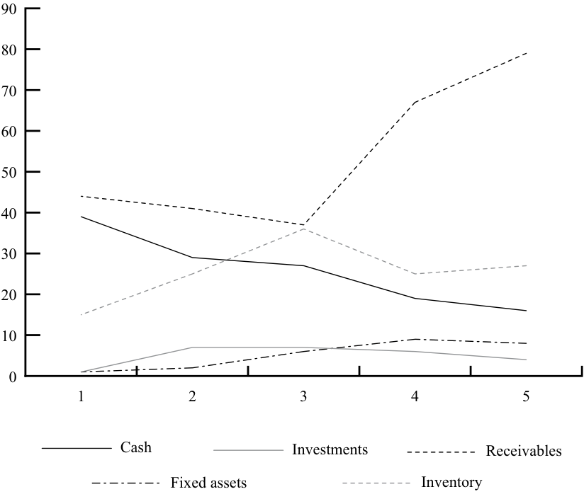
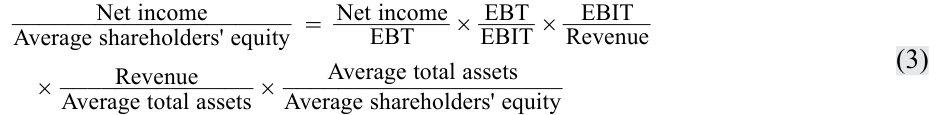

# Tập 4: Phân tích Báo cáo Tài chính (Financial Statement Analysis)
## Learning Module 11 Financial Analysis Techniques (Trang PDF 393–458)

---

# Tập 4: Phân tích Báo cáo Tài chính (Volume 4: Financial Statement Analysis)
## Học phần 11: Các Kỹ thuật Phân tích Tài chính (Learning Module 11: Financial Analysis Techniques)
### Phần 1/5: Giới thiệu (Introduction) (Trang PDF 393–408)

---

<!-- PDF Page 393 -->

#### H Ọ C P H Ầ N (L E A R N I N G M O D U L E)

# **<mark>11</mark>** 

### **Các Kỹ thuật Phân tích Tài chính (Financial Analysis Techniques)** 

**bởi Elaine Henry, PhD, CFA, Thomas R. Robinson, Phd, CAIA, CFA, và J. Hennie van Greuning, DCom, CFA.** 

_Elaine Henry, PhD, CFA, công tác tại Viện Công nghệ Stevens (Stevens Institute of Technology, Hoa Kỳ). Thomas R. Robinson, PhD, CAIA, CFA, công tác tại Robinson Global Investment Management LLC (Hoa Kỳ). J. Hennie van Greuning, DCom, CFA, công tác tại BIBD (Brunei)._ 

###### **<mark>MỤC TIÊU HỌC TẬP (LEARNING OUTCOMES)</mark>** 

**_Thành thạo – Ứng viên cần có khả năng:_**
- mô tả các công cụ và kỹ thuật được sử dụng trong phân tích tài chính (*financial analysis*), bao gồm công dụng và hạn chế của chúng
- tính toán và diễn giải các tỷ số hoạt động (*activity ratios*), tỷ số thanh khoản (*liquidity ratios*), tỷ số khả năng thanh toán dài hạn (*solvency ratios*), và tỷ số sinh lời (*profitability ratios*)
- mô tả các mối quan hệ giữa các tỷ số và đánh giá một công ty bằng cách sử dụng phân tích tỷ số (*ratio analysis*)
- trình bày việc áp dụng phân tích DuPont (*DuPont analysis*) đối với tỷ suất sinh lợi trên vốn chủ sở hữu (*return on equity* – ROE) và tính toán cũng như diễn giải tác động của những thay đổi trong các thành phần của nó
- mô tả công dụng của các tỷ số đặc thù ngành (*industry-specific ratios*) được sử dụng trong phân tích tài chính
- mô tả cách thức phân tích tỷ số và các kỹ thuật khác có thể được sử dụng để lập mô hình và dự báo lợi nhuận (*model and forecast earnings*)

Hai cơ quan ban hành chuẩn mực kế toán lớn gồm: 1) Hội đồng Chuẩn mực Kế toán Quốc tế (*International Accounting Standards Board* – IASB), đơn vị thiết lập các Chuẩn mực Báo cáo Tài chính Quốc tế (*International Financial Reporting Standards* – IFRS) và 2) Hội đồng Chuẩn mực Kế toán Tài chính (*Financial Accounting Standards Board* – FASB), đơn vị thiết lập các Nguyên tắc Kế toán được Chấp nhận Chung của Hoa Kỳ (*US GAAP*). Xuyên suốt học phần này, cả hai bộ chuẩn mực đều được đề cập và nhiều quy định, dù không phải tất cả, trong hai bộ quy tắc kế toán này được xác định rõ. Lưu ý: những thay đổi trong chuẩn mực kế toán cũng như các phán quyết và/hoặc tuyên bố mới được ban hành sau khi xuất bản học phần này có thể khiến một số thông tin trở nên lỗi thời. 

<!-- PDF Page 394 -->

## **<mark>1</mark>** 

##### **GIỚI THIỆU (INTRODUCTION)** 

Các chuyên gia phân tích chuyển đổi dữ liệu báo cáo tài chính và các dữ liệu khác thành các chỉ số (*metrics*) hỗ trợ quá trình ra quyết định và giúp trả lời những câu hỏi như sau: Một công ty mục tiêu đã hoạt động thành công như thế nào so với kết quả trong quá khứ của chính nó và so với các đối thủ cạnh tranh? Công ty nhiều khả năng sẽ hoạt động ra sao trong tương lai? Dựa trên những kỳ vọng về hiệu quả hoạt động trong tương lai, giá trị của công ty này hoặc các chứng khoán mà nó phát hành là bao nhiêu? Học phần này mô tả các kỹ thuật khác nhau được sử dụng để trả lời những câu hỏi trên và các câu hỏi khác. Những kỹ thuật phân tích tài chính (*financial analysis techniques*) này đóng vai trò tối quan trọng đối với nhiều nhiệm vụ phân tích đa dạng, bao gồm định giá chứng khoán vốn (*valuing equity securities*), đánh giá rủi ro tín dụng (*assessing credit risk*), thực hiện thẩm định chuyên sâu (*due diligence*) liên quan đến một thương vụ mua lại, và đánh giá hiệu quả hoạt động kinh doanh (*evaluating business performance*). 

###### **TỔNG QUAN HỌC PHẦN (LEARNING MODULE OVERVIEW)** 

- Không có một phương pháp tiếp cận duy nhất nào để cấu trúc quy trình phân tích tài chính, nhưng một khuôn khổ chung bao gồm các giai đoạn sau: xác định rõ mục đích của việc phân tích, thu thập dữ liệu đầu vào, xử lý dữ liệu, phân tích và diễn giải dữ liệu đã xử lý, xây dựng và truyền đạt các kết luận cũng như khuyến nghị, theo dõi định kỳ để xác định xem có cần thay đổi nào đối với các khuyến nghị hoặc danh mục nắm giữ hay không. 

- Mục đích của việc phân tích không chỉ đơn thuần là tổng hợp thông tin và thực hiện các phép tính, mà là tích hợp chúng thành một kết quả gắn kết nhằm giải quyết không chỉ câu hỏi điều gì đã xảy ra, mà còn tại sao nó lại xảy ra và liệu nó có tạo ra giá trị hay không. Một chuyên gia phân tích phải có khả năng hiểu được lý do “tại sao” đằng sau các con số và tỷ số, chứ không chỉ dừng lại ở việc các con số và tỷ số đó là gì. 

- Các đánh giá đòi hỏi phải có sự so sánh. Rất khó để nói rằng kết quả tài chính của một công ty là “tốt” hay “xấu” nếu không làm rõ cơ sở so sánh. Phân tích chéo (*cross-sectional analysis*) so sánh nhiều công ty tại cùng một thời điểm hoặc trong cùng một khoảng thời gian, và phân tích xu hướng hay chuỗi thời gian (*trend or time-series analysis*) so sánh các thước đo của một công ty duy nhất qua một khoảng thời gian. 

- Các tỷ số (*ratios*) và báo cáo tài chính theo quy mô chung (*common-size financial statements*) có thể loại bỏ quy mô khỏi vai trò một nhân tố gây nhiễu và cho phép thực hiện các so sánh phù hợp hơn. Các tỷ số báo cáo tài chính rất hữu ích trong việc định giá công ty và chứng khoán, lựa chọn khoản đầu tư, và dự báo kiệt quệ tài chính (*financial distress*). Tỷ số là một chỉ báo về một khía cạnh nào đó trong hiệu quả hoạt động của công ty, cho biết điều gì đã xảy ra nhưng không cho biết tại sao nó lại xảy ra. 

- Phân tích theo quy mô chung (*common-size analysis*) bao gồm việc biểu thị dữ liệu tài chính, kể cả toàn bộ báo cáo tài chính, trong mối tương quan với một khoản mục báo cáo tài chính duy nhất, hay còn gọi là cơ sở (*base*). Bảng cân đối kế toán theo quy mô chung dọc (*vertical common-size balance sheet*) lấy từng khoản mục trên bảng cân đối kế toán chia cho tổng tài sản của cùng kỳ và biểu thị kết quả dưới dạng phần trăm. Báo cáo kết quả hoạt động kinh doanh theo quy mô chung dọc (*vertical common-size income statement*) lấy từng khoản mục trên báo cáo kết quả hoạt động kinh doanh chia cho doanh thu hoặc chia cho tổng tài sản. Bảng cân đối kế toán theo quy mô chung ngang (*horizontal common-size balance sheet*) lấy giá trị của từng khoản mục chia cho giá trị năm gốc (*base year*) của chính khoản mục đó để tính ra mức thay đổi phần trăm của khoản mục đó so với năm gốc. Dữ liệu xu hướng được tạo ra từ phân tích theo quy mô chung ngang có thể được đem ra so sánh xuyên suốt các báo cáo tài chính. 

<!-- PDF Page 395 -->

|■|Biểu đồ (*Graphs*) tạo điều kiện thuận lợi cho việc so sánh hiệu quả hoạt động và cấu trúc tài chính theo thời gian, cung cấp cái nhìn tổng quan trực quan về những thay đổi và xu hướng, đồng thời có thể được sử dụng để truyền đạt các kết luận từ phân tích tài chính. Phân tích hồi quy (*Regression analysis*) có thể giúp xác định các mối quan hệ hoặc sự tương quan (*correlation*) giữa các biến số.|
|---|---|
|■|Các tỷ số hoạt động (*Activity ratios*) đo lường mức độ hiệu quả trong hoạt động của một công ty, chẳng hạn như việc thu hồi các khoản phải thu hoặc quản lý hàng tồn kho. Các tỷ số hoạt động chính bao gồm vòng quay hàng tồn kho (*inventory turnover*), số ngày tồn kho bình quân (*days of inventory on hand* – DOH), vòng quay khoản phải thu (*receivables turnover*), số ngày thu tiền bình quân (*days of sales outstanding* – DSO), vòng quay khoản phải trả (*payables turnover*), số ngày trả tiền bình quân (*number of days of payables*), vòng quay vốn lưu động (*working capital turnover*), vòng quay tài sản cố định (*fixed asset turnover*), và vòng quay tổng tài sản (*total asset turnover*).|
|■|Các tỷ số thanh khoản (*Liquidity ratios*) đo lường khả năng đáp ứng các nghĩa vụ ngắn hạn của một công ty. Các tỷ số thanh khoản chính bao gồm tỷ số thanh toán hiện hành (*current ratio*), tỷ số thanh toán nhanh (*quick ratio*), tỷ số tiền mặt (*cash ratio*), và tỷ số khoảng thời gian phòng thủ (*defensive interval ratio*). Chu kỳ chuyển đổi tiền mặt (*cash conversion cycle*) là một thước đo thanh khoản nhưng không phải là một tỷ số đơn thuần.|
|■|Các tỷ số khả năng thanh toán dài hạn (*Solvency ratios*) đo lường khả năng đáp ứng các nghĩa vụ dài hạn của một công ty. Các tỷ số khả năng thanh toán dài hạn chính bao gồm các tỷ số nợ (*debt ratios* — bao gồm tỷ số nợ trên tài sản [*debt-to-assets ratio*], tỷ số nợ trên tổng vốn [*debt-to-capital ratio*], tỷ số nợ trên vốn chủ sở hữu [*debt-to-equity ratio*], và tỷ số đòn bẩy tài chính [*financial leverage ratio*]) và các tỷ số khả năng trang trải (*coverage ratios* — bao gồm tỷ số trang trải lãi vay [*interest coverage*] và tỷ số trang trải chi phí cố định [*fixed charge coverage*]).|
|■|Các tỷ số sinh lời (*Profitability ratios*) đo lường khả năng tạo ra lợi nhuận từ doanh thu và tài sản của một công ty. Các tỷ số sinh lời chính bao gồm các tỷ số tỷ suất sinh lợi trên doanh thu (*return on sales ratios* — bao gồm biên lợi nhuận gộp [*gross profit margin*], biên lợi nhuận hoạt động [*operating profit margin*], biên lợi nhuận trước thuế [*pretax margin*], và biên lợi nhuận ròng [*net profit margin*]) và các tỷ số tỷ suất sinh lợi trên vốn đầu tư (*return on investment ratios* — bao gồm tỷ suất sinh lợi hoạt động trên tài sản [*operating return on assets* – operating ROA], tỷ suất sinh lợi trên tài sản [ROA], tỷ suất sinh lợi trên tổng vốn [*return on total capital*], tỷ suất sinh lợi trên vốn chủ sở hữu [*return on equity* – ROE], và tỷ suất sinh lợi trên vốn cổ phần phổ thông [*return on common equity*]).|
|■|Điều quan trọng là phải xem xét một loạt các tỷ số tài chính—chứ không phải một tỷ số hay một nhóm tỷ số đơn lẻ tách biệt—để xác định vị thế và hiệu quả hoạt động tổng thể của một công ty.|
|■|Phân tích DuPont (*DuPont analysis*) tách ROE thành các thành phần đóng vai trò là chỉ báo cho các khía cạnh khác nhau trong hiệu quả hoạt động của công ty. Có thể thực hiện phân rã ở nhiều cấp độ khác nhau.|
|■|Phân rã DuPont năm thành phần (*five-component DuPont decomposition*) biểu thị ROE của một công ty như một hàm số của thuế suất, gánh nặng lãi vay (*interest burden*), khả năng sinh lời hoạt động (*operating profitability*), hiệu quả sử dụng tài sản (*efficiency*), và đòn bẩy tài chính (*leverage*).|
|■|Bởi vì những khía cạnh hiệu quả hoạt động được coi là quan trọng trong ngành này có thể lại không liên quan trong ngành khác, các tỷ số đặc thù ngành (*industry-specific ratios*) được sử dụng để phản ánh những sự khác biệt này.|
|■|Các kỹ thuật như phân tích độ nhạy (*sensitivity analysis*), phân tích kịch bản (*scenario analysis*), và mô phỏng (*simulation*) được sử dụng để dự báo kết quả tài chính trong tương lai.|

##### **QUY TRÌNH PHÂN TÍCH TÀI CHÍNH (THE FINANCIAL ANALYSIS PROCESS)** 

mô tả các công cụ và kỹ thuật được sử dụng trong phân tích tài chính, bao gồm công dụng và hạn chế của chúng 

<!-- PDF Page 396 -->

Trong phân tích tài chính, điều cốt yếu là phải xác định rõ ràng và thấu hiểu mục tiêu cuối cùng cũng như các bước cần thiết để đạt được mục tiêu đó. Ngoài ra, chuyên gia phân tích cần biết tìm dữ liệu liên quan ở đâu, làm thế nào để xử lý và phân tích dữ liệu (nói cách khác là biết những câu hỏi điển hình cần giải quyết khi diễn giải dữ liệu), và làm thế nào để truyền đạt kết quả phân tích cùng các kết luận. 

###### **Các Mục tiêu của Quy trình Phân tích Tài chính (The Objectives of the Financial Analysis Process)** 

Do có nhiều lý do khác nhau để thực hiện phân tích tài chính, vô số kỹ thuật sẵn có, và lượng dữ liệu thường rất lớn, điều quan trọng là phương pháp tiếp cận phân tích phải được thiết kế phù hợp với từng tình huống cụ thể. Trước khi bắt đầu bất kỳ phân tích tài chính nào, chuyên gia phân tích cần làm rõ mục đích và bối cảnh, đồng thời hiểu rõ những vấn đề sau: 

- Mục đích của việc phân tích là gì? Phân tích này sẽ trả lời những câu hỏi nào? 

- Cần mức độ chi tiết đến đâu để hoàn thành mục đích này? 

- Những dữ liệu nào hiện có sẵn cho việc phân tích? 

- Những nhân tố hoặc mối quan hệ nào sẽ ảnh hưởng đến việc phân tích? 

- Những hạn chế trong phân tích là gì, và liệu những hạn chế này có khả năng làm suy giảm chất lượng của việc phân tích hay không? 

Sau khi đã làm rõ mục đích và bối cảnh phân tích, chuyên gia phân tích có thể lựa chọn tập hợp các kỹ thuật (ví dụ: các tỷ số) giúp hỗ trợ tốt nhất cho việc ra quyết định. Mặc dù không có một phương pháp tiếp cận duy nhất nào để cấu trúc quy trình phân tích, một khuôn khổ chung được trình bày trong Bảng 1 (*Exhibit 1*). Các bước trong quy trình này đã được thảo luận chi tiết hơn ở một học phần trước; trọng tâm chính của học phần này nằm ở Giai đoạn 3 và 4, tức là xử lý và phân tích dữ liệu. 

###### **Bảng 1: Khuôn khổ Phân tích Báo cáo Tài chính (Exhibit 1: A Financial Statement Analysis Framework)** 

|**Giai đoạn (Phase)**|**Nguồn thông tin (Sources of Information)**|**Đầu ra (Output)**|
|---|---|---|
|1. Xác định rõ mục đích và bối cảnh của việc phân tích (*Articulate the purpose and context of the analysis*).|■ Bản chất chức năng của chuyên gia phân tích, chẳng hạn như đánh giá một khoản đầu tư vốn cổ phần hoặc nợ, hay đưa ra xếp hạng tín dụng. ■ Trao đổi với khách hàng hoặc cấp trên về các nhu cầu và mối quan ngại. ■ Các hướng dẫn của tổ chức liên quan đến việc xây dựng sản phẩm công việc cụ thể.|■ Tuyên bố về mục đích hoặc mục tiêu của việc phân tích. ■ Một danh sách (bằng văn bản hoặc không bằng văn bản) các câu hỏi cụ thể cần được trả lời thông qua phân tích. ■ Bản chất và nội dung của báo cáo sẽ được cung cấp. ■ Lịch trình thời gian và nguồn lực ngân sách để hoàn thành.|
|2. Thu thập dữ liệu đầu vào (*Collect input data*).|■ Các báo cáo tài chính, dữ liệu tài chính khác, bảng câu hỏi khảo sát, và dữ liệu ngành/kinh tế. ■ Các cuộc thảo luận với ban giám đốc, nhà cung cấp, khách hàng, và đối thủ cạnh tranh. ■ Các chuyến khảo sát thực tế tại công ty (ví dụ: đến các cơ sở sản xuất hoặc cửa hàng bán lẻ).|■ Các báo cáo tài chính đã được sắp xếp có hệ thống. ■ Các bảng dữ liệu tài chính. ■ Các bảng câu hỏi khảo sát đã hoàn thành, nếu có.|

<!-- PDF Page 397 -->

|**Giai đoạn (Phase)**||**Nguồn thông tin (Sources of Information)**|**Đầu ra (Output)**|
|---|---|---|---|
|3.|Xử lý dữ liệu (*Process data*).|■ Dữ liệu từ giai đoạn trước.|■ Các báo cáo tài chính đã điều chỉnh (*Adjusted financial statements*). ■ Các báo cáo theo quy mô chung (*Common-size statements*). ■ Các tỷ số và biểu đồ (*Ratios and graphs*). ■ Các dự báo (*Forecasts*).|
|4.|Phân tích/diễn giải dữ liệu đã xử lý (*Analyze/interpret the processed data*).|■ Dữ liệu đầu vào cũng như dữ liệu đã xử lý.|■ Các kết quả phân tích (*Analytical results*).|
|5.|Xây dựng và truyền đạt các kết luận và khuyến nghị (*Develop and communicate conclusions and recommendations*) (ví dụ: thông qua một báo cáo phân tích).|■ Các kết quả phân tích và các báo cáo trước đó. ■ Các hướng dẫn của tổ chức đối với các báo cáo được công bố.|■ Báo cáo phân tích trả lời các câu hỏi được đặt ra trong Giai đoạn 1. ■ Khuyến nghị liên quan đến mục đích phân tích, chẳng hạn như có nên thực hiện đầu tư hay cấp tín dụng hay không.|
|6.|Theo dõi (*Follow-up*).|■ Thông tin thu thập được bằng cách định kỳ lặp lại các bước trên khi cần thiết để xác định xem có cần thay đổi đối với danh mục nắm giữ hoặc khuyến nghị hay không.|■ Các báo cáo và khuyến nghị được cập nhật.|

###### **Phân biệt giữa Tính toán và Phân tích (Distinguishing between Computations and Analysis)** 

Một phân tích hiệu quả bao hàm cả các phép tính toán (*computations*) và sự diễn giải (*interpretations*). Một bản phân tích có lập luận chặt chẽ khác với việc chỉ đơn thuần tập hợp các mẩu thông tin, phép tính, bảng biểu và đồ thị rời rạc ở chỗ nó tích hợp các dữ liệu thu thập được thành một chỉnh thể gắn kết. Chẳng hạn, việc phân tích hiệu quả hoạt động trong quá khứ không chỉ cần giải quyết câu hỏi điều gì đã xảy ra mà còn phải làm rõ tại sao nó lại xảy ra và liệu nó có tạo ra giá trị hay không. Một số câu hỏi then chốt cần giải quyết bao gồm: 

- Những khía cạnh nào của hiệu quả hoạt động là tối quan trọng để công ty này cạnh tranh thành công trong ngành? 

- Hiệu quả hoạt động của công ty đã đáp ứng các khía cạnh quan trọng này tốt đến mức nào? (Được xác lập thông qua tính toán và so sánh với các chuẩn đối sánh [*benchmarks*] phù hợp, chẳng hạn như kết quả hoạt động lịch sử của chính công ty hoặc kết quả hoạt động của các đối thủ cạnh tranh.) 

- Đâu là những nguyên nhân chính dẫn đến kết quả hoạt động này, và kết quả hoạt động này phản ánh chiến lược của công ty như thế nào? (Được xác lập thông qua phân tích.) 

- Nếu phân tích mang tính hướng tới tương lai (*forward looking*), các câu hỏi bổ sung bao gồm: 

- Tác động có khả năng xảy ra của một sự kiện hoặc xu hướng là gì? (Được xác lập thông qua việc diễn giải kết quả phân tích.) 

- Phản ứng có khả năng xảy ra của ban giám đốc trước xu hướng này là gì? (Được xác lập thông qua việc đánh giá chất lượng ban giám đốc và quản trị công ty [*corporate governance*].) 

- Tác động có khả năng xảy ra của các xu hướng trong công ty, ngành, và nền kinh tế đối với các dòng tiền trong tương lai là gì? (Được xác lập thông qua việc đánh giá chiến lược doanh nghiệp và thông qua các dự báo.) 

- Các khuyến nghị của chuyên gia phân tích là gì? (Được xác lập thông qua việc diễn giải và dự báo các kết quả phân tích.) 

- Những rủi ro nào cần được làm nổi bật? (Được xác lập bằng cách đánh giá những bất định lớn trong dự báo và trong môi trường mà công ty đang hoạt động.) 

<!-- PDF Page 398 -->

Ví dụ 1 minh họa cách thức phân tích dữ liệu tài chính của một công ty trong bối cảnh chiến lược kinh doanh và những thay đổi trong chiến lược đó. Một chuyên gia phân tích phải có khả năng hiểu được lý do “tại sao” đằng sau các con số và tỷ số, chứ không chỉ dừng lại ở việc các con số và tỷ số đó là gì. 

###### **VÍ DỤ 1 (EXAMPLE 1)** 

###### **Chiến lược được Phản ánh trong Kết quả Tài chính (Strategy Reflected in Financial Performance)** 

Apple Inc. tham gia vào việc thiết kế, sản xuất và bán phần cứng máy tính, thiết bị di động, hệ điều hành cùng các sản phẩm và dịch vụ liên quan. Công ty cũng vận hành các cửa hàng bán lẻ và trực tuyến. Microsoft phát triển, cấp phép và hỗ trợ các sản phẩm phần mềm, dịch vụ và thiết bị công nghệ thông qua nhiều kênh khác nhau, bao gồm cả các cửa hàng bán lẻ trong những năm gần đây. Dữ liệu tài chính chọn lọc từ năm 2015 đến năm 2017 của hai công ty này được trình bày trong Bảng 2 và Bảng 3. Năm tài chính (*fiscal year* – FY) của Apple kết thúc vào ngày Thứ Bảy cuối cùng của tháng Chín (ví dụ: FY2017 kết thúc vào ngày 30 tháng 9 năm 2017). Năm tài chính của Microsoft kết thúc vào ngày 30 tháng Sáu (ví dụ: FY2017 kết thúc vào ngày 30 tháng 6 năm 2017). 

**Bảng 2: Dữ liệu Tài chính Chọn lọc của Apple (triệu đô la Mỹ) (Exhibit 2: Selected Financial Data for Apple [US dollar millions])** 

|**Năm tài chính (Fiscal year)**|**2017**|**2016**|**2015**|
|---|---|---|---|
|Doanh thu thuần (hoặc Doanh thu) (*Net sales or Revenue*)|229,234|215,639|233,715|
|Lợi nhuận gộp (*Gross margin*)|88,186|84,263|93,626|
|Thu nhập hoạt động (*Operating income*)|61,344|60,024|71,230|

**Bảng 3: Dữ liệu Tài chính Chọn lọc của Microsoft (triệu đô la Mỹ)\* (Exhibit 3: Selected Financial Data for Microsoft [US dollar millions]\*)** 

|**Năm tài chính (Fiscal year)**|**2017**|**2016**|**2015**|
|---|---|---|---|
|Doanh thu thuần (hoặc doanh thu) (*Net sales or revenue*)|89,950|85,320|93,580|
|Lợi nhuận gộp (*Gross margin*)|55,689|52,540|60,542|
|Thu nhập hoạt động (*Operating income*)|22,326|20,182|18,161|

_\* Doanh thu của Microsoft cho năm 2017 và 2016 sau đó đã được điều chỉnh lại trong báo cáo 10-K năm 2018 của công ty do những thay đổi trong chuẩn mực ghi nhận doanh thu và kế toán thuê tài sản._ 

_Nguồn:_ Các báo cáo 10-K của Apple và Microsoft. 

Apple báo cáo mức giảm 7.7% trong doanh thu thuần từ FY2015 đến FY2016 và mức tăng 6.3% từ FY2016 đến FY2017, dẫn đến mức sụt giảm nhẹ xét trên tổng thể giai đoạn ba năm. Lợi nhuận gộp (*gross margin*) giảm 10.0% từ FY2015 đến FY2016 và tăng 4.7% từ FY2016 đến FY2017. Điều này cũng thể hiện một sự sụt giảm tổng thể về lợi nhuận gộp trong giai đoạn ba năm. Thu nhập hoạt động (*operating income*) của công ty cũng bộc lộ các xu hướng tương tự. 

Microsoft báo cáo mức giảm 8.8% trong doanh thu thuần từ FY2015 đến FY2016 và mức tăng 5.4% từ FY2016 đến FY2017, dẫn đến mức sụt giảm nhẹ xét trên tổng thể giai đoạn ba năm. Lợi nhuận gộp giảm 13.2% từ FY2015 đến FY2016 và tăng 6.0% từ FY2016 đến FY2017. Tương tự như Apple, điều này thể hiện sự sụt giảm tổng thể về lợi nhuận gộp trong 

<!-- PDF Page 399 -->

giai đoạn ba năm. Ngược lại, thu nhập hoạt động của Microsoft lại cho thấy sự tăng trưởng qua từng năm và trong cả giai đoạn ba năm. Mức tăng trưởng tổng thể của thu nhập hoạt động là 23%. 

Điều gì đã tạo ra sự tăng trưởng trong thu nhập hoạt động của Microsoft trong khi cả Apple và Microsoft đều có những xu hướng tiêu cực tương tự nhau về doanh thu và lợi nhuận gộp? Sự sụt giảm về doanh thu, lợi nhuận gộp và thu nhập hoạt động của Apple từ FY2015 đến FY2016 là do doanh số bán iPhone sụt giảm và sự suy yếu của các đồng ngoại tệ so với đồng đô la Mỹ. Năm tài chính FY2017 chứng kiến sự phục hồi trong doanh số bán iPhone, máy tính Mac và các dịch vụ, dù bị bù trừ một phần bởi sự suy yếu tiếp diễn của các đồng ngoại tệ. Microsoft tương tự cũng có sự sụt giảm về doanh thu và lợi nhuận gộp từ việc bán các thiết bị và phần mềm Windows trong FY2016, cũng như chịu tác động tiêu cực từ sự suy yếu của ngoại tệ. Sự gia tăng doanh thu và lợi nhuận gộp của Microsoft trong FY2017 được thúc đẩy bởi thương vụ mua lại LinkedIn, doanh số bán phần mềm Microsoft Office cao hơn, và doanh số dịch vụ đám mây (*cloud services*) cao hơn. Động lực đằng sau sự gia tăng liên tục trong thu nhập hoạt động của Microsoft là sự sụt giảm lớn trong giai đoạn ba năm của các khoản chi phí suy giảm giá trị tài sản (*impairment*), chi phí tích hợp (*integration*) và chi phí tái cấu trúc (*restructuring charges*). Microsoft đã ghi nhận một khoản chi phí 10 tỷ USD trong FY2015 liên quan đến mảng kinh doanh điện thoại của mình, và có thêm các khoản chi phí 1.1 tỷ USD trong FY2016 và 306 triệu USD trong FY2017. Nếu không có các khoản xóa sổ (*write-offs*) lớn này, Microsoft hẳn đã có một xu hướng thu nhập hoạt động tương tự như của Apple trong giai đoạn ba năm đó. 

Các chuyên gia phân tích thường cần truyền đạt những phát hiện từ quá trình phân tích của mình trong một báo cáo bằng văn bản. Báo cáo của họ cần truyền đạt được cách thức đi đến các kết luận và lý do tại sao các khuyến nghị lại được đưa ra. Ví dụ, một báo cáo có thể trình bày những nội dung sau: 

- mục đích của báo cáo, trừ khi điều đó đã quá hiển nhiên; 

- các khía cạnh liên quan của bối cảnh kinh doanh, bao gồm: 

   - môi trường kinh tế (quốc gia/khu vực, kinh tế vĩ mô, ngành), 

   - cơ sở hạ tầng tài chính và các cơ sở hạ tầng khác (kế toán, kiểm toán, các tổ chức xếp hạng tín nhiệm), và 

   - môi trường pháp lý và quy định quản lý (cũng như bất kỳ hạn chế trọng yếu nào khác đối với công ty đang được phân tích); 

- đánh giá về quản trị công ty (*corporate governance*) và nhận định về chiến lược của ban giám đốc, bao gồm (các) lợi thế cạnh tranh của công ty; 

- đánh giá dữ liệu tài chính và hoạt động, bao gồm các giả định then chốt trong phân tích; và 

- các kết luận và khuyến nghị, bao gồm những hạn chế của phân tích và các rủi ro. 

Một bài thuyết minh hiệu quả cùng các kết luận và khuyến nghị có cơ sở vững chắc thường được củng cố bằng việc sử dụng dữ liệu từ 3–10 năm cũng như bằng các kỹ thuật phân tích phù hợp với mục đích của báo cáo. 

##### **CÁC CÔNG CỤ VÀ KỸ THUẬT PHÂN TÍCH (ANALYTICAL TOOLS AND TECHNIQUES)** 

mô tả các công cụ và kỹ thuật được sử dụng trong phân tích tài chính, bao gồm công dụng và hạn chế của chúng 

<!-- PDF Page 400 -->

Các công cụ và kỹ thuật được trình bày trong bài học này tạo điều kiện thuận lợi cho việc đánh giá dữ liệu công ty. Các đánh giá đòi hỏi phải có sự so sánh. Rất khó để nói rằng kết quả tài chính của một công ty là “tốt” hay “xấu” nếu không làm rõ cơ sở so sánh. Khi đánh giá khả năng tạo ra và tăng trưởng lợi nhuận cũng như dòng tiền của một công ty, cùng những rủi ro liên quan đến lợi nhuận và dòng tiền đó, chuyên gia phân tích thực hiện các phép so sánh với những công ty khác tại cùng một thời điểm hoặc trong cùng một khoảng thời gian (phân tích chéo – *cross-sectional analysis*) và theo thời gian (phân tích xu hướng hoặc chuỗi thời gian – *trend or time-series analysis*). 

Ví dụ, một chuyên gia phân tích có thể muốn so sánh khả năng sinh lời của các công ty đang cạnh tranh trong một ngành công nghiệp toàn cầu. Nếu các công ty có sự khác biệt đáng kể về quy mô hoặc báo cáo dữ liệu tài chính bằng các đồng tiền khác nhau, việc so sánh thu nhập ròng (*net income*) như được báo cáo sẽ không mang lại nhiều giá trị. Các tỷ số (*ratios* — biểu thị một con số trong mối tương quan với một con số khác) và các báo cáo tài chính theo quy mô chung (*common-size financial statements*) có thể loại bỏ quy mô khỏi vai trò một nhân tố và cho phép thực hiện một phép so sánh phù hợp hơn. Để đạt được tính có thể so sánh (*comparability*) giữa các công ty báo cáo bằng các đồng tiền khác nhau, một phương pháp tiếp cận là chuyển đổi tất cả các con số được báo cáo sang một đồng tiền chung bằng cách sử dụng tỷ giá hối đoái bình quân hoặc tỷ giá cuối kỳ. Thay vào đó, nếu trọng tâm chủ yếu đặt vào các tỷ số, tính có thể so sánh có thể đạt được mà không cần chuyển đổi tiền tệ. 

Chuyên gia phân tích cũng có thể muốn xem xét hiệu quả hoạt động tương đương theo thời gian. Một lần nữa, giá trị tiền tệ danh nghĩa của doanh thu hay thu nhập ròng có thể không làm nổi bật được những thay đổi quan trọng. Để giải quyết thách thức này, các báo cáo tài chính theo chiều ngang (*horizontal financial statements* — theo đó các đại lượng được trình bày theo giá trị của một năm gốc được chọn) có thể làm cho những thay đổi như vậy trở nên rõ ràng hơn. Một trở ngại khác đối với việc so sánh là sự khác biệt về thời điểm kết thúc năm tài chính (*fiscal year end*). Để đạt được tính có thể so sánh, một cách tiếp cận là xây dựng dữ liệu 12 tháng gần nhất (*trailing 12 months* – TTM). Cuối cùng, cần lưu ý rằng sự khác biệt trong các chuẩn mực kế toán có thể làm hạn chế tính có thể so sánh. 

###### **VÍ DỤ 2 (EXAMPLE 2)** 

###### **Phân tích Tỷ số (Ratio Analysis)** 

Một chuyên gia phân tích đang xem xét khả năng sinh lời của hai công ty quốc tế nắm giữ thị phần lớn trên thị trường máy tính cá nhân toàn cầu: Acer Inc. và Lenovo Group Limited. Acer theo đuổi chiến lược bán sản phẩm với mức giá phải chăng. Ngược lại, Lenovo hướng tới việc đạt được mức giá bán cao hơn bằng cách nhấn mạnh vào chất lượng kỹ thuật cao của các dòng máy tính cá nhân phục vụ mục đích doanh nghiệp. Acer báo cáo bằng đồng Tân Đài tệ (TWD) và Lenovo báo cáo bằng đồng đô la Mỹ (USD). Đối với Acer, thời điểm kết thúc năm tài chính là ngày 31 tháng 12. Đối với Lenovo, thời điểm kết thúc năm tài chính là ngày 31 tháng 3; do đó, FY2017 kết thúc vào ngày 31 tháng 3 năm 2018. 

Chuyên gia phân tích thu thập dữ liệu được trình bày trong Bảng 4. Hãy sử dụng thông tin này để trả lời các câu hỏi sau: 

<!-- PDF Page 401 -->

###### **Bảng 4: Khả năng Sinh lời của Acer so với Lenovo (Exhibit 4: Acer versus Lenovo Profitability)** 

|**Acer**||||||
|---|---|---|---|---|---|
|**_Triệu TWD (TWD Millions)_**|**FY2013**|**FY2014**|**FY2015**|**FY2016**|**FY2017**|
|Doanh thu (*Revenue*)|360,132|329,684|263,775|232,724|237,275|
|Lợi nhuận gộp (*Gross profit*)|22,550|28,942|24,884|23,212|25,361|
|Thu nhập ròng (*Net income*)|(20,519)|1,791|604|(4,901)|2,797|

|**Lenovo**||||||
|---|---|---|---|---|---|
|**Triệu USD (USD Millions)**|**FY2013**|**FY2014**|**FY2015**|**FY2016**|**FY2017**|
|Doanh thu (*Revenue*)|38,707|46,296|44,912|43,035|45,350|
|Lợi nhuận gộp (*Gross profit*)|5,064|6,682|6,624|6,105|6,272|
|Thu nhập ròng (Lỗ) (*Net income [Loss]*)|817|837|(145)|530|(127)|

_Lưu ý:_ Năm tài chính của Lenovo kết thúc vào ngày 31 tháng 3. Do đó, FY2017 đại diện cho năm tài chính kết thúc vào ngày 31 tháng 3 năm 2018; điều tương tự cũng áp dụng tương ứng cho các năm trước đó. 

1. Công ty nào lớn hơn dựa trên quy mô doanh thu, tính bằng đô la Mỹ, được báo cáo trong năm tài chính 2017? Đối với FY2017, giả sử tỷ giá hối đoái bình quân phù hợp là 30.95 TWD/USD. 

###### **Lời giải:** 

Lenovo lớn hơn nhiều so với Acer dựa trên doanh thu FY2017 tính bằng đô la Mỹ. Doanh thu FY2017 của Lenovo ở mức 45.35 tỷ USD cao hơn đáng kể so với mức 7.67 tỷ USD của Acer ($= 237,275\text{ triệu TWD} / 30.95$). **Acer**: Tại mức tỷ giá hối đoái bình quân giả định là 30.95 TWD/USD, doanh thu FY2017 của Acer tương đương 7.67 tỷ USD ($= 237,275\text{ triệu TWD} \div 30.95\text{ TWD/USD}$). 

**Lenovo**: Doanh thu FY2017 của Lenovo đạt tổng cộng 45.35 tỷ USD. _Lưu ý_: Việc so sánh quy mô của các công ty báo cáo bằng các đồng tiền khác nhau đòi hỏi phải chuyển đổi các con số được báo cáo sang một đồng tiền chung bằng cách sử dụng tỷ giá hối đoái tại một thời điểm nào đó. Lời giải này chuyển đổi doanh thu của Acer sang tỷ đô la Mỹ bằng cách sử dụng tỷ giá hối đoái bình quân của kỳ tài chính. Việc chuyển đổi doanh thu của Lenovo sang đồng Tân Đài tệ cũng sẽ cung cấp thông tin tương đương (và mang lại cùng một kết luận). 

2. Công ty nào có tốc độ tăng trưởng doanh thu cao hơn từ FY2016 đến FY2017? Từ FY2013 đến FY2017? 

###### **Lời giải:** 

Tốc độ tăng trưởng doanh thu của Lenovo cao hơn nhiều so với của Acer trong năm tài chính gần nhất và trong cả giai đoạn năm năm. 

||**Thay đổi Doanh thu FY2016 so với FY2017 (%)**|**Thay đổi Doanh thu FY2013 đến FY2017 (%)**|
|---|---|---|
|Acer|1.96|(34.11)|
|Lenovo|5.38|17.16|

Bảng trên thể hiện hai chỉ số tăng trưởng. Các phép tính được minh họa bằng dữ liệu doanh thu của Acer: 

<!-- PDF Page 402 -->

Mức thay đổi doanh thu của Acer trong FY2016 so với FY2017 là 1.96%, được tính bằng $(237,275 - 232,724) \div 232,724$ hoặc tương đương là $(237,275 \div 232,724) - 1$. Mức thay đổi doanh thu của Acer từ FY2013 đến FY2017 là mức sụt giảm 34.11%. 

3. Hai công ty so sánh với nhau như thế nào xét trên khía cạnh khả năng sinh lời? 

###### **Lời giải:** 

Khả năng sinh lời có thể được đánh giá bằng cách so sánh quy mô lợi nhuận gộp với doanh thu và quy mô thu nhập ròng với doanh thu. Bảng dưới đây trình bày hai tỷ số sinh lời này—biên lợi nhuận gộp (*gross profit margin*, tức lợi nhuận gộp chia cho doanh thu) và biên lợi nhuận ròng (*net profit margin*, tức thu nhập ròng chia cho doanh thu)—cho từng năm. 

|**Acer**|**FY2013 (%)**|**FY2014 (%)**|**FY2015 (%)**|**FY2016 (%)**|**FY2017 (%)**|
|---|---|---|---|---|---|
|Biên lợi nhuận gộp (*Gross profit margin*)|6.26|8.78|9.43|9.97|10.69|
|Biên lợi nhuận ròng (*Net profit margin*)|(5.70)|0.54|0.23|(2.11)|1.18|
|**Lenovo**|**FY2013 (%)**|**FY2014 (%)**|**FY2015 (%)**|**FY2016 (%)**|**FY2017 (%)**|
|Biên lợi nhuận gộp (*Gross profit margin*)|13.08|14.43|14.75|14.19|13.83|
|Biên lợi nhuận ròng (*Net profit margin*)|2.11|1.81|(0.32)|1.23|(0.28)|

Biên lợi nhuận ròng cho thấy khả năng sinh lời của cả hai công ty đều tương đối thấp. Biên lợi nhuận ròng của Acer thấp hơn của Lenovo trong ba trên năm năm. Biên lợi nhuận gộp của Acer tăng lên qua từng năm nhưng vẫn thấp hơn đáng kể so với của Lenovo. Biên lợi nhuận gộp của Lenovo tăng từ FY2013 đến FY2015 và sau đó giảm vào FY2016 và FY2017. Nhìn chung, Lenovo là công ty có khả năng sinh lời cao hơn, nhiều khả năng nhờ vào quy mô lớn hơn và tính kinh tế theo quy mô (*economies of scale*) tương ứng. (Lenovo nắm giữ thị phần lớn nhất trên thị trường máy tính cá nhân so với các công ty máy tính cá nhân khác.) 

## **<mark>4</mark>** 

##### **PHÂN TÍCH TỶ SỐ TÀI CHÍNH (FINANCIAL RATIO ANALYSIS)** 

mô tả các công cụ và kỹ thuật được sử dụng trong phân tích tài chính, bao gồm công dụng và hạn chế của chúng 

Có rất nhiều mối quan hệ giữa các tài khoản tài chính và nhiều mối quan hệ kỳ vọng khác nhau từ thời điểm này sang thời điểm khác. Các tỷ số (*ratios*) là một cách hữu ích để biểu thị những mối quan hệ này. Các tỷ số biểu thị một đại lượng trong mối tương quan với một đại lượng khác, thường dưới dạng một thương số. 

Nhiều nghiên cứu học thuật sâu rộng đã kiểm chứng tầm quan trọng của các tỷ số trong việc dự báo tỷ suất sinh lợi cổ phiếu (Ou và Penman, 1989; Abarbanell và Bushee, 1998) hoặc sự đổ vỡ tín dụng (Altman, 1968; Ohlson, 1980; Hopwood và cộng sự, 1994). Những nghiên cứu này đã phát hiện ra rằng 

<!-- PDF Page 403 -->

các tỷ số báo cáo tài chính phát huy hiệu quả trong việc lựa chọn các khoản đầu tư và dự báo tình trạng kiệt quệ tài chính (*financial distress*). Những người hành nghề thực tiễn thường xuyên sử dụng các tỷ số để xác định và truyền đạt giá trị của các công ty cũng như chứng khoán. 

Có một số khía cạnh quan trọng của phân tích tỷ số cần phải hiểu rõ. Thứ nhất, tỷ số được tính ra không phải là “câu trả lời cuối cùng”. Tỷ số là một _chỉ báo_ (*indicator*) về một khía cạnh nào đó trong hiệu quả hoạt động của công ty, cho biết điều gì đã xảy ra nhưng không cho biết tại sao nó lại xảy ra. Ví dụ, một chuyên gia phân tích có thể muốn trả lời câu hỏi: Công ty nào trong hai công ty có khả năng sinh lời cao hơn? Như đã minh họa trong ví dụ trước, biên lợi nhuận ròng (*net profit margin*), vốn biểu thị lợi nhuận trong mối tương quan với doanh thu, có thể mang lại cái nhìn sâu sắc cho câu hỏi này. Biên lợi nhuận ròng được tính bằng cách lấy thu nhập ròng chia cho doanh thu: 

$$\frac{\text{Net income}}{\text{Revenue}}$$

Giả sử Công ty A có 100,000 EUR thu nhập ròng và Công ty B có 200,000 EUR thu nhập ròng. Công ty B tạo ra thu nhập gấp đôi Công ty A, nhưng liệu nó có sinh lời tốt hơn không? Giả sử thêm rằng Công ty A có 2,000,000 EUR doanh thu, và do đó có biên lợi nhuận ròng là 5%, còn Công ty B có 6,000,000 EUR doanh thu, và do đó có biên lợi nhuận ròng là 3.33%. Việc biểu thị thu nhập ròng dưới dạng phần trăm của doanh thu giúp làm rõ mối quan hệ này: Với mỗi 100 EUR doanh thu, Công ty A kiếm được 5 EUR thu nhập ròng, trong khi Công ty B chỉ kiếm được 3.33 EUR cho mỗi 100 EUR doanh thu. Vì vậy, giờ đây chúng ta có thể trả lời câu hỏi công ty nào có khả năng sinh lời cao hơn xét theo tỷ lệ phần trăm: Công ty A sinh lời tốt hơn, thể hiện qua biên lợi nhuận ròng cao hơn ở mức 5%. Lưu ý rằng Công ty A _có khả năng sinh lời cao hơn_ mặc dù thực tế là Công ty B báo cáo con số tuyệt đối về thu nhập ròng và doanh thu cao hơn. Tuy nhiên, bản thân tỷ số này không cho chúng ta biết _tại sao_ Công ty A lại có biên lợi nhuận cao hơn. Cần phải phân tích sâu hơn để xác định nguyên nhân (có thể là do giá bán tương đối cao hơn, kiểm soát chi phí tốt hơn, hoặc thuế suất hiệu dụng thấp hơn). 

Quy mô công ty đôi khi mang lại lợi thế kinh tế theo quy mô (*economies of scale*), vì vậy các con số tuyệt đối của thu nhập ròng và doanh thu vẫn hữu ích trong phân tích tài chính. Tuy nhiên, các tỷ số giúp kiểm soát tác động của quy mô, qua đó nâng cao khả năng so sánh giữa các công ty và theo thời gian. 

Một khía cạnh quan trọng thứ hai của phân tích tỷ số là sự khác biệt trong các chính sách kế toán (giữa các công ty và qua các thời kỳ) có thể làm bóp méo các tỷ số, và do đó, để có một phép so sánh có ý nghĩa thì có thể cần phải thực hiện các điều chỉnh đối với dữ liệu tài chính. Thứ ba, không phải tất cả các tỷ số đều nhất thiết liên quan đến một phân tích cụ thể. Khả năng lựa chọn một hoặc các tỷ số phù hợp để trả lời câu hỏi nghiên cứu là một kỹ năng phân tích. Cuối cùng, giống như phân tích tài chính nói chung, phân tích tỷ số không dừng lại ở việc tính toán; việc diễn giải kết quả là điều thiết yếu. Trên thực tế, sự khác biệt về tỷ số qua thời gian và giữa các công ty có thể rất tinh vi, và việc diễn giải phụ thuộc vào từng tình huống cụ thể. 

###### **Thế giới các Tỷ số (The Universe of Ratios)** 

Không có cơ quan có thẩm quyền nào quy định các công thức chính xác để tính toán các tỷ số hay cung cấp một danh sách tỷ số chuẩn mực, toàn diện. Các công thức và thậm chí cả tên gọi của các tỷ số thường khác nhau giữa các chuyên gia phân tích hoặc giữa các cơ sở dữ liệu. Số lượng các tỷ số khác nhau có thể được tạo ra gần như là vô hạn. Tuy nhiên, có một số tỷ số được chấp nhận rộng rãi đã được chứng minh là hữu ích, và đó là trọng tâm của học phần này. Chuyên gia phân tích cần lưu ý rằng các tỷ số khác nhau có thể được sử dụng trong thực tiễn và một số ngành nhất định có các tỷ số đặc thù được thiết kế riêng cho các đặc điểm của ngành đó. Khi gặp một tỷ số lạ, chuyên gia phân tích có thể kiểm tra công thức cơ sở để hiểu rõ tỷ số đó đang đo lường điều gì. Ví dụ, hãy xem xét công thức tỷ số sau đây: 

$$\frac{\text{Operating income}}{\text{Average total assets}}$$

<!-- PDF Page 404 -->

Nếu chưa từng thấy tỷ số này bao giờ, một chuyên gia phân tích có thể tự hỏi liệu kết quả 12% có tốt hơn 8% hay không. Câu trả lời có thể được tìm thấy ngay trong bản thân tỷ số đó. Tử số là thu nhập hoạt động (*operating income*) và mẫu số là tổng tài sản bình quân (*average total assets*), vì vậy tỷ số này có thể được diễn giải là lượng thu nhập hoạt động được tạo ra trên mỗi đơn vị tài sản. Với mỗi 100 EUR tổng tài sản bình quân, việc tạo ra 12 EUR thu nhập hoạt động sẽ tốt hơn so với việc tạo ra 8 EUR thu nhập hoạt động. Hơn nữa, rõ ràng tỷ số cụ thể này là một chỉ báo về khả năng sinh lời (cũng như mức độ hiệu quả trong việc sử dụng tài sản để tạo ra lợi nhuận hoạt động). Khi bắt gặp một tỷ số lần đầu tiên, chuyên gia phân tích nên đánh giá tử số và mẫu số để xem xét tỷ số đó đang cố gắng đo lường điều gì và nên được diễn giải như thế nào. Điều này được minh họa trong Ví dụ 3. 

###### **VÍ DỤ 3 (EXAMPLE 3)** 

###### **Diễn giải một Tỷ số Tài chính (Interpreting a Financial Ratio)** 

Một công ty bảo hiểm Hoa Kỳ báo cáo rằng “tỷ số kết hợp” (*combined ratio*) của họ được xác định bằng cách lấy các khoản tổn thất và chi phí phát sinh (*losses and expenses incurred*) chia cho phí bảo hiểm thuần đã thu (*net premiums earned*). Công ty báo cáo các tỷ số kết hợp như sau: 

**Bảng 5: Tỷ số Kết hợp (Exhibit 5: Combined Ratio)** 

|**Năm tài chính (Fiscal Year)**|**5**|**4**|**3**|**2**|**1**|
|---|---|---|---|---|---|
|Tỷ số kết hợp (*Combined ratio*)|90.1%|104.0%|98.5%|104.1%|101.1%|

1. Hãy giải thích tỷ số này đang đo lường điều gì và so sánh kết quả được báo cáo cho từng năm hiển thị trong bảng. Chuyên gia phân tích có thể muốn xem xét thêm thông tin nào khác trước khi đưa ra bất kỳ kết luận nào dựa trên thông tin này? 

###### **Lời giải:** 

Tỷ số kết hợp (*combined ratio*) là một thước đo khả năng sinh lời. Tỷ số này giải thích mức chi phí (tổn thất và chi phí hoạt động) đã phát sinh cho mỗi đô la doanh thu (phí bảo hiểm thuần đã thu). Công thức cơ sở cho thấy giá trị của tỷ số này _càng thấp_ thì càng tốt. Tỷ số năm thứ 5 ở mức 90.1% có nghĩa là với mỗi đô la phí bảo hiểm thuần đã thu, chi phí là 0.901 USD, mang lại lợi nhuận gộp là 0.099 USD. Các tỷ số lớn hơn 100% biểu thị một khoản lỗ tổng thể. Việc xem xét dữ liệu cho thấy dường như không có một xu hướng nhất quán nào ở tỷ số này. Lợi nhuận đã đạt được vào các năm thứ 5 và thứ 3. Kết quả của các năm thứ 4 và thứ 2 cho thấy mức chi phí đáng kể nhất ở mức xấp xỉ 104%. Chuyên gia phân tích sẽ muốn thảo luận sâu hơn về dữ liệu này với ban giám đốc và tìm hiểu đặc điểm của hoạt động kinh doanh cơ sở. Họ sẽ muốn hiểu tại sao kết quả lại biến động mạnh như vậy. Chuyên gia phân tích cũng sẽ muốn xác định xem nên sử dụng chuẩn đối sánh (*benchmark*) nào cho tỷ số này. 

Tỷ số $\text{Thu nhập hoạt động} / \text{Tổng tài sản bình quân}$ ($\text{Operating income} / \text{Average total assets}$) là một trong nhiều phiên bản của tỷ số **tỷ suất sinh lợi trên tài sản (*return on assets* – ROA)**. Lưu ý rằng có những cách khác để xác định công thức này dựa trên cách định nghĩa tài sản. Một số cơ sở dữ liệu tỷ số tài chính tính toán ROA bằng cách sử dụng giá trị tài sản cuối kỳ thay vì tài sản bình quân. Trong một số trường hợp hạn hữu, người ta cũng có thể thấy tài sản đầu kỳ ở dưới mẫu số. Cách nào mới là đúng? Điều đó phụ thuộc vào những gì bạn đang cố gắng đo lường và các xu hướng cơ bản của công ty. Nếu công ty có mức tài sản ổn định, câu trả lời sẽ không khác biệt nhiều giữa ba thước đo tài sản (đầu kỳ, bình quân, và cuối kỳ). Tuy nhiên, nếu tài sản đang tăng trưởng (hoặc thu hẹp), kết quả sẽ khác nhau giữa ba thước đo. Khi tài sản đang tăng trưởng, việc lấy thu nhập hoạt động chia cho tài sản cuối kỳ có thể không hợp lý bởi vì một phần 

<!-- PDF Page 405 -->

thu nhập đã được tạo ra trước khi một số tài sản được mua về, và điều này sẽ làm phản ánh thấp hơn thực tế (*understate*) hiệu quả hoạt động của công ty. Tương tự, nếu sử dụng tài sản đầu kỳ, một phần thu nhập hoạt động vào cuối năm có thể chỉ được tạo ra nhờ vào việc bổ sung thêm tài sản; do đó, tỷ số này sẽ làm phóng đại (*overstate*) hiệu quả hoạt động của công ty. Bởi vì thu nhập hoạt động diễn ra trong suốt cả kỳ, nhìn chung việc sử dụng một thước đo tài sản bình quân nào đó là hợp lý. Một quy tắc chung tốt là khi một con số trên báo cáo kết quả hoạt động kinh doanh hoặc báo cáo lưu chuyển tiền tệ nằm ở tử số của một tỷ số và một con số trên bảng cân đối kế toán nằm ở mẫu số, thì nên sử dụng giá trị bình quân cho mẫu số. Nhìn chung không cần thiết phải sử dụng giá trị bình quân khi chỉ có các con số trên bảng cân đối kế toán được sử dụng ở cả tử số và mẫu số bởi vì cả hai đều được xác định tại cùng một ngày. Tuy nhiên, trong một số trường hợp, ngay cả những tỷ số chỉ sử dụng dữ liệu trên bảng cân đối kế toán cũng có thể dùng giá trị bình quân. Ví dụ, **tỷ suất sinh lợi trên vốn chủ sở hữu (*return on equity* – ROE)**, được định nghĩa là thu nhập ròng chia cho vốn chủ sở hữu bình quân, có thể được phân rã thành các tỷ số khác, mà một số trong đó chỉ sử dụng dữ liệu trên bảng cân đối kế toán. Khi phân rã ROE thành các tỷ số thành phần, nếu giá trị bình quân được sử dụng ở một trong các tỷ số thành phần thì nó cũng nên được sử dụng ở các tỷ số thành phần khác. Việc phân rã ROE sẽ được thảo luận sâu hơn ở một bài học sau. 

Nếu sử dụng giá trị bình quân, cũng cần có sự xét đoán chuyên môn về việc nên sử dụng loại bình quân nào. Để đơn giản, hầu hết các cơ sở dữ liệu tỷ số đều sử dụng trung bình cộng giản đơn của số dư đầu năm và cuối năm trên bảng cân đối kế toán. Nếu hoạt động kinh doanh của công ty mang tính mùa vụ khiến cho mức tài sản biến thiên theo từng kỳ giữa niên độ (bán niên hoặc hàng quý), thì việc lấy giá trị bình quân qua tất cả các kỳ giữa niên độ (nếu có sẵn dữ liệu) có thể sẽ hữu ích hơn. (Nếu chuyên gia phân tích đang làm việc trong nội bộ công ty và có quyền tiếp cận dữ liệu hàng tháng, dữ liệu này cũng có thể được sử dụng.) 

###### **Giá trị, Mục đích và Hạn chế của Phân tích Tỷ số (Value, Purposes, and Limitations of Ratio Analysis)** 

Giá trị của phân tích tỷ số nằm ở chỗ nó cho phép chuyên gia phân tích tài chính đánh giá hiệu quả hoạt động trong quá khứ, nhận định vị thế tài chính hiện tại của công ty, và thu được những góc nhìn sâu sắc hữu ích cho việc phóng chiếu kết quả trong tương lai. Như đã lưu ý trước đó, bản thân tỷ số không phải là “câu trả lời cuối cùng” mà là một chỉ báo về một khía cạnh nào đó trong hiệu quả hoạt động của công ty. Các tỷ số tài chính cung cấp cái nhìn sâu sắc về những vấn đề sau: 

- các mối quan hệ kinh tế trong nội bộ một công ty giúp các chuyên gia phân tích phóng chiếu lợi nhuận và dòng tiền tự do (*free cash flow*); 

- sự linh hoạt tài chính (*financial flexibility*) của một công ty, hay khả năng huy động lượng tiền mặt cần thiết để tăng trưởng và đáp ứng các nghĩa vụ của mình, ngay cả khi những tình huống bất ngờ phát sinh; 

- năng lực của ban giám đốc; 

- những thay đổi trong công ty hoặc ngành theo thời gian; và 

- khả năng so sánh với các công ty cùng ngành (*peer companies*) hoặc (các) ngành liên quan. 

Phân tích tỷ số cũng có những hạn chế. Các nhân tố cần xem xét bao gồm: 

- _Tính không đồng nhất hoặc tính đồng nhất trong các hoạt động kinh doanh của công ty (The heterogeneity or homogeneity of a company’s operating activities)._ Các công ty có thể có nhiều bộ phận hoạt động trong nhiều ngành nghề khác nhau. Điều này có thể gây khó khăn cho việc tìm kiếm các tỷ số ngành tương đương để sử dụng cho mục đích so sánh. 

- _Sự cần thiết phải xác định xem các kết quả phân tích tỷ số có nhất quán hay không._ Một nhóm tỷ số có thể chỉ ra một vấn đề, trong khi một nhóm tỷ số khác lại có thể cho thấy vấn đề tiềm ẩn đó chỉ mang tính chất ngắn hạn. 

- _Sự cần thiết phải sử dụng xét đoán chuyên môn (judgment)._ Một vấn đề then chốt là liệu một tỷ số của công ty có nằm trong phạm vi hợp lý hay không. Mặc dù các tỷ số tài chính được sử dụng để giúp đánh giá tiềm năng tăng trưởng và rủi ro của một công ty, chúng không thể được sử dụng độc lập một mình để trực tiếp định giá một công ty hay các chứng khoán của nó, hoặc để xác định 

<!-- PDF Page 406 -->

mức độ uy tín tín dụng (*creditworthiness*) của công ty đó. Toàn bộ hoạt động của công ty phải được xem xét, và bối cảnh kinh tế cũng như ngành nghề bên ngoài nơi công ty đang hoạt động phải được cân nhắc khi diễn giải các tỷ số tài chính. 

- _Việc sử dụng các phương pháp kế toán thay thế nhau._ Các công ty thường có quyền tự chủ nhất định khi lựa chọn một số phương pháp kế toán. Các tỷ số được lấy từ những báo cáo tài chính áp dụng các lựa chọn kế toán khác nhau có thể không so sánh được với nhau trừ khi thực hiện các bút toán điều chỉnh. Một số cân nhắc kế toán quan trọng bao gồm: 

   - Các phương pháp định giá hàng tồn kho FIFO (nhập trước, xuất trước), LIFO (nhập sau, xuất trước), hoặc bình quân gia quyền (Chuẩn mực Báo cáo Tài chính Quốc tế [IFRS] không cho phép sử dụng LIFO); 

   - Phương pháp giá gốc (*cost method*) hoặc phương pháp vốn chủ sở hữu (*equity method*) trong kế toán cho các công ty liên kết không hợp nhất; 

   - Phương pháp khấu hao đường thẳng (*straight-line*) hoặc khấu hao nhanh (*accelerated methods of depreciation*); và 

   - Cách hạch toán thuê hoạt động (*operating lease*) hoặc thuê tài chính (*finance lease*) đối với bên cho thuê (theo US GAAP, phân loại thuê tài sản ảnh hưởng đến việc phân loại chi phí; theo IFRS, cách hạch toán thuê hoạt động đối với bên cho thuê không được áp dụng). 

Những nỗ lực hội tụ giữa IFRS và US GAAP giúp cho báo cáo tài chính của các công ty khác nhau có thể so sánh được nhiều hơn và có thể khắc phục một số khó khăn này. Tuy nhiên, sẽ vẫn còn những lựa chọn kế toán mà chuyên gia phân tích phải xem xét. 

###### **Các Nguồn Dữ liệu Tỷ số (Sources of Ratios)** 

Các tỷ số có thể được tính toán bằng cách sử dụng dữ liệu thu thập trực tiếp từ báo cáo tài chính của các công ty hoặc từ một cơ sở dữ liệu như Bloomberg, Compustat, FactSet, hay Thomson Reuters. Thông tin do cơ sở dữ liệu cung cấp có thể bao gồm thông tin như được báo cáo trong báo cáo tài chính của các công ty và các tỷ số được tính toán dựa trên thông tin đó. Những cơ sở dữ liệu này rất phổ biến vì chúng cung cấp khả năng truy cập dễ dàng vào dữ liệu lịch sử của nhiều năm để có thể kiểm tra các xu hướng theo thời gian. Chúng cũng cho phép tính toán tỷ số dựa trên các kỳ khác với năm tài chính của công ty, chẳng hạn như cho 12 tháng gần nhất (*trailing 12 months* – TTM) hoặc quý gần nhất (*most recent quarter* – MRQ). 

###### **VÍ DỤ 4 (EXAMPLE 4)** 

###### **12 Tháng Gần nhất (Trailing 12 Months)** 

1. Vào ngày 15 tháng 7, một chuyên gia phân tích đang xem xét một công ty có năm tài chính kết thúc vào ngày 31 tháng 12. Hãy sử dụng dữ liệu sau đây để tính lợi nhuận TTM của công ty (cho kỳ kết thúc vào ngày 30 tháng 6 năm 2018): 

   - Lợi nhuận cho năm kết thúc ngày 31 tháng 12 năm 2017: 1,200 USD; 

   - Lợi nhuận cho sáu tháng kết thúc ngày 30 tháng 6 năm 2017: 550 USD; và 

   - Lợi nhuận cho sáu tháng kết thúc ngày 30 tháng 6 năm 2018: 750 USD. 

   - **Lời giải:** 

Lợi nhuận TTM của công ty là 1,400 USD, được tính bằng $1,200\text{ USD} - 550\text{ USD} + 750\text{ USD}$. 

Các chuyên gia phân tích cần lưu ý rằng công thức cơ sở của các tỷ số có thể khác nhau tùy theo nhà cung cấp dữ liệu (*vendor*). Cần lấy công thức được sử dụng từ nhà cung cấp, và chuyên gia phân tích phải xác định xem có cần thực hiện bất kỳ điều chỉnh nào hay không. Hơn nữa, các nhà cung cấp cơ sở dữ liệu thường áp dụng xét đoán khi phân loại các khoản mục. Ví dụ, thu nhập hoạt động (*operating income*) có thể 

<!-- PDF Page 407 -->

không xuất hiện trực tiếp trên báo cáo kết quả hoạt động kinh doanh của một công ty, và nhà cung cấp dữ liệu có thể sử dụng xét đoán để phân loại các khoản mục trên báo cáo kết quả hoạt động kinh doanh thành “hoạt động” (*operating*) hoặc “phi hoạt động” (*non-operating*). Sự khác biệt trong những xét đoán như vậy sẽ ảnh hưởng đến bất kỳ phép tính nào liên quan đến thu nhập hoạt động. Do đó, một thông lệ tốt là sử dụng cùng một nguồn dữ liệu khi so sánh các công ty khác nhau hoặc khi đánh giá hồ sơ lịch sử của một công ty duy nhất. Các chuyên gia phân tích nên xác minh tính nhất quán của các công thức và cách phân loại dữ liệu của nguồn dữ liệu. Các chuyên gia phân tích cũng nên lưu tâm đến những xét đoán do nhà cung cấp thực hiện trong việc phân loại dữ liệu và đối chiếu với các báo cáo tài chính gốc cho đến khi họ yên tâm rằng các phân loại đó là phù hợp. 

Việc thu thập dữ liệu tài chính từ các hồ sơ nộp cho cơ quan quản lý và việc tính toán các tỷ số có thể được tự động hóa. Ngôn ngữ Báo cáo Kinh doanh Mở rộng (*eXtensible Business Reporting Language* – XBRL) là một cơ chế gắn các “thẻ thông minh” (*smart tags*) vào thông tin tài chính (ví dụ: tổng tài sản), để phần mềm có thể tự động thu thập dữ liệu và thực hiện các phép tính mong muốn. Tổ chức phát triển XBRL (www.xbrl.org) là một hiệp hội phi lợi nhuận quốc tế gồm hơn 600 thành viên từ các công ty, hiệp hội và cơ quan, bao gồm cả Hội đồng Chuẩn mực Kế toán Quốc tế (IASB). Nhiều sở giao dịch chứng khoán và cơ quan quản lý trên khắp thế giới hiện đang sử dụng XBRL để tiếp nhận và phân phối các báo cáo tài chính công khai từ các công ty niêm yết. 

Các chuyên gia phân tích có thể so sánh công ty mục tiêu với các công ty tương đồng (cùng ngành – *peer companies*) trong cơ sở dữ liệu của nhà cung cấp hoặc sử dụng dữ liệu tổng hợp của toàn ngành. Đối với các công ty chưa đại chúng (*non-public companies*), dữ liệu tổng hợp của ngành có thể được lấy từ các nguồn như *Annual Statement Studies* của Hiệp hội Quản trị Rủi ro (*Risk Management Association*) hoặc Dun & Bradstreet. Các ấn phẩm này thường cung cấp dữ liệu ngành với các công ty được sắp xếp thành các tứ phân vị (*quartiles*). Theo định nghĩa, 25% công ty có tỷ số nằm trong tứ phân vị thấp nhất, 25% có tỷ số nằm giữa tứ phân vị dưới và giá trị trung vị (*median*), v.v. Khi đó, các chuyên gia phân tích có thể xác định được vị thế tương đối của một công ty trong ngành. 

##### **BẢNG CÂN ĐỐI KẾ TOÁN VÀ BÁO CÁO KẾT QUẢ HOẠT ĐỘNG KINH DOANH THEO QUY MÔ CHUNG (COMMON SIZE BALANCE SHEETS AND INCOME STATEMENTS)** 

**<mark>5</mark>** 

mô tả các công cụ và kỹ thuật được sử dụng trong phân tích tài chính, bao gồm công dụng và hạn chế của chúng 

**Phân tích theo quy mô chung (*Common-size analysis*)** bao gồm việc biểu thị dữ liệu tài chính, kể cả toàn bộ báo cáo tài chính, trong mối tương quan với một khoản mục báo cáo tài chính duy nhất, hay còn gọi là cơ sở (*base*). Các khoản mục được sử dụng thường xuyên nhất làm cơ sở là tổng tài sản hoặc doanh thu. Về bản chất, phân tích theo quy mô chung tạo ra một tỷ số giữa mọi khoản mục trên báo cáo tài chính với khoản mục cơ sở. Phân tích theo quy mô chung đã được minh họa ở các học phần trước đối với báo cáo kết quả hoạt động kinh doanh, bảng cân đối kế toán, và báo cáo lưu chuyển tiền tệ. Trong bài học này, chúng tôi trình bày phân tích theo quy mô chung đối với các báo cáo tài chính một cách chi tiết hơn và bao gồm cả phần thảo luận sâu hơn về cách diễn giải chúng. 

**Phân tích theo Quy mô Chung đối với Bảng Cân đối Kế toán (*Common-Size Analysis of the Balance Sheet*)** Một bảng cân đối kế toán theo quy mô chung dọc (*vertical common-size balance sheet*), được lập bằng cách lấy từng khoản mục trên bảng cân đối kế toán chia cho tổng tài sản của cùng kỳ và biểu thị kết quả dưới dạng phần trăm, làm nổi bật cấu thành của bảng cân đối kế toán. Cơ cấu tài sản đang được sử dụng là gì? Công ty đang tự tài trợ cho mình như thế nào? Cấu thành bảng cân đối kế toán của một công ty so sánh với các công ty cùng ngành ra sao, và nguyên nhân của bất kỳ sự khác biệt nào là gì? Một bảng cân đối kế toán theo quy mô chung ngang (*horizontal common-size balance sheet*), được lập bằng cách tính mức tăng hoặc giảm theo tỷ lệ phần trăm của từng khoản mục trên bảng cân đối kế toán so với năm trước hoặc được lập bằng cách lấy giá trị của từng khoản mục chia cho giá trị năm gốc của khoản mục đó, làm nổi bật những thay đổi trong các khoản mục. Những thay đổi này có thể được đem ra so sánh với các kỳ vọng. 

<!-- PDF Page 408 -->

Bảng 6 trình bày bảng cân đối kế toán (một phần) theo quy mô chung dọc của một công ty giả định trong hai kỳ thời gian. Trong ví dụ này, các khoản phải thu đã tăng từ 35% lên 57% tổng tài sản và tỷ trọng này đã tăng 63% từ Kỳ 1 sang Kỳ 2. Những nguyên nhân khả dĩ cho một sự gia tăng như vậy là gì? Sự gia tăng này có thể cho thấy công ty đang thực hiện bán hàng trả chậm (tín dụng) nhiều hơn thay vì thu tiền mặt, có lẽ là để phản ứng lại một động thái nào đó của đối thủ cạnh tranh. Hoặc một khả năng khác, sự gia tăng của khoản phải thu tính theo phần trăm tổng tài sản có thể đã xảy ra do sự thay đổi ở một nhóm tài sản ngắn hạn khác, ví dụ như sự sụt giảm mức hàng tồn kho; khi đó chuyên gia phân tích sẽ cần điều tra xem tại sao nhóm tài sản kia lại thay đổi. Một nguyên nhân khả dĩ khác cho sự gia tăng khoản phải thu tính theo phần trăm tài sản là công ty đã hạ thấp các tiêu chuẩn tín dụng, nới lỏng quy trình thu hồi nợ, hoặc áp dụng các chính sách ghi nhận doanh thu mạo hiểm (*aggressive*) hơn. Chuyên gia phân tích có thể tìm đến các phép so sánh và tỷ số khác (ví dụ: so sánh tốc độ tăng trưởng khoản phải thu khách hàng với tốc độ tăng trưởng doanh thu) để giúp xác định xem lời giải thích nào là có khả năng đúng nhất. 

**Bảng 6: Bảng Cân đối Kế toán (Một phần) theo Quy mô Chung Dọc của một Công ty Giả định (Exhibit 6: Vertical Common-Size [Partial] Balance Sheet for a Hypothetical Company)** 

||**Kỳ 1 – Phần trăm Tổng Tài sản (Period 1 Percent of Total Assets)**|**Kỳ 2 – Phần trăm Tổng Tài sản (Period 2 Percent of Total Assets)**|
|---|---|---|
|Tiền mặt (*Cash*)|25|15|
|Các khoản phải thu (*Receivables*)|35|57|
|Hàng tồn kho (*Inventory*)|35|20|
|Tài sản cố định, thuần sau khấu hao (*Fixed assets, net of depreciation*)|5|8|
|Tổng tài sản (*Total assets*)|100|100|

###### **Phân tích theo Quy mô Chung đối với Báo cáo Kết quả Hoạt động Kinh doanh (Common-Size Analysis of the Income Statement)** 

Một báo cáo kết quả hoạt động kinh doanh theo quy mô chung dọc (*vertical common-size income statement*) lấy từng khoản mục trên báo cáo kết quả hoạt động kinh doanh chia cho doanh thu, hoặc đôi khi chia cho tổng tài sản (đặc biệt trong trường hợp của các định chế tài chính). Nếu có nhiều nguồn doanh thu, việc phân rã doanh thu theo tỷ lệ phần trăm là rất hữu ích. Bảng 7 trình bày báo cáo kết quả hoạt động kinh doanh theo quy mô chung dọc của một công ty giả định trong hai kỳ thời gian. Doanh thu được tách thành bốn dịch vụ của công ty, mỗi dịch vụ được hiển thị dưới dạng phần trăm của tổng doanh thu. 

Trong ví dụ này, doanh thu từ Dịch vụ A đã trở thành một tỷ trọng lớn hơn nhiều trong tổng doanh thu của công ty (30% trong Kỳ 1 và 45% trong Kỳ 2). Những nguyên nhân khả dĩ và hàm ý của sự thay đổi cơ cấu kinh doanh này là gì? Có phải công ty đã đưa ra quyết định chiến lược là bán nhiều Dịch vụ A hơn, có lẽ vì nó mang lại lợi nhuận cao hơn? Rõ ràng là không phải vậy, bởi vì lợi nhuận trước lãi vay, thuế và khấu hao (*earnings before interest, taxes, depreciation, and amortization* – EBITDA) của công ty đã giảm từ 53% doanh thu xuống còn 45%, vì vậy cần phải xem xét các cách giải thích khả dĩ khác. Ngoài ra, chúng ta lưu ý từ cấu thành chi phí hoạt động rằng nguyên nhân chính dẫn đến sự sụt giảm khả năng sinh lời này là do tiền lương và phúc lợi nhân viên đã tăng từ 15% lên 25% tổng doanh thu. Có phải Dịch vụ A đòi hỏi những nhân viên có mức đãi ngộ cao hơn? Có phải chi phí đào tạo cao hơn đã phát sinh để làm tăng doanh thu từ Dịch vụ A? Nếu chuyên gia phân tích muốn dự báo hiệu quả hoạt động trong tương lai, nguyên nhân của những thay đổi này phải được thấu hiểu. 

Thêm vào đó, Bảng 7 cho thấy thuế thu nhập của công ty tính theo phần trăm doanh thu đã giảm mạnh (từ 15% xuống 8%). Hơn nữa, thuế tính theo phần trăm của lợi nhuận trước thuế (*earnings before tax* – EBT) (tức thuế suất hiệu dụng [*effective tax rate*], vốn thường là phép so sánh phù hợp hơn), đã giảm từ 36% ($= 15/42$) xuống 24%

---

# Tập 4: Phân tích Báo cáo Tài chính (Volume 4: Financial Statement Analysis)
## Học phần 11: Các Kỹ thuật Phân tích Tài chính (Learning Module 11: Financial Analysis Techniques)
### Phần 2/5: Phân tích Chéo, Phân tích Xu hướng và Các Mối quan hệ trong Báo cáo Tài chính (Cross-Sectional, Trend Analysis, and Relationships in Financial Statements) (Trang PDF 409–422)

---

<!-- PDF Page 409 -->

($= 8/34$). Có phải Dịch vụ A, vốn chiếm tỷ trọng lớn hơn trong tổng doanh thu ở Kỳ 2, được cung cấp tại một khu vực pháp lý có mức thuế suất thấp hơn? Nếu không, lời giải thích cho sự thay đổi trong thuế suất hiệu dụng (*effective tax rate*) là gì? 

Những quan sát dựa trên Bảng 7 tóm tắt các vấn đề có thể được đặt ra thông qua việc phân tích báo cáo kết quả hoạt động kinh doanh theo quy mô chung dọc (*vertical common-size income statement*). 

**Bảng 7: Báo cáo Kết quả Hoạt động Kinh doanh theo Quy mô Chung Dọc của Công ty Giả định (Exhibit 7: Vertical Common-Size Income Statement for Hypothetical Company)** 

||**Kỳ 1 – Phần trăm Tổng Doanh thu (Period 1 Percent of Total Revenue)**|**Kỳ 2 – Phần trăm Tổng Doanh thu (Period 2 Percent of Total Revenue)**|
|---|---|---|
|Nguồn doanh thu: Dịch vụ A (*Revenue source: Service A*)|30|45|
|Nguồn doanh thu: Dịch vụ B (*Revenue source: Service B*)|23|20|
|Nguồn doanh thu: Dịch vụ C (*Revenue source: Service C*)|30|30|
|Nguồn doanh thu: Dịch vụ D (*Revenue source: Service D*)|17|5|
|Tổng doanh thu (*Total revenue*)|**100**|**100**|
|Chi phí hoạt động (không bao gồm khấu hao) (*Operating expenses [excluding depreciation]*):|||
|Tiền lương và phúc lợi nhân viên (*Salaries and employee benefits*)|15|25|
|Chi phí quản lý (*Administrative expenses*)|22|20|
|Chi phí thuê (*Rent expense*)|10|10|
|EBITDA|**53**|**45**|
|Khấu hao tài sản hữu hình và vô hình (*Depreciation and amortization*)|4|4|
|EBIT|**49**|**41**|
|Lãi vay đã trả (*Interest paid*)|7|7|
|EBT|**42**|**34**|
|Chi phí thuế thu nhập dự phòng (*Income tax provision*)|15|8|
|Thu nhập ròng (*Net income*)|**27**|**26**|

_EBIT = lợi nhuận trước lãi vay và thuế (earnings before interest and tax)._ 

## **PHÂN TÍCH CHÉO, PHÂN TÍCH XU HƯỚNG VÀ CÁC MỐI QUAN HỆ TRONG BÁO CÁO TÀI CHÍNH (CROSS-SECTIONAL, TREND ANALYSIS, AND RELATIONSHIPS IN FINANCIAL STATEMENTS)** 

mô tả các công cụ và kỹ thuật được sử dụng trong phân tích tài chính, bao gồm công dụng và hạn chế của chúng 

Như đã lưu ý trước đó, các tỷ số và báo cáo theo quy mô chung phát huy tính hữu dụng của chúng thông qua sự so sánh. **Phân tích chéo (*Cross-sectional analysis*)** (đôi khi được gọi là “phân tích tương đối” – *relative analysis*) so sánh một chỉ số cụ thể của một công ty với cùng chỉ số đó của một công ty khác hoặc một nhóm công ty được đo lường tại cùng một thời điểm hoặc trong cùng một khoảng thời gian, cho phép thực hiện các phép so sánh ngay cả khi các công ty có thể có quy mô rất khác nhau hoặc hoạt động bằng các đồng tiền khác nhau. Điều này được minh họa trong Bảng 8. 

<!-- PDF Page 410 -->

**Bảng 8: Bảng Cân đối Kế toán (Một phần) theo Quy mô Chung Dọc của Hai Công ty Giả định (Exhibit 8: Vertical Common-Size [Partial] Balance Sheet for Two Hypothetical Companies)** 

|**Tài sản (Assets)**|**Công ty 1 – Phần trăm Tổng Tài sản (Company 1 Percent of Total Assets)**|**Công ty 2 – Phần trăm Tổng Tài sản (Company 2 Percent of Total Assets)**|
|---|---|---|
|Tiền mặt (*Cash*)|38|12|
|Các khoản phải thu (*Receivables*)|33|55|
|Hàng tồn kho (*Inventory*)|27|24|
|Tài sản cố định thuần sau khấu hao (*Fixed assets net of depreciation*)|1|2|
|Các khoản đầu tư (*Investments*)|1|7|
|**Tổng Tài sản (Total Assets)**|**100**|**100**|

Bảng 8 trình bày bảng cân đối kế toán (một phần) theo quy mô chung dọc của hai công ty giả định tại cùng một thời điểm. Công ty 1 rõ ràng có tính thanh khoản cao hơn (thanh khoản là một hàm số đo lường mức độ nhanh chóng mà tài sản có thể được chuyển đổi thành tiền mặt) so với Công ty 2, vốn chỉ có 12% tài sản sẵn có dưới dạng tiền mặt, so với Công ty 1 có tính thanh khoản rất cao với 38% tài sản sẵn có dưới dạng tiền mặt. Xét thấy tiền mặt nhìn chung là một tài sản có tỷ suất sinh lợi tương đối thấp và do đó không phải là một cách sử dụng nguồn vốn nhàn rỗi đặc biệt hiệu quả, tại sao Công ty 1 lại nắm giữ một tỷ trọng lớn tổng tài sản dưới dạng tiền mặt như vậy? Có lẽ công ty đang chuẩn bị cho một thương vụ mua lại, hoặc duy trì một vị thế tiền mặt lớn làm lớp đệm bảo vệ trước một môi trường hoạt động đặc biệt biến động. Một vấn đề khác được làm nổi bật qua phép so sánh trong ví dụ này là tỷ trọng tương đối cao của các khoản phải thu trong tài sản của Công ty 2, điều này có thể cho thấy tỷ trọng bán hàng trả chậm lớn hơn, những thay đổi tổng thể trong cấu thành tài sản, tiêu chuẩn tín dụng hoặc thu hồi nợ thấp hơn, hoặc các chính sách kế toán mạo hiểm (*aggressive accounting policies*). 

### **Phân tích Xu hướng (Trend Analysis)** 

Khi nhìn vào các báo cáo tài chính và các tỷ số, xu hướng trong dữ liệu, dù đang cải thiện hay đang xấu đi, cũng quan trọng không kém các mức độ tuyệt đối hoặc tương đối hiện tại. Phân tích xu hướng (*trend analysis*) cung cấp thông tin quan trọng về hiệu quả hoạt động và sự tăng trưởng trong lịch sử, đồng thời, nếu có một lịch sử đủ dài về thông tin mùa vụ chính xác, nó có thể hỗ trợ đắc lực với vai trò là một công cụ lập kế hoạch và dự báo cho ban giám đốc và các chuyên gia phân tích. 

Bảng 9 trình bày bảng cân đối kế toán một phần của một công ty giả định qua năm kỳ. Hai cột cuối cùng của bảng thể hiện những thay đổi của Kỳ 5 so với Kỳ 4, được biểu thị cả bằng tiền tệ tuyệt đối (trong trường hợp này là đô la) và bằng tỷ lệ phần trăm. Một thay đổi phần trăm nhỏ có thể che giấu một thay đổi lớn về giá trị tiền tệ và ngược lại, thúc đẩy chuyên gia phân tích phải điều tra nguyên nhân mặc dù một trong hai mức thay đổi có vẻ tương đối nhỏ. Trong ví dụ này, mức thay đổi phần trăm lớn nhất nằm ở các khoản đầu tư, giảm 33.3%. Tuy nhiên, việc kiểm tra giá trị tiền tệ tuyệt đối của các thay đổi cho thấy các khoản đầu tư chỉ thay đổi 2 triệu USD, và sự thay đổi đáng kể hơn lại là mức tăng 12 triệu USD trong các khoản phải thu. 

Một cách khác để trình bày dữ liệu trải dài qua một khoảng thời gian là hiển thị từng khoản mục trong mối tương quan với chính khoản mục đó ở một năm gốc (tức là bảng cân đối kế toán theo quy mô chung ngang – *horizontal common-size balance sheet*). Bảng 10 và Bảng 11 minh họa các cách trình bày thay thế nhau của bảng cân đối kế toán theo quy mô chung ngang. Bảng 10 trình bày thông tin từ cùng bảng cân đối kế toán một phần như trong Bảng 9, nhưng lập chỉ số (*indexes*) cho từng khoản mục tương ứng với chính khoản mục đó trong Kỳ 1. Ví dụ, trong Kỳ 2, công ty có 29 triệu USD tiền mặt, bằng 74% hay 0.74 lần lượng tiền mặt mà công ty có trong Kỳ 1. Được biểu thị dưới dạng một chỉ số so với Kỳ 1, nơi mỗi khoản mục trong Kỳ 1 được gán giá trị là 1.00, giá trị trong Kỳ 2 sẽ là 0.74 ($\text{29 USD}/\text{39 USD} = 0.74$). Trong Kỳ 3, công ty có 27 triệu USD tiền mặt, bằng 69% lượng tiền mặt mà công ty có trong Kỳ 1 ($\text{27 USD}/\text{39 USD} = 0.69$). 

<!-- PDF Page 411 -->

Bảng 11 trình bày mức thay đổi phần trăm của từng khoản mục so với năm liền trước. Ví dụ, mức thay đổi tiền mặt từ Kỳ 1 sang Kỳ 2 là $-25.6\%$ ($\text{29 USD}/\text{39 USD} - 1 = -0.256$), và mức thay đổi tiền mặt từ Kỳ 2 sang Kỳ 3 là $-6.9\%$ ($\text{27 USD}/\text{29 USD} - 1 = -0.069$). Một chuyên gia phân tích sẽ lựa chọn bảng cân đối kế toán theo quy mô chung ngang nào giải quyết đúng giai đoạn đang quan tâm cụ thể. Bảng 10 làm nổi bật rõ ràng rằng trong Kỳ 5 so với Kỳ 1, công ty có ít hơn một nửa lượng tiền mặt, gấp bốn lần lượng đầu tư, và gấp tám lần lượng bất động sản, nhà xưởng và thiết bị (*property, plant, and equipment*). Bảng 11 làm nổi bật những thay đổi qua từng năm: Ví dụ, tiền mặt đã sụt giảm trong mỗi kỳ. Việc trình bày dữ liệu theo cách này làm nổi bật những thay đổi đáng kể. Một lần nữa, cần lưu ý rằng một sự thay đổi lớn về mặt toán học không nhất thiết là một sự thay đổi quan trọng. Ví dụ, tài sản cố định đã tăng 100% (tức là tăng gấp đôi giữa Kỳ 1 và Kỳ 2); tuy nhiên, xét theo tỷ trọng trên tổng tài sản, tài sản cố định chỉ tăng từ 1% tổng tài sản lên 2% tổng tài sản. Các tài sản vốn lưu động của công ty (các khoản phải thu và hàng tồn kho) chiếm tỷ trọng cao hơn rất nhiều trong tổng tài sản và nhiều khả năng sẽ đáng được chuyên gia phân tích chú ý hơn. 

Việc phân tích các bảng cân đối kế toán theo quy mô chung ngang làm nổi bật những thay đổi mang tính cấu trúc đã diễn ra trong một doanh nghiệp. Các xu hướng trong quá khứ hiển nhiên không nhất thiết là một chỉ báo dự đoán chính xác cho tương lai, đặc biệt là khi môi trường kinh tế hoặc cạnh tranh thay đổi. Việc xem xét các xu hướng trong quá khứ có giá trị hơn khi môi trường kinh tế vĩ mô và cạnh tranh tương đối ổn định và khi chuyên gia phân tích đang đánh giá một doanh nghiệp ổn định hoặc đã trưởng thành (*mature*). Tuy nhiên, ngay cả trong những bối cảnh kém ổn định hơn, phân tích lịch sử vẫn có thể đóng vai trò làm cơ sở để xây dựng các kỳ vọng. Việc thấu hiểu các xu hướng trong quá khứ rất hữu ích trong việc đánh giá liệu các xu hướng này có khả năng tiếp diễn hay xu hướng đó có khả năng đổi chiều. 

**Bảng 9: Bảng Cân đối Kế toán Một phần của một Công ty Giả định qua Năm Kỳ (Exhibit 9: Partial Balance Sheet for a Hypothetical Company over Five Periods)** 

|**Tài sản (triệu đô la Mỹ) (Assets [US dollar millions])**|**Kỳ 1**|**Kỳ 2**|**Kỳ 3**|**Kỳ 4**|**Kỳ 5**|**Thay đổi từ Kỳ 4 sang 5 (triệu đô la Mỹ)**|**Thay đổi từ Kỳ 4 sang 5 (%)**|
|---|---|---|---|---|---|---|---|
|Tiền mặt (*Cash*)|39|29|27|19|16|–3|–15.8|
|Các khoản đầu tư (*Investments*)|1|7|7|6|4|–2|–33.3|
|Các khoản phải thu (*Receivables*)|44|41|37|67|79|12|17.9|
|Hàng tồn kho (*Inventory*)|15|25|36|25|27|2|8.0|
|Tài sản cố định thuần sau khấu hao (*Fixed assets net of depreciation*)|1|2|6|9|8|–1|–11.1|
|**Tổng tài sản (Total assets)**|100|104|113|126|134|8|6.3|

**Bảng 10: Bảng Cân đối Kế toán (Một phần) theo Quy mô Chung Ngang của một Công ty Giả định qua Năm Kỳ, với Từng Khoản mục được Biểu thị Tương quan với Chính Khoản mục đó trong Kỳ Một (Exhibit 10: Horizontal Common-Size [Partial] Balance Sheet for a Hypothetical Company over Five Periods, with Each Item Expressed Relative to the Same Item in Period One)** 

|**Tài sản (Assets)**|**Kỳ 1**|**Kỳ 2**|**Kỳ 3**|**Kỳ 4**|**Kỳ 5**|
|---|---|---|---|---|---|
|Tiền mặt (*Cash*)|1.00|0.74|0.69|0.49|0.41|
|Các khoản đầu tư (*Investments*)|1.00|7.00|7.00|6.00|4.00|
|Các khoản phải thu (*Receivables*)|1.00|0.93|0.84|1.52|1.80|

<!-- PDF Page 412 -->

|**Tài sản (Assets)**|**Kỳ 1**|**Kỳ 2**|**Kỳ 3**|**Kỳ 4**|**Kỳ 5**|
|---|---|---|---|---|---|
|Hàng tồn kho (*Inventory*)|1.00|1.67|2.40|1.67|1.80|
|Tài sản cố định thuần sau khấu hao (*Fixed assets net of depreciation*)|1.00|2.00|6.00|9.00|8.00|
|**Tổng tài sản (Total assets)**|1.00|1.04|1.13|1.26|1.34|

**Bảng 11: Bảng Cân đối Kế toán (Một phần) theo Quy mô Chung Ngang của một Công ty Giả định qua Năm Kỳ, với Mức Thay đổi Phần trăm của Từng Khoản mục So với Kỳ Trước (Exhibit 11: Horizontal Common-Size [Partial] Balance Sheet for a Hypothetical Company over Five Periods, with Percent Change in Each Item Relative to the Prior Period)** 

|**Tài sản (Assets)**|**Kỳ 2 (%)**|**Kỳ 3 (%)**|**Kỳ 4 (%)**|**Kỳ 5 (%)**|
|---|---|---|---|---|
|Tiền mặt (*Cash*)|–25.6|–6.9|–29.6|–15.8|
|Các khoản đầu tư (*Investments*)|600.0|0.0|–14.3|–33.3|
|Các khoản phải thu (*Receivables*)|–6.8|–9.8|81.1|17.9|
|Hàng tồn kho (*Inventory*)|66.7|44.0|–30.6|8.0|
|Tài sản cố định thuần sau khấu hao (*Fixed assets net of depreciation*)|100.0|200.0|50.0|–11.1|
|**Tổng tài sản (Total assets)**|4.0|8.7|11.5|6.3|

Một thước đo thành công là việc một công ty tăng trưởng với tốc độ lớn hơn tốc độ chung của toàn bộ thị trường nơi công ty hoạt động. Những công ty tăng trưởng chậm có thể thấy mình không có khả năng thu hút vốn cổ phần. Ngược lại, những công ty tăng trưởng quá nhanh có thể nhận thấy hệ thống thông tin quản lý và hành chính của mình không thể theo kịp tốc độ mở rộng. 

### **Các Mối quan hệ Giữa các Báo cáo Tài chính (Relationships Among Financial Statements)** 

Dữ liệu xu hướng được tạo ra từ phân tích theo quy mô chung ngang có thể được đem ra so sánh xuyên suốt các báo cáo tài chính. Ví dụ, tốc độ tăng trưởng tài sản của công ty giả định trong Bảng 12 có thể được so sánh với tốc độ tăng trưởng doanh thu của công ty trong cùng khoảng thời gian đó. Nếu doanh thu đang tăng trưởng nhanh hơn tài sản, công ty có thể đang gia tăng hiệu quả sử dụng tài sản của mình (tức là tạo ra nhiều doanh thu hơn cho mỗi đô la đầu tư vào tài sản). 

Lấy một ví dụ khác, hãy xem xét các mức thay đổi phần trăm qua từng năm (*year-over-year percentage changes*) sau đây của một công ty giả định: 

**Bảng 12: Thay đổi Phần trăm qua Từng năm (Exhibit 12: Year-over-Year Percentage Changes)** 

|**Khoản mục**|**Mức thay đổi**|
|---|---|
|**Doanh thu (Revenue)**|**+20%**|
|Thu nhập ròng (*Net income*)|+25%|
|Dòng tiền hoạt động (*Operating cash flow*)|–10%|
|Tổng tài sản (*Total assets*)|+30%|

<!-- PDF Page 413 -->

Thu nhập ròng đang tăng trưởng nhanh hơn doanh thu, điều này cho thấy khả năng sinh lời đang tăng lên. Tuy nhiên, chuyên gia phân tích sẽ cần xác định xem liệu tốc độ tăng trưởng nhanh hơn của thu nhập ròng có đến từ các hoạt động kinh doanh liên tục (*continuing operations*) hay từ các khoản mục phi hoạt động, không thường xuyên (*non-operating, non-recurring items*). Ngoài ra, sự sụt giảm 10% của dòng tiền hoạt động bất chấp doanh thu và thu nhập ròng đều tăng rõ ràng đòi hỏi phải điều tra sâu hơn bởi vì nó có thể cho thấy một vấn đề về chất lượng lợi nhuận (*earnings quality* — có lẽ là việc báo cáo doanh thu một cách mạo hiểm). Cuối cùng, việc tài sản tăng trưởng nhanh hơn doanh thu cho thấy mức độ hiệu quả của công ty có thể đang suy giảm. Chuyên gia phân tích nên kiểm tra cấu thành của mức tăng tài sản và nguyên nhân của những thay đổi đó. Ví dụ 5 minh họa một ví dụ lịch sử về một công ty mà việc so sánh dữ liệu xu hướng từ các báo cáo tài chính khác nhau thực sự là dấu hiệu chỉ báo cho các chính sách kế toán mạo hiểm (*aggressive accounting policies*). 

#### **VÍ DỤ 5 (EXAMPLE 5)** 

### **Sử dụng Thông tin Tăng trưởng So sánh (Use of Comparative Growth Information)****1** 

Vào tháng 7 năm 1996, Sunbeam, một công ty Hoa Kỳ, đã đưa ban giám đốc mới về để vực dậy công ty. Trong năm tiếp theo, 1997, lấy năm 1996 làm cơ sở, những điều sau đây đã được quan sát thấy dựa trên các con số được báo cáo: 

**Bảng 13: Doanh thu của Sunbeam (Exhibit 13: Sunbeam Revenue)** 

|**Khoản mục**|**Mức thay đổi**|
|---|---|
|**Doanh thu (Revenue)**|**+19% (+19 percent)**|
|Hàng tồn kho (*Inventory*)|+58% (+58 percent)|
|Các khoản phải thu (*Receivables*)|+38% (+38 percent)|

Nhìn chung, người ta mong muốn quan sát thấy hàng tồn kho và các khoản phải thu tăng trưởng với tốc độ chậm hơn (hoặc tương đương) so với tốc độ tăng trưởng doanh thu. Các khoản phải thu tăng trưởng nhanh hơn doanh thu có thể chỉ ra các vấn đề trong vận hành, chẳng hạn như tiêu chuẩn tín dụng bị hạ thấp hoặc các chính sách kế toán mạo hiểm trong việc ghi nhận doanh thu. Tương tự, hàng tồn kho tăng trưởng nhanh hơn doanh thu có thể chỉ ra một vấn đề vận hành liên quan đến tình trạng lỗi thời (*obsolescence*) hoặc các chính sách kế toán mạo hiểm, chẳng hạn như việc khai khống hàng tồn kho không đúng quy định nhằm làm tăng lợi nhuận. 

Trong trường hợp này, lời giải thích nằm ở các chính sách kế toán mạo hiểm. Sunbeam sau đó đã bị Ủy ban Chứng khoán và Sàn giao dịch Hoa Kỳ (*US Securities and Exchange Commission* – SEC) buộc tội đẩy nhanh việc ghi nhận doanh thu trái quy định và tham gia vào các hành vi khác, chẳng hạn như xuất hóa đơn tính tiền khách hàng cho số hàng tồn kho trước khi giao hàng (*bill-and-hold*). 

## **VIỆC SỬ DỤNG BIỂU ĐỒ VÀ PHÂN TÍCH HỒI QUY (THE USE OF GRAPHS AND REGRESSION ANALYSIS)** 

# **<mark>7</mark>** 

mô tả các công cụ và kỹ thuật được sử dụng trong phân tích tài chính, bao gồm công dụng và hạn chế của chúng 

<!-- PDF Page 414 -->

Biểu đồ (*Graphs*) tạo điều kiện thuận lợi cho việc so sánh hiệu quả hoạt động và cấu trúc tài chính theo thời gian, làm nổi bật những thay đổi trong các khía cạnh quan trọng của hoạt động kinh doanh. Ngoài ra, biểu đồ cung cấp cho chuyên gia phân tích (và ban giám đốc) một cái nhìn tổng quan trực quan về các xu hướng rủi ro trong doanh nghiệp. Biểu đồ cũng có thể được sử dụng một cách hiệu quả để truyền đạt các kết luận của chuyên gia phân tích liên quan đến tình trạng tài chính và các khía cạnh quản trị rủi ro. 

Bảng 14 trình bày thông tin từ Bảng 9 dưới định dạng biểu đồ cột chồng (*stacked column format*). Biểu đồ này làm cho sự sụt giảm đáng kể của tiền mặt và sự tăng trưởng của các khoản phải thu (cả về giá trị tuyệt đối lẫn tỷ lệ phần trăm trên tổng tài sản) trở nên dễ nhận thấy ngay lập tức. Trong Bảng 14, trục tung hiển thị triệu đô la Mỹ và trục hoành biểu thị kỳ thời gian. 

Việc lựa chọn biểu đồ phù hợp để truyền đạt những kết luận quan trọng nhất của một phân tích tài chính là một kỹ năng. Nhìn chung, biểu đồ tròn (*pie graphs*) hữu ích nhất để truyền đạt cấu thành của một tổng giá trị (ví dụ: tài sản trong một khoảng thời gian giới hạn, chẳng hạn một hoặc hai kỳ). Biểu đồ đường (*line graphs*) hữu ích khi trọng tâm đặt vào sự thay đổi về quy mô của một số lượng hạn chế các khoản mục qua một khoảng thời gian tương đối dài hơn. Khi cả cấu thành và quy mô, cũng như sự thay đổi của chúng theo thời gian, đều quan trọng, biểu đồ cột chồng (*stacked column graph*) có thể rất hữu ích. 

#### **Bảng 14: Biểu đồ Cột chồng Thể hiện Cấu thành Tài sản của Công ty Giả định qua Năm Kỳ (Exhibit 14: Stacked Column Graph of Asset Composition of Hypothetical Company over Five Periods)** 

> **Chú thích hình ảnh:** Trục tung: Giá trị tính bằng triệu đô la Mỹ (từ 0 đến 160). Trục hoành: Kỳ 1, 2, 3, 4, 5. Các thành phần cột chồng: Tiền mặt (*Cash*), Các khoản đầu tư (*Investments*), Các khoản phải thu (*Receivables*), Tài sản cố định (*Fixed assets*), Hàng tồn kho (*Inventory*).

Khi so sánh Kỳ 5 với Kỳ 4, sự tăng trưởng của các khoản phải thu có vẻ nằm trong giới hạn bình thường; nhưng khi so sánh Kỳ 5 với các kỳ trước đó, mức tăng trưởng đột biến mới lộ rõ. Theo cách tương tự, một biểu đồ đường đơn giản cũng sẽ minh họa các xu hướng tăng trưởng của những biến số tài chính then chốt. Bảng 15 trình bày thông tin từ Bảng 9 dưới dạng biểu đồ đường, minh họa sự tăng trưởng tài sản của một công ty giả định qua năm kỳ. Sự sụt giảm đều đặn của tiền mặt, những biến động thất thường của hàng tồn kho, và sự tăng trưởng mạnh mẽ của các khoản phải thu được minh họa rất rõ nét. Một lần nữa, trục tung được hiển thị bằng triệu đô la Mỹ và trục hoành biểu thị các kỳ. 

<!-- PDF Page 415 -->

#### **Bảng 15: Biểu đồ Đường Thể hiện Sự Tăng trưởng Tài sản của Công ty Giả định qua Năm Kỳ (Exhibit 15: Line Graph of Growth of Assets of Hypothetical Company over Five Periods)** 

> **Chú thích hình ảnh:** Trục tung: Giá trị tính bằng triệu đô la Mỹ (từ 0 đến 90). Trục hoành: Kỳ 1, 2, 3, 4, 5. Các đường biểu diễn: Tiền mặt (*Cash*), Các khoản đầu tư (*Investments*), Các khoản phải thu (*Receivables*), Tài sản cố định (*Fixed assets*), Hàng tồn kho (*Inventory*).

### **Phân tích Hồi quy (Regression Analysis)** 

Khi phân tích xu hướng của một khoản mục hoặc tỷ số cụ thể, thông thường người ta chỉ cần đánh giá trực quan bằng mắt thường những thay đổi đó là đủ. Đối với những tình huống phức tạp hơn, phân tích hồi quy (*regression analysis*) có thể giúp xác định các mối quan hệ (hoặc sự tương quan – *correlation*) giữa các biến số. Ví dụ, một phân tích hồi quy có thể liên hệ doanh thu của một công ty với GDP theo thời gian, mang lại cái nhìn sâu sắc về việc liệu công ty đó có mang tính chu kỳ (*cyclical*) hay không. Ngoài ra, mối quan hệ thống kê giữa doanh thu và GDP có thể được sử dụng làm cơ sở để dự báo doanh thu. 

Các ví dụ khác mà phân tích hồi quy có thể hữu ích bao gồm mối quan hệ giữa doanh thu và hàng tồn kho của một công ty theo thời gian, hoặc mối quan hệ giữa tỷ lệ lấp đầy phòng khách sạn (*hotel occupancy*) và doanh thu khách sạn của một công ty. Bên cạnh việc cung cấp cơ sở để dự báo, phân tích hồi quy còn tạo điều kiện thuận lợi cho việc nhận diện các khoản mục hoặc tỷ số đang không vận động như kỳ vọng dựa trên các mối quan hệ thống kê trong lịch sử. 

## **CÁC NHÓM TỶ SỐ PHỔ BIẾN, DIỄN GIẢI VÀ BỐI CẢNH (COMMON RATIO CATEGORIES, INTERPRETATION, AND CONTEXT)** 

tính toán và diễn giải các tỷ số hoạt động, tỷ số thanh khoản, tỷ số khả năng thanh toán dài hạn, và tỷ số sinh lời 

Trong bài học trước, chúng ta đã tập trung vào các tỷ số thu được từ phân tích theo quy mô chung. Trong bài học này, chúng ta mở rộng thảo luận sang các tỷ số tài chính thông dụng khác và các nhóm lớn mà chúng được phân loại vào. Có một số sự giao thoa 

<!-- PDF Page 416 -->

với các tỷ số báo cáo tài chính theo quy mô chung. Ví dụ, một chỉ báo phổ biến về khả năng sinh lời là biên lợi nhuận ròng (*net profit margin*), được tính bằng thu nhập ròng chia cho doanh thu. Tỷ số này xuất hiện trên báo cáo kết quả hoạt động kinh doanh theo quy mô chung dọc. Các tỷ số khác bao gồm thông tin từ nhiều báo cáo tài chính hoặc thậm chí dữ liệu từ bên ngoài các báo cáo tài chính. 

Do có số lượng lớn các tỷ số, việc suy nghĩ về các tỷ số theo các nhóm rộng dựa trên khía cạnh hiệu quả hoạt động mà tỷ số đó hướng tới việc phát hiện là rất hữu ích. Các chuyên gia phân tích tài chính và các nhà cung cấp dữ liệu sử dụng nhiều phân nhóm khác nhau để phân loại các tỷ số. Tên gọi của các nhóm và các tỷ số nằm trong mỗi nhóm có thể khác nhau. Các nhóm tỷ số phổ biến bao gồm nhóm tỷ số hoạt động (*activity*), thanh khoản (*liquidity*), khả năng thanh toán dài hạn (*solvency*), và khả năng sinh lời (*profitability*), vốn đã được giới thiệu trong các học phần trước thuộc môn Tổ chức Phát hành Doanh nghiệp (*Corporate Issuers*). Các nhóm này được tóm tắt trong Bảng 16. Mỗi nhóm đo lường một khía cạnh khác nhau trong hoạt động kinh doanh của công ty, nhưng tất cả đều hữu ích trong việc đánh giá khả năng tổng thể của một công ty nhằm tạo ra các dòng tiền từ việc vận hành doanh nghiệp cùng những rủi ro đi kèm. 

**Bảng 16: Các Nhóm Tỷ số Tài chính (Exhibit 16: Categories of Financial Ratios)** 

|**Nhóm (Category)**|**Mô tả (Description)**|
|---|---|
|Hoạt động (*Activity*)|**Các tỷ số hoạt động (*Activity ratios*)** đo lường mức độ hiệu quả trong các hoạt động của công ty, chẳng hạn như việc thu hồi các khoản phải thu và quản lý hàng tồn kho.|
|Thanh khoản (*Liquidity*)|**Các tỷ số thanh khoản (*Liquidity ratios*)** đo lường khả năng của công ty trong việc đáp ứng các nghĩa vụ ngắn hạn.|
|Khả năng thanh toán dài hạn (*Solvency*)|**Các tỷ số khả năng thanh toán dài hạn (*Solvency ratios*)** đo lường khả năng của một công ty trong việc đáp ứng các nghĩa vụ dài hạn. Các tập hợp con của những tỷ số này còn được gọi là các tỷ số “đòn bẩy” (*leverage*) và tỷ số “nợ dài hạn” (*long-term debt*).|
|Sinh lời (*Profitability*)|**Các tỷ số sinh lời (*Profitability ratios*)** đo lường khả năng của công ty trong việc tạo ra lợi nhuận từ các nguồn lực (tài sản) hoặc doanh thu của mình.|

### **Diễn giải và Bối cảnh (Interpretation and Context)** 

Các tỷ số tài chính chỉ có thể được diễn giải trong bối cảnh của các thông tin khác. Nhìn chung, các tỷ số tài chính của một công ty được đem ra so sánh với các đối thủ cạnh tranh chính của nó (phân tích chéo và phân tích xu hướng) và với các kỳ trước của chính công ty đó (phân tích xu hướng). Mục tiêu là hiểu được những nguyên nhân cơ bản dẫn đến sự khác biệt giữa các tỷ số của công ty và các tỷ số của ngành. Ngay cả những tỷ số duy trì sự nhất quán cũng đòi hỏi phải được tìm hiểu bởi vì sự nhất quán đôi khi có thể là dấu hiệu của các chính sách kế toán được lựa chọn nhằm làm mượt lợi nhuận (*smooth earnings*). Một chuyên gia phân tích nên đánh giá các tỷ số tài chính trong bối cảnh của những yếu tố sau: 

**1.** _Kết quả của các kỳ trước (Prior period results)_. Phân tích xu hướng có thể tiết lộ liệu hiệu quả hoạt động và vị thế của một công ty đang suy yếu đi hay đang mạnh lên. 

**2.** _Các kỳ vọng (Expectations)_. Đây là các ước lượng điểm hoặc ước lượng khoảng cho các giá trị then chốt, chẳng hạn như tốc độ tăng trưởng doanh thu, biên lợi nhuận, và các tỷ số đòn bẩy, được xác định bởi chuyên gia phân tích hoặc các nhà phân tích bên ngoài trước khi kết quả được công bố. Những sự khác biệt so với kỳ vọng cần được xem xét kỹ lưỡng nhằm thiết lập kỳ vọng trong các kỳ tiếp theo. 

**3.** _Các công ty cùng ngành và đối thủ cạnh tranh (Industry peers and competitors — cross-sectional analysis)_. Một công ty có thể được so sánh với những công ty khác trong ngành bằng cách đặt các tỷ số tài chính của nó trong mối tương quan với các định mức chuẩn của ngành (*industry norms*) hoặc với một nhóm nhỏ các công ty trong ngành. Khi sử dụng các định mức chuẩn của ngành để đưa ra xét đoán, cần phải thận trọng vì những lý do sau: 

<!-- PDF Page 417 -->

   - Các công ty có thể có nhiều mảng kinh doanh (*lines of business*) khác nhau. Điều này sẽ khiến các tỷ số tài chính tổng hợp bị bóp méo. Tốt hơn hết là nên xem xét các tỷ số đặc thù ngành theo từng mảng kinh doanh. 

   - Sự khác biệt về mô hình kinh doanh và chiến lược doanh nghiệp có thể ảnh hưởng đến một số tỷ số tài chính nhất định. 

   - Một số tỷ số mang tính đặc thù ngành, và không phải mọi tỷ số đều quan trọng đối với tất cả các ngành. 

   - Sự khác biệt trong các phương pháp kế toán được các công ty sử dụng có thể làm bóp méo các tỷ số tài chính. 

**4.** _Các mục tiêu và chiến lược của công ty (Company goals and strategy)_. Các tỷ số thực tế có thể được đem so sánh với các mục tiêu của công ty để xác định xem các mục tiêu có đang đạt được hay không và liệu các kết quả có nhất quán với chiến lược của công ty hay không. 

**5.** _Các điều kiện kinh tế (Economic conditions)_. Đối với các công ty mang tính chu kỳ (*cyclical companies*), các tỷ số tài chính có xu hướng cải thiện khi nền kinh tế vững mạnh và suy yếu trong các đợt suy thoái. Do đó, các tỷ số tài chính cần được xem xét dưới góc độ giai đoạn hiện tại của chu kỳ kinh doanh (*business cycle*). 

Các bài học tiếp theo thảo luận về việc tính toán và diễn giải các tỷ số hoạt động, tỷ số thanh khoản, tỷ số khả năng thanh toán dài hạn, và tỷ số sinh lời bằng cách sử dụng báo cáo tài chính của công ty. 

## **CÁC TỶ SỐ HOẠT ĐỘNG (ACTIVITY RATIOS)** 

# **<mark>9</mark>** 

tính toán và diễn giải các tỷ số hoạt động, tỷ số thanh khoản, tỷ số khả năng thanh toán dài hạn, và tỷ số sinh lời 

Các tỷ số hoạt động (*Activity ratios*), còn được gọi là **các tỷ số sử dụng tài sản (*asset utilization ratios*)** hoặc **các tỷ số hiệu quả hoạt động (*operating efficiency ratios*)**, là những thước đo hiệu quả vận hành—mức độ hiệu quả mà công ty đang sử dụng vốn lưu động và các tài sản dài hạn hơn. Vì hiệu quả sử dụng vốn lưu động có tác động trực tiếp đến tính thanh khoản, một số tỷ số hoạt động cũng rất hữu ích trong việc đánh giá tính thanh khoản. 

### **Tính toán các Tỷ số Hoạt động (Calculation of Activity Ratios)** 

Bảng 17 trình bày các tỷ số hoạt động được sử dụng phổ biến. 

**Bảng 17: Định nghĩa các Tỷ số Hoạt động Thường Dùng (Exhibit 17: Definitions of Commonly Used Activity Ratios)** 

|**Các Tỷ số Hoạt động (Activity Ratios)**|**Tử số (Numerator)**|**Mẫu số (Denominator)**|
|---|---|---|
|Vòng quay hàng tồn kho (*Inventory turnover*)|Giá vốn hàng bán (*Cost of sales or cost of goods sold*)|Hàng tồn kho bình quân (*Average inventory*)|
|Số ngày tồn kho bình quân (*Days of inventory on hand* – DOH)|Số ngày trong kỳ (*Number of days in period*)|Vòng quay hàng tồn kho (*Inventory turnover*)|
|Vòng quay khoản phải thu (*Receivables turnover*)|Doanh thu (*Revenue*)|Khoản phải thu bình quân (*Average receivables*)|
|Số ngày thu tiền bình quân (*Days of sales outstanding* – DSO)|Số ngày trong kỳ (*Number of days in period*)|Vòng quay khoản phải thu (*Receivables turnover*)|
|Vòng quay khoản phải trả (*Payables turnover*)|Giá vốn hàng bán (*Cost of sales or cost of goods sold*)|Khoản phải trả thương mại bình quân (*Average trade payables*)|
|Số ngày trả tiền bình quân (*Number of days of payables*)|Số ngày trong kỳ (*Number of days in period*)|Vòng quay khoản phải trả (*Payables turnover*)|

<!-- PDF Page 418 -->

|**Các Tỷ số Hoạt động (Activity Ratios)**|**Tử số (Numerator)**|**Mẫu số (Denominator)**|
|---|---|---|
|Vòng quay vốn lưu động (*Working capital turnover*)|Doanh thu (*Revenue*)|Vốn lưu động bình quân (*Average working capital*)|
|Vòng quay tài sản cố định (*Fixed asset turnover*)|Doanh thu (*Revenue*)|Tài sản cố định thuần bình quân (*Average net fixed assets*)|
|Vòng quay tổng tài sản (*Total asset turnover*)|Doanh thu (*Revenue*)|Tổng tài sản bình quân (*Average total assets*)|

Các tỷ số hoạt động nhìn chung kết hợp thông tin từ báo cáo kết quả hoạt động kinh doanh ở tử số với các khoản mục trên bảng cân đối kế toán ở mẫu số. Bởi vì báo cáo kết quả hoạt động kinh doanh đo lường những gì đã xảy ra _trong suốt_ một kỳ, trong khi bảng cân đối kế toán chỉ thể hiện tình trạng tại thời điểm cuối kỳ, nên các số liệu bình quân trên bảng cân đối kế toán thường được sử dụng nhằm đảm bảo tính nhất quán. 

Các tỷ số hoạt động có thể được tính toán cho bất kỳ kỳ năm hoặc kỳ giữa niên độ nào, nhưng cần phải thận trọng trong việc diễn giải và so sánh giữa các kỳ. Ví dụ, nếu cùng một công ty có giá vốn hàng bán trong quý đầu tiên (90 ngày) của năm tiếp theo là 35,000 EUR và hàng tồn kho bình quân là 11,000 EUR, thì vòng quay hàng tồn kho sẽ là 3.18 lần. Tuy nhiên, tốc độ vòng quay này là 3.18 lần mỗi quý, không thể đem so sánh trực tiếp với mức 12 lần mỗi năm của năm liền trước. Trong trường hợp này, chúng ta có thể quy đổi theo năm (*annualize*) tốc độ vòng quay hàng tồn kho hàng quý bằng cách nhân vòng quay hàng quý với 4 ($\text{12 tháng}/\text{3 tháng}$; hoặc nhân với 4.06, nếu dùng $\text{365 ngày}/\text{90 ngày}$) để so sánh với tốc độ vòng quay hàng năm. Như vậy, vòng quay hàng tồn kho hàng quý tương đương với mức vòng quay hàng tồn kho hàng năm là 12.72 (hoặc 12.90 nếu chúng ta quy đổi tỷ số theo năm bằng cách sử dụng một quý 90 ngày và một năm 365 ngày). Để tính DOH bằng dữ liệu hàng quý, chúng ta có thể sử dụng tốc độ vòng quay hàng quý và số ngày trong quý cho tử số—hoặc chúng ta có thể sử dụng tốc độ vòng quay đã quy đổi theo năm và 365 ngày; cả hai cách đều cho ra kết quả DOH vào khoảng 28.3 ngày, với sự chênh lệch nhỏ do làm tròn số ($90/3.18 = 28.30$ và $365/12.90 = 28.29$). Một chi tiết tính toán khác liên quan đến thời gian là đối với các công ty sử dụng kỳ năm 52/53 tuần và đối với các năm nhuận, nên sử dụng số ngày thực tế trong năm thay vì 365 ngày. 

Trong một số trường hợp, chuyên gia phân tích có thể muốn biết có bao nhiêu ngày hàng tồn kho hiện đang nắm giữ tại thời điểm cuối năm thay vì mức bình quân của cả năm. Trong trường hợp này, việc sử dụng số dư hàng tồn kho cuối năm trong phép tính thay vì số bình quân sẽ phù hợp hơn. Nếu công ty đang tăng trưởng nhanh chóng hoặc nếu chi phí đang tăng lên nhanh chóng, các chuyên gia phân tích nên cân nhắc chỉ sử dụng giá vốn hàng bán của riêng quý bốn trong phép tính này bởi vì giá vốn hàng bán của các quý trước đó có thể không còn phù hợp. Ví dụ 6 minh họa sâu hơn việc tính toán các tỷ số hoạt động bằng cách sử dụng công ty Lenovo Group Limited niêm yết trên Sở Giao dịch Chứng khoán Hồng Kông (HKEX). 

<!-- PDF Page 419 -->

#### **VÍ DỤ 6 (EXAMPLE 6)** 

### **Tính toán các Tỷ số Hoạt động (Computation of Activity Ratios)** 

1. Một chuyên gia phân tích muốn đánh giá mức độ hiệu quả của Tập đoàn Lenovo trong việc thu hồi các khoản phải thu thương mại trong năm tài chính kết thúc vào ngày 31 tháng 3 năm 2018 (FY2017). Chuyên gia phân tích thu thập thông tin sau đây trong Bảng 18 từ các báo cáo thường niên và báo cáo giữa niên độ của Lenovo: 

#### **Bảng 18: Lenovo (Exhibit 18: Lenovo)** 

||**Nghìn đô la Mỹ (US dollar thousands)**|
|---|---|
|Các khoản phải thu thương mại tại ngày 31 tháng 3 năm 2017 (*Trade receivables as of 31 March 2017*)|4,468,392|
|Các khoản phải thu thương mại tại ngày 31 tháng 3 năm 2018 (*Trade receivables as of 31 March 2018*)|4,972,722|
|Doanh thu cho năm kết thúc ngày 31 tháng 3 năm 2018 (*Revenue for year ended 31 March 2018*)|45,349,943|

Hãy tính vòng quay khoản phải thu (*receivables turnover*) và số ngày thu tiền bình quân (*days of sales outstanding* – DSO) của Lenovo cho năm tài chính kết thúc ngày 31 tháng 3 năm 2018. 

**Lời giải:** 

|**Vòng quay khoản phải thu (Receivables turnover)**|**=**|**Doanh thu / Khoản phải thu bình quân (Revenue/Average receivables)**|
|---|---|---|
||=|45,349,943 / [(4,468,392 + 4,972,722) / 2]|
||=|45,349,943 / 4,720,557|
||=|9.6069 lần, hoặc làm tròn thành 9.6|
|**DSO**|**=**|**Số ngày trong kỳ / Vòng quay khoản phải thu (Number of days in period/Receivables turnover)**|
||=|365 / 9.6|
||=|38.0 ngày|

Trung bình, Lenovo mất 38 ngày để thu hồi các khoản phải thu trong năm tài chính kết thúc vào ngày 31 tháng 3 năm 2018. 

### **Diễn giải các Tỷ số Hoạt động (Interpretation of Activity Ratios)** 

#### **_Vòng quay Hàng tồn kho và DOH (Inventory Turnover and DOH)_** 

Vòng quay hàng tồn kho (*inventory turnover*) cho biết các nguồn lực bị chôn vốn trong hàng tồn kho (tức là chi phí lưu kho – *carrying costs*) và do đó, có thể được sử dụng để biểu thị mức độ hiệu quả trong công tác quản lý hàng tồn kho. Nhìn chung, vòng quay hàng tồn kho và DOH (số ngày tồn kho bình quân) cần được đối sánh với các định mức chuẩn của ngành (*industry norms*). 

Tỷ số vòng quay hàng tồn kho cao so với định mức chuẩn của ngành có thể là dấu hiệu của việc quản lý hàng tồn kho cực kỳ hiệu quả. Hoặc theo một hướng khác, tỷ số vòng quay hàng tồn kho cao (và DOH thấp tương ứng) cũng có khả năng cho thấy công ty không dự trữ đủ hàng tồn kho, khiến tình trạng thiếu hụt hàng có nguy cơ làm tổn hại đến doanh thu. Để đánh giá xem lời giải thích nào có khả năng đúng hơn, chuyên gia phân tích có thể so sánh tốc độ tăng trưởng doanh thu của công ty với tốc độ tăng trưởng của toàn ngành. Tốc độ tăng trưởng chậm hơn kết hợp với vòng quay hàng tồn kho cao hơn có thể chỉ ra mức tồn kho không đầy đủ. Tốc độ tăng trưởng doanh thu bằng hoặc cao hơn tốc độ tăng trưởng của ngành sẽ củng cố cho cách diễn giải rằng vòng quay cao hơn phản ánh hiệu quả quản lý hàng tồn kho tốt hơn. 

<!-- PDF Page 420 -->

Tỷ số vòng quay hàng tồn kho thấp (và DOH cao tương ứng) so với phần còn lại của ngành có thể là một chỉ báo về hàng tồn kho luân chuyển chậm (*slow-moving inventory*), có lẽ là do sự lỗi thời về công nghệ hoặc sự thay đổi về thị hiếu thời trang. Một lần nữa, việc so sánh tốc độ tăng trưởng doanh thu của công ty với toàn ngành có thể mang lại cái nhìn sâu sắc. 

#### **_Vòng quay Khoản phải thu và DSO (Receivables Turnover and DSO)_** 

Chỉ số DSO (số ngày thu tiền bình quân – *days of sales outstanding*) phản ánh tốc độ mà công ty thu tiền mặt từ những khách hàng được công ty cấp tín dụng (bán chịu). Mặc dù việc giới hạn tử số chỉ bao gồm doanh thu bán chịu trong công thức vòng quay khoản phải thu sẽ phù hợp hơn, nhưng thông tin về doanh thu bán chịu thường không có sẵn cho các chuyên gia phân tích; do đó, doanh thu như được báo cáo trên báo cáo kết quả hoạt động kinh doanh thường được sử dụng. 

Cũng giống như quản lý hàng tồn kho, việc so sánh tốc độ tăng trưởng doanh thu của công ty so với toàn ngành có thể giúp chuyên gia phân tích đánh giá xem liệu doanh thu có đang bị mất đi do các chính sách tín dụng quá khắt khe hay không. Ngoài ra, việc so sánh các ước tính của công ty về khoản phải thu khó đòi (*uncollectible accounts receivable*) và tổn thất tín dụng thực tế với kinh nghiệm trong quá khứ cũng như với các công ty cùng ngành có thể giúp đánh giá xem liệu vòng quay thấp có phản ánh các vấn đề trong quản lý tín dụng hay không. Các công ty thường cung cấp chi tiết về phân tích tuổi nợ khoản phải thu (*receivables aging* — bao nhiêu khoản phải thu còn tồn đọng theo từng nhóm tuổi nợ). Thông tin này có thể được sử dụng kết hợp với DSO để hiểu rõ các xu hướng trong việc thu hồi nợ, như được minh họa trong Ví dụ 7. 

#### **VÍ DỤ 7 (EXAMPLE 7)** 

### **Đánh giá một Tỷ số Hoạt động (Evaluation of an Activity Ratio)** 

Một chuyên gia phân tích đã tính toán chỉ số DSO bình quân của Lenovo cho các năm tài chính kết thúc vào ngày 31 tháng 3 năm 2018 và 2017: 

**Bảng 19: DSO Bình quân (Exhibit 19: Average DSO)** 

||**FY2017**|**FY2016**|
|---|---|---|
|Số ngày thu tiền bình quân (*Days of sales outstanding*)|38.0|37.6|

Doanh thu đã tăng từ 43.035 tỷ USD cho năm tài chính kết thúc ngày 31 tháng 3 năm 2017 (FY2016) lên 45.350 tỷ USD cho năm tài chính kết thúc ngày 31 tháng 3 năm 2018 (FY2017). Chuyên gia phân tích muốn hiểu rõ hơn về sự thay đổi trong chỉ số DSO của công ty từ FY2016 sang FY2017 và liệu sự gia tăng này có phải là dấu hiệu của bất kỳ vấn đề nào liên quan đến chất lượng tín dụng của khách hàng hay không. Chuyên gia phân tích thu thập thông tin phân tích tuổi nợ khoản phải thu từ các báo cáo thường niên của Lenovo và tính toán tỷ lệ phần trăm khoản phải thu theo số ngày tồn đọng. Thông tin này được trình bày trong Bảng 20: 

#### **Bảng 20: Khoản phải thu Khách hàng (Exhibit 20: Accounts Receivable)** 

||**FY2017 (Nghìn USD)**|**FY2017 (Phần trăm)**|**FY2016 (Nghìn USD)**|**FY2016 (Phần trăm)**|**FY2015 (Nghìn USD)**|**FY2015 (Phần trăm)**|
|---|---|---|---|---|---|---|
|Khoản phải thu khách hàng (*Accounts receivable*)|||||||
|0–30 ngày|3,046,240|59.95|2,923,083|63.92|3,246,600|71.99|
|31–60 ngày|1,169,286|23.01|985,251|21.55|617,199|13.69|
|61–90 ngày|320,183|6.30|283,050|6.19|240,470|5.33|
|Trên 90 ngày (*Over 90 days*)|545,629|10.74|381,387|8.34|405,410|8.99|
|Tổng cộng (*Total*)|5,081,338|100.00|4,572,771|100.00|4,509,679|100.00|

<!-- PDF Page 421 -->

||**FY2017 (Nghìn USD)**|**FY2017 (Phần trăm)**|**FY2016 (Nghìn USD)**|**FY2016 (Phần trăm)**|**FY2015 (Nghìn USD)**|**FY2015 (Phần trăm)**|
|---|---|---|---|---|---|---|
|Trừ: Dự phòng suy giảm giá trị (*Less: Provision for impairment*)|–108,616|–2.14|–104,379|–2.28|–106,172|–2.35|
|Khoản phải thu thương mại, thuần (*Trade receivables, net*)|4,972,722|97.86|4,468,392|97.72|4,403,507|97.65|
|_Tổng doanh thu (Total sales)_|_45,349,943_||_43,034,731_||_44,912,097_||

_Lưu ý:_ Thuyết minh báo cáo tài chính của Lenovo công bố rằng các khách hàng thương mại thông thường được cấp thời hạn tín dụng từ 0 đến 120 ngày. 

Các dữ liệu này cho thấy tổng khoản phải thu khách hàng đã tăng 11% (giá trị thuần, sau khi trừ dự phòng suy giảm giá trị) trong FY2017 so với FY2016, trong khi tổng doanh thu chỉ tăng 5.4%. Hơn nữa, tỷ lệ phần trăm các khoản phải thu ở tất cả các nhóm trên 30 ngày đều đã tăng lên trong giai đoạn ba năm, cho thấy khách hàng thực sự đang mất nhiều thời gian hơn để thanh toán. Ngược lại, khoản dự phòng suy giảm giá trị (*provision for impairment* — ước tính các khoản phải thu khó đòi) lại giảm xuống khi tính theo phần trăm trên tổng các khoản phải thu. Xét tất cả những thông tin này, có thể công ty đang chủ đích tăng cường tài trợ cho khách hàng để thúc đẩy tăng trưởng doanh thu. Họ cũng có thể đang ước tính thấp (*underestimating*) mức độ suy giảm giá trị. Vấn đề này cần được chuyên gia phân tích điều tra thêm. 

#### **_Vòng quay Khoản phải trả và Số ngày Trả tiền Bình quân (Payables Turnover and the Number of Days of Payables)_** 

Số ngày trả tiền bình quân (*number of days of payables*) phản ánh số ngày trung bình mà công ty cần để thanh toán cho các nhà cung cấp của mình, và tỷ số vòng quay khoản phải trả (*payables turnover ratio*) đo lường số lần mỗi năm mà về mặt lý thuyết công ty thanh toán hết nợ cho tất cả các chủ nợ thương mại. Tỷ số vòng quay khoản phải trả cao (số ngày phải trả thấp) so với toàn ngành có thể cho thấy công ty đang không tận dụng tối đa các hạn mức tín dụng sẵn có; hoặc theo một cách khác, điều đó có thể bắt nguồn từ việc công ty tận dụng các khoản chiết khấu thanh toán sớm (*early payment discounts*). Tỷ số vòng quay quá thấp (số ngày phải trả cao) có thể là dấu hiệu của sự trục trặc trong việc thanh toán đúng hạn, hoặc ngược lại, là sự khai thác các điều khoản tín dụng dễ dãi từ phía nhà cung cấp. Đây là một ví dụ khác cho thấy sự hữu ích của việc đồng thời xem xét các tỷ số khác. Nếu các tỷ số thanh khoản cho thấy công ty có đủ tiền mặt và các tài sản ngắn hạn khác để thanh toán các nghĩa vụ nhưng tỷ số số ngày phải trả vẫn tương đối cao, chuyên gia phân tích sẽ nghiêng về lời giải thích là do chính sách tín dụng và thu hồi nợ dễ dãi từ phía nhà cung cấp. 

#### **_Vòng quay Vốn lưu động (Working Capital Turnover)_** 

Vòng quay vốn lưu động (*working capital turnover*) cho biết mức độ hiệu quả mà công ty tạo ra doanh thu bằng vốn lưu động của mình. Ví dụ, tỷ số vòng quay vốn lưu động bằng 4.0 cho biết công ty tạo ra 4 EUR doanh thu cho mỗi 1 EUR vốn lưu động. Tỷ số vòng quay vốn lưu động cao biểu thị hiệu quả cao hơn (tức là công ty đang tạo ra mức doanh thu cao so với quy mô vốn lưu động). Đối với một số công ty, vốn lưu động có thể gần bằng không hoặc âm, khiến cho tỷ số này không thể diễn giải được. Hai tỷ số sau đây sẽ hữu ích hơn trong những tình huống đó. 

#### **_Vòng quay Tài sản Cố định (Fixed Asset Turnover)_** 

Tỷ số này đo lường mức độ hiệu quả mà công ty tạo ra doanh thu từ các khoản đầu tư vào tài sản cố định. Nhìn chung, tỷ số vòng quay tài sản cố định cao hơn cho thấy việc sử dụng tài sản cố định để tạo ra doanh thu hiệu quả hơn. Tỷ số thấp có thể biểu thị sự kém hiệu quả, một môi trường kinh doanh thâm dụng vốn (*capital-intensive*), hoặc một doanh nghiệp mới chưa hoạt động hết công suất—trong trường hợp đó chuyên gia phân tích sẽ không thể liên kết trực tiếp tỷ số này với sự hiệu quả. Ngoài ra, vòng quay tài sản có thể bị ảnh hưởng bởi các nhân tố khác ngoài mức độ hiệu quả của công ty. Tỷ số vòng quay tài sản cố định sẽ thấp hơn đối với một công ty có tài sản mới hơn (và do đó ít bị khấu hao hơn nên được phản ánh trên báo cáo tài chính 

<!-- PDF Page 422 -->

ở mức giá trị ghi sổ [*carrying value*] cao hơn) so với tỷ số của một công ty có các tài sản cũ hơn (vốn đã được khấu hao nhiều hơn và do đó được phản ánh ở mức giá trị ghi sổ thấp hơn). Tỷ số vòng quay tài sản cố định có thể biến động thất thường bởi vì, mặc dù doanh thu có thể có tốc độ tăng trưởng đều đặn, sự gia tăng của tài sản cố định có thể không đi theo một quỹ đạo mượt mà; vì vậy, mọi sự thay đổi qua từng năm của tỷ số này không nhất thiết chỉ ra những thay đổi quan trọng trong mức độ hiệu quả của công ty. 

#### **_Vòng quay Tổng Tài sản (Total Asset Turnover)_** 

Tỷ số vòng quay tổng tài sản (*total asset turnover ratio*) đo lường khả năng tổng thể của công ty trong việc tạo ra doanh thu với một mức tài sản nhất định. Một tỷ số bằng 1.20 sẽ cho biết công ty đang tạo ra 1.20 EUR doanh thu cho mỗi 1 EUR tài sản bình quân. Tỷ số cao hơn cho thấy hiệu quả lớn hơn. Bởi vì tỷ số này bao gồm cả tài sản cố định và tài sản ngắn hạn, việc quản lý vốn lưu động kém hiệu quả có thể làm sai lệch các diễn giải tổng thể. Do đó, việc phân tích riêng rẽ các tỷ số vòng quay vốn lưu động và vòng quay tài sản cố định là rất hữu ích. Tỷ số vòng quay tài sản thấp có thể là một chỉ báo về sự kém hiệu quả hoặc về mức độ thâm dụng vốn tương đối của doanh nghiệp. Tỷ số này cũng phản ánh các quyết định chiến lược của ban giám đốc—ví dụ, quyết định sử dụng phương thức kinh doanh thâm dụng lao động nhiều hơn (và ít thâm dụng vốn hơn) hay phương thức thâm dụng vốn nhiều hơn (và ít thâm dụng lao động hơn). 

Khi diễn giải các tỷ số hoạt động, các chuyên gia phân tích không chỉ nên xem xét từng tỷ số riêng lẻ mà còn phải xem xét tập hợp các tỷ số liên quan để xác định mức độ hiệu quả tổng thể của một công ty. Ví dụ 8 minh họa việc đánh giá các tỷ số hoạt động, cả ở phạm vi hẹp (ví dụ: số ngày tồn kho bình quân) và phạm vi rộng (ví dụ: vòng quay tổng tài sản) đối với một công ty sản xuất giả định. 

#### **VÍ DỤ 8 (EXAMPLE 8)** 

### **Đánh giá các Tỷ số Hoạt động (Evaluation of Activity Ratios)** 

Công ty ZZZ là một công ty sản xuất giả định. Trong khuôn khổ việc phân tích hiệu quả hoạt động của ban giám đốc, một chuyên gia phân tích thu thập các tỷ số hoạt động sau đây từ một nhà cung cấp dữ liệu: 

**Bảng 21: Hiệu quả Hoạt động (Exhibit 21: Operating Efficiency)** 

|**Tỷ số (Ratio)**|**2018**|**2017**|**2016**|**2015**|
|---|---|---|---|---|
|DOH|35.68|40.70|40.47|48.51|
|DSO|45.07|58.28|51.27|76.98|
|Vòng quay tổng tài sản (*Total asset turnover*)|0.36|0.28|0.23|0.22|

Các tỷ số này cho thấy công ty đã cải thiện ở cả ba thước đo hoạt động trong giai đoạn bốn năm. Công ty dường như đang quản lý hàng tồn kho hiệu quả hơn, thu hồi các khoản phải thu nhanh hơn, và tạo ra mức doanh thu cao hơn so với tổng tài sản. Xu hướng tổng thể có vẻ tốt, nhưng cho đến nay, chuyên gia phân tích mới chỉ xác định được _điều gì_ đã xảy ra. Một câu hỏi quan trọng hơn là _tại sao_ các tỷ số lại được cải thiện, bởi vì việc thấu hiểu những thay đổi tốt cũng như những thay đổi xấu sẽ tạo điều kiện thuận lợi cho việc đưa ra các nhận định về hiệu quả hoạt động trong tương lai của công ty. Để trả lời câu hỏi này, chuyên gia phân tích xem xét các báo cáo tài chính của công ty cũng như thông tin bên ngoài về ngành và nền kinh tế. Khi kiểm tra báo cáo thường niên, chuyên gia phân tích lưu ý rằng vào quý bốn năm 2018, công ty đã trải qua một đợt “điều chỉnh hàng tồn kho” (*inventory correction*) và công ty đã ghi nhận một khoản dự phòng giảm giá thị trường và lỗi thời của hàng tồn kho ở mức khoảng 15% giá trị hàng tồn kho cuối năm (so với mức dự phòng khoảng 6% trong năm trước). Việc ghi giảm giá trị hàng tồn kho này giải thích cho một phần lớn mức sụt giảm của DOH từ 40.70 vào năm 2017 xuống 35.68 vào năm 2018. Ban giám đốc khẳng định

---

# Tập 4: Phân tích Báo cáo Tài chính (Volume 4: Financial Statement Analysis)
## Học phần 11: Các Kỹ thuật Phân tích Tài chính (Learning Module 11: Financial Analysis Techniques)
### Phần 3/5: Các Tỷ số Thanh khoản (Liquidity Ratios) (Trang PDF 423–437)

---

<!-- PDF Page 423 -->

rằng tình trạng lỗi thời của hàng tồn kho này chỉ là một vấn đề ngắn hạn; các chuyên gia phân tích có thể theo dõi chỉ số DOH trong các kỳ giữa niên độ tương lai để xác nhận khẳng định này. Dù trong bất kỳ trường hợp nào, giả định các yếu tố khác không đổi (*all else being equal*), chuyên gia phân tích nhiều khả năng sẽ kỳ vọng DOH quay trở lại mức gần 40 ngày hơn trong thời gian tới. 

Những cách diễn giải tích cực hơn có thể được rút ra từ vòng quay tổng tài sản (*total asset turnover*). Chuyên gia phân tích nhận thấy doanh thu của công ty đã tăng hơn 35%, trong khi tổng tài sản chỉ tăng khoảng 6%. Dựa trên thông tin bên ngoài về ngành và nền kinh tế, chuyên gia phân tích quy sự gia tăng doanh thu này cho cả mức tăng trưởng chung của toàn ngành lẫn việc công ty gia tăng được thị phần. Ban giám đốc đã có thể đạt được mức tăng trưởng doanh thu với một mức tăng tài sản tương đối khiêm tốn, dẫn đến sự cải thiện trong vòng quay tổng tài sản. Lưu ý thêm rằng một phần nguyên nhân làm tăng vòng quay tài sản là do chỉ số DOH và DSO thấp hơn. 

## **CÁC TỶ SỐ THANH KHOẢN (LIQUIDITY RATIOS)** 

# **<mark>10</mark>** 

tính toán và diễn giải các tỷ số hoạt động, tỷ số thanh khoản, tỷ số khả năng thanh toán dài hạn, và tỷ số sinh lời 

Phân tích thanh khoản (*Liquidity analysis*) đo lường khả năng của một công ty trong việc đáp ứng các nghĩa vụ ngắn hạn của mình. Trong ngắn hạn, các nguồn thanh khoản của một công ty thường bao gồm tiền mặt và chứng khoán khả mại hiện có cũng như việc phát hành nợ. Trong dài hạn hơn, đối với các công ty phi tài chính, tính thanh khoản được giải quyết bằng các dòng tiền từ hoạt động kinh doanh và việc quản lý cấu trúc nợ phải trả, chẳng hạn như thời điểm đáo hạn của các khoản nợ (xem phần thảo luận tiếp theo về lĩnh vực tài chính). 

Mức độ thanh khoản cần thiết khác nhau tùy theo từng ngành. Vị thế thanh khoản của một công ty cụ thể có thể biến đổi tùy theo nhu cầu nguồn vốn dự kiến tại bất kỳ thời điểm nhất định nào. Việc đánh giá xem một công ty có đủ thanh khoản hay không đòi hỏi phải phân tích nhu cầu nguồn vốn trong lịch sử, vị thế thanh khoản hiện tại, nhu cầu nguồn vốn dự kiến trong tương lai, và các phương án nhằm cắt giảm nhu cầu vốn hoặc thu hút thêm nguồn vốn bổ sung (bao gồm cả các nguồn tài trợ thực tế và tiềm năng). 

Các công ty lớn hơn thường có khả năng kiểm soát quy mô và cấu thành nợ phải trả tốt hơn so với các công ty nhỏ hơn. Do đó, họ có thể có nhiều nguồn tài trợ tiềm năng hơn, bao gồm cả thị trường vốn và thị trường tiền tệ đại chúng. Khả năng tiếp cận tùy ý lớn hơn đối với các thị trường vốn cũng làm giảm quy mô của bộ đệm thanh khoản (*liquidity buffer*) cần thiết so với các công ty không có khả năng tiếp cận như vậy. 

Các khoản nợ tiềm tàng (*contingent liabilities*), chẳng hạn như thư tín dụng (*letters of credit*) hoặc bảo lãnh tài chính (*financial guarantees*), cũng có thể có liên quan khi đánh giá tính thanh khoản. Tầm quan trọng của các khoản nợ tiềm tàng khác nhau giữa khu vực phi ngân hàng và khu vực ngân hàng. Trong khu vực phi ngân hàng, các khoản nợ tiềm tàng (thường được công bố trong phần thuyết minh báo cáo tài chính của công ty) đại diện cho các dòng tiền chi ra tiềm năng, và khi phù hợp, cần được đưa vào trong việc đánh giá tính thanh khoản của một công ty. Trong khu vực ngân hàng, các khoản nợ tiềm tàng đại diện cho các dòng tiền chi ra tiềm năng có quy mô đáng kể mà không phụ thuộc vào tình trạng tài chính của ngân hàng. Mặc dù các dòng tiền chi ra trong những điều kiện thị trường bình thường có thể thấp, nhưng một cuộc khủng hoảng kinh tế vĩ mô hoặc khủng hoảng thị trường chung có thể kích hoạt sự gia tăng mạnh mẽ các dòng tiền chi ra liên quan đến nợ tiềm tàng do sự gia tăng của các vụ vỡ nợ và phá sản doanh nghiệp thường đi kèm với những sự kiện như vậy. Ngoài ra, các cuộc khủng hoảng như vậy thường 

<!-- PDF Page 424 -->

được đặc trưng bởi sự sụt giảm mức thanh khoản chung trên toàn hệ thống, điều này có thể làm trầm trọng thêm tình trạng thiếu hụt nguồn vốn. Do đó, đối với khu vực ngân hàng, tác động của các khoản nợ tiềm tàng lên tính thanh khoản đòi hỏi sự chú ý đặc biệt. 

### **Tính toán các Tỷ số Thanh khoản (Calculation of Liquidity Ratios)** 

Các tỷ số thanh khoản phổ biến, đã được giới thiệu trong các học phần trước thuộc môn Tổ chức Phát hành Doanh nghiệp (*Corporate Issuers*), được trình bày trong Bảng 22. Các tỷ số thanh khoản này phản ánh vị thế của công ty tại một thời điểm và do đó, thường sử dụng dữ liệu từ bảng cân đối kế toán cuối kỳ thay vì các số bình quân. 

**Bảng 22: Định nghĩa các Tỷ số Thanh khoản Thường Dùng (Exhibit 22: Definitions of Commonly Used Liquidity Ratios)** 

|**Các Tỷ số Thanh khoản (Liquidity Ratios)**|**Tử số (Numerator)**|**Mẫu số (Denominator)**|
|---|---|---|
|Tỷ số thanh toán hiện hành (*Current ratio*)|Tài sản ngắn hạn (*Current assets*)|Nợ ngắn hạn (*Current liabilities*)|
|Tỷ số thanh toán nhanh (*Quick ratio*)|Tiền mặt + Đầu tư ngắn hạn khả mại + Các khoản phải thu (*Cash + Short-term marketable investments + Receivables*)|Nợ ngắn hạn (*Current liabilities*)|
|Tỷ số tiền mặt (*Cash ratio*)|Tiền mặt + Đầu tư ngắn hạn khả mại (*Cash + Short-term marketable investments*)|Nợ ngắn hạn (*Current liabilities*)|
|Tỷ số khoảng thời gian phòng thủ (*Defensive interval ratio*)|Tiền mặt + Đầu tư ngắn hạn khả mại + Các khoản phải thu (*Cash + Short-term marketable investments + Receivables*)|Chi tiêu tiền mặt hàng ngày (*Daily cash expenditures*)|
|**Thước đo Thanh khoản Bổ sung (Additional Liquidity Measure)**|**Công thức tính**||
|Chu kỳ chuyển đổi tiền mặt (chu kỳ hoạt động thuần) (*Cash conversion cycle [net operating cycle]*)|$\text{DOH} + \text{DSO} - \text{Số ngày trả tiền bình quân (Number of days of payables)}$||

**Tỷ số khoảng thời gian phòng thủ (*defensive interval ratio*)** đo lường khoảng thời gian mà một công ty có thể chi trả các khoản chi tiêu tiền mặt hàng ngày chỉ bằng cách sử dụng các tài sản thanh khoản hiện có mà không có thêm dòng tiền thu vào nào khác. Tỷ số này tương tự như “tốc độ đốt tiền” (*burn rate*) thường được tính cho các công ty ở giai đoạn đầu (*early-stage companies*) được tài trợ bởi các quỹ đầu tư mạo hiểm và người nội bộ công ty. Tử số của tỷ số này bao gồm cùng các tài sản thanh khoản được sử dụng trong tỷ số thanh toán nhanh (*quick ratio*), và mẫu số là một ước tính về chi tiêu tiền mặt hàng ngày (*daily cash expenditures*). Để có được chi tiêu tiền mặt hàng ngày, tổng chi tiêu tiền mặt trong kỳ được chia cho số ngày trong kỳ. Tổng chi tiêu tiền mặt trong một kỳ có thể được tính xấp xỉ bằng cách cộng tất cả các chi phí trên báo cáo kết quả hoạt động kinh doanh—chẳng hạn như giá vốn hàng bán; chi phí bán hàng, chi phí chung và quản lý (SG&A); và chi phí nghiên cứu và phát triển (R&D)—rồi sau đó trừ đi bất kỳ khoản chi phí phi tiền mặt (*non-cash expenses*) nào, chẳng hạn như khấu hao tài sản hữu hình và vô hình (thông thường, thuế không được tính vào). 

### **Diễn giải các Tỷ số Thanh khoản (Interpretation of Liquidity Ratios)** 

Trong phần dưới đây, chúng ta thảo luận về cách diễn giải năm thước đo thanh khoản cơ bản được trình bày trong Bảng 22. 

#### **_Tỷ số Thanh toán Hiện hành (Current Ratio)_** 

Tỷ số thanh toán hiện hành (*current ratio*) cao hơn biểu thị mức độ thanh khoản cao hơn (tức là khả năng đáp ứng các nghĩa vụ ngắn hạn lớn hơn). Tỷ số thấp hơn cho thấy tính thanh khoản kém hơn, hàm ý sự phụ thuộc lớn hơn vào dòng tiền hoạt động và nguồn tài trợ bên ngoài để đáp ứng các nghĩa vụ ngắn hạn. Tỷ số thanh toán hiện hành ngầm giả định rằng hàng tồn kho và các khoản phải thu khách hàng thực sự có tính thanh khoản (điều này có lẽ không đúng khi các tỷ số vòng quay liên quan ở mức thấp). 

<!-- PDF Page 425 -->

#### **_Tỷ số Thanh toán Nhanh (Quick Ratio)_** 

Tỷ số thanh toán nhanh (*quick ratio*) mang tính thận trọng hơn so với tỷ số thanh toán hiện hành bởi vì nó chỉ bao gồm các tài sản ngắn hạn có tính thanh khoản cao hơn (đôi khi được gọi là “tài sản thanh toán nhanh” – *quick assets*) trong mối tương quan với nợ ngắn hạn. Giống như tỷ số thanh toán hiện hành, tỷ số thanh toán nhanh cao hơn cho thấy tính thanh khoản lớn hơn. 

Tỷ số thanh toán nhanh phản ánh thực tế rằng một số tài sản ngắn hạn nhất định—chẳng hạn như chi phí trả trước (*prepaid expenses*), một số khoản thuế, và các khoản trả trước liên quan đến nhân viên—đại diện cho các chi phí của kỳ hiện tại đã được thanh toán trước và thường không thể chuyển đổi ngược trở lại thành tiền mặt. Tỷ số này cũng phản ánh thực tế rằng hàng tồn kho có thể không dễ dàng và nhanh chóng chuyển đổi thành tiền mặt, và hơn nữa, một công ty có lẽ sẽ không thể bán toàn bộ hàng tồn kho của mình với số tiền bằng với giá trị ghi sổ (*carrying value*), đặc biệt là nếu công ty buộc phải bán gấp số hàng tồn kho đó. Trong những tình huống mà hàng tồn kho kém thanh khoản (chẳng hạn như được biểu thị qua các tỷ số vòng quay hàng tồn kho thấp), tỷ số thanh toán nhanh có thể là một chỉ báo về tính thanh khoản tốt hơn so với tỷ số thanh toán hiện hành. 

#### **_Tỷ số Tiền mặt (Cash Ratio)_** 

Tỷ số tiền mặt (*cash ratio*) thông thường đại diện cho một thước đo đáng tin cậy về tính thanh khoản của một đơn vị trong tình huống khủng hoảng. Chỉ những khoản đầu tư ngắn hạn có tính khả mại cao và tiền mặt mới được đưa vào. Trong một cuộc khủng hoảng thị trường chung, giá trị hợp lý (*fair value*) của các chứng khoán khả mại có thể sụt giảm đáng kể do các nhân tố thị trường, và trong trường hợp đó ngay cả tỷ số này cũng có thể không cung cấp thông tin đáng tin cậy. 

#### **_Tỷ số Khoảng thời gian Phòng thủ (Defensive Interval Ratio)_** 

Tỷ số khoảng thời gian phòng thủ (*defensive interval ratio*) đo lường khoảng thời gian mà công ty có thể tiếp tục thanh toán các chi phí từ những tài sản thanh khoản hiện có mà không nhận thêm bất kỳ dòng tiền thu vào nào. Tỷ số khoảng thời gian phòng thủ bằng 50 sẽ cho biết công ty có thể tiếp tục chi trả các chi phí hoạt động trong 50 ngày trước khi cạn kiệt tài sản thanh toán nhanh, giả định không có dòng tiền thu vào bổ sung. Tỷ số khoảng thời gian phòng thủ cao hơn biểu thị tính thanh khoản lớn hơn. Nếu tỷ số khoảng thời gian phòng thủ của một công ty rất thấp so với các công ty cùng ngành hoặc so với lịch sử của chính công ty đó, chuyên gia phân tích sẽ muốn xác minh xem liệu có đủ dòng tiền thu vào kỳ vọng để giảm thiểu rủi ro từ tỷ số khoảng thời gian phòng thủ thấp đó hay không. 

#### **_Chu kỳ Chuyển đổi Tiền mặt (Chu kỳ Hoạt động Thuần) (Cash Conversion Cycle [Net Operating Cycle])_** 

Chỉ số chu kỳ chuyển đổi tiền mặt (*cash conversion cycle*) này cho biết khoảng thời gian trôi qua kể từ thời điểm một công ty đầu tư vào vốn lưu động cho đến thời điểm công ty thu được tiền mặt về. Chu kỳ chuyển đổi tiền mặt ngắn hơn biểu thị tính thanh khoản lớn hơn. Chu kỳ chuyển đổi tiền mặt ngắn hàm ý rằng công ty chỉ cần tài trợ cho hàng tồn kho và các khoản phải thu khách hàng trong một khoảng thời gian ngắn. Chu kỳ chuyển đổi tiền mặt dài hơn biểu thị tính thanh khoản thấp hơn; nó hàm ý rằng công ty phải tài trợ cho hàng tồn kho và các khoản phải thu khách hàng trong một khoảng thời gian dài hơn, có khả năng chỉ ra nhu cầu cần một mức vốn cao hơn để tài trợ cho các tài sản ngắn hạn. Ví dụ 9 minh họa những lợi thế của một chu kỳ chuyển đổi tiền mặt ngắn cũng như cách thức mà các chiến lược kinh doanh của công ty được phản ánh qua các tỷ số tài chính. 

#### **VÍ DỤ 9 (EXAMPLE 9)** 

### **Đánh giá các Thước đo Thanh khoản (Evaluation of Liquidity Measures)** 

Một chuyên gia phân tích đang đánh giá tính thanh khoản của Apple và tính toán số ngày thu tiền bình quân, số ngày tồn kho bình quân, và số ngày trả tiền bình quân, cũng như chu kỳ chuyển đổi tiền mặt tổng thể, như được hiển thị trong Bảng 23: 

<!-- PDF Page 426 -->

**Bảng 23: Tính Thanh khoản của Apple (Exhibit 23: Liquidity of Apple)** 

||**FY2017**|**FY2016**|**FY2015**|
|---|---|---|---|
|DSO|27|28|27|
|DOH|9|6|6|
|Trừ: Số ngày trả tiền bình quân (*Less: Number of days of payables*)|112|101|86|
|Bằng: Chu kỳ chuyển đổi tiền mặt (*Equals: Cash conversion cycle*)|(76)|(67)|(53)|

Chỉ số DOH ở mức tối thiểu cho thấy Apple duy trì lượng hàng tồn kho tinh gọn (*lean inventories*), điều này bắt nguồn từ các khía cạnh then chốt trong mô hình kinh doanh của công ty nơi hoạt động sản xuất được thuê ngoài (*outsourced*). Nếu xét riêng lẻ, sự gia tăng của số ngày phải trả (từ 86 ngày trong FY2015 lên 112 ngày trong FY2017) có thể gợi ý về tình trạng mất khả năng thanh toán cho các nhà cung cấp; tuy nhiên, trong trường hợp của Apple, bảng cân đối kế toán (không hiển thị ở đây) cho thấy công ty có hơn 70 tỷ USD tiền mặt và các khoản đầu tư ngắn hạn, dư sức để thanh toán cho các nhà cung cấp sớm hơn nếu Apple lựa chọn làm như vậy. Thay vào đó, Apple tận dụng các điều khoản tín dụng ưu đãi do các nhà cung cấp dành cho mình. Hiệu ứng tổng thể là một chu kỳ tiền mặt âm (*negative cash cycle*), một kết quả khá đặc biệt. Thay vì cần thêm vốn để tài trợ cho vốn lưu động như trường hợp của hầu hết các công ty, Apple có lượng tiền mặt dư thừa để đem đi đầu tư trong hơn 50 ngày suốt giai đoạn ba năm đó (được phản ánh trên bảng cân đối kế toán dưới dạng các khoản đầu tư ngắn hạn) mà từ đó công ty đang thu được tiền lãi, thay vì phải trả lãi. 

#### **VÍ DỤ 10 (EXAMPLE 10)** 

### **Giới hạn Hợp lý và Bối cảnh của các Thước đo Tài chính (Bounds and Context of Financial Measures)** 

Ví dụ trước đã tập trung vào chu kỳ chuyển đổi tiền mặt, vốn được nhiều công ty xác định là một chỉ số đo lường hiệu quả hoạt động trọng yếu (*key performance metric*). Số ngày trong chu kỳ chuyển đổi tiền mặt càng ít dương (hoặc càng âm) thì thông thường càng được coi là tốt hơn. Tuy nhiên, điều này có luôn luôn đúng hay không? 

Ví dụ này xem xét câu hỏi sau: Nếu một số ngày âm lớn hơn trong chu kỳ chuyển đổi tiền mặt được coi là một chỉ số hiệu quả hoạt động đáng mong muốn, thì việc nhận diện một công ty có chu kỳ chuyển đổi tiền mặt âm lớn có nhất thiết hàm ý rằng công ty đó đang hoạt động tốt hay không? 

Sử dụng một ví dụ lịch sử, National Datacomputer, một công ty công nghệ, có số ngày âm rất lớn trong chu kỳ chuyển đổi tiền mặt của mình suốt giai đoạn từ năm 2005 đến năm 2009. Vào năm 2008, chu kỳ chuyển đổi tiền mặt của công ty là $-275.5$ ngày. 

**Bảng 24: National Datacomputer Inc. (triệu đô la Mỹ) (Exhibit 24: National Datacomputer Inc. [US dollar millions])** 

|**Năm tài chính (Fiscal year)**|**2004**|**2005**|**2006**|**2007**|**2008**|**2009**|
|---|---|---|---|---|---|---|
|Doanh thu (*Sales*)|3.248|2.672|2.045|1.761|1.820|1.723|
|Giá vốn hàng bán (*Cost of goods sold*)|1.919|1.491|0.898|1.201|1.316|1.228|
|Các khoản phải thu, Tổng (*Receivables, Total*)|0.281|0.139|0.099|0.076|0.115|0.045|
|Hàng tồn kho, Tổng (*Inventories, Total*)|0.194|0.176|0.010|0.002|0.000|0.000|
|Khoản phải trả người bán (*Accounts payable*)|0.223|0.317|0.366|1.423|0.704|0.674|
|DSO||28.69|21.24|18.14|19.15|16.95|

<!-- PDF Page 427 -->

|**Năm tài chính (Fiscal year)**|**2004**|**2005**|**2006**|**2007**|**2008**|**2009**|
|---|---|---|---|---|---|---|
|DOH||45.29|37.80|1.82|0.28|0.00|
|_Trừ: Số ngày trả tiền bình quân (Less: Number of days of payables)_\*||66.10|138.81|271.85|294.97|204.79|
|Bằng: Chu kỳ chuyển đổi tiền mặt (*Equals: Cash conversion cycle*)||7.88|−79.77|−251.89|−275.54|−187.84|

_\*Được tính bằng cách sử dụng Giá vốn hàng bán làm giá trị xấp xỉ cho lượng hàng mua vào. Hàng tồn kho cuối kỳ năm 2008 và 2009 được báo cáo là 0 triệu USD; do đó, vòng quay hàng tồn kho cho năm 2009 không thể đo lường được. Tuy nhiên, dựa trên hàng tồn kho và doanh thu bình quân mỗi ngày, DOH trong năm 2009 là 0.00._ 

_Nguồn:_ Dữ liệu thô từ Compustat. Các tỷ số được tính toán. 

National Datacomputer có chu kỳ chuyển đổi tiền mặt âm là bởi vì các khoản phải trả người bán của công ty đã tăng lên đáng kể trong giai đoạn này. Việc thời gian thanh toán cho các chủ nợ thương mại tăng từ xấp xỉ 66 ngày vào năm 2005 lên tới 295 ngày vào năm 2008 rõ ràng là một tín hiệu tiêu cực. Ngoài ra, hàng tồn kho của công ty đã biến mất hoàn toàn, nhiều khả năng là vì công ty không có đủ tiền mặt để mua hàng tồn kho mới và không thể xin thêm tín dụng từ các nhà cung cấp của mình. 

Tất nhiên, một chuyên gia phân tích hẳn sẽ nhận thấy ngay lập tức những xu hướng tiêu cực trong các dữ liệu này, cũng như các dữ liệu bổ sung xuyên suốt báo cáo tài chính của công ty. Trong phần thảo luận và phân tích của ban giám đốc (*management discussion and analysis* – MD&A), công ty đã báo cáo rõ ràng các rủi ro như sau: 

Bởi vì trong lịch sử chúng tôi đã chịu lỗ và chỉ tạo ra được một lượng tiền mặt hạn chế từ hoạt động kinh doanh, cho đến nay chúng tôi đã tài trợ cho các hoạt động kinh doanh của mình chủ yếu từ việc bán chứng khoán và từ việc bán một dòng sản phẩm vào năm 2009. Để tiếp tục tài trợ cho các hoạt động của mình, chúng tôi có thể cần phải huy động thêm vốn thông qua việc bán chứng khoán. Chúng tôi không thể chắc chắn rằng bất kỳ nguồn tài trợ nào như vậy sẽ sẵn có với các điều khoản có thể chấp nhận được, hoặc liệu có huy động được hay không. Hơn nữa, nguồn tài trợ vốn cổ phần bổ sung, nếu có, nhiều khả năng sẽ gây pha loãng (*dilutive*) cho những người nắm giữ cổ phiếu phổ thông của chúng tôi, và nguồn tài trợ nợ, nếu có, nhiều khả năng sẽ bao gồm các điều khoản ràng buộc hạn chế (*restrictive covenants*) và quyền lợi bảo đảm (*security interest*) đối với toàn bộ hoặc phần lớn tài sản của chúng tôi. Nếu chúng tôi thất bại trong việc huy động nguồn tài trợ có thể chấp nhận được khi cần thiết, chúng tôi có thể không có đủ nguồn lực để tài trợ cho các hoạt động bình thường của mình, điều này sẽ gây ra tác động bất lợi trọng yếu đến hoạt động kinh doanh của chúng tôi. 

NẾU CHÚNG TÔI KHÔNG THỂ TẠO RA ĐỦ VỐN LƯU ĐỘNG TỪ HOẠT ĐỘNG KINH DOANH HOẶC HUY ĐỘNG THÊM VỐN, SẼ CÓ NGHI NGỜ ĐÁNG KỂ VỀ KHẢ NĂNG TIẾP TỤC HOẠT ĐỘNG LIÊN TỤC CỦA CÔNG TY (*GOING CONCERN*). (phần nhấn mạnh chữ in hoa do công ty thực hiện) 

Sau đó, Mẫu báo cáo 10-K năm 2010 của công ty đã báo cáo: 

Vào tháng 1 năm 2011, do chúng tôi mất khả năng đáp ứng các nghĩa vụ tài chính và sắp đánh mất một thỏa thuận phân phối mang tính sống còn trao cho chúng tôi quyền phân phối một số sản phẩm nhất định, các chủ nợ có bảo đảm của chúng tôi (“Các Bên Nhận Bảo Đảm” – *Secured Parties*), hành động khi xảy ra sự kiện vỡ nợ (*event of default*), đã bán một số tài sản của chúng tôi (ngoài tiền mặt và các khoản phải thu khách hàng) cho Micronet, Ltd. (“Micronet”), một công ty không liên kết, theo các điều khoản của thỏa thuận mua bán tài sản giữa Các Bên Nhận Bảo Đảm và Micronet đề ngày 10 tháng 1 năm 2010 (“Thỏa thuận Mua bán Tài sản”). Để thuyết phục Micronet tham gia vào thỏa thuận này, Công ty cũng đã đưa ra một số cam đoan và bảo đảm liên quan đến một số vấn đề kinh doanh nhất định. 

<!-- PDF Page 428 -->

Tóm lại, luôn cần phải xem xét các tỷ số trong giới hạn của sự hợp lý (*bounds of reasonability*) và hiểu rõ những nguyên nhân cơ bản đằng sau sự thay đổi của các tỷ số. Các tỷ số không chỉ phải được tính toán mà còn phải được diễn giải bởi một chuyên gia phân tích. 

_Nguồn:_ Mẫu 10-K, National Datacomputer Inc., 2009, tr. 7. 

_Nguồn:_ Mẫu 10-K, National Datacomputer Inc., 2010. 

# **<mark>11</mark>** 

## **CÁC TỶ SỐ KHẢ NĂNG THANH TOÁN DÀI HẠN (SOLVENCY RATIOS)** 

tính toán và diễn giải các tỷ số hoạt động, tỷ số thanh khoản, tỷ số khả năng thanh toán dài hạn, và tỷ số sinh lời 

**Khả năng thanh toán dài hạn (*Solvency*)** đề cập đến khả năng của một công ty trong việc hoàn thành các nghĩa vụ nợ dài hạn của mình. Việc đánh giá khả năng thanh toán các nghĩa vụ dài hạn của một công ty (tức là thực hiện các khoản thanh toán tiền lãi và nợ gốc) nhìn chung bao gồm một phân tích chuyên sâu về các thành phần trong cấu trúc tài chính của công ty đó. Các tỷ số khả năng thanh toán dài hạn (*solvency ratios*), đã được giới thiệu trong các học phần trước thuộc môn Tổ chức Phát hành Doanh nghiệp (*Corporate Issuers*), cung cấp thông tin liên quan đến quy mô nợ tương đối trong cấu trúc vốn của công ty cũng như mức độ đầy đủ của lợi nhuận và dòng tiền để trang trải chi phí lãi vay và các chi phí cố định khác (chẳng hạn như các khoản thanh toán tiền thuê tài sản) khi chúng đến hạn. 

Bằng cách phân tích báo cáo tài chính, chuyên gia phân tích hướng tới việc hiểu rõ các mức độ và xu hướng sử dụng đòn bẩy tài chính (*financial leverage*) của một công ty trong mối tương quan với thông lệ trong quá khứ và thông lệ của các công ty cùng ngành. Các chuyên gia phân tích cũng cần lưu ý rằng đòn bẩy hoạt động (*operating leverage*) của công ty càng lớn thì rủi ro của dòng thu nhập hoạt động sẵn có để trang trải các khoản thanh toán nợ càng cao; do đó, đòn bẩy hoạt động có thể giới hạn năng lực sử dụng đòn bẩy tài chính của công ty. 

Khả năng thanh toán dài hạn tương đối của một công ty là nền tảng cho việc định giá các chứng khoán nợ và mức độ uy tín tín dụng (*creditworthiness*) của công ty đó. Việc thấu hiểu cách thức sử dụng nợ của một công ty có thể mang lại cho các chuyên gia phân tích cái nhìn sâu sắc về triển vọng kinh doanh trong tương lai của công ty bởi vì các quyết định về tài trợ của ban giám đốc có thể phát đi tín hiệu về niềm tin của họ đối với tương lai của công ty. Ví dụ, việc phát hành nợ dài hạn để mua lại cổ phiếu phổ thông (*repurchase common shares*) có thể cho thấy ban giám đốc tin rằng thị trường đang đánh giá thấp triển vọng của công ty và cổ phiếu đang bị định giá thấp (*undervalued*). 

### **Tính toán các Tỷ số Khả năng Thanh toán Dài hạn (Calculation of Solvency Ratios)** 

Hai loại tỷ số khả năng thanh toán dài hạn chính là các tỷ số nợ (*debt ratios*) và các tỷ số khả năng trang trải (*coverage ratios*). Các tỷ số nợ tập trung vào bảng cân đối kế toán và đo lường quy mô vốn nợ tương quan với vốn chủ sở hữu. Các tỷ số khả năng trang trải tập trung vào báo cáo kết quả hoạt động kinh doanh và đo lường khả năng của công ty trong việc trang trải các khoản thanh toán nợ của mình. Những tỷ số này rất hữu ích trong việc đánh giá khả năng thanh toán dài hạn của một công ty và do đó, giúp đánh giá chất lượng trái phiếu cũng như các nghĩa vụ nợ khác của công ty. 

Bảng 25 mô tả các tỷ số khả năng thanh toán dài hạn được sử dụng phổ biến. Ba tỷ số đầu tiên trong nhóm các tỷ số nợ được trình bày sử dụng tổng nợ (*total debt*) ở tử số. Định nghĩa về tổng nợ được sử dụng trong các tỷ số này có sự khác nhau, với một số người tham gia thị trường sử dụng tổng của nợ ngắn hạn và nợ dài hạn có chịu lãi (*interest-bearing short-term and long-term debt*), không bao gồm các khoản nợ phải trả như chi phí phải trả (*accrued expenses*), khoản phải trả người bán, và nợ thuê tài sản. (Đối với các phép tính trong học phần này, chúng tôi sử dụng định nghĩa này.) Những người tham gia thị trường khác sử dụng các định nghĩa bao quát hơn (ví dụ: toàn bộ nợ phải trả) hoặc hạn hẹp hơn (ví dụ: chỉ tính nợ dài hạn, trong trường hợp đó tỷ số đôi khi được ghi rõ là “dài hạn”, như trong “tỷ số nợ dài hạn trên vốn chủ sở hữu” – *long-term debt-to-equity ratio*). Cuối cùng, các chuyên gia phân tích cũng sử dụng các tỷ số khả năng thanh toán dài hạn có khấu trừ tiền mặt, các khoản tương đương tiền, và chứng khoán khả mại ra khỏi 

<!-- PDF Page 429 -->

nợ ngắn hạn và dài hạn có chịu lãi để tính **nợ ròng (*net debt*)** (hoặc **tiền mặt ròng [*net cash*]** nếu lượng tiền mặt lớn hơn lượng nợ). Giả định ở đây là tiền mặt, các khoản tương đương tiền, và chứng khoán khả mại có thể được sử dụng để thanh toán các nghĩa vụ nợ, vì vậy chỉ phần nợ vượt quá số tiền này mới phải được trang trải bằng các dòng tiền hoạt động trong tương lai. Các chuyên gia phân tích cần minh bạch về phương pháp tính toán của mình và xem xét kỹ lưỡng các tỷ số do tổ chức phát hành báo cáo. 

**Bảng 25: Định nghĩa các Tỷ số Khả năng Thanh toán Dài hạn Thường Dùng (Exhibit 25: Definitions of Commonly Used Solvency Ratios)** 

|**Các Tỷ số Khả năng Thanh toán Dài hạn (Solvency Ratios)**|**Tử số (Numerator)**|**Mẫu số (Denominator)**|
|---|---|---|
|**Các Tỷ số Nợ (Debt Ratios)**|||
|Tỷ số nợ trên tài sản (*Debt-to-assets ratio*)a|Tổng nợ (*Total debt*)b|Tổng tài sản (*Total assets*)|
|Tỷ số nợ trên tổng vốn (*Debt-to-capital ratio*)|Tổng nợ (*Total debt*)b|Tổng nợ (*Total debt*)b + Tổng vốn chủ sở hữu (*Total shareholders’ equity*)|
|Tỷ số nợ trên vốn chủ sở hữu (*Debt-to-equity ratio*)|Tổng nợ (*Total debt*)b|Tổng vốn chủ sở hữu (*Total shareholders’ equity*)|
|Tỷ số đòn bẩy tài chính (*Financial leverage ratio*)c|Tổng tài sản bình quân (*Average total assets*)|Tổng vốn chủ sở hữu bình quân (*Average total equity*)|
|Tỷ số nợ trên EBITDA (*Debt-to-EBITDA*)|Tổng nợ hoặc nợ ròng (*Total or net debt*)|EBITDA|
|**Các Tỷ số Khả năng Trang trải (Coverage Ratios)**|||
|Tỷ số trang trải lãi vay (*Interest coverage*)|EBIT|Các khoản thanh toán lãi vay (*Interest payments*)|
|Tỷ số trang trải chi phí cố định (*Fixed charge coverage*)|EBIT + Các khoản thanh toán tiền thuê (*Lease payments*)|Các khoản thanh toán lãi vay + Các khoản thanh toán tiền thuê (*Interest payments + Lease payments*)|

a _“Tỷ số tổng nợ” (Total debt ratio) là một tên gọi khác đôi khi được sử dụng cho tỷ số này._  
b _Trong bài đọc này, tổng nợ là tổng của nợ ngắn hạn và nợ dài hạn có chịu lãi._  
c _Tổng tài sản bình quân chia cho tổng vốn chủ sở hữu bình quân được sử dụng cho các mục đích của bài đọc này (đặc biệt là trong phân tích DuPont được trình bày ở phần sau). Trên thực tế, tổng tài sản cuối kỳ chia cho tổng vốn chủ sở hữu cuối kỳ thường được sử dụng._ 

### **Diễn giải các Tỷ số Khả năng Thanh toán Dài hạn (Interpretation of Solvency Ratios)** 

Trong phần dưới đây, chúng ta thảo luận về cách diễn giải các tỷ số khả năng thanh toán dài hạn cơ bản được trình bày trong Bảng 25. 

#### **_Tỷ số Nợ trên Tài sản (Debt-to-Assets Ratio)_** 

Tỷ số này đo lường tỷ lệ phần trăm của tổng tài sản được tài trợ bằng nợ. Ví dụ, một **tỷ số nợ trên tài sản (*debt-to-assets ratio*)** bằng 0.40 hay 40% cho biết 40% tài sản của công ty được tài trợ bằng nợ. Nhìn chung, nợ cao hơn có nghĩa là rủi ro tài chính cao hơn và do đó khả năng thanh toán dài hạn yếu hơn. 

#### **_Tỷ số Nợ trên Tổng vốn (Debt-to-Capital Ratio)_** 

**Tỷ số nợ trên tổng vốn (*debt-to-capital ratio*)** đo lường tỷ lệ phần trăm trong tổng vốn của một công ty (nợ cộng vốn chủ sở hữu) được đại diện bởi nợ. Giống như tỷ số trước, tỷ số cao hơn nhìn chung có nghĩa là rủi ro tài chính cao hơn và do đó biểu thị khả năng thanh toán dài hạn yếu hơn. 

#### **_Tỷ số Nợ trên Vốn chủ sở hữu (Debt-to-Equity Ratio)_** 

**Tỷ số nợ trên vốn chủ sở hữu (*debt-to-equity ratio*)** đo lường quy mô vốn nợ tương quan với vốn chủ sở hữu. Cách diễn giải tương tự như hai tỷ số trên (tức là tỷ số cao hơn biểu thị khả năng thanh toán dài hạn yếu hơn). Một tỷ số bằng 1.0 sẽ cho thấy quy mô nợ và vốn chủ sở hữu bằng nhau, tương đương với tỷ số nợ trên tổng vốn là 50%. Các định nghĩa thay thế của tỷ số này sử dụng giá trị thị trường của vốn chủ sở hữu thay vì giá trị sổ sách của nó (hoặc sử dụng giá trị thị trường của cả vốn chủ sở hữu lẫn nợ). 

<!-- PDF Page 430 -->

#### **_Tỷ số Đòn bẩy Tài chính (Financial Leverage Ratio)_** 

**Tỷ số đòn bẩy tài chính (*financial leverage ratio*)** (thường được gọi đơn giản là “tỷ số đòn bẩy” – *leverage ratio*) đo lường quy mô tổng tài sản được nâng đỡ bởi mỗi một đơn vị tiền tệ vốn chủ sở hữu. Ví dụ, giá trị bằng 3 đối với tỷ số này có nghĩa là mỗi 1 EUR vốn chủ sở hữu nâng đỡ cho 3 EUR tổng tài sản. Tỷ số đòn bẩy tài chính càng cao thì công ty càng sử dụng nhiều đòn bẩy theo nghĩa sử dụng nợ vay và các khoản nợ phải trả khác để tài trợ cho tài sản. Tỷ số này thường được định nghĩa theo tổng tài sản bình quân và tổng vốn chủ sở hữu bình quân. 

#### **_Tỷ số Nợ trên EBITDA (Debt-to-EBITDA Ratio)_** 

Tỷ số nợ trên EBITDA (*debt-to-EBITDA ratio*) ước tính sẽ mất bao nhiêu năm để hoàn trả toàn bộ nợ dựa trên lợi nhuận trước thuế thu nhập, khấu hao tài sản hữu hình và vô hình (một giá trị xấp xỉ của dòng tiền hoạt động). Tỷ số này thường được sử dụng trong các điều khoản ràng buộc nợ (*debt covenants*) giữa các tổ chức phát hành và các nhà đầu tư nợ. 

#### **_Tỷ số Trang trải Lãi vay (Interest Coverage)_** 

**Tỷ số trang trải lãi vay (*interest coverage ratio*)** đo lường số lần mà EBIT của một công ty có thể trang trải cho các khoản thanh toán lãi vay của nó. Do đó, đôi khi nó được gọi là “số lần thu nhập trả lãi” (*times interest earned*). Tỷ số **trang trải lãi vay** cao hơn biểu thị khả năng thanh toán dài hạn vững mạnh hơn, mang lại sự đảm bảo lớn hơn rằng công ty có thể trả nợ (tức là nợ ngân hàng, trái phiếu, tín phiếu) từ lợi nhuận hoạt động. Tỷ số này thường được sử dụng trong các điều khoản ràng buộc nợ giữa tổ chức phát hành và bên cho vay hoặc các nhà đầu tư thu nhập cố định. 

#### **_Tỷ số Trang trải Chi phí Cố định (Fixed Charge Coverage)_** 

**Tỷ số trang trải chi phí cố định (*fixed charge coverage ratio*)** liên hệ các chi phí hoặc nghĩa vụ cố định với dòng tiền do công ty tạo ra. Nó đo lường số lần mà lợi nhuận của một công ty (trước lãi vay, thuế và các khoản thanh toán tiền thuê) có thể trang trải cho các khoản thanh toán lãi vay và tiền thuê của công ty đó. Tương tự như tỷ số trang trải lãi vay, tỷ số **trang trải chi phí cố định** cao hơn hàm ý khả năng thanh toán dài hạn vững mạnh hơn, mang lại sự đảm bảo lớn hơn rằng công ty có thể trả nợ (tức là nợ ngân hàng, trái phiếu, tín phiếu, và các hợp đồng thuê) từ lợi nhuận thông thường. Tỷ số này đôi khi được sử dụng như một chỉ báo về chất lượng của cổ tức ưu đãi (*preferred dividend*), với tỷ số cao hơn cho thấy cổ tức ưu đãi được đảm bảo an toàn hơn. 

Ví dụ 11 minh họa việc sử dụng các tỷ số khả năng thanh toán dài hạn trong việc đánh giá mức độ uy tín tín dụng của một công ty. 

#### **VÍ DỤ 11 (EXAMPLE 11)** 

### **Đánh giá các Tỷ số Khả năng Thanh toán Dài hạn (Evaluation of Solvency Ratios)** 

Một chuyên gia phân tích tín dụng đang đánh giá khả năng thanh toán dài hạn của Eskom, một công ty tiện ích công cộng của Nam Phi dựa trên báo cáo tài chính cho năm kết thúc vào ngày 31 tháng 3 năm 2017. Dữ liệu trong Bảng 26 được thu thập từ báo cáo thường niên năm 2017 của công ty: 

**Bảng 26: Báo cáo Thường niên Năm 2017 của Eskom (Exhibit 26: Eskom 2017 Annual Report)** 

|**_Triệu đồng rand Nam Phi (South African rand, millions)_**|**2017**|**2016**|**2015**|
|---|---|---|---|
|Tổng Tài sản (*Total Assets*)|710,009|663,170|559,688|
|Nợ Ngắn hạn (*Short-Term Debt*)|18,530|15,688|19,976|
|Nợ Dài hạn (*Long-Term Debt*)|336,770|306,970|277,458|
|Tổng Nợ phải trả (*Total Liabilities*)|534,067|480,818|441,269|
|Tổng Vốn chủ sở hữu (*Total Equity*)|175,942|182,352|118,419|

<!-- PDF Page 431 -->

1. Hãy tính các tỷ số đòn bẩy tài chính của công ty cho năm 2016 và 2017. 

#### **Lời giải:** 

(Các con số tính bằng triệu đồng Rand.) 

Đối với năm 2017, tổng tài sản bình quân là $(710,009 + 663,170)/2 = 686,590$, và tổng vốn chủ sở hữu bình quân là $(175,942 + 182,352)/2 = 179,147$. Do đó, đòn bẩy tài chính là $686,590/179,147 = 3.83$. Đối với năm 2016, đòn bẩy tài chính là 4.07. 

||**2017**|**2016**|
|---|---|---|
|Tài sản Bình quân (*Average Assets*)|686,590|611,429|
|Vốn chủ sở hữu Bình quân (*Average Equity*)|179,147|150,386|
|Đòn bẩy Tài chính (*Financial Leverage*)|3.83|4.07|

2. Hãy diễn giải tỷ số đòn bẩy tài chính đã tính ở câu hỏi 1.

**Lời giải:** 

Đối với năm 2017, trung bình mỗi một đồng rand Nam Phi trong tổng vốn chủ sở hữu nâng đỡ cho 3.83 ZAR trong tổng tài sản. Đòn bẩy tài chính đã giảm từ năm 2016 sang năm 2017 theo thước đo này. 

3. Các tỷ số nợ trên tài sản, nợ trên tổng vốn, và nợ trên vốn chủ sở hữu của công ty trong ba năm đó là bao nhiêu? 

#### **Lời giải:** 

(Các con số tính bằng triệu đồng rand Nam Phi ngoại trừ các tỷ số.) 

||**2017**|**2016**|**2015**|
|---|---|---|---|
|Tổng Nợ (*Total Debt*)|355,300|322,658|297,434|
|Tổng Vốn (*Total Capital*)|531,242|505,010|415,853|
|Nợ/Tài sản (*Debt/Assets*)|50.0%|48.7%|53.1%|
|Nợ/Tổng vốn (*Debt/Capital*)|66.9%|63.9%|71.5%|
|Nợ/Vốn chủ sở hữu (*Debt/Equity*)|2.02|1.77|2.51|

4. Xu hướng có thể nhận thấy rõ qua ba năm là gì? 

#### **Lời giải:** 

Trên cả ba chỉ số, đòn bẩy của công ty đã giảm từ năm 2015 sang năm 2016 và tăng lên từ năm 2016 sang năm 2017. Đối với năm 2016, sự sụt giảm đòn bẩy là kết quả của việc chuyển đổi nợ thứ cấp (*subordinated debt*) thành vốn chủ sở hữu cũng như việc phát hành thêm vốn cổ phần. Tuy nhiên, vào năm 2017, mức nợ đã tăng trở lại so với tài sản, tổng vốn và vốn chủ sở hữu, cho thấy khả năng thanh toán dài hạn của công ty đã suy yếu đi. Dưới góc nhìn của một chủ nợ, khả năng thanh toán dài hạn thấp hơn (nợ cao hơn) biểu thị rủi ro vỡ nợ đối với các nghĩa vụ cao hơn. 

Cũng giống như mọi phân tích tỷ số khác, điều quan trọng là phải xem xét các tỷ số đòn bẩy trong một bối cảnh rộng hơn. Nhìn chung, những công ty có rủi ro kinh doanh (*business risk*) thấp hơn và có hoạt động tạo ra dòng tiền ổn định sẽ có vị thế tốt hơn để gánh vác nhiều đòn bẩy hơn mà không làm gia tăng tương ứng rủi ro mất khả năng thanh toán (*risk of insolvency*). Nói cách khác, tỷ trọng tài trợ bằng nợ cao hơn đặt ra ít rủi ro mất khả năng thanh toán tiền lãi và nợ gốc hơn đối với một công ty có dòng tiền ổn định so với một công ty có dòng tiền biến động thất thường. 

<!-- PDF Page 432 -->

# **<mark>12</mark>** 

## **CÁC TỶ SỐ SINH LỜI (PROFITABILITY RATIOS)** 

tính toán và diễn giải các tỷ số hoạt động, tỷ số thanh khoản, tỷ số khả năng thanh toán dài hạn, và tỷ số sinh lời 

Khả năng tạo ra lợi nhuận trên số vốn đầu tư là một nhân tố quyết định then chốt đối với giá trị tổng thể của một công ty và giá trị của các chứng khoán mà công ty phát hành. Do đó, nhiều chuyên gia phân tích cổ phiếu coi khả năng sinh lời là trọng tâm chính trong những nỗ lực phân tích của họ. 

Khả năng sinh lời phản ánh vị thế cạnh tranh của một công ty trên thị trường, và rộng hơn nữa là chất lượng của ban giám đốc. Báo cáo kết quả hoạt động kinh doanh tiết lộ các nguồn lợi nhuận cũng như các thành phần của doanh thu và chi phí. Lợi nhuận có thể được phân phối cho các cổ đông hoặc được tái đầu tư vào công ty. 

### **Tính toán các Tỷ số Sinh lời (Calculation of Profitability Ratios)** 

Các tỷ số sinh lời đo lường tỷ suất sinh lợi mà công ty kiếm được trong suốt một kỳ. Bảng 27 cung cấp định nghĩa của một số tỷ số sinh lời được sử dụng phổ biến, mà một vài trong số đó đã được giới thiệu ở các học phần trước thuộc môn Tổ chức Phát hành Doanh nghiệp (*Corporate Issuers*). Các tỷ số sinh lời trên doanh thu (*Return-on-sales profitability ratios*) biểu thị các khoản tổng phụ khác nhau trên báo cáo kết quả hoạt động kinh doanh (ví dụ: lợi nhuận gộp, lợi nhuận hoạt động, lợi nhuận ròng) dưới dạng phần trăm của doanh thu. Về bản chất, những tỷ số này cấu thành một phần của báo cáo kết quả hoạt động kinh doanh theo quy mô chung đã được thảo luận trước đó. Các tỷ số sinh lời trên vốn đầu tư (*Return on investment profitability ratios*) đo lường thu nhập trong mối tương quan với tài sản, vốn chủ sở hữu, hoặc tổng vốn được công ty sử dụng. Đối với tỷ suất sinh lợi hoạt động trên tài sản (*operating ROA*), lợi nhuận được đo lường bằng thu nhập hoạt động, tức là trước khi khấu trừ tiền lãi trên vốn nợ. Đối với ROA và ROE, lợi nhuận được đo lường bằng thu nhập ròng, tức là sau khi đã khấu trừ tiền lãi trả cho vốn nợ. Đối với tỷ suất sinh lợi trên vốn cổ phần phổ thông (*return on common equity*), lợi nhuận được đo lường bằng thu nhập ròng trừ đi cổ tức ưu đãi (bởi vì cổ tức ưu đãi là phần sinh lợi dành cho vốn cổ phần ưu đãi). 

**Bảng 27: Định nghĩa các Tỷ số Sinh lời Thường Dùng (Exhibit 27: Definitions of Commonly Used Profitability Ratios)** 

|**Các Tỷ số Sinh lời (Profitability Ratios)**|**Tử số (Numerator)**|**Mẫu số (Denominator)**|
|---|---|---|
|**Tỷ suất Sinh lợi trên Doanh thu (Return on Sales)****a**|||
|Biên lợi nhuận gộp (*Gross profit margin*)|Lợi nhuận gộp (*Gross profit*)|Doanh thu (*Revenue*)|
|Biên lợi nhuận hoạt động (*Operating profit margin*)|Thu nhập hoạt động (*Operating income*)b|Doanh thu (*Revenue*)|
|Biên lợi nhuận trước thuế (*Pretax margin*)|EBT (lợi nhuận trước thuế nhưng sau lãi vay – *earnings before tax but after interest*)|Doanh thu (*Revenue*)|
|Biên lợi nhuận ròng (*Net profit margin*)|Thu nhập ròng (*Net income*)|Doanh thu (*Revenue*)|
|**Tỷ suất Sinh lợi trên Vốn đầu tư (Return on Investment)**|||
|ROA hoạt động (*Operating ROA*)|Thu nhập hoạt động (*Operating income*)|Tổng tài sản bình quân (*Average total assets*)|
|ROA|Thu nhập ròng (*Net income*)|Tổng tài sản bình quân (*Average total assets*)|
|Tỷ suất sinh lợi trên vốn đầu tư (*Return on invested capital* – ROIC)|$\text{EBIT} \times (1 - \text{Thuế suất hiệu dụng [Effective Tax Rate]})$|Tổng nợ ngắn hạn, nợ dài hạn và vốn chủ sở hữu bình quân (*Average total short- and long-term debt and equity*)|
|ROE|Thu nhập ròng (*Net income*)|Tổng vốn chủ sở hữu bình quân (*Average total equity*)|
|Tỷ suất sinh lợi trên vốn cổ phần phổ thông (*Return on common equity*)|Thu nhập ròng – Cổ tức ưu đãi (*Net income – Preferred dividends*)|Vốn cổ phần phổ thông bình quân (*Average common equity*)|

a _“Doanh số” (Sales) đang được sử dụng như một từ đồng nghĩa với “doanh thu” (revenue)._ 

b _Một số chuyên gia phân tích sử dụng EBIT như một cách đại diện tắt cho thu nhập hoạt động. Lưu ý rằng EBIT, nếu xét một cách chặt chẽ, bao gồm cả các khoản mục phi hoạt động như cổ tức nhận được và lãi lỗ từ chứng khoán_ 

<!-- PDF Page 433 -->

_đầu tư. Điều quan trọng bậc nhất là chuyên gia phân tích phải tính toán các tỷ số một cách nhất quán dù là khi so sánh các công ty khác nhau hay khi phân tích một công ty theo thời gian._ 

### **Diễn giải các Tỷ số Sinh lời (Interpretation of Profitability Ratios)** 

Trong phần dưới đây, chúng ta thảo luận về cách diễn giải các tỷ số sinh lời được trình bày trong Bảng 27. Đối với mỗi tỷ số sinh lời, tỷ số cao hơn biểu thị khả năng sinh lời lớn hơn. 

#### **_Biên Lợi nhuận Gộp (Gross Profit Margin)_** 

**Biên lợi nhuận gộp (*Gross profit margin*)** cho biết tỷ lệ phần trăm doanh thu sẵn có để trang trải các chi phí hoạt động cùng các chi phí khác và để tạo ra lợi nhuận. Biên lợi nhuận gộp cao hơn biểu thị một sự kết hợp nào đó giữa mức định giá sản phẩm cao hơn và chi phí sản phẩm thấp hơn. Khả năng tính giá cao hơn bị hạn chế bởi sự cạnh tranh, vì vậy lợi nhuận gộp chịu ảnh hưởng bởi (và thường có mối quan hệ nghịch biến với) mức độ cạnh tranh. Nếu một sản phẩm có lợi thế cạnh tranh (ví dụ: thương hiệu vượt trội, chất lượng tốt hơn, hoặc công nghệ độc quyền), công ty sẽ có khả năng định giá cao hơn cho sản phẩm đó. Về phía chi phí, biên lợi nhuận gộp cao hơn cũng có thể cho thấy công ty có lợi thế cạnh tranh về chi phí sản phẩm. 

#### **_Biên Lợi nhuận Hoạt động (Operating Profit Margin)_** 

Lợi nhuận hoạt động được tính bằng lợi nhuận gộp trừ đi các chi phí hoạt động. Vì vậy, một **biên lợi nhuận hoạt động (*operating profit margin*)** tăng nhanh hơn biên lợi nhuận gộp có thể cho thấy những cải thiện trong việc kiểm soát chi phí hoạt động, chẳng hạn như chi phí quản lý chung (*administrative overheads*). Ngược lại, biên lợi nhuận hoạt động sụt giảm có thể là một chỉ báo cho thấy khả năng kiểm soát chi phí hoạt động đang xấu đi. 

#### **_Biên Lợi nhuận Trước thuế (Pretax Margin)_** 

Thu nhập trước thuế (còn được gọi là “lợi nhuận trước thuế” hay EBT) được tính bằng lợi nhuận hoạt động trừ đi lãi vay, và **biên lợi nhuận trước thuế (*pretax margin*)** là tỷ số giữa thu nhập trước thuế trên doanh thu. Biên lợi nhuận trước thuế phản ánh tác động của đòn bẩy tài chính và các khoản thu nhập cũng như chi phí khác (phi hoạt động) lên khả năng sinh lời. Nếu biên lợi nhuận trước thuế của một công ty đang tăng lên chủ yếu do quy mô thu nhập phi hoạt động gia tăng, chuyên gia phân tích cần đánh giá xem liệu sự gia tăng này có phản ánh một sự thay đổi có chủ đích trong trọng tâm kinh doanh của công ty hay không và do đó, đánh giá khả năng sự gia tăng này sẽ tiếp diễn. 

#### **_Biên Lợi nhuận Ròng (Net Profit Margin)_** 

Lợi nhuận ròng, hay thu nhập ròng (*net income*), được tính bằng doanh thu trừ đi toàn bộ các chi phí. Thu nhập ròng bao gồm cả các thành phần thường xuyên (*recurring*) và không thường xuyên (*non-recurring*). Nhìn chung, thu nhập ròng được sử dụng khi tính biên lợi nhuận ròng sẽ được điều chỉnh loại bỏ các khoản mục không thường xuyên nhằm mang lại một góc nhìn tốt hơn về khả năng sinh lời tiềm năng trong tương lai của công ty. 

#### **_ROA_** 

ROA đo lường tỷ suất sinh lợi mà một công ty kiếm được trên tài sản của mình. Tỷ số này càng cao thì càng có nhiều thu nhập được tạo ra bởi một mức tài sản nhất định. Hầu hết các cơ sở dữ liệu đều tính tỷ số này như sau: 

$$\frac{\text{Net income}}{\text{Average total assets}}$$

Một vấn đề đối với cách tính này là thu nhập ròng là phần sinh lợi dành cho các cổ đông nắm giữ vốn chủ sở hữu, trong khi tài sản lại được tài trợ bởi cả cổ đông lẫn các chủ nợ. Chi phí lãi vay (phần sinh lợi dành cho các chủ nợ) đã bị trừ ra ở tử số. Do đó, một số chuyên gia phân tích 

<!-- PDF Page 434 -->

ưa thích việc cộng ngược trở lại chi phí lãi vay vào tử số. Trong những trường hợp như vậy, lãi vay phải được điều chỉnh thuế thu nhập bởi vì thu nhập ròng được xác định sau thuế. Với sự điều chỉnh này, tỷ số sẽ được tính như sau: 

$$\frac{\text{Net income} + \text{Interest expense}(1 - \text{Tax rate})}{\text{Average total assets}}$$

Hoặc theo một cách khác, một số chuyên gia phân tích lựa chọn tính ROA trên cơ sở trước lãi vay và trước thuế (ROA hoạt động trong Bảng 27) như sau: 

$$\frac{\text{Operating income or EBIT}}{\text{Average total assets}}$$

Trong cách tính ROA này, lợi nhuận được đo lường trước khi khấu trừ tiền lãi trên vốn nợ (tức là tính bằng thu nhập hoạt động hoặc EBIT). Thước đo này phản ánh tỷ suất sinh lợi trên toàn bộ tài sản được đầu tư vào công ty, bất kể được tài trợ bằng nợ phải trả, nợ vay, hay vốn chủ sở hữu. Dù lựa chọn dạng ROA nào, chuyên gia phân tích cũng phải sử dụng nó một cách nhất quán khi so sánh với các công ty khác hoặc các kỳ thời gian khác. 

#### **_Tỷ suất Sinh lợi trên Vốn Đầu tư (Return on Invested Capital)_** 

**Tỷ suất sinh lợi trên vốn đầu tư (*Return on invested capital* – ROIC)** đo lường khả năng sinh lời sau thuế mà một công ty kiếm được trên toàn bộ số vốn mà công ty sử dụng (nợ ngắn hạn, nợ dài hạn, và vốn chủ sở hữu). Cũng giống như ROA hoạt động, lợi nhuận được đo lường trước khi khấu trừ tiền lãi trên vốn nợ (tức là tính bằng thu nhập hoạt động hoặc EBIT). 

#### **_ROE_** 

ROE đo lường tỷ suất sinh lợi mà một công ty kiếm được trên vốn chủ sở hữu của mình, bao gồm lợi ích cổ đông không kiểm soát (*minority equity*), vốn cổ phần ưu đãi (*preferred equity*), và vốn cổ phần phổ thông (*common equity*). Như đã lưu ý, lợi nhuận được đo lường bằng thu nhập ròng (tức là tiền lãi trên vốn nợ không được tính vào tỷ suất sinh lợi trên vốn chủ sở hữu). Một biến thể của ROE là tỷ suất sinh lợi trên vốn cổ phần phổ thông (*return on common equity*), chỉ đo lường tỷ suất sinh lợi mà một công ty kiếm được trên riêng phần vốn cổ phần phổ thông của mình. 

Cả ROA và ROE đều là những thước đo quan trọng về khả năng sinh lời và sẽ được khám phá chi tiết hơn ở phần sau. Cũng giống như các tỷ số khác, các tỷ số sinh lời cần được đánh giá cả một cách riêng lẻ lẫn theo nhóm để hiểu được yếu tố nào đang thúc đẩy khả năng sinh lời (hoạt động kinh doanh cốt lõi so với hoạt động phi kinh doanh). Ví dụ 12 minh họa việc đánh giá các tỷ số sinh lời và việc sử dụng báo cáo của ban giám đốc (đôi khi được gọi là phần thảo luận và phân tích của ban giám đốc [MD&A] hoặc bình luận của ban giám đốc) đi kèm với báo cáo tài chính để giải thích xu hướng của các tỷ số. 

#### **VÍ DỤ 12 (EXAMPLE 12)** 

### **Đánh giá các Tỷ số Sinh lời (Evaluation of Profitability Ratios)** 

Hãy nhớ lại từ Ví dụ 1 rằng một phân tích đã phát hiện ra lợi nhuận gộp của Apple sụt giảm trong giai đoạn ba năm từ FY2015 đến FY2017. Một chuyên gia phân tích muốn khám phá sâu hơn khả năng sinh lời của Apple bằng cách sử dụng giai đoạn năm năm. Ông thu thập dữ liệu doanh thu sau đây và tính toán các tỷ số sinh lời từ thông tin trong các báo cáo thường niên của Apple, như được trình bày trong Bảng 28: 

**Bảng 28: Các Tỷ số Sinh lời của Apple (triệu đô la Mỹ) (Exhibit 28: Profitability Ratios for Apple [US dollar millions])** 

||**2017**|**2016**|**2015**|**2014**|**2013**|
|---|---|---|---|---|---|
|Doanh thu (*Sales*)|229,234|215,639|233,715|182,795|170,910|
|Lợi nhuận gộp (*Gross profit*)|88,186|84,263|93,626|70,537|64,304|
|Thu nhập hoạt động (*Operating income*)|61,344|60,024|71,230|52,503|48,999|

<!-- PDF Page 435 -->

||**2017**|**2016**|**2015**|**2014**|**2013**|
|---|---|---|---|---|---|
|Thu nhập trước thuế (*Pre-tax income*)|64,089|61,372|72,515|53,483|50,155|
|Thu nhập ròng (*Net income*)|48,351|45,687|53,394|39,510|37,037|
|Biên lợi nhuận gộp (*Gross profit margin*)|38.47%|39.08%|40.06%|38.59%|37.62%|
|Biên thu nhập hoạt động (*Operating income margin*)|26.76%|27.84%|30.48%|28.72%|28.67%|
|Biên lợi nhuận trước thuế (*Pre-tax margin*)|27.96%|28.46%|31.03%|29.26%|29.35%|
|Biên lợi nhuận ròng (*Net profit margin*)|21.09%|21.19%|22.85%|21.61%|21.67%|

1. Hãy đánh giá xu hướng tổng thể trong các tỷ số sinh lời của Apple trong giai đoạn năm năm. 

#### **Lời giải:** 

Doanh thu đã tăng trưởng đều đặn cho đến hết năm 2015, sụt giảm vào năm 2016, và phục hồi phần nào vào năm 2017. Như đã lưu ý trong Ví dụ 1, sự sụt giảm doanh thu vào năm 2016 có liên quan đến việc doanh số bán iPhone giảm và sự suy yếu của các đồng ngoại tệ. Các biên lợi nhuận cũng tăng từ năm 2013 đến năm 2015 và giảm vào năm 2016. Tuy nhiên, bất chấp sự gia tăng doanh thu vào năm 2017, tất cả các biên lợi nhuận đều giảm nhẹ, cho thấy chi phí đang tăng nhanh hơn doanh thu. Bất chấp những biến động đó, biên lợi nhuận ròng cuối cùng (*bottom line net profit margin*) của Apple vẫn tương đối ổn định trong suốt giai đoạn năm năm. 

#### **BỘ CÂU HỎI (QUESTION SET)** 

1. Một công ty _nhiều khả năng nhất_ sẽ sử dụng tỷ số nào để đo lường khả năng đáp ứng các nghĩa vụ ngắn hạn của mình? 

   - **A.** Tỷ số thanh toán hiện hành (*Current ratio*) 

   - **B.** Vòng quay khoản phải trả (*Payables turnover*) 

   - **C.** Biên lợi nhuận gộp (*Gross profit margin*) 

#### **Lời giải:** 

A là đáp án đúng. Tỷ số thanh toán hiện hành là một tỷ số thanh khoản. Nó so sánh giá trị thuần của các tài sản ngắn hạn dự kiến sẽ được chuyển đổi thành tiền mặt trong vòng một năm với các khoản nợ phải trả đến hạn thanh toán trong cùng kỳ đó. Một tỷ số thanh toán hiện hành bằng 1.0 sẽ cho biết công ty vừa đủ tài sản ngắn hạn để thanh toán các khoản nợ ngắn hạn. 

2. Tỷ số nào sau đây sẽ hữu ích _nhất_ trong việc xác định khả năng trang trải các khoản thanh toán tiền thuê và lãi vay của một công ty? 

   - **A.** ROA 

   - **B.** Vòng quay tổng tài sản (*Total asset turnover*) 

   - **C.** Tỷ số trang trải chi phí cố định (*Fixed charge coverage*) 

#### **Lời giải:** 

C là đáp án đúng. Tỷ số trang trải chi phí cố định là một tỷ số khả năng trang trải liên hệ các chi phí hoặc nghĩa vụ cố định đã biết với một thước đo lợi nhuận hoạt động hoặc dòng tiền do công ty tạo ra. Các tỷ số khả năng trang trải, thuộc nhóm tỷ số khả năng thanh toán dài hạn (*solvency ratios*), đo lường khả năng của một công ty trong việc trang trải các khoản thanh toán liên quan đến nợ vay và thuê tài sản. 

<!-- PDF Page 436 -->

3. Giả sử không có sự thay đổi nào ở các biến số khác, điều nào sau đây sẽ làm giảm ROA? 

   - **A.** Sự gia tăng tài sản bình quân (*An increase in average assets*) 

   - **B.** Sự sụt giảm chi phí lãi vay (*A decrease in interest expense*) 

   - **C.** Sự sụt giảm thuế suất hiệu dụng (*A decrease in the effective tax rate*) 

   - **Lời giải:** 

A là đáp án đúng. Giả sử không có sự thay đổi nào ở các biến số khác, sự gia tăng tài sản bình quân (sự gia tăng ở mẫu số) sẽ làm giảm ROA. Sự sụt giảm ở thuế suất hiệu dụng hoặc chi phí lãi vay, giả sử không có thay đổi ở các biến số khác, sẽ làm tăng ROA. 

# **<mark>13</mark>** 

## **PHÂN TÍCH TỶ SỐ TÀI CHÍNH TÍCH HỢP (INTEGRATED FINANCIAL RATIO ANALYSIS)** 

mô tả các mối quan hệ giữa các tỷ số và đánh giá một công ty bằng cách sử dụng phân tích tỷ số 

Trong các bài học trước, tài liệu đã trình bày riêng rẽ các tỷ số hoạt động, thanh khoản, khả năng thanh toán dài hạn, và sinh lời. Trước khi thảo luận về các tỷ số định giá (*valuation ratios*), bài học này minh họa tầm quan trọng của việc xem xét một loạt các tỷ số tài chính—chứ không phải một tỷ số hay một nhóm tỷ số đơn lẻ tách biệt—nhằm xác định vị thế và hiệu quả hoạt động tổng thể của một công ty. Kinh nghiệm thực tế cho thấy thông tin từ một nhóm tỷ số có thể rất hữu ích trong việc trả lời các câu hỏi được đặt ra bởi một nhóm tỷ số khác và bức tranh tổng thể chính xác nhất có được từ việc tích hợp thông tin từ mọi nguồn. 

### **Bức tranh Tỷ số Tổng thể: Các Ví dụ (The Overall Ratio Picture: Examples)** 

Chúng tôi trình bày hai ví dụ đơn giản để giới thiệu việc sử dụng nhiều tỷ số đa dạng nhằm giải quyết một nhiệm vụ phân tích. Ví dụ 13 cho thấy cách thức phân tích một cặp tỷ số hoạt động giúp giải quyết một vấn đề liên quan đến tính thanh khoản của công ty. Ví dụ 14 cho thấy việc xem xét các tỷ số tổng thể của nhiều công ty có thể hỗ trợ chuyên gia phân tích rút ra các kết luận về hiệu quả hoạt động tương đối của chúng. 

#### **VÍ DỤ 13 (EXAMPLE 13)** 

### **Sự Đa dạng của các Tỷ số (A Variety of Ratios)** 

Một chuyên gia phân tích đang đánh giá tính thanh khoản của một công ty sản xuất Canada và thu thập được các tỷ số thanh khoản hiển thị trong Bảng 29: 

**Bảng 29: Các Tỷ số Thanh khoản (Exhibit 29: Liquidity Ratios)** 

|**Năm tài chính (Fiscal Year)**|**10**|**9**|**8**|
|---|---|---|---|
|Tỷ số thanh toán hiện hành (*Current ratio*)|2.1|1.9|1.6|
|Tỷ số thanh toán nhanh (*Quick ratio*)|0.8|0.9|1.0|

<!-- PDF Page 437 -->

Các tỷ số này vẽ nên một bức tranh mâu thuẫn về tính thanh khoản của công ty. Dựa trên sự gia tăng của tỷ số thanh toán hiện hành từ 1.6 lên 2.1, công ty có vẻ như đang có tính thanh khoản mạnh mẽ và ngày càng cải thiện; tuy nhiên, dựa trên sự sụt giảm của tỷ số thanh toán nhanh từ 1.0 xuống 0.8, tính thanh khoản của công ty lại có vẻ đang xấu đi. Bởi vì cả hai tỷ số đều có cùng một mẫu số giống hệt nhau là nợ ngắn hạn (*current liabilities*), sự khác biệt này ắt hẳn phải là kết quả của những thay đổi ở một tài sản nào đó được tính vào trong tỷ số thanh toán hiện hành nhưng không được tính vào trong tỷ số thanh toán nhanh (ví dụ: hàng tồn kho). Chuyên gia phân tích thu thập tiếp các tỷ số hoạt động trong Bảng 30: 

**Bảng 30: Các Tỷ số Hoạt động (Exhibit 30: Activity Ratios)** 

|**Năm tài chính (Fiscal Year)**|**10**|**9**|**8**|
|---|---|---|---|
|DOH|55|45|30|
|DSO|24|28|30|

Chỉ số DOH của công ty đã xấu đi từ 30 ngày lên 55 ngày, có nghĩa là công ty đang nắm giữ lượng hàng tồn kho ngày càng lớn hơn so với doanh thu. Sự sụt giảm của chỉ số DSO hàm ý rằng công ty đang thu hồi các khoản phải thu nhanh hơn. Nếu số tiền thu được từ các đợt thu hồi nợ này được giữ dưới dạng tiền mặt, sẽ không có tác động nào lên cả tỷ số thanh toán hiện hành lẫn tỷ số thanh toán nhanh. Tuy nhiên, nếu số tiền thu được từ việc thu hồi nợ được đem dùng để mua hàng tồn kho, sẽ không có tác động nào lên tỷ số thanh toán hiện hành nhưng lại làm sụt giảm tỷ số thanh toán nhanh (tức là đúng khuôn mẫu hiển thị trong ví dụ này). Kết hợp lại với nhau, các tỷ số này gợi ý rằng tính thanh khoản đang suy giảm và công ty có thể đang gặp một vấn đề về hàng tồn kho cần phải được giải quyết. 

#### **VÍ DỤ 14 (EXAMPLE 14)** 

### **So sánh Hai Công ty (1) (A Comparison of Two Companies [1])** 

Một chuyên gia phân tích thu thập thông tin trong Bảng 31 cho hai công ty giả định. 

**Bảng 31: So sánh Công ty (Exhibit 31: Company Comparison)** 

|**Anson Industries**|**Năm tài chính 5**|**Năm tài chính 4**|**Năm tài chính 3**|**Năm tài chính 2**|
|---|---|---|---|---|
|Vòng quay hàng tồn kho (*Inventory turnover*)|76.69|89.09|147.82|187.64|
|DOH|4.76|4.10|2.47|1.95|
|Vòng quay khoản phải thu (*Receivables turnover*)|10.75|9.33|11.14|7.56|
|DSO|33.95|39.13|32.77|48.29|
|Vòng quay khoản phải trả người bán (*Accounts payable turnover*)|4.62|4.36|4.84|4.22|
|Số ngày phải trả (*Days payable*)|78.97|83.77|75.49|86.56|
|Tiền từ hoạt động kinh doanh / Tổng nợ phải trả (*Cash from operations/Total liabilities*)|31.41%|11.15%|4.04%|8.81%|
|ROE|5.92%|1.66%|1.62%|–0.62%|
|ROA|3.70%|1.05%|1.05%|–0.39%|
|Biên lợi nhuận ròng (Thu nhập ròng / Doanh thu) (*Net profit margin [Net income/Revenue]*)|3.33%|1.11%|1.13%|–0.47%|
|Vòng quay tổng tài sản (Doanh thu / Tài sản bình quân) (*Total asset turnover [Revenue/Average assets]*)|1.11|0.95|0.93|0.84|
|Đòn bẩy (Tài sản bình quân / Vốn chủ sở hữu bình quân) (*Leverage [Average assets/Average equity]*)|1.60|1.58|1.54|1.60|

---

# Tập 4: Phân tích Báo cáo Tài chính (Volume 4: Financial Statement Analysis)
## Học phần 11: Các Kỹ thuật Phân tích Tài chính (Learning Module 11: Financial Analysis Techniques)
### Phần 4/5: Phân tích DuPont—Phân rã ROE (DuPont Analysis—The Decomposition of ROE) (Trang PDF 438–447)

---

<!-- PDF Page 438 -->

|**Anson Industries**|**Năm tài chính 5**|**Năm tài chính 4**|**Năm tài chính 3**|**Năm tài chính 2**|
|---|---|---|---|---|
|**Clarence Corporation**|**Năm tài chính 5**|**Năm tài chính 4**|**Năm tài chính 3**|**Năm tài chính 2**|
|Vòng quay hàng tồn kho (*Inventory turnover*)|9.19|9.08|7.52|14.84|
|DOH|39.73|40.20|48.51|24.59|
|Vòng quay khoản phải thu (*Receivables turnover*)|8.35|7.01|6.09|5.16|
|DSO|43.73|52.03|59.92|70.79|
|Vòng quay khoản phải trả người bán (*Accounts payable turnover*)|6.47|6.61|7.66|6.52|
|Số ngày phải trả (*Days payable*)|56.44|55.22|47.64|56.00|
|Tiền từ hoạt động kinh doanh / Tổng nợ phải trả (*Cash from operations/Total liabilities*)|13.19%|16.39%|15.80%|11.79%|
|ROE|9.28%|6.82%|–3.63%|–6.75%|
|ROA|4.64%|3.48%|–1.76%|–3.23%|
|Biên lợi nhuận ròng (Thu nhập ròng / Doanh thu) (*Net profit margin [Net income/Revenue]*)|4.38%|3.48%|–1.60%|–2.34%|
|Vòng quay tổng tài sản (Doanh thu / Tài sản bình quân) (*Total asset turnover [Revenue/Average assets]*)|1.06|1.00|1.10|1.38|
|Đòn bẩy (Tài sản bình quân / Vốn chủ sở hữu bình quân) (*Leverage [Average assets/Average equity]*)|2.00|1.96|2.06|2.09|

_Lưu ý:_ Các tỷ số được biểu thị đến hai chữ số thập phân và đã được làm tròn. Do đó, các mối quan hệ kỳ vọng có thể không khớp tuyệt đối hoàn hảo. 

1. Lựa chọn nào sau đây mô tả đúng nhất các kết luận hợp lý mà một chuyên gia phân tích có thể đưa ra về mức độ hiệu quả hoạt động (*efficiency*) của hai công ty? 

   - **A.** Trong FY5, chỉ số DOH của Anson chỉ ở mức 4.76 cho thấy công ty kém hiệu quả hơn trong quản lý hàng tồn kho so với Clarence, vốn có DOH là 39.73. 

   - **B.** Trong bốn năm qua, Anson đã cho thấy sự cải thiện lớn hơn về hiệu quả hoạt động so với Clarence, thể hiện qua tỷ số vòng quay tổng tài sản tăng từ 0.84 lên 1.11. 

   - **C.** Trong FY5, vòng quay khoản phải thu của Clarence ở mức 8.35 lần cho thấy công ty quản lý khoản phải thu hiệu quả hơn so với Anson, vốn có vòng quay khoản phải thu là 10.75. 

##### **Lời giải:** 

B là đáp án đúng. Trong bốn năm qua, Anson đã cho thấy sự cải thiện lớn hơn về mức độ hiệu quả hoạt động so với Clarence, thể hiện qua tỷ số vòng quay tổng tài sản tăng từ 0.84 lên 1.11. Trong cùng khoảng thời gian đó, tỷ số vòng quay tổng tài sản của Clarence đã giảm từ 1.38 xuống 1.06. Các lựa chọn A và C không đúng bởi vì chỉ số DOH và vòng quay khoản phải thu đã bị diễn giải sai. 

# **<mark>14</mark>** 

### **PHÂN TÍCH DUPONT—PHÂN RÃ ROE (DUPONT ANALYSIS—THE DECOMPOSITION OF ROE)** 

trình bày việc áp dụng phân tích DuPont đối với tỷ suất sinh lợi trên vốn chủ sở hữu và tính toán cũng như diễn giải tác động của những thay đổi trong các thành phần của nó 

<!-- PDF Page 439 -->

Như đã lưu ý trước đó, ROE đo lường tỷ suất sinh lợi mà một công ty tạo ra trên vốn chủ sở hữu của mình. Để hiểu được những nhân tố nào thúc đẩy ROE của một công ty, một kỹ thuật hữu ích là phân rã ROE thành các bộ phận cấu thành của nó. (Việc phân rã ROE đôi khi được gọi là **phân tích DuPont [*DuPont analysis*]** bởi vì nó được phát triển ban đầu tại công ty đó.) Phân rã ROE bao gồm việc biểu thị tỷ số cơ bản (tức là thu nhập ròng chia cho vốn chủ sở hữu bình quân) dưới dạng tích số của các tỷ số thành phần. Bởi vì mỗi tỷ số thành phần này là một chỉ báo cho một khía cạnh riêng biệt trong hiệu quả hoạt động của công ty có tác động đến ROE, việc phân rã cho phép chúng ta đánh giá xem những khía cạnh hiệu quả hoạt động khác nhau này đã ảnh hưởng như thế nào đến khả năng sinh lời của công ty được đo lường bằng ROE. 

Việc phân rã ROE rất hữu ích trong việc xác định nguyên nhân dẫn đến những thay đổi của ROE theo thời gian đối với một công ty nhất định cũng như sự khác biệt về ROE giữa các công ty khác nhau trong một kỳ thời gian nhất định. Thông tin thu được cũng có thể được ban giám đốc sử dụng để xác định những lĩnh vực nào họ nên tập trung vào nhằm cải thiện ROE. Phép phân rã này cũng sẽ cho thấy tại sao khả năng sinh lời tổng thể của một công ty, được đo lường bằng ROE, lại là một hàm số của hiệu quả sử dụng tài sản (*efficiency*), khả năng sinh lời hoạt động (*operating profitability*), thuế (*taxes*), và việc sử dụng đòn bẩy tài chính (*financial leverage*). Phân tích DuPont chỉ ra mối quan hệ giữa các nhóm tỷ số khác nhau được thảo luận trong học phần này và cách thức mà tất cả chúng cùng ảnh hưởng đến tỷ suất sinh lợi trên khoản đầu tư của các chủ sở hữu. 

Các chuyên gia phân tích đã phát triển một số phương pháp phân rã ROE khác nhau. Phép phân rã được trình bày ở đây là một trong những phương pháp được sử dụng phổ biến nhất và là phương pháp được tìm thấy trong các cơ sở dữ liệu nghiên cứu thông dụng, chẳng hạn như Bloomberg. Tỷ suất sinh lợi trên vốn chủ sở hữu được tính như sau: 

$$\text{ROE} = \frac{\text{Net income}}{\text{Average shareholders' equity}}$$

Việc phân rã ROE tận dụng phép biến đổi đại số đơn giản và minh họa mối quan hệ giữa ROE và ROA. Biểu thị ROE dưới dạng tích số của chỉ hai thành phần, chúng ta có thể viết: 

$$\text{ROE} = \frac{\text{Net income}}{\text{Average shareholders' equity}} = \frac{\text{Net income}}{\text{Average total assets}} \times \frac{\text{Average total assets}}{\text{Average shareholders' equity}} \tag{1}$$

có thể được diễn giải như sau: 

$$\text{ROE} = \text{ROA} \times \text{Leverage}$$

Nói cách khác, ROE là một hàm số của ROA và việc sử dụng đòn bẩy tài chính (*financial leverage* — gọi tắt là “đòn bẩy” [*leverage*] trong phần thảo luận này) của một công ty. Một công ty có thể cải thiện ROE của mình bằng cách cải thiện ROA hoặc bằng cách gia tăng đòn bẩy. Nhất quán với định nghĩa đã nêu trước đó, đòn bẩy được đo lường bằng tổng tài sản bình quân chia cho vốn chủ sở hữu bình quân. Nếu một công ty không có đòn bẩy (không có nợ phải trả), tỷ số đòn bẩy của nó sẽ bằng 1.0 và ROE sẽ bằng chính xác ROA. Khi một công ty nhận thêm các khoản nợ phải trả, đòn bẩy của nó sẽ tăng lên. Chừng nào một công ty còn có thể vay nợ với mức lãi suất thấp hơn tỷ suất sinh lợi cận biên (*marginal rate*) mà công ty có thể kiếm được từ việc đầu tư số tiền đi vay đó, thì công ty đang sử dụng đòn bẩy một cách hiệu quả và ROE sẽ tăng lên khi đòn bẩy tăng. Nếu chi phí đi vay của công ty vượt quá tỷ suất sinh lợi cận biên mà nó có thể kiếm được khi đầu tư vào doanh nghiệp, ROE sẽ sụt giảm khi đòn bẩy tăng lên bởi vì tác động của việc đi vay sẽ làm kéo giảm ROA. 

Sử dụng dữ liệu từ Ví dụ 14 của Anson Industries, một chuyên gia phân tích có thể xem xét xu hướng của ROE và xác định xem sự gia tăng từ mức ROE $-0.625\%$ trong FY2 lên $5.925\%$ trong FY5 là một hàm số của ROA hay của việc sử dụng đòn bẩy: 

<!-- PDF Page 440 -->

**Bảng 32: Anson Industries (Exhibit 32: Anson Industries)** 

||**ROE**|**=**|**ROA**|**×**|**Đòn bẩy (Leverage)**|
|---|---|---|---|---|---|
|FY5|5.92%||3.70%||1.60|
|FY4|1.66%||1.05%||1.58|
|FY3|1.62%||1.05%||1.54|
|FY2|–0.62%||–0.39%||1.60|

Trong giai đoạn bốn năm, hệ số đòn bẩy của công ty tương đối ổn định. Nguyên nhân chính dẫn đến sự gia tăng của ROE là sự gia tăng khả năng sinh lời được đo lường bằng ROA. 

Cũng giống như ROE có thể được phân rã, các thành phần riêng lẻ như ROA cũng có thể được phân rã tiếp. Phân rã sâu hơn ROA, chúng ta có thể biểu thị ROE dưới dạng tích số của ba tỷ số thành phần: 

$$\frac{\text{Net income}}{\text{Average shareholders' equity}} = \frac{\text{Net income}}{\text{Revenue}} \times \frac{\text{Revenue}}{\text{Average total assets}} \times \frac{\text{Average total assets}}{\text{Average shareholders' equity}} \tag{2}$$

có thể được diễn giải như sau: 

$$\text{ROE} = \text{Net profit margin} \times \text{Total asset turnover} \times \text{Leverage}$$

Số hạng đầu tiên ở vế phải của phương trình này là biên lợi nhuận ròng (*net profit margin*), một chỉ báo về khả năng sinh lời: công ty thu được bao nhiêu thu nhập ròng trên mỗi đơn vị tiền tệ (ví dụ: euro hoặc đô la Mỹ) doanh thu. Số hạng thứ hai ở vế phải là tỷ số vòng quay tài sản (*asset turnover ratio*), một chỉ báo về hiệu quả hoạt động: công ty tạo ra bao nhiêu doanh thu trên mỗi đơn vị tiền tệ tài sản. Lưu ý rằng ROA được phân rã thành hai thành phần này: biên lợi nhuận ròng và vòng quay tổng tài sản. ROA của một công ty là một hàm số của khả năng sinh lời (biên lợi nhuận ròng) và hiệu quả sử dụng tài sản (vòng quay tổng tài sản). Số hạng thứ ba ở vế phải của phương trình là một thước đo đòn bẩy tài chính, một chỉ báo về khả năng thanh toán dài hạn: tổng quy mô tài sản của công ty tương quan với vốn chủ sở hữu của nó. Phép phân rã này minh họa rằng ROE của một công ty là một hàm số của biên lợi nhuận ròng, hiệu quả sử dụng tài sản, và đòn bẩy tài chính của công ty đó. Một lần nữa, sử dụng dữ liệu từ Ví dụ 14 của Anson Industries, chuyên gia phân tích có thể đánh giá chi tiết hơn những nguyên nhân đằng sau xu hướng của ROE: 

**Bảng 33: Anson Industries (Exhibit 33: Anson Industries)** 

||**ROE**|**=**|**Biên lợi nhuận ròng (Net profit margin)**|**×**|**Vòng quay tổng tài sản (Total asset turnover)**|**× Đòn bẩy (Leverage)**|
|---|---|---|---|---|---|---|
|FY5|5.92%||3.33%||1.11|1.60|
|FY4|1.66%||1.11%||0.95|1.58|
|FY3|1.62%||1.13%||0.93|1.54|
|FY2|–0.62%||–0.47%||0.84|1.60|

Phép phân rã sâu hơn này xác nhận rằng sự gia tăng khả năng sinh lời (được đo lường ở đây bằng biên lợi nhuận ròng) thực sự là một nhân tố đóng góp quan trọng vào sự gia tăng của ROE trong giai đoạn bốn năm. Tuy nhiên, vòng quay tài sản của Anson cũng đã tăng lên đều đặn. Do đó, sự gia tăng của ROE là một hàm số của cả việc cải thiện khả năng sinh lời lẫn việc cải thiện hiệu quả sử dụng tài sản. Như đã lưu ý trước đó, việc phân rã ROE cũng có thể được sử dụng để so sánh ROE của các công ty cùng ngành, như được minh họa trong Ví dụ 15. 

<!-- PDF Page 441 -->

##### **VÍ DỤ 15 (EXAMPLE 15)** 

#### **So sánh Hai Công ty (2) (A Comparison of Two Companies [2])** 

1. Tham chiếu dữ liệu của Anson Industries và Clarence Corporation trong Ví dụ 14, lựa chọn nào sau đây mô tả đúng nhất các kết luận hợp lý mà một chuyên gia phân tích có thể đưa ra về ROE của hai công ty? 

   - **A.** Vòng quay hàng tồn kho của Anson ở mức 76.69 cho thấy công ty có khả năng sinh lời cao hơn Clarence. 

   - **B.** Động lực chính tạo nên mức ROE vượt trội của Clarence trong FY5 là việc sử dụng tài sản hiệu quả hơn. 

   - **C.** Các động lực chính tạo nên mức ROE vượt trội của Clarence trong FY5 là việc sử dụng nhiều tài trợ nợ hơn và biên lợi nhuận ròng cao hơn. 

   - **Lời giải:** 

C là đáp án đúng. Động lực chính tạo nên mức ROE vượt trội của Clarence (9.28% so với chỉ 5.92% của Anson) trong FY5 là việc sử dụng nhiều tài trợ nợ hơn (đòn bẩy ở mức 2.00 so với đòn bẩy 1.60 của Anson) và biên lợi nhuận ròng cao hơn (4.38% so với chỉ 3.33% của Anson). A không đúng bởi vì vòng quay hàng tồn kho không phải là một chỉ báo trực tiếp về khả năng sinh lời. Sự gia tăng vòng quay hàng tồn kho có thể cho thấy việc sử dụng hàng tồn kho hiệu quả hơn và đến lượt nó có thể ảnh hưởng đến khả năng sinh lời; tuy nhiên, sự gia tăng vòng quay hàng tồn kho cũng sẽ được quan sát thấy nếu một công ty bán được nhiều hàng hóa hơn ngay cả khi công ty không bán số hàng hóa đó có lãi. B không đúng bởi vì Clarence sử dụng tài sản kém hiệu quả hơn so với Anson, thể hiện qua vòng quay 1.06 của Clarence so với vòng quay 1.11 của Anson. 

Để tách biệt tác động của thuế và lãi vay, chúng ta có thể phân rã sâu hơn biên lợi nhuận ròng và viết: 

$$\frac{\text{Net income}}{\text{Average shareholders' equity}} = \frac{\text{Net income}}{\text{EBT}} \times \frac{\text{EBT}}{\text{EBIT}} \times \frac{\text{EBIT}}{\text{Revenue}} \times \frac{\text{Revenue}}{\text{Average total assets}} \times \frac{\text{Average total assets}}{\text{Average shareholders' equity}} \tag{3}$$

có thể được diễn giải như sau: 

$$\text{ROE} = \text{Tax burden} \times \text{Interest burden} \times \text{EBIT margin} \times \text{Total asset turnover} \times \text{Leverage}$$

Phép phân rã năm thành phần (*five-way decomposition*) này là phép phân rã được tìm thấy trong các cơ sở dữ liệu tài chính như Bloomberg. Số hạng đầu tiên ở vế phải của phương trình này đo lường tác động của thuế lên ROE (*Tax burden* – Gánh nặng thuế). Về bản chất, nó phản ánh một trừ đi thuế suất bình quân, hay công ty được giữ lại bao nhiêu phần trong lợi nhuận trước thuế của mình. Đại lượng này có thể được biểu thị dưới dạng số thập phân hoặc phần trăm. Vì vậy, mức thuế suất 30% sẽ mang lại hệ số là 0.70 hay 70%. Giá trị cao hơn của hệ số gánh nặng thuế (*tax burden*) hàm ý rằng công ty có thể giữ lại tỷ lệ phần trăm cao hơn trong lợi nhuận trước thuế của mình, biểu thị mức thuế suất thấp hơn. Sự sụt giảm trong tỷ số gánh nặng thuế hàm ý điều ngược lại (tức là mức thuế suất cao hơn khiến công ty giữ lại được ít lợi nhuận trước thuế hơn). 

Số hạng thứ hai ở vế phải nắm bắt tác động của lãi vay lên ROE (*Interest burden* – Gánh nặng lãi vay). Chi phí đi vay cao hơn sẽ làm giảm ROE. Một số chuyên gia phân tích ưa thích sử dụng thu nhập hoạt động (*operating income*) thay vì EBIT cho số hạng này và số hạng tiếp theo. Cả thu nhập hoạt động lẫn EBIT đều được chấp nhận miễn là được áp dụng một cách nhất quán. Trong trường hợp đó, số hạng thứ hai sẽ đo lường cả tác động của chi phí lãi vay lẫn thu nhập phi hoạt động lên ROE. 

Số hạng thứ ba ở vế phải nắm bắt tác động của biên lợi nhuận hoạt động (*operating margin* — nếu thu nhập hoạt động được sử dụng ở tử số) hoặc biên EBIT (*EBIT margin* — nếu EBIT được sử dụng) lên ROE. Dù trong trường hợp nào, số hạng này chủ yếu đo lường tác động của khả năng sinh lời hoạt động lên ROE. 

<!-- PDF Page 442 -->

Số hạng thứ tư ở vế phải một lần nữa là tỷ số vòng quay tổng tài sản (*total asset turnover ratio*), một chỉ báo về mức độ hiệu quả tổng thể của công ty (tức là tạo ra được bao nhiêu doanh thu trên mỗi đơn vị tổng tài sản). Số hạng thứ năm ở vế phải là tỷ số đòn bẩy tài chính đã được mô tả ở trên—tổng quy mô tài sản của công ty tương quan với vốn chủ sở hữu của nó. 

Phép phân rã này biểu thị ROE của một công ty như một hàm số của thuế suất, gánh nặng lãi vay, khả năng sinh lời hoạt động, hiệu quả sử dụng tài sản, và đòn bẩy tài chính. Một chuyên gia phân tích có thể sử dụng khuôn khổ này để xác định những nhân tố nào đang thúc đẩy ROE của một công ty. Việc phân rã ROE cũng có thể rất hữu ích trong việc dự báo ROE dựa trên mức độ hiệu quả, khả năng sinh lời, hoạt động tài trợ, và thuế suất kỳ vọng. Mối quan hệ của từng nhân tố riêng lẻ, chẳng hạn như ROA đối với ROE tổng thể, cũng có thể được biểu thị dưới dạng một sơ đồ cây ROE (*ROE tree*) để nghiên cứu mức độ đóng góp của từng nhân tố trong năm nhân tố, như được hiển thị trong Bảng 34 đối với Anson Industries. 

Bảng 34 cho thấy ROE của Anson ở mức 5.92% trong FY5 có thể được phân rã thành ROA ở mức 3.70% và đòn bẩy ở mức 1.60. ROA có thể được phân rã tiếp thành biên lợi nhuận ròng ở mức 3.33% và vòng quay tổng tài sản ở mức 1.11. Biên lợi nhuận ròng có thể được phân rã thành gánh nặng thuế ở mức 0.70 (tương ứng thuế suất bình quân là 30%), gánh nặng lãi vay ở mức 0.90, và biên EBIT ở mức 5.29%. Tổng thể ROE được phân rã thành năm thành phần. 

**Bảng 34: Phân tích DuPont đối với ROE của Anson Industries: Năm Tài chính 5 (Exhibit 34: DuPont Analysis of Anson Industries’ ROE: Fiscal Year 5)** 

> **Chú thích hình ảnh:** Sơ đồ cây phân rã ROE của Anson Industries (FY5):
> - **Tỷ suất sinh lợi trên vốn chủ sở hữu (*Return on Equity*)**: $\frac{\text{Net income}}{\text{Average shareholders' equity}} = 5.92\%$
>   - Tách thành 2 nhánh: **Tỷ suất sinh lợi trên tài sản (*Return on Assets*)**: $\frac{\text{Net income}}{\text{Average total assets}} = 3.7\%$ và **Đòn bẩy (*Leverage*)**: $\frac{\text{Average total assets}}{\text{Average shareholders' equity}} = 1.60$.
>   - Nhánh *Return on Assets* tách thành: **Biên lợi nhuận ròng (*Net Profit Margin*)**: $\frac{\text{Net income}}{\text{Revenues}} = 3.33\%$ và **Vòng quay tổng tài sản (*Total Asset Turnover*)**: $\frac{\text{Revenues}}{\text{Average total assets}} = 1.11$.
>   - Nhánh *Net Profit Margin* tách thành 3 thành phần: **Gánh nặng thuế (*Tax Burden*)**: $\frac{\text{Net income}}{\text{EBT}} = 0.70$, **Gánh nặng lãi vay (*Interest Burden*)**: $\frac{\text{EBT}}{\text{EBIT}} = 0.90$, và **Biên EBIT (*EBIT Margin*)**: $\frac{\text{EBIT}}{\text{Revenues}} = 5.29\%$.

Ví dụ 16 minh họa cách thức sử dụng phép phân rã năm thành phần để xác định những nguyên nhân đằng sau xu hướng ROE của một công ty. 

<!-- PDF Page 443 -->

##### **VÍ DỤ 16 (EXAMPLE 16)** 

#### **Phân rã Năm Thành phần đối với ROE (Five-Way Decomposition of ROE)** 

Một chuyên gia phân tích đang xem xét Amsterdam PLC (một công ty giả định) muốn tìm hiểu các nhân tố thúc đẩy xu hướng ROE trong giai đoạn bốn năm. Chuyên gia phân tích thu thập và tính toán dữ liệu sau đây từ các báo cáo thường niên của Amsterdam: 

**Bảng 35: Các Báo cáo Thường niên của Amsterdam (Exhibit 35: Amsterdam’s Annual Reports)** 

||**2017**|**2016**|**2015**|**2014**|
|---|---|---|---|---|
|ROE|9.53%|20.78%|26.50%|24.72%|
|Gánh nặng thuế (*Tax burden*)|60.50%|52.10%|63.12%|58.96%|
|Gánh nặng lãi vay (*Interest burden*)|97.49%|97.73%|97.86%|97.49%|
|Biên EBIT (*EBIT margin*)|7.56%|11.04%|13.98%|13.98%|
|Vòng quay tài sản (*Asset turnover*)|0.99|1.71|1.47|1.44|
|Đòn bẩy (*Leverage*)|2.15|2.17|2.10|2.14|

1. Chuyên gia phân tích có thể rút ra kết luận gì? 

##### **Lời giải:** 

Thước đo gánh nặng thuế đã biến thiên qua các năm mà không có xu hướng rõ rệt. Trong năm gần nhất, 2017, thuế đã giảm xuống khi tính theo tỷ lệ phần trăm của lợi nhuận trước thuế. (Bởi vì gánh nặng thuế phản ánh mối tương quan giữa lợi nhuận sau thuế và lợi nhuận trước thuế, sự gia tăng từ 52.10% vào năm 2016 lên 60.50% vào năm 2017 cho thấy thuế đã giảm xuống tính theo tỷ lệ phần trăm của lợi nhuận trước thuế.) Sự sụt giảm thuế suất bình quân này có thể là kết quả của mức thuế suất thấp hơn từ luật thuế mới hoặc doanh thu phát sinh tại một khu vực pháp lý có mức thuế thấp hơn. Gánh nặng lãi vay duy trì khá ổn định trong suốt giai đoạn bốn năm, cho thấy công ty duy trì một cấu trúc vốn khá ổn định. Biên lợi nhuận hoạt động (biên EBIT) đã sụt giảm trong giai đoạn này, cho thấy hoạt động kinh doanh của công ty kém sinh lời hơn. Sự sụt giảm này nhìn chung nhất quán với sự sụt giảm giá dầu vào năm 2017 và sự sụt giảm biên lợi nhuận gộp của ngành lọc dầu vào năm 2016 và 2017. Mức độ hiệu quả sử dụng tài sản (vòng quay tài sản) của công ty đã giảm vào năm 2017. Đòn bẩy của công ty giữ nguyên không đổi, nhất quán với mức gánh nặng lãi vay ổn định. Nhìn chung, xu hướng của ROE (sụt giảm mạnh trong những năm gần đây) là kết quả của sự sụt giảm lợi nhuận hoạt động và vòng quay tài sản thấp hơn. Cần phải nghiên cứu thêm về nguyên nhân của những thay đổi này để xây dựng kỳ vọng về hiệu quả hoạt động trong tương lai của công ty. 

Phép phân rã chi tiết nhất của ROE mà chúng ta đã trình bày là phép phân rã năm thành phần. Tuy nhiên, một chuyên gia phân tích vẫn có thể phân rã sâu hơn nữa từng thành phần riêng lẻ của một phân tích năm thành phần. Ví dụ, biên EBIT ($\text{EBIT}/\text{Doanh thu}$) có thể được phân rã tiếp thành một thành phần phi hoạt động ($\text{EBIT}/\text{Thu nhập hoạt động}$) và một thành phần hoạt động ($\text{Thu nhập hoạt động}/\text{Doanh thu}$). Chuyên gia phân tích cũng có thể xem xét những nhân tố nào khác đã đóng góp vào năm thành phần này. Ví dụ, sự cải thiện về mức độ hiệu quả (vòng quay tổng tài sản) có thể bắt nguồn từ việc quản lý hàng tồn kho tốt hơn (DOH) hoặc thu hồi các khoản phải thu tốt hơn (DSO). 

<!-- PDF Page 444 -->

# **<mark>15</mark>** 

### **CÁC TỶ SỐ TÀI CHÍNH ĐẶC THÙ NGÀNH (INDUSTRY-SPECIFIC FINANCIAL RATIOS)** 

mô tả công dụng của các tỷ số đặc thù ngành được sử dụng trong phân tích tài chính 

Như đã nêu trước đó, không tồn tại một định nghĩa và cách phân loại tỷ số nào được chấp nhận rộng rãi trên toàn cầu. Mục đích của các tỷ số là đóng vai trò làm chỉ báo cho những khía cạnh quan trọng trong hiệu quả hoạt động và giá trị của một công ty. Những khía cạnh hiệu quả hoạt động được coi là quan trọng trong ngành này có thể lại không liên quan trong một ngành khác, và các tỷ số đặc thù ngành (*industry-specific ratios*) phản ánh những sự khác biệt này. Ví dụ, các công ty trong ngành bán lẻ có thể báo cáo mức thay đổi doanh số của cùng cửa hàng (*same-store sales changes*) bởi vì, trong ngành bán lẻ, điều quan trọng là phải phân biệt được giữa sự tăng trưởng đến từ việc mở thêm cửa hàng mới và sự tăng trưởng đến từ việc tạo ra nhiều doanh thu hơn tại các cửa hàng hiện hữu. Các chỉ số đặc thù ngành có thể đặc biệt quan trọng đối với giá trị vốn cổ phần trong những ngành ở giai đoạn đầu (*early-stage industries*), nơi các công ty vẫn chưa có lãi. 

Ngoài ra, các ngành chịu sự quản lý nhà nước chặt chẽ (*regulated industries*)—đặc biệt là trong lĩnh vực tài chính—thường bắt buộc phải tuân thủ các tỷ số quy định cụ thể. Ví dụ, các tỷ số thanh khoản và dự trữ tiền mặt của ngành ngân hàng cung cấp một chỉ báo về tính thanh khoản ngân hàng cũng như phản ánh các yêu cầu về tiền tệ và quản lý giám sát. Các yêu cầu về mức độ an toàn vốn ngân hàng (*capital adequacy requirements*) cố gắng liên hệ trực tiếp các yêu cầu về khả năng thanh toán dài hạn của ngân hàng với các mức độ phơi nhiễm rủi ro cụ thể của chúng. Bảng 36 trình bày, chỉ nhằm mục đích minh họa, một số tỷ số đặc thù ngành. 

**Bảng 36: Định nghĩa Một số Tỷ số Đặc thù Ngành Phổ biến (Exhibit 36: Definitions of Some Common Industry-Specific Ratios)** 

|**Tỷ số (Ratio)**|**Tử số (Numerator)**|**Mẫu số (Denominator)**|
|---|---|---|
|**Rủi ro Kinh doanh (Business Risk)**|||
|Hệ số biến thiên của thu nhập hoạt động (*Coefficient of variation of operating income*)|Độ lệch chuẩn của thu nhập hoạt động (*Standard deviation of operating income*)|Thu nhập hoạt động bình quân (*Average operating income*)|
|Hệ số biến thiên của thu nhập ròng (*Coefficient of variation of net income*)|Độ lệch chuẩn của thu nhập ròng (*Standard deviation of net income*)|Thu nhập ròng bình quân (*Average net income*)|
|Hệ số biến thiên của doanh thu (*Coefficient of variation of revenues*)|Độ lệch chuẩn của doanh thu (*Standard deviation of revenue*)|Doanh thu bình quân (*Average revenue*)|
|**Các Tỷ số Khu vực Tài chính (Financial Sector Ratios)**|**Tử số (Numerator)**|**Mẫu số (Denominator)**|
|An toàn vốn—ngân hàng (*Capital adequacy—banks*)|Các thành phần khác nhau của vốn (*Various components of capital*)|Các thước đo khác nhau như tài sản có rủi ro (*risk-weighted assets*), mức phơi nhiễm rủi ro thị trường (*market risk exposure*), hoặc mức độ rủi ro hoạt động gánh chịu (*level of operational risk assumed*)|
|Yêu cầu dự trữ tiền tệ (Tỷ lệ dự trữ bắt buộc bằng tiền mặt) (*Monetary reserve requirement [Cash reserve ratio]*)|Dự trữ nắm giữ tại ngân hàng trung ương (*Reserves held at central bank*)|Các khoản nợ tiền gửi được quy định (*Specified deposit liabilities*)|

<!-- PDF Page 445 -->

|**Các Tỷ số Khu vực Tài chính (Financial Sector Ratios)**|**Tử số (Numerator)**|**Mẫu số (Denominator)**|
|---|---|---|
|Yêu cầu tài sản thanh khoản (*Liquid asset requirement*)|Các chứng khoán “khả mại sẵn sàng giao dịch” được phê duyệt (*Approved “readily marketable” securities*)|Các khoản nợ tiền gửi được quy định (*Specified deposit liabilities*)|
|Biên lãi ròng (*Net interest margin* – NIM)|Thu nhập lãi thuần (*Net interest income*)|Tổng tài sản sinh lãi (*Total interest-earning assets*)|
|**Các Tỷ số Bán lẻ (Retail Ratios)**|**Tử số (Numerator)**|**Mẫu số (Denominator)**|
|Doanh số cùng cửa hàng (hoặc cửa hàng tương đương) (*Same [or comparable] store sales*)|Tốc độ tăng trưởng doanh thu bình quân qua từng năm của các cửa hàng mở cửa trong cả hai kỳ (*Average revenue growth year over year for stores open in both periods*)|Không áp dụng (*Not applicable*)|
|Doanh thu trên mỗi mét vuông (hoặc foot vuông) (*Sales per square meter [or square foot]*)|Doanh thu (*Revenue*)|Tổng diện tích bán lẻ tính bằng mét vuông (hoặc foot vuông) (*Total retail space in square meters [or square feet]*)|
|**Các Công ty Dịch vụ (Service Companies)**|**Tử số (Numerator)**|**Mẫu số (Denominator)**|
|Doanh thu trên mỗi nhân viên (*Revenue per employee*)|Doanh thu (*Revenue*)|Tổng số lượng nhân viên (*Total number of employees*)|
|Thu nhập ròng trên mỗi nhân viên (*Net income per employee*)|Thu nhập ròng (*Net income*)|Tổng số lượng nhân viên (*Total number of employees*)|
|**Khách sạn (Hotel)**|**Tử số (Numerator)**|**Mẫu số (Denominator)**|
|Giá phòng bình quân hàng ngày (*Average daily rate* – ADR)|Doanh thu phòng (*Room revenue*)|Số lượng phòng đã bán (*Number of rooms sold*)|
|Tỷ lệ lấp đầy phòng (*Occupancy rate*)|Số lượng phòng đã bán (*Number of rooms sold*)|Số lượng phòng sẵn có (*Number of rooms available*)|
|**Các Doanh nghiệp Dựa trên Thuê bao hoặc Mối quan hệ (Subscription or Relationship-Based Businesses)**|**Tử số (Numerator)**|**Mẫu số (Denominator)**|
|Doanh thu bình quân trên mỗi người dùng (*Average revenue per user* – ARPU)|Doanh thu (*Revenue*)|Số lượng thuê bao hoặc người dùng bình quân (*Average number of subscribers or users*)|

_Lưu ý:_ Nhiều tỷ số đặc thù ngành khác nằm ngoài phạm vi của học phần này. Các nguồn tài liệu như *Standard and Poor’s Industry Surveys* trình bày các tỷ số hữu ích cho từng ngành. Các hiệp hội ngành nghề cũng có thể trình bày các tỷ số hữu ích cho ngành hoặc cho một nhiệm vụ cụ thể trong ngành đó. 

# **XÂY DỰNG MÔ HÌNH VÀ DỰ BÁO (MODEL BUILDING AND FORECASTING)** **<mark>16</mark>** 

mô tả cách thức phân tích tỷ số và các kỹ thuật khác có thể được sử dụng để lập mô hình và dự báo lợi nhuận 

Các chuyên gia phân tích thường cần dự báo hiệu quả tài chính trong tương lai. Ví dụ, các dự báo EPS của chuyên gia phân tích và các định giá cổ phiếu liên quan được Phố Wall theo dõi rộng rãi. Các chuyên gia phân tích sử dụng dữ liệu về nền kinh tế, ngành, và công ty để đi đến bản dự báo cho một công ty. Kết quả phân tích tài chính của chuyên gia phân tích, bao gồm phân tích theo quy mô chung và phân tích tỷ số, là một phần không thể tách rời của quy trình này, cùng với sự xét đoán chuyên môn của các chuyên gia phân tích. 

Dựa trên các dự báo về tăng trưởng và các mối quan hệ kỳ vọng giữa các dữ liệu báo cáo tài chính, chuyên gia phân tích có thể xây dựng một mô hình để dự báo hiệu quả hoạt động trong tương lai, nội dung này sẽ được trình bày ở các học phần sau. Bên cạnh các bản dự toán ngân sách (*budgets*), các báo cáo tài chính phóng chiếu (*pro forma financial statements*) được sử dụng rộng rãi trong công tác dự báo tài chính tại các công ty, đặc biệt là để phục vụ các giám đốc điều hành cấp cao và hội đồng quản trị. Cuối cùng nhưng không kém phần quan trọng, những bản ngân sách và dự báo này cũng được sử dụng trong các buổi thuyết trình trước các chuyên gia phân tích tín dụng và các bên khác nhằm huy động nguồn tài trợ bên ngoài. 

<!-- PDF Page 446 -->

Ví dụ, dựa trên một dự báo doanh thu, chuyên gia phân tích có thể lập ngân sách chi phí dựa trên dữ liệu theo quy mô chung kỳ vọng. Các dự báo về bảng cân đối kế toán và báo cáo lưu chuyển tiền tệ có thể được suy ra từ dữ liệu tỷ số kỳ vọng, chẳng hạn như DSO. Các dự báo không chỉ giới hạn ở một ước lượng điểm duy nhất mà nên bao gồm một dải các khả năng có thể xảy ra. Điều này có thể bao gồm một số kỹ thuật sau: 

- **Phân tích độ nhạy (*Sensitivity analysis*)**: Còn được gọi là phân tích “điều gì sẽ xảy ra nếu” (*“what if” analysis*), phân tích độ nhạy cho thấy phạm vi các kết quả có thể xảy ra khi các giả định cụ thể bị thay đổi; điều này đến lượt nó có thể ảnh hưởng đến nhu cầu tài trợ hoặc việc đầu tư vào tài sản cố định. 

- **Phân tích kịch bản (*Scenario analysis*)**: Loại phân tích này cho thấy những thay đổi trong các đại lượng tài chính then chốt bắt nguồn từ những sự kiện (kinh tế) nhất định, chẳng hạn như việc mất khách hàng, mất nguồn cung ứng, hoặc một sự kiện thảm họa. Nếu danh sách các sự kiện là xung khắc nhau (*mutually exclusive*) và vét cạn (*exhaustive*) đồng thời các sự kiện có thể được gán xác suất, chuyên gia phân tích có thể đánh giá không chỉ phạm vi của các kết quả đầu ra mà còn cả các thước đo thống kê tiêu chuẩn như giá trị trung bình (*mean*) và trung vị (*median*) cho nhiều đại lượng đang quan tâm. 

- **Mô phỏng (*Simulation*)**: Đây là phân tích độ nhạy hoặc phân tích kịch bản được tạo ra bằng máy tính dựa trên các mô hình xác suất cho những nhân tố thúc đẩy kết quả đầu ra. Mỗi sự kiện hoặc kết quả có thể xảy ra được gán một xác suất. Nhiều kịch bản sau đó sẽ được chạy bằng cách sử dụng các nhân tố xác suất đã gán cho các giá trị khả dĩ của một biến số nhằm xác định một kết quả kỳ vọng cho biến số đó. 

<!-- PDF Page 447 -->

## **TÀI LIỆU THAM KHẢO (REFERENCES)** 

Abarbanell, J. S. and B. J. Bushee. 1998. “Abnormal Returns to a Fundamental Analysis Strategy.” _Accounting Review_ 73 (1): 19–45. 

- Altman, E. 1968. “Financial Ratios, Discriminant Analysis and the Prediction of Corporate Bankruptcy.” _Journal of Finance_ 23 (4): 589–609. doi:10.2307/2978933 

- Hopwood, William, James C. McKeown, and Jane F. Mutchler. 1994. “A Reexamination of Auditor versus Model Accuracy within the Context of the Going-Concern Opinion Decision.” _Contemporary Accounting Research_ 10 (2): 409–31. 

- Ohlson, James A. 1980. “Financial Ratios and the Probabilistic Prediction of Bankruptcy.” _Journal of Accounting Research_ 18 (1): 109–31. 

- Ou, J. A. and S. H. Penman. 1989. “Financial Statement Analysis and the Prediction of Stock Returns.” _Journal of Accounting and Economics_ 11 (4): 295–329. doi:10.1016/0165-4101(89)90017-7 

- Robinson, T. and P. Munter. 2004. “Financial Reporting Quality: Red Flags and Accounting Warning Signs.” _Commercial Lending Review_ 19 (1): 2–15. 

---

# Tập 4: Phân tích Báo cáo Tài chính (Volume 4: Financial Statement Analysis)
## Học phần 11: Các Kỹ thuật Phân tích Tài chính (Learning Module 11: Financial Analysis Techniques)
### Phần 5/5: Bài tập Thực hành (Practice Problems) (Trang PDF 448–458)

---

<!-- PDF Page 448 -->

# **BÀI TẬP THỰC HÀNH (PRACTICE PROBLEMS)** 

**1.** Việc so sánh kết quả tài chính của một công ty với các công ty cùng ngành khác trong cùng một kỳ thời gian được gọi là: 

   - **A.** phân tích chuỗi thời gian (*time-series analysis*). 

   - **B.** phân tích theo quy mô chung (*common-size analysis*). 

   - **C.** phân tích chéo (*cross-sectional analysis*). 

**2.** Một chuyên gia phân tích quan sát thấy sự sụt giảm trong vòng quay hàng tồn kho (*inventory turnover*) của một công ty. Điều nào sau đây _nhiều khả năng nhất_ sẽ giải thích cho xu hướng này? 

   - **A.** Công ty đã lắp đặt một hệ thống quản lý hàng tồn kho mới, cho phép quản lý hàng tồn kho hiệu quả hơn. 

   - **B.** Do các vấn đề với hàng tồn kho lỗi thời vào năm ngoái, công ty đã xóa sổ (*wrote off*) một lượng lớn hàng tồn kho vào đầu kỳ. 

   - **C.** Công ty đã lắp đặt một hệ thống quản lý hàng tồn kho mới nhưng gặp phải một số trục trặc trong vận hành dẫn đến việc đặt các đơn hàng trùng lặp với nhà cung cấp. 

**3.** Điều nào sau đây sẽ giải thích _tốt nhất_ cho sự gia tăng trong vòng quay khoản phải thu (*receivables turnover*)? 

   - **A.** Công ty đã áp dụng các chính sách tín dụng mới vào năm ngoái và bắt đầu cấp tín dụng cho những khách hàng có lịch sử tín dụng yếu. 

   - **B.** Do gặp vấn đề với một lỗi trong hệ thống chấm điểm tín dụng cũ, công ty đã tích lũy một lượng đáng kể các tài khoản không thể thu hồi và đã xóa sổ một lượng lớn các khoản phải thu của mình. 

   - **C.** Để theo kịp các điều khoản do đối thủ cạnh tranh gần nhất đưa ra, công ty đã áp dụng các điều khoản thanh toán mới hiện yêu cầu thanh toán ròng trong vòng 30 ngày thay vì 15 ngày như yêu cầu trước đây. 

**4.** Tập đoàn Brown có số ngày thu tiền bình quân (*days of sales outstanding* – DSO) là 19 ngày trong năm tài chính gần nhất. Brown muốn cải thiện các chính sách tín dụng và thông lệ thu hồi nợ của mình đồng thời giảm kỳ thu tiền trong năm tài chính tiếp theo xuống ngang bằng với mức bình quân ngành là 15 ngày. Doanh thu bán chịu (*credit sales*) trong năm tài chính gần nhất là 300 triệu USD, và Brown kỳ vọng doanh thu bán chịu sẽ tăng lên 390 triệu USD trong năm tài chính tiếp theo. Để đạt được mục tiêu giảm kỳ thu tiền của Brown, mức thay đổi trong số dư khoản phải thu khách hàng bình quân cần phải diễn ra _gần nhất_ với: 

   - **A.** +0.41 triệu USD. 

   - **B.** –0.41 triệu USD. 

   - **C.** –1.22 triệu USD. 

<!-- PDF Page 449 -->

## **Thông tin sau đây liên quan đến câu hỏi 5-5** 

Một chuyên gia phân tích quan tâm đến việc đánh giá cả mức độ hiệu quả hoạt động (*efficiency*) lẫn tính thanh khoản (*liquidity*) của Spherion PLC. Chuyên gia phân tích đã thu thập dữ liệu trong Bảng 1 cho Spherion: 

**Bảng 1: Dữ liệu của Spherion (Exhibit 1: Spherion Data)** 

||**FY3**|**FY2**|**FY1**|
|---|---|---|---|
|Số ngày tồn kho bình quân (*Days of inventory on hand*)|32|34|40|
|Số ngày thu tiền bình quân (*Days sales outstanding*)|28|25|23|
|Số ngày trả tiền bình quân (*Number of days of payables*)|40|35|35|

**5.** Dựa trên dữ liệu trong Bảng 1, chuyên gia phân tích _ít khả năng nhất_ sẽ rút ra kết luận nào? 

   - **A.** Việc quản lý hàng tồn kho đã góp phần cải thiện tính thanh khoản. 

   - **B.** Việc quản lý các khoản phải trả đã góp phần cải thiện tính thanh khoản. 

   - **C.** Việc quản lý các khoản phải thu đã góp phần cải thiện tính thanh khoản. 

**6.** Để đánh giá khả năng hoàn thành các nghĩa vụ dài hạn của một công ty, chuyên gia phân tích _nhiều khả năng nhất_ sẽ xem xét: 

   - **A.** các tỷ số hoạt động (*activity ratios*). 

   - **B.** các tỷ số thanh khoản (*liquidity ratios*). 

   - **C.** các tỷ số khả năng thanh toán dài hạn (*solvency ratios*). 

## **Thông tin sau đây liên quan đến các câu hỏi 7-8** 

Một chuyên gia phân tích đang đánh giá khả năng thanh toán dài hạn và tính thanh khoản của Apex Manufacturing và đã thu thập dữ liệu trong Bảng 1: 

**Bảng 1: Khả năng Thanh toán Dài hạn và Tính Thanh khoản của Apex Manufacturing (triệu euro) (Exhibit 1: Solvency and Liquidity of Apex Manufacturing [euro millions])** 

||**FY5**|**FY4**|**FY3**|
|---|---|---|---|
|Tổng nợ (*Total debt*)|2,000|1,900|1,750|
|Tổng vốn chủ sở hữu (*Total equity*)|4,000|4,500|5,000|

**7.** Kết luận nào sau đây _nhiều khả năng nhất_ sẽ là kết luận của chuyên gia phân tích? 

   - **A.** Công ty đang trở nên kém thanh khoản hơn, được minh chứng bằng sự gia tăng trong tỷ số nợ trên vốn chủ sở hữu (*debt-to-equity ratio*) từ 0.35 lên 0.50 từ FY3 đến FY5. 

<!-- PDF Page 450 -->

   - **B.** Công ty đang ngày càng trở nên thanh khoản hơn, được minh chứng bằng sự gia tăng trong tỷ số nợ trên vốn chủ sở hữu từ 0.35 lên 0.50 từ FY3 đến FY5. 

   - **C.** Công ty đang ngày càng suy giảm khả năng thanh toán dài hạn (*less solvent*), được minh chứng bằng sự gia tăng trong tỷ số nợ trên vốn chủ sở hữu từ 0.35 lên 0.50 từ FY3 đến FY5. 

**8.** Lời giải thích hợp lý _nhất_ cho dữ liệu tài chính trên sẽ là gì? 

   - **A.** Sự sụt giảm vốn chủ sở hữu của công ty bắt nguồn từ sự sụt giảm giá trị thị trường của cổ phiếu phổ thông của công ty này. 

   - **B.** Mức tăng 250 triệu EUR trong nợ của công ty từ FY3 đến FY5 cho thấy các bên cho vay đang đánh giá công ty ngày càng có uy tín tín dụng cao hơn (*increasingly creditworthy*). 

   - **C.** Sự sụt giảm vốn chủ sở hữu của công ty cho thấy công ty có thể đang chịu lỗ, chi trả cổ tức lớn hơn thu nhập, hoặc đang mua lại cổ phiếu (*repurchasing shares*). 

**9.** Một chuyên gia phân tích quan sát thấy dữ liệu trong Bảng 1 cho hai công ty: 

**Bảng 1: So sánh Dữ liệu (đô la Mỹ) (Exhibit 1: Data Comparison [US dollars])** 

||**Công ty A (Company A)**|**Công ty B (Company B)**|
|---|---|---|
|Doanh thu (*Revenue*)|4,500|6,000|
|Thu nhập ròng (*Net income*)|50|1,000|
|Tài sản ngắn hạn (*Current assets*)|40,000|60,000|
|Tổng tài sản (*Total assets*)|100,000|700,000|
|Nợ ngắn hạn (*Current liabilities*)|10,000|50,000|
|Tổng nợ (*Total debt*)|60,000|150,000|
|Vốn chủ sở hữu (*Shareholders’ equity*)|30,000|500,000|

Lựa chọn nào sau đây mô tả _đúng nhất_ các kết luận hợp lý mà chuyên gia phân tích có thể đưa ra về khả năng thanh toán các nghĩa vụ ngắn hạn và dài hạn của hai công ty? 

- **A.** Tỷ số thanh toán hiện hành (*current ratio*) bằng 4.0 của Công ty A cho thấy công ty có tính thanh khoản cao hơn Công ty B, vốn có tỷ số thanh toán hiện hành chỉ là 1.2, nhưng Công ty B có khả năng thanh toán dài hạn tốt hơn (*more solvent*), thể hiện qua tỷ số nợ trên vốn chủ sở hữu thấp hơn. 

- **B.** Tỷ số thanh toán hiện hành bằng 0.25 của Công ty A cho thấy công ty kém thanh khoản hơn Công ty B, vốn có tỷ số thanh toán hiện hành là 0.83, và Công ty A cũng có khả năng thanh toán dài hạn kém hơn, thể hiện qua tỷ số nợ trên vốn chủ sở hữu ở mức 200% so với tỷ số nợ trên vốn chủ sở hữu chỉ 30% của Công ty B. 

- **C.** Tỷ số thanh toán hiện hành bằng 4.0 của Công ty A cho thấy công ty có tính thanh khoản cao hơn Công ty B, vốn có tỷ số thanh toán hiện hành chỉ là 1.2, và Công ty A cũng có khả năng thanh toán dài hạn tốt hơn, thể hiện qua tỷ số nợ trên vốn chủ sở hữu ở mức 200% so với tỷ số nợ trên vốn chủ sở hữu chỉ 30% của Công ty B. 

<!-- PDF Page 451 -->

## **Thông tin sau đây liên quan đến các câu hỏi 10-13** 

Dữ liệu sau đây xuất hiện trong bảng tóm tắt năm năm của một công ty quốc tế lớn. Một thương vụ hợp nhất kinh doanh (*business combination*) với một nhà sản xuất lớn khác đã diễn ra trong FY13. 

**Bảng 1: Tóm tắt Năm Năm của một Công ty Quốc tế Lớn (Exhibit 1: Five-Year Summary of a Major International Company)** 

||**FY10**|**FY11**|**FY12**|**FY13**|**FY14**|
|---|---|---|---|---|---|
|**Các báo cáo tài chính (Financial statements)**|Triệu GBP|Triệu GBP|Triệu GBP|Triệu GBP|Triệu GBP|
|**Báo cáo kết quả hoạt động kinh doanh (Income statements)**||||||
|Doanh thu (*Revenue*)|4,390|3,624|3,717|8,167|11,366|
|Lợi nhuận trước lãi vay và thuế (*Profit before interest and taxation* – EBIT)|844|700|704|933|1,579|
|Chi phí lãi vay ròng (*Net interest expense*)|–80|–54|–98|–163|–188|
|Thuế (*Taxation*)|–186|–195|–208|–349|–579|
|Lợi ích cổ đông không kiểm soát (*Minorities*)|–94|–99|–105|–125|–167|
|Lợi nhuận trong năm (*Profit for the year*)|484|352|293|296|645|
|**Bảng cân đối kế toán (Balance sheets)**||||||
|Tài sản cố định (*Fixed assets*)|3,510|3,667|4,758|10,431|11,483|
|Đầu tư tài sản ngắn hạn, tiền gửi ngân hàng và tiền mặt tại quỹ (*Current asset investments, cash at bank and in hand*)|316|218|290|561|682|
|Tài sản ngắn hạn khác (*Other current assets*)|558|514|643|1,258|1,634|
|Tổng tài sản (*Total assets*)|4,384|4,399|5,691|12,250|13,799|
|Nợ có chịu lãi (dài hạn) (*Interest bearing debt [long term]*)|–602|–1,053|–1,535|–3,523|–3,707|
|Các chủ nợ khác và các khoản dự phòng (ngắn hạn) (*Other creditors and provisions [current]*)|–1,223|–1,054|–1,102|–2,377|–3,108|
|Tổng nợ phải trả (*Total liabilities*)|–1,825|–2,107|–2,637|–5,900|–6,815|
|Tài sản thuần (*Net assets*)|2,559|2,292|3,054|6,350|6,984|
|Quỹ của cổ đông (*Shareholders’ funds*)|2,161|2,006|2,309|5,572|6,165|
|Lợi ích cổ đông không kiểm soát (*Equity minority interests*)|398|286|745|778|819|
|Vốn sử dụng (*Capital employed*) / Dòng tiền (*Cash flow*)|2,559|2,292|3,054|6,350|6,984|

<!-- PDF Page 452 -->

||**FY10**|**FY11**|**FY12**|**FY13**|**FY14**|
|---|---|---|---|---|---|
|Biến động vốn lưu động (*Working capital movements*)|–53|5|71|85|107|
|Dòng tiền thuần thu vào từ hoạt động kinh doanh (*Net cash inflow from operating activities*)|864|859|975|1,568|2,292|

**10.** Tổng tài sản của công ty vào thời điểm cuối năm FY9 là 3,500 triệu GBP. Lựa chọn nào sau đây mô tả _đúng nhất_ các kết luận hợp lý mà một chuyên gia phân tích có thể đưa ra về mức độ hiệu quả hoạt động (*efficiency*) của công ty? 

   - **A.** So sánh FY14 với FY10, hiệu quả hoạt động của công ty đã xấu đi, thể hiện qua tỷ số thanh toán hiện hành (*current ratio*). 

   - **B.** So sánh FY14 với FY10, hiệu quả hoạt động của công ty đã xấu đi do tài sản tăng trưởng nhanh hơn tăng trưởng doanh thu. 

   - **C.** So sánh FY14 với FY10, hiệu quả hoạt động của công ty đã được cải thiện, thể hiện qua tỷ số vòng quay tổng tài sản đạt 0.86 so với 0.64. 

**11.** Lựa chọn nào sau đây mô tả _đúng nhất_ các kết luận hợp lý mà một chuyên gia phân tích có thể đưa ra về khả năng thanh toán dài hạn (*solvency*) của công ty? 

   - **A.** So sánh FY14 với FY10, khả năng thanh toán dài hạn của công ty đã được cải thiện, thể hiện qua sự tăng trưởng lợi nhuận lên mức 645 triệu GBP. 

   - **B.** So sánh FY14 với FY10, khả năng thanh toán dài hạn của công ty đã xấu đi, thể hiện qua sự sụt giảm tỷ số trang trải lãi vay (*interest coverage*) từ 10.6 xuống 8.4. 

   - **C.** So sánh FY14 với FY10, khả năng thanh toán dài hạn của công ty đã được cải thiện, thể hiện qua sự gia tăng tỷ số nợ trên tài sản (*debt-to-assets ratio*) từ 0.14 lên 0.27. 

**12.** Lựa chọn nào sau đây mô tả _đúng nhất_ các kết luận hợp lý mà một chuyên gia phân tích có thể đưa ra về tính thanh khoản (*liquidity*) của công ty? 

   - **A.** So sánh FY14 với FY10, tính thanh khoản của công ty đã được cải thiện, thể hiện qua sự gia tăng tỷ số thanh toán hiện hành từ 0.71 lên 0.75. 

   - **B.** So sánh FY14 với FY10, tính thanh khoản của công ty đã xấu đi, thể hiện qua sự sụt giảm tỷ số trang trải lãi vay từ 10.6 xuống 8.4. 

   - **C.** So sánh FY14 với FY10, tính thanh khoản của công ty đã được cải thiện, thể hiện qua sự gia tăng tỷ số nợ trên tài sản từ 0.14 lên 0.27. 

**13.** Lựa chọn nào sau đây mô tả _đúng nhất_ các kết luận hợp lý mà một chuyên gia phân tích có thể đưa ra về khả năng sinh lời (*profitability*) của công ty? 

   - **A.** So sánh FY14 với FY10, khả năng sinh lời của công ty đã được cải thiện, thể hiện qua sự gia tăng tỷ số nợ trên tài sản từ 0.14 lên 0.27. 

   - **B.** So sánh FY14 với FY10, khả năng sinh lời của công ty đã được cải thiện, thể hiện qua sự tăng trưởng vốn chủ sở hữu lên mức 6,165 triệu GBP. 

   - **C.** So sánh FY14 với FY10, khả năng sinh lời của công ty đã xấu đi, thể hiện qua sự sụt giảm biên lợi nhuận ròng (*net profit margin*) từ 11.0% xuống 5.7%. 

<!-- PDF Page 453 -->

**14.** Một chuyên gia phân tích tổng hợp dữ liệu trong Bảng 1 cho một công ty: 

**Bảng 1: Biên Lợi nhuận Ròng (Exhibit 1: Net Profit Margin)** 

||**FY13**|**FY14**|**FY15**|
|---|---|---|---|
|ROE|19.8%|20.0%|22.0%|
|Tỷ suất sinh lợi trên tổng tài sản (*Return on total assets*)|8.1%|8.0%|7.9%|
|Vòng quay tổng tài sản (*Total asset turnover*)|2.0|2.0|2.1|

Chỉ dựa trên thông tin ở trên, kết luận phù hợp _nhất_ là trong giai đoạn từ FY13 đến FY15, công ty có: 

   - **A.** biên lợi nhuận ròng và đòn bẩy tài chính đều đã giảm. 

   - **B.** biên lợi nhuận ròng và đòn bẩy tài chính đều đã tăng. 

   - **C.** biên lợi nhuận ròng đã giảm nhưng đòn bẩy tài chính đã tăng. 

**15.** Phép phân rã ROE của Integra SA có kết quả như sau: 

**Bảng 1: ROE của Integra SA (Exhibit 1: Integra SA ROE)** 

||**FY12**|**FY11**|
|---|---|---|
|ROE|18.90%|18.90%|
|Gánh nặng thuế (*Tax burden*)|0.70|0.75|
|Gánh nặng lãi vay (*Interest burden*)|0.90|0.90|
|Biên EBIT (*EBIT margin*)|10.00%|10.00%|
|Vòng quay tài sản (*Asset turnover*)|1.50|1.40|
|Đòn bẩy (*Leverage*)|2.00|2.00|

Lựa chọn nào sau đây mô tả _đúng nhất_ các kết luận hợp lý mà một chuyên gia phân tích có thể đưa ra dựa trên phép phân rã ROE này? 

- **A.** Khả năng sinh lời và vị thế thanh khoản đều được cải thiện trong FY12. 

- **B.** Mức thuế suất bình quân cao hơn trong FY12 đã bù trừ cho sự cải thiện về khả năng sinh lời, khiến ROE không đổi. 

- **C.** Mức thuế suất bình quân cao hơn trong FY12 đã bù trừ cho sự cải thiện về hiệu quả sử dụng tài sản (*efficiency*), khiến ROE không đổi. 

<!-- PDF Page 454 -->

**16.** Phép phân rã ROE của Công ty A và Công ty B có kết quả như sau: 

**Bảng 1: ROE của Công ty A và Công ty B (Exhibit 1: ROE for Company A and Company B)** 

||**Công ty A (FY15)**|**Công ty A (FY14)**|**Công ty B (FY15)**|**Công ty B (FY14)**|
|---|---|---|---|---|
|ROE|26.46%|18.90%|26.33%|18.90%|
|Gánh nặng thuế (*Tax burden*)|0.7|0.75|0.75|0.75|
|Gánh nặng lãi vay (*Interest burden*)|0.9|0.9|0.9|0.9|
|Biên EBIT (*EBIT margin*)|7.00%|10.00%|13.00%|10.00%|
|Vòng quay tài sản (*Asset turnover*)|1.5|1.4|1.5|1.4|
|Đòn bẩy (*Leverage*)|4|2|2|2|

Một chuyên gia phân tích _nhiều khả năng nhất_ sẽ kết luận rằng: 

   - **A.** ROE của Công ty A cao hơn của Công ty B trong FY15, và một lời giải thích nhất quán với dữ liệu là Công ty A có thể đã mua thiết bị mới, hiệu quả hơn. 

   - **B.** sự chênh lệch giữa ROE của hai công ty trong FY15 là rất nhỏ và ROE của Công ty A duy trì ở mức tương đương với ROE của Công ty B chủ yếu là do Công ty A đã gia tăng đòn bẩy tài chính của mình. 

   - **C.** ROE của Công ty A cao hơn của Công ty B trong FY15, và một lời giải thích nhất quán với dữ liệu là Công ty A đã thực hiện một bước chuyển dịch chiến lược sang cơ cấu sản phẩm có biên lợi nhuận cao hơn. 

**17.** Khi xây dựng các dự báo, các chuyên gia phân tích _nhiều khả năng nhất_ nên: 

   - **A.** xây dựng các khả năng có thể xảy ra bằng cách chỉ dựa hoàn toàn vào các kết quả phân tích tài chính. 

   - **B.** hướng tới việc xây dựng các dự báo cực kỳ chuẩn xác bằng cách sử dụng các kết quả phân tích tài chính. 

   - **C.** sử dụng các kết quả phân tích tài chính, việc phân tích các thông tin khác, và sự xét đoán chuyên môn (*judgment*). 

<!-- PDF Page 455 -->

# **LỜI GIẢI (SOLUTIONS)** 

1. C là đáp án đúng. Phân tích chéo (*Cross-sectional analysis*) bao gồm việc so sánh các công ty với nhau trong cùng một kỳ thời gian. Phân tích chuỗi thời gian hay phân tích xu hướng (*Time-series or trend analysis*) là việc so sánh dữ liệu tài chính qua các kỳ thời gian khác nhau. Phân tích theo quy mô chung (*Common-size analysis*) bao gồm việc biểu thị dữ liệu tài chính trong mối tương quan với một khoản mục báo cáo tài chính duy nhất, hay còn gọi là cơ sở (*base*). 

2. C là đáp án đúng. Các trục trặc của công ty với hệ thống quản lý hàng tồn kho gây ra tình trạng đặt hàng trùng lặp nhiều khả năng sẽ dẫn đến lượng hàng tồn kho cao hơn và do đó, sẽ dẫn đến sự sụt giảm trong vòng quay hàng tồn kho. Một hệ thống quản lý hàng tồn kho hiệu quả hơn và việc xóa sổ hàng tồn kho vào đầu kỳ đều nhiều khả năng sẽ làm giảm mức hàng tồn kho bình quân trong kỳ (mẫu số của tỷ số vòng quay hàng tồn kho), qua đó làm tăng tỷ số này thay vì làm giảm nó. 

3. B là đáp án đúng. Việc xóa sổ các khoản phải thu sẽ làm giảm quy mô bình quân của khoản phải thu khách hàng (mẫu số của tỷ số vòng quay khoản phải thu), qua đó làm tăng tỷ số này. Những khách hàng có tín dụng yếu hơn nhiều khả năng sẽ thanh toán chậm hơn hoặc gây ra những khó khăn trong việc thu hồi nợ, điều này nhiều khả năng sẽ làm tăng quy mô bình quân của khoản phải thu khách hàng và do đó làm giảm vòng quay khoản phải thu. Các điều khoản thanh toán dài hơn nhiều khả năng sẽ làm tăng quy mô bình quân của khoản phải thu khách hàng và do đó làm giảm vòng quay khoản phải thu. 

4. A là đáp án đúng. Cần phải tính số dư khoản phải thu khách hàng bình quân (thực tế và mục tiêu mong muốn) để xác định mức thay đổi mong muốn. Số dư khoản phải thu khách hàng bình quân có thể được tính bằng doanh thu bán chịu bình quân một ngày nhân với DSO. Đối với năm tài chính gần nhất, số dư khoản phải thu khách hàng bình quân là 15.62 triệu USD $[= (\text{300,000,000 USD}/365) \times 19]$. Số dư khoản phải thu khách hàng bình quân mong muốn cho năm tài chính tiếp theo là 16.03 triệu USD $[= (\text{390,000,000 USD}/365) \times 15]$. Đây là mức tăng 0.41 triệu USD ($= 16.03\text{ triệu} - 15.62\text{ triệu}$). Một cách tiếp cận thay thế là tính vòng quay và lấy doanh thu chia cho vòng quay để xác định số dư khoản phải thu khách hàng bình quân. Vòng quay bằng 365 chia cho DSO. Vòng quay là 19.21 ($= 365/19$) cho năm tài chính gần nhất và được đặt mục tiêu ở mức 24.33 ($= 365/15$) cho năm tài chính tiếp theo. Số dư khoản phải thu khách hàng bình quân lần lượt là 15.62 triệu USD ($= \text{300,000,000 USD}/19.21$), và 16.03 triệu USD ($= \text{390,000,000 USD}/24.33$). Mức thay đổi là khoản phải thu tăng thêm 0.41 triệu USD. 

5. C là đáp án đúng. Chuyên gia phân tích _ít khả năng_ đi đến kết luận nêu trong Phát biểu C bởi vì số ngày thu tiền bình quân (DSO) đã tăng từ 23 ngày trong FY1 lên 25 ngày trong FY2 và lên 28 ngày trong FY3, cho thấy thời gian cần thiết để thu hồi các khoản phải thu đã tăng lên trong giai đoạn này. Đây là một nhân tố tiêu cực đối với tính thanh khoản của Spherion. Ngược lại, số ngày tồn kho bình quân (DOH) đã giảm xuống trong giai đoạn từ FY1 đến FY3, một điểm tích cực đối với tính thanh khoản. Sự gia tăng số ngày phải trả của công ty, từ 35 ngày lên 40 ngày, đã rút ngắn chu kỳ chuyển đổi tiền mặt, qua đó cũng góp phần cải thiện tính thanh khoản. 

6. C là đáp án đúng. Các tỷ số khả năng thanh toán dài hạn (*Solvency ratios*) được sử dụng để đánh giá khả năng đáp ứng các nghĩa vụ dài hạn của một công ty. Một chuyên gia phân tích có nhiều khả năng sử dụng các tỷ số hoạt động để đánh giá mức độ hiệu quả mà công ty sử dụng tài sản của mình. Một chuyên gia phân tích có nhiều khả năng sử dụng các tỷ số thanh khoản để đánh giá khả năng đáp ứng các nghĩa vụ ngắn hạn của một công ty. 

7. C là đáp án đúng. Công ty đang ngày càng suy giảm khả năng thanh toán dài hạn, được minh chứng bằng việc tỷ số nợ trên vốn chủ sở hữu tăng từ 0.35 lên 0.50 từ FY3 đến FY5. Quy mô 

<!-- PDF Page 456 -->

nợ và vốn chủ sở hữu của một công ty không cung cấp thông tin trực tiếp về vị thế thanh khoản của công ty đó. 

Tỷ số nợ trên vốn chủ sở hữu (*Debt to equity*): 

FY5: $2,000/4,000 = 0.5000$ 

FY4: $1,900/4,500 = 0.4222$ 

FY3: $1,750/5,000 = 0.3500$ 

8. C là đáp án đúng. Sự sụt giảm vốn chủ sở hữu của công ty cho thấy công ty có thể đang chịu lỗ, chi trả cổ tức lớn hơn thu nhập, hoặc đang mua lại cổ phiếu. Hãy nhớ lại rằng $\text{Vốn chủ sở hữu đầu kỳ} - \text{Cổ phiếu mua lại} + \text{Thu nhập toàn diện (Comprehensive income)} - \text{Cổ tức} = \text{Vốn chủ sở hữu cuối kỳ}$. Giá trị sổ sách của vốn chủ sở hữu của một công ty không bị ảnh hưởng bởi những thay đổi trong giá trị thị trường của cổ phiếu phổ thông. Quy mô cho vay tăng lên không nhất thiết cho thấy các bên cho vay đánh giá công ty ngày càng có uy tín tín dụng cao hơn. Uy tín tín dụng không được đánh giá dựa trên việc công ty đã tăng thêm bao nhiêu nợ mà dựa trên sự sẵn lòng và khả năng thanh toán các nghĩa vụ của công ty. (Sức mạnh tài chính của công ty được biểu thị qua khả năng thanh toán dài hạn, tính thanh khoản, khả năng sinh lời, hiệu quả hoạt động, và các khía cạnh khác của phân tích tín dụng.) 

9. A là đáp án đúng. Tỷ số thanh toán hiện hành bằng 4.0 ($= \text{40,000 USD}/\text{10,000 USD}$) của Công ty A cho thấy nó có tính thanh khoản cao hơn Công ty B, vốn có tỷ số thanh toán hiện hành chỉ bằng 1.2 ($= \text{60,000 USD}/\text{50,000 USD}$). Công ty B có khả năng thanh toán dài hạn tốt hơn, thể hiện qua tỷ số nợ trên vốn chủ sở hữu thấp hơn ở mức 30% ($= \text{150,000 USD}/\text{500,000 USD}$) so với tỷ số nợ trên vốn chủ sở hữu ở mức 200% ($= \text{60,000 USD}/\text{30,000 USD}$) của Công ty A. 

10. B là đáp án đúng. Hiệu quả hoạt động của công ty đã xấu đi, thể hiện qua sự sụt giảm trong tỷ số vòng quay tổng tài sản từ 1.11 $\{= 4,390/[(4,384 + 3,500)/2]\}$ trong FY10 xuống 0.87 $\{= 11,366/[(12,250 + 13,799)/2]\}$ trong FY14. Sự sụt giảm trong tỷ số vòng quay tổng tài sản bắt nguồn từ việc tổng tài sản bình quân tăng từ 3,942 triệu GBP $[= (4,384 + 3,500)/2]$ trong FY10 lên 13,024.5 triệu GBP trong FY14, tức tăng 230%, so với việc doanh thu tăng từ 4,390 triệu GBP trong FY10 lên 11,366 triệu GBP trong FY14, tức chỉ tăng 159%. Tỷ số thanh toán hiện hành không phải là một chỉ báo về hiệu quả hoạt động. 

11. B là đáp án đúng. So sánh FY14 với FY10, khả năng thanh toán dài hạn của công ty đã xấu đi, thể hiện qua sự sụt giảm trong tỷ số trang trải lãi vay từ 10.6 ($= 844/80$) trong FY10 xuống 8.4 ($= 1,579/188$) trong FY14. Tỷ số nợ trên tài sản đã tăng từ 0.14 ($= 602/4,384$) trong FY10 lên 0.27 ($= 3,707/13,799$) trong FY14. Điều này cũng là dấu hiệu cho thấy khả năng thanh toán dài hạn đang xấu đi. Nếu xét riêng lẻ, quy mô lợi nhuận không cung cấp đủ thông tin để đánh giá khả năng thanh toán dài hạn. 

12. A là đáp án đúng. So sánh FY14 với FY10, tính thanh khoản của công ty đã được cải thiện, thể hiện qua sự gia tăng trong tỷ số thanh toán hiện hành từ 0.71 $[= (316 + 558)/1,223]$ trong FY10 lên 0.75 $[= (682 + 1,634)/3,108]$ trong FY14. Tuy nhiên, cần lưu ý rằng nếu chỉ so sánh tỷ số tiền mặt (*cash ratio*) thì lại thấy sự sụt giảm tính thanh khoản từ 0.26 ($= 316/1,223$) trong FY10 xuống 0.22 ($= 682/3,108$) trong FY14. Tỷ số nợ trên tài sản và tỷ số trang trải lãi vay là các thước đo về khả năng thanh toán dài hạn chứ không phải tính thanh khoản. 

13. C là đáp án đúng. So sánh FY14 với FY10, khả năng sinh lời của công ty đã xấu đi, thể hiện qua sự sụt giảm trong biên lợi nhuận ròng từ 11.0% ($= 484/4,390$) xuống 5.7% ($= 645/11,366$). Tỷ số nợ trên tài sản là một thước đo về khả năng thanh toán dài hạn chứ không phải là một chỉ báo về khả năng sinh lời. Sự tăng trưởng vốn chủ sở hữu, nếu xét riêng lẻ, không cung cấp đủ thông tin để đánh giá khả năng sinh lời. 

14. C là đáp án đúng. Biên lợi nhuận ròng của công ty đã giảm và đòn bẩy tài chính 

<!-- PDF Page 457 -->

của công ty đã tăng. $\text{ROA} = \text{Biên lợi nhuận ròng} \times \text{Vòng quay tổng tài sản}$. ROA đã giảm trong giai đoạn này bất chấp sự gia tăng của vòng quay tổng tài sản; do đó, biên lợi nhuận ròng ắt hẳn phải giảm. $\text{ROE} = \text{Tỷ suất sinh lợi trên tài sản (ROA)} \times \text{Đòn bẩy tài chính}$. ROE đã tăng lên trong giai đoạn này bất chấp sự sụt giảm của ROA; do đó, đòn bẩy tài chính ắt hẳn phải tăng lên. 

15. C là đáp án đúng. Sự gia tăng thuế suất bình quân trong FY12, thể hiện qua sự sụt giảm giá trị của hệ số gánh nặng thuế (gánh nặng thuế bằng một trừ đi thuế suất bình quân), đã bù trừ cho sự cải thiện về hiệu quả sử dụng tài sản (thể hiện qua vòng quay tài sản cao hơn), khiến cho ROE không thay đổi. Biên EBIT, đo lường khả năng sinh lời, không thay đổi trong FY12 và không có thông tin nào được đưa ra về tính thanh khoản. 

16. B là đáp án đúng. Sự chênh lệch giữa ROE của hai công ty trong FY15 là rất nhỏ và chủ yếu là kết quả của việc Công ty A gia tăng đòn bẩy tài chính, thể hiện qua sự gia tăng tỷ số Tài sản/Vốn chủ sở hữu từ 2 lên 4. Tác động của hiệu quả sử dụng tài sản lên ROE là giống hệt nhau đối với hai công ty, thể hiện qua tỷ số vòng quay tài sản của cả hai công ty đều bằng 1.5. Hơn nữa, nếu Công ty A đã mua thiết bị mới hơn để thay thế thiết bị cũ đã khấu hao, thì tỷ số vòng quay tài sản của công ty (được tính bằng doanh thu/tài sản) hẳn đã phải sụt giảm, giả định doanh thu không đổi. Công ty A đã trải qua một sự sụt giảm đáng kể trong biên lợi nhuận hoạt động, từ 10% xuống 7%, điều này, giả định các yếu tố khác không đổi, sẽ không gợi ý rằng công ty đang bán nhiều sản phẩm có biên lợi nhuận cao hơn. 

17. C là đáp án đúng. Kết quả phân tích tài chính của chuyên gia phân tích là một phần không thể tách rời của quy trình xây dựng dự báo, cùng với việc phân tích các thông tin khác và sự xét đoán chuyên môn của các chuyên gia phân tích. Các dự báo không chỉ giới hạn ở một ước lượng điểm duy nhất mà nên bao gồm một dải các khả năng có thể xảy ra. 

<!-- PDF Page 458 -->
